# 剑桥基督教史 第一卷：起源至君士坦丁

## 中文译稿

全卷中文译稿。正文、引文与解释性脚注译为中文；参考文献作者名、题名、刊名及定位保留原文。

## 目录

- [卷首资料](#frontmatter)
- [前言](#preface)
- [致谢](#acknowledgements)
- [罗马皇帝与主教年表](#chronology)
- [缩写表与卷首地图](#abbreviations)
- [序篇 耶稣基督：基督教的基础](#prelude)
- [第1部分　政治、社会与宗教背景](#part-1)
- [第1章 公元一世纪的加利利与犹太地区](#chapter-01)
- [第2章 犹太人的散居](#chapter-02)
- [第3章 罗马帝国](#chapter-03)
- [第2部分　耶稣运动](#part-2)
- [第4章 犹太基督教](#chapter-04)
- [第5章 外邦基督教](#chapter-05)
- [第6章 约翰传统的基督教](#chapter-06)
- [第7章 最早期基督徒的社会与教会生活](#chapter-07)
- [第3部分　群体传统与自我界定](#part-3)
- [第8章 书面记录的形成](#chapter-08)
- [第9章 马吉安与“正典”](#chapter-09)
- [第10章 面对犹太母体的自我界定](#chapter-10)
- [第11章 面对希腊—罗马世界的自我界定](#chapter-11)
- [第12章 基督徒群体间的自我区分：诺斯替派及其反对者](#chapter-12)
- [第13章 真理与传统：爱任纽](#chapter-13)
- [第14章 发展中的教会如何通过实践界定自身](#chapter-14)
- [第4部分　最初三个世纪基督教的地域差异](#part-4)
- [第15章 从耶路撒冷直到地极](#chapter-15)
- [第16章 概览：基督教的地理扩展](#chapter-16)
- [第17章 小亚细亚与亚该亚](#chapter-17)
- [第18章 埃及](#chapter-18)
- [第19章 叙利亚与美索不达米亚](#chapter-19)
- [第20章 高卢](#chapter-20)
- [第21章 北非](#chapter-21)
- [第22章 罗马](#chapter-22)
- [第5部分　基督教神学的形成](#part-5)
- [第23章 君士坦丁以前的教会制度](#chapter-23)
- [第24章 一神论与创造](#chapter-24)
- [第25章 一神论与基督论](#chapter-25)
- [第26章 迫害中形成的教会论](#chapter-26)
- [第27章 走向基督教的教养](#chapter-27)
- [第6部分　“外人”成为公民：走向帝国庇护](#part-6)
- [第28章 迫害：起源与遗产](#chapter-28)
- [第29章 公元300年以前的教会与国家](#chapter-29)
- [第30章 君士坦丁与“教会的和平”](#chapter-30)
- [第31章 第一次尼西亚会议](#chapter-31)
- [第32章 走向基督教物质文化](#chapter-32)
- [结语：回顾与展望](#conclusion)
- [参考文献](#bibliography)
- [索引](#index)

---

<a id="frontmatter"></a>

# 卷首资料

> 本节译自PDF第1–13页；人名履历与丛书计划保留原书出版时的状态。

## 封面与书名页

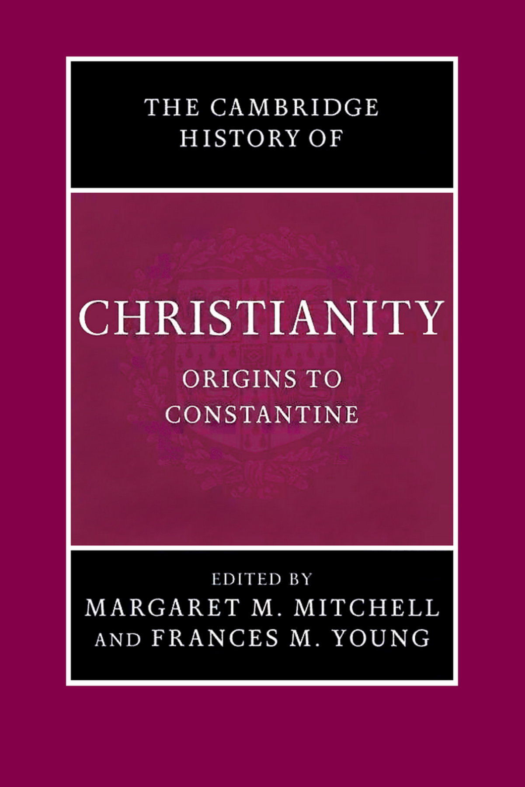

**剑桥基督教史**

**第一卷：起源至君士坦丁**

主编：玛格丽特·M.米切尔（Margaret M. Mitchell）、弗朗西丝·M.杨（Frances M. Young）

助理编辑：K.斯科特·鲍伊（K. Scott Bowie）

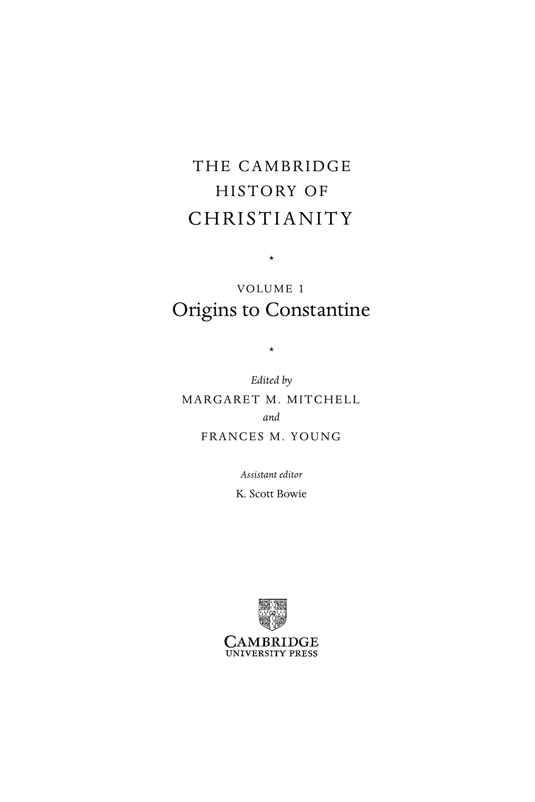

## 本卷简介

作为九卷本《剑桥基督教史》的第一卷，《起源至君士坦丁》全面概述最初三个世纪中，基督宗教在地中海世界兴起所涉及的主要事件、人物、地点与问题。三十余篇专家学者撰写的文章，追踪这段充满变化的历史，从耶稣时代直到四世纪帝国基督教的兴起。本卷以深入思考、充分文献为基础，分析耶稣死后数十年内出现，并通过传教迅速遍布罗马帝国的多种基督徒群体、身份与实践。《起源至君士坦丁》考察截至三世纪末各地基督徒群体的独特特征，同时探索制度形式、知识实践与神学表述的发展；这些将成为随后数世纪基督教史的标志。

玛格丽特·M.米切尔是芝加哥大学新约与早期基督教文献教授。著有Paul and the rhetoric of reconciliation: an exegetical investigation of the language and composition of 1 Corinthians，以及The heavenly trumpet: John Chrysostom and the art of Pauline interpretation，并任Novum Testamentum Supplements专著丛书共同执行编辑。

弗朗西丝·M.杨是英国国家学术院院士，1998年因对神学的贡献获授大英帝国官佐勋章（OBE）。1986年出任伯明翰大学神学教授及系主任，1995年任文学院院长，1997至2002年任副校长，现为神学荣休教授。其众多著作包括From Nicaea to Chalcedon、Biblical exegesis and the formation of Christian culture，以及较面向一般读者的The making of the creeds、Can these dry bones live?和Face to face。

## 丛书说明

《剑桥基督教史》按年代全面叙述基督教从起源至今的各方面发展，涵盖神学、思想、社会、政治、地域与全球层面。每卷本身都对相应时期的学术研究作出实质贡献，全套构成一部重要的学术参考书。它的目标远不止西欧基督教及其分支的历史，而是提供全球视野。从早期开始，东方及科普特基督教就得到充分考虑；后来的非洲、远东、新大陆、南亚及其他非欧洲地区的基督教发展，也得到适当覆盖。各卷包括大众虔敬及基督教信仰的非正式表达，并在广阔文化背景下，考察基督徒形成、敬拜与敬虔的社会学问题。基督教与其他主要信仰的关系，也始终在关注范围内。本丛书将为学者与学生提供极有价值的资源。

| 卷次与书名 | 主编（依原书丛书计划） |
|---|---|
| 1　起源至君士坦丁 | Margaret M. Mitchell、Frances M. Young |
| 2　君士坦丁至约600年 | Winrich Löhr、Fred Norris、Augustine Casiday |
| 3　中世纪早期基督教，约600至约1100年 | Thomas Noble、Julia Smith |
| 4　西欧基督教，约1100至约1500年 | Miri Rubin、Walter Simon |
| 5　东方基督教 | Michael Angold |
| 6　改革与扩张，1500–1660年 | Ronnie Po-chia Hsia |
| 7　启蒙、复兴与革命，1660–1815年 | Stewart J. Brown、Timothy Tackett |
| 8　世界基督教，约1815至约1914年 | Brian Stanley、Sheridan Gilley |
| 9　世界基督教，约1914至约2000年 | Hugh McLeod |

## 版权与出版资料

剑桥大学出版社：剑桥、纽约、墨尔本、马德里、开普敦、新加坡、圣保罗。

英国地址：The Edinburgh Building, Cambridge CB2 2RU, UK。美国由剑桥大学出版社纽约分社出版。

出版社网站：www.cambridge.org。本书资料：www.cambridge.org/9780521812399。

© 剑桥大学出版社，2006。

本书受版权保护。除法定例外及相关集体许可协议规定外，未经剑桥大学出版社书面许可，不得复制本书任何部分。

2006年首次出版。在英国剑桥大学印刷厂印刷。

英国图书馆备有本书书目记录。

美国国会图书馆在版编目资料：

Origins to Constantine／Frances M. Young、Margaret M. Mitchell主编；K. Scott Bowie助理编辑。页数、尺寸待定。——《剑桥基督教史》第1卷。附参考文献及索引。ISBN 0-521-81239-9（精装）。主题：教会史——初期与早期教会，约30–600年。附加检索项：I. Young, Frances M.（Frances Margaret）；II. Mitchell, Margaret Mary, 1956–；III. Bowie, Kenneth Scott；IV. 书名；V. 丛书。分类及控制号：BR165.O66 2006；270.1–dc22；2005012926。

精装ISBN-13：978-0-521-81239-9；ISBN-10：0-521-81239-9。

剑桥大学出版社不对本书所引外部或第三方网站网址的持续有效性、准确性负责，也不保证其内容现在或将来始终准确、适当。

## 原书目录

以下页码沿用原书印刷页码，便于与正文引用及索引对应；合订译稿顶部另有可点击目录。

| 卷首项目 | 原书页码 |
|---|---|
| 插图目录 | ix |
| 地图目录 | x |
| 撰稿人 | xi |
| 前言 | xiii |
| 致谢 | xxi |
| 罗马皇帝与罗马、亚历山大里亚主教年表 | xxii |
| 原始及二手文献缩写表 | xxv |
| 序篇：耶稣基督，基督教的基础 | 1 |

| 章节／部分 | 作者 | 原书起页 |
|---|---|---|
| **第一部分　政治、社会与宗教背景** | | |
| 第1章　公元一世纪的加利利与犹太地区 | 肖恩·弗雷恩（Sean Freyne） | 37 |
| 第2章　犹太人的散居 | 泰莎·拉贾克（Tessa Rajak） | 53 |
| 第3章　罗马帝国 | 汉斯-约瑟夫·克劳克（Hans-Josef Klauck） | 69 |
| **第二部分　耶稣运动** | | |
| 第4章　犹太基督教 | 乔尔·马库斯（Joel Marcus） | 87 |
| 第5章　外邦基督教 | 玛格丽特·M. 米切尔（Margaret M. Mitchell） | 103 |
| 第6章　约翰传统的基督教 | 哈罗德·W. 阿特里奇（Harold W. Attridge） | 125 |
| 第7章　最早期基督徒的社会与教会生活 | 韦恩·A. 米克斯（Wayne A. Meeks） | 145 |
| **第三部分　群体传统与自我界定** | | |
| 第8章　书面记录的形成 | 玛格丽特·M. 米切尔（Margaret M. Mitchell） | 177 |
| 第9章　马吉安与“正典” | 哈里·Y. 甘布尔（Harry Y. Gamble） | 195 |
| 第10章　面对犹太母体的自我界定 | 朱迪思·刘（Judith Lieu） | 214 |
| 第11章　面对希腊—罗马世界的自我界定 | A. J. 德罗格（A. J. Droge） | 230 |
| 第12章　基督徒群体间的自我区分：诺斯替派及其反对者 | 戴维·布拉克（David Brakke） | 245 |
| 第13章　真理与传统：爱任纽 | 德尼斯·明斯（Denis Minns） | 261 |
| 第14章　发展中的教会如何通过实践界定自身 | 卡罗琳·奥西克（Carolyn Osiek） | 274 |
| **第四部分　最初三个世纪基督教的地域差异** | | |
| 第15章　从耶路撒冷直到地极 | 玛格丽特·M. 米切尔（Margaret M. Mitchell） | 295 |
| 第16章　概览：基督教的地理扩展 | 弗兰克·特龙布利（Frank Trombley） | 302 |
| 第17章　小亚细亚与亚该亚 | 克里斯廷·特雷维特（Christine Trevett） | 314 |
| 第18章　埃及 | 伯格·A. 皮尔森（Birger A. Pearson） | 331 |
| 第19章　叙利亚与美索不达米亚 | 苏珊·阿什布鲁克·哈维（Susan Ashbrook Harvey） | 351 |
| 第20章　高卢 | 约翰·贝尔（John Behr） | 366 |
| 第21章　北非 | 莫琳·A. 蒂利（Maureen A. Tilley） | 381 |
| 第22章　罗马 | 马尔库斯·文岑特（Markus Vinzent） | 397 |
| **第五部分　基督教神学的形成** | | |
| 第23章　君士坦丁以前的教会制度 | 斯图尔特·乔治·霍尔（Stuart George Hall） | 415 |
| 第24章　一神论与创造 | 格哈德·迈（Gerhard May） | 434 |
| 第25章　一神论与基督论 | 弗朗西丝·M. 杨（Frances M. Young） | 452 |
| 第26章　迫害中形成的教会论 | 斯图尔特·乔治·霍尔（Stuart George Hall） | 470 |
| 第27章　走向基督教的教养 | 弗朗西丝·M. 杨（Frances M. Young） | 485 |
| **第六部分　“外人”成为公民：走向帝国庇护** | | |
| 第28章　迫害：起源与遗产 | W. H. C. 弗伦德（W. H. C. Frend） | 503 |
| 第29章　公元300年以前的教会与国家 | 阿道夫·马丁·里特尔（Adolf Martin Ritter） | 524 |
| 第30章　君士坦丁与“教会的和平” | 阿维丽尔·卡梅伦（Averil Cameron） | 538 |
| 第31章　第一次尼西亚会议 | 马克·爱德华兹（Mark Edwards） | 552 |
| 第32章　走向基督教物质文化 | 罗宾·M.詹森（Robin M. Jensen） | 568 |
| 结语：回顾与展望 | | 586 |
| 参考文献 | | 590 |
| 索引 | | 683 |

## 插图目录

| 编号 | 图名 | 原书页码 |
|---|---|---|
| 图1 | 圣物匣中的十字架题牌，罗马耶路撒冷圣十字大殿 | xlviii |
| 图2 | 罗马圣普登齐亚纳教堂祭坛马赛克：外邦人的教会与受割礼者的教会 | 86 |
| 图3 | 鱼与饼，罗马圣卡利斯图斯地下墓窟 | 144 |
| 图4 | 阿伯基乌斯铭文碎片，梵蒂冈博物馆庇护基督教博物馆 | 172 |
| 图5 | 切斯特·贝蒂纸草P46，第21叶正面：《罗马书》末尾、《希伯来书》开头 | 176 |
| 图6 | 杜拉欧罗波斯基督教洗礼室复原 | 414 |
| 图7 | 作为哲学家的基督，罗马多米提拉地下墓窟 | 484 |
| 图8 | 别迦摩图拉真神庙 | 502 |
| 图9 | 基督／阿波罗马赛克，梵蒂冈墓地 | 571 |
| 图10 | 好牧人基督，萨拉里亚道石棺，梵蒂冈博物馆庇护基督教博物馆 | 578 |
| 图11 | 约拿／恩底弥翁石棺浮雕，同上馆藏 | 580 |
| 图12 | 罗马圣撒比纳教堂外观 | 584 |
| 图13 | 四世纪石棺上的基督字母组合，同上馆藏 | 587 |

## 地图目录

| 编号 | 图名 | 原书页码 |
|---|---|---|
| 地图1 | 马尔库斯·奥勒留时代的罗马帝国 | xlvi |
| 地图2 | 公元一世纪的巴勒斯坦 | 36 |
| 地图3 | 希律时期犹太人口中心 | 52 |
| 地图4 | 基督教的传播，公元一至四世纪 | 294 |
| 地图5 | 罗马时期的埃及 | 330 |
| 地图6 | 罗马时期的非洲 | 380 |

## 撰稿人

任职信息依原书，†表示作者已故。

| 撰稿人 | 原书所列单位／身份 |
|---|---|
| 哈罗德·W. 阿特里奇（Harold W. Attridge） | 耶鲁大学神学院 |
| 约翰·贝尔（John Behr） | 圣弗拉基米尔正教神学院 |
| 戴维·布拉克（David Brakke） | 印第安纳大学 |
| 阿维丽尔·卡梅伦（Averil Cameron） | 牛津大学基布尔学院 |
| A. J. 德罗格（A. J. Droge） | 加利福尼亚大学圣迭戈分校 |
| 马克·爱德华兹（Mark Edwards） | 牛津大学基督堂学院 |
| W. H. C. 弗伦德（W. H. C. Frend） | †格拉斯哥大学荣休教授；剑桥大学冈维尔与凯斯学院编外研究员 |
| 肖恩·弗雷恩（Sean Freyne） | 都柏林圣三一学院 |
| 哈里·Y. 甘布尔（Harry Y. Gamble） | 弗吉尼亚大学 |
| 斯图尔特·乔治·霍尔（Stuart George Hall） | 伦敦国王学院荣休教授；苏格兰圣安德鲁斯大学 |
| 苏珊·阿什布鲁克·哈维（Susan Ashbrook Harvey） | 布朗大学 |
| 罗宾·M.詹森（Robin M. Jensen） | 范德比尔特大学神学院 |
| 汉斯-约瑟夫·克劳克（Hans-Josef Klauck） | 芝加哥大学 |
| 朱迪思·刘（Judith Lieu） | 伦敦国王学院 |
| 乔尔·马库斯（Joel Marcus） | 杜克大学神学院 |
| 格哈德·迈（Gerhard May） | 美因茨约翰内斯·古腾堡大学荣休教授 |
| 德尼斯·明斯（Denis Minns） | 牛津大学黑衣修士学院 |
| 韦恩·A. 米克斯（Wayne A. Meeks） | 耶鲁大学荣休教授 |
| 玛格丽特·M. 米切尔（Margaret M. Mitchell） | 芝加哥大学 |
| 卡罗琳·奥西克（Carolyn Osiek） | 布赖特神学院 |
| 伯格·A. 皮尔森（Birger A. Pearson） | 加利福尼亚大学圣巴巴拉分校荣休教授 |
| 泰莎·拉贾克（Tessa Rajak） | 雷丁大学 |
| 阿道夫·马丁·里特尔（Adolf Martin Ritter） | 海德堡鲁普雷希特—卡尔大学 |
| 莫琳·A. 蒂利（Maureen A. Tilley） | 代顿大学 |
| 克里斯廷·特雷维特（Christine Trevett） | 加的夫大学 |
| 弗兰克·特龙布利（Frank Trombley） | 加的夫大学 |
| 马尔库斯·文岑特（Markus Vinzent） | 伯明翰大学 |
| 弗朗西丝·M. 杨（Frances M. Young） | 伯明翰大学荣休教授 |

<!-- PDF第13页为空白。 -->


---

<a id="preface"></a>

# 前言

《剑桥基督教史》第一卷《起源至君士坦丁》中文译稿

> 原书第xiii–xix页，PDF第14–20页；PDF第21页为空白。正文及3条脚注完整翻译。
>
> [原书PDF](<../01 起源至君士坦丁.pdf>)

<!-- 原书第xiii–xiv页；PDF第14–15页 -->

从前，早期教会的历史学家讲述一个简单故事：一种纯正信仰由耶稣基督传给门徒；他们拥有共同认可的福音，以《使徒信经》概括，随后分散四方，传播这道。然而，随着时间推移，称作异端的歪曲阻挠了这一统一信息；异端又衍生出自己的后代，不断繁殖、分化，与托付使徒的独一真理相对。不过，尽管面对异端与迫害，基督教仍随着君士坦丁的归信而得胜。

这无疑是对一种过度简化的再次过度简化。然而，现代批判学术研究的大量工作，确实旨在摆脱这种对最早基督教的图式化认识——这种认识本身继承自古代资料。承认基督教从一开始就具有多样性，已经改变了对其起源的研究。无论把简单的发展模型或单一理论解释，用于早期教会史的组织、礼仪、教义还是其他方面，如今都可看出其不足。我们努力把握早期基督教及其社会文化环境的复杂性，同时指出某些要素，说明为何仍可追踪到某种连贯性、某种可辨认的身份：即使文化压力本可能使它变成别的事物，这种身份仍在时间中维持，并被坚定捍卫。

跨学科研究，加上考古活动，以及死海古卷、拿戈玛第文库等偶然发现带来的种种新证据，使本书成为可能。这里汇集的文章，不可避免地只是对如今已极为庞大的研究领域所作的简要综述。不过，我们希望，它们的长处正在于：无论单篇还是整体，都能兼顾平衡与视野、连贯与多样，并提供进一步探索所涉复杂主题的途径。

对于基督教起源的历史学家，最大的难题也许是如何处理耶稣这一人物。大多数运动由一名创始人发起，因而其传记似乎是自然的起点。但耶稣的情况并不如此简单。在一个重要意义上，基督教信仰以耶稣基督本人为基础。本卷序篇“耶稣基督：基督教的基础”，处理由此产生的问题：我们能像为其他重要人物那样，为耶稣写一部历史传记吗？即使能，这是否足以公允呈现他实际对基督徒信徒所代表的一切？

第一部分“政治、社会与宗教背景”有三篇文章，勾勒早期基督教发展的三个主要形成背景。第一篇概述耶稣及最早犹太追随者在加利利、犹太地区生活的地方环境。第二篇转向更广舞台，考察犹太人在这一直接地域以外、即“散居”地区的存在，以及他们对更广阔希腊—罗马文化背景的回应。基督教最初就是在巴勒斯坦之外说希腊语的犹太群体之中，以及其旁边传播；在形成面向“异教”社会的护教立场时，它对犹太前驱负有很大债务。第三篇勾勒罗马帝国的政治与社会实况；正如后续章节所示，这些实况既促进，也阻碍基督徒群体的成长。概括而言，基督教最初三个世纪的故事，可以描绘为一场反主流文化运动日益融入文化的过程；书写这个故事，可以通过分析该运动如何既适应、又挑战其所处的各种文化环境来进行。

<!-- 原书第xiv–xvi页；PDF第15–17页 -->

第二部分“耶稣运动”的文章，探讨《新约》文献背后可以追溯的基督教形态；最后一篇则考察早期基督徒群体，作为一世纪末世界中社会实体的性质。耶稣是犹太人，直接追随者也同为犹太人，这是清楚的。犹太基督教的持续存在，已成为重要的历史研究主题，虽然定义问题始终纠缠不清。同样清楚的是，最早的基督教文献，即保罗书信，见证了非犹太人迅速进入信奉耶稣基督的群体，也见证了人们对接纳条件的争论。因此，前两篇分别追索犹太基督教和外邦基督教的轮廓。两者最终分离，反而遮蔽了某些《新约》文本中难以区分的情况，尤其《约翰福音》。其中对“犹太人”的敌意，可能显露犹太群体内部关于何处才有真正犹太性的争论，而不只是较显而易见的另一种可能，即一个群体对照犹太教界定自己。无论如何，约翰文献值得特别关注；它虽最终被纳入共同的《新约》正典，却似乎代表一些对耶稣传统具有独特解释的基督徒群体。然而，这些不同基督徒群体仍有家族相似性；本部分以考察其特有群体风气、组织模式与仪式形式作结。

接下来的第三部分“群体传统与自我界定”，考察此后一两代人中，基督徒身份形成的不同方式。第一篇研究书面记录的出现，以及基督教运动如何很早便发展出一种文学文化；这种文化对其自我意识及传播至关重要。第二篇专论复杂人物马吉安；无论对于基督教正典史，还是其神学根基，他的遗产都难以估量。马吉安与其对手的共同点，是都通过与他人区别来形成身份。在每一种情况下，无论自称基督徒者相互之间，还是基督徒与“他者”——犹太人、“异教徒”——之间，这都是复杂的互动过程。那些重要他者，在基督徒意识或护教中被塑造成对手的同时，自身也经历着身份转变。

捕捉这一过程，可以采用不同方式：或铺开宽广画面，尽量搜集最广泛的信息，形成谨慎、细致的立场；或对某一次具体辩论交锋作更详细分析。“面对犹太母体的自我界定”一篇，适当地采用第一种方式，因为二十世纪末学界围绕犹太教与基督教“分道扬镳”的争论十分激烈。后一种策略，则见于随后“面对希腊—罗马世界的自我界定”。它通过殉道者游斯丁与基督教对手塞尔苏斯的个案，说明要精确界定基督教话语与他人话语的差异，是何等复杂。当宏观模式在基本层面十分相似时，区分问题就更迫切：犹太人、哲学家和基督徒，都有一个层级有序、顶端为单一神圣存在者的宇宙观，彼此只有细微差异；但他们却为应当敬拜什么、敬拜谁、如何敬拜而展开深刻争论。

某些群体也迫使基督徒建立界定性话语。这些群体常被未经批判地混称为“诺斯替派”；在基督徒看来，他们近得令人不安，因此具有双重威胁。他们的教导最终遭“大公教会”拒绝，因为它们被视为严重颠覆了来自犹太教的核心遗产：坚持独一真神创造宇宙，宣告创造为善，并通过先知启示将在历史高潮中实现的神圣天意计划。本部分呈现并考察这场对话的双方。到二世纪末，人们开始明确表达什么构成基督教教导的真正传统，并宣称其普遍性；尤其见于爱任纽的作品，他可被视为基督教神学第一位伟大体系建构者。最后一篇把基督徒自我界定的问题，放入更广阔的社会框架，从教义、话语及世界观，转向家庭生活与社会实践，突出基督徒在希腊—罗马社会中的暧昧地位。这反映二十一世纪之交学术研究转向社会史的显著变化，是对某些人所认为过分强调思想史的回应。大体而言，第三部分把我们带到二世纪末。

<!-- 原书第xvi–xvii页；PDF第17–18页 -->

第四部分“最初三个世纪基督教的地域差异”，聚焦基督教在前三个世纪“从耶路撒冷……直到地极”的传播，用的是路加在《使徒行传》1:8中的说法。论“基督教地理扩展”的文章，首先处理估算帝国“基督教化”人口时所涉及的证据与方法问题。后续章节分别考察君士坦丁以前存在基督徒人口的主要地区：小亚细亚及亚该亚、埃及、叙利亚与美索不达米亚、高卢、北非和罗马。本部分各章，反映研究最早基督教时一项显著的史学转变。

瓦尔特·鲍尔的研究[^preface-1]提出，有些地区最早的基督教形态是异端而非正统；自此，早期历史得到根本重新评估：也许基督教一开始的特点就是多样，而非一致；也许何者为异端，只能以后见之明辨认；也许统一性是由罗马教会之类新兴权威的优势地位强行确立的。最后一点是鲍尔的论题，已在后续讨论中遭到推翻。不过，其他许多因素仍引导学者关注地域差异，尤其是罗马帝国不同地区根源不同，对Romanitas（罗马性），特别是统治者崇拜，回应也不同。因此，基督徒群体的宗教政治环境并不一致，文化与信仰风气也由此多样。此外，研究还发现各教会礼仪实践、组织结构的地方差异。学者日益认识到，必须深入研究不同地点有关基督徒群体存在的证据，并分析其特殊性质。[^preface-2] 本部分每一篇都汇集关键的文学、文献与考古证据，勾勒该地区的主要事件、争论和人物，同时强调一个基本事实：没有任何地区完全孤立。确实，书信与旅行者把影响从罗马帝国一端带到另一端，互动是重要现实。

第五部分“基督教神学的形成”，在这些地域差异，与制度合一的意识形态之间架起桥梁；后者使君士坦丁把教会看作实现帝国统一计划的有用工具。这里追踪一种基督教世界观的创立，它落实于既具有地方性、又横跨地中海的制度结构。我们把经典教义争论，放在比早先教会史更宽广的背景中，避免采用暗示必然结果的发展观念。围绕一神论及创造教义的争论，为耶稣基督的本性及其与独一上帝关系的论争，确立了背景；某些具有较普遍意义的地方争议，则为基督论与教会论的讨论提供材料。本部分最后指出，教义宣称更广的背景，是早期基督教话语的学派性质，以及自觉发展一种基督教知识文化、与希腊—罗马世界paideia（教养）竞争的努力。四世纪末及以后，传统异教教育课程并未被取代，而是逐渐基督教化；这一过程，很大程度上归功于更早把希腊—罗马修辞、哲学学校传统教授的课程与方法，改用于圣经研究。

<!-- 原书第xvii–xix页；PDF第18–20页 -->

第六部分“‘外人’成为公民：走向帝国庇护”，追索基督徒如何日益安居于世，尽管他们起初倾向采用经书中侨居者或寄居者的母题，[^preface-3] 声称自己的公民身份在天上。自保罗时代，个别基督徒就可能有罗马公民权；然而，他们的公民态度仍有两面性，因为散居心态在某种意义上延续到外邦归信者身上，对基督的忠诚取代了对恺撒的忠诚。迫害经验强化了这一点，不过必须理解，正如第一篇所示，迫害大多是地方性、零星发生；官方针对基督徒、遍及帝国的程序，主要直到本卷时期较晚阶段才出现。罗马人认为基督徒在某种意义上不属于这个社会，这反映在基督徒对罗马帝国的看法中。第二篇细致呈现人们对后来被称作“教会与国家”关系的问题，态度如何变化。君士坦丁一章反思第一位“基督教皇帝”的关键影响，同时提醒，不应把其统治带来的社会政治及宗教转变，叙述得过于简单。

尼西亚会议一篇，展示教义与政治因素的互动：追求合一的动力，来自自称“外界之人的主教”的那个人，即皇帝君士坦丁。本部分以艺术、建筑综述为高潮，贯穿整个故事：这场反主流文化运动，如何融入罗马世界的社会文化模式，最终表达出独特的物质文化。整体而言，本部分追踪四世纪初这一关键时期，人们思考基督徒在世界中位置的问题时，所依据的界限如何改变。结语则略论，古代基督教如何以某些复杂组合，成为后来漫长、多样历史的基础。

以上概览旨在表明，这部论文集远非互不相关文章的“大杂烩”。尽管各篇视角不同，整体仍有相互衔接的次序。本卷可以作为该时期连续的历史来阅读，只是各篇从不同角度加以处理。我们鼓励读者利用各作者提供的分章书目，继续追索每篇提出的主题与问题；各篇所引原始及二手文献的完整资料，则可在总参考文献中查找。

编者谨向所有作者的辛勤工作致谢，也感谢他们友善回应修改意见，使本卷能够有效整合。他们尤其感谢K.斯科特·鲍伊（K. Scott Bowie）提供的宝贵协助：他除了其他工作，还把作者提交的多份书目编成统一参考文献，整理标准缩写，并制作最终纸本及电子稿。感谢芝加哥大学神学院对本项目给予慷慨的机构与经费支持。也感谢剑桥大学出版社从本项目发起到出版全过程的支持。最后，我们愿将本卷献给罗伯特·M.格兰特；我们两人都曾受教于他，也都深受他的启发。

FMY与MMM

2004年12月

## 注释

[^preface-1]: Orthodoxy and heresy.

[^preface-2]: 两个值得注意的例子是Lampe, Paul to Valentinus（论罗马），以及Pearson, Gnosticism and Christianity in Roman and Coptic Egypt。

[^preface-3]: 《腓立比书》3:20；《彼得前书》1:17、2:11；Ep. Diognet. 5.5。


---

<a id="acknowledgements"></a>

# 致谢

> 原书第xxi页，PDF第22页。

编者谨向《剑桥古代史》《剑桥犹太教史》，以及Metzler Verlag与E. J. Brill出版的Der Neue Pauly／Brill’s New Pauly（第III卷，第262–263页；本书地图4），致以谢意，感谢授权转载地图。

我们也感谢密歇根大学、耶鲁大学美术馆，以及国际地下墓窟学会，允许从其摄影档案转载图片。各位摄影师的照片均已获得其书面授权，谨此致谢。尤其感谢罗宾·M.詹森教授，在取得图片方面给予宝贵协助。


---

<a id="chronology"></a>

# 罗马皇帝与罗马、亚历山大里亚主教年表

> 原书第xxii–xxiii页，PDF第23–24页；第25页为空白。为便于阅读，将原书平行三栏分为以下三表。年代依原表，不依据正文其他章或后来的年表改写；未另标者为公元。

## 罗马皇帝

| 在位年代 | 姓名 |
|---|---|
| 公元前27–公元14 | 奥古斯都（Augustus） |
| 14–37 | 提比略（Tiberius） |
| 37–41 | 盖乌斯，卡利古拉（Gaius / Caligula） |
| 41–54 | 克劳狄乌斯（Claudius） |
| 54–68 | 尼禄（Nero） |
| 68–69 | 加尔巴（Galba） |
| 69 | 奥托（Otho） |
| 69 | 维特里乌斯（Vitellius） |
| 69–79 | 维斯帕先（Vespasian） |
| 79–81 | 提图斯（Titus） |
| 81–96 | 图密善（Domitian） |
| 96–98 | 涅尔瓦（Nerva） |
| 98–117 | 图拉真（Trajan） |
| 117–138 | 哈德良（Hadrian） |
| 138–161 | 安东尼努斯·庇护（Antoninus Pius） |
| 161–180 | 马尔库斯·奥勒留（Marcus Aurelius） |
| 161–169 | 卢基乌斯·维鲁斯，共治（Lucius Verus） |
| 180–192 | 康茂德（Commodus） |
| 193 | 佩尔提纳克斯（Pertinax）；尤利安努斯（Julianus） |
| 193–211 | 塞普提米乌斯·塞维鲁（Septimius Severus） |
| 211–217 | 卡拉卡拉（Caracalla） |
| 217–218 | 马克里努斯（Macrinus） |
| 218–222 | 埃拉加巴卢斯（Elagabalus） |
| 222–235 | 亚历山大·塞维鲁（Alexander Severus） |
| 235–238 | 马克西米努斯·特拉克斯（Maximinus Thrax） |
| 238 | 戈尔狄安诸帝（Gordiani）；普皮埃努斯（Pupienus） |
| 238–244 | 戈尔狄安三世（Gordian III） |
| 244–249 | 阿拉伯人腓力（Philip the Arabian） |
| 249–251 | 德修（Decius） |
| 251–253 | 德修之子及其他诸帝 |
| 253–260 | 瓦勒良（Valerian） |
| 260–268 | 加里恩努斯（Gallienus） |
| 268–270 | 克劳狄乌斯·哥提库斯（Claudius Gothicus） |
| 270–275 | 奥勒良（Aurelian） |
| 275–276 | 塔西佗（Tacitus）；弗洛里安努斯（Florianus） |
| 276–282 | 普罗布斯（Probus） |
| 282–283 | 卡鲁斯（Carus） |

后段原表分东西两部：

| 西部年代 | 西部统治者 | 东部年代 | 东部统治者 |
|---|---|---|---|
| 283–284 | 卡里努斯（Carinus） | 283–284 | 努梅里安（Numerian） |
| 284–286 | 戴克里先（Diocletian） | 284–305 | 戴克里先 |
| 286–305 | 马克西米安（Maximian） |  |  |
| 305–306 | 君士坦提乌斯·克洛鲁斯（Constantius Chlorus） | 305–311 | 加列里乌斯（Galerius） |
|  |  | 310–312 | 马克西米努斯（Maximinus） |
| 306– | 君士坦丁（Constantine） | 308– | 君士坦丁 |
|  |  | 308–324 | 李锡尼（Licinius） |
| 324–337 | 君士坦丁独掌帝国 |  |  |

## 罗马主教

| 任期／记事 | 姓名 |
|---|---|
| 约64年殉道 | 圣彼得（St Peter） |
| 67–76 | 利努斯（Linus） |
| 76–88 | 阿纳克勒图斯（Anacletus） |
| 88–97 | 克莱孟（Clement） |
| 97–105 | 埃瓦里斯图斯（Evaristus） |
| 105–115 | 亚历山大（Alexander） |
| 115–125 | 西克斯图斯一世（Xystus I） |
| 125–138 | 忒勒斯福鲁斯（Telesphorus） |
| 138–141 | 希吉努斯（Higinus） |
| 141–155 | 庇护（Pius） |
| 155–166 | 阿尼凯图斯（Anicetus） |
| 166–175 | 索特尔（Soter） |
| 175–189 | 埃留特鲁斯（Eleutherus） |
| 189–199 | 维克托（Victor） |
| 199–217 | 泽菲里努斯（Zephyrinus） |
| 217–222 | 卡利斯图斯（Callistus） |
| 222–230 | 乌尔班（Urban） |
| 230–235 | 蓬提安努斯（Pontianus） |
| 235–236 | 安忒罗斯（Anteros） |
| 236–250 | 法比安（Fabian） |
| 251–253 | 科尔内利乌斯（Cornelius） |
| 253–254 | 卢基乌斯（Lucius） |
| 254–257 | 司提反（Stephen） |
| 257–258 | 西克斯图斯二世（Xystus II） |
| 259–268 | 狄奥尼修（Dionysius） |
| 269–274 | 费利克斯（Felix） |
| 275–283 | 欧提基安努斯（Eutychianus） |
| 283–296 | 盖乌斯（Gaius） |
| 296–304 | 马尔凯利努斯（Marcellinus） |
| 308–309 | 马尔凯卢斯（Marcellus） |
| 309–310 | 优西比乌（Eusebius） |
| 311–314 | 米尔提亚德斯（Miltiades） |
| 314–335 | 西尔维斯特（Silvester） |
| 336 | 马尔库斯（Marcus） |

## 亚历山大里亚主教

| 任期 | 姓名 |
|---|---|
| 42–62 | 圣马可（St Mark） |
| 62–84 | 安尼安努斯（Annianus） |
| 84–98 | 阿比利乌斯（Abilius） |
| 98–109 | 凯尔多（Cerdo） |
| 109–119 | 普里穆斯（Primus） |
| 119–131 | 尤斯图斯（Justus） |
| 131–144 | 欧墨涅斯（Eumenes） |
| 144–154 | 马尔库斯（Marcus） |
| 154–167 | 凯拉迪翁（Celadion） |
| 167–179 | 阿格里皮努斯（Agrippinus） |
| 179–189 | 尤利安（Julian） |
| 189–232 | 德米特里乌斯一世（Demetrius I） |
| 232–247 | 赫拉克拉斯（Heraclas） |
| 247–264 | 狄奥尼修（Dionysius） |
| 265–282 | 马克西穆斯（Maximus） |
| 282–300 | 提奥纳斯（Theonas） |
| 300–311 | 彼得一世（Peter I） |
| 311–312 | 阿基拉斯（Achillas） |
| 313–326 | 亚历山大一世（Alexander I） |
| 326–373 | 亚他那修一世（Athanasius I） |

来源：罗马皇帝与主教，据Robert M. Grant, Augustus to Constantine, 313–314；亚历山大里亚主教由Birger A. Pearson为本卷编制，依传统名单改编。

## 原表对照

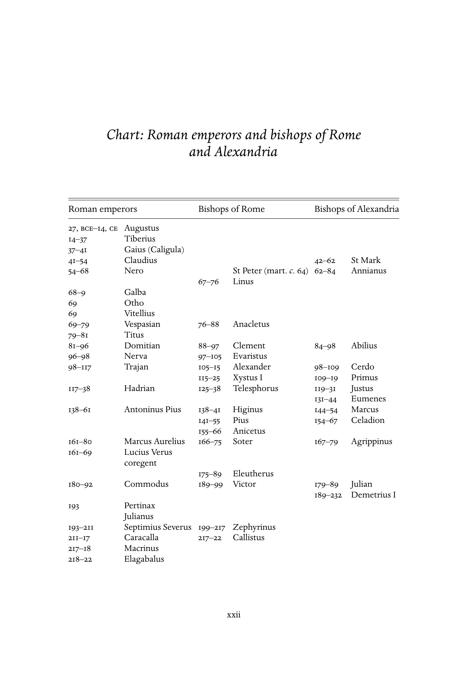

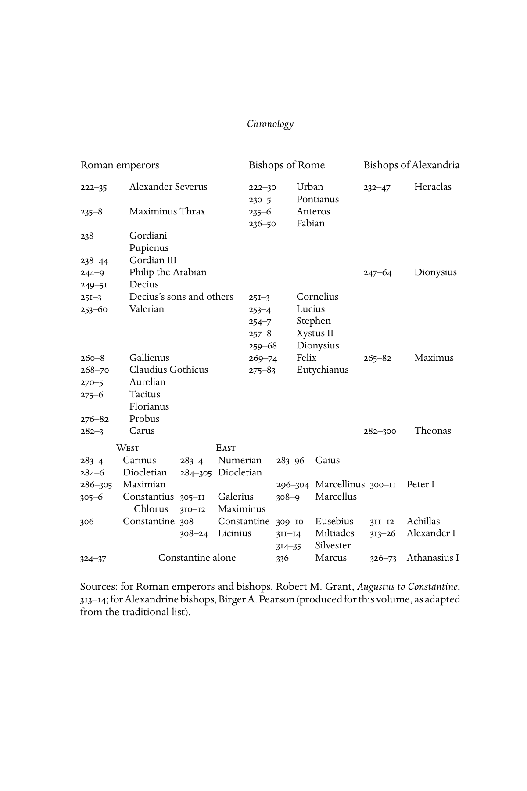

[原PDF第25页空白页影像](<assets/pdf-025.png>)。


---

<a id="abbreviations"></a>

# 原始及二手文献缩写表与卷首地图

> 原书第xxv–xlviii页，PDF第26–49页。缩写及对应文献题名、作者名、出版资料依约保留原文，以便与脚注检索相互对应；分类标题、解释文字及圣经卷名译为中文。原书等宽栏序保留。

## 通用缩写

| 缩写 | 含义／文献 |
|---|---|
| ET | 英文译本 |
| LXX | 《七十士译本》 |
| NRSV | 《圣经·新修订标准版》：The Bible, New Revised Standard Version，Bruce M. Metzger等编（New York: Oxford University Press, 1990） |
| NTApoc | New Testament Apocrypha，2卷，W. Schneemelcher、R. McL. Wilson编，修订版（Cambridge: James Clarke & Co. Ltd.; Louisville, KY: Westminster John Knox Press, 1991–2） |
| NHL | Nag Hammadi Library in English，J. M. Robinson编，第4修订版（Leiden: Brill, 1996） |

## 原始文献

### 圣经各卷

#### 旧约

| 原书缩写 | 中文卷名 |
|---|---|
| Gen | 创世记 |
| Exod | 出埃及记 |
| Lev | 利未记 |
| Num | 民数记 |
| Deut | 申命记 |
| Josh | 约书亚记 |
| Judg | 士师记 |
| Ruth | 路得记 |
| 1–2 Sam | 撒母耳记上下 |
| 1–2 Kgs | 列王纪上下 |
| Nah | 那鸿书 |
| Hab | 哈巴谷书 |
| 1–2 Chr | 历代志上下 |
| Ezra | 以斯拉记 |
| Neh | 尼希米记 |
| Esth | 以斯帖记 |
| Job | 约伯记 |
| Ps | 诗篇 |
| Prov | 箴言 |
| Eccl | 传道书 |
| Song | 雅歌 |
| Isa | 以赛亚书 |
| Zeph | 西番雅书 |
| Hag | 哈该书 |
| Jer | 耶利米书 |
| Lam | 耶利米哀歌 |
| Ezek | 以西结书 |
| Dan | 但以理书 |
| Hos | 何西阿书 |
| Joel | 约珥书 |
| Amos | 阿摩司书 |
| Obad | 俄巴底亚书 |
| Jon | 约拿书 |
| Mic | 弥迦书 |
| Zech | 撒迦利亚书 |
| Mal | 玛拉基书 |

#### 本书引用的七十士译本／次经

| 原书缩写 | 中文卷名 |
|---|---|
| 1–4 Macc | 马加比一至四书 |
| Sir | 便西拉智训 |
| Wis | 所罗门智训 |

#### 新约

| 原书缩写 | 中文卷名 |
|---|---|
| Matt | 马太福音 |
| Mark | 马可福音 |
| Luke | 路加福音 |
| John | 约翰福音 |
| Acts | 使徒行传 |
| Rom | 罗马书 |
| 1–2 Cor | 哥林多前后书 |
| Gal | 加拉太书 |
| Eph | 以弗所书 |
| Phil | 腓立比书 |
| Col | 歌罗西书 |
| 1–2 Thess | 帖撒罗尼迦前后书 |
| 1–2 Tim | 提摩太前后书 |
| Tit | 提多书 |
| Phlm | 腓利门书 |
| Heb | 希伯来书 |
| Jas | 雅各书 |
| 1–2 Pet | 彼得前后书 |
| 1–3 John | 约翰一、二、三书 |
| Jude | 犹大书 |
| Rev | 启示录 |

### 其他原始文献及二手文献

<!-- 以下原书PDF第27–46页；文献题名保留原文。 -->

```text
    安布罗斯（Ambrose）
Exp. Ps. 118   Explanatio psalmi cxviii
Ob. Theo.        De obitu Theodosii

    外典使徒行传（Apocryphal Acts of the Apostles）
Acts Joh.        Acts of John
Acts Pet.        Acts of Peter
Acts Thom.       Acts of Thomas

    使徒教父（Apostolic fathers）
1 –2 Clem.       1 –2 Clement
Did.             Didache
Ep. Barn.        Epistle of Barnabas
Ep. Diognet.     Epistle to Diognetus
Herm. Mand.      Shepherd of Hermas, Mandates
Herm. Sim.       Shepherd of Hermas, Similitudes
Herm. Vis.       Shepherd of Hermas, Visions
Ign. Eph.        Ignatius, To the Ephesians
Ign. Magn.       Ignatius, To the Magnesians
Ign. Phild.      Ignatius, To the Philadelphians
Ign. Pol.        Ignatius, To Polycarp
Ign. Rom.        Ignatius, To the Romans
Ign. Smyr.       Ignatius, To the Smyrneans
Ign. Trall.      Ignatius, To the Trallians
Poly. Phil.      Polycarp, To the Philippians
```


<a id="pdf-028"></a>
<!-- PDF page 28; original page xxvii -->


```text
    阿普列尤斯（Apuleius (Apul.)）
Fl.           Florida
Met.          Metamorphoses
Pl.           De Platone
    〔阿里斯提亚斯〕（[Aristeas]）
Ep. Arist.    Epistle of Aristeas

    阿里斯提德（Aristides）
Apol.         Apologia

    亚里士多德（Aristotle (Arist.)）
Pol.          Politica

    阿尔诺比乌斯（Arnobius）
Adv. nat.     Adversus nationes
    亚他那修（Athanasius (Ath.)）
Apol. sec.    Apologia (secunda) contra Arianos
Decr.         De decretis Nicaenae synodi
Dion.         De sententia Dionysii
Ep.           Epistulae
Ep. Jov.      Epistula ad Jovianum
H. Ar.        Historia Arianorum ad monachos
Syn.          De synodis
Tom.          Tomus ad Antiochenos
    雅典那哥拉（Athenagoras）
Leg.          Legatio pro Christianis
Res.          De resurrectione mortuorum
    奥古斯丁（Augustine (August.)）
Cresc.        Contra Cresconium Donatistam
De civ. D.    De civitate Dei
Doctr. Chr.   De doctrina Christiana
Retract.      Retractationes
Trin.         De Trinitate
    奥勒留·维克托（Aurelius Victor (Aurel. Vict.)）
Caes.         Liber de Caesaribus
    巴西尔（Basil (Bas.)）
Ep.           Epistulae
```


<a id="pdf-029"></a>
<!-- PDF page 29; original page xxviii -->


```text
    尤利乌斯·恺撒（Julius Caesar (Caes.)）
B. Gall.        Bellum Gallicum
    卡西乌斯·狄奥（Cassius Dio (Cass. Dio)）


    金口约翰（Chrysostom, John (Chrys.)）
Adv. Jud.        Adversus Judaeos
Hom. 1–88 in Jo. Homiliae 1–88 in Johannem
    西塞罗（Cicero (Cic.)）
Acad.           Academicae quaestiones
Clu.            Pro Cluentio
Fin.            De finibus
Har. resp.      De haruspicum responso
N.D.            De natura deorum
Rep.            De republica
    亚历山大里亚的克莱孟（Clement of Alexandria (Clem. Al.)）
Paed.           Paedagogus
Protr.          Protrepticus
q.d.s.          Quis dives salvetur
Str.            Stromateis
    克莱孟文集（Clementina ([Clem.])）
Asc. Jas.        Ascents of James
Ep. Petr.        Epistula Petri ad Jacobum
Hom.             Homiliae
Keryg. Pet.      Kērygmata Petrou
Recogn.          Recognitiones
    君士坦丁（Constantine (Const.)）
Or. s.c.        Oratio ad sanctorum coetum
    居普良（Cyprian (Cypr.)）
Ep.              Epistulae
Hab. virg.       De habitu virginum
Laps.            De lapsis
Unit. eccl.      De catholicae ecclesiae unitate
    耶路撒冷的区利罗（Cyril of Jerusalem (Cyr. H.)）
Catech. 1–18    Catecheses illuminandorum
Catech. 19–23   Catecheses mystagogicae
Ep. Const.      Epistula ad Constantium de visione crucis
```


<a id="pdf-030"></a>
<!-- PDF page 30; original page xxix -->


```text
    死海古卷及相关文本（Dead Sea scrolls and related texts）
1QHa            Hodayota or Thanksgiving hymnsa
1QS             Rule of the community
1Qsa            Rule of the congregation (appendix a to 1QS)
1QM             War scroll
CD              Cairo Geniza copy of the Damascus document
4QShirShaba     Songs of the sabbath sacrificea
4QDibHama       Dibre hame’orota or Words of the luminariesa
11QPsa          Psalm scrolla

    西西里的狄奥多罗斯（Diodorus Siculus (Diod. Sic.)）


    第欧根尼·拉尔修（Diogenes Laertius (Diog. Laert.)）


    埃皮法尼乌斯（Epiphanius (Epiph.)）
Mens.           De mensuris et ponderibus
Pan.            Panarion seu Adversus lxxx haereses

    优西比乌（Eusebius (Euseb.)）
Chron.          Chronicon
D.E.            Demonstratio evangelica
E.Th.           De ecclesiastica theologia
Ep. Caes.       Epistula ad Caesarienses
HE              Historia ecclesiastica
L.C.            Laus Constantini
Marcell.        Contra Marcellum
Mart. Pal.      De martyribus Palestinae
Onomast.        Onomasticon
P.E.            Praeparatio evangelica
V.C.            De vita Constantini

    基齐库斯的格拉修（Gelasius of Cyzicus (Gel.)）
HE              Historia ecclesiastica

    纳齐安祖的格列高利（Gregory of Nazianzus (Gr. Naz.)）
Or.             Orationes

    尼撒的格列高利（Gregory of Nyssa (Gr. Nyss.)）
V. Gr. Thaum.   De vita Gregorii Thaumaturgi
```


<a id="pdf-031"></a>
<!-- PDF page 31; original page xxx -->


```text
    行神迹者格列高利（Gregory Thaumaturgus (Gr. Thaum.)）
Ep. can.            Epistula canonica

    希罗多德（Herodotus (Hdt.)）
Hist.               Historiae

    普瓦捷的希拉里（Hilary of Poitiers (Hil. Poit.)）
Ad. Val. et Ur.     adversus Valentem et Ursacium

    希波吕托斯（Hippolytus (Hipp.)）
Antichr.            Demonstratio de Christo et antichristo
Ben. Is. Iac.       De benedictionibus Isaaci et Jacobi
Dan.                Commentarium in Danielem
Fr. 1 –81 in Gen.   Fragmenta in Genesim
Haer.               Refutatio omnium haeresium
Noët.              Contra Noëtum
Trad. ap.           Traditio apostolica

    爱任纽（Irenaeus (Iren.)）
Epid.               Epideixis tou apostolikou kērygmatos
Frag. Syr.          Fragments in Syriac
Haer.               Adversus haereses

    耶柔米（Jerome）
Comm. Am.           Commentariorum in Amos
Comm. Ezech.        Commentariorum in Ezechielem
Comm. Gal.          Commentariorum in Epistulam ad Galatas
Comm. Habac.        Commentariorum in Habacuc
Comm. Isa.          Commentariorum in Isaiam
Comm. Jer.          Commentariorum in Jeremiam
Comm. Mt.           Commentariorum in Matthaeum
Ep.                 Epistulae
Onom.               Onomasticon
Vir. ill.           De viris illustribus

    约瑟夫斯（Josephus）
AJ                  Antiquitates Judaicae
Ap.                 Contra Apionem
BJ                  Bellum Judaicum
Vit.                Vita
```


<a id="pdf-032"></a>
<!-- PDF page 32; original page xxxi -->


```text
    游斯丁（Justin）
1 Apol.         1 Apologia
2 Apol.         2 Apologia
Dial.           Dialogus cum Tryphone Judaeo

    尤维纳利斯（Juvenal ( Juv.)）
Sat.            Satires

    拉克坦提乌斯（Lactantius (Lactant.)）
Div. inst.      Divinae institutiones
Mort.           De morte persecutorum

    琉善（Lucian (Luc.)）
Alex.            Alexander (Pseudomantis)
De mort. Peregr. De morte Peregrini
Men.             Menippus (Necyomantia)

    殉道文献（Martyrologies）
Musurillo        H. Musurillo (ed. and trans.), Acts of the Christian martyrs, OECT
                 (1972)
M. Crisp.        Martyrium Crispinae
M. Cypr.         Martyrium Cypriani
M. Iust.         Martyrium Iustini et septem sodalium
M. Mar.          Martyrium Mariani et Iacobi
M. Mont.         Martyrium Montani et Lucii
M. Perp.         Martyrium Perpetuae et Felicitatis
M. Pion.         Martyrium Pionii
M. Polyc.        Martyrium Polycarpi
M. Saturn.       Martyrium Saturnini, Dativi et aliorum plurimorum
M. Scil.         Martyrum Scillitanorum acta

    推罗的马克西穆斯（Maximus of Tyre (Max. Tyr.)）
    撒狄的梅利托（Melito of Sardis (Mel.)）
Fr.              Fragmenta
Pass.            Homilia in passionem Christi ( = Peri pascha)

    奥林波斯的美多迪乌斯（Methodius of Olympus (Meth.)）
Res.             De resurrectione mortuorum
Symp.            Symposium
```


<a id="pdf-033"></a>
<!-- PDF page 33; original page xxxii -->


```text
    米努基乌斯·费利克斯（Minucius Felix (Min. Fel.)）
Oct.               Octavius

    拿戈玛第册页本（Nag Hammadi Codices）
拿戈玛第册页本（NHC）的引法：先列册号（I），再列篇号（1）。
NHC                 Nag Hammadi Codices
NHL                 Nag Hammadi library in English, J. M. Robinson (ed.), 4th rev. ed.
                            (Leiden: Brill, 1996)
BG                  Berlin Codex
CG                  Cairensis Gnosticus
Pr. Paul            i, 1 Prayer of the apostle Paul
Treat. res.         i, 4 Treatise on the resurrection
Tri. trac.          i, 5 Tripartite tractate
Ap. John            ii, 1 Apocryphon of John
Gos. Thom.          ii, 2 Gospel of Thomas
Gos. Phil.          ii, 3 Gospel of Philip
Hyp. Arch.          ii, 4 Hypostasis of the Archons
Thom. cont.         ii, 7 Book of Thomas the contender
Eugnostos           iii, 3 Eugnostos the blessed
Dial. sav.          iii, 5 Dialogue of the saviour
Gos. Eg.            iv, 2 Gospel of the Egyptians
Eugnostos           v, 1 Eugnostos the blessed
1 Apoc. Jas.        v, 3 (First) Apocalypse of James
2 Apoc. Jas.        v, 4 (Second) Apocalypse of James
Apoc. Adam          v, 5 The Apocalypse of Adam
Acts Pet. 12 apos. vi, 1 Acts of Peter and the twelve apostles
Thund.              vi, 2 Thunder: perfect mind
Disc. 8–9           vi, 6 Discourse on the eighth and ninth
Pr. thanks.         vi, 7 Prayer of thanksgiving
Asclepius           vi, 8 Asclepius 21 –29
Paraph. Shem        vii, 1 Paraphrase of Shem
Steles Seth         vii, 5 Three steles of Seth
Zost.               viii, 1 Zostrianos
Ep. Pet. Phil.      viii, 2 Letter of Peter to Philip
Melch.              ix, 1 Melchizedek
Norea               ix, 2 Thought of Norea
Marsanes            x, 1 Marsanes
Interp. know.       xi, 1 Interpretation of knowledge
Val. exp.           xi, 2 A Valentinian exposition
Allogenes           xi, 3 Allogenes (foreigner)
Hypsiph.            xi, 4 Hypsiphrone
Trim. Prot.         xii, 1 Trimorphic protennoia
Act Pet.            BG, 4 Act of Peter
```


<a id="pdf-034"></a>
<!-- PDF page 34; original page xxxiii -->


```text
    新约外典与伪经（New Testament Apocrypha and Pseudepigrapha）
NTApoc        New Testament Apocrypha, 2 vols., W. Schneemelcher and R. McL.
              Wilson (eds.), rev. ed. (Cambridge: James Clarke & Co. Ltd.;
              Louisville, KY: Westminster John Knox Press, 1991–2).
Gos. Eb.      Gospel of the Ebionites
Gos. Heb.     Gospel of the Hebrews
Gos. Naass.   Gospel of the Naassenes
Gos. Naz.     Gospel of the Nazareans

    诺瓦提安（Novatian）
Trin.               De Trinitate

    旧约伪经（Old Testament Pseudepigrapha）
APOT          The Apocrypha and pseudepigrapha of the Old Testament, 2 vols., R. H.
              Charles (ed.) (Oxford: Clarendon Press, 1913)
OTP           The Old Testament pseudepigrapha, 2 vols., J. H. Charlesworth (ed.)
              (Garden City, NY: Doubleday, 1983–5).
1 –4 Bar.     1 –4 Baruch
Odes Sol.     Odes of Solomon

    米勒维斯的奥普塔图斯（Optatus of Milevis (Opt.)）
Donat.        De schismate Donatistarum

    西卜神谕（Oracula Sibyllina (Orac. Sib.)）
    奥利金（Origen (Or.)）
C. Cels.      Contra Celsum
Comm. Heb.    Commentarii in epistulam ad Hebraeos
Comm. Jo.     Commentarii in evangelium Joannis
Comm. Matt.   In Matthaeum commentariorum series
Dial.         Dialogus cum Heraclide
Hom. Ezech.   Homiliae in Ezechielem
Hom. Gen.     Homiliae in Genesim
Hom. Jer.     Homiliae in Jeremiam
Hom. Luc.     Homiliae in Lucam
Hom. Num.     Homiliae in Numeros
Or.           De oratione
Princ.        De principiis
Sel. Lev.     Selecta in Leviticum

    奥罗修斯（Orosius (Oros.)）
Hist.         Historiae adversum paganos
```


<a id="pdf-035"></a>
<!-- PDF page 35; original page xxxiv -->


```text
    奥维德（Ovid (Ov.)）
Am.           Amores

    帕拉迪乌斯（Palladius (Pall.)）
H. Laus.      Historia Lausiaca

    潘斐卢斯（Pamphilus (Pamph.)）
Ap. Or.       Apologia pro Origene

    拉丁颂辞集（Panegyrici Latini (Pan. Lat.)）
    纸草文献（Papyri）
P. Amh.       Amherst papyri
P. Köln      Kölner papyri
P. Oxy.       Oxyrhynchus papyri
P. Ryl.       John Rylands papyri

    保萨尼亚斯（Pausanias (Paus.)）
    斐洛（Philo）
Contempl.     De vita contemplativa
Decal.        De decalogo
Flacc.        In Flaccum
Legat.        Legatio ad Gaium
Migr.         De migratione Abrahami
Opif.         De opificio mundi
Prov.         De providentia
Quaest. Ex.   Quaestiones et solutiones in Exodum
Spec.         De specialibus legibus
Virt.         De virtutibus

    菲洛斯托尔吉乌斯（Philostorgius (Philost.)）
HE            Historia ecclesiastica

    菲洛斯特拉托斯（Philostratus (Philostr.)）
VA            Vita Apollonii

    柏拉图（Plato (Pl.)）
Epin.         Epinomis
Lg.           Leges
Prt.          Protagoras
Res.          Respublica
Ti.           Timaeus
```


<a id="pdf-036"></a>
<!-- PDF page 36; original page xxxv -->


```text
    老普林尼（Pliny (the Elder) (Plin.)）
HN                 Naturalis historia

    小普林尼（Pliny (the Younger) (Plin.)）
Ep.                Epistulae
Pan.               Panegyricus

    普罗提诺（Plotinus (Plot.)）
Enn.               Enneades

    普鲁塔克（Plutarch (Plut.)）
Adol. poet. aud.   Quomodo adolescens poetas audire debeat
Cam.               Camillus
Def. orac.         De defectu oraculorum
De Is. et Os.      De Iside et Osiride
Lib. ed.           De liberis educandis
Princ. inerud.     Ad principem ineruditum
Quaest. conv.      Quaestiones convivales
Superst.           De superstitione

    波利比乌斯（Polybius (Polyb.)）
Hist.              Historiae

    波菲利（Porphyry (Porph.)）
Christ.            Contra Christianos
De antr. nymph.    De antro nympharum
Vit. Plot.         Vita Plotini

    托勒密（Ptolemaeus）
Flor.              Epistula ad Floram

    拉比文献（Rabbinic Works）
篇名前加‘y.’表示《耶路撒冷塔木德》（Yerushalmi），加‘b.’表示《巴比伦塔木德》
（Bavli）；加‘t.’表示《托塞夫塔》，加‘m.’表示《米示拿》，加‘bar.’表示一则
巴拉伊塔（baraita）。
‘Abod. Zar.        Avodah Zarah
‘Abot              Avot
Ber.               Berakhot
Git.               Gittin
H.ul.              Hullin
Sanh.              Sanhedrin
```


<a id="pdf-037"></a>
<!-- PDF page 37; original page xxxvi -->


```text
Sukk.          Sukkah
Ta‘an.         Ta‘anit
Yad.           Yadayim
Midr. Teh.     Midrash Tehillim
Pesiq. Rab.    Pesiqta Rabbati

    鲁菲努斯（Rufinus (Ruf.)）
HE             Historia ecclesiastica

    塞涅卡（Seneca）
Ep.            Epistulae morales

    苏格拉底·斯科拉斯提库斯（Socrates Scholasticus (Socr.)）
HE             Historia ecclesiastica

    索佐门（Sozomen (Soz.)）
HE             Historia ecclesiastica

    斯巴尔提安努斯（Spartian）
Sept. Sever.   Vita Septimii Severi

    斯特拉波（Strabo）
Geog.          Geographica

    苏埃托尼乌斯（Suetonius (Suet.)）
Claud.         Divus Claudius
Dom.           Domitianus
Jul.           Divus Julius
Nero           Nero
Tit.           Divus Titus

    塔西佗（Tacitus (Tac.)）
Agr.           Agricola
Ann.           Annales
Hist.          Historiae

    塔提安（Tatian (Tat.)）
Orat.          Oratio ad Graecos

    德尔图良（Tertullian (Tert.)）
Ad ux.         Ad uxorem
```


<a id="pdf-038"></a>
<!-- PDF page 38; original page xxxvii -->


```text
Adv. Jud.    Adversus Judaeos
An.          De anima
Apol.        Apologeticus
Bapt.        De baptismo
Carn. Chr.   De carne Christi
Cor.         De corona militis
Cult. fem.   De cultu feminarum
Exh. cast.   De exhortatione castitatis
Herm.        Adversus Hermogenem
Idol.        De idololatria
Marc.        Adversus Marcionem
Mart.        Ad martyras
Mon.         De monogamia
Nat.         Ad nationes
Or.          De oratione
Paen.        De paenitentia
Praescr.     De praescriptione haereticorum
Prax.        Adversus Praxean
Pud.         De pudicitia
Res.         De resurrectione carnis
Scap.        Ad Scapulam
Scorp.       Scorpiace
Spect.       De spectaculis
Val.         Adversus Valentinianos
Virg.        De virginibus velandis

    狄奥多雷（Theodoret (Thdt.)）
HE           Historia ecclesiastica

    安提阿的提奥菲鲁斯（Theophilus of Antioch (Thph. Ant.)）
Autol.       Ad Autolycum

    瓦伦廷（Valentinus (Val.)）
Gos. truth   The gospel of truth

    维吉尔（Vergil (Verg.)）
Aen.         Aeneid

    色诺芬（Xenophon (Xen.)）
Mem.         Memorabilia

    佐西穆斯（Zosimus (Zos.)）
Hist.        Historia nova
```


<a id="pdf-039"></a>
<!-- PDF page 39; original page xxxviii -->


```text
    二手文献（Secondary Sources）
    工具书与丛书（Reference works and series）
AAR Academy series   American Academy of Religion Academy series (New
                     York: Oxford University Press)
AB                   Anchor Bible (Garden City, NY: Doubleday)
ABD                  Anchor Bible dictionary, 6 vols., D. N. Freedman (ed.) (New
                     York: Doubleday, 1992)
ACW                  Ancient Christian writers (New York: Newman Press)
AGJU                 Arbeiten zur Geschichte des antiken Judentums und des
                     Urchristentums (Leiden: Brill)
AKG                  Arbeiten zur Kirchengeschichte (Berlin: De Gruyter)
AnBib                Analecta Biblica (Rome: Pontifical Biblical Institute)
ANF                  Ante-Nicene Fathers (Grand Rapids, MI: Eerdmans)
Ant.                 Antiquitas (Bonn: R. Habelt)
ANRW                 Aufstieg und Niedergang der römischen Welt (Berlin: De
                     Gruyter)
ANTF                 Arbeiten zur neutestamentlichen Textforschung (Berlin:
                     De Gruyter)
ATD                  Acta theologica Danica (Copenhagen: Munksgaard;
                     Leiden: Brill)
AzBiG                Arbeiten zur Bibel und ihrer Geschichte (Leipzig:
                     Evangelische Verlagsanstalt)
BAC                  Biblioteca de autores cristianos (Madrid: Biblioteca de
                     autores cristianos)
BBET                 Beiträge zur biblischen Exegese und Theologie (Bern:
                     Peter Lang)
BCTH                 Bulletin archéologique du Comité des travaux historiques et
                     scientifiques (Paris: Editions du CTHS)
BDR                  Blass, F., A. Debrunner and F. Rehkopf, Grammatik des
                     neutestamentlichen Griechisch, 14th ed. (Göttingen:
                     Vandenhoeck & Ruprecht, 1976)
BETL                 Bibliotheca ephemeridum theologicarum lovaniensium
                     (Leuven: Peeters)
BFCT                 Beiträge zur Förderung christlicher Theologie (Gütersloh:
                     Bertelsmann)
BHT                  Beiträge zur historischen Theologie (Tübingen: Mohr
                     Siebeck)
BibS(F)              Biblische Studien (Freiburg: Herder, 1895–)
BibS(N)              Biblische Studien (Neukirchen-Vluyn: Neukirchener
                     Verlag, 1951–)
BIS                  Biblical interpretation series (Leiden: Brill)
BJS                  Brown Judaic studies (Providence, RI: Brown University)
BSRel                Biblioteca di scienze religiose (Rome: LAS)
```


<a id="pdf-040"></a>
<!-- PDF page 40; original page xxxix -->


```text
BZNW     Beihefte zur Zeitschrift für die neutestamentliche Wissenschaft und
         die Kunde der älteren Kirche (Berlin: De Gruyter)
CAH1     Cambridge Ancient History, 12 vols. (Cambridge: Cambridge University
         Press, 1923–39)
CAH2     Cambridge Ancient History, 2nd ed., 14 vols. (Cambridge: Cambridge
         University Press, 1970–2001)
CBET     Contributions to Biblical exegesis and theology (Leuven: Peeters)
CBQMS    Catholic Biblical quarterly monograph series (Washington, DC: The
         Catholic Biblical Association of America)
CCSA     Corpus Christianorum: series Apocryphorum (Turnhout: Brepols,
         1983–)
CCSG     Corpus Christianorum: series Graeca (Turnhout: Brepols, 1977–)
CCSL     Corpus Christianorum: series Latina (Turnhout: Brepols, 1953–)
CII      Corpus inscriptionum Iudaicarum, 2 vols., J. B. Frey (ed.) (Rome:
         Pontificio istituto di archeologia cristiana, 1936–52).
CIL      Corpus inscriptionum Latinarum (Berlin: Akademie der Wissenschaften,
         1862–).
CJA      Christianity and Judaism in antiquity (Notre Dame, IN: University of
         Notre Dame Press)
ConBNT   Coniectanea Biblica: New Testament series (Stockholm: Almqvist &
         Wiksell International)
ConBOT   Coniectanea Biblica: Old Testament series (Stockholm: Almqvist &
         Wiksell International)
CPJ      Corpus papyrorum Judaicarum, 3 vols., V. Tcherikover and A. Fuks (eds.)
         (Cambridge, MA: Harvard University Press, 1957–64).
CPL3     Clavis patrum Latinorum, 3rd ed., E. Dekkers and E. Gaar (eds.), CCSL
         (1995)
CRINT    Compendia rerum Iudaicarum ad Novum Testamentum (Assen: van
         Gorcum and Minneapolis: Fortress Press)
CSCT     Columbia studies in the Classical tradition (Leiden: Brill)
CSCO     Corpus scriptorum Christianorum orientalium (Louvain:
         Peeters)
CSEL     Corpus scriptorum ecclesiasticorum Latinorum (Vienna:
         Hoelder-Pichler-Tempsky)
DACL     Dictionnaire d’archéologie chrétienne et de liturgie,15 vols., F. Cabrol (ed.)
         (Paris: Letouzey et Ané, 1907–53)
DJD      Discoveries in the Judean desert (Oxford: Clarendon Press)
DMAHA    Dutch monographs on ancient history and archaeology (Amsterdam:
         J. C. Gieben)
EBib     Études bibliques (Paris: J. Gabalda)
EECh     Encyclopedia of the early church, 2 vols., A. di Berardino (ed.), A. Walford
         (trans.) (New York: Oxford University Press, 1992)
EKKNT    Evangelisch-katholischer Kommentar zum Neuen Testament
         (Düsseldorf: Benziger Verlag; Neukirchen-Vluyn: Neukirchener
         Verlag)
```


<a id="pdf-041"></a>
<!-- PDF page 41; original page xl -->


```text
EPRO                       Études préliminaires aux religions orientales dans
                           l’empire romain (Leiden: Brill)
ER                         The encyclopedia of religion, 16 vols., M. Eliade (ed.) (New
                           York: Macmillan, 1987)
FC                         Fathers of the church (Washington, DC: Catholic
                           University of America Press)
FGrH                       Die Fragmente der griechischen Historiker, 3 vols., F. Jacoby
                           (ed.) (Leiden: Brill, 1954–64)
FKDG                       Forschungen zur Kirchen- und Dogmengeschichte
                           (Göttingen: Vandenhoeck & Ruprecht)
Foerster, Gnosis           Gnosis: a selection of Gnostic texts, 2 vols., W. Foerster
                           (ed.), R. McL. Wilson (trans.) (Oxford: Clarendon Press,
                           1972–4).
FRLANT                     Forschungen zur Religion und Literatur des Alten und
                           Neuen Testaments (Göttingen: Vandenhoeck &
                           Ruprecht)
GCS                        Die griechische christliche Schriftsteller der ersten drei
                           Jahrhunderte (Berlin: Akademie Verlag)
GNS                        Good news studies (Collegeville, MN: Liturgical
                           Press)
Goodspeed, Die ältesten   Die ältesten Apologeten: Texte mit kurzen
Apologeten                 Einleitungen, E. J. Goodspeed (ed.) (Göttingen:
                           Vandenhoeck & Ruprecht, 1984, original 1914)
GTA                        Göttinger theologische Arbeiten (Göttingen:
                           Vandenhoeck & Ruprecht)
HBS                        Herders biblische Studien (Freiburg: Herder)
HDR                        Harvard dissertations in religion (Minneapolis: Fortress
                           Press)
HNTC                       Harper’s New Testament commentaries (San
                           Francisco: Harper & Row)
HO                         Handbuch der Orientalistik (Leiden: Brill)
HTS                        Harvard theological studies (Cambridge, MA: Harvard
                           University Press)
HUT                        Hermeneutische Untersuchungen zur Theologie
                           (Tübingen: Mohr Siebeck)
ICC                        International critical commentary on the holy
                           scriptures of the Old and New Testaments (Edinburgh:
                           T. & T. Clark)
IG                         Inscriptiones Graecae, 14 vols. (Berlin: de Gruyter, 1913–)
IGUR                       Inscriptiones Graecae urbis Romae, L. Moretti (ed.), Studi
                           pubblicati dall’ istituto italiano per la storia antica 17
                           (Rome, 1968–)
ILCV                       Inscriptiones Latinae Christianae veteres, 3 vols. E. Diehl, J.
                           Moreau and H. I. Marrou (eds.), 4th ed. (Berlin:
                           Weidemann, 1925–85)
```


<a id="pdf-042"></a>
<!-- PDF page 42; original page xli -->


```text
ILS                  Inscriptiones Latinae selectae, Hermann Dessau (ed.), 3rd ed., 3
                     vols. (Berlin: Weidmann, 1962)
JDS                  Judean Desert studies ( Jerusalem: Israel Exploration Society)
JRASup               Journal of Roman archaeology, supplementary series
                     (Portsmouth, RI: Journal of Roman Archaeology)
JRSM                 Journal of Roman studies monographs (London: Society for
                     the Promotion of Roman Studies)
JSNTSup              Journal for the study of the New Testament: supplement
                     series (Sheffield: Sheffield Academic Press)
JSOTSup              Journal for the study of the Old Testament: supplement series
                     (Sheffield: Sheffield Academic Press)
JSPSup               Journal for the study of the Pseudepigrapha: supplement
                     series (Sheffield: Sheffield Academic Press)
JSS Sup              Journal of Semitic studies supplement (Oxford: Oxford
                     University Press)
KAV                  Kommentar zu den apostolischen Vätern (Göttingen:
                     Vandenhoeck & Ruprecht)
KEK                  Ergänzungsreihe zum kritisch-exegetischen Kommentar über
                     das Neue Testament (Göttingen: Vandenhoeck &
                     Ruprecht)
Der kleine Pauly     Der kleine Pauly: Lexikon der Antike, 5 vols., H. Gärtner, W.
                     Sontheimer, K. Ziegler and A. F. von Pauly (eds.) (Munich:
                     Druckenmüller, 1964–75)
LCC                  Library of Christian Classics (Grand Rapids, MI: Christian
                     classics Ethereal Library)
LCL                  Loeb Classical library (Cambridge, MA: Harvard University
                     Press)
LEC                  Library of early Christianity (Philadelphia: Westminster)
MAMA                 Monumenta Asiae Minoris antiqua, 10 vols., C. W. M. Cox, A.
                     Cameron, J. Cullen and B. Levick (eds.), JRMS (1928–1993).
MBPF                 Münchener Beiträge zur Papyrusforschung und antiken
                     Rechtsgeschichte (Munich: C.H. Beck)
MBT                  Münsterische Beiträge zur Theologie (Münster: Aschendorff )
MDOP                 Monograph, Dakhleh Oasis project (Oxford: Oxbow Books)
Mnemos. Sup.         Mnemosyne, bibliotheca classica Batava, Supplementum:
                     history and archaeology of Classical antiquity (Leiden: Brill)
Musurillo            Musurillo, Herbert (ed.), Acts of the Christian martyrs:
                     introduction, texts, and translations, OECT (1972)
Nestle-Aland NTG27   Novum Testamentum Graecae, 27th rev. ed., E. E. Nestle, B.
                     Aland and K. Aland (eds.) (Stuttgart: Deutsche Bibelstiftung,
                     1993, 1979)
Der neue Pauly       Der neue Pauly: Enzyklopädie der Antike, 15 vols., H. Cancik, H.
                     Schneider and A. F. von Pauly (eds.) (Stuttgart: Metzler,
                     1996–)
```


<a id="pdf-043"></a>
<!-- PDF page 43; original page xlii -->


```text
NewDocs           New documents illustrating early Christianity, 9 vols., G. H. R. Horsley
                  and S. Llewelyn (eds.) (North Ryde, NSW: Ancient History
                  Documentary Research Centre, Macquarie University, 1981)
NHMS              Nag Hammadi and Manichaean studies (Leiden: Brill)
NHS               Nag Hammadi studies (Leiden: Brill)
NICNT             New international commentary on the New Testament (Grand
                  Rapids, MI: Eerdmans)
NovTSup           Novum Testamentum supplements (Leiden: Brill)
NPNF1             Nicene and post-Nicene fathers, series 1 (Grand Rapids, MI: Eerdmans)
NPNF2             Nicene and post-Nicene fathers, series 2 (Peabody, MA: Hendrickson)
NTAbh             Neutestamentliche Abhandlungen (Münster: Aschendorff )
NTOA              Novum Testamentum et orbis antiquus (Freiburg, Switzerland:
                  Universitätsverlag)
OCD3              The Oxford Classical dictionary, 3rd ed., S. Hornblower and A.
                  Spawforth (eds.) (Oxford: Oxford University Press, 1996)
OCT               Oxford Classical texts (Oxford: Oxford University Press)
OECS              Oxford early Christian studies (Oxford: Oxford University Press)
OECT              Oxford early Christian texts (Oxford: Oxford University Press)
OGIS              Orientis Graeci inscriptiones selectae, 2 vols., W. Dittenberger (ed.)
                  (repr. Hildesheim: Olms, 1970)
OrChrAn           Orientalia Christiana analecta (Rome: Pontificio Istituto Orientale)
OTM               Oxford theological monographs (Oxford: Oxford University Press)
PatrMS            Patristic monograph series (Macon, GA: Mercer University Press)
P. Coll. Youtie   Collectanea papyrologica: texts published in honor of H. C. Youtie, 2 vols.,
                  A. E. Hanson (ed.) (Bonn: Habelt, 1976)
PG                Patrologia Graeca, 162 vols. [ = Patrologiae cursus completus: series
                  Graeca], J.-P. Migne (ed.) (Paris, 1844–64)
PHC               Pelican history of the church (New York: Penguin Books)
PL                Patrologia Latina, 221 vols. [ = Patrologiae cursus completus: series
                  Latina], J.-P. Migne (ed.) (Paris, 1857–66)
PO                Patrologia orientalis (Turnhout: Brepols)
PTS               Patristische Texte und Studien (Berlin: De Gruyter)
PW                Paulys Realencyclopädie der classischen Altertumswissenschaft, 70 vols.,
                  A. F. Pauly, G. Wissowa and G. Krolls (eds.) (Stuttgart: Metzler,
                  1894–1972)
RA                Revealing antiquity (Cambridge, MA: Harvard University Press)
RAC               Reallexikon für Antike und Christentum: Sachwörterbuch zur
                  Auseinandersetzung des Christentums mit der antiken Welt (Stuttgart:
                  Hiersemann, 1950–)
RFCC              Religion in the first Christian centuries (London: Routledge)
RGG3              Religion in Geschichte und Gegenwart, 3rd ed., K. Galling (ed.)
                  (Tübingen: Mohr Siebeck, 1957–65)
RGG4              Religion in Geschichte und Gegenwart, 4th ed., H. D. Betz, et al. (eds.)
                  (Tübingen: Mohr Siebeck, 1998–)
RGRW              Religions in the Graeco-Roman world (Leiden: Brill)
```


<a id="pdf-044"></a>
<!-- PDF page 44; original page xliii -->


```text
RVV       Religionsgeschichtliche Versuche und Vorarbeiten (Berlin: De Gruyter)
SAC       Studies in antiquity and Christianity (Philadelphia, PA: Fortress;
          Harrisburg, PA: Trinity Press International)
SBB       Stuttgarter biblische Beiträge (Stuttgart: Katholisches Bibelwerk)
SBLDS     Society of Biblical Literature dissertation series (Atlanta: Society of
          Biblical Literature)
SBLMS     Society of Biblical Literature monograph series (Atlanta: Society of
          Biblical Literature)
SBLRBS    Society of Biblical Literature resources for Biblical study (Atlanta:
          Scholars Press)
SBLSBS    Society of Biblical Literature sources for Biblical study (Atlanta:
          Scholars Press)
SBLSymS   Society of Biblical Literature symposium series (Atlanta: Scholars Press)
SBLTT     Society of Biblical Literature texts and translations (Atlanta: Scholars
          Press)
SBS       Stuttgarter Bibelstudien (Stuttgart: Katholisches Bibelwerk)
SC        Sources chrétiennes (Paris: Éditions du Cerf )
SCH       Studies in church history (Woodbridge, Suffolk: Ecclesiastical History
          Society/Boydell Press)
SD        Studies and documents (London: Christophers)
SEAug     Studia ephemeridis Augustinianum (Rome: Institutum Patristicum
          Augustinianum)
SEG       Supplementum epigraphicum Graecum, J. Hondius, H. W. Pleket, R. S.
          Stroud, et al. (eds.) (Amsterdam: J. C. Gieben, 1923–)
SHR       Studies in the history of religions (Leiden: Brill)
SIG       Sylloge inscriptionum Graecarum, 4 vols., 3rd ed., W. Dittenberger (ed.)
          (repr. Hildesheim: Olms, 1960).
SJLA      Studies in Judaism in late antiquity (Leiden: Brill)
SNTSMS    Society for New Testament Studies monograph series (Cambridge:
          Cambridge University Press)
SSEJC     Studies in early Judaism and Christianity (Sheffield: Sheffield Academic
          Press)
StEv      Studia evangelica (Berlin: De Gruyter)
StPB      Studia post-Biblica ( Jerusalem: Magnes Press)
SVF       Stoicorum veterum fragmenta, 4 vols., H. von Arnim (ed.) (Leipzig:
          Teubner, 1903–24)
TANZ      Texte und Arbeiten zum neutestamentlichen Zeitalter (Tübingen:
          Francke)
TBA       Tübinger Beiträge zur Altertumswissenschaft (Stuttgart: Kohlhammer)
TCH       Transformation of the Classical heritage (Berkeley: University of
          California Press)
TCL       Translations of Christian literature (London: SPCK; Atlanta: Scholars
          Press)
Teubner   Bibliotheca scriptorum Graecorum et Romanorum Teubneriana
          (Leipzig: Teubner)
```


<a id="pdf-045"></a>
<!-- PDF page 45; original page xliv -->


```text
ThH        Théologie historique (Paris: Beauchesne)
TNTC       Tyndale New Testament commentaries (Leicester: Inter-Varsity Press)
TRE        Theologische Realenzyklopädie, G. Krause and G. Müller (eds.) (Berlin: De
           Gruyter, 1976–)
TS         Texts and studies (Cambridge: Cambridge University Press)
TSAJ       Texte und Studien zum antiken Judentum (Tübingen: Mohr Siebeck)
TTH        Translated texts for historians (Liverpool: Liverpool University Press)
TU         Texte und Untersuchungen zur Geschichte der altchristlichen Literatur
           (Berlin: De Gruyter)
VCSup      Supplements to Vigiliae Christianae (Leiden: Brill)
WBC        Word Biblical commentary (Nashville: Nelson)
WMANT      Wissenschaftliche Monographien zum Alten und Neuen Testament
           (Neukirchen-Vluyn: Neukirchener Verlag)
WUNT       Wissenschaftliche Untersuchungen zum Neuen Testament (Tübingen:
           Mohr Siebeck)

    期刊（Periodicals）
ABR          Australian biblical review
AJA          American journal of archaeology
AJAH         American journal of ancient history
AJT          American journal of theology
AmAnth       American anthropologist
AnBoll       Analecta bollandiana
AnSt         Anatolian studies
AThR         Anglican theological review
BA           Biblical archaeologist
BASOR        Bulletin of the American Schools of Oriental Research
Bib          Biblica
BibInt       Biblical interpretation
BTB          Biblical theology bulletin
BZ           Biblische Zeitschrift
CBQ          Catholic biblical quarterly
CH           Church history
CTJ          Calvin theological journal
ExpT         Expository times
GRBS         Greek, Roman and Byzantine studies
HeyJ         Heythrop journal
Historia     Historia: Zeitschrift für alte Geschichte/Revue d’histoire ancienne/Rivista di
             storia antica/Revista de historia antigua/Ancient history bulletin
HTR          Harvard theological review
HUCA         Hebrew Union College annual
IEJ          Israel exploration journal
INJ          Israel numismatic journal
JAAR         Journal of the American Academy of Religion
JAC          Jahrbuch für Antike und Christentum
```


<a id="pdf-046"></a>
<!-- PDF page 46; original page xlv -->


```text
JBL          Journal of biblical literature
JEA          Journal of Egyptian archaeology
JECS         Journal of early Christian studies
JEH          Journal of ecclesiastical history
JJS          Journal of Jewish studies
JQR          Jewish quarterly review
JR           Journal of religion
JRA          Journal of Roman archaeology
JRS          Journal of Roman studies
JSJ          Journal for the study of Judaism in the Persian, Hellenistic and Roman
             periods
JSNT         Journal for the Study of the New Testament
JTS          Journal of theological studies
KD           Kerygma und Dogma
MTZ          Münchener theologische Zeitschrift
NKZ          Neue kirchliche Zeitschrift
Nouv. Clio   La nouvelle Clio: revue mensuelle de la découverte historique
NovT         Novum Testamentum
NTS          New Testament studies
OrChr        Oriens christianus
OrChrAn      Orientalia christiana analecta
RB           Revue biblique
RSR          Recherches de science religieuse
SCI          Scripta classica Israelica
SCO          Studi classici e orientali
SecCent      Second century
SJT          Scottish journal of theology
SPhilo       Studia philonica
ST           Studia theologica
StPatr       Studia patristica
SVTQ         St Vladimir’s theological quarterly
ThLZ         Theologische Literaturzeitung
ThSt         Theologische Studien
TS           Theological Studies
VC           Vigiliae Christianae
VF           Verkündigung und Forschung
VL           Vetus Latina: die Reste der altlateinischen Bibel, 26 vols., E. Beuron,
             B. Fischer, H. J. Frede, P. Sabatier, W. Thiele et al. (eds.) (Freiburg:
             Herder, 1949–).
VT           Vetus Testamentum
ZAC/JAC      Zeitschrift für antikes Christentum/Journal of ancient Christianity
ZKG          Zeitschrift für Kirchengeschichte
ZTK          Zeitschrift für Theologie
ZNW          Zeitschrift für die neutestamentliche Wissenschaft und die Kunde der älteren
             Kirche
```


## 卷首地图与图1

<!-- PDF第47页为空白；地图1位于第48页。 -->

[原PDF第47页空白页影像](<assets/pdf-047.png>)。

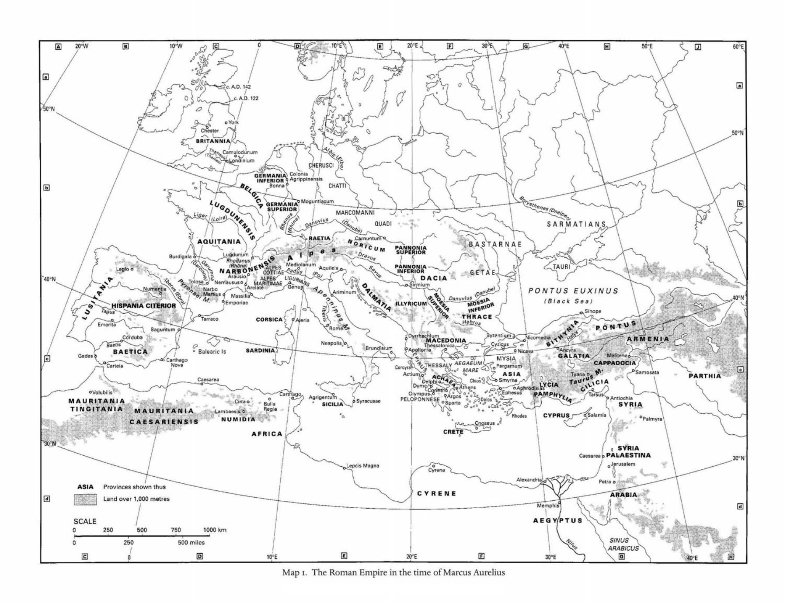

*地图1　马尔库斯·奥勒留时代的罗马帝国。原书第xlvi–xlvii页位置。图例：ASIA式粗体字标示行省；阴影表示海拔1,000米以上地区；比例尺分别以千米、英里计。图内地名保留原图。*

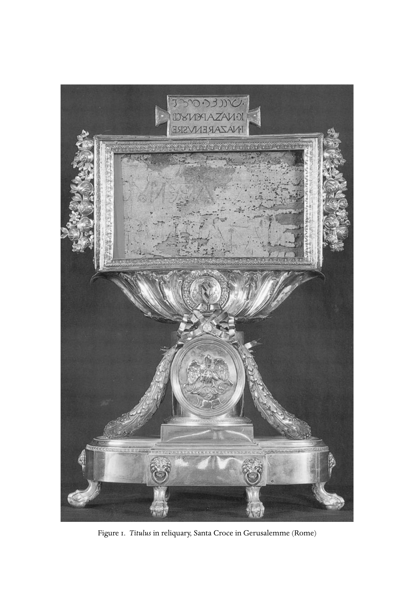

*图1　圣物匣中的十字架题牌（titulus），罗马耶路撒冷圣十字大殿。原书第xlviii页。*


---

<a id="prelude"></a>

# 序篇 耶稣基督：基督教的基础

**作者：弗朗西丝·M.杨（Frances M. Young）**

《剑桥基督教史》第一卷《起源至君士坦丁》中文译稿

> 原书第1–34页，PDF第50–83页。未编号序篇，正文及105条脚注完整翻译。参考文献作者名、题名及定位保留原文。
>
> [序篇英文原文](<序篇 耶稣基督：基督教的基础（英文）.md>) · [原书PDF](<../01 起源至君士坦丁.pdf>)

## 帝国基督教初期的耶稣

<!-- 原书第1–2页；PDF第50–51页 -->

耶稣被钉十字架而死，以及他从死者中复活，处于基督教的核心。约公元326年，即本卷所述时期的末尾，皇帝君士坦丁的母亲海伦娜进行了一次充满传奇色彩的圣地朝圣；据说，她找到了真十字架，以及曾安放基督遗体的坟墓。在这部基督教史的开端考察这个故事，可以起到两重作用：一是展开围绕耶稣这一人物的特殊张力——他既可被视为历史上的发起者，也可被视为基督教的基础；这种张力常被概括为“历史的耶稣”与“信仰的基督”之别。二是提供一个富有启发性的平行例证，说明当一位历史人物周围聚集了种种看似传奇的成分时，重建其生平与教导会遇到什么问题。

时至今日，来到罗马的人仍可前往古城奥勒良城墙遗迹以内的耶路撒冷圣十字大殿（Santa Croce in Gerusalemme），在那里看到与耶稣被钉十字架有关的圣物，以及与海伦娜朝圣相联系的遗迹。从祭坛左侧一扇门进入，首先吸引目光的，是据称属于义盗的十字架横木——据《路加福音》23:39–43，他与耶稣一同被钉。朝圣者随后可沿传统苦路各处祈祷，再向右进入一座二十世纪小堂。祭坛上立着几件制作精巧的圣物匣，里面勉强可见据称来自真十字架的细小碎片、一根荆棘冠的刺，以及一部分木牌，通常称作titulus。彼拉多曾在那木牌上以不同文字写明：被钉在这里的是拿撒勒的耶稣，犹太人的王。由于人们被要求保持一段安全距离，这块木片上的刻痕几乎看不见，更谈不上辨读。然而，这块不起眼木牌的故事颇为引人入胜。

1492年，人们修补教堂内部凯旋拱上方壁龛中的马赛克时，[^prelude-1] 在那里发现了这块木片；它封存在一块刻有TITULUS CRUCIS（十字架题牌）字样的砖后面。遮住这一意外发现的马赛克，年代可追溯至四世纪；它早已不存，不过在圣海伦娜小堂里还可见一幅十五世纪摹本。这也正是最早记载海伦娜发现故事的历史学家所处的时代。教堂实际上建在一座罗马皇宫的旧址上。某些铭文，以及公元276年奥勒良城墙横穿宫殿的事实，表明宫殿始建于三世纪初；后来它归君士坦丁的母亲、皇太后海伦娜所有。宫中一个大厅改为最初四世纪教堂，虽然历代不断增饰，外部仍部分可见原来的砌体。在一间曾属宫殿的地下小堂里，据说海伦娜曾跪在从圣地带回的泥土上祈祷；圣物也一度保存在那里。题牌碎片上粗糙的字迹很奇特：希伯来文、希腊文和拉丁文，全都从右向左书写。它们像是由一个熟悉希伯来语或阿拉米语书写习惯的人匆忙刻下，却显然没有顾及希腊文和拉丁文从左向右书写的事实。那么，尽管证据有缺口，基督时代与海伦娜据说有所发现之间，又隔着三百年难以明了的岁月，这些珍贵碎片会不会确实与近两千年前的事件有关？[^prelude-2]

自吉本《罗马帝国衰亡史》（1776–1788）问世以来，怀疑态度一直占据主导，这是不言而喻的。吉本注意到，凯撒利亚优西比乌对发现真十字架之事完全沉默。优西比乌是巴勒斯坦主教，与海伦娜同时代，曾以华美文辞赞颂她的朝圣和圣墓教堂的建立。因此，他的沉默自然使大多数学者确信，这个故事只是传说。确实，在事件与最早书面记载之间的一百年中，神迹、异象等传奇成分明显进入了故事。对于宗教改革以后、启蒙运动以后的历史学家，怀疑似乎是适当立场；尤其是想到，中世纪基督教世界曾沉迷于主要由伪造圣物构成的交易。

<!-- 原书第3–4页；PDF第52–53页 -->

四位教会历史学家讲述了完整故事。他们以不同方式续写第一部教会史，也就是同一位凯撒利亚优西比乌的作品；该书记述从教会起源直到作者本人时代的历史。[^prelude-3] 鲁菲努斯将优西比乌译成拉丁文，并把叙事延续到四世纪，写作时间约为公元402年。三四十年后，苏格拉底·斯科拉斯提库斯、索佐门和狄奥多雷用希腊文续写了优西比乌。据鲁菲努斯[^prelude-4]与苏格拉底，[^prelude-5] 海伦娜受神所引导的梦催促，前往耶路撒冷寻找基督坟墓。她发现，人们堆起土丘将墓覆盖，又在其上建造维纳斯神庙；据说，这是出于对基督徒敬奉此墓的敌视。她命人推倒神像、搬走泥土，将地面彻底清理；结果在墓中发现三座十字架，以及题牌。通过一个治病神迹，人们确定了哪座是基督的十字架。真十字架的一部分留在她于原址建造的教堂中，另一部分送给君士坦丁，被他封存在君士坦丁堡一座自己的雕像里。她找到的钉子，则用来为皇帝制作头盔和马嚼子。

索佐门的写作可能比苏格拉底稍晚；[^prelude-6] 他的叙述大体相互印证，细节却有不同。他指出，有些人把发现归于一名希伯来人提供的消息，此人继承了某些相关文献；不过，索佐门本人更愿相信神通过征兆与梦传讯，而非人的消息！他还区分了埋葬遗体的洞穴，与发现十字架的地点，[^prelude-7] 并指出题牌已从十字架上扯下，无法帮助辨认哪一座属于基督，因此才需要神迹。狄奥多雷则说，[^prelude-8] 海伦娜用钉子制作头盔与马嚼子，以保护自己的儿子。换言之，故事基本相同，却有变化与增添。

长期以来，人们以为最早为此故事作证的是米兰的安布罗斯。他在395年为皇帝狄奥多西所作的葬礼演说De obitu Theodosii中，把它当作众所周知的事实讲述。[^prelude-9] 与其他来源不同，安布罗斯把真十字架的辨认归于题牌：天意使它留在那里，正是为了这个目的。他是否可能知道海伦娜带回意大利的题牌碎片？同样出自390年代的金口约翰的一则评论，[^prelude-10] 似乎也把题牌与辨认真十字架联系起来，却没有把发现归于海伦娜。那么，海伦娜与这项发现的关系，究竟能追溯多早？如今普遍同意，自357年起担任凯撒利亚主教的格拉修，其已经散佚的历史，是其他所有历史学家的来源；鲁菲努斯添加到优西比乌之后的部分，至少第10与第11卷，大体就是格拉修的译文。[^prelude-11] 然而，在格拉修以前，没有材料把真十字架的发现，与海伦娜有充分记载的326至327年朝圣联系起来；中间有约三十年空白。优西比乌着力记述她参与伯利恒及橄榄山教堂的建造，却丝毫未将她与圣墓的发现、或耶路撒冷教堂的兴建相联系。此外，他对真十字架的发现完全缄默。现在该考察他的证据了。

重要作品是他的De vita Constantini（《君士坦丁传》）。此书写于皇帝去世不久，颂扬君士坦丁的事迹与品格，其中重点之一，是他在圣地的教堂建造计划。优西比乌[^prelude-12]证实，坟墓是在罗马殖民城埃利亚·卡皮托利纳中心的一座异教神庙下发现的；他还引用君士坦丁致耶路撒冷主教马卡里乌斯的信，指示在那里建造教堂。不过，有人指出，[^prelude-13] 优西比乌强调的是“复活的纪念地”，君士坦丁所写的却是“那至圣受难的标记”；君士坦丁关注与基督之死相关的巴西利卡，即Martyrion，优西比乌主要关心的，则是围绕坟墓建起、光彩夺目的庭院，即Anastasis。因此，优西比乌似乎可能压下了发现十字架的故事，却又不经意透露出来：既因为他记录了这封信，也因为别处的暗示。在皇帝面前演讲时，[^prelude-14] 他说，建造这座巴西利卡是为了尊崇“救恩的标记”；这自然指十字架。

<!-- 原书第5–6页；PDF第54–55页 -->

人们曾提出政治及神学上的原因，解释优西比乌的沉默；[^prelude-15] 有大量证据表明，他在别处也压下过不合自身目的的材料。另一种可能则是，他怀疑发现物的真实性。他的前辈奥利金，完全愿意采用古代的证立与驳斥技巧——kataskeuē与anaskeuē——考察福音故事的历史性。[^prelude-16]

不过，到公元348年，耶路撒冷主教区利罗已经告诉慕道者：“如今在我们中间展示的十字架圣木……已经借那些怀着信心取走碎片的人，遍及整个世界。”[^prelude-17] 他在致皇帝君士坦提乌斯二世的信中，也提到救恩十字架之木在君士坦丁时代被发现。[^prelude-18] 铭文，以及其他四世纪文学中顺带的提及，证实十字架圣物传播迅速，甚至被当作首饰佩戴。[^prelude-19] 尽管讲道者抗议，在民众心目中，十字架碎片已经变成能保护佩戴者免受伤害的护符。将钉子做成君士坦丁的马嚼子和冠冕，反映了同一种对十字架力量的信念，治病神迹的故事也是如此。然而，在君士坦丁以前的艺术中，十字架作为象征却几乎不见踪影；[^prelude-20] 某些事情已经改变！对君士坦丁而言，[^prelude-21] 十字架旗号就像确保胜利的战利品；据说，在他争夺帝国的战役前夕，正午太阳上方曾向他显现一道光明十字架。人们声称，他凭这个标记取得胜利。[^prelude-22] 至高上帝通过十字架，表明自己是君士坦丁的庇护者；他的儿子基督，则在君士坦丁与邪恶、多神教及偶像崇拜的力量交战时，保护、援助了他。因此，海伦娜有寻找真十字架的动机，或君士坦丁亲自关心在发现圣木之处建造巴西利卡，并非完全不可想象。

当然，从历史角度看，完整故事的可信程度，依赖这类推断，而非坚实资料。此外，人们必然还会追问：挖出的地点是否认对了？十字架与墓穴是否真实？较近的讨论，往往更倾向于接受一种看法：一条连续的传统，始终把各各他及坟墓认定在那座异教神庙之下；神庙建于哈德良建立罗马殖民城埃利亚·卡皮托利纳时。[^prelude-23] 无论如何，海伦娜似乎可能出于政治原因，特意寻找十字架。但对于历史上的耶稣，她还知道些什么？何种耶稣基督形像，塑造了她的圣地朝圣？

这个问题不易直接回答，但可以作一些推断。海伦娜如果像看来很可能的那样，是后来归信的，[^prelude-24] 那么她受洗时应当诵读过信经。其中关于基督的表述，大概如下：

> 〔我信〕基督耶稣，〔上帝的〕独生子，我们的主；他由圣灵、从童贞女马利亚所生，在本丢·彼拉多手下被钉十字架、埋葬，第三天从死者中复活，升到天上，坐在父的右边，并将从那里来审判活人死人。

立刻可以注意到，除他生于马利亚、在本丢·彼拉多手下被钉十字架之外，这里没有任何有关耶稣历史生平与教导的信息。资料把海伦娜与伯利恒及橄榄山教堂的建立相联系；这些教堂标示耶稣诞生与升天的神圣地点，而两者都是信经概述其身份的重要事件。[^prelude-25] 尽管如此，海伦娜必然熟悉福音书，虽然她是在礼仪中零星听到故事。值得追问的是：人们如何理解它们？她从中获得了怎样的耶稣观？

君士坦丁的Oratio ad sanctorum coetum（《致圣徒会众演说》），是附于优西比乌《君士坦丁传》之后的一篇文本，[^prelude-26] 或可提供线索。从中可以推断，海伦娜和儿子一样，知道耶稣在约旦河受洗；他“自幼具有上帝的智慧”，又获赐“普遍理智之灵，以及行神迹的知识和能力”。她会赞赏他充满明智与智慧的教导，以及他赐予人的恩惠：“使盲人得见，使无助软弱者恢复健康活力，以重获生命取代死亡……”她也会知道，诸如旷野中的丰盛供应——“少量食物，成为足够大群人需要、完整而持久的供应”——以及平息海上狂风等事件；但和儿子一样，她可能认为，他的仁爱才是最应注意的事。她会记得，他教导追随者以尊严和忍耐承受伤害，亲近卑微者，使人准备好轻看危险，教他们真诚信靠自己；他还拦阻一名追随者，叫他收刀入鞘。[^prelude-27] 她会理所当然地认为，他为人提供了效法的榜样。值得注意的是，这里的语言实际上很少直接反映福音书本身的措辞！

<!-- 原书第7–8页；PDF第56–57页 -->

不过，她对耶稣基督最主要的认识，不会仅属于过去。对她而言，他是万王之王，是为超越的至高上帝施行天意、治理整个宇宙的摄政者。她大概知道，有人以谀辞把她的儿子描绘成那位天上统治者在地上的摹本。她肯定会接受，升天的主耶稣基督分享上帝的主权与神圣威严。[^prelude-28] 几乎可以肯定，她会相信，当自己在圣礼中领受他的身体和血时，他神圣的生命便传递给她。在海伦娜的时代，基督教信仰意味着：通过身体接触那些因神圣临在而转化、成圣的物质实在，获得不朽。连十字架也有护符般的力量，因为它是不朽的标记，是昔日独一上帝之子住在世上时战胜死亡的胜利纪念。[^prelude-29] 优西比乌告诉我们，她希望在基督双足曾触及地面的地方祈祷；[^prelude-30] 如前所述，据说她在罗马也曾跪在从圣地带回的泥土上祈祷。她需要与历史的耶稣接触，正因为他不只是一位历史人物。他代表的不仅是基督教在历史中的起源，也是她信仰的根基。一方面，海伦娜对耶稣的信仰，使他超越了一世纪一名被以“犹太人的王”之名处死的犹太人的现实——至少，这一点可从题牌推得；另一方面，这信仰又激发她接触那一具体实在的兴趣。即使充满传奇，她的故事也是一种对历史耶稣的探寻。

讲述海伦娜故事的目的有二：说明在本卷所述时期结束时，人们知道耶稣些什么，又如何看他；并为耶稣本人所牵涉的历史问题提供平行例证。回顾前文，可以看到，重建实际所发生之事时，有以下困难：

- 启蒙运动以后，人们对讲故事者的视角和信念提出疑问，尤其是对神迹与超自然力量的信念。
- 资料的性质，以及各资料能否相互协调的问题。
- 事件与记载之间相隔很长时间。
- 口述传统是否有效的问题。
- 证据的缺口。
- 实物遗存的真实性问题。
- 宗教改革以后，对圣物及其敬奉的拒斥。

这些因素同样影响对历史耶稣的探寻。十九世纪以来，[^prelude-31] 人们不断尝试重建福音书背后的事实，将“历史的耶稣”与“信仰的基督”区分开来。因此，海伦娜的例子，展示了任何人在基督教史开端处理耶稣这一主题时，都会面对的困境。以创始人生平开启一项运动的历史，或许是通常做法；然而，耶稣是创始人吗？我们能为他写传记吗？即使可以，那能解释基督教的兴起吗？

## 主耶稣基督、上帝之子、救主

<!-- 原书第8–10页；PDF第57–59页 -->

据说，早期基督徒采用鱼的象征，是因为希腊语“鱼”（ichthus）是“耶稣基督、上帝之子、救主”各词首字母组成的缩略语；[^prelude-32] 这便成为表示耶稣全部意义的方便暗号。敬虔与教义赋予耶稣的光环，与海伦娜传说中历史和幻想的混合颇为相似。在海伦娜的时代，围绕上帝之子的本性，以及他如何在耶稣中成为肉身，最激烈的争论仍在后头；不过，阿里乌争议的纷扰[^prelude-33]已是其先声。由此形成的教义，令启蒙运动以后的历史学家感到棘手：和处理海伦娜一样，他们希望揭去传说的面纱——在这里则是教义的面纱——找到关于耶稣的事实。然而，恰恰是基督论，即关于基督神性与人性的教义，使基督教成为其所是。面对最早时期四周各式各样的基督教形态，这些教义之所以得到澄清，是受对耶稣的“崇拜”所推动，也因为他的故事很快被纳入一个包罗万有的宇宙叙事。这两项特点，都属于本卷所述时期。

对于这一宏大故事，最好的呈现见于二世纪末里昂主教爱任纽的Epideixis tou apostolikou kērygmatos（《使徒宣讲的论证》）。[^prelude-34] 它从创造开始，以召唤外邦人相信复活与永生为高潮。它讲述亚当和夏娃如何像孩子一样天真，如何未守上帝诫命，被一名堕落天使——称作撒但或魔鬼——迷惑，因而被逐出乐园。随后概述一系列圣经故事，强化人类堕落、上帝不断试图拨乱反正的意识：该隐与亚伯，挪亚及其众子，巴别塔，亚伯拉罕、以撒与雅各，摩西与律法的颁赐，应许之地与圣殿，以及先知。不过，先知最重要的职分，是成为“我们主耶稣基督、上帝之子显现的先驱，宣告……按肉身，他将是大卫之子……按灵，则是上帝之子”。于是，故事转向“道成肉身”。此前我们已被告知，上帝的道与智慧是他的“两只手”，是创造的工具；上帝之子与圣灵，分别应被认作上帝自己的道与智慧。如今我们读到：“他使人与上帝联合，成就上帝与人的共融。”他在自己里面“总归万有”：亚当违命之处，他顺服了；“因树而发生的过犯，借树的顺服得到解除”，因为“人子顺服上帝，被钉在树上”，即十字架上。“他以这种方式，荣耀地成就了我们的救恩，履行了向先祖所作的应许”，即：

> 对那些相信、爱主，并〈生活〉在圣洁、公义和忍耐中的人，万有的上帝将借从死者中复活赐予永生；这一切通过那死而复活的耶稣基督成就，〈上帝把〉统治万有的王权、管理活人死人的权柄，以及审判，都托付〈给他〉。

在基督教传统中，人们带着这一叙事阅读福音书，因而并不把它们当作一个名叫耶稣的犹太人的传记，而当作神圣的显现。[^prelude-35] 神圣者透过尘世故事发出光来，因为这个故事讲的是上帝之子：他先于创造而存在，却因爱人类，倒空自己的神性，由童贞女马利亚和圣灵生而为人，度过以神迹与医治为标志的人生，向门徒赐下先知、哲学家向往却从未达到的至高伦理教导；尤其是，他承担人类的罪与苦难，通过死而复活将其战胜。在基督中，人性与神性联合：曾赐给亚当的上帝形像与样式，在人类身上恢复，不朽的恩赐也向人开放。因此，这个故事的时间尺度，不只是耶稣作为人的一生，而是上帝从起初直到终末的整个眷顾。信徒被纳入其中，生命由此获得意义。有关耶稣的一切，都从这些宇宙性视角来理解。

早期基督教文本显示，作者们[^prelude-36]乐于铺陈种种修辞悖论：不可见的上帝在耶稣基督中成为可见，不可触摸者受到触摸，不可理解者成为可理解，不受苦者受苦，不死者死亡。这些礼仪与讲道修辞的模式，此后数百年仍活在基督教话语中。其前提，是把耶稣故事纳入整个宇宙故事。梅利托在Homilia in passionem Christi（《基督受难讲道》，可能是十四日派逾越节的一篇哈加达叙述）[^prelude-37]的结尾如此说：

> 正是这一位创造天地，起初塑造人类，为律法与先知所宣告，在童贞女中成为肉身，悬挂木上，埋入地下，从死者中复活，升至高天，坐在父的右边，有权审判并拯救万有；父借着他，从起初直到永世，创造了一切存在者。这一位是“阿尔法与俄梅伽”，这一位是“开始与终结”——不可解释的开始，不可把握的终结。这一位是基督，这一位是王，这一位是耶稣，这一位是领袖，这一位是主。这一位是从死者中复活的，这一位是坐在父右边的。他承载父，也被父承载。“愿荣耀和权能归于他，直到万世之末。阿们。”

<!-- 原书第11–12页；PDF第60–61页 -->

教义，是人们努力构造足以表达这个宏大故事的概念话语所产生的结果。三世纪伟大的基督教知识分子与圣经学者奥利金，[^prelude-38]表达了其中的困难：

> 在有关他的一切奇妙光辉之事中，有一件完全超出人类惊叹的极限，也超出我们软弱、必死的理智能够思考或理解的能力：神圣威严这伟大的力量，父自己的道，上帝自己的智慧——一切可见与不可见之物都在这智慧中受造——怎么能够相信，它曾存在于那位出现在犹太地区的人所具有的限度之内？[^prelude-39]

他不明白，上帝的智慧究竟如何能进入女子腹中，出生为婴儿，发出哭闹孩童般的声音。他几乎难以相信，那一位竟会忧愁，说：“我心里甚是忧伤，几乎要死。”他惊叹：“最后，他竟被带去受那种在人看来最为羞辱的死，尽管第三天又复活了。”困难在于，“我们在他里面看到，有些事如此属人，似乎与凡人共同的脆弱毫无区别；另一些事又如此神圣，只适合原初而不可言喻的神性”。他说：“人的理解……困惑不解”，被如此伟大的奇事震慑，不知所向。

上帝自我倒空的奇妙，将始终处于基督教理解的核心。人们认为这来自经书，依据是《腓立比书》2:5–11：其中描述基督耶稣原“具有上帝的形像”，但他

> 不以与上帝同等为可以利用的事，反而倒空自己，取了奴仆的形像，成为人的样式。既显为人的样子，就自我降卑，顺服至死，甚至死在十字架上。因此，上帝也将他升为至高，赐给他超乎万名之上的名；使天上、地上和地底下的一切，在耶稣之名面前无不屈膝，万口无不承认耶稣基督为主，使荣耀归于父上帝。

对耶稣故事的这种认识，不仅植根于塑造经书阅读的整体宇宙故事，也植根于敬拜中对它的庆祝。以下祷文证实了这一点。它可能追溯至三世纪，后来被收入亚戴与马里的礼仪：

> 我的主啊，我们这些不配、软弱、可怜的仆人，也与这些天上权能一同感谢你，因为你以无法报偿的恩典待我们：你取了我们的人性，好以你的神性使我们重获生命；你抬举我们的卑微，扶起我们的堕落，使我们的必死复活，赦免我们的罪，免除我们的罪责，光照我们的理解。我们的主、我们的上帝啊，你以丰溢恩典的怜悯，战胜我们的仇敌，使我们软弱本性中的不配获得胜利。[^prelude-40]

这篇祷文所呼求的，是披上人性的主与上帝。基督教崇拜的核心，是敬拜上帝之子：他原与上帝同在，在耶稣中成为肉身，从死者中复活，如今在荣耀中与父一同活着、掌权。

“他们习惯在固定日子天亮以前聚集，向基督唱诗，如同向神一般。”约公元112年，比提尼亚的罗马总督小普林尼这样向皇帝图拉真报告。[^prelude-41] 有充分理由相信，早在三世纪，晚祷点灯时就已唱Phōs hilaron（《欢悦之光》）。此后，这首诗一直用于东方正教会；十七世纪起，它进入西方教会传统，最为人熟知的是基布尔的译本：

> 向你致敬，带来欢悦的光，
> 你从那不朽、蒙天福的父之纯净荣耀中倾泻而出；
> 至圣者啊，我们的主耶稣基督！
> 如今我们来到太阳安息的时刻，
> 四周晚灯照耀，
> 我们歌颂父、子与神圣的灵。
> 你配在任何时刻，
> 受纯洁的舌头歌唱，
> 我们上帝之子，惟一赐生命者；
> 因此，主啊，全世界承认你的荣耀。[^prelude-42]

光的意象既反映经书谈论上帝的语言，也反映《约翰福音》中基督是世界之光的观念；但hilaron（“欢悦的”）并非经书用语，而是伊西斯、库柏勒秘仪中广泛使用的词。[^prelude-43] 在君士坦丁以前的基督教艺术中，可见太阳神阿波罗驾战车的形像被改用于基督。[^prelude-44] 基督徒像向神一样向基督祷告，这一点十分清楚；同样不可否认，他们吸收了周围宗教世界的崇拜语言与图像。

<!-- 原书第13–15页；PDF第62–64页 -->

亚历山大里亚的克莱孟在二、三世纪之交写的一首赞美诗，堆叠庆颂性称号，形式与用语都呼应希腊诗歌：

> 圣徒之王，至高父那驯服万有的道，智慧的统治者，
> 对劳苦疼痛的凡人之族，永远欢悦的扶持者。
> 救主耶稣，牧人，耕者，舵，辔，
> 至圣羊群天上的翅膀，得人的渔夫；
> 以甘甜生命为饵，从敌对浪潮中引出贞洁的鱼，
> 引出那些脱离邪恶之海、得蒙拯救的人。
> 道之羊群的圣洁牧人……
> 让我们一同向君王基督，
> 献上朴素的赞美、真实的歌唱，
> 作为生命教导的神圣酬报。[^prelude-45]

这首诗可能从未用于礼仪，却代表了一类向基督所作的祷文：其中吸纳了异教祷告的语言与模式。

《哥林多前书》10:19–21，已经暗示基督与秘仪崇拜神明之间的类比；游斯丁也断言，魔鬼在密特拉秘仪中模仿基督徒的圣餐。两种仪式都包括分享饼与饮品，但对基督徒而言，它们代表“我们救主耶稣基督”的肉与血。[^prelude-46] 他引用福音书，即“使徒的回忆录”：“耶稣拿起饼，祝谢后说：‘你们应如此行，为的是记念我；这是我的身体。’”又说：“他拿起杯，祝谢后说：‘这是我的血。’并递给他们。”游斯丁补充，在每周星期日的聚会中，人们在时间允许的范围内，尽量多读“使徒的回忆录”。耶稣尘世的一生，是在预设其神性的崇拜仪式中被回忆的。最终，虽然大概已超出本卷时期，福音书会伴随焚香列队迎送，方式如同异教神像，崇拜功能也相似，即使神圣者向敬拜者临在。早在《哥林多前书》11:23–26中，保罗就曾回顾最后晚餐的经过，仿佛它是一个解释仪式起源的崇拜神话；他又坚持，“主的桌子”与“邪灵的桌子”不能相通。在俄克喜林库斯发现的纸草上，有邀请人“在主塞拉皮斯的桌旁赴宴”的请帖。[^prelude-47] 这些类比相当深入。

基督受到颂扬的方式，与异教崇拜活动之间，最早也最鲜明的类比，是采用统治者崇拜传统的语言。[^prelude-48] 当时，这种传统已与罗马皇帝的神化相联系，尤其在小亚细亚，但并不限于那里。一则以弗所铭文称尤利乌斯·恺撒为“显现的神、阿瑞斯与阿佛洛狄忒的后裔、人类生命共同的救主”。对基督徒而言，耶稣是显现的上帝、上帝的后裔、所有人的救主。别迦摩一则铭文写道：“恺撒，绝对统治者（autokrator），神之子，神圣的奥古斯都，一切陆地与海洋的监督者。”对基督徒而言，上帝是监督万有的autokrator，甚至洞察人心，最终审判众人；耶稣则代表上帝行使这些权能。铭文给予皇帝“主”“神”“万王之王”“救主”“最高祭司”（pontifex maximus）等称号；基督徒全都将其用于基督。殉道记显示，基督徒拒绝称恺撒为“主”，因为这会与他们的“主耶稣基督”竞争。斯基利的斯佩拉图斯被要求“以我们的主皇帝的守护神起誓”时，回答说：“我不承认这世界的任何imperium〔统治权〕……我认识我的主，他是万王之王、万国的皇帝。”[^prelude-49] 平行之处并不限于称号：皇帝奥古斯都的生日是“好消息”，即evangel或gospel（福音）；君主的“临在”，即parousia或advent，是一座城市盼望、期待的事。基督徒的盼望与期待，则集中于基督再来，并称之为他的parousia。

面对这些证据，许多学者，尤其自布塞特以来，[^prelude-50]得出结论，认为只有在希腊化宗教混融的背景下，耶稣崇拜才可能发展，这并不令人意外。在这种环境中，国王、英雄、哲学家获奉为神，是可接受的；事实上，欧赫迈罗斯的宗教理论认为，诸神全是被神化的人。秘仪崇拜在这里提供了入教模式：人参加秘密仪式，从而吸收神圣生命。犹太教一神论框架却容不下这一切。因此，人们普遍接受一种看法：只有基督教传向外邦人，才可能使一位犹太拉比成为主耶稣基督、上帝之子、救主；他的一生，只是其永恒、不可见存在的短暂可见表达。

如果最早的基督教著作，即那位伟大的外邦传教士、使徒保罗的书信，已经染上这些信念，福音书又何尝不是！对历史耶稣的探寻，早就在尝试穿透福音书、重新找到事实，撕去这层教义与敬虔的面纱。

## 探寻中的耶稣

<!-- 原书第15–17页；PDF第64–66页 -->

海伦娜探寻耶稣，显然是因为她需要接触那位能够赐她永生者。现代的探寻则不同，其根源在启蒙运动要求摆脱教会教义束缚的愿望；这段历史通常从赖马鲁斯（Reimarus，1694–1768）讲起。他生前是备受尊敬的学者，极有争议的观点却在身后才发表。他认为，有“理由把使徒在自己著作中所说的，与耶稣本人实际说过、教导过的，完全分开”。[^prelude-51] 赖马鲁斯以仔细研究福音资料为基础，指出赎罪、三一等经典基督教教义，并非耶稣所启示；耶稣是一位维护律法的犹太人，没有向外邦人传道，没有设立洗礼或圣餐，只是呼召犹太人悔改，许诺所期待的弥赛亚将来到，在耶路撒冷恢复上帝的国。赖马鲁斯拒绝把神迹和预言应验视为基督教的证明，认为基督宗教建立在欺骗之上。对复活主张的自然解释，是门徒偷走遗体，并因耶稣使命失败而失望，于是改动了整套教导。回应他的尝试，也是在启蒙运动以后的世界更新基督教的尝试，产生了一些历史重建，以自然解释消解福音书中的神奇成分。诚然，许多参与者希望接触一位在这种条件下仍可信的耶稣；但这与海伦娜及类似信徒所寻求的身体性、圣礼性接触，已很不一样。

这种启蒙运动根源留下的遗产，是一种持久的认识：历史与信仰之间存在张力。[^prelude-52] 十九世纪学术研究进一步强化了它。以乔治·艾略特为笔名的女小说家所做的诸多争议之事中，有一件是把大卫·弗里德里希·施特劳斯的《耶稣传：批判性考察》译成英文。该书1846年在英国出版。施特劳斯显然并不认为，自己的工作破坏了基督教的核心；但他主张，整个耶稣故事与神话交织，这被认为对信仰具有深刻的扰动。

施特劳斯在书中逐一考察整个故事：从诞生叙事，经公开生活、自我主张、教导、神迹，到受难与死亡、复活与升天，展示福音书中的耶稣传统如何全面受到神话化。他针对既有方法展开论证，注意到海因里希·保卢斯[^prelude-53]曾尝试区分事实与解释：通过对神迹作自然主义叙述，排除一切超自然介入，从而维护“福音叙事的历史真实性”，将它们织成“按时间排列、前后连续的一连串具体事实”。[^prelude-54] 施特劳斯接受若干辨别福音叙事中非历史成分的准则：第一，叙述与支配事件进程的已知普遍规律不可调和；第二，叙事内部不一致，不同叙事彼此矛盾；第三，明显具有传说或虚构的特征。但他认为，真正困难在于事实与神话成分相互交织，历史完全被神话覆盖。

该书不同版本之间，施特劳斯有些观点发生转变：随着他越来越承认《约翰福音》的价值，早先对耶稣末世狂热和弥赛亚妄想的强调，逐渐让位于对其上帝意识的强调。因此，最后他认为，这一切未必影响基督教的核心。人性与神性的对立，在耶稣的自我意识中得到消解。在这一点上，耶稣是独一的；对施特劳斯而言，他是真正宗教者的典范，因为施特劳斯把宗教定义为“人与上帝的关系在人类精神中的觉醒”。看来，他最终仍希望接触一位可信的耶稣，尽管批评者几乎不这样看。

十九世纪对施特劳斯的回应，是大量所谓“自由主义耶稣传”的问世。勒南、霍尔茨曼、哈纳克等学者，试图呈现一位足以激发福音书传奇材料的人格。施特劳斯偏重叙事而非教导；自由主义传记则聚焦教导，把耶稣的信息理解为上帝是父、人人皆兄弟。他们尝试描述他的伦理及上帝意识，相信这使他具有普遍意义。耶稣成为至高的宗教天才，一个在历史转折点创立新宗教的伟大人物。但这是一个被抽离一世纪犹太社会的耶稣，一个被改造成十九世纪欧洲心灵可以接受的耶稣。阿尔伯特·施韦泽以经典比喻揭示了这一点：这些作者在深井底所看见的，是自己面孔的倒影。在1906年那部引起轩然大波、英文名为《历史耶稣的探寻》的著作中，施韦泽回顾整个探寻史，认为其成果是一连串将现代投射到过去的做法。他笔下的耶稣，是现代世界的陌生人，是一个预言未能应验、失望而死的终末先知。他那句著名的话是：“他作为一个未知者来到我们面前。”于是，到二十世纪初，现代自由主义对耶稣的探寻，似乎已经崩塌。

<!-- 原书第17–19页；PDF第66–68页 -->

不过，施韦泽的挑战，改变了历史学家研究早期基督教的方式。[^prelude-55] 启蒙运动理性主义，以及对《旧约》先知的历史批判研究，已经削弱了人们对特定预言应验于耶稣的信心：这些并非神秘谕示或精确预测，而是传给先知同时代人的信息。然而，如今人们认识到，从历史上看，早期基督教信念的根源，应在启示性预言将要应验的期待中寻找。随着二十世纪的发展，对两约之间及早期基督教时期大量启示录的研究，加上死海古卷等新材料的发现，进一步强化了末世论对理解耶稣及其追随者的重要性。启示文学这一体裁，[^prelude-56]从复杂的先例中产生，形式多样；主要特点包括用象征语言和数字象征勾勒世界历史，展示上帝从起初到终末的天意目的，以申明上帝作为的正当，安慰受压迫的上帝子民。宇宙中善恶的争战，在地上得到反映；但最终，上帝将战胜邪恶权势，人人都要复活、受审判，上帝的子民将蒙救赎。

施韦泽以后，多数学者感到必须认真看待一个事实：最早的基督徒期待世界末日迫近，盼望耶稣基督再来，带来公义与和平。问题在于，耶稣本人是否宣扬过这些观念。确实，大多数人逐渐同意，他的信息是关于上帝的国及其即将来临；不过，福音书记载也包含暗示国度已隐然临在的材料。[^prelude-57] 现代基督徒可能必须设法将这信息“去神话化”，才能使它可信；[^prelude-58] 但施韦泽以后的历史学家，既不能忽视耶稣时代对预言应验的强调，也不能忽视启示性期待对早期基督教的重要性。

与此同时，另一条发展路线也影响了这些问题，即福音书资料批判的形成。如果探寻已经突出资料中所带有的神话性世界观，理性主义分析则揭露了资料缺乏独立性。显然，前三部福音书作者彼此抄用；问题是谁抄了谁。差异极大的第四福音又引出另一问题：其作者是否知道并使用其他福音？追索资料背后的资料，成为一种执着。所得结论虽然不时受质疑，却在约一百年间大体居于主导：《马可福音》被视为最早；马太、路加共有的材料，则被用来推导出一份称作Q的重建资料，Q来自德语Quelle，即“来源”；M是马太特有材料的来源，L则是路加特有材料的来源。至于《约翰福音》，不论是否依赖其他福音，都较晚成书。既然自然假定，对历史耶稣最好的画像应在最早资料中寻找，它便大体可被搁置。探寻者怀疑神话，而恰好马可和Q都没有诞生叙事及复活后显现，M与L在这些方面又彼此不同。因此，资料批判似乎有助于回到耶稣的教导及公开事工的事件。在“自由主义传记”中，人们以马可的轮廓为基础，按时间叙述其公开事工。然而，就在施韦泽揭穿自由主义耶稣叙述只是投射之际，弗雷德[^prelude-59]指出，《马可福音》本身也是复活后信仰的产物。它呈现的是教会关于救主基督的信息，与耶稣关于上帝及其国度的信息大不相同；马可采用“弥赛亚秘密”的手法，正是为了掩盖这一点。

此外，资料与耶稣生平之间仍有距离。于是出现形式批判：尝试分析书面资料中各个独立单元背后的口述传统。众所周知，这使最重要的实践者之一鲁道夫·布尔特曼宣称：“我的确认为，如今我们对耶稣的生平和人格，几乎一无所知。”[^prelude-60] 福音书中的一切，都被记忆和塑造成服务群体需要的样子。因此，兴趣转向追踪福音书作者如何编织叙述，不论依据的是先前书面来源，还是零散口述单元；这就是编修批判。耶稣难以捉摸，因为现有的一切，不过是忠实追随者或其后继者描绘的画像，染上了早期教会正在形成的信念。新的历史写作，转而追踪基督论教义发展的各个阶段。

耶稣生活、事工的犹太背景，与外邦教会传播的希腊环境，被截然分开。借助宗教史学派的理论，[^prelude-61] 人们将基督教发展成以耶稣基督为主的宗教，归因于希腊化文化；在犹太一神论背景中，这种崇拜被认为不可想象。保罗成为“基督教的创始人”，他与《约翰福音》作者都被视为受诺斯替主义影响。值得注意的是，接受这类理论，也让克劳斯纳等犹太学者[^prelude-62]能够把耶稣重新认领为自身传统内的先知和教师，同时不接受基督教教义的发展。

<!-- 原书第20–21页；PDF第69–70页 -->

有些人仍希望重建教义背后的事实。T.W.曼森、F.C.格兰特、约阿希姆·耶利米亚斯、C.H.多德等学者，[^prelude-63]认为对基督教这样一个历史性宗教，接触历史耶稣至关重要；他们提出论证，自称可借此回到耶稣独特的声音、言论与比喻，甚至勾勒其生涯。然而，迄今对探寻的回顾，已清楚表明，重建实际发生之事的困难，与海伦娜的例子相仿：

- 启蒙运动以后，对讲述耶稣故事者的视角、信念，尤其对神迹及超自然力量的信念提出疑问。
- 批判性考察资料的性质及其相互兼容性。
- 认识到事件与记载之间相隔很长时间。
- 争论口述传统的有效性。
- 证据存在缺口。

此外，在耶稣的例子中，还有：

- 对预言及其应验的怀疑，从而挑战那个传统上赋予耶稣生平以基督教意义的宏大故事。

因此，现代性拒绝轻信：不再简单接受海伦娜就是找到真十字架的圣徒，也不再简单接受耶稣就是神圣的救主与主、其生活教导皆见于福音记载。相反，批判分析尝试重建故事背后的事实，或认定这种成果无法获得。

于是，二十世纪上半叶，许多人觉得，探寻已经陷入沙地，走到尽头。战后，布尔特曼的一些学生，尤其G.博恩卡姆与E.凯泽曼，发起“新探寻”。它以布尔特曼的分析为基础，逐渐形成一系列准则，用以确定哪些真实、哪些不真实。这些准则似乎有助于筛选材料，因而持续影响学术研究。进入基督教第三个千年之际，新一轮探寻活动兴起，尤其在美国，如今常称作“第三次探寻”。[^prelude-64]

多重见证准则认为：某项内容若见于不止一个独立来源，比只见于单一来源更可能真实。这可比法庭需要多位独立证人；串通本身无助于证据的确立。福音书彼此依赖，意味着它们不是独立证人；但其背后的资料，却可能独立。假设某项内容同时见于马可与Q，甚至L与约翰——前提是约翰独立——那么，论者认为，在汇入这些资料的各条口述传统背后，很可能存在某种事实基础。最早的基督教著作是保罗书信，本可作为另一个来源，只是多数探寻者发现，他对耶稣生平和教导的兴趣少得令人意外。第三次探寻认真看待一种需要：在正典福音之外，还应加入《多马福音》《彼得福音》等新发现文本；有人主张，这些材料不仅独立于正典福音，也具有早期渊源。以此为基础，约翰·多米尼克·克罗桑主张，仔细划分不同资料的层次，将材料分别归入一世纪的具体十年。问题在于，学者连某些资料的价值都不能达成一致，更不用说年代；而采用Q这样假设性的文献，意味着在假设上再建假设。不过，这项准则仍受尊重，困难在于如何运用。

双重不相似准则，试图从两个方面分离出耶稣独有的内容：（a）区别于犹太背景中的平行材料；（b）区别于基督教信念后来的发展。它概括了早期探寻的关键目标：识别耶稣的原创性，同时将历史耶稣与教会教义区分。一致性准则则说，一旦确定一小部分原初耶稣材料，其他与之相符的内容也可接受。然而，问题在于：（a）在方法上聚焦耶稣的独特性，将他抽离其直接社会环境，既不合历史实际，也似乎带有反犹偏见；（b）则使耶稣无法再对基督教的兴起提供任何解释力。为突破这些困难，桑德斯作出一个激进尝试：重点放在耶稣的行动，而非言论，并在一世纪犹太教的政治宗教背景中解释这些行动。[^prelude-65] 再结合对福音书中保留的、会令后来的基督教信仰尴尬的特征的重视——这是对不相似准则的细化——[^prelude-66] 似乎就能得到一幅较难被斥为研究者自身兴趣产物的耶稣画像。

<!-- 原书第22–23页；PDF第71–72页 -->

由这种批评，产生了以历史可信性准则取代双重不相似准则的建议：“任何个别历史现象，只要能在其犹太背景中得到合理理解，同时又有助于合理解释它在后来基督教历史中的影响，就应被视为真实。”[^prelude-67] 当然，对一位研究者可信的事，另一位未必觉得可信。十九世纪认为神迹不可信；二十世纪末借助社会人类学方法，更愿承认，在前现代文化中，人们对世界运作方式有不同理解，而古代文学中也有许多与福音书那类具有灵恩的医治者相似的人物，因此，对可信性的判断很不相同。确实，有一种观点把耶稣描述为术士，类似其他古代资料中有充分见证的术士。[^prelude-68] 因此，这项准则意味着：把耶稣放入当时的社会、文化及宗教环境，接受与之相合的内容。

这些准则的运用，产生了大量对资料的细致分析，包括非基督教与基督教、正典与非正典资料。死海古卷等发现的发表，进一步激发热情。这批材料于1947年出现在昆兰洞穴中，由一个犹太群体成员存放，可能具有爱色尼派性质；它们提供了许多与大体同时代耶稣运动相平行的材料。较近以来，考古学增进了我们对一世纪加利利生活的社会及物质实况的了解。[^prelude-69] 这类比较材料大大增加了探寻的吸引力；虽然也助长某些牵强的想象跳跃，却在学者的重建中日益重要。因此，千年之交的探寻，其特点是产生各种不同“类型”的人物，各自以或多或少可信的方式捕捉历史的耶稣：犹太“圣人”、[^prelude-70]拉比、[^prelude-71]法利赛人、[^prelude-72]加利利农民、[^prelude-73]犬儒哲学家、[^prelude-74]社会革命者、[^prelude-75]智者、先见、[^prelude-76]终末先知、[^prelude-77]真正的弥赛亚。[^prelude-78]

评述这众多研究，超出本篇范围。二十世纪末探寻最重要的特点，或许是坚持耶稣为犹太人，以及犹太学者对这一领域的贡献。[^prelude-79] 然而，对犹太人耶稣的兴趣本身又引出问题：他是哪一种犹太人？加利利的犹太教是什么样？如今普遍承认，耶稣生活的时代，成为犹太人有多种彼此竞争的方式；许多人也会主张，多种基督教形态是在多少相互独立的情况下产生的。但这种认识，也可能是把后现代对多元主义的接受，倒投到一世纪。事实上，第三次探寻和旧探寻一样，很难摆脱当代兴趣的塑造：它采用社会科学模型，也带有意识形态资料分析的色彩，如解放主义、女性主义等。此外，也有人反对早先研究中的实证主义、理性主义假设；大屠杀以后，人们对于倾向性解释，以及有影响力文本在历史上造成的伤害，也更加敏感。

因此，主要收获，是重新找到一世纪犹太人耶稣：任何被他吸引的人，都可以研究他，不再受基督教教义划定的边界约束。不过，探寻恢复的耶稣，几乎已不是海伦娜的耶稣。所以问题仍在：在某些方面，海伦娜是否更接近那位催生基督教信仰的耶稣？在考虑这一点以前，我们必须承认，探寻所形成的学术环境，要求我们尝试勾画一个历史上可信的拿撒勒耶稣形像。

## 犹太人耶稣：走向一幅可信的画像

<!-- 原书第24–26页；PDF第73–75页 -->

首先值得说明，历史研究不可能提供定论；不应把对任何重要历史人物的重建，与真实人物本身混为一谈。尽管有些研究者声称可以如此，我们始终只能评估可能性；陈述越重要，往往越有争议。不同视角、不断修订不可避免，因为任何一幅具体画像，都倾向于突出少数特点，难以充分呈现复杂性。历史的耶稣依然难以捉摸，令人渴望、引人好奇；他仍作为一个未知者来到我们面前。福音书本身也表明，它们所讲述的人物，带有某种难解之处。

尽管如此，好奇心仍驱使人们追问：究竟发生了什么？耶稣究竟是怎样的人？他的使命究竟是什么？我们能够接触那位曾在一世纪巴勒斯坦以犹太人身份生活、死去的耶稣吗？或许可以作少量合理推断。显然，必须尽可能把耶稣及其活动，放回当时加利利和犹太地区的社会背景。同时，必须解释：罗马人为什么将他钉十字架，犹太当局为什么很可能把他交出，他的追随者又为何作出那样的回应。因为，一种有关其言语、行为与人格的叙述，如果能使这三重反应变得可信，大概就含有某些真实。这里提供的简述，难免暗中呼应或拒绝过去两百年间众多研究这些问题的学者的工作。[^prelude-80]

钉十字架，是有关耶稣最有充分见证的事实。在十字架上展示题牌，符合已知做法：公开罪名，意在将被判罪的人作为警戒示众。福音书记载，牌上写的是“犹太人的王”。士兵戏弄他的故事，也围绕这一王权主张展开；审判场景的核心，同样是这一指控。福音书对耶稣的记忆，是一个引发猜测的人：他会不会就是“弥赛亚”，即“受膏者”、“大卫之子”，换言之，那位将恢复以色列、为人盼望的君王？研究揭示，第二圣殿时期犹太教文献中，有多种多样的未来盼望；大卫王国的恢复，是其中之一。据说，在神奇地使众人吃饱以后，人群曾试图拥立他为王（《约翰福音》6:15）。不论当时实际发生什么，这个故事保存了一种期待：出埃及将重演，上帝将直接介入，恢复其子民的自由。

耶稣被当作弥赛亚王位的僭称者，交给占领当地的罗马人，这似乎很少有可疑之处。犹太历史学家约瑟夫斯提供了这类人物的实例；另有记载说：“耶路撒冷陷落以后，维斯帕先下令，为确保犹太人中不留任何王室成员，应搜出所有大卫的后裔。”[^prelude-81] 早一代，彼拉多把耶稣送去钉十字架，想必也是为除掉这样一个声称者。罗马人为何处死他，似乎已经清楚。

问题是，这项指控有多大程度出于捏造。当人群想拥立他为王时，耶稣悄然退去。福音书通常描绘他试图制止那些宣称他是上帝弥赛亚的人，虽然自弗雷德以来，对马可“弥赛亚秘密”已有各种不同评价。最早的基督教宣讲，无疑宣称耶稣是弥赛亚；他被称为“耶稣基督”，本身就是证据，因为“基督”在希腊语中就是“受膏者”。据描述，他在凯撒利亚腓立比承认自己是基督（《马可福音》8:27及以下）；不过，他的措辞似乎既表示接受，也有暧昧——他的王者角色，是否属于未来，而非现在？那场经过安排、称作“荣入圣城”的行动（《马可福音》11:1–10／《马太福音》21:1–11／《路加福音》19:29–40／《约翰福音》12:12–19），有意使一项君王预言得到应验，同时挑战君王骑战马进入都城的形像：耶稣骑的是驴。他的追随者记得，他说过“爱你们的仇敌”。学者一再指出，耶稣的信息似乎聚焦上帝之国的来临，而非自身地位，因此，他究竟有何自我主张，仍是难解的问题。而且，弥赛亚主张是否足以解释犹太当局对他的行动？有人认为并不足够。

这个时期并不存在铁板一块的“犹太教”。法利赛人通过谨守妥拉寻求以色列的纯洁，却在内部争论这意味着什么。祭司阶层则通过与罗马宗主审慎交涉，力求保护圣殿与人民免受玷污。我们如今借死海古卷认识的那个群体，其成员脱离他们视为败坏的局面，寻求以色列的恢复及圣殿的洁净。每个群体都自称代表真正传统，倾向于排斥不属自己社群的人，并以激烈言辞攻击别人。[^prelude-82] 但一般而言，他们不会因为某种“异端”而彼此提起司法诉讼。耶稣很可能挑战了这种普遍划定边界的倾向。毕竟，他被指控与罪人、税吏同吃，违反安息日，无视洁净规定；故事还讲到，他对妇女、儿童、撒马利亚人和外邦人的态度不合常规。不过，福音书记述的争论，尤其耶稣与法利赛人的争论，也反映当时犹太人内部的辩论。事实上，耶稣看起来很像一个法利赛人。乍看之下，耶路撒冷当局为何与彼拉多合作对付耶稣，并不清楚。

福音书所写的审判场景，在程序上有不少问题；受难叙事也显示出一种倾向：减少罗马责任，增加犹太人的罪责。十字架刑无疑是罗马刑罚，因此，应当认为对所发生的事负责的是罗马人，而不是犹太人。然而，耶稣与犹太领袖的冲突，是福音书持续出现的特征。耶稣在群众欢呼中骑入耶路撒冷，或更有可能是圣殿中的行动，促使当局出手，这似乎相当可信。在大祭司面前，所谓假见证人声称，耶稣曾说过反对圣殿的话（《马可福音》13:2／《马太福音》24:2／《路加福音》21:6）；但其他证据（《马太福音》23:38／《路加福音》13:35；《约翰福音》2:19及《多马福音》71）表明，那未必是假话：他确实说过某些关于拆毁、重建圣殿的话。[^prelude-83] 因此，圣殿中的示威行动，很可能使犹太当局觉得，最好在罗马人为镇压民众骚动而行动之前，先对付这个惹事者。[^prelude-84] 罗马占领，既是行动的背景，也是采取行动的原因。

<!-- 原书第26–28页；PDF第75–77页 -->

对罗马人的行动、犹太当局的合作，以及后来基督徒的宣称，最好的解释，是耶稣的信息与活动，围绕上帝国度的迫近，以及回应他本人来临所带来危机的关键意义。他以“洁净”圣殿这一先知性行动，预示上帝国度即将实现；其他安排过的行动，大概也有同样意味：荣入圣城、重演旷野赐吗哪、治病及赶鬼。耶稣宣告，上帝在地上的主权即将圆满显现。教会肯定不会虚构那些令人尴尬、未曾应验的预言，例如《马可福音》9:1：“我实在告诉你们，站在这里的，有些人在尝死味以前，必看见上帝的国大有能力地来到。”教会曾努力应对期待落空的后果，从最早的基督教著作，即保罗书信，就可清楚看出。早期基督教的盼望，必定根植于耶稣的教导。

那么，他只是一个失败的启示性先知吗？自阿尔伯特·施韦泽以来，这种解释一直显得可信。然而，贯穿《新约》，我们看到一种可称作“末世张力”的东西，即“已经”与“尚未”的意识。它出现在保罗书信、《约翰福音》，[^prelude-85]以及其他福音书对耶稣关于上帝之国教导的记载中。因此，这里存在一种多重见证。于是，我们可以说，耶稣教导的特点，在于宣告上帝的主权已经得到预尝，甚至已经临在，只要人能认出征兆。赶出污灵，显明上帝即时的临在，也是上帝战胜宇宙邪恶权势的进程在地上的显现。耶稣的对手指控他靠别西卜的能力行事（《马可福音》3:22），换言之，是施行黑巫术；但他不提供证明或征兆来反驳。他期望人睁眼看见：在他与人同在时随之发生的医治与赦免，必是上帝之灵所成就。他向不回应的人发出先知性审判宣告。然而，他的教导带有难解的特质：“有耳可听的，就应当听。”他的比喻与类比似乎指出，人可以在日常事物、上帝的受造物及其活动中，以某种方式辨识上帝的道路：树与果子，羊与麻雀，盐与光，建筑者与撒种者，主人与仆人，婚宴。他的言论暗示一个颠倒的世界：穷人、谦卑乃至受辱者、哀恸者，反而有福。由此，他挑战人们“在将临国度的光照下”生活，[^prelude-86] 即彻底信靠上帝的怜悯与良善：

> 看那天空的飞鸟，它们不种不收，也不积蓄在仓里，你们的天父尚且养活它们……想想田野的百合花怎样生长，它们不劳苦，也不纺线；然而我告诉你们，就是所罗门极荣华的时候，所穿戴的还不如其中一朵。你们这小信的人哪，野地的草今天还在，明天就丢进炉里，上帝尚且这样装饰它，何况你们呢？（《马太福音》6:25–34）

他称上帝为父，鼓励人怀有孩子对父母那样的信任。

耶稣似乎与同时代人一样，重视圣殿和妥拉，同时批评当时尊奉两者的方式。和其他拉比一样，他把妥拉概括为两条诫命：爱上帝、爱邻人。他暗示，上帝的国很快将在地上圆满实现；当其子民适当顺服时，它其实已经临在。而这种顺服，意味着深化妥拉，重内在而非外表。[^prelude-87] 耶稣呼召以色列回到顺服，因而类似先知，呼吁公义、怜悯与爱，或许也暗示耶利米预言的“新约”：律法将写在心上。确实，耶稣在许多方面都像犹太经书中的先知，呼召人民使以色列恢复其本应有的样子。象征性地拣选十二门徒，显露了这一恢复的异象性及末世性质：他们代表原初十二支派，尽管其中十个在许多世纪以前已经失落。《新约》一再反映一个事实：先知在本族中不受欢迎。耶稣确实激起了反对。

施洗约翰标志耶稣活动的开端。两人似乎都预告上帝最终结局即将来临，因而都以启示文学描绘的那种宇宙全景为前提。两人都呼召悔改、更新，不过施洗者的审判信息似乎更严厉。虽然彼此重叠，两人之间仍形成某种对照：约翰过禁欲生活，耶稣却被指为“贪食好酒的人，是税吏和罪人的朋友！”（《马太福音》11:18–19）。约翰在希律·安提帕手下遭暴死。或许这解释了，福音书为何没有说到耶稣访问希律的城市塞佛里斯和提比里亚：他有意避开了它们。[^prelude-88] 这个先例，也使福音书所记耶稣预告自身受难与死亡一事，并非全无可能。如果如此，就要追问，他是否尝试向门徒提供解释。他可能把自己看作那一连串如耶利米般遭到拒绝的先知之一（《马太福音》23:29–39／《路加福音》13:33–35；比较《帖撒罗尼迦前书》2:15）；早期基督徒对《以赛亚书》受苦仆人的兴趣，如《使徒行传》8:32–35，也许可以追溯到耶稣本人。[^prelude-89]

<!-- 原书第29–30页；PDF第78–79页 -->

最后晚餐中的象征行动与言语（《哥林多前书》11:23–26；《马太福音》26:26–29／《马可福音》14:22–25／《路加福音》22:14–20），可能反映了他试图指明，即将面对的危机可以具有什么意义。在大体同时代的文本中，马加比殉道者被描绘为替本族献上救赎性祭牲（《马加比四书》6:28–29及17:20–22；比较《马可福音》10:45）。不论这个具体问题答案如何，预言应验似乎深植于福音传统，更不用说保罗书信中嵌入的传统，例如《哥林多前书》15:3–4。

耶稣是一个复杂人物，时而像智者、圣人，时而像先知，时而像先见或异象者。在许多不同方面，他都符合其一世纪犹太世界中的这类比照。他具有使人分成拥护与反对两方的魅力。不过，他很可能正是以弥赛亚僭称者的身份而死。此后，追随者坚持，他确实应验了预言；许多本族人却拒绝他们的主张，把他们当作亵渎者，[^prelude-90] 因为他们此时已认为，他配受本应惟独归于上帝的尊荣与敬拜。福音书反映的是信他者的视角。然而，关键问题是：面对他似乎一事无成，甚至卑贱地死在十字架上的结局，他们如何维持这些宣称？

答案必在复活。很少有人会从复活开始研究历史耶稣，因为无论证据本身，还是对一个独特事件的主张是否有效，都不易评估。然而，福音传统，以及如今构成《新约》的所有其他文献，共同提供多重见证。因此，很难否认一个事实：不论实际发生什么，追随者相信他已经从死者中复活，墓是空的，有人见过、甚至摸过他。原则上，或许可以确定墓是空的，犹太学者盖扎·维尔迈什就接受这一点为事实；[^prelude-91] 因为人总能设想自然解释。原则上，或许也可以确定耶稣曾恢复生命；但那意味着他后来继续活着，再次死亡，我们就需要相应证据。除了某些小说式猜想，并无这样的证据。无论如何，《新约》的复活信仰并非只关乎恢复生命。它的真正含义，很可能为耶稣的信息与活动提供更多线索；因为，声称耶稣从死者中复活，比人通常以为的还要非同寻常。

复活观念与最终结局相联系：届时，上帝显现，审判活人死人，死者起来接受审判。没有预言说，在那些末世事件以前，会先有某一个人复活，连弥赛亚也不例外；毕竟，人们根本没期待他会死！因此，耶稣的复活可说是“不合时序”的，是对尚未来临事件的预先实现；它意味着终末时代已经开始。

门徒若在耶稣生前回应他的魅力，那么在他死而复活以后，他们的回应就带着敬畏。历史耶稣的问题，很大程度上在于，所有材料都染上了复活信仰的色彩。然而，复活主张本身，也确认了以末世论“解读”耶稣生涯的合理性。如果只把他看作先知、智者、圣人或哲学家，便无法解释他为何因政治动机被判死刑，也无法解释其生与死后来的影响。值得惊异的是，福音书为城市外邦信徒用希腊文记录的回忆，仍保留了如此多与我们所能辨识的犹太乡村加利利，以及彼拉多治下耶路撒冷相吻合的内容。

## 复活的耶稣：走向基督教信仰

<!-- 原书第30–31页；PDF第79–80页 -->

复活意味着耶稣成为基督；复活的基督，而非上帝的国，成为教会信息的焦点。最早的基督徒期待耶稣作为基督和君王，在荣耀中再来。他们认为，如今已经知道，末日将来审判、在地上建立上帝国度的那一位是谁。耶路撒冷事件以后，他们在经书中搜寻基督受死、随后获得昭雪的预言，因为所发生的事，改变了通常期待的末世事件模式。最早基督教信仰的这些特点，确认了一个事实：耶稣宣讲上帝应许的应验，以及上帝之国的来临，引发弥赛亚猜测。它们也说明，为何耶稣的一生被纳入前文勾勒的宏大宇宙故事，为何预言应验对早期基督教如此根本，为何对他先存的信念开始补充对他死后存在的信念——因为启示文学常假定，后来显现之物早已在天上存在——[^prelude-92] 以及为何最早基督徒开始敬奉他，却不觉得这会威胁独一真神的优先地位。在那位上帝的眷顾中，基督早已被预定，作为实现其旨意的代理者。

耶稣并不教导基督教，因为基督教所讲的正是耶稣。《新约》最早的著作，是保罗书信。它们与福音书的不同，尤其似乎缺少对耶稣生平和教导的兴趣，是早期基督教一个重大难题。然而，其中有些内容，却令人惊异地确认了耶稣教导的基调。例如，保罗要求读者：“你们当存基督耶稣所存的心”；他倒空自己“不以与上帝同等”自居，“取了奴仆的形像”，“顺服至死，甚至死在十字架上”（《腓立比书》2:5–11）。耶稣所教导并以身示范的舍己、彻底信靠上帝的信息，成为基督徒行为的基础。《哥林多前书》13章描绘彻底之爱的理想，似乎确认了福音书中的记忆：耶稣认为爱就是律法的成全。又如，“上帝之子”最初很可能是弥赛亚称号；但门徒记得，耶稣称上帝为自己的父，也教他们向上帝这位父祷告、信靠他。在保罗书信中，我们发现一种观念：通过上帝之子耶稣基督，信徒可以成为蒙收纳的上帝儿子（例如《罗马书》8:14–17）。这些发展，虽然似乎已经假定基督具有超越的起源，却最好以某种传统延续来解释。

在早期基督教中，关于耶稣本人及其意义的观念，既然可以追溯，其产生就必定有耶稣本人及其教导的作用。探寻太容易假定，回到最早资料，就能确保更高可靠性；然而，历史事件的意义，不是往往要靠后见之明才更易理解吗？复活后敬奉耶稣的倾向，既规定了正在形成的大多数耶稣运动的性质，也将它们与其诞生的犹太母体区别开来。例外反而证实常例：我们听说，有些人被称为“伊便尼派”。优西比乌认为，[^prelude-93]这个名称十分贴切，“因为他们对基督持有贫乏卑微的看法。他们认为他平凡普通，只是一个因品格成长而被认为公义的人，仅此而已；是一个男人与马利亚正常结合所生的孩子。”他又补充，他们认为必须遵行律法的每个细节，单凭信心不能得救。多数学者推断，他描述的是犹太基督徒。[^prelude-94]

<!-- 原书第32页；PDF第81页 -->

有人主张，恰恰是在犹太教排他性一神论框架内对耶稣的“崇拜”，赋予新兴基督教独特性，[^prelude-95] 也注定其后数世纪深刻而激烈的教义争论。对复活耶稣的敬奉，很早就可见于文献，存在于以犹太人为主的基督徒群体，尤其见于曾为法利赛人的大数保罗的著作。如果到三世纪，可以引述暗示异教影响的祷文，如前所见，那么，更明显的却是大多数早期基督教礼仪表达的犹太性质。耶稣教门徒的“主祷文”，由许多可在犹太礼仪中找到平行的措辞组成。《新约》著作中的颂荣，提供了改用犹太祷告形式的先例；无论如何，对最早跟随耶稣的犹太人，这本来就很自然。《克莱孟一书》末尾的长祷文，既显明承袭，也显明改用：它求宇宙创造者“开启我们心中的眼睛，使我们认识你，惟有你在至高处为至高，在圣者中保持圣洁”。它称上帝为“怜悯慈悲者”，并描述他“历代信实，审判公义，力量与威严奇妙，创造充满智慧……恩待信靠你的人”。内容牢牢立足于犹太圣经传统，却以下列文字结尾：

> 我们借耶稣基督，我们灵魂的大祭司与守护者，赞美你；愿荣耀与威严借着他归于你，从如今直到万代，直到永永远远。阿们。

这类对主耶稣的敬虔回应，既先于教义话语的界定，也推动了它。人们试图理解一种创造神话意象的修辞，它逼近了那以经书中的独一上帝为唯一中心的宗教传统所能接受的边界。[^prelude-96] 早期基督教史通常被写成教义的发展。但这种常见做法，似乎反映了现代演化观念的假设。更贴切地说，实际发生的是：人们寻找充分的表达方式，说明那出人意料发生的事，并在一个又一个文化背景中找到这些方式。[^prelude-97] 当逻辑与哲学开始塑造话语时，教义才属于它的时代。它以新的方式，用越来越精确、复杂的表述，说明人们认为起初已经隐含的内容。

<!-- 原书第33–34页；PDF第82–83页 -->

二世纪最明显的特点之一，是后来成为主流的基督教，不得不与一种可能更占优势的运动抗争；后者本可能使人失去与尘世耶稣的联系。确实，在二世纪，发展中的基督教完全可能脱离历史耶稣的锚定，正如它在数世纪间失去了在犹太教中的锚定一样。耶稣这个有血肉的历史人物，其重要性显然主要以两种方式被削弱。第一，将天上存在与尘世身体分离。据说，使徒约翰曾在以弗所浴场与克林妥交锋；[^prelude-98] 对克林妥而言，基督是一个属灵存在，受洗时降在耶稣身上，钉十字架以前便离去。受苦的只是人耶稣，属灵的基督始终不受苦。[^prelude-99] 第二种方式，在某些方面否认得更为彻底；对任何生前曾与耶稣同行交谈的人，几乎不可能如此。幻影说者似乎把耶稣整个人的显现，都看作某种幻象，像《多比传》中那样，是伪装成人的天使。诺斯替主义[^prelude-100]似乎具有疏离物质与肉身的特点，这又加强了该观点。不论伊格纳提乌针对哪种立场，这位二世纪初的安提阿主教，都明确道出危险：

> 若有人撇开耶稣基督向你们说话，你们就当充耳不闻。他出自大卫的后裔，出自马利亚；他确实降生，吃喝，在本丢·彼拉多手下确实受迫害，确实被钉十字架，并在天上、地上、地底下众存在者面前死去；他也确实从死者中复活，是他的父使他复活。[^prelude-101]

这场争论表明，人们普遍接受基督源于天上，同时又决意坚守其尘世生活、受难和死亡的真实性。

在多种早期基督教运动中，后来被视为“真正传统”的一支，需要保持与历史耶稣的联系。对殉道者游斯丁这样的护教家，以下事实至关重要：耶稣基督确实活过一个应验预言的人生，确实教导人如何生活，满足那位创造万有的独一真神的要求，也确实“在提比略·恺撒时代、犹太地区行政长官本丢·彼拉多手下”被钉十字架。[^prelude-102] 他试图援引其他证据予以确认，声称耶稣的诞生记载在居里扭任行政长官时提交的户籍税册中，罗马可供查验；《彼拉多行传》也证实神迹，以及钉十字架的细节。[^prelude-103] 福音书流传的时代，耶稣本可能被化为一个来访的属灵存在，或只保留为一名被上帝收纳的好人；福音书文本本身，也显露这些争论的影响痕迹。[^prelude-104] 尽管如此，它们仍讲述了一个应验神圣天意旨意的故事；这些旨意超出眼前叙事，追溯更早，保留来自启示文学的宇宙视野；它们邀请读者接触一段真正属人的生命，而这生命又显现了神圣。

正是对耶稣基督的这种双重认识，构成基督教作为宗教的核心。对信徒而言，他是“完全超越、不可见的上帝，那完全属人、可见的形像”；[^prelude-105] 也是那完全非物质、无形体的上帝，完全物质性、有身体的存在。借着上帝之道或智慧那后来被称作“道成肉身”或“成为血肉”的事，上帝的生命传递给受造物，使他们能够与那生命“接触”。我们开篇已经说明，这一点对海伦娜多么根本。即使基督宗教到那时已把古代世界的一些迷信吸纳、施洗归入自身——例如她把十字架当作神奇护符的做法，就显露这一点——这种基本冲动，仍忠于基督教道成肉身的方向。物质作为神圣临在的载体而成圣：无论是圣徒与殉道者真实的生与死，他们自身成为基督的“预型”；还是在共融中领受的圣餐饼酒的具体实在，都是如此。与那位道成肉身者“接触”，意味着吸收神圣生命。在本卷所述时期及以后，基督教教义的表述，都受确保这一实在的需要所塑造。正是道成肉身，使耶稣成为基督教的基础。


## 译校说明

本序篇中的“如今”“较近研究”等时间表述，均保留原书2006年出版时的学术语境。对真十字架、复活及福音资料可靠性的判断，按作者区分保留为证据、推测或信仰主张。正文与脚注中的文献及经文定位依原文保留。

## 注释

[^prelude-1]: 这座建筑的详细情况，参Webb, Churches and catacombs, 52–5。

[^prelude-2]: Thiede and d’Ancona, Quest of the true cross曾提出此说，但与学术界总体倾向相反。最重要的研究是Drijvers, Helena Augusta。

[^prelude-3]: 因此，优西比乌的历史与本卷涵盖同一范围；它至今仍是极重要的资料。

[^prelude-4]: HE 10.7–8.

[^prelude-5]: HE 1.17.

[^prelude-6]: HE 2.1.

[^prelude-7]: 索佐门的版本，与今天到耶路撒冷圣墓教堂参观时所见的地点安排更相符。

[^prelude-8]: HE 1.18.

[^prelude-9]: Ob. Theo. 43–8.

[^prelude-10]: Hom. 85 in Jo.

[^prelude-11]: 关于重建格拉修的历史，以及鲁菲努斯对它的依赖，参Drijvers, Helena Augusta, 96–101。

[^prelude-12]: V.C. 3.25–47.

[^prelude-13]: Drake, ‘Eusebius on the true cross’.

[^prelude-14]: L.C. 9.16；这是优西比乌在君士坦丁统治三十周年所作演说，附于V.C.之后。

[^prelude-15]: 讨论见Drake, ‘Eusebius on the true cross’；比较Hunt, Holy Land pilgrimage及Drijvers, Helena Augusta。

[^prelude-16]: Grant, Earliest lives of Jesus；参下文第五部分第27章。

[^prelude-17]: Catech. 10.19.

[^prelude-18]: Ep. Const. 3.

[^prelude-19]: Drijvers, Helena Augusta, 89–93；另参Gibson and Taylor, Beneath the Church of the Holy Sepulchre, 83–5。

[^prelude-20]: Snyder, Ante pacem；但比较Hurtado, ‘Earliest evidence’。

[^prelude-21]: 参下文第六部分第30章；当然，围绕君士坦丁异象与归信的历史，同样存在争议。

[^prelude-22]: Euseb. V.C. 1.28–31.

[^prelude-23]: Hunt, Holy Land pilgrimage; Drijvers, Helena Augusta; Gibson and Taylor, Beneath the Church of the Holy Sepulchre; Taylor, ‘Golgotha: a reconsideration’; and Biddle, Tomb of Christ, 54–70.

[^prelude-24]: 据优西比乌，海伦娜由其子君士坦丁引导归信。讨论见Drijvers, Helena Augusta。

[^prelude-25]: 例如Euseb. V.C. 3.41–3。

[^prelude-26]: 附录所载为希腊文，演说原以拉丁语发表，时间在321至324年间的某个受难日，地点为塞尔迪卡或帖撒罗尼迦；大概曾作为宣传材料分发。讨论见Barnes, Constantine and Eusebius, 73–6。

[^prelude-27]: 摘述自Const. Or. s.c. 11、12、15。

[^prelude-28]: 希腊化“君王意识形态”如何基督教化的经典实例，见Euseb. L.C.；这里的观念出自该书，亦出自Const. Or. s.c.。

[^prelude-29]: Euseb. V.C. 1.32.

[^prelude-30]: V.C. 3.42–7。关于触摸的重要性，参Wilken, Land called holy, 114及以下诸页。

[^prelude-31]: 在此以前，历史怀疑主义主要与塞尔苏斯、波菲利等基督教对手相联系；奥利金对福音故事的批评（上文注16），服务于其属灵化的解释目标，动机与现代对历史耶稣的探寻十分不同。后者详见下文。

[^prelude-32]: Snyder, Ante pacem发现，证实此说的证据很少。

[^prelude-33]: 详参下文第六部分第31章。

[^prelude-34]: 详参下文第三部分第13章；这里所引英文译本为Behr, On the apostolic preaching。

[^prelude-35]: 参下文第三部分第8章。

[^prelude-36]: 例如Ign. Eph. 7.2、Pol. 3.2；Mel. Pass. 2及Fr. 13；Iren. Haer. 3.16.6。

[^prelude-37]: Stewart-Sykes, Lamb’s high feast；关于十四日派，参下文第四部分第17及22章。

[^prelude-38]: 参下文第四部分第18章及第五部分第27章。

[^prelude-39]: Princ. 2.6.

[^prelude-40]: 英文译文据Gelston, Eucharistic prayer of Addai and Mari, 51。Gelston认为，这可能是现存最早、形式相对固定的圣餐祷文（anaphora），可追溯至二世纪或三世纪初，但确切日期无法证明。

[^prelude-41]: Ep. 10.96.

[^prelude-42]: 英文译文出自John Keble（1792–1866）。

[^prelude-43]: R. Garland Young in Kiley, Prayer from Alexander to Constantine, 316.

[^prelude-44]: 参下文第六部分第32章及图9。

[^prelude-45]: 选自Paed. 3.12.101；英文译文出自van den Hoek，载Kiley, Prayer from Alexander to Constantine。

[^prelude-46]: 1 Apol. 66–7.

[^prelude-47]: P. Oxy. 110 and 523.

[^prelude-48]: 为表明这一观察在学术研究中的深厚根基，我特意从证据的经典呈现中取例，即Deissmann, Light from the ancient East。此后大量铭文与纸草的发表，大大加强了这一观点。Brent, Imperial cult进一步展开了论证。

[^prelude-49]: M. Scil. 6.

[^prelude-50]: Kyrios Christos.

[^prelude-51]: Reimarus: Fragments, 64.

[^prelude-52]: Dunn, Jesus remembered对探寻作了有用综述，并突出了这项张力。

[^prelude-53]: 其两卷本Das Leben Jesu已于1828年出版。

[^prelude-54]: Strauss, Life of Jesus, 49.

[^prelude-55]: Allison, Jesus of Nazareth.

[^prelude-56]: 启示文学研究，参Rowland, The open heaven。

[^prelude-57]: Dodd在Parables of the kingdom中提出，末世论在耶稣身上已经“实现”；此说引发长期讨论。

[^prelude-58]: 尤其布尔特曼倡导这项工作。

[^prelude-59]: Wrede, The messianic secret.

[^prelude-60]: Jesus and the Word, 8。福音材料的经典形式批判分析，是布尔特曼的History of the synoptic tradition。尽管他那句话屡被引用，布尔特曼在这里及其Theology of the New Testament中，仍勾画过一幅耶稣形像。

[^prelude-61]: 参Neill and Wright, Interpretation of the New Testament；布塞特（见上文）是该学派的代表。

[^prelude-62]: Klausner, Jesus of Nazareth.

[^prelude-63]: 参Neill and Wright, Interpretation of the New Testament。

[^prelude-64]: 第三次探寻的概述，参Powell, The Jesus debate。主要参与者包括芬克领导的“耶稣研讨会”成员，他们成功地在美国引起广泛公众兴趣；此外还有克罗桑、桑德斯、迈尔与赖特。

[^prelude-65]: Sanders, Jesus and Judaism.

[^prelude-66]: 迈尔在A marginal Jew中，明确提出尴尬准则。

[^prelude-67]: Theissen and Winter, Quest for the plausible Jesus；引文出自前言。

[^prelude-68]: Smith, Jesus the magician; Davies, Jesus the healer.

[^prelude-69]: 例如参Reed, Archaeology and the Galilaean Jesus；Crossan and Reed, Excavating Jesus。

[^prelude-70]: Vermes, Jesus the Jew及The religion of Jesus the Jew。

[^prelude-71]: Chilton, Rabbi Jesus.

[^prelude-72]: Maccoby, Jesus the Pharisee.

[^prelude-73]: 耶稣研讨会，以及Crossan, The historical Jesus。

[^prelude-74]: Crossan；另参Downing, Christ and the Cynics。

[^prelude-75]: Horsley, Bandits, Prophets and Messiahs及Jesus and the spiral of violence。

[^prelude-76]: Witherington, Jesus the sage及Jesus the seer。

[^prelude-77]: Sanders, Jesus and Judaism及The historical figure；Allison, Jesus of Nazareth；Ehrman, Jesus。

[^prelude-78]: Wright, Jesus and the victory of God.

[^prelude-79]: 例如维尔迈什、马科比与弗雷德里克森。

[^prelude-80]: 不可能逐点论证下文的每一项主张；脚注仅对特定来源致谢。详参下文第二部分第4及7章。

[^prelude-81]: 赫格西普斯的话，转引自Euseb. HE 3.12。据3.19–20，图密善下令处死所有大卫后裔，耶稣兄弟犹大的后代也卷入调查。详参Bauckham, Jude and the relatives of Jesus。

[^prelude-82]: 关于犹太教的派别性及统一性，参Dunn, Jesus remembered, 260–92；另参下文第一部分第1章及第三部分第10章。

[^prelude-83]: Young, ‘Temple, cult and law’.

[^prelude-84]: 约瑟夫斯与福音书都见证：圣殿发生骚动时，罗马人会采取暴力、且在犹太人看来亵渎神圣的行动。

[^prelude-85]: 《罗马书》5:9、《约翰福音》11:25及其上下文，提供了现在与未来之间歧义的例子；这种歧义贯穿他们的著作。

[^prelude-86]: Dunn, Jesus remembered, 610.

[^prelude-87]: Vermes, The religion of Jesus the Jew.

[^prelude-88]: Reed, Archaeology and the Galilean Jesus.

[^prelude-89]: 不过，Hooker, Jesus and the servant曾批评这一观点。

[^prelude-90]: 注意以下经文的含义，例如《马太福音》9:3、26:65；《马可福音》14:64；《路加福音》5:21；《约翰福音》10:33等。另参Justin, Dial. 17。

[^prelude-91]: Vermes, Jesus the Jew.

[^prelude-92]: Lincoln, Paradise now and not yet.

[^prelude-93]: HE 3.27.

[^prelude-94]: 参下文第二部分第4章。

[^prelude-95]: Hurtado, Lord Jesus Christ.

[^prelude-96]: 详参下文第五部分第25章。

[^prelude-97]: 参Young在Hick, Myth of God incarnate中的各篇文章。

[^prelude-98]: Euseb. HE 3.28.

[^prelude-99]: Iren. Haer 1.26.

[^prelude-100]: 详参下文第三部分第12章。

[^prelude-101]: Trall. 9.

[^prelude-102]: 1 Apol. 13.

[^prelude-103]: 1 Apol. 34, 35 and 48.

[^prelude-104]: Ehrmann, Orthodox corruption.

[^prelude-105]: Bockmuehl, Cambridge companion to Jesus, 1.


---

<a id="part-1"></a>

# 第1部分　政治、社会与宗教背景

<!-- 原书第35–36页；PDF第84–85页。 -->

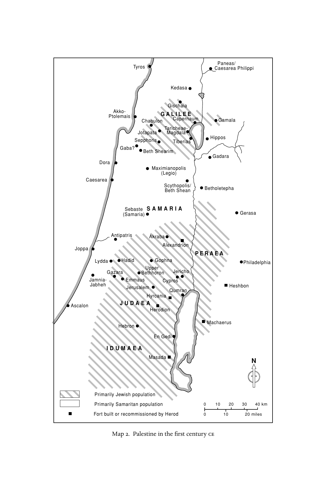

*地图2　公元一世纪的巴勒斯坦。原书第36页。图例：斜线区域主要为犹太人口；空白区域主要为撒马利亚人口；黑方块为希律建造或重新启用的堡垒；N为北，距离以千米及英里计。图内地名保留原图。*


---

<a id="chapter-01"></a>

# 第一章 公元一世纪的加利利与犹太地区

**作者：肖恩·弗雷恩（Sean Freyne）**

《剑桥基督教史》第一卷《起源至君士坦丁》中文译稿

> 对应原书第 37–51 页，PDF 第 86–100 页。本篇为正式编号的第一章，不包括卷首未编号的“序篇”。正文及 38 条脚注完整翻译；脚注中的作者名、书名、论文名及文献定位保留原文，便于检索。纪年 BCE 译为“公元前”，CE 译为“公元”。原文中三处需要进一步核实的纪年保留原样，并以“译校提示”明确标出。
>
> [第一章英文原文](<第一章 公元一世纪的加利利与犹太地区（英文）.md>) · [原书 PDF](<../01 起源至君士坦丁.pdf>)

<!-- 原书第37页；PDF第86页 -->

各卷福音书为耶稣的公开传道描绘了不同的活动舞台。对观福音一致把重心放在加利利，只在最后记述了一次前往耶路撒冷的旅程；第四福音，即《约翰福音》，则几乎把加利利看作一处避难之地，而耶稣的传道大部分是在犹太地区和耶路撒冷展开的。在最近一波历史耶稣研究中，研究者明显偏重加利利，其原因很多，其中一个重要原因是：当今不少学者更关注耶稣生平的社会意义，而非神学意义。然而，耶稣最终遇难的地方是耶路撒冷，而非加利利；历史学家若忽视这一事实，就会错过理解其生平的一条重要线索。[^ch01-1]

## 地理因素

<!-- 原书第37–38页；PDF第86–87页 -->

从西向东看，加利利和犹太地区的地貌格局相似：依次是沿海平原、中央山地、裂谷，以及约旦河东的高地。但沿南北方向观察，气候条件的差异便使两地呈现出实质性的不同。年降雨量从北向南显著减少，这一点在景观中表现得十分明显。加利利中央山地有肥沃的冲积土和众多泉水，其间分布着若干东西走向的宽阔谷地；犹太山地的土层则薄得多，并且很快便过渡到死海谷地干旱的沙漠地带。斯特拉波（《地理志》16.2.16）、约瑟夫斯（BJ 3.41–3；3.506–21）和老普林尼（《自然史》5.66–73）等古代作者已经注意到这些差异；它们也意味着两个地区的生活方式和聚落形态各不相同。把加利利划分为上加利利、下加利利和谷地三个部分，也反映出人们已经认识到：即便在加利利内部，从生态角度看也存在若干不同的微区域（《米示拿·安息年篇》9.2；另参 BJ 2.573；3.41–3；3.506–21）。

## 历史概况

### 早期历史

<!-- 原书第38页；PDF第87页 -->

在考察与耶稣传道有关的历史因素时，不应忽略这些差异。[^ch01-2]“加利利”一名意为“环圈”，很可能源于早期以色列人的处境：他们居住在内陆高地，四周环绕着迦南人的城邦。相比之下，“犹太”原本是一个支派名称；由于大卫本人出自犹大支派，这个名称在大卫王朝时期变得格外突出。加利利的支派包括西布伦、拿弗他利和亚设，但支派则是后来迁往北方的。《雅各的祝福》（《创世记》第 49 章）、《摩西的祝福》（《申命记》第 33 章），以及《底波拉之歌》（《士师记》第 5 章）中关于各支派特点与行为方式的记述表明，几个世纪以来，北方支派接触到了更为多样的文化。可以确定的是，公元前八世纪亚述发动进攻时，这一地区首当其冲；提革拉毗列色三世的入侵使上、下加利利的许多中心遭到毁坏，人口也可能大量流失（《列王纪下》15:29；《以赛亚书》8:23，七十士译本）。约一个半世纪后，犹大也被巴比伦征服：圣殿遭到摧毁，国王和贵族中的主要成员于公元前 587 年被掳往巴比伦。但与北方不同的是，波斯统治下的犹太地区很快开始复兴；原文记载，居鲁士于公元前 515 年颁布诏令，准许犹太人返回并重建圣殿。〔译校提示 A〕约瑟夫斯承认这些事件对后来犹太地区历史的重要意义，并把从巴比伦归回与 Ioudaioi／Judaeans 一名的词源联系起来（AJ 11.173）。

<!-- 原书第38–39页；PDF第87–88页 -->

要理解公元一世纪加利利和犹太地区的宗教、文化与政治背景，就必须充分掌握两个地区在公元纪元开始之前那几个世纪的历史。[^ch01-3]波斯时期正式名为 Yehud 的行省，在几个世纪里一直只是一块相当不起眼的圣殿领地，尽管若干先知曾表达过复兴的希望。亚历山大大帝的征服和希腊化诸王国的出现，改变了这一切。公元前二世纪，位于叙利亚的塞琉古帝国开始瓦解，包括犹太地区人在内的不同族群，得以在各自的民族领土内立足。安条克·埃皮法尼在位期间（公元前 175–164 年），曾威胁要把犹太圣殿对雅威的崇拜强行并入宙斯崇拜；马加比家族领导人们化解了这一威胁之后，被亵渎的圣殿于公元前 164 年重新奉献，不久便建立了一个自治的犹太国家。此后，马加比家族的第二代，即哈斯蒙尼家族（公元前 135–67 年），发动了一系列扩张战争，最终建立起一个疆域足以比肩公元前十至九世纪大卫和所罗门王国的国家（《马加比一书》15:33）。

<!-- 原书第39页；PDF第88页 -->

于是，在相隔将近一千年后，加利利和犹太地区第一次重新处于同一个本地政权的统治之下。值得注意的是，在这一时期的文献中，Ioudaios／Judaean 一名开始不再仅仅指严格地理意义上的犹太地区居民，也用来指一切前往耶路撒冷敬拜、认同犹太圣殿观念的人。[^ch01-4]到公元前一世纪中叶，罗马正在成为东地中海的霸主；哈斯蒙尼家族被希律家族取代。后者是一个以土买王朝，受罗马委托，以附庸王的身份维护罗马在这一地区的利益。以塞佛里斯为行政中心的加利利，与南方的犹太地区和约旦河彼岸的比利亚一道，被认定为犹太人的领土；塞佛里斯距拿撒勒只有约六公里。这些次级区域很快被纳入大希律的王国，并被要求为尊崇他的罗马庇护者奥古斯都作出贡献。

### 希律家族统治时期

希律的长期统治（公元前 37–4 年）深刻影响了加利利和犹太地区的社会，影响之大，以至于他一去世，当地便派遣使团前往罗马，请求不要让他的任何一个儿子继位。奥古斯都的回应是把王国分给希律的三个儿子：安提帕统治加利利和比利亚，亚基老统治犹太地区，腓力则统治约旦河东北部的巴他尼亚、特拉可尼和奥拉尼提斯。因此，加利利在行政上再次与犹太地区分离。《马太福音》解释耶稣虽然生于犹太地区、却后来定居加利利时，也反映了这一情形（太 2:23）。约瑟夫斯提供了更广阔的政治背景：亚基老激起臣民的极大愤怒，因而于公元 6 年被罗马废黜；此后，犹太本部由驻在滨海凯撒利亚的总督（procurator）治理，耶路撒冷因而降为一座由祭司贵族控制的圣殿城市。

<!-- 原书第40页；PDF第89页 -->

安提帕在《新约》中通常只被称为“希律”（例如《马太福音》第 2、14 章，《马可福音》第 6、8 章，以及《路加福音》第 1、3、9、13、23 章）。他渴望获得“王”的称号，却始终未能如愿。原文记载，他统治加利利和比利亚直到公元 37 年，随后也被废黜，领土转交给他的侄子亚基帕一世。〔译校提示 B〕尽管其“分封领主”（tetrarch）的地位较低，安提帕仍延续父亲的统治风格与政策，确保罗马关切的事务在其领地内得到落实。施洗约翰死于他手，其原因很可能更接近约瑟夫斯的解释，而非福音书的说法：约翰深受民众欢迎，又为穷人争取公义，使统治者担心可能发生起义（AJ 18.116–19；可 6:14–29；太 14:1–12；路 9:7–9）。在帝国看来，发生起义会被视为统治者的严重失职；附庸统治者只有能够维持稳定、确保人民忠于罗马及其价值观，才会得到容忍。

除了大规模修缮耶路撒冷圣殿之外，大希律的建设工程大多局限在犹太领土的边缘地带：撒马利亚改名为塞巴斯特，其对应的拉丁语称号是“奥古斯都”，并在当地建起献给罗马女神和奥古斯都的神庙；沿海的滨海凯撒利亚也修建了同样的神庙，希律还在那里营建了一座壮观的港口。在北方，他于帕尼亚斯修建了奥古斯都神庙；后来，他的儿子腓力把此地改名为凯撒利亚，即腓立比的凯撒利亚。安提帕延续了这一传统，在加利利修建纪念性建筑，以尊崇罗马宗主。塞佛里斯被打造为“全加利利的明珠”，并获名 autokrator，可能是为了颂扬奥古斯都的独掌大权（AJ 18.27）。加利利海边的提比利亚于公元 19 年新建，以尊崇继奥古斯都之后即位的新皇帝；伯赛大则加上了“朱利亚斯”之名，以纪念奥古斯都的妻子莉维娅／朱利娅。

## 加利利的社会与经济状况

<!-- 原书第40–41页；PDF第89–90页 -->

在过去二十五年中，古代巴勒斯坦没有哪个地区比加利利得到更多关注：犹太教和基督教研究者既关心耶稣的生平，也关心巴尔·科赫巴起义（公元 132–135 年）之后拉比犹太教在当地的兴起。[^ch01-5]除了研究文字材料，主要是约瑟夫斯的著作、福音书和拉比文献之外，研究的重点还包括考古学：既有塞佛里斯等重要遗址的发掘，也有对不同次级区域的调查。各个学科的研究者都试图全面描述希腊化和罗马时期的这一地区，因而形成了多样、有时甚至相互矛盾的论述。当历史耶稣研究与加利利研究交织在一起时，这种倾向尤其明显。自阿尔贝特·施韦泽揭示了十九世纪许多自由派耶稣传记所带有的时代错置以来，[^ch01-6]人们越来越清楚地看到：关于耶稣传道的各种解释虽然经常自称客观，却很少真正充分做到客观。[^ch01-7]

<!-- 原书第41页；PDF第90页 -->

格哈德·伦斯基从社会科学角度对高级农业帝国所作的描述，在近来的许多研究中影响很大，因为它提供了一个模型，帮助我们理解罗马这类高级农业帝国中的社会分层。在这类社会中，农业是最主要的生产活动，劳动组织的目标是获取剩余，而不仅仅是维持生计。[^ch01-8]不过，运用理想类型建立模型时，始终必须考虑地方因素。公元一世纪巴勒斯坦的两次大起义，都既有社会因素，也有宗教因素。相关证据使许多学者相信，有必要在伦斯基模型之外，再引入另一种研究进路，着重考察社会冲突的成因，以及精英阶层为控制冲突所采取的策略。[^ch01-9]

### 文化认同

<!-- 原书第41–42页；PDF第90–91页 -->

关于公元一世纪加利利人口族属的讨论，主要通过考察文化与宗教归属的痕迹，判断当地复杂族群构成中究竟哪一支占据主导。这些成分包括以色列人、犹太地区人、以土利亚人，甚至巴比伦人。根据我们目前对当地情况的了解，有些主张极不可能成立，可以排除。例如，认为加利利是一个异教地区的观点，既缺乏有力的文献依据，也未获考古发现的证实。[^ch01-10]同样，也没有确凿证据表明以土利亚人曾长期居住于此，尽管在哈斯蒙尼家族到来之前，他们可能一度进入过上加利利。“加利利以色列人”这一说法也有若干问题。如果没有共同的崇拜中心，很难想象一个主要由农民组成的人口群体，能够在几个世纪里维持独立的雅威崇拜／以色列人认同。撒马利亚人的圣地基利心山似乎本可发挥这样的作用；撒马利亚人自称是在“圣阿尔加里津山上敬拜的以色列人”。[^ch01-11]但种种迹象都表明，撒马利亚人对加利利人的敌意，并不亚于对犹太地区人的敌意，尤其是在后两者前往耶路撒冷朝圣时（路 9:52；约瑟夫斯 AJ 20.118–36）。[^ch01-12]因此，就目前的认识而言，最可能成立的假说似乎是：加利利经历了“犹太化”，也就是说，信奉犹太地区耶路撒冷圣殿的人在此定居。考古调查表明，从哈斯蒙尼时期起，新建聚落显著增多；与此同时，一些较早的遗址遭到摧毁，例如上、下加利利之间曾有异教崇拜中心的哈米斯佩亚米姆（Har Mispe Yamim）。[^ch01-13]各地发掘还发现了体现犹太人独特生活方式的设施与器物，例如仪式浴池（miqvaot）、石罐和本地制作的家用陶器。这些发现表明，当地人既重视源自耶路撒冷及其圣殿的礼仪洁净，也有意避开周边异教城市的文化风尚。[^ch01-14]

### 社会分层

<!-- 原书第42页；PDF第91页 -->

伦斯基的模型把社会描绘成一座金字塔：绝大部分权力、声望和特权，掌握在塔顶少数统治精英与本地贵族手中——如果二者可以且有必要加以区分的话。其下是依附阶层，他们协助精英维持现状，从而为自己赢得一定程度的相对声望。再往下，金字塔的底部逐渐扩展，便是农民，即拥有自己土地的自由农户；他们是社会的支柱，却无望攀升到更高的社会地位。相反，无论是税负增加、收成不佳，还是统治精英直接侵占财产，都使他们始终面临沦为无地贫民的危险。只要作出必要调整，把地方情形纳入考虑，伦斯基的理想模型总体上确实符合我们对罗马时期加利利的认识。

<!-- 原书第42–43页；PDF第91–92页 -->

尽管《马可福音》称安提帕为王（6:14），他似乎从未正式获得这一头衔；但毫无疑问，在加利利内部，他及其宫廷就是统治精英。从某种意义上说，他们也可以被视为皇帝的依附者，因为安提帕愿意接受罗马帝国东方政策为他规定的角色。约瑟夫斯说他“喜爱安宁”（AJ 18.245）；这一描述与福音书中的形象颇为吻合，尽管他曾有一次试图在罗马压过叙利亚总督一头（AJ 18.101–4）。奥古斯都规定，他可以从加利利和比利亚获得每年二百他连得的个人收入；此外，他大概还可以为建设和其他工程征收特别税，尤其是那些旨在尊崇皇室的工程（AJ 17.318）。这些特许不仅使安提帕及其近亲受益，他周围似乎还形成了一个新阶层，福音书称他们为“希律党人”（例如可 3:6；12:13）。这一群体的身份尚不清楚，但讨论福音书提到的其他若干群体，或许有助于阐明他们的社会角色。[^ch01-15]

<!-- 原书第43页；PDF第92页 -->

《马可福音》对希律生日宴会的记述，为观察加利利社会提供了一个有趣的视角。赴宴者被分成三个群体：megistanes、chiliarchoi，以及 protoi tēs Galilaias（可 6:21）。第一个词意为“大人物”，见于七十士译本（但 5:23）和约瑟夫斯的著作（《自传》112；143），在后者那里指亚基帕二世的朝臣，因此在这里大概也应作同样理解。在这三个群体中，只有这一群体前面使用了表示“他的”的物主代词 autou，这凸显出他们与安提帕之间的特殊关系。军事人员 chiliarchoi 的在场，表明这位分封领主拥有某种形式的常备军，而不仅是在特定战事中临时征召的民兵（AJ 18.251–2）。“加利利的领袖人物”（hoi protoi）也见于约瑟夫斯的著作，他使用这一表述总共约七十次。在两个不同事件中，protoi 都是有影响力的犹太人：至少在表面上，他们关心宗教价值，同时也关心维持秩序以及向罗马纳贡（AJ 18.122；261–309）。因此，他们代表着一种世袭贵族，与罗马元老阶层相似。第一次起义时期，约公元 66 年，提比利亚的统治阶层中有两个名叫希律的人；二人都在约旦河东拥有土地，也都主张效忠罗马（《自传》33）。因此，把加利利的希律党人描述为一个富裕贵族群体，大概最为恰当。他们坚定效忠希律家族及其政策，想必因为他们从中获益，也可能因为他们本身承担着行政职务。


<!-- 原书第44页；PDF第93页 -->

根据我们对罗马东方其他地区村落行政的了解，可以推想，在希腊化早期建立起来的高度官僚化体制内部，存在着一整套较低级别的官员网络。这套体制由托勒密王朝建立；原文称，该王朝于“公元三世纪”从埃及统治巴勒斯坦。〔译校提示 C〕这些官员大概包括市场管理者（agoranomoi）、税吏（telōnai）、庄园管家（oikonomoi）、法官（kritai）和狱吏（hypēretai／praktores）；福音书中都提及了这些人物。税吏似乎无处不在，这表明当时宗教和世俗两方面的税负都很重。土地税（tributum soli）很可能以实物缴纳，因为文献记载，第一次起义爆发时，上、下加利利都有皇帝和王室的粮仓（《自传》71.119）。通行税是地方统治者和土地所有者的另一项重要收入；福音书中那些似乎与耶稣关系友好的税吏，很可能就属于这一类。[^ch01-16]和其他某些职业一样，较为虔诚的宗教圈子怀疑他们不诚实；但耶稣并未把他们排除在随从之外，即使与这些“罪人”来往会使他遭受非议（太 11:19；路 7:34；可 2:16）。

<!-- 原书第44–45页；PDF第93–94页 -->

和古代世界的其他地方一样，加利利的土地占有格局也很难得到精确重建。[^ch01-17]早在波斯时期，便已存在由缴纳地租的佃农、而非自有土地的农民耕种的大庄园（尼 5:1–11）。托勒密统治时期，这一趋势继续发展；公元前三世纪中叶，埃及商人芝诺巡视王室庄园的记述就提供了相关信息，其中有些庄园位于加利利。[^ch01-18]福音书中的比喻也反映了这种格局（可 12:1–9；路 16:1–9）。约瑟夫斯提供的零散信息和考古调查共同表明，土地经营日益走向大庄园化，逐渐偏离传统犹太农民阶层仅以维持生计为目标的耕作方式。为了满足统治贵族的需求，小土地所有者可能承受压力。在工业化之前的社会，土地是财富的主要来源；但按当时标准人口稠密的加利利，土地供给并不充裕（BJ 3.41–3）。为了维持精英阶层的生活方式而增加税收，使许多人陷入赤贫。这些无地贫民和城市中的穷困者，正对应着伦斯基金字塔的最底层（《自传》66 及以下）。对许多人来说，从自耕农滑落为佃农，再沦为日雇工——这些人物在福音书的比喻中都很常见——是无法阻止的过程；由此又产生了社会怨愤、债务、盗匪活动，以及女性的卖淫现象。

### 经济现实：冲突的根源

<!-- 原书第45页；PDF第94页 -->

相对而言，加利利拥有丰富的自然资源。黑门山冬季积雪的融水和季节性降雨，保障了良好的收成，也使多种作物得以种植。约瑟夫斯以抒情笔调赞美迦百农地区革尼撒勒平原的气候，以及那里丰盛多样的水果（BJ 3.506–21）。然而，约瑟夫斯和拉比文献也表明，下加利利的谷地出产各种谷物和亚麻（BJ 3.42–3）。[^ch01-19]上加利利的山坡适宜栽培葡萄和橄榄，葡萄酒与橄榄油的产量因此相当可观；约瑟夫斯所记吉斯卡拉的约翰的经营活动，就生动体现了这一点（《自传》74 及以下；BJ 2.259 及以下）。[^ch01-20]除了农业生产，革尼撒勒湖还孕育了兴旺的渔业。伯赛大和抹大拉的地名暗示着它们与鱼的联系，而耶稣最早的追随者正积极从事这一行业（可 1:16 及以下）。抹大拉的希腊名 Tarichaeae 指把鱼腌制后运往外地的做法；这一产业必然需要各种专业服务，例如制作盛装液体产品、供外运之用容器的陶工，以及造船、制帆和织网者。[^ch01-21]

<!-- 原书第45–46页；PDF第94–95页 -->

关于加利利经济，最迫切的问题是：这些产品所带来的收益，究竟有多少归农民自己所有？[^ch01-22]加利利经济是否是一个受政治权力控制的实体，农民在其中只不过是农奴？主要资源的利用究竟服务于谁的利益？如果像我们前面所说，加利利的土地占有格局是大庄园与家庭经营的小农地并存，那么加利利农民应当拥有某种程度的商业自主权。然而，塞佛里斯的重建和提比利亚的兴建，必定标志着加利利经济的一次转折，而这一转折恰与耶稣公开传道的时期相重合。这正是理解他为何特别强调赤贫者有福、为何呼吁人们信靠上帝对所有人的眷顾时，最直接的背景。[^ch01-23]新兴的希律阶层为了维持奢华生活，需要获得足够的土地配给（参太 11:19），这无可避免地给本地农民带来更大的压力。[^ch01-24]

<!-- 原书第46页；PDF第95页 -->

不过，较晚材料中的证据也应纳入考虑，以平衡上述图景：这些证据表明，犹太农民阶层确实渡过了两次起义造成的危机。拉比文献中随处可见市场、乡村商贩以及有关买卖法规的记述。[^ch01-25]不能把这些材料简单归结为后世的理想化想象；它们延续了我们在福音书和约瑟夫斯著作等一世纪材料中已经能够辨认出的模式。但维持生计与陷入赤贫之间的界线始终十分脆弱。盖乌斯皇帝，即卡利古拉在位时，加利利农民曾威胁罢耕，这便是一个例证（公元 39／40 年）。为了抗议在耶路撒冷圣殿竖立皇帝雕像的计划，他们决定不再耕种。值得注意的是，希律家族中的一些成员对此十分惊慌，担心将没有足够资源缴纳年贡，进而造成社会失序（AJ 18.273–4）。尤利乌斯·凯撒于公元前 47 年恢复犹太农民供养其圣殿的权利时，已经认识到这会给他们带来负担，因此相应降低了每年应向罗马缴纳的贡赋（AJ 14.190–216）。安提帕每年有权从加利利和比利亚取得二百他连得的个人收入，相当于六十万枚推罗银舍客勒，这对民众已是相当沉重的负担。此外，民众大概还须直接向罗马纳贡，尽管文献没有明确提及这一点。[^ch01-26]

<!-- 原书第46–47页；PDF第95–96页 -->

货币制度对任何正在发展的经济都不可或缺，因为货币可以储存价值，使交易网络比只能在地方范围内进行的以物易物更广泛、更复杂。在钱币考古发现中，推罗铸币似乎占据主导地位。这种情形不只见于上加利利的米伦、吉斯卡拉和希尔贝特谢马等地，也见于加马拉和约塔帕塔；后二者都是第一次起义时下加利利犹太民族主义的据点。[^ch01-27]这说明当地与推罗这一重要腓尼基港口之间存在贸易联系，尽管这座城市与其犹太人腹地在文化上存在差异，甚至经常发展为公开敌对（BJ 4.105）。最令人惊讶的是，推罗半舍客勒银币虽然带有异教图像，却被认定为所有犹太男性都必须缴纳、以供养耶路撒冷圣殿的“圣所货币”。通常的解释是，在一个半世纪以上的时间里，即从公元前 126 年到公元 56 年，推罗货币的含银量一直稳定，因而保持了恒定价值。

<!-- 原书第47页；PDF第96页 -->

为了维持精英式生活，希律家族及其依附者不断抽取土地所产生的财富，供自己享用，却不作任何回馈。与此相对，犹太人的理想肯定的是一种包容性的共同体：人人都分享土地及其出产所带来的福祉。安提帕长期统治期间，维持塞佛里斯和提比利亚的运转，耗尽了乡村的自然与人力资源，引发怨恨和反抗。[^ch01-28]这种冲突在第一次起义期间显露无遗：加利利人袭击了这两座城市，发泄对其中贵族居民及其奢华生活的愤怒（《自传》66.301；373–80）。然而，早在约四十年前耶稣向加利利村落传道时，便已能察觉到这种疏离，甚至敌意。福音书没有提及这两个希律统治中心；当那些住在“王宫里”的人的生活方式，与耶稣本人及其导师施洗约翰所倡导的价值观形成对照时，前者受到的是批判性的审视（太 11:8）。[^ch01-29]

福音书所描绘的耶稣公开传道，大多以一个不公正的经济制度为背景。即使福音书是在复活之后的处境中讲述耶稣的传道，它们仍为我们了解加利利经济状况打开了一扇窗，而其他材料也能帮助我们辨认这些状况。要充分理解“贫穷的人有福了”，或“免我们的债，如同我们免了人的债”之类话语的分量，就必须把它们放回希腊—罗马社会以及通常的犹太盟约思想中，结合人们对财富与财产的态度和价值判断来聆听。在地中海社会，荣誉是最受珍视的财富，而贫穷就意味着缺乏荣誉；按照《申命记》所表达的善人兴旺、恶人灭亡的原则，贫穷又意味着受到上帝的诅咒（申 30:15–20）。

<!-- 原书第47–48页；PDF第96–97页 -->

然而，耶稣并不是一个天真而不切实际的浪漫主义者。能够放贷并连本带息收回钱财的富人，本就是他传道世界的一部分；对于试图囤积金钱的人，窃贼始终构成威胁（例如参太 6:19；18:23–35；19:16–22；25:14–30）。贫民与赤贫者也从不遥远，他们经常出现在耶稣的比喻中（可 12:41–4；路 16:19–31）。但同时也须认识到，由于耶稣传道的特定侧重，这幅社会图景可能多少有所偏斜。显然，被他吸引的人并非全是穷人。迦百农、哥拉汛和伯赛大等地都是位于肥沃的革尼撒勒平原上的大村落，那里的居民似乎没有接受他激进的信息（参太 11:19–21）。这说明，加利利较富裕的人即使可能乐于因耶稣的医治能力而接纳他，也不愿放弃财产与家庭。

## 犹太地区与耶路撒冷

<!-- 原书第48页；PDF第97页 -->

耶稣仍在加利利时，主要活动于 Ioudaioi 之中，也就是信奉耶路撒冷圣殿及其律法的人。然而，他在耶路撒冷接触到的社会风气，与加利利有相当大的差别。耶路撒冷作为犹太人圣城的特殊性质，使各方面的紧张关系都比通常的外省人与国家首都居民之间的矛盾更加深刻。就连异教作者也承认耶路撒冷的崇高地位；如前所述，大希律还试图通过建设工程进一步抬高其地位（AJ 15.267–91）。[^ch01-30]但公元前 10 年滨海凯撒利亚作为另一座首府发展起来，削弱了耶路撒冷的政治地位。凯撒利亚有献给罗马女神和奥古斯都的祭坛，也有令人印象深刻的港口。因此，在希律之子亚基老被废黜后，罗马总督拥有了一个适宜设置罗马行政机构的地点；耶路撒冷则留给犹太人，作为这个行省的宗教首都，却不再是行政首府。[^ch01-31]

<!-- 原书第48–49页；PDF第97–98页 -->

宗教中心与行政中心的分离，表明公元一世纪犹太地区社会的统治精英与本地贵族之间存在深刻裂痕；加利利并未出现同样程度的情形。大希律在增强耶路撒冷物质上的辉煌之际，也着手控制这个圣殿国家最重要的制度，即大祭司职位。他统治初期曾任命亚里斯多布鲁斯三世为大祭司，却很快意识到，这一任命是个重大的政治错误，因为这位年轻的哈斯蒙尼家族成员深受民众支持。亚里斯多布鲁斯被撤换，此后，希律任命不同的散居犹太人担任此职，先是一位巴比伦犹太人，后来又是一位亚历山大里亚犹太人；这样，他便在犹太地区社会中引入了一个可以随意操控的新家族，即波埃图斯家族（Boethusians；AJ 15.22；15.39–41；15.320–2）。结果，希律对大祭司职位的控制，削弱了这一职位在犹太地区内部生活中发挥作用的能力。同样，他以忠于自己的希腊化以土买人取代哈斯蒙尼时期的世俗贵族，并把从历代统治者那里继承来的某些优质土地分配给他们。这些土地位于称为 har hamelek，即“王之山”的区域，可能在犹太地区西北部。[^ch01-32]

<!-- 原书第49页；PDF第98页 -->

因此，当罗马人试图实行直接统治时，他们发现，本地无论祭司贵族还是世俗贵族，在犹太地区民众中都缺乏信誉，也因而不具备足够权威，无法有效扮演罗马期待他们承担的角色：使当地人口顺从罗马统治。犹太地区贵族在这方面的失败，最明显地体现在这一事实之中：为了保住权力，作为最后一搏，他们竟被迫违心地参与反罗马起义，只为在全体民众面前保留一点信誉。正如古德曼有说服力地指出的那样，农民不满、贵族无力的局面，深深植根于犹太地区生活的社会现实。[^ch01-33]财富或高贵血统等希腊—罗马社会通常的地位标准，都无法掩盖这些历史现实。在加利利，人们怨恨的是从塞佛里斯和提比利亚发号施令的希律统治阶层；但在犹太地区，贵族理应与全体民众共享一套象征体系，这套体系在理论上意味着人人都应分享雅威之地的出产。因此，炫耀财富是不可接受的；然而，正如近来在耶路撒冷城内犹太区的发掘所清楚显示的，祭司贵族过着奢华生活。为了确保供物交给自己而非乡村祭司，他们甚至不惜在村落中诉诸暴力（AJ 20.180–1；20.206–7）。贫富失衡原是所有古代经济的共同特征，但在这里，它与犹太地区和耶路撒冷共同的宗教精神正面冲突，而这种精神源自民族历史叙事，即摩西的《妥拉》，因此失衡被大大加剧。

<!-- 原书第49–50页；PDF第98–99页 -->

耶路撒冷作为圣殿城市，既从奉献给圣所的礼物中获得可观收入，也从每年前来的众多朝圣者，包括非犹太人，所需要的服务中获得收入。希律的修缮工程带来了巨大的促进作用，受益的不仅是耶路撒冷本身的市民，也包括散居各地的犹太人（AJ 16.62–5）。种种迹象表明，一世纪的朝圣者人数大幅增长（参徒 2:9–13）。希律发起的重建工程持续了整个一世纪，据估计曾为两万人提供工作。除了住在耶路撒冷及其附近、等级各异的祭祀人员之外，还有许多不同的“世俗”工作人员参与圣殿及其日常仪式，因而需要各种专门职业：伐木者、制香者、市场监察者、兑换银钱者、运水者，以及供应鸽子和其他祭牲的人，等等。精英阶层怀疑其中许多职业能否遵守洁净规定，因而轻视从业者；拉比文献列举受鄙视的行业时，也多次提到其中一些职业。[^ch01-34]这种社会隔离使耶路撒冷的城市贫民比通常情形更多。因此，尽管耶路撒冷拥有种种显而易见的优势，其经济仍然失衡。圣殿本身的财富并不用于生产，其收益也未回流乡村。最可能从圣殿制度中获益的祭司贵族家族，恰是圣殿的直接监护者，他们竭力维护自己的特权地位（AJ 15.247–8）。《圣经》的理想是利未支派不应分得土地，但犹太乡村最好的田地却掌握在祭司及其富有的支持者，亦即撒都该人，手中，这与上述理想相抵触（BJ 6.115）。[^ch01-35]然而，人们仍试图通过宣称宗教忠诚来掩盖这种反常局面。约瑟夫斯自己在加利利的姿态便是明证，尽管他也坦言自己在耶路撒冷近郊拥有土地（《自传》63.80；63.348；63.442）。

<!-- 原书第50–51页；PDF第99–100页 -->

因此，一世纪犹太乡村的社会动荡日益加剧，并不令人意外。盗匪活动、先知式抗议运动，以及各种宗教意识形态，都可以直接联系到当时的现实状况。比如，爱色尼派远离城市，在犹太旷野实行共同生活；法利赛人则提倡俭朴的生活方式（AJ 18.12；18.18）。二者都是对占主导地位的贵族风尚所作的典型反文化回应，把贫穷视为理想，而非羞耻。从福音书最早的材料层次以及《使徒行传》中，我们可以推知，耶稣运动在加利利时期及后来的耶路撒冷时期，似乎也采取了类似立场（徒 2:44–7；4:32–5）。不过，要判断人们对本地贵族的怨恨，最有力的证据还是各种革命团体及其策略：拒绝纳贡、停止代表罗马而献的“效忠祭”、焚烧债务记录，以及通过抽签选出一位“粗鄙的农民”，取代贵族亚拿努斯担任大祭司（BJ 2.404；2.409；2.427；4.151）。这些行动既出于对罗马统治的憎恨，也同样出于对本地贵族的怨恨。[^ch01-36]约瑟夫斯本人就属于这个阶层，他对这些事件的评论，揭示了同类人如何看待局势的发展：“如果我说，这座城的陷落始于亚拿努斯之死，城墙的崩毁与犹太国家的覆亡，要追溯到犹太人眼看着他们的大祭司、拯救他们的领袖，在耶路撒冷中心遭到屠杀的那一天，我应当并没有说错。”（BJ 4.318）

<!-- 原书第51页；PDF第100页 -->

即使充分考虑一世纪犹太地区社会中迅速发生的种种变化，似乎仍然可以清楚看到：在起义中表现得如此鲜明的崩溃，其制度性原因在第一个总督统治时期，即公元 6–41 年，就已经开始发挥作用。在某种程度上，这些因素是大希律为达成自己的政治目的、控制犹太教宗教制度所留下的后果。他在世时，能够用强硬手段压制任何异议；但犹太民众在他死后的反应，以及亚基老随后未能维持秩序的事实，都清楚表明，犹太地区社会当时已经陷入一种加利利并未经历的动荡。

耶稣就是在这样的世界里成长的；这个世界塑造了他对以色列命运以及自己在其中所扮演角色的独特理解。如果沿着福音书描绘的大体轮廓，并把它们后来宣讲福音的关切纳入考虑，就可以辨认出耶稣生平中两种不同却彼此相关的策略。在加利利，他试图回应村落文化中的社会需求：安提帕的统治使希律家族以前所未有的程度介入当地，乡村的生活方式和价值观正因此受到侵蚀。[^ch01-37]但作为一位犹太先知，他又必须直面自己宗教传统的中心——耶路撒冷；正如他前后的其他乡村先知，例如阿摩司、耶利米，以及亚拿努斯之子耶稣，他们承担着一项并不令人羡慕的使命：向圣殿和这座城宣告审判。[^ch01-38]因此，对观福音和《约翰福音》各以自己的方式，保存了同一个横跨加利利与耶路撒冷的传道生涯中不同、却都合乎情理的侧面。

## 脚注

[^ch01-1]: Crossan, *Birth of Christianity*, 407–17；Freyne, ‘Geography of restoration’。

[^ch01-2]: Freyne, *Galilee from Alexander*, 3–21；Frankel, ‘Galilee’。

[^ch01-3]: 关于这一时期历史的详细论述，参 Schürer, *History of the Jewish People*，尤其是第 I 卷。

[^ch01-4]: Freyne, ‘Behind the names’。

[^ch01-5]: 已举行两次国际会议，并出版了若干部重要论文集：Levine, *The Galilee in late antiquity*；Edwards and McCollough, *Archaeology and the Galilee*；Meyers and Martin-Nagy, *Sepphoris in Galilee*；Meyers, *Galilee through the centuries*；Arav and Freund, *Bethsaida*，第 I、II 卷。另参 Stemberger, *Jews and Christians*。

[^ch01-6]: Schweitzer, *Quest of the historical Jesus*。

[^ch01-7]: 参 Freyne, ‘Archaeology and the historical Jesus’及‘Galilean questions’。

[^ch01-8]: Lenski, *Power and privilege*。

[^ch01-9]: Horsley 在 *Sociology and the Jesus movement* 中批评了 Theissen 将社会学模型应用于早期基督教研究时所采用的功能主义进路。参 Theissen, *Sociology of early Palestinian Christianity*，以及其 *Social reality*。

[^ch01-10]: Betz, ‘Jesus and the Cynics’, 453–75；Freyne, *Galilee from Alexander*, 101–45。

[^ch01-11]: Kraabel, ‘New evidence’。

[^ch01-12]: Freyne, ‘Behind the names’, 116–19；Kraabel, ‘New evidence’。

[^ch01-13]: Frankel, ‘Har Mispe Yamim’；Frankel and Ventura, ‘Mispe Yamim bronzes’。

[^ch01-14]: Chancey, *The Myth of a Gentile Galilee*，对相关证据作了最详细且最新的论述。另参 Reed, *Archaeology and the Galilean Jesus*, 23–62。

[^ch01-15]: Hoehner, *Herod Antipas*, 331–42。

[^ch01-16]: Herrenbrück, *Jesus und die Zöllne*；Oakman and Hanson, *Palestine in the time of Jesus*。〔书名依原文保留。〕

[^ch01-17]: Fiensy, *Social history of Palestine*。

[^ch01-18]: Tcherikover, ‘Palestine under the Ptolemies’。

[^ch01-19]: 参 Safrai, *Economy of Palestine*。

[^ch01-20]: Frankel, ‘Some oil-presses’。

[^ch01-21]: Hanson, ‘The Galilean fishing economy’。

[^ch01-22]: Horsley, *Galilee*, 202–22。

[^ch01-23]: Freyne, ‘Geography, politics and economics’。

[^ch01-24]: Horsley and Hanson, *Bandits, prophets, and Messiahs*。

[^ch01-25]: Safrai, *Economy of Palestine*, 224–72；Oakman, *Jesus and the economic questions*。

[^ch01-26]: Hoehner, *Herod Antipas*, 298–301。

[^ch01-27]: Hanson, *Tyrian influence*；Raynor and Meshorer, *Coins of ancient Meiron*；Barag, ‘Tyrian currency’；Ben-David, *Jerusalem und Tyros*；Syon, ‘Coins from Gamala’。

[^ch01-28]: Freyne, ‘Herodian economics in Galilee’。

[^ch01-29]: Theissen, *Gospels in context*；Freyne, ‘Jesus and the urban culture of Galilee’。

[^ch01-30]: Netzer, ‘Herod’s building projects’；Richardson, *Herod*, 174–215。

[^ch01-31]: Mendels, *Rise and fall of Jewish nationalism*, 277–331。

[^ch01-32]: Fiensy, *Social history of Palestine*, 49–55。

[^ch01-33]: Goodman, *Ruling class of Judaea*。

[^ch01-34]: Jeremias, *Jerusalem*, 303–17。

[^ch01-35]: Stern, ‘Aspects of Jewish society’。

[^ch01-36]: Goodman, *Ruling class of Judaea*, 152–97。

[^ch01-37]: Freyne, ‘Urban–rural relations in first-century Galilee’。

[^ch01-38]: Freyne, *Galilee, Jesus and the gospels*, 224–39。

## 译校提示

以下提示由译者添加，不属于原书正文。原书出版于 2006 年，“近来”“过去二十五年”“最新”等表述均属于作者写作时的语境。本译稿不根据外部资料擅自改订原书的史实表述。

- **A，原书第 38 页**：英文为“the edict of Cyrus in 515 bce”，即“居鲁士于公元前 515 年颁布诏令”。此处纪年需要进一步核实；译文保留原文数字。
- **B，原书第 40 页**：英文为“until 37 ce”，即安提帕统治“直到公元 37 年”。译文保留原文纪年，留待史实校核。
- **C，原书第 44 页**：英文为“the Ptolemies, who ruled Palestine from Egypt in the third century ce”。其“公元三世纪”与同段的“希腊化早期”及后文的“公元前三世纪”存在明显不协调。译文保留原文 CE，并明确标记。

## 本章文献缩写

- **AJ**：约瑟夫斯，*Antiquitates Judaicae*，通常译作《犹太古史》。
- **BJ**：约瑟夫斯，*Bellum Judaicum*，通常译作《犹太战争》。
- **Vit.**：约瑟夫斯《自传》。正文中译作《自传》，定位数字依原文保留。
- **LXX／lxx**：七十士译本。
- **m. Shevi’it**：《米示拿·安息年篇》。
- **太／可／路／徒／申／尼／但**：分别为《马太福音》《马可福音》《路加福音》《使徒行传》《申命记》《尼希米记》《但以理书》。


---

<a id="chapter-02"></a>

# 第二章 犹太人的散居

**作者：泰莎·拉贾克（Tessa Rajak）**

《剑桥基督教史》第一卷《起源至君士坦丁》中文译稿

> 对应原书第 53–68 页，PDF 第 102–117 页。正文及 52 条脚注完整翻译；脚注中的作者名、书名、论文名和文献定位保留原文，解释性文字译为中文。沿用第一章的术语与纪年格式，保留作者的判断、保留意见及原文引证。原书出版于 2006 年，文中的“近来”“目前”等表述属于作者写作时的语境。
>
> [第二章英文原文](<第二章 犹太人的散居（英文）.md>) · [第一章中文译文](<第一章 公元一世纪的加利利与犹太地区（中文）.md>) · [原书 PDF](<../01 起源至君士坦丁.pdf>)

## 发展与遗产

<!-- 原书第53页；PDF第102页 -->

犹太历史中的第二圣殿时期，从公元前 538 年结束巴比伦之囚、返回故土，一直到公元 70 年罗马人洗劫耶路撒冷，恰当地被称为“犹太教的形成期”。我们今天所理解的犹太教，其许多特征和制度，都是在这一时期形成的。在这些发展中，散居，即人口的分散，其极其重大的历史意义无可争辩。换言之，犹太人必须适应这样一种处境：一部分人生活在故土，另一部分人则生活在其他地方的社群之中。公元 70 年的灾难之后，尤其是在公元 135 年巴尔·科赫巴起义失败、犹太人被禁止进入耶路撒冷之后，散居的重要性进一步增强。不过，拉比运动最初的重要繁荣，仍发生在犹太地区和加利利，因此，这种分处两地的生存格局延续了下来。

散居的历史通常被认为始于公元前 587／586 年：尼布甲尼撒把耶路撒冷居民掳走。后来，波斯王居鲁士准许他们返回，但许多人自愿留在巴比伦尼亚。当地社群延续了数个世纪，也曾经历繁荣，并在古代晚期产生了拉比学术最重要的丰碑——《巴比伦塔木德》。这部庞大汇编也保存了大量来自以色列地的传统，但它毕竟是散居地区学园的产物。另一方面，犹太人大量分布于地中海各地，是在亚历山大大帝征服东方之后出现的，并在希腊人、继而罗马人的统治下得到巩固（见地图 3）。希腊化犹太教的主要文学成果——《希伯来圣经》的希腊译本，即“七十士译本”（LXX），以及斐洛和约瑟夫斯的著作——在近代以前主要被纳入基督教文化，并通过基督教的传承保存下来。在文字记录中断之后，考古学仍为我们提供了相当数量的实物遗存，见证地中海地区这些犹太散居社群的存在。

## 思想观念

<!-- 原书第54页；PDF第103页 -->

人们对流亡处境的思考，与远离故土的生活状况一同演变。“diaspora”一词本身，就出自亚历山大里亚的希腊文《妥拉》译本，最早见于《申命记》（28:25；30:4–5）。它源于一个意为“撒散”的希腊语词根，用同一个译词统摄了若干不同的希伯来语词，其中包括意为“流亡”的 galut，由此形成了一个比此前更连贯的概念构造。如同《希伯来圣经》中的表述，散居是一种暂时的离散处境，此后必将迎来重新聚集，例如《诗篇》第 146 篇、《以赛亚书》49:6、《以斯拉书》11:9，即《尼希米记》1:9，尤其是《马加比二书》1:27 中的祷告。有时，特别是在先知书中，这种处境被视为蒙羞的状态，并被解释为对民族的惩罚（例如耶 41:12–22；但 12:2）。但在希腊化—罗马时期的希腊文犹太著作中，对散居更为积极的理解日渐流行。表达这种看法的不仅有亚历山大里亚的斐洛，还有出身犹太地区祭司阶层的约瑟夫斯，尽管后者是在耶路撒冷陷落之后，于散居地区写作的（AJ 4.115；14.110）。[^ch02-1]这两位作者都没有使用具有专门含义的名词 diaspora，虽然约瑟夫斯使用了同一词根的动词形式。事实上，他们并未在概念上把生活在以色列地的犹太人与其他各地的犹太人截然分开。[^ch02-2]另一方面，他们的著作也充分提到现实存在或令人向往的故土；斐洛还谈到最终的重新聚集，约瑟夫斯则没有。这种依恋已经隐含在犹太人的通常称呼 ioudaios／a 之中，因为这个词本来就指来自犹太地区的人。[^ch02-3]斐洛有一段经常被引用的话，概括了这一点：他借用希腊人谈论殖民城与母城时的语汇，指出世代居住之地是犹太人的故乡（patris），而耶路撒冷则是他们的母城（metropolis；《反弗拉库斯》46）。[^ch02-4]

## 散居的地点与人口

<!-- 原书第54–55页；PDF第103–104页 -->

犹太社群固然会回应各自的地方环境，但巴勒斯坦与散居地区的利益和关切，在思想与行动的许多领域又是相通的；两者在看法上的差距，主要是侧重点和相互权衡的不同。此外，从地理上说，一方面是犹太地区与加利利，另一方面是散居地区，二者之间的边界既没有被明确划定，也不可能完全界定清楚。无论在沿海，还是约旦河彼岸的低加波利，这片狭小的犹太领土四周，都环绕着希腊—叙利亚城市，犹太人与异教徒，后来还有基督徒，在其中共同生活。罗马行省的首府凯撒利亚，是这些城市中尤其显著的一座。在主要中心之外，加利利乡村与犹太地区不同，同样是人口混居的区域。因此，研究这一地区的专家完全有理由发问：生活在加利利，对犹太人而言，是否也是“一种散居式的生存”？[^ch02-5]这个问题当然没有单一或简单的答案。

<!-- 原书第55页；PDF第104页 -->

重要的犹太聚居区，分布在罗马亚细亚行省的城市，包括小亚细亚的沿海和内陆地区，以及希腊和埃及。在埃及，象岛，即阿斯旺附近的 Elephantine，早在希腊化时代以前便有犹太军事移民，可能最早可追溯到公元前七世纪；后来，新的军事与平民移民又进入埃及的城镇和村落。纸草上保存的各类私人和公共文书，为我们观察这些社群的生活打开了一扇窗。[^ch02-6]亚历山大里亚的社群是希腊—罗马世界中最重要的犹太散居社群。尽管遭受骚扰与迫害，它始终保持着旺盛活力，直到图拉真统治时期的犹太起义使其遭受重创。这一社群之所以突出，有若干原因：人口众多；周边较小的犹太社群构成了强大的腹地支持；[^ch02-7]在城中十分显眼——全城五个区中，有两个是犹太区，而其他区域也有犹太人居住；其会堂规模宏大、富丽堂皇，塔木德文献提及时仍流露出惊叹（t. Sukk. 4.6；y. Sukk. 5.1.55a–b；b. Sukk. 51b）；在希腊化和罗马时期，其部分精英成员拥有崇高地位；此外，它还创造了富有活力的犹太希腊文化，源头和基础都是七十士译本。我们很幸运，这个社群最杰出的代表，公元一世纪的释经家、哲学家和社群代言人斐洛，其大部分著作都保存了下来。[^ch02-8]

<!-- 原书第55–56页；PDF第104–105页 -->

罗马的犹太社群在公元前二世纪中叶之前便已建立。此后，它不仅因一般性移民而增长，还因一批批被奴役的犹太人的到来，发展到数千人的规模。[^ch02-9]这些人中，许多是在巴勒斯坦的历次战争之后被俘的；通过依照罗马法获得解放，他们能够在两代之内取得公民权。不过，在首都取得财富和较高社会地位，无疑比在行省城市中更加困难。罗马犹太地下墓窟保存下来的墓志铭，大多可追溯到公元三至四世纪；它们似乎表明，死者及其家属多是经济条件相当普通的人。除少数例外，他们与罗马平民中的很大一部分一样，依旧说希腊语，而非拉丁语。现存资料提到十一或十二个不同的犹太会堂，也有可能存在一个统辖各会堂的社群组织。[^ch02-10]

<!-- 原书第56页；PDF第105页 -->

罗马帝国境内犹太散居的范围，可以大致而非精确地描绘出来；无疑，也有一些社群没有留下任何痕迹。[^ch02-11]不过，斐洛在引述一封据称由希律家族的亚基帕一世写给盖乌斯皇帝，即卡利古拉，的信时，提供了一份颇有用的概览。由于这封信旨在强调犹太人分布之广，我们可以认为，作者已经尽其所能地列举完整：

> 埃及、腓尼基、柯勒叙利亚，以及叙利亚的其余地区，直到更远的人类居住之地——旁非利亚、基利家，亚细亚的大部分地区，远至庇推尼和本都的各个角落〔黑海地区〕；同样也进入了欧洲——色萨利、彼奥提亚、马其顿、埃托利亚、阿提卡、阿尔戈斯、哥林多，以及伯罗奔尼撒大部分最优良的地区……还有那些最受重视的岛屿：优卑亚、塞浦路斯、克里特。至于幼发拉底河以外的国家，我还没有说到。（《致盖乌斯使团》281–4）

斐洛没有列出意大利和罗马，后者正是其作品的叙事背景，也遗漏了北非的昔兰尼加和迦太基。后来成为罗马阿拉伯行省的地区，同样有犹太人。在古代晚期以前，西班牙、高卢和日耳曼存在犹太社群的证据十分稀少，尽管在一些地方发现了年代更早、与犹太教有关的器物。

<!-- 原书第56–57页；PDF第105–106页 -->

若要捕捉犹太散居生活中的若干片段，我们会借助约瑟夫斯《犹太古史》中的个别事件，以及《路加福音—使徒行传》后半部分关于保罗与不同会堂及其领袖交往的、颇有争议的记述。这两种性质迥异的材料，偶然照亮的地点竟然很少重合。例如，约瑟夫斯完全没有提到希腊本土的犹太人；如果只依靠他的著作，我们就不会知道庇哩亚或腓立比存在犹太社群。另一方面，别迦摩是一个重要中心，约瑟夫斯引述的有关犹太人特权的法令，似乎也曾在那里集中保存。它既以行省首府著称，也是《启示录》七城之一（参启 2:12–17），却不在保罗活动的范围之内。

<!-- 原书第57页；PDF第106页 -->

要估算犹太人口的规模，证据的不足就更加严重。一位近来探讨过这一问题的古代史学家甚至有说服力地主张，干脆应放弃这种尝试。[^ch02-12]斐洛所说埃及有一百万犹太人，很可能不过是一种修辞性的夸饰；少数学者提出罗马帝国全境有八百万犹太人的惊人估计，[^ch02-13]其依据则是可疑的中世纪材料。

## 散居地区的犹太身份与宗教实践

古代地中海世界的犹太身份具有很大差异，这并不令人意外。不过，我们依然可以谈论一些共同特征。如同后来的时代，人们对“犹太人”意味着什么的理解，同时包含族属和宗教两方面的要素。

<!-- 原书第57–58页；PDF第106–107页 -->

由于没有中央权威，而我们所考察的时间又很长、地域又很广，各地还受到不同的区域性影响，因此，哪怕只是尝试对散居地区的宗教实践作出概括，似乎都显得冒失。[^ch02-14]不过，我们仍可谨慎地从通常所要求的最低限度入手，探讨怎样才算是一个犹太人。希腊和罗马作者嘲讽犹太习俗与行为的言论，多少能让我们了解其外在表现。尽管这些言论依赖刻板印象和带有敌意的夸张描绘，它们毕竟在某种程度上记录了哪些实践引起了外人的注意。[^ch02-15]合理的推测是，一般而言，散居犹太人愿意遵行《妥拉》规定的核心习俗，由个人在家庭生活中加以实行。男性割礼是《圣经》中盟约的标记，也是外人辨识犹太人的主要标志。[^ch02-16]遵守安息日尤其令异教徒困惑，在他们看来，这无异于懒散和愚昧。尽管如此，一些犹太人还是可能申请并获准免服兵役，以免必须在安息日作战；奥古斯都也豁免了他们在这一天出庭的义务（斐洛，《致盖乌斯使团》23；158；约瑟夫斯，AJ 16.27）。调整粮食配给的时间，是犹太人的另一项请求。异教作者中有一个相当普遍、却几乎肯定有误的看法，认为安息日是禁食日；但这至少表明，某些固定的或额外的禁食，确实属于犹太人的宗教实践。三个与农事和朝圣有关的节日——逾越节、Sukkoth，即住棚节，以及 Shavuot，即七七节——体现了散居犹太人与以色列地的联系，也申明了圣殿的重要性。利未记的饮食规定经常出现在散居文献的叙事中；作者让故事中的人物避开禁食之物或外邦人准备的食物，其中无疑部分带有劝诫目的。在保罗文献中，我们能够看到人们对祭过偶像之肉的反感（《哥林多前书》第 8、10 章；参徒 15:29；启 2:14）。通过洗濯获得洁净，与祷告联系在一起；有趣的是，与巴勒斯坦相比，在散居地区，以洗手实现洁净的证据，比浸入浴池的证据更加充分。[^ch02-17]与未归信犹太教的外邦人通婚，不被认可，但无疑仍会发生。[^ch02-18]

<!-- 原书第58页；PDF第107页 -->

耶路撒冷制定的律法裁决，有时确实可能被送往海外；但我们仍可赞同这样一种看法：“散居犹太人有能力解释《圣经》，他们并非坐在那里，耐心等待希列学派和沙买学派把彼此的分歧寄给他们。”[^ch02-19]即使在圣殿被毁之后，逐渐发展起来的拉比运动所宣称的权威，也很可能很少深入到远离其加利利中心的地区。公元 200 年前后，犹大·哈纳西拉比的《米示拿》体现了这一运动的生活规范；但尽管流传下来的大量拉比游历故事容易给人不同印象，其影响范围仍可能相当有限。[^ch02-20]在公元四世纪以前，散居地区的铭文没有提到拉比。[^ch02-21]

<!-- 原书第58–59页；PDF第107–108页 -->

欧文·古德伊纳夫曾在一部规模宏大的研究中，试图把散居犹太教建构为一个独立而极具特色的宗教体系。他强调斐洛的寓意解经、那些具有鲜明特征的视觉象征及其可能含义，以及许多包含显著犹太因素的魔法纸草文献所表现出的高度混融性。但是，其中第一项几乎不可能构成普通人的信仰基础；第二项被古德伊纳夫过度解释了；第三项则属于犹太人、异教徒和基督徒共同参与的活动领域。更恰当的看法是，E. P. 桑德斯所界定的“共同犹太教”，把巴勒斯坦与散居地区联系在一起。[^ch02-22]公元 70 年以前，人们所期待的对圣殿和耶路撒冷的忠诚，通过两个德拉克马，即半舍客勒，的圣殿税来表达；罗马人允许征收并运送这笔税款。朝圣也是这种忠诚的表现；我们恰好知道，斐洛一生中曾有一次完成过这种虔敬之举（Prov. 残篇 2.64）。公元前二世纪，持异议的敖尼雅家族大祭司在下埃及的莱昂托波利斯建立了一座圣殿，但它只有地方性的重要意义。公元 73 年，犹太地区的起义已被彻底镇压之后，韦斯巴芗下令关闭了这座圣殿；其目的大概是威慑，并消除残余抵抗力量可能集结的任何中心（约瑟夫斯，BJ 7.433–5）。

<!-- 原书第59页；PDF第108页 -->

第二圣殿时期巴勒斯坦显著的宗教多样性，在散居地区只有较微弱的回响。斐洛在《论沉思生活》中谈到马雷奥提斯湖畔一个称为 therapeutai 的群体，他们实行禁欲性的共同生活，与爱色尼派颇为相似。如果根据《使徒行传》所说扫罗曾师从迦玛列学习（徒 22:3），就可以把这位大数人的散居犹太家庭视为法利赛派。古德曼则把《马太福音》23:15 对法利赛人的严厉指责，[^ch02-23]解释为针对一项专门由法利赛派向散居地区开展的传教活动。耶路撒冷圣殿的毁灭，很可能使撒都该派大祭司阶层的幸存成员分散各地。此外，如果沿用约瑟夫斯的说法，把公元 66–73 年的起义者视为犹太教中一条独立的思想脉络或“哲学派别”，那么这里就应提到，这位历史学家记载：起义失败之后，西卡里人，即“刺客”，把活动转移到了昔兰尼加（BJ 7.437–41）。另一种偏离主流的倾向，体现在那些对律法作寓意解释、继而不再遵行律法的人身上；他们因此受到斐洛的批评（Migr. 89）。

<!-- 原书第59–60页；PDF第108–109页 -->

圣殿的毁灭，无疑推动了会堂的发展，使其成为各地社群自立的依托，尽管变化的速度很难判断。这个希腊词本来只意为“集会”或“社团”。此后，无论是指宗教社群还是其公共建筑，“会堂”几乎都只与犹太教的实践联系在一起。除了诵读和研习《妥拉》、背诵与祷告，会堂还成为慈善、社交和政治活动的重要实体场所。从考古学看，已经发掘出的约十五座散居地区会堂，其身份主要不是凭设计和布局来识别——这方面并无统一模式——而是凭一小组特定象征：它们被刻出、划出，或镶入马赛克，成为装饰的一部分。除七枝灯台外，分布最广、最能可靠标识犹太教的，还有与圣殿礼仪有关的象征，例如羊角号、香铲和水罐，以及与住棚节有关的棕榈枝和香橼。通常还能够辨认出一座、偶尔两座《妥拉》经柜。在杜拉·欧罗普斯，即使没有其他保存下来的同类例证，那一系列丰富的公元三世纪圣经题材图像，也足以使人毫不怀疑建筑使用者的身份。[^ch02-24]相比之下，斯托比的铭文则详细规定了如何把波吕卡尔穆斯的部分私宅转交社群使用。在私人住宅中集会，想必绝不是什么罕见之事。[^ch02-25]

## 犹太社群

<!-- 原书第60页；PDF第109页 -->

统治权力向犹太社群作出的承诺，本质上并不持久，而且会受到地方压力的影响。命运如钟摆般来回摆动，是散居文献偏爱的主题：其叙事往往以《出埃及记》中新法老的出现，以及《以斯帖记》情节中的逆转，作为理解模式。[^ch02-26]但在最有利的情况下，散居地区扎根已久的社群，仍可获得稳定，并保持延续。

<!-- 原书第60–61页；PDF第109–110页 -->

奥古斯都时代，亚历山大里亚的犹太社群取得了一定程度的法律自治。就连外部观察者、希腊作家斯特拉波也注意到这一点：“他们之上有一位族群长官，管理社群，审理诉讼，照管契约，就仿佛他是一个独立政体的统治者。”（引自约瑟夫斯，AJ 14.117）关于埃及，以及昔兰尼加的贝勒尼基城，有时会出现 politeuma 一词，指一个自治单位。[^ch02-27]在其他地方，犹太群体只是利用城市为各类社团、行会和宗教团体提供的行政与社会空间。[^ch02-28]Synagōgē 只是这类集体组织的名称之一。不过，就现有证据所能显示的而言，犹太人对这些组织的用词始终相当灵活，因地点和群体而异。其他名称还有 synodos、syllogos、laos，即“人民”，以及拉丁语 universitas；一些犹太群体在铭文中甚至只是自称 hoi ioudaioi，即“犹太人”。Proseuchē，意为“祷告所”，字面上则是“祷告”，这个词显然产生于托勒密时期的埃及，最早可见于公元前三世纪的文献，到了罗马时期仍偶尔出现。[^ch02-29]

<!-- 原书第61页；PDF第110页 -->

犹太社团领袖与任职者的荣衔，同样并不统一。犹太社群常有自己的 archontes，即“执政官”，与城市社会称呼其行政长官的用语相呼应。会堂领袖 archisynagōgos 在整个时期都十分重要。铭文所呈现的是这一显贵的荣誉地位与公共角色，却明显没有提到礼仪职责或相关联系。[^ch02-30]一些会堂中出现了引人注目的女性任职者；这一现象同样能在更广阔的社会中找到对应：罗马时期小亚细亚的城市里，自主女性拥有不同寻常的突出地位。[^ch02-31]


## 社会与文化身份：同非犹太人的互动

<!-- 原书第61页；PDF第110页 -->

正如我们已经看到的，散居地区犹太社群的延续，依靠的是务实的立场；除此之外，还依靠对多重身份之复杂性、以及互动的可能与限度的细致理解。适应环境，并在一定程度上融入更广阔的社会，是一个可以观察到的普遍模式。[^ch02-32]某些犹太个人与群体，想必曾在相当大的规模上被同化，最终融入周围环境，不再作为独立群体存在；但这类过程由于其本身的性质，并不会留下记录。

<!-- 原书第61–62页；PDF第110–111页 -->

文化身份的一个根本决定因素，是主要使用地中海通用语言希腊语作为口语和书面语言，不仅用于日常生活，也用于宗教目的。后者之所以可能，源于一项意义重大的决定：把“犹太律法”译成希腊语。这个决定很可能早在公元前三世纪中叶便已作出，而且很可能如《阿里斯提亚书信》所说，得到了一位好学而有文化修养的托勒密国王的支持。关于译本起源的传说，把翻译工作归于来自犹太地区的学者。此后，《希伯来圣经》的其他各卷也陆续被译成希腊语；这些译本运用同一种经过精心锤炼、极富特色的“翻译语言”的不同变体，制作过程延续了几个世纪，而且很可能也在亚历山大里亚以外的地方展开。翻译是文学活动的一个重要分支，这一点在希腊文《便西拉智训》的序言中表现得很清楚：作者的孙子解释了，自己来到埃及之后，如何、又为何努力翻译那位博学祖父所写的智慧与训诲之书。这说明，希伯来语作为神圣语言和民族语言，依然受到尊重；同时也意味着，至少在散居人口中的学者阶层，存在着实际运作的双语能力。

<!-- 原书第62页；PDF第111页 -->

然而，这些活动也表明，犹太人在文化适应方面达到了很高程度。现存证据只能让我们极偶然地窥见：这种适应如何体现在犹太人参与城邦的教育和文化机构之中。但从文学遗产可以看出，斐洛深入掌握希腊哲学和文学的情形，在一些地位不及他的作者那里也有对应者。例如，《马加比三书》《马加比四书》以及《所罗门智训》的匿名作者，这些作品都被收入次经；《马加比二书》所概述的、如今已经失传的原始著作，其作者在书中被称为昔兰尼的雅孙；还有那位被称作伪赫卡泰奥斯的托名写作者。此外，编年史家德米特里乌斯、被称为“逍遥学派哲学家”的亚里斯托布鲁斯、史诗诗人斐洛，以及以埃斯库罗斯风格创作出埃及题材悲剧的以西结，这些作者所采用的文类和风格，也很能说明问题。他们的作品由克莱孟和优西比乌以片段形式保存下来。[^ch02-33]

与其把“希腊主义”和“犹太教”这两个沿用已久的抽象概念，想象成彼此对立的两种世界观，不如把散居文化理解为各种传统复杂交织的结果。它们共同织成了讲希腊语的犹太教所独有的文化，其经纬已无法再一一分离。同时，如今人们已广泛接受：希腊化过程也是犹太地区社会发展不可分割的一部分，尽管其影响的范围、深度和意义仍有争议。[^ch02-34]

<!-- 原书第62–63页；PDF第111–112页 -->

在物质文化方面，丧葬实践和墓志铭，揭示了犹太人如何适应不同的散居环境。犹太人通常采用周围社会通行的埋葬方式和墓志铭类型，[^ch02-35]也往往沿用常见的墓葬装饰艺术风格。在公共墓地中发现的犹太墓葬里，弗里吉亚希拉波利斯那片保存至今的庞大墓地中的实例，尤其引人注目；那里至今仍不断出土新的珍贵材料。在这种总体趋同之中，犹太人的群体身份又通过一系列细微的文化标记得到维持。当异教徒逐渐以土葬取代火葬时，犹太人始终只实行土葬。在罗马，土葬还可能结合一种特殊做法：把遗骨收入骨盒，实行二次安葬，显然沿袭了耶路撒冷及其周边盛行的习俗。罗马独特的犹太地下墓窟，例如维尼亚·兰迪尼尼墓窟，以及托洛尼亚别墅地下的墓窟，预示了后来规模庞大的基督教地下墓葬系统。[^ch02-36]至少在这里，约瑟夫斯所宣扬的反对奢华墓葬的训诫，似乎得到了有意识的遵守（《驳阿庇安》2.205）。

<!-- 原书第63页；PDF第112页 -->

铭文学也为犹太人参与城市生活提供了证据。现存约两千篇犹太铭文中，包括一些简短的颂扬性铭文；在这方面，犹太人或许同样表现出某种特有的节制。[^ch02-37]一篇公元一世纪的昔兰尼加铭文，证实有犹太青年（ephebes）与体育馆发生联系。到三世纪，小亚细亚出现了犹太城市议员（bouleutai）。不过，评估这一现象的意义时，应当记得：他们出现的时代，市政公职正日益成为旧有精英的负担。关于这一发展，我们拥有的最佳证据，是卡里亚阿佛洛狄西亚斯那篇著名铭文：石柱的一面列出一个由犹太人与归信者组成的社团的成员，另一面则列出一群“敬畏上帝者”（God-fearers，下文简称“敬神者”），其中包括若干城市议员。不过，这篇铭文的年代，如今看来要比最初所想的更晚。[^ch02-38]可以肯定，担任市政公职意味着至少要被动地参与异教礼仪，因为这些礼仪既与城市的仪典生活不可分割，也构成了每一种公共活动的一部分。

<!-- 原书第63–64页；PDF第112–113页 -->

一些非犹太人通过充当资助者，表达对犹太社群的支持。朱利娅·塞维拉修建了一座“房屋”，会堂后来就在这座房屋中建立；地点在弗里吉亚的阿克摩尼亚。她竟然正是尼禄统治时期一位主持皇帝崇拜的女祭司。后来，三个使用罗马三名制姓名的人修缮了这座建筑。既然这种公益捐助是双向进行的，我们便可以推断，某些犹太社群在城市环境中，是一股不容忽视的力量。在这里，散居会堂呈现为一个面向外部的机构，促进社群与周围世界的交往。[^ch02-39]

<!-- 原书第64页；PDF第113页 -->

外人还有一种更持久的方式，能够表明自己与犹太群体的联系，却不必成为正式成员。“敬神者”这一称呼被广泛使用，便暗示了这种可能。它具有若干不同形式：有的是 theosebeis，字面上意为“虔敬上帝者”，见于一些铭文；有的是 phoboumenoi 或 sebomenoi ton theon，字面上表示“敬畏者”或“敬畏上帝者”，后一种形式见于《使徒行传》[^ch02-40]及其他铭文。不过，这两类用语无疑都指尚未归信的同情者。这些人对犹太教的兴趣，同样可能既出于宗教或精神倾向，也出于社会因素。这个称呼是否意味着使用者属于一个正式、普遍认可的犹太社群附属类别，仍是一个尚无定论、持续引发争论的问题。无论如何，可以清楚看到，“犹太化”是一个十分显眼的现象，约瑟夫斯对此颇感自豪，也乐于谈论。他宣称，叙利亚每座城市既有犹太人，也有犹太化者（BJ 2.462–3）；叙利亚安提阿还有大量市民被犹太习俗吸引，并“以某种方式”被纳入犹太人的共同体（BJ 7.45）。在大马士革，男人们担心这些影响波及自己的妻子（BJ 2.560）。某些区域性的铭文群，特别是吕基亚的诅咒铭文，把犹太教或基督教因素与当地异教惯用语混合得如此彻底，以至于很难判断：书写者是否有意识地趋向犹太教，我们看到的是否只是犹太影响的痕迹，抑或这不过是一种宗教混合，其信奉者甚至不知道自身传统中包含了犹太因素。“至高上帝”这一称号，既用于希伯来人的上帝，也用于宙斯。在克里米亚博斯普鲁斯地区的释奴铭文作者中，就有敬拜“至高上帝”的人；铭文中获释的奴隶，仍须“对会堂”承担某些剩余义务。[^ch02-41]

<!-- 原书第64–65页；PDF第113–114页 -->

如果假定“敬神者”和“犹太化者”总是用来指这样一些人：他们在通向归信的艰难道路上走了一段，却在某个地点停了下来，那就过于简单了。相反，这类称呼反映的是罗马城市宗教“市场”中选择的广度与复杂性，以及众多彼此重叠的身份。[^ch02-42]另一个由七十士译本创造的词 prosēlytos，即“归信者”，含义就较为明确。完全成为犹太人，是一个真实存在的选择。虽然在这一时期，犹太权威人物似乎很少、甚至从未主动招徕归信者，但归信者显然并不罕见，也往往并非不受欢迎。[^ch02-43]阿迪亚贝尼王朝因一位兼具商人和传教者身份的人士的活动而归信，此后，它不仅向圣殿作出重要捐赠、援助耶路撒冷，也支持了公元 66–73 年的起义者。不过，大多数人接触犹太教，还是通过个人交往，或当地显而易见的会堂活动。斐洛赞美那些放弃一切、前往“更美好的家园”的归信者所具有的勇气。[^ch02-44]约瑟夫斯则写道，在许多加入者中，有些人“缺乏必要的坚忍，后来又离开了”（《驳阿庇安》2.123）。这不是一条容易走的路。但无论人数究竟多少，它都是一个主流现象。一个群体，其历史性的自我理解鼓励人们主动保持分离，却又维持着如此开放的边界，其中或许存在着一种悖论。

## 与邻人及统治权力的冲突

<!-- 原书第65–66页；PDF第114–115页 -->

尽管犹太人已经适应周围文化——或者恰恰因为如此——他们与邻人之间的摩擦并不少见。在希腊化时期的亚历山大里亚，反犹太教的倾向既表现为文学论述，也表现为民众情绪。[^ch02-45]但真正使犹太人与希腊人之间产生严重对立的，是罗马对埃及的兼并；这一变化损害了双方的地位。公元 38 年，卡利古拉短暂却充满挑衅的统治期间，暴力爆发了：会堂被焚，商店遭劫，犹太人被驱赶集中到隔离区，并受到袭击，许多人遇害。他的继任者克劳狄皇帝进行了调查，颁布措辞严厉的敕令，恢复交战双方之间的平衡；然而，他仍毫不避讳地说，亚历山大里亚犹太人居住在“一座不属于他们的城市”，还把据称由犹太人造成的纷争说成一种“普遍的……疾病”。[^ch02-46]公元 66 年，巴勒斯坦的紧张局势在若干叙利亚城市引发了希腊人与犹太人之间的暴力。凯撒利亚发生了一场围绕空间使用的族群—宗教争端，罗马对这一争端的处理，成为第一次犹太起义的导火索之一。起义失败后，巴勒斯坦周边城市又出现了更多城市冲突，以及针对犹太少数群体的袭击。

<!-- 原书第66页；PDF第115页 -->

犹太人十分清楚，统治权力对自己的命运具有决定性影响；他们也理解，获得政府支持，无论是何种政府，都至关重要。广为流传的七十士译本起源故事，正是这种认识的集中体现：托勒密二世·菲拉德尔福斯国王热情地下令进行这项翻译。塞琉古征服者安条克三世曾颁布敕令，保护耶路撒冷圣殿的洁净与神圣权利，这为后来树立了先例；显然，无论犹太人身处何地，此举都对他们意义重大。希律王朝成员在外交中发挥了主导作用，使罗马行省的犹太社群先后得到尤利乌斯·凯撒、马库斯·安东尼和奥古斯都的庇护。凯撒禁止 collegia，即“社团”，却把犹太会堂排除在禁令之外。当犹太社群与邻人发生争执时，罗马的声明维护了他们遵行传统习俗（nomoi）的权利，因而对他们有所帮助；不过，这类声明需要反复重申。约瑟夫斯的《犹太古史》见证了这样一个过程：在罗马共和时期、三头政治时期和帝国早期，支持希腊城市中犹太人的元老院、行政官或行省总督的敕令与决议，是如何以坚决而警惕的态度，被争取、促成、守护并归档的。[^ch02-47]在整个时期，这些文件既提供实际帮助，也成为犹太人的自豪之源。后来的基督教作者认为，与教会相比，犹太教在罗马帝国享有合法地位；用德尔图良的话说，它是一种 religio licita，即“合法宗教”（《护教篇》21.1）。

然而，现实中罗马统治下的犹太历史，经常充满深重的不安。文献记载了三次暂时把犹太人逐出罗马城的行动：第一次早在公元前 139 年，另外两次则发生在提比略和克劳狄两位皇帝统治时期。这些措施始终被归因于犹太人招徕归信者的活动；至少在人们的观感上，这些活动加剧了普遍的宗教与社会焦虑，促使罗马时而对东方宗教和哲学家采取行动。[^ch02-48]直到塞普蒂米乌斯·塞维鲁统治时期，归信犹太教才遭到正式禁止。

<!-- 原书第66–67页；PDF第115–116页 -->

公元 70–73 年起义遭到镇压，罗马还发行著名的“犹太被征服”（Judaea capta）钱币加以庆祝。此事使世界各地犹太人的地位都受到贬损。圣殿不被允许重建；原先的圣殿税因而被转入罗马新设的犹太税库（fiscus iudaicus），用以重建罗马卡庇托林山上的朱庇特神庙。征税范围又扩大到妇女与儿童，多米提安皇帝在最初一些年间还严厉征收，这构成了一种集体惩罚。多米提安的继任者涅尔瓦于公元 97 年宣布，对其中某些滥用行为加以缓解，但这项征敛一直延续到古代晚期。

<!-- 原书第67页；PDF第116页 -->

公元 115／116 年，昔兰尼加、埃及和塞浦路斯的散居犹太人相继起义，既反抗异教邻人，也反抗罗马当局（卡西乌斯·狄奥 68.32；优西比乌，《教会史》4.2.4；奥罗修斯，Hist. 7.12.6–7）。其背景是巴勒斯坦起义留下的后果，其中也可能带有弥赛亚色彩。在主要起义稍早的时候，看来巴比伦尼亚的犹太人已参与了图拉真新近征服的美索不达米亚行省中一场成功的反叛。罗马军队费了很大力气，才镇压这些犹太起义。亚历山大里亚社群多年后才恢复元气，一些乡村社群则彻底消失。图拉真去世后不久，继这些起义之后，巴勒斯坦又爆发了一场反对其继任者哈德良的大起义。领导者是自称“以色列之君”的巴尔·科赫巴，显然还得到了一些拉比领袖的支持。相关史料很匮乏；但如果皇帝禁止割礼的措施，无论其目的为何，确实如《奥古斯都史》所说，是这最后一次大规模抵抗爆发的导火索（《哈德良传》14.2），那么散居犹太人所受的打击，就会与巴勒斯坦犹太人同样沉重。[^ch02-49]据称，这项禁令后来被安敦宁·庇护撤销。[^ch02-50]起义之后，罗马殖民城埃利亚·卡庇托利纳在耶路撒冷的废墟上建立起来，卡庇托林朱庇特崇拜直接被安置在圣殿遗址上；散居犹太人无疑也充分感受到了由此带来的苦难。巴巴塔是一位散居犹太妇女，原先生活在纳巴泰人之中，并在罗马阿拉伯行省拥有土地、参与诉讼。她的文书是在死海附近的洞穴中发现的；她大概曾为躲避这次起义而藏身于此，并最终死在那里。[^ch02-51]

<!-- 原书第67–68页；PDF第116–117页 -->

在经历了一个必须视为犹太历史低谷之一的世纪之后，犹太人的历史或许才于二世纪后半叶进入了一个较少动荡的时期。已经发掘出来的散居会堂遗址和铭文，大部分属于这个时代。在撒狄，一座大型会堂紧邻全城主要的浴场—体育馆建筑群；它很可能原是一座市政建筑，在公元二或三世纪通过某种方式被犹太社群取得，此后又屡次经过精心修缮，一直延续到六世纪。在现代解释中，它已成为一种象征：犹太人融入了一座城市的生活，而这座城市本身又是晚期异教文化的重要中心。[^ch02-52]这种理解可以成立，但前提是，我们意识到象征本身可能承载的含混性。物质遗存可能使我们产生一种令人安心的印象，仿佛它见证的是和谐融入，以及一个社群所拥有的力量。但与此同时，散居处境的本质更多在于无力，而非有力；其局势随时可能转为尖锐对立。这无疑是地中海犹太人在我们所考察的半个千年散居历程中学到的教训。早期基督教社群也有过许多同样的经历；面对这些经历，他们既运用了旧有方法，也发展出了新的应对方式。

## 地图 3：希律时期的犹太人口聚居中心

原书第 52 页、PDF 第 101 页的本章前置地图。地图地名保留英文，以便对照原书。

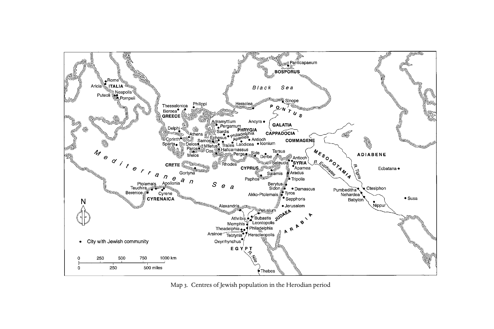

## 脚注

[^ch02-1]: 关于这些观念及其在拉比传统中的延续，参 Gafni, *Land, center and diaspora*, 19–78。

[^ch02-2]: 参 Rajak, ‘Josephus in the diaspora’, 81–3。

[^ch02-3]: 参本卷前文第一章。

[^ch02-4]: S. Pearce 在‘Jerusalem as “mother-city” in the writings of Philo of Alexandria’中探讨了其中的细微差别，见 Barclay, *Negotiating diaspora*, 19–37。

[^ch02-5]: 参 S. Freyne, ‘Introduction: studying the Jewish diaspora in antiquity’，收入 Bartlett, *Jews in the Hellenistic and Roman cities*, 1–5；另参前文第一章。

[^ch02-6]: 参 Mélèze-Modrzejewski, *Jews of Egypt*。相关文书参 CPJ。

[^ch02-7]: 详细论述见 Kasher, *Jews in Hellenistic and Roman Egypt*。

[^ch02-8]: 关于斐洛数量庞大、内容复杂的著作的导论，参 Schürer, *History*，第 III 卷第 2 分册，809–89。

[^ch02-9]: 参 Leon and Osiek, *Jews of ancient Rome*；Rutgers, *Jews in late ancient Rome*。

[^ch02-10]: Williams, ‘Structure of the Jewish Community’。

[^ch02-11]: 权威性综述见 Schürer, *History*，第 III 卷第 1 分册，1–86。

[^ch02-12]: B. McGing, ‘Population and proselytism: how many Jews were there in the ancient world?’，收入 Bartlett, *Jews in the Hellenistic and Roman cities*, 88–106。

[^ch02-13]: 例如 Feldman, *Jew and Gentile*。

[^ch02-14]: T. Kraabel 曾提出这一论点，参‘The Roman diaspora: six questionable assumptions’及‘Unity and diversity among diaspora synagogues’，收入 Overman and MacLennan, *Diaspora Jews and Judaism*, 1–33。

[^ch02-15]: 相关文本汇集于 Stern, *Greek and Latin authors*。

[^ch02-16]: Cohen, *Beginnings of Jewishness*, 39–49；Isaac, *Invention of racism*, 472–4。

[^ch02-17]: Sanders, *Jewish law*, 260–72。

[^ch02-18]: Goodman, ‘Jewish proselytizing’, 63–6；Barclay, *Negotiating diaspora*, 410–12。

[^ch02-19]: Sanders, *Jewish law*, 256。

[^ch02-20]: 主要材料见 Williams, *Jews among Greeks and Romans*, 81。

[^ch02-21]: Cohen, ‘Epigraphic rabbis’。

[^ch02-22]: Sanders, *Judaism: practice and belief*, 47–303；另参 Rutgers, *Jews in late ancient Rome*, 201–9。

[^ch02-23]: Goodman, ‘Jewish proselytizing’, 61–2。

[^ch02-24]: 关于以上全部材料，参 Hachlili, *Ancient Jewish art*。

[^ch02-25]: 关于会堂历史所涉及的证据及解释问题，参 Levine, *The ancient synagogue*；Fine, *Jews, Christians and polytheists*；Runesson, *Origins of the synagogue*；Olsson and Zetterholm, *The ancient synagogue*；Rajak, ‘The ancient synagogue’。

[^ch02-26]: Gruen, *Heritage and Hellenism*，分析了若干此类故事。关于约瑟夫斯，参 Rajak, ‘Josephus and diaspora’, 92–7。

[^ch02-27]: 埃及的材料见 Kasher, *Jews in Hellenistic and Roman Egypt*, 29–38、208–11。昔兰尼加贝勒尼基城的文本见 Applebaum, *Jews and Greeks*, 167。关于近来对埃及犹太自治团体纸草文书档案的重建，参 Honigman, ‘The Jewish politeuma at Heracleopolis’。Smallwood 在 *Jews under Roman rule* 中，把 politeuma 理解为界定散居犹太社群地位的一个法律术语。

[^ch02-28]: Harland, *Associations, synagogues and congregations*。

[^ch02-29]: 关于用词的多样性，参 Rajak, ‘Synagogue and community’。

[^ch02-30]: T. Rajak and D. Noy，收入 Rajak, *The Jewish dialogue*, 393–430。

[^ch02-31]: Brooten, *Women leaders*，是一部里程碑式的研究。

[^ch02-32]: Barclay 在 *Negotiating diaspora* 中对这些现象作了精细区分。

[^ch02-33]: 关于这些文献，参 Schürer, *History*，第 III 卷第 2 分册，470–704；Collins, *Between Athens and Jerusalem*；Holladay, *Fragments*，第 I–IV 卷；Doran, ‘Jewish Hellenistic historians’；Bar-Kochva, *Pseudo-Hecataeus*。

[^ch02-34]: Hengel 的 *Judaism and Hellenism* 仍在引起争论；例如参 Collins and Sterling, *Hellenism in the land of Israel*。

[^ch02-35]: van der Horst, *Ancient Jewish epitaphs*；Rutgers, *Jews in late ancient Rome*, 100–38。

[^ch02-36]: Rajak, ‘Reading the Jewish catacombs of Rome’；Rutgers, *Jews in late ancient Rome*, 50–67；另参本卷下文第四部分第十六章、第六部分第三十二章。

[^ch02-37]: 较早的研究 CII，Frey 编，仍不可或缺。较新的成果参 Horbury and Noy, *Jewish inscriptions of Graeco-Roman Egypt*；Noy, *Jewish inscriptions of Western Europe*，第 I、II 卷；导论见 Williams, *Jews among the Greeks and Romans*；专题研究见 van Henten and van der Horst, *Studies in early Jewish epigraphy*。

[^ch02-38]: Reynolds and Tannenbaum, *Jews and God-fearers*；Chaniotis, ‘The Jews of Aphrodisias’。近来关于敬神者的研究，见 Levinskaya, *Book of Acts*, 51–82、117–26；以及 Lieu, ‘Race of the Godfearers’。

[^ch02-39]: Rajak，收入 *Jewish dialogue*, 463–78。

[^ch02-40]: 例如徒 13:43、16:14、17:4、17:17、18:7。

[^ch02-41]: Mitchell, ‘The cult of Theos Hypsistos’；Gibson, *Jewish manumission inscriptions*, 96–123；Levinskaya, *Book of Acts*, 83–116。

[^ch02-42]: Cohen, *The beginnings of Jewishness*, 140–97。

[^ch02-43]: Goodman 在 *Mission and conversion* 中论证了这一点。

[^ch02-44]: 斐洛，Spec. 1.52；Virt. 102–8。另见 Cohen, *The beginnings of Jewishness*, 157。

[^ch02-45]: Schäfer, *Judaeophobia*。

[^ch02-46]: CPJ，第 II 卷，153。

[^ch02-47]: Rajak，收入 *The Jewish dialogue*, 301–34；Pucci Ben Zeev, *Jewish rights*；Gruen, *Diaspora*。

[^ch02-48]: Isaac, ‘Roman religious policy’。

[^ch02-49]: Oppenheimer 的‘Ban on circumcision’和 Abusch 的‘Negotiating difference’，都否认这项禁令的历史真实性；参本卷下文第三章。

[^ch02-50]: Linder, *Jews in Roman imperial legislation*, 99–102。

[^ch02-51]: 文本见 Lewis et al., *Documents from the Bar Kochba period*；讨论见 Kraemer, ‘Typical and atypical family dynamics’。

[^ch02-52]: 总体评估见 Rajak, *The Jewish dialogue*, 447–62。

## 本章术语与引证说明

- **diaspora／dispersion：散居、离散。** 本章既讨论离开故土的处境，也讨论海外社群，不把所有 diaspora 一律等同于被迫“流亡”；exile 则译作“流亡”。
- **acculturation／integration／assimilation：文化适应、融入、同化。** 依原文区分，不混作一个过程。
- **synagōgē／synagogue：会堂、会堂社群。** 原词既可指集会群体，也可指建筑，译文依上下文处理。
- **God-fearers：敬畏上帝者、敬神者。** 保留作者对这一名称是否构成正式身份类别的疑问。
- **prosēlytos／proselyte：归信者。** 与尚未完全归信的敬神者区分。
- **AJ／BJ／Ap.**：约瑟夫斯的《犹太古史》《犹太战争》《驳阿庇安》。
- **Flacc.／Legat.**：斐洛的《反弗拉库斯》《致盖乌斯使团》。其他作品缩写及文献定位依原文保留。
- **LXX**：七十士译本。原文某些《圣经》书卷名称和章节编号采用希腊文传统，译文保留其定位；不以现代中文常见分章自行替换。
- **t.／y.／b. Sukk.**：分别指《托塞夫塔》《耶路撒冷塔木德》《巴比伦塔木德》中的《住棚节篇》，定位依原文保留。
- **CPJ／CII**：分别为 *Corpus Papyrorum Judaicarum*（犹太纸草文献集）与 *Corpus Inscriptionum Judaicarum*（犹太铭文集）。


---

<a id="chapter-03"></a>

# 第三章 罗马帝国

**作者：汉斯-约瑟夫·克劳克（Hans-Josef Klauck）**

《剑桥基督教史》第一卷《起源至君士坦丁》中文译稿

> 原书第 69–83 页，PDF 第 118–132 页；下一页为空白页。本章正文及 59 条脚注完整保留。参考书目作者名与题名保留原文，解释性文字译为中文。纪年、统计数字、古代材料的引用及作者的限定语气依原文处理。
>
> [第三章英文原文](<第三章 罗马帝国（英文）.md>) · [原书 PDF](<../01 起源至君士坦丁.pdf>)

## 罗马帝国及其臣民

### 罗马权力在地方与整个世界中的影响

<!-- 原书第69页；PDF第118页 -->

罗马帝国构成了早期基督教兴起时更广阔的政治、社会与宗教背景。要理解公元一世纪的情形，有两项发展尤其重要。第一项也许始于公元前 229–228 年的第一次伊利里亚战争，此后罗马人逐步征服东地中海世界。他们得以利用亚历山大及其继业者，即 Diadochoi，将希腊文化传播到整个小亚细亚、波斯和埃及所造成的局面。随后，在公元前一世纪后半叶，罗马共和国转变成一种新体制：它仍保留共和国之名，实际上却已是一人专制；最高统治者后来还采用了源自人名的“凯撒”称号，希腊语作 Kaisar。

**开端：凯撒与奥古斯都。** 盖乌斯·尤利乌斯·凯撒为罗马走向帝国的历史奠定了道路。公元前 44 年，一批担心他要成为罗马新国王的元老刺杀了他。他的甥孙兼养子屋大维，在公元前 31 年的亚克兴海战中决定性地击败马库斯·安东尼，赢得权力斗争。凯撒的命运给了屋大维警示，他避免自称为王；但主要凭借对自己绝对效忠的军团的实力，他无疑已是罗马最有权势的个人。通过谨慎行事、政治技巧以及长期统治，他成功地把元首制确立为罗马政府的新形式。

<!-- 原书第69–70页；PDF第118–119页 -->

公元前 27 年，在他正式宣布罗马恢复共和之后，元老院授予他“奥古斯都”的称号，[^ch03-1]意为“受尊崇者”或“可敬畏者”，带有宗教意味。宗教在构想皇帝的角色时发挥着重要作用，下文还会讨论。小亚细亚一项著名的公元前 9 年历法敕令，把这位神圣皇帝的生日称为“福音”（euangelia）的开端。[^ch03-2]

在同时代人看来，奥古斯都赢得这些荣誉的伟大成就，是确立了奥古斯都和平，即罗马和平：一个前所未有的和平时期，首先意味着残酷内战及其在整个帝国引发的后果得以结束。这种和平也有代价：为了保卫边境，战争仍在进行；在埃及、叙利亚等皇帝行省，仍有由皇帝将领指挥的罗马军团长期驻扎，与之相对，元老院行省的行省长官由元老院任命。因此，人们必须纳税。普鲁塔克和金口狄奥等希腊哲学家接受罗马统治，同时也提出含蓄的批评。[^ch03-3]但这些情况不应被用来否认一个事实：许多人确实把罗马和平视为实实在在的改善。[^ch03-4]

人们觉得，治理地中海世界的使命已落到罗马人肩上。维吉尔在奥古斯都时代创作的《埃涅阿斯纪》中，一段“预言”凝聚了这种感受。埃涅阿斯亡父安喀塞斯的幽灵告诉他：“罗马人，记住：你的技艺，是以权力统治万邦，以法律奠定和平，宽赦被征服者，却要与反抗者战斗到底。”（6.851–3）

**此后一百年。** 接下来的一百年，对现代学界所谓“罗马化”过程具有形成性意义。[^ch03-5]这里我们只突出那些具有结构性重要意义、或涉及最早基督徒群体的事件。奥古斯都其实并未创设一个正式的皇帝职位；理论上，罗马仍是共和国，由元老院治理，以两位执政官为代言人。因此，新的元首 princeps 如何继位，始终是新制度的一大弱点。从提比略和卡利古拉开始，几乎每次都必须另找具体办法。

<!-- 原书第70–71页；PDF第119–120页 -->

特别值得我们关注的是克劳狄，他是提比略的侄子、卡利古拉的叔父。在宗教事务上，他倾向于强调古老罗马传统的保守路线；不过，只有在认为其他宗教群体扰乱公共秩序时，他才加以干预。[^ch03-6]在那封致亚历山大里亚的著名书信中，[^ch03-7]他没有给予当地犹太人公民权，却授予他们其他特权，并保护他们不受希腊居民的侮辱与迫害。但在犹太人口已十分众多的罗马，他早在公元 41 年便禁止其集会（卡西乌斯·狄奥 60.6.6）；公元 49 年，又把一群不安分的犹太臣民逐出罗马。他们可能是社群领袖和犹太基督教传教者，彼此冲突引发了某些骚乱。[^ch03-8]

公元 64 年尼禄统治期间，一场毁灭性大火烧毁了罗马城的若干街区。由于人们认为是尼禄本人下令纵火（苏埃托尼乌斯，《尼禄传》38.1–3），[^ch03-9]他便寻找替罪羊，并把目标对准罗马基督徒，参塔西佗《编年史》15.44.2–4 对他们的不利描写。这引发了第一次官方迫害基督徒的行动，但范围仍限于罗马。尽管优西比乌有不同说法（《教会史》3.17），多米提安统治下并不存在有组织的、遍及世界的基督徒迫害。材料中记载的事件，例如《启示录》2:13 中“忠信的见证人”安提帕之死，都是地方当局的孤立行动，尤其发生在小亚细亚。多米提安的形象曾被元老院史学和早期基督教论战贬损，近来则有所改变。[^ch03-10]

<!-- 原书第71–72页；PDF第120–121页 -->

公元 111 年前后，图拉真在位，小普林尼负责治理小亚细亚北部的庇推尼与本都，也遇到了针对基督徒的控告。处理此类案件似乎尚无固定程序，因此他致信图拉真，请求指示。这封信和皇帝的回信，“或许是基督教最初两个世纪中，有关基督教最重要的非基督徒文本”。[^ch03-11]图拉真采取务实态度：普林尼不必主动搜捕基督徒，也不应受理匿名控告。但若有人仍被查明为基督徒，就必须向罗马诸神献香、奠酒，否则便须处死。这并非完全合乎逻辑，身为法律家的德尔图良看得很清楚：“啊，这判决何等自相矛盾！”（*o sententiam necessitate confusam!*；《护教篇》2.8）但这种程序毕竟表现出罗马当局某种程度的节制。

**进一步的展望。** 至此，一个框架已经建立；尽管遭遇各种类型、不同强度的危机，它仍证明自己足够灵活而稳固，能够使罗马帝国在其后两个世纪中维持稳定，下文还会论述。往往十分激烈的最高权力争夺，最终通过皇帝完全出自军人阶层，以及与共治者分享权力的方式解决。后来，德西乌斯（249–251 年）、瓦勒良（253–260 年），尤其是戴克里先（303–305 年）统治期间，发生了规模更大、有组织的基督徒迫害。[^ch03-12]但随后君士坦丁（306–337 年）出现，把基督教变成自己最为青睐的宗教；其结果究竟更好还是更坏，没有人真正知道。[^ch03-13]在这整个时期，罗马的权力与存在遍及地中海东西两部，尽管具有地区差异，下文会重新讨论犹太地区这一特殊例子，而且在不同社会阶层中以不同方式发挥作用。接下来几节将探讨这一复杂现象在宗教、社会、军事和文化方面的若干层面。

**皇帝崇拜。** 罗马皇帝崇拜的前身，[^ch03-14]是希腊化继业者诸帝国中的统治者崇拜：以原先专用于奥林匹斯诸神的敬礼方式尊崇在位国王。在罗马，只有皇帝死后，元老院才宣布他成为国家的神；但这并不妨碍行省居民，最初是东方、后来也逐渐包括西方，向在世皇帝献上神圣荣誉与称号。在罗马，奥古斯都找到一种巧妙方案：祭祀与奠酒不直接献给他，而献给他的 genius，即被视为赋予他灵感、守护其人格的神圣力量。这也显示出罗马人喜爱把抽象观念神格化的倾向，例如罗马女神与和平女神。但行省所允许、所接受的实践，与罗马城内的实践始终有所不同；在行省内部，东方因有悠久的统治者崇拜传统，与西方的侧重又稍有差别。卡利古拉试图在罗马城内扮演奥林匹斯诸神的角色，以及多米提安可能采取的做法——尽管其“主与神”（dominus ac deus）称号的意义仍有争议——[^ch03-15]只是印证这一常规的例外。

<!-- 原书第73页；PDF第122页 -->

皇帝崇拜并不被视为替代传统宗教的选项，而是一种可以叠加在地方崇拜之上的上层结构。它发挥着一种制度性转喻的作用：唤起人们对罗马统治这一事实的认识，为它提供意识形态基础，并增强其社会可接受性，至少对统治阶层成员而言如此，因为他们获得了担任行省皇帝崇拜祭司的新机会，这是一项体面的仕途。

### 维持稳定的因素

**政治与军事结构。** 罗马人竟能用人数相当有限、出自显贵家族的官员治理如此庞大的帝国，这一点令人惊讶。之所以可能，是因为他们基本保留既有的地方组织，并高度依赖这些组织。例如，在希腊城市，议事会和公民大会仍存在，而且拥有发言权；大部分诉讼由地方法庭裁决。附庸王制度也属于这一政策。

另一个稳定因素是罗马军队。[^ch03-16]罗马维持着二十至三十个现役军团。每个军团由一位拥有元老身份的将领统率，理想编制为五千至五千五百人，实际人数往往较少；士兵来自意大利的自由人口，后来也来自行省。其组织为六个由军团保民官率领的大队，每个大队再分为十个由八十至一百名士兵组成的百人队，由百夫长指挥。第一大队第一百人队的百夫长称为 primipilus，即普通士兵能够达到的最高军阶。军团士兵是重步兵，另由从地方人口招募的辅助部队补充，后者担任骑兵、轻步兵与弓箭手。军团士兵退役时可以期待获得金钱和土地。有时，他们定居于新建“殖民城”，例如马其顿的腓立比或希腊的哥林多。

辅助部队成员服役二十五年后，可以期待取得罗马公民权。公民权起初只授予罗马城居民，后来扩及整个意大利；在公元一、二世纪的皇帝统治下，它进一步传播，并赋予持有者一些特权，例如在刑事案件中向皇帝上诉。

<!-- 原书第73–74页；PDF第122–123页 -->

**交通与通信。** 军团必须尽快调往冲突地区；官员必须前往获派的职位，到任后又须与罗马保持联系。因此，交通与通信对维持帝国至关重要。[^ch03-17]罗马人由此发展出卓越的道路体系，以及称为 cursus publicus 的驿传制度。道路虽然主要为军事与官方用途设计，仍在更广泛的范围内便利了旅行与交流。

<!-- 原书第74页；PDF第123页 -->

整个帝国使用的主要语言仍是希腊语，甚至在罗马和意大利，一些作家也使用它。拉丁语居于其次，尤其用于帝国行政。但地方语言仍很有活力，例如犹太地区的阿拉米语、迦太基的布匿语，以及小亚细亚的吕基亚语，参《使徒行传》14:11。

希腊—罗马文化在很大程度上仍是口传文化，或称半口传文化，因为口语与书面记录已经相互顺畅配合。阅读往往是出声的，而且在集体环境中进行，虽然并非总是如此；写作则意味着口授给抄写员，参罗 16:22。当时的识字率很难估计，但一个颇获支持的估计认为，识字者约占人口的百分之十；少数城市可能达到百分之三十甚至四十，但仅指自由出生的男子；拉丁语西部地区则只有百分之五。[^ch03-18]

**社会金字塔。** 皇帝位于罗马社会金字塔的最顶端，而塔尖确实十分狭小。[^ch03-19]统治阶层大约由六百个家族构成，其家长是元老院成员；这类家族必须拥有一百万塞斯特斯的净资产。其下是骑士阶层，财产须达到四十万塞斯特斯或以上。地方贵族成员各自拥有价值十万塞斯特斯以上的财产，被称为 decuriones，担任行省城市的市政公职。这些群体，即所谓 honestiores，“尊贵者”，在罗马帝国总人口中仅占百分之一左右；帝国可能有五千万至六千万人口。[^ch03-20]至于是否存在一个真正意义上的中产阶层，例如由工匠、商人、房主和农民组成的阶层，仍有争议。[^ch03-21]大部分人口必须辛苦劳作才能维持普通生活；尤其在罗马城，许多人贫困不堪，依靠公共粮食配给。

<!-- 原书第75页；PDF第124页 -->

奴隶构成金字塔的底部。多数现代估计认为，至少在城市，他们约占总人口的三分之一。[^ch03-22]其生活条件极大地取决于主人的态度。因此，奴隶内部也形成某种“金字塔”：皇帝家内奴隶位于顶端，手工业劳动者和矿工位于底层。公元一世纪，许多奴隶可以期待在一生中的某个时候获得解放，往往是在主人去世之际，但很可能并非人们有时所说的“大多数”奴隶都能如此。[^ch03-23]不断需要补充的新奴隶，来自奴隶父母所生的孩子、弃婴、被定罪的罪犯、海盗受害者、出卖自身以抵债的人，尤其是战俘。

**社会关系。** 尽管文化各不相同，由丈夫、妻子、孩子和奴隶组成的家庭与家户，在罗马时代仍是社会生活结构的基本组成部分。[^ch03-24]罗马法赋予男性家长 pater familias 特殊权利。[^ch03-25]家庭与家户是社会理论和劝诫的重要主题，参《新约》中的家规，也为创造拟制亲属关系的术语提供基础，例如皇帝被称为 pater patriae，“国父”。

罗马社会结构的一个典型组成部分，是庇护制度。它是社会地位不平等的双方，即庇护者与依附者之间，个人性的、不对称且持续的关系，伴随着物质与非物质利益的相互交换，例如 fides，“忠诚”或“效忠”等。[^ch03-26]希腊世界没有完全对应的制度，但存在一种如今被称为“公益施惠”（euergetism）的现象，源自 euergetēs，“施惠者”。其基础同样是交换：以公共荣誉回报对公共利益的贡献，例如立碑、授予冠冕、修建墓葬，甚至举办葬礼竞技。[^ch03-27]

<!-- 原书第75–76页；PDF第124–125页 -->

友谊是另一个重要范畴，同时在政治、私人和比喻层面发挥作用，参约 15:15、19:12。[^ch03-28]对希腊人，尤其是罗马人而言，友谊与相互的实际利益并不相悖，而是包含这些利益。

<!-- 原书第76页；PDF第125页 -->

自愿社团在希腊化时代兴起，在罗马帝国仍很兴盛，是另一种社会群体。[^ch03-29]它们围绕共同职业、共同族属、特定家户，或对某位神祇的崇拜形成。典型特征包括制定章程，往往刻成铭文、缴纳会费、献祭以及举行共同宴席。后来，又增加了安排体面葬礼这一附带职能，但这也显示，大部分社团由社会下层成员构成。因此，罗马当局始终对社团有所疑虑，并试图通过严格规定和禁令加以控制。例如，普林尼建议在尼科米底亚组建一支消防队 collegium，虽然颇有道理，仍被图拉真否决。[^ch03-30]


**特殊案例：犹太地区。** 罗马存在与权力的彰显，如何同时产生稳定与破坏因素，在犹太地区的例子中看得很清楚。该地区于公元前 63 年被庞培征服，部分领土先后由一系列附庸王统治：从大希律（公元前 37–4 年），经过希律·安提帕（公元前 4 年至公元 39 年）和其他分封领主，到希律·亚基帕一世（37–44 年）及亚基帕二世（50 年〔？〕至 92／93 年）。[^ch03-31]

犹太地区虽常被称为一个“行省”，但在公元一世纪，实际上既不是元老院行省，也不是皇帝行省，严格说隶属于叙利亚行省；叙利亚有一位率领两个军团的皇帝将领驻守。但这个不安定的小国拥有自己的罗马总督，通常出自骑士阶层。他们以滨海凯撒利亚为总部，试图凭一小支辅助部队维持和平与秩序。其称号起初是 prefectus，最著名的本丢·彼拉多便如此；[^ch03-32]后来到克劳狄时期，改称 procurator。塔西佗谈到被称为 Chrestiani 的人时，也把这一后来称号不合时序地用于彼拉多：“这个名称的创始者基督，在提比略统治时，由总督〔per procuratorem〕本丢·彼拉多判处死刑。”（《编年史》15.44.3）

<!-- 原书第76–77页；PDF第125–126页 -->

耶稣死于十字架刑这一事实，本身便表明公元一世纪的犹太地区同样充满动荡和冲突；钉十字架是罗马用来处决奴隶与非罗马籍叛乱者的刑罚。这里还应提及一次早期危机：卡利古拉下令在耶路撒冷圣殿内部，竖立一座自己的巨型金像（斐洛，《致盖乌斯使团》203）。此事甚至可能在对观福音传统中留下痕迹，参可 13:14。叙利亚将领普布利乌斯·彼得罗尼乌斯拖延执行这一任务。犹太王希律·亚基帕一世曾在罗马宫廷生活过一段时间，也试图干预。[^ch03-33]但直到公元 41 年一月，卡利古拉终于被自己的卫队军官刺杀，这场噩梦才告结束。

这些冲突最终导致公元 66–73 年的犹太战争，也深刻影响了罗马历史。尼禄死后，韦斯巴芗成功角逐皇位，当时他正统率犹太地区的罗马军团，围攻耶路撒冷。他的长子、未来的继承人提图斯接过指挥权，攻陷耶路撒冷；城市连同圣殿在内，被彻底摧毁。

几十年后，哈德良又在公元 132–135 年与西缅·本·科西巴，即巴尔·科赫巴，进行了一场异常激烈的战争。后者领导犹太地区的反叛；起因可能是哈德良把耶路撒冷重建为名叫埃利亚·卡庇托利纳的异教城市，并禁止割礼，还轻蔑地把割礼称为“阉割”。[^ch03-34]这场战争最终结束了两个世纪以来罗马军事权力与犹太人为宗教、政治生存而奋斗之间错综复杂的互动。

## 罗马文化与宗教

<!-- 原书第77页；PDF第126页 -->

在前面提到的关于罗马统治世界的“预言”中，安喀塞斯也承认：“我相信，别人会用更柔和的线条铸出栩栩如生的青铜，从大理石中创造有生命的面容，在法庭上更有力地陈述诉求，以测杆描绘天体的轨迹，讲述星辰的升起。”（维吉尔，《埃涅阿斯纪》6.847–50）维吉尔或许是罗马最伟大的诗人，却由此承认，希腊人在艺术、科学和修辞方面仍占领先；我们还可以加上哲学和文学。罗马人在这些领域的创造，通常从模仿某个希腊典范开始。

### 哲学

<!-- 原书第77–78页；PDF第126–127页 -->

哲学尤其如此。希腊化时代的希腊哲学分为多种流派，例如柏拉图学派、逍遥学派、斯多亚学派、伊壁鸠鲁学派、怀疑主义及毕达哥拉斯学派，[^ch03-35]罗马思想家吸收这些学说，逐步把它们引入拉丁语言与思想。这一过程在西塞罗的大量哲学著作中达到早期高峰。他本人倾向于持怀疑立场的学园派，但在往往采用对话形式的论著里，也让某些发言者大量引述斯多亚和伊壁鸠鲁的教导。

将希腊哲学与文学传给罗马人的另一条渠道，是在意大利活动的希腊教师。一个很好的例子，是来自加大拉的伊壁鸠鲁派哲学家兼诗人菲洛德谟（公元前 110–40 年）。他住在赫库兰尼姆的皮索别墅；十八世纪，人们在那里发现了其藏书的纸草残片。[^ch03-36]卢克莱修（约公元前 96／94–55 年）在长诗《物性论》中，也明确选择了伊壁鸠鲁主义。

但总体而言，斯多亚主义更符合罗马人的气质，尤其是在侧重伦理时。[^ch03-37]公元一世纪，塞涅卡在讨论各种主题的论文集，以及写给卢基利乌斯、影响深远的《道德书简》中，提倡一种折衷的斯多亚主义。

另一位斯多亚哲学家爱比克泰德（公元 50–125 年）最初在罗马为奴，曾师从用希腊语写作的罗马斯多亚学者穆索尼乌斯·鲁福斯。他也用希腊语授课，弟子阿里安保存了其部分讲论。公元二世纪，罗马皇帝兼斯多亚思想家马尔库斯·奥勒留，同样选择希腊语书写名为《沉思录》的私人札记，希腊原题为 ta eis heauton。但斯多亚主义也可能成为抵抗政治压迫与帝权滥用的最后依托。斯多亚派先后反对尼禄和多米提安，便显示出这一点：前者时期有特拉塞亚·佩图斯和塞涅卡的反对，后者则导致哲学家于公元 89 年或 92／93 年被逐出罗马，其中包括爱比克泰德和金口狄奥。

<!-- 原书第78–79页；PDF第127–128页 -->

因此，古老的哲学学派在公元一、二世纪仍十分活跃，尽管有些已经历重大转变。斯多亚主义和伊壁鸠鲁主义与日常生活密切相关，似乎更加流行，参徒 17:18。但喀罗尼亚的普鲁塔克（约公元 40–120 年）的大量著作，以及同样不可遗忘的亚历山大里亚斐洛，都见证了中期柏拉图主义的存在；它在公元二、三世纪发展为包罗广泛的新柏拉图主义综合体系。公元前一世纪重新发现亚里士多德的内部讲授著作，也给逍遥学派带来新动力。帝国早期，某些哲学取向几乎被重新创造，其中包括犬儒主义和毕达哥拉斯主义。[^ch03-38]

希腊—罗马哲学对早期基督教的重要性，尤其体现在两个领域。关于神或诸神的问题，后来称为“神学”，当时仅由哲学家讨论；哲学家也认为自己应对“心灵关怀”负责，[^ch03-39]因为他们公开宣称的目标，是 eudaimonia，即人的幸福与安好。哲学神学包括宇宙论、形而上学、人论与伦理等多种主题。文本传统，例如荷马史诗，是哲学家认识神圣事物的主要来源；寓意解释则是解读这些文本最重要的工具。[^ch03-40]

### 宗教

<!-- 原书第79页；PDF第128页 -->

**罗马宗教与混融。** 西塞罗《论神的本性》中的科塔，本人是最高祭司，同时又在宗教问题上捍卫怀疑主义学园派的立场。他表示相信：“如果不以最充分的方式使不朽诸神满意，罗马国家绝不可能达到这样的高度。”（3.5）通过谨慎遵守仪式安抚诸神，并通过征兆探求神意，尤其是 auspicium，即观察鸟类飞行和行为，是罗马国家宗教的支柱；这一宗教被视为罗马身份的核心因素。因此，其祭司职位只交给国家官员。[^ch03-41]

在相当长时期内，罗马对希腊和东方宗教形式的传入，大体保持抗拒。虽然危机时期允许来自小亚细亚的大母神崇拜，以及阿斯克勒庇俄斯和伊西斯崇拜进入罗马，但与奥古斯都声称在罗马修复的八十二座罗马神庙相比，它们的庙宇仍只是带有异域色彩的飞地（《功业录》20）。

<!-- 原书第79–80页；PDF第128–129页 -->

区别主要在观念层面被模糊了。通过对罗马宗教的“希腊式解释”（interpretatio graeca），罗马万神殿中的男女神祇被等同于希腊的奥林匹斯诸神，并受到后者的主导：朱庇特就是宙斯，朱诺就是赫拉，等等。这种解释也涉及埃及等其他地方宗教，例如伊西斯被看作雅典娜，奥西里斯被看作狄俄尼索斯；[^ch03-42]还涉及犹太崇拜，例如把雅威等同于狄俄尼索斯。[^ch03-43]它构成了所谓“宗教混融”的基础：帝国境内的传统神系经由双向的重新解释，使原本不同的宗教形式在帝国时期彼此混合。

<!-- 原书第80页；PDF第129页 -->

**各种选择。** 在这样的背景下，宗教选择最好理解为彼此嵌合、而非相互替代的现象。它们可以和平共存，并简单叠加，形成个人的宗教认同组合。主要框架仍是城市与国家的公共宗教生活，包括节庆、游行、祭祀、宴席与竞技；皇帝崇拜已在上文讨论。家庭崇拜便嵌入其中，在家户与家庭环境中重现公共崇拜的某些特征；罗马人的家庭崇拜尤其强调祖先记忆，即 penates。神谕和通过征兆、异象、梦境进行的其他占卜，也可能包括在内；后来，占星术也日益突出。另一种个人选择，是基于个别入教仪式的秘仪崇拜。[^ch03-44]较古老的类型，例如厄琉息斯秘仪，如今得到伊西斯与奥西里斯秘仪的补充；[^ch03-45]从公元一世纪末起，又加上波斯神祇密特拉的秘仪，后者在罗马军队中特别受欢迎。

一种特殊的个人选择，是魔法。至少在有些人看来，它可以理解为转入地下、受到社会排斥的宗教。[^ch03-46]罗马法禁止施行魔法，也时而用来惩治魔法师，以及占星家和占卜者。但魔法也有稳定市场；一些供专业使用的文本集甚至保存至今，例如希腊魔法纸草文献。[^ch03-47]东方影响在这里尤其明显，因为人们认为最好的魔法师来自埃及、巴比伦尼亚等东方国家，尽管这一声誉部分源于对当地宗教的误解：在希腊、罗马访客看来，这些宗教只是显得神秘莫测。

### 文学

<!-- 原书第81页；PDF第130页 -->

“文学”是一个十分宽泛的范畴。[^ch03-48]若把范围扩到极致，它包括除纪实性铭文和纸草文书以外的一切书面材料。例如，学术、科学和专业文献数量可观：有医学与药物学，例如狄奥斯科里德的《药物志》；有法律、语法、词汇学和文学批评，例如伪朗吉努斯的《论崇高》；也有天文学或占星术，如马尼利乌斯，建筑学，如维特鲁威，地理学，如斯特拉波，乃至农学，如科鲁梅拉，和烹饪，如阿庇西乌斯。书信体在西塞罗那里已达到非凡高度，后来通过奥维德的《女杰书简》及托名书信集，发展为独立文类。[^ch03-49]奥古斯都的释奴斐德鲁斯，把伊索寓言写成拉丁韵文。

若采用更古典的文学概念，即史诗、诗歌与戏剧，便须立即指出：奥古斯都时代是拉丁文学的黄金时代。维吉尔以《埃涅阿斯纪》创作了罗马人的民族史诗；贺拉斯擅长讽刺诗；奥维德写下《变形记》；这只是各自作品中的少数例子。在挽歌领域，还有提布鲁斯和普罗佩提乌斯。相比之下，从提比略到哈德良的时代，常被视为拉丁文学的白银时代。在这些作者中，这里仅提到塞涅卡的侄子卢坎，以及他描写内战的史诗《法萨利亚》；新一代讽刺大师佩尔修斯和尤维纳利斯；还有擅长铭辞这种小型文类的马提亚尔。

公元一世纪还见证了一种新文类的兴起，当代文学批评却完全没有注意到它：希腊—罗马小说。[^ch03-50]公元 66 年去世的佩特罗尼乌斯，用拉丁语创作了一个既早期、又极富独创性的小说范例。不幸的是，其《萨蒂里卡》只有残片保存下来。

### 教育与修辞

<!-- 原书第81–82页；PDF第130–131页 -->

希腊的教育体系 paideia，至少从柏拉图、亚里士多德和智者学派以来，就包含悠久的修辞训练传统；修辞是口头交流的技艺，尤其用于法庭、公民大会与节庆人群之中。[^ch03-51]公元一世纪，这一重要知识领域的代表人物，是克律索斯托莫斯，即“金口”狄奥。他的八十篇演说大多属于议事体，向大会进言；部分属于颂扬体，即节庆赞辞，以及辩护体，即法庭申辩；这些演说生动描绘了帝国东部的城市生活。

罗马人很自然地亲近希腊化修辞传统。公元前一世纪用拉丁语写成的匿名《致赫伦尼乌斯修辞学》，清楚列出演说家的五项任务：构思、布局、文体、记忆与表达。西塞罗本人是拉丁语演说家中的最伟大者，撰写过七部修辞论著。塔西佗或许是罗马历史学家中最可靠的一位，也写过富于见识与洞察力的《论演说家对话录》。因此，并非偶然，后来为数百年确立权威修辞手册的，是拉丁作家昆体良（约公元 35–95／96 年）；这部篇幅宏大的汇编名为《演说家的教育》。

### 艺术与建筑

<!-- 原书第82页；PDF第131页 -->

公元一、二世纪，也是罗马艺术与建筑的鼎盛时期。[^ch03-52]它们由伊特鲁里亚、意大利因素与希腊、希腊化因素融合发展而成，继而从首都传播到帝国各城市，再与地方传统相互作用。朱里亚—克劳狄王朝时期尤其以一种新的古典主义为特征，[^ch03-53]即强调伟大的希腊典范。

雕塑方面，罗马人特别关注对在世人物的肖像表现，建立可供复制的标准造型，例如在位皇帝的形象。[^ch03-54]罗马绘画的辉煌，可以从罗马城尼禄金宫、庞贝城外秘仪别墅，以及邻近庞贝的博斯科雷阿莱别墅所存壁画中看出。地板和墙壁上的马赛克，往往重现已失传的绘画；它们本身也是一种臻于完善的艺术形式。石棺上富于象征性的浮雕也同样如此，其题材包括神话、农事以及死者的生平。

<!-- 原书第82–83页；PDF第131–132页 -->

奥古斯都在罗马启动了广泛的建设计划，继任者继续推进。他最具灵感的创造之一，是公元前 9 年完工的和平祭坛 ara pacis。[^ch03-55]弗拉维王朝建造了名为科洛西姆的巨型圆形竞技场。[^ch03-56]图拉真的建设活动，最著名的是以他命名的广场；图拉真纪功柱也矗立于此，长达二百米的螺旋浮雕饰带，描绘皇帝对达契亚的战争。[^ch03-57]阿格里帕的万神庙毁于大火后，哈德良在原址建起新的万神庙。主殿采用不寻常的圆形平面，穹顶中央有开口，旨在把天空引入神庙。不仅罗马城，整个帝国都有类似工程。它们有助于把罗马帝国的意识形态传播到整个地中海世界。

我们只能顺带提到陶器、珠宝、玻璃与金属器、钱币，以及其他日用物品等较小的形式。[^ch03-58]在文学中，艺术品通过 ekphrasis，即“描写”，得到表现，参阿喀琉斯·塔提乌斯和朗戈斯小说的开篇场景。艺术与建筑，也就是视觉传播，使宗教与政治主题在公共空间中仿佛无处不在，由此参与构成罗马帝国的“力场”；无论罗马城还是各行省皆如此，而这正是最早基督徒生活的环境。[^ch03-59]

## 译校说明

本章军事编制、人口与财产统计、史实纪年及文献定位，均依原文保留。例如，原文将军团编制表述为“六个大队、每队十个百人队”；此处未根据外部资料改订。正文作者的推测与评价，同样不改写为已经确定的史实。

## 脚注


[^ch03-1]: 参他带有遗嘱性质的 Res gestae 34。

[^ch03-2]: OGIS 458.40–1；修订文本见 U. Laffi, ‘Le iscrizioni’；另参 Sherk, Roman documents, 328–37。

[^ch03-3]: 参 Swain, Hellenism and empire, 135–241；另参塔西佗 Ann. 1.10.4：“无疑是和平——却是残酷的和平。”

[^ch03-4]: 相对于 Wengst, Pax romana, 7–54 过度批判的视角，这一点必须强调。

[^ch03-5]: 参 Woolf, ‘Romanisierung’, 124。

[^ch03-6]: 参 Alvarez Cineira, Religionspolitik, esp. 22–159。

[^ch03-7]: PLondon 1912; CPJ, vol. ii, 153。

[^ch03-8]: 参苏埃托尼乌斯 Claud. 25.4：Iudaeos impulsore Chresto assidue tumultuantis Roma expulit，即“他把受克瑞斯图斯煽动、不断制造骚乱的犹太人逐出罗马”。有些作者把这两次事件视为同一件事；批判性讨论见 Alvarez Cineira, Religionspolitik, 194–210。

[^ch03-9]: 但苏埃托尼乌斯没有把此事与尼禄迫害基督徒联系起来；他此前已在 Nero 16.2 提及后者。

[^ch03-10]: 参 Urner, Kaiser Domitian, 321。

[^ch03-11]: Novak, Christianity and the Roman empire, 47。关于这些书信的详细分析，见 Freudenberger, Das Verhalten der römischen Behörden。

[^ch03-12]: 参本卷下文第六部分第二十八章。

[^ch03-13]: 参本卷下文第六部分第三十章。

[^ch03-14]: 相关文献极多，尤其参 Price, Rituals and power，以及 Clauss, Kaiser und Gott。

[^ch03-15]: 参 Boyle, ‘Introduction’, 17，以及 Newlands, ‘The emperor’s saturnalia’, 515–16。

[^ch03-16]: 关于罗马军队，例如参 Campbell, The Roman army，或 Roth, The logistics of the Roman army。军团实际运作的描写，见约瑟夫斯 BJ 3.59–109、5.39–70。

[^ch03-17]: 参 Casson, Travel in the ancient world，尤其 163–96；较早的 Riepl, Das Nachrichtenwesen des Altertums 仍值得参考。

[^ch03-18]: 这是 Harris, Ancient literacy, 328–30 的结论。

[^ch03-19]: 参 Garnsey and Saller, The Roman empire；Alföldi, Social history, 94–156，尤其第 146 页图 1。丰富的原始材料见 Shelton, As the Romans did。

[^ch03-20]: Heichelheim, ‘Bevölkerungswesen’, 879。

[^ch03-21]: Alföldy, Social History, 147：“独立的中间阶层所需的先决条件并不存在。”

[^ch03-22]: 参 Harrill, Manumission，尤其 11–67；Bradley, Slavery；另参下文第三部分第十四章。

[^ch03-23]: Harrill, ‘Slavery’, 1126，把这一看法称为“一些新约学者中常见的误解”。

[^ch03-24]: 参 Rawson, The family in ancient Rome, esp. 1–57。

[^ch03-25]: 参本卷下文第三部分第十四章。

[^ch03-26]: Saller, Personal patronage, 1。

[^ch03-27]: 参 Veyne, Le pain et le cirque, and Danker, Benefactor。

[^ch03-28]: 参 Fitzgerald, Greco-Roman perspectives。

[^ch03-29]: 例如参 van Nijf, Civic world of professional associations；另参下文第二部分第七章。

[^ch03-30]: 普林尼 Ep. 10.34；另参 Harland, Associations。

[^ch03-31]: 关于希律家族，参 Braund, Rome，尤其 75–85、108–12、139–43；Millar, The Roman near east, 27–79。

[^ch03-32]: 1961 年发现的滨海凯撒利亚铭文，给出了这一正确称号；参 Lémonon, Pilate, 23–32。Alföldy 在‘Pontius Pilatus’中提出了一种可信的新复原方案。

[^ch03-33]: 参 Schwartz, Agrippa i, 18–23, 77–89。

[^ch03-34]: 主要材料是卡西乌斯·狄奥 69.21.1–14.3〔定位依原文〕；参 Schürer, History，第 I 卷，542–52；Millar, The Roman near east, 106–8、372–4；另参前文第二章。

[^ch03-35]: 关于帝国时代的哲学概况，参 Reale, Schools。

[^ch03-36]: 其一部著作见 Philodemus, On piety。

[^ch03-37]: 参 Colish, Stoic tradition。

[^ch03-38]: 参 Reale, Schools, 145–63, 237–62。

[^ch03-39]: 参 Malherbe, Paul；Glad, Paul and Philodemus。

[^ch03-40]: 参本卷下文第五部分第二十七章。

[^ch03-41]: 关于罗马宗教，参 Beard et al., Religions of Rome 两卷，其中有详尽书目。

[^ch03-42]: 参普鲁塔克 De Is. et Os. 354C、362B 等；这类对应关系的长篇列表见 Griffiths 编，De Iside et Osiride, 572–8。

[^ch03-43]: 参普鲁塔克 Quaest. conv. 4.6.1–2。

[^ch03-44]: 参 Burkert, Cults, 4：“它们作为不同形式、趋势或选择，存在于古代宗教那个成分各异、却延续不断的整体之中。”

[^ch03-45]: 参阿普列尤斯 Met. 第 11 卷。

[^ch03-46]: 为魔法下定义几乎面临不可克服的困难，不过 Graf, Magic 提供了很好的描述。

[^ch03-47]: Betz, Greek magical papyri 便于查阅这些材料。关于帝国西部同样存在的另一类本土魔法文本，参 Gager, Curse tablets。

[^ch03-48]: 关于这一时期的希腊、拉丁文学，参 Dihle, Greek and Latin literature, 62–212；关于拉丁文学，参 Albrecht, History, 639–1277。

[^ch03-49]: 参 Rosenmeyer, Ancient epistolary fictions, 193–233。

[^ch03-50]: 参 Reardon 编，Collected ancient Greek novels。

[^ch03-51]: 关于希腊化和罗马时代，参 Porter, Handbook of Classical rhetoric 所选论文。

[^ch03-52]: 参 Pollitt，收入 Boardman, Oxford history of classical art, 217–95。

[^ch03-53]: Torelli, ‘Roman art’, 930–1。

[^ch03-54]: 参 Zanker, Power of images, 79–100。

[^ch03-55]: Torelli, ‘Roman art’, 943。

[^ch03-56]: 参 Colledge, ‘Art and architecture’, 968。

[^ch03-57]: Coarelli, Column of Trajan；关于这些战争的重要性，参 Strobel, Untersuchungen zu den Dakerkriegen Trajans。

[^ch03-58]: 参本卷下文第六部分第三十二章。关于整个主题，参 Elsner, Art and The Roman viewer，以及其 Imperial Rome。

[^ch03-59]: 参 Friesen, Twice Neokoros，以及 Radt, Pergamon，尤其 209–54。


---

<a id="part-2"></a>

# 第2部分　耶稣运动

<!-- 原书第85–86页；PDF第134–135页。 -->

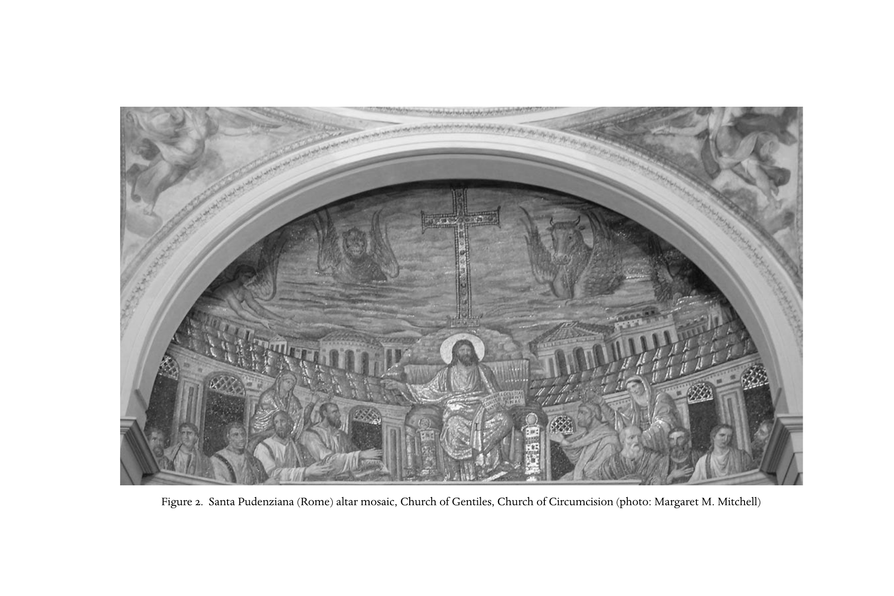

*图2　罗马圣普登齐亚纳教堂祭坛马赛克：外邦人的教会与受割礼者的教会。摄影：Margaret M. Mitchell。原书第86页。*


---

<a id="chapter-04"></a>

# 第四章 犹太基督教

**作者：乔尔·马库斯（Joel Marcus）**

《剑桥基督教史》第一卷《起源至君士坦丁》中文译稿

> 原书第 87–102 页，PDF 第 136–151 页。正文及 57 条脚注完整保留。参考书目的作者名、题名及文献定位保留原文，解释性文字译为中文。文中的判断、争论与限定语气依原作者，历史语境为 2006 年。
>
> [第四章英文原文](<第四章 犹太基督教（英文）.md>) · [原书 PDF](<../01 起源至君士坦丁.pdf>)

## 耶稣与最早的教会

<!-- 原书第87页；PDF第136页 -->

对一些读者来说，本章标题似乎自相矛盾，因为人们通常把“犹太教”和“基督教”看作相反的事物。但“起初并不是这样”（太 19:8）：耶稣和最早的门徒都是犹太人，在他死后的几个世纪里，犹太出身的基督徒，无论在他的出生地内外，都是不可忽视的存在。

诚然，他本人留下的遗产并不明确。例如，人们记得他说过，使人污秽的不是进入口中的东西，而是从口中出来的东西（可 7:15；太 15:11；《多马福音》14）。若按字面理解，这一原则似乎意味着食物没有使人污秽的能力，而这与《旧约》的洁食规定直接冲突（《利未记》第 11 章）。然而，有学者认为，这句话采用了闪米特语的表达方式，其中“不是这个，而是那个”，实际上意为“与其说是这个，不如说是那个”。[^ch04-1]《马可福音》7:19 固然把这句话解释为一切食物都可食用，但那是马可的解释，而非耶稣本人的解释；《马太福音》对应段落没有这项说明（太 15:17）。[^ch04-2]这些学者指出，若耶稣曾明确废除《旧约》的洁食规定，后来主张基督徒可以吃任何食物的人，大概会援引这句话结束争论，但他们没有这样做。同样，早期教会曾为外邦出身的男性归信者是否须受割礼而争论，因为犹太律法《妥拉》要求以色列男子受割礼（创 17:9–14；利 12:3）。但《新约》保存的这些辩论中，从未有人援引耶稣关于这一争议的言论，想必是因为他不曾发表过。这个问题当时根本没有出现：耶稣的追随者是犹太人，他的使命面向以色列，他也就把割礼视为当然。

<!-- 原书第88页；PDF第137页 -->

但他死而复活之后，情况开始改变。《使徒行传》把最早的基督徒描绘为仅向犹太同胞传道，并把向外邦人扩展的使命经验为来自上帝的意外之举；这种描绘无疑具有历史真实性，参第 8、10 章关于埃塞俄比亚太监与哥尼流的故事。但随着犹太同胞大多拒绝基督教信息，而外邦人的接受程度又高得惊人，一个此前未曾出现的问题浮出水面：信耶稣的外邦人是否需要归信犹太教？不同基督徒给出了不同答案，形成若干派别，其区别首先在于对律法的态度。雷蒙德·布朗一篇文章的标题概括了这种情形：“不是犹太基督教与外邦基督教，而是不同类型的犹太／外邦基督教。”[^ch04-3]一些信奉耶稣的犹太人坚持，自称追随犹太弥赛亚耶稣的人，必须完全遵守摩西律法。在他们影响下归信的外邦人承担了“《妥拉》的轭”，实际上便成为犹太人。另一些相信耶稣的犹太人，例如保罗，则认为摩西律法作为诫命，本质上属于旧有秩序；这一秩序已因耶稣的死与复活被扫除（加 3:13、23–5；罗 10:4）。受他们影响而归信的外邦人，无须在饮食律、割礼、守安息日等《旧约》要求面前作出任何遵守的表示。还有领袖与外邦归信者持中间立场，例如认为律法的某些部分，而非全部，对基督徒仍有约束力，参徒 15:19–21，并比较加 5:3、雅 2:10–11。

## 如何界定

<!-- 原书第88–89页；PDF第137–138页 -->

这些群体中，究竟哪些应称为“犹太基督徒”？古代犹太基督教研究确实深受定义问题困扰，尤其是形容词“犹太”的含义。[^ch04-4]现代话语中的犹太身份，同时包含族属与宗教成分；定义时各应占多大分量，仍有争议，当代犹太人内部关于“谁是犹太人”的辩论就是明证。[^ch04-5]单方面强调族属或宗教，都引出问题。如果按族属定义“犹太人”，是否从一开始就排除了历代多数犹太人都承认的归信犹太教这一可能？反之，若采用“宗教”进路，究竟以什么宗教标准判断犹太身份？对本章主题而言，情况还因以下两点更加复杂：“犹太基督徒”和“犹太基督教”都是现代创造的术语，古代文本根本未曾出现；[^ch04-6]而在某些古代著作中，“犹太人”仅指犹太地区居民，不问其宗教信奉或族属来源。[^ch04-7]

<!-- 原书第89页；PDF第138页 -->

不过，在过去约三个世纪的学术研究中，“犹太基督徒”与“犹太基督教”通常专指古代基督徒中的一个子集：他们认同犹太宗教制度，尤其是《妥拉》，并认为自己有义务按字面履行其诫命。为强调这些耶稣信徒重视犹太人的界定性宗教特征，即遵守《妥拉》，有些学者甚至偏好称他们为“基督教犹太人”。[^ch04-8]依此定义，保罗和其他犹太族属出身、却认为自己已不受割礼、安息日及洁食规定约束的基督徒，就不算“犹太基督徒”。本章将采用这种以《妥拉》与实践为中心的定义。其优点是比较清楚，而且符合古代多数外人看待犹太人的方式，即把他们视为做某些事情的人。[^ch04-9]它也对应于教父们对那些坚持遵守犹太律法的基督徒群体持续、通常负面的关注。强调《妥拉》，有时伴随着淡化基督论的重要性，但并非总是如此；下文会看到，遵守《妥拉》的犹太基督徒，具有多种基督论立场。

<!-- 原书第89–90页；PDF第138–139页 -->

诚然，这一定义也有问题。最大的问题，正如 M. 西蒙所说，是一个人须有多大“剂量”的《妥拉》实践，才算犹太基督徒。[^ch04-10]例如，一位生来是外邦人的男性基督徒，去会堂，庆祝某些而非全部犹太节日，遵守部分而非全部摩西饮食规定，却不受割礼，那么这样的“敬神者”是否算犹太基督徒？[^ch04-11]尽管存在这种灰色地带，以《妥拉》为中心的进路似乎仍优于 J. 达尼埃卢的主张。后者认为，所有早期基督教都是“犹太基督教”，因为最初几代基督徒深受犹太教思维模式的影响。[^ch04-12]然而，达尼埃卢用来证明犹太基督教思想模式广泛存在的那些材料，实际上也可能间接见证了较狭义的犹太基督教所具有的影响。

我们寻找古代犹太基督教时，常常必须走这种间接道路，因为直接证据既不丰富，也难以解释。主要原因是，遵守《妥拉》的犹太基督教，最终在日益壮大的外邦教会与逐渐发展的拉比犹太教之间受到排挤，双方都反对它。因此，我们有限的知识往往依赖其敌人的见证，例如保罗、教父与拉比传统；这不可避免地造成有意或无意的歪曲。[^ch04-13]此外，有时我们相当确信某位古代作者在描述或攻击一种犹太基督教；另一些时候，却不能确定被当作反面对象的，是犹太基督徒还是非基督徒犹太人，例如弗 2:11–22、西 2:8–23、提前 1:6–11。极少数保存下来、具有连贯内容的犹太基督教材料，通常已被纳入新的上下文，使其解释脱离原来产生于其中的犹太特殊主义；[^ch04-14]我们也并非总能确定，哪里是犹太基督教材料的结束，哪里又是外邦基督徒编订者工作的开始。

## 雅各与彼得

<!-- 原书第91页；PDF第140页 -->

尽管有这些困难，仍可尝试勾勒基督纪元最初几个世纪中犹太基督教的历史。这一尝试应从耶稣的兄弟雅各开始。他领导耶路撒冷“母教会”中遵守《妥拉》的派别；直到该教会在公元 66–73 年犹太起义期间离散，这一派别一直居主导地位，甚至此后可能仍然如此。[^ch04-15]雅各因虔敬声望而有时被称为“义者雅各”，于公元 62 年殉道。在人们记忆中，他严格遵守《妥拉》，并鼓励别人照做。约瑟夫斯的报道把他的守法声望与殉道记忆联系起来：大祭司亚拿努斯以违犯律法为由处死他，但“城中那些被认为最公正、又严守律法的居民，对此感到不满”（AJ 20.201）。《新约》也记得他对《妥拉》的热忱，例如徒 21:20–1。《使徒行传》15:13–21 和《加拉太书》2:1–10 虽把雅各描述为同意“耶路撒冷会议”的决定，不向外邦基督教归信者强加全面守法的要求；但《加拉太书》2:11–14 暗示，他仍认为律法至少约束犹太基督徒，因为其中“从雅各那里来的人”影响叙利亚安提阿的犹太信徒，使他们退出与外邦人同桌的团契。

<!-- 原书第91–92页；PDF第140–141页 -->

后来的正典与非正典基督教作品，强化了雅各提倡基督徒遵守《妥拉》的形象。很可能属于托名作品的《雅各书》，写给“散居的十二支派”（1:1），对《妥拉》的评价完全正面；它以典型犹太方式称之为“使人自由的全备律法”（雅 1:25；参《米示拿·先贤篇》6.2）。事实上，这封书信把律法的拯救功能推得如此高，参 1:21“那栽种在你们心里、能够救你们灵魂的道”，以至于几乎没有给耶稣的拯救功能留下空间。他只被提及两次，而且是附带提到（1:1；2:1）。[^ch04-16]四世纪伪克莱孟文献中保存的二、三世纪犹太基督教材料，继续把雅各视为《妥拉》虔敬的典范。同一批材料也突出彼得的地位，这绝非巧合：最早教会的三根“柱石”（加 2:9）中，有两位被描绘为坚定提倡遵守《妥拉》的人，保罗则受到丑化。

<!-- 原书第92页；PDF第141页 -->

这种彼得形象很可能在一定程度上反映历史现实，因为保罗在《加拉太书》2:11–14 中描绘他追随“从雅各那里来的某些人”，由于与律法有关的顾虑，退出与外邦基督徒同桌的团契。[^ch04-17]但彼得的立场也许具有某种模糊性，因为《使徒行传》第 10–11 章、15:7–11，以及很可能属于托名作品的《彼得前书》，都以近似保罗的面貌塑造他。[^ch04-18]保罗对彼得摇摆不定的描述（加 2:11–14），表明这两种面貌都有某些现实基础；但我们可以推测，他在这个光谱上更靠近雅各，而非保罗。[^ch04-19]

## 保罗传教时遇到的犹太基督徒

<!-- 原书第92–93页；PDF第141–142页 -->

雅各与彼得是重要代表人物，但他们本身只是庞大犹太基督教冰山的尖端；由于外邦基督教最终获胜，冰山的大部分对我们不可见。保罗在与之争斗时，亲自为其力量提供了有力见证，例如他写给加拉太基督徒的信。加拉太人受一批遵守律法的基督教传教者影响；后者坚持，不仅犹太男子，外邦男子也必须受割礼、遵守《妥拉》，才能成为“上帝的以色列”中合格的成员，参《加拉太书》6:16。保罗称这些传教者为“搅扰者”（加 1:7；5:10）。他们很可能属于一个基础广泛、坚持守法的外邦传教运动。保罗在给腓立比基督徒的信中也与之争斗，警告人们提防坚持“割损身体”，即施割礼的“狗”（腓 3:2–3）。他也在《哥林多后书》中攻击犹太出身的基督教传教者，谴责那些以自己是“希伯来人”“以色列人”“亚伯拉罕的后裔”自夸的“超级使徒”（林后 11:5、22–3）。但这些“超级使徒”是否坚持割礼和严格遵守《妥拉》，从而符合本章对“犹太基督徒”的定义，并不清楚。[^ch04-20]

<!-- 原书第93页；PDF第142页 -->

不过，保罗对犹太基督徒的态度并非总如此负面。从《加拉太书》转向《罗马书》，人们会惊讶地发现，针对这些人的尖锐论战消失了。保罗在信中表明，他知道罗马教会内部存在一个有影响的派别，他们不吃肉、守某些节日（罗 14:1–15:13）。许多学者认为，保罗所称的这些“软弱者”，是因无法再获得合乎洁食规定的肉类、转而食素的犹太基督徒。[^ch04-21]但与《加拉太书》的激烈论战相反，保罗呼吁认为自己可以吃任何食物的对立派别，即“坚强者”，容忍“软弱者”的“软弱”。在信中其他地方，他还对犹太关切表现出异乎寻常的同情，甚至肯定割礼的价值（3:1–2）！这种不同态度很可能与罗马犹太基督教社群不具进攻性的性质有关：他们在罗马各家教会中占少数，并不试图把自己的《妥拉》观强加给“坚强者”，只想自己忠于它。

因此，保罗在传道生涯中经常遇到遵守律法的犹太基督徒，其中有些热心而积极传教。他保存下来的大量书信，都是为了反驳这些人关于基督徒必须守律法的坚持。


## 一世纪后期的证据

<!-- 原书第93–94页；PDF第142–143页 -->

雅各、彼得和保罗都死于公元六十年代初。不久之后，公元 66 年，巴勒斯坦犹太人开始反抗罗马，最终于公元 70 年遭遇灾难：罗马人焚毁圣殿、摧毁耶路撒冷，实际上终结了犹太人在圣地的主权，直到二十世纪。这些剧变使人感到有必要在使徒去世、犹太政治处境改变、犹太人对基督教态度转硬之际，确认神学上的连续性；从七十年代到世纪末前后写成的基督教文献，都表现出这种需要。犹太基督徒的一个主要回应，是加倍强调律法。例如我们已看到，可能写于此时的《雅各书》，如何把《妥拉》的重要性提升到甚至牺牲基督论的程度。

<!-- 原书第94页；PDF第143页 -->

但并非所有犹太基督徒都认为，高度评价《妥拉》与高度评价耶稣之间必须二选一。例如，《马太福音》作者似乎把对耶稣功能性神性的信念，参 1:23、28:16–20，与典型犹太式的尊崇律法结合起来（太 5:17–20）。我们也已看到，马太省略了马可关于耶稣宣布所有食物洁净的注解。马太对其他马可段落的重新解释，似乎也走在维护《妥拉》的方向：例如 12:8 与 24:20 的言论，比马可对应段落更肯定安息日（可 2:27–8；13:8）。淡化耶稣与律法冲突的倾向，与其他迹象一致，显示马太很可能生来就是犹太人，并认真看待其传统。例如，他的耶稣家谱追溯到第一个犹太人亚伯拉罕（1:2）；著名的“应验引文”，则明确把耶稣生平事件与《旧约》经文联系起来（1:22–3；2:15；2:17–18 等）。但这些犹太成分，又与对法利赛人的严厉谴责并存；法利赛派的精神后裔成为公元 70 年以后犹太教的领袖，作者甚至在一个段落中把“犹太人”说成敌视耶稣的外在群体（28:15）。这些表面矛盾，很可能反映某个犹太基督教教会充满张力的处境：它认定自己是真正的以色列，参 21:43，却遭到当地较大犹太社群领袖的拒绝与迫害。[^ch04-22]

<!-- 原书第94–95页；PDF第143–144页 -->

除了保罗书信、《雅各书》和《马太福音》中这些比较清楚的一世纪犹太基督教反映，《新约》释经家还辨认出其他可能痕迹。例如，在保罗影响范围内，本章作者曾主张，《马可福音》是一部具有保罗取向的作品，而 7:18“你们也不明白吗？”暗示其社群中有人抵抗摆脱洁食规定的信息。[^ch04-23]同样，耶尔韦尔认为，《路加福音—使徒行传》虽然由外邦基督徒写作，却回应了一世纪教会内部“强大的少数派”，即犹太基督徒的关切，例如其中为外邦传教不施割礼所作的长篇辩护。[^ch04-24]此外，很可能出于后保罗作者的《以弗所书》2:11–21，不仅可能针对认为外邦人“在所应许的诸约上是局外人”的非基督徒犹太人，也可能针对持相似看法的犹太基督徒。[^ch04-25]另一个后保罗段落，《歌罗西书》2:8–23，强调基督徒才是真正的“受割礼者”，并为他们辩护，反对那些因饮食、节期、月朔和安息日问题而责备他们的人；其中也可能反映犹太基督教对手。[^ch04-26]《教牧书信》与犹太基督教的某种紧张关系则十分明确：它们攻击那些想作律法教师的基督徒（提前 1:8–11；参多 3:9），以及那些属于“受割礼者”、提倡关注“犹太人的荒渺言语”的人（多 1:10、14）。至于《希伯来书》，其标题暗示受信者是犹太背景的基督徒。许多释经家认为，这个后来添加的标题确实准确：该信写给受到诱惑、可能“退回”一种以利未律法而非基督事件为起点的神学的犹太基督徒，参 9:10、13:9。[^ch04-27]

犹太基督教在保罗影响范围以外，也是一项不可忽视的因素。例如，马丁把“约翰社群从起源到其生命历程中第四福音写成时期的历史”，称为“犹太基督教历史的一章”。[^ch04-28]支持这一看法的证据是，福音书并不攻击利未饮食律或割礼等规定；7:22–3 似乎假定人们施行割礼，并以割礼公认的重要性，作为耶稣自己在安息日医治的论证起点。但另一方面，作者在结束较早的一场安息日争论时，坦率承认耶稣“犯了安息日”（5:18）；这一承认，使其社群遵守安息日的观点面临困难。也许约翰社群起初有过遵守《妥拉》的阶段，反映在 7:22–3，后来则不再遵守，反映在 5:18。[^ch04-29]

<!-- 原书第96页；PDF第145页 -->

另一些释经家指出，《犹大书》《启示录》这两部具有末世取向的《新约》作品，与犹太启示思想之间有联系；有些人把这些一致之处视为作品出自犹太基督教背景的证据。[^ch04-30]特别是《启示录》，它攻击那些“自称是犹太人，却不是犹太人”的人（2:9；3:9），或许正是以“真正的犹太人”，即犹太基督徒之名这样做。[^ch04-31]

即使其中一些关于犹太基督教来源的推论并不完全可靠，累积起来仍令人印象深刻：绝大多数《新约》作者都觉得必须处理守《妥拉》与犹太身份的问题。这种迫切感，除其他因素之外，很可能反映了《新约》时代犹太基督教的强大影响。

## 犹太基督教的持续影响

<!-- 原书第96–97页；PDF第145–146页 -->

随着一世纪进入二世纪，这种影响继续存在，此后仍在一段时间内十分重要。在罗马，分别写于一世纪末和二世纪初或中叶的《克莱孟一书》与《黑马牧人书》，都具有明显的犹太特征，部分大概可归因于犹太基督教在首都持续发挥作用。[^ch04-32]希波吕托斯和诺瓦提安的著作，以及关于复活节日期的争论，说明二世纪末、三世纪初，犹太基督教在罗马仍有影响。[^ch04-33]帝国东部也相似。来自叙利亚—巴勒斯坦或埃及、写于一世纪末至二世纪初的《十二使徒遗训》，很可能部分或全部产生于犹太基督教社群。[^ch04-34]二世纪早期至中叶，犹太基督教在广阔地域内持续具有生命力，还可由三部犹太基督教福音书见证：《十二人福音》《拿撒勒人福音》和《希伯来人福音》，它们可能分别于此时产生在约旦河东、叙利亚和埃及。[^ch04-35]作品本身已不存，但教父偶尔引述，通常为了反驳；悖论在于，这些反驳如今成为我们了解已失传文献的唯一来源。[^ch04-36]

<!-- 原书第97页；PDF第146页 -->

其他批评犹太基督教的文本，也证明它持续具有重要性。例如，二世纪初叙利亚的《多马福音》，反对祷告、禁食、施舍、饮食规定、割礼和守安息日等犹太实践，第 6、27、14、27、53、89、104 条言论有所反映；显然因为部分受众仍受其犹太过去约束。[^ch04-37]同样，在小亚细亚，安提阿的伊格那丢于二世纪初写给非拉铁非基督徒的信，处理了守《妥拉》的犹太基督教所提出的问题。他攻击那些“讲论犹太教”（6.1）的人，看来他们是基督徒，并宣称除非在《旧约》“文书”中找到明确陈述，否则不接受任何教义（8.1）。这些人也许是与犹太基督教同行的外邦人。针对他们，伊格那丢宣布，宁愿听受割礼者讲基督教，也不愿听未受割礼者讲犹太教，并响亮地肯定，对他来说，唯一的“文书”就是基督的十字架、死亡与复活（8.2）。他的说法显示，二世纪初，外邦与犹太基督教之间的边界相当流动。[^ch04-38]他对以《妥拉》为中心的基督徒的贬低，也让我们看到，一位有影响力的外邦主教，面对一种过多依赖犹太教、过少受基督论塑造的信仰形式时，感到不安。[^ch04-39]

<!-- 原书第97–98页；PDF第146–147页 -->

这些证据显示，一世纪末、二世纪初至中叶，守《妥拉》的犹太基督教依然活跃；这符合瓦尔特·鲍尔经典著作《最早期基督教中的正统与异端》的论点：早期教会中，占主导的基督教形式，常常是后来被称为异端的形式。[^ch04-40]因此，《使徒行传》和优西比乌《教会史》所描绘的图景，即最初统一的基督徒社群后来才遭异端侵入，具有倾向性。“异端”看法从一开始就广泛存在，在某些地区还居主导地位，直到罗马皇帝君士坦丁于公元 312 年归信后，开始赋予“正统”主教铲除异端的权威。鲍尔没有广泛讨论犹太基督教；但在其专著后来一版的附录中，施特雷克补上这一空缺，重点研究《彼得教训》（Kerygmata Petrou）。这份文献产生于二世纪末、三世纪初讲希腊语的叙利亚，保存在伪克莱孟《讲道集》与《认知录》中。施特雷克断言：“在《彼得教训》所产生的世界，犹太基督教是基督教唯一的代表，如何与‘大公教会’相处的问题尚未出现。”[^ch04-41]

<!-- 原书第98–99页；PDF第147–148页 -->

其他事实也加强了这一结论，即产生伪克莱孟材料的叙利亚地区由犹太基督教主导。塔提安于公元 170 年左右在叙利亚编成的福音合参《四福音合参》，似乎受犹太基督教福音书影响；[^ch04-42]《旧约》、次经及伪经的叙利亚译本，以及四世纪叙利亚作者阿弗拉哈特与以法莲的释经，也吸收了犹太的他尔根和米德拉什传统。[^ch04-43]特尔哈尔·罗梅尼还主张，只有犹太基督徒才具备把希伯来文《旧约》译为《别西大译本》叙利亚语所需的语言能力。[^ch04-44]同样，劳霍斯特认为，最初四、五个世纪，叙利亚教会的礼仪实践大量承袭犹太教，而传递这些影响的渠道就是犹太基督教。[^ch04-45]

但犹太基督教并不限于叙利亚。殉道者游斯丁出生于撒马利亚，旅居过小亚细亚的以弗所，最终定居罗马。他在《与犹太人特利丰对话》中描述了不同的守《妥拉》犹太基督徒群体（46–7）；这部作品约于二世纪中叶在罗马写成，可能反映他在三个地方与犹太基督徒的接触。[^ch04-46]二世纪中，小亚细亚的犹太基督教持续有影响，可由当地基督徒坚持按逾越节计算复活节日期见证；孟他努主义也可能是另一证据。这一二世纪末的启示性运动，或许起源于一种犹太基督教异端。[^ch04-47]至于基督教的故土巴勒斯坦，早期拉比文献遇到的基督徒大多看来是犹太人；他们的重要性足以使众多段落对其加以反驳。[^ch04-48]

<!-- 原书第99页；PDF第148页 -->

但鲍尔关于君士坦丁以前基督教多样性的总体观点，也适用于同一时期的犹太基督教。我们已看到，《新约》证明犹太出身的基督徒对律法有不同看法；这场争论延续到二世纪，游斯丁《与特利丰对话》第 47 章便是明证。普里茨主张，二、三世纪守《妥拉》的犹太基督徒，在基督论上也有差异。[^ch04-49]有些后来称为“拿撒勒派”的人，把遵守《妥拉》与较高的基督论结合起来，视耶稣为童贞女所生的上帝之子。另一些后来称为“伊便尼派”的人，同样守《妥拉》，却认为耶稣只是马利亚和约瑟所生的普通人。这种差异，对应于此前在《新约》犹太基督教思想中看到的变化：例如，马太的基督论既高又贯穿全书，而雅各只附带提及。

## 犹太基督教的衰亡

<!-- 原书第99–100页；PDF第148–149页 -->

尽管基督纪元最初几个世纪里，守《妥拉》的犹太基督教广泛存在，它却没有成为未来的潮流；犹太与基督教世界的若干历史发展削弱了它。其中最重要的是巴勒斯坦两次反罗马起义，即公元 66–73 年大起义与 132–135 年巴尔·科赫巴起义，以及散居地区一次知之甚少的起义，即 115–117 年起义。第一次战争不仅摧毁了凝聚所有犹太人，包括犹太基督徒，的圣殿，也毁坏了守《妥拉》犹太基督教的发源地耶路撒冷。[^ch04-50]犹太基督教“母教会”似乎在战前或战争开始前后，从耶路撒冷迁往约旦河东的佩拉。放弃犹太教的精神中心，可能削弱了运动的力量，也被其他犹太人视为背叛。[^ch04-51]正如亚历山大所主张的，教会向外邦人传教相对更成功，也很可能使它“越来越难以在犹太人眼中证明自己是一项犹太运动”。[^ch04-52]此外，第一次起义可能由一位或数位自称弥赛亚的人领导，第二次则确定由这样的领袖，即巴尔·科赫巴本人，领导。这些弥赛亚宣称，使以色列地的犹太基督徒在认同本民族与忠于自己的主之间，陷入痛苦的忠诚冲突。[^ch04-53]

<!-- 原书第100页；PDF第149页 -->

第一次起义后，巴勒斯坦犹太人的领导权越来越多地落到拉比手中。拉比是法利赛人的继承者，耶稣在世时曾与这个宗教派别发生冲突。[^ch04-54]部分为了巩固权力、在战争蹂躏后重新凝聚破碎的民族，拉比试图界定哪些犹太思想与实践可被接受，甚至把这种理解编入标准每日祷文《十八祝祷》的一部分，诅咒“异端者”（minim）。这一 birkat hamminim，即“对异端者的诅咒”，字面上却是“祝福”，有一种版本不仅咒诅一般异端，也特别针对基督徒。即使最早形式未明确提及他们，他们也可能是主要对象，参游斯丁《对话》16、110，其中说犹太人在会堂诅咒基督徒。[^ch04-55]这一谴责的一项可能原因，是拉比认为至少某些犹太基督徒把耶稣尊为上帝，因而损害一神论。这一问题已出现在《约翰福音》5:18、8:57–9 中耶稣与“犹太人”的争论里，也可比较后来拉比与“天上有两种权能”异端的争论。[^ch04-56]

<!-- 原书第100–101页；PDF第149–150页 -->

由于上述种种原因，信奉基督的犹太人向宗教同胞传道，随着时间推移越来越没有成效。他们在外邦人中也并不更成功，因为根本无法与保罗、游斯丁、爱任纽，例如《驳异端》4.1–34，及德尔图良，例如《反犹太人》，这些思想家广受欢迎的信息竞争：外邦归信者可以享受成为以色列成员的一切益处，却不必承受严格守律法带来的不便。结果，教会越来越呈现外邦面貌；如何对待日益边缘化的犹太基督徒少数群体，成为问题。这恰好是最早教会面对外邦人大量涌入时的困境的镜像。例如，殉道者游斯丁描述了多种持续遵守《妥拉》规定的犹太基督徒群体，特别提到割礼、安息日、月份和洁净礼（《对话》46–7）。有些像保罗在加拉太的对手，试图说服其他基督徒守律法。另一些虽然自己遵守，却不反对同信者不遵守。游斯丁愿意容忍后者，不容忍前者；但他补充，并非所有外邦基督徒都如此宽容。

<!-- 原书第101页；PDF第150页 -->

把游斯丁这些段落与此前考察的《使徒行传》、保罗书信相比，便会发现语气有显著变化。在《使徒行传》和部分保罗书信中，读者遇到一个以耶路撒冷为中心、影响遍及基督教世界、具有进攻性的犹太基督教；它十分自信，外邦基督教必须向它证明自身的合法性。到了游斯丁，读者却遇到一个自信的外邦基督教，由它规定犹太基督教还可在什么条件下获得容忍。虽然游斯丁的描述，可能既反映愿望也反映所处现实；虽然如上所述，他的时代仍有某些地区由犹太基督教主导；但力量平衡毕竟已经改变。二世纪伟大的异端反驳者爱任纽，和四世纪发挥相似作用的埃皮法尼乌斯，对犹太基督徒所花的篇幅，远远比不上诺斯替派，这并非偶然。到游斯丁时代，不守《妥拉》的传教活动争取合法性的斗争，虽未结束，却至少正在基督教世界大部分地区走向胜利；越来越被摆上议程的问题，是守《妥拉》的耶稣追随者是否还能有一席之地。结局已经显露：大公教会的回答将是“不”。

<!-- 原书第101–102页；PDF第150–151页 -->

这一对犹太基督教的“不”，最终使“犹太人”和“基督徒”在大多数人心中成为反义词。人们由此失去了什么？正如保罗在相关语境中所说：“在各方面都很多。”（罗 3:2）外邦教会丧失了自己与“按肉体说的以色列”（林前 10:18；参罗 9:3–4）之间活的联系感，开始把犹太人视为“他们”，而不再视为“我们”。这种思想方式对犹太人造成了悲剧。甚至有人提出：如果始终存在一个既可清楚识别为基督徒、又可清楚识别为犹太人的中间群体，那么教会反犹主义最终以大屠杀为顶点的血腥历史，是否还有可能发生？[^ch04-57]但这对外邦教会也同样是不幸：它失去了保罗的认识，即上帝持续忠于原先拣选的民族，除其他证据外，这也由一群数目可观的犹太基督教“余民”见证；这份忠诚证明上帝对整个人类的承诺坚定不移，并见证他救赎世界的旨意。

## 脚注


[^ch04-1]: Westerholm, Jesus and scribal authority, 83。

[^ch04-2]: 关于可 7:15 的含混性，参 Dunn, ‘Jesus and ritual purity’。

[^ch04-3]: Brown, ‘Types of Jewish/Gentile Christianity’。

[^ch04-4]: 关于犹太基督教的定义，尤其参 Carleton Paget, ‘Jewish Christianity’，及其‘Definition of the term “Jewish Christian/Jewish Christianity”’。

[^ch04-5]: 参 Casey, From Jewish prophet to Gentile God, 11–22。

[^ch04-6]: 最接近的是耶柔米，他谈到一些人既想作犹太人，也想作基督徒，最终却两者皆非（Ep. 112.13）。值得注意的是，现代学界并不同意；关于犹太基督教的文章，既出现在 Cambridge history of Judaism 中，Carleton Paget, ‘Jewish Christianity’，也出现在这里的 Cambridge history of Christianity 中！

[^ch04-7]: 关于界定古代犹太身份的困难，参 Cohen, Beginnings of Jewishness。

[^ch04-8]: 例如参 Sim, Gospel of Matthew and Christian Judaism, 24–7。

[^ch04-9]: 参 Carleton Paget, ‘Jewish Christianity’, 734；研究 Stern, Greek and Latin authors on Jews and Judaism 所收材料，可以证实这一判断。

[^ch04-10]: M. Simon, ‘Réflexions sur le judéo-christianisme’, 56–7。

[^ch04-11]: 关于敬神者，参 Lieu, Neither Jew nor Greek?, 31–68，及本卷下文第三部分第十章。

[^ch04-12]: 参 Daniélou, Theology of Jewish Christianity。

[^ch04-13]: 犹太基督教的重要材料包括 （1）可能由犹太基督徒写成的文本，例如 Matt, John, Jas, Jude, Rev, Did. 1–6 或全书, 伪克莱孟文献中假定存在的材料来源 (Ep. Petr., Keryg. Pet., Asc. Jas.), 犹太基督教福音书残片 (Gos. Naz., Gos. Naass., Gos. Eb., Gos. Heb.); （2）“史学性记述” (例如 Acts chs. 6–7; 15; 21:17–26; Josephus, AJ 18.63; 20.197–203; Euseb. HE 1.7.14; 2.23; 3.27.1–6; 5.8.10 5.17, etc.); （3）来自对手的神学描述与回应，既有基督徒 (例如 Gal; Rom, 尤其 14:1–15:13; Phil 3:2–7; Justin Dial. 16, 46–7, 110; 1 Apol. 31; Iren. Haer. 1.26.2; 3.11.7; 3.21.1; 5.1.3; Tert. Carn. Chr. 14, 18; Praescr. 32.3–5; 33.11; Virg. 6.1; Hipp. Haer. prol. 7.8; 7.34.1–2; 9.13.1–17.2; 10.22.1, 29.1–3; Or. Hom. Luc. 17; Hom. Gen. 3.5; Comm. Mt., sermon 79; C. Cels. 2.1, 3; 5.61, 66; Euseb. D.E. 3.5; 7.1; Epiph. Pan. 尤其 bks 19, 28–31, 51; Jerome, Ep. 112.13, 16; 125.12.1; Comm. Gal. on 1.11–12; 3.13–14; 5.3; Onom. 112; Comm. Habac. on 3.10–13; Comm. Mt. on 12.2; Comm. Am. on 1.11–12; Comm. Isa. on 1.12; 5.18–19; 8.11–15, 19–22; 9.1; 31.6–9; 49.7; 52.4–6; Comm. Ezech. on 44.6–8; Comm. Jer. on 3.14–16; Didasc. apost. and Apost. const. 各处), 也有拉比传统 (例如 m. Sanh. 4.5; t. ‘Avot 13(14).5; t. Hul. 2.20–1; t. Yad. 2.13; b. ‘Abod. Zar. 16b–17a, 26ab; 27b–28a; b. Ber. 28b–29a; t. Avot. 116ab; b. Sanh. 38b, 107ab; b. Sukk. 48b; b. Git. 45b; b. Ta‘an. 27b; Siphre Numbers 143; Genesis Rabbah 8.9; 25.1; Exodus Rabbah 19.4)。

[^ch04-14]: 例如，《雅各书》由于与保罗《加拉太书》同处一部正典，其律法中心色彩就会减弱；Kerygmata Petrou 被吸收进赞同外邦基督教观点的伪克莱孟文献，参 Jones, ‘Pseudo-Clementines’。

[^ch04-15]: 关于雅各，参 Painter, Just James；Bernheim, James, brother of Jesus。第一次起义至公元 132–135 年巴尔·科赫巴起义之间，耶稣家族在耶路撒冷教会及巴勒斯坦其他地方继续发挥影响的零散证据，参 Bauckham, Jude and the relatives of Jesus。

[^ch04-16]: 关于《雅各书》作为犹太基督教文献，参 Marcus, ‘James’；Allison, ‘Fiction of James’。两次提及耶稣时，雅各称他为“主”和“荣耀的主”（1:1；2:1），但这种称呼未必意味着神性；参 Laws, Commentary on James, 46–7。

[^ch04-17]: 这些顾虑究竟是什么，并不明确，因为《妥拉》本身并不禁止犹太人与外邦人同桌。常见推测包括：害怕与不洁净外邦人偶然接触而沾染礼仪污秽；担心食物不合洁食规定；以及担心没有适当缴纳什一奉献。参 Sanders, ‘Jewish association’。

[^ch04-18]: 关于《彼得前书》中的保罗神学成分，参 Achtemeier, 1 Peter, 15–19。

[^ch04-19]: F. C. 鲍尔首先使“犹太基督教”一词广为人知；但其伟大研究的一个弱点，是未认识到彼得的模糊性，而把他完全等同于反保罗、守《妥拉》的一派。在他看来，最初两个世纪的基督教史，就是“犹太基督教与外邦基督教之间的大决战”，Carleton Paget, ‘Jewish Christianity’, 751。关于鲍尔的重要贡献，参 Luedemann, Opposition to Paul, 1–7。

[^ch04-20]: 相反立场分别见 Georgi, Opponents of Paul，以及 Barrett, Essays on Paul, 1–107。

[^ch04-21]: 参 Donfried, The Romans debate 中 Donfried 和 Watson 的论文；另参 Marcus, ‘The circumcision and the uncircumcision in Rome’。苏埃托尼乌斯称，克劳狄统治下，犹太人因围绕“Chrestus”的骚乱于公元 49 年被逐出罗马（Claud. 25）；这常被解释为罗马犹太基督徒与非基督徒犹太人之间的紧张。包括犹太基督徒在内的犹太人获准返回后，前者可能因与其他犹太社群成员疏离，无法再利用洁食肉商。

[^ch04-22]: 参 Overman, Matthew’s gospel; Stanton, Gospel for a new people; Saldarini, Matthew’s Christian-Jewish community; Sim, Gospel of Matthew, 24–7。

[^ch04-23]: 参 Marcus, ‘Mark – interpreter of Paul’；以及 Marcus, Mark 1–8, 458。

[^ch04-24]: 参 Jervell, Luke and the people of God; and Jervell, Theology of Acts。

[^ch04-25]: 参 Käsemann, ‘Epheserbrief ’, 517; and Marcus, ‘The circumcision and the uncircumcision in Rome’, 77–81。

[^ch04-26]: 参 Shepherd, ‘Gospel of John’, 708。

[^ch04-27]: 参 Lane, Hebrews, cxxv–cxxxv，及索引“Paul”条。

[^ch04-28]: 参 Martyn, Gospel of John, 121。关于马丁把约翰社群的处境与拉比的 birkat hamminim 联系起来，参下文注 55。

[^ch04-29]: 关于重建约翰社群历史，包括对《妥拉》态度的改变，参 Martyn, Gospel of John 及其 History and theology；Brown, Community of the beloved disciple；de Boer, Johannine perspectives, 43–82。

[^ch04-30]: 关于《犹大书》，参 Wolthuis, ‘Jude and Jewish traditions’。

[^ch04-31]: 参 Shepherd, ‘Gospel of John’, 708；Frankfurter, ‘Jews or not?’。

[^ch04-32]: 参 Brown and Meier, Antioch and Rome, 158–83, 211–16 and Lampe, From Paul to Valentinus, 75–6。

[^ch04-33]: 参 Frend, Rise of Christianity, 340–3。

[^ch04-34]: 参 Niederwimmer, The Didache, 1–54 and Draper, ‘Torah and troublesome apostles’。

[^ch04-35]: 参 Klijn, Jewish-Christian gospel tradition, 27–43。

[^ch04-36]: 不过，正如 Carleton Paget, ‘Jewish Christianity’, 761 所指出，耶柔米在《以赛亚书》注释中，经常把拿撒勒派的释经作为权威引用，并非只作为错误释经的例子；译文与分析参 Pritz, Nazarene Jewish Christianity, 57–70。

[^ch04-37]: 参 Marjanen, ‘Thomas and Jewish religious practices’, esp. 180–2。

[^ch04-38]: 参 Strecker, ‘On the problem of Jewish Christianity’, 243。

[^ch04-39]: 另参伊格那丢 Magn. 8.1 反对“按犹太教生活”，10.3 反对“讲说耶稣基督却实践犹太教”，9.1 则反对守安息日而不守主日。

[^ch04-40]: Bauer, Orthodoxy and heresy。

[^ch04-41]: Strecker, ‘On the problem of Jewish Christianity’, 271。

[^ch04-42]: 参 Petersen, ‘The Diatessaron of Tatian’。埃皮法尼乌斯（Pan. 30.13.7）说，“希伯来福音”提及耶稣受洗时出现光；《四福音合参》中也有这一特征。

[^ch04-43]: 参 Brock, ‘Jewish traditions’。

[^ch04-44]: Ter Haar Romeny, ‘Hypotheses on the development of Judaism’。

[^ch04-45]: Rouwhorst, ‘Jewish liturgical traditions’。

[^ch04-46]: 参 Pritz, Nazarene Jewish Christianity, 19–21 and Wilson, Related strangers, 258–84。

[^ch04-47]: 关于十四日派争论，因犹太人在尼散月十四日庆祝逾越节而得名，参 Wilson, Related strangers, 235–41。关于孟他努主义，参 Ford, ‘Was Montanism a Jewish-Christian heresy?’。

[^ch04-48]: 材料见 Herford, Christianity in Talmud and Midrash；分析参 Alexander, ‘The parting of the ways’。

[^ch04-49]: Pritz, Nazarene Jewish Christianity。

[^ch04-50]: 参 Bauckham, ‘The parting of the ways’。

[^ch04-51]: 关于逃往佩拉传统的历史真实性，参 Koester, ‘Origin and significance’，以及 Carleton Paget, ‘Jewish Christianity’, 746–8。关于犹太基督徒应对犹太民族主义的困难，参 Alexander, ‘The parting of the ways’, 22–3。

[^ch04-52]: Alexander, ‘The parting of the ways’, 23。

[^ch04-53]: 参 Pritz, Nazarene Jewish Christianity, 109, and Marcus, ‘The Jewish war’。

[^ch04-54]: 不过，拉比在基督纪元最初几个世纪的控制程度，仍有激烈争论。如果像许多近来学者所强调的那样，例如 Schwartz, Imperialism and Jewish society，他们直到中世纪以前的主导权都十分有限，那么 birkat hamminim 等措施的影响也可能有限；参 Alexander, ‘“The parting of the ways”’。

[^ch04-55]: 另参埃皮法尼乌斯 Pan. 29.9.1；耶柔米 Comm. Am.（论 1:11–12）、Comm. Isa.（论 5:19、52:4–6）。关于约 9:22、12:42、16:2，以及可能的路 6:22，对 birkat hamminim 或相关措施的回响，参 Martyn, History and theology, 37–62。有学者质疑该祷文针对基督徒，例如 Kimelman, ‘Birkat hamminim and the lack of evidence for an anti-Christian Jewish prayer in late antiquity’。但尽管有这样的标题，Kimelman 仍承认，祷文“针对犹太宗派分子，而犹太基督徒在其中十分突出”（232）。关于约翰段落的谨慎辨析，参 Smith, ‘Contribution of J. Louis Martyn’，其结论是与 birkat hamminim 有某种关系。另参下文第六章及第三部分第十章。

[^ch04-56]: 参 Segal, Two powers in heaven; and Brown, Community of the beloved disciple。

[^ch04-57]: Martyn，私下交谈；另参 Wyschogrod, ‘Letter to a friend’, 171。


---

<a id="chapter-05"></a>

# 第五章 外邦基督教

**作者：玛格丽特·M. 米切尔（Margaret M. Mitchell）**

《剑桥基督教史》第一卷《起源至君士坦丁》中文译稿

> 原书第 103–124 页，PDF 第 152–173 页。正文、长引文和 112 条脚注完整保留。参考书目作者名、题名与定位保留原文，解释性文字译为中文；古代材料的引证、作者的假设和争论均依原文处理。
>
> [第五章英文原文](<第五章 外邦基督教（英文）.md>) · [原书 PDF](<../01 起源至君士坦丁.pdf>)

## 定义与称谓

<!-- 原书第103页；PDF第152页 -->

拿撒勒人耶稣是一位讲阿拉米语的加利利犹太人。在他死后的年月里，追随者不断增多，但当时尚无“基督教”这个词。[^ch05-1]材料中最能说明问题的术语，所指并非信徒，而是界定他们的信息：to euangelion，“好消息”，即福音。一位对后来“外邦基督教”具有无可比拟重要性的人物，名叫保罗的犹太人，在写给“加拉太众集会”的信中，追述了四十年代于耶路撒冷与其他相信基督的传道者相会的经过，讨论彼此工作的性质与来源。他说，彼得、雅各、约翰，即耶路撒冷教会“所谓的柱石”，与他、巴拿巴、提多两方，握手订下正式协议：开展两项不同、却同样由上帝授权并赋予能力的使命。他们称之为“未受割礼者的福音”与“受割礼者的福音”（加 2:7–8），看来是在把 euangelion 这一新术语，置于犹太人与外邦人的固定二分之中。但事情并不如此简单。

<!-- 原书第103–104页；PDF第152–153页 -->

一世纪世界存在不同的社会分类图谱，但都把自己呈现为“我们”与“他们”的绝对对立。犹太人的世界观，是所有早期基督徒的模板，采用《圣经》中“犹太人”与“列国”（ta ethnē，即“外邦人”）、“受割礼者”与“未受割礼者”等区分。[^ch05-2]前者是一种政治用语：“犹太人”作为 Judaean，指犹太地区居民；[^ch05-3]它符合古代人通常敬拜自己所在地之神的假设。对犹太人而言，这还建立在拣选神学之上：他们自认是在其他民族之中被上帝拣选的民族，既包括人民，也包括土地（申 14:2；参徒 15:14）。割礼是区别群体的礼仪标记，根植于上帝与先祖亚伯拉罕所立的约（《创世记》第 17 章）。[^ch05-4]这一盟约还规定了广泛的日常生活律例和规范，因此，“像犹太人一样生活”（ioudaikōs zēn）不同于“像外邦人一样生活”（ethnikōs zēn；加 2:14）。“犹太人”与“希腊人”的对比，也可指希伯来语与希腊语之间的语言界线。[^ch05-5]“希腊人”同时又作为转喻，代表敬拜“以色列的上帝”者，与世界观受希腊宗教、文学的多神神系界定者之间，全部的文化与礼仪差异。从犹太一神论的角度，这种“偶像崇拜”传统上与不道德联系在一起，[^ch05-6]因而在两群体之间划出一条修辞上极有力量的道德边界。[^ch05-7]

<!-- 原书第104–105页；PDF第153–154页 -->

这些二分看似界定严密、绝对对立，现实生活却混杂得多。并非所有“犹太人”都是犹太地区居民；许多人散居于非犹太人之中，以希腊语为母语。[^ch05-8]割礼似乎是不可妥协的区别，但它既不限于犹太父母所生、在第八日受割礼的人，因为也有成年归信者；它也并非不可逆转。更重要的是，它与其他身份标记相比，究竟有何意义，始终存在争论。[^ch05-9]另一些个人乃至整个群体，拥有部分而非全部上述特征，使图景更复杂。例如撒马利亚人敬拜同一位上帝，自称“希伯来人”；有些住在巴勒斯坦，另一些则在帖撒罗尼迦等地组成会堂。又如“敬神者”，他们或许并非界定明确的群体，这个词只是描述外邦人一种处于边界的身份：他们以某些方式参与犹太生活，却不采取割礼等其他做法。此外，“像犹太人一样生活”或“处于律法之下”意味着什么，[^ch05-10]本就是根本的宗教问题，不仅关涉寻求以某种条件加入的外邦人，也关涉犹太人本人及其努力理解、实践和传递律法的教师。[^ch05-11]

<!-- 原书第105页；PDF第154页 -->

非犹太人不认为自己是“外邦人”。罗马人从希腊人那里接受的古典思维惯常把“希腊人”或“罗马人”与“蛮族”对立。这种二分本身具有领土性，蛮族生活在“边疆”；具有语言性，“蛮族”一词似乎是模仿外语声音的拟声词；也具有文化性，蛮族被认为处于罗马帝国所界定的“文明”之外。从罗马角度看，犹太人是来自东方的蛮族。[^ch05-12]但保罗这样的犹太人，也能够在文化上两面通达，自己按这种分类思考，把罗马以外，例如西班牙的居民，视为蛮族（罗 1:14）。就连“蛮族”也不是统一范畴，《歌罗西书》3:11 在蛮族之外又加上以不文明著称的“西古提人”，便显示出这一点，参《加拉太书》3:28、林前 12:13。[^ch05-13]

这种复杂的自我与他者界定图谱，为最早基督徒关于谁可以加入社群、须符合什么条件的辩论，提供了背景和词汇。保罗“向外邦人履行使徒使命”的根本任务，是重新评估并协商这些差异标准，以证明自己有权把耶稣福音带给非犹太人。如果将上述指标合成一个概括性图景，这些人未受割礼、讲希腊语、敬拜“偶像”，[^ch05-14]并居住在犹太地区以外。保罗因此在两极图谱的交汇处打开了第三个范畴，虽然未必已是后来教父所说的“第三种族”：[^ch05-15]“犹太人求神迹，希腊人求智慧；我们却传钉十字架的基督：对犹太人是绊脚石，对外邦人是愚拙；但对那些蒙召的人，无论犹太人或希腊人，基督都是上帝的能力与智慧。”（林前 1:22–4；参 10:22）向外邦“蒙召者”的使命，其成功在保罗生前尚难预料，更不用说在耶稣生前；但种种迹象都显示，后来它大获成功，遮蔽并远远超过了向犹太人的传教。[^ch05-16]

## 外邦基督教的材料来源

<!-- 原书第106页；PDF第155页 -->

我们没有任何一份来自最初几代基督徒、用阿拉米语或希伯来语写成的材料。一世纪和二世纪初全部现存基督教文献，都是希腊文。[^ch05-17]尽管早期文献包含 abba、maranatha、amen 等阿拉米语或希伯来语习语、借词，整体形成的仍是一种以七十士译本为《圣经》的希腊文学文化。最早基督教文学材料中，绝大多数反映外邦基督教，这也许仅因它们的视角最终获胜；但同样可能见证这一运动成功的原因本身。外邦基督教很早就从事文本写作，这些采用地中海最广泛语言的著作，成为组织社群、自我理解、敬拜及向外传播的关键因素。[^ch05-18]

最早且最重要的外邦基督教材料，是保罗于约公元 50–60 年写给基督徒集会的七封真信：《罗马书》《哥林多前书》《哥林多后书》《加拉太书》《腓立比书》《帖撒罗尼迦前书》与《腓利门书》。之后两代外邦传教建立的群体，可以通过以保罗为基础的书信传统追踪：[^ch05-19]包括其仰慕者于七十至九十年代写成的《帖撒罗尼迦后书》《歌罗西书》《以弗所书》《克莱孟一书》《希伯来书》，以及二世纪最初几十年的《教牧书信》、安提阿伊格纳提乌书信、坡旅甲书信和《巴拿巴书》。最早现存基督教叙事，即可能写于公元 70–100 年间的三部对观福音，都以外邦传教及耶稣对此的认可为前提；但各以不同方式，反映创始人与早期运动的犹太根源，和如今以外邦人为主的面貌之间的张力。[^ch05-20]

<!-- 原书第106–107页；PDF第155–156页 -->

路加的第二卷《使徒行传》，是较晚、且在很多方面带有传奇色彩的记述，旨在呈现最早教会和谐统一的形象。[^ch05-21]它代表保罗主义较晚近的发展阶段，[^ch05-22]采用护教史学的形式，[^ch05-23]证明福音在罗马帝国内是一项合法、无威胁的宗教运动；基督信仰虽在犹太教中有古老根源，如今却在外邦人中找到新的现实。[^ch05-24]学界对这部伟大作品中个别叙事和演说的历史真实性，评价差异很大。许多人承认，希腊化史学的任何作者，都有建构性的修辞角色和目的；[^ch05-25]但他们仍通过详尽的编修批判，寻找可靠、早于路加的材料来源，而这一探寻始终充满不确定性。恰在本章主题，即外邦传教的起源和发展上，[^ch05-26]路加叙述与保罗书信提供的证据有重大差异。所有外邦基督教研究，都必须对这些材料的相对分量有所假设；本章优先采用七封无争议的保罗书信，把它们视为最早的一手材料；当《使徒行传》能印证它们，或至少不明显与之冲突时，才加以运用。[^ch05-27]

<!-- 原书第107–108页；PDF第156–157页 -->

这些文学材料，没有哪一份是外邦基督教的中立见证。事实上，它们争相把外邦传教的开端归于不同人物。保罗坚持，起源在上帝而非人的主动作为。他声称，计划在自己出生前已经定下，如《耶利米书》第 1 章所示，并在他所谓 apokalypsis，即“启示”的蒙召经验中传给他（加 1:15–16；参 1:12）：[^ch05-28]上帝使他认识其子，“为使我把他的福音传给外邦人／列国”，即 ta ethnē。保罗确实在《罗马书》11:13 自称 ethnōn apostolos，“外邦人的使徒”，参 1:5“在万国之中……履行使徒使命”。[^ch05-29]在马可看来，耶稣生前已在加利利海的犹太与外邦两岸活动，但须比较 7:24–30！马可又用紧接十字架事件之后的圣殿幔子撕裂、罗马百夫长宣认（15:38–9），表示上帝亲自向外邦人开放。路加同样突出百夫长的归信：哥尼流这个案例，使彼得，而不是保罗，确信“上帝不偏待人”（徒 10:34 及以下），之后耶路撒冷使徒与长老在正式会议中认可并立下规定（第 15 章）。然而，路加早已用腓利更早使撒马利亚人归信（8:4–14），以及为埃塞俄比亚太监施洗（8:26–40），抢先取代了他赋予彼得的“外邦人使徒”新角色（15:7）。那位太监清楚代表外邦人与被排斥者，代表“地极”的人，参 1:8 用地理语言描述向外邦扩展的传教。但在路加的神学和文学设计中，腓利、彼得、保罗这三项开创性的外邦使命并不真正冲突，因为真正行动者是圣灵；五旬节事件已强烈预示圣灵跨民族、跨文化、多语言的倾向（2:5–13）。就连看来最深植以色列人民和传统的《马太福音》，尤其 5:17–20，也指向外邦使命最终成功、犹太使命相对失败。[^ch05-30]传承给我们的基督教运动书面记录，显示各方都争着加入外邦传教事业。

## 保罗在罗马世界的传教

<!-- 原书第108–109页；PDF第157–158页 -->

保罗之前或许已有个别外邦归信者，但零散的外邦耶稣信徒尚不构成一项运动。率先做到的是保罗的 ekklēsiai，即“集会”或“教会”。保罗是对外邦人最有影响的传道者，[^ch05-31]更是其神学设计者和主要倡导者。“外邦基督教”不仅指传教对象，也指一种神学取向：把外邦人的归信，视为上帝对人类历史的决定性计划和普世救赎即将完成的启示性征兆。[^ch05-32]叙述保罗外邦传教的地理扩展时，[^ch05-33]我们将沿用他本人在书信中选择的罗马行省组织及城市名称，[^ch05-34]见前文地图 1。这是他使归信者意识到自己属于一个遍及帝国、以各地 ekklēsiai 为据点的运动的重要方式。[^ch05-35]

### 阿拉伯、叙利亚与基利家

<!-- 原书第109页；PDF第158页 -->

关于保罗最初在阿拉伯的传教岁月，我们没有细节（加 1:17）。很可能，他在这里形成了到希腊化城市中心，例如博斯特拉和佩特拉，寻找外邦人的策略。此后，他在叙利亚、小亚细亚的基利家，以及大马士革、安提阿等城市宣讲福音（加 1:17–2:2）。他不在犹太地区传教（1:22），只是两次短暂前往耶路撒冷，与“柱石”商议，并订立并行福音的协议，授权他面向外邦人（2:9；1:17；2:7）。按领土划分理解这一协议，天然无法解释混合教会。因此，雅各的代表来到外邦地区安提阿，[^ch05-36]把它当作自己的使徒使命延伸，“强迫外邦人 ioudaizein”，即像犹太人一样生活（2:14），保罗十分愤怒。他公开指责矶法，即彼得，在当地是否守律法的问题上摇摆不定，是假冒为善（2:11–14）。[^ch05-37]

### 加拉太与亚细亚行省

<!-- 原书第109–110页；PDF第158–159页 -->

或许因为在安提阿与矶法的对峙中失败，又失去巴拿巴这位伙伴，保罗独自进入小亚细亚各地，尽管身体患病、艰难重重，仍长途跋涉（加 4:13–14；参林后 1:8；11:26）。他建立的“加拉太众教会”（1:2；参 3:1），很可能位于奥古斯都于公元前 25 年设立的同名罗马行省。[^ch05-38]在这片辽阔行省中，保罗并不沿途每个小村都停留；他大概步行或骑乘，沿罗马主要道路塞巴斯特大道前进，把注意力集中于别加、罗马退伍军人殖民城彼西底的安提阿、以哥念和路司得等希腊化城市中心，或许向北远至本都。[^ch05-39]他虽然在亚细亚行省首府以弗所（林前 16:8；15:32）和其他沿海地区停留颇久，[^ch05-40]却没有写给那些城市的真保罗书信保存下来。[^ch05-41]


<!-- 原书第110页；PDF第159页 -->

我们保存下来的亚细亚教会书信《加拉太书》，回顾了保罗眼中起初极为辉煌的成功（4:12–14；参 1:7；5:7 上半节）。当他宣讲那位“爱我们、为我们舍己的上帝之子”的福音时（4:14；2:20），行省各地不知多少非犹太人开始“认识上帝，更是被上帝所认识”（4:9）。保罗不仅使这些外邦人离开偶像、归向父上帝，也教导若干基本伦理原则（5:21），显然认为这对完成他们归向以色列上帝的过程不可或缺。但传教信息不止于以色列一神论，尽管那是福音的重要前提。他告诉加拉太听众，只要“信耶稣基督”[^ch05-42]并受洗，就会披戴先知应许的基督，即独一上帝之子，在基督里成为一体（3:26–8），并领受其灵。保罗后来回顾这种经验时，视之为公认事实（3:2–5）。[^ch05-43]

<!-- 原书第110–111页；PDF第159–160页 -->

从后来书信的论证背后，我们可窥见保罗向加拉太外邦人宣讲的福音：它是一则关于上帝行动的叙事，[^ch05-44]突出耶稣因爱追随者而死于十字架（加 1:4；2:20），被上帝复活而获得伸冤，并即将回来，把信徒从现今邪恶世代中救出（1:4），确保他们得到应许的上帝国度、称义与永生（5:21；2:16–21；5:4–5；6:8）。使这些事件发生的意志，属于以色列的上帝、亚伯拉罕、以撒和雅各的上帝；《妥拉》记载，他向亚伯拉罕的子孙，即承继者，立下神圣应许。保罗宣讲这位被钉十字架的上帝之子时，其媒介还包括自己身体的软弱与残疾；他把这些理解为肉身上所带“耶稣的印记”（加 4:13–14；6:17 下半节）。[^ch05-45]保罗大胆自称基督显现的使者，[^ch05-46]意味着自己与福音不可分割。接受保罗就是接受基督耶稣（4:14）；拒绝他的福音，就是拒绝他及呼召他的那一位（1:6）。使徒，即受差者，与差遣他的主之间的这一认同，既是保罗传教的力量，也是致命弱点：他坚决声称完全来自上帝的使徒职分，很容易受到质疑，而且很快便发生了。

<!-- 原书第111页；PDF第160页 -->

保罗因启示性的紧迫感，急于把福音传遍世界，因此建立地方教会之后便继续前行。离开一段时间后，他得知情况已显著变化：其他传教者追随他的足迹，传讲“另一个福音”（加 1:6–9）。从保罗愤怒的反驳中尽力重建，他们福音的主要特点，是强迫这些外邦耶稣信徒受割礼（6:12；参 5:3）。[^ch05-47]他们为什么这样教导，较不清楚。保罗坚持说，这是为了在归信者的“肉体上夸口”（6:13），也许是通过象征性遵行律法，避免不信耶稣的犹太人的迫害。但《加拉太书》4:10 又暗示，加拉太人也在守安息日和节期。[^ch05-48]在保罗看来，所涉正是加拉太人的得救。他论证，若人因信耶稣基督而“称义”，即在将来的末世审判中预先获判无罪，那么“律法的行为”，其中割礼是关键检验，便不能带来称义，因此也不能被列为必要条件；这就是书信在 2:16 提出的论题。他还进一步说，自己的外邦归信者若受割礼，就等于接受一套完全不同的神圣救赎安排。这种错误可能使他们对基督的信失效（5:3–4），讽刺的是，也会使他们重返奴役，如同先前受偶像奴役一样确定（4:8–11）。[^ch05-49]他把割礼描绘为肉体的捆绑，与福音带来的灵中自由相抵触（3:3；5:13）。

<!-- 原书第111–112页；PDF第160–161页 -->

保罗这封信大胆的论证，将成为外邦基督教运动的“大宪章”：他巧妙论证，“出于信的人”（加 3:7）才是真正的“亚伯拉罕子孙”，领受选民的一切应许与祝福，却通过“信”这条新道路，绕过摩西之约的义务。讽刺的是，《加拉太书》或许没有赢得这一场战斗，[^ch05-50]却确实赢得了战争：即便未能说服最初受信者，书信本身仍为后来在基督教历史中占主导、不受律法约束的外邦基督教铺路。惊人的是，这场苦战仅过一代，保罗的一位追随者便会以他的名义写信，向新一代信徒宣告，[^ch05-51]保罗外邦使命的完成，正是福音目的本身的实现：

> 要记得，你们从前按肉体说是外邦人，被那所谓用手在肉体施行的“割礼”称为“未受割礼者”。那时你们与基督分离，被排除在以色列共同体之外，与应许的诸约疏远，在世界上没有盼望、没有上帝。但如今在基督耶稣里，你们这些从前远离的人，已因基督的血得以亲近。他自己就是我们的和平，把两者合一，拆毁隔断的墙……为此，我保罗为你们外邦人，作基督耶稣的囚徒。（弗 2:11–13；引证定位依原文）

### 马其顿

<!-- 原书第112–113页；PDF第161–162页 -->

五十年代初，保罗离开亚洲，前往欧洲。他很可能在尼亚波利港登陆（徒 16:11；参林后 11:25–6），沿罗马主要道路埃格纳提亚大道，前往退伍军人殖民城腓立比。在反对与迫害中传道一段时期后（帖前 2:1–2），他沿同一道路进入活跃的港口城市帖撒罗尼迦，即罗马马其顿行省首府。《使徒行传》描述，他通过寻找地方祷告所，腓立比，或会堂，帖撒罗尼迦，接近与犹太社群相连的敬神外邦人；在这些人，尤其上层妇女中，取得的成功超过犹太人（16:13–15；17:4）。保罗自己的信把帖撒罗尼迦归信者称为外邦人；他自豪地追述，他们如何“离弃偶像，归向上帝，服事又真又活的上帝”（帖前 1:9–10）。

虽然保罗在腓立比与帖撒罗尼迦的传教紧密相接，保存下来的两地书信，写作时间却可能相隔十年。《帖撒罗尼迦前书》很可能是其现存最早书信，写于离开当地不久，地点或为雅典（3:1）。信中说，他不在时，曾派传教同伴提摩太回去，在压力与疑虑中扶持信徒衰弱的信心。与加拉太一样，保罗与福音不可分割，因此，当帖撒罗尼迦人怀疑福音的真实性，尤其因某些成员在耶稣应许的再来之前已去世、看来使福音落空，也就连带怀疑保罗（参 1:5–2:13）。他写信增强自己过去与现在言说 logos 的可信度，并更新最初的启示性图景，确保他们充分盼望基督 parousia，即第二次来临时死人复活（4:13–18）。[^ch05-52]这封信显示，“信、望、爱”这一简明三联教导在保罗传教中的重要性，[^ch05-53]尤其是包括死人复活在内、将来蒙上帝拯救的盼望，在其福音中发挥关键作用（4:13–18）。在此，保罗未把割礼视为外邦归信者的界定问题，而重视神的拣选、预期随之而来的迫害（1:5–6；2:14–16；3:4），以及必须成圣的要求（3:13；4:3–8；5:23）。凭这些标准，他甚至可以警告自己的归信者，远离“不认识上帝的外邦人”常犯的淫乱（4:5；参林前 5:1）。我们也看见他设立地方领袖和带领者，在团队转往下一地点后接续工作（5:12–13），并策略性使用使者和书信，从远处持续教导、安抚恐惧和消除疑虑。[^ch05-54]

<!-- 原书第113–114页；PDF第162–163页 -->

《腓立比书》写作时，已距这些后来称为“福音起头”的事件颇久（4:15）。保罗知道腓立比人听闻他下狱，地点未说明，很可能是以弗所或罗马；他们既关心他，也关心自己人以巴弗提的命运，后者正与保罗同处（1:12 及以下；2:25–30）。他写信感谢他们在金钱上与自己合作，以常见商业语言描述这种“支出与收入账目”的安排（腓 4:10–20；参林后 11:9）。[^ch05-55]信中也提到 episkopoi 和 diakonoi（腓 1:2）；它们或已是“主教与执事”这类正式职位，但更可能是家教会地方领袖的描述性称呼，即“监督与服事者”。[^ch05-56]保罗也为处理腓立比教会内部分裂而写信，认为根源特别在两位重要妇女友阿爹和循都基的冲突，并劝她们和好（4:2）。书信一贯主题，是仿照基督（2:5–10）、同工提摩太（2:19–24）及保罗本人（3:17 及以下），以谦卑与顺服服务较大共同利益，达成合一。保罗提醒基督信徒，生活应以庄严的启示性应许为中心：“我们的共同体 politeuma 在天上，我们热切等候主耶稣基督从那里来作救主”（3:20）；随后又提出完全符合斯多亚通俗伦理的劝勉（4:8），却把根基放在自己的生活与榜样中（4:9）。这很好地显示其福音的文化混合性质。因犹太基督教传教者构成潜在威胁，被他贬称为“狗”，保罗再次谈及割礼这一标记，但比《加拉太书》更简单：外邦归信者无须受割礼，因为他们已在灵中受过（3:3）。[^ch05-57]

<!-- 原书第114页；PDF第163页 -->

坡旅甲后来写给腓立比人的信，约公元 117 年，证实保罗在马其顿的外邦使命延续到下一代：

> 你们信仰坚固的根，从古时宣讲以来，直到如今仍长存，为我们的主耶稣基督结果。（1.2）
>
> 无论我，或任何像我的人，都无法企及那蒙福而荣耀的保罗的智慧。他在你们中间时，曾当着那时还活着的人的面，准确、扎实地教导真理之道；不在时，又写信给你们。你们若仔细阅读这些信，就能获得力量，在已经赐下的信仰上被建立起来。（3.2）

### 亚该亚

<!-- 原书第114–115页；PDF第163–164页 -->

保罗与同工提摩太、西拉，从马其顿进入希腊本土。他在雅典的细节大多不为我们所知（帖前 3:1）。路加描绘使徒与希腊哲学一次史诗般相遇（《使徒行传》第 17 章）；这虽很可能不是某一日的真实记录，却准确捕捉到保罗福音在希腊—罗马世界引发的某些思想难题。此后，他向西南来到大城哥林多。与腓立比一样，这是一座罗马化城市与殖民城，是亚该亚行省首府、重要商贸中心，拥有连接爱琴海与爱奥尼亚海及更远地区运输的双港。[^ch05-58]保罗后来回顾自己如何在此“栽种”福音，过程中显然形成数个家教会，[^ch05-59]例如该犹接待的教会（罗 16:23）；它们还会定期“聚在一处”，举行主餐与敬拜（林前 14:23；参 11:20）。最早归信者主要是外邦人（林前 12:2；徒 18:7 说敬神者），也有犹太信徒；因为保罗离开后，关于祭偶像之肉等问题爆发严重争论，见《哥林多前书》第 8、10 章。外邦人一生都吃这种食物，只要买得起；[^ch05-60]但对生来是犹太人的信徒，吃它意味着偶像崇拜。保罗没有专注争论哈拉卡，即律法解释，也未全力为一神论作哲学辩护，尽管可参林前 8:4–7、10:20；他寻求实际解决办法，劝各方为教会合一妥协。[^ch05-61]在哥林多，他的外邦使命再次与其他传教者直接冲突：矶法和亚波罗（林前 1:12；3:5、22）、带来“另一个耶稣”的无名外来者（林后 11:4），以及教会内部地方反对者，如林后 10:10 那位未具名的人，参 2:5–8、7:12。

<!-- 原书第115–116页；PDF第164–165页 -->

保罗与哥林多教会现存的通信，最多可分辨出六封信，揭示了一段激烈冲突、最终和解的历史，既在哥林多人之间，也在他们与使徒之间。[^ch05-62]他视哥林多人为重要盟友（林前 9:2），因此争论尤为激烈。[^ch05-63]最初冲突源于成功：归信者增多后，分裂与小群体出现，在保罗看来威胁他所宣讲的基督里合一。他从以弗所以《哥林多前书》回应，精心组织论证，逐项处理婚姻、性实践、祭肉、敬拜行为、信徒复活等分裂问题，以强烈唤起希腊—罗马文化价值的语言，劝他们同心。他改造惯常政治劝说，为合一服务，赋予独特基督教形式；例如，呼吁由不同部分组成的政治身体保持和谐平衡，便成为对“基督身体”的诉求（林前 12:12–31）。[^ch05-64]结束前，他还要求他们在自己不在时，积极参加一项大规模募款活动（16:1–4）。

<!-- 原书第116页；PDF第165页 -->

《哥林多前书》之后的几封信，如今被编入正典《哥林多后书》，使我们能够追踪随后爆发的激烈冲突。有人指控保罗不是使徒（3:1–6；11:5 及以下；12:11–13），而是假冒者，远距离从事欺诈募款（2:17；4:4:1–4；11:7–9；12:14–18；定位依原文）。保罗回应这些挑战时深化神学。在攻击下，他强化自己作为基督使者 apostolos 的认识，把对手试图用来贬低他的标准反转，尤其是身体的软弱，对方认为那表明上帝惩罚与定罪。他主张，“使徒的凭据”（12:12）不只是神迹与能力之举，也悖论性而深刻地包括软弱：软弱体现“耶稣的死”，而那死亡本身带着复活应许（4:10–12；13:4）。这些书信中福音的逻辑鲜明地以十字架为中心，[^ch05-65]耶稣的死也蕴含其复活。[^ch05-66]有力量的书信，参 10:10，加上提多作为使者的奔走，[^ch05-67]最终平息了哥林多人对保罗是非法传道者、意图骗钱的江湖骗子的疑虑（12:14）。最后，他们同意加入马其顿人，为耶路撒冷圣徒捐款（第 9 章；罗 15:26）。这项事业既满足犹太地区穷人真实的饥饿，也象征这些已改变的外邦人与耶路撒冷教会之间的联盟（8:13–15；9:11–15）。正如散居犹太人缴纳圣殿税，保罗希望外邦教会的财富“流向耶路撒冷”，[^ch05-68]形成属灵纽带，也履行起初“两项使命协议”中自己那一方的责任，即“记念穷人”（加 2:10）。[^ch05-69]

<!-- 原书第117页；PDF第166页 -->

如亚细亚、马其顿一样，最初哥林多基督徒的后辈，后来也收到另一教会，即罗马，的来信。它使用保罗使之在基督徒中流行的书信媒介，要求他们听从如今已去世的使徒之声（《克莱孟一书》5.7），停止新近出现的纷争。我们再次看到，保罗的传教多么迅速地创造了自身历史意识，把它当作未来可靠的基础：

> 拿起蒙福使徒保罗的信吧。福音起头时，他首先写了什么给你们……因为那时你们已经自行分党……亲爱的，听说根基如此坚固、如此古老的哥林多集会分裂成党，实在可耻，极其可耻，也不配基督里的行为。（47.1–7）

### 罗马、意大利与西方

<!-- 原书第117–118页；PDF第166–167页 -->

保罗从哥林多预先写信给帝国首都罗马的基督徒，为进一步传教铺路（罗 15:23；参 1:13）。那封写给“在罗马、为上帝所爱、蒙召作圣徒的人”的著名书信，说明基督教在保罗之前已到达罗马。[^ch05-70]他把这些信徒视为“外邦人中的”信徒（1:5–7、13），因此属于自己的传教责任。[^ch05-71]他承认自己从未到过那里（1:10–13；另参原文 28:20–1），但若《罗马书》第 16 章原本属于此信，至少某些罗马家教会，显然由与保罗合作的传教者接待，例如百基拉与亚居拉，[^ch05-72]或以拜尼土。[^ch05-73]他们似乎从亚细亚迁来，把传福音工作带入一个可能已有某些犹太基督徒群体的环境。[^ch05-74]这些犹太基督徒可能在公元 49 年克劳狄敕令下被放逐，[^ch05-75]直到他于公元 54 年去世后返回；这种情形或可解释其间外邦基督教在罗马的发展。

<!-- 原书第118页；PDF第167页 -->

保罗写这封如今著名的信有若干理由，[^ch05-76]共同汇聚为介绍其救赎福音的书信，[^ch05-77]并请求罗马人提供物质支持，使他能把福音进一步带往西方。如同《哥林多前书》，但不同于《加拉太书》，《罗马书》强调相信福音的所有人具有神学上的合一，超越犹太与外邦分隔的旧图谱。1:16–17 的论题说，“福音是上帝的能力，要救一切相信的人”；同时，犹太人与希腊人悖论性地共同处于一种状态：没有福音，便无力抵抗罪的权势。他先从道德出发，痛斥外邦人的偶像崇拜及随之而来的诸罪（1:18–32），继而把同样严厉的批判转向犹太人，因他们也做同样的事（2:1），面对上帝的忿怒无从辩护（2:5、8；参 1:18）。他在以色列的拣选之上宣告上帝不偏待人（2:11；参第 9–11 章），大胆反转预期身份：没有律法的外邦人本性上却行律法之事（2:14–15；9:30）；犹太人因违法变成未受割礼者（2:25）；外邦人因心灵受割礼，成为“隐秘中的犹太人”（2:29）。这封信稠密的论证为保罗的外邦使命辩护，却不排斥犹太基督徒，甚至不排斥非基督徒犹太人；福音仍为后者提供得救盼望，见第 11 章，尤其 11:1–2、23–31。[^ch05-78]但作为“外邦人使徒”（11:13；15:16），他请求罗马基督徒帮助，把自己送往他们以外的地方（10:11–15），到西班牙宣讲救赎福音（15:24）。此前，他希望先办完东方最后一件事：把马其顿与亚该亚行省为圣徒募集的捐款送往耶路撒冷（15:25–8）。他差遣坚革哩的女执事非比，很可能作为西班牙旅程的先遣人员（16:1–2）。

保罗自己的信没有告诉我们，这些计划是否实现。但仅过几十年，他死于罗马与向西旅行的传统，已被共同颂扬：

> 保罗曾在东方和西方作传道者，以信心赢得高贵声誉；教导称义之道遍及整个世界，抵达西方最远边界，在统治者面前作见证之后，就这样离开世界，被接到圣洁之处。（《克莱孟一书》5.6–7）

## 成功的原因

<!-- 原书第119–120页；PDF第168–169页 -->

外邦人为什么会被说服，以“信”回应保罗的“福音”，离开传统的宗教实践与取向，转而接受它？在任何情况下，我们都应谨慎推断个人动机，也不能假定帝国各地或不同个人的情况完全相同；不过，仍可辨认出若干促成因素。

路加描绘保罗在“敬畏上帝者”或“虔敬者”中找到福音的接受者，这幅图景背后很可能有历史实情。[^ch05-79]这些外邦人已经以某种方式与犹太人往来，参加会堂聚会，学习犹太经书和传统知识，或充当施惠者，却未受割礼、成为完全的归信者。[^ch05-80]保罗曾受过四十减一下的鞭打（林后11:24），而且他选择传教的城市中心也提供了旁证，表明他的传教活动与会堂的活动范围有所交集。[^ch05-81]这也可以解释：一个如此依赖经书诠释来获得说服力与可信性的消息，[^ch05-82]何以能够让外邦人理解；否则，“受膏者”“经书的应验”，以及必须从上帝忿怒中获救之类说法，本会令他们摸不着头脑。不过，我们不必设想保罗的消息之所以吸引人，仅仅因为它让这些敬神者绕过割礼、食物律和其他限制，轻松进入犹太教；也不必认为，对他们而言，这不过是另一种希腊化的秘仪崇拜，以一位死而复生的神象征大地的生育周期，并提供通向不朽的入口——人们通常认为“宗教史学派”曾这样主张。[^ch05-83]保罗的宗教模式与二者各有相近之处，同时又独具一格。它自称是一种前所未有的消息，根本上关乎救赎论，即获救的途径，却被安置在犹太人的宏大叙事中：上帝的旨意与拣选在历史中显明。它由启示末世论的逻辑推动，尤其以全新的耶稣基督为中心。在探究这位基督是“主”究竟意味着什么，以及奉他之名可以获得什么能力时，保罗的宣讲即使在其他耶稣追随者群体之中，也发出了新的声音：他强调基督之死与复活的宇宙意义，以及它对所有相信之人的普遍救赎能力。[^ch05-84]

<!-- 原书第120页；PDF第169页 -->

然而，若保罗没有投入巨大精力，通过语言和社会活动塑造新群体，他的福音就不会具有持久力量。他的宣讲及其在洗礼、聚餐——他在《哥林多前书》11:20中称为“主的晚餐”——和其他礼仪中的实际展演，加上他富有创造力的教会论奠基工作，使归信者形成了自我认识和联系网络。他们彼此之间、以及他们与更广泛运动之间的纽带，是成功的关键因素。[^ch05-85]保罗通过释经，为这些外邦人赋予新的过去，使他们在以色列列祖中获得位置，从而建立起这一跨地方、因而也容易跨世代延续的运动；参《哥林多前书》10:1中的“我们的祖宗”。他在实际将福音传遍地中海世界的同时，也为这场运动提供了思想基础。[^ch05-86]此外，他有意从广泛的社会与经济阶层吸收归信者。[^ch05-87]虽然社会分层及身份地位的不协调引起了一些教会内部冲突，群体的核心却终究得以维系；这些新生群体生存并发展起来，个人差异似乎被涵容在保罗提供的那些富于感召力的教会意象之中，例如“上帝的家”“上帝的殿”“基督的身体”和“为新郎基督预备的新妇”。不过，围绕奴隶、妇女及其他人在信仰之家中的位置，尤其是它与希腊—罗马家庭通常赋予他们的地位规范之间的关系，争论已经在酝酿，并将在随后几代引发更多冲突。[^ch05-88]

<!-- 原书第120–121页；PDF第169–170页 -->

与此同时，保罗在创造这一替代性的神学世界时，又把群体内部的这套语言对应到罗马帝国城市和行省结构的地理标志上。因此，他能颇为大胆地将这些只占各大城市居民极小比例的人，直接称为“加拉太人”“帖撒罗尼迦人”“哥林多人”或“罗马人”。他又将这套实践与语言形式，整合到自己看来颇为有效的传教管理网络之中。

另一个显然十分重要的说服因素，是保罗所传的消息伴随着大能、神迹与恩赐或属灵现象，例如医治、驱魔和狂喜中的言说（参《加拉太书》3:5；参林前2:4）。这又与保罗在人格、才智和品性上的力量交织在一起，包括他信仰的热忱、展现自身的能力和思维的敏捷；这些无疑对传教成功发挥了重要作用。他精心写成的书信，或许也弥补了他亲身在场时的某些局限，[^ch05-89]凭借激昂的修辞、富于创造性的释经和迫切的文字，在他死后继续激励、引导他所建立的运动。

## 其他面向外邦人的传教

<!-- 原书第121–122页；PDF第170–171页 -->

我们对其他任何外邦传教活动的了解，都远远不及对保罗及其团队的了解。[^ch05-90]但一些片段或空白仍提示我们：还有其他人在活动，或即将出现，向非犹太人宣讲福音。若保罗迫害某些早期耶稣信徒的怒火，源于他们不遵守割礼的命令，或至少在遵守《托拉》方面松懈，那么保罗本人或许就为保罗之前的外邦传教提供了证据。[^ch05-91]但这一点仍不清楚，因为保罗对于自己是否从前人那里学到过什么，说法相当矛盾。[^ch05-92]路加描绘早期面向外邦人的传教从安提阿展开，其根源则是耶路撒冷的“希腊语派”信徒，他们因大迫害而四散；许多人认为这幅图景具有历史根据。[^ch05-93]按照这一描述，保罗加入了已经存在的外邦传教事业，某种程度上是巴拿巴的“后辈合作者”，随后大大扩展了这一小规模运动的视野与活动（参徒9:27；15:2；另参15:36–41；加2:1）。保罗在亚细亚和亚该亚教会遇到的某些对手，显然是面向外邦归信者的犹太基督徒传教者，只是提出了不同条件——亚波罗和矶法也在这样做吗？[^ch05-94]我们是否把他们算作“外邦基督教”的一部分，当然取决于如何界定这一范畴。[^ch05-95]约翰传统的基督徒，很可能代表了亚细亚一种独立于保罗的外邦传教形式，尤其参《约翰福音》7:35；12:20–21。[^ch05-96]即使这些行省中主要的外邦传教属于保罗传统，我们也应预期，还有其他传教者在保罗绕行地中海、用来标示自己传教路线的各城市之间活动。其中或许包括保罗更广泛的传教网络成员，[^ch05-97]但不限于他们。正因为如此，保罗写《罗马书》时才能说，自己“在这些地方再没有可传的了”（罗15:22）。

<!-- 原书第122页；PDF第171页 -->

其他行省又如何？路加描绘了一次可能延伸到埃塞俄比亚的早期传教，但没有告诉我们，那位受腓利施洗的太监回到本国及其女王干大基那里之后，发生了什么（徒8:26–40）。关于小亚细亚东部及美索不达米亚的传教，早期资料很少，[^ch05-98]尽管后来的传统将其与使徒多马联系起来。[^ch05-99]其他处于保罗活动“轨道”之外的行省也有类似情形，例如埃及、北非与毛里塔尼亚，以及高卢；那里最初的传教可能针对犹太人，也可能针对外邦人，或兼有二者。[^ch05-100]不过，一旦建立了基督徒群体，“传教”就可能从四处游行传播，转变为在现有环境中建立联系网络。[^ch05-101]无论身处何地，家庭——以及可能由此延伸的邻里——似乎都是传播信仰的中心场所。[^ch05-102]

## “早期大公主义”

<!-- 原书第122–123页；PDF第171–172页 -->

这一说法有时用来指第三代外邦基督徒，尤其是保罗传统群体中的发展；我们主要通过《教牧书信》、伊格纳提乌和坡旅甲的书信，以及《使徒行传》了解它们。“早期大公主义”这一概念植根于F. C. 鲍尔的理论：早期教会中的犹太传教与外邦传教之间存在完全的分裂，后来这种对立在综合之中得到解决。[^ch05-103]据此理论，二世纪初的这个时期形成了一种格局：通过建立单一主教制及其他制度形式，将自发的信仰固定为一种由教会认可并控制的宗教，从而确保了自身的未来。这种理论在较极端的形式中，还引入韦伯的社会学理论，认为原本以“恩赐”为特征的保罗群体，后来让位于僵化的制度性领导形式。近几十年来，鲍尔提出的二分格局作为解释基督教起源的宏观理论，已经受到质疑；人们也注意到，“早期大公主义”（Frühkatholizismus）假说在某些方面，是把新教与天主教的论战投射回早期教会。[^ch05-104]然而，同样的衰落叙事结构，仍以其他措辞保留下来：最早的基督徒，即耶稣及其直接追随者，赞同社会平等主义，但随着教会发展，早期的自由取向日益受到父权化及各种制度压迫的支配。[^ch05-105]

然而，第三代保罗群体中许多被称为“大公”的特征，其实在第一代已经某种程度地存在，或已有先声。保罗从一开始就具有“大公”的视野，即“普遍”的视野：他把目光投向尽可能广阔的活动范围，并启动各种结构，使每一个ekklēsia与更广泛的教会网络相联系。不过，后期确实出现了一些发展，尤其是从前难以想象的事情如今发生了：保罗被承认为“那位使徒”，因而正确的思想与行为，开始依据他的观点——或对这些观点的某种呈现——来判断。像保罗一样，伊格纳提乌这样的人物借助书信影响地方教会的争论；也像保罗一样，他设法支持自己选定的地方领袖。[^ch05-106]这里的新发展，是episkopos，即主教，作为群体权威发言者的角色兴起，[^ch05-107]以及出现了选任episkopoi、presbyteroi与diakonoi，即主教、长老和执事的规定（提前第3章）。[^ch05-108]

<!-- 原书第124页；PDF第173页 -->

然而，伊格纳提乌觉得自己必须下令要求服从主教，还必须指名支持以弗所的阿尼西母，这一事实表明，他像保罗一样，是在一个充满争议的处境中写作。把保罗教会的结构想象为纯粹依靠恩赐、没有制度，固然言过其实，[^ch05-109]但比较保罗的《哥林多前书》3:10及以下与后来的《以弗所书》2:21，可以看到相关人物在各代历史定位上的重大变化。对保罗来说，根基只有一个，就是他以使徒身份所宣讲的、被钉十字架的耶稣基督；对这位继承保罗传统的作者来说，根基比这一基础又高了一层：教会“建立在使徒和先知的根基上，有基督耶稣自己作房角石”。《帖撒罗尼迦后书》表明，保罗书信已成为承载其权威传统的来源（2:15；参3:14）；《提摩太前书》6:20的“要保守所托付的”，也重现了这一做法。至于保罗教会的第一阶段完全平等的说法，同样似乎夸大了实情；不过，后期家庭关系中日益增长的形式化确实可以辨认出来。它可能反映了保罗时代已经存在的某些态度，[^ch05-110]但从妇女显然在运动中担任重要领导职务的证据看来，这并非唯一规范，甚至未必是占主导的规范。[^ch05-111]而且，保罗传统的第三代，也包括那些较少受等级制度与家庭框架约束的人物，例如我们从次经《保罗与特克拉行传》中可略见的人物。[^ch05-112]因此，虽然《教牧书信》和伊格纳提乌所代表的保罗传统分支最终取得主导地位，它却不是当时唯一的外邦传教形式。

不过，旧假说对于这些文献所体现的定局中，妥协所起的作用，仍说对了一点：它们公开尝试把外邦传教的起源解释为普遍性的，而不是兼收并蓄或派别性的。这样，二世纪初的外邦基督教运动，便自觉地在主要城市的早期保罗家教会之上建造第二层、第三层，并娴熟运用其创始人保罗采用过的同一套传教工具——书信与委派的权威——来落实遍及帝国的运动。

## 脚注

[^ch05-1]: Christianismos一词最早见于伊格纳提乌（Rom. 3.3；Magn. 10.1–3；Phild. 6.1）。形容词Christianos（“基督徒的”）仅见于《新约》较晚的文献，例如Acts 11:26；26:28和1 Pet 4:16。

[^ch05-2]: 例如Lev 18:24；Deut 28:10；29:23；Jud 14:3；Isa 52:1。

[^ch05-3]: Cohen, Beginnings, 69–106.

[^ch05-4]: 具有亚伯拉罕血统，也意味着通过他的“后裔”具有共同“种族”。种族与族属的范畴，在古代和今天一样，都是建构与争论的对象；参Buell and Hodge, ‘Politics of interpretation’。

[^ch05-5]: “希腊化犹太教”中的双语现象，显然打乱了这一分类图谱。在Acts 6:1中，路加提到耶路撒冷教会的“希腊语派”与“希伯来语派”。学者对这一外邦传教起源记述的历史可信性，评价差异极大；例如比较Hengel, Between Jesus and Paul, 1–29与Hill, Hellenists and Hebrews。

[^ch05-6]: Num 25 (1 Cor 10:1–11); Hos 3–4; Wis 12–14; Rom 1:18–3.

[^ch05-7]: 关于外邦人作为“罪人”，例如参Isa 14:5；1 Macc 1:34；Gal 2:15；另参1 Cor 6:9–11。

[^ch05-8]: 参上文第一部分第2章。

[^ch05-9]: 较完整的讨论见Hall, ‘Circumcision’和Cohen, Beginnings。

[^ch05-10]: Gal 2:14; 1 Cor 9:20.

[^ch05-11]: 经典论述是Sanders, Paul and Palestinian Judaism与Paul, the Law and the Jewish people。

[^ch05-12]: 游斯丁、塔提安及其他人默然接受了这一点；参Lightfoot, Colossians and Philemon, 216–19。

[^ch05-13]: Lightfoot, Colossians and Philemon, 218–19。四世纪的埃皮法尼乌将谈到基督教以前的五个原初民族，所有异端都由它们产生：蛮族、斯基泰人、希腊人、犹太人和撒马利亚人（Pan. 1.157）。

[^ch05-14]: 即除“主”以外的诸神；这里的“主”是以色列的上帝，被称为“父”。

[^ch05-15]: Tert. Nat. 1.8回应基督徒被称为tertium genus时说：“那么弗里吉亚人、希腊人或埃及人又算什么？”

[^ch05-16]: 与Stark, Rise of Christianity, 49–72的看法不同。

[^ch05-17]: 帕皮亚关于《马太福音》用希伯来文写成的传统，见fr. 2.16（Funk-Bihlmeyer, 136）= Euseb. HE 3.39.16。批判研究确认《马太福音》使用了希腊文的《马可福音》这一来源，因而推翻了上述传统。

[^ch05-18]: 参下文第三部分第8章。

[^ch05-19]: 颇能说明问题的是，即使那些署名彼得和雅各的书信——受割礼者教会通常与这二人相联系——实际上也深深带着外邦人使徒保罗作为文学作者和书信神学家的印记。

[^ch05-20]: 参Fredriksen, From Jesus to Christ。

[^ch05-21]: Haenchen, Acts, 99–103等处。

[^ch05-22]: Mount, Pauline Christianity; Haenchen, Acts, 112–16.

[^ch05-23]: Sterling, Historiography.

[^ch05-24]: 尤其参28:28那句强有力的倒数第二句话。

[^ch05-25]: Aune, Westminster dictionary, 215–18，并参其所列进一步文献。

[^ch05-26]: Johnson, ‘Luke-Acts’, 408尖锐地说，《使徒行传》“已成为外邦基督教解释自身起源的神话”。

[^ch05-27]: 这里赞同Knox, Chapters。

[^ch05-28]: 参Stendahl, Paul among Jews and Gentiles, 7–22，认为保罗经历的是“蒙召”，而非“归信”；另一看法见Segal, Paul the convert。

[^ch05-29]: 当时还有其他apostoloi，但没有证据表明，其中任何人宣称“外邦人”是自己的专属领域。

[^ch05-30]: 尤其参Matt 21:43及28:19；《约翰福音》参下文第6章。

[^ch05-31]: 然而，保罗并非孤身行动的人，而是传教团队的成员；参Ollrog, Paulus und seine Mitarbeiter。

[^ch05-32]: Rom 11:25，以及第9–11章的完整论证，其中连续援引先知文献作为经书依据；Frederiksen, ‘Judaism, the circumcision of Gentiles, and apocalyptic hope’；Munck, Paul and the salvation of mankind。

[^ch05-33]: 关于保罗生平的年代，比较Knox, Chapters与Becker, Paul, 17–32。

[^ch05-34]: 这里赞同Riesner, Paul’s early period, 289。即使保罗对于《创世记》第10章的列国表有所认识——Scott, Paul and the Nations如此主张——值得注意的是，他并未援用它。

[^ch05-35]: 保罗是否把自己的使命视为有意挑战罗马帝国，或提供另一种秩序，是目前备受关注的问题；例如参Horsley, Paul and empire；Elliott, Liberating Paul。

[^ch05-36]: 这里描绘的雅各立场，与Acts 15:13–21并不一致；后者是较晚的一次尝试，意在使他的立场与保罗教导相协调；Haenchen, Acts, 447–64。

[^ch05-37]: Betz, Galatians, 105–112；更多论文见Nannos, Galatians Debate。

[^ch05-38]: 关于“北加拉太”或“南加拉太”假说，参Lightfoot, Galatians, 18–21；Betz, Galatians, 1–5；Martyn, Galatians, 15–17。对我而言，决定性事实是：保罗在书信中总体上绝大多数时候确实使用罗马行省名称，例如亚细亚、马其顿、亚该亚、犹太地区、叙利亚、西班牙（Spania/Hispania）和伊利里库姆。

[^ch05-39]: 这里，保罗用语上的偏好与《使徒行传》第13–14章相吻合。

[^ch05-40]: 尤其是特罗亚（2 Cor 2:12；另参Ign. Phild. 11.2；Smyr. 12.1；Pol. 8.1）。

[^ch05-41]: 《以弗所书》是一封托名书信，原先不含“在以弗所”一语；参Metzger, Textual commentary, 601。不过，其他文献确曾将保罗与以弗所联系起来：Ign. Eph. 1.12称其信徒为“与保罗同受入门礼的人”；1 Tim 1:3；另参Acts 19。若《歌罗西书》确为保罗所写，则可得到两封寄给亚细亚具体城市的保罗书信，因为其中似乎提到写给老底嘉的另一封信（4:16）。

[^ch05-42]: 近来有些学者主张，这个关键语句应改译为“耶稣基督的信／信实”；参Hays, Faith of Jesus Christ及其书目。

[^ch05-43]: Betz, Galatians, 128–36.

[^ch05-44]: Hays, Faith of Jesus Christ; Mitchell, ‘Rhetorical shorthand’.

[^ch05-45]: Güttgemanns, Der leidende Apostel.

[^ch05-46]: Mitchell, ‘Epiphanic evolutions’.

[^ch05-47]: Gal 6:12；另参2:3、14。

[^ch05-48]: 路加描述的“耶路撒冷会议”并未把这些要求加在外邦人身上，而是提出所谓“挪亚诫命”：禁食祭偶像之肉、带血的肉或勒死的牲畜，并禁戒淫乱（Acts 15:28–9；另参15:20）。保罗书信中没有任何迹象表明他知道这些规定。

[^ch05-49]: 这里须注意，保罗的论证实际上并未处理犹太基督徒究竟有无义务遵守《托拉》诫命的问题。

[^ch05-50]: 尽管1 Cor 16:1有相关记载，加拉太人似乎没有参加保罗的募捐（Rom 15:26）。

[^ch05-51]: 这封托名书信假定，这些归信者已经习惯通过书信，例如《加拉太书》，体验保罗在他们中间的临在。

[^ch05-52]: Mitchell, ‘1 and 2 Thessalonians’, 51–8.

[^ch05-53]: 1:2–3；5:8；另参3:6；不过，参Gal 5:5–6；亦参1 Cor 13:13。

[^ch05-54]: Mitchell, ‘New Testament envoys’.

[^ch05-55]: Sampley, Pauline partnership.

[^ch05-56]: 参下文第7章。

[^ch05-57]: 保罗在3:2将割礼与割伤身体并置，作出讥讽性的双关；这一双关只有在希腊文中才成立。圣经或第二圣殿时期的犹太文本没有类似说法，但确实存在心、耳等的属灵割礼观念，例如Deut 10:16；Jer 4:4；9:25；1QHa 19.5；Philo, Quaest. Ex. 2.2。

[^ch05-58]: Grant, Paul in the Roman world, 13–20.

[^ch05-59]: Klauck, Hausgemeinde; Balch and Osiek, Families.

[^ch05-60]: Theissen, Social setting, 69–119, 145–74.

[^ch05-61]: 注意，保罗把这称为“习惯”（synētheia），而不是诫命（8:7；不过，参10:14：“要逃避拜偶像的事！”）。

[^ch05-62]: 参Mitchell, ‘Paul’s letters to Corinth’及‘The Corinthian correspondence and the birth of Pauline hermeneutics’；另一看法见Young and Ford, Meaning and truth。

[^ch05-63]: 奇怪的是，路加对这些冲突竟只字未提！

[^ch05-64]: Mitchell, Paul.

[^ch05-65]: 1 Cor 1:18：“十字架的道理”；2:1–5。

[^ch05-66]: 尤其参1 Cor 15；2 Cor 4:7–12；13:3–4。

[^ch05-67]: Mitchell, ‘New Testament envoys.’

[^ch05-68]: Mic 4:1–2; Isa 2:2–3; 60:5–7.

[^ch05-69]: Betz, 2 Corinthians 8 and 9; Georgi, Remembering the Poor.

[^ch05-70]: 这封信没有提及意大利半岛其他基督徒群体，不过参Acts 28:14的部丢利；另参Heb 13:24。

[^ch05-71]: 参Klein, ‘Paul’s purpose in writing to the Romans’，认为他们缺乏使徒所立的根基。

[^ch05-72]: 他们是保罗“在基督耶稣里的同工”，家中有一个ekklēsia（Rom 16:3–4；另参1 Cor 16:19；Acts 18:1–3、26）。

[^ch05-73]: Rom 16:5。然而，福音在罗马犹太人中也可能有一段完全独立于保罗的早期历史；Lampe, From Paul to Valentinus, 11–16。

[^ch05-74]: 例如保罗的syngeneis，即“亲属”，安多尼古和犹尼亚，以及希罗天（Rom 16:7、11）。

[^ch05-75]: Fitzmyer, Romans, 31–4.

[^ch05-76]: 参Donfried, Romans debate。

[^ch05-77]: 保罗从与哥林多人的冲突中认识到，为自己写介绍信若给人留下自我推荐的印象，会有危险（2 Cor 3:1–3；5:12；10:12–18；12:11）。

[^ch05-78]: 这里赞同Becker, Paul, 457–72；Gager, Reinventing Paul等。

[^ch05-79]: 参Acts 13:16、26、43；14:1；16:14；17:4；18:7。

[^ch05-80]: 相关证据及适当的提醒，见Cohen, Beginnings, 171–4和Lieu, Neither Jew nor Greek, 31–68：不能假定“敬神者”是一种统一的称谓，也不能假定它在修辞上中立。

[^ch05-81]: 注意，保罗的行程与斐洛列举的地中海各地犹太人居住地点相互对应（Flacc. 281–2）。

[^ch05-82]: 保罗在1 Cor 15:3–4陈述自己的福音时，两次重复“照经书所说”这一程式。

[^ch05-83]: 关于保罗的宗教，以及它最终如何偏离一世纪犹太教所具有的“圣约律法主义”模式，最重要的著作仍是Sanders, Paul and Palestinian Judaism。关于保罗与秘仪宗教，参Klauck, Religious context, 81–152；Betz, ‘Mysterien Religion’, RGG4 5 (2002)及‘Religionsgeschichtliche Schule’, RGG4 7 (2004)。关于比较的方法问题，参Smith, Drudgery divine。

[^ch05-84]: 布塞特认为保罗是希腊化基督崇拜的创始人，见Kyrios Christos，这显然言过其实；但赫塔多的相反立场，见Lord Jesus Christ, 79–153，又以极宽泛的方式，把所有最早期基督徒对耶稣的敬奉置于同一水平，因而基本排除了保罗在基督论上的创新，及这些创新在争论中的作用，例如2 Cor 11:4中的“另一个耶稣”。

[^ch05-85]: 例如1 Cor 1:2；参下文第7章。

[^ch05-86]: 例如参Betz, ‘Christianity as religion’，载其Paulinische Studien, 206–39；Malherbe, Paul and the popular philosophers。

[^ch05-87]: 参Meeks, First urban Christians，以及下文第7章；Theissen, Social setting。争论见Meggitt, Paul, poverty and survival；Friesen, ‘Poverty in Pauline studies’。

[^ch05-88]: 参Balch and Osiek, Families，以及下文讨论。

[^ch05-89]: Mitchell, ‘New Testament envoys’.

[^ch05-90]: Koester, Introduction to the New Testament, vol. ii, 93–4，讨论证据的稀少。

[^ch05-91]: 把Gal 5:11与1:13–14结合阅读，另参Phil 3:6，就会强烈提示这一结论；这里赞同Donaldson, Paul and the Gentiles, 273–307。

[^ch05-92]: 比较1 Cor 15:3与Gal 1:12、17。

[^ch05-93]: 例如Hengel, Between Jesus and Paul；Becker, Paul，尤其83–112，包括依据保罗本人书信所作的推测性重构。不过，参Hill, Hellenists and Hebrews，讨论根据Acts 6–7重构希腊语派立场时涉及的一系列史学问题。

[^ch05-94]: 1 Cor 1:12及3:5、22。路加称亚波罗为亚历山大里亚的犹太人（Acts 18:24）；Becker, Paul, 93称他为外邦基督教传教者。

[^ch05-95]: 参上文原书第103–105页的讨论。

[^ch05-96]: 参下文第三部分第10章。

[^ch05-97]: 《教牧书信》假定，保罗转向西方时，已将以弗所、克里特和其他东方地区交给他信任的使者。

[^ch05-98]: Bauckham, ‘What if Paul had travelled east?’

[^ch05-99]: 参下文第四部分第19章。

[^ch05-100]: 各地区的讨论，见下文第四部分诸章。

[^ch05-101]: Stark, Rise of Christianity.

[^ch05-102]: 参Klauck, Hausgemeinde；MacDonald, Early Christian women，以及下文第三部分第14章的讨论。

[^ch05-103]: Baur, Church history, vol. i, 44–98，讨论保罗主义与犹太基督教之间的“冲突”；99–152，讨论二者在“大公基督教”中的“和解”。

[^ch05-104]: 除了指责教士主义之外，还包括这样一种假定：因信称义才是真正而彻底的保罗主义，而它却“不幸”被大公化的妥协所误解或稀释，例如Baur, Church history, vol. i, 34。

[^ch05-105]: 例如Schüssler Fiorenza, In memory of her, 251–342，其立场细致而有分寸；Elliott, Liberating Paul。

[^ch05-106]: Schoedel, Ignatius of Antioch.

[^ch05-107]: Ign. Eph. 4.1–6.2等处。

[^ch05-108]: 1 Tim 3:1–13；Young, Theology, 74–96；完整讨论见下文第7章。

[^ch05-109]: 另参1 Cor 12:28及以下的“等级次序”。

[^ch05-110]: 例如1 Cor 7:17–24；11:2–16；14:33–6。

[^ch05-111]: Balch and Osiek, Families及其所列进一步文献；Schüssler Fiorenza, In memory of her, 168–204，讨论保罗传教团队中的重要女性。

[^ch05-112]: MacDonald, Legend and apostle.


---

<a id="chapter-06"></a>

# 第六章 约翰传统的基督教

**作者：哈罗德·W. 阿特里奇（Harold W. Attridge）**

《剑桥基督教史》第一卷《起源至君士坦丁》中文译稿

> 原书第125–143页，PDF第174–192页；另附原书第144页图3。正文、解释性脚注与引文译为中文，参考文献作者名、题名及定位保留原文。
>
> [第六章英文原文](<第六章 约翰传统的基督教（英文）.md>) · [原书PDF](<../01 起源至君士坦丁.pdf>)

## 约翰传统基督教的文学证据

<!-- 原书第125页；PDF第174页 -->

约翰文献群的复杂性，使勾勒约翰传统基督教的轮廓成为困难的工作。尽管如此，这些材料仍呈现出一个早期耶稣追随者群体：他们大量运用圣经象征，相当鲜明地将自身与其所出自的犹太环境区分开来。这些信徒热切敬奉耶稣，视他为上帝救赎旨意的决定性启示，并认为自己在圣灵保惠师的引导下，与他及彼此保持亲密联系。他们意识到自己与其他信徒的关系，希望最终与他们联合。其虔敬在一组富于反思的文学作品中获得独特表达，探索表达耶稣信仰的新方式。他们的共同生活包括其他耶稣追随者也熟悉的仪式行为，却坚持这些仪式独有的属灵价值。争论最终使群体分裂。到了二世纪中叶，约翰传统的某些代表，在正在形成的“大公教会”中取得受尊重的地位；所谓大公教会，是遍布地中海的信徒相互联结的网络，他们在逐渐兴起的主教权威领导下相互扶持、维持团契。一世纪约翰群体留给普世教会的遗产，是其独特文献及对耶稣的理解，后者后来主导了基督教正统的发展。约翰传统基督教的其他代表，则培育了不同的传统支脉，影响了二世纪多种运动；其反对者及许多现代研究，将这些运动称为“诺斯替派”。

### 材料来源

<!-- 原书第126页；PDF第175页 -->

约翰传统基督教的首要材料，是匿名的“按约翰所传”的福音书，即《约翰福音》。[^ch06-1]在词汇、风格和关切方面与它密切相关的，是约翰书信；这些书信虽然处理不同问题，却无疑彼此关联。[^ch06-2]多数学者认为，它们反映了约翰群体在解释福音书时努力应对各种问题的情况；[^ch06-3]不过，有些学者则将这些书信与福音书本身的晚期形成阶段相联系。[^ch06-4]

这些核心文本的年代与产生地点，至今仍引起争论。对于福音书一个相对“定型”的版本，[^ch06-5]广泛接受的年代是一世纪末或二世纪初，尽管其他估计差异很大。十九世纪研究倾向于将其定在二世纪中期或晚期。[^ch06-6]这部福音书最早的抄本见证P52（P. Ryl. 457）曾被定为约公元125年，为许多二十世纪注释者提供了成书年代的下限，即最迟须在此以前写成；然而，这张纸草的年代远非确定，而且明确引述这部福音书，要等到二世纪最后四分之一时期的爱任纽才开始。尽管如此，安提阿伊格纳提乌书信、《所罗门颂歌》等二世纪作品对本书的暗引，[^ch06-7]使大多数注释者相信，公元90–110年是合理的成书时间范围。有些批评家把年代大幅提前至公元70年圣殿毁灭以前，因而将它视为这一文类最早的实例。[^ch06-8]

产生这部福音书、且其经历反映于书信中的群体，究竟位于何处，同样只能推测。爱任纽将蒙爱门徒约翰所写的福音书与以弗所联系起来。[^ch06-9]

<!-- 原书第127页；PDF第176页 -->

爱任纽和其他教父还记述约翰在以弗所活动的轶事：有时与克林妥等“诺斯替派”教师竞争，[^ch06-10]有时从事牧养工作。[^ch06-11]一些学者仍认为，以弗所很可能是这部福音书、至少是其最终版本的产生地点；[^ch06-12]另一些人则提出地中海沿岸或叙利亚腹地的其他地点。[^ch06-13]福音书与其他宗教文献的相似之处，支持了这些探索。一世纪犹太哲学家斐洛生活于亚历山大里亚；他关于逻各斯的复杂思辨，常被视为约翰序言的背景。[^ch06-14]亚历山大里亚既是被称为“诺斯替派”的思辨性基督教的中心——人们也常把它作为福音书的背景——[^ch06-15]也是产生《赫尔墨斯文集》的圈子所在；这组希腊—罗马宗教文献，与福音书的象征世界颇有相似之处。[^ch06-16]另一方面，《死海古卷》与福音书的“二元论”及其运用经书的方式相近，[^ch06-17]因而促使人们推测福音书具有巴勒斯坦根源。[^ch06-18]更往东看，伊格纳提乌书信及《所罗门颂歌》很可能产生于二世纪的叙利亚；其意象和灵性生活，与福音书也有引人注意的相似之处。[^ch06-19]

讨论约翰群体时，偶尔还会涉及其他文本。《启示录》虽然明确归于一位名叫约翰的异象领受者，却不属于这里的相关文献群。尽管具有某些共同母题，它的语言、文学风格和神学，仍清楚地将其与福音书及书信区分开来。[^ch06-20]

<!-- 原书第128页；PDF第177页 -->

两部二世纪文本，间接延续了约翰的文学传统。《约翰密传》是二世纪基督教一条重要支脉最重要的见证。现存四份抄本，全都以科普特文译本保存，见证了该作品的两种修订本；[^ch06-21]爱任纽也知道这部作品。[^ch06-22]稍晚的《约翰行传》，[^ch06-23]则是一部具有当时典型特征的虔敬虚构作品，记载以这位使徒为主角的传说。二者都表明，某些二世纪“约翰传统”的基督徒具有“诺斯替派”特征；但若将其证据投射回一世纪，作为福音书的背景，就必须谨慎。

文献群复杂的核心，即福音书，令我们难以为其所代表的基督教定位。文本表面的若干特征，已经显示出这些困难。从文类来看，它叙述耶稣的生、死与复活，与一世纪晚期其他近似传记的福音书相平行。[^ch06-24]它与其他已知福音书，尤其对观福音，既有相似又有差异，这种交织的情形不断引发关于它们与《约翰福音》关系的争论。近来多数学者怀疑存在直接依赖关系，[^ch06-25]但也有学者认为，若干段落，尤其受难叙事，显示它依赖对观福音。[^ch06-26]少数学者则反过来主张，一部或多部对观福音依赖《约翰福音》。[^ch06-27]近来，由于它可能与非叙事性的耶稣传统，尤其《多马福音》，存在关联，约翰文本中互文暗引的可能性变得更加复杂。[^ch06-28]

<!-- 原书第128–129页；PDF第177–178页 -->

判断《约翰福音》与其他福音书的关系，并不只是确定其材料来源及可能具有的历史价值。认识它与对观福音、或许还有《多马福音》的松散关系，可以揭示文本的修辞：它持续反思各种关于耶稣的宣讲中那些“约定俗成的认识”。负责写成这部福音书的人，无疑熟悉构成对观福音和其他福音书的材料，甚至可能认识其中一部或多部的最终形式；但他们对口传传统和文学作品，都作了自由改编。[^ch06-29]

文本显然乐于使用象征。几乎每一件事似乎都指向另一事物。耶稣的神迹是“记号”，但它们如何指示、指示什么，并非一眼可知。耶稣的讲论充满引人联想的用语，常常指向他自己，同时引入经书及一般文化的主题。[^ch06-30]复杂的叙事使时间界限重叠，将群体生活写入耶稣的故事。[^ch06-31]

反讽的运用，又增加了复杂性。其他福音书当然并非没有这种修辞，[^ch06-32]但它贯穿本书。[^ch06-33]有时，反讽是一种明白可见的戏剧手法：人物的无知或误解，反而强化读者的信念。[^ch06-34]福音书的枢纽事件，显然充满反讽：耶稣得“荣耀”的“时候”，竟奇异地显现在被钉十字架的耻辱之中，例如约12:23–33。不过，可能还有更深层的反讽，通过拨动读者的预期，引发反思。[^ch06-35]无处不在的象征与反讽，都提示我们：福音书对实际信念和实践的指涉，并非直截了当。

<!-- 原书第129–130页；PDF第178–179页 -->

若把福音书用作历史重构的材料，众多难解之处又使问题更加复杂。情节上的一些特征挑战了文本的统一性，例如难以理解的时间与空间顺序，[^ch06-36]或行动似乎已经结束，后续发展却又不予理会。[^ch06-37]在观念层面，关于耶稣与父的关系、[^ch06-38]审判，[^ch06-39]或末世救赎的陈述，常常相互矛盾或难以协调。[^ch06-40]这些困难促使学者尝试追溯福音书的来源与编修历史。一种广泛接受的理论认为：福音书从一个原始神迹故事集，即“记号来源”发展而来，[^ch06-41]经过对耶稣言语作讲道式阐释的过程，再由一位福音作者主导编成文学作品，随后又得到其他编辑或编修者补充。

编修理论又进一步成为理解文本背后群体历史的基础。这些理论假定，约翰信徒起初是一个独特的耶稣运动，后来逐渐适应二世纪的基督教。[^ch06-42]福音书很可能确实经历了长期发展，因而留下改写和扩充的迹象；[^ch06-43]然而，把编修活动解释为试图驯服一部“特立独行”的叙事，[^ch06-44]仍不能令人满意。一个根本问题在于：假定的编修者若真在纠正文本，工作未免太差，竟留下如此多彼此紧张的因素。同样合理、实际上甚至更有说服力的理解，是把这些因素视为有意的文学策略。过于轻易地诉诸编修性纠正来解释不连贯之处，可能同时遮蔽文学作品本身的功能，以及其背后群体的性质。

## 约翰传统基督教的一种可能历史

<!-- 原书第130–131页；PDF第179–180页 -->

约翰传统基督教的历史，大体可以作如下勾勒。这个群体在耶稣死而复活之后不久，就始于以色列，很可能在犹太地区；[^ch06-45]领导者或许是耶稣的一位门徒，文本中蒙爱门徒的形象以他为原型。这个平等的团契“记念”[^ch06-46]耶稣的言行，并通过解释经书，[^ch06-47]理解自己的经历。群体运用犹太传统的资源，理解其拉比或教师的使命：[^ch06-48]他是上帝所差来的，[^ch06-49]是像摩西的先知，[^ch06-50]是弥赛亚、[^ch06-51]人子、[^ch06-52]上帝之子，[^ch06-53]是上帝之道的体现。[^ch06-54]除了传统称号，福音书还挪用耶路撒冷敬拜传统中的象征，将其应用于耶稣：他是新的圣殿，[^ch06-55]是“活水”[^ch06-56]和“光”[^ch06-57]的源头；他的一生反映出圣经规定的礼仪节期循环。[^ch06-58]这个犹太地区的约翰群体，很可能吸收撒马利亚的归信者而扩展；后者带来以摩西式先知为中心的独特弥赛亚期待。[^ch06-59]

<!-- 原书第132页；PDF第181页 -->

面对犹太圈子的外部反对，群体成员愈加强烈地主张，耶稣的来源与归宿都在天上，并且他与上帝具有亲密关系。[^ch06-60]他们顶着重大反对坚持这些主张，逐渐带上“教派”的特征，社会边界划分明确。[^ch06-61]这些主张最终导致他们“被逐出会堂”，福音书三次提到这一创伤。[^ch06-62]某些学者把这种驱逐与birkat hamminim相联系；后者名为“祝福”或赞美上帝，实际是针对异端者的诅咒。据说，一世纪最后十年，雅姆尼亚，即雅夫内，的拉比将它加入《站立祷文》，亦称《十八祝文》。约翰信徒的历史固然经历了与犹太母体痛苦的分离，但这不能与birkat hamminim的引入相对应，因为后者不能定在三世纪以前。[^ch06-63]传统犹太人与新出现的耶稣追随者之间的张力，在早期基督教材料中广有见证。[^ch06-64]第四福音书所见的敌意虽然特别强烈，却并非孤例。

如今，这些信徒无论身在犹太地区还是散居地，都已与原先的犹太环境有所区别；[^ch06-65]他们面对新的挑战，而这些也写入约翰文献群。《约翰一书》明显呈现教义争论，争议涉及群体特有的基督论宣认所蕴含的意义。被否定的基督论，可能不止一种，其确切根源和形态仍有争议。《约翰一书》提到的对手，可能反对福音书所坚持的父与子的密切关联，也可能质疑神圣逻各斯与耶稣表面上的血肉存在有何联系。

<!-- 原书第133页；PDF第182页 -->

这种“幻影说”立场，可能包含关于基督内天上或神圣层面，与地上或人性层面之关系的理论；也可能出于哲学理由，[^ch06-66]或甚至出于劝诫上的考虑，[^ch06-67]贬低肉身耶稣的意义。无论如何，书信作者坚持父与子的密切联系（约壹2:22–23），也坚持耶稣确实“成了肉身”而来（约壹4:1–3；参约贰7）。书信坚持罪与赎罪的真实性（约壹1:8–2:2；4:10），以及相应承担道德责任的必要性，又显露其他教义争论。[^ch06-68]无论《约翰一书》与福音书有何关系，它的立场都与二世纪许多重要基督徒的明确主张十分相近。在关键教义问题上，这些书信的立场大体与正在形成的“大公教会”相容。

约翰群体发展中的第二个冲突点，关乎其组织形式。[^ch06-69]福音书在表面上并不谈论阅读它们的群体如何组织。有些文本暗示平等主义观念，例如《马太福音》拒绝尊称（太23:9），《马可福音》将服事理想化（可10:45），或《使徒行传》对原初“共产生活”的田园式描绘（徒2:44；4:32）。早期群体的实际情况无疑更复杂；保罗书信表明，社会组织正在形成。[^ch06-70]福音书有时也透露出它们所面向的教会世界，而不只是其所描写的理想团契。《马太福音》16:18–19著名地将彼得描绘成权威人物，或许在与仍受尊重的文士及法利赛人竞争（太23:3）。这一形象暗示单一主教制的萌芽；这种制度首先明确见于安提阿的伊格纳提乌。其他地方的治理则掌握在长老议事会手中，《使徒行传》20:17–38有所暗示，《教牧书信》（提前3:1–12）及一世纪晚期罗马的《克莱孟一书》42.4–5则明确可见。

<!-- 原书第133–134页；PDF第182–183页 -->

第四福音书很少明确谈及制度结构。它把耶稣的追随者描绘成羊群（约第10章）与葡萄树（约第15章），二者都暗示特别的亲密关系。羊听见并认得牧人的声音；[^ch06-71]葡萄树的枝条直接从耶稣这根主干生出（约15:2、5–6）。牧羊意象进一步暗示，还有其他羊，应当归入同一羊群（原文引约11:41）。然而，这两种比喻都没有在耶稣与他的“羊”之间，为中介结构留下任何位置。假如现实中的蒙爱门徒或其继承者确实担任治理角色，文本主体并未反映这一点。21:21–23中耶稣与彼得的对话，暗示这位门徒已经去世；他的死，可能促使群体反思自己与其他权威来源的关系。

文本所呈现的，并不是简单的奠基神话，而是相互形成象征性对照的门徒。最显著的是蒙爱门徒与彼得的对照。[^ch06-72]在最后晚餐上，他靠在耶稣怀里（约13:23），[^ch06-73]并居间让彼得得以询问耶稣（13:24）。在十字架旁，蒙爱门徒站在耶稣身边，成为他收纳的兄弟（约19:26）；此前，彼得却不认并离弃了耶稣（约18:17、25、27）。复活节早晨，彼得与蒙爱门徒一同跑向坟墓，但蒙爱门徒先到（约20:4），看见叠好的裹尸布就“信了”（约20:8）。假如成书时彼得已与等级结构相联系，那么这位门徒的优先地位，可能具有教会论意义。

如果蒙爱门徒的形象确实蕴含教会论的潜台词，那么其形象的其他方面也可能具有特殊意义。他成为耶稣母亲的监护人这一新身份，可能与主的兄弟雅各相对照（加1:19；可6:3）；保罗和《使徒行传》都证明，雅各在耶路撒冷教会担任领导。[^ch06-74]它也可能与多马的主张相对照；多马即“孪生子”，在早期叙利亚传统中被理解为耶稣的兄弟。[^ch06-75]与蒙爱门徒不同，多马直到看见复活的耶稣，并受邀触摸他之后，才相信（约20:28）。[^ch06-76]

<!-- 原书第134–135页；PDF第183–184页 -->

无论这些人物是历史上的个人，还是理想类型，蒙爱门徒与其他门徒的对照，都暗示了对当时基督徒群体的批评；不同群体分别由不同使徒人物象征。不过，所有门徒确实都是使徒：他们像耶稣一样被“差”到世上（约20:21）。

这些书信透过丢特腓这一人物，提供了关于约翰信徒领导权争论的诱人线索。《约翰三书》批评他“好为首”（philōproteuōn），并且“不接待我们”（约叁9）。丢特腓很可能代表二世纪初兴起的新型领导方式，类似安提阿的伊格纳提乌。执笔写《约翰三书》，或许也写了另两封约翰书信的那位“长老”，[^ch06-77]可能代表较旧的领导形式，更接近第一代使徒中依靠恩赐的巡回传道者。那么，“长老”与丢特腓之间的竞争，就类似《十二使徒遗训》所见的发展。《遗训》是第一部教会规章书，很可能于一世纪晚期至二世纪初，在讲希腊语的叙利亚编成。[^ch06-78]《遗训》12.1–5承认、但也限制巡回先知的权威；15.1–2则将未来交给地方选出的主教和执事。[^ch06-79]

第四福音书描绘门徒时，虽然对各位名义领袖及其追随者作出评价，但最后一章的彼得形象，具有特殊意义。他三次宣告爱主，恢复了因三次不认耶稣而失去的地位（约21:15–17），最终受命“牧养羊”（约21:17）。这一章承认：无论使徒彼得，或其他教会领袖，比蒙爱门徒逊色多少，他们的权威地位仍应受到尊重。

因此，《约翰福音》第21章表明，约翰信徒正逐渐与二世纪更广泛的教会和解；到了爱任纽时代，后者以相互联结的等级体系、初具形态的正典和信经式宣认为特征。[^ch06-80]书信提到“敌基督者”从“我们中间出去”（约壹2:18–19），也证明群体内部存在分裂。这些人或许坚持书信所批评的神学立场，例如带有幻影说色彩的基督论，或否认罪的真实性。他们的遗产，可能在《约翰密传》和《约翰行传》等二世纪文本中仍可感受到。

## 约翰传统基督教的独特特征

<!-- 原书第136页；PDF第185页 -->

约翰文献显示，“蒙爱门徒的群体”在更广泛的基督教范围内，有其自身发展。到了二世纪，这一发展使其中部分人与一种基督教更密切结合：它深受保罗影响，正在安提阿、以弗所以至罗马等城市中心兴起。尽管如此，书面记录仍在神学与实践方面保持独特特征，尤其体现于基督论、末世论和伦理三个领域。在每个领域，约翰传统的独特立场，都强化了其他形式基督教中已经存在的因素。归根结底，这部福音书最独特之处，在于它用来表达主张的文学手法。

### 基督论

福音书的核心，是一种极“高”的耶稣观：他是上帝创造性的道，成为人的肉身，正如序言所宣告的（约1:1–18）。[^ch06-81]把耶稣与上帝之道联系起来，无疑与其他早期信徒为解释耶稣意义而运用的智慧传统范畴相关。[^ch06-82]同样，认为耶稣是上帝所差来的某种本原或施行者的道成肉身，也见于其他早期颂赞基督的文本。[^ch06-83]第四福音书的独特之处，在于它同时维持这一宣认的两极，却没有明确化解二者的张力：耶稣与父为一（约10:30），但父又比耶稣大（约14:28）；耶稣掌管风浪（约6:19），拥有超乎常人的知识（1:48；16:30），却又在朋友的坟前落泪（约11:35）。

把这些彼此紧张的因素仅仅当作文献发展过程的标志，会忽略它们在观念上的作用。福音书的矛盾陈述，反复重申序言的两项主张：耶稣是上帝的道，同时又是血肉之躯。最终，当他最显然为人，即死亡之时，他荣耀的神性也显得最清楚。

<!-- 原书第136–137页；PDF第185–186页 -->

文本如何处理关于耶稣意义的主张，可见于一系列称耶稣为“人子”的经文。若干段落令人想起对观传统的言语，却常有新的转折。有些经文（约1:51；5:27；6:62）与“末世性”人子言论中的要素相平行：人子将在天上荣耀中、众天使环绕之下“来临”，执行审判。[^ch06-84]另一些经节[^ch06-85]令人想起构成《马可福音》骨架、其他福音书也有平行记述的受难预言。[^ch06-86]还有一些经文（约6:27、53；9:35）描绘当下的人子，提供滋养，要求人相信。

在所有这些情况中，熟悉传统的回声都被转化得陌生了。在约1:51，人子不是被天使环绕，而是通过雅各天梯的意象，成为天使上下往来的通道。在约3:13–14，另一个圣经互文，即《民数记》第22章中有医治作用的蛇，重新解释受苦的人子。约8:28中，人子被“举起”，显明其真实身份；约12:32中，他应许吸引所有人归向自己。前面各章对人子言论的运用，预备了约13:31的最后一句：它大胆地把“末世性”言论所关联的“荣耀”，与人子被“举起”的那个“时候”的事件结合起来。

处理这些人子言论的方式，显示作者有意挪用耶稣传统，使荣耀与苦难的陈述保持反讽式张力，邀请福音书的读者或听众沉思十字架的意义。[^ch06-87]一位富于反思的作者重塑传统材料，以强化一项核心基督教信念。[^ch06-88]虽然确实有人把福音书读成朴素的幻影说文本，[^ch06-89]但它对这些传统基督论言论的处理，与书中许多其他方面一样，都强烈强调道成肉身的基督，是基督教思想的焦点。[^ch06-90]

### 末世论

<!-- 原书第137–138页；PDF第186–187页 -->

适用于基督论的情形，也适用于福音书的末世论。[^ch06-91]引人注意的是，福音书没有末世审判或启示文学式灾变的场景；在对观福音中，耶稣却常谈到这些，保罗那里也有平行材料。[^ch06-92]而且，有些段落运用末世论范畴，尤其“审判”[^ch06-93]与“复活”，[^ch06-94]来描写的不是未来事件，而是个人当下与基督相遇、面对他的处境。但有些段落确实提到，将在“末日”来临的审判和复活。[^ch06-95]末世论视角中的这些矛盾，激起了关于这部福音书所代表之基督教性质的争论。尤其在这些材料中，有些学者发现一位纠正性编修者的痕迹：他把正统强加在更激进的原始来源之上。[^ch06-96]

不过，在接受这种机械的编修假说以前，应记住福音书基督论中显而易见的重新诠释策略。类似手法很可能也用于末世论段落，而在这里，福音书实际上并未开辟全新道路。其他早期基督教教师，也曾运用末世论范畴，表示信徒所盼望的现实，已经成为他们当下经历的一部分，尤其是在敬拜中。这类主张突出地见于关于洗礼的段落：在保罗传统基督教中，洗礼使基督的死与复活，在信徒生活中成为现实。[^ch06-97]这一仪式也使圣灵中的新生命成为当下的现实，[^ch06-98]尽管信徒仍渴望末世的圆满。[^ch06-99]保罗本人面对的一种危险，就是有人倾向于把这种修辞过于按字面理解，因而忽略未来的盼望与当下的伦理要求；而他认为，二者对于“在基督里”的生活都不可或缺。[^ch06-100]

<!-- 原书第138–139页；PDF第187–188页 -->

第四福音书处理末世期待的方式，与保罗相似，在当下现实与未来盼望之间保持平衡。但与保罗相比，它更强调“永生”已经实现的一面：信徒与上帝保持“住在”彼此之中的关系，这也为任何较传统意义上的“永生”盼望奠定基础。

耶稣与伯大尼马大的对话，集中显出福音书的末世论张力。耶稣向马大宣告，她的兄弟必会复活；她便以传统的犹太盼望回应，[^ch06-101]说兄弟将在末日复活（约11:23–24）。耶稣并未否定她的盼望，却指出自己就是复活，因而暗示，与他一同度过的生命就是永恒生命。福音书表明，若没有信仰生活，对未来复活的盼望便是徒然。同样，在最后晚餐讲论的核心部分（14:1–4），耶稣谈及自己离去的“道路”，应许回来，带门徒与他同到天上的“住处”（约14:2）；这是约翰传统中相当于保罗所谓“被提”的说法（帖前4:17）。随后的对话却表明，原本设想为他回来之后的“未来”亲密关系，现在已经存在。对于遵守耶稣之道的人，耶稣与父都要来，在他那里建立“住处”（约14:23）。门徒若遵守他的命令，就像葡萄树上的枝条，住在他里面。[^ch06-102]这一连串末世论时刻，与第11章的顺序相平行：传统盼望得到强烈肯定，却又被暗示为有一个前提——那盼望须先在信徒生活中预先实现。传统末世论没有被取消，而是重新聚焦于其当下的先决条件。[^ch06-103]保惠师，即“真理的灵”（约14:17），在这一焦点转换中发挥中心作用。这位“圣灵”（约14:26）通过洗礼的重生而临在（约3:5），住在门徒之中（约14:17），教导他们（约14:26），并为他们抵挡敌对的世界（约16:8–11）。[^ch06-104]

<!-- 原书第139–140页；PDF第188–189页 -->

从第11章和第15章灵活运用末世论范畴的角度看，审判主题中的矛盾获得了更清楚的化解。约12:47–48关于这一主题的高潮性言论，结合了两项彼此紧张的主张：子既审判，又不审判。耶稣这位子，不同于坐在末世荣耀中的人子，他来不是为了审判，而是为了拯救（原文引约12:48）；但他已经说出，或将要说出的道（约13:31），却提供了“末日”审判的依据。福音书容许末世未来的存在，但将它牢固奠基于当下：成为肉身、也呈现于书中的道，与那些受召聆听它的人相遇。[^ch06-105]

### 伦理与宗教实践

<!-- 原书第140页；PDF第189页 -->

约翰文献所描绘的耶稣追随者，很少展现构成其实际生活特征的各种实践。与山上宝训（太第5–7章）不同，第四福音书没有谈论非暴力、爱仇敌、转过另一边脸、拒绝离婚或多走一里路的伦理。

第四福音书的伦理，可以归结为“彼此相爱”这一条命令：最后晚餐中郑重宣告它（原文引约13:31），借一句格言加以说明（约15:13），各书信又予以呼应。[^ch06-106]福音书很少讨论实际后果，虽然它和书信都坚持赦罪的重要性。[^ch06-107]然而，门徒应体现的爱，以同属门徒的群体为中心。这种爱并未被视为与严厉斥责敌人不相容（约8:44）；后者或许反映了一个敌意“世界”对他们的仇恨。[^ch06-108]

福音作者和《约翰一书》作者，都没有展开细致的伦理体系，而是聚焦于伦理行为的根本动机。最后晚餐讲论表明，其基础不只是一条由上帝使者颁布的神圣命令；耶稣为朋友而死，也以行动体现了“最大的爱”（原文引约15:14）。这种伦理奠基又构成一种救赎论：十字架显明了某种能够吸引人（约12:32）、医治人（约3:14–15）的东西；最后讲论清楚表明，那就是付诸行动的爱。把“爱的命令”置于基督教宣讲中心，约翰绝非独一无二。[^ch06-109]但将这条命令如此密切地与十字架相连，则是福音作者富于创造性的融合：把伦理的理论基础与启示教义结合起来。

<!-- 原书第140–141页；PDF第189–190页 -->

第四福音书既不关心伦理细节，也不在意禁食等宗教实践；禁食曾困扰其他基督徒，[^ch06-110]而按《十二使徒遗训》8.2–3，它还标示群体边界。约翰传统的基督徒，或许像其他早期耶稣追随者一样，拒绝圣经规定的禁食，但文本并未说明。与《马太福音》7:7–13和《路加福音》11:2–4不同，本书对祈祷几乎没有明确指导。耶稣最后的祈祷（17:1–26），隐约呼应主祷文，[^ch06-111]却未被提出作为仿效的范式。耶稣认可祈求式祷告（约14:13–14；16:26），但不规定形式。书信提供宣认信仰的语句实例（约壹4:7–10），却不作规范性规定。

文本表明，约翰信徒施洗，也举行神圣聚餐；这两项都是基督徒群体的标志。对于耶稣本人是否施洗，福音书提供了相互冲突的见证，[^ch06-112]但这似乎无关紧要：它坚持人必须由“水和灵”“从上面生”（约3:5）。与尼哥底母的对话，恰恰用“再次／从上面生”的措辞，为这一行为提供了约翰传统特有的解释。洗礼既不是洗净罪污，[^ch06-113]也不是末世的印记，[^ch06-114]或参与基督的死，[^ch06-115]而是用希腊化宗教的语言说，是“重生”。[^ch06-116]虽然其他洗礼神学并不明显可见，洗礼象征却在文学上得到复杂展开。使重生发生的“水”，呼应约第4章雅各井中的水；在那里，智慧传统中水与教导的等同十分明显。约7:38又给这种传统等同关系带来新的转折：教导将在每个信徒里面，如泉水般涌流。信徒之“水”又与耶稣被刺透的肋旁所流出的水联系起来（约19:34），产生新的关联。[^ch06-117]因此，洗礼的“水”，最终与信徒对十字架的领悟相联。[^ch06-118]《约翰一书》2:26–27还提到能够教导人的“恩膏”，或许暗指另一种洗礼象征。

<!-- 原书第141–142页；PDF第190–191页 -->

约翰信徒庆祝神圣聚餐，这一点清楚，但如何庆祝则不清楚。无论实际做法如何，都不应期待在一世纪晚期或二世纪初已经存在标准程式。[^ch06-119]有两段经文与他们的实践相关。第13章记载一次简单的最后聚餐，没有像对观福音及保罗的叙述那样，赋予饼或酒以象征意义。[^ch06-120]相反，耶稣为门徒洗脚，要求他们也照样行（约13:3–17）。另一方面，耶稣关于生命之粮的长篇讲论，在结尾（约6:51–58）肯定吃耶稣的肉、喝他的血的重要性。这段经文明显暗指保罗与对观福音群体所举行的那种圣餐。

一种解释认为：约翰群体举行自己的神圣聚餐，没有“设立圣餐的话”，[^ch06-121]也不提饼／身体、酒／血的象征。一位编修者为了填补空白，扩充第6章“生命之粮”的讲论，将这些因素加入其中。尽管有学者为约第6章的完整性辩护，[^ch06-122]多数学者仍接受文学分层的理论，以及它对约翰传统圣餐实践发展所具有的含义。

然而，福音书整体的文学策略，应当提醒我们谨慎。本书经常把早期基督教教导与实践的要素置入新语境；我们有理由怀疑，圣餐材料也使用了类似策略。如果这是一项编修举措，那么把关于圣礼性进食的文字放在第6章，实在不是让福音书与某种新确立的正统实践相协调的有效方法。相反，第6章与第13章的“圣餐”段落，可能是有意相互配合的：人必须“吃肉”“喝血”，才能与耶稣有分（约6:53）；也必须认识、理解他爱的服事行为（约13:17）。若“吃”“喝”发挥传统智慧文学比喻的作用，那么第6章所讲的行为，就必须与第13章所暗示的行为解释联系起来。

第6章的“圣礼”语言，无疑暗指约翰群体在其发展某一阶段采用的仪式实践。它也许较晚才进入群体生活；但更可能的是，它描述了一项已被接受的实践，而福音作者希望深化对它的理解。

## 结语

<!-- 原书第142–143页；PDF第191–192页 -->

约翰传统基督教，构成了一世纪晚期或二世纪初其他基督教形式之外的另一种选择。部分原因在于，它的群体历史、口传与书面传统，以及实践，可能不同于那些与它日益接触的“其他羊”。但它与竞争者最重要的区别，在于对传统形式与信仰主张作出深入分析，由此创造性地尝试理解耶稣的经验，以及追随他意味着什么，并因而将这些置入新的语境。

<!-- 原书第144页；PDF第193页 -->

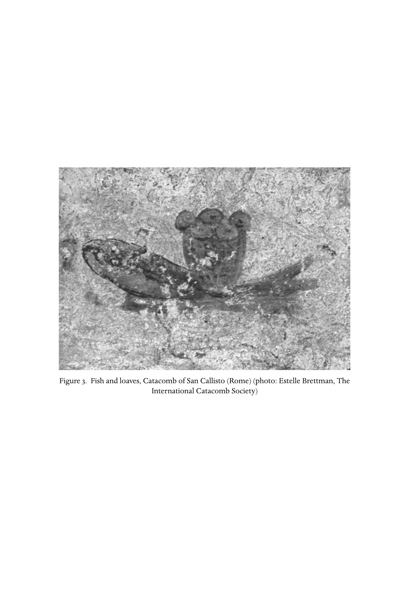

图3：鱼与饼，罗马圣卡利斯托地下墓窟。摄影：Estelle Brettman，国际地下墓窟协会（The International Catacomb Society）。

## 脚注

[^ch06-1]: 福音书本身匿名，但末尾题记（21:24）暗示，它出自“耶稣所爱的那门徒”。至二世纪晚期，教父将文本归于约翰（Iren. Haer. 3.1.1；亚历山大里亚的克莱孟，转引于Euseb. HE 6.14.7）；不久，人们又把他等同于西庇太之子约翰。对观福音把后者列为耶稣亲近的同伴，John 21:2也简略提及他。这一归属值得怀疑，蒙爱门徒这个人物的作用仍有争议。辨认其身份的尝试，参Charlesworth, Beloved Disciple；传统的历史，参Culpepper, John；其文学功能，参Attridge, ‘The restless quest’。

[^ch06-2]: 书信之间的关系，参Brown, Epistles of John, 14–35。

[^ch06-3]: 尤其参Brown, Epistles of John, 47–115。

[^ch06-4]: 例如参Strecker, Johannine letters。

[^ch06-5]: 有些部分明显是后加的，尤其“行淫妇人段落”（John 8:1–11），但何时加入仍不清楚。

[^ch06-6]: 较早的意见，参Brown, Introduction, 206–10。

[^ch06-7]: 二世纪全部证据，包括P52的年代，近来研究见Nagel, Rezeption。Culpepper, John, 107–38简要概述了证据。

[^ch06-8]: 参Robinson, Priority；Berger, Anfang。

[^ch06-9]: Iren. Haer. 3.1.1.

[^ch06-10]: Haer. 3.3.4，转引于Euseb. HE 3.28.6。关于这些传说及爱任纽的重要性，参Culpepper, John, 123–28。

[^ch06-11]: Clem. Al. q.d.s. 42，转引于Euseb. HE 3.32.5–19，记述使徒约翰与以弗所地区一只“迷羊”的故事。

[^ch06-12]: 近来参van Tilborg, Reading John。

[^ch06-13]: 参Brown, Introduction, 19–206。

[^ch06-14]: 例如参Borgen, Logos；Tobin, ‘Prologue’；Boyarin, ‘Gospel of the Memra’。

[^ch06-15]: 最著名的倡导者是Bultmann, Gospel of John。亦参Schottroff, Der glaubende und die feindliche Welt。“诺斯替派”这一范畴已受到批判性审视。Williams, Rethinking ‘Gnosticism’强调宽泛概括的危险，但承认二世纪存在一些具有家族相似性的基督徒群体；他称之为“造物主创世论者”（demiurgic creationists）。King, What is Gnosticism?追溯这一范畴在论战及学术中的用法。一手材料参Foerster, Gnosis与Layton, Scriptures。

[^ch06-16]: Dodd, Interpretation尤其注意到这一点。英译本参Copenhaver, Hermetica。

[^ch06-17]: James H. Charlesworth长期主张二者有联系；参Charlesworth, ‘Dead sea scrolls’、‘Critical comparison’及Jesus and the Dead Sea scrolls。Ashton, Understanding, 232–7表示赞同。其他人仍持怀疑态度，参Bauckham, ‘Qumran’。诠释学上的相似性，参Clark-Soles, Scripture。

[^ch06-18]: 不过，与古卷具有相同教派立场的犹太人，也可能生活在散居地区；参Brown, Introduction, 199–206。

[^ch06-19]: Lattke, Oden全面论述了《所罗门颂歌》的相关研究。

[^ch06-20]: 可能的联系，例如参Taeger, Johannesapokalypse。

[^ch06-21]: 其中三份来自1945年发现的纳格·哈马迪科普特文文献集，第四份保存在柏林的一部科普特文抄本中。对观校勘版参Waldstein and Wisse, Apocryphon。

[^ch06-22]: Haer. 1.29；翻译及讨论见Layton, Scriptures, 163–9。

[^ch06-23]: 译文见Schneemelcher, NTApoc, vol. ii, 152–212。Junod and Kaestli, Acta提供新的校勘本与法译本。它与约翰传统的关系，参Koester, Introduction, vol. ii, 202–4。

[^ch06-24]: 最容易比较的文本是对观福音；不过，第四福音书很可能产生于一个其他耶稣叙事也在争取注意的时期，那些叙事如今只以残片保存。一般的福音书讨论，参Koester, Ancient Christian gospels；文本参Schneemelcher, NTApoc, vol. i。

[^ch06-25]: 争论史参Smith, John among the gospels；近来研究参Schnelle, ‘Johannes’及Denaux, John。

[^ch06-26]: Lang, Johannes。Dunderberg, Johannes在John 1–9的一个编修层中，发现对观福音的痕迹。

[^ch06-27]: Matson, Dialogue.

[^ch06-28]: 《约翰福音》与《多马福音》可能的联系，参下文注76。

[^ch06-29]: 文类的模糊性，参Attridge, ‘Genre bending’。

[^ch06-30]: 参Koester, Symbolism。

[^ch06-31]: Martyn, Gospel及其History and theology强调这一点。

[^ch06-32]: 例如Mark 15:39百夫长的宣告，就具有相当明显的反讽。

[^ch06-33]: 近来论述参Duke, Irony及O’Day, Revelation。

[^ch06-34]: 例如，第3章的尼哥底母误解“从上面／再次生”的意思，第4章的撒马利亚妇人也不明白耶稣所赐“活水”的性质。

[^ch06-35]: 例如参7:27对于认识耶稣来源所作的文字运用。众人声称知道耶稣来自哪里——加利利？——却坚持弥赛亚的来源将无人知晓，因而显出他们不知他源于天上。文本也可能在质疑读者预先认定耶稣来自伯利恒的看法。

[^ch06-36]: 例如，从加利利（第4章）到耶路撒冷（第5章），再到加利利（第6章），又折返（第7章）的表面行程，至少显得突兀，缺乏交代。

[^ch06-37]: John 14:31本可极好地过渡到18:1。14:31明显的结束语，常被用作根据，将第15–17章视为编修性增补。

[^ch06-38]: John 10:30：“我与父原为一”；14:28：“父是比我大的。”

[^ch06-39]: 耶稣作为“人子”，究竟不审判（原文引John 2:17），还是执行审判（5:22、27）？

[^ch06-40]: 复活是未来的现实（John 5:28–9），还是当下的现实（John 11:25）？

[^ch06-41]: 关于福音书来源与编修，最持久的理论是“记号来源”假说。参Fortna, Gospel of signs及Fourth gospel and its predecessor。其结论的简本见Miller, Complete gospels, 175–95。另一解释见van Wahlde, Earliest version。研究史的批判性回顾，参van Belle, Signs source。

[^ch06-42]: Brown, Community使这一发展理论的一个版本广为流传。其他理论参Bull, Gemeinde。

[^ch06-43]: 第21章位于20:30–31的题记之后，显然像一篇附录；不过，有学者认为它与前文具有整体关系。参Minear, ‘Original function’。

[^ch06-44]: 这种福音书观，参Kysar, John, the maverick gospel。布尔特曼认为，最后执笔的是一位“教会编修者”，他使福音书的已实现末世论等因素，与正在形成的正统相协调。

[^ch06-45]: 最初的复活显现（John 20）发生在耶路撒冷，门徒在那里受命从事赦罪的职事（John 20:22）。因此，和路加一样，耶路撒冷是复活后群体最初的中心。犹太地区的根源可能还更深。虽然腓利称耶稣为“拿撒勒人约瑟的儿子”（John 1:45），文本也暗示犹太地区是他自己的“故乡”。那些不接待他的“自己人”（John 1:11），尤其适用于“犹太地区的人”；但矛盾的是，救恩也从他们而来（John 4:22）。7:27中犹太地区之人的无知，或许还包括他们不知道耶稣也有犹太地区的来源，即伯利恒。

[^ch06-46]: “记念”似乎是这一群体的专门用语；参John 2:17、22；12:16。

[^ch06-47]: 约翰如何运用经书，参Daly-Denton, David；其圣经文本的确切形式，参Menken, Old Testament quotations。

[^ch06-48]: 这一称号见John 1:38，同时使用希伯来文rabbi与希腊文didaskalos；3:2、10；11:28；13:13–14；20:16再次使用希伯来文rabbouni与希腊文didaskalos两种形式。

[^ch06-49]: 这是本福音书思考耶稣最常见的方式。参4:34；5:23–4、30、37；6:38–9；6:44；7:16、28、33；8:16、18、26、29；9:4；12:44–5、49；13:16、20；14:24、26；15:21、26；16:5、7；20:21。

[^ch06-50]: 参1:45；4:19；6:14；7:40；9:17。背景尤其参Meeks, Prophet-king。

[^ch06-51]: 参1:41，其中顺便将这一称号译为Christos；4:25撒马利亚妇人的话中，也有同样译法。

[^ch06-52]: 参1:51；3:13–14；5:27；6:27、53、62；8:28；9:35，其中“上帝之子”是一个异文；12:23、34；13:31。福音书对这一称号的处理，值得进一步注意，参下文。

[^ch06-53]: 参1:18；其文本难题，见Ehrman, The Orthodox corruption, 78–82；1:34、49，等同“以色列的王”；3:16–18、35–6；5:19–26；6:40；8:35–6；10:36；11:4、27，等同Christos；14:13；17:1；19:7；20:31，等同“基督”。

[^ch06-54]: John 1:1、14。序言的基督论明显呼应神圣智慧这一形象（Prov 8；Sir 24；Wis 7），深刻影响了历代对本福音书的接受，但它并非福音书基督论故事的终点。

[^ch06-55]: 参2:14–16.

[^ch06-56]: 参John 4:14; 7:37–9.

[^ch06-57]: 参John 1:9；8:12。后一处及第7章的水意象，都出现于住棚节期间（John 7:2）；这个节日突出使用这两种象征。

[^ch06-58]: 节期循环依据Exod 23:14–17；Lev 23:3–44；Num 9:9–39，部分反映于下列顺序：安息日（John 5:9）；逾越节（6:4）；住棚节（7:2）；修殿节（10:22）。安息日显然是每周的节日，但在《摩西五经》的节期表中首先提及。

[^ch06-59]: Acts 8见证了撒马利亚传教，却把它作为复活后的事件。John 4则表明，撒马利亚人在耶稣生前就已成为门徒。这一说法可能属于马丁强调的福音书历史“重写底本”现象的一部分。

[^ch06-60]: 基督论主张的社会功能，参Meeks, ‘Man’。

[^ch06-61]: 参Rebell, Gemeinde；Neyrey, Ideology。Ashton, Understanding回顾约翰研究时，将约翰群体界定为教派，是其核心观点。

[^ch06-62]: John 9:22；12:42；16:2。这些文本指一次事件，还是一个漫长过程，尚不清楚。

[^ch06-63]: 批评把birkat hamminim视为一世纪拉比发展之假说，参van der Horst, ‘Birkat’；亦参上文第4章，以及下文第三部分第10章。对“雅夫内”历史真实性的更广泛批评，参Boyarin, ‘Justin Martyr’。

[^ch06-64]: Matt 23显示与当时会堂的摩擦，并预言迫害（Matt 23:34）。保罗与犹太同道的问题，明显见于其书信（1 Thess 2:14–16；Phil 3:2–11；2 Cor 11:24；Gal 5:11），也见于《使徒行传》戏剧化的叙事（13:45、50；14:2–5；17:5、13；20:19；21:27–36）。Rev 3:9明显呈现与会堂的竞争，以及“犹太人”作为自我身份认定所受的争议。不过，这些材料并未提到逐出会堂。

[^ch06-65]: 一个长期存在的问题，是耶稣的对手hoi Ioudaioi的身份；他们往往似乎与耶稣传道时的犹太地区环境特别相关，却也可能象征约翰基督徒在新环境中遭遇的反对。参Meeks, ‘Am I a Jew?’；Ashton, ‘Identity’；van Wahlde, ‘Johannine “Jews”’。

[^ch06-66]: 神不受苦或不受情感变动，是广泛流行的哲学假定。中期柏拉图主义的神学，参Dillon, Platonists, 128、155、280–5。

[^ch06-67]: 另参Wis 2:21–3:3：基于灵魂不朽的信念，否定苦难的意义。二世纪初的基督教出现了“幻影说”基督论。安提阿伊格纳提乌的重要证据，参Schoedel, Ignatius, 19–29。

[^ch06-68]: 参1 John 2:3–6; 3:15–17; 4:11–12.

[^ch06-69]: 参下文第7章。

[^ch06-70]: 例如参1 Cor 12:28中的各种职能角色，以及16:19中百基拉、亚居拉的“家教会”。

[^ch06-71]: John 10:3、27。这一母题在拉撒路复活（11:43）及抹大拉的马利亚认出耶稣（20:16）时，得到戏剧性展现。

[^ch06-72]: Quast, Peter对证据作了有益回顾。

[^ch06-73]: 正如“独生者”原在父的怀里（John 1:18）。

[^ch06-74]: Gal 2:6；Acts 15:13–21；另参Mark 6:3。雅各的角色，近来参Chilton and Evans, James。

[^ch06-75]: 这一点参Schenke, ‘Function’。关于狄低摩犹大多马，参《多马福音》1、13及《多马行传》。

[^ch06-76]: 近来几位学者在第四福音书中，发现了对“多马传统”基督教的批评立场。Riley, Resurrection将《约翰福音》强调复活的身体真实性，与《多马福音》没有明确肯定复活相对照。De Conick, Seek在《多马福音》中发现追求上升神秘经验的倾向，而《约翰福音》将耶稣视为启示所在，否定这种上升的可能。Pagels, Beyond belief将《约翰福音》隐含的权威主义——一切取决于耶稣——与《多马福音》认为每个人心中都可发现智慧相对照。Dunderberg, ‘John and Thomas’, 361–80提出怀疑性的批评。特定言论传统的个案检验，参Attridge, ‘“Seeking” and “asking”’。

[^ch06-77]: 作者问题，参Brown, Epistles of John, 14–35。

[^ch06-78]: 参Niederwimmer, Didache。

[^ch06-79]: 关系较远的一个例子，是《克莱孟一书》所见证的哥林多动荡。问题似乎在于，一批更年轻的领袖取代了上一代领导者；参1 Clem. 44。

[^ch06-80]: 自我界定的“正统”如何发展，参下文第三部分第13章。

[^ch06-81]: 近来研究参Menken, ‘Christology’。

[^ch06-82]: Matt 11:19; 1 Cor 1:24; Heb 1:3.

[^ch06-83]: 这类颂赞常见于被认为具有赞美诗性质的材料：Phil 2:6–11；Col 1:15–20；Heb 1:1–3。它们也见于宣信程式，例如1 Cor 8:6。

[^ch06-84]: 参Mark 13:26–7及平行经文；Matt 25:31–46。约翰文献中人子的总体讨论，参Moloney, The Johannine Son of Man。

[^ch06-85]: John 3:13–14; 8:28; 12:23–34; 13:31.

[^ch06-86]: Mark 8:31；9:31；10:33。认为本书对对观福音有所认识的论据之一，是突出运用人子母题的三次受难预言，形成了与对观福音、尤其《马可福音》的结构相似性。

[^ch06-87]: 坚持以专注的信仰目光凝视十字架，形成了将本福音书视为“神秘主义”文本的悠久传统。参Countryman, Mystical way；Kangaraj, ‘Mysticism’。

[^ch06-88]: 像保罗一样，福音作者也完全可以宣称，自己只知道基督并他钉十字架（1 Cor 1:23）。

[^ch06-89]: Käsemann, Testament曾著名地为这一判断辩护。

[^ch06-90]: 这一点的详细论述，参Schnelle, Antidocetic Christology。

[^ch06-91]: 总体讨论参Frey, Eschatologie。

[^ch06-92]: 参Matt 24–25; Mark 13; Luke 21; 1 Thess 4:13–18; 1 Cor 7:29–31; 15.

[^ch06-93]: John 2:17–21；8:15。然而，按John 5:22、27，父已将审判交给子。对这一主题的总体探讨，参Blank, Krisis。

[^ch06-94]: 参John 5:24–5; 11:25–6.

[^ch06-95]: 参John 5:28–9; 6:39–40, 44, 54; 11:24; 12:48.

[^ch06-96]: 例如参Haenchen, John 1, 259–60。

[^ch06-97]: Rom 6:1–11细致而克制地运用洗礼与死而复活的平行关系。未来盼望（第8节），以及对“新生命”的伦理理解（第11节），都十分清楚。Col 2:12–13更直接强调参与基督的新生命；但未来盼望仍然保留（Col 3:1–4）。保罗后继传统将末世语言用于当下经验的例子，参2 Tim 2:18；2 Thess 2:2。

[^ch06-98]: Gal 2:19–20；Phil 3:7–11；Rom 8:9–11有著名的颂述。

[^ch06-99]: 参Rom 8:18–30.

[^ch06-100]: 例如参Phil 3:12–16：紧接着肯定“在基督里”之后，又强调基督徒生活中“尚未”的因素。保罗批评哥林多人的自信（1 Cor 4:8–9），背后可能也有类似关切。

[^ch06-101]: 这一盼望经典地表达于Dan 12:1–3，却非人人认同，正如Mark 12:18及平行经文，以及Acts 23:6–8所示。犹太信仰的多样性，参Nickelsburg, Resurrection。

[^ch06-102]: John 15:5–10。上帝与遵守其命令的信徒相互内住这一主题，也呼应于1 John 2:24；4:12、16；5:3。

[^ch06-103]: 如此重视最初与启示之道的相遇，及由此流出的生命，可能吸引了二世纪“诺斯替派”基督徒。但他们与第四福音书一样，并未舍弃未来末世论。参Attridge, ‘Gnosticism’。

[^ch06-104]: 保惠师的角色，参Brown, ‘Paraclete’及Smalley, ‘“Paraclete”’。

[^ch06-105]: 1 John 4:17维持同样的末世盼望结构：过爱的生活，使人在“审判之日”有坦然无惧的信心（parrhēsia）。

[^ch06-106]: 1 John 2:7提及如今已成“旧命令”的这条诫命，尤其在4:7–5:4受到颂述。

[^ch06-107]: 参John 20:23; 1 John 1:9; 2:1.

[^ch06-108]: John 15:18–29；17:14。福音书一面宣讲爱，一面使用严厉谩骂，使它最严厉的批评者感到反感，例如Casey, Is John’s gospel true?。

[^ch06-109]: 参Matt 5:43–4; 22:35–40; Mark 12:28–34; Luke 10:25–8; Gal 5:14; Rom 13:8–10.

[^ch06-110]: 早期基督徒多样的禁食实践，参下文第7章。

[^ch06-111]: 这些祈祷有相同的呼求对象，即父，也有来临、荣耀／尊为圣，以及赐予等共同主题。

[^ch06-112]: John 3:22说耶稣施洗，4:2则说只有门徒施洗；这一差异可能源于编修。

[^ch06-113]: 参Mark 1:4; Luke 3:3; Acts 2:38.

[^ch06-114]: 参Rev 7:3; 9:4.

[^ch06-115]: 参Rom 6:1–4; Col 2:12–13

[^ch06-116]: 参Corpus Hermeticum 13.

[^ch06-117]: 一些解释者在福音书其他地方也发现洗礼暗喻，但大多数很难说明确。例子见Moloney, ‘Sacraments?’；Morgan-Wynne, ‘References’。

[^ch06-118]: 1 John 5:7呼应了血与水的联系。

[^ch06-119]: Bradshaw, Worship反对假定早期存在一种规范性的圣餐行为形式；McGowan, Ascetic eucharists讨论了头两个世纪圣餐实践的广泛多样性。

[^ch06-120]: Mark 14:22–5; Matt 26:26–9; Luke 22:15–20; 1 Cor 11:23–5.

[^ch06-121]: Did. 9–10的“圣餐”，同样没有设立圣餐的话。

[^ch06-122]: 参Borgen, Bread及其‘John 6’，也参Anderson, Christology。

## 译校说明

原书若干经文定位似有误植，例如正文的《民数记》第22章、约11:41、约13:31，以及脚注39和93的John 2:17与2:17–21等。此处依英文原书保留定位，未将推定的正确定位混入作者原文；需要引用这些经节时，可据所用圣经版本复核。


---

<a id="chapter-07"></a>

# 第七章 最早期基督徒的社会与教会生活

**作者：韦恩·A. 米克斯（Wayne A. Meeks）**

《剑桥基督教史》第一卷《起源至君士坦丁》中文译稿

> 原书第145–174页，PDF第194–223页。按原文完整翻译正文、引文与脚注解释；参考书目作者名、题名和定位保留原文。
>
> [第七章英文原文](<第七章 最早期基督徒的社会与教会生活（英文）.md>) · [原书PDF](<../01 起源至君士坦丁.pdf>)

<!-- 原书第145页；PDF第194页 -->

从拿撒勒人耶稣开始、最终形成多种形态基督教会的这场运动，以惊人的速度发展，从最初几年起就呈现多样形式。早期发展的绝大部分，我们已无从看见；学者试图勾勒其轮廓的尝试，必须审慎看待。不过，我们大体可以借用一位现代社会学家的话说：这场运动起初是一个犹太教派，不久就转变为希腊—罗马世界的一种宗教崇拜。[^ch07-1]这一演变并非单线发展。有些尝试失败了，其数量很可能超过我们所能知道的；另一些则被竞争群体压制。我们只能从这一过程的若干方面，拼接出片段图景：从加利利的开端，到复活节后的耶路撒冷群体，再到罗马帝国城市中的家庭会众，其结社的社会形式；典型归信者的社会位置；敬拜和仪式形式，以及正在形成的基督教亚文化的其他维度。

## 群体组织

<!-- 原书第145–146页；PDF第194–195页 -->

耶稣追随者带给古代地中海世界最深刻的创新，或许是一种新的宗教群体形式。阿道夫·冯·哈纳克在关于“基督教的传教与扩展”的经典研究中断言：到公元300年，“教会本身……仅凭它的存在”，就已取代使徒时代“传教者”的活动；教会之所以能够做到这一点，是因为它把自身激进而革命性的主张，转化为当地人看来“熟悉、渴望而自然”的形式。这一断言颇有道理。[^ch07-2]唯有与同时代社会现象比较，我们才能对早期基督教在其环境中的“自然性”和新颖之处有所认识。不过必须记住，比较的双方，都是依据稀少、时而偶然留存的证据作出的重构。

### 耶稣及其追随者

<!-- 原书第146页；PDF第195页 -->

关于耶稣及其追随者的最早传统，提供的图景既稀疏又往往相互矛盾。我们可以用几种不同模式来补充它。有些特征提示一种不免略带时代错置、可称为“政治性”的运动；也就是说，它主要由自身对罗马霸权所造成处境的回应来界定。[^ch07-3]传统中的其他要素，则呈现全然不同的图景：一位教师及其门徒圈子；[^ch07-4]另一些则像是在描写驱魔者与行神迹者的求助者和传播其名声的人。[^ch07-5]还有部分传统，似乎以犹太和圣经特有的先知色彩描绘耶稣，[^ch07-6]使他的追随者看起来像一场末世更新运动。这些不同模式不必相互排斥。

我们必须记住：材料中所有耶稣故事，都已经过他死后的重新解释；运动若要在他死后延续，这种解释便不可避免。不过，十字架事件本身，仍是历史研究耶稣周围群体的唯一稳固起点。[^ch07-7]这种处刑方式立即告诉我们，在一组关键观察者——罗马总督及其顾问——眼中，耶稣与追随者是什么样的人。一世纪犹太历史学家弗拉维乌斯·约瑟夫斯描述了数次运动，其领袖同样死于罗马当局之手；时间从公元6年犹太地区被编为叙利亚辖下的次级行政区，一直到66年起义前夕。约瑟夫斯曾是一支犹太叛军的指挥官，幸存之后成为弗拉维王朝的受庇护者；他并非客观观察者。在罗马人看来，他所描绘的这些运动有一点最重要：在一个危险地靠近帝国东部边疆的地区，它们威胁了罗马和平。

<!-- 原书第147页；PDF第196页 -->

约瑟夫斯用后来灾难所孕育的分类与敌意，描述这些骚动，因而很可能放大了其反罗马面向。他还力图将这些运动与犹太地区的本土贵族划清界限，并把自己算入贵族之列；这种意图也可能扭曲其描写。他称若干领袖为“强盗”（lēistai，例如AJ 18.7；20.121、160、163、167、172、185、186），也偏爱用这个词指称总督弗洛鲁斯治下起义的煽动者，例如BJ 2.434。福音书用同一个词称呼与耶稣一同被钉十字架的两人（可15:27；太27:38、44）；第四福音书还用它称巴拉巴（约18:40；亦注意10:8）。约瑟夫斯称另一些人为goētai，即“占卜者”或“骗子”，尽管承认他们自称prophētai，即“先知”（BJ 1.148–54；AJ 20.160、167–72、188）。他还说，有些领袖怀有称王的企图（BJ 2.57、60、444；AJ 17.272、273、278–85）。

约瑟夫斯关于失败起事的叙述中，反复出现几个因素，提醒我们不能轻易把“政治”与“宗教”分开。首先，那些吸引追随者、解释其目标的戏剧性意象，都呼应以色列往昔的神圣传统：将从旷野出发征服圣地（AJ 20.167）；约旦河将奉命开出干路（AJ 20.97）；摩西藏于圣山的会幕器具将被寻回（AJ 18.85–7）；城墙将奉命倒塌（AJ 20.170）。其次，这些起事因此具有末世性：对应过去的拯救事件，上帝将在近在眼前的未来直接、最终介入，改变社会秩序。第三，这些运动来自民众，由权威根植于传统和个人感召力，而非制度的人物领导。

这三个特征，都见于耶稣及追随者的早期传统。上世纪在犹太地区昆兰旱谷发现的教派文献所描绘的群体，也具有这些特点。尽管二者差异明显，我们在两种情况下所面对的，都类似现代人类学家所说的“更新”或“本土复兴”运动。一个传统社会刚经历社会、文化变化，通常是外来势力压在其上；这时，一位富有感召力的领袖召集追随者，实行某种变革方案。它取用该社会传统上界定自身的象征意象，却又以富于想象的方式重新组织，以应对当前危机。[^ch07-8]

<!-- 原书第147–148页；PDF第196–197页 -->

早期教会所记忆、传述的耶稣与门徒故事中，有若干因素很符合“更新运动”模式。一个十二人小组被特别选出，尽管传统对具体姓名存在差异，仍明显暗指雅各的十二个儿子及以他们命名的古代以色列支派，因而暗示某种恢复以色列原初身份的意图。耶稣“呼召”门徒的记述，以及归于他的那些强调打断职业与家庭生活、转而以行乞维生并四处游行的言论，都对应本土复兴运动中常见的否定阶段：与既定规范和模式决裂，为重新从过去想象出的理想文化模式腾出空间。这种巡回生活，也是约瑟夫斯所描写群体的特征，常使它们类似“社会性强盗”；[^ch07-9]昆兰群体退往犹太旷野，也是平行现象。基督教传统中聚焦耶稣与耶路撒冷及圣殿关系的要素——预言圣殿毁灭、“洁净”圣殿及“凯旋入城”——同样符合这一模式。

另外两种主要组织模式，即智慧教师带领门徒，以及驱魔或行奇术者拥有追随者，看来同样深植于耶稣传统。二者很容易都归入末世先知与更新运动的意象之下，因为“记号”和教导，包括自由运用“智慧”话语的形式，都是以色列经典先知形象的特征。不仅公元前八至六世纪那些神谕被搜集、保存为经书的先知，摩西与以利亚也都是典范。

与福音书所描绘耶稣自身的活动地点相对应，他的早期追随者似乎有两个活动中心：一个在大体属于乡村地带的犹太地区、加利利和撒马利亚诸村落；另一个在耶路撒冷。[^ch07-10]关于这个新教派如何在巴勒斯坦村落文化中立足，唯一的一手信息，来自耶稣给受委派者或“使徒”的指示。在那里，我们看见巡回先知摆脱地域和家庭纽带；而这些纽带，尤其在乡村环境中，通常决定一个人的身份：“狐狸有洞，天空的飞鸟有窝，人子却没有枕头的地方。”（太8:20；路9:58）“人到我这里来，若不恨自己的父母、妻子、儿女、弟兄、姐妹，甚至自己的性命，就不能作我的门徒。”（原文引路14:16；参太10:37）另一方面，他们又必须依靠所受差遣要去的村民维生，向他们宣讲上帝统治的消息，参可6:8–11及平行经文。

<!-- 原书第149页；PDF第198页 -->

自然，到这些传统被收入书面福音书时，这幅图景已在某种程度上理想化。不过，四处游行、靠施舍维生的先知或使徒，显然在耶稣教派向犹太与撒马利亚村落的传播中，发挥了重要作用。他们的传教之所以可能，是因为他们与村民共享一种文化：它不仅包括门徒用来解释耶稣生平的神学信念、经书和传统，也包括门徒自己扮演的、社会所熟悉的先知角色。但材料并未清楚告诉我们，当先知的消息得到接受时，村中究竟形成了何种组织群体，或是否形成了群体。大概在那里也像城市一样，新弥赛亚的拥护者会聚集于家中祈祷、相互劝勉、举行仪式性聚餐；领导权显然主要掌握在巡回者或其地方代表手中。若干早期基督教文献，最明显的是《马太福音》与《十二使徒遗训》，见证了地方领袖与巡回领袖之间的冲突。

### 耶路撒冷

<!-- 原书第149–150页；PDF第198–199页 -->

《使徒行传》和保罗较早的书信，呈现出一个以耶路撒冷为中心的群体，比刚才描述的乡村运动显得稳定得多，也更有结构。领导方式仍较为非正式，“使徒”数目不确定（加1:17、19；将此称号限于十二人，是较晚的系统化处理；参林前15:4–7）。《使徒行传》还谈到“长老”（徒15:6、22），使人想起地方犹太组织。[^ch07-11]然而，某些个人行使特别的权力：首要的是彼得，即矶法（加1:18；2:9；徒1:13、15；2:14、37；第3–5、10章；15:17）；他常与西庇太的儿子雅各和约翰并列（可5:37；9:2；13:3；14:33；保罗在加2:9所说的“柱石”，或许就是这三人）；另有“主的兄弟”雅各（加1:19；2:12；徒12:17；15:13；21:18；参《多马福音》12）。雅各在运动中掌权，与较早传统所说耶稣近亲对他怀有敌意，形成对照（可3:31–35及平行经文；约7:3–5）。《使徒行传》描绘一个组织严密、实行财产共有的教派（2:44–45；4:32–37；5:1–11），某些方面像哲学学派，却又公开表现犹太虔敬，尤其在圣殿中，并在许多方面类似法利赛人。这幅图景的重要部分，很可能出自理想化，以及《使徒行传》作者特定的护教与神学目的。实际上，对于耶路撒冷最初基督徒群体采取的形式，我们能确定的很少。然而，对下一阶段基督教发展的决定性转变，即移向以色列地以外的城市，它们必定至关重要。

### 城市与殖民城

<!-- 原书第150页；PDF第199页 -->

《使徒行传》一句简短的话，是我们了解一种城市性、兼容性传教如何开始的唯一实质线索；这种传教确立了基督教扩展的模式：

> 那些因司提反事件所引发的迫害而四散的人，一直走到腓尼基、塞浦路斯和安提阿，只向犹太人讲道。但其中有些塞浦路斯人和昔兰尼人，来到安提阿，也向希腊人讲道。（徒11:19–20）

司提反的圈子，被认定属于耶路撒冷基督徒群体中称为Hellēnistai的一翼（徒6:1）；也就是来自耶路撒冷讲希腊语的犹太人中的归信者，其中许多人很可能在散居城市长大，后来迁回犹太地区，参6:9。[^ch07-12]假如这一记述在历史上可靠，那么，有意识地面向外邦人的传教，就是由这些讲希腊语的犹太基督徒开始的；其起点，则是奥龙特斯河畔安提阿这座大都市。来自塔尔苏斯、曾为法利赛人的保罗，在归信后，也是在该城接受基督徒传教工作的历练。他更早前往纳巴泰王国，即加1:17的“阿拉伯”，那次尝试显然未获成功；参林后11:32–33，并注意，保罗在罗15:19概述的“周围”传教范围中，没有包括阿拉伯。按《使徒行传》，弥赛亚耶稣的追随者，也是在安提阿首次被称为Christianoi，即基督徒（徒11:26）；这个称呼很可能来自外人，他们此时已认出，这是一个可与犹太主体社群区分的教派。

<!-- 原书第150–151页；PDF第199–200页 -->

我们知道，耶稣被处死后约十年内，基督教已传入其他若干城市，包括大马士革和罗马；依据后来的证据，也可猜测埃及及北非城市很早就建立了基督徒群体。但遗憾的是，对于这些教会各自的起源，我们几乎没有，甚至完全没有可靠资料。只有保罗及其分布广泛的同工网络的传教活动，留下丰富的一手证据；这要归功于保罗和其门徒所写书信的保存，以及《使徒行传》作者给予保罗的中心位置。这些材料呈现三四十年间的密集努力，在小亚细亚中西部、马其顿和希腊贸易路线沿线的城市中，植下基督徒群体。假定其他地方的基督徒，也采取类似保罗圈子的策略，并发展相似社会形式，并非不合理；但当地可能还有许多我们一无所知的特征。

城市基督教策略的关键，是私人家庭。不仅《使徒行传》多次讲到某人与“他／她全家”一同归信（16:15、31–34；18:8；参10:1；11:14；约4:53），保罗也回忆自己为全家施洗（林前1:16；参16:15–16），并在书信中多次明确提到“某某家中的集会（ekklēsia）”（林前16:19；罗16:5；门1；西4:15）。然而，城市基督教运动的“基本细胞”，[^ch07-13]并不只是一个家庭聚在一起祈祷。有些群体形成于非基督徒主持的家户中，例如罗16:10、11、14、15列出的四组，更不用说familia Caesaris，即皇帝家属及其家内人员（腓4:22）。反过来，家长归信时，也并非家中每个人都必然成为基督徒；奴隶阿尼西母的事例就说明这一点（门8–21）。在罗马帝国早期，大量俱乐部和行会蓬勃发展，由一位较富有的家长充当其庇护者，并不罕见。有时，这样受庇护的宗教协会，会把家户的大部分成员纳入其中；例如公元二世纪初，庞培娅·阿格里皮尼拉在图斯库卢姆创立的著名狄俄尼索斯协会。[^ch07-14]另一些情况下，庇护人与受助群体没有直接联系，只因施惠而得到依附者回报的荣誉；例如，若干会堂铭文记载了异教徒的捐助，参路7:5。因此，基督徒“集会”的形成，遵循了熟悉的模式。[^ch07-15]

<!-- 原书第151–152页；PDF第200–201页 -->

不过，一世纪基督徒群体在若干方面，与罗马世界典型的宗教崇拜，以及工匠行会等自愿结社很不一样，尽管在其他方面颇为相似。基督徒虽发展了独特仪式，外人却不容易注意到。他们没有圣所、神庙、神像或献祭，也不举办公开节庆、音乐表演或朝圣。据我们所知，他们没有竖立可辨识的铭文。另一方面，加入其信仰所带来的社会后果，比加入常见诸神的崇拜深远得多。它意味着被纳入一个联系紧密的群体，经历重新社会化；这种过程要求忠诚取代自然亲属纽带，而在许多情况下也确实得到这种忠诚，同时要求服从一位上帝、一位主，排除参与任何其他崇拜。此外，这个人为组成的家庭，承担着通过持续道德教导与劝诫，使成员重新社会化的任务。若我们相信这场运动领袖的文字，几乎没有生活领域不受彼此关切。因此，教会结合了家庭、宗教团体、俱乐部与哲学学派的特征，却又不完全等同于其中任何一种。

基督徒宗教群体还有另一项特殊之处。家庭集会固然是基督教在希腊—罗马城市生活中的立足点，但每个由十来人构成的细胞，都不断被提醒：自己属于一个广阔得多的运动。“一位上帝的单一子民”这一观念，是这个教派继承自犹太教的自我形象。它通过两种方式得到扩展、强化，并具有实际形式。在神话叙事上，基督徒的弥赛亚观念取用《创世记》中创造与人类起源的宏大故事：起初如何，终末也必如何。因此，最早关于洗礼仪式的记述，充满乐园与堕落的暗喻：在基督里，受洗者重新披上亚当失去的上帝形象；在他里面，犹太人与希腊人、奴隶与自由人、男性与女性的原初合一得以恢复（参《加拉太书》3:27及以下；林前12:13；西3:5–15）。外邦传教之所以充满活力，其观念基础很可能很大部分就在这一神话叙事组合中。

<!-- 原书第152–153页；PDF第201–202页 -->

反过来，这项使命本身的实际需要，也强化了合一观念。罗马和平与罗马道路建设，加上更早时亚历山大及其继承者统治下，希腊语在帝国东半部城市的传播，使旅行和通信获得前所未有的便利。基督徒使徒充分利用这些条件；他们旅行时需要支持，也需要与已建立的教会持续联系并加以督导，因此发展出一个非同寻常的网络，由“同工”、受委派者和信使组成。无论真实署名还是托名的使徒书信，都成为基督教文学两种最重要文类之一。反讽的是，合一观念却常导致分裂：如果两个派别，谁也无法让对方接受自己那一版本的单一真理，就不得不分开。因此，分裂的历史，以及二世纪兴起的“异端”概念本身，反而见证了合一理想及强制实现它的实际动力。到了君士坦丁时代，这一动力最终产生遍及帝国的一套复杂制度，在某些方面映照着帝国自身的行省官僚体系。

### 教会“职分”的创设

<!-- 原书第153页；PDF第202页 -->

古代教会组织最重要、最独特的发展之一，是后来被称为“单一主教制”的建立：每个城市的基督徒群体，由一位主教治理。希腊文episkopos意为“监督”；他高于称为“长老”（presbyteroi）和“执事”（diakonoi）的其他教职等级。自二世纪起，运动重新传入乡村，城市主教原则上也主持依附该城的城镇、村落基督徒事务；希腊文称这种周边地区为chōra。然而，这一对教会未来形态如此重要的发展，极难详细追溯，其历史仍有争议。部分原因是，西方新教和天主教解释者数世纪的论战，对材料形成倾向性读法，现代历史学家难以摆脱；部分原因则是材料本身晦涩。这里仅能略触若干问题。

基督教运动虽倾向于创造地方及跨地方制度，却未因此及早实现结构统一，情况恰恰相反。从《新约》及其他早期文献对于组织的提及，我们得到的印象是：存在相当多样性和尝试，也经常发生冲突；不仅不同人物和群体之间冲突，不同权威模式之间也发生冲突。例如，权威来自社会地位的人，像主持家庭群体的家长和庇护者，可能与依靠恩赐的人发生冲突，如本地或来访的先知（例如林前第12–14章；《约翰三书》）。地方领袖可能与巡回者冲突，而不同的巡回“使徒”，所教导的信念和行为形式也可能很不一样（例如《遗训》第11–13、15章）。

<!-- 原书第153–154页；PDF第202–203页 -->

早期基督徒群体常被拿来与众多自愿协会比较。那些协会的铭文呈现出五花八门的职务名称，最常仿效市政职位，如prytanis，即“主席”、财务官、书记、decuriones，即“市议员”、quinquennales，即“五年任期的官员”等；但最早基督徒群体并没有相应证据。我们确实听说，马其顿的腓立比有episkopoi和diakonoi；保罗在给当地教会、应定于六十年代的书信中，向他们致意，仿佛他们是可区分的地方职事人员（腓1:1），却没有透露其职责。[^ch07-16]

三种教职等级首次得到清楚区分，是在图拉真时期写成的安提阿伊格纳提乌书信中。伊格纳提乌运用这些书信，以及前往罗马途中对各教会的访问，甚至将自己迈向殉道的行程精心戏剧化，[^ch07-17]以倡导主教在中心位置发挥统一作用。然而，《教牧书信》，即《提摩太前后书》和《提多书》，大多数学者认为写于伊格纳提乌同时或略晚，其虚构的地点设置也与伊格纳提乌致函的地区重叠，其中主教与长老却尚未清楚区分（提前3:1–7；5:17–22）。这些及其他材料清楚表明，单一主教制度并非各地同时建立，也不是毫无抵抗就形成的。

现代教会史家，通常把对主教制度的抵抗，理解为“恩赐性”与“制度性”权威冲突的一个例子。这种冲突的经典描绘，见于早期教会实践手册《十二使徒的教导》；人们通常按其希腊文标题的第一个词，称为Didache，即《十二使徒遗训》。《遗训》第11–13章着手规范地方会众如何接待巡回“使徒”和“先知”。随后，15.1–2使用与《教牧书信》极相似的语言，规定选立“主教和执事”，解释说：“因为他们也为你们履行先知和教师的职事。”受选立的职事人员，应得到与巡回者同等的“尊重”。这类“正式”权威，与较少受规范的权力模式之间，确实存在冲突。后者由这样一些人行使：他们要求得到聆听，是因为听众相信，他们以特别方式承载神圣之灵，而与任何正式选任机制无关。马克斯·韦伯正是依据十九世纪晚期教会史家所理解的这种冲突，建立了他著名的支配模式社会学类型学。[^ch07-18]

<!-- 原书第154–155页；PDF第203–204页 -->

然而，从“恩赐性”到“日常化”或“常规化”的权威结构，并不存在单一演变路线。正如已经看到的，制度化与权威冲突，在基督教运动最初之时便已开始；在本卷讨论的整个时期，甚至很久以后，“恩赐性”人物仍以各种方式挑战逐渐形成的主教结构。最明显的例子，是二世纪晚期的孟他努主义运动，以及迫害期间给予“认信者”的特殊权利；后者在三世纪中期德修的迫害中达到高潮。[^ch07-19]而且，冲突界线并非总划在主教与恩赐人物之间，因为会众以欢呼推选主教的原则，意味着一位有强大民众支持的人，也可能被提升到该职位。[^ch07-20]当然，赢得民众支持的未必只是宗教感召力，也可以是其他恩惠。从城市基督教起步时，庇护者对于建立、庇护会众就十分重要；要提供这些服务，他必须具有一定经济和社会地位。随着时间推移，主教既与平信徒庇护者并肩服务，也逐渐代行其角色，这是自然的发展。三世纪教会有这样的实例：某些人本来就因财富与地位而具备充当庇护者的条件，后来被提升为主教；他们确实利用财富和人脉控制自己的教会，其方式在普通罗马社会中相当常见。[^ch07-21]

中央权威发展的主要原因之一，是需要控制偏离规范的行为与信念。偏离尤其具有威胁性，不仅因为群体相对弱小，也因为这场运动为自身提出普遍性主张。基督教运动最初几十年，处理分歧只能依靠非正式、临时的方法。偏离者个人，会在家庭集会中受到其他个人的劝说与责备，包括“先知”“使徒”及其他领袖。最严厉的制裁，是其他基督徒回避他，尤其禁止他参加共同聚餐，或将他完全逐出群体（林前5:1–13；太18:15–18；帖后3:14–15）。当然，也有人以通过超自然手段造成身体伤害相威胁（林前11:30；徒5:1–11；启2:22–23；参林前5:5）；但基督徒有组织、经常性地使用强制力量压制偏离，要等到君士坦丁以后与国家权力结盟时才出现。

<!-- 原书第156页；PDF第205页 -->

比起普通成员的偏离，领袖间的分歧对群体稳定更具威胁；成功处理前者，反而可能增强凝聚力。但处理领袖分歧的办法更难找到。基本可用的只有劝说与影响，主要借助熟悉的希腊—罗马修辞，在amicitia与clientela的关系结构中运作。前者是“友谊”，即地位相当者之间的互惠；后者是庇护—依附关系，即社会上位者与依附者之间的互惠。保罗的《加拉太书》和《哥林多后书》第10–13章，是运用修辞劝说与抨击，争取人们忠于一组领袖而非另一组的经典实例。有分歧的领袖之间，协商有时成功（加2:1–10；徒第15章），有时失败（加2:11–13；启2:21）。

未解决的分歧，通常导致意见不同的领袖及其追随者彼此分开。有时，这种分离是友好的、按职能划分、并通过正式“契约”实现的，如耶路撒冷会议（加2:9）。更常见的结果，则是基督教运动分裂，即“分党”（约壹2:19）。正如已见，最早城市会众，是在私人住宅聚会的小型协会；因此，只要拒绝让其他群体的代表进入家门，便可实现这种分裂。这些代表，就是推动教会跨地方发展的主要行动者，即巡回“先知”和“使徒”（《约翰二书》《约翰三书》）。

## 社会地位

<!-- 原书第156页；PDF第205页 -->

二世纪晚期，一位名叫塞尔苏斯的哲学家，写了一部篇幅很长、掌握资料颇多的反基督教论著。他的一项主要批评，是这场运动只吸引没有受教育的人：“奴隶、妇女和小孩子”，以及从事受鄙视行业的劳动者（Origen, C. Cels. 3.44）。这是异教作者对新崇拜常见的指责，基督徒护教者也经常反驳。[^ch07-22]然而，在该世纪初，小普林尼已忧虑地指出，“各个等级”（omnis ordinis）的人，都有被告发为基督徒的危险；一个世纪后，北非的德尔图良骄傲地呼应这一判断（Apol. 37.4）。事实上，基督教在古代社会结构中的位置，既复杂又多变。

### 早期基督徒的社会层次

<!-- 原书第157页；PDF第206页 -->

耶稣的追随者常被称为“农民”，但这种用法很不精确；这个词最直接、最简单的意思，是“主要活动为亲手耕种土地的自由男女”。[^ch07-23]福音传统把耶稣本人描绘为tektōn，或tektōn的儿子（可6:3；太13:55），因此出身于独立木匠或建筑工人的家庭。他的门徒中，有来自拥有奴隶和雇工的捕鱼家庭的儿子；其中一人是“税吏”（可1:16–20；2:14）。这个巡回团体的支持，来自显然有一定财力的妇女，其中包括分封王一位管事的妻子（路8:2–3）。在城市中，正如已经看到的，家长的庇护不可或缺；其中有些人拥有财富，甚至具有市政地位，例如哥林多的该犹和以拉都。信徒中既有奴隶，也有奴隶主。

因此，早期基督徒群体的社会地位范围，似乎几乎重现了整个社会，只缺少两端：一端是罗马贵族，另一端是农业和矿业奴隶，以及无地农民。基督徒的社会构成若有什么特别，恰恰就在于这些不同层次，混合于如此亲密的群体中；虽然正如已经看到的，许多地方仍努力在群体内部维持等级感。而且，有些证据表明，许多被基督教吸引的个人，尤其后来成为领袖者，本身就混合了不同地位指标。保罗传教圈，是这场运动中我们唯一拥有实质证据的圈子；其中那些重要到足以在书信或《使徒行传》中被辨认的个人，通常具有不一致的社会地位。也就是说，他们在财富或教派内声望等指标上位置较高，却在其他方面位置较低，例如出身奴隶、财富来自商业，或因其为女性。[^ch07-24]早期基督教书信及其他劝诫文学中更一般的陈述，使我们感到，大批归信者是自由商人或工匠；有些人相当富裕，许多人却可能将自己认同于“穷人”。这里不只是贫穷劳动者，即希腊文penētes，也包括一无所有者ptōchoi。早期基督教格言与劝诫，常常维护他们的权益，如同犹太智慧文学过去所做的一样。

<!-- 原书第157–158页；PDF第206–207页 -->

例如，《雅各书》斥责有些基督徒，想尊敬穿华丽托加袍、戴贵族金戒指的来客，却轻视走进集会的一个ptōchos：

> 上帝岂不是拣选了世上那些ptōchoi，使他们在信上富足，并承受国度……吗？岂不是富人欺压你们，把你们拉到法庭去吗？（雅2:1–7）

生活较宽裕的基督徒，负有照料穷人的义务。这在犹太社群中已经为人熟悉，基督教作者也频频敦促。按照保罗的记述，耶路撒冷使徒加给外邦基督徒群体的唯一要求，就是“记念穷人”（原文引加2:9）。他竭力兑现承诺，从自己建立的教会筹款，帮助“耶路撒冷圣徒中的穷人”（林前16:1–4；林后第8–9章；罗15:25–28）。不过，他显然不仅将此视为慈善，也视为各教会之间公平（isotēs）的表达，尤其体现外邦基督徒与耶路撒冷母教会之间的团结。《使徒行传》同时借用古典友谊传统，以及《申命记》关于以色列在旷野的图景，描绘耶路撒冷使徒领导下财物共有的理想群体（徒4:32–35）。最终形式可定于二世纪中期的《十二使徒遗训》，保留了这一理想：“不要拒绝有需要的人，要与你的弟兄分享一切，不要说是你自己的。”（4.8）但它在另一处也流露某种务实的疑虑：“让你的施舍在手中捂出汗，直到你知道要给谁。”（1.6）约公元175年，哥林多主教狄俄尼修赞扬罗马教会，是“各个城市”基督徒的施惠者，帮助穷人，甚至援助被判入矿山的弟兄（Eusebius, HE 4.23.10）。琉善对于一度做过基督徒的佩雷格里努斯·普罗透斯的讽刺，也见证基督徒素来照料患难中的弟兄（De mort. Peregr. 12–13）。据报，三世纪中叶，罗马本城的正统教职人员，就援助着1,500名贫困者；哥尼流的报告，见Eusebius, HE 6.43.11。

<!-- 原书第158–159页；PDF第207–208页 -->

至少对于基督教运动领袖的社会层次，我们还可以从其现存著作的风格，推断若干证据。风格差异极大。在《新约》中，一端是《启示录》不合规范的语法，以及《马可福音》粗糙却并非毫无艺术的并列句法；另一端，则是《路加福音—使徒行传》精心写成的圆熟长句序言，以及《希伯来书》和《彼得前书》更为精致的修辞。保罗显示出熟练的语言能力，对修辞与哲学的惯用论题有所认识，也有很强的天然修辞效果感。然而，他的书信没有当时学堂中逐渐流行的阿提卡式高雅文体痕迹；他是否接受过高等阶段的正式教育，仍值得怀疑。[^ch07-25]人们把早期基督教文学风格，与医学、药学等“专业”手册、哲学学派的“劝诫论说”，以及希腊小说等通俗文学相比，这颇有说服力。[^ch07-26]至二世纪晚期和三世纪初，已有若干受过高等教育、风格娴熟的基督徒从事写作：亚历山大里亚的奥利金和克莱孟、雅典的雅典那哥拉，以及拉丁文作者米努基乌斯·费利克斯和德尔图良。显然，随着基督教日渐成熟、根基愈稳，其社会层次也在向上移动。[^ch07-27]

如前所述，即使在一世纪，也有少数地位较高者受到基督教吸引。罗16:23称哥林多的以拉都为“城内财务官”；他很可能就是若干年后，作为当选该殖民城市政营造官的回报，出资铺设剧场广场的那个人。[^ch07-28]那部后来以《路加福音》和《使徒行传》之名收入正典的两卷作品，其作者将作品献给自己的庇护者提阿非罗，并称其为kratistos，即“最尊贵的”，相当于拉丁文egregius。提阿非罗显然是一名基督徒或慕道者（路1:1–4）。作者用心描绘基督教如何吸引地位高者的好感：帖撒罗尼迦和庇哩亚的“尊贵”人物，尤其妇女（徒17:4、12）；塞浦路斯总督、元老士求保罗（13:12）；雅典“亚略巴古议员”狄俄尼修（17:34）；以弗所的亚细亚首领（19:31）；当然还有保罗本人，尽管来自行省、又是犹太人，却被描绘成生来具有罗马公民身份（原文引16:37–6；22:25–29；25:10–12）。我们虽可能怀疑作者有所夸大，却不大可能认为这些报道全属捏造。

## 敬拜与仪式

<!-- 原书第159–160页；PDF第208–209页 -->

正如已见，早期基督徒群体类似罗马帝国城市中常见的其他自愿协会：丧葬社团、工匠和职业俱乐部、哲学学派、宗教协会及移民团体，尤其那些像基督徒一样在私人家中聚会的团体。也如前述，最初几十年，这场新运动没有公共宗教的种种外在设施与排场：圣所或神庙、神像、献祭、专业祭司、游行和节庆。但一世纪观察者可能用来与基督徒群体比较的大多数俱乐部，都实行许多我们会称为“宗教性”的仪式，通常还明确呼求不同神明。同样，从最早有清楚证据的时刻起，弥赛亚耶稣的信奉者也发展出自身的仪式实践：既塑造、强化这场运动多样而具体的生活与信仰形式，也帮助它与其他群体区分，并将界定自身的重要时刻与日常惯例分开。

其中两项实践，见证如此广泛、如此早，以致可以毫不夸张地说，它们是这场运动的构成要素：一是以水浴为中心的入教仪式，希腊文称baptismos，即“浸入”；二是共同聚餐，最初称“主的聚餐”（kyriakon deipnon，通常译为“主的晚餐”），后来依据一段逐渐成为核心固定程式的祈祷，被称为“感恩”（eucharistia，即圣餐）。虽然两种仪式都经常被提及，直到四世纪，我们才有对其完整实践的全面描述。而且，有充分理由认为，各地及基督教不同圈子的做法差异很大。因此，对于头两个世纪这两项基本仪式，只能勾勒出片段图景。

### 洗礼：入教仪式

<!-- 原书第160–161页；PDF第209–210页 -->

正如名称所示，洗礼的中心行为，是沐浴或洗濯。因此，二世纪中期的游斯丁，可以将整个仪式称为“沐浴”（loutron；1 Apol. 1.61.4、12；62.1）。更早一个世纪，保罗在对该仪式最早的提及之一中，便说：“你们已经洗净了。”（林前6:11；参弗5:26；来10:22）最早材料没有告诉我们，具体在何处、如何洗濯。它能在比喻上等同于埋葬（罗6:4；西2:12），提示可能是全身浸入水中，这便类似犹太仪式浴。一部汇集不同传统的四世纪文献，是现代学者重构出来的；直到最近，它还被认定为已经散佚、归于罗马希波吕托斯的《使徒传统》。其中以浸水为规范。[^ch07-29]《十二使徒遗训》反映的做法，或许早在二世纪初就存在，很可能在叙利亚；它也假定浸水通常是标准，却允许在水不够浸入时，把水三次浇在头上（7.3）。后一种安排想必相当常见，因为它与罗马地下墓窟，以及三世纪以后石棺上大多数早期洗礼艺术图像相吻合。我们所知最早可辨认的基督徒聚会建筑，位于幼发拉底河畔杜拉欧罗波斯，年代为三世纪早期；其中洗礼池太浅，无法全身浸入。[^ch07-30]显然，各地实践不同；领袖即使希望用动作模仿神学比喻，实际便利往往也会占上风。

在仪式语境中，“洗濯”暗示一组以“洁净”与“不洁”对比为主导的比喻。犹太人、希腊人和罗马人的古代宗教，常用这种对比划定神圣空间的边界，进入前必须洗净；准备加入秘仪崇拜的人，也会在此前若干天接受涉及水的预备仪式。[^ch07-31]但对早期基督徒而言，洗礼并非入教的准备，它本身就是入教。其首要功能，不是划分地点和时间，而是划出社会边界：群体与“世界”的分界。基督徒群体把整个入教功能赋予洁净仪式本身，又把入教变成进入一个排他群体的决定性关口，由此创造了新事物。对他们而言，沐浴标志着“洁净”群体与“污秽”世界之间一道持久门槛；“洁净”又像犹太传统中常见的那样，等同于“圣洁”。受洗者如今必须在行为中显出“圣洁”，不能“像那不认识上帝的外邦人”，“因为上帝召我们，本不是要我们沾染污秽，乃是要我们成为圣洁”（帖前4:5–7；参林前6:11；12:2；加4:8；彼前2:12；4:3）。犹太的tebilah，即浸洗，几乎可以确定是基督徒入教水浴的最终原型，但中间经过两次转化：第一次，是施洗约翰的末世仪式，戏剧性地表达全以色列必须洁净，以预备迎接即将到来的上帝统治；第二次，则是与耶稣故事的联系。[^ch07-32]

在仪式体系中，“洁净”与“圣洁”不一定涉及道德评价；但用它们代表道德正确，或以道德健全作为仪式洁净的必要前提，却十分常见。约翰同时代的人，显然把他的洗礼理解为融合仪式与道德。最早关于约翰的记述，称他的行为为“悔改的洗礼，使罪得赦”（可1:4；路3:3；徒13:24；19:4；参太3:2、11和Josephus, AJ 18.116及以下）。

<!-- 原书第162页；PDF第211页 -->

基督徒洗礼也常与悔改、赦罪相联，意味着某些哲学圈子所称的“归正”那种根本生活转变（路24:47；徒22:16；26:20；《巴拿巴书》11.1；Justin, 1 Apol. 61；《多马行传》132）。[^ch07-33]不过，至少按《使徒行传》，新的基督徒群体成员谨慎地区分“奉主耶稣的名”的洗礼与约翰的洗礼（徒19:5）。“奉〔主〕耶稣〔基督〕的名”这一程式，使用得很早，也很广（林前1:13；徒2:38；8:16；10:48；《遗训》9.5）。不久，它扩展为三重程式：“奉父、子、圣灵的名”（太28:19；《遗训》7.1；Justin, 1 Apol. 61.3；《多马行传》49、121、132、157；《彼得行传》，据Actus Vercellenses抄本，第5节；亦参更早的林前6:11）。

四部正典福音书中，三部记述耶稣自己受约翰的洗，但直到二世纪初，这件事才明确与基督徒洗礼联系起来。伊格纳提乌说，耶稣受洗，“是要以自己的顺服〔或受苦〕使水洁净”（Ign. Eph. 18.2）。反倒是耶稣的死，最早便清楚地与洗礼相联系（参可10:38；路12:50）；洗礼可被等同于与基督一同死而复活。书信回顾洗礼时，以类比语言表达这种等同：“像基督从死里复活……我们也……”（罗6:4）；也用参与的语言：“我们受洗归入他的死”（罗6:3）；并使用带syn-，即“同”此前缀的复合动词（罗6:4、8；西2:12–13；弗2:5–6）。这个主题的一种变化，将归信者受洗前的状态本身描绘为死亡；洗礼便是死亡之死、生命的开始（西2:13；弗2:1、5）。

由洗礼中与基督同死同复活的观念，再进一步，就容易把受洗者视为“重生”（约3:3–5；多3:5；彼前1:3；Justin, 1 Apol. 61.3；Herm. Sim. 9.16.4；《多马行传》132）。因此，早期基督教艺术描绘洗礼，通常把入教者画成儿童。在某些圈子，保罗书信提供了最充分证据，洗礼前脱去衣服，象征与基督同死，即脱去“旧人”（anthrōpos）、“肉体的身体”及与它相联的诸恶。脱去旧身体，可称为“基督的割礼”（西2:11），也就是相当于犹太教归信者割礼的基督徒仪式。而“穿上”的，是基督自己，是“照着创造他者的形象渐渐更新”的“新人”（西3:10）。

<!-- 原书第162–163页；PDF第211–212页 -->

保罗在腓2:6–11所引用的早期基督教诗歌，很可能有时用于洗礼情境。诗歌在高潮处描绘：天上、地上与地下看不见的权势，全都俯伏，承认“主就是耶稣基督”。新入教的基督徒，很可能也如此俯身宣认。这一宣认恰当地表达受洗者所经历的统治转换：从由邪灵权势、“世上元素”掌管的世界，转入“永生上帝”及其子基督所统治的领域。入教者从这位新主领受某些恩赐：圣灵，以及被收纳为上帝儿女的身份；对此，一个早期回应是“阿爸，父！”（加4:6；罗8:15）后来，洗礼之后又加上用油膏抹；二世纪晚期以后对此有广泛见证。《哥林多后书》1:21或许早已暗示这种做法，及其与领受圣灵的关系，参约壹2:20。按游斯丁的记述，到二世纪中叶，新受洗者会立即被带去参加圣餐（1 Apol. 65–66；参Plin. Ep. 10.96；《遗训》第7–9章）。

### 主的晚餐

<!-- 原书第163–164页；PDF第212–213页 -->

在古代，仪式化聚餐是社会与宗教生活中无处不在的一部分。然而，正如洗礼相对于其他仪式浴，成为一种新颖的入教典礼，“主的宴席”或“主的晚餐”（kyriakon deipnon），也发展出独特的象征与实践。聚餐是受过入教礼的归信者定期聚会的中心，地点在当地庇护者家中。《使徒行传》把“擘饼”列为受洗耶稣追随者的构成性实践之一（徒2:42、46；20:7；27:35；参路24:28–35）。邻人不会对此感到惊讶，因为各种自愿协会，都会在庄重场合聚餐，宴席总多少带有仪式性。上层男子的symposion，即“共同饮酒”的宴会，是古典希腊社会生活如此重要的一部分，甚至产生一种专门文学形式，至早期基督教时代仍很活跃。[^ch07-34]即使我们从拉比材料及今日实践所知的逾越节家宴，其形式也重现了这种宴饮的一般模式。[^ch07-35]任何外邦人读到路加描写耶稣与门徒最后一次逾越节聚餐（路22:14–38），都会认出一个典型的教师与男性学生共宴的场景；不过，所报告的席间谈话主题，至少可以说，很不寻常。希腊、罗马世界城市生活中如此常见的俱乐部，会定期聚集饮食；它们竖立的铭文，也常详细规定酒食供应与餐桌行为。[^ch07-36]

在神明面前进食，也很常见；稍具规模的神庙，都有餐室。私人若没有足够大的房子设宴，往往会邀请朋友到这些宗教设施用餐：“赫赖斯邀请你于明日十一日，第九时起，到塞拉皮斯神庙的餐室，参加主塞拉皮斯的宴席。”[^ch07-37]邀请甚至可以用神本人的名义发出：“神邀请你于明日第九时起，参加在托厄里斯神庙举行的宴席。”[^ch07-38]因此，“奉主耶稣之名”的宴席，本身不会比“主塞拉皮斯的宴席”更显奇特。

为“记念”（anamnēsis）死者而举行庄重聚餐（林前11:24–25；路22:19），也不会令人惊讶。希腊和罗马文化数世纪间，都有丧葬聚餐，以及在指定逝世纪念日举行的聚餐。犹太人进入希腊、罗马文化范围之前与之后，也都有大量类似风俗的证据。罗马帝国时代大量出现的丧葬社团，常把这种纪念聚餐列为提供给会员的福利。铭文还告诉我们，有些基金得到捐赠，专用于资助“作为记念”的宴席及其他仪式。[^ch07-39]

基督徒晚餐，不只是一般地记念耶稣，也纪念一个十分具体的场合。我们现存最早的聚餐描述，援引了追溯至耶稣本人的传统：“我从主领受、又传给你们的〔传统〕”，就是：

> 主耶稣在被交付的那一夜，拿起饼来，祝谢了〔eucharistēsas〕，就擘开，说：“这是我的身体，是为你们的。你们应当这样行，为的是记念〔anamnēsis〕我。”饭后，也照样拿起杯来：“这杯是用我的血所立的新约。你们每逢喝的时候，应当这样行，为的是记念我。”（林前11:23–25）

<!-- 原书第164–165页；PDF第213–214页 -->

单凭这段经文，还不能绝对确定：基督徒相聚举行纪念晚餐时，是否每次都诵述耶稣与门徒最后一夜的经过。但假定有这样的诵述，似乎最能直接解释保罗的话，以及对观福音中相平行、但更长的叙事。耶稣向门徒告别、被出卖和逮捕，以及死亡与复活的故事，很可能正是在这位被钉而复活之耶稣的早期门徒晚餐聚会中，经口头演述而成形。群体间实践的差异，也能解释现存不同版本故事之间的差别。学者付出巨大劳力与想象，仍未能消除这些差别，为我们还原晚餐及席间言语的“原始”形式。但有一点清楚：从这场新运动最初之时，人们就相信，晚餐重演耶稣自己与门徒的行动；洗礼则要晚得多，才与耶稣自己受洗的故事联系起来。

关于最后晚餐是否为逾越节家宴，传统有分歧。对观福音所代表的版本明确说是（可14:12–16及平行经文）；但耶稣本人就是逾越节祭牲的观念，也出现得很早（林前5:7）。最终产生《约翰福音》的那些圈子，在演述故事时，相应调整事件日程。其版本中，与门徒的聚餐发生在宰羊日的前夜，使耶稣恰好在献祭之时被钉十字架（约13:1–5；19:14；参19:36和1:29）。第四福音书的最后晚餐，没有饼和杯上的话语；但在关于“天上之粮”的米德拉什式对话（6:26–71）中，对晚餐的暗引大为增加。这些暗引在较早版本的喂饱众人神迹中，便已存在。饼与鱼的神迹，很自然地成为圣餐解释的对象；这大概解释了它何以在早期基督教墓葬艺术中如此流行。[^ch07-40]《十二使徒遗训》的感恩祈祷，将献给信徒的饼，等同于“原先分散在山上、聚集后成为一个的饼”（9.4；参约6:12–13）。[^ch07-41]

<!-- 原书第165–166页；PDF第214–215页 -->

早期的酒与饼，始终属于一顿完整餐食的一部分，不过它们相对于整餐的先后次序，似乎随地点与时期而变。使用《十二使徒遗训》的圈子，仍以完整聚餐庆祝圣餐，因为最后的感恩祈祷，要在“吃饱之后”进行；这里的动词与约6:12相同。但后来，饼与酒这两项象征要素，逐渐与聚餐分开。比提尼亚—本都行省总督普林尼向图拉真皇帝的报告，可能透露其中一个原因。普林尼说，他审问的基督徒素来“再次聚集进食，不过只是普通、无害的食物；但在我依照您的命令、禁止俱乐部而颁布告示之后，他们便停止这一做法”（Ep. 10.96.7）。有些地方，与圣餐分开的聚餐持续存在，或重新出现，但如今成为一项慈善活动，称为agapē，即希腊文的“爱”，也就是爱筵。不过，这一发展的证据远不清楚；若干常被视为指圣餐以外“爱筵”的文本，同样可以合理理解为指圣餐本身（犹12；Ign. Smyr. 8.2），只是强调与之相联的照顾穷人（Tert. Apol. 39.16）。

共同进食对人类群体如此基本，使仪式化餐食能承载极广泛的意义。在主耶稣宴席的早期记述中，有四组象征尤其重要。

第一，如前所见，聚餐是耶稣的“记念”。它重演他与门徒的最后一餐，也以更一般的方式记念他：重新呈现其故事的重要部分，并通过餐前、餐后构成框架的行动，戏剧性地使耶稣本人临在：“这是我的身体”；“这是我的血”。不过，焦点仍在耶稣地上生命的最后一天；因此，保罗概括刚才所引传统时说：“你们每逢吃这饼、喝这杯，就是宣告主的死。”（林前11:26）聚焦耶稣牺牲之死，后来成为西方教会圣餐象征与思想的特征；东方则更强调，复活升天的主，在宴席中与信徒同在。

第二，聚餐是感恩的场合。感恩对其形式如此核心，以致自二世纪早期起，人们通常以部分代整体，称之为eucharist，即“感恩”（例如Ign. Eph. 13.1；Phild. 4.1；Smyr. 7.1；8.1；《遗训》9.1、5；10.7；Justin, 1 Apol. 66.1）。这一名称，以及促成该名称的祈祷，本身也记念耶稣在最后晚餐（林前11:24；可14:22–23及平行经文）和喂饱众人的神迹中（可6:41；8:6及平行经文），为饼和酒所作的感恩（eucharistēsas）或祝福（eulogēsas）。不过，敬拜者如今感谢的，是他们通过耶稣所领受的恩惠（参Justin, 1 Apol. 65）。流传至今、最早可以确定的圣餐感恩祈祷实例，见于《十二使徒遗训》10.2–6。[^ch07-42]

<!-- 原书第166–167页；PDF第215–216页 -->

第三，共同聚餐，是上帝儿女组成的新家庭的集会。它庆祝他们“在基督里”的团结，也帮助标示这个家庭与世俗世界之间的边界。例如，保罗坚持，“祝福的杯”是有分于、或共同参与（koinōnia）基督的血；饼则是“有分于基督的身体”（林前10:16）。因此，参加神庙餐室的宴席——保罗称之为eidōleion，即“偶像庙”，戏仿前述邀请函中serapeion等名称——就等于“与鬼魔同席”（8:10；10:21）。[^ch07-43]而且，晚餐在群体共同生活中如此居于中心，以致对于行为不当者，禁止参加便成为严厉纪律措施（林前5:1–13；太18:15–17；参帖后3:10、14）。

第四，主的宴席预先体验末世的喜乐。最早传统所记忆的耶稣最后晚餐言语中，有这样一句：“我实在告诉你们，我不再喝这葡萄汁，直到我在上帝国里喝新的那日子。”（可14:25）保罗所引传统没有这句话，但他自己补充评论说，参与者吃晚餐，是“宣告主的死，直等到他来”（林前11:26）。他在书信结尾程式中加入的礼仪呼声：“我们的主，来吧！”（16:22），很可能也出自圣餐；《十二使徒遗训》即如此使用，也保留阿拉米语marana tha（10.6；参启22:20）。

### 其他仪式化行为

<!-- 原书第167页；PDF第216页 -->

除洗礼和晚餐外，文献还暗示许多较小的仪式化行为，伴随主要仪式，或出现在基督徒相聚的其他场合。有些如唱赞美诗、吟诵及诵念祝福或祈祷，在包括犹太教在内的许多希腊—罗马崇拜中，都有平行形式；另一些如诵读和解释神圣文本，则尤其接近会堂实践。此外，可以推想，基督徒很快发展出自己的婚礼、安葬与纪念死者方式，或许也将家庭生活中其他通常受到重视的场合，以特别方式仪式化；但对此，我们完全没有直接证据。我们距离早期基督徒聚会如此遥远，只能捕捉文字中偶然记录的片段；那些文本原本写给亲身熟悉整体情况的人。不过，这些零碎知识，至少提供起点，让我们想象早期基督徒以哪些不同方式，将信仰付诸行动。

#### 敬拜的诗歌

<!-- 原书第168页；PDF第217页 -->

与古代大多数宗教场合一样，吟诵与歌唱，在早期基督徒聚会中也很突出。《马可福音》告诉我们，最后晚餐结束，耶稣门徒前往橄榄山以前，“唱了诗”（可14:26）。在保罗传统的教会中，“诗篇、颂词和灵歌”是惯常内容（西3:16–17；弗5:18–20）。“诗篇”既可能包括圣经《诗篇集》中的部分作品，也可能包括仿其风格新作的诗歌，参林前14:26。昆兰文本也见证这两种实践；它们很可能在许多犹太圈子中都很常见，“颂词”和“灵歌”也是如此，若这几类确实能区分的话。[^ch07-44]当然，吟诵赞美自己神明的，不只是犹太人；罗马帝国不同族群也常使用相似形式。学者在《新约》及其他早期文献的许多段落中，辨认出早期基督教礼仪诗歌或其残片，例如腓2:6–11；约1:1–5、9–14。

祈祷同样结合自由表达与固定程式。[^ch07-45]即使主祷文，到一世纪末已逐渐成为基督徒每日规定的祈祷，在最早见证中也有三种形式：路11:1–4的短版；太6:7–13篇幅较长、措辞略异的版本；以及《遗训》8.2中以马太版本为基础、增加颂荣的变体。《遗训》还规定每天祈祷三次（8.3），使它成为基督徒对犹太每日祈祷的替代或补充。[^ch07-46]祈祷时使用几种姿势。站立、举臂、掌心向前的orans祈祷姿势，常见于希腊化墓葬艺术，用来表示虔敬；它无疑也常用于犹太和早期基督徒圈子。后来的基督徒解释者，认为它表现被钉十字架。[^ch07-47]跪下（徒7:60；9:40；20:36；21:5；弗3:14；参腓2:10），以及屈身或俯伏（林前14:25；参启4:10；7:11；11:16；19:4、10；22:9），也很常见，往往同时说出某种宣信程式：“主就是耶稣！”或颂荣：“荣耀归于上帝！”

#### 诵读、解释与劝勉

<!-- 原书第168–169页；PDF第217–218页 -->

对新归信者来说，熟悉犹太经书，以及弥赛亚耶稣的追随者解释这些文本的方式，显然是重新社会化、成为成员的重要部分。[^ch07-48]基督徒定期聚会，很可能包括诵读与阐释经书，即二世纪教会开始称为《旧约》的那些“著作”（graphai）。[^ch07-49]这一假定合理，但对于基督徒群体，以及他们推定的榜样——早期会堂——都缺乏早期直接证据，不过参路4:16–21；徒6:9；13:14–42。《提摩太前书》4:13要求专注“诵读、劝勉、教导”；若干年后，游斯丁说，星期日定期聚会时，会诵读“使徒回忆录”或“先知的著作”，随后由主持者“劝诫”（1 Apol. 67.3及以下）。游斯丁所谓“使徒回忆录”，指的是福音书。无疑，某些基督徒集会很早就开始诵读它们；事实上，口头演述耶稣故事与言语，可能正是福音书产生的途径之一。我们知道，更早以前，教会已诵读使徒及其他人的书信（帖前5:27；西4:16；启1:3；22:18及以下）。因此，我们可以在不止一种意义上说，诵读和解释文本，创造了经书。[^ch07-50]

#### 狂喜现象

<!-- 原书第169–170页；PDF第218–219页 -->

早期基督徒集会的一个特点，是相信上帝或基督之灵，既临在于群体中，也临在于个人成员里面，并在某些自发活动中直接显现。最富戏剧性的，或许是“说方言”（glōssais lalein，现代用语glossolalia即由此而来；林前12:10、28、30；13:1、8；14:1–40；徒10:46；19:6）。虽然《使徒行传》作者，将说方言合理化为一种即时翻译服务（2:2–13），保罗所处理的哥林多情形，却更像现代某些群体，包括五旬节派基督徒中常见的恍惚现象：当事人失去有意识的控制，不由自主地涌出话语；除了具有解释“恩赐”的人，旁人都无法理解（林前12:10；14:27及以下）。这种现象常伴随快速或突然的身体动作、大量出汗及其他失控的身体表现。然而，说方言虽然像是自发、反结构现象的典型，却发生在敬拜语境中，周围有仪式化行为环绕。保罗在《哥林多前书》中的指示，以及对现代说方言者的观察，都显示这一点。它在礼拜中可预期的时刻发生，通常由相当具体的言语程式和身体行动引发。熟练者甚至有能够诱发或终止恍惚的“触发词”；保罗似乎也假定有类似情况，因为他命令严格规定说话人数与发言时机（林前14:27及以下）。[^ch07-51]

《新约》将说方言与说预言并列（徒19:6；林前第14章多处）；但早期基督徒敬拜中，也常有其他圣灵“恩赐”（charismata）。因此，保罗例如会说：“你们聚会的时候，各人有诗歌，有教导，有启示〔apokalypsis〕，有方言，有解释！”（林前14:26）不应在这类狂喜行为与“仪式”之间划出截然界线。一方面，仪式化的言语与行动，为“被灵附身”的表现设定框架，甚至加以激发或控制；另一方面，那些被认为由圣灵赐下的言行，又给仪式化场合带来很大活力与说服力。

#### 圣洁的亲吻

<!-- 原书第170页；PDF第219页 -->

对于早期基督徒聚会中，可能穿插于仪式行为的身体姿势，我们几乎一无所知。例如，直到四世纪，才有在自己身上画十字的见证；[^ch07-52]不过，如前所见，有些人把举臂祈祷姿势解释为记念十字架。[^ch07-53]一个尤其有趣的例外，是“圣洁的亲吻”：我们现存最早的基督教文献已提及它（帖前5:26；亦见罗16:16；林前16:20；林后13:12；彼前5:14），此后更广泛可见，例如Justin, 1 Apol. 65.2；Athenagoras, Leg. 32.5.8；Clem. Al. Paed. 3.11.81–82；M. Perp. 21.7；Tert. Ad ux. 2.4.3。近来研究显示，在罗马社会，亲吻是近亲与恋人之间的惯常行为；这里是嘴对嘴的完整亲吻，并非现代教会的握手。基督徒把亲吻纳入自己的仪式语汇，不只是表示，也帮助创造一个替代性的家庭，即“上帝的儿女”。[^ch07-54]这种实践或许也助长了反对者有时对基督徒提出的乱伦指控。[^ch07-55]

## 基督教亚文化的兴起

<!-- 原书第170–171页；PDF第219–220页 -->

基督教起初敬奉的人物，是作为罗马秩序的敌人而被处死的；其经书和最初信念，又来自帝国被统治民族中的一个独特族群。因此，它从一开始就倾向于以反对“这个世界”的姿态呈现自己。与此同时，它适应罗马世界方式与形式的能力，却显示出惊人的多样性与灵活性。古代晚期形成的“基督教”文化，所携带“异教”祖先的基因，比特有的基督教变异还多。尽管如此，文化转变确实发生了；即使不是骤然完成，其规模也极其巨大。基督教在重塑希腊—罗马文化方面发挥了重要作用，无论我们多难精确界定这种作用。[^ch07-56]

### 帝国之内的帝国

<!-- 原书第171页；PDF第220页 -->

自基督教运动最初进入巴勒斯坦以外城市时起，基督徒个人的旅行就具有根本重要性：不仅把信仰传播到不同地方，也强化基督徒对自身的理解，认为自己是超越地方联系的群体。[^ch07-57]“好客”（philoxenia）是早期基督徒极为赞扬的美德，尤其要求主教具备（提前3:2；多1:8；罗12:13；来13:2；《克莱孟一书》1.2；10.7；11.1；12.1、3；25.1；Herm. Mand. 8.10；Sim. 9.27.2）；拒绝接待，则是一种社会控制手段（《约翰二书》《约翰三书》）。现存最早的基督教铭文之一，生动描绘了旅行、接待的重要性，以及由此产生的信仰普遍性感受所具有的力量。这是一位名叫阿伯基乌斯的人，于二世纪末在弗里吉亚的希耶罗波利斯立下的墓志。阿伯基乌斯或许是当地主教，参Euseb. HE 5.16.3；他自称“纯洁牧人的门徒”：

> 他差我到罗马，观看一个国度，见一位身穿金袍、脚着金鞋的王后；但我在那里看见一个拥有灿烂印记的民族。我也看见叙利亚平原与所有城市；渡过幼发拉底河之后，还看见尼西比斯。我到处都得到同伴；我的车中有保罗与我同行。信仰处处走在我前面，处处摆上食物：那来自泉源、至大而纯洁的鱼，由纯洁童贞女捕获。她不断把它给朋友吃；她拥有上好的酒，把它调和，同饼一起赐下。[^ch07-58]

<!-- 原书第172页；PDF第221页 -->

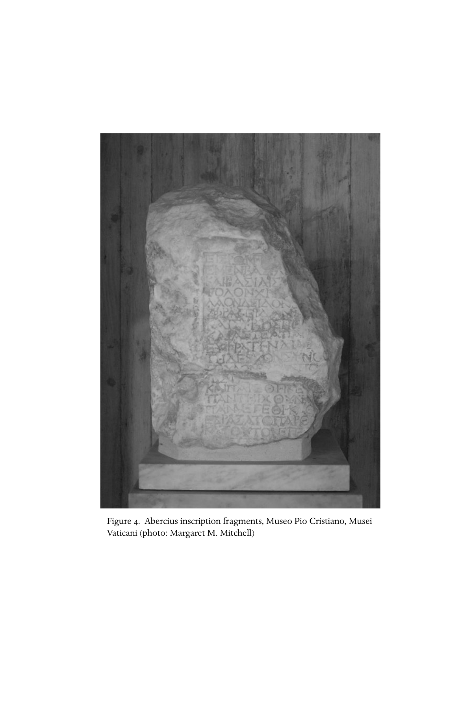

图4：阿伯基乌斯碑铭残片，罗马庇护基督教博物馆（Museo Pio Cristiano）。摄影：Margaret M. Mitchell。

<!-- 原书第171、173页；PDF第220、222页；跨图版页接续正文 -->

对于非基督徒，阿伯基乌斯的意象本会难以理解；但我们能清楚看见，这位旅行者“到处”发现“同伴”，他们庆祝圣餐、认识保罗，并分享他的信仰。这种经验如何强化了他对于单一“子民”与“国度”的宏大观念。铭文没有任何脱离现世的意味。[^ch07-59]除特别的基督教意象外，阿伯基乌斯使用一般墓志的惯常形式，包括警告任何被发现侵犯墓穴的人，须向罗马国库（fiscus）及故乡希耶罗波利斯缴纳罚款。在这里，我们瞥见正在形成的悖论：罗马帝国内的基督教帝国。它将在三世纪令德修及其继承者不安，也将使君士坦丁相信，有必要与这个奇异的新“国度”结盟。[^ch07-60]

<!-- 原书第174页；PDF第223页为空白页 -->

## 脚注

[^ch07-1]: Stark and Bainbridge, Future of religion, 113.

[^ch07-2]: Harnack, Mission und Ausbreitung, 526–7；引文由本章作者翻译。

[^ch07-3]: 注意，各福音书审判与十字架叙事中，“犹太人的王”这一称号的重要性。耶稣庄严进入耶路撒冷、抨击圣殿中的做法，以及预言圣殿毁灭并被取代的故事，也都明显暗示革命性因素。

[^ch07-4]: 把耶稣描绘为教师，尤其主导了《马太福音》。

[^ch07-5]: 例如参Mark 1:14–3:30的一连串故事。

[^ch07-6]: 例如John 6:14；Acts 3:22–6；Mark 14:65；以及归于耶稣言论的许多先知式审判神谕，如Matt. 11:20–4；21:22–46；Luke 6:24–6；Matt. 10:34–6。

[^ch07-7]: 尤其参Dahl, ‘Crucified Messiah’。

[^ch07-8]: 关于“更新”“复兴”“本土复兴”和“千禧年”运动的文献极多。早期经典之一是Wallace, ‘Revitalization movements’；另两个例子是Worsley, Trumpet与Burridge, New heaven。

[^ch07-9]: Horsley and Hanson, Bandits.

[^ch07-10]: 参上文第一部分第1章。

[^ch07-11]: Presbyteroi，即“长老”：CII 378、581、590、595、597、663、692；Lifschitz在1975年版的补遗中，650c、650d、653d、731f；Noy, Jewish inscriptions, vol. i: 59、62、71、75、148、149、157、163、181。关于gerousia与gerousiarchēs：CII 9、95、106、119、147、189、301、353、355、368、405、408、425、504、511、600；另参Frey的评论，第lxxxv页及以下；Mazar, Schwabe and Lifshitz, Beth She’arim, 141（vol. ii, 127–8）；Noy, Jewish inscriptions, vol. i: 18、23、76、87、163；vol. ii: 86、96、130、189、238、321、351、354、389、487、521、554、555。另参1 Macc 7:33；11.23；12:35；13:36；14:20、18；2 Macc 11:27；13:13；14:37；3 Macc 1:8；6:1；Judith 6:16；7:23；8:10；10:6；13:12。亚历山大里亚的gerousia：Philo, Flacc. 74；Josephus, BJ 7.412。耶路撒冷的情况：Josephus, AJ 12.138。

[^ch07-12]: 十九世纪及二十世纪初的研究，常假定“希腊语派”是一个有组织的派别，与“犹太基督徒”对立；双方冲突被视为推动早期基督教走向“早期大公主义”之“综合”的主要力量。对这一看法有说服力的反驳，参Hill, Hellenists and Hebrews。

[^ch07-13]: 这一说法来自Gülzow, ‘Die sozialen Gegebenheiten’, 198。

[^ch07-14]: IGUR 160; Vogliano, ‘La grande iscrizione’, 215–31; McLean, ‘The Agrippinilla inscription’.

[^ch07-15]: Meeks, First urban Christians, ch. 3；Klauck, Hausgemeinde und Hauskirche；White, Social origins。犹太社群的庇护者，参Lifshitz, Donateurs et fondateurs。

[^ch07-16]: Hatch, Organization, 36–51认为，episkopos和diakonos很可能借自自愿协会的职衔；但二词在俱乐部铭文中颇少见，即使出现，似乎也只指较次要职能。协会的内部组织，拉丁材料见Waltzing, Corporations professionnelles, vol. ii, 334–515；希腊对应材料见Poland, Geschichte, 327–423。

[^ch07-17]: 伊格纳提乌行程及书信的“戏剧性”，参Schoedel, Ignatius, 11页及以下与全书相关处。

[^ch07-18]: Weber, Theory of social and economic organization, 324–92.

[^ch07-19]: 参下文第四部分第21章及第六部分第28章。

[^ch07-20]: Did. 15；1 Clem. 44；Cypr. Ep. 55.8；另参Frend, Rise of Christianity, 403；Chadwick, Early church, 50、165。

[^ch07-21]: 居普良是一个突出例子。参Bobertz, ‘Patronage networks’及‘Development of episcopal order’。

[^ch07-22]: 例如Min. Fel. Oct. 36.3–7；Justin, 2 Apol. 10.8；Tat. Orat. 32；Tert. Apol. 37.4。

[^ch07-23]: MacMullen, ‘Peasants’, 253.

[^ch07-24]: Meeks, First urban Christians, ch. 2.

[^ch07-25]: 参下文第三部分第8章。

[^ch07-26]: 例如参Rydbeck, Fachprosa；Alexander, Preface to Luke’s gospel；Aune, New Testament in its literary environment；Aune, Greco-Roman literature；Malherbe, Paul and the popular philosophers。

[^ch07-27]: 参Eck, ‘Eindringen’，以及下文第三部分第14章。

[^ch07-28]: Kent, Inscriptions 1926–1950中的铭文232，第99页及以下、图版21；Meeks, First urban Christians, 58页及以下；Murphy-O’Connor, St Paul’s Corinth, 37。

[^ch07-29]: 这一认定，现已被有说服力地驳斥：Bradshaw, ‘Redating’；Bradshaw, Johnson, and Phillips, Apostolic tradition。

[^ch07-30]: 参下文第六部分第32章及图6。

[^ch07-31]: Mylonas, Eleusis, 194及图70；Kerényi, Eleusis, 图14；Apul. Met. 11.23。

[^ch07-32]: 基督徒洗礼的先例，尤其参Dahl, ‘Origin of baptism’。

[^ch07-33]: 哲学圈子中的归正，经典著作是Nock, Conversion。亦参Malherbe, Paul and the Thessalonians, 21–33；Meeks, Origins, 18–36；Cancik, ‘Lucian on conversion’。

[^ch07-34]: 参Murray, ‘Symposium’及‘Symposium literature’。

[^ch07-35]: 例如Josephus, BJ 6.423与Philo, Spec. 2.148。

[^ch07-36]: 例如麦西尼亚安达尼亚的长铭文，公元前一世纪，IG 1390 = SIG 2:401–11，尤其第95–99行。亦参Waltzing, Corporations professionnelles, 1:373, n. 5，其中有ordo cenarum的例子；Poland, Geschichte, 259–65；Smith, Symposium to eucharist。

[^ch07-37]: P. Coll. Youtie 52；译文据Horsley, New documents, vol. i, 5，略有调整。

[^ch07-38]: P. Köln 57；译文据Horsley, New documents, vol. i, 5，略有调整。古代宗教聚餐的总体讨论，参MacMullen, Paganism, 36–42。

[^ch07-39]: Klauck, Herrenmahl, 83–6; Reicke, Diakonie, Festfreude und Zelos, 111–18.

[^ch07-40]: 参下文第六部分第32章。

[^ch07-41]: 这一读法参Cerfaux, ‘La multiplication des pains’。

[^ch07-42]: 参Grant, ‘Structure of eucharistic prayers’。

[^ch07-43]: 《哥林多前书》第8–10章紧密交织的修辞如何复杂，参Meeks, In search, 196–209。

[^ch07-44]: 例如11QPsa；1QHa；4QShirShaba；4QDibHama；另参García Martínez, Dead Sea scrolls, 303–404所译“诗歌文本”。诸多研究中，可参Kittel, Hymns of Qumran；Sanders, Dead Sea Psalms scroll。

[^ch07-45]: 参下文第三部分第14章。

[^ch07-46]: Aune, ‘Worship, early Christian’, 980–1.

[^ch07-47]: Odes Sol. 27; Tert. Or. 14; Min. Fel. Oct. 29.8.

[^ch07-48]: Snyder, Teachers and texts, 216.

[^ch07-49]: 参上文第一部分第2章。

[^ch07-50]: 参下文第三部分第8章。

[^ch07-51]: 现代说方言现象，参Goodman, Speaking in tongues。

[^ch07-52]: Hipp. Trad. apost. 41（Botte编），这里采用Bradshaw重新断定的年代。

[^ch07-53]: 参上文注57。（原书编号如此。）

[^ch07-54]: Phillips, Ritual kiss; Penn, ‘Performing family’.

[^ch07-55]: 例如参Athenagoras, Leg. 3.1；31页及以下；Justin, Dial. 10.1的报道；另参Wilken, Christians as the Romans saw them, 17–21。

[^ch07-56]: 基督教在文学与修辞方面的适应及创新，参下文第三部分第8章；基督教艺术与建筑，参第六部分第32章。

[^ch07-57]: Malherbe, Social aspects, 92–112.

[^ch07-58]: 文本及讨论，参Klauser and Strathmann, ‘Aberkios’。已发现的残片，见图4，原书次页。

[^ch07-59]: 比较《致丢格那妥书》6.1–2：“灵魂怎样在身体里面，基督徒也怎样在世界里面。灵魂分布在身体的所有肢体之中，基督徒也在世界的各个城市之中。”

[^ch07-60]: 本章部分内容改写自我较早的论文：Meeks, ‘Il cristianesimo’。

## 译校说明

若干引证定位疑有原书误植，例如正文引路14:16、加2:9及徒16:37–6，脚注53又称“上文注57”。此处保留原书定位并标明，不据推测改写。关于画十字手势的年代，按作者论述及其脚注52所采用的文献断代翻译。


---

<a id="part-3"></a>

# 第3部分　群体传统与自我界定

<!-- 原书第175–176页；PDF第224–225页。 -->

本部分扉页后的图版，已放在本部分首章开头，附中文图注。


---

<a id="chapter-08"></a>

# 第八章 书面记录的形成

**作者：玛格丽特·M. 米切尔（Margaret M. Mitchell）**

《剑桥基督教史》第一卷《起源至君士坦丁》中文译稿

> 原书第177–194页，PDF第226–243页；附本部分前置图5。正文、引文及脚注解释译为中文，参考文献作者名、题名和定位保留原文。
>
> [第八章英文原文](<第八章 书面记录的形成（英文）.md>) · [原书PDF](<../01 起源至君士坦丁.pdf>)

<!-- 原书第176页；PDF第225页；本部分前置图版 -->

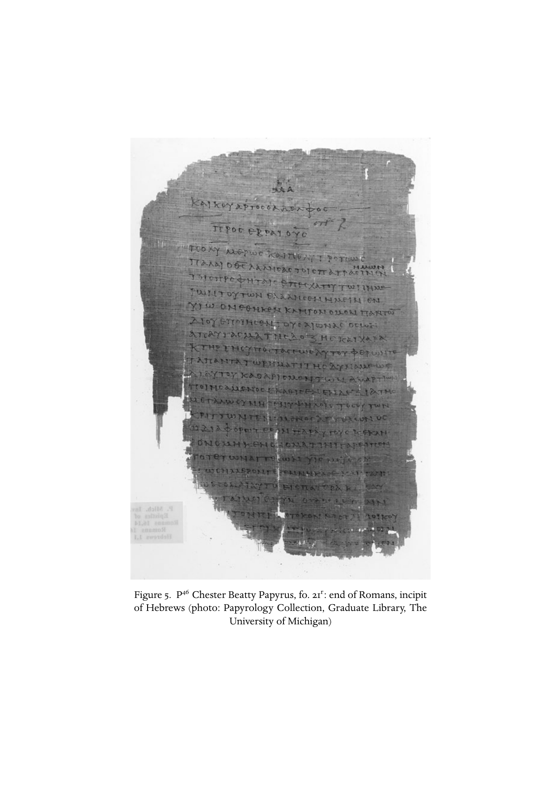

图5：切斯特·比蒂纸草P46，第21叶正面：《罗马书》结尾、《希伯来书》起首。摄影：密歇根大学图书馆纸草学藏品部。

## 文献之战

<!-- 原书第177页；PDF第226页 -->

现存最古老的拉丁文基督教文本，记载了对一位北非基督徒的如下审问：

> 总督萨图尔尼努斯问：“你箱子里那些东西是什么？”
>
> 斯佩拉图斯回答：“书，还有义人保罗的书信。”[^ch08-1]

不清楚这些“书和保罗的书信”，是被告斯佩拉图斯作为证物拿出来的——若是如此，出于自愿还是法官命令——还是带来教导、安慰囚犯的；但这次相遇，突出了基督徒身份与基督教文本之间的关键联系。公元303年2月，戴克里先通过立法规定三项战略行动，对基督教运动展开迫害。值得注意的是，他认为其中第二项，即交出文本并公开焚毁，[^ch08-2]对于摧毁这种信仰的重要性，不亚于拆毁教堂及剥夺其领袖的公民权利。后来继续迫害的马克西米努斯·达亚，显然也认同这一判断。他为对抗基督教经书的威胁，命人编写一部反制文献《彼拉多与救主回忆录》，并强行宣传，要求将其交给学童背诵。[^ch08-3]这些四世纪初针对书籍的猛烈攻势，最终未能成功；事实上，令历史学家遗憾的是，《彼拉多与救主回忆录》连一份抄本也未留下。优西比乌则把基督教文献的最终胜利，看在君士坦丁皇帝为庆贺而下令制作五十部华美经书——包括《旧约》和《新约》——供其如今已成为基督教帝国的新首都及周边地区分发使用。[^ch08-4]

<!-- 原书第178页；PDF第227页 -->

这场发生于本卷所涵盖时期末尾、富于戏剧性的“书籍之战”，[^ch08-5]表明早期基督教一个根本事实：这是一个宗教运动，文本存在于其背景与前景之中，更处于其核心与灵魂。其群体的特征，是对神圣文献无所不在、甚至近乎痴迷的专注与习惯。在君士坦丁以前，基督徒成功地撰写、搜集、分发和解释了一组文本，并将它们深深融入自身生活。他们觉得这些文本如此富于感召力，以致愿意生活在其中。[^ch08-6]可是，这场运动的创始人，唯一被记载的书写行为，只是用手指在随风扬尘的土地上，留下转瞬即逝、没有被读出的痕迹；[^ch08-7]它何以在一个世纪内创造出蓬勃的文学文化，随后又依靠这种文化维系生命？[^ch08-8]

## 最早的基督教传统与“经书”

<!-- 原书第178–179页；PDF第227–228页 -->

走向文本传统的这一发展，其枢纽人物是保罗，即我们知道姓名的最早基督教作者。[^ch08-9]不过，保罗自己已经置身于某些既有基督教文学传统中，并与之同时存在。他在林前15:3–4复述，并声称自己领受过的euangelion，即“福音消息”的简要形式，[^ch08-10]是“基督照经书所说，为我们的罪死了”，以及“他照经书所说，在第三日复活了”。最早的福音消息本身，就包含文本，并以文本为中心；这里指以色列的神圣经书。拿撒勒人耶稣最初的追随者，转向自己的“经书”，即希伯来文与希腊文的犹太神圣文本，设法用其中所见，解释他们已经认识的耶稣。保罗只有确信听众已熟悉关键的支持性文本，才会有把握地概括说，这些事是“照经书所说”。[^ch08-11]因此，再加上犹太与希腊—罗马文学文化中充分见证的平行例子，最早的基督教文学形式之一，很可能是“经文见证集”：从经书挑出的一系列段落，被基督徒视为指向耶稣的生平、行动，尤其神迹、死亡及非凡的复活。[^ch08-12]

因此，基督教“书面记录”的建立，其首要因素，是一个无比重要的决定：在《托拉》、先知书与诸著作的整体框架下，从事基督教文学活动，例如参路24:44。起初，这表现为忠诚的犹太人自然保留上帝之道不受质疑的文学权威；后来，则成为外邦人有意识地挪用文献的一步，而他们原先并不声称这些文本属于自己。[^ch08-13]早期基督教文学文化，最初在以色列经书的词汇范围、情节结构、人物阵容、世界观与神学前提内展开，后来除极少数例外，[^ch08-14]也仍然如此。这里的经书，主要是通过称为七十士译本的希腊文翻译为人所知的。

<!-- 原书第179–180页；PDF第228–229页 -->

这种文化又以拿撒勒人耶稣为中心。在耶稣去世，约公元30年，到第一部福音书《马可福音》约于70年写成之间，耶稣的话像其他圣人和哲学家的言语一样，被记忆、译为希腊文、重述、修改，并重新铸入常见形式：chreiai，也称警句、宣言故事或apophthegmata，即名言轶事；比喻；logia，即言论；apokalypseis，即启示；预言；祝福与灾祸宣告；以及gnomai，即格言。[^ch08-15]关于耶稣的叙事也经历类似过程，包括与同时代人争论的故事——如今又在早期教会自身与邻人争执的光照下讲述——以及行神迹的记载。渐渐地，这个过程促使材料汇集。有时按文类聚集，例如国度的比喻、[^ch08-16]敬拜教导、[^ch08-17]教会规章指示、[^ch08-18]智慧言论[^ch08-19]和神迹故事；[^ch08-20]另一些时候，则通过关键词或主题关联，汇成更大块材料。有些文本的排列原则，却完全不明显，如《多马福音》。有学者认为，它是基本独立于正典福音书的早期耶稣言论见证；另一些则认为它较晚，且由其他材料衍生。[^ch08-21]引发最密集研究、也引发最多争论的重构言论文献，是Q，即“对观言论来源”。《马太福音》与《路加福音》在明显并非依靠另一共同来源《马可福音》的地方，仍有大量平行内容，这便提示它的存在。[^ch08-22]这些材料或许保存在笔记册里，[^ch08-23]是“工作文献”，是实用文本；它们在写成、搜集及阅读它们的群体中发挥重要作用，而文学过程也鲜明显示，人们还不断思考、修改、重述它们。[^ch08-24]

## 早早转向书写

<!-- 原书第180页；PDF第229页 -->

耶稣传统，例如“主的晚餐”的传统（林前11:23–26；可14:22–25及平行经文），曾有一段时间同时以口头和书面形式存在。[^ch08-25]但不应假定，基督徒普遍偏爱口传，认为它比文字更有权威。[^ch08-26]同一时期基督教文学迅速增长，反而提示相反情况：相信基督的人高度珍视书面文字，把它当作传达这场宗教运动的真理、价值、根源、应许与期待的一种惯常、可信的媒介。尤其，二者未必被看成竞争关系，而是联系在一种逐渐发展的“耶稣故事知识”的创作与接受文化之中。这种文化存在于古代语言文化的流动性中：“口头”与“书面”的界线远不如现代固定，而且阅读是出声进行的。

充分认识这一点，还要求我们不要寻找一个单一动机或诱因，来解释基督徒为何突然、勉强地从口头活动“转换”为文学活动。人们通常把这种“转变”归因于第一代人的逝去，以及一种担忧：最初见证人死后，重要“见证”可能失落。虽然这有时确实发挥作用，例如约19:35；21:20–24，但推动早期基督教文学活动的因素有很多：

<!-- 原书第181页；PDF第230页；原文列项恢复为列表 -->

- 七十士译本作为“神圣文本”的榜样。
- 会堂敬拜中诵读、解释经书的实践，为基督徒提供了原型。[^ch08-27]
- 传教群体在地理上的扩散，需要彼此保持联系。
- 来自外人的挑战，包括外邦人与犹太人，要求有组织、连贯的回应。
- 群体内部关于实践与信念的争论迅速出现，需要裁断，也促使人们通过书写及改写文本，谋求统一性与普遍性。
- 这场宗教运动微妙而奇特地处于犹太与希腊—罗马宗教先例的交汇处，其自我界定与神学表达所需的诠释任务，日益复杂。
- 还有不可忽略的一点：最初几代中某些关键领袖具有突出的文学技能，使文本成为后来基督教论述的有效载体。

由于这些原因，从很早开始，文本就成为围绕耶稣之名发展的宗教圈子一种自然而有吸引力的媒介。书面记录的兴起，充满热情，毫不勉强，也不迟疑。

## 保罗的书信

<!-- 原书第181–182页；PDF第230–231页 -->

保罗写信的世界，早已习惯将书信作为交流手段。他向自己在加拉太、腓立比、帖撒罗尼迦和哥林多建立的集会（ekklēsiai），以及前方希望很快访问的罗马信徒写信。[^ch08-28]埃及保存了大量以纸草书写的古希腊日常书信，使我们得以了解罗马帝国早期日常通信的做法。[^ch08-29]我们也拥有柏拉图、德摩斯梯尼、伊索克拉底、伊壁鸠鲁、西塞罗和塞涅卡等古典大家公开流传的“文学书信”，以及较晚的书信写作手册。[^ch08-30]保罗寄给早期基督教会的现存书信，介于这两个层次之间。它们包含许多与简单家庭、商务日常书信相同的文学惯例，例如开头格式、祝愿健康、告知程式、问安和告别；它们也是真正写给作者所认识、直接称呼之读者的信。[^ch08-31]但书信正文，即完成主要事务的中心部分，复杂得多，其中精细、充分展开的论证，更接近演说家和哲学家的文学书信，也接近《阿里斯提亚书信》作者等希腊化犹太作者的作品；比起纸草中的简单便函，它们更像演说或论著。[^ch08-32]

保罗书信不仅运用日常书信的topoi，即“常用论题”或“套语”，还采用多种修辞形式与技巧：hypotheseis，即“命题”；三段论；paradeigmata，即“供仿效的例子”；synkriseis，即“比较”；寓意解释；以及elenchoi，即“反驳”。[^ch08-33]书信是一种灵活载体，可发挥多种功能：建议、指导、劝诫、辩护、痛斥、告知、安慰、管理、请求、解释与警告。[^ch08-34]在某些关键情况下，保罗决定写信处理问题，是因为文字比他本人亲口说话、亲身在场更有效。[^ch08-35]这些书信出自一位思维娴熟、人格令人难忘的人物，努力处理口头福音宣讲对某个城市或地区每一个小型基督徒群体——当地家教会成员——此后历史所具有的神学、伦理和牧养意义，[^ch08-36]并在经书所载上帝对人类计划的光照下理解它。[^ch08-37]

<!-- 原书第182–183页；PDF第231–232页 -->

“耶稣基督的使徒”保罗写这些书信，不是为了向外人传布信仰；它们预设读者已基本了解福音叙事、主要人物，即耶稣、上帝，也就是犹太人或以色列人的上帝、圣灵及“这世代的统治者”，以及关键事件。作为对其口头“福音”的第二层、第三层反思，[^ch08-38]它们既强化，也参与形成一种宗教世界观；保罗本人已为创造它做出许多工作。最重要的是，书信在鲜明勾勒的救赎叙事中，为收信者写定关键角色与身份：“弟兄姐妹”“正在得救的人”“蒙召的人”“相信的人”。[^ch08-39]这种论证策略，使身份能够轻易、自然地从最初收信者转移到后世读者；他们会阅读、思考这些书信，也发现它们塑造着自己的基督徒身份。[^ch08-40]但保罗书信是难解的文本，正如《彼得后书》作者后来所感叹；而他同时见证，在二世纪初的某个时候，这些文献已经成为graphai，即“经书”（3:15–16）。

## 托名保罗作品与保罗书信集

<!-- 原书第183页；PDF第232页 -->

保罗书信不仅为神学反思这一过程提供果实与荆棘，也为未来树立解释程序与标准。在许多方面支配后来基督教思想史的保罗诠释，早在他生前就已开始：他曾与哥林多读者，例如林后2:3–9；7:11–13；10:7–10，以及其他读者，就书信的意义与意图协商。[^ch08-41]引导这些有争议文本之意义的一种方法，是由保罗再写新文本，取代较早文本，或在其基础上继续展开。[^ch08-42]因此，他死后，其他人延续这种实践，[^ch08-43]拿起笔，“通过好像出自他的书信”传达消息（帖后2:2）。保罗既然能通过书信跨越帝国、远距离临在，也就能在死后通过书信，无论自己的还是真正托名的，继续临在。[^ch08-44]哪些信确由保罗所写，哪些出自后来的这些“保罗”，学界并无完全一致的意见；但最有力的共识认为，《以弗所书》《歌罗西书》和《帖撒罗尼迦后书》属于“第二代保罗传统作品”，《教牧书信》，即一世纪晚期或二世纪初的《提摩太前后书》和《提多书》，则属于“第三代保罗传统作品”。这些判断，建立在与推定“真保罗”书信在历史、神学、语言及文学特征上相互关联的比较之上。[^ch08-45]

<!-- 原书第183–184页；PDF第232–233页 -->

例如，约公元50年，保罗写给帖撒罗尼迦基督徒，是为回应末世迟延所引起的神学危机；后来一位仰慕该信的读者，则以它为文学模板，连书信结构中的独特之处也一并仿效，写出续篇，处理几乎相反的末世危机：害怕末世已经来到（帖后2:2）。这种文学策略，只有在保罗书信已被公认为权威教导时，才能奏效，参帖后2:15；3:14。新文本的读者，也必须已习惯于“如同自己就是帖撒罗尼迦人”那样阅读，从而领受据称寄给早期马其顿基督徒之劝告的益处。同一时期，《以弗所书》这封“通函”的写成，也体现了将保罗书信读者普遍化的过程。它最早的抄本，开头实际上并不点名以弗所人，而是称呼任何地方“在基督耶稣里的圣徒和信徒”。[^ch08-46]他们可以从这部富于想象地汇集保罗原始书信陈述的作品中，[^ch08-47]得到适合自身世代、将保罗神学与伦理灵意化的enchiridion，即“手册”。

托名保罗书信，依靠并取用原始书信，加以“更新”和细化，以适应较晚处境。因此，它们预设保罗书信已以某种形式收集起来，作为权威文献流传。我们不知道确切何时、由谁完成，但到《克莱孟一书》，一世纪末？，以及安提阿伊格纳提乌书信，约公元117年？，这些信已为人所知并被引述。最早的集子，很可能是写给七个教会的书信；七这个数目，强化了书信面向普遍读者的观念。这一诠释策略，立即成功到某种程度上取代了自身：更多致教会及个人的信被加入，形成十封、十三封和十四封的集子。[^ch08-48]每种版本通过各信内部的编辑工作，例如由五封独立信函编成的《哥林多后书》，[^ch08-49]以及收信数量与排列顺序，为合集赋予不同解释形态。我们知道有以《加拉太书》《哥林多前后书》或《罗马书》开头的集子。[^ch08-50]这部早期书信选集，以及需要方便地在各信之间翻阅，可能就是基督徒在文学作品中偏好册页本、而非卷轴的原因。[^ch08-51]这种物质形式，后来证明也同样适合基督教另一种典型文学文类；[^ch08-52]它也很快开始成套编集、传播。

## 福音书文学

<!-- 原书第185页；PDF第234页 -->

保罗书信预设了耶稣生、死与复活的叙事，[^ch08-53]却并不自行构成这样的叙事。罗马对犹太地区战争结束前后，这场战争为公元66–73年，且在70年发生圣殿被毁的灾难，一位文笔质朴、善用反讽的匿名基督徒，不自觉地开创了福音书文学；它后来成为最具辨识度的基督教文学产品。从很早起，这位作者就被认定为彼得的传译者马可。[^ch08-54]当他写下起首的话：“上帝之子耶稣基督的‘好消息’〔即‘福音’〕的起头”（可1:1），所表达的意义远超自己所能知道的：他的文本将成为一系列早期基督教“福音书”的第一部，每一部都倡导一种关于耶稣及其在上帝救赎计划中位置的特定视角。

### 马可

《马可福音》汇编了作者所继承的传统，尤其关于耶稣的神迹故事、争论轶事、较少量的耶稣教导，以及或许已经存在的受难故事纲要。他把这些传统单元，与其基本上属于保罗式的“好消息”观念并置：福音就是耶稣的死与复活，信徒受洗归入其中，以获得其救赎功效。[^ch08-55]这种并置，使他面临若干逻辑和神学问题。他试图在叙事展开中解决它们，由此产生一部“未经琢磨的钻石”般的文本：尽管粗粝，却是一篇引人入胜、构思精巧的文学作品。第一个问题，是耶稣作为弥赛亚的身份，在其生前及马可时代都受到遮蔽和误解；第二个与之相关的问题，是一位行神迹者竟被谋杀，这令人难以置信的不协调。在一个知道其他弥赛亚、其他医治者的世界，马可汇集熟悉与陌生之物，写出全新事物：被钉十字架的以色列之王的文字圣像。

<!-- 原书第185–186页；PDF第234–235页 -->

马可这一革命性文本，具有“传记性”，[^ch08-56]因为它大致依照时间顺序，追随一位中心人物的一生，直到其死亡；全书除两三个场景外，耶稣都在场。开篇便出现假定听众熟悉的先知以赛亚，他的声音解释、说明行动（1:2–3；1:11；参玛3:1），使马可整个“起头”，都与《创世记》的“起初”，以及后者所开启的圣经文献合集发生关系。[^ch08-57]因此，马可的“好消息”是一种新叙事，以以色列经书之先知性续篇的姿态出现，[^ch08-58]聚焦于“耶稣是谁？”这一问题（可8:27）。

它也是有意提出的一种对抗性解读，针对那些与交出耶稣、使他被钉十字架的权势相联系的同时代人，即“长老、祭司长、文士”（8:31）。他们争辩耶稣的弥赛亚身份（12:35–37），称之为亵渎（14:61–64），又在这出颠倒的戏剧中，恰于他被钉十字架时，嘲弄他登上以色列王位（15:31–32）。但当他以人子身份带着能力来临，将追随者从这世界救出时（13:27），耶稣的追随者[^ch08-59]将胜过那些对手；他们既是耶稣的敌人，也是信徒的敌人。

这部文本远比表面看来复杂。读者被置于优越的位置，可以看见并从人物的无知中学习：不仅是耶稣那些单薄刻板的邪恶对手，也包括他自己的门徒——彼得、雅各、约翰及其他人。他们摸索、挣扎，常错过就在眼前的神圣显现。通过门徒不理解这一叙事安排，马可完成了重大的神学转换：真正而更优越的宗教洞见，其存放之处，从过去的历史，转向“好消息”，也就是他的文本！这一举措，加上叙事中可见的仪式结构，保证任何世代的读者，都有一种接近耶稣的途径；它不仅等同于、甚至优于历史上的门徒所拥有的途径。[^ch08-60]

### 对马可的修订

<!-- 原书第186–187页；PDF第235–236页 -->

若认真对待《马可福音》的这一认识论主张，即文本是神圣显现的载体，而这些显现在历史层面曾经、也不断被误解，那么，文本必须把事情说对，就极其重要。马可在较大的问题上取得成功：神圣实在可以通过文本传达；但由此也把注意力引向自身叙事中的不足、空白和不妥之处，后来作者便着手填补。匿名基督徒接过这一任务，修订马可这部“起头”作品，加入更多耶稣言论传统，并为自己的处境调整其神学视野。由于马太和路加采用马可现成叙事作为自身框架，大量逐字抄录，三部福音书因此被称为“对观福音”，以表明其“共同视角”。

真正引人注意的，反而是一个悖论：有些地方，它们严格逐字忠于马可记述；另一些地方，却相当自由地改动。各福音作者编辑活动的动机，很可能不止一个，影响最终作品的因素也各不相同。根据古代修辞文化，即古代paideia教育体系的课程，论述应适合主题、说话者及听众这三个交流要素。因此，各福音书在某些不同方面，适应其预期或意向中的听众，并不足为奇。追溯至二世纪初的古代传统，曾试图重现各福音书写作的时间与地点。它们常带传奇色彩，把马太置于安提阿或犹太地区、路加置于亚该亚、马可置于罗马或亚历山大里亚。这是早期读者理解每部福音书个性与特殊性的一种方式，[^ch08-61]即使这些作品很快便会广泛传播。[^ch08-62]我们不必假定，每位福音作者只认识一个家教会或城市中心，也不必认为他们只为少数朋友写作；但他们似乎确实针对一世纪最后几十年中不同的关切与具体教会处境。[^ch08-63]

#### 马太

<!-- 原书第187–188页；PDF第236–237页 -->

《马太福音》的作者，似乎生活在公元70年耶路撒冷毁灭之后，与非基督徒犹太人和外邦基督徒近距离相处（太22:7；23:38–39）。他觉得《马可福音》值得重视，却在开头与结尾有所不足，对于耶稣教导的记录也过少。编辑马可、形成新版本时，马太给其难解的受苦弥赛亚形象一个新角度，将耶稣描绘成新摩西：一方面增添婴儿叙事，令人想起摩西危险的出生与在埃及的童年；另一方面，把Q及自己特殊材料中的传统教导，编入耶稣五篇、或许六篇长讲论。[^ch08-64]值得注意的是，马太是唯一使用ekklēsia，即“教会”一词的福音作者。[^ch08-65]他的耶稣，是一个服从其话语与命令之新群体的创立者，尤其参第18章；甚至超越摩西，从奇迹受孕起就是“以马内利”，即“上帝与我们同在”，并一直临在于群体中（1:23；28:20；18:20；结合赛7:14）。这只是马太约十二处“程式化引经”之一；作者用这些引文郑重强调，耶稣的作为及生平事件，都应验了“经书”。

这种认为预言在耶稣历史中得到应验的意识，也应用于他死后及随后发生的事件。耶稣被描绘为预言耶路撒冷毁灭，甚至包括提图斯军队点燃大火的细节（23:38；22:7）。马太把这些事件解释为上帝对犹太领袖及人民的惩罚，因为他们使耶稣死亡（27:25），又故意拒绝“福音”消息（28:11–15）。结合马太让耶稣对会堂领袖发出的激烈斥责——他们当时也在为灾难寻找神学解释，却在别处找到答案——[^ch08-66]《马太福音》便成为面向外邦人传教的奠基文献；他们是那将结果子的ethnos，即“民族”（21:43；参28:19–20）。

但马太加在马可“小启示录”上的比喻，清楚警告：主的再临（parousia），只让行为与口头认主相符的人进入上帝国。比较可13:1–37与太24:1–25:46，并注意7:21–27与25:31–46之间的平行。因此，写一部像《托拉》本身那样，保存并重新呈现“我所吩咐你们的一切”（28:20）的文本，显然利害重大。《马太福音》成为最早教会阅读和引用最广的福音书，或许不足为奇。[^ch08-67]

#### 路加与《使徒行传》

<!-- 原书第188–189页；PDF第237–238页 -->

这位作者明确承认，自己之前已有“许多”未具名的前人，即马可及其他人。他很可能在二世纪初写作，认为自己新的“叙述”（diēgēsis）有其理由：他“十分精确地”（akribōs）追查口头与书面传统，希望“按次序”（kathexēs；1:3）写下。路加不仅在日益扩大的基督教书架上，为自己的作品争取位置，还通过采用史学序言的文学形式，[^ch08-68]其中惯常提及见证人、先前来源、“准确”与“可靠”，公开将自己关于“在我们中间已经成就之事”的叙述，置于古代地方史的行列。[^ch08-69]从精心写成的希腊文修辞长句（路1:1–4），转为出生叙事中明显的七十士译本用语，其标志立即见于1:5，这显示路加仿效的双重文学标准，以及希望自己作品与哪些著作为伍。

由此形成的混合体，是一出分三幕展开、神圣先知应许得到应验的戏剧。它促使路加不仅为马可，也为自己写续篇，产生第二卷（logos；徒1:1），即我们今天所称的《使徒行传》。路加在其中，为一个统一的基督教运动提供起源故事；这种浪漫化视野，与保罗书信的一手证据并不相符。他描写这场运动完全忠于耶路撒冷和犹太教的根源（1:8及以下；2:22–38；24:44–47），却在受到拒绝后，转向“必将听从”的外邦人（徒28:28）。《路加福音—使徒行传》写给庇护者提阿非罗，是最完整的早期护教作品：它为基督教运动的合法性辩护，认为这是一种根植于“义人”创始者耶稣的宗教；耶稣不威胁罗马权威，甚至那位签署处死令的罗马总督，也三次如此宣告。[^ch08-70]他发起的运动，目标是普遍的宗教救赎，并非政治叛乱。两卷作品展示，福音如何从耶路撒冷及犹太文学文化的根源，扩展到罗马与外邦听众（1:8及以下；2:22–38；徒28:30–31）。耶稣及其发起的运动，是“世界历史”的一部分，被放置在与罗马帝国的关系中（路2:1；3:1）。

#### 约翰

<!-- 原书第189–190页；PDF第238–239页 -->

学者争论，《约翰福音》是否像马太和路加一样，也是对马可的改写。[^ch08-71]马太把马可的“起头”推回耶稣的祖先亚伯拉罕（太1:1–17），路加则推回亚当（路3:23–37）；这位文学神学家更胜一筹，把它推到《创世记》1:1创造以前，那原初、历史之前的“起初”。他著名的序言，以诗歌描绘logos，即“道”的历程，巧妙地处于一个位置，为耶稣争取来自希腊化犹太教与希腊哲学的神圣赞颂。马可叙事中心的基督论问题：“人们说我是谁？”[^ch08-72]在约翰这里，成为关于来源与归宿的追问：“他从哪里来？”“他往哪里去？”[^ch08-73]和马可一样，序言已向读者提示答案；但阅读过程中，读者获得机会，通过文本“看见”“触摸”神圣实在，从而获得信仰与真实生命（约20:30–31；约壹1:1–4）。

像马太一样，约翰把叙事材料与讲论相结合；但他的焦点，与其说在伦理，不如说在基督论。约翰笔下的耶稣，是神圣的“阐释者”（1:18）；他通过述说自己的身份，即那些频繁的“我是”宣告，以及悖论，启示上帝。[^ch08-74]其中最主要的悖论，是他恰在被钉十字架之时受到高举：从地上被实际“举起”（约3:14；8:28；12:32–34），成为一个矛盾相合的荣耀时刻（约1:14；12:16、23、28；17:5）。但即使福音文本中这神圣的自我阐释，也需要更新与进一步解释。《约翰福音》有几个结尾，在新版本中随时间加入，使我们略见作品背后那位见证者，即“蒙爱门徒”的后来命运，尤其参21:20–25；另参19:35，也看见如今已殉道的彼得的命运（21:18–19）。

福音书的再版，还伴随至少一本指导如何正确阅读它的入门书，或许出自最后几位编辑之一？[^ch08-75]《约翰一书》谴责那些离开正确“起头”的人，认为他们不明白“耶稣基督成了肉身而来”（约壹4:2–3），并藉“水和血”而来（约壹5:6；参约19:34）。不难理解，其他读者，例如诺斯替派的赫拉克利翁，会在这部福音书对耶稣面对死亡时不动情、从容不迫的描写中，[^ch08-76]找到充分理由，支持相反观点。与此同时，约翰的启示讲论，也成为纳格·哈马迪所发现诸书中的标准文学形式。[^ch08-77]

## 四重福音

<!-- 原书第190–191页；PDF第239–240页 -->

诺斯替派及其他基督徒拥有的福音书，不止这四部。奥利金解释路加所说“许多人已经提笔”（路1:1）时，举出《埃及人福音》——别处还举《希伯来人福音》——《十二使徒福音》《巴西里德福音》《多马福音》及《马提亚福音》等，并说还有“许多其他作品”。[^ch08-78]二世纪，对于这些不同福音书的地位、权威及相互一致性，争论日渐增多。人们提出几种解决办法：让一个基督徒群体选择最能反映自身观点的一部福音书，或许再作适当编辑；[^ch08-79]把各福音书调和为单一综合叙事；[^ch08-80]或有意将各种不同描绘，收进一部多卷、但具有决定性地位的合集。最后一种立场后来起了决定作用，其倡导者是里昂的爱任纽。他论证，四重福音，不多也不少，根植于上帝旨意及宇宙秩序，就像四风，或支撑世界的四根柱子。[^ch08-81]这与“按〔马太、马可、路加或约翰〕所传的福音”这些标题一致。[^ch08-82]

## 书籍文化

<!-- 原书第191页；PDF第240页 -->

最早的基督徒不只生产文本，也创造了一种文学文化。那些独自或共同“查考经书”的读者群体，需要工具。他们自然延续希腊—罗马教育体系所教授的标准文学批评技巧，从中找到诠释工具，即解释方法。借助这些技巧，人学会准确阅读，判断文本作者身份是否真实，并汇集最可靠的读法与解释。[^ch08-83]他们也在自身文本中，发现如何阅读“经书”的先例，包括可4:10–12、加4:24、林前10:11等难解段落。基督徒释经者本能地将“以荷马解释荷马”的原则用于自己的经书时，这些段落也日益发挥诠释学原则的作用。[^ch08-84]任何以书籍为中心的群体，例如昆兰犹太人，或与早期基督徒颇多相似的哲学学派，[^ch08-85]都会默契地，或通过明确商议，约定阅读哪些、不读哪些文本。[^ch08-86]前三个世纪的基督徒也一样。由二十七卷构成的《新约》正典，其正式定型超出本卷范围；367年亚他那修的第三十九封复活节书信，通常被视为至少从后见角度而言的界定性时刻。[^ch08-87]

<!-- 原书第192页；PDF第241页 -->

不过，主要文献群，即保罗书信与福音书集，至二世纪末已大体就位，虽然其他作品仍有争议。[^ch08-88]文学文化还需要社会资源，即识字者、[^ch08-89]抄写员，以及物质工具：纸草、羊皮纸、墨水、抄写室、档案与图书馆。[^ch08-90]值得注意的是，基督徒似乎最早在书籍领域，对物质文化留下独特印记。[^ch08-91]虽然册页本偶尔用于“袖珍版”，却非希腊—罗马世界文学作品偏好或常用的形式。然而，已经发现的福音书纸草残片，百分之百出自册页本。[^ch08-92]基督徒特有的选集式文学，即书信集、福音书集，以及巡回教师的群体，显然是他们很早采用册页本形式的部分原因。无论起初是否有此意图，使用册页本而非卷轴，都使基督徒与犹太人及“异教徒”区别开来。

还有两种书写上的独特现象，指向这场运动特有的中心：一是为“主”“耶稣”“基督”和“上帝”等名称使用特别缩写，学者称为nomina sacra，即圣名缩写；[^ch08-93]二是很早、在二世纪便使用“十字架形缩写符号”（staurogram），用十字形记号简写“十字架”一词。这可能是最早的基督教图像作品，就保存在一部纸草册页本的纸面上。[^ch08-94]

<!-- 原书第192–193页；PDF第241–242页 -->

最早基督教作者采用的文类，书信、叙事性“福音书”、历史与启示录，在本卷整个时期，都将对基督徒身份留下难以估量的印记。由于保罗及其早期仿效者，书信一直是基督教文学表达所偏爱的载体：《新约》二十七卷中有二十一卷，许多使徒教父作品，以及哥林多的狄俄尼修等后来人物，甚至君士坦丁，都采用它。反讽的是，即使可能在保罗生前反对他的彼得和雅各，后来也被描绘为拿起他所选择的武器，即书信。[^ch08-95]保罗将希腊—罗马修辞技巧纳入自己的宣讲，把基督教福音猛然抛进古代追求真理时，修辞与哲学关系问题的漩涡，[^ch08-96]也推进护教论证的领域；二者后来都成为二世纪及以后基督教论述的持久任务。[^ch08-97]

路加护教史学的杰作，对第一位教会史家优西比乌产生重大影响。[^ch08-98]他的《使徒行传》，也带动一批与多马、彼得、约翰、保罗、特克拉和安得烈等人物相联系的《行传》作品。[^ch08-99]这些作品呼应通俗小说惯例，[^ch08-100]显然在基督徒中广泛阅读，受到热切喜爱。[^ch08-101]福音书的叙事形式，包括言论、神迹故事和受难叙事，成为《坡旅甲殉道记》[^ch08-102]等殉道文献，以及亚他那修《安东尼传》等圣徒传记据以构建的文学模板。基督徒不只创作文学上的《传》，也在生活中仿效它们，使文本与生命持续、充满活力地互动。[^ch08-103]这甚至延伸到死亡。

保罗书信中的启示性论述（帖前4:13–5:11；林前第15章）、福音书中的相关内容（可第13章及平行经文），以及大量独立文本，例如《彼得启示录》《保罗启示录》，即使引起激烈争论，仍始终是基督教运动的基本底色。最著名的是《约翰启示录》：一部一世纪文献，最初几个世纪，其权威与“正典性”受到争议，最终却成为《新约》收尾的压轴之作（Euseb. HE 3.25.1–7）。[^ch08-104]最终定型的完整“新约”文献合集，[^ch08-105]以一段维护书籍的诅咒结束，如今它适用于整个合集：

> 若有人在这些话上加添什么，上帝必将写在这书中的灾祸加在他身上；若有人从这预言之书的话中删去什么，上帝必从生命树和圣城中除去他的分，就是属于那些记载在这书中之人的分。（启22:18–19）

<!-- 原书第194页；PDF第243页 -->

这一抄写题记，恰当说出了我们一直追踪的动力：一种不断扩张、态度坚定严肃的文学文化，关心如何找到适当工具，以管理自身作品及其意义。最早的基督徒教导，复活的耶稣不在墓中，而应在文本中找到；他们很容易想象一个没有圣殿的天堂（启21:22），却无法想象那里没有书。

## 脚注

[^ch08-1]: M. Scil. 12，所记事件约发生于公元180年。

[^ch08-2]: Euseb. HE 8.2.4.

[^ch08-3]: Euseb. HE 9.5.1；亦见1.9.3；9.7.1。

[^ch08-4]: V.C. 3.1.5；另参4.36.2–4。

[^ch08-5]: 荷马、赫西俄德史诗与基督徒《圣经》之间的“文献之战”，参Young, Biblical exegesis, 57。

[^ch08-6]: “基督徒的经验中，有某种东西驱使〔人们〕把它记在书里，表达它，为它辩护，并解释它。”Goodspeed, History of early Christian literature, vi。

[^ch08-7]: John 7:53–8:11；恰好，这又是在一段文本地位不确定的经文中记述的！

[^ch08-8]: 后来的基督教作者，会把作者身份投射到耶稣身上；参Baarda, ‘De Christi scriptis’。

[^ch08-9]: 注意，本章开头的简短引文中，斯佩拉图斯唯一点名的人就是保罗。

[^ch08-10]: 参Mitchell, ‘Rhetorical shorthand’。

[^ch08-11]: 例如Isa 53:5及以下；Hos 6:2；Jon 2:1。

[^ch08-12]: 参Gamble, Books and readers, 24–8、65。

[^ch08-13]: 例如参1 Cor 10:1的“我们的祖宗”；Gal第3–4章及Rom第4章中，亚伯拉罕作为“我们的先祖”。

[^ch08-14]: 马吉安的情况，参下文第9章。

[^ch08-15]: Berger, ‘Hellenistische Gattungen,’ 1031–1432; Aune, Westminster Dictionary, 187–190.

[^ch08-16]: Mark第4章及平行经文。

[^ch08-17]: 参Betz, Essays, 1–16、55–69；以及其Sermon on the Mount，将Matt 6:1–18视为“敬拜教导”。

[^ch08-18]: Koester, Ancient Christian gospels, 53–4.

[^ch08-19]: 同上，55–62。

[^ch08-20]: Theissen, Miracle stories; Achtemeier, ‘Pre-Markan miracle catenae’.

[^ch08-21]: Koester, Ancient Christian gospels, 75–128，尤其81；Aune, Westminster dictionary, 465–73及其所列进一步文献。

[^ch08-22]: 参Tuckett, Q and the history of early Christianity；Kloppenborg Verbin, Excavating Q；Koester, Ancient Christian gospels, 128–71。

[^ch08-23]: Stanton, ‘Early reception’, 59.

[^ch08-24]: Gamble, Books and readers, 39、77–8，讨论基督教文本的“实用性”。但不应把它与“审美”价值对立；许多早期基督教文献精心的文学艺术，也体现后者。

[^ch08-25]: Koester, Synoptische Überlieferung.

[^ch08-26]: Euseb. HE 3.39.3–4所载帕皮亚传统，历来如此理解，近来例如Dunn, Jesus remembered, 173–254；不过，参Alexander, ‘The living voice’及Gamble, Books and readers, 30–1恰当的批评。保罗策略性地决定写信，而非亲自讲话，参Mitchell, ‘New Testament envoys’。

[^ch08-27]: Gamble, Books and readers, 208–14.

[^ch08-28]: 参上文第二部分第5章。

[^ch08-29]: White, Light from ancient letters.

[^ch08-30]: Malherbe, Ancient epistolary theorists.

[^ch08-31]: 参Klauck, Die antike Briefliteratur；Aune, Greco-Roman literature, 158–225。

[^ch08-32]: 保罗书信中最接近日常便函的，是《腓利门书》。

[^ch08-33]: 相关论述见Sampley, Paul in the Greco-Roman world。

[^ch08-34]: Stowers, Letter writing.

[^ch08-35]: Mitchell, ‘New Testament envoys’.

[^ch08-36]: 详细讨论参上文第二部分第5章。

[^ch08-37]: 保罗如何使用经书，参Hays, Echoes of scripture及Koch, Die Schrift。

[^ch08-38]: Mitchell, ‘Rhetorical shorthand’.

[^ch08-39]: 例如1 Cor 1:1–24。

[^ch08-40]: 参Dahl, ‘Particularity of the Pauline epistles’。

[^ch08-41]: Mitchell, ‘Corinthian correspondence’.

[^ch08-42]: 最清楚的例子是1 Cor 5:9–10，但整个哥林多书信群都说明这一点；Mitchell, ‘Corinthian correspondence’。

[^ch08-43]: 起初可能是其传教团队成员；Gamble, Books and readers, 99。

[^ch08-44]: Betz, ‘Paul’s “second presence”’.

[^ch08-45]: Koester, Introduction, vol. ii, 241–305; Vielhauer, Geschichte, 58–251.

[^ch08-46]: 马吉安文本的开头称收信者为老底嘉人（Tert. Marc. 5.17；参Col 4:16）。

[^ch08-47]: Goodspeed, Meaning of Ephesians, 9认为，该信618个简短意义单元中，有550个“在措辞或实质上，与保罗具有无可误认的平行之处”。

[^ch08-48]: Frede, ‘Die Ordnung’；Gamble, ‘Pauline corpus’及其Books and readers, 59–63。Trobisch, Paul’s Letter Collection认为，保罗自己以四封信的合集，开启了这一过程。

[^ch08-49]: Mitchell, ‘Corinthian correspondence’.

[^ch08-50]: 参上文图5，展示约公元200年的纸草P46中，《罗马书》接在《希伯来书》之后的情况。（此处前后次序依脚注原文保留；与图5图注相反。）

[^ch08-51]: Gamble, ‘Pauline corpus’, and Books and readers, 49–66.

[^ch08-52]: 斯基特认为，册页本是为福音书而采用的；Elliott, Collected biblical writings of T. C. Skeat, 73–87。

[^ch08-53]: 例如，他把主的晚餐放在“被交付的那一夜”（1 Cor 11:23）。

[^ch08-54]: Papias 2.15 [ = Euseb. HE 3.39].

[^ch08-55]: 参Marcus, ‘Mark – interpreter of Paul’及其所列关于这一长期争论的文献。

[^ch08-56]: 用语出自Swain, ‘Biography and biographic’。把福音书视为“传记”，参Aune, New Testament in its literary environment, 17–76；Burridge, What are the gospels?。

[^ch08-57]: 参Mark 13:19；10:6；John 1:1将决定性地完成这一举措。

[^ch08-58]: 另一看法见MacDonald, Homeric epics，认为马可以《奥德赛》为“底本文本”（hypotext）写作；批评性评估见Mitchell, ‘Homer in the New Testament?’。

[^ch08-59]: “跟随”是马可表示成为耶稣门徒的专门用语：1:18；2:14、15；6:1；8:34；9:38；10:21、28、32、52；15:41。

[^ch08-60]: 保罗对自己的使徒职分，也提出同样主张；参Mitchell, ‘Epiphanic evolutions’。

[^ch08-61]: 详见Mitchell, ‘Patristic counter-evidence’。

[^ch08-62]: 各福音书在埃及纸草中均得到充分见证；值得注意的例外是马可。参Metzger, Text, 247–56。

[^ch08-63]: Bauckham, Gospels for all Christians恰当地敦促学者，不要预设福音书群体孤立或完全分隔。但他认为，四位福音作者都为“一世纪晚期罗马帝国任何及每一个基督徒群体”写作（第1页），又走向另一极端。

[^ch08-64]: 同样程式见7:28；11:1；13:53；19:1；26:1；另参28:19–20。

[^ch08-65]: Matt 16:18；18:17，两次。路加将此词留用于第二卷《使徒行传》。

[^ch08-66]: 例如参《以斯拉四书》。

[^ch08-67]: Massaux, Influence of the gospel of Saint Matthew.

[^ch08-68]: 参Alexander, Preface to Luke’s gospel，该书试图区分技术手册与史学序言；Moessner, Jesus and the heritage of Israel中诸文，讨论路加序言及其在古代史学中的位置。

[^ch08-69]: Sterling, Historiography and self-definition.

[^ch08-70]: Luke 23:4、14、22；另参Acts 18:15–16；25:9–12。

[^ch08-71]: 参上文第二部分第6章。我倾向于认为，约翰确实知道马可。

[^ch08-72]: Mark 8:27、29；另参1:24；4:41；6:2–3等。

[^ch08-73]: John 7:27–8；8:14；9:29–30；19:9等。

[^ch08-74]: 悖论作为基督教论述的特征，参Cameron, Christianity and the rhetoric of empire。

[^ch08-75]: Brown, Gospel according to John, vol. i, xxiv–xl.

[^ch08-76]: 比较John 12:27与Mark 13:32–41；定位依原书保留。

[^ch08-77]: 参Robinson编，The Nag Hammadi library in English。

[^ch08-78]: Hom. Luc. 1.4–5；参Klauck, Apocryphal gospels，以及NTApoc, vol. 1所译文本。

[^ch08-79]: 马吉安编辑的《路加福音》，参下文第9章。

[^ch08-80]: 例如塔提安的《四福音合参》，参下文第四部分第19章。

[^ch08-81]: Iren. Haer. 3.11.8；同样还有Ezek 1:18的四活物；另参Rev 4:6–7，后者是福音作者传统图像的来源；Burridge, Four gospels。

[^ch08-82]: Hengel, Studies in the gospel of Mark, 64–84主张这些标题可定于一世纪，但这有争议。

[^ch08-83]: Grant, Heresy and Criticism；Young, Biblical exegesis；进一步讨论见下文第五部分第27章。

[^ch08-84]: Neuschäfer, Origenes, vol. i, 276–85。圣经内部相互解释，是拉比释经的重要原则，也影响基督徒实践；参Kugel and Greer, Early biblical interpretation。

[^ch08-85]: 尤其体现在对“智识实践”的重视上；Stowers, ‘Does Pauline Christianity resemble a Hellenistic philosophy?’。

[^ch08-86]: Snyder, Teachers and texts，尤其94–99，讨论“文献群组织”。

[^ch08-87]: Metzger, Canon, 210–12, 312–13.

[^ch08-88]: Euseb. HE 3.25；进一步讨论参下文第9章；Barton, Holy writings；另参Metzger, Canon, 157–62。

[^ch08-89]: 关键在于“群体识字”：在一个可能只有百分之十的人识字的世界，只要群体中一个成员能读，所有人都能接触书面文本，因为当时惯常大声诵读；有价值的讨论见Gamble, Books and readers, 2–10。

[^ch08-90]: Gamble, Books and readers.

[^ch08-91]: Hurtado, ‘Earliest evidence’.

[^ch08-92]: Skeat，载Elliott编，Collected biblical writings of T. C. Skeat, 73–87，尤其79；269–80。

[^ch08-93]: Gamble, Books and readers, 74–8。《巴拿巴书》9.8提供了这一做法的文学见证。上文图5第四行，可见Θ̅C̅这一缩写；th-s代表theos，即“上帝”。

[^ch08-94]: Hurtado, ‘Earliest evidence’.

[^ch08-95]: Koester, Introduction, vol. ii, 292–7.

[^ch08-96]: Betz, ‘Problem’; Mitchell, ‘Rhetorik’.

[^ch08-97]: 参下文第11章。

[^ch08-98]: Grant, Eusebius as church historian, 39–41.

[^ch08-99]: 译文见NTApoc, vol. ii。

[^ch08-100]: Aune, Westminster dictionary, 320–3; Chance et al., Ancient fiction.

[^ch08-101]: Cameron, Christianity and the rhetoric of empire, 89–119.

[^ch08-102]: 有意形成的平行，参Aune, Westminster dictionary, 296。

[^ch08-103]: Cameron, Christianity and the rhetoric of empire, 141–54.

[^ch08-104]: 四世纪的《梵蒂冈抄本》可能以《启示录》结尾。斯基特论证，它是君士坦丁委托制作的抄本之一；Elliott, Collected biblical writings of T. C. Skeat, 193–237。

[^ch08-105]: “新约”虽是圣经用语（Jer 31:31；2 Cor 3:6），但直到二世纪晚期，才被用于一个文本群，例如Iren. Haer. 4.28.2；Hipp. Fr. 63 in Gen. 2。

## 译校说明

图5原图说明为《罗马书》结尾、《希伯来书》开头；脚注50却称《罗马书》接在《希伯来书》之后。此处分别保留并标明二者差异。脚注76的Mark 13:32–41等疑似原书误植，也未据推测改写。


---

<a id="chapter-09"></a>

# 第九章 马吉安与“正典”

**作者：哈里·Y. 甘布尔（Harry Y. Gamble）**

《剑桥基督教史》第一卷《起源至君士坦丁》中文译稿

> 原书第195–213页，PDF第244–262页。完整翻译正文与脚注解释，保留作者的论证及限定语气；参考书目作者名、题名和定位保留原文。
>
> [第九章英文原文](<第九章 马吉安与“正典”（英文）.md>) · [原书PDF](<../01 起源至君士坦丁.pdf>)

<!-- 原书第195–196页；PDF第244–245页 -->

马吉安是早期基督教史上最引人注意、却又最难把握的人物之一。在二世纪兴盛的多种基督教形式中，他的形态受到反异端作者最频繁、最猛烈的攻击，显然被视为最危险的一种；这足以证明他的重要地位。[^ch09-1]现代学者同样对马吉安感兴趣，不只因为其教导的独特之处，也因为他可能影响了早期教会最重要的发展之一：基督教《圣经》的形成。[^ch09-2]在这一关系上，他在两大问题中备受关注：教会如何将犹太教经书据为己用，后来称之为《旧约》；以及特别属于基督教的经书正典，即《新约》，如何出现。

在有限篇幅内，不可能充分处理马吉安及其影响研究所面临的众多困难。他究竟教导什么、为何如此教导，都尚未完全清楚。其若干突出信念为人熟知，但它们如何产生、如何相互关联，又如何与其他人的信念交汇，仍不确定。应将他视为圣经神学家，还是诺斯替派或哲学性教师，这一老问题尚未得到回答，而且也无法用这种方式回答。不过，把他放回二世纪基督教及当时关注的问题中，便能在很大程度上理解他的活动，并评价其角色。

马吉安生于一世纪晚期或二世纪初，家乡是锡诺佩，一座位于小亚细亚北部罗马本都行省、黑海又称欧克塞诺斯海沿岸的繁荣港口。关于早年生活，没有确切知识。多数记载说，他是nauklēros，即船主或从事海运者，家境富裕。他在本都时很可能已是基督徒；埃皮法尼乌甚至说，他是当地一名基督徒主教之子（Pan. 42.1），但其早期活动仍无确定资料。[^ch09-3]他或许在小亚细亚西部活动过一段时间（Iren. Haer. 3.3.4），却直到公元135至140年间来到罗马、与当地基督徒群体交往后，才声名大噪。他向该群体慷慨捐赠了200,000塞斯特尔提乌斯。起初，人们以为他信仰正统，欢迎他加入（Tert. Marc. 1.1.1）；但一连串教导上的争论，导致关系破裂，144年他被逐出罗马教会，捐款也被退还。随后，他着手组织、传播自己独立的基督徒群体，取得显著成功。马吉安派会众迅速遍布广阔地区；在二世纪后半，马吉安派教会成为大公教会强有力的对手。虽然许多会众最终被摩尼教吸收，它仍以相当力量延续至五世纪，尤其在东方。[^ch09-4]

## 马吉安所理解的基督教

<!-- 原书第196–197页；PDF第245–246页 -->

我们只能通过反对者的作品认识马吉安，不确定他们对本人及其教导的描绘有多完整、准确。不过，古代批评者对某些方面广有共识。根本上，他主张基督教代表一种彻底的novum，即全新、前所未有的启示，来自一位此前不为人知、全然良善而爱心完美的上帝。他坚持，这个启示与此前一切都不连续，因此不可能被预期或预言。这位异于既有世界之上帝的使者，是其子拿撒勒人耶稣；他在提比略第十五年，突然以人的形状出现，宣讲神圣良善的新福音，人应以信接受、以爱实践。

按马吉安的理解，这一福音与犹太教如此深刻而明显不同，其来源的上帝，不可能等同于犹太经书之神。他并未否认后者存在，却认为其性质和目的，与耶稣所宣告的上帝全然不同。因此，马吉安接受一种二神论：一边是犹太教及犹太经书之神，另一边是耶稣及基督教的上帝。他认为，前者是较低等的造物者，创造世界和人类，通过自己颁布的律法追求公正，严格按人的功过施行报应；后者则是更高的上帝，具有无条件的爱与怜悯，原本与人类没有关系，却完全出于自身恩慈，主动亲近他们，为要拯救他们。两位神，一低一高，一位创造、一位救赎，一位仅仅公正、另一位怜悯而有爱，这一观念居于马吉安思想的中心。

马吉安二神论的一项重要推论，是强烈贬低受造世界。他对物质秩序的轻蔑，主要表现于两方面。一是彻底的道德严苛主义，带有强烈禁欲特征：他规定禁绝性生活、禁止婚姻，认为生育只会进一步实现创造神的目的；他深恶生物过程，以及自然世界的种种烦扰。二是幻影说基督论：否认耶稣实际具有人性，因而否认其出生与死亡的真实性。此外，他教导，是创造神使耶稣受苦，并在十字架上经历仅属身体的死亡；马吉安视之为赎价，把信徒从受创造神奴役的处境中赎出。因此，无论生者或死者，只要有信，耶稣的死便对他们具有救赎作用。于是，他不把耶稣视为犹太弥赛亚，而视为普遍的救主。

<!-- 原书第197–198页；PDF第246–247页 -->

这些信念固然根本，却远非马吉安教导的全部实质；其间存在空白和不一致。不过，在探究根源与依据以前，先作陈述仍有帮助。古代批评者惯常把他列于诺斯替派教师之中，认为其教导与他们一样，是哲学思辨失控的产物。许多现代学者也继续把他视为诺斯替派。[^ch09-5]尽管存在某些相似之处，例如二神论、幻影说，以及贬低物质世界和身体，马吉安教导在其他方面却不同于基督教诺斯替体系：它没有宇宙生成神话，没有神性成分散落于人类之中的观念，没有人能藉某种隐秘、救赎性的gnōsis，即灵知，重返终极源头的看法，也没有寓意解释犹太经书的方法，或诉诸秘密口传传统的做法。[^ch09-6]

但如果把马吉安视为诺斯替派无助于理解，也不能轻易把他仅仅理解为排斥哲学的“圣经神学家”或“激进保罗主义者”。[^ch09-7]虽然他对犹太和基督教著作颇有兴趣，其教导中的形而上学因素，却无法轻易从这些文本推导出来；很难设想它们就是他的出发点，或他对基督教的理解没有其他根源。如同大多数受教育的基督徒，他也受当时哲学观念影响，其基督教解释，回应了当日哲学神学中的问题、观念和趋势。[^ch09-8]他似乎接受一种主要属于哲学的神观：上帝，至少至高神，是一个完全超越、完美的存在。不能低估犹太经书所引发的释经难题对他的刺激，也不能低估他对保罗传统的投入；但他几乎肯定是从哲学、主要是中期柏拉图主义的视角，理解犹太经书之神，将其视为不同且较低等的存在。[^ch09-9]不过，他并未接受相应的哲学信念：人能通过德性训练的理智认识至高神；他同样不接受通过隐秘灵知达到这一认识。对他而言，这种知识只能通过基督教福音中的启示传达，也只能以信领会。

<!-- 原书第198–199页；PDF第247–248页 -->

因此，马吉安教导的独特性质，似乎产生于通行哲学神学，与对基督教中已有传统地位的文本之批判阅读的相互作用；这里最重要的文本，是犹太教经书与保罗书信。其教导几乎所有主要特征，都可由此解释，尽管思想的逻辑联系及精细纹理仍有些晦暗，也许从未真正清晰过。尽管如此，马吉安并不自认是基督徒哲学家，也不以哲学术语陈述教导。他深深认同基督教，视之为唯一有效的救赎宗教，并力图用基督教传统自身的根本资源，具体而言就是其文本，支持自己的教导。

## 马吉安与犹太教经书

<!-- 原书第199页；PDF第248页 -->

除二神论外，马吉安最受批评者猛烈攻击的，是他对犹太经书的看法。基督教起初是犹太教内部的运动，因此早期基督徒群体惯于珍视犹太经书，视为自己的经书，坚信律法与先知指向耶稣，认为他是以色列上帝的弥赛亚，而教会则是其新约子民。最早犹太基督徒所感到的、与犹太教及其经书的连续性，随着基督教外邦成员日益增加，不可避免地减弱；二世纪以外邦人为主的教会，正为此问题苦思。[^ch09-10]犹太经书的某些部分，尤其仪式律，被认为不适用于基督徒、对他们无效；犹太经书范围存在争议；基督徒所用的七十士译本与希伯来文本之间的差别受到讨论；基督徒与犹太人的解释冲突，引起激烈辩论；人们也运用各种方法，从基督徒角度解释犹太经书。这些都是马吉安同时代人活跃争论的问题。置于这一背景，他的观点虽不因此减轻激进程度，却变得更容易理解。

马吉安确信，基督教更高、来自既有世界之外的上帝，与犹太教较低的创造神完全不相容，因此断然否定基督徒对犹太经书的任何正面运用。它只谈创造神及其统治，与新的启示毫无关系。他并不认为犹太经书不真实、历史上不准确，或以其他方式误导；相反，他视之为犹太之神的真实启示。问题仅在于：它是犹太经书，完全不属基督教，连预示也不是。[^ch09-11]因此，除用来证明犹太之神与基督教上帝，以及律法与福音之间的不连续，甚至相互矛盾，它就没有关联。

<!-- 原书第200页；PDF第249页 -->

马吉安正是为证明这一点，才写成《对立论》（Antitheses，即“矛盾”）。此书已佚，但德尔图良曾见过，并对其性质作了相当清楚的介绍。[^ch09-12]《对立论》部分是系统论述，部分是释经，把犹太经书与基督教著作的段落并置，加上批判性阐释，展示创造神与至高神、犹太律法与基督教福音之间的对比，证明它们不可调和（Tert. Marc. 1.19；2.29；4.6）。马吉安在其中无情地把创造神描绘成仅仅公义或公正，而非邪恶的存在；但这种公正，是严格报应意义上的。接着，他又揭露这位神无知、软弱、好战、反复无常、器量狭小而残酷，完全不配作耶稣基督的上帝，也不值得基督徒敬拜。

事实上，要把基督教启示与犹太教经书之间的关系，解释得充分令人满意，对早期教会绝非易事。[^ch09-13]除了有选择地强调某些书卷、段落，忽略另一些，基督徒还大量依靠比喻、预表及寓意解释，从按字面看来往往无意义、无关，甚至神学上不可接受的文本中，读出对基督教有用的意义。马吉安认为，这种刻意努力不只是徒劳，还会适得其反。因此，他快刀斩乱麻，坚持基督徒应按字面解释犹太经书，放弃诠释上的巧思。对他而言，这意味着犹太经书与教会无关，而基督教完全可以作为新启示独立存在，不再因混同犹太教及其经书而模糊不清。

<!-- 原书第200–201页；PDF第249–250页 -->

由于反对寓意解释犹太经书，马吉安对它的理解，反而比同时代任何基督徒解释，都更接近传统犹太解释。但其字面主义又带有论战锋芒：古代通常把寓意解释留给那些被认为特别宝贵、蕴含深刻智慧的文本；字面主义则是宗教论辩的常用工具，用来揭露对手权威文本中的荒谬与不足。[^ch09-14]不过，马吉安的对手不是犹太人，而是惯于诉诸犹太经书、支持基督教主张的基督徒。他确实力图区分基督徒与犹太人，但没有充分理由认为，其动机是反对犹太教本身，更不用说反犹太主义。[^ch09-15]

马吉安拒绝犹太经书，是激进的一步；但面对基督徒运用犹太经书所引发的挑战，这一做法在外邦教会中也有一定吸引力。正如《对立论》显示，他仍使用犹太经书，不过只是把它当作反衬，让基督教福音显得更鲜明；除此之外，它没有关联，更谈不上权威。基督教的正面资源，他转而放在专属基督教的著作之中。

## 马吉安与正在形成的基督教经书

<!-- 原书第201–202页；PDF第250–251页 -->

马吉安把基督徒与犹太人区分为敬拜不同神明的人，并否认基督徒诉诸犹太经书的做法，因此将基督教教导的权威基础放在使徒保罗身上。对他而言，保罗是“那位使徒”：不只是最重要的一位，而是唯一忠实保存真正基督教福音的使徒。保罗在书信各处，强调耶稣启示令人震惊的新颖性；反复对比信与行律法之事；批评犹太化基督徒歪曲福音；把摩西的安排说成暂时性的；限定律法与上帝的联系，却将它与罪密切相联；谈论“律法的咒诅”（加3:13）；甚至断言，基督是“律法的终结”（罗10:4）。马吉安把这些段落理解为拒绝犹太教。而且，他以保罗为神学试金石，断定普遍教会所依赖的传统，已被其他使徒败坏；因为他们既未清楚理解，也未忠实传达耶稣的真实消息。对马吉安来说，“只有保罗知道真理”（Iren. Haer. 3.13.1）；他声称，自己的教导既符合保罗，便是唯一真正的基督教。

马吉安诉诸保罗，体现了一世纪晚期及二世纪初基督徒群体中的广泛倾向：援引一位比其他使徒更受推崇、甚至常被置于他们对立面的使徒权威，为特定基督教理解赋予合法性。自二世纪中期起，基督徒群体却日益倾向集体诉诸“使徒们”。[^ch09-16]即使完全撇开马吉安，保罗在二世纪基督教整体中，也具有独特的突出地位：人们通常称他为“使徒”，敬重他，因为他是外邦人的使徒，也是唯一通过书信留下可观文学遗产的使徒。[^ch09-17]诚然，其中“有些事难明白，那无学问、不坚固的人强解，就自取灭亡”，正如《彼得后书》作者所抱怨的（3:16）。马吉安对保罗的理解，也确实牺牲了使徒在他特别感兴趣的主题上所具有的精微与辩证张力。然而，保罗思想的大胆与复杂，挑战了二世纪所有解释者；马吉安的解释虽不寻常，在保罗书信中却几乎能找到与竞争解释同样多的立足点。[^ch09-18]

<!-- 原书第202–203页；PDF第251–252页 -->

马吉安声称，保罗是基督教真理唯一可靠的见证人，因此采用一组基督教著作作为规范资源：一部通常被认为是《路加福音》的福音书，以及十封保罗书信。他视这些文献为真正基督教教导唯一的权威基础。不过，他相信，这些文本在传抄过程中受到犹太化败坏，因此还力图通过批判性校订，恢复原始形式；这一努力，使他遭到批评者的猛烈讥讽。不应认为，这样的编辑活动唯他独有，也不应认为，它只是在使文本符合自己的观点。事实上，古代各种文本，在基本缺乏控制的抄写、流传及使用过程中，经常因偶然或有意因素而讹变。任何珍视某份文献的人，都会努力纠正它、确认其准确性，尽管这是一项困难、主要依靠推测的工作。[^ch09-19]而且，按神学兴趣修订文本，在二世纪相当常见，并不限于非正统者。[^ch09-20]马吉安制作的文本本身没有存世，因此很难确定其编辑工作的性质与程度。我们也必须注意：他可能如何改动、又在多大程度上改动了所依靠的文本。

许多现代学者正是在他只依靠一部福音书与保罗书信这一点上，看出他对基督教经书正典，即《新约》形成的影响，虽然评价各异。阿道夫·冯·哈纳克在权威研究中断言，马吉安不啻是“基督教圣经的创造者”。[^ch09-21]他说这话，并非设想马吉安以前不存在基督教经书。他假定，四部福音书已广为人知并编成合集，也已有保罗书信集，其他各种基督教著作也广泛流传使用；他承认，这些作品在基督徒群体中都具有某种权威，只是尚无任何一种拥有他所谓“绝对地位”。[^ch09-22]他真正的意思是：马吉安第一个把其中部分著作编成固定合集，并赋予“绝对权威”。[^ch09-23]因此，正典若意味着固定、封闭，他便认为，马吉安创造了基督教著作的“正典”，在这一点上先于普遍教会。

<!-- 原书第203–204页；PDF第252–253页 -->

哈纳克还主张，马吉安正典提供了“福音与使徒”的双重形式，大公教会正典后来据此建构。因此，无论封闭正典原则，还是其结构，马吉安的经书都对普遍教会具有决定意义。[^ch09-24]在哈纳克看来，教会在正典方面，“不得不、也确实从马吉安那里接受他所创造的一切”；但又必须接受更多，以防范马吉安派观念。[^ch09-25]除强调马吉安对于《新约》正典形成的重要性，他还重构马吉安编辑工作的产物，并据此把极大量文本异文视为马吉安派来源。[^ch09-26]于是，他还认为，马吉安广泛影响了《新约》的文本传统。许多学者追随哈纳克，主张马吉安的活动是《新约》形成不可缺少的条件，《新约》正典主要、甚至完全是对他的回应。[^ch09-27]事实上，这一观点在上世纪大部分时间居于主流。但近来研究已侵蚀其基础，使之越来越受到怀疑；现代人对于马吉安影响《新约》正典历史的判断，必须更加审慎。

一个重要的一般性考虑，是相对晚近才认识到：《新约》作为封闭、固定的合集，直到四世纪晚期才出现，而且要到五世纪初，才普遍得到承认。哈纳克及其追随者，却都假定大公教会正典至二世纪末，已大体达到最终形式。[^ch09-28]然而，若教会正典直到四世纪才牢固确立，就难得多把马吉安视为它的刺激来源。反而值得注意的是，尽管有马吉安的活动，教会却没有意愿，更没有被迫迅速制作自己的决定性正典，而是在此后相当长时间，仍让基督教经书范围保持未定。[^ch09-29]

<!-- 原书第204–205页；PDF第253–254页 -->

此外，近来研究更仔细区分“经书”与“正典”：经书，是具有宗教权威的著作；正典，则是这类文献固定、封闭的名单。这一区分，不仅让正典历史更容易追踪，也让人认识到，教会早在拥有正典之前，就已有经书，而且各种基督教著作，早在马吉安之前就取得经书地位。[^ch09-30]即使承认，马吉安第一个把一组基督教文本，作为教导排他的基础与规范，也不清楚，连他的合集是否已经确定固定、封闭，亦即严格意义上的正典；有迹象表明，其追随者扩大了合集。[^ch09-31]而且，马吉安对自己认为有权威的文本之校订，是持续进行的工作，结果必然暂定。因此，没有理由认为，他把自己所用文本视为最终形式，更不用说神圣不可更动。以上都是一般性理由，足以否认马吉安在正典史中具有开创或决定作用。他至多可能促使其他基督徒，更仔细思考基督教著作的地位与用途，或只是加速一个已经充分展开的过程。[^ch09-32]然而，即使如此，可能仍高估了他的重要性。

要更准确衡量马吉安的意义，不妨只把他视为后来漫长正典史中，一个早期阶段的见证。仔细考察，他的经书几乎恰如人们对其时地所能预期：二世纪前半，保罗传教范围边缘的行省地带。大多数方面，他都处在二世纪初得到充分见证的用法范围内。从他的福音书与保罗书信集，都可以看到这一点。

要对马吉安的福音书形成清楚认识，极为困难。我们的知识几乎完全依靠德尔图良（Marc. 4）与埃皮法尼乌（Pan. 42）的见证。他们同爱任纽一样，认定它是《路加福音》，但都说马吉安的版本受到大幅删节。[^ch09-33]他们虽然同意他删去了许多，却常对其内容和措辞意见不同；比较二人评论，还会显出许多奇特之处。[^ch09-34]德尔图良的引文经常变化，使我们难以确定马吉安福音书究竟如何写；更令人注意的是，德尔图良经常、埃皮法尼乌偶尔，责怪马吉安删去某些根本不在我们所知《路加福音》中、只见于《马太》或《马可》的段落。[^ch09-35]

<!-- 原书第206页；PDF第255页 -->

总的来说，两人都直接引用马吉安福音书的地方相对很少，其中仅少数能让我们较有把握地确定其措辞。[^ch09-36]他们归于马吉安的许多改动或删节，在神学上似乎无关紧要；反之，一些据推测被他保留的段落，却似乎不符合我们所知的神学立场。[^ch09-37]而且，他的福音书显然包含相当数量非路加要素。如果再加上一个事实：马吉安自己似乎不知道这部福音书属于路加，[^ch09-38]那么，我们最多只能说，尽管存在差异，它仍比其他福音书更像我们所知的《路加福音》。但这并不意味着，他只是编辑了今天这样的路加文本。他可能如此，也可能使用了一部更原始而类似路加的福音书、一种路加来源，或早期版本的路加；在这些可能性中，他所用的那个版本还具有某些调和特征。[^ch09-39]

因此，马吉安福音书的性质，以及他对它所作编辑的程度，大体仍然不明。他无疑校订了自己使用的福音文本；但其中许多被认为出自他本人删改的读法，是通过与我们所知路加比较而判定的，同时也见证于“西方”文本材料。这类情况更宜理解为早期异文，而非特有的马吉安派读法渗入更广泛传统。

无论他的福音书是什么，仍有一个问题：他如何得到它，又为何使用这一部？这部分取决于，在他时代四福音书合集是否已出现，而对此判断各异。关于四福音书合集出现，最早、最清楚的证据，来自二世纪末的爱任纽。他支持它的论证（Haer. 3.11.8–9），提示当时它仍相对新颖，尚非各地皆知或接受。不过，它可能起源稍早；若如此，马吉安知道它，也勉强可以想象。[^ch09-40]

<!-- 原书第207页；PDF第256页 -->

哈纳克既假定马吉安的福音书是路加，又假定他熟悉较早的福音书集，因此为他“选择”路加提出复杂解释：马太和约翰具有犹太色彩，他必然排斥；马可缺少耶稣教导，他不喜爱；他偏爱路加，是因为后者的外邦基督教倾向，以及它“在传统和历史上与保罗的联系”。[^ch09-41]但哈纳克也承认另一种可能：马吉安的福音书，只是最先到达本都的福音书，并且一度可能是当地唯一已知的一部。[^ch09-42]

后一解释很可能正确，因为二世纪最初几十年，一个特定基督徒群体只知道、使用一部福音书，显然很常见。二世纪晚期，爱任纽（Haer. 3.11.7–9）指责只用一部福音书者偏离正统，具体提到伊便尼派用马太、马吉安用路加、幻影说者用马可、瓦伦廷派用约翰。但这种实践，在二世纪前半必不例外，更谈不上必然非正统。[^ch09-43]早期福音书纸草抄本，似乎只包含单部福音；到三世纪，才遇到含多部福音书的抄本。[^ch09-44]基督徒群体日益能够取得多部福音书，也带来棘手问题：各部有独特性，有些地方甚至相互矛盾。使用多部，便要解释不一致；多部并存，又使人怀疑任何单独一部是否充分、准确。[^ch09-45]这类问题抑制了多部福音书的使用；在能够取得它们的地方，人们即使不只单独使用，也倾向制作调和本。

<!-- 原书第208页；PDF第257页 -->

二世纪晚期，塔提安将《马太》《马可》《路加》《约翰》及其他传统，编织成单一叙事《四福音合参》（Diatessaron），以实现统一、一致与完整；这项重大工作，只是此类尝试中最著名的一次。[^ch09-46]

最先知道多部福音书的，是基督教大城市中心；这些地方，自然也是基督教文学生产、汇合与传播的节点。但在行省地区，早期通常很可能只知道并使用一部福音书。在这一背景下，又没有证据表明马吉安知道或拒绝其他福音书，他只用一部，便可理解为正常、广泛的做法。他或许在保罗特别以单数使用“福音”一词的习惯中，找到支持，尤其参《加拉太书》1:6–12；他可能以为这里指书面福音书，而非传教宣讲。但这不大可能是他的出发点，也不大可能由此前提出发，再寻找一部特属“保罗式”的福音书。他只是使用家乡流通、自己从一开始就熟悉的那一部。[^ch09-47]

马吉安经书另一更大的组成部分，是保罗书信；对于它，我们现在比过去任何时候，都更有条件评价马吉安的意义。我们确实听说过马吉安以前的保罗书信集：《彼得后书》作者、伊格纳提乌、罗马的克莱孟和坡旅甲，都知道多封保罗书信；但马吉安的集子，是我们第一个直接了解的保罗书信“版本”。它有十封，次序如下：《加拉太书》《哥林多前后书》《罗马书》《帖撒罗尼迦前后书》《老底嘉书》，即我们的《以弗所书》、《歌罗西书—腓利门书》，以及《腓立比书》。[^ch09-48]人们常以为，这个版本由马吉安本人创造，反映其特殊教义兴趣；《加拉太书》居首，是因为对其思想至关重要。[^ch09-49]此外，有时还认为他有意排除《教牧书信》，即《提摩太前后书》和《提多书》。

<!-- 原书第209页；PDF第258页 -->

然而，现在可以认识到，他使用的保罗书信版本，并非自己制作，而是接受了一个已有集子，其内容与排列均相同。若干观察支持这一结论。首先，除开头的《加拉太书》，以及置于帖撒罗尼迦两信之后的《老底嘉书》，即《以弗所书》以外，马吉安版本按篇幅从长到短排列；写给同一群体的信，即哥林多两信、帖撒罗尼迦两信，以及歌罗西—腓利门，合起来计为一个长度单位。这很奇怪，因为既然采用这种原则，我们会预期它贯彻始终。

其次，有间接、却有力的证据，表明还存在另一个早期保罗书信版本。若干早期基督教材料传达一种理论：保罗恰好写给七个教会；而七被视为完整或普遍性的象征，因此，他实际上向全基督教世界发言。[^ch09-50]这一理论，必定伴随一个实际的保罗书信版本，以“致七教会书信”的形式呈现。虽未作为这样的版本保存下来，但凡书信按篇幅递减排列、同一群体的多封信合计长度的地方，都可见其清楚痕迹。其形式应为：《哥林多前后书》《罗马书》《以弗所书》《帖撒罗尼迦前后书》《加拉太书》《腓立比书》和《歌罗西书—腓利门书》。这种构型强调的，不是独立信件数量，而是保罗致信教会的数目。[^ch09-51]《教牧书信》不属于这一版本，因为它们是私人书信，在致群体书信的合集中没有位置。若与更早、更小的集子区分，这种“七教会版”最有理由被视为保罗文集最古老的版本。

<!-- 原书第209–210页；PDF第258–259页 -->

马吉安版本把给同一群体的信合计，并除《加拉太书》《老底嘉书／以弗所书》外，按篇幅递减排列，这显示它有赖于较早的“七教会版”，因为后者完全由这些特征决定。但它不是对该版的直接改编，甚至也非马吉安首创；因为其《使徒书集》（Apostolikon）的次序，也见于叙利亚文传统，以及保罗书信的古拉丁文序言。[^ch09-52]这一顺序，来自早期试图按年代排列群体书信的努力。《加拉太书》因第1–2章的自传材料而居首；《罗马书》能够放在较早位置，则因该版本没有第15–16章。因此，马吉安似乎只是采用了一个现存保罗书信版本：它最终以七教会版为基础，却经过修订，提供年代顺序。他极不可能直到罗马，才找到这套保罗书信。[^ch09-53]与其福音书一样，它大概早已在家乡流通，为他熟悉。

马吉安像编辑福音书一样，也编辑保罗书信集；但工作的程度，一直争论很多。哈纳克本人承认，他的保罗书信文本属于西方类型，因此，许多此前视为马吉安派的读法，实际上只是早期西方读法。即便如此，他仍把许多其他读法，视为马吉安带倾向性的改动。[^ch09-54]如今，对于其《使徒书集》文本的问题，既因文本证据了解更充分，也因克拉博和施密德的专门研究，而获得新的基础。[^ch09-55]他们证明，马吉安文本，是一个140年以前、广泛流通，却大体缺乏控制的早期保罗文集修订形态的代表；古拉丁文传统，尤其“I”型，以及古叙利亚文传统，也主要反映这一形态。[^ch09-56]

因此，许多此前被判定为马吉安派特有的读法，如今可认出是马吉安以前保罗文本传统中的常见异文。有些只是机械性的抄写错误，有些是为澄清文义而作的推测性校订，还有些带神学倾向。然而，最后一类也未必、甚至不能专属于马吉安，因为他的某些思想，例如幻影说，并非他所独有。事实上，真能声称是马吉安派特有、因此起源于本人手中的异文，如今看来很少，而且没有一处确定。[^ch09-57]即使那些只为马吉安版本所见证的异文，也不显示任何有原则、系统、一贯的编辑模式。

<!-- 原书第210–211页；PDF第259–260页 -->

马吉安的文本校订，主要、甚至可能完全不是修改段落措辞，使之符合教导，而是删除那些他以为是后人插入的段落，无论这种判断多么错误。[^ch09-58]除能特别追溯至他的删节外，其所用文本，与二世纪初保罗书信文本传统的一种形态，并无本质差别。

这些发现，照亮保罗书信的早期文本史，因为马吉安及其以前的文本，将证据从约公元200年的P46，向前推进到二世纪最初几十年。它显示，这一时期保罗书信文本与福音书一样，仍在流动，既会受抄写讹变影响，也会受批判性校订影响。同时，我们必须“更多将马吉安视为一份控制不佳文本的传递者，而非手段粗暴的编辑者，或完全新文本的伪造者”。[^ch09-59]因此，不仅就经书内容，也就所用文本而言，他都没有给我们新事物，却是早期状况一个有趣而重要的见证。

关于马吉安为教会正典提供“福音与使徒”的两部分结构原则，也大体可作同样评价。把“主”，或日益增多地把“福音”，与“使徒〔们〕”并列为权威，深深根植于更早传统，绝非始于马吉安。[^ch09-60]耶稣与使徒在历史上的先后，产生了传统具有双重来源、双重形式的观念，许多马吉安以前的语境都能看到，例如1 Clem. 41.7–8，结合42.1–3；Ign. Magn. 13.1；Phild. 5.1。单从实际看，最早可用的基督教文学，主要就是福音书和“使徒”书信；若诉诸的文献不是犹太经书，就必然是其中一类，或两类兼有；而且两类在马吉安以前，均已开始取得“经书”地位。

<!-- 原书第211–212页；PDF第260–261页 -->

因此，就基督教经书形成而言，马吉安是一位极富趣味、却无明确后果的人物：无论观念、内容还是年代，其活动对《新约》实际形成，都没有可辨识或可证明的影响。不过，他仍为一个早期阶段提供有用见证：基督教著作如何被认作并用作经书，如何在神学阐释与论证中被诉诸为权威资源，以及当时文本传统的性质。马吉安虽很早就被识别、批评为危险的非正统者，但其经书资源，像其许多思想一样，放在二世纪初发展中的外邦基督教背景下，仍可理解。在这一点及某些其他方面，将他描述为传统主义者、保守者，比激进创新者更恰当。[^ch09-61]“异端往往只是时机不对”，马吉安只是这条格言的一个例子。他在二世纪中叶前后的罗马，倡导某种教导与一组经书；若时间更早、地区更边缘，它们或许仍在合理基督教解释的范围内。但基督教思想与用法主流的发展，早已使它们即使不算过时，也至少令多数人极为反感。

## 《新约》形成的后续历史

<!-- 原书第212页；PDF第261页 -->

专属基督教经书的发展，以及《新约》正典的最终形成，属于一个早在马吉安之前便已充分展开、又在其后很久才结束的过程。若如我所论，他对此没有影响，那就是其他力量在发挥作用。

到二世纪末，普遍教会的共同经书资源，除犹太教经书——尽管马吉安反对，教会仍坚定保留——还包括保罗书信与四福音书集。保罗书信自一世纪末或二世纪初起，就持续受到重视和使用，虽然版本各异。四福音书集，则似乎直到二世纪中期以后才出现；但到三世纪初，除东方外，各地已确立其地位。在东方，塔提安的《四福音合参》一直与它竞争到五世纪。除这些福音书和保罗书信，其他文献也广泛使用，包括《使徒行传》《彼得前书》和《约翰一书》，三世纪都得到广泛承认与使用。其他为人所知、也被使用，却未有同等共识的文献，包括《彼得后书》《犹大书》《黑马牧人书》《巴拿巴书》《十二使徒遗训》《克莱孟一书》和《彼得启示录》。《约翰启示录》，即通常所说《启示录》，很早便在西方持续受到珍视，在东方却少受关注；《希伯来书》则在东方极受重视，四世纪以前在西方却几乎不为人知。《约翰二书》《约翰三书》和《雅各书》，在四世纪以前，似乎只有有限认识与审慎使用。

<!-- 原书第213页；PDF第262页 -->

贯穿三世纪的基督教经书范围未定，在四世纪开始得到解决。优西比乌讨论各种用法和意见（HE 3.25.1–7），仍未超出三类：“公认的书”（homologoumenoi），包括四福音、十四封保罗书信、《使徒行传》《约翰一书》《彼得前书》，以及暂列的《约翰启示录》；“有争议的书”（antilegomenoi），也称“伪托之书”（nothoi），包括《雅各书》《犹大书》《彼得后书》《约翰二三书》《保罗行传》《黑马牧人书》《彼得启示录》《十二使徒遗训》，以及再次暂列的《约翰启示录》和《希伯来人福音》；最后是“异端者推举”、据称由使徒写成的书，只作概括提及。对于优西比乌，也大概对于当时教会，“公认”书仍只有二十一卷；若计入《启示录》，则为二十二卷。

第一个与我们今天所知《新约》内容完全相符的基督教经书名单，是亚历山大里亚主教亚他那修在第三十九封复活节书信中公布的；此信于367年复活节发出，意在规范埃及各教会的用法。它虽然预设，哪些书被当作经书诵读，仍持续存在差异，却也标志着广泛努力的开始：界定基督教经书范围，从而确立正典。四世纪后半，各种类似名单开始出现，有些见于抄本，有些以地区会议公告形式颁布。[^ch09-62]这些名单仍有细小差异，但到五世纪，连这些也消失了，教会最终达成共识，支持恰由二十七份文献构成的《新约》正典。

促成这一结果的力量很多，最强大的一项，却是基督教著作在广阔地区、漫长时期的基督徒群体中实际被使用。这种使用，首要是基督徒敬拜中，将基督教著作与犹太经书一同公开诵读；这一实践既早又持续。正是这种定期礼仪诵读的传统，比任何其他因素都更有力地推动、引导教会，逐渐承认并最终界定那些构成自身身份基础的文本资源。二世纪时，这种身份仍在形成；但即使当时，多数人也已清楚：马吉安对于基督教教导的理解，以及他用来寻求依据的文本，过于狭窄，无法承载基督徒群体更丰富的遗产。

## 脚注

[^ch09-1]: 马吉安生平、尤其其教导的材料，是Tert. Marc.及Praescr. 30；Iren. Haer. 1–3；Epiph. Pan. 42。埃皮法尼乌，以及Pseudo-Tertullian, Adversus omnes haereses和Filastrius, Diversarum haereseon liber，可能保存希波吕托斯已佚Syntagma的部分内容。殉道者游斯丁与安提阿的提阿非罗，都写过反马吉安论著，现均已佚；爱任纽也表示有意如此写作（Haer. 1.27.4）。按优西比乌，其他反马吉安作者包括赫格西波（Euseb. HE 4.22）、戈尔提纳的腓利，以及一位名叫莫德斯图斯者（Euseb. HE 4.25）。二世纪晚期批评基督教的塞尔苏斯，似乎只知道两种基督教形式，其中一种便是马吉安的（Or. C. Cels. 2.6；5.54；6.57；7.25–6）。

[^ch09-2]: 主要学术专著，出自Harnack、Wilson、Knox、Blackman和Hoffmann。

[^ch09-3]: 罗马以前的活动，参Regul, Prologe, 177–97。

[^ch09-4]: 埃皮法尼乌、阿达曼提乌斯、叙利亚的以法莲、居鲁士的狄奥多勒，以及科尔布的埃兹尼克，都把马吉安主义描述为四、五世纪东方的危险。

[^ch09-5]: 例如Grant, Gnosticism, 120–8；Bianchi, ‘Marcion’；Jonas, Gnostic Religion, 130–46，但他也指出，马吉安是“许多诺斯替规则的例外”（137）；Rudolph, Gnosis, 313–17；以及有所限定的Aland, ‘Versuch’, 423–33。不过，参Williams, Rethinking ‘Gnosticism’，质疑“诺斯替主义”是否本身就是有意义的范畴。

[^ch09-6]: Aland, ‘Marcion/Marcioniten’, 98; Hoffmann, Marcion, 155–84; Norelli, ‘Marcion’.

[^ch09-7]: 著名例子是Harnack, Marcion；较近的研究是Hoffmann, Marcion。以下提及Harnack, Marcion时，采用德文第二版，引文由本章作者翻译。

[^ch09-8]: Gager, ‘Marcion’, 53–9；Woltmann, ‘Hintergrund’；Aland, ‘Marcion/Marcioniten’, 94、98；May, Schöpfung, 57–60。正如Dungan, ‘Reactionary trends’, 188–94指出，马吉安对犹太创造神的描绘，与哲学对希腊神话及其神像描写的批判，有许多共同之处。

[^ch09-9]: 参May, ‘Marcion in contemporary views’, 143–6；尤其Drijvers, ‘Marcionism in Syria’, 161–9。

[^ch09-10]: 在这一问题上，Simon, Verus Israel仍有用。

[^ch09-11]: 马吉安承认，犹太经书应许一位给犹太人的弥赛亚，但那不是耶稣。

[^ch09-12]: 《对立论》性质与内容的证据，汇集于Harnack, Marcion, 256*–313*，尤其306*–312*；其描述见89–92。星号属于原书页码。

[^ch09-13]: 参Campenhausen, Formation, 62–102对“二世纪旧约正典危机”的有用讨论。

[^ch09-14]: Dungan, ‘Reactionary trends’, 194–8.

[^ch09-15]: Cosgrove, ‘Justin’认为，游斯丁《与特里丰对话》是对马吉安及其他基督徒按字面解释犹太经书的回应。马吉安与犹太人的关系，参Hoffmann, Marcion, 226–34；Wilson, ‘Marcion and the Jews’；Bienert, ‘Marcion’。

[^ch09-16]: 例如可想到《马太福音》特别尊崇彼得（16:17–19），《约翰福音》特别尊崇“蒙爱门徒”，保罗后继传统书信尊崇保罗（Eph 3:1及以下；1 Tim 1:12–16；2 Tim 1:8–14），以及后来诺斯替派诉诸保罗、叙利亚基督教诉诸多马等。从保罗与彼得在安提阿的争论（Gal 2:11–16），马吉安得出结论：彼得不知道基督教的真实意义（Tert. Praescr. 23；Marc. 4.3及5.3）。参May, ‘Streit’。

[^ch09-17]: Rensberger, Apostle; Lindemann, Paulus.

[^ch09-18]: 二世纪对保罗思想的不同挪用，参Barrett, ‘Pauline controversies’；Pagels, Gnostic Paul；MacDonald, Legend；Lindemann, Paulus；Dassmann, Stachel。

[^ch09-19]: 古代与早期基督教文本流传的不稳定性，以及校订实践，参Gamble, Books and readers, 71–2、82–143；特别涉及马吉安，参Grant, ‘Marcion’, 207–15及Heresy and criticism, 59–73。

[^ch09-20]: 非正统者的情况，参Nestle, Einführung, 219–27；更全面的研究见Bludau, Schriftfälschungen。正统者的情况，参Ehrman, The orthodox corruption。

[^ch09-21]: Marcion, 151.

[^ch09-22]: Marcion, 34.

[^ch09-23]: Marcion, 72, 151.

[^ch09-24]: Marcion, 210–213.

[^ch09-25]: Marcion, 212.

[^ch09-26]: Marcion，德文第二版序言。重构本身，见补编3，‘Das Apostolikon Marcions’, 40*–176*；补编4，‘Das Evangelium Marcions’, 177*–255*。

[^ch09-27]: 许多人走得更远。鲍尔把马吉安视为“第一个系统搜集保罗遗产的人”，认为其合集比其他任何集子更完整（Orthodoxy and heresy, 221–3；参Hoffman, Marcion, 241）。诺克斯进一步提高其意义，声称专属基督教经书这一观念本身，就是他创造的，他“主要奠定了新约的观念”（Marcion, 19–38）；因为在他以前，教会“除我们所称的旧约以外，没有经书”（24）。因此，诺克斯定于公元150–175年之间的大公教会《新约》的“突然出现”，完全由马吉安刺激而来（Marcion, 77、159、165）。坎彭豪森认为：“基督教圣经的观念与现实，都是马吉安的工作；拒绝其工作的教会，远非在此领域走在他前面，从形式角度看，它只是遵循他的榜样。”规范性、专属基督教经书的观念，“在马吉安那里，且只在他那里，一举出现”（Formation, 147–65，尤其148）。Kinzig, ‘Kaine diatheke’主张，将这些经书称为《新约》，也应追溯至马吉安。

[^ch09-28]: 一个关键因素，是《穆拉托利正典目录》。它通常被视为二世纪晚期、出自罗马的文献，直到A. C. Sundberg, ‘Canon Muratori’提出开创性研究，主张年代晚得多、产地在东方；Hahneman, Muratorian fragment充分展开了这一论证。

[^ch09-29]: Stuhlhofer, Gebrauch以特别有趣的方式表明这一点。

[^ch09-30]: “正典”与“经书”的区分，参Sundberg, ‘Revised history’；进一步阐释，参Graham, ‘Scripture’及Barton, Holy writings, 9–14。

[^ch09-31]: Hahnemann, Muratorian fragment, 91–3.

[^ch09-32]: 例如参Metzger, Canon, 97–9；Balas, ‘Marcion revisited’, 95–108。

[^ch09-33]: Iren. Haer. 3.12.12, Tert. Marc. 4.6.2, Epiph. Pan. 42.11.3–6.

[^ch09-34]: 二人描写马吉安文本的方式不同。德尔图良意在用其自身文本驳倒他，因此选择性引用马吉安福音书，却不常说明，与路加相比，他认为缺少或偏离之处是什么。埃皮法尼乌则指控马吉安“篡改某些内容，又不按次序增添其他内容”，指出他删去路加前两章，再列出七十八处据称被改动或删去的段落（Pan. 42.11.1–8）。相关问题，参Williams, ‘Marcion’s gospel’, 478–81。

[^ch09-35]: 参Aalders, ‘Quotations’；Higgins, ‘Latin text’；Williams, ‘Text’；总体问题参Gregory, Reception, 175–83。

[^ch09-36]: Williams, ‘Marcion’s gospel’在德尔图良与埃皮法尼乌之间，分离出二十三处“明确对应的读法”，但只认为其中五处，可作为重构马吉安文本的可靠基础；不过，另有少数地方的差异也很小。

[^ch09-37]: 德尔图良常对此困惑。例如参Marc. 4.43.7中，他对马吉安福音书Luke 24:38–9处的评论。

[^ch09-38]: Tert. Marc. 4.2.3：“马吉安没有给自己的福音书附上作者姓名。”没有理由认为他隐去一个已知标题，因为在他时代，把我们这些福音书与具体作者相联的做法才开始；后来那些标题，在二世纪前半并未普遍为人所知或使用。

[^ch09-39]: Knox, Marcion, 77–113；Williams, ‘Marcion’s gospel’, 481–2；Wilshire, ‘Canonical Luke’；Gregory, Reception, 192–6。亦参West, ‘Primitive version’, 95。

[^ch09-40]: 关于合集起源于二世纪中期附近，近来参Skeat, ‘Oldest manuscript’；Stanton, ‘Fourfold gospel’；Heckel, Evangelium。Schmid, ‘Marcions Evangelium’承认，马吉安可能知道它。

[^ch09-41]: Marcion, 40–2.

[^ch09-42]: Marcion, 42；另参Knox, Marcion, 164；Campenhausen, Formation, 159。书信称某位“路加”为保罗同伴（Phlm 24；Col 4:14；参2 Tim 4:11），但若马吉安不知道这部福音书叫路加，这些记载就几乎不会起作用。

[^ch09-43]: 持此观点者，例如K. Aland and B. Aland, Text, 50、67；Parker, Living text, 19。

[^ch09-44]: 目录见K. Aland and B. Aland, Text, 96–101。特别早的例子包括P52、P66，均为约翰，以及P77，为马太。最早包含多部福音的抄本，是P75，含路加与约翰，以及P4+64+67，含马太与路加；最早包含四福音的是P45，约225年。不过，Skeat, ‘Oldest manuscript’, 263–8主张，所有看似来自单一福音册页本的纸草，实际都来自，或预设，包含四福音的册页本。

[^ch09-45]: 这些问题，参Cullmann, ‘Plurality’；Grant, Earliest lives, 14–37、52–62；Merkel, Pluralität及Widersprüche。帕皮亚已显示这一情况（Euseb. HE 3.39.15–16）。

[^ch09-46]: 更早时，塔提安的老师殉道者游斯丁，就已使用调和本；Bellinzoni, Sayings；Petersen, Diatessaron。福音书生产的整个历史都具有调和倾向；Merkel, Pluralität。

[^ch09-47]: 近来尤其参Gregory, Reception, 196–210的全面讨论。

[^ch09-48]: 德尔图良（Marc. 5.21–22）在《腓立比书》之后讨论《腓利门书》；埃皮法尼乌（Pan. 42.9.4、11.8、12）则把《腓利门书》置于《歌罗西书》之后、《腓立比书》之前。依据下文理由，应优先采用埃皮法尼乌的次序。

[^ch09-49]: 例如Harnack, Marcion, 35、128；Knox, Marcion, 45。《加拉太书》对于马吉安的重要性，参May, ‘Streit’。

[^ch09-50]: 此理论及其见证，参Zahn, Geschichte, vol. ii, 73–5；Stendahl, ‘Apocalypse’；Dahl, ‘Particularity of the Pauline epistles’。

[^ch09-51]: 此版本的证据汇集于Frede, ‘Die Ordnung’，他在292页将其视为保罗文集最早形式。亦参Finegan, ‘Original form’；Dahl, ‘Earliest prologues’，尤其253、263。概述及支持理由，见Gamble, Books and readers, 59–62。

[^ch09-52]: Lewis, Catalogue, 13–14；Zahn, ‘Neue Testament’。证据概述见Frede, ‘Die Ordnung’, 295–7；另参有所保留的Kerschensteiner, Paulustext, 172–6。所谓马吉安派序言，参Dahl, ‘Earliest prologues’。

[^ch09-53]: May, ‘Streit’, 209.

[^ch09-54]: Marcion, 44–51.

[^ch09-55]: Clabeaux, Lost edition；Schmid, Marcion。两项研究目标不同，结论却相近。

[^ch09-56]: Clabeaux, Lost edition, 129–48; Schmid, Marcion, 260–83.

[^ch09-57]: Schmid, Marcion, 250–5认为，有些带倾向性的“推测性改动”，不能排除马吉安派来源；但没有任何区别于删节的异文读法，可以有把握归于马吉安。这不意味着他没有作倾向性校订；Schmid, Marcion, 255认为他很可能做过，只是我们已无法知道何处、如何。

[^ch09-58]: Schmid, Marcion, 254–5。Harnack, Marcion, 61已经认识到，删去文本是马吉安编辑的主要形式。有些删节可确定，另一些只能推断，包括Gal 3:6–9、14–18、29；Rom 2:3–11；4:1–25；第9–11章大部分；以及Col 1:15b–16。它们都排除了明显与马吉安神学不相容的主题。

[^ch09-59]: Clabeaux, Lost edition, 129.

[^ch09-60]: Bovon,‘Structure’.

[^ch09-61]: Barton, Holy writings, 42–62.

[^ch09-62]: 这些名单便于查阅的汇集，见Metzger, Canon, 305–15，附录四。分析见Hahneman, Muratorian fragment, 132–82。


---

<a id="chapter-10"></a>

# 第十章 面对犹太母体的自我界定

**作者：朱迪思·刘（Judith Lieu）**

《剑桥基督教史》第一卷《起源至君士坦丁》中文译稿

> 原书第214–229页，PDF第263–278页。完整翻译正文、引文及解释性脚注；参考文献作者名、题名和定位保留原文。
>
> [第十章英文原文](<第十章 面对犹太母体的自我界定（英文）.md>) · [原书PDF](<../01 起源至君士坦丁.pdf>)

<!-- 原书第214页；PDF第263页 -->

谈早期基督徒的自我界定，就是承认自我意识总意味着，与一个或多个“他者”区分。本章与下一章，将这些重要“他者”分别认定为“犹太母体”与“希腊—罗马世界”；与“诺斯替派”群体的区分，参下文第12章，在性质上或许不同。因此，在走向区别化的道路上，一个重要节点，虽然并非终点，可能是基督徒把自己理解为与希腊人、犹太人并列的“第三种族”。这种认识出现于二世纪末，也许采纳了外人的嘲讽。[^ch10-1]但我们将发现，正如早期基督教必然仍是希腊—罗马世界的一部分，在某种意义上，它也不可避免地始终处于与犹太母体的关系之中。“犹太—基督教传统”这一熟悉说法，虽有把本无共同声音之处说成同声的危险，却也承认一个植根于基督教起源本身的事实：它始于“犹太人耶稣”的传道。

我们的任务，是勾勒如下过程：在犹太框架中，以投入耶稣本人及其记忆为特征的个人，更重要的是他们所属的群体，如何发展出一种意识，认识到是什么使他们联合起来、与其他犹太人和犹太群体相区分，同时又维持对我们或可称为“犹太遗产”之物的绝对主张。这一问题须在三个层面回答：观念层面，即思想上的自觉区分；语言或话语层面，即自我与“他者性”的修辞如何发展；社会文化层面，即群体的形成，以及它们如何在实践中拒绝承认彼此属于“同一类”，甚至拒绝承认对方才是“真正的”那个。

<!-- 原书第215页；PDF第264页 -->

近些年来，这个现已成为分析和辩论主要主题的过程，被称为“分道扬镳”。[^ch10-2]这一模式的出发点，是承认第二圣殿时期犹太教具有多样性，没有控制机关，能够在众人共同回望的传统之中，独尊某种特定解释。两条道路从这种多样性中产生，最终日益分离：一条将成为拉比犹太教，尤其受到公元70年圣殿毁灭，以及巴尔·科赫巴起义后，132–135年间，失去耶路撒冷的影响；另一条将形成早期基督教。

这幅图景，相对于旧观点有重大转变。旧观点认为，早在耶稣时代，犹太教便铁板一块，本质上无法容纳其消息；此后又因70年的失败，以及凯旋的基督教兴起，而注定失去生机。[^ch10-3]认识到一世纪“犹太教”的广泛多样性，以及即使在拉比时期也不存在中央控制，就能以细致得多的方式理解：不同“基督教”形式为何、何地、何时不再被视为其中一部分。然而，即使采取这种更敏锐的方式，仍须追问：“在谁看来？”现代学术观察者对差异的容忍，可能远高于，也可能远低于当时参与者。多元框架可以容纳差异，也可能催生迅速的分离意识。人们过于常把古代多元性，当作必然产生相互宽容；现代经验不支持这一点，《死海古卷》群体等古代例子，也不支持。

如今流行的“分道扬镳”模式，还有一个困难：它仍把“犹太教”和“基督教”设想为离散、封闭的体系。然而，除作为学术或政治建构，它们从未如此。下文很难避免使用“犹太教”“基督教”这两个在材料中其实相当少见的术语；但我们将论证，二者都没有清楚固定的内容，在整个讨论时期，都可以理解为过程。我们能问的是：具体文本，以及我们透过文本听见的人物，如何表达自身是谁，并与他们所理解的犹太“他者”形成对立。我们还须追问，这些文本创造的表象，多大程度体现于其背后隐约可见群体的社会实践；不过，这方面任何结论都必须更为谨慎。

## 最早的见证

<!-- 原书第216页；PDF第265页 -->

这样表述问题，首先把我们引向保罗。[^ch10-4]作为犹太人，他把自身活动及福音解释，理解为“犹太”经验与盼望的恰当完成（罗第4章；加第3章）。许多现代观察者[^ch10-5]会认为，依其自身前提，这种解释前后一贯，也并非与一世纪多形态的“犹太教〔诸形式〕”不相容；或者说，可以把它视为其中一种可行选择。然而，他又将相信耶稣的犹太与外邦信徒，与不分享此信仰的其他人，即“按肉身说的亲属”（罗9:3）相区分。这里存在张力：他随后谈到，外邦信徒被接在以色列的橄榄树上，大大限定了区分性的语言；但“不信的以色列”仍是“他们”，不是“你们”或“我们”的一部分。

上帝未来的末世旨意，确实包含“外邦人的数目添满”，也包含“全以色列”（罗11:17–24、25–26）；[^ch10-6]但在当下，他把犹太人定义为“在隐秘中的人”，把割礼定义为“心里的，在于灵，不在于字句”（2:28–29），其中隐含一种对立，即使这些说法植根于经书传统（耶4:4；9:25–26）。[^ch10-7]以后，这种对立模式，将塑造未来基督徒自我理解的修辞。

保罗的模式，并非一世纪唯一发展中的模式。虽然受近似传记的福音文类约束，马太无论描写耶稣本人，使用令人想起摩西的方式，还是展望ecclēsia，即教会（太18:17），都否认与对“犹太”过去的真正忠诚存在断裂。但他强化了从马可继承的“他们的会堂”一语，并预言门徒将在那里受迫害；这已是迫近的现实，而不只末世恐怖（太10:17；比较可13:9；路21:12）。[^ch10-8]由此形成一种对立模式，为后来作者的立场及对敌意的指控铺路。[^ch10-9]《约翰福音》特别用“犹太人”指不信者，仿佛耶稣及追随者不属其中；[^ch10-10]其语言负面性如此强烈，例如约8:31–59，以致许多人在此看到后来基督教反犹太教思想或反犹太主义的根源。然而，这部福音书又浸透了经书的意象与语言，以及同时代犹太思想解释它们的方式，例如约第6章。[^ch10-11]

<!-- 原书第217页；PDF第266页 -->

匿名的《希伯来书》呈现另一模式。它细致解释经书，不仅论证子通过献祭，成为“更美之约”的中保（来8:6），因而具有优越性与终极性，还依据耶31:31–34宣告：“既说‘新’，就把头一个当作旧了；而那渐旧渐衰的，就快归于消失。”（来8:13）[^ch10-12]

对于以上每一例，人们常争论“道路是否已经分开”：或因观念层面，其神学主张无论面对多样到何种程度的“犹太教”，都已无法容纳；或因社会文化层面，我们从字里行间及文本背后窥见的群体，正自觉独立于“马路对面的会堂”，或与之相互敌对。[^ch10-13]但这种判断，对“犹太教”或“独立于会堂”的定义，本身已有某种自我验证性。当时既无中央权威界定前者，一个城市也常有不止一个会堂群体。显而易见，这些作品都在犹太母体中运作；也都至少在话语层面，走向独占解释该传统的权利，从而否定其他主张的合法性。在无法避开其他权利主张者的社会处境中，结果可能多样；但我们不知道，外部观察者是否更注意差异而非相似。

例如，保罗群体的实践，就可能有多种理解。不同于许多其他犹太群体，它们至少不要求外邦男性成员受割礼，对饮食律和节期遵守也态度两可；但它们又像许多其他群体一样，拒绝积极参与当地城市崇拜（罗14:1–6；林前第8、10章）。[^ch10-14]同样，马太群体似乎持续关切安息日（太24:20），也可能动摇清楚分类的做法。

<!-- 原书第217–218页；PDF第266–267页 -->

更有成效的方法，或许是探究：“他者”在话语与社会文化两个层面，如何被隐含或明确地放在切近的位置；这两个层面可能很不一样。大多数、即使并非全部保罗群体，所在城市都有活跃的犹太社群。但《罗马书》和《加拉太书》论证背后真正的反对力量，很可能不是这些“外人”，而是“耶稣运动”内部另一种立场：它对外邦成员有更严格要求，因此也对这个新“弥赛亚群体”的性质，有不同要求。这里的群体，是相对于经书所确立的犹太共同体，以及耶路撒冷、以色列地和散居地当时的实践而界定的。

《希伯来书》听众在社会、时间和地理上的位置，并无共识。许多人认为，它对背道的担忧，源于第一次犹太起义时，要求人们显示、或恢复对耶路撒冷忠诚的具体压力（来6:4–8）；但它诉诸的，并非当代耶路撒冷圣殿传统，而是经书所描写的会幕传统，这反而可能提示较具知识性的圈子所怀的焦虑。人们通常不把《马太》与《约翰》的背景，理解为一个有吸引力、活跃的“犹太”存在，而是敌对的存在；它或许已采取行动排斥新生基督徒。但这种处境轮廓模糊，人们过于常借助如今已失去可信性的重构来描画：认为70年后，有一种铁板一块、封闭的拉比犹太教兴起并施加影响。[^ch10-15]相比之下，《彼得前书》表明，一个可能全由外邦人组成的群体（彼前1:18；4:3–4），可以用西奈之约群体的语言重新界定（2:5–10），而毫无迹象表明，其他主张该身份的人向它挑战。因此，这些可能的社会处境，以及连续或分离语言的用途，从一开始便多样，也不总容易恢复。

我们无法从这些一世纪作品，向后来论战与自我塑造，画出简单的连续线。早期基督徒自我界定，没有线性发展；它面对犹太母体，或面对任何其他事物，也从未取得单一形式。但我们追踪的这些模式，确实显示若干节点：未来的自我理解，以及界定、否认“他者”的尝试，将由此生长。随着时间推移，它们也为未来论战提供经书权威。

## 与经书中的过去建立关系

<!-- 原书第218–219页；PDF第267–268页 -->

当我们从一世纪转向二世纪初，追踪直线进展的困难就变得明显。对于亚伯拉罕遗产与经书传统之不间断连续性的主张，仍继续存在，表面看来甚至不假思索。例如，读者很可能是外邦人的《克莱孟一书》，不仅称亚伯拉罕为“我们的父”，还将“在上帝祭坛前服事的所有祭司与利未人”，列为雅各的后裔（第31–32章）。[^ch10-16]但在这里，像《彼得前书》一样，应强调的是经书传统。犹太经书塑造早期基督徒世界观、为他们提供在希腊—罗马世界中理解自身的语言，这在文本中如此“自然”，现代解释者可能过于轻易地视为理所当然。[^ch10-17]很难想象，外邦归信者能多快、多容易地浸润于犹太经书，达到充分理解某些由此展开的释经论证所需的程度，例如林前10:1–5。

因此，有人提出，许多这类归信者必定来自原已积极关注犹太教的圈子，通常称为“敬神者”。不过，这或许只是把融入问题向前推了一步。[^ch10-18]反过来说，我们许多证据却表明，外邦归信者主要来自彻底的“异教”背景（帖前1:9–10；Justin, Dial. 130–135）。

同样引人注意的，是那些自觉拒绝其他、我们或会称为“犹太式”经书理解的例子。《巴拿巴书》是极端实例。其年代不确定，却可能产生于政治事件增强“犹太教”吸引力的处境。[^ch10-19]关键在于，这位匿名作者明确把圣殿毁灭，不只理解为神罚，虽然后来作者常用这一主题，而是当作证据，表明上帝原意不是一座实体建筑，而是一座属灵圣殿；如今，它体现在收信的外邦归信者之归正与顺服之中（第16章）。无论圣殿地位是否为主要推动问题，书信都把同一模式应用于经书关于献祭、禁食、洁净、割礼与饮食的规定：每一项的真正意义，都应在“属灵”所指中寻找。

<!-- 原书第219–220页；PDF第268–269页 -->

食物律引发了寓意解释：各种禁食动物的习性，代表应避开的恶习。摩西原是“按灵的意思”说这些，“他们却顺从〔自己〕肉体的欲望，把它当作关于食物的话”（10.10）。这里须注意两点。首先，这样寓意解释饮食规条，在希腊化犹太教中早已存在。[^ch10-20]其次，把犹太人贬作“属肉体的”，把他们的经书解释视为字面主义，与将“我们”界定为按灵解释的人相对照，后来成为基督教释经的一条主要分界线；尽管“字面”与“属灵”可以不断重新界定。[^ch10-21]实际上，所有参与者都着眼于当下，解释那些有权威却常晦涩的文本。

《巴拿巴书》的独特之处，是坚持律法从未意在让人“按字面”遵守。作者发出一段颇能说明问题的抗议，很可能泄露其他观点正在流行：他谴责那些相信约“既属于他们，也属于我们”的人，坚持说：“它属于我们。他们几乎在摩西领受之后，立刻就完全失去了它。”（4.6–7）问题在于，“基督徒”——本书并未使用这个词——在上帝旨意中，是否具有救赎历史的位置，在某种意义上接续以色列以往经验的至少某些要素，并与之连续；还是只有他们，才是盟约应许原初、预定的继承人。

《巴拿巴书》倾向后一条道路；殉道者游斯丁，约165年去世，在《与犹太人特里丰对话》中，更接近前一种。他既取用列国将在末世归来的预言，也取用经书“余民”主题，不仅得出相信耶稣的外邦人“将与列祖、先知和义人一同承受产业”的结论，还认为仍可能“在你们族人中，有些被发现是亚伯拉罕的儿女，并有分于基督”（Dial. 26.1；120.1–2）。与此同时，他追踪了一条平行而反向的犹太人，也就是“你们”，不顺服的历史：从造金牛犊，经过先知的严厉斥责，一直到当下拒绝耶稣及其追随者（131–135）。游斯丁最终目标，不只是把上帝末世子民的预言应用于基督徒，也要主张他们有权享有“以色列”称号（123–125；135）。

<!-- 原书第220–221页；PDF第269–270页 -->

耶稣基督应验经书预言的信念，已深植于最早材料（林前15:3–5；彼前1:10–12），并持续作为一切基督教论证与自我呈现的基本要素；用来证明的经文名单不断增长，且常出人意料。但游斯丁还在上帝与以色列来往的整个历史中，为基督教信仰发现位置。例如，约书亚之名的希腊文形式就是“耶稣”，这有助于他的解释；更重要的是，他在过去上帝显现的事件中，如《创世记》第18章，发现基督在场（Dial. 56–62）。

另一段内容丰富、从经书记录中发现基督的论述，见于梅利托《论逾越节》：“他是我们救赎的逾越节……在亚伯身上被杀、在以撒身上被捆、在雅各身上被放逐的，就是他……”（Pass. 69）[^ch10-22]一个层面上，这是通过释经挪用经书；另一个层面，它使基督徒能把自己的位置追溯到起初，认定自己是忠实回应上帝救赎旨意的人。与此同时，“以色列”所杀的那一位，正是在过去历史中引导她的那一位，因此如今她已丧失一切权利（83–90）。[^ch10-23]在每位这类作者那里，为了形成救赎与拒绝的简单对立模式，罗马人才是钉耶稣十字架的责任者这一事实，越来越被遗忘。[^ch10-24]

<!-- 原书第221–222页；PDF第270–271页 -->

这一切背后的推动力量，是经书的地位。在这里已经如此，在后来的作者中更日益明显：人们主要从预言与应验理解经书，并通过预表与寓意加以阐释；这种阅读方式，成为基督徒自我界定的主要手段。不只至少在形式上“反对犹太人”的文本，即adversus Judaeos传统，[^ch10-25]许多牧养、教义与释经作品也预设，经文见证若为正面或充满盼望，就预示基督与基督徒；若为谴责，就指向犹太人。这既源于、也旨在使基督徒认定自己，就是经书所界定的盟约子民；它常导致取用圣殿、祭司职等经书意象，再应用于基督徒群体。

不过，对于自身在上帝计划中地位的这种神学肯定，不可避免地要求回答犹太人地位的神学问题；最常见的回答是对立性的，用不顺服与丧失来描绘他们。随着基督教和犹太教被概念化为各自统一的整体，余民观念渐渐被取代观念遮蔽：以扫被弟弟雅各取代。“但一切福分都在基督里；因此，后来的子民从先前子民的父那里夺取福分，就像雅各从以扫那里偷走他的祝福。”（Iren. Haer. 4.21）

在这一框架中，基督教作者必须向内部及外部听众，解释为何有选择地遵守《托拉》的某些要求。这种选择性远非不证自明，尽管二世纪大多数外邦信徒已视为当然。[^ch10-26]谈到律法，前述《巴拿巴书》或许提供更尖锐的解决办法，即按字面遵守从来不合宜；但这可能导致否认颁布律法的上帝，与耶稣基督所启示之父，在旨意上的统一，最终也否认二者身份同一。马吉安后来就主张这种看法。[^ch10-27]

不过，这类回应也可能缺乏反思，伊格纳提乌约于110年的作品即如此。他是第一个明确将“犹太教”与“基督教”（Christianism）置于不可调和对立中的人（Phild. 6.1；Magn. 10）。[^ch10-28]他假定先知、甚至摩西律法支持自己，却似乎愿意抛弃任何基于经书，即“档案”，的论证，只要它威胁自己对“福音”的理解（Magn. 8.2；Smyr. 5.1；Phild. 8.2）。[^ch10-29]对他而言，犹太教是一种生活方式，也许以安息日和割礼为特征，却更以古老神话为特征；完全拒绝它，无须论证（Magn. 8.1；9.1；Phild. 10.1）。[^ch10-30]

<!-- 原书第222–223页；PDF第271–272页 -->

将经书保留为基督徒自我理解的一部分，需要比这更精细的回应。对于律法有效性问题，游斯丁的解答是：有些诫命确实界定“虔敬与正当行为”，另一些指向“基督的奥秘”，但律法最好被理解为医治以色列顽固心硬的补救。而且，割礼确实是犹太人被分别的标志，却是被分别出来受罚；他诉诸两次起义后耶路撒冷的命运，支持这一结论，同时像大多数基督教作者一样，忽略巴勒斯坦及散居地犹太生活仍有活力（Dial. 44.2；参16.2–3）。这一回应，使基督徒应遵守什么，可以有更细致、或更矛盾的选择性；但最终代价，是把犹太人的顽梗与注定受罚固化为刻板形象。

事实上，游斯丁或许已如此，后来的论战者则肯定如此：为了反驳马吉安，为基督徒使用经书及信奉同一上帝辩护，很容易转成更加贬斥犹太人的迟钝，认为他们“未能”看出经书的真正意义。因此，德尔图良似乎把较早《反犹太人》中的大量内容，再用于《反马吉安》。[^ch10-31]他很可能是第一个以拉丁文写作“反犹太人”作品的人，对后继者影响深远。

这里开始显露，分离话语可以在多重处境中发展：关于实际如何使用经书、遵守其规定的内部争论；寻找忠实与不忠实行为的典范；主张自己在上帝旨意中的位置；或许也包括与犹太观察者的真实交往。不过，正如将看到的，最后一项的程度仍有争议。

## 向外人说话

<!-- 原书第223–224页；PDF第272–273页 -->

另一种处境，是基督徒向外部世界进行护教；那个世界已熟悉犹太人，有时也轻视他们。[^ch10-32]最鲜明的例子，是奥利金必须回答“异教徒”塞尔苏斯的指控：基督徒不过是背叛自身犹太遗产的离教者，承受双重污名；既以新奇反对古老，又带着某种宗教传统的遗传印记，而那传统长久以来，一直被讥为真正“古典”美德的反面，见《反塞尔苏斯》。[^ch10-33]奥利金重申熟悉的辩护：基督徒并不轻视律法，因为它是自身教义的来源；反倒是犹太人未能正确阅读、服从它，才把它贬成神话（2.4–5）。但他也必须为摩西的完整性与优先地位辩护，甚至把犹太人和基督徒放在一起，共同见证亚伯拉罕的圣洁及驱魔效力（4.21、33、43）。

在高度珍视古老性的世界里，声称亚伯拉罕或摩西先于所谓希腊智慧、且是其来源，早已是希腊化犹太护教的特征。[^ch10-34]公元二世纪，塔提安和安提阿的提阿非罗等护教者，为相同目的采用这一论证。[^ch10-35]塔提安提出详细、仔细列证的说明，证明摩西的古老性，从而证明“我们的哲学”和“生活方式”的古老性，却从未提及耶稣基督（Orat. 31–40）。这里没有与犹太母体相对立的意识，却同样不承认，还有其他人主张这一传统属于自己。

游斯丁的哲学原则，使他在《第一护教辞》中采取非常不同的策略，却也同样为一个容易被斥为“新奇迷信”的运动，提供值得尊敬的过去；苏埃托尼乌斯Nero 16就曾如此斥责。他在那里明确把过去“与逻各斯同行”者认作“基督徒”，不仅包括苏格拉底与赫拉克利特，也包括“亚伯拉罕、哈拿尼雅、亚撒利雅、米沙利、以利亚及许多其他人”（1 Apol. 46.3）。

追踪以上每条线索，都提示我们，不能以中性方式谈论“基督教面对犹太母体的自我界定”。“犹太母体”不只是背景布幕，或丰富的资源泉源；它本身也在基督教自我话语内部，并作为其必要伴侣，被重新建构或想象。由此引发激烈争论：“教父对犹太人和犹太教的态度，是否就等于反犹太论战与基督教反犹太教思想”，甚至反犹太教思想是否内在于一切早期基督教话语及自我界定。[^ch10-36]本章不能进一步追踪这些争论，或更广泛的基督教反犹太教思想、反犹太主义历史；但它们提出的历史与神学挑战，仍不断要求反思。

## 实践与论战的张力

<!-- 原书第224–225页；PDF第273–274页 -->

尽管上述作者表面上充满自信，那些自认耶稣追随者的人，在实践，即社会文化领域，以及自我理解上，却流动得多。与自身神学原则相反，游斯丁不得不承认，有些人即使生为外邦人，也遵守犹太《托拉》，而他不能否认他们可得救（Dial. 47）。马格尼西亚或非拉铁非教会中，或许正有类似人物，才激起伊格纳提乌对实践“犹太教”的怒火。学术分析常称这种实践为“犹太化”，其在早期教会中的程度也有争议；但如果这使人以为，边界即使被跨越时，也始终清楚，就会误导。[^ch10-37]实际远非如此。

即使德尔图良这样勇猛的论战者，也能平静报告：有些人安息日祈祷时不俯身，这是其特殊地位的标志；尽管他自己倾向将这种做法限于星期日。即便如此，他在修辞上仍把“我们”可自由伸手祈祷，与“以色列”无法如此作对照（Orat. 23；参14）。《十二使徒遗训》敦促读者，不要在星期一与星期四遵守“假冒为善者”的禁食；这或许指犹太人，也同样可能指其他“基督徒”。但它转而建议，星期三与“预备日”，即安息日前一天、星期五，禁食（8.1）。[^ch10-38]某些提倡实践上更强连续性的人，或许也会把自身故事讲成神圣旨意从未断裂的延续；不过，观念连续，并不必然意味着与当时其他主张同一“犹太”传统者，在社会关系上趋近。

类似情况，似乎存在于四世纪伪克莱孟《辨认录》（Recognitiones）与《讲道集》（Homiliae）所依据的二世纪来源背后，或许也存在于《使徒训导》（Didascalia）背后；后者可能定于三世纪，二者通常都置于叙利亚—巴勒斯坦。在前者，使徒的宗教，看来就是摩西原先意图的宗教；外邦人被纳入，为了补足最初向亚伯拉罕启示的人数，因此补偿那些未信者留下的缺额。[^ch10-39]再次，把这类看法贴上“犹太基督教”标签，可能无助于理解：它暗示高度一致性，也暗示与其他外邦基督徒清楚区分，而两者都不存在。[^ch10-40]

然而，这类态度，确实逐渐成为反异端文献的攻击目标，而这些文献又塑造教会的自我理解。爱任纽已开创一种模式，将伊便尼派列入异端名单，既谴责其怀疑童贞女生子，也谴责其“犹太式生活方式”（Iren. Haer. 1.26.2；5.1.3）。这加上教会及其文献主导性发展的性质，意味着这类群体和态度后来的历史，大体消失于我们视野。虽然如此，新方法及其他受边缘化群体作品的发现，正开始使它们重新显现，也提示其重要性高于人们通常所想。[^ch10-41]

## 犹太人与基督徒的接触

<!-- 原书第225–226页；PDF第274–275页 -->

内部争论，尤其围绕摩西律法，无疑刺激了面对“犹太母体”的反思。但更有争议的是，是否还有进一步动力：与犹太个人、社群的密切相遇。他们仅凭自身存在与遵行，就挑战了基督徒的自我身份；也可能通过实际辩论，主动提出这种挑战。认为并无这种相遇的论证，诉诸许多作者普遍不关心、也不了解当时实际犹太实践的情况：在他们那里，犹太人被经书，即圣殿、献祭及先知斥责，界定为铁板一块、永不变化的群体。[^ch10-42]于是，有人得出结论：论战中的“犹太人”，只是稻草人，是被拒绝、却始终可能存在于内部的另一种选择；而反犹太人文献，是内部护教与自我肯定的演练。

但基督徒群体兴起的大多数城市，无疑都有社会与宗教生活活跃的犹太社群。在许多、甚至大多数地方，整个讨论时期，它们在人数、或许还有社会地位上，都占优势。[^ch10-43]奥利金和金口约翰斥责自己教会成员去会堂时，我们便瞥见某些基督徒如何轻易往返“教会与会堂”；但无法确定，这些是否是更广泛现象的影子。[^ch10-44]另有人认为，在本卷时期及以后零星出现的铭文证据，显示犹太人、基督徒与“异教徒”共享实践和观念，证明许多人在生活中，并未意识到或理会讲道人和执笔者为维持清楚、分隔边界所作的严格努力。小亚细亚献给“至高神”的铭文，或表现类似虔敬态度、同样认为需要赦免的铭文，便属此例。它们有时被认作表现犹太、基督教或“异教”特征，有时则被认为抵抗任何这类排他界定。[^ch10-45]

<!-- 原书第226–227页；PDF第275–276页 -->

更难确定的，是犹太人与基督徒直接进行思想交锋的程度。游斯丁所记与犹太人特里丰的对话，包含足够真实感的回声，使许多人相信，它植根于实际的一次或多次相遇；但即使这部作品，也清楚暴露出作者之笔的控制与建构。[^ch10-46]后来的文学相遇，越来越人工化。例如，德尔图良在自己那篇独白式反犹太炮火之前，以轻蔑口吻提及一位基督徒与犹太归信者的辩论；或许因为犹太人赢了？（Adv. Jud. 1.1）塞尔苏斯虽把离教指控放在一个犹太人口中，其某些指控也预示后来犹太反基督教论战，但仍难确定，这比巧妙的文学手法多出多少。然而，公开辩论是那个时代的特征；我们可以假定，犹太人与基督徒之间也持续辩论，即使结局未必像基督徒记录者常假定的那样，是己方获胜。[^ch10-47]

但多面向的奥利金，又见证这个同样复杂的问题的另一面。他承认，自己语言知识的获得，以及对希伯来文与希腊文经书关系的讨论，都受惠于一位“希伯来人”。[^ch10-48]亚历山大里亚的克莱孟，不仅熟悉斐洛及其他希腊化犹太著作，看来也像游斯丁一样，熟悉犹太释经。事实上，游斯丁奋力辩护的方式表明，他以及很可能其他基督徒，在取得完整经书抄本方面，依赖犹太人。他承认经书是“你们的”，又以真正理解它们为由，声称是“我们的”，但仍不得不依据对方使用的文本形式论证（Dial. 29.2；131.1）。

在某个阶段，基督徒采用七十士译本，或许也把册页本作为偏好的物质形式；犹太社群则发展其他希腊文译本，保持卷轴。后来，基督徒生产自己的权威文本，即一个“新”约，决定了人们阅读“旧”约的视角，却又无法脱离后者而设想。这些举措，更清楚体现出：共享经书如何成为一个焦点象征，同时表达共享和分立的自我界定。[^ch10-49]

## 为关系建立模型

<!-- 原书第227–228页；PDF第276–277页 -->

必须强调，证据既指向分离，也指向共享世界，这两股推动力彼此矛盾。较早研究一方面描画一种犹太教：在公元70年与135年失败后转向内部，又通过“异端者祝文”（birkat hamminim）禁止基督徒进入会堂，从而逐出“基督教”。[^ch10-50]另一方面，按这一观点，则是以外邦人为主的基督教；它必须在希腊化文化中表达信仰，因而受其塑造，只受“内在的犹太人”困扰，而后者是保留犹太经书所不可避免的伴侣。

我们已经看到，这一图景如何被较温和的道路渐趋分离模型取代。而且，既无法证明birkat hamminim特别针对基督徒，也无法证明它在以色列地以外已为人所知，试图为“分离”确定单一日期或诱因的做法，也已被放弃。如今，重构本卷时期犹太思想时，不再把拉比犹太教当作支配一切的规范；因此也能认识到，基督教神学试图回应希腊化世界时，仍大大受惠于犹太人更早、或许仍持续的努力：在同一语境中，谈论自己的上帝。[^ch10-51]

前面考察的某些材料，还会把我们向前推进一步：人们相遇、往来，甚至共同敬拜，却因此激起更善言辞、更有文字能力的领袖的怒火。基督教作者严格界定不信犹太人的“他者性”，与其说暴露出自信、自足，不如说显出一种恐惧：差异总可能消融，构成持续威胁。拉比也有相应努力，试图施加自己的世界观。[^ch10-52]在这里，文本建构的世界与普通人生活世界的关系，始终充满张力。

<!-- 原书第228–229页；PDF第277–278页 -->

然而，这个新对立模型，即文本与现实、强势精英与普通人之间的对立，仍可能过于简单。近来研究强调，基督教与犹太释经的世界彼此交错：对以撒“牺牲”的赎罪效力，以及殉道者受苦与死亡的解释，似乎通过隐含或明确的对话、借用与竞争，沿复杂模式演变。[^ch10-53]《十二族长遗训》或《先知传》这类由基督徒抄写员与读者保存的文本，过去常在剥除所谓“基督教”编修层之后，被当作希腊化犹太教的证据。如今，许多人既拒绝这一工作，也拒绝其所用分立范畴的效用，转而追问：人们如何阅读这些文本，它们又如何塑造读者的自我理解。[^ch10-54]这类例子，可能使我们认识到一个共享的意义世界；它也既挑战、又参与希腊—罗马古代的象征世界。[^ch10-55]

犹太人与基督徒共享一个母体，即使他们拒绝承认，或尤其在他们拒绝承认之时，也是如此。

## 脚注

[^ch10-1]: 《彼得宣讲》，见Clem. Al. Str. 6.5.41；Tert. Nat. 1.8.1；Scorp. 10.10；亦见Aristides, Apol. 2.1的希腊文修订本；Lieu, Image and reality, 165–9。

[^ch10-2]: 这一模型，以及下文所分析若干文本的讨论，参Dunn, Partings；Dunn编，Jews and Christians；Wilson, Related strangers。批评见Lieu, Neither Jew nor Greek, 11–29；Becker and Reed编，Ways that never parted。

[^ch10-3]: 经典表达见Harnack, Expansion, vol. i, 80–3。

[^ch10-4]: 参上文注2，以及Dunn, Theology, 499–532。

[^ch10-5]: 例如Dunn, Partings, 117–39。

[^ch10-6]: 有些解释者把“全以色列”理解为信仰的“新以色列”，参《加拉太书》6:16。

[^ch10-7]: 保罗并未像某些译本那样，说“真正的犹太人／割礼”。

[^ch10-8]: 参Saldarini, Matthew’s Jewish-Christian community；Stanton, Gospel for a new people。

[^ch10-9]: 这些指控的发展，参Lieu, Neither Jew nor Greek, 135–50。

[^ch10-10]: John 4:22是显著例外。约翰文献中的反犹太教思想，参上文第二部分第6章。

[^ch10-11]: 把“犹太人”描绘为魔鬼后裔的形象（John 8:44），在基督教反犹太主义漫长历史中被采用。John第6章的犹太遗产，参Borgen, Bread from heaven。相关问题，参Bieringer et al., Anti-Judaism and the fourth gospel。

[^ch10-12]: 参Lindars, Theology。《希伯来书》的听众和作者均未知，但肯定不像后来所想，出自保罗。

[^ch10-13]: 参注2与8。关于马太，这一问题争论尤其激烈，人们往往没有精确定义“分离”，也未说明应如何、由谁衡量。

[^ch10-14]: 每种情况都与“许多”其他群体比较，因为不能断然说，只有保罗群体采取这一立场。

[^ch10-15]: 对这种重构的否定，参Schwartz, Imperialism, 103–29；Cohen, ‘Rabbi’。

[^ch10-16]: 参1 Clem. 第9–12章。《克莱孟一书》可定于公元一世纪最后十年或二世纪初。

[^ch10-17]: 不过，参Young, Biblical exegesis。

[^ch10-18]: 此外，清楚勾勒这类圈子的证据也不足，参Lieu, Neither Jew nor Greek, 31–47。Hopkins, ‘Christian number’, 214–16则确实得出结论，认为这一时期多数基督徒必有犹太出身。

[^ch10-19]: 例如，若当时希望公元96–98年在位的涅尔瓦皇帝，可能批准重建圣殿；Carleton Paget, Epistle of Barnabas如此主张。

[^ch10-20]: 例如Ep. Arist. 142–69。

[^ch10-21]: 参Dawson, Christian figural reading。

[^ch10-22]: 通常归于撒狄的梅利托，约185年去世，很可能正确；参Hall编译，Melito。

[^ch10-23]: 因此，梅利托的基督论，使他能够指控他们杀了上帝（96）。

[^ch10-24]: 强调犹太当局在耶稣死亡中所起作用的倾向，已见于《新约》福音书。

[^ch10-25]: 例如，约258年去世的居普良，Ad Quirinum testimonia adversus Judaeos。文学传统参Schreckenberg, Adversus-Judaeos-Texte；Williams, Adversus Judaeos。是否存在真实相遇，参下文。

[^ch10-26]: 但并非全部，参下文。

[^ch10-27]: 参上文第9章。

[^ch10-28]: “Christianism”很可能是伊格纳提乌自造的新词，与“Judaism”相对而构成；后者最早出现于马加比文献，此后也不常见。

[^ch10-29]: 这一难解段落，参Schoedel, ‘Ignatius and the archives’。

[^ch10-30]: 亦参Tit 1:10、14；3:9。此信虽署名保罗，许多学者却将其定于他死后。

[^ch10-31]: Tränkle, Tertulliani, lxx–lxxiv.

[^ch10-32]: Gager, Origins of anti-semitism；对于犹太人在希腊—罗马世界地位的较正面评价，见Gruen, Diaspora。

[^ch10-33]: 塞尔苏斯反基督徒的Alēthēs logos，即《真言》，通常定于约公元177–180年，比奥利金回应早约七十年；参Chadwick, Contra Celsum。

[^ch10-34]: 参下文第11章。

[^ch10-35]: 参Droge, Homer or Moses?。

[^ch10-36]: 第一段引文出自Hruby, Juden und Judentum, 6；第二种立场最有力的表达，是Ruether, Faith and fratricide。亦参Taylor, Anti-Judaism；讨论见Stroumsa, ‘From anti-Judaism’。

[^ch10-37]: 这一问题参上文第二部分第4章。

[^ch10-38]: 参下文第14章。

[^ch10-39]: 参Jones, Jewish Christian source。

[^ch10-40]: 琼斯接受以此标签称呼自己的文本（Recogn. 1.27–71），却怀疑其作者是否会要求外邦归信者受割礼；割礼通常被视为犹太基督教标记。Jewish Christian source, 164–7。

[^ch10-41]: 参Tomson and Lambers-Petry, Image of the Judaeo-Christians。

[^ch10-42]: 例如Harnack, Expansion, vol. i, 82。

[^ch10-43]: 参Trebilco, Jewish communities；具体实例，见Lieu, Image and reality。

[^ch10-44]: Or. Sel. Lev. 5.8；Chrys. Adv. Jud. 4.7.4、7。再次，把这种实践称为“犹太化”，并无助益。Simon, Verus Israel最有力地重新确立一种论证：犹太教这一替代选择的吸引力，是基督徒反犹太论战的来源。

[^ch10-45]: 参Mitchell, ‘The cult of Theos Hypsistos’；Mitchell, Anatolia, vol. ii, 11–51；Herz, ‘Einleitung’。

[^ch10-46]: 参Lieu, Image and reality, 104–13。

[^ch10-47]: 后来的传统，参Lim, Public disputation。

[^ch10-48]: 参de Lange, Origen and the Jews；不过，有人认为，这是一位犹太基督徒。

[^ch10-49]: Horbury, Jews and Christians, 200–26.

[^ch10-50]: 即《十八祝文》第十二条，祈求某些群体被从生命册中除名。其身份各有不同界定，却包括minim，即“偏离者”或“异端者”、背道者，以及在历史某阶段加入的notzrim。其内容及与基督徒关系的争论，参Wilson, Related strangers, 179–83；Horbury, Jews and Christians, 67–110、240–3；另参上文第二部分第4、6章。

[^ch10-51]: Boyarin, Border lines对此论证尤其有力。

[^ch10-52]: 参上文注15。

[^ch10-53]: 参Boyarin, Dying；Levenson, Death and resurrection。

[^ch10-54]: 参JSJ 32.3 (2001)所收论文。

[^ch10-55]: 参Boyarin, Border lines；Lieu, Christian Identity。


---

<a id="chapter-11"></a>

# 第十一章 面对希腊—罗马世界的自我界定

**作者：A. J. 德罗格（A. J. Droge）**

《剑桥基督教史》第一卷《起源至君士坦丁》中文译稿

> 原书第230–244页，PDF第279–293页。完整翻译正文、长引文与解释性脚注；参考文献作者名、题名和定位保留原文。
>
> [第十一章英文原文](<第十一章 面对希腊—罗马世界的自我界定（英文）.md>) · [原书PDF](<../01 起源至君士坦丁.pdf>)

<!-- 原书第230页；PDF第279页 -->

探讨基督徒自我界定的问题，会让人敏锐意识到：这是一个从无终局的区分与协商过程，描述性范畴——“基督徒”“犹太人”“希腊人”“罗马人”——不能被视为理所当然。这些范畴据说指称的群体，并非稳定、或本质上已知的实体，而是不断参与自身再创造的社会形态。[^ch11-1]带着这一认识，我试图分析二世纪的一个关键时刻：“基督教”话语的形成，乃至“基督教”本身的建构。殉道者游斯丁并非第一个讨论面对希腊—罗马世界如何自我界定的人，当然也不是最后一个，却无疑是最有影响者之一。比任何其他人更大程度上，是他确立了基督教向更广阔古代世界呈现自身的方式；大批基督教作者随后沿其路径，阐释并扩展其自我界定方案。

而且，至少一位二世纪“希腊—罗马”作者，似乎注意到游斯丁作品，觉得必须回应：一位除此之外不为人知的柏拉图主义者塞尔苏斯，其Alēthēs logos代表对基督教第一次系统攻击。合起来看，游斯丁与塞尔苏斯，标志着二世纪基督教话语建构与争夺的转折点。[^ch11-2]

## 讲阿提卡希腊语的摩西

<!-- 原书第230–231页；PDF第279–280页 -->

在著名的《与特里丰对话》中，“殉道者”游斯丁回忆自己的求知旅程，从一个哲学学派转向另一个：斯多亚派、逍遥学派、毕达哥拉斯派，最后到柏拉图派。此时，他告诉我们：“我以为自己已经有智慧了……期待看见上帝，因为这就是柏拉图哲学的目标。”（Dial. 2.6）[^ch11-3]有一天，他在海边沉思，遇到一位老人，后者“纠正”其柏拉图主义，接着向他介绍摩西和先知：“他们比所有〔希腊人〕认为是哲学家的人更古老……只有他们看见真理，并向人类宣告。”（7.1–2）游斯丁于是归信；归入的不是犹太教，而是基督教，此后成为基督教“哲学”的教师（8.1–2）。这一高度程式化、或许虚构的叙述，隐含着对文化史全新、革命性的重铸：它不仅承认基督教与二世纪主流文化之间的相似及差异，也提出理论，解释两者为何如此。

在写给皇帝安东尼努斯·庇护的《第一护教辞》中，游斯丁宣称：“摩西比所有希腊作者都古老；〔希腊〕诗人和哲学家所说的一切……都是从先知那里得到启发，才能理解并阐释。因此，所有人中似乎都有真理的种子。”（44.8–19）在这一断言中，他为自己的目的，利用了希腊人本身的承认：埃及人、腓尼基人、巴比伦人，甚至犹太人等各种“蛮族”民族，比他们古老得多。早期希腊圣哲曾航向“东方”、获得智慧与学问的观念，早已见于希罗多德、阿布德拉的赫卡泰乌斯和西西里的狄奥多罗斯等希腊作者；这里只列举最著名者。尤其埃及，似乎令希腊人特别着迷。

希罗多德把米利都的赫卡泰乌斯与底比斯埃及祭司的相遇，描写为两个古老程度不同的文明之间的较量。赫卡泰乌斯的十六代祖先，根本无法与那位能追溯三百四十五代祖先的埃及祭司相比（Hist. 2.143）。柏拉图在《蒂迈欧篇》中，也报告雅典立法者梭伦与塞伊斯埃及祭司的类似相遇。讨论古代历史（peri tōn archaiōn）时，梭伦惊讶地“发现，无论自己还是其他任何希腊人，对这些事竟一无所知”。一位祭司庄严地指出：“梭伦，根本没有‘老的希腊人’；因为你们没有任何一种古老、源于悠久传统的信念，也没有一门历经久远的学问。”（Ti. 22ac）

<!-- 原书第232页；PDF第281页 -->

在亚历山大创造、其继承者包括罗马人统治的新国际世界里，学会按希腊方式写史的“蛮族”作者，不断重申同一点：贝罗索斯的巴比伦史、曼涅托的埃及史、比布鲁斯的斐洛的腓尼基史，以及阿尔塔帕努斯、欧波勒摩斯，甚至弗拉维乌斯·约瑟夫斯的犹太史，都试图以希腊文提出复杂、时而相当奇幻的理论，说明希腊文化具有“蛮族”起源。每部这样的新历史，都把文明种种益处的传播者之功，归于自身本土神明与英雄。因此，游斯丁坚称希腊人的智慧来自摩西和先知的古书，只是为自己的目的，运用一种以其他形式广为接受的论证。

德尔图良在《护教辞》中表达了这一现象：“Auctoritatem litteris praestat antiquitas summa”，即极其古老的历史，赋予文献权威（19.1）。[^ch11-4]一本据称“古老”的书，既带权威，也带神秘性，甚至值得人为插入内容，乃至伪造。游斯丁及其后继者，竭力依据摩西古老著作立论，也利用许斯塔斯佩斯和西比拉的“古代异教预言”；他们显然不知道，这类文献相当部分，本是犹太人和基督徒为护教目的制造的。[^ch11-5]其他基督徒也极力确立摩西年代，以便用游斯丁学生塔提安的话来说，证明“我们的哲学比希腊文化更古老”，“摩西是一切蛮族智慧的创始者”（Orat. 31.1）。但也须记得，许多希腊知识分子，正为荷马作类似主张。[^ch11-6]

游斯丁以古老性、从而以优越性为基督教辩护，正如A. D. 诺克指出，是“对当时最具破坏力的一项基督教批评的回答：它是新事物，人们追随它，就是违反美好的古老风俗”。[^ch11-7]尤其，“以古老为证”[^ch11-8]是有力武器，反对塞尔苏斯、波菲利等希腊知识分子的指控：他们声称基督教最近才出现，因此未曾对文化进步作出贡献。游斯丁及其他二、三世纪基督教作者回应的强烈程度，本身就表明“古老性”问题有多重要。对他们及其对手而言，声称“现代”起源，就等于声称在历史上无足轻重。

<!-- 原书第233页；PDF第282页 -->

没有什么能既新又真。这一时代普遍相信，“最古老的”总是最好；“古人”更接近诸神与万物开端，因此知道得多得多。[^ch11-9]所以，声称摩西和先知比任何希腊立法者或圣哲都古老，就是断言前者优越，后者必然依赖前者。“在此之后，所以由此所致”（post hoc, ergo propter hoc）固然可能是逻辑谬误，但在如此尊重极其古老之物权威的环境中，它却是有效策略。

## 恢复哲学

<!-- 原书第233–234页；PDF第282–283页 -->

“我将提供证据，”游斯丁宣告，“证明我们所说的……是唯一真实的，而且比所有曾经存在的作者都更古老。”这一命题在《第一护教辞》23.1提出，随后各章详细展开，构成他论证“基督教哲学”优越性的主要支柱。为了证明，他列举若干“哲学平行”，主要比较被视为《摩西五经》作者的摩西与柏拉图。例如，他声称：“柏拉图说‘责任在选择者，神无罪责’〔Rep. 617e〕，是从先知摩西那里取来的。”摩西最早教导上帝不是恶的原因，说：“看哪，在你面前有善与恶，要选择善。”（1 Apol. 44.1，引《申命记》30:15、19）换言之，他认为，柏拉图关于命运、自由意志与恶的问题的教导，直接取自摩西。

同样，柏拉图写《蒂迈欧篇》的宇宙论部分时，又依靠摩西。“你们要知道，柏拉图说神改变无定形物质、创造宇宙时，是从我们的教师借来的……请听摩西原话；正如前面所说，他是第一位先知，比希腊一切作者更古老。”接着引出创1:1–3，然后游斯丁总结：“因此，藉上帝的道，整个宇宙从摩西先前所说的这一基质造出；柏拉图及同意他的人，都是从〔摩西〕那里学来。”（1 Apol. 59.1–5；参20.4）

柏拉图确实“读过”摩西的最惊人证据，或许就在《第一护教辞》下一章。他主张：“柏拉图《蒂迈欧篇》中，关于神之子的自然论述，说‘他把他交叉置于宇宙中’，也同样取自摩西。”（60.1）他所想到的，是民21:6–9摩西铜蛇的记载：“柏拉图读了它，却显然不理解、也不知道这是十字架的预表，以为只是交叉放置，就说，仅次于第一神的能力，被交叉置于宇宙中。”（60.5）接着，他断言柏拉图还谈到第三位神：

> 至于他说第三位，也是因为他读了如前所述摩西所说的话：“上帝的灵运行在水面上”〔创1:2〕。因为〔柏拉图〕把第二位给予与上帝同在的逻各斯，说他被交叉置于宇宙中；又把第三位给予那据说被承载于水面上的灵，说：“第三类事物围绕第三位。”（60.6–7）

这句关于“第三位”的隐晦话，并不像游斯丁似乎暗示的那样出自《蒂迈欧篇》，而来自伪柏拉图《第二封信》312e，一处出了名难解的段落。它声称是柏拉图解释“第一者本性”的秘密教义：“万物都与万有之王相关，为他而存在；一切美之物，他都是其原因。第二类与第二位相关，第三类与第三位相关。”无论这段晦涩文字意味着什么，后来它都产生相当吸引力，尤其在毕达哥拉斯和柏拉图主义圈子。游斯丁关注它，是要证明柏拉图依据阅读摩西，教导了三位神；也就是说，在某种意义上，他是一位“三一论者”。

这些平行的目的，不是调和基督教与希腊哲学，与哈纳克的看法不同，[^ch11-10]而是证明基督教先于、并优于希腊哲学。《与特里丰对话》的一段话，使这一点清楚。他批评不同哲学学派，否认它们体现真正、原初的哲学：

> 哲学究竟是什么，为何被赐下给人，大多数人都没有察觉。否则，就不会有柏拉图派、斯多亚派、逍遥派、理论派和毕达哥拉斯派，因为哲学是一门学问。我告诉你，它为何变得多头：起初从事哲学、因而被敬为杰出人物者，其继承者却不再探究真理……各人只把从老师那里学来的，当成真理。后来，这些人又把这些及类似事物传给自己的继承者；于是，这套体系便以那位被称为教义之父者的名字命名。（Dial. 2.1–2）

<!-- 原书第235页；PDF第284页 -->

换言之，他认为，现存希腊哲学分裂为相互矛盾的学派，不能履行引导人归向上帝的正当功能。只有摩西和先知诸书中的哲学，能够做到；他藉《对话》中“老人”的角色说明：

> 很久以前，有些人比所有〔希腊人〕认为是哲学家者更古老……他们藉神圣之灵说话，预言将发生、如今正在发生的事件。他们称为先知……其著作仍然存在；阅读它们的人，在认识万物始终，以及哲学家应知的事上，大得帮助。（7.1–2）

这一段清楚表明，对他而言，“赐下给人”的真正原初哲学，正是摩西及先知受感动著作中的内容。希腊哲学家从这一古老来源取得教义，“但他们〔哲学家及学派〕彼此矛盾，可见没有正确理解”。因此，游斯丁能声称，基督教是“唯一可靠、有益的哲学”（Dial. 8.1）。

## 蛮族智慧

<!-- 原书第235页；PDF第284页 -->

游斯丁认为，古老的摩西哲学，是希腊哲学家赖以建立自身的基础；这一观念显示，他受同时代哲学史思想影响。尼尔斯·许尔达尔在一项关于《与特里丰对话》开头各章的重要研究中认为，其观点来源，可追溯至阿帕米亚的波塞多尼乌斯已佚《劝勉篇》。[^ch11-11]按波塞多尼乌斯，哲学在原初时代赐给人，后来分裂为不同学派，才腐败。

阿斯卡隆的安条克著作中，也有类似视角。他与波塞多尼乌斯一样，认为亚里士多德以后一切哲学都已衰落，主张必须返回“古人”。在他看来，真正哲学一直由早期学园派及逍遥派，也就是他所称“古人”，保持至波勒蒙时代。[^ch11-12]而且，哲学原初统一，直到波勒蒙的学生芝诺偏离前辈教导、创立斯多亚学派时，才被打破。[^ch11-13]

<!-- 原书第236页；PDF第285页 -->

二世纪，叙利亚柏拉图主义者、阿帕米亚的努美尼乌斯，在《论学园派对柏拉图的偏离》中修改了这一看法。在这部尖锐作品里，他表现为极端的学园教义复原者，把批评远远推进到芝诺以前。他惊人地主张，真正的柏拉图教义，早已被柏拉图在早期学园的直接继承者抛弃：斯彪西波、色诺克拉底和波勒蒙，后者是色诺克拉底的“归依者”。他论证：“他们没有坚持原初传统，而是一方面以多种方式削弱它，另一方面歪曲它。”[^ch11-14]在这一点上，游斯丁的哲学史观，比起安条克或波塞多尼乌斯，都更接近努美尼乌斯；因为他甚至对“柏拉图派”的存在也感到遗憾（Dial. 2.1）。

相信哲学原初统一，促使人们试图返回原始启示或古代神学。某些中期柏拉图主义者，例如阿提库斯，似乎只关注柏拉图的希腊前辈：泰勒斯、梭伦、吕库古等。[^ch11-15]但其他柏拉图主义者，则愿意承认柏拉图智慧的“蛮族”来源。例如，阿普列乌斯报告，苏格拉底死后，柏拉图访问大希腊的毕达哥拉斯学派，随后前往埃及，也想访问印度人和波斯玛吉。[^ch11-16]别处，阿普列乌斯又说，毕达哥拉斯本人，曾受教于玛吉，尤其琐罗亚斯德，也受教于迦勒底人与婆罗门。[^ch11-17]

将柏拉图哲学与“蛮族”来源相联的尝试，最清楚表达于努美尼乌斯作品的残片。在对话《论善》中，他主张，把柏拉图真正的哲学，先追溯至毕达哥拉斯，再由毕达哥拉斯追溯至最古老的“蛮族”民族，就能恢复它：

> 在谈过这一点，并以柏拉图的见证确认之后，就必须回头，把它与毕达哥拉斯的教诲相联，并诉诸那些著名民族，提出他们与柏拉图相符的仪式、教义和制度：婆罗门、犹太人、玛吉和埃及人所阐述的一切。[^ch11-18]

<!-- 原书第237页；PDF第286页 -->

换言之，当时柏拉图主义充斥的歪曲和败坏，可以通过三方相互参照的过程弥补：柏拉图教义、毕达哥拉斯教诲，以及最古老“蛮族”民族的仪式、教义与制度。结果将是哲学本身的恢复与重建。[^ch11-19]

努美尼乌斯代表一股运动，把希腊哲学，尤其柏拉图主义与毕达哥拉斯主义，追溯至“蛮族”来源。他也提供一个例子，说明“新”观念如何通过被呈现为“古老”，而取得合法性。游斯丁正是在这一思想处境中，建构自己的哲学史解释，以及基督教在其中的位置。二人在此方面的相似，甚至提示游斯丁可能直接或间接，从努美尼乌斯改编出自己的视角。毕竟，正是努美尼乌斯问道：“柏拉图若不是讲阿提卡希腊语的摩西，又是什么？”[^ch11-20]

这句话的重要性，不应低估：柏拉图是摩西，而非比如琐罗亚斯德，的“阿提卡化”形态；尤其，琐罗亚斯德在某些中期柏拉图主义者中颇受欢迎。游斯丁可能知道这一主张，并由此受到推动，声称柏拉图确实“读过”摩西。像努美尼乌斯一样，他把柏拉图哲学追溯至古老蛮族来源；但前者允许这种原初哲学来自多个古代民族与神学家，游斯丁却主张，摩西和先知著作是唯一来源。因此，按他所说，“基督教哲学”并非众多学派之一，甚至也不只是最好的一派；它是原初、最初真理的重建与恢复，就此而言，是唯一的哲学。

## “异教”的回应

<!-- 原书第237–238页；PDF第286–287页 -->

要衡量游斯丁基督教护教在当时的效力，最好看塞尔苏斯为摧毁它所作的激烈努力。这位除此之外不为人知的柏拉图主义哲学家，约公元175年出版论战著作Alēthēs logos，其意为《真正的传统》或《古老的规范》。面对他所感到的、基督教造成的社会、宗教及政治威胁，他承担一项雄心勃勃的任务：彻底驳倒这个“新”宗教。他并不依赖无根据的陈词滥调式指控，虽然这类内容也很多，而是以前所未有的方式，攻击基督教的历史基础。他引用品达的名句：“习俗（nomos）是万物之王”，谴责基督教不符合任何既定或公认的nomoi。基督徒无法声称拥有埃及人、波斯人，甚至犹太人那样的“祖传传统”（patrioi nomoi）。实际上，他们背叛犹太人，制造一种社会新事物，也因此放弃历史悠久的习俗。因此，基督教在罗马帝国内占有地位，并无历史基础。

原初形式的塞尔苏斯论著，必定颇为可观。不幸却不意外，它已不再存在，只剩约七十年后，亚历山大里亚的奥利金回应时所引的段落。奥利金《反塞尔苏斯》的引文如此多，以致原作相当部分可以重构；但他省略多少，或许包括最具破坏力的部分，已无法确定。然而，即使以这种缩减形式，论证轮廓仍清楚可辨。[^ch11-21]

塞尔苏斯在Alēthēs logos中，完全不接受希腊哲学源于摩西这一主张。他确实承认，希腊哲学与基督教存在表面相似：例如，柏拉图和基督都教导谦卑（C. Cels. 6.15）、不抵抗恶（7.58），也都认为奢华妨碍德性（6.16）。但这些“平行”的解释，并非游斯丁所说柏拉图读过摩西；恰恰相反，他声称，是耶稣读了柏拉图（6.16），保罗研究了赫拉克利特（6.12）！

<!-- 原书第238–239页；PDF第287–288页 -->

塞尔苏斯可能在回应游斯丁，埃利泽·佩拉戈一百多年前已如此提出；[^ch11-22]卡尔·安德烈森又在1955年的权威著作Logos und Nomos中，详细论证。[^ch11-23]他有说服力地显示，二人采用同一策略，却得出完全相反的结果。游斯丁认为，最重要的希腊哲学教义，来自摩西和先知的教导；塞尔苏斯则认为，基督教信仰与实践，只是对希腊哲学的“误解”“伪造”和“败坏”。例如，游斯丁曾主张，斯多亚派周期性大灾变与大火的理论，误解了摩西所记挪亚、大洪水，以及上帝末世审判之火。[^ch11-24]塞尔苏斯回应说，误解希腊人的，其实是摩西：挪亚洪水故事“伪造”了丢卡利翁神话，上帝审判之火的观念，则“误解希腊人与蛮族的教义”。[^ch11-25]于是，他也像游斯丁那样，建构《圣经》与希腊哲学、神话之间的“平行”清单，证明基督教是“伪造的真理”；表面相似，最好也只是误解，最坏则是公然败坏。[^ch11-26]

不只是个别交汇点，塞尔苏斯论证的整体结构，更让我们感到，游斯丁把基督教呈现为最古老、因此唯一真实之“哲学”的方案，可能具有多大说服力。塞尔苏斯当然全不接受，却须认识到：他并不认为“以古老为证”本身荒谬，因而予以否决。相反，他接受这是一种合法、甚至有力的论证，只是巧妙地反用于基督教。这意味着，无论具体问题上多么对立，二人都分享相似的哲学史理解。对塞尔苏斯，也对游斯丁，没有什么能既新又真。“我没有新话可说，”他宣告，“只有古老教义。”（C. Cels. 4.14；参2.4）游斯丁为基督教辩护时，也说过大体相同的话。

<!-- 原书第239–240页；PDF第288–289页 -->

塞尔苏斯反对基督教，并非因为它借用“古老教义”，而是因为它“误解”（parakouein；C. Cels. 3.16；7.58）、“败坏”（paraphtheirein；4.21；7.58）并“伪造”（paracharattein；4.41–42）了它们。[^ch11-27]而且，他认为，基督教起于反叛犹太教，而犹太教本身，也由摩西这位革命人物创造。[^ch11-28]努美尼乌斯正面评价摩西，把他视为古代蛮族圣哲中最早的一位；塞尔苏斯却认为，正是他煽动犹太人离开原居地埃及，[^ch11-29]教他们抛弃古老神学，接受粗糙的一神论。[^ch11-30]不过，犹太教尽管特殊，至少仍有古老性为它作证。在塞尔苏斯以前约半世纪，罗马史家塔西佗也作过相似判断：犹太信仰和实践无论多么异样，其古老性都给予支撑。[^ch11-31]基督教却不然。在塞尔苏斯看来，它没有传统，因此也无权威。它与主流希腊—罗马文化之间，实际上隔了两层（C. Cels. 5.25–33）。

## 一神论的政治性

<!-- 原书第240–241页；PDF第289–290页 -->

我们已在努美尼乌斯的哲学史解释中，遇到“古代神学”的观念。在Alēthēs logos中，它获得最充分表达。游斯丁努力通过摩西与先知古书，把基督教接入这一古代神学传统；塞尔苏斯则力图在二者之间打入楔子。他写道：“存在一种古老教义（archaios logos）……从起初就存在，一直由最有智慧的民族、城市与圣哲保存。”（C. Cels. 1.14）值得注意的是，名单既包括“蛮族”，也包括希腊人：埃及人、亚述人、印度人、波斯人、奥德里西亚人、萨莫色雷斯人、厄琉西斯人，以及极北人、饮乳者、德鲁伊与盖塔人。他还特别提及受启发的神学家：利诺斯、穆萨伊奥斯、俄耳甫斯、斐瑞居德、琐罗亚斯德和毕达哥拉斯；他们“理解这一传统，将教义写在流传至今的书里”（C. Cels. 1.14、16）。

名单中显然没有摩西与犹太人。努美尼乌斯试图返回传统源头，从柏拉图到毕达哥拉斯，再到婆罗门、犹太人、玛吉与埃及人，把他们列入其中；塞尔苏斯却排除了他们。他认为，摩西与犹太人误解并有意歪曲archaios logos，即“古老规范”。他写道：

> 追随摩西的〔人〕，被笨拙欺骗迷惑，以为只有一位神，没有任何合理原因，就放弃敬拜许多神。他们认为，有一位神，称为至高者，或阿多奈，或天上的那一位，或万军之主……此外什么也不承认。但无论用希腊人的名称，还是例如印度人、埃及人的名称称呼至高神，都没有区别。（C. Cels. 1.23–24；参5.41）

这段话帮助说明，他所谓“从起初就存在的古老传统或规范”是什么意思。古代晚期希腊哲学神学的一个特点，是试图以某种一神论重新解释传统宗教。[^ch11-32]从色诺克拉底起，柏拉图哲学认为，大众宗教中的诸神，是中介性的daimones，即神灵，在唯一至高神与人类世界之间往来。同样，每个ethnos，即民族，的传统神明，也被视为至高神的下属助手。

在大致与游斯丁、塞尔苏斯同时的伪亚里士多德《论宇宙》中，至高神被比作波斯大王，将权威委托将军、总督和诸侯。作者说：“薛西斯若亲自料理一切，执行自身意旨，监督王国治理，尚且有失尊严；这样的职能，对神就更不相称。”（398b）与塞尔苏斯同时的修辞家、提尔的马克西穆斯认为，不同民族虽以不同名称称呼神，然而“全世界有统一的习俗与教义（nomos kai logos）：一位神，是万有之王与父；还有许多神，是神之子，与他共同统治。希腊人与蛮族都相信这一点。”[^ch11-33]

这便是塞尔苏斯如下说法的基础：“无论我们把宙斯称为至高者、宙恩（Zen）、阿多奈、万军之主，或像埃及人那样称阿蒙，像斯基泰人那样称帕派乌斯，都没有区别。”[^ch11-34]《论宇宙》以薛西斯与波斯帝国行政为类比，认为至高神通过daimones掌管宇宙。塞尔苏斯作为罗马帝国主义的支持者，认同同一帝国神话，却把类比带回马尔库斯·奥勒留及罗马帝国，警告说：“波斯或罗马皇帝的总督……或代理官……若受到轻视，就能造成巨大伤害。难道天上和地上的总督与代理官受侮辱，只会造成小小伤害吗？”[^ch11-35]

<!-- 原书第242页；PDF第291页 -->

这里须注意，问题不是“犹太或基督教一神论”与“异教多神论”的冲突，而是区分两种不同的一神论观念，即约翰·狄龙所称的“硬性”与“软性”一神论（hard and soft monotheism）。[^ch11-36]

> 在古代地中海语境中，软性一神论的实例，是传统希腊宗教的理智化版本。大多数受教育希腊人，自公元前五世纪起似乎都认同它：宙斯代表某种至高宇宙理智，可以更模糊地称为ho theos，即神，或to theion，即神圣者；但这种观念也愿意在仿佛较低一层的现实中，承认传统奥林匹斯诸神的完整神系，以及大量地方小神。必要时，他们都可被视为至高神的某个面向，分别执行某种专门职能。[^ch11-37]

在塞尔苏斯看来，犹太人的“硬性一神论”，败坏了真正神学：“摩西虽然听到这一教义，却欺骗追随者，使他们以为只有一位神，再无其他。”（C. Cels. 1.21、23–24）但即使犹太人敬拜自身的神，仿佛只有他一位，至少也依循历史悠久的本土传统。正如他说，他们的宗教“或许极为特殊，但至少是传统的”（5.25）。

这里的争议，不只是玄奥神学问题；两种一神论，可能各自带来严重政治与社会后果。塞尔苏斯是宗教与社会保守主义者。他相信，多文化帝国的各被统治民族，应按自己传统敬拜，只要愿意认同一个神话：一切敬拜，最终都献给那位照看帝国安危与命运的至高神或理智。这样最有利于帝国。在这一处境，“硬性一神论”不只会被看作神学偏离；更重要的是，它构成一种可能具有革命性质的政治威胁。因此，犹太人在塞尔苏斯及认同这一帝国神话者眼中，始终可疑。他们唯一的救援，就是极其古老的历史。[^ch11-38]

<!-- 原书第243页；PDF第292页 -->

但比起犹太教，基督教在宗教与政治上，显得危险得多。尽管游斯丁竭力为新宗教制造历史，塞尔苏斯仍坚持，它没有可合法诉诸的本土传统。“我要问他们，”他写道，“他们从哪里来，谁是其传统律法的创始者。他们会说：‘没有人！’”（C. Cels. 5.33）而且，基督徒援引耶稣“一个人不能事奉两个主”的格言，拒绝敬拜作为至高宇宙神之下属神明的中介daimones。对塞尔苏斯，这是一群“筑墙自隔、脱离其余人类的人，所发出的反叛言语”（8.2）。

面对这一新威胁，他论证“软性一神论”才是Alēthēs logos，即“古老规范”或“真正传统”，也就是书名。依维夫斯特兰德的理解，[^ch11-39]最好把标题与C. Cels. 1.14及3.16所提archaios logos相联：一种永恒传承的神学（theologia perennis），由最古老民族、城市和圣哲保存，再经柏拉图发展、精确化，后来却被犹太人歪曲，如今又因基督教威胁增长而陷于危险。

## 结语

<!-- 原书第243–244页；PDF第292–293页 -->

游斯丁不只是记录历史的人，他也发明历史。正如伯纳德·刘易斯所写：“有时，发明历史者的目的，不是为权威赋予合法性，而是破坏它：提出新主张、新论证，有时甚至新的身份，与旧秩序冲突。”[^ch11-40]但还不止如此。游斯丁主张自己拥有哲学史，以及基督教在其中的位置时，也必须为“异教”与“犹太教”建构历史。他不只是倾泻宣传，虽然当然也不避讳宣传；在为基督教辩护时，他正在建构基督教话语，也同样重要地为“基督教”“犹太教”“异教”这些范畴本身奠基。

声称摩西和先知启发希腊哲学家，就把犹太传统英雄转成“基督徒”哲学家，把经书转成基督教“哲学图书馆”，把基督教自身转成“哲学”。这也留下可能：某些希腊哲学家本身，例如赫拉克利特与苏格拉底，在名称出现以前，实际已是“基督徒”。在这一说服方案中，游斯丁既非单纯记录历史，也非反映当时真实存在、基督徒、犹太人和希腊人边界清楚可辨的情况。恰恰相反，他从事的话语实践，正努力使这些界线出现。游斯丁与塞尔苏斯，都在生产、监管这些边界；各有既得利益，也同处罗马帝国的政治语境。但“他们的边界”，远没有任何一人想让读者相信的那么清楚。

丹尼尔·博亚林在近来一篇讨论《与特里丰对话》的文章《殉道者游斯丁发明犹太教》中，将德里达著名的捷克斯洛伐克与波兰之比喻，应用于二世纪犹太人与基督徒的历史处境。他写道：“像捷克斯洛伐克和波兰一样，〔犹太人与基督徒〕也彼此相似、相互关注；分开他们的，是一条抽象、法律性、理想性的边界。”[^ch11-41]这一运用很有启发，却仍不完整，除非也能把“希腊人”纳入；因为游斯丁在《对话》中发明的，不只“基督教”与“犹太教”。

因此，让我更新这一比喻：改说捷克共和国、斯洛伐克和波兰，并把它们比喻性地用于二世纪“基督徒”“犹太人”和“希腊人”。如此，就能认识游斯丁与塞尔苏斯试图划出的边界，具有抽象、合法或非法、理想性的特征；总之，它们是人为制作的。也能认识，双方言语行动的政治利害有多高。二人可以说都是边境卫兵：

> 尽力监管边界，检查想跨境的宗教观念与实践的护照；但也有走私者、不尊重任何边界的人、宗教的游牧者〔例如努美尼乌斯，一个没有国界的宗教哲学家〕，不断来回穿越，运输其宗教货物与服务的违禁品。[^ch11-42]

## 脚注

[^ch11-1]: 这一问题参Lapin, Religious and ethnic communities, 1–28；Buell, ‘Rethinking the relevance’, 449–76。

[^ch11-2]: 关于一、二世纪基督教“护教”的更广视角，参Droge, ‘Apologetics, NT’, vol. i, 302–7；Grant, Greek apologists；Edwards等编，Apologetics in the Roman empire所收论文。

[^ch11-3]: 游斯丁作品的希腊文本，本章作者采用Goodspeed, Die ältesten Apologeten版。除另有说明，原书引文的英译均由本章作者完成。

[^ch11-4]: 另参其Marc. 4.5.1：“较早者更真实。”

[^ch11-5]: 犹太人、基督徒对西比拉预言的利用，见Leclercq, ‘Oracle’, 第2225–2226栏。伪造“古书”，参Droge, ‘Lying pen’, 128–34。

[^ch11-6]: 参Zeitlin, ‘Visions and revisions’。

[^ch11-7]: Conversion, 251.

[^ch11-8]: 参Pilhofer, Presbyteron kreitton。

[^ch11-9]: 这一点参Armstrong, ‘Pagan and Christian traditionalism’。

[^ch11-10]: Harnack, Lehrbuch der Dogmengeschichte, vol. i.

[^ch11-11]: Philosophie und Christentum, 112–40，依据Diog. Laert. 7.129与Seneca, Ep. 90重构波塞多尼乌斯观点。

[^ch11-12]: 转引于Cic. Fin. 4.3；5.7；Acad. 1.34–5。“古人”这一称呼，见Fin. 5.14。

[^ch11-13]: Cic. Fin. 4.3.

[^ch11-14]: 残篇24，des Places编，= Euseb. P.E. 14.5.1。

[^ch11-15]: 优西比乌保存的一段残篇（P.E. 11.2.2–4 = 残篇1，des Places编），阿提库斯称柏拉图“真正从天上被赐下，为使他所教哲学显出最完整的规模”。措辞与游斯丁描写摩西及先知著作所含启示，十分相似（Dial. 2.1–2；7.1–2）。

[^ch11-16]: Pl. 1.3，Thomas编；另参Cic. Fin. 5.87；Plut. De Is. et Os. 354e；Diog. Laert. 3.6；Philostr. VA 1.2。亚历山大里亚的克莱孟（Str. 1.66.3）和奥利金（C. Cels. 4.39），也熟悉这一记载。

[^ch11-17]: Fl. 15，Helm编；另参Paus. 4.32.4，以及匿名Prolegomena philosophiae Platonicae，载Hermann编，Platonis dialogi, vol. vi, 202。

[^ch11-18]: 残篇1a，des Places编，= Euseb. P.E. 9.7.1。

[^ch11-19]: 同一论著中，努美尼乌斯特别提出摩西，将其视为古代神学家之一，又与传说中的穆萨伊奥斯认作同一人；参残篇9，des Places编，= Euseb. P.E. 9.8.1–2。

[^ch11-20]: 残篇8，des Places编，= Clem. Str. 1.150.4；参Stern, Greek and Latin authors, vol. ii, 209–11，第363 a–e项。

[^ch11-21]: 本章对塞尔苏斯的定位，指Or. C. Cels.中的段落，通常依据Chadwick英译Origen: Contra Celsum引用。奥利金希腊文本，采用Borret, Origène contre Celse。

[^ch11-22]: Un conservateur au second siècle, 272–3 and 413–19.

[^ch11-23]: Logos und Nomos，尤其345–372。

[^ch11-24]: 1 Apol. 60.8–9；2 Apol. 7.23，把挪亚认作丢卡利翁。

[^ch11-25]: C. Cels. 4.11、41–42；另参1.19–20；4.79。

[^ch11-26]: 安德烈森发现游斯丁与塞尔苏斯之间，如此大量而可观的联系，以致后者实际在回应前者，看来几乎确定。

[^ch11-27]: 这一点参Andresen, Logos und Nomos, 146–9。

[^ch11-28]: C. Cels. 2.1, 4, 6; 3.5; 5.33, 41.

[^ch11-29]: C. Cels. 3.5; 4.31.

[^ch11-30]: C. Cels. 1.21–4; 4.36; 5.41.

[^ch11-31]: Hist. 5.5.1；相关讨论见Stern, Greek and Latin authors, vol. ii, 17–63。

[^ch11-32]: 参Grant, Gods and the one God, 75–83的讨论，以及Athanassiadi and Frede编，Pagan monotheism所收论文。

[^ch11-33]: Dialexeis 11.5；另参39.5，Hobein编。

[^ch11-34]: C. Cels. 5.41；另参1.24。

[^ch11-35]: C. Cels. 8.35。这一点受惠于Edwards, ‘Constantinian circle’。

[^ch11-36]: ‘Monotheism in Gnostic tradition’.

[^ch11-37]: Dillon, ‘Monotheism in Gnostic tradition’, 69。亦例如比较普罗提诺对希腊与基督教一神论观念的对照（Enn. 2.9.9）。

[^ch11-38]: 例如，注意约瑟夫斯在《反阿庇安》中，如何竭力捍卫《犹太古史》，反驳批评者声称犹太人是“最近才起源的民族”（neōteron genos）；参Droge, ‘Josephus between Greeks and barbarians’, 115–42。Neōteron也可意为“奇怪”或“异样”；复数ta neōtera或ta neōtera pragmata，则意为“反叛”或“暴力革命”，比较拉丁文res novae。

[^ch11-39]: ‘Die wahre Lehre des Kelsos’.

[^ch11-40]: History, 64.

[^ch11-41]: Boyarin, ‘Justin Martyr invents Judaism’, 456.

[^ch11-42]: Boyarin, ‘Justin Martyr invents Judaism’, 456.


---

<a id="chapter-12"></a>

# 第十二章 基督徒群体间的自我区分：诺斯替派及其反对者

**作者：戴维·布拉克（David Brakke）**

《剑桥基督教史》第一卷《起源至君士坦丁》中文译稿

> 原书第245–260页，PDF第294–309页。完整翻译正文、引文及解释性脚注；参考文献作者名、题名和定位保留原文。作者特意区分现代“诺斯替主义”总范畴与古代一个具体的“诺斯替学派”，译文保留这一用语差异。
>
> [第十二章英文原文](<第十二章 基督徒群体间的自我区分：诺斯替派及其反对者（英文）.md>) · [原书PDF](<../01 起源至君士坦丁.pdf>)

<!-- 原书第245页；PDF第294页 -->

约公元180年，里昂主教爱任纽写作《揭露并驳斥伪称的灵知》，即通常以拉丁文Adversus haereses，简称《反异端》，为人所知的作品时，希望为混乱局面带来秩序。数量令人眼花缭乱的“基督徒”群体和教师，向有兴趣者提供救赎，往往以gnōsis，即与上帝的“知识”或“相识”为形式。但这些“基督徒”在上帝及世界创造者的本性，经书内容与解释等问题上的教导和实践，展现惊人的多样性。爱任纽为读者提供一种简单而有力的方法，理解这些竞争主张。[^ch12-1]他论证：存在一种前后一贯的基督教真理，寄存于遍及世界的单一教会；其各地群体，都能把自身遗产追溯至基督及最初使徒。其他一切自称基督徒的群体，无论看似多么千差万别，实际上都只是同一错误，即虚假灵知的表现；它起于同一个教师，行邪术的西门（徒8:9–24）。其图景如此清晰、有说服力，以致直到今天，虽然一个多世纪的研究已动摇它，现代人仍须费很大力气，才能以其他方式看待二世纪的多种基督教。

<!-- 原书第245–246页；PDF第294–295页 -->

当然，如今少有学者会完全按爱任纽的措辞讲述。多数人认识到，并不存在一个单一教会，诺斯替异端者从中偏离；相反，基督徒群体从开始就多样，而某些地区后来被称为“异端”的基督教形式，很可能早于那些可认作“原始正统”的形式。同样，学者质疑，把大量教师、教派与文本归入“诺斯替主义”这一单一范畴；它是爱任纽“伪称的灵知”的现代版本，妨碍理解巴西里德、马吉安和瓦伦廷等人物不同的教导。[^ch12-2]几个所谓“诺斯替”群体，并无共同起源；既非爱任纽所说行邪术的西门，也非某些现代学者曾设想的前基督教“诺斯替救赎者神话”。

如今理解二世纪“诺斯替主义危机”的主导性非爱任纽模式，或许类似观看一场已知结果的赛马：大量独立基督徒群体，没有一个能令人完全信服地独占“真正基督教”的真实性主张，从约100年的迷雾中出现，争夺位置。回顾之下，我们能认出哪匹“马”，将在三世纪末成为占主导的正统，然后观看它如何与对手竞争、击败对手。[^ch12-3]

这一方法虽比爱任纽明确进步，仍保留这位伟大反异端作家图景中的扭曲因素。自我区分，仍成为一种简单双边过程：一边是单一、虽不享特权的原始正统自我；另一边是多个其他自我，虽然多样，却同样非正统。这种简单对立，不仅遮蔽原始正统各个他者的多样性，也遮蔽被设想为单一的原始正统自身不同代表的差异。在若干重要方面，游斯丁、亚历山大里亚的克莱孟等原始正统教师，其实与瓦伦廷更接近，而非爱任纽。

这一时期，基督徒——也包括犹太人——的自我区分，始终是多边过程，并产生多样的基督教思想和实践。把这些不同虔敬模式纳入“正统”的单一范畴，实际上是君士坦丁之后帝国教会的成就；即使如此，也从未充分、完整，而总是局部且有争议。研究二、三世纪任何单一基督徒思想家或群体，都须辨认：他如何以多种策略，协商自己与一系列犹太、基督徒及异教同时代人的关系，以及这些人又如何回应他。[^ch12-4]

## “诺斯替主义”与“诺斯替派”：研究方法的变化

<!-- 原书第246–247页；PDF第295–296页 -->

阿道夫·冯·哈纳克把诺斯替主义定义为“基督教的急剧希腊化”，或许代表现代人试图在修订的爱任纽模式中理解它的顶点。[^ch12-5]剑桥柏拉图主义者亨利·莫尔，原文作Henry Moore，于1669年创造英语“Gnosticism”一词，开启这一方向；他及后继学者，以此囊括几乎所有受到爱任纽及后来反异端作者攻击的群体。[^ch12-6]但这种将诺斯替主义视为基督教正统之异端性扭曲的现代版本，后来让位于德国宗教史学派的新方法。该学派在二十世纪大部分时期支配研究，把德文Gnosis，即英文Gnosticism的对应词，视为独立于基督教的宗教。

威廉·布塞特、鲁道夫·布尔特曼等学者，将诺斯替神话的多种母题，追溯至单一“原人”神话，认为它起于印度，经波斯向西传至地中海。诺斯替主义因此不是基督教的偏差，而是竞争者，并通过其“救赎者神话”深刻影响基督教。[^ch12-7]汉斯·约纳斯虽避开宗教史学者的母题追踪，其经典《诺斯替宗教》仍将之解释为独立世界观：表达疏离，在超越中寻求救赎。[^ch12-8]多数学者最终不再接受一种想法，即只要追溯宗教象征的起源，就理解了它；他们转离宗教史方法，因为它依赖错误的文本断代，建构出一种任何古人，甚至爱任纽，都不会熟悉的古代宗教“诺斯替主义”。不过，少数学者仍继续谈古代“诺斯替宗教”，如今常将其起源放在“非正统犹太教”，而非波斯。[^ch12-9]

<!-- 原书第247–248页；PDF第296–297页 -->

对于前人视为“诺斯替主义”宗教之表现的群体和神话，当代多数学者采用三种方法之一。有些继续使用“Gnosis”或“Gnosticism”范畴，把它理解为现代类型学建构，用来归集“内容相关的现象”。[^ch12-10]共享某些特征的运动，例如遥远的至高神、一位被描述为无知或邪恶的较低创造神、二元的人性观，都被置于“Gnosis”之下；于是，除爱任纽反对的大多数人物和群体，也包括摩尼教。[^ch12-11]批评者认为，类型学把某些特征提升为“定义性特征”，同质化并扭曲所归纳群体；它纳入的材料，很少、甚至从不展现全部共同特征；即使倡导者知道这是现代范畴，它仍创造出一个实体化的宗教“诺斯替主义”。[^ch12-12]其中有学者建议，彻底放弃现代“诺斯替主义”范畴及古代“诺斯替派”术语，依现存古代文本自身的条件解释，不再参照这些概念。[^ch12-13]

第三种方法同意放弃现代“诺斯替主义”范畴，但注意到某些古代作者，尤其爱任纽，似乎精确使用“诺斯替派”（gnōstikos）一词，指二世纪及后来存在的一个特定“思想学派”或“教派”（hairesis），它持守独特的起源神话（Iren. Haer. 1.29〔–31？〕）。[^ch12-14]因为亚当之子塞特在神话中突出，现代学者有时称之为“塞特派诺斯替”。这一群体不包括巴西里德、马吉安、卡波克拉底派等其他被现代学者称为“诺斯替”的人物和教派。瓦伦廷及追随者改编了诺斯替派神话，却在其他方面形成独特的基督教神学传统。这个教派与许多古代群体共同声称能提供gnōsis，并不是它独有的特点。

本章即采用第三种方法：叙述从gnōstikē hairesis，即“诺斯替思想学派”开始，再描写它所采用、并激发的多种自我区分策略。这个运动很可能从未很大，也没有达到瓦伦廷学派那样的社会凝聚和神学深度，但其神话体系、对犹太经书的处理及灵性生活模式，对其他基督教形式影响深刻，远超规模，也使它在古今基督教想象中占据显著位置，显得合理。基督徒对于人类救赎的多样解释、圣经诠释实践、纪律程序与权威模式，部分都是回应这一非凡教派而发展。

## 诺斯替思想学派：通过圣经神话进行自我区分

<!-- 原书第249页；PDF第298页 -->

“诺斯替思想学派”（gnōstikē hairesis），成员称gnōstikoi，即“诺斯替派”，最早见于约180年的爱任纽。他报告：“瓦伦廷将所谓诺斯替思想学派的基本原则，改编为自己的一类体系。”（Haer. 1.11.1）他概述该派教导的一则神话（Haer. 1.29〔–31？〕），也见于《按约翰所传的秘密之书》，即《约翰密传》（Ap. John）。他们以基督徒群体的形态出现，虽按爱任纽是虚假的基督徒；在其神话中，先存的基督发挥重要作用。

下一次见到他们，是三世纪中叶，作为哲学家普罗提诺，205–269或270年，的对手。其传记作者波菲利，把他们认作基督徒及“一个思想学派的成员”（hairetikoi；Vit. Plot. 16）。波菲利列出其若干著作，其中三部，《佐斯特里阿诺斯》（Zost.）、《异乡人》（Allogenes）和《琐罗亚斯德之书》，后者节录于《约翰密传》，都在1945年发现的文本中，并显示依赖《约翰密传》所述同一神话。四世纪约375年，萨拉米斯主教埃皮法尼乌描述若干似乎共享这套神话的群体，给它们不同名称：“塞特派”“执政者派”，以及“诺斯替派”；所赋社会身份，从旷野修士（Pan. 40.1.1–8）到淫乱、食人的崇拜团体（26.3.3–17.9）不等。这些记述，使我们能辨认出共享该派独特神话的十四部古代作品，作为这场运动的文学遗存。[^ch12-15]

<!-- 原书第249–250页；PDF第298–299页 -->

诺斯替神话，是一次大胆尝试：结合犹太经书、柏拉图式神话思辨，以及对人类心智结构的启示性沉思，解释宇宙起源与命运。像当时大多数哲学一样，这种宇宙论思辨具有治疗目的：使人的理智重新联系其存在源头，改善依附身体与情欲的状况。神话中的终极神，不可知、不可描述；但其本性是思想，这种思想使神逐层流衍为一个“圆满全体”，结构复杂，由“永世”（aeons）构成；它们同时是行动者、地点、时间跨度和思想模式。相对于属灵全体，世界是“有形的黑暗”（Zost. 1:11–13）。然而，受启明者能通过神秘观想，体验神圣的稳定与永恒；这一过程被描述为升天、向内退隐，或兼而有之。

神话中最明确依据《圣经》的部分，既解释人的理智如何陷入不幸处境，也解释从时间起源开始，与神性重合的可能性如何持续。诺斯替派把《创世记》开头各章，读作一份混乱的记述：神性潜能如何进入此世，又如何在邪灵力量种种夺取、消灭它的企图中幸存。他们把世界创造者认作一个虚假的神性形态，名叫伊尔达巴奥特（Ialdabaoth）；他既是柏拉图《蒂迈欧篇》的“工匠”（dēmiourgos），也是摩西《创世记》的“上帝”。一位救主出现后，失落的力量最终返回圆满全体，低层宇宙及其统治者随之毁灭。这位救主，是“全体的先思”或“大塞特”，通常被理解为临在于耶稣之中；他唤醒诺斯替派，使他们认识内在神性潜能，教导如何逃离此世恶意力量。诺斯替文献把这一觉醒消息提供给读者。

现存诺斯替文献，主要是托名神话，很少给明确提及当时人物或事件留下空间；但它们确实展现自我区别于其他群体的策略。因为他们与竞争者的分歧，恰在耶稣事件之后如何取用圣经叙事，大多数策略便围绕圣经解释。他们主要诉诸特别神圣启示的来源，为读法主张权威。《约翰密传》中，“救主”在升天后显现，“神秘地”（II 32:2）向门徒约翰启示更高全体的存在及《创世记》真正意义。更典型的，是由圣经叙事中的人物带来启示：亚当，《亚当启示录》；塞特，《埃及人福音》；或诺斯替派独有的诺瑞娅，《统治者的实在》。像其他启示录，文本声称启示早已写下、秘密保存，直到当下末世时刻。

<!-- 原书第250–251页；PDF第299–300页 -->

没有任何同时代诺斯替教师，声称自己拥有解释权威、神圣灵感，或更高的圣经释经教育。读法之所以真，是因为过去的神圣存在或受神启发者曾说过。尽管使用托名阐述，作者有时仍泄露与周围其他读者的竞争。例如，《约翰密传》里，救主告诉约翰，事情“并非如你听人说摩西所写的那样”（II 22–23；参13:19–21；29:6–7），表明存在一种普遍接受、作者预期读者熟悉的读法。

有些作者在圣经人物或群体中，找到当代人物，尤其自身，的代表或原型，[^ch12-16]因此借种族与亲属语言，划定自身及其他群体。教派正式名称是“诺斯替思想学派”（gnōstikē hairesis），这是自我推许的称呼，认定它才是能提供“知识”（gnōsis）的学派。但作为理想宗教子民，他们用来称呼自己的，是种族或族属术语：“不动摇的种族”“塞特的后裔”“那些人”。[^ch12-17]这种语言既取自《创世记》早期各章以家谱为中心的叙事，也来自更广泛的古代实践：用族属或亲属语言，称呼共享宗教实践的群体，或把宗教实践看成民族、亲族群体定义的一部分。[^ch12-18]

反对者把这些措辞理解为：诺斯替派认为宗教身份预定、固定。作为塞特后裔，他们“按本性”得救；其他所有人“按本性”注定毁灭。但一般而言，古代用族属、亲属语言谈宗教身份，并不必然含这种决定论信念：古人可以想象，一个人从一个“民族”转入另一个。[^ch12-19]此处，若干诺斯替文本似乎假定，人可以选择加入，也能入派后离开。[^ch12-20]洗礼仪式，可能把一个人纳入塞特后裔或不动摇种族之中。[^ch12-21]

## 对诺斯替教派的回应：异端学、神学与权威

<!-- 原书第251–252页；PDF第300–301页 -->

最能证明如何自我区别于诺斯替教派的基督教作者，是亚历山大里亚的克莱孟、爱任纽、奥利金和瓦伦廷派。他们继承、改编并补充一组策略；这些策略由140年代初在罗马活动的人物发展，而后者作品的保存，远不如继承者完整。马吉安、瓦伦廷与游斯丁，都在150年以前活跃于罗马，必定知道彼此及诺斯替派的教导。当时罗马基督教处于“分散分块”的环境，没有一个能、或有意管理多样性的单一权威教会结构；三人各自回应诺斯替教派的教导，不仅攻击该群体，也启动新的自我区分模式，塑造此后数世纪基督徒身份。[^ch12-22]

马吉安无一作品存世，因此无法证明，他认识并回应诺斯替派；但在“基督徒”极小的亚文化中，这种接触很可能存在。他的教导，为诺斯替体系提供大为简化的替代：创造神不是邪恶的，而只是公正得令人受压迫；《圣经》则排除，而非改写，七十士译本。[^ch12-23]诺斯替派与犹太传统的关系，既冲突又投入；马吉安的改革则要更彻底地，把基督教与正在形成的犹太教分开。他也回应罗马基督教的多样性，为真假基督教教导，提出清楚区分标准。144年夏，他无法说服罗马各基督徒群体的领袖，即“长老和教师”，接受方案，便成立自己的组织。马吉安派教会遍布罗马帝国，持续数世纪。[^ch12-24]

瓦伦廷也提出一种比诺斯替派更鲜明属于基督教的神学，但部分通过改编、转化诺斯替神话来做到。[^ch12-25]这位杰出思想家少量现存作品，提示一种较简约、更以基督为中心的神话。[^ch12-26]尤其两段残篇，显示他与诺斯替派创造亚当的记述对话（Clem. Al. Str. 2.36；4.89–90；莱顿残篇C、D）。比较之下，他强调子或道（logos），把更高本质的一份置入亚当之中的角色，也缓和了第一个人与创造者们的敌对。[^ch12-27]同样，他更广泛运用那些正逐渐组成《新约》正典的著作；其语言，尤其讲道《真理福音》，充满《新约》引文与暗引。

<!-- 原书第253页；PDF第302页 -->

不同于诺斯替派使用托名启示录，瓦伦廷诉诸自己的神秘权威。按罗马的希波吕托斯，他曾有异象经验，其中“道”以“初生婴儿”显现（Hipp. Haer. 6.42.2；莱顿残篇A）；他本人宣告：“我曾在安息之处。”（Gos. Truth 43.1）学生又通过声称他受教于保罗门徒丢大，进一步提升其基督徒哲学家权威（Clem. Al. Str. 7.17）。[^ch12-28]各种记述都显示，他在思想与修辞上才华出众；我们对其教导虽只能片段了解，却不能将之简化为“诺斯替式”，因为他取用广泛材料，包括主流柏拉图主义与正在形成的《新约》。[^ch12-29]不过，他确实如爱任纽所言，“改编”诺斯替神话，使之更鲜明属于基督教，也更容易辨认为哲学。

游斯丁同样自呈为哲学家（Dial. 1–3），在一个追溯至上帝之道显现于耶稣的传统中教导。但不同于瓦伦廷，他没有改编诺斯替神话，而将之斥为邪灵发明；并在拒绝它的过程中，发明了“异端”。[^ch12-30]很早以前，有些最早期基督教领袖，就已意识到运动内部多样，试图加以限制，有时使用hairesis，即“教派”“思想学派”或“派别”一词（林前11:19；加5:20；彼后2:1；Ign. Eph. 6.2）。伊格纳提乌将hairesis这一“外来植物”，与“基督徒食物”对比（Trall. 6.1）。《提摩太前书》作者，将某些虚假教导归于邪灵（提前4:1），警告“伪称的gnōsis”（6:20）；爱任纽便由此取书名。

游斯丁知道这些文献多少，并不清楚；他可能从前辈学到hairesis的负面意义（Dial. 35）。但虽然早期作品提供部分语言与意象，异端学（heresiology）的起源，仍在更广的话语中：二世纪东地中海关于普遍性与特殊身份的讨论，以及游斯丁所在的哲学学派亚文化。[^ch12-31]

<!-- 原书第253–254页；PDF第302–303页 -->

诺斯替派自称gnōstikē hairesis时，无疑按哲学上中性的“思想学派”之意使用hairesis，表示共同忠于一套教义或一位原初教师。[^ch12-32]这一概念可以伴随教师传承的观念，后人传递、发展最初大师的洞见。如前所见，诺斯替派倾向避开这种哲学认证方式，改依过去权威人物的启示；但瓦伦廷，至少其学生，似乎确实诉诸某种学术传承。

游斯丁也以“思想学派”的意义使用hairesis，却完全负面，而不中性。他写过一部现已散佚的《反一切已兴起的思想学派》（1 Apol. 26）。他把哲学的“思想学派”概念，以及伴随的具名教师和传承观念，与基督徒不信任“派别”、认为其“外来”甚至属邪灵的态度结合，建立异端学的基本要素。

他论证，即使这些“思想学派”，如今可说“异端”，被“称为基督徒”，实际上也不是，而是邪灵造物；在一种败坏版的学术传承中，它们可经具名教师，追溯至行邪术的西门（徒8:9–24）。[^ch12-33]他把罗马同时代的马吉安和瓦伦廷，列于“异端者”（1 Apol. 26；参Dial. 35、80）。其邪灵启发的异端传承，与上帝之道的工作对立：道在苏格拉底等基督教以前的哲学家中，撒下自身的部分，却在耶稣中完整显现；如今真正基督徒“拥有”它（2 Apol. 10、13）。游斯丁的“异端”，既是真正完整基督教的邪灵伪造，也是不完全真实的亲属，即哲学，的伪造。[^ch12-34]

因此，他开创了原始正统基督徒用来自别于竞争群体的最有力工具之一：异端学，以歪曲的传承次序编列“异端”，使其妖魔化、微不足道。[^ch12-35]不过，作为独立教师，他并无权威，把自己关于真假信仰的看法，强加于城市其他群体。

马吉安、瓦伦廷和游斯丁，发展了一组对诺斯替教派及彼此的回应，后继者借用、发展它们。策略从以异端学修辞、断绝团契彻底拒绝，到改编诺斯替神话、使其基督教化，再到更个人化或哲学式的权威模式，范围广泛。随着群体增多、结构更复杂，亚历山大里亚的克莱孟、瓦伦廷派的托勒密、里昂的爱任纽和奥利金等人物，改编其中一种或多种策略，又加入自身的方法。

<!-- 原书第255页；PDF第304页 -->

爱任纽如此成功地接过游斯丁的异端学模式，以致基督徒抄写员不再抄录游斯丁《反一切思想学派》。但不同于独立哲学家游斯丁，主教爱任纽把主教制描绘成异端者邪灵传承的神圣对应。真正主教声称，能将自身谱系追溯至最初使徒之一（Haer. 3.2–3），采用巴西里德、瓦伦廷等人物最先使用的合法化策略。为回应诺斯替派重述七十士译本，以及马吉安拒绝它，爱任纽提倡萌芽中的圣经正典，由《旧约》《新约》两部分构成，包含四部福音书（Haer. 3.11；4.9）；他以预表解释《旧约》，证明两部分统一，且其上帝为同一位。

他认为，《圣经》整体“情节线”（hypothesis），不是诺斯替派宇宙逐层下降、再回返的神话，而是以色列唯一上帝与人类关系的故事，可概括于“信仰准则”（Haer. 1.8–10；3.11）。[^ch12-36]基督亲自将此准则传给使徒，使徒再传给后继主教，因此它在整个单一教会中相同（Haer. 1.10；3.2–4）。爱任纽面对大量竞争性的基督教，不只诺斯替派；他强调一个教会的统一、一贯，对照反对者的繁多与多样。他叙述从原初统一、真理时期逐渐衰落，竟与诺斯替派从原初属灵统一堕落的神话相平行。游斯丁将多个异端教师追溯至单一来源的模式，便利了这种表述。

在爱任纽方案中，主教有责任用实际措施，贯彻从使徒领受的真理。与竞争基督徒群体区分，是单一主教制兴起的因素之一，虽非唯一，却很重要。[^ch12-37]罗马主教维克托，约189–199年，可为爱任纽模式如何实施提供一例。[^ch12-38]在他以前，罗马各基督徒群体通常彼此容忍，通过相互送去少量圣餐饼酒，表达合一。起初，他依循这一传统，承认“新预言”运动，即“孟他努主义”的代表是合法基督徒，也承认瓦伦廷派弗洛里努斯为自己的一位长老。多个家教会并存，妨碍了把“正统”与“他者”作简单双边划分。[^ch12-39]

<!-- 原书第256页；PDF第305页 -->

但爱任纽从里昂来信，敦促维克托将弗洛里努斯著作作为“亵渎”而“逐出”；它们对基督徒尤其危险，因为弗洛里努斯能声称是“你们中的一个”，即维克托圈子成员。刚从小亚细亚来的基督徒教师普拉克西亚，也敦促罗马主教与新预言信徒断绝团契。维克托采取了这些行动，也与另一位基督徒教师，鞋匠狄奥多图斯，断绝团契。[^ch12-40]主教权威与他主持的圣餐密切相关，因此拒绝共融，成为他划定自身与竞争基督徒群体边界的主要手段。

爱任纽异端学作品的直接目标，是瓦伦廷学派；它以更明确属于基督教的形态，成为诺斯替派之外一种有吸引力的选择。弗洛里努斯的例子表明，瓦伦廷派教师接受、参与由爱任纽与维克托代表、正在形成的主教领导群体网络。他们采用哲学学派性质，组成研习圈，与其他基督徒群体并存、向其开放，并把传承经瓦伦廷追溯至保罗。[^ch12-41]教师托勒密向基督徒弗洛拉表示，她或许“配得使徒传统，我们也正是通过传承领受它……只要你像领受肥沃种子、良好丰厚的土壤那样结出果实”（Epiph. Pan. 33.7.9–10）。

瓦伦廷派出版了一些已知最早的圣经注释，使用寓意方法，把自身教导呈现为对大多数基督徒所用经书、信仰宣认的更深理解。他们不用哲学术语“诺斯替派”，也不用血统、种族术语“塞特后裔”称自己，而用保罗语言（林前2:13–16）：他们是保罗所称“属灵者”（pneumatikoi）；非瓦伦廷派基督徒，仅为“属魂者”（psychikoi），却也配得自己形式的救赎。他们提供类似诺斯替派、以神话为基础的灵知，却更加明确属于基督教；对其他基督徒持开放态度，也有牧养关切。在爱任纽看来，他们是披着羊皮的狼（Haer. 序言2），比诺斯替派危险得多。

<!-- 原书第256–257页；PDF第305–306页 -->

在亚历山大里亚，克莱孟与奥利金类似瓦伦廷派教师，向小组学生提供机会，通过研究基督教经书与教义，在灵性上进步；但二人各自努力区别于竞争者，并在正在形成的主教领导群体网络中，确定某种关系。优西比乌后来把克莱孟描述为与主教制正式相联的慕道学校负责人（HE 6.6），使他纳入教会制度；但他更可能是一位完全独立的基督徒教师。[^ch12-42]他以对方的方式挑战诺斯替派与瓦伦廷派，称自己的理想基督徒为“严格意义上的诺斯替者”（Str. 1.13.58.2），称竞争者“徒有虚名”（4.4.17.4）。他也自己运用生育与亲属比喻，授权自身教导、否定对手，以回应诺斯替派用家谱、种族语言自我界定。[^ch12-43]

他论证：“灵知本身，藉传承降至少数人，由使徒以不成文形式传授。”（Str. 6.7.61.3）呼应托勒密，他声称，教师们“从神圣使徒彼得、雅各、约翰和保罗那里，直接延续，保存蒙福教义的真实传统，子承父业……并在上帝帮助下，把那些祖传、使徒的种子栽种于我们之中”（1.1.11.3）。[^ch12-44]他有意不把学术谱系追溯至单一使徒，而追至四人；也不具名这些使徒与自己之间的教师。因此，与瓦伦廷派及其他竞争者不同，他自呈为拥有的并非基督教教导某一支，而是使徒教导的完整内容，由一种无法查验的学术传承传下。[^ch12-45]

<!-- 原书第257–258页；PDF第306–307页 -->

克莱孟对主教监督之基督徒群体的态度，也像瓦伦廷派一样，既开放又暧昧。他自称坚持更广泛教会的教导，却向学生提供一种秘密知识，不经主教，而经未具名的教师传下（Str. 1.1.11–13）。他运用广泛神圣文献，使“封闭正典”的观念难以成立，也极少提及主教及其群体。[^ch12-46]他特意主张，凡“完美地、依灵知而生活”的人，即使“没有由人按立”，也“真正是教会的长老”（6.13.106.1–2）。

他至少在两条阵线上自我区分：一方面，把自己“经驯化的灵知”，呈现为比其他教师所提供的，更忠于原初基督教教义；[^ch12-47]另一方面，为哲学思辨及对“诺斯替者”的高阶教导辩护，反对那些“被称为正统”、却坚持“只有赤裸信仰”的人（Str. 1.9.43–45）。

奥利金则明确自呈为教会之人，最终加入教职，但同样高度重视基督徒在研究与操练中的进步。父亲殉道后，才华出众的年轻奥利金，进入亚历山大里亚富有、倾向知识生活的基督徒沙龙；那是“异端”教师，主要瓦伦廷派，占主导的环境。他与对手进行思想交流，却不与他们共同敬拜（Euseb. HE 6.2）。他努力，尤其在《论首要原理》中，建构一个基督教思想“身体”或体系（sōma；Princ. 序言10），与诺斯替和瓦伦廷派体系竞争。

像爱任纽一样，他依靠信仰准则，即“从使徒以不间断传承交下的教会教导”，应对自称基督徒者的“冲突意见”。但不同于里昂主教，他认为使徒故意留下某些模糊或未充分证立的教导，为“爱智慧者”，即他与学生这样的教师，提供思辨材料，以“显出才智的果实”（Princ. 序言2–3）。如诺斯替神话，他的基督教故事，也从原初属灵统一状态，堕入受恶损害的物质宇宙，最后万物返回上帝；但他不把创造归于较低神明，并将自由意志置于叙事中心。一切有理性者，因自主背离而失去与上帝的合一；现有身体，不是使他们受宇宙力量奴役，而是提供学习德性的机会。

<!-- 原书第258–259页；PDF第307–308页 -->

奥利金像瓦伦廷派对手一样，在充满寓意释经的经书注释中，表达观点。他在《约翰福音注释》中，引用并反驳赫拉克利翁同类作品的解释，却没有不加考虑地全盘否定。他批评对方提出的解释，似未获文本措辞支持；没有查考其他圣经书卷，以澄清约翰词句可能所指；又引入与教会“准则”冲突的教义（Comm. Jo. 2.100；2.137–138；6.109；13.57–73；13.98；13.107–108）。[^ch12-48]另一些寓意解释者，他只批评缺乏专门知识：“连一个简单歧义也不能精确定义。”（6.116）别处，他谴责犹太人及基督教“异端者”，不按“属灵意义，而按赤裸字句”读《旧约》，因而得出不可接受的神学结论（Princ. 4.2.2）。但对于赫拉克利翁这样的寓意解释者，他划出的主要对比，是自己坚持教会准则；没有这种坚持，赫拉克利翁这样的释经者，就只会解释错误。

他在亚历山大里亚教导，尤其移居海滨凯撒利亚、开始以长老身份讲道后，试图面向多种人：从不识字的普通教会成员，到寻求其神学专长、受教育程度不一的主教，再到支付图书馆及抄写员团队费用的贵族庇护者。与此同时，亚历山大里亚主教德米特里乌斯，像与其同时的罗马维克托一样，声称有越来越广泛的权力，在本城基督徒中贯彻教义与实践。

在一个变化、多样的教会中协商自身位置时，奥利金提出与瓦伦廷类似的权威模式：理想基督徒领袖，无论主教还是教师，都领受洞察经书更高意义的恩赐（charisma）。他指出，具有属灵恩赐者，即真正主教，未必总是可见的主教（Hom. Num. 2.1）；德米特里乌斯最终确实把他逐出亚历山大里亚教会。不过，作为长老，他在凯撒利亚教会找到位置，将一种挑战单凭职分而立之主张的恩赐权威观，带入主教领导群体之内，或使之与其并存。[^ch12-49]

## 自我区分与正统的多样性

<!-- 原书第259–260页；PDF第308–309页 -->

诺斯替思想学派在三世纪面对的宗教环境，与起初明显不同。“犹太教”和“基督教”的界线清楚得多；比起诺斯替派，游斯丁、瓦伦廷、克莱孟和奥利金等教师，把耶稣基督置于神学更中心的位置，更广泛运用后来形成《新约》的基督教经书。瓦伦廷派和奥利金保留诺斯替神话要素，却以更能契合一种清楚区别于犹太教之基督教的方式进行。

回应诺斯替派托名写作、家谱修辞及神学主张时，基督教领袖发展出一整套自我区分策略：

1. 个人化权威模式，表现为声称拥有异象洞见，或教师、主教传承；有时借生育或耕作比喻表达。
2. 萌芽中的圣经正典，通常由《旧约》《新约》构成。
3. 寓意和预表的经书读法，阐明两部分《圣经》的统一，并容许发展思辨观念。
4. 制定“信仰准则”，限制这种阅读与思辨。
5. 异端学，使一系列对手显得微不足道，并加强自身独占原初真理的主张。
6. 断绝共融。

很难衡量这些策略，在君士坦丁以前的成功程度。不过，三世纪的诺斯替作品，如《佐斯特里阿诺斯》《异乡人》《马尔萨内斯》，与七十士译本及特有基督教主题的对话较少，与同时代柏拉图主义讨论较多；而约250年，我们正是在与普罗提诺圈子竞争的处境中听到他们，或许颇能说明问题。[^ch12-50]

诺斯替派及其他群体在其中发挥显著作用的多边自我区分努力，并未产生单一“原始正统”的虔敬或灵性养成模式，而产生多种。爱任纽与奥利金共享许多，但其神学视野与权威观的显著差别，使人难以把他们放在某个二元图景的同一边，以“原始正统”对抗诺斯替、瓦伦廷等派。若建构“诺斯替主义”，遮蔽了归入其中人物、群体的特性，那么“原始正统”范畴，也同样可能同质化、从而扭曲君士坦丁以前基督教的多样性。

这种多样性延续到四世纪及以后，有时被反“异端”措施压制，有时却得到支持，例如最终接纳修道生活。爱任纽及其他人虽希望消除多样，建立拥有单一真理的单一教会，其努力实际上却促进了古代晚期出现的帝国基督教文化之丰富多元。

## 脚注

[^ch12-1]: 参下文第13章。

[^ch12-2]: Williams, Rethinking ‘Gnosticism’.

[^ch12-3]: 参Rousseau, Pachomius, 19。

[^ch12-4]: 例如关于亚历山大里亚的克莱孟，参Buell, Making Christians；Dawson, Allegorical readers, 183–284。与“犹太教”的区分，是本章故事的重要副线，参上文第10章。

[^ch12-5]: Harnack, Dogmengeschichte。研究史，参King, What is Gnosticism?。

[^ch12-6]: Layton, ‘Prolegomena’, 348–9.

[^ch12-7]: Bousset, Hauptprobleme; Bultmann, ‘Religionsgeschichtliche Hintergrund’ and Primitive Christianity.

[^ch12-8]: Jonas, Gnostic Religion.

[^ch12-9]: Pearson, Gnosticism, Judaism, and Egyptian Christianity.

[^ch12-10]: Markschies, Gnosis, 15.

[^ch12-11]: 最新例如Markschies, Gnosis；更著名的，是1966年墨西拿学术会议提出的“诺斯替主义”定义，见Bianchi, Origini dello gnosticismo。

[^ch12-12]: Williams, Rethinking ‘Gnosticism’, 43–50; King, What is Gnosticism?, 191–217, 225–7.

[^ch12-13]: Williams, Rethinking ‘Gnosticism’如此主张；King, What is Gnosticism?或许也持此看法。

[^ch12-14]: Layton, ‘Prolegomena’; Logan, ‘Gnosticism’; Edwards, ‘Neglected texts’.

[^ch12-15]: Layton, ‘Prolegomena’，依据Schenke, ‘Das sethianische System’与‘Phenomenon and significance’，以及McGuire, ‘Valentinus and the gnōstikē hairesis’。十四部作品为：Ap. John；Zost.；Allogenes；The Book of Zoroaster，节录于Ap. John；The Revelation of Adam（Apoc. Adam）；The Reality of the Rulers（Hyp. Arch.）；First Thought in Three Forms（Trim. Prot.）；Thunder: Perfect Intellect（Thund.）；The Egyptian Gospel（Gos. Eg.）；The Three Tablets of Seth（Steles Seth）；Marsanes；Melchizedek（Melch.）；The Thought of Norea（Norea）；以及Bruce Codex中的无题论著。勾勒这一文献历史的尝试，参Logan, Gnostic truth；Turner, ‘Sethian Gnosticism’。

[^ch12-16]: Brakke, ‘Seed of Seth’.

[^ch12-17]: Layton, ‘Prolegomena’, 336–9.

[^ch12-18]: Buell, ‘Relevance of race’, 458–66.

[^ch12-19]: Buell, ‘Relevance of race’, 466–72.

[^ch12-20]: Williams, Rethinking ‘Gnosticism’, 189–212.

[^ch12-21]: Sevrin, Le dossier baptismal Séthien.

[^ch12-22]: 二世纪罗马基督教的“分散分块”及其影响，参Lampe, Paul to Valentinus；Thomassen, ‘Orthodoxy and heresy’；以及下文第四部分第22章。

[^ch12-23]: 经典研究是Harnack, Marcion。如今很少学者仍称马吉安为“诺斯替派”，参上文第9章。

[^ch12-24]: Epiph. Pan. 42.1–2如此记述；相关讨论见Lampe, Paul to Valentinus, 393；Thomassen, ‘Orthodoxy and heresy’。

[^ch12-25]: McGuire, ‘Valentinus and the gnōstikē hairesis’, Dawson, Allegorical readers, 127–82.

[^ch12-26]: Layton, Scriptures, 217–64。《真理福音》的讨论，参Standaert, ‘L’évangile de vérité’。

[^ch12-27]: McGuire, ‘Valentinus and the gnōstikē hairesis’, 224–30.

[^ch12-28]: 比瓦伦廷年长的同时代人巴西里德，把学术传承经老师格劳基亚斯，追溯至彼得；Layton, ‘Significance of Basilides’, 146。

[^ch12-29]: Markschies, Valentinus认为，瓦伦廷不是诺斯替派，因为其教导不符合墨西拿会议等类型学定义。相反，他“为‘灵知’的宏大体系预备道路”（Gnosis, 89–90）。

[^ch12-30]: Le Boulluec, La notion d’hérésie, vol. i, 36–91.

[^ch12-31]: Le Boulluec, La notion d’hérésie; Lyman, ‘Hellenism and heresy’.

[^ch12-32]: 这一用法，参von Staden, ‘Hairesis and heresy’。

[^ch12-33]: King, What is Gnosticism?, 23–4.

[^ch12-34]: Lyman, ‘Hellenism and heresy’, 218.

[^ch12-35]: Layton, ‘Significance of Basilides’.

[^ch12-36]: Young, Biblical exegesis, 19–21; Kugel and Greer, Early biblical interpretation, 155–76; Norris, ‘Insufficiency’.

[^ch12-37]: 参下文第14章。

[^ch12-38]: 参Lampe, Paul to Valentinus, 385–96。

[^ch12-39]: 比较三世纪初迦太基的情况，Tabbernee, ‘To pardon’。

[^ch12-40]: 维克托与弗洛里努斯：Iren. Frag. Syr. 28，载Harvey编，Libros quique adversus haereses, vol. ii, 457；Euseb. HE 5.15、20。维克托与新预言：Tert. Prax. 1。维克托与狄奥多图斯：Euseb. HE 5.28.6、9。

[^ch12-41]: Markschies, ‘Valentinian Gnosticism’.

[^ch12-42]: Bardy, ‘Aux origines de l’école d’Alexandrie’; Dawson, Allegorical readers, 219–22.

[^ch12-43]: Buell, Making Christians.

[^ch12-44]: Buell, Making Christians, 66–8；原书引文英译据其译文调整。

[^ch12-45]: Buell, Making Christians, 84–6.

[^ch12-46]: 克莱孟与奥利金边界未完全封闭的正典，参Hanson, Origen’s doctrine, 127–73。

[^ch12-47]: Dawson, Allegorical readers, 222.

[^ch12-48]: 参Young, Biblical exegesis, 130–9。

[^ch12-49]: Trigg, ‘Charismatic intellectual’.

[^ch12-50]: Turner and Majercik, Gnosticism and later Platonism; Turner, Sethian Gnosticism.


---

<a id="chapter-13"></a>

# 第十三章 真理与传统：爱任纽

**作者：德尼斯·明斯（Denis Minns）**

《剑桥基督教史》第一卷《起源至君士坦丁》中文译稿

> 原书第261–273页，PDF第310–322页。完整翻译正文、引文与解释性脚注；参考文献作者名、题名和定位保留原文。
>
> [第十三章英文原文](<第十三章 真理与传统：爱任纽（英文）.md>) · [原书PDF](<../01 起源至君士坦丁.pdf>)

<!-- 原书第261页；PDF第310页 -->

凯撒利亚的优西比乌提到爱任纽若干部作品，只有两部不是仅以残篇形式存世。[^ch13-1]二者都关心捍卫普世教会共同信仰的完整性。较长者，准确书名为《揭露并驳斥伪称的灵知》，通常简称拉丁文Adversus haereses，即《反异端》。它只有拉丁译本完整保存，不过也有重要的希腊原文残篇，以及亚美尼亚译本残篇。全书五卷，第一卷概述瓦伦廷及其他所反对异端者的教导，第二卷批判分析这些教导。后三卷，爱任纽认为自己是在正确阐释经书文本；他相信，异端者在论证中歪曲或误解了它们。

较短者称《使徒宣讲的证明》（Epideixis tou apostolikou kērygmatos），只以亚美尼亚译本保存。它也意在帮助读者“使一切持错误意见者蒙羞”，并对想了解者，“坦然陈明我们健全、未受玷污的论述”。[^ch13-2]虽然结尾附近提到《反异端》，却有人认为，此处是后加的，《证明》实际早于《反异端》。[^ch13-3]可以确定，《证明》呈现的神学，比大部头作品远为不成熟、未充分展开。

<!-- 原书第261–262页；PDF第310–311页 -->

埃留特里乌斯任罗马主教期间，约174–189年，爱任纽在以高卢维埃纳与里昂两城为中心、讲希腊语的基督徒群体中担任长老。[^ch13-4]人们推定他并非高卢本地人，因为他说，童年曾在“下亚细亚”与坡旅甲广泛接触，很可能在坡旅甲任主教的士每拿。[^ch13-5]他何时赴高卢、在那里活动多久，都不清楚。优西比乌说，二世纪最后十年，他写信给罗马主教维克托，劝阻对方开除某些基督徒群体；因为它们庆祝复活节的日期，与维克托惯例不同。[^ch13-6]

其生平细节虽少，有一点清楚：他把自己认作世界性基督徒共同体的一员，称之为“教会”；它由散布罗马帝国、以当地为基础的小群体构成，他称它们为“诸教会”。尽管实践略有无关紧要的差异，共同、甚至一致的信仰，仍将它们联在一起。在他看来，一个小亚细亚长大的人，在高卢基督徒群体担任职务，毫不奇怪；该群体派他出使罗马主教处，或者罗马世界相距遥远的基督徒个人与群体，常以书信往来、热切关心并介入远方群体事务，也同样不奇怪。

教会的普遍性，以及各地表现本质上的相同，居于爱任纽理解“成为基督徒意味着什么”的中心。当地方教导偏离、挑战这种相同性时，他就知道出了问题。对他，不言自明的是：教会虽遍及全世界，却从使徒及门徒领受同一信仰，并且：

> 悉心守护它，仿佛住在同一所房屋；以同样方式相信所信，仿佛拥有同一个灵魂、同一颗心；以同一声音宣告、教导、传递这些事，仿佛只有一张口。因为世界语言虽不同，传统的能力却完全一样。无论建于日耳曼、西班牙、凯尔特人之中，还是东方、埃及、利比亚，或世界中部地区的教会，都没有相信不同的事，也没有传下不同的事。（Haer. 1.10.2）

<!-- 原书第262–263页；PDF第311–312页 -->

着手捍卫真实传统时，爱任纽不认为自己提供了任何新东西。他只是针对明显的歪曲、操纵，重申神圣启示显而易见的真理。尽管如此，他显然确实参与重塑那个他以为一成不变、既定的教会。他与异端者提出的问题搏斗，帮助教会更深入、鲜明地理解自身及所信。异端者若能为其关于基督教实质的扭曲理解赢得追随者，就需要可靠的量尺，即准绳（canon），帮助那些不像他一样确信真理显而易见的基督徒，分辨真假。他是这一正统自我界定过程最重要的早期见证：它面对的是他眼中的异端扭曲。对于前辈和同时代人的工作，我们知道太少，无法准确衡量其个人贡献的规模。

他常被称为大公基督教正统的奠基者、教父或“第一位阐述者”。[^ch13-7]其作品与仅一两代以前、被他承认为同属自身传统的基督徒作品，形成显著对照。例如，与游斯丁、安提阿的提阿非罗相比，他虽明显处于同一延续线上，神学却获得新成熟：组织更复杂，主题更广，能调用的资源更多。若非他强烈否认自己有任何创新，人们很容易推断，他是一位杰出、有远见的创新者；对他而言，创新恰恰是异端者走偏之处。但异端方案的新颖，推动了他自身的新颖，只是他看不见。

<!-- 原书第263–264页；PDF第312–313页 -->

游斯丁与提阿非罗是护教者，首要目标，是为同胞基督徒辩护，回应非基督徒邻人的指控；并表明基督教不只是并非冒犯、非人道的宗教，更向所有人提供真正、上帝所赐救赎的可能。爱任纽目光却非朝向外部多疑、迫害性的非基督教世界，而是朝向内部。他相信某些同胞基督徒正在毒害基督教要提供给外界的东西。为反驳他们，他陈述自己以为直截了当的说明：真正、真实的基督教一向是什么。这实际上是现存第一幅较完整的“早期大公主义”图景；其中某些要素，至少在主流基督教世界某些地方，必定显得新近铸成。

例如，游斯丁可能知道约翰、保罗作品，提阿非罗则肯定知道，但这些作品对二人各自神学几乎没有影响。爱任纽知道它们吸引异端对手，却坚持主流基督教理应拥有它们，坚定地为正统收回二者。

爱任纽以一个假定开始：每个思想正当的基督徒，都知道基督教真理是什么。他承认基督教世界各地礼仪实践不同，也不感困扰，[^ch13-8]却确信教会自我界定的要素，任何地方、任何时代都会相同。教导多样，只能解释为故意偏离使徒传下的真理。他相信，自己知道谁最先负有责任：行邪术的西门。《使徒行传》中，彼得说此人“在苦胆之中，被不义捆绑”（徒8:23），游斯丁也曾猛烈抨击他。[^ch13-9]

他要捍卫的立场，以他所认为传统且正确的理解为基础，即如何解释我们称为《旧约》的上帝启示。一方面，诺斯替派攻击这一理解，即使接受《旧约》，也按与大公教会截然不同的方式解释；另一方面，马吉安派完全抛弃它，认为与耶稣新带来的神圣启示毫无关联。爱任纽及其教会自我界定的最重要要素之一，是深感与《旧约》经书，以及最初领受启示的上帝子民连续。在他看来，这并非基督徒篡夺。基督徒合法继承亚伯拉罕的应许。《马太福音》中，耶稣说：“上帝能从这些石头中，给亚伯拉罕兴起儿女。”（太3:9）上帝把外邦人纳入应许，正做了这件事（Haer. 4.7.2；8.1；25.1）。纳入外邦人，并不意味着排斥犹太人，只要他们接受耶稣为基督。

<!-- 原书第264–265页；PDF第313–314页 -->

> 亚伯拉罕在没有割礼、因信称义之后，才领受割礼之约〔参罗4:11〕，使两约都预示于他，也使他成为所有跟随上帝之道、在此世作旅客者的父：即来自受割礼者和未受割礼者的信徒。正如基督成为房角石〔参弗2:20〕，把两约中适于组成上帝建筑的人，都聚入亚伯拉罕同一信仰。（Haer. 4.25.1）

在基督教中，亚伯拉罕的信恢复了原初状态：不依割礼，也不依行律法之事。这不意味着亚伯拉罕到基督之间，以色列历史与实践可被轻忽；它们代表上帝对待子民的一种暂时安排，适应了他们在埃及为奴所伴随的衰退。十诫把列祖刻于心中的律法，编码为文字（Haer. 4.16.3）。遵守十诫仍是得救必需，但摩西其他律法，是奴役之轭，用来把反叛子民拖向服从上帝。旧约奴隶的服从，与新约儿子的服从，唯一区别是：前者须强制，后者自由给予（4.13.2）。

他不必用反对犹太教来界定自身或教会，却须面对一个尴尬事实：大多数犹太人，站在逐渐展开、受神指引的救赎计划进程之外。他们拒绝接受解释自身经书的钥匙，而这钥匙原会引他们相信基督，因此被上帝剥夺继承权（Haer. 4.12.1；3.21.1）。如基甸羊毛，曾经周围都干，只有它湿（士6:38–40），如今犹太教却干了，周围皆湿：即它不再拥有上帝圣灵；圣灵降于耶稣，再由他赐给教会（3.17.3）。

<!-- 原书第265–266页；PDF第314–315页 -->

爱任纽的教会，并非由对非基督教世界的全面敌意、反对来界定。维埃纳与里昂基督徒曾受猛烈迫害，并写信给亚细亚、弗里吉亚教会描述，[^ch13-10]考虑到这一点，他对罗马帝国的态度，宽和得令人惊讶。他承认：“正是因为他们，世界才有和平，我们可以无惧地走在路上，愿去何处就航海前往。”（Haer. 4.30.3）如以色列人取走埃及财物（出12:36），虽然理由远为不足，基督徒对于保留归信前从“不义的钱财”取得的产业、金钱、衣物等，毫不尴尬。归信后与非基督徒贸易获利，甚至在帝国家内任职，也不感不安（4.30.1）。

爱任纽本人受惠于异教文化，修辞方面多于哲学。散文风格表明，他受过相当修辞教育；一些关键概念，如hypothesis，即总体论旨、economy，即经纶或安排，以及recapitulation，即总归，都源于修辞。[^ch13-11]他偶尔提及异教诗人、哲学家，却无明显迹象表明，曾深入、长期投入异教文学或哲学文化。阿里斯托芬比瓦伦廷派更善解释万物创造，柏拉图比他们更虔敬（Haer. 2.14.1；3.25.5）；但两种比较，都为使基督教异端者蒙羞，而非赞美异教作者。不过，他确实吸收了柏拉图主义关于“存在”与“生成”的区分，很可能来自基督教材料，并加以有效运用。

虽然他在异教文化环境中或许相当自在，身份却坚定属于基督教，其文献就是《圣经》。至少最初，这意味《旧约》。最激起其反击的，是异端者轻视《旧约》所启示的上帝（Haer. 2.31.1）。除马吉安派，其他异端者争议的并非《旧约》合法性，而是解释，因此他必须证明，自己的解释正确，而非对方。在实用层面，他主张经书应按所说的意思解释，不应看成另有所指的密码；不过，他自己并不陌生于寓意解释，甚至某些人会觉得想入非非的解释（1.9.4；2.27.1–2）。

更系统地说，他认为，必须在经书整体教导的背景中，解释经书。因此，假定《旧约》自我启示的上帝，与耶稣中自我启示的上帝不同、或较低，就很荒谬。这种对启示的总体理解，这个hypothesis，成为衡量具体经书解释正确与否的手段。因此，《证明》称之为准绳、或信仰准则，《反异端》更常称真理准则。[^ch13-12]

<!-- 原书第266–267页；PDF第315–316页 -->

若把《旧约》本身理解为涉及、指向道成肉身，它或许已足以令爱任纽满意；但对手的论证，迫使他考虑，哪些基督教著作也应具有权威与约束力。反对马吉安，他必须主张更丰富的福音记录；反对诺斯替派，又必须主张更受限制的范围。他认为，福音书不可能比教会实际拥有的四部更多或更少。[^ch13-13]

福音书与《旧约》的统一，不只能从外部运用真理准则衡量。二者有动态统一，部分因为同一位灵说出它们，也在按准则阅读时引导解释；部分因为同一上帝之道，在二者中自我启示（Haer. 2.28.2；3.24.1；4.33.7）。基督是田里隐藏的宝贝（太13:44），也就是藏在《旧约》经书中的宝贝（4.26.1）。《旧约》归于上帝的一切显现与言语，其主体都是后来在拿撒勒人耶稣中成肉身的道。他当时所说，与成肉身后所说，并不间断；区别在传达方式。《旧约》的言语和显现，预示、预备上帝之道在道成肉身中的持久启示。[^ch13-14]爱任纽甚至说，在《旧约》神显中，上帝让自己适应人类，也让人类适应自己（3.17.1；3.20.2；4.21.3）。耶稣在福音书中引《旧约》，实际上是在引用自己。

子成为《旧约》神显的主体，并非因他是从属或第二等的神。成肉身的道，是成为可见的上帝；《旧约》神显中被瞥见的，也正是这位成为可见的上帝。爱任纽相当按字面理解耶稣在约翰中的话：“看见我的，就是看见父。”（约14:9）成肉身的子，是父的可见面（Haer. 4.6.6），因为他是“不可衡量之父的尺度”（4.4.2）。道成肉身中，无限、不可衡量、因而不可理解的上帝，受到度量，因而成为可理解：可见、可听、可触。但子“度量”父，只为让人能理解；道成肉身并未使神性全然可理解。因此，爱任纽补充：父是子仍不可见的部分。正因上帝无限，人永不能完全理解他，却能永远在认识与爱他上进步（4.20.7）。子若如此成为“父荣耀的管家”，圣灵就是信徒在子的人性中，认识神性的途径（Epid. 7）。

<!-- 原书第268页；PDF第317页 -->

瓦伦廷派虽然充分运用《约翰福音》（Haer. 3.11.7），约翰却是主的真正门徒（3.1.1），其福音书实际针对异端克林妥与尼哥拉一党（3.11.1），教导不偏离真理准则。同样，必须为教会从异端手中收回保罗：有些人认为，只有他知道耶稣启示的真理（3.13.1）；有些扭曲其话，否认真理准则中的要素，如肉身复活。但保罗虽非爱任纽唯一承认的使徒，仍是那位“使徒”；他引用保罗，比其他任何《新约》作者都多，除《腓利门书》，所有保罗及后继保罗传统书信都引用。[^ch13-15]

他虽如此依赖两约著作，界定自身为基督徒，却不认为经书是基督徒自我界定不可缺少的条件。从前和现在，都有不识字、不会写，或至少不会所谓文明语言的基督徒，却充分持守使徒传下的真信仰。他们所持，与经书内容毫无不同，只是通过传统领受，不需文字（Haer. 3.4.2）。

传统观念，在爱任纽以前的基督教已牢固确立，例如保罗及罗马的克莱孟。[^ch13-16]但到他写《反异端》，诺斯替派也已用它，使那些恰恰不见于经书的教义有效化。他们解释，这些教义不在其中，因为是奥秘教导，保留给选民，由使徒另行传给门徒，不同于大公教会承认的《新约》著作（Haer. 3.2.1–2）。他坚持，只有一个真实传统，其真实性由另一常与之相联的观念保证：继承序列（succession）。这一术语原用于各哲学学派创始人的继承者；诺斯替派托勒密向学生弗洛拉提出，她可能配得“我们也经继承领受的使徒传统”，日后就能以救主教导为准绳，衡量他所说的一切。[^ch13-17]

<!-- 原书第269页；PDF第318页 -->

显然，若一项教义，只要声称出自耶稣秘密传给门徒、再逐代继承的奥秘传统，就能成立，那么任何教义都可以如此成立。要挽救传统观念，使其成为辨认真教义的工具，爱任纽必须摧毁秘密或奥秘传统的想法。他的做法，恰是指出使徒所建教会的继承序列，没有秘密。基督若向使徒传下任何传统，无论秘密与否，就会在他们建立、由继承者传下教导的教会中找到。我们知道耶稣使徒建立了哪些教会，也知道创始人继承者的名字；因此，教义只有能证明与使徒所建教会的教导相同，才可声称是逐代传下的使徒传统。异端教导明显并非这些教会的教导，就不能主张使徒真实性（Haer. 3.3.1–3）。

继承使徒的历代主教，保证教会教导真实的主张；但这不意味，等级结构在他对基督教的界定中占很大位置。有时，人们认为他赋予主教在教会生活中重要、甚至排他的作用。[^ch13-18]事实上，他谈主教相对少；使用该词时，也绝非总能清楚确定，他想的是独自治理特定教会的一人。罗马继承表中逐一编号，或许提示他至少如此看待这些主教；但这份表，可能直到他采用前不久才编成。[^ch13-19]他也用长老、主持者（proestōs）等其他名称称教会领袖，并清楚认为，他们不能实质改变所受托传下的信仰内容。正因为信仰在全世界相同，善辩领袖不能增添，不称职者也不能减少（Haer. 1.10.3）。工作做得正确，就只是把所领受传下。长老随主教继承而领受的“确实的真理恩赐”，就是传给他们的不变真理。[^ch13-20]

<!-- 原书第269–270页；PDF第318–319页 -->

爱任纽认为，任何使徒所建教会，都有真实传统。但逐一列出所有教会继承表，既繁琐又无必要：任何一个若保存真传统，其教义就与其他使徒教会相同。他选择罗马教会继承表，因为它“极伟大、极古老、为众人所知”。任何使徒教会若有真传统，那么它更必然有，因为起源更卓越：非由一位，而由两位，并且极其荣耀的使徒建立。无须费力列其他表，因为依论证逻辑，任何使徒教会都与罗马有同一传统（Haer. 3.3.2）。[^ch13-21]

没有理由怀疑他信心满满之主张的真诚：普世教会在一切基本信仰问题上，拥有同一、不变传统。但自身作品显示，他也从正统基督教来源，吸收不同、甚至矛盾的神学观点。而且至少在展开和重点上，能看出他正针对所反对的异端意见，重新界定正统传统，甚至重新塑造它。

谈父、子、圣灵关系时，他有时使用似乎暗示从属论理解的语言，例如Epid. 7、47。但无疑，他认为子和灵，在充分、恰当意义上都是神。他并不特别困于“一位上帝如何是三个位格”的问题，更关注父、子、灵在创造，尤其创造、救赎人类中的活动。上帝自己创造世界，不需中介工具，因为有自己的双手，即道和智慧、子和灵，来塑造它（Haer. 2.10.2–4；2.30.9）。藉道，他赋予受造物实体形状；藉灵，以美装饰它（3.24.2；4.20.2–4；4.39.2；5.1.3；5.12.2）。

<!-- 原书第270–271页；PDF第319–320页 -->

他强调新旧约统一、在二者中自我启示之上帝同一，因此相信只有一个神圣目的或经纶，一个目标：照上帝形象与样式创造人（Haer. 4，序言4）。上帝双手塑造这“被塑之物”（plasma），不是起初一次完成的事，而是与经纶本身相始终的过程。亚当受造之日，即创造第六日，尚未结束（5.23.2）。上帝起初说：“我们要照我们的形象与样式造人”，但直到义人复活，这才成就（5.16.2；5.36.1–3）。我们如今的肉身已有上帝形象，因为它是亚当的肉身，按成肉身之子的样式塑造（Epid. 22；Haer. 5.16.2）。但复活时，不朽肉身将像复活基督的肉身，充满圣灵，灿烂映照父的光（4.20.2）。

诺斯替派以为，在自身发现某种神性火花；一旦认出，其他一切都不重要，当然也包括肉身。爱任纽反驳：恰恰肉身才重要！上帝亲手从泥塑造的，是它；向它吹入生命之气；也要把灵倾注其上。神圣之灵，确实是完全实现之人的构成部分，却不是能藉自我认识发现之物；而是创造神在经纶趋于完成时，赐予人的（Haer. 5.6.1）。

照上帝形象与样式创造，必然涉及过程与发展，因为内含悖论：人是受造者，上帝非受造。由于上帝恩慈，人类命运却是成为“接近非受造者”的存在（Haer. 4.11.1–2；4.38.3–4；4.39.2–3）。为解释，他运用柏拉图主义“存在”与“生成”的区别：只有上帝“是”；其余一切，处于生成或消逝。受造者不能是神；但本性既是生成，就能逐步、无限地越来越像上帝；这正是神圣经纶全部所关。

亚当夏娃虽按基督样式创造，却作为“小孩子”受造，须长至成熟（Epid. 12；Haer. 3.22.4）。由于不成熟，容易被撒但误导；他正利用这点压倒他们，鼓励他们以为，像上帝可以由自己夺取。但上帝本性既是存在，也就是行动、创造；人类本性既是生成，也就是被行动、被创造。上帝给予，人领受。只有尊重神与人本性的根本区别，悖论才能成真，人才能接近神性（4.11.1–2）。倘若上帝容许亚当夏娃靠自己取得所望的不死，他们就会永远不成熟。因此，死亡获准进入世界，使经纶能继续作用于在上帝手中仍柔软可塑的人类（3.23.1）。

<!-- 原书第271–272页；PDF第320–321页 -->

爱任纽虽因论战，极强调肉身接受上帝创造活动，却不忽视人向上帝样式进步的道德维度。神圣之灵的工作，是引人养成顺服上帝的习惯；只有在柔软、可塑的心中保留圣灵的湿润，人才能被塑造成上帝的形象与样式（Haer. 4.39.2）。若无信仰的顺服，不接受创造者与受造者确实有别，不留心神圣之道，不领受神恩，经纶就不能达到目的。[^ch13-22]

道成肉身，不代表上帝对待人类的新起点，而是整个经纶转动的枢纽。甚至起初在园中，神圣之道已与亚当同行、交谈，预示道成肉身（Epid. 12）。解释基督在经纶中的作用时，他提出最具特色的概念之一：总归（anakephalaiōsis）。原初修辞语境中，它指总结论证或论述的主要论点，即“各个要点”（kephalaia，拉丁文capita）。他本人也如此使用（Haer. 4.2.1），但《以弗所书》已将之用于神学（1:9–10），说上帝“以各样智慧和洞见，使我们知道他旨意的奥秘，按他在基督里设立的美意，在日期满足时作出安排〔oikonomia〕，使天上、地上一切，都在他里面总归〔anakephalaiōsasthai〕”。

他理解为：基督从永恒便统领天上之物；为完成经纶，也须取得地上万有的元首地位，成为教会之首，吸引万物归己（Epid. 6、30；Haer. 3.16.6）。他通过把亚当总归于自身，成为蒙赎人类的元首：与亚当同一肉身受塑，并重新走过亚当不顺服、堕落的历史，却把它逆转（3.16.6；3.18.7；3.21.10；3.23.3）。亚当不成熟、软弱，基督却成熟、强大；亚当易受撒但误导，在死亡中被压倒，基督却在试探中回击撒但，赢得胜利奖赏：那原为亚当肉身预定的不朽（3.18.2）。亚当在生命树旁悖逆，为自己和所有同一肉身者带来死亡；基督却在十字架上顺服至死，复活得永生。

<!-- 原书第272–273页；PDF第321–322页 -->

亚当肉身已在复活基督中，闪耀神圣荣耀，但救赎经纶并未随基督复活、升天完成。今世末了，义人将从死复活，生活于更新的地上耶路撒冷。他们将“忘记死亡”，在爱任纽所称“子的国度”中，习惯不死（Haer. 5.35.2；5.36.2–3）。义人“千年统治”结束，不义者复活受审，被扔入火湖。基督战胜最后敌人，即死亡，就把国度交给父，父的永恒统治随之开始。父的国度意味什么，我们不能说；只得知：“上帝为爱他的人所预备的，是眼睛未曾看见、耳朵未曾听见、人心未曾想到的。”（林前2:9；Haer. 5.36.3）但所有义人都将按各自能力，获得赋予不朽的上帝之见，并持续在认识、爱上帝中发展。

然而，即使此时此地，世界中已有栽植的乐园，就是教会（Haer. 5.20.2）。其中，新亚当受圣餐滋养、联为一体，正被塑造成上帝形象与样式（5.2.3）。基督徒藉洗礼及圣灵恩赐，被纳入这以基督为首的身体；蒙收纳为上帝儿女，继承给亚伯拉罕的应许。顺服上帝创造目的，才是人类真正荣耀（4.14.1；16.4）；而创造目的，就是人类从上帝领受非受造者的荣耀与能力（4.38.3–4）。因圣灵生命而充实、永远活着的人，反过来就是上帝荣耀（4.20.7）。

爱任纽作品，在早期教会广为人知，可能显著影响四世纪重要神学家，安居拉的马尔凯鲁斯及亚历山大里亚的亚他那修。二人即使不承认直接依赖，似乎仍共享其思想若干重要方面。[^ch13-23]不过，多数时候，吸引注意的是其异端意见记述，而非自身神学。他对三一位格关系，以及基督内人性、神性关系的观点，过于不精确、暧昧，难在后来席卷教会的相关争论中多有用处。但正统教会能够幸存，继续辩论这些问题，相当程度上，恰归功于他成功赋予教会一种对自身及教义的理解，使它能与二世纪异端者区分。

## 脚注

[^ch13-1]: Euseb. HE 5.20.1; 26.

[^ch13-2]: Epid. 1.

[^ch13-3]: Blanchard, Aux sources, 113–14.

[^ch13-4]: Euseb. HE 5.4.2.

[^ch13-5]: Euseb. HE 5.20.5–8.

[^ch13-6]: Euseb. HE 5.24.11.

[^ch13-7]: Pyper, ‘Irenaeus’, 328.

[^ch13-8]: 致维克托书，见Euseb. HE 5.24.12–13。

[^ch13-9]: Haer. 1.27.4；另参Justin Martyr, 1 Apol. 26.2–4；56.1–4。

[^ch13-10]: Euseb. HE 5.1.3–2.7.

[^ch13-11]: Grant, Irenaeus, 47–51.

[^ch13-12]: Epid. 3; Haer. 1.9.4; 1.22.1; 2.27.1; 3.2.1; 3.11.1; 3.12.6; 3.15.1; 4.35.4.

[^ch13-13]: Haer. 3.11.8.

[^ch13-14]: Epid. 44–6; Haer. 4.5.2; 4.7.4; 4.9.1; 4.10.1.

[^ch13-15]: Noormann, Irenäus als Paulusinterpret, 517.

[^ch13-16]: 1 Cor 11:2, 23; 15:3; 2 Thess 2:15; 3:6; 1 Clem. 7:2.

[^ch13-17]: 见Epiph. Pan. 33.7.9。

[^ch13-18]: 例如参Pagels, Gnostic gospels, 59–69；Brox, Early church, 79。

[^ch13-19]: 参Lampe, Paul to Valentinus, 404–6。

[^ch13-20]: Haer. 4.26.2；另参Congar, Tradition, 28页注4，以及177。

[^ch13-21]: 这一争论极多的段落，最佳讨论仍是Abramowski, ‘Irenaeus, Adv. haer. iii.3.2’。

[^ch13-22]: Aland, ‘Fides und subiectio’, 13–22.

[^ch13-23]: Seibt, Theologie, 22, 510–11; Anatolios, Athanasius, 23.

## 译校说明

原文把太3:9的“上帝能从这些石头中，给亚伯拉罕兴起儿女”归于耶稣，又将亚当悖逆所涉之树称为“生命树”（tree of life）。译文按原书保留这些表述，未将推定的修订混入作者原文。


---

<a id="chapter-14"></a>

# 第十四章 发展中的教会如何通过实践界定自身

**作者：卡罗琳·奥西克（Carolyn Osiek）**

《剑桥基督教史》第一卷《起源至君士坦丁》中文译稿

> 原书第274–292页，PDF第323–341页。完整翻译正文与解释性脚注，保留规范性主张与实际生活证据的区别；参考书目作者名、题名和定位保留原文。
>
> [第十四章英文原文](<第十四章 发展中的教会如何通过实践界定自身（英文）.md>) · [原书PDF](<../01 起源至君士坦丁.pdf>)

<!-- 原书第274页；PDF第323页 -->

《致丢格那妥书》的匿名作者，很可能在二世纪晚期，写给一位显贵庇护者，声称基督徒与其他人一样：居住在希腊人与蛮族的每个地方，住在城市，说与众人相同的语言，穿吃与众人相同的衣食。然而，他说，他们又以微妙、往往看不见的方式不同。虽然在地上过正常生活，却知道自己在这里只是寄居者，因此到处都能有家的感觉。他们在肉身中，却不按肉身而活；行善、爱所有人，却遭攻击、仇恨，被犹太人当作外人袭击，被希腊人迫害（第3–5章）。

这份为基督教信仰与实践辩护的非凡文献，反映君士坦丁以前，信徒开始形成身份意识时，基督徒生存的清晰与暧昧。他们既像其他人，又在若干重要方面不同，甚至成为“第三种族”。作者主张，成为基督徒，确实改变日常生活；但当然，不是威胁国家、应令外人惊慌的差别。相反，他与类似护教者坚持，基督徒是好公民，对帝国有益。这种独特身份，在耶稣到君士坦丁之间的重要岁月，通过婚姻、家庭及宗教实践领域中特有行为模式的发展，而逐渐铸成。

<!-- 原书第274–275页；PDF第323–324页 -->

作者继续用灵魂与身体作比：灵魂在身体中如何，基督徒在世界中也如何，存在于全部世界，爱它，却因不完全属于它而受轻视，是暂囚于必死中的不朽因素。这种地上寄居、天上公民身份的理解，至少可追溯至腓3:20；那里说，我们等候救主，从自己所属的天上国度来临。《彼得前书》的“寄居者”语言（1:1、17；2:11），也强化这种混合身份；《黑马牧人书》第一则比喻亦如此，劝听众记得：本国在远方，其王随时可能召他们回家。若在异乡住处投资财富、土地、田地、建筑与生意，突然拔根离开，或许太难。因此，应投资于对贫困者的慈善，而非地上产业与财富。基督徒在世、却不属世的消息，从开始便持续得到肯定。

那么，他们如何使用身处其中的世界之社会结构？有些基督教作者声称，拒绝某些不道德或亵渎习俗，如堕胎、遗弃新生儿、离婚、公共娱乐，以及参加敬奉真神之外诸神的宗教与公民仪式。他们也声称，创造了自身帮助贫困者的实践；承认某种神学上、却未必社会上的平等：每人在上帝面前自有尊严，都能直接藉基督获得救赎。但没有证据表明，他们曾试图废除促成社会不平等的任何结构，即使在自身内部也没有。例如，婚姻理解与两性关系仍具等级性，且有充分证据，基督徒仍拥有奴隶，虽然或许有所不同；但这种不同，只是推测。一位著名罗马文化史家说：“解决这一问题的手段，并不存在。”[^ch14-1]

## 早期基督徒的家庭生活

<!-- 原书第275页；PDF第324页 -->

把家庭生活分为男性家长，即paterfamilias，[^ch14-2]与妻子、孩子、奴隶的三种关系，亚里士多德早已推广（Pol. 1.2.1253b及多处）。整个希腊化时期，讨论oikonomia，即家政管理，都继续由此组织；它带着若干重要变化，进入《新约》家庭规条，尤其西3:18–4:1；弗5:21–6:9；彼前2:18–3:7。[^ch14-3]

### 婚姻与独身

<!-- 原书第276页；PDF第325页 -->

鼓励禁欲与独身，很早就出现于基督教运动，可能由两种截然不同的因素推动：第一，采用柏拉图世界观中的某种倾向，把身体与物质世界视为与上帝结合的障碍；第二，对耶稣选择不婚的历史记忆，其动机很可能是完全不同的启示末世世界观与先知呼召。保罗在《哥林多前书》第7章，已经对结婚或维持未婚提出建议；他个人因末世理由，清楚选择后者，虽然早年很可能曾结婚（林前9:5）。

两代后，安提阿的伊格纳提乌提到，有人“出于敬重主的肉身”而守贞（Ign. Pol. 5.2）；二世纪中叶，游斯丁说，罗马有男女自幼至老保持贞洁（1 Apol. 1.15）。二、三世纪写给通俗读者的使徒次经行传，尤其《多马行传》《约翰行传》《彼得行传》和《保罗行传》，教导独身才是真正基督徒生活方式；提前4:3所说假教师，也曾禁止婚姻。因此，为宗教理由选择独身的模式，很早便确立。《教牧书信》已逐渐发展出不鼓励教会领袖再婚的倾向（提前3:2、12；5:9）；后来，它扩为普遍理想，尽管实践遵守得并不充分。

对婚姻的这种暧昧，必是《致丢格那妥书》未提到、却也区别基督徒的一个特征。有些人，始终只是少数，选择不婚。基督徒并非唯一如此者，但它肯定被看作不寻常。犹太人中，最佳证据表明，昆兰繁盛时期的居民，是未婚男子。同样，斐洛提到埃及的治疗派（Therapeutae）：一群独身、禁欲的犹太男女，分住不同群体，敬拜时聚合成合唱队（Contempl. 68）。某些希腊—罗马崇拜中，专职维持神庙、献祭的男女祭司，也不结婚。

<!-- 原书第276–277页；PDF第325–326页 -->

无论如何，绝大多数人口，包括基督徒，都结婚、过正常家庭生活。传统婚姻观，今天许多文化仍流行，所理解的不是两个自主相选个人的浪漫关系，而是两个家庭的契约关系，为提升家族地位与财产，并把产业传给合法后代。不过，这不排斥夫妻相爱，有时感情只在婚后发展。罗马法律、习俗中，双方同意共同生活，就构成婚约；必要因素是affectio maritalis，即相互结为夫妻的意向。

到一、二世纪，生活于罗马法之下者，通常采取sine manu，即妻子不转入丈夫家权的婚姻。夫妻财产名义上分开，虽可能由丈夫共同管理，使妻产能够传给孩子；离婚，或亡者无子女时，可归还妻的原生家庭，而不并入夫家。

犹太婚约ketubah，通常也指定妻子带入婚姻的财产，离婚时随她返回原生家庭。这些财产习俗，旨在保护的并非妻子，而是其父家产业。不过，它们促成通常被认定为女性社会、经济独立的新局面。又有证据显示，按罗马实践，并依具体处境受其影响的程度，至少某些地位女性有更大行动自由：与丈夫同赴晚宴、更自由地在公共场所活动，也更容易提出离婚。[^ch14-4]

然而，婚姻根本的父权结构，并未废除。相反，父亲仍被期待为子女婚姻的主要决策者。只要父亲在世，理论和法律上，对成年子女的权威也继续。但这在妻子法律上不成为夫家成员的sine manu婚姻中，造成张力：哪个男性，才是她的权威人物？

<!-- 原书第277–278页；PDF第326–327页 -->

罗马、犹太婚姻惯常的家庭财产分离，限制了丈夫对妻子的权威，却绝未消除它。亚里士多德式世界观认为，只有出身合适家族的自由男性，天生应统治，其他人天生应受统治；再结合柏拉图把理性与精神联于男性、感觉与物质联于女性的观点，形成一个理论框架，使所有女性、奴隶和较低阶层，服从精英男性利益。与保罗同时的一世纪斯多亚哲学家穆索尼乌斯·鲁弗斯，即使如此“开明”，也只是为了女性能教育孩子，且不损贞洁，才认为她们有同等德性、智力能力，应受同等教育；男性接受同样教育，却为参与公共事务。[^ch14-5]他及少数类似人物，虽主张妻子有与丈夫同等的权利，期待配偶贞洁忠诚，但性道德双重标准，更加普遍。

基督徒在这个世界中建立婚姻。若《歌罗西书》《以弗所书》家庭规条具有规范性，他们便把等级家庭基本结构，调适于自身信仰。一种有基督教特色、虽非其他地方全无的转折，是把处于从属地位的妻子、孩子和奴隶，作为自身有主体性的人来称呼，而且先向他们说话（西3:18–4:1；弗5:22–6:9）。另一特点，是家长透显上帝或基督：无论接受他人顺服，还是行使权威，都代表他们。妻子应顺服丈夫，如顺服主；丈夫却应爱妻子，如基督爱教会（弗5:22、25）。因此，熟悉的整个父权结构，被基督论化，吸纳入信仰与教导，尽管也承认各成员根本的属灵尊严。《以弗所书》这段强化丈夫权威的同时，也将妻子提出为教会的典范与形象。

信徒与非信徒的“混合婚姻”，贯穿本卷时期，林前7:12–16已见证它。这些婚姻，证明女性有相对自主权，选择信仰、敬拜方式，与许多关于良好婚姻的明文理论矛盾。同章保罗说，寡妇可自由再婚，却希望嫁给“在主里”的人；若这已理所当然，就不必说（7:39）。若干十年后，彼前3:1给出妻子恭敬顺服的理由：借此使不信的丈夫归信。

<!-- 原书第278–279页；PDF第327–328页 -->

德尔图良写两篇给妻子的论著，不鼓励丧偶后再婚，列出基督徒妻子嫁给异教丈夫的种种困难；这构成我们对日常基督徒实践，以及混合婚姻生活最好的描述之一。她想清晨参加基督徒祈祷，他却要她去浴场会面；她禁食，他便设宴，要求出席；她本应为穷人行善，他却要她为自身事务，处理更急的工作；她想参加通宵守夜，他以不合体统反对；她受请接待来访基督徒，他拒绝让他们进家；她还不得不遵守自己不信的家庭宗教节庆。最后，他敦促基督徒女性嫁给基督徒，哪怕低嫁；这在罗马社会极不受赞同（Ad ux. 2.4、6）。

类似地，三世纪初，希波吕托斯批评对手卡利斯托，允许高地位女性与低地位男性结婚，为她们提供更多找到信徒丈夫的机会（Haer. 9.12）。传统归于同一希波吕托斯的《使徒传统》，[^ch14-6]将半夜起身祈祷列为基督徒家庭习俗。但配偶若非基督徒，信徒应到另一房间，以免吵醒对方（第41章）。四世纪北非，奥古斯丁之母、虔敬的基督徒莫尼卡，仍嫁给非信徒，证明这一习俗依旧广泛。理想当然是林前7:39已表达的信徒与信徒结婚，但许多人似乎并不遵循。

<!-- 原书第279–280页；PDF第328–329页 -->

奥古斯都婚姻法规定双重标准：丈夫必须因妻子通奸而休妻，却不要求妻子与丈夫离婚。通俗婚姻论著告诉妻子，应庆幸丈夫把放荡发泄于外，这样更会尊重妻子。与广泛犹太、希腊、罗马风俗相反，基督徒被教导禁止离婚；这带有耶稣本人的权威（林前7:10–11；可10:4–12；太5:31–32；19:3–9；路16:18）。某些处境，如信仰不同，又发展出特别例外（林前7:12–16）。马太允许因porneia，即某种不正当性行为，离婚，意义有争议；它可能指原有婚姻，在加入犹太基督徒群体后，发现违反《利未记》禁婚亲等。如果不是此意，这段本已只代表男性主动离婚特权的经文，便强化父权双重标准及奥古斯都立法：丈夫可因妻子不贞休妻，反过来却不行（太19:9）。

二世纪初在罗马写作的基督徒获释奴隶黑马，审视婚姻规定，从男性视角提醒丈夫忠于妻子。但得知妻子通奸，丈夫必须休妻、不可再婚，保留和解可能。这遵循奥古斯都要求受背叛丈夫离婚的法律，却在禁止再婚上，偏离它、跟随福音规定（Mand. 4.1）。保罗在林前第7章已清楚说，混合婚姻因信仰差异不相容，可以离婚，却未明确必要离婚后能否再婚。黑马则毫不含糊：不能。

然而，几年后同城，游斯丁故事中的匿名妇人（2 Apol.），在一定程度上照保罗建议，把自己归信及丈夫不可接受的行为，当作离婚理由。结果，丈夫的告发，导致妻子与其慕道教师死亡。再跳过两世纪，至基督教风习渐占上风、离婚已强受反对之时，四世纪中叶，耶柔米女性友人法比奥拉，与堕落丈夫离婚、再婚。他却依据太19:9为之辩护，认为对基督徒，适用于女性的，也同样适用于男性；其前夫放荡生活，足以构成porneia离婚理由（Ep. 77）。

这些例子，或许正呈现规定与描述的区别。禁止离婚，显然从开始就有基督教教导特色，使信徒与周围人不同；却不意味总在各地被遵守。判断早期基督徒身份的每种特点，都应受这一谨慎提醒引导。

### 儿童

<!-- 原书第280–281页；PDF第329–330页 -->

任何文化中，孩子既是父母当下的喜悦，也是未来投资、老年保障；早期基督教环境同样如此。大家庭的继承习俗、法律总会引发问题；但古代地中海这类婴儿死亡率高的社会，必须生许多孩子，才有一些存活。即使最富家庭、最好条件，许多孩子仍不幸夭折；头几个世纪的基督徒，也不属于能提供最佳照料与食物的精英。[^ch14-7]

希腊—罗马世界实行避孕与堕胎，知识与效力却有限，且不难想象，死亡率很高。限制家庭规模更安全的做法，是遗弃新生儿，古罗马以此著称。[^ch14-8]至少有些弃婴被他人拾养，通常养作奴隶，但数量无从得知。人们通常肯定以为，这些孩子会死。连古代作者也认为，大多数弃婴是女孩；然而，黑马在作品开头，自称threptos，即这样获救、被养为奴隶者。所有现存证据都表明，即使家内服务，也偏好男性而非女性奴隶。[^ch14-9]

谈到堕胎与弃婴，基督徒实践便与一般希腊—罗马实践明显分道。罗马并非没有批评堕胎者，例如Cic. Clu. 2.32；Ov. Am. 2.13–14；Juv. Sat. 6.592–600。希腊—罗马作者觉得犹太人特殊，因为他们不遗弃不想要的婴儿（Tac. Hist. 5.5；Diod. Sic. 40.3）。犹太人自己，也像后来的基督徒一样，声称这使他们与众不同（Philo, Spec. 3.108–15；Josephus, Ap. 2.202；Pseudo-Phocylides 184–185）。

即使想论证基督徒与众人一样的基督教作者，到此也停下，坚持在这方面全然不同。《十二使徒遗训》汇集教导与程序，很可能在一、二世纪之交编于叙利亚，将杀死腹中或已出生孩子，列为禁行；也禁止“败坏儿童”，无疑指精英中常见的娈童行为（2.2；5.5；平行见《巴拿巴书》19.5；20.2）。《致丢格那妥书》作者虽说，基督徒到处都作与别人一样的事，结婚生子，却划出这一差别：他们不抛弃孩子（5.6）。

<!-- 原书第282页；PDF第331页 -->

德尔图良也以惯常激烈的修辞，指控那些想看基督徒流血的人，自己正在使亲生孩子流血：让他们溺死、受冻、挨饿或被狗吞噬。他补充，基督徒连杀腹中孩子也不准，那是更快的一种谋杀；出生与否没有区别（Apol. 9.6–8）。一长串基督教作者，同样论证，例如Athenagoras, Leg. 35.6；Min. Fel. Oct. 30.2；Clem. Al. Paed. 2.96.1；《彼得启示录》，埃塞俄比亚文版8、阿赫米姆版26。游斯丁认为，有些弃婴会死，使父母成为杀人者（1 Apol. 29；亦见Clem. Al. Paed. 3.3.21）。他还提出大概最奇特的禁弃理由：你遗弃的孩子，可能被养作奴隶、进入妓院，有一天，你会不知情地与她乱伦（1 Apol. 27）！

要求妻子顺服丈夫的同一家庭规条，也要求儿童服从父母。按习俗，母亲对孩子有权威，却不及父亲拥有的社会、法律压力。严厉管教的父亲与慈爱母亲的熟悉刻板形象，确实存在；不过，我们也有相当好证据，显示孩子与父母双方都能非常亲密、相爱。[^ch14-10]母亲可成为孩子，尤其成年孩子，的知己与辩护者（太20:20–21），[^ch14-11]最终权力却由父亲行使。

基督徒虔敬与实践，映照这一情形。以父理解、呼求上帝，持续是教会主要方式；这并非独有，宙斯或朱庇特也是神与人的父，犹太人也用父亲意象呼求以色列上帝。但基督徒虔敬的特定形式，取决于归于耶稣的语言，尤其据说他教门徒称上帝为父的祈祷。他们声称，按父子模式，与自己的神、唯一真神有特殊关系。藉耶稣与上帝建立儿女关系，是自我理解的基础，将整个群体置于孩子位置，依赖慈爱、同时代表终极权威的父。家庭规条劝孩子服从父母，因这使主喜悦。正如《以弗所书》以妻子为教会典范，顺服父母的孩子，也履行所有信徒对上帝的责任。

<!-- 原书第283页；PDF第332页 -->

早期基督教文献，对孩子本身却奇怪地沉默。除少数劝服从父母的文字，以及福音耶稣故事的简短提及，如可5:21–23、35–43；9:14–27；10:13–16及平行经文，我们所知很少。他们在早期基督教文字里，不见也不闻，只能由暗示知道存在。一方属教会、另一方不属时，孩子会否在每周第一天，随信徒父母赴集会？保罗向这种处境的信徒保证，因家中有受洗者，不信配偶及孩子都圣洁（林前7:14）。我们不知道婴儿洗礼何时开始，不太可能这么早。但孩子不可能全被排除；全家一同受洗的其他记述，也提示聚会中有他们（林前1:16；徒16:15、32–33）。材料却大体沉默，也许反映成人态度。[^ch14-12]

### 奴隶

<!-- 原书第283–284页；PDF第332–333页 -->

秩序良好家庭被视为必需的第三类人，是奴隶，亚里士多德认为最明显天生应受统治的群体。家内奴隶制，与日常生活肌理如此贴近，难以想象没有它。能负担者，在全天二十四小时、生活各方面，都有奴隶侍奉；即使次一等，他们也算家庭成员。生前可作可信助手、代理人，死后葬于家族墓地。家户、生意和帝国服务，都由奴隶经营、维持。任何有能力家庭，至少拥有一名；家境卑微时，他也像家人般生活。但生来自由者始终多少猜疑奴隶：亲密伴侣，却是内里的陌生人。忠实至死与懒惰、潜在背叛者的对立刻板形象，都很流行，也继续在基督徒圈子传播。[^ch14-13]

罗马法虽不允许奴隶结婚或拥有合法子女，铭文却表明，他们用婚姻语言称结合，认定孩子真正属于自己，奴隶主似也认可；虽然他们不能立遗嘱，将所得财产传给配偶、子女。[^ch14-14]这是一种无法律基础的暧昧生存，随时可因主人任性而被取消。处境可安稳如家庭，也可遭过度残酷，全凭碰巧身处何时何地。

基督徒实行奴隶制，继续而无明显变化。林前7:21–23承认会众中的奴隶，改编熟悉的斯多亚主题：真正奴役是臣服情欲，真正自由不依法律地位，而依人的精神。7:21的暧昧话语，既可理解为应安于、善用奴隶处境，也可理解为若能自由，就利用机会。[^ch14-15]保罗写给家教会主人腓利门，敦促接回阿尼西母，“不再是奴隶，而是亲爱的弟兄”（门16）；不清楚他期待释放，还是只因阿尼西母如今归信，使关系更如兄弟。无论哪种，都未建议基督徒停止拥有奴隶。

家庭规条关于奴隶、奴隶主角色的命令，补全家政第三方面。奴隶须凡事服从，甘心如同服事主，知道奖赏在天上；主人则须公正、公平对待他们，记得自己天上也有主人（西3:22–4:1；弗6:5–9）。《提摩太前书》更进一步，劝奴隶敬重主人，不因同属教会就失敬；反应加倍服事，不给外人机会，批评基督徒中应有的社会秩序（提前6:1–2）。[^ch14-16]

<!-- 原书第285页；PDF第334页 -->

最难处理的是《彼得前书》。它改编家庭规条，把向奴隶说的部分，转为长篇沉思受苦基督，作为无辜却须受虐奴隶的典范（2:18–25）。不像下一段向妻子说，恭敬顺服可赢得不信丈夫，这里并未说虐待来自不信的主人。因此，我们必须假定，信或不信的主人都可能施虐；这或许坦白承认，《歌罗西书》《以弗所书》对主人的劝诫，并非总有效。[^ch14-17]这一受苦基督类比的正面，是另一基督论预表在运作，类似弗第5章：那里恭敬、顺服的妻子，是教会预表，成为全体信徒典范；这里，受虐奴隶被塑为基督代表。这有力意象，参与十字架更广的奥秘，颠倒世俗对荣誉、地位的预期。

随基督教发展，同样劝诫继续。《十二使徒遗训》先教应管教儿女，再指示主人，不要在负面情绪中，字面说“在苦毒中”，命令男女奴隶，免削弱他们信仰；也提醒主人，上帝同样在其之上。但结尾仍通常劝奴隶，把主人视为上帝预表或形象，服从他们（4.9–11）。

不过，后来必有某种偏向释放的设想，也期待教会拨款，帮助须赎身者。二世纪最初十年，伊格纳提乌写给坡旅甲，劝反对此举（Ign. Pol. 4.3）。他先劝年轻主教别傲慢待奴隶，再反向确保，奴隶也不因群体成员身份而自大，反须作为上帝奴隶，更好服事。最后说，不应期待从公款获释，“免得成为欲望（epithymia）的奴隶”。这个颇居高临下的借口，改编斯多亚格言：真正奴役，可能在法律自由那刻才开始，因为新获释者变得傲慢、贪求，被自身情欲奴役。

<!-- 原书第285–286页；PDF第334–335页 -->

整个早期基督教文献，直到五世纪很久以后，都继续提到基督徒实行奴隶制。与《新约》全家归信的图景相反（徒10:44–48；16:15、31–34；林前1:16），奴隶似通常可自行决定信仰。在基督教出现以前及以外，也大体如此；我们知道，他们参加私人宗教及其他私人协会。归于三世纪初希波吕托斯的《使徒传统》，列出慕道者禁从职业，然后规定：女奴作妾，若忠于主人兼丈夫、良好养育孩子，无须改变便可接纳。其婚姻地位虽不合规范，实际上也无能为力。基督徒主人的奴隶若想慕道，须主人许可及德行证明；主人若非信徒，就不求这类许可、证明，只劝奴隶实行适合身份的德性（第15–16章）。显然，求洗及加入教会，以每个奴隶个人主动为基础。要求基督徒主人许可，显示并非预期其奴隶必定归信。

基督徒的奴隶制实践，究竟有何不同？真正奴役不是法律状态，而是受情欲奴役，且可能发生于法律奴役内外，本是常见观念。希腊化时期家政论述承认，残酷待奴隶效率低，鼓励开明、却明确有权威的管理：鼓励比惩罚有效，良好物质待遇，包括竞争奖励，比虐待产生更好工作。

基督徒主人被坚定教导，不可虐待、不公对待，因为奴隶是在基督里的弟兄姐妹，自己也为上帝奴隶。但教导某事，不代表普遍遵守。彼前2:18–25未限定施虐者非基督徒，故留下信徒也可能虐待的空间。人们强烈反对施虐主人，但文本听来，主人更怕奴隶基于共同洗礼，采取一种可能削弱其权威的“态度”。伊格纳提乌警告坡旅甲，避免主奴彼此傲慢，或许暗示关系并非总合宜。把奴隶制纳入基督徒生活的神学、牧养框架，教会教导实际上强化了这一制度。

## 职业与娱乐

<!-- 原书第287页；PDF第336页 -->

《使徒传统》列举想慕道者不可从事的职业：妓院经营者；雕刻家、画家，因为须处理偶像；演员，因素以品行低劣著称；竞技活动的参与者或管理者；异教祭司；城市官员，推测因履职须献祭；妓女、放荡者、阉人、行巫术者及占星者。这些人想慕道，必须完全停止职业。教儿童者应停止，除非别无生计；很可能因课程依据希腊、罗马经典，被基督徒认为充满不道德、偶像崇拜。士兵是特例：愿不杀人，即使奉命也不杀，并不作被视为敬拜外神的军事宣誓，便可接纳。这两禁实际上使继续为兵很难；任何原非士兵、却想从军的慕道者或信徒，应拒绝（第16章）。[^ch14-18]

参加公共庆典、观演，加上浴场和体育馆生活，构成城邦男性居民的公共生活。但德尔图良说，任何公共观演，戏剧、赛马、角斗，基督徒都不参加（Apol. 38.4）。我们或以为，理由主要是嗜血暴力；他的理由却是其中宗教仪式、意义太多，构成偶像崇拜。虽然说信徒禁参加，他却写整篇《论观演》，劝基督徒别去；这表明，显然不是所有人都同意远离。

这类讨论，显示基督徒要作完全公民多么困难。所有公共、许多私人社交场合，都含有良心认真的基督徒不得参与的宗教敬拜。难怪《致丢格那妥书》作者等护教者，要强调他们与其他人口相似，以消除猜疑。许多方面确实一样，许多方面却不一样；有些人的生命，最终成为这种差别的代价。

## 祈祷、慈善与禁欲

<!-- 原书第288页；PDF第337页 -->

由犹太遗产承继而来，基督徒已把祈祷、禁食与施舍，视为宗教虔敬的基本行为。[^ch14-19]

### 祈祷[^ch14-20]

二世纪初，本都与比提尼亚总督小普林尼，向图拉真写下如今著名的信，询问该如何处理捕获的基督徒。他报告，从所能得知的情况看，他们有两种聚会：一次清晨，向基督唱诗，仿佛对神；另一次稍后聚餐，并非传闻中邪恶之餐，而是无害餐食。他们非但未宣誓作可怕、颠覆之事，反而承诺不犯罪（Plin. Ep. 10.96）。这种清晨以言语和歌唱敬拜的集会，与内部关于频繁祈祷的报告、指示很相似。

《十二使徒遗训》教每天三次说主祷文（8.2–3）。《使徒传统》教信徒早起、洗手，工作前先在家祈祷；但若当天有教导，就去公共聚会处。[^ch14-21]因此，我们假定，教导在清晨进行。稍后，在家者于第三、第六、第九时，睡前及半夜祈祷，在额上画十字（第35、41–42章）。这种每日持续循环的祈祷，组织了遵行者的生活。

### 禁食

<!-- 原书第288–289页；PDF第337–338页 -->

禁食也是信徒应有操练。像施舍，它在被掳归回后的犹太教中日益重要（拉8:21–28；尼9:1；原文作赛8:3–9；珥2:12–13；《犹滴传》8:6）。《遗训》规定周三、周五定期禁食（8.1）。二世纪关于复活节日期的“十四日派”争议，优西比乌表述为：共同禁食应何时结束，好庆祝逾越节宴（HE 5.23）。《黑马牧人书》异象2.2.1、比喻5.1、3，描述禁食不只形式实践，也包含整个人生。仅不进食，并非要点；要点是完整遵守上帝命令，而禁食使人形成这种心志（Sim. 5.1.3–5；3.7–8）。

德尔图良重视到专写《论禁食》。《使徒传统》对一般禁食稍宽松：寡妇及献身童贞女，应常禁食，为教会祈祷；长老和平信徒可自愿禁食；主教只能随全教会禁食，因为须随时应请求，献圣餐（第23章）。然而，禁食始终是教会定期的禁欲实践。

### 施舍

<!-- 原书第289页；PDF第338页 -->

犹太盟约实践要求关注贫穷、缺乏者，尤其寡妇及孩子。最初几代基督徒主要由犹太人构成，深受犹太道德实践影响，并延续至外邦基督教的转变中。如群体实践其他方面，犹太对施舍（eleēmosynē）及照顾穷人的强调，也使基督徒以共同募捐、私人庇护等类似方式，照料内部贫困者。庇护与公益施惠，虽广泛见于城市官员和显贵，[^ch14-22]但其他宗教或政治团体，是否有犹太、基督徒这样全面、定期的救济，值得怀疑。[^ch14-23]

保罗已为耶路撒冷募捐，明白是给当地穷人（罗15:25–27；林前16:1–4；林后第8、9章；加2:10）。耶路撒冷最初几年，希伯来语与希腊语犹太基督徒争执的记述，显示已有每日分粮习俗；首要受惠者是寡妇，因此也包括孩子（徒6:1–6）。提前第5章，显示群体与私人庇护的要素：有家人的应由家人帮助，没有的由教会供养（5:3–16）。助寡妇孤儿，是传统施舍形式（雅1:27；Ign. Smyr. 6.2；Pol. 4.1）；克扣劳动者，则是最恶劣过犯（雅5:1–4）。《遗训》15.4把祈祷、施舍联为福音认可的行为，与群体支持、相互仁爱联系。

<!-- 原书第290页；PDF第339页 -->

《黑马牧人书》主要关切之一，[^ch14-24]是不负责任的富人，忽视群体及个人对穷人的责任，既不支持共同慈善基金，也不私人施惠救贫。财富严重阻碍富人（Vis. 1.1.8；3.6.5–7；Mand. 8.3、10；12.2.1；Sim. 8.9.1；9.20.1–4；9.30.4–5；31.2），使其忽略穷人（Vis. 3.9.3–6；Sim. 9.26.2）。他们应单纯给予所有缺乏者（Mand. 2.4；Sim. 1.8–11）。第二则比喻，把贫富关系，比作古代意大利中部常见栽葡萄法：将小型阿提尼亚榆树顶修平，使其横长，根旁葡萄藤由枝撑起。不结果的榆树，支撑结果的葡萄，像富裕施惠者；他们代祷不如穷人有效。穷人依靠他们维生，却因地位，祈祷更蒙上帝垂听。

德尔图良详细介绍当时迦太基教会的共同慈善基金。每人每月自愿奉献，不像当时丧葬社团、行业公会，用来共宴，而用来给穷人食物、体面安葬，支持无父母、财产的男女孩子，奇怪地未提寡妇；援助很可能被主人遗弃的年老家奴、遇海难水手，以及因基督徒身份入狱、判矿役或流放岛上的人（Apol. 39.5–6）。这是了解基督徒慈善活动的信息宝库。我们想知道，那些弃奴、海难水手，是否全是基督徒；很可能是。共同基金无疑只为群体成员，也是基督教吸引力之一。他随后引用熟悉的话：“看哪，他们多么彼此相爱”，“看哪，他们多么愿为彼此而死”（39.7）。

<!-- 原书第290–291页；PDF第339–340页 -->

《使徒传统》则让我们瞥见，不是共同基金，而是对寡妇等人的私人施惠。任何受托转交礼物给寡妇、病人或教会供养者的人，须当天送达；否则次日须加上自己的一点东西，作为扣留穷人物品的惩罚（29B〔24〕）。私人庇护者在家宴请寡妇，须体面，天黑前结束；不能家中接待者，可给食物和酒，让她们带回自己家（30）。

同时，亚历山大里亚的克莱孟，也劝经济宽裕的会众，记得对缺乏者的责任。在《哪个富人能得救？》（Quis dives salvetur）中，他解释富人想跟随耶稣的福音故事（可10:17–22；原文引太19:13–15；路18:15–17），安慰他们：舍尽财产的呼召，不应按字面，而应按精神遵循；这是要求放下对世产的依恋，转而关注贫困者，主要采取个人施惠形式。

三位作者呈现教会组织慈善的两种方式。克莱孟与《使徒传统》鼓励私人庇护，供养寡妇；德尔图良则反映一种已在发展的趋势：私人庇护者角色，逐渐被更集中体系吸纳，一切慈善由集会领袖组织、分配。[^ch14-25]到三世纪中叶，据报罗马教会供养1,500多名贫困寡妇及其他缺乏者；数目可观，却未必与其他大型基督徒生活中心不成比例（Euseb. HE 6.43.11）。

祈祷、禁食、施舍，与殉道现象密切相联。从最初几代已确立的长期实践，以上帝为首、放下财产依恋、实行禁欲操练，为某些基督徒预备好，在少数被要求的时候，抵抗至死。[^ch14-26]殉道时代终止，长久禁欲实践转至旷野隐修、修道呼召，后来几世纪将蓬勃发展。但绝大多数基督徒仍未参与极端禁欲；每日稳定的祈祷、禁食、慈善，学自犹太教母体，却是其自我理解的重要因素。

## 理想的基督徒生活

<!-- 原书第291–292页；PDF第340–341页 -->

材料浮现一幅相当清楚的理想图景：每天多次祈祷，不行不道德之事，婚姻、家庭稳定，定期禁食，不断关注贫穷、缺乏者。基督徒似像其他人一样生活在邻里中；区别是，不堕胎、不遗弃不想要的孩子，通常不求军职或官职，也不常去神庙、剧场、赛马场或圆形竞技场。包括奴隶制的传统等级家庭结构，得到神学基础强化；但这基础也指向尊重每个受洗者，因其蒙基督救赎。如前所见，这些是勾勒信徒生活的理想；在理想与现实之间的间隙中，他们关于真正基督徒生活的意识，逐渐形成。

## 脚注

[^ch14-1]: Garnsey, ‘Sons, slaves – and Christians’, 108.

[^ch14-2]: 今天讨论罗马家庭，广泛用这一罗马术语指男性家长。但古代文本中，它的拉丁含义涉及财产所有权，而非家庭关系。参Saller, ‘Roman kinship’, 7–34。

[^ch14-3]: 参Balch, ‘Household codes’及‘Neopythagorean moralists’。

[^ch14-4]: 许多相关资料，便于查阅的讨论见Winter, Roman wives；另参Corley, Private women；Osiek and Balch, Families in the New Testament world, 58–64。

[^ch14-5]: 残篇3、4，载‘Musonius Rufus, “The Roman Socrates”’, 39–49。

[^ch14-6]: Traditio apostolica，或称“埃及教会规章”，是一份重构的希腊文本；原文仅存残片，但另有若干语言、版本存世，也是后来几部教会规章文献的基础。归于罗马希波吕托斯，是传统说法，却值得怀疑。文本历史，参Bradshaw et al., The apostolic tradition, 1–17。

[^ch14-7]: 关于最初几代基督徒社会地位的争论，仍在继续；参上文第二部分第7章。建立分层模型的新尝试，见Meggitt, Paul, poverty and survival；Friesen, ‘Poverty in Pauline studies’；回应见Barclay, ‘Poverty in Pauline studies’及Oakes, ‘Constructing poverty scales’。

[^ch14-8]: 参Eyben, ‘Family planning in Graeco-Roman antiquity’。弃婴历史，参Boswell, Kindness of strangers, 53–179。

[^ch14-9]: Harris, ‘Roman slave trade’, 119–20; Madden, ‘Slavery in the Roman empire’, 3–5.

[^ch14-10]: 例如Eyben, ‘Fathers and sons’；Saller, Patriarchy, property and death。

[^ch14-11]: 精英母亲安排孩子政治生涯的例子，参Dixon, Roman mother。

[^ch14-12]: 帝国早期，孩子虽有时因管教挨打，但儿童与更常受打的奴隶之间，在尊严上仍有本质区分；Saller, ‘Corporal punishment, authority, and obedience’。到四世纪末，奥古斯丁能论证儿子、奴隶在基督里基本平等；实际上，这似乎较少促成停止打奴隶，反而更多促成打孩子增加；Garnsey, ‘Sons, slaves – and Christians’。

[^ch14-13]: Harrill, ‘Domestic enemy’.

[^ch14-14]: Martin, ‘Slave families and slaves in families’.

[^ch14-15]: Harrill, Manumission of slaves.

[^ch14-16]: 一般预期奴隶身体可供主人性使用。在这一背景下，若基督徒并非总把性使用自有奴隶，理解为越过道德边界，那么要求奴隶凡事服从男女主人、如同服从主的劝告，便带上更不祥的意味。参Osiek, ‘Female Slaves, porneia, and the limits of obedience’。

[^ch14-17]: 某些奴隶制意象表面无害，不应削弱我们对其残酷的觉察。进一步讨论，参Glancy, Slavery in early Christianity。

[^ch14-18]: 君士坦丁以前帝国中，基督徒对服兵役的态度，引发冲突。尤其参Harnack, Militia Christi；Ryan, ‘Rejection of military service’；Helgeland et al., Christians and the military。

[^ch14-19]: 被掳以前，施舍并未单列，而属更一般的hesed，即慈爱或怜悯，以及好客。被掳以后，禁食与施舍受到更多重视，成为不可分的虔敬行为，例如Isa 58:3–7；Tob 4:7–11。这些见解，感谢Toni Craven。

[^ch14-20]: 亦参上文第二部分第7章。

[^ch14-21]: 紧接着去工作的说明，表明这里不是向有闲阶级，而是向须劳动谋生者说话。但指令又说，若无共同教导，应在家读一本圣书；因此假定，每户至少一人识字。

[^ch14-22]: 完整讨论，参Hands, Charities and social aid。

[^ch14-23]: Grant, Early Christianity and society.

[^ch14-24]: Osiek, Rich and poor in the Shepherd of Hermas；以及Shepherd of Hermas: a commentary。

[^ch14-25]: Bobertz, ‘Role of patron’; Countryman, The rich Christian.

[^ch14-26]: Tilley, ‘Ascetic body and the (un)making of the martyr’.

## 译校说明

禁食段落的赛8:3–9，以及克莱孟讨论富人故事时所引太19:13–15、路18:15–17，均依原书定位保留，并在正文标明。规范性教导与实际生活是否相符，按作者原有的限定与疑问翻译。


---

<a id="part-4"></a>

# 第4部分　最初三个世纪基督教的地域差异

<!-- 原书第293–294页；PDF第342–343页。 -->

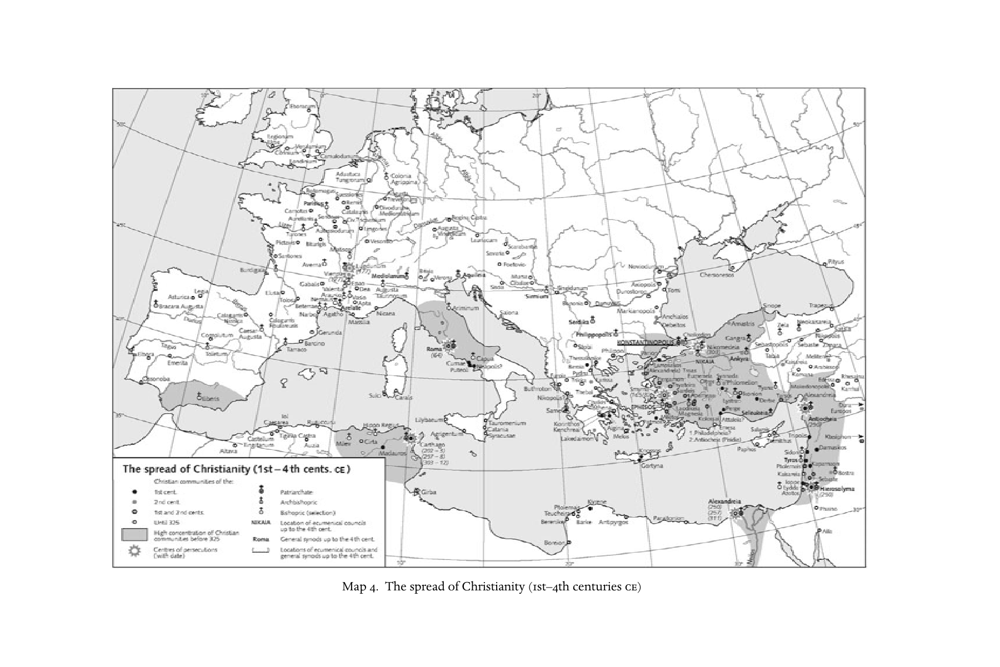

*地图4　基督教的传播，公元一至四世纪。原书第294页。图例：不同圆点分别标示一世纪、二世纪、一二世纪均有及截至325年的基督徒群体；阴影标示325年前基督徒密集区域；光芒符号标示迫害中心（括号内为年）；不同十字形分别标示牧首区、总主教区及主教区。NICAEA式大写地名为四世纪以前的普世会议地点；Rome式字样为同一时期的普遍性会议地点；括线符号表示两者兼有。图内地名保留原图。*


---

<a id="chapter-15"></a>

# 第十五章 从耶路撒冷直到地极

**作者：玛格丽特·M. 米切尔（Margaret M. Mitchell）**

《剑桥基督教史》第一卷《起源至君士坦丁》中文译稿

> 原书第295–301页，PDF第344–350页。完整翻译正文与解释性脚注；参考文献作者名、题名和定位保留原文。
>
> [第十五章英文原文](<第十五章 从耶路撒冷直到地极（英文）.md>) · [原书PDF](<../01 起源至君士坦丁.pdf>)

<!-- 原书第295页；PDF第344页 -->

使徒保罗，以及路加笔下复活的耶稣，都设想基督教运动从耶路撒冷向外，扩至地中海世界，远达罗马、“直到地极”（徒1:8；罗15:19、24）。本部分诸章，将追踪前三世纪基督徒群体如此分布的进程与影响：小亚细亚、亚该亚、埃及、叙利亚、美索不达米亚、高卢、北非与罗马。地区考察的目的，是辨认基督教在这些地方扎根时的本地特征，也注意各地区教会兴起时的相似、根本一致及相互对应。各地主要特点——与罗马帝国相关的历史政治经历、本地宗教崇拜与组织、语言及固有习俗——无疑影响传教如何在土地上生根、成长。但这并不意味着，各教会不觉得自己属于世界性现象；定期交流与相互联系，支持了这种意识，它们也分享某些基本信念与实践。[^ch15-1]

在或许是现存最早、公元216年以前某时的基督教铭文中，弗里吉亚·萨卢塔里斯地区希耶罗波利斯主教阿伯基乌斯的著名墓志，叙述二世纪末的旅行；他自觉使自己与较早保罗的行程、经验相联：“无论何处，我们都有保罗作伴。”[^ch15-2]保罗以后一个半世纪，他从亚细亚家乡，游历罗马、叙利亚、尼西比斯、美索不达米亚的基督徒群体，说处处遇到这场运动的某些恒常要素。

<!-- 原书第296页；PDF第345页 -->

这些要素包括，学习主“可信的文本”（grammata pista），在“朋友”（philoi）中共享食物的圣餐庆祝，以及在前引路的共同“信仰”（pistis；第12–16行）。他自称“圣洁牧人的门徒（mathētēs poimenos hagnou），他在山岭和平原牧养羊群”。[^ch15-3]墓志生前写成，结尾直接向路过、可能读到的人呼求，称其为“理解这些事的人”，请他在自己死后代祷（第19行）。前面的隐晦言语，与结尾这种会意式称呼，都预设一个志同道合的群体；即使外界不知其身份，彼此却能辨认。联结他们的纽带，是圣洁牧人与童贞女、共同文本与餐桌、饼、酒和鱼。

阿伯基乌斯与其典范、属灵同伴保罗，有一显著不同。五十年代末，保罗在西行前极力最后一次访问耶路撒冷（罗15:23–32）；阿伯基乌斯却掠过耶路撒冷与犹太地区，毫不提及。他显然已近至“叙利亚平原”，仍不觉须南下，看看一世纪后海伦娜等人视为“圣地”的地方。这种忽略，表明头两个世纪基督教实际及象征地理的重心，发生重大转移。毕竟，墓志焦点，是他游罗马、见到辉煌的惊叹：那里的教会如“穿金袍、着金鞋的王后”，又是“拥有灿烂印记的子民”（第7–9行）。这期间，耶路撒冷教会发生了什么？

<!-- 原书第296–297页；PDF第345–346页 -->

基督教史最重要事实之一，是大多数耶稣追随者，移出其传道的加利利与犹太地区环境。其死后，加利利仍有追随者的证据，可见《马可福音》坟墓旁年轻人的消息：[^ch15-4]复活耶稣“在他们以先往加利利去”（16:7；参14:28）；也许Q等某些言论传统的乡村色彩，也是证据。材料亦表明，最早追随者有耶路撒冷中心，但令人沮丧的是，这个早期巴勒斯坦教会的确切历史，所知极少。

路加记早期在主的兄弟雅各及彼得领导下，经历司提反、约翰兄弟雅各殉道等关键事件；迫害使除使徒外的基督徒“四散”（徒8:1）。关于耶稣兄弟、“义者”雅各之死，约瑟夫斯与后来基督徒材料赫格西波，大体似一致：约61年，他死于宗教当局之手；按后者，在圣殿地点，被石击或棍杀。[^ch15-5]“主的兄弟”[^ch15-6]雅各在运动最初几十年，已是耶路撒冷基督徒领袖，最早材料保罗书信，也提供印证（加1:19；2:9；参林前9:5）。

但雅各、彼得的宗教、神学及传教立场，极难重构；保罗书信是论战，而非描述，尤其参《加拉太书》2:11–14。难确定，他在加2:11所说“从雅各那里来的某些人”，是否相当于2:12“受割礼者”，阻止彼得与外邦信徒同席时，是否奉雅各命令、权威行事。《使徒行传》第15章，从晚得多的视角描写“耶路撒冷会议”，力图将雅各、彼得与保罗及外邦使命相联，[^ch15-7]同时预设耶路撒冷某种母教会权威。

如今《新约》的《雅各书》，若1:1“上帝与主耶稣的奴仆”，意指这位“主的兄弟雅各”，便将他呈为可敬的教会权威，向散居“十二支派”信徒写通函；这也反映犹太地区或耶路撒冷视角。[^ch15-8]但像《使徒行传》，该信大概反映外邦、无需守律法的使命获胜后，从较晚角度，将雅各保罗化；参1:25推崇“使人自由的完美律法”，另参2:8。若这份文本是托名，我认为确实如此，[^ch15-9]就须承认，我们实际上没有出自第一代耶路撒冷教会的一手文献。[^ch15-10]

<!-- 原书第298页；PDF第347页 -->

不过，保罗五十年代大力“为耶路撒冷圣徒”募捐（林前16:1–4；林后第8、9章；罗15:25–29；原文参《加拉太书》2:9），似为不可否认的证据：耶路撒冷群体被他人、也大概自我视为日益世界化运动的某种母体。[^ch15-11]但这不会持续。

内部发展与压力，我们所知虽少，两件重大社会政治事件，却无疑塑造其命运：66–70年，罗马人围攻、摧毁耶路撒冷；约六十年后，哈德良镇压犹太起事。优西比乌报告，[^ch15-12]耶路撒冷基督徒经启示（apokalypsis）中的神谕警告，在居民被困城内、经历约瑟夫斯《犹太战争》生动描写的艰苦最后围城以前，已逃离。[^ch15-13]他说，他们奉命居住（oikein）于佩拉；该城在比利亚，即约旦河东，属罗马叙利亚行省与“十城”地区。

对优西比乌，这一迁居（metoikizesthai），支持一个神学论点：耶路撒冷毁灭，是上帝惩罚犹太人数十年前杀害耶稣。[^ch15-14]他取用约瑟夫斯对那数月可怕苦难的记述，强调神圣报复专指犹太人，基督徒则蒙天意保护。[^ch15-15]他甚至说，基督徒早年住在耶路撒冷，使城市在耶稣死至提图斯攻占之间，得四十年缓刑（HE 3.7.8）；又借约瑟夫斯本有多重方向的护教叙述，强调城中犹太人如何顽固拒绝神圣预兆，不悔改地奔向审判。

<!-- 原书第299页；PDF第348页 -->

第二件关键事件，是哈德良镇压132–135年巴尔·科赫巴起义，把耶路撒冷重新命名、奉献为埃利亚·卡皮托利纳；犹太人不但不准居住，连远望都不许。优西比乌像对每个大中心那样，试图建立耶路撒冷主教的规范继承表时，说135年以前主教的细节难知，他们多数任期短，却能由文字记录证实十五位。他强调，哈德良征服标志群体和领导层转变：从“血统为希伯来人”、拥有“受割礼者中的主教”（HE 4.5.3–4），变成“来自外邦人的教会”，任命首位主教马尔库斯（4.6.4）。在优西比乌眼中，此时耶路撒冷正式像世界其余地方一样，成为外邦使命的一部分。他似乎极力把犹太基督教写成从此已逝的过去。[^ch15-16]如今，这座城像任何地中海城市，拥有官方“异教”崇拜，包括维纳斯神庙所在之处；君士坦丁后来将在那里建教堂，纪念耶稣埋葬地。

但隔绝、重新奉献耶路撒冷，不意味着基督徒或犹太人被从巴勒斯坦完全清除。[^ch15-17]许多犹太人迁至凯撒利亚、雅夫内等沿海城市，也去塞佛里斯、提比里亚等加利利城市。优西比乌保留一则有趣传统：据称耶稣经兄弟犹大的侄孙们，被从加利利带至96年去世的图密善皇帝前；当局怀疑他们想恢复祖传大卫家族的政治权利。他把他们描成自己时代殉道者的色彩：虽然只是粗朴农民，给皇帝看粗糙双手，就轻易证明无害，但司法磨难及与耶稣血缘，使他们“成为教会领袖”（HE 3.20.6）。

<!-- 原书第299–300页；PDF第348–349页 -->

他自己的《巴勒斯坦殉道者记》（De martyribus Palestinae），是一部独立作品，也附于《教会史》第8卷某些版本；[^ch15-18]其中有对四世纪初巴勒斯坦、腓尼基、埃及、叙利亚、小亚细亚基督徒死亡的亲见见证。对他而言，共同受邪灵煽动的国家当局迫害，此处是303–311年戴克里先与马克西米努斯·达亚的敕令，[^ch15-19]使当世教会在全世界合一，巩固其继承最早基督徒的主张，因为命运相同。他记四十多位巴勒斯坦信徒之死，包括加沙周围诸教会主教西尔瓦努斯，以及其导师、凯撒利亚长老潘菲卢斯（HE 8.13.5–6）。

他的家乡海滨凯撒利亚，是巴勒斯坦主要沿海城，一百多年来以基督徒与犹太人生活、学问中心著称；其基督教根源可追溯最早时期：保罗被囚两年，见徒第23–26章；彼得使罗马百夫长哥尼流归信，见徒第10章。大希律为荣耀罗马统治者而扩建的这座辉煌希腊化海港，在本卷整个时期，都是基督徒与犹太人的家，其释经彼此影响，连相互抨击也证明这点。[^ch15-20]极重要的事件，是约231年奥利金从亚历山大里亚迁此，建立基督教学园、图书馆与文本生产中心。[^ch15-21]

<!-- 原书第300–301页；PDF第349–350页 -->

两次起义后的毁灭、隔绝，使散居与中心的传统关系，某种程度翻转；直到四世纪基督教“圣地”传统形成，方向才再度逆转。[^ch15-22]其间，按《致丢格那妥书》，基督徒遍布帝国，却不同于犹太人，既不由土地、语言或习俗区分，也无特别城市、方言或生活方式；他们住在“外邦”和“蛮族”城市，各随当地衣食、生活风俗（5.1–5）。对匿名作者，这种顺应地方习惯、使基督徒在文化上不可见的情况，令人惊叹。他用可追溯保罗与约翰作品的神学悖论表达：在世而不属世，因为有自己的共同体。他们的寄居，不由距耶路撒冷，而由距天上多远界定：“每个异乡都是他们的故乡，每个故乡又都是异乡。”（5.5）他强调基督徒如“灵魂”、世界如“身体”的区分，以突出二者分离、可分。

但若目的不同，也可用同一比喻，考察灵魂与身体如何相互关联。对于古代基督教史家，这一意象，以及作者的让步，迫使我们追问：各种“地方风俗”，如何影响不同地区的基督教？地中海各地继承、吸收的语言与生活方式，当然不可能不影响各群体的表达、仪式及生活。每地也受当地罗马统治的现实制约，其中既有变化也有恒常，还受显著人物及历史事件塑造。正如将看到，没有地区是自足孤岛；因此，每地特有的记述，部分也是互动史。

不过，在跟随保罗、阿伯基乌斯等人环行地中海之前，先转向研究最初几世纪基督教传播与人口规模所涉及的问题：在这六个地区，讨论君士坦丁以前基督教的“扩展”或“兴起”，我们究竟在说多少人？

## 脚注

[^ch15-1]: Markshies, Between two worlds与Grant, Augustus to Constantine，恰当地强调这一点，反对自鲍尔以来、强调各类基督教与基督徒极大差异的模式。显然，历史学家必须同时保持这两方面。

[^ch15-2]: 第11–12行。原书所引文本据Lüdtke and Nissen, Die Grabschrift des Aberkios, 36–42，英译由本章作者完成。

[^ch15-3]: 第3–4行。较早研究曾争论碑铭属于基督教、“异教”，如Harnack, Zur Abercius-Inschrift，还是混合信仰，如Dieterich, Die Grabschrift des Aberkios。较近研究认为，其密集象征、暗引，加上此“阿伯基乌斯”很可能就是优西比乌所说反孟他努派人物阿伯基乌斯·马尔凯鲁斯（HE 5.16.2），使基督教归属更可能。参Wischmeyer, ‘Die Aberkiosinschrift als Grabepigramm’；Merkelbach, ‘Grabepigramm’；Snyder, Ante pacem, 247–50。

[^ch15-4]: 《马可福音》坚持耶稣曾在十城地区传道，可能反映作者时代当地基督徒群体：5:1、20；7:31，地点混乱；8:13、22等。

[^ch15-5]: Josephus, AJ 20.200；赫格西波，转引于Euseb. HE 2.23。

[^ch15-6]: 近来学界对雅各颇有兴趣，参Chilton and Evans, The Missions of James, Peter, and Paul及James the just and Christian origins。“雅各骨瓮”的发现与后来被否定，是讨论中有趣、最终却无关的一部分。耸动主张见Shanks and Witherington, The brother of Jesus。对于争论、夸大的重要性主张，以及以色列文物局报告认为，骨瓮现有形式的箱体与铭文受过现代“加工”，参Mitchell, ‘Does the James ossuary bring us closer to Jesus?’、‘Grave doubts about the “James ossuary”’，以及Painter, Just James。这里“近来”“后来”等时间表述均沿用原书写作语境。

[^ch15-7]: Barrett, Freedom and obligation; Haenchen, Acts; Conzelmann, Acts; Fitzmyer, Acts of the apostles.

[^ch15-8]: Bauckham, James持此观点。

[^ch15-9]: 近来为真实性辩护者包括Bauckham与Johnson, The letter of James。但论证仍无法克服：书信娴熟的希腊文、对保罗传统的认识，以及不大可能的产地；托名性质尤其参Dibelius, James。

[^ch15-10]: 两封彼得书信也一样，都是托名。第一封像《雅各书》，写给“散居地的寄居者”（1:1）。“犹太基督教”材料的详细描述，参第二部分第4章。

[^ch15-11]: 参上文第二部分第5章。

[^ch15-12]: 另有Epiph. Pan. 29.7.7–8；30.2.7及Mens. 15。Koester, ‘Origin and significance of the flight to Pella tradition’认为埃皮法尼乌独立于优西比乌。还有争论：这一传统是否在Mark 13:14及平行经文背后，抑或从其衍生；参考文献见Davies and Allison, Matthew, vol. iii, 347。

[^ch15-13]: Euseb. HE 3.5.3.

[^ch15-14]: Attridge and Hata, Eusebius, Christianity, and Judaism; Grant, Eusebius as church historian.

[^ch15-15]: 约瑟夫斯如何成为教父文献的重要来源，而反讽地服务于取代论、反犹太教的神学议程，参Schreckenberg, ‘Josephus in early Christian literature’；Hardwick, Josephus as an historical source。

[^ch15-16]: 须注意，考古记录是否证明二、三世纪巴勒斯坦有基督徒，尤其犹太基督徒，仍有争议；参Taylor, Christians and the holy places。

[^ch15-17]: 证据汇集于Mullen, Expansion of Christianity, 21–33。

[^ch15-18]: 全文以叙利亚文保存。

[^ch15-19]: 参下文第六部分第28章。

[^ch15-20]: 参Hirshman, A Rivalry of Genius。

[^ch15-21]: 参下文第19章及第五部分第27章。凯撒利亚图书馆、学园的管理，从奥利金到潘菲卢斯、再到优西比乌，有近一个世纪的连续线。

[^ch15-22]: Wilken, The land called holy；Taylor, Christians and the holy places；Walker, Holy city, holy places；亦参上文序篇。


---

<a id="chapter-16"></a>

# 第十六章 概览：基督教的地理扩展

**作者：弗兰克·特龙布利（Frank Trombley）**

《剑桥基督教史》第一卷《起源至君士坦丁》中文译稿

> 原书第302–313页，PDF第351–362页。完整翻译正文与解释性脚注；数字估计及其争议，均按作者原文保留。参考文献作者名、题名和定位保留原文。
>
> [第十六章英文原文](<第十六章 概览：基督教的地理扩展（英文）.md>) · [原书PDF](<../01 起源至君士坦丁.pdf>)

## 方法、材料与人口判断

<!-- 原书第302页；PDF第351页 -->

最早基督教的人口研究，始于阿道夫·冯·哈纳克Die Mission und Ausbreitung des Christentums。他批判分析文学材料，认为凡有殉道叙事，或明确有主教驻地的地方，就有具人口意义的基督徒群体。这一判断受德尔图良、奥利金影响；二人都说，基督教在帝国各地迅速扩展，连不列颠等偏远角落亦然。此后近一世纪研究，使问题更清楚，却仍属起步。[^ch16-1]第一步，是特别考察哈纳克开创工作以后，新出现了什么证据。

三类证据适合人口分析：铭文、纸草与考古遗物。作为物质材料，只要能相对准确断代，它们容许我们将早期群体，定位于具体地点与历史时刻。铭文最有用，因为城乡分布广，且作为民间文书，表达普通人的社会规范、神学观念；其中绝大多数是墓葬铭文。

大多数君士坦丁以前的基督教墓铭，发现于罗马、小亚细亚弗里吉亚、罗马非洲，或许还有西西里叙拉古。[^ch16-2]四世纪以前，铭文谨慎展示死者、家属的宗教归属。基督徒常与异教邻人共用墓地，含糊暗指信仰，其他方面却遵从本地葬俗。

<!-- 原书第303页；PDF第352页 -->

罗马地下墓窟，有一长系列三世纪后半的拉丁文基督教铭文。三世纪弗里吉亚基督徒石碑，常雕成异教墓祭坛形状，带死者及家属浮雕、所从行业象征，并在顶端刻凹槽，供献祭死者。但也有区别，例如铭文末尾常见的防盗墓诅咒。惯常异教诅咒，要求破墓者向神庙金库罚款，有时呼地下神明惩罚；基督徒则常只说：“他须向永生上帝交账。”此程式起于弗里吉亚尤美尼亚。从三世纪后期此类铭文占优势判断，当地基督徒多于异教徒。

基督教不是religio licita，即“合法宗教”；迫害威胁常在，纪念物就表现审慎。希耶罗波利斯境内阿伯基乌斯墓祭坛铭文，是醒目例子。其语义暧昧，是修辞杰作，却明确属基督教；用日常希腊语表达神学，提及与罗马、叙利亚群体的联系。[^ch16-3]也有纯基督徒nekropoleis，即“亡者之城”，容许更鲜明、有时更具战斗性的表达。例如，弗里吉亚乡村有“基督徒为基督徒”的铭文。另一些使用chi-rho，即希腊字母Χ、Ρ合体，起初简写基督之名，312年后成为胜利象征。若铭文无基督徒语句、象征，主张文本及受纪念者属基督教的铭文学者，便承担举证责任。

离开罗马与小亚细亚，铭文证据更有限。可断代的君士坦丁以前铭文，很少。基督教首先在叙利亚安提阿认同希腊语言、思想；其乡村辖地基督教铭文虽多，却到四世纪第二个四分之一时期才开始。罗马非洲多数城市，都有主教主持小群体，但可断代的三世纪铭文，只限少数城镇。[^ch16-4]

<!-- 原书第304页；PDF第353页 -->

238年一位拉西尼娅·塞昆达（Rasinia Secunda）的大理石墓碑，使我们知道提帕萨四世纪前的群体。[^ch16-5]它是各地已知最早基督教铭文之一，说明铭文与考古有时如何互证。其名Rasinia似有布匿或柏柏尔来源。伊特鲁里亚克卢西乌姆，还有一小组铭文，一件希腊文，其余拉丁文，或属三世纪末、四世纪初。[^ch16-6]

铭文所能提供，主要只是某地群体形成的最迟界限，无论大城、乡村辖地或帝国庄园。当地起源，可能比首件铭文早数十年，甚至数世纪。它们大力支持哈纳克对尼西亚以前文学证据的理解，证实新信仰存在于小镇、乡村；但须与文学及考古合用，才有确定结论。

君士坦丁以前的基督教考古，只限少数地点。[^ch16-7]罗马占主导。最早纪念物，是主教自三世纪初陆续获得的地下墓窟；其艺术装饰，让人窥见当地信徒神学关切。270年代初奥勒良城墙圈入的人口中，基督徒已占可见比例。现存最早教会建筑，似为三世纪的Titulus Equitii。[^ch16-8]另一处是幼发拉底河边境行省城杜拉欧罗波斯。约250年，一所住宅改为教会，其中壁画表达群体特点；[^ch16-9]善牧等主题，与阿伯基乌斯碑铭呼应。努米底亚提帕萨，已辨认出三世纪末基督徒建筑、墓地，[^ch16-10]拜扎凯纳Henchir Skihra也有墓地。亚历山大里亚慕道学校，必有附属教会建筑；奥利金说，教会（ecclēsiae）在250–251年德修迫害中焚毁。[^ch16-11]

<!-- 原书第305页；PDF第354页 -->

四世纪以前纸草，只从埃及保存下来。[^ch16-12]像铭文，属民间文书。除少量二世纪、三世纪初七十士译本及福音残片，大多属三世纪末，为家事、生意而写。私人信含神学启发的观察、问安，如“共同救赎”“我向上帝祈求，你各方面一直健康”。[^ch16-13]也像铭文，措辞含糊，可能使作者信仰难定。纸草大量说明，普通基督徒如何思考、沟通；若出土点经发掘得知，可辅助人口判断，但确切产地不总清楚。

追踪扩展，文学材料仍是主要途径，因为它描述广泛跨地中海联系网中的个人、群体行为。优西比乌《教会史》，记主教驻地及通信网络。纸草证明其规模、范围，例如三世纪初，里昂爱任纽《反异端》残片已到埃及俄克喜林库斯。[^ch16-14]另一封信，约264–282年，由罗马代理人寄给阿尔西诺伊州一群基督徒，提及教职行政网络协助卖粮、亚麻。[^ch16-15]

优西比乌清楚描写地方文学传统兴起，孤立文献也互证：如三世纪中叶，新凯撒利亚的行神迹者格列高利，以教规书信，裁断小亚细亚遭萨珊波斯入侵受害者事务；[^ch16-16]以及迦太基居普良书信，显示基督教观念、人员，如何沿社会、地理路线，进入跨地中海各目的地的行省生活。殉道叙事、神学论说及其他地方思想经验产物，沿同样路线传播。海陆网络的行政结构，给地方群体所需制度力量，以传播观念、吸引新参与者。[^ch16-17]

## 基督教化的统计估计

<!-- 原书第306页；PDF第355页 -->

罗德尼·斯塔克一项研究，估计罗马帝国基督徒比例，约250年为1.9%，300年10.5%，350年56.5%。[^ch16-18]其框架假定，约40至350年，每十年增长40%。这比爱德华·吉本以来传统估计乐观；吉本认为，312年君士坦丁米尔维安桥获胜时，基督徒约占5%。[^ch16-19]哈纳克、A. H. M. 琼斯、R. M. 格兰特拒绝给精确数值。[^ch16-20]拉姆齐·麦克马伦、基思·霍普金斯提出更近斯塔克的增长率，其他人则明智地谨慎看待。[^ch16-21]事实上，约325年以前，无法确定估计全帝国人数；也许罗马城例外，但它某些方面独特。[^ch16-22]

特殊因素包括帝国首都地位。人口过度增长，部分来自以皇帝名义，把帝国庄园免费粮食发给平民。图拉真建筑计划，使罗马成为工匠趋赴的中心，吸引地中海各地熟练工。建设、贸易与移民的特殊组合，使它难为全帝国的量尺。

罗马及其他地方迫害的频率、强度，也难确定。[^ch16-23]即使知道，也只能显示群体公众可见程度，未必表示人数。例如，居普良书信未量化，甚至未暗示250年按德修敕令，在罗马、迦太基献祭的lapsi，即失足信徒，有多少。

## 拥有基督徒人口的城市

<!-- 原书第306–308页；PDF第355–357页 -->

哈纳克估计，约175年罗马有10,000名基督徒。这与斯塔克估计约150年全帝国40,496人相合，却也许不合其约200年217,795人之数。四世纪末传统，提到元老、骑士等级的基督徒，[^ch16-24]包括166年补任执政官M. Vibius Liberalis、康茂德时承认基督徒身份的元老阿波罗尼乌斯，以及297年去世的骑士Valerius Victor Paternus。罗马教会行政组织、经济财富，对城内诸教会（tituli）的管辖，远在约254年前已巩固。[^ch16-25]此时人数或约40,000，占估计700,000的内城人口5–10%。[^ch16-26]这或能解释德修的话：“我宁愿听到有对立皇帝起而反我，也不愿罗马再有一个主教。”[^ch16-27]

很难说，罗马模式多准确反映欧洲拉丁地区行省城镇。阿奎莱亚、卢格杜努姆，即里昂，等大城，有来自帝国东方的低地位移民；但铭文少、甚至没有，四世纪前考古也少，不像罗马圣若望保禄堂、圣克莱孟堂可能的家教会。[^ch16-28]里昂人口情况，来自优西比乌保存的177年当地与维埃纳殉道者书信。[^ch16-29]位于罗讷河上游，它是传向高卢中部的焦点。某些高卢主教在德修迫害被杀，无人接任，但群体无疑小。[^ch16-30]可能有君士坦丁以前建筑的城镇，包括Civitas Turonum，内有家教会，及Biturigae、Tolosa、Autessiodorum、Rotomagus。[^ch16-31]西班牙最早可断代铭文，似为354年；但254年莱昂、梅里达教会致居普良信，约305–306年？埃尔维拉会议主教名单，以及若干四世纪初石棺，证明有教会制度。[^ch16-32]会议教规显示，成员任公职，也与异教家庭通婚。[^ch16-33]不列颠直到四世纪中叶，无明确考古或文学证据；唯一例外，是模糊的圣阿尔班殉道传统，可能在德修迫害中。[^ch16-34]

<!-- 原书第308页；PDF第357页 -->

非洲诸行省小镇的扩展，最难追踪。据说，约240年，兰拜西斯会议有九十名左右主教。[^ch16-35]这些驻地，或Altava、Satafi、Sitifi、Sufasar、Thamalla等镇新生群体的零星知识，只来自少量有日期铭文；它们不提供具名者的职业、族属。[^ch16-36]哈德鲁梅图姆，有带铭文的三世纪基督徒地下墓窟。[^ch16-37]

文学材料，确立约300年前主教、群体在哪里。优西比乌引用赫格西波回忆录，提克里特戈尔提纳、克诺索斯，以及小亚细亚北岸阿马斯特里斯的主教。[^ch16-38]约195年去世的爱任纽，西行经过这些地方。从士每拿往罗马后，赴里昂，最终任主教，却持续与罗马通信、再次赴访。[^ch16-39]某些主教主持小群体；但人数、构成、阶级结构、职业组成，不能只由教会通信确定。

基督教在东地中海海港扩展较快，很快进入小亚细亚腹地。文学、铭文，证明它在异教为主的亚细亚、加拉太、吕底亚、弗里吉亚城镇，以及更东卡帕多西亚、本都存在。[^ch16-40]314年，半自治的亚美尼亚诸侯接受基督教，成为这一进程高潮。[^ch16-41]300年前巴勒斯坦城市证据少；优西比乌《巴勒斯坦殉道者记》，表明信徒集中于省会凯撒利亚、加沙港马尤马，也零散来自埃利亚、狄奥斯波利斯、埃留塞罗波利斯、加大拉、雅姆尼亚、斯基托波利斯等地。[^ch16-42]埃及俄克喜林库斯等城，稳步增长；但各处出土纸草数量差别极大，难说多典型。

<!-- 原书第309页；PDF第358页 -->

希腊方面，奥利金说，约250年雅典群体“温和、安静”；还有一件三世纪后期铭文存世。[^ch16-43]庇哩亚、哥林多、埃德萨、腓立比、帖撒罗尼迦，似也有君士坦丁以前墓铭。[^ch16-44]希腊行省及爱琴岛屿的早期教会，由四世纪前设施、遗物得知，包括米洛斯地下墓窟、克诺索斯四世纪初Sanatorium巴西利卡以前的墓葬，以及腓立比、帕特雷墓中灯具。[^ch16-45]

## 基督徒人数及其与非基督徒的比例

<!-- 原书第309页；PDF第358页 -->

约300年，大多数地中海城镇，基督徒似只是很小少数，但有地方差异。已知只有四处，他们在人口上占主导：弗里吉亚科提艾乌姆、尤美尼亚；同在弗里吉亚、属异教纳科莱亚辖地的村庄奥尔基斯托斯；以及加沙港马尤马。较小的埃及俄克喜林库斯，295年已有两所教会，都是显著地标，街道因之得名；但至少也有四座异教神庙。[^ch16-46]相当数量居民属基督教，却可能不过半。安提阿、尼科米底亚、罗马、帖撒罗尼迦等省会、帝国驻地，似到四世纪中叶附近，才大体基督教化。许多行省城镇，可能类似阿拉伯波斯特拉，到四世纪中后，异教徒与基督徒约相当。[^ch16-47]

相比之下，阿佛洛狄西亚、阿斯卡隆、雅典、巴尔贝克—赫利奥波利斯、卡莱—哈兰、德尔斐、加沙等许多城，直到四世纪末、五世纪初，市议会仍以异教徒为主。约300年人数，只能从材料更好的后期反向推算，却不总令人满意。A. H. M. 琼斯广熟铭文，仍未信服吉本5%的估计；据弗里吉亚铭文、埃及纸草，它对某些行省也许偏低。[^ch16-48]

## 基督徒的社会阶层

<!-- 原书第310页；PDF第359页 -->

早期罗马群体，成员来自大型出租公寓（insulae）的工匠、获释奴隶，以及帝国家内工作的获释者、奴隶，尤其康茂德、塞普蒂米乌斯·塞维鲁及继任者时代。罗马和别处多数非奴隶基督徒，是peregrini，即来自帝国东方城镇及辖地、移居外乡的居民。在212年卡拉卡拉《安东尼努斯敕令》赋予帝国多数自由居民公民权以前，既无罗马公民权，也无拉丁权。此前，他们属管理罗马大量移民、多为希腊语东方人的praetor peregrinus，即外事裁判官管辖。二世纪末，拉丁语基督徒来自非洲行省。低地位，使他们在定期迫害中成为受害者；当局欲从城市中心清除“坏人”（mali homines），即违背社会规范、厌弃公共娱乐及宗教节庆的个人和群体。

四帝共治末年，[^ch16-49]社会、经济、文化各部门都有基督徒。锡卡的阿尔诺比乌斯、拉克坦提乌斯、行神迹者格列高利等文法家、修辞家、哲学家，在重要城市执业。受文法教育者，在皇宫、行省总督及帝国庄园机构中，任文职人员（Caesariani）。[^ch16-50]其中217年去世的Marcus Aurelius Prosenes，本为帝国获释奴隶，后任康茂德宫廷内侍、皇帝私库若干部门主管。墓铭似说，他被基督徒神明接纳（receptus ad deum）。[^ch16-51]

弗里吉亚尤美尼亚，有士兵Aurelius Mannos墓铭。他是骑兵、骑射手，担任draconarius，即“龙旗手”，在293年后不久任弗里吉亚、卡里亚民政总督的Castrius Constans麾下服务。[^ch16-52]优西比乌提到，戴克里先时帝国庄园高级主管阿道克图斯，以及安提阿长老多罗提乌斯，后者负责提尔帝国紫染工坊，政治敏感。行省铭文也列基督徒市议员（curiales、bouleutai），尤其尤美尼亚。

<!-- 原书第311页；PDF第360页 -->

普通信徒，从事城市经济必需的广泛行业。铭文和文学，提农事日工、帝国庄园管事、银行家、亚麻织工、海商、编席者、养骡者、乡村庄园主、石匠、裁缝等。[^ch16-53]

## 乡村与城市

<!-- 原书第311页；PDF第360页 -->

除小亚细亚、北非部分地区，乡村扩展所知更少。农人对信仰、实践保守，怕破坏“诸神的和平”。不按祖传仪式献祭，被认为会疏远带来丰收的地上、天上神明，释放旱灾、洪水、冰雹等毁灭现象。基督教先在城镇近郊、城市态度盛行处扎根。《黑马牧人书》叙述者黑马，有丰产庄园，往返罗马与数小时外土地，栽葡萄、牧羊。[^ch16-54]游斯丁提乡民参加罗马礼拜。约300年前，无铭文证明基督徒住在奥勒良墙外庄园；直到四世纪后期，墙外大多数地区，他们在乡村人口中仍极少。

四世纪以前，帝国东方行省城市辖地，也有低地位乡村信徒。叙利亚、腓尼基、阿拉伯，大多限城镇；阿拉米、阿拉伯等不同闪米特宗教文化根深，乡村传播慢。大迫害时，奥斯若恩省会埃德萨城墙外不远，有乡村教职及信徒，[^ch16-55]包括Tell-She村执事哈比卜。巴勒斯坦方面，优西比乌《地名录》只说阿奈亚、耶塞拉、卡里亚塔三村人口多为基督徒。[^ch16-56]《巴勒斯坦殉道者记》提被起诉者，来自阿奈亚、凯撒利亚辖地一村，以及阿拉伯巴坦尼亚的村镇。[^ch16-57]

<!-- 原书第311–312页；PDF第360–361页 -->

长老普塞诺里斯的纸草信，提埃及西部沙漠哈里杰“大绿洲”聚落的基督徒掘墓者团队，埋葬一位可能的大迫害受害者。[^ch16-58]但叙利亚安提阿辖地，建筑广布的石灰岩山区，却未发现300年前铭文。晚期叙利亚第二省阿帕米亚、黎巴嫩腓尼基省埃梅萨和大马士革、阿拉伯波斯特拉辖地，也一样。

弗里吉亚乡村墓铭，本身不证明每村有信徒；许多属于城市基督徒，如尤美尼亚议员，按帝国法、习俗，葬于城墙外。乡村基督徒与异教徒相比，难估人数，只可说少数，或5–10%。他们稀少到，奥利金约250年说：“有些人……不只周游城市，甚至去村落、乡舍，工作使他人虔敬上帝。”[^ch16-59]

卡尔·霍尔很早就提出，基督教吸引地中海腹地少数语言群体，尤其乡村非洲、埃及、弗里吉亚；贫困使农业劳动者疏离大地主。[^ch16-60]这一论题，只有非洲得到证实。180年，非洲总督在马达乌拉起诉的Namphamo、Miggin、Lucitas、Sanae，其姓名研究显示布匿或柏柏尔背景。相对地，西利殉道者有普通拉丁名，只有Nartzalus为柏柏尔或布匿名。非洲、努米底亚的乡村贫困，表现为战斗性的殉道基督教，三世纪后期在城镇辖地占据主导。

## 结论

<!-- 原书第312–313页；PDF第361–362页 -->

基督教扩展的人口问题，仍有争议。约翰内斯·格夫肯1920年清楚论证，250–300年五十年间，异教神庙奉献物数量决定性下降。[^ch16-61]W. H. C. 弗伦德依据其分析及大量新证据，亦认定此半世纪，是基督教决定性扩展时期，因而刺激四帝共治发起大迫害。[^ch16-62]霍普金斯、麦克马伦与斯塔克的数字乐观，却不支持彻底改释。

近来铭文发现，反而提示异教崇拜，比格夫肯想的更缓慢衰退，有些圣所甚至延续至四世纪末。空神庙、死神明，如今更多被视为三世纪后期经济调整的症状：边境蛮族压力、文职军事化、收入需求增加，尤其四帝共治期间。约300年，基督徒增至帝国人口5–10%，这就是其政治背景。对归信者原有宗教归属，所知太少，不能判断异教信念、仪式的不足。究竟什么使他们选择基督教一神论？阿尔诺比乌斯、奥利金的护教，显示思想说服的类型，却极少告诉我们，什么个人经验，把人吸引进基督徒慕道生活。

## 脚注

[^ch16-1]: Mullen, Expansion of Christianity.

[^ch16-2]: SEG 15 (1958)，第580–587项，叙拉古，约275–325年。

[^ch16-3]: 参上文第15章及图4。

[^ch16-4]: Mullen, Expansion of Christianity, 320–6.

[^ch16-5]: ILCV 3319.

[^ch16-6]: Mullen, Expansion of Christianity, 190f.

[^ch16-7]: 参Snyder, Ante pacem。

[^ch16-8]: Gounares, Eisagōgē stēn palaiochristianikē archaiologia, 57; Mullen, Expansion of Christianity, 200.

[^ch16-9]: 参下文第六部分第32章及图6。

[^ch16-10]: Mullen, Expansion of Christianity, 325.

[^ch16-11]: Frend, Martyrdom and persecution, 391.

[^ch16-12]: Tibiletti, Le lettere private；Roberts, Manuscript, Society and Belief；Mullen, Expansion of Christianity, 271–9、282–4；参下文第18章。

[^ch16-13]: P. Oxy. 1492，三世纪末、四世纪初。

[^ch16-14]: P. Oxy. 405.

[^ch16-15]: Grenfell and Hunt编，The Amherst papyri, I, no. 3a。

[^ch16-16]: Gr. Thaum. Ep. can.

[^ch16-17]: Leyerle, ‘Communication and travel’.

[^ch16-18]: Stark, Rise of Christianity, 7.

[^ch16-19]: Gibbon, Decline and fall, vol. ii, p. 69.

[^ch16-20]: Harnack, Mission und Ausbreitung, 529–52; Jones, Later Roman empire, 96f; Grant, Early Christianity and society, 1–12.

[^ch16-21]: Hopkins, ‘Christian number’, 198–207；MacMullen, Christianizing the Roman empire, 102–19；另参Finn, ‘Mission and expansion’, 295页及以下。

[^ch16-22]: 参下文第22章。

[^ch16-23]: 参下文第六部分第28章。

[^ch16-24]: ILCV，第56、286项。

[^ch16-25]: Lampe, Paul to Valentinus, 142f.

[^ch16-26]: Frend, Martyrdom and persecution, 245.

[^ch16-27]: Cypr. Ep. 59.9.

[^ch16-28]: White, Architecture, vol. ii, 111–23.

[^ch16-29]: Euseb. HE 5.1；Frend, Martyrdom and persecution, 1–30；参下文第20章。

[^ch16-30]: Gregory of Tours, Historia Francorum 10.31；Hefele et al., Histoire des conciles, vol. i. 1, 275–7；另参Reynaud, Lugdunum Christianum；Mullen, Expansion of Christianity, 231。

[^ch16-31]: Bedon, Atlas, 93、122、306、310；另参Mullen, Expansion of Christianity, 230、236、239、241页及以下。

[^ch16-32]: ILCV 3932. Mullen, Expansion of Christianity, 253f., 256f.

[^ch16-33]: Hefele et al., Histoire des conciles, vol. i. 1, 215–64.

[^ch16-34]: Thomas, Christianity in Roman Britain, 42–50.

[^ch16-35]: Harnack, Mission und Ausbreitung, 895.

[^ch16-36]: ILCV 2815, 2853 n., 3665a, 3682 n., 3956, 4038 n., 4156C.

[^ch16-37]: Mullen, Expansion of Christianity, 304, 310.

[^ch16-38]: Frend, Rise of Christianity, 243.

[^ch16-39]: 参上文第三部分第13章。

[^ch16-40]: Mullen, Expansion of Christianity, 83–132.

[^ch16-41]: Mullen, Expansion of Christianity, 139.

[^ch16-42]: Taylor, Christians and the holy places, 56–64.

[^ch16-43]: Or. C. Cels. 3.30. IG 3/2 3435.

[^ch16-44]: Mullen, Expansion of Christianity, 160–2, 164–6.

[^ch16-45]: Laskaris, Monuments funéraires, 45f, 320, 446.

[^ch16-46]: Trombley, Hellenic religion and Christianization, vol. ii, 243f.

[^ch16-47]: Julian, Epistulae 41.

[^ch16-48]: Jones, Later Roman Empire, 96页及以下；Bagnall, Egypt in late antiquity, 280页及以下；另参Barnes, Constantine and Eusebius, 142。

[^ch16-49]: 参下文第六部分第30章。

[^ch16-50]: Frend, Martyrdom and persecution, 447.

[^ch16-51]: ILCV 3332；另参下文第22章。

[^ch16-52]: ILS 8881.

[^ch16-53]: 例如ILCV 645，罗马，269年。

[^ch16-54]: Herm. Vis. 1.1.2; Vis. 3.1.2; Vis. 4.1.2; Sim. 1.2.3; Sim. 1.5; 5.2.3; 6.2.1–7; 8.1.2; Mand. 11.8.

[^ch16-55]: Segal, Edessa, 85.

[^ch16-56]: Barnes, Constantine and Eusebius, 110.

[^ch16-57]: Taylor, Christians and the holy places, 60f.

[^ch16-58]: Grenfell and Hunt编，New classical fragments, no. 73。

[^ch16-59]: Or. C. Cels. 3.9.

[^ch16-60]: Holl, ‘Das Fortleben der Volksprachen’.

[^ch16-61]: Geffcken, Last days of Greco-Roman paganism, 25–34, 115–77.

[^ch16-62]: Frend, Martyrdom and persecution, 440–76.


---

<a id="chapter-17"></a>

# 第十七章 小亚细亚与亚该亚

**作者：克里斯廷·特雷维特（Christine Trevett）**

《剑桥基督教史》第一卷《起源至君士坦丁》中文译稿

> 原书第314–329页，PDF第363–378页。完整翻译正文与解释性脚注；参考文献作者名、题名和定位保留原文。原书下一页地图5为罗马埃及地图，将随第十八章保留。
>
> [第十七章英文原文](<第十七章 小亚细亚与亚该亚（英文）.md>) · [原书PDF](<../01 起源至君士坦丁.pdf>)

<!-- 原书第314页；PDF第363页 -->

正如《新约》所示，小亚细亚与亚该亚，是基督教的苗圃。教会在历史悠久的环境中栽植、成长、变化，雅典、哥林多、以弗所、别迦摩等城市，公民自豪感旺盛，文化多样。基督徒生活的背景是帝国，[^ch17-1]对多数人也是城邦：其中有竞争、地区显贵、协会，以及聚集的穷人。

## 证据

<!-- 原书第314–315页；PDF第363–364页 -->

理解基督教发展与多样化，小亚细亚尤为重要。其重要铭文，包括君士坦丁以前公开的基督教铭文，[^ch17-2]但常难确定，它们代表大公、[^ch17-3]孟他努或新预言、[^ch17-4]诺瓦提安派，[^ch17-5]还是其他形式。铭文弥补著作、艺术、遗物方面的空白。[^ch17-6]有些或属二世纪末，但某些已知有基督徒的地方，如亚细亚西部沿海及比提尼亚，整个三世纪却极缺铭文；参Plin. Ep. 10.96；Luc. Alex. 25。

显著者包括：第一，三世纪公开表明基督徒身份的墓志，显示他们与异教邻人良好融合；[^ch17-7]第二，216年前弗里吉亚阿伯基乌斯，希腊文Aberkios，墓志，[^ch17-8]此人可能是Euseb. HE 5.16.3的Avircius Marcellus，讲从罗马到尼西比斯，共同理解信仰、接待及圣餐，参Iren. Haer. 1.10.2；第三，三世纪初希腊、拉丁双语铭文，似乎终于定位提米翁，以及新预言派或孟他努派在弗里吉亚的“耶路撒冷”。[^ch17-9]

许多《新约》作品，与两地相关。[^ch17-10]使徒教父致当地、或出自当地的作品，与之年代重叠：《克莱孟一书》致哥林多；坡旅甲《致腓立比人》，[^ch17-11]以及出自士每拿的《坡旅甲殉道记》；伊格纳提乌二世纪初书信，有些寄给《启示录》第2–3章涉及的地区；[^ch17-12]千禧年主义者、与“长老们”有交往的帕皮亚残篇（Jerome, Vir. ill. 18；Iren. Haer. 5.33.4）。[^ch17-13]还存梅利托《论逾越节》、《使徒书信》（Epistula apostolorum）、[^ch17-14]《保罗与特克拉行传》，[^ch17-15]内嵌《哥林多第三书》，以及安得烈、彼得、约翰的《行传》；优西比乌保存的哥林多狄俄尼修残篇、反孟他努派作者、《以斯拉第五、第六书》及《以赛亚升天记》。[^ch17-16]其中某些产地有争议。

二世纪“混杂”“充满对抗”，[^ch17-17]护教文学力图说明基督徒异常社会地位的合理性。[^ch17-18]梅利托、希拉波利斯的克劳狄乌斯·阿波利纳里乌斯、[^ch17-19]雅典的雅典那哥拉，以及“教会的智辩家”米尔提亚德，[^ch17-20]向161–180年在位的马尔库斯·奥勒留及“世俗统治者”致辞。雅典阿里斯提德，与可能出自亚细亚、曾任雅典episkopos的夸德拉图斯，[^ch17-21]或为同时代人（Euseb. HE 4.3.3）。

<!-- 原书第316页；PDF第365页 -->

三世纪及四世纪初，又有优西比乌证据；但他提到曾经重要的人物，多已少知，如塔尔苏斯的赫勒努斯，反诺瓦提安分裂的活动者，支持为异端者重新施洗的东方实践（HE 6.46.3；7.5.4；7.28.1）。凯撒利亚的菲尔米利安一封信存世，哲学护教者拉克坦提乌斯有作品，以及关于当时人物的记述，如尼撒的格列高利论行神迹者格列高利。

许多早期文学已佚，包括帕皮亚、[^ch17-22]梅利托（Euseb. HE 4.26.2）、米尔提亚德（5.17.5；Tert. Val. 5）与狄俄尼修（4.23）的大部分作品。克林妥、马吉安、新预言派等，主要由对手文字得知。不过，恢复两地遗产，仍有广泛文本。

## 社会与文化特点

<!-- 原书第316–317页；PDF第365–366页 -->

小亚细亚，从今土耳其西岸至托罗斯山脉、向北延伸，拥有历史悠久的希腊城市；亚该亚，即希腊，[^ch17-23]则与它由共同希腊语言、地中海及其文化联系，也共同受无处不在的罗马行政支配。[^ch17-24]罗马吸纳地方联盟，把亚该亚首府哥林多等地，建为殖民城。[^ch17-25]几个世纪间，小亚细亚内部行政与边界多变。[^ch17-26]城市竞争、民间骚动，也参与统治者与被统治者相联的“权力网络”。[^ch17-27]城市可为希腊人、安纳托利亚人、罗马人、犹太人的熔炉。以弗所、士每拿、撒狄、本都等，根基稳固的犹太社群，[^ch17-28]对希腊化文化，可能强烈暧昧，也可能积极寻找适应办法。拉丁文用于帝国行政、法律、军事，希腊语为多数人的第一语言，部分地方其他语言也幸存。[^ch17-29]

本土及融入的外来崇拜，保持影响。小亚细亚长期是宙斯、弗里吉亚的梅恩（Men）、母神，尤其库柏勒、神化英雄，以及一神信仰之乡。[^ch17-30]从170年遭入侵、部分毁坏的厄琉西斯秘仪圣地，至波塞冬崇拜、以弗所与阿耳忒弥斯崇拜的经济交融、阿佛洛狄西亚与阿佛洛狄忒的联系，宗教象征嵌入建筑、制度、文字、雕塑等物中，被用来界定、主张、保持权力。图密善96年去世前，皇帝崇拜得到加强，尤其别迦摩、士每拿、以弗所；基督徒自我界定也回应而精炼。[^ch17-31]证据缺口、广大乡村缺文字记录，妨碍对基督徒与周围宗教文化接触的全面概览。

## 这一处境中的基督教

<!-- 原书第317页；PDF第366页 -->

关于以弗所、[^ch17-32]雅典的早期传统（徒第17–19章；原文另参林前1:14；15:32；18:23；19:1、10），显示基督徒、犹太人、异教徒、城市政治及巫术的接触。[^ch17-33]散居犹太人的存在，曾决定传教地点；但犹太社群若有自信，犹太人、基督徒、异教徒、当局之间，也可能紧张。传统联于以弗所的第四福音，提示这一点；[^ch17-34]路加描写亚该亚、亚细亚传教者与犹太人、有时敌意的民众，也如此，例如徒13:42–51；14:1–7；18:5–17、19–20。

在保罗基础上，[^ch17-35]小亚细亚部分城乡，基督徒的superstitio，即“迷信”，显著增长（112年的Plin. Ep. 96；参Euseb. HE 8.1）。铭文证明城市外有基督徒；对新预言的厌恶（Euseb. HE 5.16.7；5.18.2），也包含贬斥其起于弗里吉亚一个“村庄”和“小”地方。不过，多数材料仍关乎城市基督徒。

<!-- 原书第318页；PDF第367页 -->

图景并不一致。行神迹者格列高利240年代在本都家乡，发现信徒极少；[^ch17-36]三世纪弗里吉亚却从叙纳达、以哥念，至北部坦布里斯谷，都有群体，且不全属大公形式。戴克里先迫害时，据说至少一座弗里吉亚城镇全信基督。[^ch17-37]比提尼亚尼科米底亚附近，人数很多；爱西塞罗的哲学家拉克坦提乌斯，曾居那里。[^ch17-38]

整个时期，公众对基督徒的厌恶，持续存在，爆发为地方性、零星、有时更系统的敌意：普林尼—图拉真通信（Ep. 10.96.2、97.2）；哈德良致米努基乌斯·丰达努斯、争论甚多的批复（Euseb. HE 4.8.5–7；4.9；4.26.10；Justin, 1 Apol. 2.2）；[^ch17-39]《坡旅甲殉道记》；梅利托提的“新敕令”（HE 4.26.5）。如普林尼所示，信徒被处死，参Ign. Eph. 12.2；《坡旅甲殉道记》；《卡尔普斯、帕皮卢斯与阿伽托尼刻行传》；[^ch17-40]《皮奥尼乌斯殉道记》。他们也在卡帕多西亚自然灾难后受苦，见菲尔米利安、Cypr. Ep. 75，以及德修、四世纪初戴克里先与马克西米努斯统治下遭迫害。[^ch17-41]亚该亚也未幸免（Euseb. HE 4.26.3、10；5.24.2–5；尤其4.23.2）。通过《行传》的殉道话语，我们清楚见到竞争体系。[^ch17-42]

## 基督教与多样性

<!-- 原书第318–319页；PDF第367–368页 -->

瓦尔特·鲍尔1934年，挑战正统必先于异端的假定。[^ch17-43]较近分析，却容许平行发展，考虑教会内部信仰、实践分歧，更细致理解内部更新或分裂运动。因此，对于具体处境中，“内部者即正统”“外部者即异端”的边界，不再如此武断。尼西亚会议以前，是否应谈正统、异端这类范畴，值得质疑。[^ch17-44]

伊格纳提乌所称Christianism，即基督教，逐渐形成的大公形式，容纳某些神学、教会论及地区差异。此时，内外边界、文献范围正在确定，界线却不牢固。有些材料年代有争议，论战对象也难确定。例如，有人把《教牧书信》归坡旅甲，看为反马吉安论战，参Iren. Haer. 3.3.4；Poly. Phil. 7.1；近几十年，伊格纳提乌文集的年代、背景，也屡遭重估。[^ch17-45]分类群体与倾向，很容易错配。

### 基督教要有多“犹太”？

<!-- 原书第319页；PDF第368页 -->

珍视犹太教遗产者，仍在教会有影响。斯塔克把反对马吉安反犹太、二神及禁欲教导的攻击，归于他们“目前仍与犹太世界有强烈联系”。[^ch17-46]但从开始，《使徒行传》、哥林多两信、加拉太、歌罗西、提摩太前书、《启示录》即显示，对正确实践已不同意，涉及割礼、禁食物、安息日、律法、天使、启示及其他思辨。伊格纳提乌写基督徒“犹太化”与“旧酵”（Magn. 8–10；Phild. 6）。有些至少想保持所谓耶路撒冷使徒敕令要求的外邦区隔（徒15:19–20；林前8:1、4、10；10:19、28；启2:14、20），另一些连最低要求也拒绝。有时很难确定，作者批评真正的犹太人，还是基督徒“犹太化者”。

信徒彼此间，例如Ign. Phild. 6；Smyr. 5.3；7.2，信徒与犹太人间，以及各自与异教社会间，融合或不融合，都有广泛光谱；关系可密切、复杂，或紧张。马吉安同时代、锡诺佩的阿奎拉，先从异教归信，继而成为犹太教归信者。他把希伯来经书极按字面译成希腊文，构成对基督徒所用七十士译本的批评。[^ch17-47]

<!-- 原书第320页；PDF第369页 -->

十四日派争议，是凸显地区传统差异的特例，[^ch17-48]也关乎基督教有多“犹太”。150年代，坡旅甲维护亚细亚十四日派复活节实践，反对罗马倡导的另一方式。他与主教阿尼凯图斯相互尊重，同意保留差异；但实践变化，仍会妨碍罗马及其他地方不同族群信徒的普世关系。[^ch17-49]若干十年后，维克托强硬要求统一。[^ch17-50]罗马立场有许多支持者，但以弗所的波利克拉底，援引使徒时代“伟大光体”，包括“靠在主胸前”的约翰，约13:25，以及受尊敬殉道者、梅利托和自身历代主教先辈（HE 5.24.2–7；参5.23.1）。这些人坚定遵守可论为更“原初”的十四日传统。[^ch17-51]

维克托不退，让亚细亚教会绝罚；有些主教觉得太过。爱任纽斥其蛮横、不顾感受（Euseb. HE 5.23.1–24.18），但像阿里乌斯争议，十四日争议也未迅速平息。小亚细亚不只多样，更自豪于特性。面对罗马主张与不同实践，大公领袖坚守立场。

### 千禧年主义与预言活动

<!-- 原书第320–321页；PDF第369–370页 -->

千禧年主义（chiliasm）与基督徒预言活动，特别联于小亚细亚，虽也见别处。《启示录》第20–21章，表达新耶路撒冷、新天新地盼望；思想重现于希拉波利斯帕皮亚（Iren. Haer. 5.33.3及以下）、克林妥、“长老们”、爱任纽，以及新预言。[^ch17-52]三世纪，原籍卡帕多西亚的亚历山大里亚狄俄尼修，卷入争论（HE 7.24、25）；四世纪迫害中，又在奥林波斯的美多狄乌斯（Res. 1.55.1；Symp. 9.5）和拉克坦提乌斯（Div. inst. 7.21–26）重燃。拒绝寓意化的千禧期待，也是某些信徒中犹太遗产强大的另一表现。优西比乌不以为然（HE 3.39.13；7.24.1）。[^ch17-53]

自保罗时代，男女皆有预言活动，例如林前、徒21:8–11；它在小亚细亚重要，却随制度化获胜而边缘化。有异象者约翰及其圈中人、“耶洗别”（启2:20–24）、[^ch17-54]腓利女儿们、夸德拉图斯、阿米娅，以及诉诸预言“传承”的新预言派男女（Euseb. HE 3.37.1；5.17.4）。它未迅速消失，《以赛亚升天记》《使徒书信》《保罗与特克拉行传》、Cypr. Ep. 75论卡帕多西亚，以及后期孟他努派礼仪预言（Epiph. Pan. 49.2），均证明。四世纪女先知娜娜斯纪念铭文，尤其值得注意。[^ch17-55]若也考虑诺斯替派，女性预言的频繁很醒目；但整个时期，女性教会职事角色始终有争议。

伊格纳提乌、坡旅甲、梅利托兼具先知与主教角色，但两种权威、领导模式间，确有张力。《克莱孟一书》像《遗训》，阶层、性别、家长权利、巡回及庇护问题，都促成张力。[^ch17-56]新预言派付教师薪金，可能男女都有，使社会地位未稳者也能参与领导，更民主化（Euseb. HE 5.18.2，阿波罗尼乌斯），加剧大公方面的怀疑。

<!-- 原书第321–322页；PDF第370–371页 -->

新预言，后称孟他努主义，160年代，在普利西拉、马克西米拉与孟他努领导下兴起。它出自大公会众，与之差别主要在重点，而非教义，尤其权威、纪律行使。追随者后来分离或被逐，[^ch17-57]其狂喜预言（Epiph. Pan. 48.3.4–7.8）、著作[^ch17-58]和严苛主义受挑战。他们与许多亚细亚基督徒，共享约翰式道成肉身正统、反幻影说[^ch17-59]与反诺斯替立场，本章作者如此认为；也共享诉诸《新约》及其他先知为先辈的预言活动、约翰保惠师圣灵论，或许还有千禧年、十四日传统。若如Hipp. Haer. 8.19所说，某些追随者接受士每拿诺埃图斯的神格唯一论，那也属当地景观。

新预言迅速传至罗马、北非等地。它在禁食等方面更严，对失败、失足更不宽容；但不违反使徒传统，原则上也不反主教制。实际有一套比大公教会更复杂的教职等级，且纳入女性，有铭文为证。这类孟他努主义，虽在神学、实践上分裂多样，仍在小亚细亚存续数世纪。像诺斯替派，它成为大公传统界定自身的对照。

## 神学与实践的多样性

<!-- 原书第322–323页；PDF第371–372页 -->

二、三世纪发展“多方向，难以绘图”。[^ch17-60]亚细亚、亚该亚基督教传统的织锦，有许多线，包括多种“保罗主义”“约翰主义”；信徒诉诸祖传教师、群体创始者，正像协会及希腊城市各诉诸其先人。优西比乌图景简单（HE 3.1.1；参3.4.1）：新宗教经不同使徒影响而扩展、分化。亚细亚有约翰，亚该亚有安得烈，小亚细亚散居地有彼得，参彼前1:1；保罗“从耶路撒冷直到伊利里库姆”工作（徒16:6–7；17:10–18:1；18:23；19:1、10；26:9–15；罗15:19）。现实更复杂。

两地对保罗的记忆，各有不同：第一，克莱孟致哥林多信反分裂时，以他为可敬奠基使徒；[^ch17-61]1 Clem. 5.5、47.1，伊格纳提乌（Eph. 12.2；Rom. 4.3）、坡旅甲（Phil. 3.2；9.1）、爱任纽[^ch17-62]等，也同样敬佩。第二，《教牧书信》作者，把他呈为教会组织的大公倡导者，也在对手及保罗影响在亚细亚流失时，维护健全、非禁欲、社会保守教导（徒20:27–31；林前16:9；提后1:15；3:1–15；4:1–18）。[^ch17-63]

第三，锡诺佩马吉安希腊化、反婚姻的教义，[^ch17-64]将保罗理解为反犹太，在删短的经书“正典”中居主导。[^ch17-65]第四，按诺斯替主张，他是瓦伦廷导师丢大的老师。[^ch17-66]第五，《保罗与特克拉行传》，包括《哥林多第三书》，使他成为反幻影说正统与独身的倡导者。《新约》中其同工路加，在《路加福音》所谓“反马吉安序言”[^ch17-67]中，[^ch17-68]也是独身者、安提阿人，在亚该亚写福音，参Euseb. HE 3.4.6；Jerome, Vir. ill. 7，后死于比提尼亚，或波奥提亚。

禁欲派（Encratism）主张安得烈属己；其他传统则把他联系于亚该亚，拿先斯的格列高利、耶柔米如此，奥利金不同，见Euseb. HE 3.1；也联于小亚细亚，参约1:40–44；6:8；12:22。《安得烈与马提亚在食人城的行传》中，该城是本都锡诺佩。可能三世纪的禁欲派《安得烈行传》（HE 3.25.6），使他成为从本都至亚该亚的旅人，因教禁欲被囚；一个版本说，他在帕特雷被钉十字架。[^ch17-69]

《彼得行传》，可能为《保罗行传》作者所知，结合幻影说、禁欲要素，以及反对基督教诺斯替“之父”行邪术西门。[^ch17-70]再加神迹故事与民间虔敬的形态论神格唯一论，[^ch17-71]很难概括其思想。[^ch17-72]彼得影响触及亚该亚（林前1:12；3:22；9:5），但小亚细亚则由《彼得前书》，代表“主流”彼得传统。

<!-- 原书第324–325页；PDF第373–374页 -->

不止一位亚细亚“约翰”的遗产，很难理清。[^ch17-73]约翰福音（Iren. Haer. 3.1.1；Euseb. HE 5.20.6）的逻各斯教义（1:1–18），及圣灵、保惠师教导（14:15–17、25–26；15:26–27；16:7–15），成为三一教义的建材，在东方受重视。其先知性、保惠师神学，也塑造新预言。像约翰书信，福音书保存反幻影说基督论：成肉身之道耶稣，就是基督。[^ch17-74]但下降、上升启示者的形象，也可能助长幻影说。[^ch17-75]基督论冲突及幻影说，确实在小亚细亚出现。指责有偏差教导、分裂（约壹4:1–15；5:1–12）、忽视伦理及团契（2:4–11；3:15–18），[^ch17-76]也曾困扰伊格纳提乌（Smyr. 5.2；6.2–7.2）[^ch17-77]和后来当地作者。[^ch17-78]幻影说既是一种一般倾向，也是一套有相应信徒的独立教义。[^ch17-79]

基督论属嗣子说的克林妥（原文Euseb. EH 3.28.1–4），[^ch17-80]名字与约翰不可分地相联；但其他材料，有的刻意将二人拉开（Euseb. HE 3.28.6；Iren. Haer. 3.3.4），有的反克林妥，却不与约翰思想冲突。[^ch17-81]《约翰福音》《启示录》的权威，都不是毫无争斗便被承认；参Euseb. HE 7.25；3.29.5论帕皮亚。新预言派喜爱它们，或使其他人疏远。所谓阿洛吉派（Alogi；Alogoi；Epiph. Pan. 51.2–3），[^ch17-82]把二者都归克林妥，参HE 7.25.1–4。罗马大公派盖乌斯（Caius）攻击后，希波吕托斯曾辩护，可能写于已佚《论约翰福音与启示录》。据说，盖乌斯与新预言代言人辩论时，把二者归克林妥（Euseb. HE 2.25.5；6.20.3；Dionysius, Commentarii in Apocalypsim 1）。[^ch17-83]

约翰之名或传统，被用来支持多种信念、实践。一方面有新预言，另一方面，其宇宙论也适合诺斯替兴趣，例如Iren. Haer. 3.11.7。[^ch17-84]瓦伦廷门徒赫拉克利翁，是福音书首位注释者。[^ch17-85]二世纪、产于亚细亚或埃及的《约翰行传》，[^ch17-86]第94–102节受诺斯替主义转化。其基督论多形，基督无身体；这里不推崇犹太遗产，却有巫术、药剂贩卖，以及基督教力量与童贞女神阿耳忒弥斯力量的接触，参徒第19章；A. Jo. 43，另参37、55。

在发展中的大公“主流”，使徒、认识使徒者及使徒传统，成为面对忽视或竞争真理版本的试金石。因此，爱任纽用模糊的“长老们”，显示从耶稣基督以来不间断的大公传统。[^ch17-87]

## 多样性与边界创造

<!-- 原书第325–326页；PDF第374–375页 -->

整个时期，“正统”并非一群独占。而且，观念及某些作品中的表达彼此重叠，例如依靠智慧、启示传统；因此，将诺斯替、新预言或孟他努、马吉安派教导，与尚界定不清、正在形成的“正统”分开，需时间。[^ch17-88]后来回顾认为是偏差的，如幻影说或神格唯一论，过去曾为许多信徒的规范。外部挑战与内部异议，推动教会更清楚界定权威、教义；它在斗争中磨炼。[^ch17-89]

到150年代，马吉安关于非物质基督、以及与低等、反复无常造物者分离的良善上帝之教导，已传至“各个民族”（Justin, 1 Apol. 26；参58；Iren. Haer. 3.4.3）。据称受诺斯替教师克尔多影响，[^ch17-90]他在小亚细亚经历不清，罗马最终被逐。如此多作者反对，证明其成功。[^ch17-91]他与瓦伦廷、新预言者，原先都在大公会众；其教导种子、萌芽，存在已久。诺斯替观念，在成熟体系前已是时代氛围一部分。[^ch17-92]同样，推动新预言的，是亚细亚基督教已有要素，而非异教；[^ch17-93]该运动可能还具有反诺斯替性质。[^ch17-94]

爱任纽劝避免极端判断，如预言[^ch17-95]及十四日实践；却长篇反诺斯替及其他倾向，在《反异端》中陈述“正统”。他写给罗马、出身亚细亚的弗洛里努斯的论述，《论八元组》及论monarchia、神性统一的作品，既可反马吉安二元论，也可反诺斯替主义。[^ch17-96]他说，弗洛里努斯被全新观点吸引，与二人从坡旅甲听到的使徒传统相悖。[^ch17-97]

<!-- 原书第326–327页；PDF第375–376页 -->

文学是弹药。《使徒书信》在书信开头后，用诺斯替派喜爱的复活后启示格式，夺取其声势；却纳入反幻影说基督论、正统洗礼神学，以及反行邪术西门、克林妥的内容。护教之外，也有向所有承认耶稣者这一广谱内部，针对异议、错误的论述：阿波罗尼乌斯、匿名作者挑战新预言，阿波利纳里乌斯和米尔提亚德，同时面向异教徒、犹太人及新预言者（Euseb. HE 4.27.1；5.16–19）。二世纪末前，大公领袖已正式举行地区聚会，讨论大问题，如匿名作者所记新预言（5.16.10），以及亚该亚、本都的复活节争议（5.23.2–4）。[^ch17-98]

面对其他解释，原始“正统”的信仰陈述、“真理准绳”或“信仰准则”，正在形成。[^ch17-99]最初暗示，见加2:14；6:16，参Ign. Eph. 5.2。但这些是内部事务；统治当局，从未区别大公、新预言、马吉安或其他基督徒。各派都可能有殉道者（M. Polyc. 10.3；M. Pion. 11；参Or. C. Cels. 5.54；Euseb. HE 4.15.46；5.16.21–22；7.12）。

维护道成肉身正统的战斗，融入维护三一正统的另一场战斗。基督如何被敬拜为神，三一教义如何与上帝独一性，即monarchia，协调（Tert. Prax. 3、9）？小亚细亚信徒，在争论中突出；神格唯一论争议，开启一连串困扰性的基督论、三一论辩。

190年代，拜占庭将鞋匠狄奥多图斯的嗣子说、所谓动力论神格唯一论，输出罗马（Hipp. Haer. 7.23）。士每拿诺埃图斯的形态论神格唯一论，也传至罗马（Haer. 9.7–12；Noët.；Epiph. Pan. 57）。[^ch17-100]德尔图良的“普拉克西亚”，一位身份不明的“多管闲事者”，同样联于亚细亚。其形态论神格唯一论“把父钉了十字架”（Prax. 10、27–29）；又使罗马反对新预言，把保惠师也“赶走”。后来，行神迹者格列高利，挑战三世纪撒伯流主义中形态论再现。[^ch17-101]东方许多信徒反形态论，相信耶稣基督是先存、创造性逻各斯的道成肉身，这后来又为阿里乌斯争议提供动力。

东方主教联手支持阿里乌斯；他被逐后退居尼科米底亚。该城优西比乌约342年去世，政治有影响，曾与阿里乌斯同学，[^ch17-102]是重要支持者；[^ch17-103]安居拉的马尔凯鲁斯，坚定维护尼西亚homoousios，即同一本质措辞，则代表东方一阵营的反阿里乌斯立场。[^ch17-104]像新预言时代，[^ch17-105]安居拉基督徒再次分裂。

## 基督徒彼此之间

<!-- 原书第328页；PDF第377页 -->

亚该亚、尤其小亚细亚，处于帝国东西两端之间的地理心脏。哥林多双港，使它既易通意大利，也易通亚细亚；其中坚革哩，五十年代已有基督徒（罗16:1）。两地交通、通信持续。

有些人广泛旅行、访问、迁居（徒18:1–2、19–21；M. Polyc. 4；Euseb. HE 4.23；5.1.17、49；6.27.1；6.32.3，参Jerome, Ep. 33.4；7.14.1；7.32.5）。他们出行辩论，如菲尔米利安、赫勒努斯、尼科马斯及行神迹者格列高利，参加诺瓦提安分裂、撒摩撒他的保罗相关会议（HE 6.46.3；7.23.1；7.30.2–5）。奥利金可在卡帕多西亚或希腊，菲尔米利安可在犹太地区（6.23.4、32.2；6.27）。牧养指导、慈善也四处流通：《克莱孟一书》，参HE 4.23.9–11；3.16；Ign. Rom. 3.1；Bas. Ep. 70；以及HE 6.19.15–18论平信徒讲道者。

文本是修辞性权力工具，创造真理、巩固或细化个人与教会关系，为各种斗争提供武器，参Euseb. HE 4.23论狄俄尼修。哥林多的苏格拉底，在士每拿抄《坡旅甲殉道记》（22），寄往除弗里吉亚菲洛梅利翁外，未具名的诸教会。高卢信徒，曾与罗马、亚细亚、弗里吉亚就新预言通信辩论（HE 5.3.4），也向诸教会寄殉道记述（5.1.2）。哥林多狄俄尼修写信，有时应请求，告知、鼓励，并提供反错误的弹药。

保存下来，是同类与同类通信：伊格纳提乌与坡旅甲；坡旅甲与一所因不当行为、错误教导而沸腾的马其顿教会（Poly. Phil.）；菲尔米利安与迦太基居普良，在与罗马争论异端者重洗时往来（Cypr. Ep. 75.17；参Euseb. HE 7.5.3–5）。没有马吉安派致诺瓦提安派、孟他努派致大公派的书信存世。在高卢，亚细亚人爱任纽，向罗马埃留特里乌斯调停（HE 5.4.1–2），或在十四日争议中斥维克托，体现帝国范围的基督徒视野。

<!-- 原书第328–329页；PDF第377–378页 -->

大公教会内部及彼此之间，或许其他类型也有支持网络。声称共享一套原始正统信仰，与神学、教会论差别及地区敏感所加剧的张力并存。在小亚细亚、亚该亚，使徒、传福音者，以及许多未受歌颂的倡导者，建立、培育群体。但信仰和实践日益多面，朝共同认可正统发展的过程，就漫长。书信、护教作品、殉道文献、论著、铭文、《行传》及福音书，是留给现代解释者的遗产；失去的却更多。

## 脚注

[^ch17-1]: 参上文第一部分第3章。

[^ch17-2]: Gibson, The ‘Christians for Christians’ inscriptions; Tabbernee, Montanist inscriptions.

[^ch17-3]: Ign. Smyr. 8.2最早提“大公教会”；另参M. Polyc. 8.1；16.2；19.2。

[^ch17-4]: “孟他努主义”，是对“新预言”的较晚名称。

[^ch17-5]: 四世纪前小亚细亚诺瓦提安派，参Tabbernee, Montanist inscriptions, 345–9；Mitchell, Anatolia, vol. ii, 82–3、100–2；进一步参下文第五部分第26章。

[^ch17-6]: Snyder, Ante pacem; Jensen, ‘Art’.

[^ch17-7]: Tabbernee, Montanist inscriptions, 62–91; Gibson, ‘Christians for Christians’ inscriptions; Mitchell, Anatolia, vol. ii, 43, 57; Mitchell with Levick, Monumenta Asiae Minoris antiqua, vol. x (JRSM 7).

[^ch17-8]: Calder, ‘Epitaph’, 1–4；Wischmeyer, ‘Der Aberkiosinschrift als Grabepigramm’；Horsley, New Documents, vol. ii, 177–81；Frend, Archaeology, 95–100；Tabbernee, Montanist inscriptions, 53页注13、130及其所列文献。参上文图4。

[^ch17-9]: Euseb. HE 5.18.2，阿波罗尼乌斯；Tabbernee, ‘Portals’, 87–93。

[^ch17-10]: 参上文第二部分第5章。

[^ch17-11]: Harrison, Polycarp’s two epistles；Bauer, Die Polykarpbriefe；Hartog, Polycarp，最后一书支持《致腓立比人》的统一性。

[^ch17-12]: Hemer, Letters.

[^ch17-13]: Lieu, Image and reality, 245–52；亦参Körtner, Papias von Hierapolis；Schoedel, ‘Papias’。

[^ch17-14]: Stewart-Sykes, ‘Asian context’; Hill, ‘The Epistula apostolorum’.

[^ch17-15]: Davis, Thecla.

[^ch17-16]: Knight, Ascension and Disciples; Hall ‘The Ascension of Isaiah’.

[^ch17-17]: Wagner, After the Apostles, 223.

[^ch17-18]: Grant, Greek apologists；Young, ‘Greek apologists’；Lieu, Image and reality, 165、182–90；书目见Esler, Early Christian world, vol. i, 577。

[^ch17-19]: Euseb. HE 4.26.2; 4.27.1; 5.19.

[^ch17-20]: Euseb. HE 5.17.5; Tert. Val. 5.

[^ch17-21]: Jerome, Vir. ill. 19; Ep. 70.4. Euseb. HE 4.23.3; 5.17.4.

[^ch17-22]: Iren. Haer. 5.33.4；Euseb. HE 2.15.2；3.36.2；3.39；亦参Körtner, Papias von Hierapolis。

[^ch17-23]: 自公元44年为元老院行省，涵盖马其顿、伊利里库姆以南的南希腊及伯罗奔尼撒。哥林多、厄琉西斯、埃皮达乌罗斯、奥林匹亚、雅典、斯巴达都在其中；爱琴岛屿分别属亚该亚、亚细亚管辖。例如参Spawforth and Mee, Greece；Strabo, Geog.，尤其第8–10卷。

[^ch17-24]: 参上文第一部分第3章。

[^ch17-25]: Wiseman, ‘Corinth and Rome’; Rizakis, ‘Roman colonies’.

[^ch17-26]: Magie, Roman imperial rule; Nörr, ‘Herrschaftsstruktur’; Mitchell, Anatolia and ‘Administration’; Jones, Cities; Alcock, Early Roman empire.

[^ch17-27]: 亦参Ando, Imperial ideology；Huskinson编，Experiencing Rome。

[^ch17-28]: 参Trebilco, Jewish communities；Conzelmann, Gentiles, Jews, Christians；Barclay, Jews in the Mediterranean diaspora；以及上文第一部分第2章、第二部分第10章，部分编号依原书保留。

[^ch17-29]: Freeman, Galatian language.

[^ch17-30]: Mitchell, Anatolia, vols. i and ii; ‘The cult of Theos Hypsistos’; and Strobel, Das heilige Land.

[^ch17-31]: Trummer, Denkmäler; Jones, ‘Roman imperial cult’; Geagan, ‘Roman Athens’, 386–7, 398–9, 408; Brent, Imperial cult; Harland, ‘Christ-bearers’ and ‘Imperial cults’.

[^ch17-32]: 以弗所，参Koester编，Pergamon；van Tilborg, Reading John；Arnold, Ephesians。

[^ch17-33]: Klauck, Magic；Arnold, Ephesians；Trevett, Christian women，第3部分论以弗所。

[^ch17-34]: 参上文第二部分第6章。

[^ch17-35]: 参上文第二部分第5章。

[^ch17-36]: 随后开展传教。其“教规书信”说，本都250年代遭哥特人摧残（Gr. Nyss. V. Gr. Thaum.，见PG 46.909C、954D）；另参Socr. HE 4.27；Euseb. HE 7.14.1；7.28.1；Mitchell, ‘Life’。

[^ch17-37]: Euseb. HE 8.11.1; Lactant. Div. inst. 5.11. Tabbernee, Montanist inscriptions, 215–16.

[^ch17-38]: Euseb. HE 9.6.3–8.14；9.9a.3–6；另参V.C. ii.12；亦参HE 8.5.1–6.8。

[^ch17-39]: 另参出自亚细亚会议、有争议的批复（Euseb. HE 4.13）。

[^ch17-40]: Euseb. HE 4.15.48，马尔库斯·奥勒留时。参Barnes, ‘Pre-Decian Acta’；拉丁修订本将其联于约250年的德修。译文见Musurillo。

[^ch17-41]: Euseb. HE 8.6.6–7；8.12.1；8.12.6–7；8.13.1；9.6.3，涉及卡帕多西亚、比提尼亚及本都。参下文第六部分第28章。

[^ch17-42]: 参Perkins, Suffering self，例如116；以及上文第三部分第14章。

[^ch17-43]: Bauer, Orthodoxy and heresy。另一看法，例如Koester, ‘GNOMAI DIAFOROI’。

[^ch17-44]: Williams, ‘Pre-Nicene orthodoxy?’ and ‘Defining heresy’; McGinn, ‘Internal renewal’; Frend, ‘Christianity’.

[^ch17-45]: Munier, ‘La question’；Lechner, Ignatius；参Goulder及Hübner的多部作品。

[^ch17-46]: Stark, Rise of Christianity, 64–6；亦参Malina, ‘Social levels’, 369–400。

[^ch17-47]: K. Hyvärinen, Aquila.

[^ch17-48]: 十四日派基督徒，按尼散月十四及犹太逾越节，计算结束禁食、庆祝复活的时间。因此，记念十字架与复活，不总在星期五、星期日。

[^ch17-49]: Lampe, Paul to Valentinus; and La Piana, ‘Foreign groups’.

[^ch17-50]: La Piana, ‘Roman church’.

[^ch17-51]: 亦参Tabbernee, ‘Trophies’；Strobel, Osterkalendar；Lohse, Passafest。

[^ch17-52]: Euseb. HE 3.28；7.25；Iren. Haer. 5.33.3及以下；Tert. Marc. 3.24及Res. 26；Trevett, Montanism, 95–105及其所列文献。

[^ch17-53]: Nautin, Lettres, 143–65；Feltoe编，St Dionysius of Alexandria。

[^ch17-54]: Duff, Who rides the beast?

[^ch17-55]: Tabbernee, Montanist inscriptions, 419–25; Trevett, ‘Angelic visitations’; Eisen, Women officeholders, 63–87.

[^ch17-56]: 参Trevett, Christian women，第1部分；以及上文第三部分第14章。

[^ch17-57]: Euseb. HE 5.16.9–10，匿名作者；Epiph. Pan. 48.1.4，其来源早、很可能出自亚细亚。

[^ch17-58]: Euseb. HE 6.20.3论著作；Paulsen, ‘Bedeutung’；Trevett, Montanism, 129–41；Denzey, ‘What did the Montanists read?’；Stewart-Sykes, ‘Original condemnation’。

[^ch17-59]: 幻影说者认为，耶稣基督仅表面上是肉身之人，实际上是属灵存在；参Euseb. HE 6.12.6，约190年代安提阿的塞拉皮翁。

[^ch17-60]: Siker, ‘Christianity in the second and third centuries’, 232.

[^ch17-61]: Trevett, Christian women，第1部分；Horrell, Social ethos；Bowe, Church in crisis。犹太基督徒赫格西波视为正统者，数代后在那里失利（Euseb. HE 3.16；4.21.2）。

[^ch17-62]: Noormann, Irenäus als Paulusinterpret。阿伯基乌斯碑铭也提保罗。

[^ch17-63]: Müller, Theologiegeschichte; MacDonald, Legend; Lindemann, Paulus.

[^ch17-64]: Hoffmann, Marcion，须谨慎；亦参Lieu, Image and reality, 265–70；Schmid, Marcion；Hurtado, Lord Jesus Christ, 549–58；以及Wilson等编，Anti-Judaism, vol. ii，及May等编，Marcion中的条目。

[^ch17-65]: 参上文第三部分第9章。

[^ch17-66]: 诺斯替教师在两地的活动细节已失，但参Iren. Haer. 1.13.5，涉及马科斯派对一位旅居外地亚细亚人的家庭之影响。

[^ch17-67]: 这是现代名称。《马可》《路加》《约翰》这些序言，来源、年代不同，并非针对马吉安；只有《路加序言》以希腊文保存。

[^ch17-68]: 马吉安与《路加福音》，参上文第三部分第9章。

[^ch17-69]: Prieur and Schneemelcher, ‘The acts of Andrew’; MacDonald, Acts of Andrew; Peterson, Andrew.

[^ch17-70]: Iren. Haer. 1.23.2–4；另参Epistula apostolorum，以及[Clem.] Recogn. 2.1–3.49；Hom. 2、3、7、16–19。

[^ch17-71]: 参下文第五部分第25章。

[^ch17-72]: 参Perkins, ‘Acts of Peter’。“彼得传统”，参Berger, ‘Unfehlbare Offenbarung’；Smith, Petrine controversies。《彼得福音》也可能反映“通俗”层次的基督教及趣味；参Hurtado, Lord Jesus Christ, 443–7。

[^ch17-73]: 参上文第二部分第6章；Culpepper, John。亚细亚诸约翰的地位、著作，参Iren. Haer. 2.22.5；3.3.4；3.16.5；4.20.11；Euseb. HE 3.29.1；3.31.2；7.24.1–25.26。

[^ch17-74]: 1 John 2:18–22；4:1–3；5:1；2 John 7–11；Kaestli等编，Communauté。

[^ch17-75]: Woll, Johannine Christianity; Schnelle, Antidocetic Christology; Strecker, ‘Chiliasmus und Doketismus’, 30–46.

[^ch17-76]: 参Slusser, ‘Docetism’；Lieu, Theology；Fortna and Thatcher, Jesus in Johannine tradition。

[^ch17-77]: Sumney, ‘Those who “ignorantly deny”’; and Goulder, ‘Ignatius’ “docetists”’ and ‘Poor man’s Christology’; Schoedel, Ignatius of Antioch.

[^ch17-78]: Poly. Phil. 7.3; Hovhanessian, Third Corinthians; Schmidt, Gespräche Jesu; Hills, Tradition; Müller, ‘Epistula apostolorum’; Stewart-Sykes, ‘Asian context’; Hill, ‘The Epistula apostolorum’.

[^ch17-79]: 参Brox, ‘Doketismus’；Slusser, ‘Docetism’。

[^ch17-80]: 与伊格纳提乌、坡旅甲同时的克林妥，很可能在亚细亚，参Iren. Haer. 3.34，而非埃及，Wright, ‘Cerinthus’。

[^ch17-81]: Epistula apostolorum 1.12；另参Iren. Haer. 1.26.1；Epiph. Pan. 28.4.1；Stewart-Sykes, ‘Asian context’；Hill, ‘The Epistula apostolorum’及‘Cerinthus’。

[^ch17-82]: Bludau, Gegner；Hall, ‘Aloger’；Prinzivalli, ‘Gaio’；Trevett, Montanism, 139–41；亦参Iren. Haer. 3.11.9。

[^ch17-83]: 十二世纪Dionysius bar Salibi的《启示录》注释，保存希波吕托斯辩护的部分内容。

[^ch17-84]: Naassenes及Peratai两派，也偏爱约翰（Hipp. Haer. 5.2–4、11–12）。

[^ch17-85]: Pagels, Johannine gospel.

[^ch17-86]: Schneider, Mystery; Lalleman, Acts of John.

[^ch17-87]: Haer. 2.22.5；另参Euseb. HE 3.23.3。“长老们”，参Lieu, Image and reality, 241、245–52；亦参Körtner, Papias von Hierapolis；Schoedel, ‘Polycarp of Smyrna’。

[^ch17-88]: 君士坦丁禁止马吉安派（Euseb. V.C. 3.64；参Cyr. H. Catech. 4.4）。像孟他努派，难彻底根除，尤其在东方。

[^ch17-89]: Andresen, ‘Siegreiche Kirche’.

[^ch17-90]: 马吉安主义避开诺斯替派喜爱的那种神话框架。

[^ch17-91]: 参上文第三部分第9章。

[^ch17-92]: M. Williams, Rethinking ‘gnosticism’.

[^ch17-93]: Schepelern, Der Montanismus，强调约翰、而非异教影响；亦参Strobel, Das heilige Land der Montanisten；Goree, ‘Cultural bases’；Elm, ‘Pierced by bronze needles’。

[^ch17-94]: Tert. Val. 5.1. Stewart-Sykes, ‘Asian context’; McGinn, ‘Internal renewal’; Froehlich, ‘Montanism and gnosis’; and Denzey, ‘What did the Montanists read?’.

[^ch17-95]: Trevett, Montanism, 56–60.

[^ch17-96]: Euseb. HE 5.20.1；亦参Iren. Haer. 1.26论克林妥；上文第三部分第13章。

[^ch17-97]: Euseb. HE 5.20.1，参Iren. Haer. 1.3.4；3.3.4；以及5.20.4–8。

[^ch17-98]: 230、240年代，叙纳达、以哥念会议考虑异端者、分裂者及重洗（Euseb. HE 7.7.5）；另参菲尔米利安与迦太基居普良通信（Cypr. Ep. 75）。

[^ch17-99]: Euseb. HE 4.23.4；参Iren. Haer. 1.9.4；Euseb. D.E. 第3、6卷论信仰准则。

[^ch17-100]: 参下文第五部分第24章。

[^ch17-101]: Euseb. HE 7.6; 7.26; Hipp. Haer. 9.6; Bas. Ep. 210.

[^ch17-102]: 参Thdt. HE 1.5，见PG 82.909–912。

[^ch17-103]: 参下文第六部分第31章。

[^ch17-104]: Logan, ‘Marcellus of Ancyra’; Kannengieser, ‘Current theology’; Seibt, Theologie.

[^ch17-105]: Euseb. HE 5.16.3–4；另参Epiph. Pan. 51.33。

## 译校说明

原文将1 Cor 18:23、19:1、10与1:14、15:32并列，译文按原文保留引证；脚注28所称“第二部分第10章”等部分编号亦原样保留。未把推定的正确引证混入作者文字。


---

<a id="chapter-18"></a>

# 第十八章 埃及

**作者：伯格·A. 皮尔森（Birger A. Pearson）**

《剑桥基督教史》第一卷《起源至君士坦丁》中文译稿

> 原书第330–350页，PDF第379–399页，含章前地图。完整翻译正文、文献清单和解释性脚注；参考文献作者名、题名及定位保留原文。
>
> [第十八章英文原文](<第十八章 埃及（英文）.md>) · [原书PDF](<../01 起源至君士坦丁.pdf>)

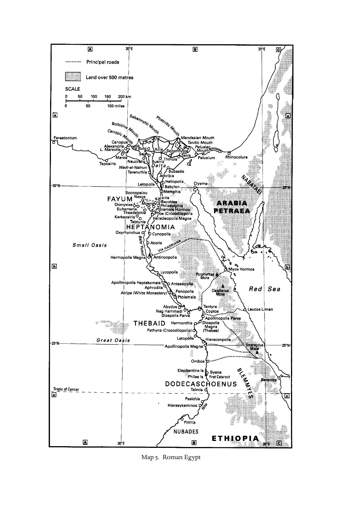

*地图5：罗马时期的埃及。图例：虚线表示主要道路，阴影表示海拔超过500米的地区；比例尺分别以公里和英里计。图内地名保留原文。*

## 证据

<!-- 原书第331–332页；PDF第380–381页 -->

埃及基督教的证据包括非文学史料和文学史料。除了一些零散的建筑残件，据推测出自亚历山大里亚最早见于记载的教堂，即提奥纳斯教堂——提奥纳斯于282–300年任主教——之外，几乎没有可以断定早于四世纪的考古证据。[^ch18-1]最早能够辨认为基督教的墓葬属于四世纪。[^ch18-2]埃及没有可断定早于四世纪的基督教铭文。[^ch18-3]图像证据同样稀少，只有一两枚“诺斯替派”宝石。[^ch18-4]非文学纸草大多是被认为属于最早期基督徒的书信，其中可以断定早于四世纪的寥寥无几。[^ch18-5]

文学证据则十分丰富，都是以希腊文写成的作品。后来成为《新约》正典组成部分的著作，很早就传入埃及，其中一些可能在一世纪已经传入。最早可断代为二世纪的《新约》手稿，是在埃及发现的《马太福音》《马可福音》《约翰福音》《提多书》和《启示录》纸草残片。[^ch18-6]其他传入埃及、并有二世纪希腊文手稿为证的早期基督教文献，包括《埃杰顿福音》——可能来自叙利亚——、来自罗马的《黑马牧人书》、来自叙利亚的P. Oxy. 1，即《多马福音》26–28语，以及爱任纽的《驳异端》（Adversus haereses）：此书写于高卢，可能经由罗马传入埃及。[^ch18-7]

不过，埃及基督徒也创作自己的宗教文献。事实上，二、三世纪埃及基督徒的著述数量，可能比其他任何地区都多。我们掌握的大量证据仅以残篇形式存世，主要是教父作家的引文；另有许多著作已永远失传。现存证据还包括译成科普特文、保存在科普特文手稿中的作品：在埃及纳格·哈马迪附近发现的十二部册页本，以及第十三部的一些散页；[^ch18-8]柏林诺斯替册页本（Papyrus Berolinensis 8502）；阿斯丘册页本，即《信仰智慧书》（Pistis sophia）；布鲁斯册页本；以及在代尔·巴拉伊扎发现的另一部册页本残片。

下面列举的作品或作者，很可能来自埃及，主要是亚历山大里亚。[^ch18-9]

### 二、三世纪的伪经

- 《希伯来人福音》
- 《埃及人福音》
- 《马可秘传福音》
- 《救主福音》
- 《彼得宣讲》（Kerygma Petri）
- 《彼得启示录》[^ch18-10]
- 《巴拿巴书信》
- 《革利免二书》
- 《马提亚传承》
- 《夏娃福音》
- 《雅尼与佯庇》
- 某些基督教形式的《西比拉神谕》
- 《以利亚启示录》

### 使徒教父

<!-- 原书第332–333页；PDF第381–382页 -->

- 《致丢格那妥书》
- 《塞克斯图斯格言集》
- 雅典纳哥拉
- 阿格里帕·卡斯托尔[^ch18-11]
- 伪游斯丁
- 亚历山大里亚的革利免

### 其他教父作家

- 奥利金
- 亚历山大里亚的狄奥尼修
- 提奥格诺斯图斯（Theognostus）
- 皮埃里乌斯（Pierius）
- 提奥纳斯[^ch18-12]

### 二世纪的诺斯替派及其他“异端”作家

- 巴西利德及巴西利德派
- 提奥多图斯（Theodotus）
- 卡尔波克拉底及卡尔波克拉底派
- 赫拉克利翁（Heracleon）
- 瓦伦廷
- 尤利乌斯·卡西安努斯（Julius Cassianus）[^ch18-13]

### 保存在科普特文诺斯替手稿中的著作[^ch18-14]

#### “塞特派”诺斯替著作

- 《约翰秘传书》（NHC ii,1；iii,1；iv,1；BG,2）
- 《执政者的本质》（NHC ii,4）
- 《埃及人福音》（NHC iii,2；iv,2）[^ch18-15]
- 《塞特三碑》（NHC vii,5）
- 《佐斯特里阿诺斯》（Zostrianos，NHC viii,1）
- 《麦基洗德》（NHC ix,1）
- 《诺瑞娅之思》（NHC ix,2）
- 《异乡人》（Allogenes，NHC xi,3）
- 《三形原初思想》（Trimorphic protennoia，NHC xiii,1）

#### 瓦伦廷派诺斯替著作

<!-- 原书第334页；PDF第383页 -->

- 《真理福音》（NHC i,3；xii,2）
- 《论复活》（NHC i,4）
- 《三部论》（NHC i,5）
- 《灵知阐释》（NHC xi,1）
- 《瓦伦廷派解说》（NHC xi,2）

#### 派别归属不明的诺斯替著作

- 《雅各秘传书》（NHC i,2）
- 《论世界的起源》（NHC ii,5；xiii,2）
- 《灵魂释义》（NHC ii,6）
- 《耶稣基督的智慧》（NHC iii,4；BG,3）
- 《保罗启示录》（NHC v,2）[^ch18-16]
- 《雷：完美心智》（NHC vi,2）
- 《我们伟大力量的观念》（NHC vi,4）
- 《伟大塞特第二论》（NHC vii,2）
- 《彼得启示录》（NHC vii,3）[^ch18-17]
- 《彼得致腓力书》（NHC viii,2）
- 《真理见证》（NHC ix,3）
- 《许普西弗罗涅》（Hypsiphrone，NHC xi,4）
- 《马利亚福音》（BG,1）
- 《耶乌诸书》（Books of Jeu，布鲁斯册页本）
- 巴拉伊扎诺斯替残篇

#### 非诺斯替著作

- 《权威教导》（NHC vi,3）
- 《西拉努斯的教训》（NHC vii,4）
- 《塞克斯图斯格言集》（NHC xii,1）

## 埃及之旁的亚历山大里亚（Alexandria ad Aegyptum）

<!-- 原书第334–336页；PDF第383–385页 -->

埃及基督教起源于亚历山大里亚；在亚历山大大帝建立的许多城市中，这座城市无疑最为伟大。亚历山大里亚[^ch18-18]建于公元前331年，所在地原来已有一个名为拉科提斯（Rhakotis）的本地村落（Strabo Geog. 17.1.6）。[^ch18-19]从公元前三世纪起，这一名称用来指亚历山大里亚的埃及本地居民区；科普特文献则以此称呼整座城市。亚历山大于前323年去世后，埃及归马其顿将领、亚历山大的同伴托勒密统治。在托勒密一世——索特尔，即“救主”——治下，亚历山大里亚取代孟斐斯成为埃及首都。托勒密王朝统治时期，它成为希腊化世界的文化、教育与商业中心；在罗马时期仍保持着这一地位。[^ch18-20]

亚历山大里亚是一座面向地中海的国际都会，被视为与埃及本土分离，或者位于埃及“之旁”。[^ch18-21]埃及的chōra，即“腹地”，包括尼罗河谷、三角洲、法尤姆洼地及沙漠绿洲；埃及96%的土地是沙漠。希腊人从公元前七世纪起就已进入腹地。除亚历山大里亚外，还有另外两座希腊城市——瑙克拉提斯和托勒迈斯，以及后来由哈德良建立的第三座——安提诺波利斯。不过，在许多埃及城镇都能找到说希腊语的人，希腊文化影响无处不在。即便如此，埃及文化与宗教仍在埃及长期延续，甚至在托勒密王朝的扶持下，也出现在亚历山大里亚。

犹太人从巴勒斯坦迁入埃及，早在公元前六世纪就已开始。他们大批流入亚历山大里亚，使当地犹太社群成为整个散居世界中最重要的社群。[^ch18-22]犹太人组成politeuma，即“共同体”（Ep. Arist. 310）；托勒密诸王及后来的罗马皇帝鼓励他们遵循祖传习俗生活。到一世纪，亚历山大里亚的犹太人口已达数十万。

公元前30年罗马开始统治埃及后，犹太人在托勒密王朝时期享有的有利经济处境发生改变。前24/23年，埃及本地人及其他非希腊群体开始被征收“人头税”（laographia）。犹太人与希腊居民的关系日益紧张，最终在公元38年爆发了针对犹太人的集体暴力。一批犹太人在斐洛率领下向皇帝盖乌斯，即卡利古拉，申诉，却未获成功。66年，埃及的罗马总督、斐洛已经背弃犹太教的侄子提比略·亚历山大镇压了一场骚乱，造成大量人员死亡（Josephus, BJ 2.487–98）。图拉真统治下，犹太人于115年发动起义，117年被镇压，[^ch18-23]导致犹太社群几乎被彻底摧毁（Euseb. HE 4.2）。[^ch18-24]犹太人的生命与财产所受的毁灭，也蔓延到了埃及腹地。

埃及基督教的发展，从一开始便受到亚历山大里亚独特的希腊文化与教育环境，以及最早期基督徒所属犹太社群的社会文化和宗教生活影响。基督教向腹地扩展后，又受到埃及本地文化与语言的影响，由此形成一种独特的科普特——即“埃及”——基督教，至今仍充满生命力。

## 埃及基督教的起源

<!-- 原书第336–337页；PDF第385–386页 -->

关于埃及基督教的起源，[^ch18-25]史料一直保持沉默，直到二世纪初，亚历山大里亚基督教文献开始出现，早期基督教教师的教义也开始反映在文本与见证中。科普特教会将亚历山大里亚教会的创立归于使徒马可，但这一传统直到四世纪才有记载（Euseb. HE 2.16），十分可疑。[^ch18-26]伪革利免文献所载的另一个传说，说马可的表亲巴拿巴曾在亚历山大里亚从事基督教传教活动（Hom. 1.8.3–15.9），也同样可疑。[^ch18-27]《新约》《使徒行传》18:25的一个异文，似乎暗示亚历山大里亚已有基督徒：据说当地人亚波罗“在本乡已经受过道的教导”。[^ch18-28]不过，这一读法很可能是后来产生的。

因此，历史学家讨论埃及基督教起源时，只能从二世纪史料向前推论。至今仍有影响的一种看法来自瓦尔特·鲍尔。[^ch18-29]他解释早期证据稀缺的原因，认为教会领袖知道最早的基督教形式属于“异端”，具体说是“诺斯替派”，所以压下了这些证据。这一结论有一定的可信性：我们所知道、活跃于二世纪初亚历山大里亚的最早基督教教师，正是那些“异端魁首”——瓦伦廷、巴西利德及其子伊西多尔，以及卡尔波克拉底及其子埃皮法内斯。然而，鲍尔理论的问题在于，它迫使他把最早有据可查的亚历山大里亚基督教文献——《巴拿巴书信》以及仅存残篇的伪经《希伯来人福音》和《埃及人福音》——都涂上“异端”和“诺斯替派”的色彩。他还忽视了《彼得宣讲》等其他重要史料，而后者显然不是诺斯替派著作。[^ch18-30]

纸草学家科林·罗伯茨研究最早期基督教文学纸草后提出的看法，更为可信。这些纸草并不支持鲍尔所谓诺斯替派是埃及最早基督教形式的观点。罗伯茨对早期基督教手稿中“圣名缩写”（nomina sacra）的讨论尤其重要：Iesous、Christos、kyrios、theos等“神圣名称”，总共十五个，采用缩写并在上方画横线；他把这一抄写惯例追溯到耶路撒冷教会。[^ch18-31]罗伯茨的结论是，埃及——即亚历山大里亚——最早的基督教具有犹太性质。最早的“基督徒”，如果可以这样称呼他们，[^ch18-32]是亚历山大里亚犹太社群不可分割的一部分。

近来有人主张，原始基督教在115–117年犹太起义中，“连同它所置身其中的整个群体——埃及犹太社群——一起被消灭了”。依此看法，117年终结的犹太基督教，被拒绝参加起义的“外邦基督徒群体”所取代。[^ch18-33]115–117年起义对埃及基督徒必定是一个关键事件，但肯定没有造成完全断裂：现有二世纪证据显示，亚历山大里亚犹太教与117年以后的当地基督教，在神学、生活方式和社会组织上，都有显著的连续性。[^ch18-34]

## 社会群体与基督教组织

<!-- 原书第337–338页；PDF第386–387页 -->

117年犹太社群遭到毁灭后，它的大量文学遗产，在珍视并保存这些作品的基督徒中延续下来，尤其是最初在亚历山大里亚译成的《圣经》七十士译本（LXX），以及斐洛和其他犹太作家的著作。此时基督徒已组成一个新的共同体，不再属于犹太人的politeuma，而这些遗产深刻影响着他们的著述。考察亚历山大里亚最早的基督教作品之一《彼得宣讲》，颇能说明问题。这部作品由革利免保存了少数片段。作品托名于彼得，又提到“十二使徒”，从而将自己置于最初以耶路撒冷为中心的使徒传统之中（残篇3）。它反映出典型的亚历山大里亚“逻各斯基督论”（残篇1），并表达一种信条：只有一位上帝，他创造了世界，也能使世界终结。这一信条同样可以用典型的亚历山大里亚“否定神学”来表述（残篇2）。作品在圣经文献中发现了关于基督来临、死亡和复活的预言（残篇4）。它是第一部使用“基督徒”一词的亚历山大里亚著作，并把基督徒界定为“第三种族”（残篇2）。[^ch18-35]《彼得宣讲》所代表的基督教形态，处于一条通向革利免所代表的“主流”基督教的发展脉络之中；革利免赞许地引用了它。[^ch18-36]

我们的文学史料也告诉我们，亚历山大里亚很早便存在其他基督教形态。[^ch18-37]当地的犹太基督徒使用《希伯来人福音》。这部作品反映出对耶路撒冷的雅各特别的效忠，同时也受到亚历山大里亚犹太智慧神学的影响。《埃及人福音》则为说希腊语的埃及基督徒所用，他们可能住在亚历山大里亚的拉科提斯区。这一群体倾向禁欲，可能受到当地以西犹太治疗派（Therapeutae）的影响；据斐洛《论默观生活》（Contempl.）描述，治疗派过着一种特殊的团体生活。《巴拿巴书信》以及披上基督教外衣的亚历山大里亚《西比拉神谕》，反映出具有启示文学取向的基督教。对于那些未给我们留下著作、朴实而未受教育的基督徒（simpliciores）来说，启示思想很可能也是他们宗教取向的一部分。[^ch18-38]

受过高等教育、具有哲学取向的基督徒中，无疑包括《权威教导》（NHC vi,3）所反映的那类柏拉图主义者，[^ch18-39]以及各种诺斯替群体。他们在某种意义上，也延续了亚历山大里亚犹太教的不同形态。例如，《欧格诺斯托斯》（Eugnostos，NHC iii,3；v,1）反映出一世纪已有一种犹太诺斯替思想。[^ch18-40]马吉安派基督教也传入了亚历山大里亚，很可能是在二世纪中叶。[^ch18-41]革利免知道马吉安派，并在著作中反驳他们，例如Str. 3.3.12。

<!-- 原书第339–340页；PDF第388–389页 -->

亚历山大里亚的基督教组织，也显示出它与当地犹太教的连续性，尤其体现在长老制的形式上。按照会堂的模式，当地每个基督徒会众都有自己的长老。[^ch18-42]当然，我们最容易看见的领袖，是史料中具名的早期基督教教师。因此，一个会众可以在长老指导下组织起来，同时包含一位杰出的平信徒教师。有时教师本人也兼任长老，革利免很可能就是如此。

至于主教，优西比乌所列从马可开始、在德米特里乌斯（189–232年任主教）以前的传统名单，似乎无非是“徒然的回声与一缕烟”。[^ch18-43]在德米特里乌斯以前，亚历山大里亚肯定不存在安提阿的伊格纳提乌在小亚细亚所倡导的那种单一主教制。耶柔米（Ep. 146.1）告诉我们，早期亚历山大里亚教会的情况是：在赫拉克拉斯与狄奥尼修任主教以前，长老们从自己中间指定一人担任主教。[^ch18-44]更晚的证据来自十世纪亚历山大里亚的麦勒基派宗主教欧提基乌斯。他在《编年史》中提到十二位长老，宗主教座出缺时，新宗主教便从他们中间选出；他以“宗主教”称呼这一时期的主教，是时代错置。随后再任命一位新长老，补足长老团中的空缺。欧提基乌斯还告诉我们，直到德米特里乌斯时代，亚历山大里亚主教都是埃及唯一的主教；德米特里乌斯任命了三位主教，其继任者赫拉克拉斯又增设了二十位。[^ch18-45]

德米特里乌斯在埃及基督教圣职体系的发展中发挥了关键作用。鉴于他推动亚历山大里亚以外地区的福音传播，有人称他为“亚历山大里亚教会的第二位创立者”，以及“埃及教会的创立者”，并不奇怪。[^ch18-46]不过，他巩固自己的主教权威，确实花了一段时间。革利免与奥利金的著作，见证了这一“从基督徒共同体走向制度化教会”的演变。[^ch18-47]还应补充的是，德米特里乌斯所开启的过程，实际上直到“大狄奥尼修”（247–264年任主教）、第一位“埃及宗主教”的时代才告完成。[^ch18-48]

就社会地位而言，有人主张，亚历山大里亚最早的基督徒，是有教养、有财力的犹太人，代表一个生活舒适的“中产阶层”。[^ch18-49]这一判断可能略显片面，尽管我们必须承认，革利免《导师》中描绘的基督徒显然相当富裕。[^ch18-50]异教作家塞尔苏斯很可能于170年代在亚历山大里亚写作，他轻蔑地把自己所知道的基督徒斥为“不体面而愚蠢的人，无非是奴隶、妇女和小孩子”（Or. C. Cels. 3.44）。[^ch18-51]与他大致同时写作的雅典纳哥拉承认，有些基督徒是“普通人、工匠和老妇”（Leg. 11.1），[^ch18-52]不过他也提到一些蓄有奴隶的基督徒（Leg. 55）。[^ch18-53]亚历山大里亚基督徒很可能来自所有社会阶层。[^ch18-54]

革利免著作所反映的基督徒社会经济状况，也可以推及作为机构的教会本身：到三世纪末，亚历山大里亚教会竟已成为一个经营存款业务的机构！一封埃及基督徒的书信（P. Amherst 3a）提供了证据。写信人身在罗马，告诉阿尔西诺伊州的基督徒同伴，要通过主教的代理人提奥纳斯，把钱交存于亚历山大里亚的“教父马克西穆斯”（Maximus the papas）处。[^ch18-55]提奥纳斯后来接替马克西穆斯担任主教（282–300年），并主持在城西兴建了一座教堂。[^ch18-56]

## 亚历山大里亚的“教理学校”

<!-- 原书第340–341页；PDF第389–390页 -->

教师在亚历山大里亚基督徒共同体中占有重要位置，然而史料中最早具名的教师，都是“异端”，即诺斯替派。[^ch18-57]第一位具名的“正统”基督教教师潘代努斯（Pantaenus），出现在优西比乌记述康茂德统治时期（180–192年）事件的历史中。优西比乌写道，这位著名教师负责一所“圣言学校”（didaskaleion tōn hierōn logōn）；这所学校按照“自古以来的惯例”，一直存在于亚历山大里亚（HE 5.10.1）。[^ch18-58]他还说，潘代努斯直到去世始终担任这所学校（didaskaleion）的负责人（5.10.4）；其学生之一是革利免（5.11.1），后者继任，主持学校的“教导”（katēchēsis，6.6.1）。随后优西比乌记载，奥利金十八岁时成为“教理学校”的负责人（tēs katēchēseōs didaskaleion，6.3.3）。202年迫害期间，包括革利免在内的其他教师离开了城市，德米特里乌斯主教把教导（katēchēsis）的任务单独交给奥利金（6.3.8）。后来，奥利金与从前的学生赫拉克拉斯分担这项职责；后者日后接替德米特里乌斯任主教。赫拉克拉斯负责初级教学，奥利金负责高级教学（6.15）。从优西比乌的这些及其他记述，产生了亚历山大里亚“教理学校”的传统：其历任教师自潘代努斯相承，或者，按照“自古以来的惯例”（5.10）所暗示的，始于一些未具名的前辈。

关于亚历山大里亚学校中基督教教师的传承，还有另一种说法，归于五世纪史家西德的腓力（Philip of Side）。他的历史著作有一个节本，保存在十四世纪手稿中。[^ch18-59]按照这一记载，历任校长始于雅典纳哥拉，随后依次为革利免、潘代努斯、奥利金、赫拉克拉斯、狄奥尼修、皮埃里乌斯、提奥格诺斯图斯、塞拉皮翁、彼得——主教及殉道者，卒于311年——、马克里乌斯·波利提库斯、盲人狄迪穆斯，以及罗冬。据说罗冬在狄奥多西大帝统治时期（379–395年）将学校从亚历山大里亚迁到西德。[^ch18-60]

学者对“教理学校”传统提出了截然相反的解释。一些人[^ch18-61]认为，德米特里乌斯以前根本没有学校，只有独立教师。依此看法，亚历山大里亚的平信徒教师，包括革利免，可以在教会中发挥重要作用，提供从洗礼前教导到高深神学的各级教学。其中不少人像革利免一样，精通希腊哲学与文化；有些还从事圣经学研究，活跃于至迟二世纪中叶必定已经存在于亚历山大里亚的某个“抄写作坊”。[^ch18-62]但只有从德米特里乌斯时代起，才能说当地有了一所受主教控制的正式基督教学校。此后，赫拉克拉斯、狄奥尼修等学校负责人先后成为主教；不过最终，自提奥菲卢斯任主教时期（385–412年）起，学校便不复存在。

<!-- 原书第342–343页；PDF第391–392页 -->

另一些学者[^ch18-63]虽然同意必须批判性阅读优西比乌，却认为不能把他的说法完全抛弃。依据对革利免的细读，这种观点认为：“早在奥利金以前，在教会的影响范围内从事教学和学术研究，就已是亚历山大里亚一项历史悠久的活动。”[^ch18-64]至于兼任教师与长老的革利免，“教会与学校之间并不存在对立。他的教导使信徒经过洗礼，继而在教会之内迈向智慧与知识。”[^ch18-65]

事实上，无论优西比乌还是革利免，都没有告诉我们完整的经过。革利免时代的亚历山大里亚，显然还有其他基督教教师；在他以前很久，当地也已有杰出的基督教教师，形态类似代表希腊—罗马世界各种哲学传统的私人教师。革利免的特殊之处在于，他把自己的教学用于服务基督徒共同体；对他来说，这些共同体构成“教会”，而他本人在其中发挥了重要的领导作用。甚至有可能，革利免作为亚历山大里亚长老团一员所扮演的角色，牵涉一场教会内部权力斗争，最终导致他离开这座城市。[^ch18-66]但亚历山大里亚基督教传统中的“教理学校”，大概到三世纪初，才随着德米特里乌斯主教权威的增长而产生。

这所学校的两位教师，革利免与奥利金，对亚历山大里亚神学发展的贡献尤其突出。提图斯·弗拉维乌斯·克莱门斯，即革利免，生平史料很少。他大约在140–150年之间生于雅典，起初信奉异教。他在定居亚历山大里亚以前，曾在希腊、大希腊、叙利亚和巴勒斯坦学习哲学（Str. 1.11.2）。他归信的时间与地点不详。约202年，他离开亚历山大里亚前往巴勒斯坦，并于约216年在那里去世。其著作深受柏拉图主义影响，尤其受犹太人斐洛的哲学和圣经诠释影响。[^ch18-67]主要作品包括：旨在劝异教徒归信基督教的《劝勉希腊人》（Protrepticus）；面向基督徒的劝诫作品《导师》（Paedagogus，意为“作为教育者的基督”）；以及《杂学》（Stromata），写给希望超越单纯信仰、达到更高知识的“灵知型”基督徒。[^ch18-68]革利免从异端那里借用了“诺斯替”一词，并区分“真正”与“虚假”的灵知。[^ch18-69]

奥利金生于185或186年，从小就是基督徒，受过良好教育。优西比乌《教会史》第六卷大半篇幅都用于叙述他。202年，父亲列奥尼德殉道后，他成为教师（didaskalos），养活家人。后来，一位富裕的基督徒妇女资助他，他的讲授吸引了许多人。作为古代著述最丰的作家之一，奥利金的全部著作都致力于促进基督教信仰，可被视为古代教会最伟大的学者与神学家。他广泛旅行、讲学，后来与德米特里乌斯主教不和，约234年永久离开亚历山大里亚，前往凯撒利亚；此后的著述更加丰盛。德修迫害期间，他遭监禁和酷刑，251年以后的某个时候在推罗去世。[^ch18-70]

和革利免一样，奥利金是柏拉图主义者，他的圣经诠释也深受斐洛影响。[^ch18-71]多数著作属于释经作品，包括注释和讲道；其中最重要的《约翰福音注释》始于亚历山大里亚，完成于凯撒利亚。他编制的宏伟《旧约》对照本《六栏合参》（Hexapla），将希伯来文本与阿奎拉、辛马库、七十士译本、狄奥多田及另外两个希腊译本分栏并列，虽然仅有残片存世，却是亚历山大里亚文本批判工作的杰作。[^ch18-72]在亚历山大里亚写成的《论首要原理》（De principiis），使他成为教会第一位系统神学家。其最伟大的护教作品，是晚年在凯撒利亚写成的《驳塞尔苏斯》（Contra Celsum）。他的三一神学与基督论，对后来亚历山大里亚神学的发展尤其有影响。争议较大的，是他关于人类灵魂先存——而不是轮回！——的教义。由于皇帝查士丁尼于543年将他谴责为异端，其庞大著述大多失传，有些仅以拉丁译本存世。

## 与其他地区基督徒的关系

<!-- 原书第344–345页；PDF第393–394页 -->

里昂的爱任纽[^ch18-73]声称，教会从使徒及其门徒领受的信仰，在全世界都是同一个信仰，无论在日耳曼、西班牙、高卢、“东方”、埃及、利比亚，还是“世界的中心地区”，皆是如此（Haer. 1.10.2）。[^ch18-74]这种普世而跨地区的合一主张，是教会从犹太教继承的。以耶路撒冷圣殿为中心的犹太教，是希腊—罗马诸宗教历史中唯一同样具有这一特点的其他宗教。

有意思的是，爱任纽的作品在写成后不到二十年，就出现在埃及（P. Oxy. 405）。[^ch18-75]革利免肯定知道并使用它；[^ch18-76]他是我们所知亚历山大里亚最早反对“异端”的作家。爱任纽的作品，只是埃及以外写成、传入埃及的无数各种体裁著作之一。从一世纪起，这些文献便从巴勒斯坦、安提阿、叙利亚东部、小亚细亚、希腊、罗马和北非等各个地区源源流入，而埃及的基督教作者也向外输出自己的作品。因此，首先是通过基督徒彼此交换书信与文献的“网络”，[^ch18-77]我们才能谈论埃及教会与其他地方教会之间的关系。

我们所知亚历山大里亚教会最早与其他教会进行的“正式”书信往来，由优西比乌在记述二世纪末复活节日期争议时提到（HE 5.25）。他引述了一封由巴勒斯坦的耶路撒冷、凯撒利亚、推罗与托勒迈斯诸主教联合写成的通函。通函支持罗马主教维克托倡导的做法，即始终在星期日庆祝复活节，而不是按照小亚细亚的习惯，在犹太阴历尼散月十四日庆祝。信中有这样一句话：

> 我们也要向你们说明，亚历山大里亚同样与我们在同一天庆祝，因为他们与我们交换过书信，好让我们共同而一致地守这个圣日。

尤其值得注意的是，信中没有提到亚历山大里亚主教，当时在任者是德米特里乌斯。事实上，他与罗马的维克托都在189年成为主教。无论亚历山大里亚向巴勒斯坦发过怎样的信，显然都是由长老团集体发出，而非由主教发出；当时主教似乎尚未巩固自己对当地教会的权力。

到三世纪中叶，狄奥尼修任主教时（247–264年），情况已经完全不同。[^ch18-78]他数量庞大的通信，包括致罗马、安提阿及其他地方主教的“正式”书信，证明亚历山大里亚教会在帝国中的重要性不断增长。到三世纪末，亚历山大里亚教会在东方的影响力，至少已经相当于罗马教会在西方的影响力。

## 埃及的诺斯替思想与摩尼教

<!-- 原书第345–346页；PDF第394–395页 -->

爱任纽在五卷本《驳异端》中，把诺斯替异端，即“冒名的灵知”，追溯到撒马利亚的“术士”西门（Haer. 1.23.1–4；参《使徒行传》8:9–24）。在西门之后作为“继承者”出现的，是同样来自撒马利亚、后来活跃于安提阿的米南德（1.23.5；参Justin, 1 Apol. 26.4）。随后，“从这些人中兴起”的，是安提阿的萨图尔尼努斯，以及在亚历山大里亚传播自己体系的巴西利德（Haer. 1.24.1）。优西比乌《编年史》在哈德良在位第十六年，即132年，记载：“异端领袖巴西利德住在亚历山大里亚；诺斯替派由他而来。”[^ch18-79]因此，根据这些信息，人们可能会错误地断定：埃及的诺斯替思想，始于亚历山大里亚的巴西利德。[^ch18-80]

然而，爱任纽特别提到一个“诺斯替”派别；其基本神话见Haer. 1.29的摘述，并不等同于他归于巴西利德的神话（Haer. 1.24.3–5），虽然与萨图尔尼努斯的神话有一定相似之处（1.24.1–2）。关于巴西利德在亚历山大里亚的同时代人瓦伦廷，爱任纽说：“瓦伦廷把所谓‘诺斯替’思想学派的基本原则，改造成自己那一类体系”（Haer. 1.22.1）。[^ch18-81]众所周知，爱任纽所摘述的“诺斯替”神话（Haer. 1.29），对应于我们现在拥有的《约翰秘传书》的一部分（NHC ii,1；iii,1；iv,1；BG,1）。正如我在别处论述的，这一神话原本并非基督教神话，而是代表一种犹太诺斯替思想。[^ch18-82]无论它来自叙利亚，还是在亚历山大里亚发展形成，在瓦伦廷与巴西利德以前，它就已在当地扎根。《受颂者欧格诺斯托斯》（NHC iii,3；v,1）同样代表亚历山大里亚的一种犹太诺斯替思想；瓦伦廷和巴西利德很可能都知道其希腊文原本。

瓦伦廷与巴西利德的诺斯替思想，则完全具有基督教性质。事实上，甚至有人主张，瓦伦廷根本不是“诺斯替派”。[^ch18-83]但仔细阅读瓦伦廷残篇，就会发现它们都暗指一种典型的诺斯替神话。[^ch18-84]瓦伦廷派《真理福音》（NHC i,3；xii,2）也同样如此；把这篇论著归于瓦伦廷本人，是颇为可信的。[^ch18-85]

瓦伦廷、巴西利德及亚历山大里亚其他诺斯替教师的著作，见证了埃及诺斯替“异端”的强大力量、非同寻常的多样性，以及其持续存在。直到二世纪末，亚历山大里亚基督徒，乃至稍后埃及腹地的基督徒，对于极其多样的教导，都保持着相当程度的开放态度。在早期基督教埃及，甚至仅仅谈论“异端”与“正统”之间存在鲜明界限，都是时代错置；至少在亚历山大里亚，要到二世纪末德米特里乌斯任主教时，才能这样说，而在埃及某些地区还要晚得多。

三世纪，一种新的诺斯替形态进入埃及，那就是摩尼教；它最终凭自身力量成为一种世界宗教。[^ch18-86]先知摩尼的门徒，甚至在他276年去世以前，就已从美索不达米亚来到埃及传教。他们很早就在上埃及吕科波利斯周围地区站稳脚跟；现存大多数科普特文摩尼教文献都出自这一带。传教士利用繁忙的商业道路，既可能由亚历山大里亚沿尼罗河而上抵达底比斯地区，也可能从美索不达米亚经海路到红海港口贝勒尼基，再经陆路到吕科波利斯附近的许普塞勒（Hypsele）。如今，我们还获得了摩尼教从吕科波利斯传播到达赫莱绿洲的重要证据，尤其来自古代凯利斯，即今伊斯曼特·哈拉卜（Ismant el-Kharab）。当地考古发掘出一个四世纪初摩尼教社群的遗存。其中发现的文书与文学文本，为埃及摩尼教的生活与宗教提供了新证据，补充了我们从1930年代迈迪奈特·马迪那些轰动发现中已经知道的情况。[^ch18-87]

<!-- 原书第347页；PDF第396页 -->

紧随这一传教事业之后，异教与基督教的反摩尼教文献，很快也出现在埃及。最早的两篇，一篇出自柏拉图主义哲学家吕科波利斯的亚历山大，另一篇很可能出自亚历山大里亚主教提奥纳斯（卒于300年），已经可以断代到三世纪末。[^ch18-88]不过，也有证据显示摩尼教对埃及基督徒，尤其对修道院中的基督徒，[^ch18-89]以及不同类型的其他诺斯替派产生了积极影响，形成摩尼教群体与其他诺斯替派之间某种共生关系。[^ch18-90]

## 基督教向腹地的扩展

<!-- 原书第347–348页；PDF第396–397页 -->

优西比乌《教会史》第六卷以如下记述开篇（6.1）：

> 当塞维鲁也煽动针对各教会的迫害时，各地虔敬的勇士都成就了光荣的殉道，而亚历山大里亚尤其频繁。从埃及和整个底比斯地区而来的上帝勇士，被押送到这里，仿佛进入一座宏大的竞技场。他们在种种酷刑与死亡方式下坚忍不拔，因而戴上了上帝为他们预备的冠冕。[^ch18-91]

这是优西比乌《教会史》第一次提到亚历山大里亚以外也有基督徒。“埃及”大概指尼罗河三角洲，而“底比斯地区”涵盖尼罗河谷的大部分，从赫尔莫波利斯向上游，即向南，直至叙埃涅。对优西比乌的说法抱有怀疑，是可以理解的：不只是塞维鲁在迫害中所扮演的角色，[^ch18-92]以及迫害的规模——“无数人〔murioi〕戴上了殉道的冠冕”，6.2.3——值得怀疑，这些殉道者来自埃及哪些地区，也同样值得怀疑。不过，说190年复活节争议时埃及基督教仍“局限于这座城市及其周边”，肯定不符合事实。[^ch18-93]哈纳克在研究基督教传播的巨著中，[^ch18-94]关于二世纪，只引用了埃皮法尼乌斯所记异端巴西利德和瓦伦廷据说曾深入腹地的旅行（Pan. 24.2.2、3、4；31.7.1），但埃皮法尼乌斯的证言十分可疑。正如前文所说，爱任纽坚持认为，埃及教会宣认普世共同的信条，但他大概并不了解亚历山大里亚以外的情况。

要获得二世纪亚历山大里亚以外埃及基督教的较可靠证据，我们必须转向埃及沙漠保存下来、依据古文字学断代的纸草。[^ch18-95]范哈尔斯特的《目录》提供如下证据。来自法尤姆的有：《旧约》残片，编号174、224，以及可能的52与304；[^ch18-96]可能还有一片《新约》残片，编号462；[^ch18-97]一片《黑马牧人书》残片，657；以及一片《拿撒尼派诗篇》残片，1066。卡拉拉（Qarara，Hippōnōn polis）出土了一部《旧约》册页本的三片残页，编号33。可能来自帕诺波利斯或附近的，有《新约》《约翰福音》残片，426，以及《旧约》《诗篇》残片，118。安提诺波利斯有两片《旧约》残片，179。出处不明的有《埃杰顿福音》残片，586，以及一片《西比拉神谕》残片，581。俄克喜林库斯的材料相当丰富：《旧约》残片，13、40；《新约》残片，372；[^ch18-98]《多马福音》残片，593；一部不知名福音书的残片，592；爱任纽《驳异端》残片，671；亚历山大里亚的斐洛作品的若干残片，696；以及一片巫术文本残片，1076。科林·罗伯茨认为，俄克喜林库斯至迟在二世纪末或三世纪初，就有一处基督教抄写作坊。[^ch18-99]

<!-- 原书第349页；PDF第398页 -->

讨论纸草时，有一点必须提醒：纸草文本写成或抄成之后，到它被丢弃在后来发现的地点之前，必然存在一定的时间差。此外，在腹地发现的残片，也可能是在别处抄写的，最有可能的地方是亚历山大里亚。即便如此，根据纸草学证据，仍可推定基督教在二世纪进入了上埃及和法尤姆。它大概也已出现在三角洲，尽管我们不应期待在那里找到纸草。

三世纪的文学与纸草证据都丰富得多。[^ch18-100]最重要的文学证据，是狄奥尼修主教大量的书信，其中一部分通过优西比乌和其他作者的引文保存下来。有几封是致埃及诸主教的通函，其中一些确定复活节及此前禁食期的日期。[^ch18-101]在三世纪过程中，埃及各州很可能都逐渐有了自己的主教，至少在名义上处于亚历山大里亚主教的权威之下。[^ch18-102]

科普特语也在三世纪形成，首要目的是把基督教经书译成埃及人的本族语言。[^ch18-103]当然，科普特语在词汇和句法中吸收了希腊语词语与短语，这种语言本身就证明当时存在双语环境。基督教在乡村地区的传播，很可能慢于州府及腹地其他城镇等城市中心，因为乡村使用希腊语较少。[^ch18-104]不过，罗杰·巴格纳尔估计，君士坦丁于337年去世时，埃及基督徒已经占多数，这一判断很可能是对的。[^ch18-105]即便如此，也不应太快谈论基督教的“胜利”；戴维·弗兰克福特已经表明，埃及宗教的一些基本模式，披上基督教外衣后继续存在。[^ch18-106]

## 埃及修道生活的起源

<!-- 原书第350页；PDF第399页 -->

作为一种制度，修道生活在埃及基督教史中所占的位置，比在其他任何地区教会史中都更为重要。[^ch18-107]通常人们把修道生活的起源，与四世纪圣徒安东尼和帕科米乌斯联系起来：前者被视为隐修生活之“父”，后者被视为共住修道生活之“父”。然而，近来的研究表明，埃及修道生活的起源早得多，并与第三种形式，即舍弃式修道生活（apotactic）的发展有关。E. A. 贾奇研究了一份出自卡拉尼斯、年代为324年的纸草文书，它为这种修道生活提供了证据，也是目前所知monachos一词用于指“修士”的最早见证。[^ch18-108]

文书中，一位名叫伊西多鲁斯的人，因遭帕莫尼斯与哈尔帕卢斯两人袭击，向当地的长官（praepositus）请求伸张正义。他说，若非“执事安东尼努斯与修士以撒”相助，自己就会丧命。[^ch18-109]这里的“修士”既不是沙漠苦修者，也不是某个修道团体的成员，而是住在村中、参与地方与教会事务的人。耶柔米的一段谴责（Ep. 22.34），可以帮助理解他的处境：在共住修道者和隐修者之外，埃及还有第三类修士，称作remnuoth，显然是一个意为“独居者”的科普特语词。他们是住在小型家庭共同体中的修士，亦即“独居者”；在耶柔米看来，他们过分独立于教士权威。以撒就是这些“独居者”之一，属于其他史料称为apotaktikoi/ai，即“舍弃者”的一类苦修者；参《路加福音》14:33。[^ch18-110]

伊西多鲁斯在呈文中提到“执事”和“修士”时，指的是当时已确立的地方教会成员类别。吉勒·多里瓦尔甚至提出，这种苦修者的一个或多个群体，可能在二世纪亚历山大里亚就已存在。[^ch18-111]事实上，以monachos指称这类“独居者”的用法，很可能可以追溯至二世纪。这个希腊语词出现在科普特文《多马福音》中，第16、49、75语，可能指一种特殊类别的基督教苦修者；这样的群体，二世纪亚历山大里亚就可能已经存在。

## 译校说明

- 本章关于纸草断代、人口比例以及新近考古发现的论述，均保留原书2006年的研究语境。
- 原书第346页将《约翰秘传书》的柏林册页本定位写作“BG,1”，但第333页清单中写作“BG,2”；此处保留两处原有定位，以便对照。原书第340页引用雅典纳哥拉《为基督徒申辩》（Leg.）的“55”，也按原文保留。
- 文献清单的分类、归属和推定产地，均为本章作者的判断；正文中的“可能”“大概”及不同学说的分歧均予保留。

## 脚注

[^ch18-1]: Tkaczow, ‘Archaeological sources’, 432。关于十九、二十世纪在亚历山大里亚进行的发掘，见Tkaczow, Topography；参Pearson, ‘Alexandria’。

[^ch18-2]: 罗杰·巴格纳尔认为，威尔弗雷德·格里格斯关于法尤姆存在一、二世纪基督徒墓葬的主张，是“幻想”。见Griggs, ‘Excavating a cemetery’；参Bagnall, Egypt in late antiquity, 279 n. 113。

[^ch18-3]: 见Lefebvre, Recueil des inscriptions。较晚的证据亦见Brown, ‘Coptic and Greek inscriptions’。

[^ch18-4]: Pearson, Gnosticism and Christianity, ch. 9.

[^ch18-5]: 见Naldini编纂的纸草文集Cristianesimo in Egitto。关于纸草证据的良好讨论，见Judge and Pickering, ‘Papyrus documentation’。

[^ch18-6]: Roberts, Manuscript, society and belief, 12–13。《马可福音》（P90）与《启示录》（P98）残片发现于Roberts著作问世以后；见Nestle-Aland NTG27, 689。《约翰福音》最早的见证P52，可断代至二世纪初。

[^ch18-7]: Roberts, Manuscript, society and belief, 13–14.

[^ch18-8]: 缩写为NHC，有时作CG（Cairensis Gnosticus）。原始文献书目，原书第591–614页，仅列詹姆斯·罗宾逊主持、1995年完成的科普特诺斯替文库项目所刊科普特文—英文版本。其他版本和研究见Scholer, Nag Hammadi bibliography。纳格·哈马迪诸篇及柏林册页本（BG）诸篇的便用译本，见Robinson and Meyer, NHL。

[^ch18-9]: 见原始文献书目，原书第591–614页。关于文学证据及确定早期基督教文本产地所涉及问题的详尽讨论，见Pearson, Gnosticism and Christianity, 40–81。我在那里也讨论了产地有争议的作品，例如Epistula apostolorum；一些学者将它归于埃及，但它应当归于小亚细亚。

[^ch18-10]: 须与纳格·哈马迪第七册页本中的同名论著区分。

[^ch18-11]: 他反驳巴西利德的作品已失传，但Euseb. HE 4.7保存了摘要。

[^ch18-12]: 优西比乌还提到另外两位亚历山大里亚作家：后来担任耶路撒冷主教的亚历山大，以及后来担任老底嘉主教的阿纳托利乌斯（HE 6.11.3–6；7.32.6–20）。优西比乌引用亚历山大的书信，并大段引录阿纳托利乌斯的Canons on the pascha。

[^ch18-13]: 另一位“异端”作家，莱昂托波利斯的希埃拉卡斯（Hieracas），按埃皮法尼乌斯的说法（Pan. 67），兼以希腊文与埃及文，即科普特文，写作。遗憾的是，其大量著述均已失传。

[^ch18-14]: 原始文献书目收录全部科普特文论著；本章下面清单只列几乎可以肯定归于二、三世纪埃及的基督教作品，或产地不明、但归于二、三世纪埃及仍属合理的作品。后一类包括Pr. Paul、Treat. res.、Tri. trac.、Interp. know.、Val. exp.、Ep. Pet. Phil.、Hypsiph.，以及一段柏拉图残篇，即诺斯替派编订本。很可能来自二、三世纪叙利亚的论著包括Apoc. Adam（NHC v,5）、Marsanes（NHC x,1）、Gos. Phil.（NHC ii,3）、1 Apoc. Jas.（NHC v,3）、2 Apoc. Jas.（NHC v,4）、Paraph. Shem（NHC vii,1）、Gos. Thom.（NHC ii,2）、Thom. cont.（NHC ii,7）、Dial. sav.（NHC iii,5）、Acts Pet. 12 apos.（NHC vi,1）与Act Pet.（BG,4）。Pistis Sophia和布鲁斯册页本中的无题论著，很可能来自四世纪埃及。Eugnostos（NHC iii,3；v,1）大概产生于一世纪亚历山大里亚的犹太环境。具有鲜明埃及特色、但并非基督教作品的，是赫尔墨斯文献：Disc. 8–9（NHC vi,6）、Pr. thanks.（NHC vi,7）和Asclepius（NHC vi,8）。

[^ch18-15]: 不要与上文列出的同名伪经福音书混淆。

[^ch18-16]: 不要与另一部同名伪经作品混淆。

[^ch18-17]: 不要与上文列出的同名启示录混淆。

[^ch18-18]: 托勒密王朝时期，见Fraser, Ptolemaic Alexandria。自戴克里先起的时期，见Haas, Alexandria。很好的概述见Bowman, Egypt，第7章“Alexandria, queen of the Mediterranean”；亦参Pearson, ‘Alexandria’。依据文书与考古证据研究亚历山大里亚地形，见Calderini, Dizionario, vol. i, fasc. 1；Adriani, Repertorio d’arte。近来的考古工作，包括水下发掘，见Empereur, Alexandria rediscovered。

[^ch18-19]: 不过，这个名称最早的圣书体文字见证，是一方公元前311年的铭文，即晚于城市建立。见Chauveau, ‘Alexandrie et Rhakotis’。

[^ch18-20]: 斯特拉波在Geographica第17卷中详述这座城市的地形和优美建筑；他约于公元前24–20年住在这里。参Fraser, Ptolemaic Alexandria, vol. i, 7–37；vol. ii, 12–111。

[^ch18-21]: 狄奥·克律索斯托莫斯在“致亚历山大里亚人”的演说中，用夸张语气把“强大的埃及民族”称作壮丽亚历山大里亚的“附属物”（prosthēkē，Orationes 32.36）。

[^ch18-22]: 见上文第一部分第2章。CPJ充分记录了托勒密和罗马时期犹太人在埃及的存在，也收录铭文。参主要讨论一世纪的Safrai and Stern, Jewish people；亦见Starobinski-Safran, ‘Communauté juive’。

[^ch18-23]: 这次起义受到犹太弥赛亚思想激励；见Hengel, ‘Messianische Hoffnung’。

[^ch18-24]: 见上文第一部分第3章。

[^ch18-25]: Pearson, ‘Earliest Christianity’与‘Christianity in Egypt’；以及较近的Dorival, ‘Les débuts’；Jakab, Ecclesia alexandrina, 35–61；Pearson, ‘Cracking a conundrum’。

[^ch18-26]: 关于马可传说，见Pearson, ‘Earliest Christianity’, 137–45；亦见Pearson, ‘Christianity in Egypt’, 955–6。

[^ch18-27]: Pearson, ‘Earliest Christianity’, 136–137；但现亦见Carleton Paget, Epistle of Barnabas, 36。

[^ch18-28]: 贝扎抄本（Codex Bezae），此处译文由本章作者译出；该抄本代表《使徒行传》的“西方”文本。

[^ch18-29]: Bauer, Orthodoxy and heresy, 44–53.

[^ch18-30]: Bauer, Orthodoxy and heresy, 47–53.

[^ch18-31]: Roberts, Manuscript, society and belief, 19–21；参Hurtado, ‘Nomina sacra’。

[^ch18-32]: 亚历山大里亚基督教史料中，“基督徒”一词最早有据可查的用例，出现在Kerygma Petri残篇2（Clem. Al. Str. 6.5.41；参NTApoc, vol. ii, 39）。

[^ch18-33]: Modrzejewski, Jews of Egypt, 227–30.

[^ch18-34]: Pearson, ‘Cracking a conundrum’, and Gnosticism and Christianity, 12–19, 82–99.

[^ch18-35]: 见上文注32。

[^ch18-36]: Jakab, Ecclesia alexandrina, 56–7，强调了Kerygma Petri的重要性。

[^ch18-37]: Van den Broek, ‘Juden und Christen’.

[^ch18-38]: Van den Broek, ‘Juden und Christen’, 188; Dorival, ‘Les débuts’, 170–1.

[^ch18-39]: Van den Broek, ‘Authentikos logos’。

[^ch18-40]: Van den Broek, ‘Jewish and Platonic speculations’；参van den Broek, ‘Juden und Christen’, 192。

[^ch18-41]: Dorival, ‘Les débuts’, 171.

[^ch18-42]: Van den Broek, ‘Juden und Christen’, 188–91；Ritter, ‘De Polycarpe à Clement’, 164。散居犹太社群的组织，见Applebaum, ‘Organization’；参上文第一部分第2章。关于最早见于纸草的犹太长老（presbyteroi）证据，P. Oxy. 2476，公元前二世纪，见NewDocs, vol. ix（2002）, 69–72，第24项，S. R. Llewelyn撰。

[^ch18-43]: Bauer, Orthodoxy and heresy, 45。这份传统名单，可能由尤利乌斯·阿非利加努斯在其已失传的Chronographies中人为编造；该书是优西比乌的史料之一。此为Grant, Eusebius as church historian, 51–2的看法。另见本书前列“罗马皇帝及罗马与亚历山大里亚主教”对照表，原书第xxii–xxiii页。

[^ch18-44]: 见Jakab, Ecclesia alexandrina, 177。

[^ch18-45]: PG 111.982；参Kemp, ‘Bishops and presbyters’, 137–8。

[^ch18-46]: Telfer, ‘Episcopal succession’, 2.

[^ch18-47]: “De la communauté chrétienne à une église institutionnelle”，即“从基督徒共同体走向制度化教会”，为Jakab, Ecclesia alexandrina第8章，175–214页。

[^ch18-48]: Jakab, Ecclesia alexandrina, 215–55, esp. 252–5.

[^ch18-49]: Jakab, Ecclesia alexandrina, 54–5.

[^ch18-50]: 见Jakab根据革利免描绘讨论“亚历山大里亚富裕基督徒”的生活，Ecclesia alexandrina, 257–92。

[^ch18-51]: 英译引自Chadwick, Origen: contra Celsum。

[^ch18-52]: 采用Crehan在Athenagoras中的英译。

[^ch18-53]: Barnard, Athenagoras, 147–9.

[^ch18-54]: 参上文第二部分第7章。

[^ch18-55]: Deissmann, Light from the ancient east, 205–13; Snyder, Ante pacem, 152–3.

[^ch18-56]: 史料见Adriani, Repertorio, 217；参上文注1。

[^ch18-57]: 关于亚历山大里亚“教理学校”，见下文第五部分第27章。

[^ch18-58]: 采用LCL版Lake的英译。

[^ch18-59]: Pouderon, D’Athènes à Alexandrie, 1–70.

[^ch18-60]: Pouderon认为，这段记载中明显的年代错误，不应归于腓力本人的已失传著作，而应归于这一节本的传抄者。

[^ch18-61]: 尤其见Bardy, ‘Aux origines de l’école’；van den Broek, ‘Christian “school”’；Jakab, Ecclesia alexandrina, 91–106。

[^ch18-62]: 亚历山大里亚抄写作坊，见Zuntz, Text of the epistles, 271–3。

[^ch18-63]: 尤其见Méhat, Étude, 62–70；van den Hoek, ‘“Catechetical” school’。

[^ch18-64]: Van den Hoek, ‘“Catechetical” school’, 76.

[^ch18-65]: Van den Hoek, ‘“Catechetical” school’, 71。耶路撒冷主教亚历山大的一封信表明，革利免是一位长老；优西比乌在HE 6.11.6引用此信。见van den Hoek, ‘“Catechetical” school’, 77；Nautin, Lettres, 114–18。

[^ch18-66]: Nautin, Lettres, 18, 140.

[^ch18-67]: Van den Hoek, Clement of Alexandria; Runia, Philo, 132–56.

[^ch18-68]: 革利免其他作品列于原始文献书目，原书第596页。失传著作见Euseb. HE 6.13.1–3。关于革利免，见Méhat, ‘Clemens’。

[^ch18-69]: Méhat, ‘“Vraie” et “fausse” gnose’.

[^ch18-70]: 关于奥利金，见Williams, ‘Origenes’；Nautin, Origène；Crouzel, Origen。

[^ch18-71]: Runia, Philo, 157–83.

[^ch18-72]: 关于此作，尤其见Nautin, Origène, 303–361。奥利金可能扩充了一部既有的犹太对照本，见同书333–41页。

[^ch18-73]: 见上文第三部分第13章。

[^ch18-74]: 这一段的讨论，见Pearson, Emergence, 174–5。

[^ch18-75]: Roberts, Manuscript, society and belief, 14, 23.

[^ch18-76]: 关于革利免使用爱任纽，见van den Hoek, ‘How Alexandrian?’, 186, 190。

[^ch18-77]: 罗德尼·斯塔克在Rise of Christianity中特别强调，运用社会科学研究早期基督教时，“网络理论”十分重要；亦参White, Social networks；Pearson, ‘On Rodney Stark’s foray’。

[^ch18-78]: 关于狄奥尼修，尤其见Bienert, Dionysius von Alexandrien。

[^ch18-79]: 由本章作者根据耶柔米版本的拉丁文译出；见Helm编，Chronik des Hieronymus, 201。

[^ch18-80]: 见Pearson, Emergence, 150–3。巴西利德，见Pearson, ‘Basilides the Gnostic’。关于如何界定“诺斯替主义”，以及如何从历史和宗教现象学上限定它的问题，见Pearson, Gnosticism and Christianity，第7章“Gnosticism as a religion”。不同的处理方式，见Williams, Rethinking ‘Gnosticism’及上文第三部分第12章。诺斯替思想与科普特诺斯替册页本的完整书目，见Scholer, Nag Hammadi bibliography。

[^ch18-81]: 采用Layton, Scriptures, 225中的英译。

[^ch18-82]: 例如见Pearson, ‘Pre-Valentinian Gnosticism’；Emergence, 122–46；以及‘Jewish apocalypticism to gnosis’。

[^ch18-83]: Markschies, Valentinus；亦见上文第三部分第12章。

[^ch18-84]: 残篇见原始文献书目。例如，残篇1，即Layton编本的C，明确暗指一种诺斯替人类起源神话，可与《约翰秘传书》中的神话相比。

[^ch18-85]: Layton, Scriptures, 250–64.

[^ch18-86]: 尤其见Lieu, Manichaeism。摩尼教书目见Mikkelson, Bibliographia Manichaica。宗教史家通常将摩尼教归入诺斯替思想这一较大现象；近来Jason BeDuhn, Manichaean body对此提出挑战。

[^ch18-87]: 截至本书写作时，古代凯利斯的文本已出版两卷：Gardner, Kellis literary Texts；Gardner et al., Coptic documentary texts。

[^ch18-88]: 关于亚历山大的论著，尤其见van der Horst and Mansfeld, Alexandrian Platonist。提奥纳斯的书信有一部分保存在P. Ryl. 469中。见Roberts, Catalogue, vol. iii, 38–39；van Haelst, Catalogue, no. 700（253页）。

[^ch18-89]: Stroumsa, ‘Manichaean challenge’.

[^ch18-90]: 这种共生关系反映在一些纳格·哈马迪论著中。尤其见Camplani, ‘Trasmissione di testi gnostici’。

[^ch18-91]: 采用LCL版Oulton的英译。

[^ch18-92]: 认为皇帝发动了这场迫害，似乎没有根据；迫害在他201年离开亚历山大里亚后不久爆发。见Birley, Septimius Severus, 209。这很可能是一次地方事件，总督莱图斯可能卷入其中（HE 6.2.2）。

[^ch18-93]: Telfer, ‘Episcopal succession’, 2.

[^ch18-94]: Mission und Ausbreitung, vol. ii, 708.

[^ch18-95]: 参上文原书第331–332页；亦见上文第三部分第8章。

[^ch18-96]: 第52与304号属于切斯特·比蒂收藏；有人对其产地提出别的看法，如阿佛洛狄托波利斯，或上埃及其他地方。见van Haelst, Catalogue, 30的讨论。

[^ch18-97]: P. Ryl. 457，也可能来自俄克喜林库斯；见Catalogue, 30。

[^ch18-98]: P. Oxy. 1683，出自一部至少包含《马太福音》的册页本。现在还应加上P. Oxy. 3523，出自一部包含《约翰福音》的册页本；见Llewelyn在NewDocs, vol. vii, 242–8的讨论。

[^ch18-99]: Roberts, Manuscript, society and belief, 24.

[^ch18-100]: 纸草证据除van Haelst的Catalogue及Naldini的基督徒书信集Il cristianesimo in Egitto外，亦见Judge and Pickering, ‘Papyrus documentation’。

[^ch18-101]: 就我们所知，狄奥尼修是第一位每年发布书信、确定复活节日期的亚历山大里亚主教。见Bienert, Dionysius von Alexandrien, 138–77。

[^ch18-102]: Harnack, Mission und Ausbreitung, vol. ii, 712.

[^ch18-103]: 便于查阅的概述，见Emmel, ‘Coptic language’。

[^ch18-104]: 此为Llewelyn在NewDocs, vol. iv, 212的看法。

[^ch18-105]: Bagnall, Egypt in late antiquity, 281。Bagnall指出，三世纪的情况“无法量化”，同上，但承认基督徒人数众多。

[^ch18-106]: Frankfurter, Religion in Roman Egypt.

[^ch18-107]: 更详尽的讨论，见Pearson, Gnosticism and Christianity, 37–40。

[^ch18-108]: Judge, ‘Earliest use of monachos’.

[^ch18-109]: Judge, ‘Earliest use of monachos’, 73.

[^ch18-110]: Judge, ‘Earliest use of monachos’, 79。这一类苦修者，见Goehring, Ascetics, 53–72。

[^ch18-111]: Dorival, ‘Les débuts’, 174.


---

<a id="chapter-19"></a>

# 第十九章 叙利亚与美索不达米亚

**作者：苏珊·阿什布鲁克·哈维（Susan Ashbrook Harvey）**

《剑桥基督教史》第一卷《起源至君士坦丁》中文译稿

> 原书第351–365页，PDF第400–414页。完整翻译正文与解释性脚注；参考文献作者名、题名和定位保留原文。
>
> [第十九章英文原文](<第十九章 叙利亚与美索不达米亚（英文）.md>) · [原书PDF](<../01 起源至君士坦丁.pdf>)

<!-- 原书第351页；PDF第400页 -->

《新约》《使徒行传》宣称：“门徒被称为基督徒，是从安提阿开始的”（《使徒行传》11:26）。保罗《加拉太书》以及《使徒行传》的其他记述，把安提阿呈现为最早基督徒向更广阔地中海世界展开传教的基地。在这些文本中，外邦与犹太归信者所面临的身份紧张，首先在安提阿受到正视，随后又成为他们与仍留在耶路撒冷的最早期信徒争论的问题。彼得与保罗在各自的传教活动中都曾往返安提阿；两人同这座城市的共同联系，赋予它在后世基督徒心目中独特的地位。[^ch19-1]

我们熟悉的基督教历史路线，是福音从耶路撒冷经安提阿向西传至罗马。但安提阿也是通向东方的门户。事实上，假如弗里吉亚希埃罗波利斯的阿伯基乌斯铭文属于基督教，那么它似乎证明，至迟二世纪末，活跃的基督徒社群已经远达罗马—波斯边界上的尼西比斯。本章将尝试追溯基督教在广义的叙利亚地区兴起的过程：这一地区，从安提阿以外的沿海港口向东延伸到帕尔米拉和波斯，从北方美索不达米亚向南延伸到巴勒斯坦。虽然我们最重要的一些早期基督教著作来自这里，物质证据却很稀少。这里既没有小亚细亚保存下来的大量铭文，也没有埃及出土的丰富文书与文学证据。现有零星材料指向一个更广阔的文化环境：闪族、希腊化、罗马与波斯的传统和宗教，在其中以充满活力而复杂精细的方式相互交往。[^ch19-2]

## 地区背景

<!-- 原书第352–353页；PDF第401–402页 -->

叙利亚与美索不达米亚的历史虽然远为古老，但在早期基督教时代，这个地区深受希腊—罗马因素塑造。从安提阿、老底嘉，到埃德萨、尼西比斯或帕尔米拉，主要城市几乎都是希腊化时期建立的。大马士革是个例外，但到了罗马时期，其更古老过去的痕迹已几乎不可见。希腊式的城市制度与文化表达，是城市生活的特征；铭文常采用双语，除了希腊文，另一种便是当地占主导地位的闪族方言。一世纪，罗马扩张主要通过驻军和大规模修路来体现其存在。不过，二世纪时，罗马统治日益深入，成为这个地区更紧密的一部分。安提阿日益充当皇帝在东方的基地；四世纪之交实行四帝共治时，它成为东方诸行省的帝国首府。拉丁语词汇经希腊语传入闪族语言，双语铭文不断出现在城市的公共和私人纪念物以及文书档案中。杜拉—欧罗波斯保存着一方三世纪的三语铭文，采用拉丁文、希腊文和帕尔米拉文。

在埃德萨、帕尔米拉等城市，铭文证据经常显示，希腊与闪族神明被相互等同。萨摩萨塔的琉善关于希埃拉波利斯，即马布格，叙利亚女神崇拜的论著，以文学形式捕捉了这一情形。讽刺的是，我们关于这一时期本土宗教的知识几乎全来自这类证据：诸神的名字，以及保存在祭祀中心或神庙中的若干物质遗存。除了琉善的希腊化叙述，我们对于仪式、神话和敬拜实践，基本一无所知。同时，我们拥有物质与文学证据，虽然零散，却足以表明当时犹太社群在整个地区相当强大。约瑟夫斯暗示（BJ 7.44），公元66–73年巴勒斯坦犹太起义激起了安提阿的反犹情绪；到四世纪，这种情形又在基督徒领导下重现。

一世纪后期至二世纪，一种称为“叙利亚语”的阿拉米语闪族方言，在埃德萨地区——叙利亚语称Urhay——十分突出，并逐渐成为叙利亚地区基督教的主要语言。四世纪以前，几乎每一种基督教叙利亚语文本，都同时保存着叙利亚文和希腊文版本；学者有时无法就哪一种是原始语言达成一致。这种情况凸显了基督教在叙利亚与美索不达米亚发展的广阔文化背景：这是一个多语言地区，依靠国际贸易及罗马—波斯边境的战略地位而繁荣，交流思想如同交换货物，都是生活的基本内容。

幼发拉底河中游杜拉—欧罗波斯的考古遗存，生动展现了宗教状况。该城在256年萨珊波斯入侵时被摧毁。考古人员已经发掘出希腊、罗马、帕提亚和帕尔米拉神明的神庙，以及城西三座由私人住宅改成的小型宗教建筑：一座密特拉神庙、一座犹太会堂，以及现存最早的基督教教堂，见后文图6。后两座建筑都有色彩鲜明、规模可观的圣经叙事壁画。在同一轮战争中，波斯军队将基督徒俘虏迁入波斯领土时，那里已有成熟的基督徒社群接纳他们。[^ch19-3]

## 早期社群与早期文献

<!-- 原书第353–354页；PDF第402–403页 -->

安提阿本身宛如一个锚点，把叙利亚与更广大的罗马帝国连接起来；至少在历任罗马皇帝的行政管理中，它确实发挥了这种作用。由于《新约》赋予安提阿的突出位置，由于它与耶路撒冷相对接近，也由于其犹太社群强大，学者把它视为基督教最早发展的主要中心。有人主张，《马太福音》于80–90年间在安提阿产生。作为正典福音书中最关注教会的一卷，《马太福音》十分重视教会组织与结构问题。出于类似理由，许多人认为，一世纪末写成、可能是最早基督教规章手册的《十二使徒遗训》，也出自安提阿或其周边。安提阿主教伊格纳提乌于二世纪初，很可能107–117年间，在前往罗马殉道途中写下书信；从中我们能更具体地感受到，安提阿是使徒性教会权威的一个中心。

伊格纳提乌是三层教会圣职体系最早的倡导者。[^ch19-4]不过，他的书信还论证了一些特殊神学主题，不久便成为安提阿基督教的特征。他一方面反对幻影说或诺斯替派认为基督是神圣救主、但其人性和死亡只是幻象的观点，另一方面反对犹太化的看法，即耶稣是一个虔诚的人，也许像古代先知一样受到上帝启示。他坚持，耶稣基督真正是上帝的儿子与道（Ign. Eph. 7；Magn. 8–10）。伊格纳提乌确信，这一看法不损害一神论；他宣告基督的人性具有完全的真实性，同时具有神圣的子身份，所用表达奠定了后来规范性教义的基础（Trall. 9–10）。他穿行小亚细亚，见到在他看来令人眼花缭乱的基督徒社群、实践与教导，因而主张结构、敬拜与信仰的统一。

虽然安提阿是罗马当局重要的行政中心，而且显然也是基督教权威的所在地，但在基督教最初几个世纪，它仍时隐时现。伊格纳提乌之后，该城下一位重要主教是由异教归信的提奥菲卢斯。优西比乌（HE 4.24）提及其著作，其中两部似已失传，只有《致奥托吕库斯》（Ad Autolycum）存世。此作约写于180年，结构较松散，以护教方式抨击异教传统并为基督教辩护，尤其关注创造、历史与道德行为等观念。提奥菲卢斯深受犹太释经模式及斯多亚思想影响，却几乎没有透露该城犹太人与基督徒关系的情况。

与此同时，在更东方，犹太学者很可能也参与了叙利亚文《圣经》的形成。《别西大译本》（Peshitta）《旧约》的大部分，于一世纪末至三世纪初译出，或许得到犹太译者协助。叙利亚文《新约》最古老、而且直到五世纪仍最常用的版本，是《四福音合参》（Diatessaron）。这些圣经版本为兴起中的叙利亚基督教打下了特殊烙印。《别西大译本》《旧约》某些部分，与同时代犹太释经传统紧密相连；这种交汇在古代晚期仍继续影响叙利亚的圣经解释。至于《四福音合参》，一般归于殉道者游斯丁的学生塔提安，约成书于180年；也有人主张是在安提阿写成。它最初可能用希腊文，也可能用叙利亚文写作。叙利亚文版本有一些不同于希腊文的特点，对整个叙利亚与美索不达米亚地区的虔敬生活和神学主题发展，都有极深远的影响。

<!-- 原书第354–355页；PDF第403–404页 -->

学者常称《四福音合参》带有“禁欲派”色彩，或具有强烈苦修倾向，但这种看法歪曲了我们能够重构的文本。叙利亚的以法莲在四世纪后期所作《四福音合参注释》，并未显示一种极端立场，与尼西亚会议后成为主流的观点相冲突。[^ch19-5]相反，某些叙利亚语用词背后的意图，似乎是建立把《旧约》与《新约》经文联系起来的特定预表解读，从而加强某段文本的末世论或救恩论力量。[^ch19-6]例如，施洗约翰在旷野以奶和蜜为食的“素食”饮食，与乐园和救赎的意象关系更大，而不是出于吃肉可能在某种意义上有罪的观念。[^ch19-7]这一视角的重要性，稍后就会显现。

叙利亚保存了已知最早的基督教圣诗集《所罗门颂歌》：共四十二首短诗，叙利亚文本几乎完整存世。其中一首也以希腊文保存，另有五首以科普特文保存。[^ch19-8]关于这部诗集，仍有许多谜团。断代提议从一世纪末到三世纪末不等，但二世纪似乎最有可能。原始语言的争论也未解决：希腊语、叙利亚语、希伯来语和阿拉米语，都有人提出。多数研究者倾向叙利亚语，但问题仍在于：《颂歌》的诗歌形式，不同于我们知道的任何其他叙利亚语诗体。[^ch19-9]

《颂歌》的意象极难捉摸，却又美得令人难忘，既有强烈的约翰传统主题，也与昆兰《感恩诗》（Hodayot）文献存在平行。洗礼意象比比皆是；同样丰富的还有带来救恩的知识、作为天上救赎者的基督、降入阴间、作为异象者的诗人升天，以及信徒受迫害等主题。那些有时令人费解的意象之间，也穿插着一些特征，后来成为四世纪更为人熟知、“规范性”叙利亚基督教文献的标志。例如第19首，上帝圣父的神圣之子，借圣灵作用由童贞母亲所生；这可以说是圣经之外最早见证马利亚为童贞母亲的文本，并使用了某些敬称，远在后世西方马利亚论中才成为特色。如此早期对马利亚意义的重视，或许也能加强一种可能性：同样成书于二世纪中叶、传说性叙述马利亚出生与成长的《雅各原始福音》，也可能起源于叙利亚。[^ch19-10]

<!-- 原书第355–356页；PDF第404–405页 -->

从整体看，《颂歌》的突出之处，是父、子、圣灵三一都积极行动，且被生动描绘；而在同一时期其他基督教著作中，圣灵常缺席或被淡化。这些圣诗偶尔用强烈的女性意象描绘父与子，尤其常用来描绘圣灵；这是五世纪以前叙利亚语著作常见的特点。叙利亚语中表示“灵”的ruha，在语法上是阴性名词，尽管约400年前后，惯例使其用法发生了变化。[^ch19-11]

这些《颂歌》中尤其突出的是医治、身体完整，以及信仰作为带来健康状态的意象。身体被描绘为敬奉神圣者所必需的行动者，通过参与敬拜而成圣，也因此获得完整。医治、身体健康或完整的意象，是叙利亚基督教最普遍、最持久的主题之一，遍及其各个地区和不同教义形态。[^ch19-12]

《埃德萨编年史》记载，201年埃德萨洪水摧毁了“基督徒教会的殿堂”；可见当时社群规模已经足够大，拥有一座对城市颇具重要性的建筑。[^ch19-13]同一时期，伟大的基督教哲学家兼教师巴尔代桑（Bardaisan，154–222/223年）在该城事业兴盛。他出身贵族，学识兼收并蓄，对占星术、哲学、民族志和历史都有兴趣，看来还是一位优秀的圣诗作者，受到埃德萨国王阿布加尔八世宫廷的宠遇。优西比乌（HE 4.30）记载，巴尔代桑大量叙利亚文作品很快由学生译成希腊文并持续流传，但现存的只有一篇关于命运的对话，实际上由其学生腓力写成，我们称之为《各国律法书》（Book of the laws of countries）。[^ch19-14]优西比乌本人也证明该作十分优秀：它以哲学对话的文学形式，优雅地论证人的自由意志。

巴尔代桑死后，他的“学派”作为一个受到争议的基督徒社群，仍在埃德萨地区延续了数世纪。[^ch19-15]优西比乌（HE 4.30）声称，巴尔代桑一度追随瓦伦廷派，后来虽谴责这些教导，异端的指控仍未消除。以法莲尤其鄙视他的宇宙论，但看来，后来“学派”的发展，可能把他的观点推向比他本人意图更极端的思辨。

<!-- 原书第356–357页；PDF第405–406页 -->

巴尔代桑的思想体系，对一系列范围惊人的传统都有深入了解。[^ch19-16]犹太、伊朗、迦勒底、基督教，尤其斯多亚的概念，都强烈影响了他的宇宙论，而其具体构造似乎极具原创性。他批评的主要对象之一，是教师马吉安，约140年活动；马吉安的观点已在东方广泛传播，并持续流行数世纪。以法莲于363年移居埃德萨，声称其时代当地最大的基督徒群体正是马吉安派。针对马吉安，巴尔代桑主张只有一位上帝，是仁慈的创造者，人类按其形象受造。他的上帝观包含父、子与生命之母的三一；生命之母对应圣灵，类似《所罗门颂歌》及下文《多马行传》的呈现。他着重一种救恩论：基督使人知道带来救赎的知识。学者注意到，巴尔代桑与塔提安的宇宙论有强烈相似性。

## 逐渐形成的主题

<!-- 原书第357–358页；PDF第406–407页 -->

到三世纪中叶，另一部影响深远的叙利亚作品，已经在基督徒社群中广泛流传。传说性的《多马行传》原以叙利亚文写成，很快译成希腊文，声称叙述使徒“犹大·多马”将福音带到安提阿以东，使美索不达米亚与印度的社群和王国归信的历险。[^ch19-17]与其他伪经使徒行传一样，《多马行传》采用希腊化小说中熟悉的文学母题。同时，作品也包含极其优美、深刻的宗教与神学材料：叙事各节之间穿插祈祷、圣诗、呼求、圣礼庆典与讲道。至少有两首圣诗——第6–7章的《婚礼之歌》与第108–113章的《珍珠之歌》——以及多马殉道的叙事，也曾独立流传。希腊文和叙利亚文版本都显示反复编辑的痕迹，以便让故事及其修饰内容适应不断变化的教义立场。

《多马行传》中，归信的三个特征十分突出。第一，按照多马的教导，归信耶稣基督的福音，要求人承诺一种苦修生活，具体说是独身生活。第二，多马所带来的归信，多半是对重病得医或脱离附魔的回应。耶稣常被称作“良医”，多马的祈祷与呼求，也经常请求“灵魂与身体的医治”。第三，多马的工作包括广泛服侍贫穷和受苦的人。叙事把这些特征呈现为引发极大的扰乱与社会混乱。因此，这部《行传》既深植于正典《新约》的叙事母题与结构，也植根于其他伪经行传的传统。这种连续性尤其显著，因为作品生动预示了后来叙利亚苦修的经典形式；当四世纪末、五世纪苦修与修道运动发展时，这些形式成为当地特色。[^ch19-18]

把苦修男女描绘为四处流浪的乞者，是后世常见的形象；苦修者不断与家庭和城市社群互动，也同样常见。事实上，人们似乎普遍重视朴素或自愿贫穷、独身或婚内节欲，以及对整个社群中贫穷或受苦者的责任。到三世纪，这些成为某些男女的特殊义务，他们被称为“盟约之子”和“盟约之女”，誓守贫穷、贞洁，并服侍所属主教。“盟约成员”是叙利亚基督教独特的职分，直到十世纪乃至更晚，仍位于城市教会生活的中心。他们的工作并没有被修道生活的兴起所取代。对这些基本理想的强调，使妇女与男子都能从事公开而积极的服侍。[^ch19-19]《多马行传》中女性人物所占的突出位置，虽然经过理想化，仍为更广阔社会领域中的相应历史现实，提供了一定见证。

《多马行传》还探讨了其他早期叙利亚文本中的一些核心主题。医治、身体健康与身体完整尤其重要。它们并不只是一种叙事手法，用“身体”医治象征“灵性”医治，仿佛只是隐喻；这些作品显示，对兴起中的叙利亚基督教而言，把人作为宗教存在来理解时，身体是其不可或缺的组成部分。“灵魂的医治”并不与“身体的医治”对立；相反，两者被理解为彼此包含的行动。多马在这样的框架内，宣讲独身是得救的必要条件。这些文本预设一种宇宙观，认为必死性并非人类的自然状态。复活的基督所应许、所体现的得赎身体，是必死性得到医治的身体——它的一切疾病和苦难得到医治，连生育的必要性也得到医治。

<!-- 原书第358–359页；PDF第407–408页 -->

多马宣讲的独身，与他所行的医治神迹，以及对贫者的服侍，密不可分。这些标志旨在描绘来世得赎的生活：在最终复活的秩序中，救恩达到圆满，病人痊愈，饥饿者得饱，盲人看见，瘸腿者行走，悲伤者喜乐；必死性也将得到医治，恢复为不朽而不败坏的状态。《多马行传》与《四福音合参》一样，把身体的实际行动呈现为将来救恩的标志。信徒可以、也应当借着现在就努力生活于这种状态，预先体验救恩。独身可以标示将来的救赎，所拒绝的是堕落的秩序，而不是把肉身或物质世界视为邪恶而加以拒绝。这种感受方式，与巴尔代桑坚持创造的美善、人类具有上帝形象，以及人的选择对救恩至关重要，都是相容的：人可以选择按照神的旨意生活，或按照堕落秩序生活。同样，这一视角也成为古代晚期叙利亚基督教许多苦修形式的基础。

类似地，《多马行传》对圣礼的重视，与《所罗门颂歌》，乃至更早的《十二使徒遗训》和伊格纳提乌书信，都产生深刻共鸣。呼求、祈祷、圣诗，以及以油印记、浸水洗礼、共同领受圣餐的仪式行为——圣餐有时用饼，有时用饼与水，有时用饼与“杯”——把这部《行传》与一个更广阔敬拜共同体的仪式生活紧密相连。所描述的仪式实践具有强烈的三一性质，并同医治的叙事和意象结合。因此，这部《行传》的苦修因素，不能与其更广阔的教会和三一背景分开。

## 相互竞争的传统

<!-- 原书第359–360页；PDF第408–409页 -->

这些最早期文本中，有许多内容连贯而鲜明地预示了四世纪末、五世纪初占主导的规范性基督教主题。同时，我们也必须看到，这些主题具有可塑性。同样的意象与实践，可以在不同的宗教和宇宙论体系中，支持彼此对立的世界观。我已经提到马吉安派社群的存在：其力量足以在三世纪之交引起巴尔代桑攻击，也足以在360年代激起以法莲的愤怒。优西比乌说巴尔代桑可能一度支持瓦伦廷派，但这并不是瓦伦廷派在叙利亚流行的唯一证据。学者认为，瓦伦廷派的《腓力福音》很可能起源于叙利亚，因为其中一些段落依赖叙利亚语词源解释。[^ch19-20]这些段落虽不足以使叙利亚产地成为必然结论，但文本似乎确实广泛流传于整个东方。它强烈强调圣礼、以三一方式描绘上帝，并使用婚姻意象，因而呈现出一种与其他早期叙利亚文献协调一致的宗教感受。四世纪，阿里乌派暴力袭击埃德萨瓦伦廷派，使皇帝尤利安大为震怒。[^ch19-21]瓦伦廷派显然不是过眼云烟。

学者有时主张，与使徒多马有关的其他作品，尤其《多马福音》与《竞争者多马书》（Book of Thomas the contender），起源于叙利亚。[^ch19-22]这一主张的部分依据，是多马形象对叙利亚基督教的重要性。除《行传》本身之外，多马也与美索不达米亚及印度基督教的奠基相联系。优西比乌知道一项独立传统，将多马与埃德萨的归信联系起来，随后他才向帕提亚波斯传福音（HE 1.3；2.1；3.1）。埃德萨自豪地保存着多马的圣骨遗物；以法莲和西方朝圣者埃盖里娅都作了见证，后者于384年4月到访该城时亲眼看见。

所以，叙利亚基督教具有多种面貌，相似主题通过不同取向的社群，折射出不同形式。现有证据无法帮助我们把这幅碎片化图景排出明确秩序，因为四世纪以前，很难将任何一部文本准确定位。巴尔代桑是一位独立教师，而非教会官员。《十二使徒遗训》《所罗门颂歌》《多马行传》及其他福音书，都无法确切归入特定地点的特定群体。这个状况的例外，也最鲜明地说明了问题：对叙利亚来说，摩尼教的兴起，清楚显示了共享意象却发挥不同作用的可能性。

先知摩尼于216年出生在波斯统治的美索不达米亚。他父亲加入了厄尔克赛派，一个犹太基督教施洗教派。摩尼还是男孩时，就开始从自己的“神圣孪生者”领受启示，因此与教派成员和长老发生激烈争执。240年，二十四岁的摩尼蒙召，成为天上世界的门徒，并开始其宗教创立者生涯。他派出传教士，自己也前往印度，宣讲一种以自己为最后、真正先知的宗教。沙普尔一世（242–273年）统治的波斯宫廷，似乎对他颇为宠信；但沙普尔的继任者看法不同。摩尼入狱后，于276年殉道而死。

摩尼的宗教教导，把东方已有的许多宗教体系纳入复杂宇宙论：犹太教、基督教、佛教、琐罗亚斯德教以及诺斯替教导。他的信徒认为，他就是基督在《约翰福音》中应许的神圣保惠师，因而使上帝的启示最终完成。同时，摩尼也广泛根据自己的启示施教，以叙利亚文写下庞大的神学、礼仪和讲道著作。这些文献随着摩尼的使徒，沿东西贸易路线从丝绸之路传播到欧洲，很快译成希腊文、拉丁文和科普特文，在东方则译成突厥文与中文。[^ch19-23]

<!-- 原书第361–362页；PDF第410–411页 -->

摩尼体系的根本，是善恶、光暗之间宇宙性争战的观念：它们以“微粒”的形式存在于整个宇宙。物质本身并非邪恶，却可能成为囚禁光明微粒的牢狱。摩尼教的使命，是释放这些光明微粒，使之返回天上家园。在摩尼构造的精细神话体系中，人的身体由下界魔性势力创造，是对天上亚当／夏娃原型的低劣模仿；那个原型，是源自神圣世界、雌雄同体的人。由于人的灵源于天上，人便能从内部释放神圣光明微粒，把身体变成救恩的载体。与这套神话体系同样复杂的仪式实践，使摩尼教徒能够安排日常生活，不断参与转化物质现实的过程：把受黑暗微粒支配的领域，变成既释放光明微粒，又进而充当神圣光明力量聚集的先导或储库的领域。[^ch19-24]

摩尼教的核心仪式，是每日的神圣餐食，以及安排这顿餐食所必需的复杂实践。两类信徒使这种仪式结构得以运作：选民，或称精修者，他们唯一的任务是释放光明微粒；以及听者，他们通过服侍选民来表达虔敬。选民追求一种最适合释放或聚集神圣光明的生活，因此必须尽可能少地卷入堕落世界。这种完美生活称为“安息”（Rest），其实际表现是独身、极度舍弃，以流浪乞食度日。另一方面，听者承担在世间工作，以获取、准备和分配选民所需食物的任务；这类任务必然带有道德上的两难。听者使选民的活动成为可能，而选民使听者未来的得救成为可能。

不过，摩尼教的仪式生活不仅建立在神话叙事上，也建立在一种认为变化是可能的科学世界观上：物质可以从牢狱变成释放的载体。宇宙如此，身体也如此。对仪式实践，尤其食物的重视，首要指向健康的获得。我们再次看见基督作为“良医”、作为伤者医治者的反复意象：他医治病人的个别身体，也医治信徒共同的身体。

这种医疗意象主导了庞大的摩尼教圣诗文献，即《摩尼教诗篇集》。它们以科普特文存世，译自三世纪及四世纪初的叙利亚文原作。[^ch19-25]即便离开原有礼仪场景与音乐，这些诗歌仍以有力节奏和优美意象引人注目。感人至深的医治祈祷，与对天上生活的丰饶描绘相互交织，后者采用鲜明的感官语言。圣经意象构成表达摩尼教导的框架。此外，对《多马行传》的借用尤其醒目。事实上，《多马行传》属于纳入摩尼教正典的五部伪经行传之一。《摩尼教诗篇》把选民描绘成流浪乞者，紧密仿照《行传》中的多马。这同样成为后世叙利亚苦修传统的清晰原型。

摩尼教在极其广大的地理和文化范围内兴盛，很难被看作铁板一块的宗教；其历史以教导和取向的多样性为特征。然而，它在叙利亚数世纪间的流行，不容轻易忽略。它的基本主题与意象，深深汲取最早叙利亚各种基督教共同喜爱的表达，提醒我们：同样的意象，可以有效服务于物质世界中对身体存在的整个回应光谱，从将其视为邪恶而舍弃，到将其视为带来救赎且已经得赎而欢庆。正如根本的二元论构成其体系基础，体现于身体的医治观念，也贯穿其对救恩的呈现。

## 确立的秩序与共享的记忆

<!-- 原书第362–363页；PDF第411–412页 -->

摩尼去世前不久，安提阿因萨摩萨塔的保罗那段声名狼藉的主教任期，再次进入视野。他从260年担任安提阿主教，直到268年一次特别召集的教会会议将他罢免。后世使他在教会史上成为少数恶名昭著的人物之一，但相关历史证据很难重构。按优西比乌的记述（HE 7.27–30），主教们对于保罗行为的震惊，至少不亚于对其教导的震惊，甚至可能更甚。其指控采用惯常的辱骂措辞：反对他据称戏剧化的讲道风格、不合常规的礼仪实践、与妇女有疑问的关系，以及看似干预城市和行省事务的做法。不过，他们处分他的措施相当特殊。268年安提阿会议写成一封会议书信，保存在优西比乌著作中（HE 7.30），名义上致罗马主教狄奥尼修与亚历山大里亚主教马克西穆斯，并进一步致“普天下整个大公教会”。三世纪，地方或行省教会会议或许已日益普遍，但宣称拥有普世权威，仍属前所未有。因此，这成为后世教会会议行动的一个基准。

反对保罗的会议书信，是现存关于其处境的唯一同时代记载，然而关于其神学着墨甚少，只说他教导一种“低”的基督论：耶稣基督只是人，因此并非“从上头来的”。一些较晚史料扩展了这项指控，但其准确性可疑，因为它们笼罩在后来神学争论的技术词汇与议程之中。这些材料给人的印象，是保罗区分“道”与“子”；但也可能，保罗和控告者是从不同范式理解基督论，亦即耶稣基督的人性与神性如何联合于一个位格。[^ch19-26]

随后的风波中，保罗拒绝交出教堂，直到皇帝奥勒良被卷入争端，将他放逐。尽管后来的作者作出充满报复意味的指控，却没有证据表明，保罗受到芝诺比娅女王任何特殊保护。事实上，所谓奥勒良皇帝于272年去世后不久发生的帕尔米拉“起义”，我们所知甚少，可以有多种解释。不过，没有理由认为存在一种独立的“帕尔米拉”立场，可能由保罗代表，或可能激起当地居民反抗罗马统治。当时帝位的不稳定，似乎才是突出的关键。

四世纪的两个发展，与本章考察的前三世纪证据有关。首先，殉道作为叙利亚与美索不达米亚基督徒可能面临的命运，基本上是新出现的情况。除了安提阿偶尔发生、确实颇为惨烈的事件，[^ch19-27]尽管《多马行传》叙述使徒殉道，这个地区的基督徒在四世纪以前，几乎没有迫害的直接经验。罗马统治下叙利亚语地区的半自治政体，一直延续到三世纪相当晚的时候；这一状况也许避免了其他地方引发罗马零星迫害基督徒的法律问题和恐惧。在波斯领土，270年代发生过几次殉道，包括摩尼被处死，也包括基督徒妇女坎迪达。这些事件似乎只是因为王室内部出现归信，触犯了政府整体的琐罗亚斯德教框架。[^ch19-28]但在四世纪初，戴克里先发起的最后一次大迫害中，埃德萨地区有几位基督徒殉道。《埃德萨殉道者行传》叙述什莫纳、古里亚与执事哈比卜的事迹，虽然写成较晚，对事件的叙述在历史上仍属可靠；这些事件明显没有西方类似事件那样极端。[^ch19-29]

<!-- 原书第364页；PDF第413页 -->

342年，波斯人显然是回应罗马政府宗教归属的变化，开始对境内基督徒实行持续、广泛的迫害，指控他们效忠基督教罗马皇帝。[^ch19-30]五世纪初，埃德萨贵族家族试图以更符合其自我形象的方式，重新确立自己的基督教过去。其中一项努力，是第二组具有明显时代错置的埃德萨殉道文本，叙述贵族成员沙尔比尔、巴拜与巴尔萨米亚的故事，声称他们于105年殉道。[^ch19-31]因此，与西方希腊文、拉丁文作品相比，叙利亚文殉道文献总体较晚。在这种情况下，各种叙利亚基督教自始就普遍重视苦修实践和身体状况的重要性，这种特点不可能由殉道与迫害文化塑造而成。[^ch19-32]

其次，到四世纪之交，开始出现建教传说，像《多马行传》一样，声称叙述使徒的传教如何在整个大叙利亚地区建立基督教。其中最著名的，是耶稣与埃德萨国王阿布加尔·乌卡玛，即“黑者”，之间传说性的通信。[^ch19-33]这一故事最广为人知的版本，来自优西比乌（HE 1.13）：七十位使徒之一达太，由多马派遣，使埃德萨王国归信。优西比乌声称，自己直接把这组通信从叙利亚文译成希腊文（HE 1.13.6–10）。[^ch19-34]

五世纪初，一个更详尽的叙利亚文版本问世，称为《阿代的教导》（Teaching of Addai）。[^ch19-35]在这里，通信被嵌入一篇详细叙事：使徒阿代，被等同于优西比乌笔下的达太，使阿布加尔、其家人和地区全部贵族归信，建立秩序井然、治理良好的教会，埃德萨也成为第一个基督教“国家”。[^ch19-36]到六世纪，在此基础上形成的另一个传说，又以《圣马里行传》（Acts of Mar Mari）的文学形式出现。这部作品声称叙述阿代差遣使徒马里，使美索不达米亚，即“巴比伦”，归信的经过。[^ch19-37]这一使命通过在王室与贵族中取得成功而展开，而归信始终由医治神迹引发。与《多马行传》不同，却与阿代的叙述一样，《马里行传》对殉道毫无兴趣，也完全没有暗示基督教的传入造成任何社会动荡或混乱。

<!-- 原书第365页；PDF第414页 -->

这些较晚的归信叙事，与我们的早期证据有什么关系？它们当然并未通过历史事件相连。阿布加尔传说在整个基督教世界广受喜爱，但在优西比乌记述以前，无论故事本身还是所述事件，都找不到痕迹。不过，某些主题上连续的线索，确实把阿代和马里的晚期传说，与早期叙利亚文本连接起来。一是对王室恩宠的兴趣；《多马行传》也有这一主题，而巴尔代桑和摩尼都熟悉这种处境。另一项是沿贸易路线旅行所起的关键作用；这同样是《多马行传》及摩尼传教的特点，也是理解巴尔代桑民族志兴趣的必要背景。然而，最重要的是始终强调医治：耶稣是良医，信仰是一种带来身体健康的状态，因此在基督教虔敬生活中，身体及其状况获得了高度重视。

## 译校说明

- 本章依原作者区分叙利亚这一地区与叙利亚语这一语言；原始语言、文本产地、教义归属和社群定位中的不确定性均予保留。
- 原书第363页把奥勒良的“去世”与272年相连，存在年代或措辞问题；译文保留原句，未将推定修订混入正文。第360页关于多马的《教会史》定位“HE 1.3”，也依原文保留。
- 正文所引图6在原书第414页，即PDF第463页，将随后续相应章节保留。

## 脚注

[^ch19-1]: 尤其见《加拉太书》2:1–21；《使徒行传》11:19–30；13:1–3；14:21–28；15:1–41；18:22–23。

[^ch19-2]: 首要参看Millar, Roman near east。

[^ch19-3]: Brock, ‘Christians in the Sasanid empire’.

[^ch19-4]: 见上文第二部分第7章。

[^ch19-5]: Ephrem’s commentary on the Diatessaron，McCarthy译。

[^ch19-6]: Brock, ‘What’s in a word?’; Murray, Symbols, 228–36, 324–9.

[^ch19-7]: Brock, ‘The Baptist’s diet’.

[^ch19-8]: Odes of Solomon，Charlesworth编译。

[^ch19-9]: Odes of Solomon，Charlesworth编译；Drijvers, East of Antioch。

[^ch19-10]: 见O. Cullmann为Protevangelium所作导论，NTApoc, vol. i, 421–5；支持其出自叙利亚的观点，见Smid, Protevangelium。

[^ch19-11]: Harvey, ‘Feminine imagery for the divine’.

[^ch19-12]: Murray, Symbols, 199–203.

[^ch19-13]: Chronicon Edessenum, sec. 1.

[^ch19-14]: Book of the laws of countries，Drijvers编译。

[^ch19-15]: 最显著的见证，是以法莲的Prose refutations of Mani, Marcion, and Bardaisan。

[^ch19-16]: Drijvers, Bardaisan.

[^ch19-17]: Acts of Thomas，NTApoc, vol. ii。

[^ch19-18]: Caner, Wandering, begging monks; Griffith, ‘Asceticism’.

[^ch19-19]: Ashbrook Harvey, ‘Women’s service’.

[^ch19-20]: Layton, Scriptures, 325–53.

[^ch19-21]: Julian, Epistulae 40.

[^ch19-22]: Layton, Scriptures, 359–409.

[^ch19-23]: Lieu, Manichaeism.

[^ch19-24]: BeDuhn, Manichaean body.

[^ch19-25]: Manichaean psalm-book，Allberry编；Säve-Söderbergh, Studies。

[^ch19-26]: Behr, Way to Nicaea, 207–35.

[^ch19-27]: Euseb. HE 6.29、34、39，关于巴比拉斯。安提阿在戴克里先发动的大迫害中的殉道者，另见8.12–13。

[^ch19-28]: Brock, ‘A martyr at the Sasanid court’.

[^ch19-29]: Euphemia and the Goth with the Acts of martyrdom of the confessors of Edessa，Burkitt编译；重新断代的讨论，见Doran, ‘Martyrdom of Habbib’。

[^ch19-30]: Brock, ‘Christians in the Sasanid empire’.

[^ch19-31]: Acts of Sharbil, Babai and Barsamya，Cureton编译。

[^ch19-32]: Harvey, ‘Edessan martyrs’; Griffith, ‘Asceticism’.

[^ch19-33]: The Abgar legend，NTApoc, vol. i, 492–7为导论，497–9为译文。

[^ch19-34]: Brock, ‘Eusebius and Syriac Christianity’; Peppermüller, ‘Griechische Papyrusfragmente’.

[^ch19-35]: Teaching of Addai，Phillips编，Howard译。

[^ch19-36]: Griffith, ‘The Doctrina Addai as a paradigm’.

[^ch19-37]: Actes de Mar Mari，Jullien and Jullien编译；The Acts of Mar Mari the Apostle，A. Harrak编译，Writings from the Greco-Roman World II（Atlanta: Society of Biblical Literature, 2005）。


---

<a id="chapter-20"></a>

# 第二十章 高卢

**作者：约翰·贝尔（John Behr）**

《剑桥基督教史》第一卷《起源至君士坦丁》中文译稿

> 原书第366–379页，PDF第415–428页。完整翻译正文、引文及解释性脚注；参考文献作者名、题名与定位保留原文。下一页地图6“罗马时期的非洲”将随第二十一章保留。
>
> [第二十章英文原文](<第二十章 高卢（英文）.md>) · [原书PDF](<../01 起源至君士坦丁.pdf>)

## 证据

<!-- 原书第366页；PDF第415页 -->

关于公元最初两三个世纪的高卢基督教，我们知道的几乎一切，都与二世纪最后几十年维埃纳和里昂的基督徒社群有关。主教名单和殉道者名录，不能为这个时期提供可靠证据。基督徒本身的考古遗存没有保存下来，我们因此无法切实感受他们如何构建自己的物质世界。除了一方可能的铭文之外，铭文学也没有提供任何可以确切断代至君士坦丁以前的材料。甚至国外同时代作家提到高卢基督教的那一两处记述，也很难适当评估。不过，优西比乌保存了高卢基督徒书信的珍贵节录，有些相当长；再加上里昂的爱任纽——可以说是二世纪最重要的基督教人物——的著作，使我们能够生动看到这些社群非凡的活力与多样性。

## 社会与文化影响

<!-- 原书第366–367页；PDF第415–416页 -->

二世纪基督教出现于高卢的那些地区，正是多种力量与族群交汇之处。凯尔特人，亦即罗马人所称、后来也通称的高卢人，其背景属于所谓哈尔施塔特文化，以奥地利萨尔茨堡附近一处遗址命名。到公元前750年，一些人迁入普罗旺斯地区，开启了所谓拉泰讷文化，以瑞士纳沙泰尔湖附近一处遗址命名；它一直延续至基督纪元之初，此后罗马帝国的支配地位掩盖了这些区别。大致与此同时，前734–580年，来自福凯亚——位于古士每拿西北70公里——的爱奥尼亚希腊人，为寻找金属及其他原料，在高卢地中海沿岸建立殖民地。[^ch20-1]马赛，即Massalia，约于前600年建于罗讷河口，用于与上游聚落贸易。不久，里维埃拉沿岸又建立了其他若干希腊殖民地。此后数世纪，这些聚落显然是贸易与商业中心：有马赛铸币的证据，也有与高卢人贸易的证据；后者墓葬出土了希腊、伊特鲁里亚和马赛物品，包括以金、银、琥珀制成的小型奢侈品。不同背景的高卢人扩散至欧洲许多地区，向南甚至抵达罗马，前386年洗劫焚烧该城，之后才被逐出；向东远至小亚细亚，一些人在那里永久定居，即“加拉太人”。

最后一种影响，当然来自罗马。高卢人曾与汉尼拔联合；前202年汉尼拔战败，加上高卢人自身发动的其他攻击，此后罗马人逐渐扩张至整个地中海。到前121年，他们征服了罗讷河下游的高卢人。数年后，第一个罗马殖民地建于纳尔榜，即Narbo Martius，周边地区，即今普罗旺斯，改称纳尔榜行省（Narbonensis）。随后几十年，这一地区以外，从大西洋到莱茵河、北至今日荷兰的广大高卢地域，逐渐受到罗马文明影响。当地没有严格意义的城市，而是散布着oppida，即“山丘堡垒”；不过也形成了初步的治理形式，每个由数个oppida组成的civitas，即地方共同体，由选举产生的本地首席长官治理。一些共同体开始仿照希腊和罗马样式铸币，因而增加了与罗马贸易的可能，使高卢融入罗马经济体系。

希腊与罗马文化的其他方面，也开始兴盛。尤利乌斯·凯撒记载，德鲁伊祭司——高卢宗教领袖，与equites，即“骑士”，一样有别于平民——甚至认识希腊字母（B. Gall. 6.14）。高卢人有各种神明，凯撒试图把他们与罗马诸神相对应；最重要的，是对应罗马商业之神墨丘利的神明（B. Gall. 6.12），以及在各种浮雕中通常以三位一组呈现的母神。高卢人还以举行重生仪式闻名，甚至据称进行人祭（B. Gall. 6.16）。

<!-- 原书第368页；PDF第417页 -->

在我们所考察的时期，对高卢身份及后来欧洲历史最重要的事件，是高卢战争，即凯撒于前58–50年接连对高卢与不列颠发动的八次战役。他的《高卢战记》开篇指出，高卢分为三部分：马恩河与塞纳河以北、以西的贝尔盖人地区；加龙河与比利牛斯山之间的阿奎塔尼人地区；以及面积最大的其余部分，由高卢人居住。我们主要关注的维埃纳（Vienna）和里昂（Lugdunum），就是在这些战争期间及其后建立、安置高卢战争退伍军人的殖民地。[^ch20-2]

高卢战争期间，原为阿洛布罗吉人部族首府的维埃纳成为殖民地，充当补给站和关押人质的营地。前52年维钦托利攻击该城时，阿洛布罗吉人仍忠于罗马；但凯撒于前44年遭刺杀后，他们将罗马退伍军人逐出维埃纳。这些军人转而成为附近里昂最早的定居者，两城长期竞争由此开始。次年前43年，马克·安东尼被派往维埃纳，再次安置一批退伍军人殖民者；战争中的将领卢基乌斯·穆纳提乌斯·普兰库斯则被派去治理里昂，将其正式建为殖民地。虽然维埃纳历史较久，里昂无疑成为两城中更重要的一座。

里昂位于罗讷河与索恩河交汇处的富维耶山丘，名称来自forum vetus，即“旧广场”，又处于主要商路交叉点。它很快成为“三高卢”的首府；与此同时，高卢的第三个分区被命名为卢格敦行省（Lugdunensis），当地还创立了三高卢年度节庆。[^ch20-3]后来的皇帝克劳狄（前10–公元54年）和卡拉卡拉（188–217年）都出生于此。从李维（前59–公元17年）到阿米阿努斯·马尔凯利努斯（330–400年），多位罗马作家都提过该城。里昂有大量考古证据，显示高卢与罗马宗教的融合，例如一个祭坛基座上，刻有母神、墨丘利、苏凯卢斯与福尔图娜的浮雕。还有崇拜东方神明的证据，例如弗里吉亚众神的大母神库柏勒神祠中，一座可断代至160年的祭坛。今天在富维耶仍可看见里昂两座罗马剧场的遗迹，较大者约建于前17–15年，可容纳一万名观众。向北越过索恩河，则是公元一世纪初建成的圆形竞技场和竞技赛场。

## 基督徒社群

<!-- 原书第369–370页；PDF第418–419页 -->

地中海岸及罗讷河谷，很早便是东方、尤其亚细亚希腊人的家园，他们仍与故乡同胞保持联系。因此，我们关于高卢基督徒社群的最早见证也呈现这种多样性，并不奇怪。这份见证，就是两城遭迫害后不久，致亚细亚和弗里吉亚弟兄的《维埃纳与里昂两教会书信》。迫害及书信的年代，都依据优西比乌，但他自己并不完全一致。《编年史》把迫害放在马尔库斯·奥勒留在位第七年，即166–167年；较晚的《教会史》保存了书信，却把事件放在十年后，即其在位第十七年177年。这是通常接受的年代。[^ch20-4]书信似乎显示，两教会创立者就在殉道者之中，参HE 5.1.13，说明基督教大概到二世纪中叶才在此建立。它能沿罗讷河谷向上传播，很可能意味着河口马赛已经有基督徒社群；不过，最早证据来自圣维克托地下墓室，其年代或许可早至三世纪中叶。

里昂虽地位优越，书信标题却把维埃纳教会列在里昂之前，颇为醒目。里昂社群领袖波提努斯（Pothinus）在迫害中被捕，随后殉道。他已经九十余岁（HE 5.1.29），因此想必是里昂教会最初创立者之一。约在此时，爱任纽被派往罗马，执行下文将讨论的一项使命，带去一封致“罗马人的主教”埃留特里乌斯（174–189年）的信。信称爱任纽为“长老”；二世纪过程中，“长老”与“主教”曾交替使用。[^ch20-5]书信先提维埃纳，再提里昂，加上其独特风格和神学气质，使一种推测颇为可信：书信是爱任纽作为维埃纳社群领袖写成的，在里昂领袖被囚期间，他承担着对当地的一般监督。[^ch20-6]波提努斯死后，爱任纽从罗马返回，成为里昂主教，这也是他通常为人所知的身份。

爱任纽来自东方；波提努斯的名字，也很可能显示相似的东方背景。爱任纽描述，自己年少时就认识士每拿教会主教坡旅甲。这一联系对他很重要：他强调坡旅甲由使徒本人任命为士每拿主教，也经常讲述自己与约翰及其他见过主者的交谈。[^ch20-7]因此，爱任纽给高卢带来了一条与使徒时代本身的活生生联系。坡旅甲从罗马访问归来后，于150年代末的某个时候殉道。人们很容易想象，波提努斯和爱任纽一同陪坡旅甲到罗马，然后前往高卢，或许还有罗马基督徒同行。下文将考察的其他书信证据，也表明与罗马的联系对高卢基督徒很重要。

<!-- 原书第370–371页；PDF第419–420页 -->

书信显示，维埃纳与里昂社群中，还有一些东方移民。它特别提到，罗马公民阿塔卢斯来自别迦摩（HE 5.1.17）；医生亚历山大是弗里吉亚人，多年来曾住在高卢不同地方（HE 5.1.49）。下文将看到，与孟他努运动有关的阿尔基比亚德斯，也来自弗里吉亚（HE 5.3.2–4）。维提乌斯·埃帕加图斯可能也是如此；他虽然年轻，却“显赫”或“高贵”（episēmos），担任基督徒的辩护人，“他里面有那位辩护者，就是圣灵，比撒迦利亚更为充盈”。[^ch20-8]书信记载的其他名字，证明这些社群组成多样：维埃纳执事桑克图斯用拉丁语回答审问者（HE 5.1.20）；布兰迪娜是女奴，其未具名的女主人也殉道了（HE 5.1.17），她还鼓励过一个叫庞提库斯的十五岁男孩（HE 5.1.53）；除阿塔卢斯外，还有几位似乎也是罗马公民（HE 5.1.47）；马图鲁斯是“新近归信者”（HE 5.1.17），比布利斯也可能如此，后者起初否认信仰，随后“醒悟过来”并殉道（HE 5.1.25–26）。最后，书信还记载一些基督徒拥有异教仆人，他们也遭逮捕与审问（HE 5.1.14）。

因此，尽管迫害严厉，书信明确提及的两社群基督徒只有十一位：十位具名者，加上布兰迪娜未具名的女主人。不过，实际殉道人数很可能更多。后来的殉道者名录记载了四十九个遇难者名字，虽然某些似乎指同一个人。[^ch20-9]两个社群的基督徒人数当然更多；然而，优西比乌说书信附有幸存者名单（HE 5.5.3），可见总数也不会太大。所以，维埃纳与里昂的社群并非人数多到不可胜数，却足够大，能够熬过这样的迫害。正如前文所见，尽管他们与领袖一样，大多具有东方背景，却涵盖相当广泛的社会阶层。

## 人物与事件

<!-- 原书第371–372页；PDF第420–421页 -->

书信提到的那些人物，我们没有其他资料。不过，对其可能的作者爱任纽，所知就多一些。[^ch20-10]他来自东方，偏爱希腊语，也用希腊文写作；但他说，自己住在“凯尔特人”中间，已经“大半习惯使用一种蛮族方言”。他以这种典型修辞，解释自己的作品为何缺乏优美风格与说服力。[^ch20-11]其主要著述是五卷《揭露并驳斥冒名的灵知》，通常简称拉丁文题名Adversus haereses，即《驳异端》。第三卷提到埃留特里乌斯是现任罗马主教（Haer. 3.3.3），因此可以断代到174–189年。爱任纽另一部、也是仅有的其他现存作品，是二十世纪初在亚美尼亚文手稿中重新发现的《使徒宣讲的证明》（Epideixis tou apostolikou kērygmatos），篇幅简短，通过引用圣经，即律法、诗篇与先知书，概述使徒的宣讲。虽然第98章引导读者参阅《驳异端》，但考虑到它使用使徒著作的方式更为早期，以及此处亚美尼亚文本的一个特殊之处，最后数章很可能是后来添加的，而《证明》实际上写成更早。[^ch20-12]耶柔米（约342–420年）是第一个称爱任纽为“里昂主教及殉道者”的作者（In Esaiam 17），但这可能是后来抄写者的讹误，因为耶柔米别处没有称他为殉道者。首次完整叙述其殉道的，是图尔的格列高利（约540–594年，Historia Francorum 1.27）。

考察过书信所反映的高卢基督徒社群组成之后，我们可以转向其中叙述的事件。虽然有人怀疑书信及其记述的真实性，但一般仍认为相当可靠。不过，事件描述已经受到关于殉道者苦难意义的神学思考塑造，借用了殉道文献的惯常母题，[^ch20-13]而且如后文所见，肯定反映着爱任纽本人的神学视野。迫害似乎先在里昂爆发，再扩展到维埃纳，把当地执事桑克图斯也卷入。除民众对大多属于移民的基督徒抱有偏见、因而产生敌意之外，没有记载特殊起因。[^ch20-14]基督徒先遭当地居民虐待，随后由地方长官在广场公开审问，然后关押，等待总督到来。

总督像早先比提尼亚的小普林尼一样，参Ep. 10.96，约112年，致信皇帝，请求裁决。马尔库斯·奥勒留也像此前图拉真一样，参Plin. Ep. 10.97，决定放走所有撤回信仰者，其他人则判处交付野兽，若为罗马公民则斩首，参HE 5.1.43、47。一些基督徒随即以各种方式被处死，书信以令人惊骇的细节描述其过程。最后，在狱中被绞死者的尸体被抛给狗，其他殉道者的尸体则被焚烧、投入罗讷河；这可能沿袭了三高卢节庆演说比赛中，把败者投入河里的做法。[^ch20-15]

<!-- 原书第372–373页；PDF第421–422页 -->

书信虽然骇人地叙述殉道者的苦难，关注的却是呈现一种清晰神学视野；其中有许多内容，与爱任纽在《使徒宣讲的证明》和《驳异端》中发展的神学相似。最突出的人物是布兰迪娜，她在许多意义上都是整篇叙事的女主人公：写她的篇幅超过任何其他人物，她有名字，其女主人却没有。她具体体现了爱任纽依据基督对保罗所说“我的能力是在软弱上显得完全”，所表达的殉道神学。[^ch20-16]书信特别说她“身体软弱”，以至其他人担心她不能作出美好的信仰宣认；然而：

> 她充满如此强大的能力，以至那些从早到晚轮流用尽各种方式折磨她的人，都疲惫不堪，败下阵来。他们自己承认失败了……她全身伤痕累累、支离破碎，他们却惊讶于她的坚忍。（HE 5.1.18）

她不但在软弱中因宣认信仰而充满神圣能力，也与那位在各各他身体破碎者完全认同。她在竞技场被悬挂在木桩上时：

> 她仿佛以十字架的形状悬在那里，以热切祈祷极大激励正在受试炼的人。他们在痛苦中，用肉眼从自己姊妹身上，看见那位为他们被钉十字架者；他要使一切信他的人确信，凡为基督受苦者，必在永活的上帝里面享有永恒的相交。（HE 5.1.41）

对爱任纽来说，不再按肉体而按圣灵活着的殉道者，才是真正活着的人，是“上帝的荣耀”。[^ch20-17]同样具有特色的，是把殉道者之死称为“新生”（HE 5.1.63），以及用“童贞女”称呼教会：当十名已经退缩的“死胎”重新宣认信仰时，“童贞母亲看见自己作为死胎产下的人，又活着回到身边，就大大喜乐”（HE 5.1.11、45）。[^ch20-18]另一点也值得注意，优西比乌同样留意到，因而把它与主要叙事分开记载：在野兽面前幸存下来的人，拒绝被称作“殉道者”，只把这个称号留给模仿基督本人、坚持到底的人；基督才是“真实忠信的见证者”和“从死里首先复生的”。[^ch20-19]

<!-- 原书第373–374页；PDF第422–423页 -->

爱任纽虽然大概曾在罗马受教于游斯丁，但他所发展的、也呈现于这封信中的神学，却来自更东方。[^ch20-20]其代表是安提阿的伊格纳提乌。后者前往殉道途中说：“我是基督的麦子，要由野兽的牙齿磨碎，好让我成为上帝纯净的饼。”爱任纽引用这句话，称其出自“我们中间的一位”。[^ch20-21]爱任纽进一步发展了这项圣餐意涵，看见圣餐奉献与人的死亡、复活之间的对应，后者成全了洗礼所预表的内容：基督徒领受圣餐，正如麦子与葡萄树从灵获得生长；他们把果实制成饼与酒时，也为自己将由道成就的复活作预备。那时，正如饼与酒领受道，成为基督的身体和血，即圣餐，他们的身体也将从父领受不死与不朽坏。[^ch20-22]正如基督徒预备饼来举行圣餐，庆祝基督本人的死与复活，殉道者的苦难也使他们为上帝作好预备；上帝庆祝他们的死亡，视之为他们的新生，以及进入他自己的荣耀。爱任纽从亚细亚带来的神学种子，显然在高卢开花结果，为当地基督教留下深刻遗产。

## 其他基督徒

<!-- 原书第374–375页；PDF第423–424页 -->

除了书信向我们描绘的社群之外，当地还有一些人，声称拥有更高的“知识”，即灵知（gnōsis）。爱任纽在《驳异端》前两卷，描述和分析了种类繁杂、令人眼花缭乱的“冒名知识”传播者。[^ch20-23]但对他来说，这不只是一场晦涩的学术练习。这些自称拥有“知识”的人，有些他只听说过，另一些则据称亲自接触过。他读过瓦伦廷门徒托勒密（Ptolemaeus）的部分“注释”，也通过个人接触了解其教导（Haer. 1.Pref.2；约翰福音序言注释参1.8.2–5）。他还声称听过一些妇女的见证：她们曾受骗，参加与其他瓦伦廷教师“结合”的秘仪，后来悔改并告白（Haer. 1.6.3）。

不过，在更贴近本地的范围内，爱任纽最大的斗争对象，是一个名叫马尔库斯（Marcus）的人，他也许是瓦伦廷的门徒。[^ch20-24]爱任纽说，马尔库斯“在我们自己罗讷河周边地区”欺骗许多人，尤其妇女，当然，后一点本就是惯常指控（Haer. 1.13.7；1.13.1–21.5专门讨论马尔库斯）。马尔库斯也来自亚细亚；据爱任纽说，他在那里从身心两方面玷污了“我们亚细亚同胞中”某位执事的妻子（Haer. 1.13.5）。爱任纽还记载一位“受神启示的长老与真理宣讲者”反对马尔库斯的话，可能指波提努斯（Haer. 1.15.6；13.3）。因此，这场斗争是他从前任继承的。

马尔库斯似乎极度沉迷于数字与字母的神秘解释（Haer. 1.14–17），并使用许多伪经著作（Haer. 1.20.1）。爱任纽提到他的两种特殊仪式。第一种，他“在调入葡萄酒的杯上祝谢，把呼求祈祷拖得极长”，通过某种戏法使杯中看起来呈紫色或红色，仿佛“上方的恩典把她自己的血滴入杯中”；接着把杯交给妇女，让她们“在他面前为杯祝谢”（Haer. 1.13.2）。据爱任纽说，这些妇女分享其“恩典”后，就能像他一样说预言（Haer. 1.13.3）。另一种仪式是“属灵婚姻”，涉及一间“洞房”，他们在其中“以入教者的呼求，完成奥秘教导”（Haer. 1.21.3）。此礼似乎还包括用油水混合物涂抹入教者的头（Haer. 1.21.4）。

<!-- 原书第375–376页；PDF第424–425页 -->

爱任纽显然希望读者相信，“洞房”中进行的无非是仪式化淫乱，正如基督徒自己也曾被指控举行提厄斯忒斯式宴席、进行俄狄浦斯式性交。[^ch20-25]然而，如果依据他的记述，而不是其解释与指控，就能清楚看出，这些仪式是圣餐礼，即在调和杯上祝谢，以及洗礼，即入教者的呼求和穿上婚礼衣袍。不过，对爱任纽来说，比对手的实际做法——其历史准确性已无法确定——更重要的是他们如何理解自己，而这总以神话方式表达；不只有爱任纽的记述如此，纳格·哈马迪材料也证明这一点。他们为了说明自身及其处境，发展出越来越复杂、奇异的神话；爱任纽认为，其中隐含一种反宇宙的道德取向。[^ch20-26]同样的相互关系也见于爱任纽神学，不过在他那里，人被稳固地置于圣经展开的上帝经纶之中，由此要求的苦修，被理解为活出上帝的生命，其典范是被钉十字架并复活的基督。[^ch20-27]

## 与其他地区基督徒的关系

<!-- 原书第376–377页；PDF第425–426页 -->

高卢基督徒在遭当地人迫害时，也密切参与罗马及更东方基督徒的事务。《高卢殉道者书信》是回应亚细亚与弗里吉亚出现的问题而写的；问题源于孟他努领导、通常也以其名字称呼的“新预言”。信中几个方面显示，殉道者与先知们站在一边，例如对维提乌斯·埃帕加图斯（HE 5.1.9–10），以及也许对弗里吉亚人亚历山大的描述（HE 5.1.49–51）。更明确的是，优西比乌从原来语境中摘出的一段，说阿尔基比亚德斯生活极其严苛，只吃饼和水；但阿塔卢斯第一次在竞技场受试炼后，得到启示，知道阿尔基比亚德斯“拒绝上帝的受造物，并不是好事”，实际上还是别人的“绊脚石”。于是他接受教训，众人“凡物都吃，向上帝感恩，因为他们并未失去上帝的恩典，而圣灵是他们的辩护者”（HE 5.3.2–3）。

这种对圣灵引导的强调，呼应孟他努派语言，却被用于纠正其过度严苛；尤其重要的是，它依据殉道者的权威，而非声称拥有灵恩权威。优西比乌把这段摘录，放在另一项记述之前：高卢的认信者除了致信亚细亚与弗里吉亚的弟兄，还就罗马因孟他努派而起的争执，写信给“罗马人的主教”埃留特里乌斯（174–189年，HE 5.3.4–4.3）。后信只保存了短短一段，似乎温和批评他行使职分的方式，并把他与送信的爱任纽相比：“如果我们认为职分能使任何人成为义人，我们首先就会推荐他为教会长老，因为这正是他的职位”（HE 5.4.2）。看来，这次和平使节得到埃留特里乌斯积极回应，但对罗马及亚细亚基督教来说，问题并未就此结束。[^ch20-28]

高卢基督徒进一步介入罗马事务，显示埃留特里乌斯及其继任者维克托（189–198年），是罗马由不同社群组成、派别分立的联合体中，某一特定社群的领袖。[^ch20-29]在某个时候，爱任纽与弗洛里努斯（Florinus）取得联系。他早年在亚细亚坡旅甲家中见过此人，当时对方是“王宫中一位有地位的人”，如今已是罗马长老。但弗洛里努斯受到瓦伦廷教导吸引，爱任纽便写信警告他，反对那些“连教会外的异端都从未敢宣讲的教导”。[^ch20-30]最后，爱任纽写信给维克托，警告弗洛里努斯的教导已形成文字，并传到里昂、落入自己手中：

> 这些人的书也许未曾引起你的注意，却已为我们所知，所以我要请你留意，为你的声誉着想，把这些著作从你们中间逐出……许多人单纯而毫无保留地接受它们，以为既出自长老便应相信；这些作品却对上帝发出亵渎，成了他们的绊脚石。[^ch20-31]

维克托顺应了爱任纽维护正统的热忱，弗洛里努斯被迫放弃职分（HE 5.15）。

<!-- 原书第377–378页；PDF第426–427页 -->

爱任纽还曾另一次向维克托干预，这回涉及亚细亚基督徒十四日派做法引起的冲突，即在尼散月十四日庆祝基督的逾越节（Pascha）。据优西比乌说，维克托因争执而“把亚细亚所有社群〔tēs Asias... tas paroikias〕从共同合一中割除”（HE 5.24.9）。这几乎肯定指罗马的亚细亚基督徒，很可能还是维克托自己社群内的亚细亚基督徒，而非身处亚细亚的基督徒。[^ch20-32]在维克托仓促行动后，爱任纽以高卢基督徒之名提醒他，其前任容忍过多种做法，因此“遵守”的人与不“遵守”的人和平共处。[^ch20-33]最重要的是，爱任纽指出，坡旅甲在维克托前任阿尼凯图斯任内访问罗马时，双方都未能说服对方接受自己的做法，阿尼凯图斯却仍让坡旅甲主持圣餐，从而维持和平（HE 5.24.16–17）。爱任纽评论：“禁食的差异，更凸显我们信仰的和谐”（HE 5.24.13）。高卢基督徒再次就关系亚细亚同道的事务，介入罗马事件，显示他们了解并参与更广泛的教会生活。

## 其他证据

<!-- 原书第378页；PDF第427页 -->

到居普良——卒于254年——致信罗马的司提反时（Ep. 68），里昂主教已经是福斯提努斯。阿尔勒也有一社群，由与诺瓦提安结盟的主教马尔基安努斯领导。此后，直到四世纪初，我们才再听到高卢基督教的消息：高卢主教出现在313年罗马会议，以及314年阿尔勒本地会议的名单中。不过，还有最后一件高卢基督教证据：奥坦圣皮埃尔·莱斯特里耶墓地的一方希腊文铭文，可能可以断代到三世纪初。原文转写如下：

```text
Ichthuos ouraniou theion genos ētori semnōi
Chrēse, labōn pēgēn ambroton en broteois
Thespasiōn hydatōn. tēn sēn, phile, thalpeo psychēn
Hydasin aenaois ploutodotou sophiēs.
Sōtēros hagiōn meliēdea lambane brōsin,
Esthie pinaōn ichthun echōn palamais.
Ichthui chortaz ara, lilaiō, despota sōter.
Eu heudoi mētēr, se litazome, phōs to thanantōn.
Aschandie pater, tōmōi kecharismene thumōi,
Sun mētri glukerēi kai adelpheioisin emoisin,
Ichthuos eirēnēi seo mnēseo Pektoriouo.
```

> 天上之鱼的神圣族类，请怀高贵之心，  
> 汲取并领受那临在人世的不朽泉源，  
> 那启示之水。朋友啊，请使你的灵魂温暖，  
> 浸于丰饶智慧永流不息的水中。  
> 领受圣者之救主那甘甜如蜜的食物，  
> 热切地吃吧，把鱼捧在手中。  
> 我渴望因鱼得饱足，主人、救主啊！  
> 愿我母亲安享福乐的平静，我向你祈求，亡者之光啊！  
> 阿斯坎迪奥斯，我的父亲，我心如此珍爱你，  
> 请与我温柔的母亲和我的弟兄们一同，  
> 在鱼的平安中，记念你的佩克托里乌斯。[^ch20-34]

<!-- 原书第379页；PDF第428页 -->

佩克托里乌斯这方优美铭文，将高卢基督徒信仰的所有核心要素汇聚一处：洗礼、用手领受的圣餐、永生、为亡者祈祷，以及反过来请求亡者代祷。基督作为“鱼”的意象，还因铭文前五行构成首字母诗、拼出“鱼”字而得到强调。它既基于洗礼之水的象征，也基于希腊语“鱼”字的文字游戏：i-ch-th-u-s诸字母，被解释为“耶稣基督、上帝之子、救主”的首字母。这一意象，再次把高卢基督徒与罗马及亚细亚、弗里吉亚连接起来：在罗马，它见于地下墓窟艺术；在亚细亚和弗里吉亚，则见于阿伯基乌斯·马尔凯卢斯的墓志。[^ch20-35]在最初两个半世纪，高卢基督教最突出的特点，正是这种国际性质。

## 译校说明

- 原书关于哈尔施塔特与拉泰讷文化年代、马赛位置，以及其他历史背景的表述，均按原文译出；本译稿未另行改写作者的史实判断。
- 第374页英语原文“immorality and incorruptibility”中的“immorality”按上下文“不死与不朽坏”的明确含义译出；该词疑为“immortality”的误植。
- 第370页注7把爱任纽的信称为“Letter to Flora”，本文保留其书目定位。第378页将居普良卒年写作254年，亦保留原文，并标出这一疑似年代误植。
- 墓志希腊文转写保留原书形式，中文依据作者所附英译译出；前五行的首字母关系须结合原文阅读。

## 脚注

[^ch20-1]: 这一时期的高卢，见Hodge, Ancient Greek France。

[^ch20-2]: 这些城市及其考古遗存的描述与图片，见Quentin, ‘Sites and museums in Roman Gaul i’。

[^ch20-3]: 这一节庆，见Fishwick, ‘Federal cult of the Three Gauls’。

[^ch20-4]: 参Grant, ‘Eusebius and the martyrs of Gaul’。书信文本见Euseb. HE 5.1–3。

[^ch20-5]: Euseb. HE 5.3.4–4.2。爱任纽称坡旅甲为“长老”，见HE 5.20.7所保存的书信；他也称维克托的前任为“长老”（HE 5.24.14）。《维埃纳与里昂两教会书信》说，波提努斯受托承担“里昂的监督职事”（tēn diakonian tēs episkopēs，HE 5.1.29）；这也显示当时教会职分词汇的使用尚无明确区分。

[^ch20-6]: 参Nautin, Lettres, 54–61, 93–5；Doutreleau, ‘Irénée de Lyon’, 1928–9。

[^ch20-7]: 参Iren. Haer. 3.3.4；以及HE 5.20.4–8引用的“Letter to Flora”。

[^ch20-8]: HE 5.1.9–10。此处提到撒迦利亚，是暗指施洗约翰的父亲、祭司撒迦利亚（《路加福音》1:6）；不过，在殉道者名录中，它也作为维提乌斯的名字，或许是洗礼名。参Nautin, Lettres, 50。

[^ch20-9]: 参Quentin, ‘La liste des martyrs de Lyon’；Nautin, Lettres, 49–50。

[^ch20-10]: 见上文第三部分第13章。

[^ch20-11]: Haer. 1.Pref.3；参Haer. 1.10.2；3.4.1。

[^ch20-12]: 参Irenaeus, On the Apostolic Preaching，Behr译，3、16及118 n. 229。

[^ch20-13]: 例如，书信提到，认信者“英勇忍受群众一起加在他们身上的一切：辱骂、殴打、拖拽、掠夺、石击、监禁，以及愤怒暴民通常会施加于最仇恨敌人的一切”（HE 5.1.7）。

[^ch20-14]: 参Musurillo, Acts of the Christian martyrs, xx–xxii。

[^ch20-15]: HE 5.1.57–63。这一做法的背景，又可能是对源于凯尔特的葬仪的一种戏仿。参Fishwick, ‘Federal cult of the Three Gauls’, 35。

[^ch20-16]: 《哥林多后书》12:9；参Iren. Haer. 5.2–10；Behr, Asceticism, 76–9。

[^ch20-17]: 参Haer. 4.20.7；5.9.2。

[^ch20-18]: 爱任纽论教会为童贞母亲、基督徒在她里面经殉道获得新生，见Haer. 4.33.4、9。

[^ch20-19]: HE 5.2.2–4；参《启示录》3:14、1:5；《歌罗西书》1:18。

[^ch20-20]: 爱任纽从东方继承的其他教导，包括刚受造的亚当处于婴幼期；此前这一观念只见于安提阿的提奥菲卢斯（Autol. 2.25）。还有主的千年国度中土地极其丰饶的观念；他从“见过主的门徒约翰的长老”领受这一传统，他们说曾听约翰讲主通常如何教导那一时代的事，帕皮亚也为这些事作证（Haer. 5.33.3–4）。

[^ch20-21]: Haer. 5.28.4；引文来自Ign. Rom. 4。

[^ch20-22]: Haer. 5.2.3；参Behr, Asceticism, 67–78。

[^ch20-23]: 值得留意，爱任纽并未把所有对手称为“诺斯替派”。事实上，他没有称瓦伦廷、巴西利德及其追随者为“诺斯替派”，而是将该词留给一个特殊、且尤其难以辨明的派别；他们的观点似与《约翰秘传书》相近，见Haer. 1.29。参上文第三部分第12章。

[^ch20-24]: 《驳异端》第一卷现有次序暗示如此；但Tripp（‘Original sequence of Irenaeus “Adversus haereses” i’）依据Haer. 2.Pref.1对第一卷内容的说明，提出应重排第一卷现有次序；如此，马尔库斯就会独立于瓦伦廷。

[^ch20-25]: 见下文第六部分第28章。

[^ch20-26]: 参Williams, Rethinking ‘Gnosticism’, 118。他认为“诺斯替派”对身体的评价，比以往所想高得多；但即便他也谈到“神话层面对人体的贬抑”，所指是诺斯替派如何谈论自己的身体，而非实际如何对待身体。

[^ch20-27]: 参Behr, Asceticism, 18–21, 25–127。

[^ch20-28]: 参Trevett, Montanism, 56–9。

[^ch20-29]: 这一问题见Lampe, Paul to Valentinus。

[^ch20-30]: HE 5.20.4–5。优西比乌提到一封致弗洛里努斯的信，题为《论唯一主权》，或《上帝不是恶的创造者》；又说爱任纽为弗洛里努斯写过另一部《论八元组》（HE 5.20.1）。

[^ch20-31]: Iren. Frag. Syr. 28，载Harvey编Libros quique adversus haereses, vol. ii, 457。

[^ch20-32]: 参Petersen, ‘Eusebius and the paschal controversy’。

[^ch20-33]: HE 5.24.14。究竟“遵守”，或不遵守，什么，是学界激烈争论的问题，因为动词没有宾语。参Stewart-Sykes, Lamb’s high feast, 205。另一个争论，是维克托的社群是否每年庆祝逾越节。值得注意的是，优西比乌记载了两封支持十四日派的信，却没有提供另一种做法的可比证据；后来或许才出现、在其后星期日庆祝逾越节的做法，似乎是一种折中。

[^ch20-34]: 此处原文采用Cabrol and Leclercq编DACL, vol. i, pt 2, 3196所转写的文本，其后附铭文图版。英译依据van der Meer and Mohrmann, Atlas of the early Christian world, 42，那里也有铭文图版。

[^ch20-35]: 这方墓志的译文，见Stevenson and Frend, New Eusebius, 110–11。现存残片图像，见上文图4。


---

<a id="chapter-21"></a>

# 第二十一章 北非

**作者：莫琳·A. 蒂利（Maureen A. Tilley）**

《剑桥基督教史》第一卷《起源至君士坦丁》中文译稿

> 原书第380–396页，PDF第429–445页，含章前地图。完整翻译正文与解释性脚注；参考文献作者名、题名和定位保留原文。
>
> [第二十一章英文原文](<第二十一章 北非（英文）.md>) · [原书PDF](<../01 起源至君士坦丁.pdf>)

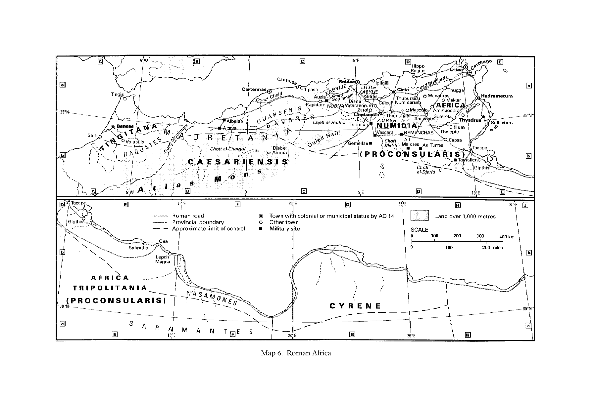

*地图6：罗马时期的非洲。图例包括罗马道路、行省边界、大致控制界线、公元14年以前已获殖民地或自治市地位的城镇、其他城镇、军事驻地，以及海拔超过1,000米的土地。图内地名保留原文。*

<!-- 原书第381页；PDF第430页 -->

这里的“非洲”，指撒哈拉以北的土地，不包括埃及与埃塞俄比亚，却包括今天的摩洛哥、阿尔及利亚、突尼斯以及利比亚西部。在这片广阔土地上，基督教成长起来，为更广大的教会提供了丰硕的神学思考成果。当代教会论、圣礼神学及圣经诠释传统的根，都在这里得到滋养。

## 证据

<!-- 原书第381–382页；PDF第430–431页 -->

关于最初三个世纪北非基督教的文学证据，来自德尔图良（约160–约225年）、米努基乌斯·费利克斯（二／三世纪）、居普良（卒于258年）、科莫狄安（活跃于三世纪中叶）、伪居普良（258年以后），以及各种讲道与殉道故事。[^ch21-1]这些材料展现基督徒社群的信仰、结构及实践。

非洲有许多考古遗址，却没有一处直接见证基督教最早的岁月。甚至迦太基也没有四世纪以前的证据。调查最早期历史的主要障碍，是教堂反复重建，尤其在汪达尔征服以后。

最早提到用于基督教敬拜之建筑的文学记载，都来自四世纪。《泽诺菲卢斯庭审记录》（Gesta apud Zenophilum，320年）提到303年“基督徒聚会的房屋”。《萨图尔尼努斯殉道记》（Martyrium Saturnini，304年或稍后）说，戴克里先迫害期间，主教背弃信仰后，信徒在一位诵经员家中聚会。阿尔塔瓦一方309年的铭文，提到basilica dominica，即“主的厅堂”，是一座纪念殉道者的祠堂。[^ch21-2]加里恩归还此前没收教堂的敕令（Euseb. HE 7.13），没有留下在非洲实施的回响。这并不意味着300年以前不存在专门用作教堂的建筑，只意味着我们没有证据。

地下墓窟见证着非洲早期基督教。最古老的是哈德鲁梅图姆墓窟，年代为三世纪中叶。[^ch21-3]那时该城已有主教。尽管墓窟名为“善牧”（Bon pasteur），没有迹象表明是基督徒所建，也没有证据表明其中基督徒墓葬占多数。它与作为机构的教会没有联系；不过，铭文证明有基督徒在场。其他墓窟，包括突尼斯的萨拉克塔，即Sullectum、凯尔肯纳、加贝斯，阿尔及利亚的肯舍拉及谢尔贝特—布—阿杜芬，以及利比亚的萨布拉塔、苏尔特和塔尔胡纳山，年代都不能可靠确定。只有萨布拉塔和肯舍拉，即古代马斯库拉，似乎在300年以前已有基督徒社群，但除了主教名字，所知甚少。

## 政治、文化与社会影响

<!-- 原书第382–383页；PDF第431–432页 -->

早在基督教传入以前，不同族群就共同塑造了非洲文化。[^ch21-4]希腊史家称为利比亚人的布匿时代以前沿海居民，在晚至二世纪的铭文，以及图阿雷格人的语言中，都留下痕迹。[^ch21-5]考古证明，利比亚人与埃及、希腊都有贸易。高地上季节性迁徙放牧的努米底亚人，自八世纪起被称为柏柏尔人，出现在狄多的布匿建城传说中；其语言以发展后的形式延续至今。

经营奢侈品贸易的腓尼基人，[^ch21-6]约于公元前1100年建立小型定居点，约前814年建立迦太基。它成为利比亚—布匿文化的中心。[^ch21-7]贸易、农业以及玻璃和金属工艺，是经济支柱。[^ch21-8]迦太基由富有且有功望的长老实行寡头统治，但民众保有发言权，而且这种权利逐年增强。[^ch21-9]

与希腊的贸易持续进行，不过，随着时间推移，不断扩张的腓尼基贸易网支配了西地中海，吞并希腊殖民地，最终导致与罗马冲突。布匿战争（前264–146年）结束时，罗马控制了迦太基城及其属地，即突尼斯东北部，将其设为由裁判官治理的行省，向罗马供应谷物。前67年，罗马人又将昔兰尼纳入非洲领地。前46年，他们吞并朱巴一世的毛里塔尼亚，把“旧非洲”（Africa Vetus）与这一称为“新非洲”（Africa Nova）的新领土，合并为一个由资深执政官治理的行省。最初，内战以及保护罗马谷物供应的需要，推动了两地整合。但到42年，西部分为两个皇帝行省：凯撒利亚毛里塔尼亚和廷吉斯毛里塔尼亚。前25年，东部的凯撒利亚地区交给朱巴二世统治。他在罗马长大，把罗马文化带到祖先土地。[^ch21-10]西部廷吉斯地区，成为帝国罗马军队最密集的驻扎区之一。那里建立的罗马城市虽然很少，却有许多当地青年追随父亲从军。[^ch21-11]

到公元二世纪之交，同样来自非洲的塞维鲁王朝掌权。他们熟悉当地情况，将努米底亚从非洲资深执政官行省分出。戴克里先治下，非洲资深执政官行省与昔兰尼被分成三个行省：非洲、拜扎凯纳与的黎波里塔尼亚；努米底亚则分为努米底亚基尔塔、锡提菲斯与米利提亚纳三个行省。廷吉斯地区被划归西班牙。

毛里人、巴夸特人、盖图利人及其他部族向北推进时，这些重新划分都有助于罗马化，也使对边界模糊地带的管理更加稳定。[^ch21-12]

越深入内陆，语言与贸易品等具有明确布匿和希腊—罗马特色的痕迹就越少。沿海地区，以及很早就大量驻军的地区，例如基尔塔与兰拜西斯周围，罗马化最强。并非所有城市都接受罗马习俗，连政体也未必接受。殖民地和申请城市地位的城镇，采用罗马政制；但许多大城市，尤其的黎波里塔尼亚的城市，仍保留布匿式治理，设有民众大会、元老院和由长老（seniores）协助的苏菲特长官（suffetes）。[^ch21-13]这种布匿合议政制能否延续，取决于是否方便罗马当局，以及地方精英抵抗同化的程度。凡合作或吸纳对非洲人有利之处，例如凯撒利亚毛里塔尼亚，就有罗马城市存在；凡无利之处，例如莱普提斯（Leptis／Lepcis），则出现布匿城市与罗马殖民地并立的双重建置。

<!-- 原书第384页；PDF第433页 -->

非洲社会最初主要按部族组织，直到以城市为文化中心的腓尼基人到来。罗马人把大片土地分给政治支持者，并在城市周围安置退伍军人，削弱乡村残存的部族影响；其子女继承父亲的公民地位，强化罗马文化与税收。[^ch21-14]朱巴二世输入建筑样式、货币、法律与宗教，加快罗马化。[^ch21-15]姓名也发生了一定程度的罗马化，但如同采用罗马城市制度一样，布匿名与罗马名的比例，取决于哪一种更有利于家族向上流动。布匿姓名往往包含神名，强调与罗马以前文化的联系；采用的罗马姓名，则尊崇罗马庇护者。总的来说，非洲人在罗马化有利于自己时，就加以运用，例如担任罗马祭司、改用姓名；而在可能的时候，又紧守自身根源，例如使用新布匿文墓志。

## 非洲诸宗教

<!-- 原书第384–385页；PDF第433–434页 -->

关于布匿时代以前的传统，所知很少。巨大的岩石墓葬证明，当时埋葬死者，随葬品很少。学者常从后世撒哈拉习俗，推测利比亚宗教，例如崇敬陨石、在圣地留下布片。[^ch21-16]腓尼基人从推罗带来黎凡特遗产，包括崇敬城市守护神马尔卡特。利比亚与布匿人的接触，使推罗原本不重要的神明塔尼特与巴力·哈蒙，变得突出。[^ch21-17]即使到基督教时期，含神名的姓名仍很常见，只是采用拉丁化形式。追溯布匿迦太基的宗教史并不容易，因为希腊作者用希腊神名描述布匿诸神，宗教史家又倾向用腓尼基或现代马格里布传统填补空白。

与埃及、希腊的贸易，影响了宗教图像。公元前396年哈米尔卡袭掠叙拉古德墨忒尔神庙以后，希腊神像，尤其德墨忒尔的形象，传入当地。[^ch21-18]伊西斯来自埃及，后来库柏勒经罗马从小亚细亚传入。托勒密王朝统治（前322–96年）留下的希腊法律、语言与建筑，在昔兰尼加延续下来。[^ch21-19]随葬物并不埋进墓中，但设有石桌（mensae），供活人探墓并为亡者设宴。[^ch21-20]

城市中的布匿宗教得以存续，往往与罗马崇拜融合；乡村中的形式，则较少同化。[^ch21-21]大型罗马化城市虽然有奉祀朱庇特、朱诺、密涅瓦的卡庇托神庙，巴力·哈蒙的雕像仍一直制作到基督教时期。居首位的女神塔尼特被等同于朱诺；马尔卡特对应赫拉克勒斯；农业神弗鲁吉费尔对应普鲁托；但被选作巴力面貌的，是庄严的萨图尔努斯，而非朱庇特。他的崇拜跨越阶层，极其流行。[^ch21-22]

献祭是布匿宗教不可分割的一部分，由一个合议团体的首席祭司主持。[^ch21-23]祭祀遗存显示，有些献祭献给地下神明和／或亡者：人们把奠酒浇入地面，把食物留在墓旁。[^ch21-24]巴力·哈蒙掌管墓地与人祭。在饥荒、战争等危急时期，祭品是头生孩子；不过，考古遗存表明，有时也以死胎、生病的较大儿童和小动物替代。[^ch21-25]人祭延续到多晚、范围有多广，仍不清楚，但罗马法律与德尔图良的表述，似乎认为它延续到了公元一世纪。[^ch21-26]焚祭之后，骨灰埋入瓮中。其他死者则葬于石棺，或石块和陶瓦下，随葬品很少。

如在罗马一样，任期一年的祭司职位，常由同一家族成员担任，是仕途（cursus honorum）的台阶。担任这些职位，是认同罗马的重要方式。皇帝崇拜祭司职体现了这一做法的最高形式，是非洲人事业的顶峰。[^ch21-27]它很可能在维斯帕西安时期传入，旨在为罗马化提供宗教基础。[^ch21-28]因此，它既代表罗马宗教，也代表罗马政治霸权。

## 早期非洲基督教的地区特点

<!-- 原书第386–387页；PDF第435–436页 -->

布匿宗教的闪族根源，引出了基督教在当地如何起源的问题。遗憾的是，答案未知。非洲人从未像其他教会那样，宣称有一位建教使徒，例如亚历山大里亚的马可或印度的多马。他们很尊重罗马基督徒，却没有教会由罗马创立的传统。[^ch21-29]事实上，基督教实践暗示着另一种根源。多数学者把基督教与迦太基及周边犹太社群相联系。[^ch21-30]证据包括拉丁文《圣经》中的希伯来语式表达、德尔图良熟悉后来收入《塔木德》和《米示拿》的口传传统，以及加马尔墓地同时埋有犹太人与犹太基督徒。[^ch21-31]

非洲基督教也呈现最初数世纪“犹太基督教”的某些标志：[^ch21-32]例如，《使徒行传》15:19–20的使徒决议，直到德尔图良（Apol. 9.13）与米努基乌斯·费利克斯（Oct. 30.6）时代，仍被当作规范；德尔图良知道，犹太人称基督徒为拿撒勒人，一个异端派别（Marc. 4.8）；伪居普良《论百倍》（De centesima，PL, supp. 1, cols. 53–67）具有天使基督论；基督徒直到436年仍守某些犹太节日，见第四次迦太基会议第89条。最后，地方教会由seniores laici，即“平信徒长老”组成的委员会治理，类似犹太会众，也可能类似布匿的苏菲特长官。虽然这些证据综合起来仍不足定论，但举证责任应由提出其他解释者承担，例如诉诸一般闪族或布匿文化的解释。

最早提及基督徒的非洲著作，是约180年的《斯基利殉道者行传》（Martyrum Scillitanorum acta），用拉丁文写成，可能因为它依据法庭记录。不过，非洲基督徒最初的语言是希腊语，或许说明基督教根植于说希腊语的商人中，其中可能包括散居犹太人。德尔图良某些论著最初采用希腊文，[^ch21-33]对佩尔佩图娅来说，希腊语也是礼仪语言（M. Perp. 12.2）。

无论起源如何，早期基督徒已有拉丁文《圣经》。到180年，保罗书信已有拉丁文版本（M. Scil. 12），其余经书则约于250年前译出。没有一部完整《圣经》存世，只有各种著作中的短小片段。译文常与耶柔米《武加大译本》显著不同（August. Doctr. chr. 2.15）。其中包含别处没有、却在非洲很重要的经文，例如《约翰福音》5:3b–4。甚至在非洲内部，直到奥古斯丁时代，仍流通着不同文本（Retract. 1.7）。

北非在397年的《希波会议摘要》（Breviarium Hipponense）以前，没有正典目录，但可以从非洲人使用的书卷推测实际采用的正典。他们使用除《雅各书》《彼得后书》《约翰二书》和《约翰三书》以外所有圣经书卷。非洲也知道一些早期非正典作品，例如《黑马牧人书》《保罗行传》，或许还有《彼拉多行传》。[^ch21-34]殉道故事在礼仪中诵读，一次四世纪会议特意将它们与正典文本区分，见迦太基会议第5条。

与政治文化相呼应，合议性是教会治理的标志，也是衡量基督教传播的尺度。证据见于主教座的分布，以及诸主教在会议上的往来。[^ch21-35]目前所知最早的会议，约于220年在阿格里皮努斯主教主持下举行，没有附主教座名的签署名单保存下来。直到奥古斯丁约410年的De unico baptismo 13.22，才记其与会主教为七十人。无论这是精确数目还是约数，参奥古斯丁405年的Cresc. 3.3.3，它都提供了一个基准，可用来衡量后来记载的主教人数。居普良（Ep. 59.10.1）声称，到236／240年，他能够召集九十位主教，谴责一位努米底亚主教的异端。同样没有名单存世，但那时主教已散布于非洲资深执政官行省和努米底亚。这一人数，使阿格里皮努斯召集七十人的说法获得一定可信度。即使在256年两次大迫害之间，仍有八十七位主教齐聚迦太基，代表的地区东至的黎波里塔尼亚莱普提斯，西至图布尔博，但主要集中在迦太基周围220公里内。

非洲传统极为倚重主教。他们经常聚集，讨论共同关心的问题，但并不被强迫把会议共识施行于自己的教区。甚至小村落也有主教。在较大城市，主教有执事协助。司祭，即长老，主要见于迦太基这类大城市，主持各城区的事务。

<!-- 原书第387–388页；PDF第436–437页 -->

非洲基督教从最初开始，就通过殉道和护教表现其不妥协性。[^ch21-36]180–305年，非洲基督徒间歇受到迫害。评估迫害强度及其影响时，必须认识到：帝国各地并非所有基督徒都在同一时间、以同一方式受到迫害。即使旨在促成全帝国一致的皇帝敕令，也依赖地方执行；一地可能偶尔执行，或根本不执行，另一地却持续而严厉。周围文化中，无论在战争还是祭坛上，以生命献祭的理想，都支持基督徒认为以忠信献出生命是可接受的观念；但应注意，殉道叙事并未直接染上人祭母题。[^ch21-37]

最早的殉道故事《斯基利殉道者行传》，显示即使面对死亡，基督徒也坚决拒绝向皇帝献上神圣敬礼。资深执政官试图宽待囚犯，给他们撤回信仰的机会；他们却更加坚定地宣称自己名为“基督徒”。发言人斯佩拉图斯采用常见的护教论证，第2–8节，为基督教辩护，称其合乎理性，只敬拜上帝这位宇宙最高统治者。基督徒是遵守法律、尊敬皇帝的模范公民；但他们拒绝指着皇帝的守护灵（genius）起誓这一偶像崇拜行为，因为那将否定他们相信上帝是唯一神明的信仰。无论在不妥协还是在护教上，斯佩拉图斯都为其他殉道故事提供了榜样。

一代之后，塞普提米乌斯·塞维鲁使归信基督教成为非法。从这一时期传来两个故事，都讲述出于原则、毫不退让地拒绝偶像崇拜。第一个出自德尔图良《论冠冕》（De corona）：一名军人因拒绝戴象征胜利的月桂冠被处死。德尔图良将冠冕解释为军旅生活中普遍偶像崇拜的象征。尽管法律判决或许更应解释为惩罚违反军纪，而非坚持“基督徒”之名，但有些迹象显示，这名军人的行为，甚至让部分信徒感到难堪。

不过，203年的《佩尔佩图娅与费利基塔斯殉道记》（Martyrium Perpetuae et Felicitatis），描绘的正是因坚持基督教而受迫害。佩尔佩图娅与同殉道者萨图鲁斯的日记，表现出拒绝献祭，甚至拒绝把祭司袍服当作戏服穿着（M. Perp. 18.4–6）。它们呈现一种灵恩型基督教，尊重预言，梦中启示的权威胜过教士。灵恩权威与授职权威之间的冲突，将成为250年代非洲教会主要的紧张点之一；那时，它再次直接从迫害环境中产生。同样，《佩尔佩图娅殉道记》也为250年代《马里安努斯与雅各殉道记》《孟他努斯与卢基乌斯殉道记》等后世作品，记录殉道者的监禁与处决，提供了模式。它们在与家人和当局争辩时，都遵循斯基利殉道者的榜样。[^ch21-38]对手越施压，他们越不妥协。

<!-- 原书第389页；PDF第438页 -->

塞维鲁与德修之间，偶尔有非洲殉道事件的记载，见Tert. Scap.各处；Cypr. Ep. 39.3.1，但没有持续迫害，足与德修治下相比。其他地区也许迫害强烈，优西比乌也许夸大了情况，但在非洲，250年代以前没有普遍恐怖的证据。德修与瓦勒良颁布的敕令，构成这一时代最严重的威胁。德修即位后不久，约250年1月，下令所有人献祭。危难时期号召宗教一致并不少见，这是一种动员民众、确保pax deorum，即“诸神的和平”的方式。235–284年确实需要某些有助政治稳定的措施：出现过十八位皇帝，还有更多帝位争夺者；边疆动荡，是这一时期的特征。因此，号召献祭可以理解。特殊之处却在于要求的普遍性，以及坚持执行的程度。居普良著作（Ep. 15.4；Laps. 9.25）显示，不只是家长，而是全部家庭成员都参加皇帝崇拜，浇奠酒、品尝祭肉（Laps. 25）。

献祭者得到已经服从的证明，即libelli，其中一些仍存世。有些人试图通过代理人或贿赂取得证明（Cypr. Ep. 21.2.1–3.2；55.13–14），或像居普良一样，宁愿自愿流亡，也不面对惩罚。各种促人服从的压力失败后，基督徒便遭处决。

据居普良《论失足者》（De lapsis），许多基督徒，包括教士，都献了祭。有些主教甚至带领会众背教（Cypr. Ep. 55、65、67、69）。基督徒争论，决定性的是行为本身，还是仅仅同意这件事。普遍共识基于字面理解：正是身体实际做出的行为，将跌倒的lapsi，即“失足者”，与坚定站立的stantes分开。许多失足者，包括部分教士，希望重新获准进入教会。居普良认为，应由主教逐案判断归回者的罪责程度，施加适当惩戒。但迫害未结束，他便无法回迦太基，只能通过与教士通信治理该城教会。

<!-- 原书第390页；PDF第439页 -->

他不在时，一些基督徒陷入惊慌，想尽办法重新进入教会。有些向“宽松派”教士施压；另一些采取的途径，则给社群带来长期问题。他们去找confessores，即“认信者”——因拒绝献祭而入狱的基督徒——请求代求。认信者在教会中地位特殊：虽然许多人未受圣职，其权威却不容置疑，连居普良也承认。他们已宣认效忠基督，甘愿受苦。监禁和酷刑往往使他们濒于死亡，由此取得在未死的情况下、最接近殉道者的地位。一些认信者向悔改的失足者发出和好书，即libelli pacis，使他们重新纳入教会。有些为忏悔者写信，供自己死后使用；还有些签发一揽子赦免信，甚至不列明适用者姓名。

这种情况下，居普良不得不在认信者权威与自己关于失足者的明确立场之间周旋。德修251年去世后的几年，居普良致力于整顿迦太基教会。认信者不经授职便被纳入教士行列，理由是受苦已足以使他们有权担任执事和长老，但不能任主教。悔改的失足者则按主教规定的条件和好，往往只能在in articulo mortis，即“临终时”，领受圣餐。

到253年，和平间歇消失，瓦勒良（253–259年在位）治下开始新的迫害。绞索在教会颈上越收越紧时，居普良开始准许更多失足者领圣餐。他认为，他们需要圣礼和基督徒相交所提供的属灵力量，才能承受上帝下一轮试炼。256年，瓦勒良颁令，要求高级教士为皇帝献祭，禁止基督徒集会，没收财产，并禁止基督徒拥有自己的墓地（M. Cypr. 1.7）。一些教士被判送入皇帝矿场（Cypr. Ep. 76–79）。256年夏，高级教士开始面临死刑；上层男子失去地位与财产，若仍坚持信仰，也遭处死。上层妇女被放逐，财产被没收（Cypr. Ep. 80）。官员对追捕下层信徒兴趣较少，因为没收小额财产不值得费力；而且这些人在社群中地位不高，也不足以成为展示皇帝震怒的显著例子。居普良的精英身份和职位使他处于危险。他在郊区别墅被捕，押到迦太基，受审，并于258年被处死。

<!-- 原书第391页；PDF第440页 -->

瓦勒良去世后，加里恩撤销256年敕令。基督教虽未成为religio licita，即“合法宗教”，信徒却可以自由集会，并收回敬拜场所和墓地。此后有近四十年的相对和平。随后，290年代，军方开始处死归信后拒绝服役的军人，例如特维斯特的马克西米利安与廷吉斯的马尔凯卢斯。这些殉道者成为社群崇敬的英雄，为基督徒树立榜样，教他们如何在四世纪初戴克里先将要发动的迫害中抵抗国家。更重要的是，他们强化了一种基督徒身份观，认为这一身份要求抵抗国家权威。对殉道者的崇敬，以及围绕这种严格身份界定的争论，将成为四世纪末、五世纪初多纳徒派与大公教会争议的核心。

## 殉道者敬礼

<!-- 原书第391–392页；PDF第440–441页 -->

与其他地区相似，非洲教会也产生了自己的文学，教人预备殉道、赞颂殉道。不过，非洲人期待在世界终结时得到昭雪：正如民政当局在地上审判殉道者，殉道者也将在天上严厉审判他们，见M. Perp. 18；Tert. Mart. 2.4；Apol. 24；参《马加比二书》7:9–19、35。殉道者与认信者的权威，甚至超过教会权威，见M. Perp. 13.1；认信者情况见上文。

以圣经中因忠于上帝而被处死的人，例如马加比殉道者与司提反，为榜样，尊崇本地殉道者，始于德尔图良时代。非洲的圣物敬礼始于居普良：基督徒在其行刑处附近地上铺手帕，承接滴落的血。ad sanctos，即靠近殉道者墓的安葬方式，自295年起已有见证（Acta Maximiliani 3.4）。

殉道者敬礼采用类似罗马人普遍纪念亡故亲属的习俗。在死者逝世纪念日——即其在天国诞生之日，参M. Polyc. 18——基督徒到墓地聚集、歌唱、宴饮，常失于庄重，还通过管道把奠酒倒入墓中。[^ch21-39]德尔图良（Spect. 13）与居普良（Ep. 68.6.2）谴责这些庆祝不合基督教，但似乎成效不大，因为一个半世纪以后，奥古斯丁仍在反对这些laetitiae，即欢宴，例如De civ. D. 8.27。

非洲究竟有多少人殉道，没有准确统计。其影响似乎不在绝对人数，而在于给基督徒施加的恐怖，以及教会领袖通过划定基督徒与更广大世界的界限作出的回应。一旦迫害结束，基督徒就必须重新制定对国家的态度，重新构造自身身份。

## 社会中的基督徒

<!-- 原书第392–393页；PDF第441–442页 -->

面对那个世界，基督徒努力为自己的忠诚提供理性说明。护教文献既面向邻人，也强化自身委身。它与殉道一样，表现基督徒拒绝承认自己上帝以外的任何神明。德尔图良、米努基乌斯·费利克斯与科莫狄安等作者，试图让抱有怀疑的同时代人相信基督教的价值，以及传统崇拜和秘仪宗教的荒谬。对他们而言，基督徒身份与实践当然包括一神论；而且，如几乎所有护教文献一样，还主张基督徒在个人与社会生活中，比非信徒更有道德（Tert. Apol. 3–4、10、30；Min. Fel. Oct. 30–31）。

基督徒自称生活简朴、品行正直。他们对周围文化的不自在，以充满矛盾的方式表现出来。德尔图良对哲学和辩证术的轻蔑（Spect. 18；An. 3），以及阿尔诺比乌斯对修辞的拒绝（Adv. nat. 1.59），可归结于德尔图良著名的警句：“雅典与耶路撒冷有什么相通？学园与教会有什么相通？异端与基督徒有什么相通？”（Praescr. 7）然而，这句话本身就以最出色的古典风格表达。德尔图良面向基督徒写作时，反对他们服兵役（Cor. 1）；他却又说，异教徒不应害怕基督徒，因为双方共享城市与文化生活，包括服兵役（Apol. 37.4）。如米努基乌斯·费利克斯解释，运用得当并有哲学支持的修辞，可以帮助传福音（Oct. 39）。

米努基乌斯·费利克斯（Oct. 30.3）与德尔图良（Apol. 9.2）等护教者，尤其猛烈谴责人祭。指控敌人食人，是大多数古代社会护教论辩的常见母题。事实上，基督徒自己也受到这种指控，见Tert. Apol. 23；Min. Fel. Oct. 9中的弗龙托。不过，非洲人在尚不遥远的记忆中，确实曾献儿童为祭，[^ch21-40]所以这些指控格外尖锐。[^ch21-41]

维克托一世或许为非洲的不妥协性与合议性提供了最后一个例子。据说他从的黎波里塔尼亚来到罗马，成为主教，任期约189–199年。他是第一位威胁把自己教区以外基督徒逐出教会的罗马主教。不同社群在不同日期庆祝复活节，使他深感震惊。但合议性压过了严格主义：他虽威胁绝罚，却从未实际与任何人断绝共融。

## 争论的问题

<!-- 原书第393–394页；PDF第442–443页 -->

基督徒攻击罗马传统宗教与秘仪宗教时，大体团结一致，但教会并非铁板一块。城市间的距离、基督徒人数少，以及每个小镇都有主教，都有助于形成多样的地方实践。这种状况本属预期，也受到尊重；但差异过大时，非洲教会内部各种运动，就使基督徒彼此分裂。引发分歧的问题，包括创造、启示与教会。

创造是一位善神的产物，还是物质本身邪恶？这是某些诺斯替派提出的基本问题。反对赫尔摩根尼时，德尔图良坚持上帝是创造者，创造是美善的（Herm. 15–18）；反对马吉安时，他教导《旧约》的创造上帝，与耶稣的父，是同一位（Marc. 2、4、5）。

启示已经完成，还是持续发生？非洲多数基督徒相信，上帝仍通过梦与异象提供启示。《佩尔佩图娅殉道记》的编者也如此认为，把当下描绘为人人都要说预言的末日。德尔图良相信，人所知道关于上帝的几乎一切，都来自梦；但他也提醒，这些启示需要由共同体评估（An. 9）。他和自己的圈子，极重视同时代弗里吉亚先知的启示；这些先知的严格主义运动自称“新预言”，宣讲迫近的末世，即世界终结，拥抱殉道，也接纳妇女担任领袖。这一运动吸引许多非洲人。德尔图良晚年认为，不追随它的人宽松到近乎异端；但始终重视合议的双方非洲人，并未像别处后来所称的孟他努派那样，成立分离教会，也没有证据表明非洲主教对同情孟他努派者施加惩戒。[^ch21-42]

作为认信者，佩尔佩图娅觉得自己有权在祈祷中向上帝提问，并通过异象得到答案，其中一些关乎殉道与医治。同伴萨图鲁斯的异象，则表明认信者高于教士；前者更接近上帝，可以调解后者之间的争端（M. Perp. 13）。一代之后，居普良仍尊重梦作为启示的途径。[^ch21-43]

教会是圣徒的家，还是罪人的避难所？人们不只把教会想作受洗基督徒的聚集，也把它看作一个具有实体性的存在。德尔图良首先使用“母教会”这一称谓（Mart. 1）；居普良对此感受如此强烈，以至于说：“不以教会为母者，就不能以上帝为父”（Unit. eccl. 6）。两人都以实际方式宣告教会合一。对合一的投入，支持划定明确界限，也支持德尔图良拒绝异端解释圣经：圣经不是他们有权解释的。教会的纯洁，使他不能接受让悔改的通奸者重新与教会和好（Pud. 2–3）。这种合一观，也使阿格里皮努斯主持的迦太基会议能够拒绝异端洗礼，并使居普良256年的会议，不承认失足后又试图返回教会之教士所施洗礼的有效性（Ep. 67）。对他来说，教会就是挪亚方舟。他向那些已经受洗、却倾向分离群体的人厉声宣告：“教会之外，没有救恩”（Ep. 73.21）。[^ch21-44]

然而，合议性仍压过严苛。德尔图良无论多么同情孟他努派，都没有脱离非洲教会；非洲人无论多么坚决为重新施洗辩护，都没有与不重新施洗的罗马人断绝共融。

## 与其他地区基督徒的关系

<!-- 原书第394–395页；PDF第443–444页 -->

北非虽然与埃及共享海岸，它与罗马的关系却留下更多痕迹。两个共同体最重要的交往，围绕三个问题，全部显示非洲人的合议性与维护合一的投入。

第一个问题，是教会能否使受洗后犯罪者重新和好。德尔图良代表非洲传统，反对教会创设新做法，因为这超出其权限。约217–222年任罗马主教的卡利斯图斯，主张更宽容的政策，迫使罗马分裂为其支持者与希波吕托斯（约170–约236年）支持者两方。尽管德尔图良《论贞洁》（De pudicitia）激烈反对，罗马与迦太基始终没有断绝共融；非洲的合议性阻止了这一点。

第二、第三个问题，也同样分裂罗马社群。德修迫害之后，科尔内利乌斯（卒于253年）成为罗马主教。他使失足者重新和好，激怒了严格主义的诺瓦提安派，后者质疑其选举有效性。随后，问题转向如何接纳由异端施洗的人。[^ch21-45]非洲人和罗马严格派支持重新施洗。罗马主教司提反（254–257年在任）与居普良为此展开长期争论（Cypr. Ep. 67–75）。即使争议最激烈时，居普良争取凯撒利亚的费尔米利安等海外支持者，而司提反拒绝接待其代表，双方也没有威胁彻底决裂。

## 非洲基督教的其他特点

<!-- 原书第395–396页；PDF第444–445页 -->

非洲基督教倾向字面主义和法律主义。教义的表述产生于解决实际问题的过程，无论问题本身，还是它对教会合一的影响。非洲人探讨的重要领域，包括教会论、三一、灵魂本性、圣经诠释及妇女角色。

与诺斯替派的争论，催生了德尔图良的三一思想。他的“一个本性，三个位格”，成为正统公式（Pud. 2）。他用物质类比作为解释隐喻，倾向一种从属论基督论，例如Prax. 8中的国王、儿子、使者，以及太阳、光、温暖等。奥古斯丁于419年将德尔图良的贡献作了属灵化处理（Trin.）。讨论三一与灵魂时，德尔图良倾向按字面解释圣经，认为实在具有物质性，甚至上帝、魔鬼和灵魂也不例外。在爱任纽基础上，他反对诺斯替派从圣经人物名字创造新宇宙论的寓意解释。不能像异端那样把圣经寓意化（Scorp. 11.4），创造一个与使徒传承所领受教义相矛盾的新故事。他与居普良，如奥古斯丁以前多数非洲人一样，倾向预表而非寓意：把圣经故事和人物看作一幅叠加于当代事件、英雄与恶人之上的图景。居普良《经文见证》（Testimonia）运用预表，巩固《旧约》与《新约》的联系，反对诺斯替派、马吉安派与犹太人的教导。

对妇女的态度及赋予她们的角色，与其他地方并无根本不同，除非从非洲基督教总体特点理解。尊重圣灵在教会中的活动，也延伸到受启示的妇女，其异象作为先知启示受到尊重（Tert. An. 9；M. Perp. 1.4–5、4.1）。只有德尔图良反对妇女担任领袖，或许因为他把妇女领导与诺斯替神学联系起来。他不但与非洲趋势相左，也与非洲以外的新预言成员相左。

除妇女担任领袖的问题外，非洲作者用基督教理由支持社会的一般习俗。德尔图良视罗马人重视univira，即“一生只结婚一次的妇女”，为理所当然，并谴责再婚（Mon. 15；Ad ux.第2卷）。他和居普良都要求妇女遵守比迦太基社会一般标准更严格的行为规范，例如禁止化妆、佩戴首饰和修饰发型，分别见Cult. fem.、Virg.及Hab. virg.。不过，也应注意：妇女行为标准虽严格，在这个严格主义教会中，对男子的要求同样严格，尤其性道德方面，例如Tert. Exh. cast.及Mon.。

总的来说，无论神学还是伦理，非洲基督教都倾向以字面而严格的方式理解圣经与道德。它通过殉道与护教，面对周围文化界定自己；通过致力合一与合议，在内部界定自己。当罗马皇帝接受基督教为合法宗教时，那些把身份建立在反抗国家上的基督徒，被迫重新思考这一身份。接受皇帝馈赠和支持者，像奥古斯丁一样，在神圣计划中为皇帝找到正面，或至少中立的位置，来解释其接受的合理性。无法如此做的人，则视自己为真教会最后的余民。在北非，这些人便是多纳徒派。作为非洲基督教真正的继承者，他们维持对圣经的字面、严格解释，以及殉道文化；在继续反对罗马国家者中间，推动合一与合议。其余所有人，都是外人。[^ch21-46]

## 译校说明

- 地区行政史和迫害年代中的疑似原书问题均保留。例如原书第383页朱巴一世领地的称呼、若干行省改组的时间顺序，以及“二世纪之交”塞维鲁王朝掌权的表述；第390–391页将瓦勒良的两轮敕令都系于256年，并写“瓦勒良去世后”加里恩撤令。这些表述已与原PDF文字核对，未作为提取错误擅自改写。
- 本章关于维克托是否实际断绝共融的判断，与第二十章所介绍的观点存在差异；分别保留各章作者的论证。
- 结尾将多纳徒派称为非洲基督教“真正的继承者”，是本章作者对当地传统延续性的解释，依原文保留。

## 脚注

[^ch21-1]: 阿尔诺比乌斯，活跃于约275–约311年，以及拉克坦提乌斯，约250–约325年，也来自非洲，但其现存著作不属于本章考察时期。

[^ch21-2]: Février, ‘Africa–Archaeology’, 16.

[^ch21-3]: Leynaud, Les catacombes africaines, 11–15.

[^ch21-4]: 非洲的政治地理并不总能清楚界定。以下依据Shaw, ‘Formation of Africa Proconsularis’；Adkins and Adkins, Handbook, 111–14。

[^ch21-5]: Ghaki, ‘Le Libyque’, 204–6.

[^ch21-6]: Lancel, Carthage, 5.

[^ch21-7]: Lancel, Carthage, 262.

[^ch21-8]: Fantar, ‘Punic civilization’, 105–6.

[^ch21-9]: Arist. Pol. 2.11; Polyb. Hist. 6.51.

[^ch21-10]: MacMullen, Romanization, 43–5.

[^ch21-11]: Shaw, ‘Autonomy and tribute’, 68–70.

[^ch21-12]: 关于边疆政治不断重新协商的过程，见Shaw, ‘Autonomy and tribute’。

[^ch21-13]: MacMullen, Romanization, 35–6.

[^ch21-14]: MacMullen, Romanization, 31; Theodosian Code 1.12.4.

[^ch21-15]: Macmullen, Romanization, 43–5.

[^ch21-16]: Picard, Les religions de l’Afrique antique, 5.

[^ch21-17]: Picard, Les religions de l’Afrique antique, 26–27, 56–61.

[^ch21-18]: Picard, Les religions de l’Afrique antique, 86.

[^ch21-19]: MacKendrick, North African stones speak, 121–5.

[^ch21-20]: Ennabli, Carthage retrouvée, 53.

[^ch21-21]: 非洲宗教，见Rives, Religion and authority，第1章。

[^ch21-22]: Rives, Religion and authority, 142–6.

[^ch21-23]: Sznycer, ‘La religion punique’, 112.

[^ch21-24]: Picard, Les religions de l’Afrique antique, 33.

[^ch21-25]: 例如公元前四世纪，叙拉古的阿加托克利斯率军蹂躏迦太基时，有二百名儿童被献祭。见Diod. Sic. 10.20；Sznycer, ‘La religion punique’, 114–16。

[^ch21-26]: Tert. Apol. 9；参Picard, Les religions de l’Afrique antique, 103。

[^ch21-27]: Raven, Rome in Africa, 149.

[^ch21-28]: Ferguson, Religions of the Roman empire, 95; Taylor, Divinity of the Roman emperor, 212.

[^ch21-29]: 反对亲罗马文本具有历史真实性的论证，见Lejay, ‘Les origines de l’église d’Afrique’, 41–7。

[^ch21-30]: 非洲犹太人及其与基督徒的关系，见Setzer, ‘Jews, Christians and Judaizers’, 185–200。

[^ch21-31]: Setzer, ‘Jews, Christians and Judaizers’, 193–5.

[^ch21-32]: 见上文第二部分第4章。

[^ch21-33]: Labriolle, History and literature of Christianity, 41.

[^ch21-34]: Labriolle, History and literature of Christianity, 58–9；NTApoc, vol. ii, 214–15，关于《保罗行传》，以及vol. i, 501–4。

[^ch21-35]: 主教人数及分布，见Maier, L’épiscopat de l’Afrique。

[^ch21-36]: 这一时期非洲及其他地区的讨论，见Clarke, ‘Christians and the Roman State’。

[^ch21-37]: 唯一的例外可能是M. Perp. 18.4：基督徒被迫穿上刻瑞斯女祭司的服饰，藉此把处死的罪犯献给女神。见Picard, Les religions de l’Afrique antique, 134。

[^ch21-38]: 例如M. Perp. 3.5、15.1–6、18.4–6；M. Mar. 8.1、4.10；M. Mont. 19.1–4等。

[^ch21-39]: Duval, Recherches archéologiques à Haı̈dra, vol. ii, 191.

[^ch21-40]: 参The Octavius of Minucius Felix，Clarke译编，334页注496所列书目。

[^ch21-41]: Benko, Pagan Rome, 54–78.

[^ch21-42]: 见上文第17章。

[^ch21-43]: Ep. 4.1、11.5、39.1、57.5、66.10；以及Pontianus Diaconus, Vita Cypriani, 12。

[^ch21-44]: 关于维持界限的详尽讨论，见Burns, Cyprian the bishop。

[^ch21-45]: 另见下文第五部分第26章。

[^ch21-46]: 见下文第六部分第28章。


---

<a id="chapter-22"></a>

# 第二十二章 罗马

**作者：马尔库斯·文岑特（Markus Vinzent）**

《剑桥基督教史》第一卷《起源至君士坦丁》中文译稿

> 原书第397–412页，PDF第446–461页。完整翻译正文、史料清单、引文和解释性脚注；参考文献作者名、题名与定位保留原文。
>
> [第二十二章英文原文](<第二十二章 罗马（英文）.md>) · [原书PDF](<../01 起源至君士坦丁.pdf>)

<!-- 原书第397页；PDF第446页 -->

条条大路通罗马。本章采取的视角是：罗马吸纳了早期基督教世界各处交汇的思潮；在最初三个世纪，罗马教会远未自行产生或传播某种独特神学，反而内部零散分立，反复经历动荡。这个教会一次又一次受到帝国各地移民带入之争议的影响。总体而言，比起瓦尔特·鲍尔广受讨论的论点——其他地方原本属于异端的基督教形式，被试图向其他社群强加权威的罗马整顿归一——这样的描述似乎更为准确。[^ch22-1]

## 证据

<!-- 原书第397–398页；PDF第446–447页 -->

有关古罗马城本身、其历史与社会的证据，丰富得无法在此详述。[^ch22-2]君士坦丁展开大规模建设以前，基督徒对城市生活或宏伟建筑几乎没有影响。[^ch22-3]

关于罗马基督教，既有基督教和非基督教的文学史料，也有各种物质证据。

文学史料包括：

- **寄往罗马的书信**：使徒保罗的信，收入《新约》正典；还有伊格纳提乌——或为伪作？——、爱任纽、居普良、亚历山大里亚的狄奥尼修及其他人的信。
- **在罗马产生的作品**：可能包括《马可福音》，以及《革利免一书》《黑马牧人书》和游斯丁、塔提安、希波吕托斯、诺瓦提安的著作；优西比乌或亚他那修保存的科尔内利乌斯及狄奥尼修主教书信；还有后来被视为异端者的作品，包括可能属于瓦伦廷的《真理福音》、[^ch22-4]托勒密《致弗洛拉书》，以及德尔图良反驳中保存的马吉安《对比集》残篇。
- **提及罗马的基督教史料**：《新约》的《使徒行传》《提摩太后书》《彼得前书》，以及爱任纽、德尔图良和优西比乌的著作。
- **偶然提到罗马基督徒，却极其重要的非基督教作家**：例如苏埃托尼乌斯似乎证实克劳狄驱逐犹太人的敕令，参《使徒行传》18:3，却又令人困惑地说，他们“以克瑞斯图斯〔Chrestus，‘基督’？〕之名制造骚乱”（Suet. Claud. 25.4）；还有尼禄迫害基督徒的记述，或说他们被当作一场可怕火灾的替罪羊，见Tac. Ann. 15.44，其中提到耶稣在本丢·彼拉多治下死亡；或说他们传播“一种新而邪恶的迷信”（Suet. Nero 16.2）。[^ch22-5]
- **殉道记**：尤其《游斯丁与七位同伴殉道记》（Martyrium Justini et septem sodalium）。[^ch22-6]
- **教会传承名单**：见爱任纽（Haer. 3.2–3）、卡利斯图斯地下墓窟，以及较晚的《教宗名录》（Liber pontificalis）。
- **礼仪文本**：可能包括希波吕托斯或伪希波吕托斯的《使徒传统》（Traditio apostolica）。[^ch22-7]

物质遗存[^ch22-8]往往难以断代，并引发各种解释问题，包括：

- **考古发现**：包括地下墓窟及教堂地基，许多只是被不确定地追溯到君士坦丁以前；[^ch22-9]不过可以推定，梵蒂冈下方墓地，以及某些地下墓窟，尤其圣塞巴斯蒂亚诺教堂下方、多米提拉、卡利斯图斯和普里西拉墓窟，虽起源于“异教”，仍有一定理由被看作“教会和平”以前的重要遗址。[^ch22-10]
- **铭文与涂刻**：大多用于丧葬，发现于地下墓窟或石棺上。
- **墓室壁画与镶嵌画**：壁画实例见图3、图7，普里西拉墓窟的“希腊礼拜堂”（Capella Graeca）尤其重要；镶嵌画见图9。
- **石棺**：例如马尔库斯·奥勒利乌斯·普罗塞内斯217年的石棺，[^ch22-11]以及三世纪晚期萨拉里亚大道石棺，[^ch22-12]似乎属于基督教，同时又反映传统“异教”艺术意象。

## 帝国首都罗马及其范围内的基督教

<!-- 原书第399–400页；PDF第448–449页 -->

基督教登场时，罗马已经把权力扩展至整个地中海世界，并开始转化为君主制帝国。[^ch22-13]这座城市成为磁石与熔炉。本土精英在此进行政治角逐，城市穷人要求面包与竞技，而商人、游方哲学家则来此寻求出路。帝国首都罗马，为人们提供了展示自己、施教并发展思想的场所。它是一个复杂世界，[^ch22-14]宛如多种文化、宗教、族群与语言构成的多重世界中的一个宇宙。

罗马是自然的目的地。《使徒行传》描述基督教信仰如何从耶路撒冷传到地极（1:8），并以罗马收尾；伊格纳提乌——或伪伊格纳提乌？——的书信也是如此。与小亚细亚或埃及不同，罗马几乎没有产生自己的基督教作者。许多一世纪早期基督徒，尤其主要代表人物，是移民；二、三世纪多数杰出神学家同样如此。[^ch22-15]其中一些留在罗马，甚至在城中殉道，另一些只作为访客短暂停留。有意思的是，尽管住在说拉丁语的首都，基督徒直到三世纪相当晚的时候，仍主要使用希腊语。[^ch22-16]这证实了移民在会众群体中的主导地位。即使在三、四世纪，罗马仍是辩论之地，也是凭借复杂地下墓窟成为安葬与朝圣的中心，而非神学的发源地。在这样一座人口大量涌入的城市，个人、学派及谋求出路者之间常有竞争，并不奇怪。

犹太与非犹太的耶稣追随者，究竟何时首次到达罗马，远不清楚。保罗写信时——这是现存最早证据——基督徒肯定已经在那里。[^ch22-17]另一谜团与城市的复杂性有关，即各个基督徒小群体究竟一致，还是多样的问题。[^ch22-18]如果基督教由之产生的犹太教，在罗马像在耶路撒冷一样多样，拥有许多代表不同语言、文化与犹太传统的会堂，那么它们也为罗马基督教多样的开端提供了基础。[^ch22-19]保罗书信与《使徒行传》28:15–30的描述，支持这一假设。

多样性并不必然意味着，不同语言与社会背景的人，以及来源各异的家庭和群体之间，没有内在凝聚力。十九世纪学者认为，联系来自制度，例如圣职体系、信经、教义陈述和圣礼；二十世纪学者则指向共同基督教伦理、圣灵能力、传教成功或社会环境。然而，近来研究强调争论引起的紧张与斗争，见《加拉太书》2章；《使徒行传》13–15、18章。如果彼得·兰佩的论点正确，罗马也不例外。考古、铭文、古代历史记录、早期基督徒著述及教会史材料，都支持他的主张：

> 罗马基督教兴盛于一些最贫穷、人口最稠密的地区……这显示，许多缺乏中央协调的小群体之间，存在社会性的“分立”……最大比例的基督徒，是社会经济地位低下、说希腊语的移民，不过也有数量较少的较高阶层领袖，包括一些上层妇女，积极参与。[^ch22-20]

即使到了三世纪，至少直到把基督徒比作“学派群体”的希波吕托斯时代（Haer. 9.12），社会性的“分立”似乎仍占主导。[^ch22-21]不过，不同群体肯定仍认为自己是同一个教会的组成部分。[^ch22-22]基督教史料既强调全帝国教会的合一，也通过具名的罗马主教传承，强调自使徒以来连续的传统。[^ch22-23]很早以前，它们就声称基督教运动很重要，对政治产生影响。然而，非基督教史料对此支持甚少，迫使我们追问：基督教史料反映的，是否超出了愿望式思考，或者护教与传教目的？

<!-- 原书第401页；PDF第450页 -->

三世纪，帝国面对经济与军事挑战，罗马城开始衰落。德修的迫害（250–251年），可能出于一种感受：若要维持罗马伟大，就必须安抚那些曾使罗马伟大的诸神。[^ch22-24]212年《安东尼努斯敕令》将罗马公民权授予帝国境内所有人；与此同时，罗马自身流失数十万人口，“可能归因于瘟疫爆发”，并在235–285年五十年间二十二位皇帝统治过程中，权势大幅下降。[^ch22-25]罗马再未成为那个以它命名的帝国的强大中心。君士坦丁在西方、东方夺取政权后，于四世纪创建的“新罗马”，更接近说希腊语、叙利亚语、波斯语和科普特语的东方。

从某些方面说，罗马基督教史，是一座衰落城市的反向历史：政治与宗教上越不重要，象征与意识形态地位反而越上升。罗马基督徒欣然接受并推动这种理想化；帝国于342／343年分为东西两部后，他们把罗马确立为教会的中心。直到六世纪大格列高利时，教宗权力才在这座已数百年不再是首都的城市中浮现。[^ch22-26]

## 移民的教会

<!-- 原书第401–402页；PDF第450–451页 -->

史料中最早遇到的罗马基督徒，是亚居拉和百基拉；克劳狄驱逐犹太人时，他们不得不离开罗马（《使徒行传》18:2）。据罗马史家苏埃托尼乌斯，[^ch22-27]事件由“克瑞斯图斯”（Chrestus）引起；因此，通常认为，是宣讲基督在会堂中引发骚动。《使徒行传》18:2–3、26将亚居拉、百基拉与保罗的使命相联系；保罗《哥林多前书》16:19转达他们的问候，以及《罗马书》16章把他们列在众多问安者之中，也都证实这一点。他们想必在54年秋克劳狄死后，与其他人一同返回罗马。值得注意的是，保罗尚未到过首都，却似乎已认识许多当地人。信中列出至少二十八位他在罗马认识的人，[^ch22-28]大多是妇女和移民，属于社会下层，或出身奴隶，或虽为自由民出生，却没有多少财富、名望或声望。[^ch22-29]一些人是工匠和商人；保罗、亚居拉与百基拉从事皮革加工。从最初开始，往返罗马的迁徙就是教会生活的特点。

传统认为，彼得与保罗都来到罗马，在尼禄治下殉道。[^ch22-30]90年代在罗马写成的《革利免一书》第5章，暗指两人的多次奋斗，以及最后进入荣耀。优西比乌[^ch22-31]记载，保罗在罗马被斩首，彼得被钉十字架；他也已提到，两人的名字与当地墓地联系起来。事实上，他引用约200年罗马一位名叫盖乌斯的教会人士的话：

> 我能指出那些得胜使徒的纪念物。你若去梵蒂冈或奥斯提亚大道，就会找到那些建立此教会者的纪念物。

考古调查显示，梵蒂冈原是城外墓地。传统将彼得墓置于圣彼得大教堂祭坛之下。[^ch22-32]最早的地下墓窟之一，即圣塞巴斯蒂亚诺教堂下方，也有尊崇彼得与保罗的证据，可能因为迫害期间，二人圣物曾迁到此处。涂刻[^ch22-33]显示，三世纪已经开始到殉道者墓前朝圣。

<!-- 原书第402–403页；PDF第451–452页 -->

《革利免一书》预设，哥林多与罗马教会保持联系，有共同关切，并接待旅行的基督徒。二世纪，不同基督徒来到首都，证实这一联系网络遍及帝国。[^ch22-34]伊格纳提乌——或伪伊格纳提乌？——写信给罗马基督徒，预期自己在官方押送下抵达后将殉道。殉道者游斯丁从撒马利亚而来，建立一所基督教哲学学校。瓦伦廷似乎从亚历山大里亚而来，也做了同样的事。过了一段时间，与游斯丁学派的冲突，才打破对瓦伦廷派的容忍；[^ch22-35]与此同时，游斯丁的学生塔提安已回到原籍叙利亚，自己也与异端联系起来。

马吉安[^ch22-36]生于本都的商业城市与军事中心锡诺佩，曾游历亚细亚，约140年像游斯丁一样定居罗马。他向基督徒社群慷慨捐赠二十万塞斯特尔提乌斯巨款；不过数年后再次离开社群时，这笔钱被退还给他。他建立自己的教会，从罗马传播出去，延续数世纪。马吉安的故事，或许首次展现后来必定成为典型的一种模式：起初被当作基督徒同伴欢迎，等自己的教导被别人认为不可接受时，便发现不得不另建社群。来自亚细亚的孟他努派，[^ch22-37]以及拜占庭的提奥多图斯，也会经历类似情况。至世纪之交，埃皮戈努斯把士每拿的诺埃图斯观念带到罗马，先后得到几任主教听取，[^ch22-38]并吸引追随者，使争论在罗马一直延续到三世纪。首都某些群体因教义或实践而不愿接纳其他人。

因此，基督徒商人、军人、公务人员、游客、教师、学生、迁出者和迁入者的往来，在罗马内部，也在罗马基督徒与帝国其他城市的基督徒之间，引起争执。二世纪中叶，围绕复活节庆祝日期，以及此前禁食何时结束，展开辩论。[^ch22-39]问题是，基督徒是否应按犹太历确定复活节：是像尼散月十四日结束禁食的十四日派那样，庆祝逾越节、纪念耶稣死亡；还是禁食到尼散月十四日后的星期日，庆祝耶稣复活、战胜死亡，同时强调基督教与犹太教的距离？罗马内部无疑已有实践与神学差异：首都的亚细亚会众遵循“母教会”习惯，与多数罗马会众不同。

<!-- 原书第404页；PDF第453页 -->

罗马的阿尼凯图斯，155–166年任主教，或受马吉安影响，早先曾与士每拿的坡旅甲讨论此事；但又过了一代，在政治形势变化后，紧张才导致教会内部决裂。[^ch22-40]维克托一世约189年刚当选主教，便召集诸主教会议，致信以弗所的坡利克拉底，强调复活节星期日结束禁食的使徒惯例。他可能在回应亚细亚内部紧张，[^ch22-41]因坡利克拉底而写信；但无论如何，他坚持罗马的禁食做法，向亚细亚所有社群及与他们团结一致者发信，威胁将继续遵守十四日派做法者逐出教会。

其结果是一系列书信与会议。亚细亚主教未被罗马说服，巴勒斯坦的耶路撒冷、凯撒利亚、推罗和托勒迈斯主教，则写信支持罗马做法。维克托在亚历山大里亚的同僚德米特里乌斯，与他大约同时成为主教；其支持书信，似乎出自集体行动的长老团，因为当地尚无强大的单一主教。罗马主教权威也可能尚未充分形成。爱任纽写信，[^ch22-42]敦促维克托像其前任一样，承认长期存在的实践多样性，暗示这种由移民带来的差异，在罗马自身也已长期存在并获容忍。整场争议很可能源于维克托的抱负，想把罗马会众全部统一于自己领导之下；但由于罗马移民与原籍教会维持紧密网络联系，这场争议产生了远为广泛的影响。

## 罗马教会的组织

<!-- 原书第404–405页；PDF第453–454页 -->

革利免代表整个罗马教会致信哥林多，但当地很可能并没有一个统一的会众；相反，他是许多分散家庭教会领袖所组成团体的秘书。黑马见证当地存在各种不同基督徒共同体，因此不断呼吁合一。二世纪中叶材料显示，许多小型社群以家庭为基础，只松散联系，领袖常是移民。游斯丁那样的“学校”，也以家庭为基础。这种状况持续很久，不同会众通过彼此传递一份圣餐饼，承认对方，但实际上仍相当独立。[^ch22-43]

这些“分立”的家庭教会散布于不同城区，[^ch22-44]各有自己的领袖。由长老与教师组成的统合性议事团，其秘书或主席，在与帝国其他教会交往时，代表罗马诸会众发言，或许也协调济贫。presbyteros与episkopos，即长老与监督，最初似乎未明确区分；经过长期过程，“单一主教”才取得对所有社群的监督权。[^ch22-45]

究竟何时发生，争论很大。兰佩[^ch22-46]认为，正是维克托在十四日派争议中的行动促成这一变化；他还指出，用于保证使徒传统的主教名单，似乎也在同一时期编成。[^ch22-47]不过，维克托并未完全成功。按布伦特的观点，[^ch22-48]稍后希波吕托斯及其所谓分裂，最好放在单一主教权威真正建立以前，不同会众或“学派”持续斗争的背景中理解。

优西比乌图书馆藏有一位名叫希波吕托斯的主教之著作，却不知道他属哪个主教座；若干年后，耶柔米也不知道。两人所列、现大多失传的作品中，有一部《驳斥一切异端》（Refutatio omnium haeresium）。1842年，人们在阿索斯山一部手稿中，发现同名作品相当大的一部分。十九世纪学界认定它就是希波吕托斯的著作。这一发现与其他发现结合，塑造了一个学者型“对立教宗”的形象：他批评卡利斯图斯，这件事被优西比乌误解或掩盖，后来与卡利斯图斯的继任者蓬提安努斯一起殉道。到二十世纪中叶，一种新理论动摇这一图景：归于希波吕托斯的各种作品，实际上可能来自两个不同的人。[^ch22-49]

<!-- 原书第405–406页；PDF第454–455页 -->

始终有一项关键证据，是一尊雕像，其基座列举的作品，与优西比乌书目大体对应。布伦特将更具批判性的雕像解读，[^ch22-50]与兰佩提出的“分立”罗马教会图景结合，[^ch22-51]细致论证一种综合解答。雕像并非希波吕托斯，而是具有“智慧”等隐喻含义的女性形象；近来依据裸露乳房及姓名关联，它被认定为亚马孙女王希波吕忒，她有一个名叫希波吕托斯的儿子。[^ch22-52]书目列的是某个“学派”的作品；希波吕托斯的名字，后来附着于其社群数十年间产生的著述之上。希波吕托斯本人于235年与蓬提安努斯主教一同殉道，是促成与主教和好的人；此前，他的社群曾与前几任主教泽菲里努斯、卡利斯图斯争执。按这一理论，“神格唯一论”的争议，[^ch22-53]反映的仍是早期证据所显示的同种“分立”，并不意味着分裂。

事实上，法比安主教在德修迫害中去世后，诺瓦提安[^ch22-54]与科尔内利乌斯争夺继承地位，才是第一个“单一”主教与另一个争位的案例。此前我们看见的，是各群体抵抗“主席”强加权威的尝试。阿尼凯图斯，约155–166年；索特尔，约166–175年；埃留特里乌斯，约175–189年；以及维克托，约189–199年，都曾尝试如此。[^ch22-55]这也是希波吕托斯群体反对卡利斯图斯的一个因素，他们指控后者建立了自己的“学派”。直到德修迫害时代，罗马各种基督徒群体中，许多以“学派”形式建立，是这一时期的另一重要特点。

## 罗马的基督教哲学学校

<!-- 原书第406–407页；PDF第455–456页 -->

尽管缺乏传统基础，哲学学校仍是罗马基督教的重要因素。《新约》仅一次提到哲学（《歌罗西书》2:8），称其为“空洞的思辨”；[^ch22-56]异教徒最初也把基督教称为迷信，否认基督徒自称爱好智慧，见Plin. Ep. 10.96.8；Suet. Claud. 25.3；Nero 16.2；Tac. Ann. 15.44。不过，基督徒仍披上哲学家的外衣。二世纪中叶罗马的游斯丁，把“认识基督教的上帝”等同于“理解哲学真理”（Dial. 8.1f；参4.1），并把《旧约》先知视为哲学家（Dial. 7.1ff.；2 Apol. 2.10.8）。[^ch22-57]对他来说，“基督教甚至是……哲学的冠冕”（Dial. 2.13），因为“基督教引出……虔敬与正义”（Dial. 110.3；参Seneca, Ep. 90.3），“哲学也如此”（Dial. 8.2；参Seneca, Ep. 6.1；90.28）；它“确定而有益，正如哲学”（Dial. 8.1；参Luc. Men. 4）。

游斯丁“较年轻的罗马同时代人盖伦……是异教徒中第一个把基督徒与哲学家相比的人。他承认，依据其高伦理标准，基督教是一个‘哲学’学派”。[^ch22-58]同样，罗马的异教犬儒哲学家克雷斯肯斯，也与游斯丁口头辩论，因为这位基督教哲学家就哲学家的生活方式向他发起争论，见Dial. 2.3.[8].1ff.；11.2；Tatian, Orat. 19；M. Just. 2.3。

基督教通过了解伦理与知识，即gnōsis的妇女进入罗马贵族阶层后，我们便发现哲学教师满足她们的需要。反过来，“基督教哲学家的工作……使基督教更易为社会接受，因此……较高社会阶层在基督教中的比例日益增加”。[^ch22-59]直到那时，现代人区分诺斯替派与正统基督徒，并无意义，而且是时代错置，因为这遮蔽了基督教哲学的起源。[^ch22-60]以斯多亚和中期柏拉图主义方式，从伦理学与形而上学角度解释犹太《妥拉》，是早期基督教从其希腊化犹太根源继承的遗产，亚历山大里亚如此，罗马亦然。[^ch22-61]

罗马对外来的哲学教师，无论非基督徒还是基督徒，都颇具吸引力。帝国时期，哲学教学得到国家支持，讲席被设立并获经费，哲学家社会地位提高。[^ch22-62]小普林尼称罗马为“博雅学问的中心”。[^ch22-63]“凯撒把公民权授予……住在罗马的博雅学艺教师，藉此使他们留下，并吸引其他人效法。”[^ch22-64]此外，贵族希望博学的外国人带自己认识异域智慧；当地也有学者渴望的学术条件：图书馆、学术团体，以及可供讨论的同行。移民哲学家在罗马通常自谋职业；“尽早获得有影响力的学生或庇护者，会帮助新来者立足”。[^ch22-65]他们遇到的朋友和敌人，是竞争学派的教师和学生；由此形成往往咄咄逼人的竞争，基督教各学派之间也同样存在。

<!-- 原书第408–409页；PDF第457–458页 -->

游斯丁学派在塑造基督教内部学术讨论，以及发展“异端”“正统”范畴方面，迈出了关键步伐。游斯丁、其学生塔提安，以及塔提安的学生罗冬，不但批评异教和犹太教师、哲学家，也批评基督徒同道。塔提安描述自己来到罗马、投师游斯丁的漫长旅程。他出生于叙利亚东方（Orat. 42.1），最初参加过几种异教秘仪，接受希腊课程教育（Orat. 42.1），曾以异教修辞教师身份授课（Orat. 35.1），接触“许多”技艺与科学，研究异教学者的课程，尤其语法学家与文体学家的课程，然后才加入游斯丁课堂。

基督教虽不起源于希腊，塔提安却把自己新信奉的东方宗教，呈现为paideia和philosophia，即教育和哲学；这里采用宗教智慧的“更深层”、中期柏拉图主义意义（Orat. 12.5；31.1；32.1；33.2；35.1f），甚至称它“因其权威来源更古老，在尊严上高于希腊教育”。[^ch22-66]从塔提安看来，“一些基督徒在归信以前，就因为希腊教育受到高度尊重”。[^ch22-67]他以犬儒派语言，把自己呈现为真理的宣告者（Orat. 17.1），带有一种“东方主义”色彩：一位融合异域智慧与希腊哲学洞见的蛮族哲学家。

其教师游斯丁的表达不那么精细，哲学上更倾向斯多亚主义；他不仅批评异教哲学家，与犹太人特里丰展开长篇对话，还挑战富裕的基督徒同道马吉安。后者虽受哲学影响，取向却较少哲学化，甚至反哲学。

看来，马吉安曾在共同体中写作、工作、教学数年，然后才开始受到批评，也许由游斯丁发起。144年7月，他离开，建立自己迅速扩张的社群；据游斯丁说，至150年代，他的学派运动已在所有行省立足。基督教文献中，第一次有一篇论著否认其他基督教教师的基督徒身份，作者正是游斯丁（1 Apol. 1.26）。此作已失传，但从他《护教书》列出的教师与学派，我们可以推知，他认为哪些教师被错误地称为“基督徒”。他承认教导和生活方式多样，却又列举一些教师，认为国家因其无神思想或恶行而迫害他们，实属应当（1 Apol. 1.7；26），其中就有马吉安及其门徒（1 Apol. 1.26；58）。

数年后，游斯丁在《与犹太人特里丰对话录》（Dialogus cum Tryphone Judaeo）中，发展出一份学派意见或异端的谱系，联系到创始首脑，将他们列为“假先知”（《马太福音》7:15）和“假使徒”（《马太福音》24:11）。如今马吉安列在首位，随后是罗马其他著名基督教教师（Dial. 35）。如游斯丁一样，塔提安的学生、即游斯丁的再传弟子罗冬，继续反马吉安派的斗争，尤其与马吉安最著名的追随者阿佩莱斯论辩。

这场激烈斗争究竟为何？一、二世纪文献，甚至与犹太人的讨论中，都没有直接关于一神论或三一的辩论，[^ch22-68]这说明罗马教师与学派间的热烈争议，并非针对严格意义的“神学”，而是关乎救恩和生活方式。游斯丁可以称逻各斯为第二位神，由更高的创造上帝按意志创造，并向其他受造物启示那位上帝。早在一个世纪以前，亚历山大里亚的斐洛就以中期柏拉图主义语言，描述创造者上帝使自己显明的各种形式，尤其借其创造与救赎能力，也就是逻各斯与智慧。

这种启示、与之相连的正确知识，以及阅读犹太经书、遵行上帝律法所得的真智慧，是人得救的基础。当知识脱离神圣来源、脱离经书中的上帝之言时，救恩便遭危及。罗马所有基督教学派都承认上帝之言重要，连马吉安也不例外。他虽然否认来自犹太人的传统著作之价值，却与游斯丁一样声称，阅读经书——对他而言，指保罗书信及其《路加福音》版本——[^ch22-69]使人能够发现耶稣，也就是认识上帝，获得带来救恩与救赎的知识。

<!-- 原书第409–410页；PDF第458–459页 -->

至少从公元前三世纪起，希腊与罗马哲学家已强调一种一元世界观。中期柏拉图主义者尤其教导一个至高、超越的第一原则，即不可知的上帝，处于一切物质与创造之上，无法触及。[^ch22-70]其下虽然存在世界灵魂、神灵等各类神性存在，辅助创造，但离唯一上帝越远，神性就越少，最终成为对抗神的存在。不过，如斯多亚派一样，中期柏拉图主义者相信，只有一种统摄性的天意引导世界。那么，这位具有绝对天意的上帝，怎么会创造一个光暗交汇、善恶如此内在相连的世界？据德尔图良（Marc. 1.2），正是恶的起源问题，激发了基督教哲学：恶从何来？如果只有上帝能拯救受造界脱离恶，而且已通过耶稣基督拯救它，那么基督既是上帝、永恒、不受限制且免于死亡，又怎么能死在十字架上？

马吉安与瓦伦廷、托勒密、卡利斯图斯、希波吕托斯及其他罗马教师一样，竭力以不同方式解答。马吉安把基督教发展为犹太教的对立概念，诉诸保罗经历复活基督、升至第三层天，并在那里获得此前一直隐藏的新神圣启示。[^ch22-71]他把保罗新的神圣认识，与上帝旧民犹太人的盲目相对立，连所谓使徒也包括在内：保罗关于新的、此前未知之上帝的消息，相对于犹太人的公义创造神；复活基督里的新创造，相对于死亡的旧创造；基督徒的《新约》，即十封保罗书信与“原始”《路加福音》，相对于犹太人的《旧约》；教会相对于会堂；身体相对于灵；诸如此类。

瓦伦廷和托勒密似乎与马吉安同样富于发明和创造。后来广泛讨论的许多神学与专门术语，首先出现于其著作，例如上帝的位格（prosōpon）、神圣实体（hypostasis、ousia），以及基督与上帝本人具有同一神圣实体，即homoousios。与马吉安不同，他们沿着犹太及希腊化中期柏拉图主义哲学前行，区分《旧约》中那位唯一、不可知、超越的上帝，以及他的创造和救赎能力与话语，并把其中一种与成肉身的基督联系起来。

<!-- 原书第410–411页；PDF第459–460页 -->

显然，只要这些教师还未被追随游斯丁、爱任纽、德尔图良等人者贴上“异端”标签，罗马基督徒就能与相当程度的信仰分歧共存。[^ch22-72]这些人试图把犹太中期柏拉图主义与神格唯一论结合起来，向更具系统性的思想家发起运动。然而，由于所有较系统的思想家，例如马吉安及马吉安派、瓦伦廷及瓦伦廷派、托勒密、卡尔波克拉底派、提奥多图斯派、孟他努派、克尔冬、埃皮戈努斯、撒伯流、希波吕托斯与诺瓦提安，乃至遵守《妥拉》的罗马犹太基督徒，都变成“异端”，第一代罗马神学家的著作，除少数残篇外几乎全已失传。即使结合现存原作及神学敌人的报告，也几乎无法、甚至完全不能重构其教导。

不过，辩论这一事实本身，仍是罗马基督教的基本材料。我们对于那些“努力建立规范性基督教”、努力“重新组成一个世界、一种可信赖的社会与仪式环境”的人，了解更多，因此能更清楚看见其哲学；在他们看来，自己正在抵抗异端带来的分化与割裂。[^ch22-73]

当辩论转向一神论与基督论时，卡利斯图斯与“希波吕托斯”之间的紧张，似乎仍反映同样的学派竞争。[^ch22-74]一人以一组备受尊重之著作的作者身份留名，另一人则以回顾历史所确立之传承线中的正式主教身份留名。

## 从“分立”走向分裂

<!-- 原书第411–412页；PDF第460–461页 -->

诺瓦提安，约卒于258年，处于希波吕托斯的传统之中。尽管最终发生分裂，他仍可视为罗马三世纪少数已知神学家之一，[^ch22-75]现存《论三一》（De Trinitate）足为明证。不过，时代与神学关切已经剧变。德修皇帝的迫害带来众多殉道者，包括法比安主教，以及无数背教者；在其阴影下，人们开始讨论如何对待曾向诸神焚香或献祭的人。迫害期间，诺瓦提安对背教者始终持严格立场（Cypr. Ep. 30、31、36），却遭罗马社群中一股强大、较不严格的派别猛烈反对。相同紧张也困扰北非教会，罗马与迦太基频繁互动。

诺瓦提安被选为罗马主教时，社群中数量相等的另一部分投票支持科尔内利乌斯。教会持续分裂（Euseb. HE 6.43），诺瓦提安派及其神学，从罗马传播到帝国其他地方。分裂背后的神学动力是什么？诺瓦提安认为，只有上帝能使人和好，这不属于教会的权力。迦太基的居普良虽同样严格，却接受科尔内利乌斯当选，并主张和好，如洗礼等任何其他圣礼一样，固然出于上帝恩典，但只能在唯一、合一的教会内实行。

为了说明上帝教会唯一的重要性，居普良把一件工具交给科尔内利乌斯在罗马的继任者司提反；罗马主教会转而用它使自己获益。这便是罗马教会史上最重要的一段圣经文本。居普良在《论教会合一》第4章引用《马太福音》16:18及以下经文，确认建立在磐石彼得之上的唯一教会的重要性。司提反则反过来坚持，自己就是在罗马占据彼得之座的人。因此，他声称有权裁决和好与洗礼问题，打出了对手交来的王牌，并为后世教宗权威的发展奠定重要的圣经基础。

## 译校说明

- 本章“分立”译自fractionalisation／fractionation，指多个相对独立小群体并存；“分裂”译自schism。作者认为两者并不等同，故区分用词。
- 作者对罗马教会起源、主教权威形成、希波吕托斯著作与雕像的解释，以及各思想家被判为“异端”的论断，均按原文保留，未改写为学界一致结论。
- 原书第398页关联克劳狄敕令的《使徒行传》“18:3”、第409页关联“假使徒”的《马太福音》“24:11”，以及第401页“342／343年”帝国东西分治与第六世纪大格列高利的表述，都按原文保留，供对照核查。

## 脚注

[^ch22-1]: Bauer, Orthodoxy and heresy; Altendorf, ‘Zum Stichwort’; Robinson, The Bauer thesis.

[^ch22-2]: 见上文第一部分第3章；Steinby, Lexicon topographicum urbis Romae；Claridge et al., Rome: an archaeological guide；Alföldy, Social history of Rome。

[^ch22-3]: 见下文第六部分第30章。

[^ch22-4]: 见上文第18章。这部作品发现于纳格·哈马迪文献，可能在埃及产生，也可能并非瓦伦廷作品。

[^ch22-5]: 见下文第六部分第28章，其中讨论Dio Cassius, Epitome 67.14，以及多米提安治下受迫害的弗拉维乌斯·克莱门斯及妻子多米提拉，是否可能为基督徒。

[^ch22-6]: Musurillo, xvii–xx；42–61。其他殉道记，例如保罗、彼得、伊格纳提乌等人的记述，都较晚。

[^ch22-7]: 作者归属仍有争议，但很可能起源于罗马；见Stewart-Sykes, Hippolytus。

[^ch22-8]: 见下文第六部分第32章。

[^ch22-9]: 尝试辨别君士坦丁以前材料的研究，见Snyder, Ante pacem。

[^ch22-10]: Hertling and Kirschbaum, Roman catacombs; Stevenson, Catacombs; and Mancinelli, Catacombs and basilicas as well as Catacombs of Rome.

[^ch22-11]: 认定其为基督徒，是因为背面较小的铭文“Prosenes receptus ad deum”，即“普罗塞内斯被接到上帝那里”；周围同时有小爱神、海豚和狮鹫。见Lampe, Paul to Valentinus, 330–4。

[^ch22-12]: 见下文第六部分第32章图10，即善牧浮雕，及相关讨论。

[^ch22-13]: 见上文第一部分第3章。

[^ch22-14]: Plin. Ep. 3.9.

[^ch22-15]: Lampe, Paul to Valentinus, 157–8.

[^ch22-16]: 铭文和涂刻可以为证，虽然其中一些用拉丁文或混合语言。文学方面，希波吕托斯文献，230年以前，用希腊文；诺瓦提安约250年的De Trinitate，则用拉丁文。

[^ch22-17]: 见上文第二部分第5章。

[^ch22-18]: 比较Lampe, Paul to Valentinus与Scholten, ‘Gibt es Quellen’的不同看法。

[^ch22-19]: Lampe, Paul to Valentinus.

[^ch22-20]: Jewett为Lampe, Paul to Valentinus所撰文字，xiii页。

[^ch22-21]: Brent, Hippolytus.

[^ch22-22]: Lampe, Paul to Valentinus, 397–8.

[^ch22-23]: Iren. Haer. 3.3.1–3.

[^ch22-24]: 见下文第六部分第28章。

[^ch22-25]: Noy, Foreigners, 16.

[^ch22-26]: Markus, Gregory the Great.

[^ch22-27]: Claud. 25.4.

[^ch22-28]: 有些学者，例如Manson, ‘St Paul’s letter’，质疑《罗马书》16章，认为它是一份寄往以弗所之书信版本的结尾；在我看来，这种质疑未能成立。

[^ch22-29]: 一个可能的例外，是《腓立比书》4:22提到属于皇帝家室的基督徒，他们想必来自罗马；见Mullen, Expansion of Christianity, 198。

[^ch22-30]: Gessel, ‘Das Tropaion der Petersmemorie’；见《彼得前书》5:13。如果这里“被理解为罗马，那么《彼得前书》1:1及5:12–13就保存了一项传统，即彼得、西拉〔西拉努斯〕与马可也曾到罗马……《革利免一书》5.1–7支持彼得、保罗作为使徒在罗马的传统”，Mullen, Expansion of Christianity, 198。

[^ch22-31]: HE 2.25.

[^ch22-32]: 从考古材料得出的结论，争议极大；见Snyder, Ante pacem。

[^ch22-33]: Snyder, Ante pacem, 251–8.

[^ch22-34]: 见上文第17、18章，以及第三部分第11、12章。

[^ch22-35]: Lampe, Paul to Valentinus, 387–91.

[^ch22-36]: 见上文第三部分第9章。

[^ch22-37]: 见上文第17章。

[^ch22-38]: 见下文第五部分第25章。

[^ch22-39]: 见上文第17章。

[^ch22-40]: Euseb. HE 5.23–5.

[^ch22-41]: Vinzent, ‘Viktor i’, 95.

[^ch22-42]: Euseb. HE 5.24.

[^ch22-43]: Lampe, Paul to Valentinus; Brent, Hippolytus; Stewart-Sykes, Hippolytus, introduction.

[^ch22-44]: Lampe, Paul to Valentinus，地图1、2，展示奥古斯都十四个行政区内安排的七个教会区。

[^ch22-45]: 见下文第五部分第23章。

[^ch22-46]: Lampe, Paul to Valentinus, 397–408.

[^ch22-47]: 爱任纽的名单，见上文第三部分第13章。

[^ch22-48]: Brent, Hippolytus.

[^ch22-49]: Nautin和Simonetti推动了这一讨论；详细情况现见Brent, Hippolytus。

[^ch22-50]: Brent, Hippolytus，发展了Guarducci关于该雕像的较早研究。

[^ch22-51]: Brent, Hippolytus；亦见Cerrato, Hippolytus between east and west。

[^ch22-52]: Vinzent, ‘Hippolyt von Rom’.

[^ch22-53]: 见下文第五部分第25章，以及Hübner and Vinzent, Der Paradox Eine。

[^ch22-54]: 见下文第五部分第23章。

[^ch22-55]: Lampe, Paul to Valentinus, 397.

[^ch22-56]: Bardy, ‘“Philosophie”’.

[^ch22-57]: Lampe, Paul to Valentinus, 272–3.

[^ch22-58]: Lampe, Paul to Valentinus, 273.

[^ch22-59]: Lampe, Paul to Valentinus, 284.

[^ch22-60]: 这是我反对W. Bauer等人理论的主要论点。

[^ch22-61]: 见上文第一部分第2章。

[^ch22-62]: Vinzent, ‘“Oxbridge”’.

[^ch22-63]: Noy, Foreigners, 94.

[^ch22-64]: Suet. Jul. 42；见Noy, Foreigners, 47。

[^ch22-65]: Noy, Foreigners, 95.

[^ch22-66]: Lampe, Paul to Valentinus, 289.

[^ch22-67]: Lampe, Paul to Valentinus, 288.

[^ch22-68]: 见下文第五部分第25章。

[^ch22-69]: 见上文第三部分第9章。

[^ch22-70]: 见上文第三部分第11章。

[^ch22-71]: Vinzent, ‘Der Schluß’.

[^ch22-72]: Thomassen, ‘Orthodoxy and heresy’.

[^ch22-73]: Williams, ‘Defining heresy’, 327.

[^ch22-74]: 见下文第五部分第25章。

[^ch22-75]: Wallraff, Der Kirchenhistoriker Sokrates.


---

<a id="part-5"></a>

# 第5部分　基督教神学的形成

<!-- 原书第413–414页；PDF第462–463页。 -->

本部分扉页后的图版，已放在本部分首章开头，附中文图注。


---

<a id="chapter-23"></a>

# 第二十三章 君士坦丁以前的教会制度

**作者：斯图尔特·乔治·霍尔（Stuart George Hall）**

《剑桥基督教史》第一卷《起源至君士坦丁》中文译稿

> 原书第414–433页，PDF第463–482页，含章前图版。完整翻译正文、引文和解释性脚注；参考文献作者名、题名与定位保留原文。
>
> [第二十三章英文原文](<第二十三章 君士坦丁以前的教会制度（英文）.md>) · [原书PDF](<../01 起源至君士坦丁.pdf>)

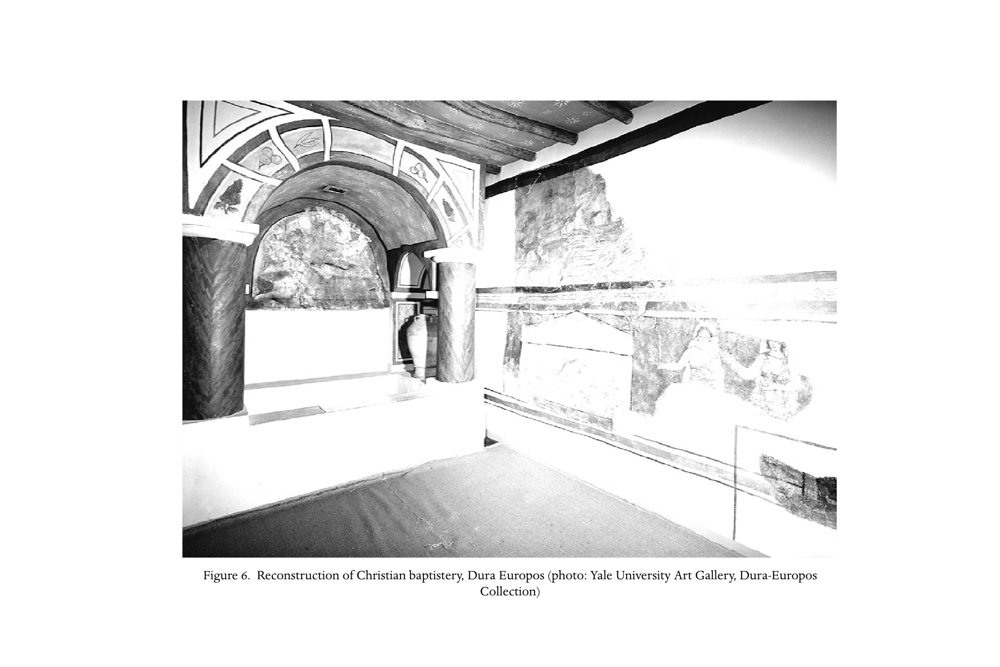

*图6：杜拉—欧罗波斯基督教洗礼室复原。照片：耶鲁大学美术馆，杜拉—欧罗波斯收藏。*

<!-- 原书第415–416页；PDF第464–465页 -->

到君士坦丁时代，教会已成为相当强健的组织，皇帝得以把它视为统一帝国的伙伴。权威体系、信仰模式，以及对资金与财产的掌控，使早期家庭共同体转变成一个覆盖全帝国、彼此相连的组织，越来越反映帝国本身的结构。一个意味深长的事实是：背教者尤利安于360年代试图把时钟拨回去时，他“决意将基督教的秩序与纪律引进异教神庙”。[^ch23-1]他设置不同等级的职事，任命教师与诵读员传授异教教义，规定祈祷时刻，并为希望退居哲学生活者建立修院；异教祭司被要求接待旅客、向穷人分发谷物和酒、过圣洁生活、远离酒馆与剧院，否则免职。尤利安认为，“无神论者”的纪律与善行，具有危及传统宗教的吸引力；君士坦丁则认识到它们的用处。

早期以家庭为基础的共同体，其特点已在上文第二部分第7章说明。那里尝试把早期教会现象放在社会与历史环境中考察，注意它如何结合家庭、祭祀团体、俱乐部与哲学学校的特征，却又不完全像其中任何一种。本卷不断注意基督徒群体的多样性：未来原本有一系列可能方向。然而，基督教虽零散、多样，却开始在地中海世界获得一种连贯形象，也形成独特的权威模式。[^ch23-2]这或可归于一种感受：虽在许多家庭中聚集，自己却属于同一个“上帝的家”；合一本身就是值得追求的目的。因此，领导者致力于维护社会和谐、解决争议、引导礼仪生活。于是，“以其他根据、其他方式达成的合一，创造了正统能够确立自己的氛围”。[^ch23-3]

本章因此考察，那些锻造正统的关键辩论所处的制度背景。我们将参照重要文本，叙述教士各等级，包括单一主教制，如何产生；叙述他们作为祭仪领袖所主持的礼仪与信经表达；也叙述他们在共同体中施行的纪律，以及集体开会时的权威。

## 职事

<!-- 原书第416–417页；PDF第465–466页 -->

目前所知，为负责管理早期教会者编写的最早手册，是《十二使徒遗训》（Didache），即“十二使徒的教导”。它约于100年利用更早材料编成，其中某些可能来自犹太教；它影响了《使徒宪章》等后来的教会手册，或被收入其中。书中先列出所有候洗者应学的道德教导，再指示洗礼、禁食、祈祷和圣餐，规定教会职事人员及星期日敬拜的行为，最后警告上帝迫近的审判。它在许多方面与后世实践不同，也证实其年代较早。

《遗训》第11章的教会领袖，是教师、使徒和先知。教师显然就是需要这本手册的人：新教师应按是否符合其内容受判断（11.1–2）。“使徒”不是《新约》十二使徒，也不是最初的复活见证人，参《哥林多前书》9:1，而是四处旅行的使者，在所到之处接受款待（11.1–6）。先知受到最多关注，不知因为他们发挥主导作用，还是最容易造成麻烦。[^ch23-4]书中没有说他们旅行，但像其他工匠一样，他们也可能到来并定居（13.1；参12.1–5）。真先知在圣灵中发言，理当服从；假先知主要凭不道德或贪婪辨认（11.7–12）。先知也许会下令举行圣餐聚餐（11.9），并在其中自由带领祈祷，不受为其他主持者规定的固定形式约束，第9–10章，尤其10.7。

使徒、先知、教师的职分，列于《哥林多前书》12:28任职名单之首；在这封信中，预言在属灵恩赐中占突出地位，尤其见第14章。与《遗训》另有相似之处的《马太福音》，某些段落背后可能也有类似安排（23:34；28:19–20）。然而，这与不久将普遍出现于各教会的主教、长老、执事结构不同。“主教”（episkopos）字面意思是监督者、管理者或监察者。“长老”（presbyter），英语priest一词由此而来，意为年长者；在年长男子担任重要政治与宗教角色的古代世界，这一称谓十分普遍。“执事”（diakonos）意为服侍者或仆人，可以指低微奴隶，也可以指高级官员。有人认为，教会经典安排，即一位主教与其执事、由长老辅助，直接借自犹太会堂：会堂由长老团管理，其中一人作为“会堂主管”（archisynagōgos）主持，另有一名职员（hypēretēs）服务。[^ch23-5]

不过，发展并非直线进行。学界的一般共识是，一、二世纪之交，地方会众由主教与长老领导，两者职分重叠或无法区分；[^ch23-6]同时先知仍继续活动，可能四处旅行。但这抹平了证据，后者似乎反映不同地区的多样发展。《腓立比书》1:1已经将职事赋予“诸位监督和执事”；罗马的革利免从希腊文《以赛亚书》60:17为此找到圣经基础：“我要在公义中设立他们的监督，在信仰中设立他们的执事”（1 Clem. 42.5）。同一“监督与执事”表达见于《提摩太前书》3:1–13，也出现在《遗训》近结尾处：

> 所以，你们要为自己选立配得主的监督和执事，温柔、不贪财、诚实、经过考验的人；因为他们也为你们承担先知与教师的职事。因此不要轻视他们，他们与先知、教师一样，都是你们尊重的人。[^ch23-7]

这很可能是这部多层形成之书的较晚增补。完整段落把《遗训》较早规定，与一种更正式的安排协调起来；在这一安排中，需要较固定的职员来补充或代行先知与教师的职责。

<!-- 原书第417–418页；PDF第466–467页 -->

伊格纳提乌通常假定，每个教会有一位主教，在制度与象征层面都至关重要：

> 你们所有人都要跟随主教，像耶稣基督跟随父；跟随长老团，如同跟随使徒；尊敬执事，如同上帝的任命。没有主教，谁也不要做任何关乎教会的事。应认为在主教或他所委任者主持下的祝谢礼〔eucharistia〕才是健全的。主教在哪里，民众就当在哪里，正如耶稣基督在哪里，普世〔katholikē〕教会就在哪里。不经主教，无论施洗还是举行爱筵〔agapē〕，都是不对的；凡他认可的，才蒙上帝喜悦，使你们所做的一切安稳而健全。[^ch23-8]

这些主题以不同形式反复出现，劝各教会团结在唯一主教周围。背景几乎肯定是一种较松散的传统：每个信徒家庭自行管理，同城可能有数个。伊格纳提乌坚持主教重要，也许是面对教会困难而提出的创新；困难既可能是继续守安息日等犹太实践，也可能是错误地教导基督肉身只是表象、并非真实，即“幻影说”。家庭教会没有控制体系，没有固定信经、教义，甚至没有明确界定的正典经书，形态很多，宗教观念差异可能极大。在每个会众中任命一位主教，使其他主教能够承认他，并由他作地方最终裁决者，这种做法会推动上述发展。[^ch23-9]

伊格纳提乌每封信都出现主教，只有《致罗马人书》例外。罗马在二世纪中叶以前，可能没有一位“单一”主教，[^ch23-10]实际形成时间很可能还更晚。[^ch23-11]稍早的罗马革利免并不知道这样的制度，通常断代约140年、影响深远的罗马《黑马牧人书》中也找不到。黑马描述一组异象，启示教会本性及其应有行为。其记录副本要交给负责“外面诸城”的革利免，也交给女教师格拉普特（Grapte），她将“教导寡妇和孤儿”；“而你要在本城，与主持教会的长老一起宣读”。[^ch23-12]作品提到使徒、先知、教师，也提到复数的监督，他们看起来像各家庭负责人，可能就是“长老”。[^ch23-13]

<!-- 原书第419–420页；PDF第468–469页 -->

180年代写作的爱任纽，[^ch23-14]把从革利免那里找到的使徒传承观，与主教独特角色的观念结合；他仍经常称主教为“长老”。面对迫害，他呼吁多种多样的基督徒归于秩序。异端抛弃了交付使徒的原始真理；他们声称提供使徒福音书未记录的耶稣秘密教导。爱任纽拒绝此说，论证使徒把全部真理，交托给他们托付各教会的人，也就是主教。因此，使徒所建各教会的主教传承，保证它们拥有原始福音，其他教义则是人为偏离。[^ch23-15]他说，普天下各教会的一致，证明真正使徒传统牢不可破。他列出罗马主教传承名单——其中早期条目是虚构的——并叙述自己与士每拿坡旅甲的亲身联系，以此说明。[^ch23-16]

爱任纽的观念，虽未必符合基督教起源的实际情况，却为面对信仰与实践多样性、如何辨认真传统的问题，提供了整齐答案。非洲的德尔图良约200年热情接受这些观点。[^ch23-17]随之而来的，是主教相对于其他权威来源的权力增长：先知、教师，以及具有灵恩权威的殉道者与认信者，越来越受主教控制。这个过程在居普良那里达到顶点。面对迫害中大批失足者，以及各教会因后续处理产生的分裂，他主张普世主教团是判断个人与群体的唯一权威。[^ch23-18]他生前，其主教权威未必能压过认信者及支持他们的长老；但最终结果，巩固了各地单一主教的权威，也巩固诸主教在会议中共同行动的权威。

居普良的观念，部分来自他在民政治理中的背景：教会遍布帝国，其结构类似帝国，从上而下治理。人们经常注意到教会治理与城市议会之间的平行。[^ch23-19]ordo clericus，即教士阶层，与ordo laicus，即平信徒阶层的区分，对应于plebs，即普通公民，与市议员阶层的区分；后者是有产者，负责治理并资助城市公共事务。罗马社会的各个等级——元老、骑士、市议员等——似乎反映在教会不同等级中：主教、长老、执事、寡妇、童贞女、副执事、诵经员。教会取得“第三种族”的身份，既非犹太人，也非希腊／罗马人，可以被视为国中之国。[^ch23-20]不过，主教终身的“君主制”，与罗马惯例中任期一年的官职和祭司职相当不同。[^ch23-21]爱任纽关于建教者所设、普世一致主教体系的观念，增强主教权威；主教将圣经话语应用于当前需要的关键作用，也增强权威，尤其体现在仲裁，以及在教会共同体内部和彼此之间维持秩序与纪律。

<!-- 原书第420–421页；PDF第469–470页 -->

圣经也提供祭仪的“预表”，强化主教与其他职事等级不断增长的权力。基督徒最初不同于圣经中的犹太教，也不同于周围异教世界，因为他们没有献祭崇拜。[^ch23-22]《旧约》祭祀被解释为个人奉献，[^ch23-23]尤其在耶稣身上。[^ch23-24]寡妇作为教会奉献的领受者，被称为“上帝的祭坛”。[^ch23-25]《遗训》称先知为共同体的“大祭司”，可能也出于同样的慈善含义。[^ch23-26]但《革利免一书》把上帝经摩西设立亚伦祭司体系，与上帝规定、由主教／长老领导的教会，相提并论。[^ch23-27]伊格纳提乌描绘教会聚集在主教周围，其统一性代表上帝自身统一，其中或许也有类似祭司式主教观。接近这一传统的《坡旅甲殉道记》（Martyrium Polycarpi），描绘坡旅甲主教在走向殉道时，以祭司职事为人代求。[^ch23-28]归于希波吕托斯、属三世纪初的《使徒传统》重构本，按立新主教的祈祷包括：

> 父啊，你知道人心；求你使你拣选、承担监督职〔episcopatum〕的仆人，牧养你的羊群，在你面前无可指责地担任大祭司，昼夜服侍，不断求你悦纳，献上你圣教会的礼物。愿他有大祭司的权能，按你的命令赦罪，按你的命令分派职责，按你赐给使徒的权柄解开一切束缚。[^ch23-29]

这把主教职事与《旧约》职事相等同；在《旧约》中，安排圣所祈祷和献祭、治理百姓宗教生活的，是上帝设立的祭司阶层，即亚伦子孙。

不久以后，居普良经常称主教为sacerdos，即“祭司”，称执事为levita，即“利未人”。可拉、大坍、亚比兰反抗亚伦合法祭司职及其可怕结局，[^ch23-30]不断出现在居普良反对异议者的论辩中。在主教职责表中，居于高位的是献祭，即饼酒圣餐，以及捆绑、释放百姓的罪。主教及其献祭的祭司功能，也提供一种替代秩序，对应奥古斯都于基督纪元之初为罗马帝国确立的宗教基础。[^ch23-31]

因此，到居普良任期结束时，主教在教会中的角色已显多重。他们既构成基督徒百姓的治理机构，也构成祭司体系。借相互按立、承认与协商确保的一致，使他们穿越时空，与教会的使徒起源相连，形成一个与罗马帝国本身平行的团体。主教决定谁属于教会、谁不属于；他们守护并阐明那一次交付圣徒的真理，向唯一上帝提供他所悦纳的唯一公共敬拜形式，是世界救恩活生生的工具。

## 敬拜与信经

<!-- 原书第421–422页；PDF第470–471页 -->

各地教会都是上帝的“圣所”。[^ch23-32]它没有别的圣殿，只有百姓个人与群体本身。纯洁生活就是他们的祭，与异教徒及犹太人的神庙、圣殿和仪式相对。他们构成不朽的灵魂，散布在败坏、垂死之世界的身体中。[^ch23-33]归信者要成为这群百姓的一员，就必须与周围世界作决定性的决裂。最初，这是一种象征性洗濯，[^ch23-34]可追溯到施洗约翰“为赦罪”所施的洗，后来由耶稣及其追随者接续；但耶稣复活引入新的维度，即圣灵。[^ch23-35]圣灵的恩赐意味着内心改变、道德更新、使心思顺从上帝。

《遗训》开篇描述两条道路，即光明与黑暗、善与恶，然后规定，把这些教导传给候洗者。[^ch23-36]这是“两条道路”文献的一种版本，似乎起源于基督教以前的犹太教，此后以各种形式贯穿教父时期，甚至晚至加洛林帝国仍出现。[^ch23-37]要求的是彻底转向爱上帝、爱邻舍，而非神学教学；不过，最好在寒冷流动水中进行的洗礼，是“奉父、子、圣灵的名”。[^ch23-38]这与《马太福音》28:19–20的指示及其他早期实践相符。[^ch23-39]

“希波吕托斯”保存了一套完整礼仪规定。[^ch23-40]求洗者首先登记为慕道者，前提是其行业或职业并非不当，例如制造偶像、角斗士、娼妓。他们接受圣经教导，通常三年。期间行为受到审查，若合格，就进入一段驱魔过程，“听福音”——此前学习显然主要是《旧约》——并在某个星期日清晨，很可能复活节，参加最后的守夜与祈祷。用祈祷祝福水，候洗者脱衣，涂抹清洁之油，即“驱魔油”，每人都须说：“撒但，我弃绝你，也弃绝你一切服役和一切作为。”由此，异教宗教及社会中一切依赖它的方面，都被放下。

<!-- 原书第422–423页；PDF第471–472页 -->

随后候洗者站入水中，由长老一边询问，一边三次浸入水中，或浇水。第一次，他表示相信全能父上帝；第二次，相信上帝之子基督耶稣，并诵述其降生、受难、复活与未来审判；第三次，相信“圣灵、圣教会及肉身复活”。三次洗礼后，再次受膏，这回使用带香味的“感恩油”，似乎先在洗礼池旁一次，再由主教在会众面前按手膏抹一次。随后，新受洗者首次获准参加祈祷与圣餐，除圣餐饼酒外，也领受象征性的奶、蜜与水饮用。到居普良时代，礼仪各部分已被赋予特定功用：例如，主教膏抹与按手，被认为赋予圣灵，而水使罪得赦。[^ch23-41]

这一做法部分仿照公共浴场程序：先涂油、刮去污垢，随后沐浴，最后涂香、穿洁净衣服。这种习俗盛行于西方教会；东方则广泛采用另一种做法，只膏抹一次，然后洗濯一次或数次，并举行圣餐聚餐。[^ch23-42]受洗者必须过纯洁生活，远离贪婪与性放纵，也远离渗入日常生活的各种异教宗教实践。不过，他们还有其他神圣义务。《遗训》已经规定：聚集受教（4.1–2）、祈祷（8.2–3）、禁食（8.1；参7.4）、用杯与饼祝谢（9–10）、定期捐献（4.5–8；13；参1.5），以及认罪（14）。

参加圣餐[^ch23-43]将成为只向受洗者开放的特色“奥秘”。《遗训》已称这顿餐为eucharistia，即“感恩”，两篇规定祷文都以“父啊，我们感谢你……”开始。用餐前，先为借耶稣使人认识的“大卫的圣葡萄树”，在杯上感恩；再为“借耶稣显明的生命与知识”，在擘开的饼上感恩，并祈求教会在上帝国中聚集。未受洗者不得参加。饭后，感谢上帝借耶稣使其名为人所知，并感谢肉体与属灵食物；另附一篇祈祷，求上帝在世界终结时保守、聚集教会。

<!-- 原书第423–424页；PDF第472–473页 -->

这些祈祷未提基督之死、最后晚餐，或赐下圣灵转变礼物，因此学者通常认为，这顿餐并非天主教的弥撒、新教的主餐或东正教的圣礼仪，而是额外举行的团契餐或爱筵。然而，更好的理解，是它讲的就是《遗训》中那一场共同体聚餐。[^ch23-44]早期基督教仪式聚餐的意义、功用与内容并不一致：饼之外的食物广泛用作奉献，酒则绝非普遍使用。[^ch23-45]

早期关于会众正式聚餐之祈祷与仪式的见证很少。把四世纪宏大礼仪文本的内容倒推到早期，是错误的；这种做法却屡被尝试，代价是忽略原初多样性的证据。[^ch23-46]许多学者试图从同时代犹太范式，为基督教感恩祷文寻找单一起源。[^ch23-47]近来犹太学者的批判研究，对此提出疑问；他们倾向表明，辨认早期拉比材料时，同样面临基督教文献的问题。[^ch23-48]不过，把共同体聚餐转化为献祭式纪念基督受难及被捕之夜，早在保罗时代就已存在；[^ch23-49]它促成有意识地仿照圣经安排圣餐实践。到250年，主所做的事被视为设立一项圣礼，其行动被当作规范。[^ch23-50]

《遗训》与《革利免一书》中都有献祭隐喻：[^ch23-51]《遗训》认为，祭的纯洁通过彼此和好与赦罪达到；《革利免一书》则通过监督奉献之长老，以及进行奉献之百姓的正确行为达到。安提阿的伊格纳提乌呼吁完全合一：

> 在同一信仰中，在耶稣基督里；他按肉体出于大卫家，是人子，也是上帝之子。这样，你们就当一心顺服主教与长老团，擘同一个饼；这饼是不死之药，是使人不死、而在耶稣基督里永远活着的解毒剂。[^ch23-52]

这里不应过分发挥“不死之药”的暗示，据此建立圣餐教义。伊西斯及荷鲁斯复活的故事中，也出现这种药。在此，使擘饼具有医治作用的，与其说是圣餐饼本身，不如说是顺服地聚集为一个会众、服在一位主教之下。伊格纳提乌也类似地用毒草隐喻异端，用祝圣祭坛隐喻主教和使徒规章。[^ch23-53]

<!-- 原书第425页；PDF第474页 -->

325年尼西亚会议以前，早期教会没有正式信经公式；即使到那时，也很少有证据说明，《尼西亚信经》取代了各地洗礼认信形式。[^ch23-54]然而，从《新约》写作时代起，简短信仰概要就出现于不同场合。[^ch23-55]后来，爱任纽往往针对异端，复述“信仰”“宣讲”“真理准则”的概要；措辞并不固定，实质内容却大体相同。爱任纽之后数十年，德尔图良、希波吕托斯和奥利金也有这种灵活概要，现代研究一般称其为“信仰准则”。[^ch23-56]其中始终包括承认上帝为父和创造者，承认耶稣及其地上生活，通常也包括圣灵、教会与将来审判的某些内容。二世纪末审判诺埃图斯异端问题的长老们，或主教们，似乎就曾使用此类概要。[^ch23-57]若是如此，这就是后世常见、用以解决教义争议的“会议信经”的早期实例。

严格意义的信经，在洗礼预备中产生，逐渐纳入礼仪。其三重结构，来自前述三次洗濯所伴随的三个问题。洗礼以前，候洗者诵念受教时领受的信经、宣认信仰，逐渐成为惯例。感恩祷文成为另一种概述教会信仰的场合。后世《圣雅各礼仪》和《使徒宪章》等文献，[^ch23-58]为我们传下东方教会的古老实践：庆祝上帝与其百姓交往的历史，从创造，经族长和先知，到基督来临、施救之死与被高举。所以，信经和信仰概要，最初主要并非正统检验工具；它们自然的场所，是敬拜中的颂赞与认信。这支持一种看法：教会领袖关心会众的礼仪和道德生活，至少不亚于、甚至超过关心正统。

## 纪律

<!-- 原书第426–427页；PDF第475–476页 -->

教会从开始就受到争执与背离困扰。保罗书信已显示关于男子割礼，尤其《加拉太书》，以及乱伦、食用异教祭肉、婚姻与独身、肉身复活信仰等问题的争论，后几项皆见《哥林多前书》。这些过失与分歧，很快显出需要一套处理犯错个人的制度，以及解决争议的程序。

《新约》文本包含纪律决定，必然影响后世实践。那名娶了自己岳母的人，被使徒保罗判为有罪，处罚是逐出共同体。[^ch23-59]事实上，所有作恶者都应被排除于同桌团契之外；[^ch23-60]在一个如同家庭、为成员提供各种经济与社会支持的共同体中，这种限制可能后果严重。到《马太福音》写成时，定罪需要两三个见证人，先私下劝告，再由“会众”（ecclesia）公开听审，之后才能驱逐；聚集的信徒所作决定由上帝支持，但应以怜悯施行。[^ch23-61]

有些早期文本，被理解为暗示最早期认为洗礼后的严重罪行无法补救。[^ch23-62]但显然，尽管保存洗礼“印记”不受破坏很重要，[^ch23-63]悔改和赦免始终被认为向寻求者开放。[^ch23-64]例如罗马的革利免，不但呼吁读者悔改，也劝那些罢黜合法长老者顺服：其他教会将接纳他们，应为他们祈祷；上帝将赦免他们，使他们以卑微却光荣的身份，重回基督羊群。[^ch23-65]黑马在异象中领受大量教导，说明如何通过鼓励、促成犯错成员悔改，建立教会，使之不断更新，走向最终命运。[^ch23-66]他预见教会在末日前更新，罪人及失足成员有机会接受纪律、重新恢复。作品广受阅读，并被视为权威，二世纪末以前罗马、亚历山大里亚、迦太基和里昂的证据，都能证实这一点。[^ch23-67]

凡阅读黑马之处，普遍认为，洗礼赋予的新生命，可以通过正式悔罪更新；这一行动包括公开认罪、一段排除期，以及分阶段重获参与受洗者祈祷和圣餐的资格。德尔图良生动描述exomologēsis，即“认罪”的内容：悔罪者饮食简陋，穿哀服、麻衣、蒙灰，呻吟、哭泣、俯伏于教士前，请信徒为自己祈祷。[^ch23-68]不过，具体细节随时间与地方而异。[^ch23-69]

<!-- 原书第427–428页；PDF第476–477页 -->

有时，人们抗议对失足者过于宽松。孟他努主义，更适宜称“新预言”，[^ch23-70]正是这种严格运动。德尔图良清楚显示，孟他努派主张在各方面收紧纪律，例如让小女孩蒙头、频繁禁食、不为躲避迫害而离开。这些规定来自圣灵、即“保惠师”的话语；它取消使徒时代因人的软弱而作出的某些让步。[^ch23-71]特雷维特的结论很可能正确：通常归于新预言的纪律与末世观，其他人也持有并传播；他们之所以遭拒绝，是因为声称受保惠师启示、带着权威发言，却未充分尊重教会正式职事已建立且不断增长的权威。[^ch23-72]

德尔图良在道德上一贯严厉，却在洗礼后犯罪问题上，发生了著名的立场转变。早期《论悔改》（De paenitentia）说，再次悔改的机会不可或缺，因为魔鬼特别攻击圣洁者；并用圣经例子加强论证。似乎没有任何罪，无论多严重，被排除在外。救恩有两块“救命木板”：洗礼，以及另一次伴随公开认罪的悔改。[^ch23-73]后来，他明确受新预言影响，攻击一位重要主教，[^ch23-74]因为后者宣布，适当悔罪后，将赦免通奸与淫乱之罪。[^ch23-75]它属于三种不可赦的致死罪之一，即拜偶像、淫乱、杀人；这些罪为《使徒行传》15:28–29经道德化解释的西方版本之使徒决议所禁止。[^ch23-76]《黑马牧人书》的建议，与他此前《论悔改》一致，如今却遭明确否定。[^ch23-77]

这个问题显然曾大大扰动非洲教会，但到居普良时代，使性犯罪者重新和好，已成为当地既定实践。[^ch23-78]如今重大争执转向偶像崇拜。德修皇帝249年开始的迫害，导致大量背弃信仰，因为基督徒服从要求，献上异教祭。许多人随后试图返回教会，一些人在申请中得到认信者和殉道者支持。[^ch23-79]教士反应不一：有些几乎不作周折就重新接纳，有些完全拒绝。现存主要记录来自西方；居普良通信清楚显示，他本人起初相当严格，后与其他主教协商，逐渐调整立场。与反对草率重新接纳一样，他同样关心确立主教权威，既包括各共同体唯一主教的权威，也包括全体主教的集体权威。

最初，251年迦太基会议决定：适当调查后，没有实际献祭、仅取得证明者，应获重新接纳；实际献祭但持续悔罪者，若患病濒死，应给予圣餐。[^ch23-80]这些安排后来与罗马取得一致；面对新迫害威胁，对持续悔罪者普遍赦免的让步，也同样获得同意。[^ch23-81]使献祭者重新和好的安排，差异相当大，[^ch23-82]但总体严格。

## 教会会议

<!-- 原书第428–429页；PDF第477–478页 -->

纪律与洗礼争议，使教会会议的司法功能凸显。汉密尔顿·赫斯考察了会议，即council或synod，作为教会治理工具的起源与发展。后来，在基督教皇帝治下，它成为常设的咨询、司法和立法集会，主教的作用类似地方或帝国元老。最早期却很不相同。

《使徒行传》记载一些教会集会：第一次主要是使徒，不过也提到其他会众，包括耶稣家人及某些妇女（1:15–26）；第二次由一组具名先知和教师组成（13:1–3）；第三次则是安提阿正式代表团，到耶路撒冷向“使徒和长老”陈述问题（15:1–35）。在最后这个案例中，一封正式书信被送往安提阿，由当地信徒集会宣读；后世以时代错置的方式，称之为“使徒决议”。每个故事固然很大程度都是路加对过去事件的理想化重构，却使我们宝贵地了解，他期待自己时代——或许一世纪最后十年——教会如何运作。

赫斯认为，最初两世纪的协商，大多属于地方性、会众内部活动，到三世纪才成为跨教会会议。[^ch23-83]这一划分，甚至可能仍过于鲜明。如果罗马等大城市中的信仰，起初是由一组分散家庭教会构成，最后一位主教才成为高于其他人的领袖，那么，在革利免代表罗马教会致信哥林多以前，或者黑马向罗马长老和教师呈交那部厚重预言书时，必定已进行广泛协商。优西比乌大段引用一位未具名作者；据其记述，弗里吉亚新预言促成了一些会议：

> 亚细亚各地信徒，为此经常在许多地方聚集，审查这些新奇教导，判为亵渎，拒绝这项异端；于是这些人被逐出教会，隔绝于其共融之外。[^ch23-84]

不清楚这是教会间会议，还是地方会众内部协商。

即使地方集会，也能受益于来访专家或学者。同一作者在论著开头，描述加拉太重要城镇安居拉的一场地方争论：他如何驳斥新预言，又受当地长老请求，留下书面记录；实际上他是事后才写。[^ch23-85]现存奥利金与赫拉克利德主教，以及怀疑后者的主教们所作教义辩论速记，也显示类似专家咨询。[^ch23-86]

<!-- 原书第430页；PDF第479页 -->

他考问波斯特拉的贝吕卢斯，情况也许类似；优西比乌还声称，阿拉伯另一场辩论涉及一次大型集会（synodos）。[^ch23-87]三个案例中，奥利金似乎都说服反对方达成一致。亚历山大里亚主教狄奥尼修，247／248–264／265年在任，也有类似成功：阿尔西诺伊州因《约翰启示录》的权威与意义产生分裂，他与当地长老，或主教，举行了三天会议。[^ch23-88]

这些协商都符合赫斯强调的公式：目标是共识。有时，说服并不奏效。诺埃图斯[^ch23-89]最初因基督论观点受到“蒙福的长老们”警告；但他坚持并聚集追随者，他们便谴责他，将其逐出教会，于是他“建立学校”（didaskaleion），也就是另立教会。[^ch23-90]我们无法知道他是否为主教，虽然他被罢黜了“神圣教士职分”；[^ch23-91]“蒙福的长老们”很可能是不同教会的主教，而非同一会众的职员，但无法肯定。[^ch23-92]

至于罗马主教维克托与十四日派的争议，很可能在190年不久之后，如今可以确定，优西比乌以时代错置的方式阅读那批书信。[^ch23-93]一位主要主教试图对罗马其他会众强行统一逾越节做法，随后引发与以弗所、里昂、哥林多、巴勒斯坦及其他地方主教的通信。在优西比乌叙事中，也许还借调整所引文本予以配合：

> 举行了会议及主教共同集会，众人一致制定教会规条〔dogma〕，规定主从死里复活的奥秘，绝不可在主日以外任何日子庆祝，唯有那一天才应结束逾越节禁食。[^ch23-94]

优西比乌所见书信，很可能是与地方同僚讨论的成果，而非仅为主教个人交往；除非文本遭过篡改，以弗所的坡利克拉底确实如此说。[^ch23-95]不过，系统性地区集会为普世教会颁布法令的观念，属于四世纪，而不是二世纪。

<!-- 原书第431页；PDF第480页 -->

关于会议及其程序的扎实证据，始于249–251年德修迫害的后续影响。但那些记录本身，也为早一代或更早、处理异端洗礼有效性的集会，提供了一些证据：一处在弗里吉亚以哥念，包括邻近行省主教；另一处由迦太基阿格里皮努斯领导，包括非洲及努米底亚主教。[^ch23-96]通常认为，类似的迦太基会议，准许重新接纳悔改的通奸者。[^ch23-97]

251年居普良结束退避、返回迦太基后，面临重要教士的分裂；他召集支持自己的主教，与长老和执事同席开会，就失足者及异议教士作出规定。[^ch23-98]罗马一场类似会议，有六十位主教，以及更多长老、执事参加。[^ch23-99]此后，直到256年，迦太基每年都有会议记录。到257年，迫害再起，以及居普良被处死，显然打断这一模式。其他地方围绕失足者和好及随后分裂的类似会议活动，记录较少，却很可能可以相比。[^ch23-100]有证据说明，当时已经举行年度集会，尤其处理悔罪事务；[^ch23-101]325年《尼西亚会议》第5条将正式规定这件事。

某些材料显示，会议并不只有主教。事实上，不但各类教士，平信徒也参与：“主教、长老、执事、认信者与坚定的平信徒”，都被期待共同作出判断。[^ch23-102]会议作为法庭时，平信徒大概与世俗法庭旁听民众发挥相同作用，通过对程序的反应影响长官。这源于会议最初是地方教会成员的本地聚集；在一座城市中，他们可能分散在数个会众。城郊及其他来访教士，也会加入。因此，没有正式成员资格或投票权，虽然远方来者显然需要适当通知和召集。这不算太大问题，因为程序并非多数表决，而是以达成共识为目标。[^ch23-103]他们聚集，是为解决行为或教义问题。

<!-- 原书第432页；PDF第481页 -->

赫斯依循西本，区分三种程序形式，其中两种适用于君士坦丁以前：[^ch23-104]讨论式和议会式。讨论式类似奥利金与赫拉克利德的辩论，提出问题与解释，达到所有人接受的结论；教育意味浓厚，平信徒参与也相当重要。选举主教的会议，很可能采用这种形式，因为民众欢呼与来访主教，都是程序不可或缺的部分。[^ch23-105]

议会式程序则仿照罗马元老院，或者更重要的地方行省和城市机构，也可能仿照collegia，即行业团体。我们有一份清楚描述这种程序的《八十七位主教的意见》（Sententiae lxxxvii episcoporum），[^ch23-106]根据256年9月1日迦太基会议的速记整理。先宣读说明讨论问题所必需的书信；随后，主持的居普良主教概述自己的看法，征询意见。其他八十六位表示赞同后，居普良再提出自己的意见，为一致决定作结。

居普良数封书信，宣布这种集会对各种问题的结论。有时是联名信：第57封列出四十三位主教名字，将结论致科尔内利乌斯。第71封则报告，“许多”主教被召集开会后作了怎样的决定；没有名字和人数，但几乎可以确定，是256年春七十一位主教的会议。[^ch23-107]后世完整会议记录及会议规章（statuta），将从这些起点发展，成为教会法的重要来源。

不过，到目前为止，所有证据都涉及地方，至多行省会议。尼西亚以前，最接近以“普世”、即“全世界”方式召集主教的唯一案例，是罢黜萨摩萨塔保罗的安提阿会议。据优西比乌说，主教从周边行省聚集，将会议书信致亚历山大里亚主教，以及“全世界我们所有同工，主教、长老和执事”。保罗最后被逐出安提阿教堂，涉及皇帝和罗马主教，也预示了后来的发展。[^ch23-108]

<!-- 原书第433页；PDF第482页 -->

由此，我们开始看清：教会内部结构如何使它取得全帝国的视野；再加上对合一的关切，使它成为君士坦丁试图将领土统一于一位上帝之下时，现成可用的工具。[^ch23-109]

## 译校说明

- 本章所述礼仪文本的作者归属、年代、主教制形成与会议性质，均保留作者的推定及不同解释，不把后世制度提前视为早期定制。
- 原书第426页称《哥林多前书》5章中的男子娶了自己的“岳母”（mother-in-law），译文依原词保留；该处显有亲属称谓问题。第431页把迫害再起与居普良遇害衔接于“257年”，也保留原文表述。
- 原书第419页注14将爱任纽交叉参照写为第三部分第10章，依原文保留；本卷专论爱任纽的是第13章。第420页注25的“Poly. Phil. 4.23”等定位，同样未擅自修订。

## 脚注

[^ch23-1]: Soz. HE 5.16.

[^ch23-2]: Lane Fox, Pagans and Christians; Rousseau, Early Christian centuries.

[^ch23-3]: Rousseau, Early Christian centuries, 88.

[^ch23-4]: 误导性的预言，见《马太福音》7:14–16；《约翰一书》4:1–3。先知带来的问题，见琉善讽刺作品De morte Peregrini；参“正统派”对孟他努派的回应，上文第四部分第17章。

[^ch23-5]: 近来Burtchaell, From synagogue to church提出这一论点。

[^ch23-6]: 不同看法，见Young, ‘On episkopos and presbyteros’。

[^ch23-7]: Did. 15.1–2.

[^ch23-8]: Ign. Smyr. 8；参Trall. 3.1。

[^ch23-9]: Bauer, Orthodoxy and heresy率先进行这一分析，但他误判罗马处境；罗马很可能比其他中心分裂更严重。见La Piana, ‘The Roman church’；Lampe, Paul to Valentinus；以及上文第四部分第22章。

[^ch23-10]: Markschies, Between two worlds, 189–92.

[^ch23-11]: 按Brent, Hippolytus，罗马朝向单一主教制的发展始于189年，直到235年才完成。

[^ch23-12]: Herm. Vis. 2.4.3.

[^ch23-13]: 例如Herm. Vis. 3.5.1；Herm. Sim. 9.27.2。

[^ch23-14]: 进一步见上文第三部分第10章。

[^ch23-15]: Iren. Haer. 3.3.1–3.

[^ch23-16]: Iren. Haer. 3.3.4.

[^ch23-17]: 尤其见Praescr.。

[^ch23-18]: 见下文第26章。

[^ch23-19]: 概要及参考文献见Torjesen, ‘Social and historical setting’, 188–9；较早论述见Cochrane, Christianity and Classical culture, 219–20。

[^ch23-20]: 经典论述为Harnack, Expansion of Christanity, vol. i, 240–78。

[^ch23-21]: Lane Fox, Pagans and Christians, 545；完整讨论见493–517页。

[^ch23-22]: 见Ep. Diognet. 1–6；参Young, Use of sacrificial ideas。

[^ch23-23]: 《罗马书》12:1–2；《彼得前书》2:4–5。

[^ch23-24]: 《希伯来书》，尤其9:11–14；10:1–16。

[^ch23-25]: Poly. Phil. 4.23.

[^ch23-26]: Did. 13.3.

[^ch23-27]: 1 Clem. 40–4.

[^ch23-28]: M. Polyc. 5.5–6.1；参14。

[^ch23-29]: Trad. ap. 3.3–5；Stewart-Sykes编译，61页。

[^ch23-30]: 《民数记》16章。

[^ch23-31]: 完整详述见Brent, Imperial cult。

[^ch23-32]: Hipp. Trad. ap. 3.3，上文已引。

[^ch23-33]: Ep. Diognet. 1–6.

[^ch23-34]: 进一步见上文第二部分第7章。

[^ch23-35]: 《马可福音》1:4；《约翰福音》4:1–2；参《马可福音》1:8；《使徒行传》2:38；19:1–6。

[^ch23-36]: Did. 1–7.

[^ch23-37]: Van de Sandt and Flusser, Didache, 55–190有详细讨论。

[^ch23-38]: Did. 7.

[^ch23-39]: 参Justin, 1 Apol. 61；Hipp. Trad. ap. 21；Tert. Prax. 26.9。

[^ch23-40]: Hipp. Trad. ap. 17–21；Tert. Bapt.所载礼仪信息，大体与Trad. ap.一致。

[^ch23-41]: 居普良在Ep. 74.5等处对司提反的误解，由此而来。Hipp. Trad. ap. 21.21可能已含居普良的看法；见Stewart-Sykes编译本，112–113页。

[^ch23-42]: 例如Acts Thom. 132–3；157。

[^ch23-43]: 亦见上文第二部分第7章。

[^ch23-44]: 这是近来van de Sandt and Flusser, Didache, 301–4的看法；相反观点见Niederwimmer, The Didache, 139–43。

[^ch23-45]: 全面讨论见McGowan, Ascetic eucharists。Stewart-Sykes编译本130–132页，说明Trad. ap. 23–26中的希波吕托斯聚餐，应视为圣餐。

[^ch23-46]: 见Bradshaw, Search。

[^ch23-47]: 近来的例子是Mazza, Origins，以及van de Sandt and Flusser, Didache。

[^ch23-48]: Bradshaw, Search, 1–29.

[^ch23-49]: 《哥林多前书》11:17–34；参10:14–22。

[^ch23-50]: Cypr. Ep. 63。正统的非洲主教竟因杯中只用水而受责备，这点十分重要。

[^ch23-51]: Did. 14; 1 Clem. 40–1 and 44.4.

[^ch23-52]: Ign. Eph. 20.2.

[^ch23-53]: Ign. Trall. 6–7。Ign. Eph. 20.2的解释，见Schoedel, Ignatius of Antioch, 95–9；Wehr, Arznei der Unsterblichkeit, 106–11。

[^ch23-54]: 进一步见下文第六部分第31章。

[^ch23-55]: 经典表述见Dodd, Apostolic preaching；亦见Kelly, Early Christian Creeds, 6–29。

[^ch23-56]: Kelly, Early Christian Creeds, 68–99.

[^ch23-57]: Hipp. Noët. 1.7；见下文。

[^ch23-58]: Prex eucharistica，Hänggi and Pahl编，82–95、244–61页。

[^ch23-59]: 《哥林多前书》5:1–6。

[^ch23-60]: 《哥林多前书》5:9–13。

[^ch23-61]: 《马太福音》18:15–22。

[^ch23-62]: 尤其《希伯来书》6:5–8；12:14–17；见Harnack, History of Dogma, vol. i, 171–3。

[^ch23-63]: 2 Clem. 6–7.

[^ch23-64]: 此为Benrath, ‘Buße’, 452–3的看法。

[^ch23-65]: 1 Clem. 54–7.

[^ch23-66]: 尤其见Schneider, ‘Propter sanctam ecclesiam’。

[^ch23-67]: Staats, ‘Hermas’, 106–7.

[^ch23-68]: Tert. Paen. 9；参Or. C. Cels. 3.51。

[^ch23-69]: Brightman, ‘Terms of communion’, 365–77.

[^ch23-70]: Trevett, Montanism，尤其159–62页；亦见上文第四部分第17章。

[^ch23-71]: 例如Tert. Mon. 2–3。德尔图良与孟他努主义的关系，见Rankin, Tertullian and the church, 41–51；悔改问题，见Butterweck, ‘Tertullian’, 100–1。

[^ch23-72]: Trevett, Montanism, 114–20及其他处。

[^ch23-73]: 例如Tert. Paen. 7–8；12.9。

[^ch23-74]: 指迦太基而非罗马主教；见Hall, ‘Calixtus i’, 562；Letters of St Cyprian of Carthage，Clarke译，vol. iii, 194–5，即Clarke对Cypr. Ep. 55.20–21的注释。

[^ch23-75]: Tert. Pud.，尤其1.6–9。

[^ch23-76]: Pud. 12.1–6.

[^ch23-77]: Pud. 10.12.

[^ch23-78]: Cypr. Ep. 55.21–22.

[^ch23-79]: 事件概要见下文第26章。

[^ch23-80]: Cypr. Ep. 55.17.3；Clarke的长注及其他段落参照，见Letters of St Cyprian, vol. iii, 191–3。

[^ch23-81]: Cypr. Ep. 57，出自一次会议，Clarke将其断代为253年夏；见Letters of St Cyprian, vol. iii, 212–16。

[^ch23-82]: Brightman, ‘Terms of communion’, 369–71，汇集了所需悔罪时间长短的信息。

[^ch23-83]: Hess, Early development, 4–20.

[^ch23-84]: Euseb. HE 5.16.10.

[^ch23-85]: Euseb. HE 5.16.4–5.

[^ch23-86]: Or. Dial.

[^ch23-87]: Euseb. HE 6.33; 6.37.

[^ch23-88]: Euseb. HE 7.24.6–9.

[^ch23-89]: 进一步见下文第25章。

[^ch23-90]: Hipp. Noët. 1.3–8.

[^ch23-91]: Hipp. Noët. 1.3.

[^ch23-92]: Hess, Early development, 11–12.

[^ch23-93]: Euseb. HE 5.23–5；Hess, Early development, 8–10；Brent, Hippolytus, 412–27完整提出这一论证，虽某些细节有争议。

[^ch23-94]: Euseb. HE 5.23.2.

[^ch23-95]: Euseb. HE 5.24.8.

[^ch23-96]: Euseb. HE 7.7.6；Cypr. Ep. 71.4.1；75.7.4。不确定的日期与情境，见Clarke注释，Letters of St Cyprian, vol. iv, 196–9。

[^ch23-97]: Cypr. Ep. 55.20.2–21.2，以及Clarke注释。

[^ch23-98]: Cypr. Ep. 51.15.1；亦见下文第26章。

[^ch23-99]: Euseb. HE 6.43.2.

[^ch23-100]: 见Clarke, Letters of St Cyprian, vol. ii, 11–13。

[^ch23-101]: Firmilian in Cypr. Ep. 75.4.3.

[^ch23-102]: Cypr. Ep. 43.7.2；更多例子见Hess, Early development, 22–4。

[^ch23-103]: 尤其见Hess, Early development, 29–33。

[^ch23-104]: Hess, Early development, 24–34；Sieben, Konzilsidee, 466–92。Sieben的第三种模式，是kaiserliche Kognitionsprocess，即皇帝主持的审理程序。

[^ch23-105]: 关于居普良材料的全面概要，见Bernard, ‘Cyprianic doctrine’, 230–2；参Euseb. HE 6.11.1–2；6.29.3–4。

[^ch23-106]: Sancti Cypriani episcopi opera，CCSL 3E，Diercks编。

[^ch23-107]: Clarke, Letters of St Cyprian, vol. iii, 211–12.

[^ch23-108]: 进一步见下文第25章。

[^ch23-109]: 进一步见下文第六部分第30、31章。


---

<a id="chapter-24"></a>

# 第二十四章 一神论与创造

**作者：格哈德·迈（Gerhard May）**

《剑桥基督教史》第一卷《起源至君士坦丁》中文译稿

> 原书第434–451页，PDF第483–500页。完整翻译正文、引文与解释性脚注；参考文献作者名、题名和定位保留原文。
>
> [第二十四章英文原文](<第二十四章 一神论与创造（英文）.md>) · [原书PDF](<../01 起源至君士坦丁.pdf>)

## 犹太遗产与兴起中的基督教

<!-- 原书第434页；PDF第483页 -->

最初几个世纪，基督教神学思考的一项独特成果，是“从无创造”（creatio ex nihilo）的教义。然而，上帝“从无中”创造世界的观念，并非简单继承一种已经充分发展的犹太或哲学立场；只有当一神论[^ch24-1]面对诺斯替思想受到辩护，并与哲学展开辩论时，它才获得明确界定。

### 犹太教与希腊哲学中的一神论和创造

早期基督徒与犹太人共享一神论。经过长期神学思考，以色列形成一种观念：只有一位独一而普世的上帝，他以绝对自由与能力，创造世界及其中一切生物。上帝创造的动机是美善；他的眷顾维持世界存在，直到他来作最后审判。充分发展的一神论教义，通常归于公元前六世纪的《第二以赛亚书》：异教诸神并不真正存在，他们的偶像毫无价值。[^ch24-2]

公元前三世纪，一个新过程开始了：犹太教与希腊文化相遇。在由此而起、关于真正上帝的辩论中，圣经教导成为犹太人的优势。希腊思想也有强烈的一神倾向，在罗马统治下越来越占上风。除了关于第一原则的哲学思辨，另有一种常见假定：异教诸神无非是唯一至高上帝的个别面向或能力。[^ch24-3]无论犹太还是异教一神论，都不绝对纯粹，可以与天使、魔鬼或低级神明的信仰并存；但其基本观念是清楚的。

<!-- 原书第435–436页；PDF第484–485页 -->

希腊与罗马社会虽有强烈反犹偏见，双方从哲学上讨论上帝及其创造，仍各有收益。犹太传教者在整个地中海世界的异教徒中，赢得同情者，甚至使人归信。一世纪一位身份不明的希腊作者伪朗吉努斯，提供了欣赏《创世记》语言的佳例：他说，摩西描写上帝仅凭话语就使光与大地出现，显示其对上帝能力的理解恰如其分。[^ch24-4]我们也知道，有一整条历史叙述传统，把犹太人描绘为哲学家的民族。[^ch24-5]不过，犹太人论证犹太教与希腊哲学一致的著作，远多于反方向的著作。原因很容易解释：犹太人更需要被接纳为一个“哲学”民族，希腊人却没有这种必要。

犹太教师经历了在其处境下几乎不可避免的事：把自己的观念调整得更接近对手，从而在不自觉中改变自身看法；希腊化究竟可以推进多远，因而产生紧张。这一进程的高峰，见于亚历山大里亚斐洛的著作，后文还将讨论。

假设有一位观察者身处基督降生前后最初几个世纪，可能会觉得，犹太与异教的上帝教义正在趋同。公元最初两个世纪，最有影响的哲学学派是斯多亚派。他们不只是专业学者群体，还通过教学与著述，支配追随者的世界观，尤其伦理领域。其严肃简朴的生活，吸引思想认真的知识分子。尽管斯多亚派主张唯物主义，谈论上帝时仍能采用有神论表达。[^ch24-6]

不过，到二世纪末，柏拉图主义占主导，与这一哲学的交锋，对塑造犹太／基督教创造论最重要。中期柏拉图主义时期，即前50–公元250年，出现明确转向神学的趋势。[^ch24-7]《蒂迈欧篇》是其最受青睐的对话，书中的上帝，即造物者（demiurge），被等同于至高上帝。它的宇宙起源论，衍生出典型“三原则”教义：上帝、理念和质料（matter）三个地位相等的原则，构成世界。世界由之造成的质料永恒，得到普遍接受；与此同时，有秩序的宇宙是否在时间中起源，仍有争论。

西塞罗与亚历山大里亚的斐洛，都见证其时代许多人按字面理解《蒂迈欧篇》，接受世界在某一特定时刻被创造。普鲁塔克同样如此。即使二世纪世界永恒论已几乎成为柏拉图派共识，阿提库斯仍提出世界在时间中受造。这些取自《蒂迈欧篇》的看法，代表早期帝国时代可能理解到的柏拉图宇宙论。然而，宇宙有一个以上至高原则的假定，既不令人满意，甚至自相矛盾。普罗提诺为此找到解答，构造一套存在等级：顶端是“太一”，一切存在独一、绝对的根基，其下依次是理智（nous）、灵魂（psychē）和质料（hylē）。质料离太一最远，既非完整意义的存在，也非绝对不存在；它缺乏一切积极性质，被等同于恶。

哲学家完全可以用崇高语言称上帝为世界创造者与统治者，但有一项重要限制：神圣能力要进行创造活动，需要质料基底。天上创造者被想象成工匠，从理念取得模型，赋予混沌材料以形式；多数柏拉图派如此。即使世界在时间中有开端，这是柏拉图派的少数意见，原初质料仍是世界永恒的基底。受过教育的人认为，假定上帝完全不借外援、仅凭意志和能力，就能产生任何所愿之物，是荒谬的；上帝必须符合自然法则。[^ch24-8]此外，人们强烈相信“无不能生有”，所以没有质料基底的东西，便是虚假或幻象。[^ch24-9]

## “从无”创造

<!-- 原书第436–437页；PDF第485–486页 -->

现在转入本章核心：“从无创造”教义在希腊化犹太教与兴起中的基督教里，具有什么意义，又如何使用。希腊化犹太文献中最早的证据，似乎是《马加比二书》7:28。塞琉古国王安条克四世·埃皮法尼，即前175–164年在位者，强迫一位犹太母亲的七个儿子吃猪肉、背弃信仰；母亲在他们遭受可怕酷刑时，恳求他们坚定不移。上帝从无中创造世界与人类，显示其普遍能力；这里用ouk ex ontōn，严格说是“并非由已存在之物”。[^ch24-10]到了“怜悯之时”，他将使义人从死里复活。

这一公式究竟何意，很难精确解释。若脱离上下文，它可能是日常说法，不思考绝对非存在，只表示“全然没有”；也可能是哲学中讨论存在与非存在时，更尖锐的公式。从上下文看，这里似乎明确指绝对“非存在”：只有上帝全能，才能使殉道者从死亡复起。然而，没有迹象表明，背后存在精密的存在与非存在理论。如果《马加比二书》7:28这一表达是为反对永恒质料，就应在上下文说清楚。

德国学者G. 施穆特迈尔[^ch24-11]引用一段平行文本，有助进一步理解“从无”。雅典作家、苏格拉底学生色诺芬，约前426–约前350年，问：[^ch24-12]孩子从谁那里得到最多恩惠？他自己回答：父母，因为父母使孩子ek men ouk ontōn地产生。无人会把色诺芬这句话，理解为本体论意义上关于“非存在”的陈述。这里及其他地方的“从无”，是指某种新事物的开始，没有可见原因；在地上世界，这种事不断发生。

被译作“从无”的希腊语表达，存在引发许多争论的语言差异：既有单数也有复数，两个希腊语否定词ou(k)与mē，也似乎不加区分地交替。因此，究竟何意并不总容易确定。看来，即使确有哲学意图，“从无”创造也可能包含质料基底，因为先前不存在的“某物”，现在出现了。[^ch24-13]普罗提诺以前的证据过于多样、相互矛盾，无法取得稳妥结论。

## 斐洛

<!-- 原书第437–439页；PDF第486–488页 -->

斐洛很可能出身亚历山大里亚一个犹太望族，接受广泛哲学训练。现代学者虽将他视为中期柏拉图主义最早代表之一，同时代基督徒却很少充分把握其精深思想。直到二世纪后半，伟大的亚历山大里亚神学家革利免和奥利金，才表现出对斐洛著作的熟悉。

斐洛的创造观相当模糊。他试图结合圣经与哲学观点，却并不总成功。在《创世记》1–3章注释中，他把宇宙两个相反原则相对照，一个主动，一个被动，共同构成世界。可见宇宙存在于时间中；假设世界永恒，或存在无数世界，会排除对上帝眷顾的信仰。[^ch24-14]主、被动原则的区分，很可能借自斯多亚派，[^ch24-15]但没有谈原初质料，他对此保持沉默。

最后总结中，他强调五点：一、上帝存在；二、上帝独一；三、世界受造；四、世界独一，上帝用尽一切既有质料造成世界，因此不可能存在无数世界；五、上帝的眷顾照料其作品的福祉。[^ch24-16]这些观点，很可以视为犹太与希腊教导的折中。他严格强调上帝全能，另一方面，只触及永恒质料问题，仍将其悬置。这段依赖《蒂迈欧篇》32C–33A。[^ch24-17]

《论专门律法》（De specialibus legibus）中，斐洛试图说服读者接受一神论真理。[^ch24-18]自然的完美，可以证明一位至高上帝的存在。人对上帝本质的理解永不完全，而是不断增长知识的无尽过程；上帝按照我们能够把握的程度，向我们启示。

继续研究斐洛其他著作，也不会改变总体印象。他按圣经强调上帝美善、能力与自由，偶尔说上帝“从无”创造，却未由此作本体论推论。相反，在希腊宇宙论上，他保持克制。他熟悉斯多亚派与柏拉图派的宇宙思想，却未完整阐述自己的观念。他知道有关世界永恒、理念与原初质料的争论，却不明确站队。其思想确有超越永恒无形质料观的倾向，但仅此而已。他要么没看见永恒质料与自身上帝全能论相矛盾，要么不愿公开批评一项重要希腊观念。

## 早期教会与异端兴起

<!-- 原书第439页；PDF第488页 -->

相信创造天地的唯一上帝，是基督教消息的前提，这方面传统没有改变。《新约》可见“从无创造”公式的回声，《罗马书》4:17；《希伯来书》11:3，却没有比犹太平行材料说得更多。传教讲辞阐发上帝的美善与能力，预设证据压倒性充分，见《哥林多前书》8:4–6；《使徒行传》14:15–17、17:23–30。

不过，更明确关注这些问题，要到二世纪，尤其是在回应通常称为诺斯替派的群体时。[^ch24-19]他们主要关切，可能是恶的起源；[^ch24-20]但其直觉认为整个物质世界都染有恶，因此卷入宇宙论思辨。总体说，诺斯替思想没有明显加深对创造意义的理解，其最重要贡献也许是扩大基督教教师的知识视野。他们至少提出几个观念，通向明确的从无创造概念。

## 接近“从无创造”

### 马吉安

<!-- 原书第439–440页；PDF第488–489页 -->

本都船主马吉安约140年来到罗马。[^ch24-21]他断定，犹太化的基督徒篡改、误解了基督教消息。与诺斯替派一样，他接受两个神的观念：一位超越的上帝，本性为善，是耶稣基督之父；另一位，是犹太经书的造物者、创造与法律及惩罚之神。他并非邪恶，却毫不留情。马吉安拒绝对犹太圣经作任何属灵化理解，因此其中的神，显出字面解释所揭露的一切缺点、自相矛盾和残酷。他拒绝这些经书，也拒绝被此类观点污染的基督教书卷。

与诺斯替神话不同，美善上帝与造物者及其创造，本来毫无联系。他出于无限恩典与怜悯，向人类提供救恩，派儿子到造物者领域宣讲福音。此前无人知道这位“外来”上帝，他只要求相信基督。马吉安认为，美善上帝在没有先前联系的情况下，拯救造物者的受造物；这可以像哈纳克那样，[^ch24-22]理解为尽可能纯粹的恩典。但礼物代价很高：至高上帝完全被排除于创造之外，在造物者世界中，字面上就是“外来者”。按马吉安的前提，无法解决上帝全能与统一性的问题。

德尔图良《驳马吉安》第一卷，主要讨论马吉安派的上帝论，其中一章专论创造。[^ch24-23]从这段充满讽刺论战的文本得知，按马吉安，造物者由原初质料造成世界。[^ch24-24]此外，德尔图良讨论至高上帝另有一次创造的可能：如果他毕竟也是创造者，就必定从永恒质料或从无中，产生自己的天上世界。看起来，马吉安也许提及“从无造世”与“由质料成形”的经典对立；这意味着他已明确理解从无创造。但德尔图良转述的，其实是把自己的结论放进马吉安嘴里。200年以后写作的德尔图良，确实有明确概念，却不能据此预设五十年前马吉安也有。[^ch24-25]

德尔图良最后一句似乎可信：马吉安把恶归于质料。[^ch24-26]由这些文字，呈现出至高上帝、造物者与质料的三元组。新毕达哥拉斯主义、柏拉图主义和诺斯替思想中，都可找到关于存在之构成原则的类似观念。

<!-- 原书第440–441页；PDF第489–490页 -->

哈纳克提醒读者留意马吉安一项著名“对比”，说明两神之别：创造神的先知以利沙，医治麻风病人乃缦，需要“质料”——水——而且七次，《列王纪下》5:14；基督只凭话语就治愈一位麻风病人，《路加福音》5:12–15。[^ch24-27]马吉安描述两神不同创造能力时，可能有意使用宇宙论语言。他也许设想两种基本创造，各属于一位神。至高上帝仅凭全能话语，创造不可见的天上世界，也就是“从无”创造；[^ch24-28]造物者则依赖质料基底，进行自己的创造。

一个可信假设是：马吉安试图区分两神的尊贵程度，认为用既有材料塑造世界，明显低于从无创造，而且与神圣全能矛盾。与塑造质料论相反，以从无创造理解上帝全能，是基督教独特方式；这一洞见，使基督教上帝论更为精确。二世纪后半，多数基督教神学家将接受它。马吉安可能是最早一批以从无创造讨论上帝绝对能力、拒绝把塑造永恒质料作为适当模型的基督教教师之一。遗憾的是，稀少证据使我们无法确定其观念。

### 巴西利德

<!-- 原书第441–442页；PDF第490–491页 -->

诺斯替神话与思辨的多样性，也延伸到创造语言。诺斯替教师巴西利德生活于哈德良时代，即117–138年在位期间，从安提阿迁到亚历山大里亚，成为著名基督教教师。[^ch24-29]爱任纽[^ch24-30]与希波吕托斯[^ch24-31]归于他的教导，似乎几乎无法相容。这里略过爱任纽较常规的记载，直接转向希波吕托斯版本中的巴西利德神话。希波吕托斯所抄史料很难理解，有讹误与矛盾；它可能来自较晚巴西利德派传统，而非巴西利德本人。[^ch24-32]

希波吕托斯这里有一种极端否定神学（theologia negativa）。开头引用柏拉图对话中普罗泰戈拉的神话：“曾经有一个时候，绝对什么也没有。”[^ch24-33]上帝自身是“非存在”，通过自己的意志与话语，从无中创造宇宙。[^ch24-34]创造是上帝同时完成的行动：产生一粒“宇宙种子”，内含整个受造世界；世界将按神圣计划，在时间中展开。在这些关于“非存在”的颇为奇异的观念中，我们发现，巴西利德提出一种从无创造理论，其观念也许已可在马吉安那里找到。

巴西利德首先以特定意义使用“从无”公式，并拒绝两种可能误解：既不是从“非存在”上帝流溢，因为上帝没有实体性的流出；也不是由先存质料创造世界。他以蜘蛛吐丝结网比喻流溢。反对由质料创造时，他论证：如果上帝的创造，只是塑造先存材料，那么他就与人类工匠无异。后一差别，将成为反对一切把上帝仅理解为造物匠之尝试的标准论证。[^ch24-35]

从希波吕托斯重现的文本，我们可以推断，巴西利德或其学生，从非存在神学出发，形成了比通常用法更精确的从无创造观念。另一方面，巴西利德派思想的过度奇异，或可解释为什么它似乎没有找到追随者。即便如此，他仍表明，“从无创造”可以用于讨论上帝创造能力。在诺斯替文献中，发现更精确使用这一观念的最早实例，并不奇怪。诺斯替派显然有意证明其至高上帝的绝对性。对他们而言，从无创造意味着真上帝有能力召唤任何所愿之物进入存在，打破希腊思想的一切限制。

### 瓦伦廷学派

<!-- 原书第442–443页；PDF第491–492页 -->

杰出的基督教诺斯替教师瓦伦廷，于二世纪中叶前后活跃于罗马，后来也许到塞浦路斯。[^ch24-36]其著作只存少数残篇，瓦伦廷学派的资料则丰富得多。从这些文本，可以确认这些神学家教育良好、思维系统。[^ch24-37]

瓦伦廷神话有几个版本，开端是至高上帝、第一永世比图斯（Bythos，“深度”）的创造行动。他产生由三十永世构成的天上世界，即圆满全体（plērōma）。最后、最年轻的永世索菲娅（Sophia，“智慧”），希望摆脱上帝而独立，试图流溢一个属于自己的永世，却失败了，只产出一个流产物，即“第二索菲娅”。瓦伦廷教导中，产生新事物的过程，或被描述为流溢，或被描述为塑造既有材料。

瓦伦廷派确信，质料在时间中产生。它不是经主权性的神圣行动受造，而是索菲娅堕落的副产品。“第二索菲娅”的激情不能直接消灭，必须由天上救主、“第一索菲娅”以及造物者，通过一系列先后塑形行动，转化为宇宙的各种实体。另一版本中，索菲娅所生胎儿被称为无形，因为没有男性伴侣以精液使其成形。作者借用了亚里士多德的有性生殖理论。[^ch24-38]不过，成形（morphōsis）也可指诺斯替教导。

只有一篇文本出现从无创造。科普特文《三部论》中，[^ch24-39]我们读到对上帝全能的热烈描述：

> 没有原初形式供他工作时作为模型；没有困难伴随他的作为；没有可供他取用、由之创造所造之物的质料；他里面也没有某种实体，供他由之生出所生之物。[^ch24-40]

这里出现了熟悉的从无创造论证：上帝工作不需要模型或物质材料，也不是由其实体流溢。这段文本大概不早于三世纪；那时，从无创造已不再是争论对象，而是表达上帝无限能力的公认方式。

## 柏拉图、《创世记》与质料

### 殉道者游斯丁

<!-- 原书第443–444页；PDF第492–493页 -->

130–160年间，诺斯替教师可以视自己为基督教主要知识分子。不过，同一时期，越来越多属于“大公教会”的神学家，开始主动攻击异端。他们结合哲学训练与圣经洞见，成为异端教导势均力敌的对手。代表这一渐变的人，是殉道者游斯丁。[^ch24-41]他来自撒马利亚，在罗马担任基督教教师，论述广泛，面向异教徒、犹太人和异端，试图用哲学论证使读者归信，因为他确信，基督教是分裂成不同学派以前就存在的唯一真哲学。

游斯丁十分强调创造论。他谈论上帝的语言，明显回响柏拉图。我们反复想起《蒂迈欧篇》赋予上帝的著名称谓：“这个宇宙的创造者与父”。[^ch24-42]他指出，基督徒与柏拉图派都说，上帝起初通过逻各斯“创造并安排一切”。[^ch24-43]这是其时代的常规表达。但他也能说：“上帝出于美善，由无形质料创造一切。”[^ch24-44]这里显然遵循柏拉图教导。

据我们所知，他是第一位把基督教《创世记》故事与《蒂迈欧篇》创造神话并列的基督教神学家。按游斯丁，柏拉图从《创世记》开篇，借得上帝用无始质料造宇宙的教义。[^ch24-45]他将《创世记》1:2理解为关于先存混沌质料的陈述。没有证据支持一种看法，说游斯丁设想上帝先创造质料，再安排它。与时代内其他受教育基督徒一样，他预设永恒质料是创造的材料。显然，在这一点上，他没有察觉基督教与柏拉图派有区别。

然而，他与自己所理解的柏拉图主义之间，还有另一重要对照：创造是美善的，魔鬼把恶带入世界。其作品任何地方都没有说，质料限制上帝美善活动，或恶以质料为基础。上帝如工匠处理材料般作用于质料的观念，对他只是创造过程的模型；除此解释作用外，非受造质料的教义，在其思想中不起其他作用。

### 雅典的雅典纳哥拉

<!-- 原书第444–445页；PDF第493–494页 -->

稍晚于游斯丁，二世纪70年代，雅典的雅典纳哥拉写成护教书《为基督徒申辩》（Legatio pro Christianis）。该作比游斯丁的《护教书》更精细。讨论哲学时，他愿意比游斯丁走得更远，与异教对手同行。神圣逻各斯既是创造中介，自身也包含一切“理念”，即创造的范型。他显然认为，造世界只是塑造永恒质料，把创造过程比作陶工塑造泥土。质料存在是预设，起源则从未讨论；他完全不批评柏拉图式世界成形框架，而视之为绝对有效。[^ch24-46]

他对质料与恶的态度，值得特别注意。他主张，魔鬼[^ch24-47]和堕落天使与质料有亲近关系。最初他们受造，是为管理宇宙各部分，上帝自己则负责整个世界的眷顾。天使作为自由存在受造，一些背离上帝，成为魔鬼，攻击人、试图把人引向物质事物。这里质料与恶显然相关。然而，质料并非彻底邪恶，也非道德败坏的唯一基础。人可以运用上帝起初赋予受造物的自由，抵抗恶的力量。[^ch24-48]

### 塔提安

<!-- 原书第445页；PDF第494页 -->

尽管后世质疑塔提安的正统性，在约165年的《致希腊人演说》（Oratio ad Graecos）中，他仍以中期柏拉图主义辩护基督教真理，同时猛烈批评希腊文化。[^ch24-49]他区分创造的两个阶段：首先，父上帝本人产生质料，质料既不像上帝那样无始，也不与他等能；其次，父直接创造质料后，逻各斯将之塑造成有秩序宇宙。

他用一个在别处作为瓦伦廷派“流溢”术语的表达，描述质料受造；[^ch24-50]这种语言背后，也许隐藏反瓦伦廷论战。他未谈从无创造，却是首位明确说创造材料——质料——有开端、有终结的基督教教师。其话语预示后来教义：上帝先创造质料，再由之塑造宇宙。

### 安提阿的赫尔摩根尼

<!-- 原书第445–446页；PDF第494–495页 -->

最热烈维护非受造质料者，是赫尔摩根尼，一位有神学兴趣的基督徒画家。他似乎生活于二世纪最后几十年，先在安提阿，后在迦太基。这些生平资料，是从安提阿的提奥菲卢斯及德尔图良都曾著书反对他而推知。其本人著作及提奥菲卢斯的论著都未保存，德尔图良《驳赫尔摩根尼》（Adversus Hermogenem）是最重要史料。

赫尔摩根尼对宇宙起源并不特别感兴趣，首要关切是恶的起源。诺斯替派用造物者不完美解释宇宙之恶，他则坚持上帝统一性，把恶归于质料。[^ch24-51]这并非诺斯替式，而是柏拉图式解答。因此，现代讨论不应称他为诺斯替派，而应称基督教柏拉图主义者。

此时基督教神学已意识到二元论危险。他一提出观念，论战几乎立刻开始。他也意识到论证弱点，强调质料与上帝本体论地位并不平等。上帝是质料之主；既然永恒为主，必定从永恒就有某物供其为主。上帝不可与任何其他存在相比；他使用质料创造，恰证明其独特能力。[^ch24-52]

赫尔摩根尼从《创世记》1:2找到理论的圣经根据：“地是空虚混沌”一句中，“地”指质料，未完成时态“是”，指永恒延续，“空虚混沌”描写质料无秩序的混乱状态。1:1的“起初”也指质料，1:2b则提到四元素。[^ch24-53]

质料本身既非善亦非恶，尽管他从中推导恶。如果质料本质为恶，就不能用于上帝创造。通过塑形，质料变得更好，但最初混沌的痕迹，仍留在每个受造物内；这解释世上恶的存在。同时代人称他为柏拉图主义者，现代研究认为他们是对的。J. H. 瓦辛克[^ch24-54]细致分析表明，其大部分思想和术语，都有中期柏拉图主义平行。他解释《创世记》1章时，沿用可追溯至希腊化犹太教的传统；斐洛、游斯丁、安提阿提奥菲卢斯和奥利金那里，都有平行。

<!-- 原书第446–447页；PDF第495–496页 -->

赫尔摩根尼的异端，在于大胆综合圣经教义与柏拉图主义，远远越过教会神学划定的界限。但他并非对手试图暗示的局外人。二、三世纪基督教知识分子仍持一种意见，认为无形质料是创造必需的基底。亚历山大里亚的革利免，与斐洛一样模糊。[^ch24-55]德尔图良提到infirmiores，即“较软弱的弟兄”，无法相信从无创造，宁愿像哲学家那样假定质料基底；[^ch24-56]他把赫尔摩根尼与其他“质料问题上的异端”并列，[^ch24-57]不愿太认真对待他们。

## “大公教会”的成就

### 安提阿的提奥菲卢斯

<!-- 原书第447–448页；PDF第496–497页 -->

二世纪后半，“大公教会”开始越来越严格地抵抗马吉安派和诺斯替派的传播。异端与教会基督徒之间划出界线；一些教会基督徒反思自身信仰与传统，以论证更充分的基督教教义，回应诺斯替挑战。200年以前及其前后，最重要的神学家，是安提阿主教提奥菲卢斯与里昂主教爱任纽，后者约卒于200年。

提奥菲卢斯是有影响的作家，写过反马吉安和反赫尔摩根尼的书，同时代人广泛阅读，如今却已失传。现存只有一部作品，三卷基督教护教书《致奥托吕库斯》。不过，他关于创造，尤其从无创造的论述，似乎建立在深思熟虑的教义上，也许借用更早草稿或声明作模型。第一卷讨论父上帝，宣称：“上帝从不存在的东西创造一切”（ex ouk ontōn）。[^ch24-58]

第二卷，[^ch24-59]他借用学说汇编材料，批判性概述哲学的创造教导，主要针对柏拉图。柏拉图及其学派承认，上帝不由他者产生，是“一切的父与创造者”。[^ch24-60]他们假定上帝和质料都不由他者产生，质料与上帝同样古老。但若两者都无始，上帝便不是宇宙创造者，其唯一主权（monarchia）也未获证明。此外，上帝因无始而不变，那么质料若同样无始，也必不变，与上帝相等。

假使上帝只用先存质料造世界，那不算伟大。“即使人类工匠，从别人得到材料后，也能随意造物；但上帝的能力，显明于他由非存在〔ex ouk ontōn〕造出任何所愿之物。”上帝独特的从无创造能力，与其独有、使人获得生命和运动的能力相对应。他“以任何所愿方式，造出任何所愿之物”。

在这段反柏拉图论述中，提奥菲卢斯汇集从无创造的基本论证：质料若像上帝一样无始，就成了另一位上帝；上帝若从先存质料造世界，就与人类工匠无异。上帝不可言说的能力，超越塑造质料的模型；这便是从无创造的意义。希腊人认为上帝活动受自然限制的观念，不适用于圣经之神。直到赫尔摩根尼时代，创造辩论的核心困难，仍是质料永恒性；从提奥菲卢斯起，上帝意志被强调为创造根基。从无创造，原本是模糊描写创造者上帝全能的表达，到提奥菲卢斯和爱任纽那里，成为关于上帝无与伦比能力的精确陈述。[^ch24-61]

《致奥托吕库斯》第二卷主体，是解释《创世记》1–11章。[^ch24-62]如R. M. 格兰特屡次指出，这篇长注释呈现犹太基督教神学。第一项陈述是：先知首先一致教导我们，上帝从非存在创造一切。[^ch24-63]不出所料，从无创造的圣经基础是《创世记》1:1–2。提奥菲卢斯按创造各日次序解释，正如二世纪以来的《六日创造》文献。[^ch24-64]

对于神学对手，提奥菲卢斯并不直言。他反对柏拉图派上帝与世界教义的论战，可能针对赫尔摩根尼及其基督教柏拉图主义；不过，德尔图良所载赫尔摩根尼的语言思想，与提奥菲卢斯之间，平行很少。即便如此，两人曾在安提阿围绕基督教柏拉图主义的合法性，争斗一段时间，仍极有可能。我们希望进一步了解提奥菲卢斯及其著述；但即使仅凭现有材料，也能确定，他倡导从无创造，在其成功确立上发挥了重要作用。

### 里昂的爱任纽

<!-- 原书第449页；PDF第498页 -->

来自小亚细亚的希腊人爱任纽，约180年成为里昂主教，约200年去世。[^ch24-65]他与追随者不只是使徒传统毫不妥协的维护者，也构造自身的圣经教导综合体系，追随上帝行动，从创造到基督成肉身，再到福音宣讲、教会建立、死人复活与基督再来。上帝在历史中作为的目的，是释放受罪统治而苦的人类，引领他们归向真上帝。他在历史中的安排、与信徒立约、先知对基督的宣告，都是上帝为救恩而教育人类的伟大过程之一部分。

爱任纽对宇宙论并无特殊兴趣，但与马吉安派、诺斯替派的争论，使他不可避免要概述教会关于上帝与宇宙的观念。他受过一定基本哲学教育，讨论一神论和创造问题时可以调用。他注意到哲学对异端的影响，论证同时针对两者，与同时代护教者的教导相差不大：上帝完美，是一切善的根源；[^ch24-66]他包容一切，使万物存在；[^ch24-67]作为无始者，他与一切有始存在相对。[^ch24-68]

上帝通过意志的自由决定，创造世界。[^ch24-69]这一陈述针对诺斯替观念，例如瓦伦廷派认为，造物者在不知情中成为救主与索菲娅工具，或认为创造由天使完成。[^ch24-70]但爱任纽更进一步：上帝自由与意志，完全不受限制，也不不足；其能力也不取决于质料能被塑造到何种程度。其全能绝对。

从异教视角，至高上帝似乎不比圣经之神弱小；然而，在自然秩序领域，希腊诸哲学家之神，只能意愿可能范围内的最佳结果，意志受到质料限制。按基督教观点，上帝自由与意志无条件、无边界。爱任纽有句话甚至更大胆：上帝“从自身取得所造之物的材料、范型与形式”。[^ch24-71]

<!-- 原书第450页；PDF第499页 -->

这一句及类似说法，需要谨慎解释。看起来，他想说，上帝从自身取得受造物的质料、理念范型及其在宇宙中的形式；但他肯定不想暗示，创造以前，质料已先存于上帝之内。我们既不能按字面理解，也不应高估这句话的本体论深度。他意在说，上帝不依赖外在质料或理念，而自行产生创造所需的一切。

还有一个观念需要考虑：“上帝的意志是万物的实体。”[^ch24-72]这也不应按本体论理解，只表示上帝的意志本身，就成为已经实现的对象；其创造活动不受任何外在条件约束。

面对瓦伦廷派关于质料起源的思辨，爱任纽以从无创造回应。他重复自己的观念：上帝用意志与能力作为工作的材料。[^ch24-73]这意味着，质料由上帝自己创造。[^ch24-74]神圣创造与人类制作，有鲜明差别：人不能从无创造，必须使用所给材料；上帝高于人，就表现在他连创造的材料本身也产生。[^ch24-75]这本质上也是安提阿提奥菲卢斯的论证。爱任纽同样追随他，把诺斯替宇宙论归源于哲学，列出阿那克萨戈拉、恩培多克勒和柏拉图。[^ch24-76]

爱任纽集中讨论创造辩论的最重要问题，将瓦伦廷派复杂神话，简化为类似柏拉图派存在三原则教义的结构；这一处理很容易遭质疑。他反对对手，维护上帝绝对能力与自由，用尖锐语句表达中心观念：上帝从自身取得质料，其意志潜在地就是所欲对象。对他，从无创造不再是假说，而是教会教导的一部分。他在教会较早传统中找到它：约140年的《黑马牧人书》，是其最佳见证。[^ch24-77]但这种解释是一种投射，因为黑马仍持模糊的犹太理解；爱任纽却以自己的新理解来阅读他。

## 结论

<!-- 原书第451页；PDF第500页 -->

从教会开始，一神论就是基本信条。上帝被界定为全能者、宇宙统治者，引导人类走向救恩。诺斯替派却轻视质料，视其为恶的根源，贬低圣经中的创造神，假定一位绝对美善、极端超越的上帝。不过，两神并立与时代所有趋势相反，最终将被边缘化。

“从无创造”原是希腊化犹太教表达创造上帝能力的公式，用法相当不精确。关于上帝创造工作的辩论，带来两个相反选项：“塑造先存质料”，或“从无创造”。尽管希腊哲学传统感到困难，后一观点仍取得胜利，成为表达上帝绝对自由与无限能力的经典基督教公式。

## 译校说明

- “质料”译自matter，主要用于哲学论证；“从无创造”译自creatio ex nihilo。作者强调，日常语言的“从无”、表达全能的宗教公式，以及明确排除永恒质料的教义，并不总是同一层意思。
- 本章对不同教师的思想重构、诺斯替派与教会传统的关系，以及史料归属和年代的判断，均保留原作者的限定语气。
- 原书第438页将革利免和奥利金熟悉斐洛著作的论述接于“二世纪后半”，第441页注30作“Haer. 1.24.9–7”，第450页注72作“Haer. 2.90.9”，均按原文保留，供对照核查。

## 脚注

[^ch24-1]: “一神论”（monotheism）一词，由十七、十八世纪英国思想家引入。

[^ch24-2]: 《以赛亚书》40:12及以下、21–28；43:10及以下；44:8、23及以下；45:5及以下、22。

[^ch24-3]: 见上文第三部分第11章。

[^ch24-4]: De sublimitate 9.9；参《创世记》1:3。

[^ch24-5]: 完整材料见Hengel, Judaism and Hellenism, vol. 2, 255–61。

[^ch24-6]: Cleanthes, Hymn to Zeus [SVF i, p. 118, lines 24ff].

[^ch24-7]: Dillon, Middle Platonists.

[^ch24-8]: Dihle, Theory of will.

[^ch24-9]: Ehrhardt, The beginning.

[^ch24-10]: ouk ex ontōn的词序，并不改变较常见的ex ouk ontōn公式：BDR §433.3；2. Makkabäerbuch，Habicht编。

[^ch24-11]: ‘Vom Gott unter Göttern zum einzigen Gott’.

[^ch24-12]: Mem. 2.2.3.

[^ch24-13]: Young, ‘Creatio ex nihilo’.

[^ch24-14]: Philo, Opif. 7–12.

[^ch24-15]: Diog. Laert. 7.134.

[^ch24-16]: Philo, Opif. 170f.

[^ch24-17]: 亦见斐洛Prov. 2.50f残篇，优西比乌引于P.E. 3.21.1–4；优西比乌把它读作质料受造的证明文本。参Schroeder和des Places所编P.E. 7，104–107页。

[^ch24-18]: Spec. 1.13–65.

[^ch24-19]: 见上文第三部分第12章。

[^ch24-20]: Tert. Praescr. 7.5；Marc. I.2.2；Epiph. Pan. 24.6.1；Euseb. HE 5.27；亦见Ptolemaeus, Flor. 7.8f。

[^ch24-21]: 见上文第三部分第9章。

[^ch24-22]: Harnack, Marcion, 121–43

[^ch24-23]: Tert. Marc. 1.15.

[^ch24-24]: Marc. 1.15.4.

[^ch24-25]: Tert. Herm. 2及全书；其创造语言与Marc.相似。

[^ch24-26]: Marc. 1.15.5.

[^ch24-27]: Marc. 4.9.7；参4.35.4。

[^ch24-28]: Marc. 4.9.7：虽未出现“从无”公式，“仅凭话语”有相同含义。

[^ch24-29]: Löhr, Basilides；见上文第四部分第18章。

[^ch24-30]: Iren. Haer. 1.24.9–7.

[^ch24-31]: Hipp. Haer. 7.20–7.

[^ch24-32]: 为方便起见，本章以巴西利德之名引用这一文本。

[^ch24-33]: Hipp. Haer. 7.20.2，引用Pl. Prt. 320c。

[^ch24-34]: Hipp. Haer. 7.21.4；参22.16。

[^ch24-35]: Haer. 7.22.2f.

[^ch24-36]: Epiph. Pan. 31.7.2；见上文第三部分第12章。

[^ch24-37]: Markschies, Valentinus.

[^ch24-38]: Iren. Haer. 1.4.1.

[^ch24-39]: NHC i, 5.

[^ch24-40]: Tripartite tractate 53，第27–35行，H. W. Attridge和D. Mueller英译，NHL, 61。

[^ch24-41]: 见上文第一部分第3章及第三部分第11章。

[^ch24-42]: Tim. 28c；2 Apol. 10.6逐字引用。

[^ch24-43]: 2 Apol. 6.3；参1 Apol. 20.4；Dial. 11.1。

[^ch24-44]: 1 Apol. 10.2；参1 Apol. 67.7。

[^ch24-45]: 1 Apol. 59.1–5.

[^ch24-46]: Leg. 10.2f.

[^ch24-47]: “质料的archōn，即统治者”：Leg. 25.1。

[^ch24-48]: Leg. 24.6.

[^ch24-49]: Hunt, Christianity in the second century.

[^ch24-50]: Proballesthai：Orat. 5.3；12.1。

[^ch24-51]: Greschat, Apelles und Hermogenes, 137ff.

[^ch24-52]: Tert. Herm. 7.1.

[^ch24-53]: Tert. Herm. 30.1.

[^ch24-54]: 见他所编德尔图良Adversus Hermogenem。

[^ch24-55]: 关于柏拉图称质料为mē on，见Clem. Al. Str. 5.14.89.3–7；参5.14.92.3。

[^ch24-56]: Tert. Res. 11.6；参Marc. 2.5.3。

[^ch24-57]: Herm. 25.2.

[^ch24-58]: Autol. 1.4。不必像Grant编本Ad Autolycum, 7所建议那样，认为这里引用《马加比二书》7:28；更宜视为平行表达。

[^ch24-59]: Autol. 2.4；下文概要部分依据Grant的英译，Ad Autolycum, 22–99。

[^ch24-60]: Pl. Ti. 28c.

[^ch24-61]: Dihle, Theory of will.

[^ch24-62]: Autol. 2.10–31.

[^ch24-63]: Autol. 2.10.

[^ch24-64]: van Winden, ‘Hexaemeron’.

[^ch24-65]: 见上文第三部分第13章。

[^ch24-66]: Haer. 4.11.2；参1.12.2。

[^ch24-67]: Haer. 4.20.6.

[^ch24-68]: Haer. 2.25.3; 5.5.2.

[^ch24-69]: Haer. 3.8.3；参4.20.1；2.1.1。

[^ch24-70]: Haer. 2.1.1; 2.30.9.

[^ch24-71]: Haer. 4.20.1; 2.30.9.

[^ch24-72]: Haer. 2.90.9; 4.20.1.

[^ch24-73]: Haer. 2.10.2.

[^ch24-74]: Haer. 2.10.3.

[^ch24-75]: Haer. 2.10.4.

[^ch24-76]: Haer. 2.14.4.

[^ch24-77]: Herm. Mand. 1.1；见Iren. Haer. 4.20.2。


---

<a id="chapter-25"></a>

# 第二十五章 一神论与基督论

**作者：弗朗西丝·M. 杨（Frances M. Young）**

《剑桥基督教史》第一卷《起源至君士坦丁》中文译稿

> 原书第452–469页，PDF第501–518页。完整翻译正文与解释性脚注；参考文献作者名、题名和定位保留原文。
>
> [第二十五章英文原文](<第二十五章 一神论与基督论（英文）.md>) · [原书PDF](<../01 起源至君士坦丁.pdf>)

<!-- 原书第452页；PDF第501页 -->

> 假如这些人只敬拜一位神，不敬拜其他神，也许他们反对别人还说得通。可事实上，他们极度敬拜这个最近才出现的人，却仍认为，敬拜上帝的仆人，也不违背一神论。  
> ——塞尔苏斯，奥利金引述[^ch25-1]

这一神学问题处于早期基督教核心，但直到三世纪“神格唯一论”争议，才出现如何从概念上处理它的明确论证。通常，人们采用发展模型，追溯基督教教义逐渐形成的过程。本章却采取更具辩证性的进路：教义话语由论证与反论证创造，概念模型在争议烈火中锻造。换言之，要发现正统，异端的反提案至关重要。正是在这个意义上，三世纪对回应塞尔苏斯问题是关键。作为局外人，他也许比信徒更早、更清楚地看见，基督教的独特标志是什么，以及它在逻辑上何等荒谬。

一、二世纪著述，将不同形象和期待与耶稣相连，许多探索一种观念：在某种意义上，他是唯一真上帝先存的行动者；著名例子是《约翰福音》1:1–18，参《哥林多前书》8:6；《腓立比书》2:5–10。此外，人对耶稣的直接回应，是尊崇和敬畏；《新约》的圣诗与认信中，已可追溯敬拜语言。[^ch25-2]但信徒似乎未意识到，这对一神论构成根本挑战。相反，二世纪由此产生高度悖论的话语：不可见者被看见，不受苦者受苦，不死者死亡。[^ch25-3]

<!-- 原书第453页；PDF第502页 -->

二世纪护教者维护基督教时，攻击偶像崇拜，捍卫创造一切的唯一上帝，是关键内容，尤其用于反驳“无神论”指控。这项指控来自他们不遵循遍布帝国的社会宗教惯例。基督徒不能参与尊崇所谓诸神的仪式，因为这些神要么不存在，要么只是“魔性神灵”（daemons），即误导人类为自己献祭的超自然存在。但他们像犹太人一样，只敬拜唯一真上帝，期待上帝最后审判，承认生活必须置于神圣审察之下。

从犹太视角，他们在敬拜中把耶稣基督与上帝并列，是亵渎；《约翰福音》记载与犹太人的辩论时，已暗示这一点（6:41–59；8:21–59）。从哲学视角，这简直自相矛盾。两者如何兼得？护教者无疑以为可以；他们借用并发展逻各斯观念，作为解释模型，[^ch25-4]但其解答到三世纪遭遇挑战。辩论将持续至五世纪及更晚，从中锻造基督教特色教义：关于上帝的三一概念，以及同一基督具有神、人两性的基督论主张。

## 二世纪

<!-- 原书第453–454页；PDF第502–503页 -->

二世纪关注其他问题的程度，令人意外。第一位教会史家优西比乌的《教会史》第4、5卷，关心写护教书的作者、巴尔·科赫巴起义与耶路撒冷彻底毁坏、著名诺斯替派与殉道者；也关心神迹，例如“雷电军团”求雨，随后的雷雨既解渴，又击退敌人；还关心撒狄的梅利托、哥林多的狄奥尼修、安提阿的提奥菲卢斯、爱任纽等人著作，孟他努的预言和十四日派争议。也许，他的视角比那些选择性追溯基督论发展的学者更真实！

不过，二世纪确实存在的宇宙论神学斗争，[^ch25-5]也影响耶稣究竟是谁的问题。很早，我们就发现反对“幻影说”的声音，即反对基督是一个从未完全成为肉身的超自然存在。[^ch25-6]异端学家借《提摩太前书》6:20的圣经措辞，把这种看法与追随所谓“冒名灵知”者的谱系相连。如果基督启示的真父超越物质宇宙如此之远，以至创造与神圣完全异质，由一个较低、堕落的造物者产生，那么基督当然不能真正出生、受苦、死亡。诺斯替文本倾向把启示教导归于复活基督，其福音书常不是关于一个以人类历史人物身份生活者的生平和教导。

马吉安教导的起因也许不是宇宙论，但他对照耶稣基督慈爱的父，与犹太经书施审判的神，产生相同效果：物质创造被贬低，救恩使者来自更高的属灵世界。因此，二世纪直接压力，是捍卫物质创造，认为它终究是唯一真上帝的作品，他曾说它美好。《创世记》是辩论关键文本。爱任纽[^ch25-7]写成巨著《驳异端》（Adversus haereses）时，关注如何读《创世记》，以及基督“总归”亚当受试探之路的救赎效果：基督取得胜利，从而扭转亚当“堕落”。堕落与救赎的总体故事受到强调，以对抗诉诸宇宙以前灾变的说法，并使受造秩序获得正面评价。《创世记》的造物者，必须认定为唯一真上帝。

<!-- 原书第454–455页；PDF第503–504页 -->

因此，游斯丁、提奥菲卢斯及其他护教者的逻各斯神学，以及走向“从无创造”的进程，[^ch25-8]都应置于宇宙论辩论中评估。当一般文化倾向贬抑物质，认为不配神圣，或反过来认为神圣本身也是物质时，必须使质料虽源自上帝、却仍属受造的观念显得可信。物质常与灵相对，变化和“生成”与不变“存在”相对。不过，这种大体柏拉图式的视角，又被斯多亚倾向抵消：后者把一切最终视为神圣，把灵或火看作基本元素，受造秩序由之提炼，最后也将返回其中。神圣元素本身是精炼物质，内在于一切，就是逻各斯，即秩序与理性。宏观宇宙反映于微观宇宙，即人性。顺应自然生活，是斯多亚目标：心思指挥身体，逻各斯贯穿一切。

游斯丁常被指责折衷，但二世纪护教者结合流行哲学的超越与内在观念，以及犹太遗产，实际上对争议中的宇宙论问题，提供了相当连贯的回答。当然，希腊化犹太人此前已某种程度开路：《所罗门智慧书》用近似斯多亚逻各斯的语言，描述上帝智慧的内在性；犹太哲学家斐洛，也已探索逻各斯概念，作为多样创造与上帝统一性之间复杂的中介。护教者无疑知道《约翰福音》序言（1:1–18），它为使用逻各斯语言提供先例，尽管原作者远未设想其可能导致何种概念结果。《约翰福音》似为诺斯替派喜爱的文本，诺斯替教师赫拉克利翁看来写了第一部注释，这也许更增强其适用性：它需要一种非诺斯替的解读。

不论影响与观念如何混合，逻各斯神学家附带地产生了第一种基督论教导，潜在能够提供具有解释力的概念模型。我说“附带”，是因为它首先回应的并非基督论本身，而是流行宇宙论辩论；说“潜在”，是因为它仍足够模糊，以至心中已有后世概念的解释者，可以对它究竟设想什么，得出相反结论。[^ch25-9]

实际上，他们像斯多亚派一样，把逻各斯视为神圣在物质受造秩序中的内在面向，同时确认，终极的父和万有来源，是唯一、真实、超越的上帝。他们注意到上帝“借其话语”创造，《诗篇》33:6，并按《箴言》8章阅读《创世记》。逻各斯因而成为超越上帝创造的工具，是上帝说“我们要按自己的形象造人”时商议的对象，也因其临在，构成人里面的上帝形象。苏格拉底里面有逻各斯，希伯来先知里面也有。但上帝眷顾计划的顶点，由圣灵在经书中预言，就是逻各斯完全体现于耶稣基督，为人恢复因亚当不服从而损坏的上帝形象。因此，对护教者，基督既是人，也出于上帝自身，是不可见上帝的可见形式，是上帝拣选、借以完成创造、启示和救赎的工具，其存在本身源于唯一真上帝。

<!-- 原书第456页；PDF第505页 -->

游斯丁《与犹太人特里丰对话录》61–62章，清楚显示这一概念如何由多处经文融合而成。他全文引用《箴言》8:21–36，证明上帝在一切受造物以前生出一个“起头”；圣经有时称之为主的荣耀，有时称子、智慧、天使，又称上帝、主及逻各斯。再诉诸《创世记》“我们要按自己的形象造人”，以及“看哪，亚当已经像我们中的一位”，加以证实。由此推论，创造行动显然涉及两位；上帝讲话的对象，就是所罗门称为智慧、在万物以前受生为起头的那一位。雅典纳哥拉[^ch25-10]和提奥菲卢斯[^ch25-11]也同样，把人格化智慧认定为上帝之子、上帝的逻各斯。

当然，他们戴着同时代哲学眼镜阅读圣经，反对诺斯替派和马吉安的宇宙论思辨，因为这些思辨，很容易破坏从犹太人领受之先知文本，与正在形成的基督教教导之间的连续性。这提供一种方式，在始终作为基督教特色的根本一神论视野中，解释对耶稣的尊崇；[^ch25-12]但主要目的，是抓住把基督教信仰锚定于受造秩序，以及真正历史生活之物质现实的缆绳。

也许，正是这种聪明却带有二神论色彩的概念——游斯丁甚至一度使用“第二位神”的语言——[^ch25-13]激起塞尔苏斯反对，[^ch25-14]使他成为目前可辨认、第一个真正点中基督教核心神学问题的人。异教徒塞尔苏斯若感到困难，基督教传统内一些自认为信徒的人，也会如此；争议势所难免。逻各斯神学后来被认作由爱任纽、德尔图良、革利免和奥利金发展的“正统”传统，但它仍须面对竞争者对圣经与传统的诉求，为自己辩护。所谓神格唯一论争议，明确提出了这些问题。

## 神格唯一论争议

<!-- 原书第456–457页；PDF第505–506页 -->

追溯神格唯一论争议的过程，证据十分混乱，尤其因为撒伯流、萨摩萨塔的保罗等主要人物之名，在后来争论中被用作谴责对手的标签。优西比乌几乎未清楚呈现问题，对成为辩论中心的罗马事件，也含糊不清。十九世纪重新发现归于希波吕托斯的《驳斥一切异端》（Refutatio omnium haeresium），[^ch25-15]才使较清楚的版本大体浮现。同样重要的，还有同归于他的《驳诺埃图斯》（Contra Noëtum），以及德尔图良《驳普拉克西阿斯》（Adversus Praxean）。

优西比乌[^ch25-16]集中讨论一种异端观点，归于阿尔特蒙：救主只是人；他认为自己时代萨摩萨塔的保罗又使之复活。他引用一位试图驳斥此谬误的匿名作者。由摘录可推知，罗马主教维克托任内（193–202年），一位鞋匠提奥多图斯因持此说被逐出教会；其继任者泽菲里努斯时期，该人的某些门徒，包括另一位银行家提奥多图斯，积极招募支持者。他们显然声称，自己的教导是此前所有世代，连使徒本人都传授的，只在当代才被歪曲。

对手反驳时，援引圣经中十分不同的形象，以及游斯丁、革利免、爱任纽、梅利托等人的书，称其“宣告基督是上帝也是人”；还引用礼仪作品，它们“歌颂基督为上帝之道，并称他为上帝”。另一段指控这些异端使用三段论，采用讹误经文。显然，演绎论证正在发挥作用。没有理由将这场三世纪运动，与所谓伊便尼派相连。[^ch25-17]

通常假定，优西比乌描述的是反对逻各斯神学之双面运动的一个面向，整个运动关心保护上帝的“唯一主权”。[^ch25-18]现代叙述称提奥多图斯追随者为“动力式神格唯一论者”：耶稣是得上帝赋能的“普通人”。另一主张，常称“形态式神格唯一论”，以同一上帝用不同“形态”出现来解决问题：一时为父，一时为子，一时为圣灵。优西比乌没有提供这种第二进路的线索，但《驳斥一切异端》清楚显示，泽菲里努斯和卡利斯图斯时期的罗马，后者才是更严重的争议。德尔图良为反对这一教导写《驳普拉克西阿斯》，后来它与撒伯流之名不可分离；四世纪三一辩论中，“撒伯流派”成为抹黑“尼西亚派”的标签。[^ch25-19]

<!-- 原书第458页；PDF第507页 -->

两种显然不同的“神格唯一论”，看来都在处理同一问题，诉诸部分相同经文；[^ch25-20]但当基督位格争论在三世纪成为关键，它们便可能联系起来。优西比乌关于波斯特拉贝吕卢斯的记述，[^ch25-21]清楚显示这一点。此人“试图引入与信仰相异的观念，实际上主张，我们的救主和主住到人间以前，并未以自身存在形式先存；他没有自己的神性，只有父住在他里面”。据说奥利金被派去纠正，且取得成功。关键在于两观念相连：救主是人，唯一上帝住在他里面。这也许预示萨摩萨塔保罗的教导，并已将上帝的“形态式”看法，与本质为人之救主的“动力式”看法相连。德尔图良反普拉克西阿斯的某些论证，也暗示类似联系。[^ch25-22]现代区分虽有概念上的帮助，却可能遮蔽两立场的密切关联。

无论如何，泽菲里努斯和卡利斯图斯时期的罗马，被公认为争论的枢纽，其他地区同样在争论；证据指向亚细亚士每拿、叙利亚安提阿、埃及亚历山大里亚、利比亚和北非。德尔图良说，普拉克西阿斯——据他称，首位“形态论”教师——在泽菲里努斯的前任维克托时代，把异端从亚细亚带入罗马。最完整证据，却出自《驳斥一切异端》。[^ch25-23]无论作者是谁，[^ch25-24]显然都在罗马或附近亲历神格唯一论争议，给出的图景远比我们从优西比乌拼出的丰富。

<!-- 原书第459页；PDF第508页 -->

士每拿的诺埃图斯，是此书主要攻击目标。其观念由一位埃皮戈努斯在罗马传播，克勒俄美涅斯成为其门徒。书中称，主教泽菲里努斯受贿，默许克勒俄美涅斯活动，继而自己也受这些意见引诱。卡利斯图斯与此密切相关，接替泽菲里努斯后，仍被指控与作者深恶痛绝者勾结。据“希波吕托斯”，人人都知道，诺埃图斯声称子与父相同。父乐意受生时，受生之后，自己成为自己的子。如此，诺埃图斯意在确立上帝唯一主权：父与子是同一实体，并非一个个体产生另一个。

要充分理解这一点，必须认识希腊语archē的多义性：既指“统治权”，也指“起始”，在哲学中又一直用于表达一切实在的“第一原则”或“来源”。双重意义，显示它如何全面连接一神论与创造：一切的唯一来源与统治者，是真正独一的上帝，除此之外没有别神。

“希波吕托斯”指控泽菲里努斯和卡利斯图斯两面讨好，交替声称同意争论双方。泽菲里努斯据说讲：“我知道只有一位上帝，耶稣基督；除了他，我不知道还有谁受生、能够受苦。”另一场合却又断言：“死的不是父，而是子”，同时称“希波吕托斯”及同道为“敬拜两位神的人”。如今，撒伯流也被联系到这些观点，卡利斯图斯为此受责，其为福音受苦的故事，也被扭转用来攻击他。泽菲里努斯死后，卡利斯图斯将撒伯流逐出教会，却未获肯定；他仍被指支持撒伯流主义，是个骗子。像前任一样，他视“希波吕托斯”的支持者为二神论者。

书中把卡利斯图斯呈现为如此教导：逻各斯自身既是子，又是父，是一个不可分的灵；不是父为一个人、子为另一个，而是同一位，既超越又内在于一切，充满神圣之灵。在童贞女腹中成肉身的灵，与父并无不同。他诉诸圣经，尤其《约翰福音》14:11：“你相信我在父里面，父在我里面吗？”但卡利斯图斯又想避免说父受苦，称父是与子一同受苦。因此，“希波吕托斯”嘲笑其不一致，甚至说他时而陷入撒伯流之错，时而又陷入提奥多图斯之错。看来，卡利斯图斯试图走钢丝：认识到逻各斯神学困难，却又被乍看更充分代表圣经的神格唯一论吸引。

<!-- 原书第460页；PDF第509页 -->

尽管如此争论耶稣基督与父上帝关系，困扰罗马教会的问题显然广泛得多。“希波吕托斯”转而批评卡利斯图斯在教士婚姻上的宽松，以及拒绝施行维护教会纯洁所需的纪律。笼罩其上的，还有教会资金管理与墓地经营——很可能卡利斯图斯墓窟——的疑云，以及迫害引起的问题；更不用说接待那些带着可疑书卷从国外来的基督徒，例如包含厄尔克赛所受启示的一卷。该作许多其他教义也为“希波吕托斯”厌恶，其中说，基督与普通人一样出生，过去有过其他出生，未来还会有更多。不过，对厄尔克赛的讨论，又使作者离开卡利斯图斯，转而讨论犹太教派。

提到这一切，并非只求完整，而是要强调：我们太容易把基督论论证，从当时个人竞争、伦理不确定，以及各种思辨观念的整体漩涡中抽离。事实上，“希波吕托斯”反对卡利斯图斯的主因，很可能是后者试图以“神格唯一论”神学为基础，把“分立”的罗马教会整合于一个单一主教制之下。[^ch25-25]无论如何，三世纪前半，塞尔苏斯的问题显然确实困扰罗马教会；对各种神格唯一论的同情，也比后世史家愿意承认的更多。这无疑解释优西比乌叙述的不足。

这也许也是讨论德尔图良《驳普拉克西阿斯》究竟针对谁的适当背景。没有任何其他证据证明一个叫普拉克西阿斯的人存在；这个词很可能是假名，意思是“好管闲事者”。据德尔图良，他指的是第一位把这种“愚顽观念”从亚细亚带入罗马的人。乍看也许指“希波吕托斯”称作埃皮戈努斯者，即士每拿诺埃图斯的门徒。但德尔图良还说，“普拉克西阿斯”以认信者身份自夸，十分膨胀。考虑“希波吕托斯”关于卡利斯图斯利用入狱经历的故事，我们不禁怀疑，这绰号是否掩护着对未来罗马主教的批评。德尔图良大概约213年写作，距卡利斯图斯接替泽菲里努斯还有约六年。

<!-- 原书第461–462页；PDF第510–511页 -->

连续三位主教同情神格唯一论，说明德尔图良与希波吕托斯为何如此严肃应对。除前者论著，还须考虑《驳诺埃图斯》；手稿称其为罗马大主教及殉道者希波吕托斯的讲道。[^ch25-26]两作共同见证论证性质，尤其关键圣经证明文本。它们似都早于前述《驳斥一切异端》的记述；有人认为，希波吕托斯借鉴了德尔图良。

因此，我们在两作中遇见反神格唯一论者的神学论证，有几点突出。第一，诉诸传统或信仰准则，反对被视为新奇、由陌生人传授的陌生教义；[^ch25-27]第二，圣经居于中心，双方皆然，解释与反解释并进，并引用《旧约》《新约》作为证明；第三，阐述逻各斯神学，把上帝唯一性，与必须承认的“经纶”结合。

德尔图良[^ch25-28]使用“安排”一词，拉丁语dispensatio，对应希腊语oikonomia，也许有助理解：它关乎上帝眷顾性的安排，把统一配置为三一，产生多样而不分割。他指出只有一个帝国，而皇帝可与作为代理人的儿子共享统治，却不分割统治权，甚至行省总督也不损唯一君权。因此，子与圣灵作为代理人、天使作为服役者，并不分割上帝唯一主权。

后来，[^ch25-29]他进一步说，上帝本来独自存在，却又非孤独，因为他始终有“理性”在内；当他说话、创造时，理性变成“言说”。因此有了道、子，一个位格，是上帝之外的另一位，却从未与上帝分离，具有同一“实体”，如嫩枝是“根之子”，河流是“泉之子”，光束是“太阳之子”。三一不挑战唯一主权：子与父有别，不在差异，而在分配；不在分割，而在区分。还有第三位圣灵，构成这一关系。这就是必须与上帝唯一性一同确认的重要“经纶”。

<!-- 原书第462–463页；PDF第511–512页 -->

讨论中，圣经经常受召作证。《哥林多前书》15:27–28说，子作王，直到上帝把所有仇敌放在其脚下，随后子也服从，使上帝成为万有中的万有；显然有两位共享唯一主权。《箴言》8:22及以下与《创世记》1章，被织入上帝内部对话及创造中介的斯多亚式描述。德尔图良后半论著逐段处理《约翰福音》，证明有两位的“安排”，却仍“我与父为一”（10:30）。

但清楚可见，在希波吕托斯《驳诺埃图斯》中更明显的，是必须回应神格唯一论者所引经文，多来自基督徒已称为《旧约》的书卷。“除了我，你不可有别神”（《出埃及记》20:3）；“我是首先的，也是末后的，除我以外没有别的”（《以赛亚书》44:6）；这些及类似宣告，处于其论证核心。《巴录书》3:35–37似乎尤其重要：

> 这就是我们的上帝，别无他神可与他相比。他寻得知识的全部道路，赐给他的儿子雅各，以及他所爱的以色列。此后，他显现于地上，与人交往。

希波吕托斯指出，[^ch25-30]诺埃图斯由此推断，那位独一上帝后来被看见、与人交谈，因此觉得必须使唯一存在的上帝“接受受苦”。《罗马书》9:5似乎称基督为在万有之上的上帝，更使论证得以敲定。

希波吕托斯与德尔图良一样，承认圣经只启示一位上帝，却不愿废除“经纶”。他们论证，必须把经文放回上下文，各段其他线索指向基督耶稣，还引别处经文证实。[^ch25-31]两人都深受一种观念困扰：超越上帝竟开始存在、受苦、死亡；这种“圣父受苦论”（patri-passianism）就是亵渎！德尔图良指控普拉克西阿斯不但把形态论带入罗马，还阻止接纳孟他努派。他以修辞表达震惊：此人完成魔鬼两项差事，驱逐预言、引进异端，“赶走保惠师，把父钉上十字架”。[^ch25-32]正是“经纶”，使不可见、不可受苦的上帝，能在其子里面变为可见、可以受苦。两位作者广泛运用《约翰福音》，证明这一“经纶”。

希波吕托斯以意味深长的结语收束，讲述父身旁、受父差遣拯救人类的道。他是律法和先知宣告者，由童贞女与圣灵成为“新人”，不否认自己的人性：饥饿、疲惫、困倦、口渴，祈祷时忧伤，枕着枕头睡觉，在痛苦中流汗、希望脱离苦难，被出卖、鞭打、嘲弄，低头、断气。如以赛亚所言，他承担我们的软弱。但他从死人中复起，自身就是复活与生命。天使歌颂他，牧人注视他，上帝为他作证“这是我的爱子”；他变水为酒，斥责大海，使拉撒路复活，赦免罪。这是为我们成为人的上帝，父使万有服在他之下。愿荣耀、能力归他，也归父与圣灵，在圣教会中，从今直到永远，世世无尽。阿们。

显然，争论所关乎的，是如何表达圣经及教会礼仪认信的意涵。

## 奥利金

<!-- 原书第463–464页；PDF第512–513页 -->

罗马发生这些争议时，亚历山大里亚教会伟大学者与思想家奥利金，正处于早年。据说他曾在泽菲里努斯时期前往罗马，[^ch25-33]所以可能知道当时激烈的争议。无论如何，他发展出一种复杂逻各斯神学，大概也受其亚历山大里亚前辈、犹太哲学家斐洛影响；无论好坏，都为后来东方神学家留下遗产。

解释奥利金思想困难重重，原因有几项。第一，多数著作没有希腊文原本保存；四、五世纪后来的奥利金主义争议，[^ch25-34]一方面促成大量作品译成拉丁文，却因维护其正统性的需要，多少遭到改动；另一方面又导致其书被毁。第二，他的大部分作品是圣经注释，哲学观念散见其中，并不系统；唯一系统著作《论首要原理》（De principiis）只以拉丁文存世，也不总与别处观点一致。第三，敌对者对其教导的报告，几乎肯定歪曲其意图和陈述背景。

现代较同情他的学者[^ch25-35]指出，《论首要原理》开头显示，他与爱任纽、德尔图良一样关心维护“信仰准则”，同时以知识分子身份探索准则未涵盖的事。实际上，他似乎试探性尝试各种假设，而非当作定论教导；其中某些观念后来被拒绝，例如灵魂轮回，或魔鬼最终得救。随着正统界限愈益鲜明，其观念势必受到攻击。

那么，他如何从概念上理解一神论与基督论？其关切并非直接由神格唯一论者塑造，瞄准的反而是瓦伦廷、巴西利德与马吉安。讽刺的是，后来他被指像对手一样，说子是父的“流溢”；但其根本观念，与众多成对“永世”的等级体系，相距甚远。对他，只有一位中保，自身构成“多种美好事物”。

虽未用如此直白的话说出，其观念仍反映中期柏拉图主义模式：终极、超越的太一，单纯、不可分、无形体、超越理解，借“一—多者”或“不定二元”产生万物；换言之，一个复合统一体，是终极太一与以某种方式由之而来之众多存在之间，必需的本体论联系。父那位多名的子，就担任此角色。

圣经似为这一概念框架提供滋养。奥利金《约翰福音注释》（Commentarii in evangelium Joannis）第一卷，探讨《旧约》《新约》赋予基督的各种epinoiai，即观念性称谓：智慧、道、生命、真理、上帝之子、公义、救主、挽回祭、世界之光、从死里首先复生者、善牧、医师、医治者、救赎、复活与生命、道路、真理、门、弥赛亚、基督、主、王、葡萄树、生命之粮、永活者、阿尔法与俄梅戛，即首先与末后、开始与终结，犹大之狮、雅各／以色列、杖、花、石头、蒙选之箭、剑、上帝仆人、羔羊、外邦之光、上帝羔羊、保惠师、上帝能力、成圣、大祭司。唯一逻各斯构成多样性；其中许多角色是“关系性”的，为使我们成圣而有。

<!-- 原书第465–466页；PDF第514–515页 -->

“上帝智慧”是中介性的存在，一个有区别的实体（hypostasis），[^ch25-36]却由上帝所生。上帝之子必须像父一样永恒，因为上帝不能改变；若他是父，就必定始终拥有其子。奥利金思想中，同理也适用于受造物：上帝若是创造者，就必须永恒为创造者。他在这里关心的，并非物质创造；后者是上帝对“堕落”的回应，是一所学校，使那些未能持续默观上帝、转而偏离的灵魂重新归回，成肉身则是这恩慈眷顾的顶点。

即使撇开物质宇宙，奥利金仍认为，唯一上帝与受造物，即众多先存“理性灵魂”（logikoi）之间的中介联系，是永恒的子；他既“出于上帝”，又是一切创造的archē，即“起始”或“第一原则”。他是赋予生命的生命、赋予理性的道或理性、使人有智慧的智慧。他既是“不可见上帝的像”，又是“一切受造物的首生者”（《歌罗西书》1:15）。

《论首要原理》1.2.6似暗示子与父有相同本性和实体，但他究竟是否真如此主张，仍有争议。他似乎强烈反对上帝可被分割的观念，因“实体”（ousia）语言有物质意味，宁愿不用。此外，中保与双方联系固然重要，唯一上帝与中保的区分，却是其体系根本。他用于表达这一立场各方面的语言，为后世争论中许多不同立场，提供了先例。[^ch25-37]

晚年，奥利金长篇反驳塞尔苏斯《真道》（Alēthēs logos）；正因他为作答而引用塞尔苏斯，我们才保存了后者的话。[^ch25-38]这里，他说人“通过那位可以说处于非受造本性，与一切受造事物本性之间的”，向上帝祈祷。[^ch25-39]上帝之子是“第二位神”。[^ch25-40]回应本章开头塞尔苏斯指控时，[^ch25-41]他援引“我与父为一”，随即防止被怀疑“转向那些否认父与子是两个存在〔hypostaseis〕之人的观点”。他承认，许多信徒中有人与自己不同，贸然以为救主就是最伟大、至高的上帝。于是他明确拒绝神格唯一论，引“父比我大”反对他们。他坚持：

> 我们敬拜真理之父，以及那就是真理的子；他们是两个有区别的存在，却在思想统一、协调一致和意志相同上为一。因此，凡看见子的——他是上帝荣耀的光辉、其位格的真像——就在那位上帝的像里面，看见了上帝。

这里暗引《约翰福音》14:9；《希伯来书》1:3；《歌罗西书》1:15；《哥林多后书》4:4。塞尔苏斯是否会被说服，仍是问题。

逻各斯是上帝自我表达，我们通过他认识上帝。因此，在许多方面，奥利金属于从游斯丁、护教者，经德尔图良、希波吕托斯，通向后来更精细逻各斯神学的脉络。另一些方面，其整体思想框架带来独特色彩，而后来辩论未充分理解。许多东方人接受他坚持有区别之hypostasis的观点，也同享以本体论等级思考的倾向，同时怀疑一切形态式神格唯一论。阿里乌争议，将使许多尚未解决的后果达到顶点。

## 一代之后

<!-- 原书第466–467页；PDF第515–516页 -->

神格唯一论争议发生于190年代末至约220年。约四十年后，仍有迹象显示人们对此不安。一处见于亚历山大里亚狄奥尼修与罗马狄奥尼修之间的通信。约一世纪后，亚他那修为厘清阿里乌争议问题而写作，保存这些信，[^ch25-42]本身就标志其后世意义。另一处，是萨摩萨塔保罗的审判与罢黜。

两位狄奥尼修的通信，预设有人向罗马主教投诉亚历山大里亚主教的教导。罗马狄奥尼修写信，反对那些把教会最神圣教导——上帝唯一主权——分割撕碎，变成三种能力、分离实体（hypostaseis），甚至三个神格的人。他承认，反对撒伯流意见有理，“因为他亵渎地说，子就是父，父就是子”。但这不应导致宣讲三位神，把神圣的一体（Monad），分成彼此异质的三个实体。神圣之道与宇宙上帝相联合，圣灵亦然；神圣的三者，必须归一于全能者、宇宙之神。不能把子视为“作品”，像其他受造物一样开始存在；他以道、智慧、能力的方式在父里面，由上帝所生，并非被造。既要保存神圣三者，也要保存唯一主权的神圣宣讲。

亚历山大里亚狄奥尼修为自己辩护，承认用过不妥类比，声称后来详论了更真实的例子。他比较人类生育：父母传递自身本性，但父母与子女不同；也说植物出自种子或根，与来源不同，却绝对具有相同本性；河流与泉源也类似。因此，两人都试图走中间道路，撒伯流主义的阴影是共同敌人。双方都同意，homoousios，即“同一实体”，虽非圣经词语，却可以表达其意图。

这一词，将成为整个四世纪争论、分裂的核心。亚他那修能引用接受它的先例，自然方便；尤其三世纪证据暗示，萨摩萨塔保罗被罢黜时，此词也曾引起争议。确定安提阿会议发生了什么，是史学重大挑战之一。

<!-- 原书第467–468页；PDF第516–517页 -->

先看优西比乌叙述。[^ch25-43]保罗担任安提阿主教的时间，与狄奥尼修担任罗马主教相近。开篇说他“违反教会教导，对基督抱有低下、卑劣意见，认为他本性只是普通人”。主教聚集两次，也许三次，来自亚细亚、叙利亚、巴勒斯坦；埃及亚历山大里亚狄奥尼修因年老患病，未能出席。显然不只是一场地方会议。最后一次268年的会议，向帝国各行省发信，但收信人写作罗马主教与亚历山大里亚主教；后者此时已由狄奥尼修继任者就位。

优西比乌声称抄录此信，实际只是节选，涵盖许多生活方式指控，却未透露保罗宣讲的“虚假而私生的教义”究竟为何。他显然是有权势的公众人物，这被转化为追求世俗荣耀、讨好民众的指控，另有挪用教会资金、敲诈和收纳“属灵新娘”。唯一关于教义的暗示，出现在礼仪创新与讲道风格处：追随者称其“亵渎的教师，是从天而降的天使”，他自己却不承认上帝之子从天而来，声称耶稣基督“来自下方”。据说遭绝罚后，他拒绝将教堂交给指定继任者，于是向皇帝奥勒良申诉。皇帝决定，建筑属于那些能够获得意大利及罗马主教书信承认的人。优西比乌严厉嘲讽保罗被世俗当局逐出，但我们能从事件中看到，优西比乌自己时代普世会议的先例，以及皇帝介入教会事务的先例。[^ch25-44]

后来希腊文与叙利亚文史料，始终把保罗教导与“基督只是人”这一公式相连。[^ch25-45]然而，争论的现存残篇[^ch25-46]说明，这是过度简化。反对保罗者是奥利金追随者，亚历山大里亚狄奥尼修也无疑属同一传统。保罗针对他们坚持，父与子在数目上同一。上帝是单独的一体，其道在说出以前，留于神圣自身之内。实际上，即便说出，他也不接受道成为有区别的实体或位格，可能用homoousios表达这一点，虽然史料不完全清楚。[^ch25-47]

据埃皮法尼乌斯所报告，[^ch25-48]上帝之子不是一个独立存在的实体，而在上帝自身之内，正如撒伯流、诺埃图斯等也曾教导；不过他补充，保罗教义与他们仍有区别。因为父与子虽是一位上帝，下方的人却是一个有区别的位格：耶稣是人，从上方而来的道启示他。一段残篇说：

> 逻各斯大于基督，因为基督通过智慧成为伟大。逻各斯来自上方；耶稣基督是这里的人。马利亚……生了一个像我们的人，却因出于圣灵，在一切方面都更伟大。

看来，耶稣是受上帝智慧或逻各斯启示的人；上帝的逻各斯，无非就是唯一上帝、单独的一体。因此，保罗很可能同时表现两种神格唯一论的某些特征。[^ch25-49]

<!-- 原书第468–469页；PDF第517–518页 -->

由此，争论推动人们，从虔敬和认信的修辞，走向定义和教义的修辞。试图塑造精确神学话语的倾向，使教会成为与古代多数宗教社团不同的社会组织。通常，祭祀实践并不附带某种“教导”，否认它就意味着被排除。

教会以“教义”为特色，更像哲学学校；不同学派对事物本相，持有各种意见（haereses）。但教会受到合一的推动，于是“讽刺地”，必须排除偏离教导；辩论不断要求判断，什么符合真实传统，什么不符合。正是这种通过论证判定真理的辩证过程，使人产生教义在“发展”的印象。然而，更好视角，是一个共同体正在形成一致同意的话语，让新归信者与新世代受教进入其中。如此看，早期基督教产生哲学学校，[^ch25-50]最终发展自己的paideia，即教养体系，与希腊—罗马学校竞争，[^ch25-51]就一点也不奇怪。

## 译校说明

- “神格唯一论”包括本章讨论的动力式与形态式主张；作者强调它们既可区分，也可能相互关联，未把后世分类当作当时清楚划定的派别。
- hypostasis、ousia、persona等词在当时及后世争议中的用法尚有变化。译文按具体语境采用“实体”“存在”“位格”，关键处保留原词，避免把后世固定对应提前套入。
- 本章将“灵魂轮回”列为奥利金试探性提出、后来被拒绝的观念；第十八章则明确区分其“先存”与“轮回”。两章作者表述不同，均予保留。
- 原书第456页注14交叉参照写作第四部分第11章，实际本卷第11章属第三部分；该定位依原文保留。第457页维克托任期193–202年、第460页约213年距卡利斯图斯继任约六年的表述，也均按本章原文保留。

## 脚注

[^ch25-1]: C. Cels. 8.12，Chadwick英译，Origen: contra Celsum, 460；调整了首字母大小写。

[^ch25-2]: 见上文“序篇”；Hurtado, Lord Jesus Christ。

[^ch25-3]: 例如Mel. Fr. 13，Hall编Melito of Sardis: On Pascha and Fragments, 80页；Hübner and Vinzent, Der paradox Eine，说明此类对偶广泛存在。

[^ch25-4]: 见上文第四部分第22章。

[^ch25-5]: 见上文第24章。

[^ch25-6]: 见上文“序篇”。

[^ch25-7]: 见上文第三部分第13章。

[^ch25-8]: 见上文第24章。

[^ch25-9]: 例如，Wallace-Hadrill, Christian Antioch，以及Hübner and Vinzent, Der paradox Eine，将提奥菲卢斯解释为“神格唯一论者”；Kelly, Early Christian doctrines，则解释为“从属论者”。

[^ch25-10]: Leg. 10.

[^ch25-11]: Autol. 2.10.

[^ch25-12]: Hurtado, Lord Jesus Christ.

[^ch25-13]: 1 Apol. 13.3.

[^ch25-14]: 见上文第四部分第11章，其中Droge认为，塞尔苏斯是在回应游斯丁。

[^ch25-15]: 希波吕托斯的讨论，见上文第四部分第22章；Young et al.编Cambridge history of early Christian literature, 142–51。

[^ch25-16]: HE 5.28.

[^ch25-17]: 简要解释见上文“序篇”和第二部分第4章。

[^ch25-18]: Novatian, Trin. 30，将说耶稣基督就是父本人者，与把他仅变成人者联系起来，指出双方都留意圣经说只有一位上帝。因此，有些人断定基督是人；另一些则论证：若只有一位上帝，基督又是上帝，父就是基督，否则就是违反圣经引入两神。反对这一解释的，见Hübner and Vinzent, Der paradoxe Eine；他们把形态论观点追溯到撒狄梅利托，视为一种亚细亚传统，已见于伊格纳提乌，反对诺斯替思想，尤其神圣多元性与幻影说。

[^ch25-19]: 见下文第六部分第31章。

[^ch25-20]: Hipp. Noët. 3.1

[^ch25-21]: HE 6.33.

[^ch25-22]: Prax. 27.

[^ch25-23]: Haer. bk 9.

[^ch25-24]: 见上文第四部分第22章；以下将《驳斥一切异端》作者称为“希波吕托斯”。

[^ch25-25]: Brent, Hippolytus及Imperial cult；见上文第四部分第22章。

[^ch25-26]: Butterworth在其Contra Noetum编本中，对此作的批判论证有益地加以讨论；他反对它属于已失传Syntagma的观念——后者是一部早于Refutatio的反异端汇编——而论证这是一篇采用diatribe，即论辩式训诫风格的讲道。如今广泛接受，作者与Refutatio作者不是同一人。下文去掉姓名上的引号，以区别两者；但若Brent正确，此作同样来自希波吕托斯学派某人，而非本人。

[^ch25-27]: Hipp. Noët. 1.1；Tert. Prax. 3；信仰准则见上文第23章。

[^ch25-28]: Prax. 2–3.

[^ch25-29]: Prax. 5–8.

[^ch25-30]: Noët. 2.5.

[^ch25-31]: Noët. 4.1–7.7.

[^ch25-32]: Prax. 1.

[^ch25-33]: Euseb. HE 6.14.

[^ch25-34]: Clark, Origenist controversy.

[^ch25-35]: 例如Daniélou, Origen；Trigg, Origen；Crouzel, Origen。

[^ch25-36]: Or. Princ. 1.2.

[^ch25-37]: 讨论见Williams, Arius。

[^ch25-38]: 见上文第三部分第11章。

[^ch25-39]: C. Cels. 3.34；英译采用Chadwick, Origen, Contra Celsum，下同。

[^ch25-40]: C. Cels. 5.39; 6.61; 7.57.

[^ch25-41]: C. Cels. 8.12.

[^ch25-42]: Ath. Dion.; Ath. Decr.

[^ch25-43]: HE 7.27–30.

[^ch25-44]: 见下文第六部分第30章。

[^ch25-45]: Wallace-Hadrill, Christian Antioch, 71及以下页，汇集了有用引文。

[^ch25-46]: De Riedmatten, Les actes，汇集这些残篇。

[^ch25-47]: 关于homoousios的使用，史料不同；Hilary, Epistula de synodis 81，大概应优于Ath. Syn. 45。此为Lampe在Cunliffe-Jones and Drewery, History of Christian doctrine, 88中的判断。

[^ch25-48]: Epiph. Pan. 65.1.6; 7.1.

[^ch25-49]: 此为Bardy, Paul de Samosate及De Riedmatten, Les actes的看法，与Loofs, ‘Paul von Samosata’相反。

[^ch25-50]: 例如罗马，见上文第四部分第22章。

[^ch25-51]: 见下文第27章。


---

<a id="chapter-26"></a>

# 第二十六章 迫害中形成的教会论

**作者：斯图尔特·乔治·霍尔（Stuart George Hall）**

《剑桥基督教史》第一卷《起源至君士坦丁》中文译稿

> 原书第470–483页，PDF第519–532页。完整翻译正文与解释性脚注；参考文献作者名、题名和定位保留原文。下一页图版将随第二十七章保留。
>
> [第二十六章英文原文](<第二十六章 迫害中形成的教会论（英文）.md>) · [原书PDF](<../01 起源至君士坦丁.pdf>)

## 德修迫害及其直接影响

<!-- 原书第470–471页；PDF第519–520页 -->

德修皇帝治下（249–251年）的迫害，使各教会分裂，并对人们如何理解、组织教会，产生持久后果。250年以前，基督徒时而受迫害，严酷程度与范围差异很大，法律基础仍不明确。虽偶有皇帝批复或其他法令，事件通常取决于地方民意，以及始终可能受贿赂影响的地方官员个人态度。[^ch26-1]

249年9月，德修击败前任菲利普（244–249年在位）后，命令所有公民向诸神献祭。[^ch26-2]此令并非特别针对基督徒：每位公民必须从审查法庭取得libellus，即献祭证明，所涉及的只是敬拜诸神，并非声明放弃信仰。[^ch26-3]著名主教遇害：罗马法比安于250年1月20／21日，安提阿巴比拉斯不久之后；耶路撒冷亚历山大则死于凯撒利亚监狱。[^ch26-4]士每拿的欧克特蒙，很可能不是唯一献祭、劝别人同样献祭的主教。[^ch26-5]

亚历山大里亚狄奥尼修与迦太基居普良躲藏起来，试图恢复局面。帝国各地数百、也许数千基督徒背弃或掩饰信仰；两位主教都描述，人们争先恐后公开献上所要求的祭，以取得证明。[^ch26-6]德修发动了此前最系统的强制宗教一致尝试；至少就基督徒而言，相当成功。蛮族入侵使皇帝分心后，迫害逐渐减弱；251年6月，他死于北部边疆。

罗马教会十四个月无法任命主教，但大规模背教问题迫在眉睫，罗马及迦太基留守教士不得不作决定。大批自幼为基督徒者失足，发现自己被排除于教会成员的益处之外。绝罚是严重之事：它固然带来属灵定罪的威胁，但物质与社会后果，比在现代西方基督教中更直接、更迫切。地方教会是一个家，一个familia，彼此照顾病者、寡妇、孤儿和老人，并为死者安排体面安葬。因此，失足者设法恢复身份。

留守教士自己也可能受到牵连。躲藏中的居普良首先须为逃避辩护：罗马教士向迦太基发去一份未指明收信人的文件，明确批评抛弃羊群、不忠信的牧人。[^ch26-7]居普良的著述与通信，是我们主要史料；他回应时，赞扬他们殉道的主教法比安，并质疑所收文件真实性。不过，他始终维护基督徒逃避迫害的权利，甚至视之为一种认信；这与德尔图良不同，后者谴责逃避为背教。[^ch26-8]

<!-- 原书第471–472页；PDF第520–521页 -->

罗马另有三封信，由诺瓦提安代表教士起草。[^ch26-9]他是重要人物，罗马教士，拉丁文流利，其神学才能连对手也承认。[^ch26-10]大量著述中少数存世作品，包括《论三一》（De Trinitate），在当时现存罗马神学中无可匹敌。卡利斯图斯一世与希波吕托斯时代，关于神格中各位的诸多争议曾分裂罗马教会；[^ch26-11]后来的冲突不再有这类教义争论，也许得归功于诺瓦提安。[^ch26-12]他在法比安主教之下担任长老；250年德修迫害中，法比安早早遇害，主教座出缺，诺瓦提安遂崭露头角。

他的所有书信，都支持居普良反对轻易恢复失足基督徒身份的立场。以欺诈或贿赂取得献祭证明者，与实际献祭者同罪；依据认信者推荐而涌来的大量恢复申请，应该拒绝。

## 罪人与认信者

<!-- 原书第472–473页；PDF第521–522页 -->

如何恢复悔改罪人的身份，各地实践不同。一些早期文献，明确设想受洗者可以悔改。[^ch26-13]二世纪中叶，黑马所得象征性启示，系统敦促各教会借悔改医治犯罪成员。[^ch26-14]凡允许恢复者，在最后恢复前，都需经过禁食、施舍、与慕道者一起参加祈祷等悔罪行为，长达若干年。

早年德尔图良在《论悔改》（De paenitentia）主张，洗礼后有一次悔改机会，恰与黑马一致。后来，他赞同新预言，即所谓“孟他努主义”的严厉，拒绝黑马，并在《论贞洁》（De pudicitia）论证，教会无权赦免洗礼后罪行，除非假设由先知团体决定。德修灾难后，教会人士必须找到适应局面的政策。一条可能途径，关乎认信者与殉道者的地位。

这两个词，confessor对应homologētēs，martyr对应martys，都用于因受苦见证信仰者，常交替使用。但如今通行、更严格的定义，已开始形成：殉道者在见证信仰中死去，认信者则遭审讯、酷刑或监禁，却幸存，或至今仍活着。德修迫害中，正式处决很少；死亡来自酷刑，更常来自监禁。[^ch26-15]囚犯被剥夺食物与饮水，也许为迫其屈服。

公开认信带来如此高的尊敬，以至不仅殉道者每年受纪念，认信者也获特别荣誉：享有长老同等特权，无须按立仪式就可任执事或长老。[^ch26-16]这种尊崇，与某些圣经文本有关：向审判官见证基督者，获应许赐圣灵（《马太福音》17:17–20），殉道者自己也将参与基督统治与审判（《启示录》20:4）。人们认为，认信者有赦罪的属灵权威，至少有权向教士推荐悔罪者获赦；177年里昂监狱中，此事尤其明显。[^ch26-17]德尔图良拒绝这种实践，论证殉道者只能为自己的罪赎罪。[^ch26-18]

<!-- 原书第473–474页；PDF第522–523页 -->

居普良教会中，认信者扮演关键角色。250年躲藏期间，尤其251年初春返回迦太基时，他发现，在狱中待过一段时间的人，不仅推荐认真悔罪者，也推荐亲友，向请求者签发和好证明。[^ch26-19]他谨慎赞扬这些认信者，同时批评其行为。最初判断，是劝人谨慎：不可鲁莽或立即恢复任何人的共融资格。与他通信的罗马教士，分享并支持此观点；[^ch26-20]罗马一组认信者也如此，居普良曾像鼓励非洲认信者一样，在他们入狱时写信鼓励。[^ch26-21]

他在重要论著《论失足者》（De lapsis）中总结论点，说明违背神圣律法何等严重，生动描写后果。他说，世俗化、依恋财产，以及酷刑威胁，导致许多人跌倒；如今献过祭者未作任何赎罪，就企图领基督身体与血，默许他们的教士也犯亵渎。即使殉道者与认信者，也不能给予违反上帝律法之事。取得证明却未实际献祭者，在上帝前仍有罪。结尾，他向真诚悔罪者伸出希望：上帝

> 能施怜悯，能撤回自己的判决；对悔改、行善、祈祷者，他能慈悲赦免；他能考虑，殉道者曾为这些人请求什么，教士曾为他们做过什么。[^ch26-22]

此作似乎在一次会议中宣读：居普良返回迦太基，面对五位长老，以及另外两人诺瓦图斯[^ch26-23]和费利基西穆斯。他们在其缺席时接管教会，负责使失足者大批和好，而这正是他反对的。[^ch26-24]

## 教会论与主教制

<!-- 原书第474–475页；PDF第523–524页 -->

居普良教会论的轮廓已经清楚：无论上帝给予认信者何种权威或特权，教会根本结构，都建立于正式任命的主教；最终权威归于主教，上帝会垂听他们作为祭司的声音。

> 我们的主，其训诲我们理当敬畏、遵守，在说明主教的尊荣与教会组织〔ratio〕时，于福音中对彼得说：“我告诉你，你是彼得，我要把我的教会建造在这磐石上，阴间之门不能胜过它；我要把天国钥匙给你，凡你在地上捆绑的，在天上也要捆绑，凡你在地上释放的，在天上也要释放。”〔《马太福音》16:18–19〕由此，经过时代更替与继承，主教按立和教会组织传下来，使教会建立于主教之上，教会每项行动，都由这些居首位者〔praepositos〕指导。[^ch26-25]

这就是居普良眼中的主教职。遍及帝国的会众网络，在组织上对应帝国本身。每位主教负责地方教会及成员，负责其行为与福祉，既有身体，也有属灵层面。他须向省会的上级负责；省会主教通常又向附近较大的主教座负责，不仅为自己，也为受托者负责。大主教座的主教彼此通信。产生新主教需三位主教，已是惯例，通常须获省会主教授权，即使本人不到场。[^ch26-26]高效的省会主教必须准确书面记录按立、通信、会议及判决。主教因而构成覆盖全帝国、与帝国自身官僚体制平行的体系。罗马、亚历山大里亚或叙利亚安提阿这样的帝国中心，一位极有影响的主教主持教会，不但治理城市，也监督邻近地区。

这一圣职体系并非向来就有，但其种子，早见于《新约》赋予提多的地区角色（《提多书》1:5）。罗马革利免已为正式任命的主教宣称神圣权威；[^ch26-27]随后，伊格纳提乌书信将之赋予每个教会的唯一主教。[^ch26-28]爱任纽把使徒主教座，尤其罗马之主教或“长老”的传承，视为真正教义传统对抗异端偏离的保证。[^ch26-29]北非德尔图良热情重申这一思想，[^ch26-30]它也成为居普良思考中心。其最完整陈述，见251年《论大公教会合一》（De catholicae ecclesiae unitate），起初由本城迦太基分裂促成，却被用于罗马更严重的分裂。

## 诺瓦提安的挑战

<!-- 原书第475–476页；PDF第524–525页 -->

251年春，罗马选择科尔内利乌斯继任殉道者法比安，所知很少。居普良说，他不是突然上位，而是“经过所有教会职分逐步晋升”。[^ch26-31]科尔内利乌斯这类终身教士，很可能不满才华出众、在紧急时期成为领袖的诺瓦提安。关于恢复失足者，无论教士还是平信徒，科尔内利乌斯倾向妥协，需要回应宽松指控，为自己辩护。[^ch26-32]无论原因何在，他受按立后不久，诺瓦提安便以福音捍卫者身份兴起，在一批罗马教士、四五位认信者，以及从迦太基来的诺瓦图斯支持下，由三位意大利主教按立。

两人都通知其他主要主教。亚历山大里亚狄奥尼修支持科尔内利乌斯，恳求诺瓦提安撤回。[^ch26-33]安提阿法比乌斯似乎支持诺瓦提安，收到科尔内利乌斯、狄奥尼修的劝诫；不久他去世。[^ch26-34]居普良派调查团到罗马；这一犹豫举动，需要向科尔内利乌斯作些外交解释。[^ch26-35]这位纪律捍卫者在罗马与较宽松派结盟，反对更严格的诺瓦提安，确实尴尬。但他说，教会法律必须占上风：一旦科尔内利乌斯经主教、多数教士及平信徒声音正式任命，就不再有空缺，诺瓦提安处于教会之外，也不是主教。[^ch26-36]

251年夏，罗马和迦太基召开会议，解决未决问题。正式记录均未存世，首要议题却是失足者纪律。居普良向一位受到诺瓦提安主义吸引的主教写下重要书信，解释结论。基督徒不像斯多亚哲学家，认为所有罪相等、好人无过失。渴望赦免的失足者，与其说已死，不如说半活着，殉道者和认信者的推荐也说明此点。[^ch26-37]

> 但因他们里面，仍有某种能够在日后悔改〔paenitentia〕后恢复信仰之物，由悔改增长的力量，也能重新武装起来，勇敢作战……因此决定……逐人审查后，取得证明者〔libellatici〕，暂先准许接纳；实际献祭者，在临终时给予帮助，因为“阴间没有认信”〔《诗篇》6:5〕。若拿走悔改的奖赏，也就不能劝任何人悔改。若冲突〔即迫害〕再来，他将已由我们强化、可以迎战；若战前病势加重，他也能带着平安与共融的安慰离去。[^ch26-38]

居普良补充，唯有上帝保留对心灵与思想的最终审判。他后来说明，临终和好只适用于此前已悔罪、表现真实悔恨者。[^ch26-39]迦太基主教会议这些决定，获罗马科尔内利乌斯认可，他自己也召集大型会议，结果相似。[^ch26-40]两次会议记录，都送到亚历山大里亚狄奥尼修那里。东方一次广获支持的主教会议，也得出相似决定，拒绝诺瓦提安主义，并任命同意者填补安提阿法比乌斯死后空缺。[^ch26-41]后来又有进一步发展：迫害再度迫近，非洲会议规定，接纳所有悔罪者重回羊群，为即将到来的殉道作准备。[^ch26-42]

<!-- 原书第477页；PDF第526页 -->

这一切结果，与其说是引入更新、更世俗的标准——从前也曾使背教者和严重罪人和好——不如说强化了主教个人及集体地位。相对于具有灵恩的认信者、殉道者，主教被确立为地方教会成员资格、接纳与排除的裁决者；他就是彼得，主把天国钥匙给了他。同时，主教聚集开会、共同解决新问题的地位，也获增强。这引出另一议题。

## 《论教会合一》

<!-- 原书第477–478页；PDF第526–527页 -->

251年夏，居普良不但处理失足者，也处理由此造成的教会分裂。他自己的教会被异议长老接管，他们以执事费利基西穆斯为领袖，252年又把其中一位福尔图纳图斯立为主教。同时，曾率诺瓦提安代表团前往北非的马克西穆斯，也由自己一派按立为主教，似乎在非洲各行省得到一些支持。[^ch26-43]诺瓦提安在罗马及其他行省继续获支持，虽然减少，其原则严格的教会，仍将延续数世纪。

这些分裂催生居普良重要论著《论大公教会合一》，很可能首次在251年会议中宣读。它不明确点名所批评对手，而是普遍批判分裂、批判脱离他所理解的唯一真教会。他先将分裂与异端描述为魔鬼欺骗：魔鬼装成光明天使，迷惑真信徒（《哥林多后书》11:14）。分裂就是敌基督。他再次从《马太福音》16:18–19的彼得经文开始。[^ch26-44]

居普良在第33封信中，已用相同经文确立主教独特权威。这里，其解释以两个版本传下来，反映复杂历史。两者似都由他写，都把圣彼得地位解释为教会合一的象征。[^ch26-45]一个版本称“首位权文本”，强调彼得之合一以外没有信仰，建于其座位之教会以外，没有其他教会；只有主教承认者才属于教会。它完全聚焦于彼得，基督命他牧养羊群（《约翰福音》21:17）。其他使徒拥有同等能力，但基督：

> 设立一个座位〔cathedra〕，凭其权威指定合一的一个来源和原则。其他人确实与彼得一样，但首位权〔primatus〕给了彼得，由此显示一个教会、一个座位。

这与后来所声称的罗马首位权无关，而是针对迦太基教会内试图脱离所属主教居普良、独立行动者，以及类似的人。

较长“通行文本”关心主教团结。耶稣先差遣彼得一人（《马太福音》16:18–19），后来差遣全体使徒（《约翰福音》20:21–23），预示这一点：“其他使徒确实与彼得一样，同受尊荣与能力；但起始出于唯一性〔unitate〕，好使基督教会显明为一。”居普良强调，主教的特殊职责，是借彼此弟兄关系维护教会合一，防止谬误。较长版本很可能是修订本，为在主教会议宣读而作，例如252年夏的会议；那时地方异议者另立迦太基主教，诺瓦提安代理人也正在非洲推进一套替代主教体系。[^ch26-46]

<!-- 原书第478–479页；PDF第527–528页 -->

从第5章起，《论合一》两种文本重新一致，呈现主教团为一体、教会从单一中心扩展至全地的异象。随后多种圣经论证，强调预言中教会假先知的恶，[^ch26-47]否认分派者奉基督之名聚会，[^ch26-48]声称即使在分裂中殉道而死，也毫无价值，因为他们处于爱之外；[^ch26-49]即使认信者受骗犯罪，也不值得惊讶。[^ch26-50]结尾，他振奋地呼吁合一、爱与警醒，以免被魔鬼诡计击败。[^ch26-51]

因此，教会分裂促使居普良阐述一种教会论，推动具体的教会合一观：主教正式按使徒继承受任，彼此一致，以属灵权威在时间、空间上相联。个别信徒可能犯错、严重犯罪，但在主教那里，有一位审判者和牧人，其判断由普世主教团一致作保证。主教是上帝任命的祭司，以《旧约》亚伦祭司体系的专属权利和职责为模型与准则。拜偶像或分裂行为，使祭司礼仪不洁，无法施行属灵行动；尤其包括献圣餐，如今已可自由称为祭，也包括洗礼，以及按立、当然还有赦罪等事。这个概念，很快将受到严峻考验。

## 洗礼与合一

<!-- 原书第479–480页；PDF第528–529页 -->

到256年，科尔内利乌斯及继任者都已去世，新的罗马主教司提反治理教会。他采取与居普良不同的立场；我们只从居普良书信集知道这些立场。首先，是能否让可疑或犯错主教继续任职。居普良早已明确认为，主教一旦拜偶像或分裂，就不再是祭司。[^ch26-52]第二项争执，则关乎在异端与分裂中，包括诺瓦提安派中受洗者，究竟应承认已经受洗，还是须再受教会洗礼。[^ch26-53]

居普良最初接洽司提反，措辞得体、尊敬。[^ch26-54]他附较早书信副本，按惯常立场论证，只有唯一教会能施洗；诺瓦提安在教会之外，不能算主教。[^ch26-55]他自己提出洗礼信经问题，认为其中包括“通过圣教会，得罪赦与永生”一句。诺瓦提安派这样说，是欺骗，因为他们没有教会。[^ch26-56]异端没有圣灵，因此不能在洗礼中赐圣灵。[^ch26-57]但他也指出，此事“严重关系祭司权威、大公教会合一，以及源自神圣设立的尊严”。[^ch26-58]这无疑正确，因为主教一致，对其教会论至关重要，而与司提反即将产生的分歧，正面冲撞它。

与此同时，他提出一个新议题，也说明心中部分想到诺瓦提安派：长老、执事若因异端离开教会，就反叛了基督；悔改后可接纳、赦免，却只能作平信徒，不能再作教士。[^ch26-59]司提反也许更灵活。居普良致主教朱拜安努斯的信，进一步推进论证。[^ch26-60]对方指出，诺瓦提安的洗礼实践与居普良一致。他对此不以为意：诺瓦提安模仿教会，但其行为无关紧要。[^ch26-61]不过，这项相同立场的信息，对于理解司提反态度十分重要，稍后将见。

居普良继续确认，自己的政策传统有据；非洲在阿格里皮努斯主教时代，很可能三世纪初，就已定下。[^ch26-62]他还须应对朱拜安努斯转来的文件。文件论证，无论谁主持洗礼，候洗者都凭信心得赦罪；即使马吉安派，也已奉耶稣基督之名受洗，无须再洗。[^ch26-63]讨论清楚表明，争议不只诺瓦提安派洗礼，也包括、甚至主要是一般异端洗礼。

像往常一样，居普良视任何非合法主教施洗，为反叛神圣任命祭司体系，引用反抗亚伦的可拉、大坍与亚比兰。[^ch26-64]也许意味深长的是，他承认另一边也有强大传统，却声称理性与圣灵“更好”的启示支持自己。[^ch26-65]

<!-- 原书第480–481页；PDF第529–530页 -->

写下这封长而谨慎的论证后，居普良收到司提反一封如炸弹般的信，现存档案中却没有。我们从他回答主教庞佩乌斯的信知道它；庞佩乌斯曾问司提反写了什么。[^ch26-66]居普良斥其内容“傲慢、离题、自相矛盾、无能而不审慎”，只引用结论：

> 因此，若有人从任何异端到你们这里来，不可在传统以外另作创新；要为其悔罪而给他按手，因为异端自己也不会给彼此转入的人重新施洗，只是共享共融。[^ch26-67]

居普良拒绝“创新者”标签，否认司提反传统出自福音或使徒。他大部分论证可预料，且显然愤怒。但除非他在回应信中其他内容，否则部分误解了司提反。他仿佛以为，司提反按手是为赐圣灵，而这是居普良自己对主教按手礼的理解。[^ch26-68]司提反的原话，却是in paenitentiam，即“为悔罪”。换言之，他把归回异端，当作正在重新和好的悔罪者。

此举有先例。据批评者希波吕托斯，220年以前的卡利斯图斯，就通过接纳其他基督徒群体转入者，扩大自己会众。[^ch26-69]司提反诉诸异端实践，令人吃惊，也被居普良嘲讽。[^ch26-70]但在罗马背景中有其道理：当地最初存在许多家庭教会，[^ch26-71]很容易出现教义与实践差异；因此，只有按司提反理解，坚持“一次洗礼”原则，才能达成合一。

司提反似对非洲教会，以及同立场小亚细亚教会，采取高压态度；他甚至拒绝让居普良代表在罗马获食宿，并把东方主教逐出共融。[^ch26-72]这些行动，与居普良珍视、以一致主教团为基础的教会合一原则，不相容。我们有其在罗马协商未果的零星资料。256年，迦太基举行会议，结论以《诸主教意见》（Sententiae episcoporum）保存。主教同意居普良，但有些未出席者，大概持异议。[^ch26-73]

最重要的决定，同时适用于罗马与非洲异议者，是居普良宣告：无人把自己设成“众主教之主教”，而应让每位主教自行判断，向上帝负责。这是他较早已经提出的立场。[^ch26-74]

<!-- 原书第482页；PDF第531页 -->

事件发展超越了争论。司提反257年去世，居普良自己被捕，最终258年殉道；司提反继任者在亚历山大里亚狄奥尼修调解帮助下，着手修复与其他教会的关系。[^ch26-75]辩论平息，却将在四世纪多纳徒派与大公教会之间，作为主要争议猛烈重燃。314年阿尔勒会议与325年尼西亚会议，作决定解决这些问题：凡奉父、子、圣灵之名受洗者，都算受洗，当然包括诺瓦提安派；洗礼在教义上不正统者，例如萨摩萨塔派，则须施洗。

诺瓦提安主义本身并非洗礼争议首要主题，却可能起关键作用。对司提反，诺瓦提安是资深人物、强大神学家，有虔诚信众。他不承认不纯洁洗礼的决定，可能削弱司提反自身地位，唤起一种疑虑：其前任，或他们所容许者，例如西班牙主教，[^ch26-76]若有过错，是否会使圣礼无效？没有直接证据，但这可能促使司提反重申古罗马传统，承认一切洗礼，视之取决于个人信心，而非主持祭司。若如此，他就会视居普良与东方支持者的立场为严重背叛，这也可解释其愤怒。

至于教会本身的教义，居普良短暂生涯最后这场争议，再次带出失足者事件的教训：强硬立场，并不是辨认耶稣基督中所启示之上帝真理的途径。六十五年前，罗马与亚细亚因复活节意见不同，爱任纽不得不调整其使徒传统中、受启示主教合一的教义。[^ch26-77]如今，居普良只有容许洗礼纪律差异，才能维持主教为同一团体的主张，就像他曾对失足者保持灵活。司提反采取更慷慨、仁爱、合乎福音的政策，执行时却严酷得造成灾难。至于诺瓦提安，其分裂及否认其他洗礼，无疑都真诚出于对灾难和混乱的回应；他试图找到无瑕教会，却只能产生一个本质上缺乏爱的教会，而爱正是教会的纽带与灵魂。

<!-- 原书第483页；PDF第532页 -->

这些不同立场，在记录较少的东方也以不同方式重现；它们各自为后世大公教会，留下正面或负面印记。问题将在多纳徒派与奥古斯丁那里再现，此后也以各种面貌在教会中反复出现。帝国教会体现居普良的前提：一个反映帝国形制、普世唯一的教会；但采用司提反关于洗礼成员身份更慷慨、实际的看法。

## 译校说明

- 本章“认信者”指受审、受刑或被囚却仍生还者，“殉道者”指在见证中死去者；作者也指出早期两词曾交替使用。
- 诺瓦图斯（Novatus）与诺瓦提安（Novatian）是不同人物，译名加以区分。
- 关于神圣任命、主教团与礼仪洁净，以及结尾对各方立场的评价，均为作者对当时教会论的分析，按原文译出。
- 原书第473页将向法官作见证、获赐圣灵的经文定位写为《马太福音》17:17–20；第481页注69作“Hipp. Haer. 12.200–21”。两处均依原文保留，供对照核查。

## 脚注

[^ch26-1]: Bähnk, Von der Notwendigkeit des Leidens, 53–6；一般讨论见Frend, Martyrdom and persecution，以及下文第六部分第28章。

[^ch26-2]: 实际敕令已不存。Sage, Cyprian, 178–81，反驳Frend, Martyrdom and persecution, 406–7所采用的观点，即存在两个阶段或两道敕令。

[^ch26-3]: 便用英译实例见Stevenson and Frend, New Eusebius, 214–15，依据Knipfing, ‘libelli’, 363及以下的文本。

[^ch26-4]: Euseb. HE 6.39.1–4.

[^ch26-5]: M. Pion. 15, 17 (Musurillo, 157, 161).

[^ch26-6]: Cypr. Laps. 8–9，见Bévenot, St Cyprian, 12–15；狄奥尼修见Euseb. HE 6.41.10–12。

[^ch26-7]: Cypr. Ep. 8.1，引用《约翰福音》10:11–12。

[^ch26-8]: Cypr. Ep. 59.6; Bähnk, Von der Notwendigkeit des Leidens, 296.

[^ch26-9]: Cypr. Ep. 30, 31, 36.

[^ch26-10]: 见科尔内利乌斯在Euseb. HE 6.43.7，以及Cypr. Ep. 55.24中，对诺瓦提安的赞誉称谓。

[^ch26-11]: Kelly, Early Christian Doctrines, 109–26; Hall, Doctrine and practice, 75–80.

[^ch26-12]: 见上文第四部分第22章及第25章。

[^ch26-13]: 《马太福音》18:15–17；《启示录》2:5等；1 Clem. 57–8。

[^ch26-14]: 例如Herm. Vis. 2.2（6.1–8）；4.2（23.5；30.2）。证据全面讨论见Schneider, ‘Propter sanctam ecclesiam suam’。

[^ch26-15]: Sage, Cyprian, 186–9.

[^ch26-16]: Hipp. Trad. ap. 10.

[^ch26-17]: Euseb. HE 5.1.11–13, 32–5, 45–6; Hall, ‘Women’, 12–13.

[^ch26-18]: Bähnk, Von der Notwendigkeit des Leidens, 213–20.

[^ch26-19]: 见Cypr. Ep. 23，关于卢基安，此人以已去世的同认信者保卢斯之名写信；居普良在Ep. 27.1向罗马报告此事。

[^ch26-20]: Cypr. Ep. 30，由诺瓦提安代表罗马教士起草。

[^ch26-21]: Cypr. Ep. 15; 28.

[^ch26-22]: Cypr. Laps. 35.

[^ch26-23]: 不要与诺瓦提安混淆。

[^ch26-24]: Cypr. Ep. 41–3；诺瓦图斯见Cypr. Ep. 52.2中带敌意的描写。

[^ch26-25]: Cypr. Ep. 33.1，由本章作者译出。

[^ch26-26]: 诺瓦提安正是找到三位主教为自己按立，见科尔内利乌斯，载Euseb. HE 6.43.8–9。

[^ch26-27]: 1 Clem. 40–4.

[^ch26-28]: 例如Ign. Eph. 2–6、20；Smyr. 8。

[^ch26-29]: Iren. Haer. 3.3–4.2.

[^ch26-30]: Praescr. 20–2.

[^ch26-31]: Cypr. Ep. 55.8.

[^ch26-32]: Cypr. Ep. 55.11–12；注意passim communicare sacrificatis，即“不加区别地与献祭者共融”。

[^ch26-33]: Euseb. HE 6.45.

[^ch26-34]: Euseb. HE 6.41.1; 43–4; 46.3–4.

[^ch26-35]: Cypr. Ep. 44–5.

[^ch26-36]: Cypr. Ep. 55.8.

[^ch26-37]: Cypr. Ep. 55 (ad Antonianum), 16.

[^ch26-38]: Cypr. Ep. 55.17.

[^ch26-39]: Cypr. Ep. 55.23.

[^ch26-40]: Cypr. Ep. 55.6.

[^ch26-41]: Euseb. HE 6.43.3.

[^ch26-42]: Cypr. Ep. 57.

[^ch26-43]: Cypr. Ep. 59.9.

[^ch26-44]: Cypr. Unit. eccl. 4.

[^ch26-45]: 重要讨论见Bévenot, Cyprian, de lapsis（OECT）, x–xvii、60–67。

[^ch26-46]: Bévenot把它定得更晚，置于洗礼争议期间。

[^ch26-47]: Cypr. Unit. eccl. 10–11.

[^ch26-48]: Cypr. Unit. eccl. 12.

[^ch26-49]: Cypr. Unit. eccl. 14.

[^ch26-50]: Cypr. Unit. eccl. 20–1.

[^ch26-51]: Cypr. Unit. eccl. 25–7.

[^ch26-52]: 重要案例包括特罗菲穆斯，Cypr. Ep. 55.2.1及11.1–3，附Clarke注释，Letters, vol. iii, 35–40、167–84；西班牙主教巴西利德和马尔提亚尔，Ep. 67.6.1–13；以及支持诺瓦提安的阿尔勒马尔基安，Ep. 68。诺瓦提安本人在此事中的作用未知，见Ep. 55。

[^ch26-53]: Cypr. Ep. 69.1.1.

[^ch26-54]: Cypr. Ep. 72.

[^ch26-55]: Cypr. Ep. 69.3.

[^ch26-56]: Cypr. Ep. 69.7.

[^ch26-57]: Cypr. Ep. 69.11。他在Ep. 71反对一种声称，即接纳异端、不重新施洗是古老习俗。

[^ch26-58]: Cypr. Ep. 72.1.1.

[^ch26-59]: Cypr. Ep. 72.2.

[^ch26-60]: Cypr. Ep. 73.

[^ch26-61]: Cypr. Ep. 73.2.

[^ch26-62]: Cypr. Ep. 73.3；更早暗指见Ep. 70.1.2，Clarke, Letters, vol. iv, 196–9有重要注释。东方会议中类似裁决，似乎回应孟他努主义，见狄奥尼修，载Euseb. HE 7.5.3–6；7.7.5；他虽支持司提反，却恳请尊重这些较早裁决。亦见费尔米利安，载Cypr. Ep. 77.3–4。

[^ch26-63]: Cypr. Ep. 73.4.1；参73.16–17。Clarke, Letters, vol. iv, 226，反对将此文件视为匿名论著De rebaptismate，尽管论证相似。

[^ch26-64]: Cypr. Ep. 73.8，诉诸《民数记》16章。

[^ch26-65]: Cypr. Ep. 73.13；过去未经洗礼便获和好的异端，其命运见73.23。

[^ch26-66]: Cypr. Ep. 74。司提反书信的更多细节，可从费尔米利安在Cypr. Ep. 75中的评论推知。

[^ch26-67]: Cypr. Ep. 74.1。翻译问题见Clarke, Letters, vol. iv, 237–8。本章作者译文将proprie理解为“就他们而言”。

[^ch26-68]: Cypr. Ep. 74.5；Ep. 69.11.3表明，这是居普良的一贯看法。

[^ch26-69]: Hipp. Haer. 12.200–21.

[^ch26-70]: Cypr. Ep. 74.4.

[^ch26-71]: 见上文第四部分第22章。

[^ch26-72]: 费尔米利安的讽刺记述，载Cypr. Ep. 75.25；以及亚历山大里亚狄奥尼修，载Euseb. HE 7.5.4；Clarke, Letters, vol. iv, 243。

[^ch26-73]: Sage, Cyprian, 324–7.

[^ch26-74]: [Cyprian] CSEL iii/1 435–6; Cypr. Ep. 69.17.

[^ch26-75]: Euseb. HE 7.2–9.

[^ch26-76]: 见上文注52。

[^ch26-77]: Euseb. HE 5.24.11–18.


---

<a id="chapter-27"></a>

# 第二十七章 走向基督教的教养

**作者：弗朗西丝·M. 杨（Frances M. Young）**

《剑桥基督教史》第一卷《起源至君士坦丁》中文译稿

> 原书第484–500页，PDF第533–549页，含章前图版。完整翻译正文与解释性脚注；参考文献作者名、题名和定位保留原文。
>
> [第二十七章英文原文](<第二十七章 走向基督教的教养（英文）.md>) · [原书PDF](<../01 起源至君士坦丁.pdf>)

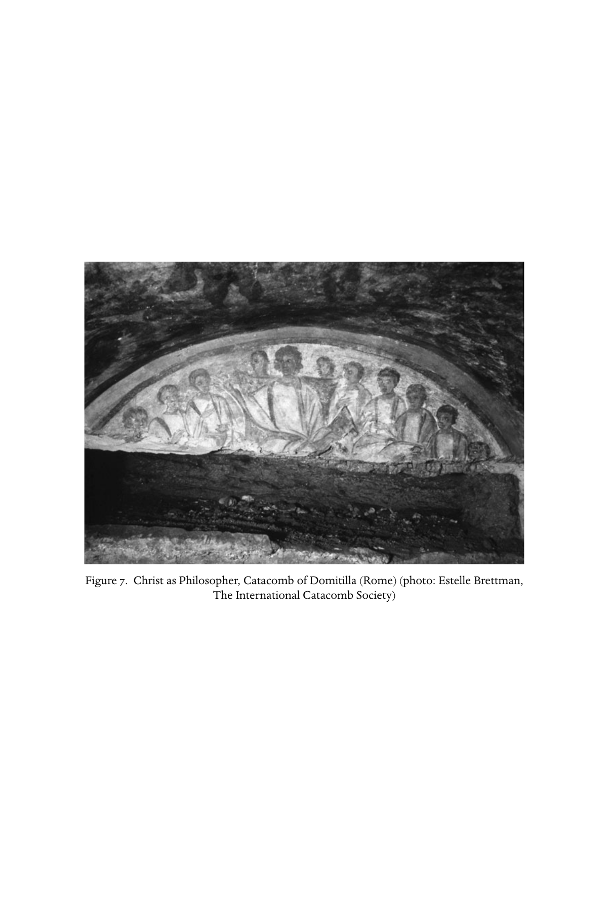

*图7：作为哲学家的基督，罗马多米提拉地下墓窟。照片：Estelle Brettman，国际地下墓窟学会。*

## 早期基督教中的教与学

<!-- 原书第485–486页；PDF第534–535页 -->

很可能在245年，一位名叫狄奥多尔的人发表演说，赞颂伟大基督教学者奥利金的品格与工作。[^ch27-1]这篇颂词传统上归于本都——土耳其东北部——教会创立者“行神迹者”格列高利。[^ch27-2]无论作者是谁，显然都在奥利金居于凯撒利亚期间，做过这位名师的学生。演说十分重要，让我们看见奥利金提供何种课程。因此，到三世纪中叶，已有明确证据：奥利金这样的基督教教师，能够提供完整哲学教育，与希腊—罗马世界各地学校的教育相平行。基督教正在发展自己的paideia，即教养、教育与训练，至少也正在取用、改造希腊—罗马世界的教养。

教与学从一开始就是基督教特色。福音书称耶稣追随者为“门徒”（mathētai），即学生，耶稣本人则被称“拉比”和“教师”。使徒教父与护教者等二世纪文本，把耶稣呈现为那位教师，其教导成全并超越其他一切。教导重点在伦理，根据却在于独一创造上帝之意志的启示：他察看万事，甚至洞见内心，不只行为，连动机都暴露无遗。[^ch27-3]基督教诺斯替思想声称，从基督传授的启示获得真知识，也反映这种对“教导”的强调。[^ch27-4]因此，正确教导，希腊语dogma、拉丁语doctrina，成为早期基督教的特色关切，并不奇怪。

这使教会更像哲学学校，而非宗教组织；因为古代宗教的特征，不是信仰、教义，甚至也不是伦理，而是神庙、祠堂或家庭中实行的传统仪式。基督教化最终将改变“宗教是什么”的观念，强调信经与正确教义，是参与其敬拜的条件。

早期某些基督徒共同体，主要仿照犹太会堂，[^ch27-5]是可信的看法；会堂兼具宗教与“学校”性质。诚然，在耶路撒冷以外，它是“祈祷所”（proseuchē），某种程度替代圣殿；但尤其在散居地，这些共同体核心，是学习犹太文学与传统的过程，是与周围希腊学校相匹配的文化教育。希腊人有法律、历史与诗歌，犹太人也有。希腊学校通过阅读古代经典教育，从文法，经修辞，到哲学；因为只要正确解释，荷马史诗等受尊崇古籍，就包含全部哲学。

律法与先知书，为犹太人提供可比的古老文本，更给出更强学习动机：它们是自己上帝的话，教导他们履行与拣选他们为子民之上帝的约，所应走的生活道路。犹太人发展出类似希腊—罗马文法学家的文学批评方法；[^ch27-6]斐洛作品证明，至少有些犹太人，也从自己经书发现希腊同代人从经典找到的那种思想与哲学体系。尤其在散居地，阅读、解释文本，而非向遥远耶路撒冷圣殿献祭，成为宗教活动核心。基督徒集会也一样。[^ch27-7]

<!-- 原书第486–487页；PDF第535–536页 -->

最早教会文本中，教师与先知都占突出角色，也预设主教有教学职能；坡旅甲被称为“亚细亚的教师”。[^ch27-8]不过，早期基督教也许最引人兴趣的特点，是那些似乎自行设立、作为“独立”教师者的显著地位，以及《新约》书信[^ch27-9]和《遗训》已显出的关切：区分谁按正确传统施教，谁不是。

二世纪中叶，瓦伦廷、马吉安与游斯丁都是例子：从更东方来到罗马，似都获罗马教会接纳，但其中两人后来因多数认为教导偏离而被排除。[^ch27-10]游斯丁却获接受，似作为“蛮族哲学”的教师活动，穿惯常哲学家服装，收塔提安等学生。这类教师以摩西和圣经著作取代通常经典，[^ch27-11]通过释经发展观念。罗马家庭教会中存在“学校”，在亚历山大里亚也有平行：最著名的奥利金以前，瓦伦廷、巴西利德，以及潘代努斯、革利免，都曾在那里教学。

显然，这些半独立哲学教师，与正在形成的教会圣职体系，关系并不总简单。奥利金与所属主教相处不睦，因而从亚历山大里亚迁往凯撒利亚。有人提出，[^ch27-12]在本卷所涵盖时期末尾，阿里乌与主教争执、分裂教会，[^ch27-13]其行为仿佛仍能依旧传统做独立教师，但当时社会政治发展，已不容如此。史料不仅称他为长老，也称圣经教师。

君士坦丁以后的时期，教会伟大教师将是主教，如凯撒利亚的巴西尔、拿先斯的格列高利、金口约翰、安布罗斯、奥古斯丁；一般教育则会“世俗化”，仍掌握在教授异教经典的修辞教师手中。[^ch27-14]不过，在较早时期，可追溯两项平行发展：一方面，教会像会堂一样，本身很像学校，聚会集中阅读、解释文本；另一方面，半独立基督教教师，正以另一套经典——圣经——发展基督教课程。

<!-- 原书第488页；PDF第537页 -->

本章主要关心后一发展，主要证据来自奥利金工作与著述。罗马希波吕托斯学派或许有些类似，但证据有问题。[^ch27-15]

## 学生所述的奥利金课程

<!-- 原书第488–489页；PDF第537–538页 -->

狄奥多尔来到奥利金处以前，已接受文法教师（grammatikos）和修辞教师（rhētōr）的标准教育。[^ch27-16]事实上，他本在前往贝鲁特学习拉丁文与罗马法的路上，遇见奥利金，视之为天意，并被劝说也跟随他学习。这一切强调，奥利金给予他的，相当于高等、大学层次教育，遵循既定enkyklios paideia，即完整通识教育模式。[^ch27-17]

奥利金爱好哲学，确信哲学是真正敬虔的基础，因而说服狄奥多尔留在凯撒利亚，放下故乡、朋友和原定事业。他作为学生住进奥利金家，获得友谊，灵魂燃起爱的火花。演说运用大卫与约拿单的“预表”，不过他承认，当时还不知道这个圣经范例。他被奥利金深深吸引。除这种偶尔的圣经预表外，整篇演说按希腊化修辞的文化母题（topoi）展开。

奥利金的教学技巧，被比作园丁照料荒地，或养护、修剪野生植物。因此，他花时间深入了解学生已有知识；发现潜力，就清理周围土地，以便灌溉、培养初生之苗；发现荆棘、野草，就加以剪除。他如苏格拉底，追问、论辩，毫不留情；又像驯马师制服未驯马匹，驯服学生。但一旦土地柔软，他就播真理种子，教学生向内探索，对诡辩保持批判。

这似乎是在描述逻辑与辩证法教学。因此，在修辞与道德化语言之下，可以发现课程。接着是自然哲学，研究自然学、几何学、天文学等古代世界科学。奥利金使学生超越单纯惊叹创造，理性认识其秩序与“经纶”。[^ch27-18]随后是伦理，不只言教，也有身教。

希腊哲学四枢德，构成其伦理核心，却因根本立场而各有解释：审慎，即判断善恶；节制，即选择善；正义，即给予道德生活各方面应有位置；勇敢，即实行其他德性的品格力量。他确实敦促学生学习希腊哲学，却通过自己的基督徒生活解释它。他希望“模仿完美典范”；所以颂词作者虽把他写得足为榜样，却拒绝称他本人为完美典范。由此可察觉，不只是他声称不愿逾越真实，也暗含一种认识：奥利金生活仿照基督，虽然从未明说。

最高智慧之言，是苏格拉底传统著名格言“认识你自己”；因为灵魂由此如在镜中看见自己，在自身反映神圣心灵。像这里一样，我们不断感到希腊哲学与圣经传统观念交汇。狄奥多尔仍依标准修辞母题，承认自己资质迟钝，奥利金未能把全部德性灌输给他；但老师确实使他爱好德性，使他明白，敬虔支撑伦理生活，而后者只能靠神圣恩典达到。最终目标，是变得像上帝，从而亲近神圣者，住于其中。

<!-- 原书第489–490页；PDF第538–539页 -->

因此，神学是全部学习的顶峰。奥利金认为，学生应研究哲学家和古代诗人作品，只排除否认上帝与眷顾的无神论者，无疑指伊壁鸠鲁派。他显然与学生处理一个老生常谈的批评：哲学家产生如此多不同理论，每派有自己的定论，每人确信自己正确、不肯听别人意见。狄奥多尔形容，这些思想家困在泥沼或迷宫，无法逃脱。为免学生遭此命运，奥利金不只介绍一种哲学，而把各派有用、真实之物摆在他们面前，把折衷变成优点。学生不应依附任何人类教师，而应献身上帝与先知。

所以，最高学习是解释圣经，一切哲学学习都为此预备。先知常写晦暗难解的话，尤其对远离上帝者如此。狄奥多尔认为，奥利金善于聆听上帝、有辨识力，能够阐明晦涩，因为神圣之灵与他为友，赐予研究、解释神谕的恩赐。释经需要启示。狄奥多尔确从奥利金学得圣经知识，也在告别中表明：把自己离开，比作亚当离乐园、浪子去远方，以及犹太人被掳巴比伦。

看来，奥利金给予狄奥多尔的哲学教育，与他自己从柏拉图派阿摩尼乌斯·萨卡斯所得，相差不大。辩证法或逻辑、自然学、伦理学三项传统学科，是基本结构。古典教养为这位基督教教师提供课程，但对他而言，目标是为神学与圣经研究奠基。

## 奥利金“学校”的问题

<!-- 原书第490–491页；PDF第539–540页 -->

狄奥多尔描述跟随奥利金学习，与优西比乌的说法并不十分吻合：后者认为，奥利金继任革利免，革利免继任潘代努斯，主持所谓亚历山大里亚教理学校。[^ch27-19]当然，狄奥多尔讲的是晚年凯撒利亚，而非亚历山大里亚的教学；即便如此，“高等”教育课程，与传统上称catechesis的洗礼前初级基督教教育，似乎仍断裂。一种图景中，奥利金像“独立”哲学教师，把学生收进家，虽然此时也已按立长老，在教会讲道。另一种图景中，他像教师传承中的正式任命者，至少失去主教支持以前，提供初级信仰教学。我们能否化解这些张力，形成较一致的教学活动图景？

必须摆脱从现代社会学校类比，不可避免带来的假设。古代学校不是我们所熟悉的制度化机构。希腊城市确实支付某些教师薪水，提供公共教育，但多数教师独立工作，聚集学生，人数取决于受欢迎程度。课堂可在体育馆或其他公共场所，也可在自家或别的私人场所。学生依社会地位，可能某时退学，或在准备好时，从初级教师转到文法教师，再到修辞教师，之后还可跟随哲学家。一位哲学教师继另一位时，“学校／学派”可能指这种连续传承；最著名是源于柏拉图、延续数世纪的学园。“学校”一词，可以有不同含义。

优西比乌可能用多种史料，构造奥利金生平与教学叙述。由于尝试按年代而非主题排列，插入其他材料，它本来就颇为零散。几种描述与问题有关：

1. 父亲殉道后，一位富妇成为奥利金庇护者，使他继续学习；很快他已能作为文法教师，获得不错收入。[^ch27-20]
2. 迫害期间，所有基督教教理教师离开亚历山大里亚，各种异教徒找他学习上帝之道。因此，德米特里乌斯主教在他十七岁时，任命他主持教理学校。由于许多人来接受初级信仰教导，士兵被派到住处周围，压力越来越大，他必须不断换屋。[^ch27-21]
3. 德米特里乌斯把教理任务单独托付奥利金，学生很快越来越多。他判断，这与文法教师工作不相容，便卖掉藏书，取得某种经济独立，专心研究圣经。
4. 到罗马旅行后，他觉得教理工作过于干扰神学与圣经学术研究，[^ch27-22]遂划分学生，把初级课交给最有前途学生之一赫拉克拉斯，自己集中高级学生的高等教育。优西比乌说，许多受教育者来到他的学校；几何、算术等预备学习后，他教授希腊哲学，讨论不同体系，给予一般基础，帮助研读圣经。[^ch27-23]

最后一点，开始更像狄奥多尔所述凯撒利亚课程。

<!-- 原书第492页；PDF第541页 -->

那么，这究竟是什么“教理学校”？把它想象成类似学园、奥利金任职前后都有一系列知名校长的机构，很可能是后见之明强加于材料；不过，也许反映优西比乌试图在异端教师同样活动的背景中，辨认正统教师谱系。材料暗示更简单的情况：紧急时期，主教请奥利金承担归信者必需的教理；他又回应需求，把主教资助的职责，与自己作为独立教师发展之高级课程结合。换言之，他同时从事不同层次教学。

有意思的是，这一建议，与近来重新评估[^ch27-24]他著述中似乎区分不同信徒层次的看法，十分吻合。他按人能否从字面、道德、属灵层面阅读圣经来区分；但与其说给人分类，不如说三重意义对应教育过程三阶段。他知道，人能从一层进入另一层，各意义层次也不相互排斥。讲道显示，他知道听众理解程度不同；回应塞尔苏斯嘲弄时，他欣然承认，不像精英性质的哲学，基督教甚至能教育奴隶与妇女，使之向善。[^ch27-25]这些态度，也许来自亚历山大里亚那些年，同时教授广泛层次的经验。凯撒利亚时期，他作为司祭、讲道者和哲学教师，活动似乎同样多样。

## 阅读圣经

<!-- 原书第493–494页；PDF第542–543页 -->

奥利金大部分著述活动，是制作圣经注释。庇护者安布罗修斯帮助资助。[^ch27-26]大量作品失传，一些则通过翻译，或各种汇编摘录存世。他也在《论首要原理》（De principiis）讨论释经危险与方法。长期以来，人们把后者视为理解其进路的基本说明；较近研究却试图考察现存注释与讲道中的实际解释。[^ch27-27]

清楚的是，圣经处于其哲学核心，阅读圣经是教育目标。如现代学术被进化观念塑造一样，其思想不可避免被柏拉图假设塑造。因此，释经兴趣常产生如今看来离题的评论；事实上，关于其圣经工作的经典英文研究，倾向认为，因他没有历史感，就无望理解文本。[^ch27-28]然而，他释经的方式，与许多同时代人明显相同。

文本处于古代一般教育过程核心，所以多数解释发生于课堂，口头活动没有记录。我们仍可从各种修辞手册与其他存世材料，辨认一些情形。一世纪晚期拉丁文著作、昆体良《雄辩术原理》（Institutio oratoria，意为“演说术训练”），完整讨论各教育阶段，使我们看见常用解释步骤；这些也见于奥利金注释。[^ch27-29]

古代文本手写在羊皮纸或纸草上。教师首先须确保课堂使用的各抄本，措辞实际相同；换言之，文本批判不可避免，亚历山大里亚也早已实践。文本有不一致或疑问时，奥利金显然知道，必须讨论正确措辞。一个例子足以说明：《马太福音》19:19有些抄本增加“要爱邻如己”。他认为是后加，《马可》《路加》没有这些字，也证实这一点。他说，若非我们的抄本差异太大，这种建议会显得不敬；差异或因某些抄写者粗心，或因校改文本时有责的轻率，或因一些人任意增删。[^ch27-30]

奥利金也深知，译本不可能完全表现原文确切措辞。优西比乌[^ch27-31]描述他制作《六栏合参》：宏大作品，把希伯来文、希伯来文转写，以及四种或更多希腊译本并列比较。他实际懂多少希伯来语，[^ch27-32]又请教多少犹太学者，争议很大。他确实在多处[^ch27-33]声称听犹太人解释圣经，或亲自询问特定段落。完整《六栏合参》大概从未抄录，原本也早已失传；但它显示，他如何认真对待学术工作，确保每一笔画准确。

<!-- 原书第494–495页；PDF第543–544页 -->

古代文本没有分词与标点，阅读必须分析词语如何连接、短语在哪里结束。古代阅读全是出声的，需要先研究语法与句子结构，作准备。理解还须关注词汇与词源，因为古籍常用古旧字词。注释者编词语索引，以辨认荷马用词意义；[^ch27-34]奥利金也如此，列交叉参照，确立圣经词义，阐明眼前文本。

此外，还须辨认修辞格：明喻、隐喻、拟声、反讽等。不认出语言的“转折”（tropē），就会得到错误意义；毕竟反讽以特殊语气，说出与意图相反的话，未能辨认就完全误读。奥利金花许多力气辨认此类特征，知道把隐喻按字面理解，就会彻底误读。有时，“按字面”读文本是不可能的。他这里只是把文法与修辞学校的标准方法用于圣经。

但在运用中，隐喻也成为文本有更深意义的指标。修辞格与aporiai，即不易解决的疑难，成为寓意解释起点。奥利金认为，圣灵故意把这些“绊脚石”放进文本，刺激读者寻找属灵意义（Princ. 4.3.1）。上帝不可能有眼耳、在伊甸园行走，因为他超越，是不可见、无形体的“他者”。同样，上帝不可能发怒，因为神圣不受情感影响；但他俯就我们的需要，显得发怒，激励我们更公义。有时，研究文本字句反而排除字面阅读。从措辞研究，奥利金能产生象征性解读，仿佛文本是一套密码；词源帮助破解，也成为哲学阅读工具。

其注释另一面，也可在学校实践中找到平行。解释性评论必需，以助理解暗示。古典文本中，诸神、英雄、神话故事及许多特征，都需说明。昆体良警告不要过度、炫耀博学，说明这种做法很常见。有时，自然现象或历史事件，以及地理、天文、音乐信息，都须解释；文本因此很容易提供庞大课程，而反过来，课程也普遍被视为阅读文本的基础，奥利金正如此。

他无视避免过度的警告，论珍珠的长篇，[^ch27-35]就是证据；缘起《马太福音》13:45，商人发现极宝贵珍珠，卖掉一切购买的比喻。他告诉我们，哪里最适合找珍珠、如何形成，以及自己这样博学者所知的一切。研究这些文本特征，称historia，有时关乎我们所谓文本背后的“事实”。面对众人因耶稣出身低微、只是木匠之子，而惊疑其智慧的故事，奥利金提醒读者，群众不知道童贞女生子，所以困惑。为证实这一解释性“事实”，他补充伪经传统：耶稣的弟兄，是约瑟前妻所生。[^ch27-36]

<!-- 原书第496页；PDF第545页 -->

不过，叙事不只需要补充信息。学校教学生判断故事的可信程度，[^ch27-37]寻找证明或驳倒的方法，因为日后在法庭担任律师，这种批判至关重要。奥利金也有自己的技巧：塞尔苏斯声称，马利亚与名叫潘特拉的军人生子，被订婚对象约瑟赶走，他将此视为“神话”。[^ch27-38]在福音注释中，他也毫不犹豫指出同一故事不同版本的差异。

例如所谓洁净圣殿故事。[^ch27-39]除细节外，时间安排有巨大差异：《约翰福音》把它放在耶稣事工刚开始，其他福音书则紧接其被捕、定罪以前。奥利金“认为，那些解释中只承认历史的人，不可能证明这些矛盾陈述相互和谐”。[^ch27-40]他说明约翰时间安排不可信，转而讨论更深意义。转向马太版本时，又指出照现有叙述并不可信之处，寻求各福音作者更深意图。如语法与词汇分析一样，疑难说明文本的“物质”层面，本身不足以使人发现真义；aporiai激发敏锐读者超越字句，进入灵。圣经充满“谜语”或“比喻”。

修辞教师接受，演说者有时为听众益处而说不实之事。奥利金认为，上帝也类似，俯就人类水平。他常说，上帝如父亲对幼子，或医生对病人：“全部神圣经书，都充满这种药物。”[^ch27-41]如此，他使受教育求道者，能够接纳那些以别扭翻译腔写成、晦涩难解的“蛮族”书卷；粗糙语言和拟人表述，都得到解释。重要的是理解不断增长，从而超越文本“字句”，发现道德、属灵层面。难怪狄奥多尔认为，释经是奥利金课程的目标。

<!-- 原书第497–498页；PDF第546–547页 -->

教养的全部目标，在于能读、能解释圣经，这也反映于《论首要原理》。它似是现存最早作品，却已让我们总览他在亚历山大里亚发展教学时的思想。写作也许是为辩护释经程序。[^ch27-42]它某种程度是“系统神学”，但如今认为，体裁类似古代学校哲学手册，讨论宇宙及逻辑的“首要原则”。由于奥利金观点后来高度争议，希腊原本只存残篇；全书却有鲁菲努斯四世纪拉丁译本。遗憾的是，译本显然略带护教性质，并不完全可靠；即便如此，仍是其神学和释经原则的重要概要。

开篇确认，基督的话与教导，不限于在地时所说；摩西与先知也由基督启示。但这些经书的解释，造成许多冲突意见，因此必须从公认“信仰准则”、使徒传下的教义开始。不过，奥利金明白，有哲学兴趣者，需要超出基本核心继续探究。首先研究上帝本性，圣经如何引导他论证上帝无形体，立即可见。随后依次讨论基督、圣灵、理性受造物、天使、物质创造、成肉身、灵魂、自由意志、魔鬼、最终完成等。第四卷转向圣经，先讨论神圣启示，以及摩西与先知的预言意义，再指出，读不对圣经太容易。

因此，他带着论战意图，无疑也受与犹太人及其他人辩论的经验影响，提出字面阅读的问题。犹太人看不见预言在基督成全，因为狼并未字面上与羊同食，豹未与山羊羔同卧，牛犊、公牛、狮子也未由小孩领着一同吃食。[^ch27-43]异端抓住上帝发怒经文，说犹太经书创造神不完美，不可能是救主启示的完美上帝。甚至教会中的朴素信徒，也把连最残暴、不义之人都不至有的行为，归于上帝。奥利金断言，原因是仅按字句读圣经，而未理解属灵意义。

他有一系列不断用来证明属灵或基督论解读的保罗经文，[^ch27-44]反复见于著述，包括《罗马书》7:14；《哥林多前书》2:2、10、12–13、16；9:9–10；10:4、11；《哥林多后书》3:6、15–17；《加拉太书》4:24。《论首要原理》另引《希伯来书》8:5；尽管别处承认，除上帝外无人知道谁写此信，此处却似接受出于使徒。[^ch27-45]

据这些线索，圣经充满奥秘：有些无法理解，有些是将来事的“预表”。预言充满谜语、晦暗言辞，成千人在解释上犯错，不足为奇。奥利金从《箴言》22:20–21找到钥匙，理解为要求以三重方式陈述真理之言。[^ch27-46]朴素者从圣经“肉身”，即明显解释，得到造就；进步者从其“魂”得造就；完全者则从属灵律法得造就，律法“有将来美事的影子”。依使徒，他将：

> 在完全者中讲智慧，却不是这世界的智慧，也不是这世界将要消灭之统治者的智慧；我们讲的是奥秘中上帝的智慧，是隐藏的、上帝在诸世以前为我们荣耀预定的智慧。（《哥林多前书》2:6–7）

人由身体、魂、灵构成，圣经也如此。但要将《论首要原理》说明的三重理论，应用于实际释经，颇为困难。多数注释及其他释经作品中，他实际运用多种可能意义，却分两类：“按字句”和“按灵”。乍看，他用来证明方法的经文，也暗示双重意义。

<!-- 原书第498–499页；PDF第547–548页 -->

理论讨论中，奥利金很快说明，某些段落“完全没有身体层面的意义”，读者必须立即寻找魂或灵。他担心，意义若太透明，读者就不会意识到其外还有什么。因此他认为，上帝之道安排某些绊脚石、障碍和不可能之事，插在律法与历史之间，使我们不至全被语言吸引力带走，或以经书教不出配得上帝之事为由，彻底拒绝真教义，或永不离开字句、因而学不到更神圣成分。[^ch27-47]

他断言，圣灵偶尔把虚构织入历史叙事，不只基督以前著作，连福音书也如此，让叙述次序遵循所指向的奥秘事件，而非地上事实。他的例证[^ch27-48]先从创造叙事，到耶稣受魔鬼试探，尤其集中摩西律法、某些福音教导及出埃及。不过，他显然相信，圣经大部分按字句就有充分恰当的意义，可造就朴素者。[^ch27-49]他自豪于，哲学只能使精英向善，基督教却能改善每个人。

除前述语文学传统外，他的进路也借鉴同时代哲学读文本的方法。柏拉图抨击诗人故事不道德，希望在理想国禁止其教育用途（Res. 10.595A及以下）。但传统占上风，普鲁塔克等发展出论证文学可供“道德”教育的方法。[^ch27-50]故事可以是榜样，也可以是警告，教师总应设法提炼其中“道德”。到奥利金时代，受斯多亚影响，哲学教师一般把文学视为寓意，认为荷马真正讨论道德或哲学真理；[^ch27-51]释经者应揭出隐藏意义，用以教哲学。

亚历山大里亚革利免完全赞同普鲁塔克：所有宗教真理都以象征、谜语表达，因为神圣超越人类语言与理解。[^ch27-52]奥利金有趣之处，是他多么广泛地从圣经自身证明这一点。后来，他至少部分因为对圣经处理过于随意而遭谴责：借寓意，把基督教总体故事的关键部分，如创造、乐园、肉身复活与上帝国，属灵化到趋于消解。[^ch27-53]然而，他批判拟人语言，认识言说属灵奥秘或认识上帝实在的困难，强调上帝俯就我们的水平，其遗产将在卡帕多西亚教父与东方正教传统的神学中结出果实。

<!-- 原书第500页；PDF第549页 -->

奥利金的贡献，是推动基督教内部发展真正的知识传统，许多方面类似古代世界的思想传统和教育体系。其核心是书，传递古老智慧、[^ch27-54]却需要解释的古书。学习循环始于读文本取得基本技能，最终又以精深重读传统文本、寻找哲学真理为顶点。奥利金以圣经取代希腊古典传统文学正典，使圣经成为基督教教养的冠冕。圣经研究成为一切真理来源，也成为终身属灵探索的根据；它处于一种整合的、重视心智的灵性生活核心，引领灵魂超越共同承认的信经教义之简单框架，踏上旅程。

其遗产深刻影响后世数世纪，不足为奇。然而，自由探究精神[^ch27-55]越来越成为问题；随着新争议促成教义公式，其神学诠释学难获接纳，许多观念被认为不令人满意。

## 译校说明

- paideia含教育、训练与文化养成之意，章题采用“教养”，具体论述按语境译“教育”或“课程”。
- 本章“学校”可能指教师家庭、学生群体或师承，并不总对应现代固定机构；“教理学校”的形成与性质，按作者讨论保留不确定性。
- 奥利金关于圣经叙事、字句与属灵意义的论断，以及作者对其方法的评价，均依原文译出。history／historia在相关段落还包括对文本细节的查考，不能一概理解为现代历史学。

## 脚注

[^ch27-1]: 见上文第四部分第18章及第25章。

[^ch27-2]: 作者归属讨论，见Trigg, Origen, 167。Trigg依Nautin，反对SC版Crouzel的看法。

[^ch27-3]: 例如《提摩太前书》5:21、6:13；《提摩太后书》2:15；1 Clem. 21.3–9、28.4等；Ign. Eph. 15.3；Justin, 1 Apol. 12。

[^ch27-4]: 见上文第三部分第12章。

[^ch27-5]: Burtchaell, From synagogue to church。亦见上文第一部分第2章及第二部分第7章。

[^ch27-6]: Daube, ‘Rabbinic methods of interpretation and Hellenistic rhetoric’; Lieberman, Hellenism in Jewish Palestine.

[^ch27-7]: Gamble, Books and readers.

[^ch27-8]: M. Polyc. 12.2.

[^ch27-9]: 例如《哥林多前书》12:28；《提摩太前书》3:2。

[^ch27-10]: 见上文第四部分第22章。

[^ch27-11]: Droge, Homer or Moses?; Young, Biblical Exegesis.

[^ch27-12]: Williams, Arius.

[^ch27-13]: 见下文第六部分第31章。

[^ch27-14]: 四世纪主教接受过古典、即异教教育；拿先斯的格列高利反对背教者尤利安敕令，维护自己受此教育的权利。这说明态度不同于二、三世纪，当时以圣经取代经典的做法明显。见Droge, Homer or Moses?。

[^ch27-15]: 见上文第四部分第22章，以及第23、25章。

[^ch27-16]: 以下记述取自归于“行神迹者”格列高利的颂词。

[^ch27-17]: 古代教育的经典研究，见Marrou, History of education in antiquity；较近研究见Kaster, Guardians of language。

[^ch27-18]: 希腊语oikonomia字面意为“家务管理”，神学著作中却用于上帝眷顾性管理宇宙、通过成肉身实现的神圣救赎目的，甚至上帝自身配置为三一；见上文第25章。

[^ch27-19]: HE 6.6。G. Bardy在‘Aux origines de l’école d’Alexandrie’及‘Pour l’histoire de l’école d’Alexandrie’中，质疑这种传承的性质。

[^ch27-20]: HE 6.2.

[^ch27-21]: HE 6.3.

[^ch27-22]: HE 6.15.

[^ch27-23]: HE 6.18.

[^ch27-24]: Torjesen, ‘“Body”, “Soul”, and “Spirit”’。进一步见下文原书第498页。

[^ch27-25]: C. Cels. 3.49ff.

[^ch27-26]: Euseb. HE 6.18.

[^ch27-27]: 尤其见Neuschäfer, Origenes als Philologe；Young, Biblical exegesis。

[^ch27-28]: Hanson, Allegory and event.

[^ch27-29]: 以下论述重述Young, Biblical exegesis中的说明。

[^ch27-30]: Or. Comm. Matt. 15.14.

[^ch27-31]: HE 6.16.

[^ch27-32]: Euseb. HE 6.16声称他懂希伯来语，但其著述似显示所知很少；见de Lange, Origen and the Jews。

[^ch27-33]: 例如Comm. Jo. 6.83；Hom. in Ezech. 4.8；C. Cels. 1.45、55。他对犹太学者的借鉴，完整讨论见de Lange, Origen and the Jews。

[^ch27-34]: Lamberton, Homer the theologian.

[^ch27-35]: Comm. Matt. 10.7–10.

[^ch27-36]: Comm. Matt. 10.17.

[^ch27-37]: 进一步讨论见Grant, Earliest lives。

[^ch27-38]: C. Cels. 1.32–7.

[^ch27-39]: Comm. Jo. 10.119–22.

[^ch27-40]: Comm. Jo. 10.130.

[^ch27-41]: Hom. Jer. 20.3.

[^ch27-42]: Trigg, Origen, 91.

[^ch27-43]: Princ. 4.2.1中的《以赛亚书》11:6–7。

[^ch27-44]: Heine, ‘Gregory of Nyssa’s apology for allegory’.

[^ch27-45]: 引于Euseb. HE 6.25。

[^ch27-46]: Princ. 4.2.4.

[^ch27-47]: Princ. 4.2.9.

[^ch27-48]: 这些例证构成Princ. 4.3的大部分。

[^ch27-49]: Princ. 4.2.6.

[^ch27-50]: Plut. Lib. ed. (Moralia 1a–14c) and Adol. poet. aud. (Moralia 14d–37b).

[^ch27-51]: Lamberton, Homer the theologian.

[^ch27-52]: Plut. Superst.（Moralia 164e–171f）；De Is. et Os.（Moralia 351c–384c）；Def. orac.（Moralia 409e–438d）。参Clem. Al. Str. 5.4及以下。

[^ch27-53]: Young, ‘Fourth century reaction against allegory’.

[^ch27-54]: Hatch, Influence of Greek ideas；较近见Young, ‘Books and their “aura”’。

[^ch27-55]: 见上文第25章；Crouzel, Origen。


---

<a id="part-6"></a>

# 第6部分　“外人”成为公民：走向帝国庇护

<!-- 原书第501–502页；PDF第550–551页。 -->

本部分扉页后的图版，已放在本部分首章开头，附中文图注。


---

<a id="chapter-28"></a>

# 第二十八章 迫害：起源与遗产

**作者：W. H. C. 弗伦德（W. H. C. Frend）**

《剑桥基督教史》第一卷《起源至君士坦丁》中文译稿

> 原书第502–523页，PDF第551–572页，含章前图版。完整翻译正文与解释性脚注；参考文献作者名、题名和定位保留原文。
>
> [第二十八章英文原文](<第二十八章 迫害：起源与遗产（英文）.md>) · [原书PDF](<../01 起源至君士坦丁.pdf>)

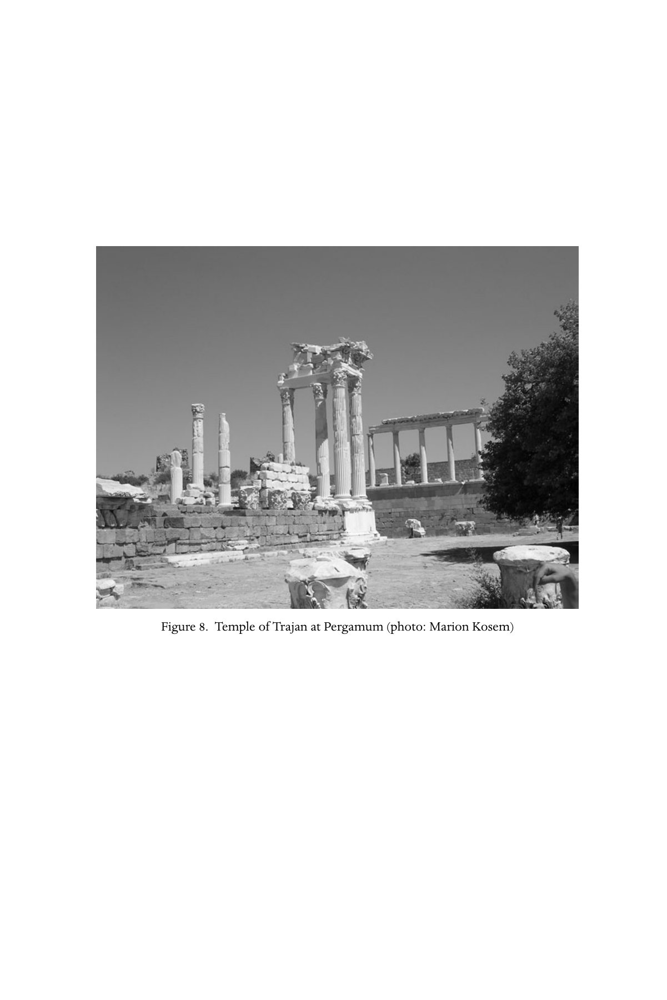

*图8：别迦摩的图拉真神庙。照片：Marion Kosem。*

<!-- 原书第503–504页；PDF第552–553页 -->

从64年尼禄迫害，到君士坦丁约312年归信基督教，相隔约二百五十年。其间，基督教是非法且可疑的宗教，成员可能遭逮捕、定罪，许多人被处死。二世纪，迫害在行省总督权威下进行；三世纪，皇帝本人开始介入，直到瓦勒良（253–260年）治下，通过元老院颁布敕令，旨在压制教会敬拜，伤害其信徒。基督徒则预期与周围行省社会疏离，并遭迫害。当然，并非所有人都像304年卡塔尼亚执事欧普卢斯一样，主动求殉道；[^ch28-1]但从犹太教继承的义人受苦传统很强，又受到耶稣本人及以色列伟大先知之记载的强化。[^ch28-2]对后世不幸的是，迫害遗产并未随教会获宽容而消亡，只是转而针对异端与非信徒。

基督徒首次与罗马当局遭遇，既出于偶然，也灾难深重。路加《使徒行传》结束于62年；此前，与行省当局关系尚可容忍。[^ch28-3]到罗马时，保罗及追随者仍被视为犹太社群真正成员，尽管可疑且不受欢迎，参《使徒行传》28:22。接下来两年，这一关系看来不至改变。

然而64年7月19日，罗马爆发大火。[^ch28-4]狂风助长火势，三个完整城区被毁，数千人无家可归。反应类似前186年罗马面对酒神祭阴谋时的情形，李维曾详述此事。[^ch28-5]城市守护神受到冒犯，必须严厉赎罪。但嫌疑落到尼禄本人；他素以宏大计划闻名，人们相信其中包括按其帝都理想、重新规划罗马。随后，借用事后五十年、115年写作的塔西佗的话：“尼禄把罪责强加于一群因其可憎行为受憎恨、被称为基督徒的人，并施以最精心的酷刑。”[^ch28-6]

如李维叙述镇压酒神祭一样，“极多的人”被捕；“承认”的人——承认自己是基督徒吗？——被定罪处死，地点很可能在今梵蒂冈附近尼禄的竞技场。有些被钉十字架，有些粗劣扮演阿克泰翁的命运，被狗撕碎；妇女则扮作狄尔刻，绑在公牛角上，或扮作达那俄斯诸女，暴露竞技场，遭野兽袭击。[^ch28-7]这场清洗，以人祭的极端方式安抚诸神。

公众怜悯受害者，却没有为尼禄开脱：“看来，他们被毁灭并非为公共利益，而是为餍足一人残酷。”[^ch28-8]塔西佗同时代人苏埃托尼乌斯，讲火灾时未提基督徒，但在一份不必然不可靠的尼禄杂项作为清单中，说“基督徒受到惩罚，这类人信奉一种新奇〔即新颖或革命性〕而邪恶的迷信”。所用maleficus一词，有“巫术”或“黑巫术”意味。[^ch28-9]此后，基督徒便与纵火，以及借黑巫术追求革命目标相连；他们“敌视社会”，无权存在。[^ch28-10]64年事件及其回应，将被长期记住；德尔图良于197年，以institutum neronianum概括。[^ch28-11]

<!-- 原书第505–506页；PDF第554–555页 -->

迫害就这样起源。奇怪的是，64年灾难没有引发其他地方类似行动，尤其基督徒最强的小亚细亚诸行省。接下来三十年，他们确实“为这名受苦”（《彼得前书》4:12–16）；到世纪末，亚细亚行省强烈民间敌意开始显现，导致迫害和殉道（《启示录》6:9）。但直到多米提安统治（81–96年）近结束，没有更多有据可查的国家干预。

这位皇帝并非不成功的军人和行政者，却深受猜疑性格困扰，视哲学家为敌，晚年也把贵族成员当敌人。他期待人以“主人与神”称呼自己。[^ch28-12]另一方面，如前任维斯帕西安（69–79年），他设想一个以城市化、罗马化为特征的统一帝国，尤其在东方，通过罗马女神和皇帝崇拜巩固。[^ch28-13]塔西佗描述不列颠城镇兴建神庙与广场；[^ch28-14]在亚细亚，以弗所、老底嘉、士每拿与别迦摩，则以尊崇皇帝的神像、神庙为特色，亚细亚共同议会（koinon tēs Asias）在这些地方聚集，举行皇帝庆典竞技。[^ch28-15]

这种情况下，宗教不顺从不被容忍。犹太人每年向国库交两第纳里，即fiscus iudaicus犹太税，也许可获接受，但模仿他们的人不行。狄奥·卡西乌斯说，95年，皇帝堂亲弗拉维乌斯·克莱门斯，与其妻、皇帝侄女弗拉维娅·多米提拉，被控“无神论”（atheotai）；前者处死，后者流放潘达塔里亚岛。另有贵族被控“转向犹太习俗”，处罚是处死或没收财产。[^ch28-16]执政官阿基利乌斯·格拉布里奥还被控“图谋革新”（molitor rerum novarum）。[^ch28-17]

三世纪多米提拉墓窟归基督徒所有，这一事实不应被用作推论依据；[^ch28-18]但“无神论”确是156年士每拿指控基督教的词，后文将见。多米提安惩罚的贵族，看起来拒绝罗马诸神；又不是犹太人，因而把自己置于法律保护之外。德尔图良视其为尼禄之后的基督徒迫害者，[^ch28-19]不过这一事件是否构成迫害，仍可争论。

96年9月，多米提安被杀。继任者涅尔瓦（96–98年）当年发行货币，宣告fisci judaici calumnia sublata，即“废除犹太税的滥用”，也许是这些事件回响。德尔图良声称，流亡者获召回。[^ch28-20]此后，古典作家再次提到基督教，要到普林尼从比提尼亚—本都致图拉真皇帝（98–117年）的报告，很可能在111年。

<!-- 原书第506–507页；PDF第555–556页 -->

普林尼，全名C. Plinius Caecilius Secundus，生于意大利北部科莫（Comon／Como）的地方贵族家庭。[^ch28-21]通过叔父与弗拉维王朝政府相连，很有条件谋求元老院仕途。朋友运不错，使他晋升财务官，自动进入元老院。他熬过多米提安时期，100年、图拉真在位第三年担任执政官，获皇帝信任。约108年，比提尼亚—本都因严重腐败等原因陷入危机，他被任为legatus Augusti，即皇帝使节，全权恢复行省财政与行政。确切任期不明，可能早在109年到任、留至111年，而不是通常说的112–113年。似乎不久后去世，早于图拉真114年取得Optimus，即“至善者”称号。[^ch28-22]

其任务与基督教无关，包括整顿五座比提尼亚城市财政，限制滥用帝国邮驿，遏止建筑费用大幅超支，规管或更多时候解散未经批准的collegia，即行会、俱乐部，因为它们可能成为犯罪和叛乱中心。他禁止这些团体。[^ch28-23]直到巡视行省第二年，在本都东端阿米苏斯与阿马斯特里斯之间某处，他似才遇到基督徒。[^ch28-24]他们被以tanquam Christiani，即“作为基督徒”，带到他面前。公开承认基督教信仰属于非法，处罚是死刑。因此，尽管向皇帝写信时说，自己从未参与审查基督徒，也不知道通常归于他们的罪为何，他仍毫不犹豫，下令处死那些经过三次询问、仍坚持承认身份者。[^ch28-25]他不怀疑，因为无论如何，他们“固执、不可弯折的乖谬”也值得惩罚。正如舍温—怀特所坚持，这已成为将基督徒处死的额外理由；[^ch28-26]180年7月，斯基利认信者在迦太基面对资深执政官萨图尔尼努斯时，也将发现这一点。罗马公民则被普林尼送往罗马审判处罚。

随后出现复杂情况。一份匿名册子列出一些人，指控其为基督徒。作为诚实行政者，普林尼开始深入调查。否认自己曾为基督徒者，向诸神诵祷，“以酒和香祈求”，最后“诅咒基督”，便获释放。这鲜明说明，即使罗马社会高层，也把基督教信仰理解为具有邪恶巫术性质。

其余一些人称，三年前或更久，甚至二十年前，就已不再信。他们说明部分礼仪，[^ch28-27]可能包括诵十诫，以及圣餐后共同进爱筵，强调只是普通食物；可见基督徒被怀疑，为黑巫术吃可憎混合物，甚至食人。普林尼再从两位女仆，或女执事，取证后，断定基督教nihil aliud... quam superstitionem pravam et immodicam，即“无非……乖谬、过度的迷信”。如今神庙重新有人前往，“应给予悔改机会”。[^ch28-28]

<!-- 原书第507–508页；PDF第556–557页 -->

图拉真同意。他回复普林尼，几乎总简短切题，称赞使节作为，并指示：虽“不能制定一种普遍规则，仿佛固定程序”，却“不应主动搜捕”基督徒，也就是不把他们当普通罪犯、亵渎者或盗匪。但其宗教仍不合法，若被指控、定罪，就须惩罚；同时，应尽可能给予撤回信仰机会，撤回即可获赦。匿名指控应拒绝，因为“先例极坏，也不配我们的时代”。[^ch28-29]

这是基督徒与罗马当局关系的决定性时刻。通信在整个二世纪广为人知。这份批复，即含正式指令的信，被总督用于177年里昂被捕基督徒，[^ch28-30]约二十年后又被德尔图良引用、嘲讽。[^ch28-31]无论看起来多么混乱矛盾，图拉真答复都给当局提供指导，处理日益棘手的问题。

十年后，亚细亚一些城市显然发生反基督徒骚乱。约125年，皇帝哈德良（117–138年）向资深执政官盖乌斯·米努基乌斯·丰达努斯发批复，[^ch28-32]提及前任塞雷尼乌斯·格拉尼安努斯的报告，很可能请求指示如何面对民众攻击。哈德良允许正式提出指控，却重申前任对匿名和恶意告发的愤怒。因此，起诉基督徒更难；不过游斯丁把批复视为确保他们免于迫害，实不足据。[^ch28-33]

其意义还在于，行省民众正被激起反对基督徒。人们越来越觉得，基督徒宣讲的一神论与道德，同绝大多数同代人欣然接受的生活方式不相容。皇帝、伟大地方神明及无数附属神，共同照料公共福祉；中期柏拉图主义、斯多亚主义，提供的宗教哲学，胜过摩西或希伯来先知所传。那些先知竟赞美一名犹太人；此人在提比略统治时，作为叛乱者在巴勒斯坦被钉十字架。[^ch28-34]还要再过一世纪，基督徒才能反过来压倒对手。


<!-- 原书第508–510页；PDF第557–559页 -->

一段较长相对和平，到150年代结束。先知黑马约130年发出严峻警告，预言“为这名而有争斗、监禁、大患难、十字架和野兽”，此前未成现实。[^ch28-35]但156年2月22日，士每拿主教坡旅甲被民众怒潮带到资深执政官面前，控以“无神论”。官员劝他“顾惜年纪”“指着凯撒守护灵起誓”“谴责无神论者”，他一概拒绝，于是被判活活烧死。[^ch28-36]

此时，行省敌意正被整理为一系列致命指控。最早史料来自北非人弗龙托，可能出身努米底亚基尔塔，却在罗马以律师发迹，并受任为未来皇帝马尔库斯·奥勒留（161–180年）的教师。因此，其也许向元老院发表的演说，应在约150–155年。米努基乌斯·费利克斯《奥克塔维乌斯》，虽约八十年后编写，保存其一部分。弗龙托指控基督徒“神圣仪式比任何亵渎更污秽”；在大概属于爱筵的“宴会聚集”上，“有醉酒淫乱、乱伦，以及某些涉及拴住的狗的可怕仪式”。[^ch28-37]

二十年后，约176年，东方也流传类似指控。雅典纳哥拉向马尔库斯·奥勒留和康茂德写《为基督徒申辩》，请求宽容，回应的清单上除可恨的“无神论”，还增加更可怕的食人指控（Leg. 35）。[^ch28-38]177年里昂，暴民在把基督徒拖到总督前以前，也这样追逐、骚扰和指控他们。[^ch28-39]总督按图拉真裁定的精神，请示皇帝。马尔库斯·奥勒留决定，撤回信仰者释放，顽固者交付野兽，罗马公民斩首。[^ch28-40]叙述事件的书信说，民众欢欣；所谓怜悯，仅限于讥讽他们无谓浪费生命。[^ch28-41]基督徒自己却被描绘为得胜者，因为他们“甘愿而喜乐”赴死。[^ch28-42]

二世纪最后一个事件，鲜明说明冲突日益加深。此前由基督徒强调界线，如今罗马当局自己也开始意识到，两套信仰、祭仪和伦理之间，有无法调和的鸿沟。180年7月17日，一组来自大概靠近迦太基之斯基利城的北非人，被带到资深执政官萨图尔尼努斯面前。[^ch28-43]他开场说：“你们若恢复正确心态，就可配得我们主皇帝的宽赦。”即按图拉真裁定，撤回便释放。

斯基利人发言人斯佩拉图斯毫不妥协，回答他们受虐待时仍感恩，“因为我们尊崇自己的皇帝”。萨图尔尼努斯提醒：“我们也是虔敬的民族”，指着皇帝守护灵起誓，并劝他们照做。全无用处。斯佩拉图斯宣告：“我不承认这个世界的帝国，我服侍的，是无人看见过的那位上帝……”其obstinatio，即顽固，已无可改变。承认自己是基督徒、拒绝再给时间考虑后，斯基利人被判死刑。他们回应“感谢上帝”，“今天我们在天上成为殉道者”。北非基督教将在圣灵引导下，继续成为“殉道者的教会”。[^ch28-44]各行省认信者，也表现相同精神，相信殉道将使自己最终与主同在，并在审判日与他一同，使异教敌人付出代价。[^ch28-45]

二世纪后半，民众对基督徒的本能愤怒，产生了优西比乌记载的暴力、零星迫害。[^ch28-46]犹太人如今不再那么突出，不过此时柏拉图派批评者塞尔苏斯，仍视基督徒为犹太教叛教者。[^ch28-47]他也批评他们拒绝承担公共或军事服务责任，似乎希望殉道。但与此同时，基督教不断增强，也获得一定尊重。[^ch28-48]三世纪将展开一场较量：究竟不朽诸神，还是基督徒的上帝，照看帝国命运？

## 三世纪

<!-- 原书第511–512页；PDF第560–561页 -->

三世纪大部分时期，民间敌意继续是激起反基督徒迫害的主要因素之一，但皇帝和官员更加主动。此前，或许斯基利人一案除外，他们似乎只是被动接受民众要求毁灭基督徒；如今开始主动出击。

变化最早迹象，出现于202–206年。一份由据称为塞普提米乌斯·塞维鲁（193–211年）传记作者斯巴尔提安保存、断代202年的批复结尾，禁止归信犹太教或基督教；似没有理由怀疑其真实性。[^ch28-49]这是两种宗教最后一次被并列于同样恶名之下。主要受害者可能是基督徒。罗马、迦太基、亚历山大里亚基督教领袖似未遭事，新的基督徒却受惩罚，这些地方及哥林多出现丑恶场面。[^ch28-50]亚历山大里亚，奥利金父亲列奥尼德遇害。[^ch28-51]新归信者佩尔佩图娅、费利基塔斯及同伴，于203年3月在迦太基处死。

详细殉道记显示，归信可给迦太基一个显贵家庭造成何种损害，也再次呈现基督徒“不可弯折的乖谬”：轻蔑拒绝佩尔佩图娅父亲与财务代理官劝她撤回的请求。他们是狂热者，被带着绕迦太基竞技场行走时，威胁代理官将受永恒惩罚；他们临死，承受观众施虐取乐。[^ch28-52]

人们对基督教与基督徒毫不同情。德尔图良约197年写，迦太基民众的“本能狂怒”，是迫害主因。[^ch28-53]每种自然灾难，都归咎基督徒。他用一句为人熟记的话总结：

> 台伯河若涨到城墙，尼罗河若不涨到田地，天空若不动，或大地动了，若有饥荒，若有瘟疫，立即有人喊：“把基督徒喂狮子！”把所有人都喂一头狮子！[^ch28-54]

在非法指控之上，又增加公开反对“罗马诸神”及罗马国家。三世纪之交，基督徒被视为帝国及其价值的主要内部敌人。

然而，另一些因素正转而有利于新宗教。三世纪前半，基督教不能再与“煽动不满的社会下层”等同。奥利金约248年回答塞尔苏斯，描述越来越多受教育者归信：

> 由于入信人数众多，连富人、有尊位者，以及出身高贵、教养精致的妇女，也友好看待信徒；或许可以说，有些人成为基督教导领袖，是为了少许声望。[^ch28-55]

东西方、亚历山大里亚与北非，都发生这种变化。

社会组成变化，伴随更多自信。西方，德尔图良《护教书》及其他著作足以自证。“Fiunt non nascuntur Christiani”，即“基督徒是造就出来的，不是生来如此”，[^ch28-56]大概是真话。亚历山大里亚，革利免约190年《劝勉希腊人》，首次公开试图使受教育、说希腊语的公民归信。辩护不再只根据圣经证明经文，显示耶稣是弥赛亚，而论证基督教是真哲学。这是从二至三世纪护教的重要变化，很大程度对应教会成员组成之变。[^ch28-57]

从塞维鲁晚年，到亚历山大·塞维鲁235年3月被叛军杀死，近乎宽容的时期持续，也是基督教前进时期。德尔图良虽在此前若干年写作，却夸耀：

> 我们不过始于昨日，却已经充满你们的一切：城市、住宅、堡垒、城镇、交易场所，甚至军营、部族、宫廷、元老院与广场。[^ch28-58]

这是极大夸张，但杜拉—欧罗波斯家庭教会、最早罗马墓窟，以及皇帝内廷侍从普罗塞内斯[^ch28-59]和尤利乌斯·阿非利加努斯的经历，都见证教会力量与可见性增长。后者曾在塞维鲁军中任职，是已知最早基督教编年史家，也是亚历山大·塞维鲁朋友。[^ch28-60]

<!-- 原书第513–514页；PDF第562–563页 -->

取代亚历山大·塞维鲁的马克西米努斯（235–238年），粗豪的色雷斯军人，显然无暇容忍非法宗教，突然挑战这些繁荣迹象。第一次，一位皇帝以打击领袖为目标，主动对付基督徒。[^ch28-61]奥利金朋友安布罗修斯，也认为自己受威胁。但威胁迅速过去：238年，马克西米努斯被杀，随后十一年和平、发展。[^ch28-62]罗马新建墓窟，教会正成为庞大慈善组织，“多达一千五百名寡妇和穷人”由教会经费供养。[^ch28-63]

风暴却在聚集。248年，亚历山大里亚发生大规模反基督徒暴力；[^ch28-64]奥利金表明，东方人归咎基督徒，认为他们造成时代不稳。[^ch28-65]局势再次转动。多瑙河边境，帝国面对强大日耳曼部族联盟哥特人进攻。菲利普皇帝（244–249年）军事无能，249年9月，其军在维罗纳败给一位将领，他也丧命。胜者德修（249–251年），决心恢复帝国边疆与罗马传统价值，采用“图拉真”之名尊崇先帝，并发行一系列纪念许多前任神化（consecratio）的钱币，表明心意。

新皇帝大概出于同一精神，即位头几个月颁令，要求所有居民向诸神献祭、尝祭肉，并起誓已经献祭。[^ch28-66]250年1月3日，卡庇托年度祭祀，提供全帝国城市必须遵循的重要榜样。J. B. 里夫斯有力指出，敕令目的积极：

> 它在某种意义上，是卡拉卡拉公民权敕令的宗教对应物：后者以普遍、同质的公民身份，取代杂乱地方公民权；前者则把众多地方崇拜，集中成一个标志罗马帝国成员身份的宗教行为。[^ch28-67]

因此，德修敕令并非特别针对基督徒；但作为最主要不顺从者，他们尤其容易遭制裁，因为连“承认”罗马诸神也不愿。这种obstinatio解释了各共同体随后尖锐分裂。成员被迫选择服从皇帝，还是服从教会；新近信徒大增，其中许多只是名义基督徒，使困境加剧。

罗马主教法比安、安提阿主教巴比拉斯等显要人物，几乎立即被捕、审判、处决。[^ch28-68]居普良被公开通缉，3月前已离迦太基。[^ch28-69]3月12日，[^ch28-70]长老皮奥尼乌斯在士每拿处死。但程序拖延；埃及似到年中才实施献祭测试。现存四十四份证明，日期自6月12日至7月14日，精细公式说明场合庄重。[^ch28-71]

现有证据显示，皇帝政策立即成功。教会仍主要在城市，领袖为人熟知，却失去对局面的控制。迦太基大批背教，求献祭的人如此多，祭司恳求次日再来。[^ch28-72]坡旅甲的主教座士每拿，欧克特蒙主教欣然献祭，并劝别人也做。[^ch28-73]《皮奥尼乌斯殉道记》的戏剧性描述表明，尽管近两个世纪的传教，异教居民显然仍占上风，交替嘲笑皮奥尼乌斯与少数同伴，又恳求他别愚蠢舍命。劝说虽徒劳，教会遭受重击却明显；若迫害继续，恢复将缓慢艰难。

实际命运却眷顾基督徒。德修与儿子251年6月在对哥特人战斗中死去。短命皇帝加卢斯（251–253年）治下，又有两年压力，[^ch28-74]足以使暴民喊“把居普良喂狮子”，[^ch28-75]并使教宗科尔内利乌斯253年死于琴图姆凯莱流放地。但同年夏，加卢斯被除，德修朋友瓦勒良（253–260年）登位，局势部分稳定。

<!-- 原书第515–516页；PDF第564–565页 -->

新皇帝最初据称对基督徒“格外友好”。[^ch28-76]证据显示，罗马、迦太基和亚历山大里亚三大中心迅速恢复。迦太基居普良251年初已回城，迅速处理大批希望回归的失足者，并确立主教权威，反对认信者声称，作为“基督朋友”，有权赦罪的是他们，而非主教。[^ch28-77]不过，他的胜利短暂。[^ch28-78]

导致他被处死的迫害，与德修不同。前者未试图没收教会财产，如今这将是首要目的。优西比乌[^ch28-79]引用狄奥尼修主教致同僚赫拉蒙的信，说埃及麻烦始于“埃及术士会堂”与基督徒之间的嫉妒。基督徒指控术士举行杀婴等可怕仪式，就像本世纪早先自己曾被指控。不幸的是，“会堂主管”马克里安努斯，曾掌帝国财政，虽已卸任仍有权势，怀有夺取帝位之志。文本此处有较长缺口，但他似说服瓦勒良：波斯入侵威胁帝国之时，基督徒构成危险。

迫害旨在从经济与社会上摧毁教会，没收不小的财产，阻止领袖履职。第一项目的可理解，因为数年内，通用安东尼尼安努斯币将灾难性贬值。另又禁止基督教礼拜，没收敬拜场所。新策略有充分理由：过去三十年，罗马教会社会组成已变，不再只是“人口渣滓”，其中有matronae，即贵族或近贵族妇女，以及有影响的Caesariani，即皇帝释奴。墓窟常为罗马大宅依附者的葬地，也转入基督徒手中，卡勒波狄乌斯与多米提拉就是主要例子。当局面临艰巨任务。

皇帝与元老院于257年7月、258年8月，颁两道敕令，摧毁教会力量，强调其非法。第一道通常涉及流放或判矿役，[^ch28-80]第二道则处死。当局此时不怀疑，基督教是公开敌视国家的宗教。258年9月14日，居普良因第一道令在库鲁比斯舒适流放后，[^ch28-81]被带到患病的非洲资深执政官加勒里乌斯·马克西穆斯面前，控以“长期过不敬神生活，聚集一批以非法社团相连者，自称是罗马诸神及宗教的公开敌人”。[^ch28-82]他拒绝“遵循罗马仪式”，当日处死。迫害根据再清楚不过：180年7月斯基利人所认信、德尔图良所宣告的，确实如此——基督教无法与罗马诸神宗教调和。究竟它们，还是基督，守护帝国？

亚历山大里亚狄奥尼修，历任两次迫害的主教、亲眼见证者，也面对同一冲突，却未同样悲惨。优西比乌保存他受副总督埃米利安审问的记述。[^ch28-83]先禁止基督教礼拜后，埃米利安与主教及其祭司同伴，作相当文明的讨论。但狄奥尼修拒绝敬拜“保护帝国的诸神”，拒绝“忘记那些违反自然的神”时，便被放逐利比亚绿洲凯弗罗。他一如其惯，在那里建立大教会，成为埃及基督徒敬拜中心。罗马，教宗西克斯图斯二世与四位执事，于258年8月6日在墓地遇害，很可能是卡利斯图斯墓窟。

<!-- 原书第516–517页；PDF第565–566页 -->

迫害也许西方比东方更严重，[^ch28-84]却因260年6月瓦勒良在埃德萨附近与波斯作战被俘、丧命而截断。儿子加里恩成为唯一统治者（260–268年），迅速“通过法令〔dia programmatōn〕”终止迫害。[^ch28-85]一份致埃及诸主教的法令存世，归还“他们的敬拜场所”，并命“任何人不得骚扰他们”。[^ch28-86]罗马基督徒没有等待：瓦勒良被俘消息一到，就选出新主教狄奥尼修（260–269年）。[^ch28-87]

这种有活力、自信的回应，并不只在罗马。接下来四十三年，教会享和平。虽偶有孤立迫害，“各处教会都平安”。[^ch28-88]史家虽缺乏像居普良书信那样紧密记录，文学与物质证据却共同显示，基督教在全帝国进展到一定程度，最终挫败戴克里先以303–312年大迫害摧毁它的希望。

罗马墓窟讲述了这一故事。到300年，“两株月桂”（Aux deux lauriers）墓窟两公里范围，有一万一千座墓，大多葬于此前五十年。[^ch28-89]马克西穆斯、潘菲利乌斯、特拉松等墓窟新建。诺瓦提安，约卒258年，其墓窟出土266、270年铭文。[^ch28-90]这一时期，教宗狄奥尼修为辖下墓地定规；似乎世纪末，每个titulus，即堂区，都有自己墓地。

其他遗址，尤其小亚细亚，也提供增长证据。尼科米底亚是戴克里先首都，到300年，一座宏伟教堂立于皇宫清楚可见处。311年马克西米努斯入城，发现“几乎所有居民都是基督徒”。[^ch28-91]弗里吉亚奥尔基斯图斯、欧梅内亚等城，基督教很强；大迫害中，行省一座未具名城镇的全部居民遭屠杀。[^ch28-92]努米底亚基尔塔，显示民众态度转变：259年，认信者马里安努斯与雅各被追逼到长官前；[^ch28-93]五十年后，漂洗工维克托却愿付二十folles币，成为长老。[^ch28-94]

<!-- 原书第518–519页；PDF第567–568页 -->

整个帝国，包括欧洲西北凯尔特地区，基督教都在前进；但任何想迫害者真正面对的难题，是它进入乡村。原因远不清楚，地中海南岸各行省中，守护居民数千年的传统神明，失去青睐与支持。努米底亚原崇萨图尔努斯，即巴力·哈蒙，最后可断代的尊神铭文是272年；[^ch28-95]昔兰尼加，287年后没有阿波罗奉献铭文；[^ch28-96]埃及，最后已知圣书体铭文为250年，[^ch28-97]270年以后，科普特人转向修道生活这种替代宗教形式。到300年，无论城市乡村，迫害再不能指望舆论全心支持。

此时，基督教成为戴克里先（284–305年）统一帝国政策最后障碍：他以拉丁语、罗马诸神，尤其朱庇特与赫拉克勒斯，为统一行政之庇护和指引。286年，帝权分为二帝共治，他以马克西米安为同僚，负责西方；293年，各自任一副手或凯撒，东方加勒里乌斯，西方君士坦提乌斯。但诸神智慧寄于戴克里先本人，即关联朱庇特的providentia，神圣眷顾；马克西米安则关联赫拉克勒斯，代表英雄精力与自愿服从结合。

四帝共治确立后，又有促进统一一致的措施。传统城市铸币厂，包括亚历山大里亚，被撤销；295–296年，铸造统一货币，最常见单位follis背面，题“献给罗马人民守护灵”（genio populi Romani）。[^ch28-98]行省行政也重组；[^ch28-99]301年《限价敕令》，试图在全帝国对大量商品实行统一估价。[^ch28-100]一致就是准则。如德修时代，基督徒被视为最严重的不顺从者。

冲突来临已有充分预警。290–300年，推罗波菲利十五卷《反基督徒》（Kata Christianōn），代表一场有力宣传战。[^ch28-101]但大迫害起点，却是298年安提阿一桩小事：为庆祝波斯战争成功结束而向诸神献祭时，祭牲没有内脏，基督徒受到归咎，皇帝下令将其逐出军队与文职。[^ch28-102]此后，优西比乌记载，“对我们的迫害逐渐开始”。[^ch28-103]

皇帝对非洲资深执政官所发反摩尼教敕令，已预示态度。[^ch28-104]诸神使罗马伟大，革新可能给帝国带来神怒；生活各方面都须遵守disciplina，即规训。摩尼教书应没收，信徒烧死。到对付基督徒之时，已有榜样。

302年末，时刻来到。人们仍极信神谕权威；戴克里先与加勒里乌斯到米利都附近狄迪玛求阿波罗神谕，却发现言辞混乱，受基督教影响而失去力量。[^ch28-105]他们由此下定决心，打击基督徒对诸神的挑战。选定日期2月23日，是界神节（Terminalia），将标志敌对宗教的终结。

优西比乌找不出迫害的合理原因。[^ch28-106]303年2月23日，戴克里先颁令，基督徒须交出经书，否则监禁；教堂须毁，基督徒不得在法庭起诉。上层基督徒，即honestiores，将失去社会地位；皇帝释奴Caesariani，如瓦勒良时代，降为奴隶；基督徒奴隶不得获释。但据当时在尼科米底亚的拉克坦提乌斯，戴克里先反对流血，[^ch28-107]不要产生殉道者，也尚未命普遍献祭。[^ch28-108]后者留到次年春第四道迫害敕令，由其凯撒加勒里乌斯推动。

<!-- 原书第520–521页；PDF第569–570页 -->

期间，第二、第三道令已颁布：第二道命监禁教士；第三道配合303年夏在罗马庆祝戴克里先即位二十周年（vicennalia），释放愿献祭者，不愿者则以强力摧折其意志。[^ch28-109]起初，当局似乎进展顺利。优西比乌指出，[^ch28-110]最初措施只针对主教和教士。北非，我们听见主教背教，如阿比提纳的雷波斯图斯；搪塞，如基尔塔保罗；或如迦太基首席主教门苏里乌斯，交出异端——摩尼教？——或伪作书卷。拜扎凯纳阿普通吉等城，主教与地方市议会领袖关系友好。但304年春第四道令，要求人人普遍献祭，改变局面，带来最终被证明是新旧之间的决战。

北非、埃及，其后巴勒斯坦，遭受最残暴迫害。北非平信徒愿意挑战当局，追求殉道。最著名的克里斯皮娜，是突尼斯西部塔戈拉的上层妇女，被带到特维斯特，面对资深执政官安尼乌斯·阿努利努斯。对方虽不失礼貌，反复论证，她仍坚持信仰，拒绝向诸神献祭，304年12月22日，与五位支持者一同斩首。[^ch28-111]其葬地，整个四世纪都是朝圣中心。

迦太基，有四十八名基督徒，在主教背教后于阿比提纳举行礼仪，被捕监禁；他们不但面对当局敌意，也面对迦太基教士敌意。他们于304年2月在狱中开会，决定，凡与当局合作者，都不能与神圣殉道者和平相交，也不能同享乐园喜乐。[^ch28-112]这一步，对北非未来极重要。大公教会愿不挑衅当局，对手则视殉道为最高基督徒之善；两者之间的分裂，可以说由此开始。[^ch28-113]

巴勒斯坦，优西比乌《巴勒斯坦殉道者》记录四十七次处决，多因挑衅当局。但多数不屈基督徒，被送到埃及矿场。311年，优西比乌在上埃及亲见迫害最恐怖景象。他描述底比斯地区基督徒遭遇多种骇人酷刑后，继续说：

> 我们自己身处这些地方，亲眼看见，同一天许多人一起受刑，有些斩首，有些火烧；以至杀人的斧头钝了、磨损、碎裂，刽子手也极度疲惫，必须轮换接替。

然而，主动求殉道者从未断绝，“喜乐地”领受最后判决。[^ch28-114]

马克西米努斯精力充沛，命东方城市按等级体系改革异教崇拜，散布《彼拉多与救主回忆录》等反基督教宣传；加勒里乌斯311年5月5日死后，他接管小亚细亚诸行省，鼓励行省和市议会请求，把“无神论者”赶出边界。吕基亚—旁非利亚科尔巴萨的一方铭文，记录皇帝祝贺该城“脱离盲目、迷误之路，恢复正确而良好的心态”。[^ch28-115]

但此时，异教士气正崩溃。太多人自问，基督徒为何如此恨诸神，宁死不拜？[^ch28-116]西方迫害，已随戴克里先与马克西米安305年5月1日退位结束。加勒里乌斯311年4月30日发布改变立场的敕令，承认旨在使基督徒回归罗马宗教的措施不成功，现准“基督徒可以重新存在”。[^ch28-117]这决定诸神不再独为帝国保护者的命运。君士坦丁从所见得到启发。

<!-- 原书第522页；PDF第571页 -->

312年10月28日，他在罗马城外米尔维安桥，战胜西方篡位者马克森提乌斯，使大迫害走向结束；313年2月与同僚李锡尼米兰会面，最终完成。戴克里先第一道令颁布不到十年，基督教已成为帝国偏爱的宗教。

迫害遗产是什么？戴克里先竭力使基督徒至少承认不朽诸神，却失败了；结果也并非全有利于基督徒。死者最多的埃及与北非，合作者与求殉道者的分歧，像第二次世界大战结束时合作者与抵抗运动之间一样深。埃及，唯有亚历山大里亚主教彼得311年11月25日殉道，才阻止吕科波利斯主教梅利提乌斯发起的分裂，取得多数基督徒支持。即便如此，梅利提乌斯及强硬支持者，继续使亚历山大和亚他那修主教难堪，直到世纪中叶；325年尼西亚会议后的一代人中，他们还影响阿里乌争议发展。[^ch28-118]

北非事态更严重。阿比提纳囚犯的命运未知，虽然可以推测殉道。还有另一项记忆：总执事凯基利安强力阻止食物送进牢中。311年门苏里乌斯主教死后，凯基利安被选为迦太基主教，立即引发敌意。居普良死后某时，努米底亚主教取得协助祝圣迦太基新主教的权利，说明教会在努米底亚力量增长。这次，他们却来晚了。

率七十位主教前来的首席主教、提吉西斯的塞孔杜斯，因受挫加入迦太基反对派；七十是承自犹太公会人数的形式性数字。他指控凯基利安由一位traditor，即交出经书者的主教祝圣，很可能指门苏里乌斯代理人、拜扎凯纳阿布通吉的费利克斯。随后召集会议，迅速罢免凯基利安。分裂爆发。这就是君士坦丁312年10月29日进入罗马时面对的情况。皇帝轻率决定凯基利安是真正主教，威胁惩罚对手；国家介入，镇压异议者。

<!-- 原书第522–523页；PDF第571–572页 -->

到313年夏，后者找到能干领袖，多纳徒，他是努米底亚草原边缘卡赛·尼格莱共同体的主教。尽管先后遭罗马主教米尔提亚德、314年8月阿尔勒会议，以及316年11月皇帝本人谴责，多纳徒教会仍存续，自称殉道者的教会，并在整个四世纪支配北非基督教。[^ch28-119]

多纳徒教会，是大迫害在西方最主要的遗产；只要存在，就维持殉道传统、教会排他性，以及政教彻底分离的信念。最后一项，将在欧洲中世纪持续成为西方神学特色。

其余教会，东西方皆然，与殉道相关的德性，转与修道生活相认同。修士承接许多殉道者角色。迫害在教会史留下印记，但其遗产并非人们也许期待的宗教自由。古老既定宗教维护诸守护神，照看罗马帝国及行省百姓；它让位给唯一上帝的守护，而这位上帝要求越来越严格，要求人完整、毫无保留地委身神圣教义。异议者感受国家以其名施行的神怒力量。一种迫害让位给另一种，这遗产一直延续到我们今日。

## 译校说明

- 本章对基督教法律地位、迫害动机、主动殉道及政教关系的概括，均为作者的历史解释，未改写为无争议定论。
- 原书第518页称埃及最后已知圣书体铭文为250年；第519页写298年祭牲“没有内脏”；第516页把瓦勒良在260年被俘与死亡相连；第520页将克里斯皮娜之死系于304年12月22日。上述疑似年代或表述问题均按原文保留。
- 凡“今日”“现有证据”“最后已知”等，沿用原书2006年的写作语境。文中将迫害后的分裂比作第二次世界大战后冲突，以及结尾对迫害遗产的评价，同样保留作者论断。

## 脚注

[^ch28-1]: Acta Eupli i，即Musurillo第25篇，210–211页。

[^ch28-2]: 例如《希伯来书》11:37。

[^ch28-3]: Suet. Claud. 25.4记载，49年犹太人因“受克瑞斯图斯煽动的骚乱”被逐罗马，可能指对基督徒的行动。亚居拉、百基拉因此迁出（《使徒行传》18:2）。不过，克劳狄时代的宽容，见《使徒行传》18:12–17，哥林多的迦流。

[^ch28-4]: 塔西佗记述火灾及对基督徒后果的英译与注释，见Stevenson and Frend, New Eusebius, 2–3；原文Tac. Ann. 15.44.2–8。

[^ch28-5]: Livy 39.8.

[^ch28-6]: Ann. 15.44.3.

[^ch28-7]: 达那俄斯诸女与狄尔刻，见1 Clem. 6.2。亦见Coleman, ‘Fatal charades’, 44–7；参65页。

[^ch28-8]: Tac. Ann. 15.44.8.

[^ch28-9]: Suet. Nero 16.2。他指尼禄纵火（38.2）。二世纪视耶稣本人为术士，见塞尔苏斯，载Or. C. Cels. 1.6。

[^ch28-10]: Odium generis humani，Tac. Ann. 15.44.6；同一指控也用于犹太人，见Tac. Hist. 5.5.1。

[^ch28-11]: Tert. Nat. 1.7.9；参Apol. 5.3。institutum并非法律，而是惯例。

[^ch28-12]: Suet. Dom. 13.2.

[^ch28-13]: 见上文第一部分第3章。

[^ch28-14]: Tac. Agr. 21；参Suet. Tit. 4。

[^ch28-15]: 见Charlesworth, ‘Flavian dynasty’, 39–40及脚注。

[^ch28-16]: Dio Cassius 67.14.2；Suet. Dom. 15。事件叙述见Streeter, ‘Rise of Christianity’, 254–5。

[^ch28-17]: Suet. Dom. 10.

[^ch28-18]: Lampe, Paul to Valentinus, 206.

[^ch28-19]: Tert. Apol. 5.13–14.

[^ch28-20]: 同上。

[^ch28-21]: 普林尼家世及官职生涯，见Sherwin-White, Letters of Pliny, 69–82。

[^ch28-22]: Sherwin-White, Letters of Pliny, 81–2.

[^ch28-23]: 普林尼致图拉真，Ep. 10.33，以及图拉真毫不妥协的回复，Ep. 10.34，涉及普林尼推荐的尼科米底亚消防员团体；见Sherwin-White, Letters of Pliny, 606–10。

[^ch28-24]: 普林尼致图拉真，Ep. 10.96。附注英译见Stevenson and Frend, New Eusebius, 18–20。小亚细亚基督教传播，见上文第四部分第17章。

[^ch28-25]: Sherwin-White, Letters of Pliny, 693–700。亦见de Ste Croix, ‘Why were the early Christians persecuted?’。

[^ch28-26]: Sherwin-White, Letters of Pliny, 599.

[^ch28-27]: Sherwin-White, Letters of Pliny, 700–9。关于当时基督教礼仪，仍有用的讨论见Lietzmann, Messe und Herrenmahl, 257–60。

[^ch28-28]: 即普林尼把基督教简单理解为有害的外国崇拜。见Wilken, Christians as the Romans saw them, 21–5。

[^ch28-29]: Pliny, Ep. 10.97；Sherwin-White, Letters of Pliny, 710–12。图拉真只坚持，基督徒须“敬拜我们的诸神”，显然未要求“诅咒基督”。

[^ch28-30]: Euseb. HE 5.1.

[^ch28-31]: Tert. Apol. 2.6–9.

[^ch28-32]: 文本见Stevenson and Frend, New Eusebius，第18项，21–22页。

[^ch28-33]: 1 Apol. 68.6–10.

[^ch28-34]: 受教育行省居民，尤其东方居民可选择的各类哲学，见Hunt, Christianity in the second century, 74–98；Dodds, Pagan and Christian in the age of anxiety，第2–3章。

[^ch28-35]: Herm. Vis. 3.2.1；参Herm. Sim. 8.3.7。黑马强烈反罗马观，见Frend, Martyrdom and persecution, 193–5。

[^ch28-36]: 依据Mart. Polyc.，士每拿教会致弗里吉亚菲洛梅利翁教会、叙述坡旅甲殉道的长信；优西比乌HE 4.15大段引用。值得注意的是，从约107年安提阿伊格纳提乌殉道，到自己被捕，坡旅甲一直作为基督徒之“父”，未受骚扰。

[^ch28-37]: Min. Fel. Oct. 8.9。如普林尼审查一样，弗龙托的怀疑集中于爱筵及相关流言。

[^ch28-38]: 雅典纳哥拉论证，若基督徒无神，柏拉图也无神，并强调基督徒忠于帝国及统治者（Leg. 6.2）。

[^ch28-39]: Euseb. HE 5.1.14；见上文第四部分第20章。

[^ch28-40]: Euseb. HE 5.1.47.

[^ch28-41]: Euseb. HE 5.1.66：“他们的神在哪里？那种被他们看得比生命还重的敬拜，对他们有什么用？”

[^ch28-42]: Euseb. HE 5.1.63；参5.1.55。

[^ch28-43]: 文本与英译见Musurillo, 86–9。

[^ch28-44]: 见上文第四部分第21章。

[^ch28-45]: 参Tert. Spect.第30章；见Frend, Martyrdom and persecution, 368–9。

[^ch28-46]: Euseb. HE 5.1.

[^ch28-47]: Or. C. Cels. 2.4；亦参4.18。

[^ch28-48]: 例如Wilken, Christians as the Romans saw them, 68–93。

[^ch28-49]: Sept. Sever. 17.1.

[^ch28-50]: 亚历山大里亚见Euseb. HE 6.3.3，“阿奎拉治下”，202年初。哥林多一位“亵渎时代与皇帝、诋毁偶像的高贵基督徒妇女”之命运，载Pall. H. Laus. 65。亦见Frend, Martyrdom and persecution, 321–4；参Barnes, ‘Legislation’。

[^ch28-51]: Euseb. HE 6.2.12，很可能202年，“他〔奥利金〕还不到十七岁”。

[^ch28-52]: M. Perp. 18.

[^ch28-53]: Apol. 37.2.

[^ch28-54]: Apol. 41.1.

[^ch28-55]: C. Cels. 3.9.

[^ch28-56]: Apol. 18.4.

[^ch28-57]: 见上文第三部分第11章及第五部分第27章。

[^ch28-58]: Nat. 1.14，约197年写；比较212年类似陈述，Tert. Scap. 2。

[^ch28-59]: 普罗塞内斯，见McKechnie, ‘Grave inscriptions’。

[^ch28-60]: 尤利乌斯·阿非利加努斯，见Euseb. HE 3.2及6.31；Simonetti, ‘Julius Africanus’。

[^ch28-61]: Euseb. HE 6.28.

[^ch28-62]: Euseb. HE 6.36.

[^ch28-63]: Euseb. HE 6.43.11.

[^ch28-64]: Euseb. HE 6.1–7.

[^ch28-65]: C. Cels. 3.15.

[^ch28-66]: 见Rives, ‘Decree of Decius’, 135。

[^ch28-67]: Rives, ‘Decree of Decius’, 153.

[^ch28-68]: Cypr. Ep. 55.9，法比安；Euseb. HE 6.39.4，巴比拉斯。

[^ch28-69]: Cypr. Ep. 66.4.1. Rives, ‘Decree of Decius’, 141.

[^ch28-70]: M. Pion. 23.

[^ch28-71]: 见Knipfing, ‘Libelli of the Decian persecution’, 363及以下。完整名单见Selinger, Mid-third century persecutions, 137–55。

[^ch28-72]: Cypr. Laps. 8.

[^ch28-73]: M. Pion. 15。皮奥尼乌斯殉道前事件的精彩素描，见Lane Fox, Pagans and Christians, 460–92。

[^ch28-74]: 见Frend, Martyrdom and persecution, 411–12。253年混乱事件，见Alföldi, ‘Age of Decius’, 168–9。

[^ch28-75]: Cypr. Ep. 59.8。德修治下殉道人数，见Frend, Martyrdom and persecution, 413。

[^ch28-76]: 亚历山大里亚狄奥尼修，优西比乌引于HE 7.10.3。

[^ch28-77]: Cypr. Ep. 23，认信者卢基安向居普良的陈述。此前世纪，里昂认信者曾毫不迟疑，自认有“捆绑与释放”之权（Euseb. HE 5.2.5）。

[^ch28-78]: 见上文第五部分第26章。

[^ch28-79]: HE 7.10.4.

[^ch28-80]: 见Cypr. Ep. 76–9；Davies, ‘Condemnation’。

[^ch28-81]: 圣居普良Acta proconsularia 1，CSEL 3.3, x–xiv页；英译见Stevenson and Frend, New Eusebius，第222项，247–249页。

[^ch28-82]: Acta proconsularia 3–4 (CSEL 3.3, pp. xii–xiii).

[^ch28-83]: HE 7.11.3–11.

[^ch28-84]: Frend, Martyrdom and persecution, 427–8.

[^ch28-85]: Euseb. HE 7.13.1.

[^ch28-86]: Euseb. H.E. 7.13.

[^ch28-87]: 早于260年7月20日。见Marichal, ‘Date des graffiti’, 119。

[^ch28-88]: Euseb. H.E. 7.15.

[^ch28-89]: Guyon, Cimitière, 101.

[^ch28-90]: 见Stevenson, Catacombs, 33–4；“墓窟的大规模发展”见250–300页。

[^ch28-91]: Euseb. HE 9.9.5.

[^ch28-92]: Euseb. HE 8.11.

[^ch28-93]: M. Mar. 1、2、5，“异教徒盲目的疯狂”，以及“盲目嗜血的总督引起迫害”。此篇受难记如此强调反异教，属于例外。

[^ch28-94]: Optatus, De schismate Donatistarum；见Optatus, Against the Donatists，Edwards编译，附录194页上部。

[^ch28-95]: 来自诺瓦尔，即Sillegue，CIL 8.20435。见Frend, Donatist church, 83–4。突尼斯西部贝贾附近神庙遗址发现一项较晚奉献，年代为323年11月，但奉献者的三名制，Marcus Gargilius Zabo，暗示到四世纪初，这崇拜已趋贵族化而非民众化，尽管似也有祭司等级。见Beschaouch, ‘Une stèle consacrée à Saturne’, 258–9。

[^ch28-96]: Roques, Synésios de Cyrene, 318.

[^ch28-97]: Geffcken, Der Ausgang des griechisch-römischen Heidentums, 25.

[^ch28-98]: 戴克里先货币改革讨论，见Mattingly, ‘Quattuor principes’, 337–8。

[^ch28-99]: 见Ensslin, ‘Development of paganism’。

[^ch28-100]: Lactant. Mort. 7.6–7。东方四十多处遗址发现铭文残片，至本书写作时，西方尚未发现。其目的相对有限，见Barnes, Constantine and Eusebius, 11。

[^ch28-101]: 见Frend, ‘Prelude’。

[^ch28-102]: Lactant. Mort. 10；参Div. inst. 4.27。

[^ch28-103]: Chron.，301年条。

[^ch28-104]: 戴克里先反摩尼教敕令英译，见Stevenson and Frend, New Eusebius，第236项，267–268页；年代约297年，另有人定为302年3月31日。

[^ch28-105]: Lactant. Div. inst. 11; Euseb. V.C. 2.50.

[^ch28-106]: Euseb. HE 8.1.1–6，转而强调教会极其繁荣，似享皇帝宠信。

[^ch28-107]: Mort. 10；见Moreau注释，SC, vol. ii, 264。

[^ch28-108]: Mort. 11；参Moreau注释，SC, vol. ii, 273。皇宫火灾据称由加勒里乌斯引发，随后致命报复见Mort. 14。

[^ch28-109]: Lactant. Div. inst. 5.9及11，亲眼记述比提尼亚所见。

[^ch28-110]: Mart. Pal. 3.1.

[^ch28-111]: M. Crisp.。这一时期殉道记，突出行政者相对耐心，与认信者顽固热忱的对比。

[^ch28-112]: M. Saturn. 18 (PL 8, col. 701 B).

[^ch28-113]: 见上文第四部分第21章。

[^ch28-114]: HE 8.9.4–5.

[^ch28-115]: 见Mitchell, ‘Maximinus’。阿里坎达铭文CIL 3.12132英译，见Stevenson and Frend, New Eusebius，第247项，281页。

[^ch28-116]: Lactant. Div. inst. 5.23.

[^ch28-117]: Lactant. Mort. 34；英译见Stevenson and Frend, New Eusebius，第246项，280–281页。

[^ch28-118]: 见下文第31章。

[^ch28-119]: Euseb. HE 7.30.19。多纳徒派分裂起源，见Frend, Donatist church，第1章。


---

<a id="chapter-29"></a>

# 第二十九章 公元300年以前的教会与国家

**作者：阿道夫·马丁·里特尔（Adolf Martin Ritter）**

《剑桥基督教史》第一卷《起源至君士坦丁》中文译稿

> 原书第524–537页，PDF第573–586页。完整翻译正文与解释性脚注；参考文献作者名、题名和定位保留原文。
>
> [第二十九章英文原文](<第二十九章 公元300年以前的教会与国家（英文）.md>) · [原书PDF](<../01 起源至君士坦丁.pdf>)

## 问题

<!-- 原书第524–525页；PDF第573–574页 -->

基督教会聚集的世界，无疑早已有政治结构。但几乎不能据此断定，“教会与国家”关系从一开始就被视为特别重要的问题。事实上，这种措辞恰当表达的是现代核心问题，正如“国家”是产生于意大利文艺复兴的现代概念；即使应用于中世纪，也只能有限适用。著名“叙任权斗争”，恰恰并非“教会与国家”的冲突。把这套框架移到早期基督教，必定有引入大量时代错置的危险，阻碍理解当时真正挑战。

《新约》视政治权威存在为理所当然，提出基督徒应如何对待犹太、罗马统治者的指示。此外，基督教启示文学，采用上帝子民与敌对上帝之“世界”权力的绝对对照。一条传统从《马太福音》22:15–22向凯撒纳税，延伸至《罗马书》13:1–8；其中确实遇见“国家”，更准确说罗马帝国，却不是教会。另一方面，受迫害的上帝仆人，确实可以体现教会，但其对应者并非作为政治秩序力量的国家，也非罗马帝国，而恰是敌对上帝的“世界”。

这一差别，已使我们不能简单对立：一条传统对“国家”或政治环境积极，另一条批判；尽管毫无疑问，《罗马书》13章与《启示录》13章从完全不同视角思考罗马帝国。直到君士坦丁一世时，两文本的解释史[^ch29-1]显示，古代教会从未用一段排斥另一段，显然也从未察觉对照，更不用说矛盾。

这证实，我们的观点是：早期教会若思考自己与“国家”关系，也是以自己的方式，而非我们的方式。正面说，公元最初四世纪，是经过长期历史发展，人们才逐渐发现“教会与国家”关系这个问题的时期。

## 早期基督教“政治”思考的前提

<!-- 原书第525–526页；PDF第574–575页 -->

按一条强大、有影响的研究传统，[^ch29-2]早期基督教关于“教会与国家”的思考，主要建立于三个观念。三者据说都能追溯至当时希腊化犹太人对罗马帝国的态度。主要代表，一边是犹太哲学家亚历山大里亚斐洛（约前25–公元40年），[^ch29-3]十分欣赏罗马帝国，尤其奥古斯都，视之为长期内战后统一人类、带来和平者；另一边是使徒保罗，以及较年轻的犹太同代人哈拿尼雅拉比。保罗与哈拿尼雅同认为，帝国是上帝给予的制度，旨在保护、规训人类，否则“人人都会活吞邻人”。[^ch29-4]

但这一解释传统还认为，基督教以前的犹太教，已有第三态度，比前两者更革命、更敌视，至少更批判民政权力。这就是启示文学，见《但以理书》、[^ch29-5]《西比拉神谕》的犹太段落、[^ch29-6]《以斯拉启示录》[^ch29-7]及《巴录启示录》。[^ch29-8]尽管某种程度重叠，整体仍被认为：

> 这些分类成立；有意思的是，第一种、最有利于帝国的看法，几乎立即就在希腊东方基督徒中占主导……而保罗式与末世式——另一些人宁愿称启示式——态度，在罗马和西方盛行。[^ch29-9]

这种分析虽有不可否认的真实成分（particula veri），仍冒着过分简化的风险，[^ch29-10]下文将见。暂时还应回想另一重要前提：基督徒对周围“世界”的态度。我们同样不能穷尽，只能追溯最关键转变。

先从保罗开始。《哥林多前书》7:29–31说，我们所处的时机（ho kairos）将不长久，字面是“被压紧”。因此，暂时“使用世界”者，不宜指望“充分利用，因为这个世界的形态正在过去”。仅数十年后，约96年的所谓罗马《革利免一书》，已出现明显不同气候。“世界”（kosmos）如今在贯穿宇宙之神圣之道（logos）的治理（dioikēsis）下，持续于和平和谐，第20章，适合作基督徒伦理典范。

安提阿主教伊格纳提乌通信，见证下一明显阶段。《致以弗所人书》，115年以前？将基督显现描述为宇宙危机，第19章：“如今，上帝所预备的开始了；整个受造宇宙各部分，从此都动起来〔参《罗马书》8:19–22〕，因为〔上帝〕着手毁灭死亡”（19:3）。

二、三世纪之交，《致丢格那妥书》匿名作者，很可能有教养的亚历山大里亚基督徒，已敢把教会描绘成散布于其他政治社会中的政治社会：

> 灵魂在身体中的位置——即一切生命、属灵及思想运动由之发出的中心——就是基督徒在世界中的位置。灵魂散布身体所有肢体，基督徒也散布世界诸城。灵魂住身体里面，却不属于身体；基督徒住世界里面，却不属于世界。  
> （Ep. Diognet. 6:1–3；参5:9；《约翰福音》15:19；17:11、14、16）

<!-- 原书第527页；PDF第576页 -->

从保罗确信“世界的形态正在过去”，先走到“革利免可以说仍天真的对世界之‘是’，与伊格纳提乌已被超越的‘否’之综合”，再到“世界内部的生存辩证法”，[^ch29-11]无疑是令人屏息的发展，至少是显著思想进步！难怪一位著名德国教父学者，在本书写作前二十五年认为，这一切“如此惊人，以至难以不用黑格尔范畴”，[^ch29-12]才能恰当解释、理解。

## 基督徒眼中的“罗马人”

<!-- 原书第527页；PDF第576页 -->

前三世纪，基督徒对罗马帝国的态度，[^ch29-13]一般似遵循由《旧约》《新约》两部分组成之圣经的建议。[^ch29-14]早期基督教末世取向，与那些把罗马持续存在（Roma aeterna，永恒罗马）和世界延续置于前景的帝国解释，极难协调，甚至不能协调。但引用《但以理书》2:31–45、7:7，以及《启示录》13:11及以下等预言，便可视罗马帝国为历史最后一个政治结构，末日将由上帝自己的统治（basileia tou theou）取代。[^ch29-15]

依《帖撒罗尼迦后书》2:7，当然也可赋予帝国延缓作用，即“推迟终结”（mora finis）。[^ch29-16]因为它在地上维持、或至少尝试维持和平、秩序和正义，参《罗马书》13:3、4；《彼得前书》2:13–17；《提摩太前书》2:1及以下，从而阻止、更准确说推迟末世那个“不法者”的显现；“主耶稣将以口中气息除灭他……撒但”，见《帖撒罗尼迦后书》2:8及以下。

这一切，意味着必须认识到，“罗马人”与“基督徒”之间，不只有竞争冲突，也有共同利益和目标。后者对主即刻再来的期待减弱后，通常越来越强调这些共同处，参《马太福音》25:1–46；《启示录》3:11、22:7、12、20等。早期护教者尤其如此，他们努力争取充满怀疑、敌意的异教社会宽容。下面简要介绍其中一些主要立场。

## 早期基督教护教者

<!-- 原书第528页；PDF第577页 -->

第一位其著作不只偶然残篇、而为我们较完整认识的希腊语基督教护教者，[^ch29-17]至少在二世纪，也许也是最重要的一位，是“哲学家与殉道者”游斯丁。[^ch29-18]他生于撒马利亚弗拉维娅·尼亚波利斯，即今纳布卢斯，约165年死于罗马，此前断续在当地生活很久。他称基督徒“真正虔敬，也是哲学家”，正如自己《护教书》的皇室收信人。[^ch29-19]他从开篇运用柏拉图哲学传统主题，把自己呈现为哲学家，因而与写作场合相契。[^ch29-20]

更值得关注的是，他喜欢强调基督徒忠于皇帝及代理人，持续为政体福祉祈祷，即使受罗马当局迫害，或当局默许迫害时，也如此。例如他说：

> 在争取和平的斗争中，我们远比其他人更是你们[^ch29-21]的助手和盟友，确信作恶者、贪婪者、不忠者，以及有德者，都同样不可能逃过上帝注意；每人必按其行为性质，面对永恒惩罚或救恩……我们比别人更愿向你们设立的官员缴税纳贡，因为我们的主亲自这样教导……〔参《马太福音》22:15–22及平行经文〕所以，确实只有上帝是我们敬拜〔proskynoumen〕的对象，但在其他一切方面，我们自愿服从你们，[^ch29-22]承认你们为皇帝与人类统治者，祈求上帝使你们始终在拥有帝权的同时，也有审慎与辨识〔sōphrōn logismos〕。[^ch29-23]

<!-- 原书第529–530页；PDF第578–579页 -->

另一位较年轻、小亚细亚撒狄的护教者梅利托，约172年写作。[^ch29-24]他援引《路加福音》1:5、2:1、3:1，罗马帝国史与救恩史之间常受讨论的“时间同步”，有意符合罗马宣传，以及尤其上层的普遍感受。他把奥古斯都（前27–公元14年）以来，描绘成光辉荣耀时期；解释说，罗马帝国在奥古斯都“卓越治理”下扩张、和平，而帝国与基督教会，是几乎同时出生、由同一乳母哺育的“乳姐妹”（syntrophoi）。这意味着，奥古斯都与耶稣基督同时，并非偶然，而是神意！

地中海世界统一和平（pax Augusta），遵神意为基督教传播（pax Christi）创造有利条件；反过来，梅利托认为，也因罗马当局支持基督徒：

> 罗马人的力量，才增长到伟大、光荣的程度。你[^ch29-25]如今是他〔奥古斯都〕所盼望的继承者；你和儿子[^ch29-26]就将继续如此，只要保护那种始于奥古斯都、与帝国一同养育的哲学。[^ch29-27]你的前任〔自奥古斯都起并包括他〕，如尊重其他宗教一样，尊重这哲学……所有〔皇帝〕中，只有尼禄和多米提安，[^ch29-28]被恶意者诱惑，例外地试图败坏我们的教义。[^ch29-29]

梅利托随后[^ch29-30]提及皇帝此前干预基督徒事务的一系列通函，尤其哈德良（117–138年）[^ch29-31]与安东尼·庇护的信。[^ch29-32]但几乎没有存世；[^ch29-33]保存的又给人感觉，曾遭基督徒伪造或至少插入文字。即便如此，奥古斯都与耶稣同时是神意，这一论点仍为梅利托赢得许多追随者，东方、西方神学家皆有。[^ch29-34]

## 千禧年论者与反千禧年论者

<!-- 原书第530–531页；PDF第579–580页 -->

然而，强烈启示传统持续存在，包括末世天地更新的期待，参《启示录》21:1–5；《以赛亚书》31:9–32:1、54:11–14、65:18–22，以及“义人”统治千年，即“未曾拜兽与兽像的人”。撒但，即敌基督，显现后，服从他的万国将毁灭，他们最终在地上“与基督一同作王”，《启示录》20:4、6、7。

爱任纽是此传统重要、有影响的见证者。他生于150年以前的小亚细亚，在高卢南部里昂（Lugdunum），担任长老、主教数十年，直到约200年去世。[^ch29-35]其主要作品约174–189年写成，猛烈反对几乎各种诺斯替异端；许多人，包括今日某些人，都认为这些异端主张对“世界”及其政治结构持“虚无主义”态度的观念。[^ch29-36]但这不是爱任纽主要论点，除非把它视为他批评那些把千禧年希望寓意化、而非理解为地上现实或前景之人的一部分。[^ch29-37]

“有人居住的大地”（oikoumenē gē，orbis terrarum），对他只作为基督教导扩展的场域而有趣；[^ch29-38]罗马帝国也只作为保障和平的力量而有趣。[^ch29-39]如保罗，他确信“世界的形态正在过去”，上帝及其仆人却不会。[^ch29-40]罗马帝国，是终结以前最后一个帝国。[^ch29-41]

希波吕托斯可能也生于小亚细亚，170年以前，长期在罗马任长老，235年在马克西米努斯·色雷克斯治下流放撒丁岛而死。他追随爱任纽，例如《但以理书注释》（Commentarium in Danielem），该卷圣经已知最早基督教注释，以及《论基督与敌基督的证明》（Demonstratio de Christo et antichristo）。两作加强启示视角，承认罗马确是《帖撒罗尼迦后书》2:6–7所说拦阻力量（mora finis），[^ch29-42]却也是撒但政权先驱，最终将由耶稣基督摧毁。[^ch29-43]对他，帝国扩张之所以可能，只因受撒但启发，参《帖撒罗尼迦后书》2:9，试图模仿基督教会。[^ch29-44]因此，他不否认奥古斯都元首制与基督来临同时，却得出与梅利托完全相反的结论。

<!-- 原书第531–532页；PDF第580–581页 -->

伟大的北非作者德尔图良（约160–220年），很可能是第一位拉丁基督教作者，至少是一位“修辞风格与思想论辩大师”，[^ch29-45]也分享爱任纽、希波吕托斯对世界即将终结的热切期待，尤其在造就同道的文本中。[^ch29-46]不过他保证，无人渴望末世恐怖，所有人都愿共同“为诸皇帝，因而为整个世界，以及罗马帝国的稳定与力量”祈祷，pro imperatoribus et ita universo orbe et omni statu imperii rebusque Romanis。[^ch29-47]

作为“护教体裁大师”，[^ch29-48]他却走一条不同于游斯丁等人的路。他不强调罗马人与基督徒最大共同点，而从约197年《护教书》（Apologeticus）开篇就反攻，否认罗马res publica对基督徒有任何意义，因为他们所知、共同为公民的唯一“国家”，是宇宙（mundus）。[^ch29-49]罗马人统治世界，并非如西塞罗等相信，是因谨慎尊崇传统诸神所得结果或奖赏；[^ch29-50]而是肆意毁城、杀害市民与祭司、劫掠圣俗建筑而成。谁能想象，被俘的神，竟会把“无尽帝国”（imperium sine fine）给自己的敌人？[^ch29-51]

我们不只一次觉得，德尔图良在激动中陷入矛盾。他采用很可能是伪经的《本丢·彼拉多致克劳狄书》，[^ch29-52]二世纪末伪作，从详述耶稣神迹、证明复活的内容，推论作者彼拉多必已成为基督徒。由此再谈罗马人与基督徒如何混合：

> 凡发生于基督之事，彼拉多——就其信念而言，自己已经是基督徒——全部写给当时皇帝提比略。[^ch29-53]然而，皇帝们也会相信基督，如果皇帝对处理世界事务并非必需，或者基督徒也能够作皇帝的话！〔si aut Caesares non essent necessarii saeculo, aut si et Christiani potuissent esse Caesares〕[^ch29-54]

无疑惊人，且看起来惊人地矛盾！此前基督教史料，从未如此深远接受罗马秩序，没有它“世界”便无法运作；即使基督徒偶受迫害，这种接受也不动摇，迫害似只归责某些个人。

如约150年活跃的中期柏拉图主义者塞尔苏斯，[^ch29-55]尽管理由肯定不同，德尔图良显然确信，人只能作皇帝或基督徒，不能兼得。他既未在这里，也未在别处解释，为何不见其他选择。唯一可信解释，是民政社会及其制度，尤其兼任官方崇拜“最高祭司”（pontifex maximus）的皇帝职，与偶像崇拜紧密交织。这种交织，似乎“是尼西亚以前教会如此根本的现实，以至吞没其他所有理由”。[^ch29-56]

<!-- 原书第533页；PDF第582页 -->

然而，同一伟大护教书约十二章后，他又能喊：

> 还何必多说基督徒对皇帝的宗教敬畏与忠诚？我们理当尊重他，因为拣选他的是我们的上帝〔参《罗马书》13:1及以下、4〕。所以我说得恰当：凯撒更属于我们，而非你们，因为他由我们的上帝设立。〔Noster est magis Caesar, a nostro deo constitutus〕[^ch29-57]

<!-- 原书第533–534页；PDF第582–583页 -->

德尔图良较年轻的东方同代人奥利金（约185–253年），是君士坦丁以前主要思想家之一，甚至可能是古代最博学的希腊神学家，却尖锐批评一切千禧年观念。他确信：

> 一旦每个人都领受其罪所当受的惩罚，世界终结便来；时间只有上帝知道……〔参《马太福音》24:36及平行经文〕无论如何，我们相信，上帝借其基督施的慈爱，将带领全部受造物达到同一终点，连仇敌也将服从〔参《诗篇》109:1〔110:1〕；《哥林多前书》15:25〕。[^ch29-58]

那些“不肯从事心智努力、只作字句学生”（litterae solius discipuli），把圣经“将来应许”按“肉体”而非“属灵”理解的人，参《罗马书》8:9；《哥林多前书》2:6–16等，奥利金只能怜悯。[^ch29-59]至于罗马帝国，他像梅利托，把政治史与救恩史结合，视奥古斯都与基督同时为天意。这必然如此，因为：

> 若非耶稣降临时，地上情势已各处改变、较温和的精神占上风，那么这种宣讲和平、甚至不准报复敌人的教义，怎么能站立得住？[^ch29-60]

似乎他甚至能设想，有一天出现基督教的罗马帝国！异教哲学家塞尔苏斯为论辩，设想一种古怪可能：罗马人被说服，忽略传统诸神应有尊崇和古老习俗，显得是“失败者”，改拜犹太人与基督徒的“至高”上帝；他认为，宗教改向必致政治灾难。[^ch29-61]奥利金却大胆回答：

> 若依塞尔苏斯假设，所有罗马人都被〔基督教宣讲〕说服，向〔真上帝〕祈祷，他们就会胜过敌人，或根本无需作战，因为上帝能力保护他们；他曾应许，为五十义人保全整整五城〔《创世记》18:24–26〕……但若他愿我们再为宗教争斗〔受苦〕，让对手前来。我们将说：“靠着赐我能力的主耶稣基督，我凡事都能作。”〔《腓立比书》4:13〕[^ch29-62]

与此同时，他主张基督徒继续忠于异教当局，尽一切力量“帮助皇帝”，“在正当之事上与他合作”，正如塞尔苏斯要求；但只用自己的方式与武器，即为皇帝提供神圣帮助，或者说，“拿起上帝全副军装”，参《以弗所书》6:11。他们只是请求，罗马愿给异教“祭司”的一项特权：免服兵役。[^ch29-63]

为何保留军事服务？是否不可能流血，即使服侍上帝授权持剑的当局，《罗马书》13章？他未解释。但可以推测，再次是与偶像崇拜不可分的联系，而非原则性和平主义，使他排除基督徒从军。[^ch29-64]

## “君士坦丁转向”及其文学反映

<!-- 原书第535–536页；PDF第584–585页 -->

奥利金254年死后仅五十至七十年，非洲平信徒拉克坦提乌斯（约250–325年）与巴勒斯坦主教优西比乌（约264／265–339／340年），就将见证奥利金虽未完全排除、却难以指望的“革命”。罗马帝国基督教化，或更准确说其开端，通常关联君士坦丁皇帝（305／306–337年），因此称“君士坦丁转向”或“革命”；实际却是较长过程。[^ch29-65]描述过程不属本章任务，[^ch29-66]这里只问两位分别来自东西方、擅长写作的亲历基督徒，如何经历帝国宗教政策根本改向，又如何在作品反思。

290–300年间，戴克里先聘拉克坦提乌斯在尼科米底亚宫廷教授拉丁修辞；314／315年，君士坦丁又聘他在特里尔教儿子克里斯普斯，他可能也影响皇帝政治与立法。他沿爱任纽、希波吕托斯、德尔图良及居普良足迹，代表千禧年取向的末世论。主要神学作《神圣教理》（Divinae institutiones）最后第7卷，以及节本（Epitome）末五章，明确可见。

这如何影响其帝国观？比较长期不同劝勉，要求基督徒为罗马当局代求，可见明显变化。“君士坦丁转向”以前、确切说304–311年写成的《神圣教理》初版，要求为“罗马人”祈祷，以延缓千禧年统治前恐怖；帝国作为mora finis，推迟终结。[^ch29-67]

313–316年《迫害者之死》（De morte persecutorum）则不同。它写于许多重大事件之后：311年加勒里乌斯宽容敕令、312年10月28日君士坦丁击败“暴君”马克森提乌斯、313年4月30日李锡尼击败基督徒大敌马克西米努斯·戴亚，以及君士坦丁、李锡尼313年2月米兰协议，后者四个月后、6月13日为帝国东方颁布。如今，为“罗马人”祈祷，首要目标成为“兴盛教会的永久安宁”（florescentis ecclesiae perpetuam quietem）。[^ch29-68]

更晚，约324年《神圣教理》第二版致皇帝文中，“基督徒”的祈祷竟与先前“异教”为皇帝祈祷惊人相似，沿用古罗马及希腊化信念：真正敬拜、虔敬，是公共福祉（salus publica）的必要前提，和平则是果实。[^ch29-69]因此，拉克坦提乌斯欢迎君士坦丁兴起、最终独掌权力，视为忠信基督徒许多祈祷的成全，毫无疑问，也不足为奇。[^ch29-70]

324年君士坦丁开始统治东方时，凯撒利亚优西比乌已是主要人物之一，此点上完全赞同拉克坦提乌斯。如梅利托，他确信君主制与一神论有特殊亲近性，一位皇帝、一位上帝；[^ch29-71]尤其，却不只在君士坦丁这样“上帝的朋友”（tōi theōi philos）与模仿者坐上帝位时。[^ch29-72]他像拉克坦提乌斯，用传统描写末世和平统治的公式，描述罗马帝国当下。面对帝国已实现的基督教罗马和平（pax Romana），严格意义末世期待，包括对现实的批判，退入背景。他由此成为所谓“政治神学”的代表。[^ch29-73]

## 结论

<!-- 原书第536–537页；PDF第585–586页 -->

很容易想在前文之后，再加对应题目“罗马人眼中的基督徒”。[^ch29-74]但那势必卷入讨论：君士坦丁以前迫害的动机与背景，以及罗马当局究竟主动发起，还是容忍民间反基督徒骚乱与卑劣手段。所以这里只能留白。[^ch29-75]不过，尽管罗马社会充满抵抗、反对，甚至仇恨基督徒的力量，仍有充分道理认为，“君士坦丁转向”与其是基督教胜利的原因，不如说“是对基督徒迅速增长、已成主要政治力量的一种精明回应”。[^ch29-76]

本章关注早期基督教关于政治秩序之思想发展。东西方神学家以可比方式贡献其间。我们发现有趣细节与不同侧重，却未发现，到君士坦丁为止，东西方对“教会与国家”或“宗教与政治”的基本理解，有根本差异。[^ch29-77]

## 译校说明

- 作者强调“国家”为现代概念，古代主要涉及帝国、政治权威与“世界”；引号及其概念区分均依原文保留。
- 本章对东西方基本一致的判断，与本章所批评的研究传统及其他章节侧重点不同，保留各作者论证。
- 原书第525页注8将《巴录启示录》称作“3 Baruch”并引用40:1–2；第529页注28作尼禄51–68年；第532页称塞尔苏斯约150年活跃；奥利金卒年分别作253年和254年。上述定位或年代均按原文保留。

## 脚注

[^ch29-1]: 参Strobel, ‘Schriftverständnis’。

[^ch29-2]: 例如Harnack, Mission und Ausbreitung，尤其272–81页；Frend, ‘Church and state’，尤其42及以下页。

[^ch29-3]: 例如比较Philo, Legat. 8–10、13、147、309–11，与Euseb. L.C. 5.1–5。

[^ch29-4]: Pirqe avot 3.2.

[^ch29-5]: 例如《但以理书》2章，四帝国异象；6章，狮子坑故事；3章，三个圣童在火窑中违抗尼布甲尼撒。

[^ch29-6]: 例如Orac. Sib. 3.350–61。

[^ch29-7]: 4 Ezra 5: 3.

[^ch29-8]: Apocalypse of Baruch，亦称3 Baruch，40:1–2。

[^ch29-9]: 见Frend, ‘Church and state’, 43。

[^ch29-10]: 看一眼《新约》，就应警觉，这危险确实存在；参Theissen, Gospel writing、Gospels in context，以及‘Political dimension of Jesus’ activities’；亦见Popkes评述‘Zum Thema “Anti-imperiale Deutung”’。

[^ch29-11]: Wickert, ‘Christus kommt zur Welt’, 474.

[^ch29-12]: Wickert, ‘Christus Kommt zur Welt’, 474；原书引文加了斜体。

[^ch29-13]: 参Gärtner, ‘Imperium Romanum’，尤其1168–78页。

[^ch29-14]: 见上文原书第524–526页。

[^ch29-15]: 例如Iren. Haer. 5.26.1；5.30.3。如Gärtner, ‘Imperium Romanum’, 1169正确指出，这种犹太基督教理论，颠倒了异教translatio imperii，即帝权转移观；见上文第一部分第3章。

[^ch29-16]: Tert. Apol. 39.2；亦参32.1；Scap. 2.6；August. De civ. D. 20.23。

[^ch29-17]: 例如夸德拉图斯，据所知，第一个代表基督徒向皇帝——哈德良，117–138年——呈交护教书的人。优西比乌保存少数句子（HE 4.3.2–3），却不特别涉及本章题目。

[^ch29-18]: 据所知，德尔图良（Val. 5.1）首先给予这一尊称，此后成为游斯丁持久称号。

[^ch29-19]: 参1 Apol. 1.2。

[^ch29-20]: 这与其学生叙利亚人塔提安，以及同时代安提阿提奥菲卢斯，形成鲜明对照。两人的信仰护教书同样完整存世，却更像攻击“世俗智慧”，而非为基督教辩护，旨在使有教养希腊人归向基督徒的“蛮族”哲学，塔提安如此。提奥菲卢斯尖锐批评希腊哲学，是首位说“希腊人窃取犹太人与基督徒圣书”的基督教作者，Autol. 3.1.14；3.2.37。亦见第11章。

[^ch29-21]: 游斯丁第一篇护教书的收信人，是安东尼·庇护皇帝（138–161年）及养子L. 维鲁斯。

[^ch29-22]: 参Thphl. Ant. Autol. 1.11.1：“总之，我宁愿以为皇帝祈祷，而非敬拜他〔proskynōn autōi〕的方式，向他致敬。”

[^ch29-23]: Justin, 1 Apol. 12。若认真看待二世纪及三世纪前半皇帝自我宣称，见上文第一部分第3章，这种设想并非只是大胆，而是合理期待。与塔提安、提奥菲卢斯同时代的雅典纳哥拉，说明为皇帝及公共福祉代求的内容；罗马统治的合法性及扩及世界，是主要关切（Leg. 37.2）。

[^ch29-24]: 残篇存于Euseb. HE 4.26.4–11。因只致马尔库斯·奥勒留皇帝（161–180年），似属其短暂独掌权力的171／172年。

[^ch29-25]: 参前注。

[^ch29-26]: 康茂德，180–192年在位。

[^ch29-27]: 为何早期基督徒可称自身教义与严肃生活方式为“哲学”，自信与异教对立，参Malingrey, Philosophia，尤其185及以下页。

[^ch29-28]: 尼禄（51–68年）与多米提安（81–96年）的名字，通常被联系到罗马帝国最初迫害基督徒，正确与否另论，见上文第28章。两人因与元老院为敌，也被有教养异教徒憎恶。

[^ch29-29]: Euseb. HE 4.26.7.9.

[^ch29-30]: Euseb. HE 4.26.7.10.

[^ch29-31]: 优西比乌保存，HE 4.9.1–3；参Klein在Gyot and Klein, Das frühe Christentum, 325及以下的注释。

[^ch29-32]: 亦由优西比乌保存，HE 4.13.1–7；参Harnack, Das Edikt des Antoninus Pius；Freudenberger, ‘Christenreskript’；Klein在Gyot and Klein, Das frühe Christentum, 430的注释。

[^ch29-33]: 著名罗马法学家乌尔比安De officio proconsulis第7卷，也同样几乎未保存。基督徒拉克坦提乌斯，下文将见，声称知道该卷包含数份涉及基督徒的皇帝法令（Div. inst. 5.11.18）。

[^ch29-34]: 例如Iren. Haer. 4.30.3；Or. C. Cels. 2.30；Ambrose, Exp. Ps. 118 45.21；Klein, ‘Das Bild des Augustus’。

[^ch29-35]: 见上文第三部分第13章。

[^ch29-36]: 尤其参Jonas经典著作Gnostic religion, 320–40，“Epilogue: Gnosticism, nihilism and existentialism”。

[^ch29-37]: Iren. Haer. 5.35.36.

[^ch29-38]: Haer. 1.10.1; 2.9.1.

[^ch29-39]: Haer. 4.30.3

[^ch29-40]: Haer. 3.1.

[^ch29-41]: Haer. 5.26.1；参30.3。

[^ch29-42]: Hipp. Dan. 4.21.3；亦参12:2。

[^ch29-43]: Dan. 4.12.4f; Antichr. 49.28.

[^ch29-44]: Dan. 4.9.2f.

[^ch29-45]: O’Donovan and O’Donovan, Irenaeus to Grotius, 23.

[^ch29-46]: 参Tert. Cult. fem. 2.9.8；尤其Tert. Or. 5.1–4。

[^ch29-47]: 参Apol. 30.1–33.1；Scap. 2.6。

[^ch29-48]: O’Donovan and O’Donovan, Irenaeus to Grotius, 23及以下页。

[^ch29-49]: Tert. Apol. 38.3；参17.1，以及Philostr. VA 7.14、19（原书此处有感叹号）。

[^ch29-50]: Cic. N.D. 2.8.72; Har. resp. 9.19.

[^ch29-51]: Tert. Apol. 25.12–17.

[^ch29-52]: 载Acts of Peter and Paul（Acta Petri et Pauli）40–42。

[^ch29-53]: 彼拉多任财务代理官时皇帝是提比略，并非伪托书信误写的克劳狄。

[^ch29-54]: Apol. 21.24.

[^ch29-55]: 塞尔苏斯反基督教论著alēthēs logos，保存在Or. C. Cels. 8.68；见上文第三部分第11章。

[^ch29-56]: O’Donovan and O’Donovan, Irenaeus to Grotius, 24.

[^ch29-57]: Apol. 33.1.

[^ch29-58]: Or. Princ. 1.6.1；亦参其Comm. Matt.对24:9–14的注释，拉丁文存世。第一处明确表达奥利金期待“万物复归”（apokatastasis pantōn）。

[^ch29-59]: Princ. 2.11.2；参2.3.2–4；Or. 25.1.2。

[^ch29-60]: C. Cels. 2.30.

[^ch29-61]: C. Cels. 8.69。塞尔苏斯指出，耶路撒冷70年陷落毁灭、哈德良皇帝因132–135／136年巴尔·科赫巴起义而禁止犹太人居住之后，“他们〔犹太人〕非但没有成为世界主人，甚至连一块土、一处炉灶也没剩下”。至于基督徒，“若还有谁暗中游荡〔未被察觉〕，终将被搜出、处死”。

[^ch29-62]: C. Cels. 8.70.

[^ch29-63]: C. Cels. 8.73。异教祭司普遍免兵役，参Plut. Cam. 41；Wissowa, Religion und Kultus, 499。

[^ch29-64]: 德尔图良De corona militis，即“军人的冠冕”，也同样如此；写作时，他尚未因新预言，即孟他努主义，与基督徒同道决裂。

[^ch29-65]: Grant, Augustus to Constantine.

[^ch29-66]: 见下文第30章。

[^ch29-67]: Div. inst. 7.25.8.

[^ch29-68]: Mort. 52:4及以下；参《提摩太前书》2:2b，ut quietam et tranquillam vitam agamus in omni pietate et castitate，即“使我们度敬虔、贞洁、平静安稳的生活”。

[^ch29-69]: Div. inst. 7.27.17；参Plin. Pan. 1.94.1。

[^ch29-70]: Mort. 1.1ff.

[^ch29-71]: Euseb. D.E. 3.7；参6，以及Cic. Rep. 1.56／60。

[^ch29-72]: L.C. 5.1–5，有许多希腊化王权观念回声；参Plut. Princ. inerud.；Delatte, Les traités。

[^ch29-73]: Gärtner, ‘Imperium Romanum’, 1178；主要参照Peterson, Der Monotheismus, 71–82；Winkelmann, Euseb von Kaisareia, 136–59。

[^ch29-74]: 这是Wilken那部引人入胜著作的书名。

[^ch29-75]: 见上文第28章。对异教与基督教史料中反基督徒仇恨动机，简短却相当全面的汇集，参Gottlieb, Christentum und Kirche, 93–102。

[^ch29-76]: Stark, Rise of Christianity, 2.

[^ch29-77]: 参本章作者论文“Augustine and Photius on religion and politics”，拟刊于第十四届国际教父研究会议论文集，牛津，2003年8月18–23日；其中批评Berkhof, Kirche und Kaiser，以及Rahner, Church and state的理论，这一理论也为Frend, ‘Church and state’，尤其38及以下、47–49页等采用。


---

<a id="chapter-30"></a>

# 第三十章 君士坦丁与“教会的和平”

**作者：阿维丽尔·卡梅伦（Averil Cameron）**

《剑桥基督教史》第一卷《起源至君士坦丁》中文译稿

> 原书第538–551页，PDF第587–600页。完整翻译正文与解释性脚注；参考文献作者名、题名和定位保留原文。
>
> [第三十章英文原文](<第三十章 君士坦丁与“教会的和平”（英文）.md>) · [原书PDF](<../01 起源至君士坦丁.pdf>)

<!-- 原书第538页；PDF第587页 -->

君士坦丁统治（306–337年），对基督教意义重大。此前，甚至其在位头几年，基督徒仍受迫害；此后，除一位皇帝外，所有人都效法他支持基督教。基督教并未如常见误说，在他治下成为帝国官方宗教；但帝国敌意，已变成有金钱与庇护支持的热情拥护。然而，他某些行动，也开启基督徒内部裂痕。

基督徒用“教会的和平”称迫害结束；[^ch30-1]考虑四世纪其余时间及以后暴烈争论，这称呼多少名不副实。不过，君士坦丁对教会的庇护，使之走向完全不同道路，真正成为具有合法存在、获官方承认的公共机构。

## 史料

<!-- 原书第538–539页；PDF第587–588页 -->

凯撒利亚主教优西比乌，卒于约349年，先后文学作品中，充满惊叹，起初几乎难以置信：这位基督徒曾在戴克里先迫害时探访埃及受残害的教士，忽然发现一切预期反转。《教会史》（Historia ecclesiastica）也许甚至在303年迫害爆发前已开始，写作历多年，随着事件接连惊人发展，必须反复修订。312年君士坦丁米尔维安桥战胜后，他仍忙于长篇反驳异教观念；[^ch30-2]后来修订《教会史》，并写《君士坦丁传》（De vita Constantini），解释、颂扬这位基督教统治者兴起。他也为皇帝三十周年，以及耶路撒冷教堂奉献，发表演说，阐述基督教治理的新哲学。[^ch30-3]

读者可以感到，他这样的人面对意外、在自己看来明显出于神意的逆转，多么激动。《君士坦丁传》描述皇帝死亡，也可能显出其焦虑：若没有继承者，基督徒统治先例，是否如今岌岌可危？

优西比乌是了解君士坦丁作为基督教皇帝最重要史料，视角却极偏袒。被君士坦丁聘为儿子克里斯普斯教师的拉克坦提乌斯，也如此；其《迫害者之死》（De morte persecutorum）妖魔化迫害皇帝，并对其下场幸灾乐祸。完全相反，异教史家佐西穆斯反映较早异教叙述，给出世俗而高度批判的图景。[^ch30-4]现存数篇拉丁颂词，大多匿名，提供有利却带倾向的事件版本。[^ch30-5]四世纪《君士坦丁皇帝起源记》（Origo Constantini imperatoris），以及奥勒利乌斯·维克托、欧特罗庇乌斯等四世纪简史作者，提供宝贵、往往较中立的信息。[^ch30-6]文学史料还须补以钱币、铭文与法律文本。

现代学者依自己先入之见，处理丰富、矛盾、常困难的信息，有时攻击不合口味史料的可靠性。[^ch30-7]直到今日，公允评价君士坦丁，仍需极谨慎及相当判断力；绝不是所有专家都会同意本章解释。

## 历史背景

<!-- 原书第539–540页；PDF第588–589页 -->

君士坦丁生于奈苏斯，即今尼什，或在272、273年；父为君士坦提乌斯·克洛鲁斯，母为其首位妻子、或妾米内尔维娜。[^ch30-8]戴克里先四帝共治下，君士坦提乌斯293年先作西方凯撒，即初级皇帝，305年再作奥古斯都，即高级皇帝。君士坦丁背景与教育属拉丁而非希腊，所以325年尼西亚会议时，他努力说希腊语，让占多数的希腊语主教十分欣赏。

某些史料说，他年轻时远离父亲，在尼科米底亚戴克里先宫廷作人质。[^ch30-9]303年大迫害开始，君士坦提乌斯似不热衷行动，优西比乌后来试图把他描绘得几乎是基督徒。[^ch30-10]这与东方同僚，尤其加勒里乌斯，以及305年戴克里先退位后仍迫害的马克西米努斯，相反。[^ch30-11]显然，政府高层对政策有分歧，对待基督徒也可作为政治筹码。

不过，迫害经验真实，尤其东方与北非；停止时，严格派与主张赦免、把失足者纳入整体教会者之间，出现严重教会论问题。[^ch30-12]君士坦丁就在这个场景中崛起。

## 四帝共治的命运

<!-- 原书第540–541页；PDF第589–590页 -->

305–312年，戴克里先制度在个人野心压力下瓦解，君士坦丁绝非无辜。设计原是，东西各有一奥古斯都、各有一凯撒，后者最终继位，从而平稳继承，避免三世纪内战竞争。直到305年戴克里先及同僚马克西米安退位，尚算有效，此后稳定丧失。君士坦丁发现自己被排除继承；某些叙述说，他从尼科米底亚戴克里先继任者加勒里乌斯处，戏剧性“逃出”。[^ch30-13][^ch30-14]

306年君士坦提乌斯在约克去世，7月25日，父亲军队在那里拥立君士坦丁为皇帝。他知道确立地位至关重要，很快从不列颠前往高卢；尽管加勒里乌斯反对，仍迅速从再度出山的高级皇帝马克西米安，得到奥古斯都称号。这项政治上有用的背书，以307年与其女福斯塔结婚的王朝联姻巩固。[^ch30-15]此时，他显然愿用Herculius，即“赫拉克勒斯的”称号，属于四帝共治皇帝崇拜装置的一部分。[^ch30-16]不过，争权者还有马克西米安之子马克森提乌斯、马克西米努斯·戴亚、加勒里乌斯和李锡尼。[^ch30-17]断续战争与结盟，造成混乱时期，没有完整叙事史，只能借钱币和法律证据艰难重构。[^ch30-18]

君士坦丁追逐个人野心，与任何人一样冷酷，也在认为方便时寻求神助。拉克坦提乌斯称，他早在306年就支持基督徒，大概不可信。[^ch30-19]310年高卢拉丁颂词，描写他看见阿波罗异象；直到320年代初，钱币仍献给“不败太阳”（Sol Invictus）。[^ch30-20]307年后，马克西米安命运反复，308年被迫再次退位，却仍重出；310年被君士坦丁击败后，自杀。[^ch30-21]

但其子马克森提乌斯控制罗马，君士坦丁下一优先目标，是穿意大利向罗马进军、击败他。南进、围攻维罗纳及胜利入城，刻于315年君士坦丁凯旋门浮雕，今日仍立罗马斗兽场旁。[^ch30-22]为保全他名声，基督教史料把马克森提乌斯画成暴君、篡位者；对暂时必要盟友、显然注定成为下一个目标的李锡尼，也如此。

<!-- 原书第542页；PDF第591页 -->

312年末米尔维安桥战胜马克森提乌斯后几个月，君士坦丁行动显示支持基督徒；但即便此时，仍受政治现实约束，也不独自负责宗教政策变化。不但东方皇帝加勒里乌斯311年已停止迫害，[^ch30-23]313年宣布宽容的所谓《米兰敕令》，实际上是东方皇帝李锡尼的政策。如307年对马克西米安，他迅速与强大对手结盟，以异母姊妹君士坦提娅嫁李锡尼，巩固联盟。[^ch30-24]

优西比乌《教会史》起初把李锡尼，也描绘成支持基督教的皇帝；直到316、324年敌对之后，才改写，使其成为暴君与迫害者。[^ch30-25]须记住，君士坦丁胜利只给他西方权力，直到324年李锡尼败，他才成为唯一皇帝。基督教史料关于其崛起，倾向极深；如果曾有四帝共治“体系”，摧毁它的正是君士坦丁本人。

## “受神意感发”（Instinctu divinitatis）

<!-- 原书第542–543页；PDF第591–592页 -->

人们记得君士坦丁，据说因为他在迎战马克森提乌斯之前，立即看见天空十字架。这版本依赖优西比乌较晚、经过大量修饰的《君士坦丁传》，作者声称由皇帝亲自告知。[^ch30-26]更接近事件的记述，也把胜利归于神助，却不清楚神助具体形式。拉克坦提乌斯版本中，梦里指示君士坦丁在士兵盾上作记号，似为Chi-Rho基督圣号；[^ch30-27]同时代颂词作者却给异教叙述。[^ch30-28]315年凯旋门说，皇帝“受神意感发”（instinctu divinitatis），把城市从暴君手中解救；措辞谨慎，不指明是哪位神。

这些记述没有一个把它讲成归信经验，尽管优西比乌声称，君士坦丁如今要向教士询问记号意义，甚至父亲曾尊崇哪位神。[^ch30-29]马克森提乌斯与军队，连人带马、盔甲，被赶入台伯河淹死，方便与法老战车相比较。[^ch30-30]但检验君士坦丁宗教信念，要看随后行动。

其中包括与李锡尼米兰会面、宣布宽容；但在此以前，他已决定优待基督徒，让教士享有异教祭司同等的市政义务豁免。这出于善意，却立即惹麻烦。基督徒仅占帝国少数，[^ch30-31]皇帝完全认同基督教，是缓慢显现；但从此他从未偏离支持教会的决定，尽管连本人也花时间才见其完整含义。315年，在罗马庆祝即位十周年，他没有作惯常献祭。[^ch30-32]

324年独掌帝权后不久，颁宗教事务令：上帝指导其崛起、赐胜利，迫害者遭应得下场；受害基督徒应恢复身份、领回没收财产，必要时连国库也必须归还应还之物。此外，不得强迫任何人，但多神论者应认识错误，不再相信神谕。[^ch30-33]直到330年代，他仍允许翁布里亚建皇帝崇拜神庙，但只能采用经过净化的形式。[^ch30-34]

传统重压仍在，钱币很少出现明确基督教符号。[^ch30-35]同样，324、330年君士坦丁堡奠建庆典，似纳入古罗马传统元素；优西比乌却声称，这座以皇帝命名的新城，彻头彻尾是基督教城市。[^ch30-36]现实远较复杂：“新罗马”从较早非基督教城市发展，规划似乎既为帝权中心，也为基督教首都。但后来皇帝在此为自己准备陵墓，周围是象征十二使徒的石棺，并自称“外面之人的监督”。[^ch30-37]

<!-- 原书第544页；PDF第593页 -->

法律未必适合证明统治者个人信念；但现存君士坦丁法律中，明显基督教因素也相对少。[^ch30-38]例如，优西比乌称其婚姻和独身规定，出于奖励苦修者热情，实际却是更长法律一部分，基督教意味未必那么明确。[^ch30-39]禁止钉十字架、禁止在人作为神圣形象的脸上烙印，也许看似充分显示动机；但规定星期日，即“太阳之日”休息的法律，完全未提基督教实践。[^ch30-40]

同时代人判断其真正归属，并不比现代史家容易。佐西穆斯反映的某些异教批评者，视他为扰乱罗马古老传统的危险创新者；其他非基督教史料，却更为宗教中立。[^ch30-41]不过，他某些步骤，在基督教史上终将至关重要。

## 走向基督徒权利的扩展

<!-- 原书第544–545页；PDF第593–594页 -->

一项关键决定，是给予教士豁免。此举在北非，显出迦太基主教凯基利安合法性已遭严格派挑战。从皇帝致官员与北非主教的信，能看出，基督徒内部竟严重不和，令他震惊沮丧。[^ch30-42]对手多纳徒的追随者向他这位皇帝申诉，使他陷入困境；但他毫不犹豫接受行动义务，召集主教，先在罗马，再于314年阿尔勒开会。[^ch30-43]他由此为基督教统治者介入教会争议，创立重大先例。

他也毫不犹豫谴责、自行立法打击所谓“教派”：诺瓦提安派、瓦伦廷派、马吉安派、弗里吉亚派，禁止聚会、没收建筑、搜书销毁。[^ch30-44]后来继续焚书，包括异教波菲利作品及某些阿里乌派材料。[^ch30-45]北非多纳徒派等拒不服从会议决定者，招致强制执行；尼西亚仍持异议的少数人被流放。随后几年，君士坦丁改变立场，召回流亡者，却放逐另一些人，包括336年的亚他那修。

321年信中，他向教堂被多纳徒派夺走的北非大公教会承认，无法帮助，劝等待上帝医治。[^ch30-46]此前却曾威胁亲赴北非解决，只因与李锡尼竞争的军务阻碍。[^ch30-47]

325年即位二十周年庆典中，约二百五十位主教，[^ch30-48]奉皇帝令、在其面前齐聚尼西亚，解决帝国各地复活节日期、主教继承与基督论等难题，成为在位最重大先例之一。[^ch30-49]君士坦丁刻意尊重主教，不亲自主持，等他们落座才坐；[^ch30-50]但召会者是皇帝，对阿里乌等少数异议者的制裁，也由他施行。会后，他在宫中盛宴款待主教。优西比乌被帝王慷慨，以及皇帝竟支持教会的惊人前景深深折服；高度赞许的会议叙述中，自身神学上的摇摆暂被搁置。[^ch30-51]

<!-- 原书第546–547页；PDF第595–596页 -->

皇帝自然视主教为基督教组织关键。他此前已令总督以公费安排赴阿尔勒旅程，又授予司法权这一重要特权。[^ch30-52]这些都是影响未来的关键步骤。成功主教在城市与其他地方影响巨大，世纪末包括米兰安布罗斯、金口约翰等强者，以及凯撒利亚巴西尔那样的苦修领袖。教会如今可合法拥有财产，也很快能获得可观财富。

近来有人认为，主教反过来竭力操纵皇帝，使他在某些方向走得更远，超出本来意愿。[^ch30-53]有些人无疑尝试过；例如尼西亚后，主教竞争、焦虑，皇帝不可避免卷入教会政治。[^ch30-54]不过，在尚无堂区制度的时代，他对主教整体的优待，对进一步基督教化及教会作为机构的成长，证明至关重要。

就未来可见性与传播而言，影响最大步骤之一，是建堂。此前虽有尼科米底亚等相当大的教堂，却无一可比君士坦丁以后宏伟巴西利卡。现存多数，例如帖撒罗尼迦圣乔治圆堂，[^ch30-55]或叙利亚东部杜拉—欧罗波斯教堂，原为其他目的兴建，后来改为教会使用。[^ch30-56]

君士坦丁另树榜样，在罗马及周围、安提阿，尤其耶路撒冷及周围，启动宏丽教堂。其中包括安提阿岛上八角形“金教堂”，今不存，却见于五世纪镶嵌画；327年始建，作为戴克里先迫害爆发时烧毁的尼科米底亚教堂之替代。[^ch30-57]

罗马建堂集中城市边缘、已有早期敬拜联系的地点；但他能在市中心原皇帝骑兵卫队（equites singulares）营地建拉特朗巴西利卡。耶路撒冷圣十字教堂（Santa Croce in Gerusalemme），立于传统关联海伦娜的塞索里安宫址。[^ch30-58]梵蒂冈山圣彼得教堂，建于既有墓地之上，联系备受尊崇的圣彼得墓址。[^ch30-59]虽然后来《教宗名录》似提供大量具体信息，这些教堂年代仍难确定；但意图、影响够清楚。[^ch30-60]

在位后期，圣地同一政策更明显。335年，他在据称基督复活处、以及钉十字架的各各他山，奉献一座巴西利卡；另在三天使拜访亚伯拉罕的幔利建堂。母亲海伦娜，则被认为建伯利恒圣诞堂与橄榄山升天堂。[^ch30-61]优西比乌极赞建堂计划，却不知道罗马诸教堂，对君士坦丁堡也写得模糊。[^ch30-62]

<!-- 原书第547–548页；PDF第596–597页 -->

近来研究认为，君士坦丁堡圣索菲亚、安提阿金教堂和罗马圣彼得，更应归于儿子、继承者君士坦斯与君士坦提乌斯二世。耶路撒冷基督墓址圆堂，以及君士坦丁堡附于皇帝陵墓的圣使徒教堂，也建得更晚。[^ch30-63]即便如此，将帝国及公共资金投入建堂的重要一步，是他迈出。他还赐财富、土地，供教士和维护经费。

某种意义，他只是遵循异教前任的榜样，建造计划本来就是皇帝庇护的重要方面。但其活动为其他人定模式：四世纪末，每座自尊的城市，无论多小，至少有一座教堂，许多有华丽建筑群、丰厚捐产。基督徒看见、在其中敬拜，感到自信；富人也受鼓励，自作教会庇护者。

通过巴勒斯坦建堂，他还开始转化罗马殖民地埃利亚·卡庇托利纳——巴尔·科赫巴起义后，哈德良时期耶路撒冷的名称——使之在古代晚期大体成为基督教圣城。他因此启动基督教圣地的实际实现，开创朝圣实践；它将成为古代晚期与中世纪最鲜明特征之一。[^ch30-64]

## 君士坦丁的基督教信仰

<!-- 原书第548–549页；PDF第597–598页 -->

君士坦丁个人宗教信念，向来、也无疑仍将是推测对象。312年究竟发生什么，很难确定；同时代史料以不同方式，把自己解释投到皇帝身上。尤其优西比乌，视其信仰不容怀疑；其热情可能导致夸大，无法否认。

不过，皇帝也留下似属亲身见证的材料。大公教会主教奥普塔图斯保存的北非多纳徒派事务书信，表现强烈宗教责任感，以及在帝国建立“正确信仰”的决心。优西比乌《君士坦丁传》所引敕令，真实性过去曾被挑战，如今一般接受，尤其其中最重要文书之一，已在早期纸草辨认。[^ch30-65]这里皇帝语言也强烈：他确信，迫害基督徒已受上帝惩罚，并有使命说服多神论者认识错误。谴责基督教教派时，同样有力。

优西比乌说，皇帝经常向宫廷讲道，令他们吃惊；讲道形式是抨击多神错误、呼召归基督、劝人悔改。[^ch30-66]他特别留意，皇帝用自己的话，并非代笔者之言。[^ch30-67]皇帝还写成一篇现存非凡演说，今称《致圣徒会众演说》（Oratio ad sanctorum coetum），原拉丁文，译成希腊文，以护教方式，借西比拉预言，以及对维吉尔《牧歌》第四首所预言婴孩的基督教解释，证明基督教真理。[^ch30-68]

尼西亚成功达成的homoousios，即同质公式，也被归功于他；这篇演说确实驳倒一种常见说法，认为他只是未经教育的粗豪军人。[^ch30-69]据优西比乌，他直到最后仍写演说，临死前论灵魂不朽与神圣惩罚。[^ch30-70]

学者常疑惑，他为何到濒死才受洗，[^ch30-71]并据此认为，连此时信仰也不确定、冷淡。但婴儿洗礼尚非规范，而且他接受，一旦受洗，作为皇帝的世俗生活就须改变，[^ch30-72]因此有充分理由延迟。他患病时，正前往对波斯开战，至少部分被呈现为帮助遭沙普尔虐待之基督徒的使命。[^ch30-73]

326年，他介入长子克里斯普斯与妻福斯塔之死，很难按通常基督教标准辩护；基督教史料自然删去事件，也删去异教史家所说，皇帝有悔恨或赎罪之意。[^ch30-74]然而，对教会热忱，并不能使他脱离权力严酷现实。

<!-- 原书第549–550页；PDF第598–599页 -->

实际说，是君士坦丁结束基督徒遭迫害，至少非同信仰者对他们的迫害。但是否因此对宗教宽容史有所贡献？[^ch30-75]一篇提倡宽容的文本，是拉克坦提乌斯《神圣教理》（Divinae institutiones），第二版献给君士坦丁；他知道作者及作品，甚至《致圣徒会众演说》也取用。[^ch30-76]

但该书形成于其崛起、迫害尚未结束之年，作者以受迫害中的护教者身份，回应异教反对，主张人人宗教宽容。313年后，尤其324年后，形势剧变，新问题出现，特别如何处理异议基督徒群体。若接受优西比乌证据，[^ch30-77]皇帝未克制对分裂的愤怒，也深信多神论是最黑暗错误。332／333年致阿里乌与亚历山大信，斥阿里乌为“撒但喉舌”。[^ch30-78]

不过，他是务实者。没有对异教徒采取更强措施，[^ch30-79]不证明有宽容政策，而显示一个简单事实：非基督徒占人口绝大多数。即使独掌帝权，他及继任者也不能认真忽略；直到四世纪末狄奥多西一世，没有皇帝试图把多神论本身定为非法。这说明，其议程更关心基督徒内部问题；最重要的是，他决心尽力统一全帝国教会。

优西比乌的葬礼记述，再次显出基督教创新与传统宗教张力。仪式是基督教式，皇帝葬在君士坦丁堡陵墓；先前罗马皇帝火葬、获神化，他却同样像前任，被承认为divus，即“神圣者”。[^ch30-80]这似反映其死时观点不确定、多样，而非其自身宽容政策。

## 君士坦丁的遗产

<!-- 原书第550–551页；PDF第599–600页 -->

皇帝死时，至少在怀疑者看来，无法显然确定，继任者将继续新方向。《君士坦丁传》序言与结语，强调他死后继续引导三个存世儿子，显露对未来明显焦虑。326年克里斯普斯死后，直到335年，继承未有正式安排；此时他试图把帝国分给另三子，以及异母兄弟家族中两人。[^ch30-81]乐观使他失算。337年5月去世后几个月，三子攻击对手，又自相争斗，为统治写下血腥尾声。

不过，最终唯一生还的君士坦提乌斯二世，并未动摇自己的阿里乌派基督教，其统治与父亲一样，充满帝国对教会事务的干预，或试图干预。[^ch30-82]宽容也不比父亲时期更能代表政策。只要神学立场正确，基督徒确实不必再怕国家迫害；但教会内部教义与其他差异，如今受到过度关注。余下整个世纪，在位皇帝归属哪一种基督教，成为关键，可能、也经常导致主教被流放、谴责。君士坦丁未能解决分歧；教义，尤其基督论问题，将支配帝国与教会政治数世纪。

那么，什么改变，他成就了什么？他并未如许多人仍以为，把基督教立为罗马国家官方宗教，也未宣布多神论非法。至少到五世纪，人口多数仍是非基督徒。但没有他，基督教会成为世界宗教吗？或会很快出现另一位基督教皇帝吗？这些自然，却不是史家容易回答的问题。

对热情的优西比乌，他就是上帝在地上的代理，地上是天上的缩影。[^ch30-83]奥古斯丁《上帝之城》将按悲惨经验修正这种乐观，但它仍构成东方拜占庭基督徒数世纪接受的政治理论基础。皇帝创立，更准确说重建、改名拜占庭为君士坦丁堡时，不会知道，该城将成为我们所称拜占庭之东方正教帝国的首都，也不会知道，帝国将把东正教传给欧洲。他也没有把自己设为教会之首。但其行动使基督教会与罗马国家，以完全新方式结合；因此，其统治对后世历史具有根本意义。

## 译校说明

- 本章区分帝国支持基督教、基督教成为官方宗教，以及禁止多神论，未将三者混为一事。
- 原书第539页将君士坦丁母亲写为Minervina，已核对原PDF；第547页却称其母亲Helena。译文分别保留“米内尔维娜”“海伦娜”，标出原文不一致。第538页优西比乌约卒349年、第545页亚他那修被放逐系于336年，也按原文保留。
- 异象、建堂归属、帝国政策和私人信仰之间的关系，均保留作者的不同证据与限定，不把倾向性史料的陈述直接当作确定事实。

## 脚注

[^ch30-1]: 例如Lactant. Mort. 52.4；居普良较早已如此使用。

[^ch30-2]: 即两部护教作品Praeparatio evangelica，意为“福音的预备”，与Demonstratio evangelica，意为“福音的证明”。

[^ch30-3]: Drake, ‘Lambs into Lions’.

[^ch30-4]: Zosimus; Historia nova (‘New history’), 2.8–39.

[^ch30-5]: 见Nixon and Rodgers, In praise of later Roman emperors；L’Huillier, L’empire des mots；Rees, Layers of loyalty。

[^ch30-6]: 但参Fowden, ‘Last days of Constantine’。

[^ch30-7]: 尤其优西比乌De vita Constantini曾遭这种对待；但见Baynes, Constantine the Great；Cameron and Hall, Life, 4–9。

[^ch30-8]: 家族与早年问题，见Callu, ‘Naissance’。

[^ch30-9]: Origo Constantini imperatoris 2；Lactant. Mort. 18.10则说他受戴克里先宠爱。

[^ch30-10]: Euseb. V.C. 1.13–18；参Lactant. Mort. 8.7。

[^ch30-11]: 见上文第28章。

[^ch30-12]: 见上文第四部分第21章及第五部分第26章。

[^ch30-13]: Lactant. Mort. 24；Euseb. V.C. 1.20；比较Aurel. Vict., Caes. 40.2；Zos. Hist. 2.8.2的不同说法。按Origo Constantini imperatoris 2，是君士坦提乌斯召他前往。

[^ch30-14]: Lactant. Mort. 19.1–4.

[^ch30-15]: Pan. Lat. 7（307年）；事件讨论见Rees, Layers of loyalty, 153–84。

[^ch30-16]: Pan. Lat. 7（307年）2.5、8.2；称号见Nixon and Rodgers, In praise of later Roman emperors, 44–51；Kolb, Diocletian, 63–6。

[^ch30-17]: 证据见Barnes, New empire，尤其第4章。

[^ch30-18]: 见Barnes, New empire，以及Constantine and Eusebius, 28–43；Kolb, Diocletian；Sutherland and Carson, Roman imperial coinage, vol. vi导论；Cameron, ‘Reign of Constantine, 306–37’。

[^ch30-19]: Lactant. Mort. 24.9.

[^ch30-20]: 异象见Pan. Lat. 6（310年）21.4–22.1，讨论见Nixon and Rodgers, In praise of later Roman emperors, 249–50；Rodgers, ‘Constantine’s pagan vision’；van Dam, ‘The many conversions of the emperor Constantine’, 135。钱币见Bruun，载Sutherland et al., Roman imperial coinage, vol. vii。现代学者常主张，他持续崇奉不败太阳。

[^ch30-21]: Pan. Lat. 6（310年）14.3–6；20.1–4；Lactant. Mort. 29.7–8；两种叙述都高度倾向性。

[^ch30-22]: Elsner, Imperial Rome, 16–22, 187–9.

[^ch30-23]: Lactant. Mort. 34，把加勒里乌斯描绘成由悔恨驱使。

[^ch30-24]: Lactant. Mort. 45.1、48；Euseb. HE 10.5.2–14。由此产生的“敕令”，实际是李锡尼发出的信；联姻在对马克森提乌斯战斗以前已提出，Lactant. Mort. 43.2。

[^ch30-25]: Euseb. HE 10.8.7–9.5；V.C. 1.49–59、2.1–5；李锡尼见Corcoran, ‘Hidden from history’；Barnes, ‘Editions of Eusebius’ Ecclesiastical history’。

[^ch30-26]: Euseb. V.C. 1.28–32；此处既有异象，也有梦见基督，29.1；讨论见Cameron and Hall, Life, 204–213；Weiss, ‘Vision of Constantine’。

[^ch30-27]: Lactant. Mort. 44.5.

[^ch30-28]: Pan. Lat. 12（313年），例如25.1，君士坦提乌斯在天欢喜；4（321年）14.1–4，神圣军队被派来帮助。

[^ch30-29]: Euseb. V.C. 1.27.2–3, 32.1–3.

[^ch30-30]: Euseb. HE 9.8.5–8.

[^ch30-31]: 近来若干估算，将基督徒人口定为总数10%，但可能太高；见上文第四部分第16章。

[^ch30-32]: Euseb. V.C. 1.48.

[^ch30-33]: Euseb. V.C. 2.23–43, 47–60.

[^ch30-34]: 希斯佩卢姆：CIL 11.5265 = ILS 705，333–335年。

[^ch30-35]: Bruun, ‘Christian signs on the coins of Constantine’.

[^ch30-36]: Euseb. V.C. 3.48；参Zos. Hist. 2.31，声称他在当地建了新神庙。

[^ch30-37]: 陵墓见Euseb. V.C. 4.60；有些人或许震惊于这种大胆，Mango, ‘Constantine’s mausoleum’。episkopos tōn ektos，见Euseb. V.C. 4.24；Barnes, Constantine and Eusebius, 270。

[^ch30-38]: Euseb. V.C. 4.17–21只呈部分面向；讨论见Cameron and Hall, Life。

[^ch30-39]: Euseb. V.C. 4.26.2–5; Evans Grubbs, Law and family in late antiquity, esp. 128–30.

[^ch30-40]: Barnes, Constantine and Eusebius, 51.

[^ch30-41]: Fowden, ‘Last days of Constantine’；Zos. Hist. 2.29–39。阿米阿努斯·马尔凯利努斯论君士坦丁部分未存，但足够线索显示，他并不热爱此帝。较中立观点见四世纪拉丁Origo Constantini imperatoris，后来受过一些基督教修订。

[^ch30-42]: 主要存于Optatus, Appendix；年代见Barnes, New empire, 238–47。

[^ch30-43]: Millar, Emperor in the Roman world, 584–91.

[^ch30-44]: Euseb. V.C. 3.63–5; Hall, ‘Sects under Constantine’.

[^ch30-45]: Socr. HE 1.9.30–1.

[^ch30-46]: Optatus, Appendix 10.

[^ch30-47]: Optatus, Appendix 5.

[^ch30-48]: 人数从约250，优西比乌，到三百余不等；后来318成为规范数字，参《创世记》14:14。

[^ch30-49]: 见下文第31章。

[^ch30-50]: Euseb. V.C. 3.10.5.

[^ch30-51]: Euseb. V.C. 3.10–14的注释，见Cameron and Hall, Life。

[^ch30-52]: 主教司法聆审权（episcopalis audientia）及君士坦丁后地位提升，见Brown, Power and persuasion，尤其96–103页。

[^ch30-53]: 此为Drake, Constantine and the bishops的看法。

[^ch30-54]: 见Barnes, ‘Emperors and bishops’。

[^ch30-55]: 很可能属加勒里乌斯时代，其宫殿与凯旋门在附近；见Lowden, Early Christian and Byzantine art, 13–16。

[^ch30-56]: 见下文第32章。

[^ch30-57]: Euseb. L.C. 9.15; V.C. 3.50; Downey, History of Antioch, 342–9; Kondoleon, Antioch, 115.

[^ch30-58]: 见上文“序篇”。

[^ch30-59]: Barnes, Constantine and Eusebius, 49；Krautheimer, Rome, 3–31。罗马亦见Curran, Pagan city。

[^ch30-60]: 圣彼得教堂见Bowersock, ‘Peter and Constantine’，尤其217页，“很可能晚于君士坦丁”。

[^ch30-61]: Euseb. L.C. 9.16–17；V.C. 3.25–40、51–53、41–43。见Walker, Holy city, holy places；Biddle, The tomb of Christ；海伦娜、真十字架与圣墓传说，见上文“序篇”。

[^ch30-62]: Euseb. V.C. 3.48.

[^ch30-63]: 圣使徒教堂，见Euseb. V.C. 4.58–60，以及Mango, ‘Constantine’s mausoleum’。

[^ch30-64]: Wilken, The land called holy, 83–100; Hunt, Holy Land pilgrimage.

[^ch30-65]: Jones and Skeat, ‘Notes on the genuineness of the Constantinian documents’.

[^ch30-66]: Euseb. V.C. 4.29.

[^ch30-67]: Euseb. V.C. 4.29.1.

[^ch30-68]: 演说日期和地点有争论；地点罗马、日期315年的看法，见Edwards, Constantine and Christendom, xxiii–xxix；参上文“序篇”。

[^ch30-69]: 根据Origo Constantini imperatoris 2。

[^ch30-70]: Euseb. V.C. 4.55.1–2.

[^ch30-71]: Euseb. V.C. 4. 61–63.

[^ch30-72]: Euseb. V.C. 4.62.3.

[^ch30-73]: Origo Constantini imperatoris 35；优西比乌未把尼科米底亚附近患病与死亡，联系到战争。见Barnes, ‘Constantine and the Christians of Persia’；Fowden, ‘Last days of Constantine’。

[^ch30-74]: 相反见Zos. Hist. 2.29.2–3。

[^ch30-75]: 见Stanton and Stroumsa, Tolerance and intolerance；Drake, ‘Lambs into Lions’；亦见Digeser, ‘Lactantius’及Making of a Christian empire。

[^ch30-76]: Barnes, Constantine and Eusebius, 74；Digeser, Making of a Christian empire第5章，尤其133–138页，主张拉克坦提乌斯313年以前，已在特里尔向宫廷诵读作品；Drake, Constantine and the bishops, 207类似。Institutiones见Lactantius, Divine institutes，Bowen and Garnsey编译。

[^ch30-77]: 尽管可能有些夸大：例如是否禁止异教献祭（Euseb. V.C. 2.45）仍有争论；他在L.C. 8对毁庙说得极多，V.C. 3.55–58却只举三个具体例子。

[^ch30-78]: Barnes, Constantine and Eusebius, 233.

[^ch30-79]: 优西比乌在L.C. 7–9对此极高宣称，也许应读作护教。

[^ch30-80]: Euseb. V.C. 4.65–73.

[^ch30-81]: Euseb. V.C. 4.51–2.

[^ch30-82]: Barnes, Athanasius and Constantius.

[^ch30-83]: 该观点表达，见Euseb. L.C.。


---

<a id="chapter-31"></a>

# 第三十一章 第一次尼西亚会议

**作者：马克·爱德华兹（Mark Edwards）**

《剑桥基督教史》第一卷《起源至君士坦丁》中文译稿

> 原书第552–567页，PDF第601–616页。正文、信经及63条脚注完整翻译；参考文献作者名、题名和定位保留原文。信经中特别标记的词句，依原PDF保留。
>
> [第三十一章英文原文](<第三十一章 第一次尼西亚会议（英文）.md>) · [原书PDF](<../01 起源至君士坦丁.pdf>)

<!-- 原书第552–553页；PDF第601–602页 -->

325年，君士坦丁在取得使自己成为帝国唯一统治者的胜利后不到七个月，召集了第一次尼西亚会议。据苏格拉底记载（HE 1.8），这位基督教君主憎恶纷争，因而为自己定下三项任务：解决亚历山大里亚的梅利提乌斯分裂，确立复活节日期，以及平息当地长老阿里乌引发的争论，使教会取得共同认识。这些问题将在下文说明。首先应当指出，会议本身就表明，基督教不仅在帝国内取得了新地位，也采用了新的治理方式。

在此之前，从未有过由各行省代表出席的全体会议，共同辩论一项争议。教义很少使主教彼此分裂，因此，各主教通常只需要求自己的教士遵从先辈的正统信仰。为惩戒桀骜不驯的教会人士而召开的会议，很少需要省外主教关注，更不用说亲自到场。然而，这次悬而未决的问题影响重大，基督教世界又已庞大到无法作为一个整体行动，即使所涉事务关系到整体也不例外；尤其是，君士坦丁的君主统治不能容忍教会四分五裂。正因如此，借用著名与会者凯撒利亚的优西比乌的说法，这次会议成为第一届“普世会议”。

优西比乌既整理了此前三个世纪的教会史料，也是自己时代最重要的历史学家。关于会议的前奏，以及会后皇帝与各方的通信，我们所知的大部分内容，都来自他在《君士坦丁传》中的简略叙述。会议为反对阿里乌而制定的信经，其多数传本以优西比乌致凯撒利亚教会的信为依据；他在信中为自己签署信经作了辩护。除此之外，我们只能依靠后来的追述、拼接起来的纸草残片、亚他那修带有党派立场的证言，以及教会历史学家的记载。即使亚他那修确曾以亚历山大里亚主教亚历山大的执事身份出席，[^ch31-1]他也不会是辩论的参与者。

在这些教会历史学家中，鲁菲努斯、苏格拉底、索佐门和狄奥多勒四人的记述，为我们的认识提供了可信的补充；两位最为多言的作者——菲洛斯托尔吉乌斯和库齐库斯的格拉修——却可能只是润饰或改写了别处读到的材料。时代越晚的历史学家，越容易追随亚他那修，把捍卫或界定受到争议的正统信仰，视为会议的主要目的。然而，本章的核心文献，即措辞含混却具有论战性质的《尼西亚信经》（Symbolum Nicaenum），与其说表达了意见一致，不如说表达了对合一的共同渴望。绝大多数主教赴会时心中还有别的争执；在他们看来，这份信经可能只是用来安抚一场新近发生、晦涩难懂的地方性争议。这场争议与其他争议一样，一旦解决，便会被人遗忘。

## 主要人物

<!-- 原书第553–554页；PDF第602–603页 -->

君士坦丁本人虽为基督教辩护，却从来不是研究教义的神学家。比起实践上显眼的差异，他更容易容忍教义上不太突出的个人见解。314年，他借阿尔勒会议[^ch31-2]使西方遵从罗马历法；按这一历法，复活节总应在春分后新月之后的星期日。小亚细亚的许多教会却采用“十四日派”的算法：纪念受难的日子应与逾越节预备日，即尼散月十四日重合，不论这个犹太节日落在星期几。对第一位基督教皇帝而言，这种犹太化的例外尤其难以接受。因此，他在尼西亚会议后向主教发出的指示，[^ch31-3]立即使罗马所定日期具有法律效力。

341年安提阿会议附加教规所记的，不是信经，而是复活节计算；[^ch31-4]直到今日，基督教主要节日日期，仍按325年原则推移。

然而，君士坦丁的传记作者和颂扬者凯撒利亚的优西比乌，在把会议的起因归于恶意或嫉妒（phthonos）时，[^ch31-5]似乎又全然不赞成召开尼西亚会议。他当然不反对公开展示和谐：他满意地记述了二世纪末批准罗马复活节日期的主教如何意见一致（HE 5.24），也把压制主教会议列为李锡尼的不敬神行为之一；李锡尼是君士坦丁在东方的异教前任（V.C. 1.51.1）。既然优西比乌承认321年以后确有事务需要召开会议，他就很难责怪第一位基督教皇帝，在掌握东方帝位后数月，于325年召集会议。

不过，与敬拜实践的一致相比，教义统一是否应由主教集会处理，就没有那么显而易见了。优西比乌没有在《教会史》中告诉我们，268年的安提阿会议曾谴责把homoousios，即“同质”，用于三一各位；尽管后来各方都把这一点视为事实。他在尼西亚会议前撰写的《福音的证明》（Demonstratio evangelica）中，也不鼓励追问《圣经》未曾启示答案的问题。从会后的事件判断，他所主张的方针——在《圣经》容许的意见范围内保持实践一致——得到了东方高位教士的广泛支持。

<!-- 原书第554–555页；PDF第603–604页 -->

然而，亚历山大里亚的神学探究更加执着；这并不意味着它更具哲学性，更不意味着它更具柏拉图主义色彩。至少回顾来看，成为会议主要事务的那场争论，正是在这里滋生的。此前一百年间，该城的教理教师与教士抓住每个机会，谴责利比亚人撒伯流把父与子说成同一个实体（prosōpon）。埃及以及帝国东方大部分地区的多数意见认为，父、子、灵是三个hypostases，即各自保持自身同一性的存在者；三者共同存在，却不损害上帝的统一性。

亚历山大里亚长老阿里乌[^ch31-6]也持这一看法。他如此强烈地宣告三个hypostases彼此有别，以至于他的主教亚历山大有理由怀疑，他否认第二者与第三者参与同一神格。阿里乌则反过来指控亚历山大倾向撒伯流主义。当亚历山大要求他撤回子“出于无”（ex ouk ontōn）的主张时，[^ch31-7]他拒绝服从，于是埃及召开了针对他的主教会议。依照惯例，本省主教一致支持宗主教，只有两位利比亚主教提奥纳斯和塞孔杜斯例外；他们尤其警惕任何看似支持同乡撒伯流错误教导的说法。[^ch31-8]阿里乌不仅没有屈服，反而向比提尼亚的尼科米底亚主教优西比乌寻求庇护。这是一位精明而有权势的人；有些记述还称，他是李锡尼的宫廷人物，当时统治东方的李锡尼就居住在那里。

三种考虑可能促使尼科米底亚的优西比乌支持阿里乌。首先，阿里乌在信末提醒他，两人都曾受教于安提阿的杰出学者卢基安；原文还说，君士坦丁的新都君士坦丁堡后来曾奉献给卢基安。其次，两座城市之间可能存在竞争：尼科米底亚虽是皇帝驻地，亚历山大里亚却仍是希腊世界最富裕的城市，并宣称本城教会由使徒马可创建。最后，优西比乌可能真诚地认为，向他求助的人遭到了不公正的谴责。虽然他似乎并不主张子“出于无”，但他的一封信确实否认子出自父的存在，或ousia。[^ch31-9]

不论这一说法是否意在反对那条古老原则——子“出于父的hypostasis”——[^ch31-10]它显然排除了homoousios一词。因为，无论怎样翻译这个词的后半部分，它都必然意味着父与子的ousia，即存在、实体、个体或本质，是同一的。

阿里乌也避用这一词语。他在致亚历山大的信中[^ch31-11]解释说，如果把子设想为父的“同质的一部分”（homoousion meros），就是追随摩尼教，把可受苦性和可分割性引入神格。即使在尼西亚会议之后，这一词语的反对者仍声称，它只能表示同一种材料的两段具有相同质地，或者表示两种材料被揉合成一种质地均匀的东西。[^ch31-12]阿里乌承认，也可以像撒伯流那样“分割一体”，像瓦伦廷那样使子成为父在身体上的投射，或像希埃拉卡斯那样把子比作由火点燃的火，从而维持父与子本性的统一。然而，他认为这些说法都是亵渎：第一诫要求一切神性皆归于父，所以子必定是ktisma，即受造物；他虽是最先的受造物，却并非“与受造物中的任何一个一样”。子完美、不变而又超越时间地保持着与父的相似，但这完全凭借父的意志。

<!-- 原书第556页；PDF第605页 -->

亚历山大反驳说，子如果只是凭父的意志才不改变，那么在本性上就是可变的。他在通函中继续指出，[^ch31-13]要证明子以独特方式出于父，只需看《约翰福音》中“逻各斯”这一称谓：它的意思是言说，而《诗篇》44篇提醒我们，言说不就是内心的流露吗？事实上，阿里乌在尼西亚会议以前很少使用这一称谓。他在后来的一份信仰告白中所安排的位置，却暗示他把逻各斯理解为治理受造世界的理性原则，而非上帝的言说。

奥利金也有类似的看法；他谴责那些依据同一篇《诗篇》，推断基督只是父的附带现象或功能的人（Comm. Jo. 1.24）。阿里乌的同时代人中，无疑有不少人担心，亚历山大的说法像他的埃及前辈瓦伦廷一样，使父自身也受到变化。不过，奥利金同样有批评者，其中最主要的是安居拉，即今安卡拉的主教马尔凯卢斯。他指控奥利金把基督与《箴言》第8章的智慧作了可疑的等同，并由此推断第二hypostasis是受造物，因而不属于神格。

在马尔凯卢斯看来，这种谬误在当代最主要的传播者就是凯撒利亚的优西比乌。优西比乌热烈推崇奥利金，甚至说父与子不仅是两个hypostases，也是两个ousiai。[^ch31-14]据优西比乌记载，马尔凯卢斯以否认上帝在道成肉身以前已是三者来回应。他把子的诞生说成外在言说（logos prophorikos）从内在理性（logos endiathetos）中展开；后者永恒地存在于上帝的心中。在某些同时代人听来，这种说法同样会带有瓦伦廷派色彩。

事实上，两人都使自己受到奥利金早已遭遇的那类责备；[^ch31-15]他们各自取用了亚历山大里亚主教狄奥尼修的一半语汇。如果不是因为年老体弱，狄奥尼修本可主持三世纪罢黜萨摩萨塔的保罗的会议。[^ch31-16]尼西亚会议后，两人的争执愈发尖锐，最终使马尔凯卢斯失去主教职位；但在325年以前，除身世模糊的尼禄尼亚斯的纳尔基苏斯，以及老底嘉的一位提奥多图斯外，这场争执似乎尚未牵涉其他人。[^ch31-17]

<!-- 原书第557–558页；PDF第606–607页 -->

亚历山大里亚另有一个派别，承认另一位主教职位的争夺者；它的存在可能使争论进一步激化。迫害期间，吕科波利斯的梅利提乌斯似乎自行充任了亚历山大里亚被囚主教彼得在当地的代理。[^ch31-18]彼得尚未恢复职务便去世，由阿基拉斯继任，梅利提乌斯却不肯放弃按立权。阿基拉斯去世后，他和追随者又把怨恨转向继任者亚历山大。我们没有理由认为，他们一开始就与阿里乌共同采取行动；[^ch31-19]但这种联合抗命必然削弱宗主教的权威。

君士坦丁在一封被优西比乌赞许引用的信中劝告说，主教不该追问长老的意见；但如果主教已经追问，长老就应服从上级（V.C. 2.64–72）。然而，一个有主教座要治理，另一个有良心要维护，双方如何可能休战？

在这类事务上，皇帝最渴望的莫过于“和平”（Socr. HE 1.10）。这并不表示他不理解辩论：如果《致圣徒会众演说》确为他所作，其发表时间最迟也在会议前后数年之内。[^ch31-20]他把基督说成从内在理性中发出的外在言说；若不是马尔凯卢斯当时也使用这些措辞，它们原本已显陈旧。他预设子低于父。这一主张后来虽被视为迁就阿里乌，当时却是并不冒犯人的常谈，意在排除如下推论：父不是子之因，因而两者与其说是两个hypostases，不如说是两位彼此独立的神。[^ch31-21]

无论君士坦丁本人的信念如何，他都把神学问题交给了325年初在安提阿举行的预备听审。[^ch31-22]一份叙利亚文记录残片把主持者写作“优西比乌”。但其他资料告诉我们，凯撒利亚的优西比乌在此因主张神格中有两个ousiai而被谴责；纳尔基苏斯则因更为大胆、也更贯彻自身逻辑地主张三个，而受到谴责。尼科米底亚的优西比乌对这两种说法都不会反感。因此，学者建议把记录中的“优西比乌”校改为“奥西乌斯”；两个名字在叙利亚文中仅差一个字母。

如果这一校改成立，主持审查的就是科尔多瓦的奥西乌斯，亦称霍西乌斯。他是拉丁教会一位年迈的政治家，被君士坦丁留在身边担任宗教顾问（confessor）。与皇帝的《致圣徒会众演说》一样，他的判断也显露出拉丁西方的典型关切：维护神格的统一性。

这时，人们已经知道全体会议不可避免；不过，叙利亚文记录所期待的“大会议”，地点是安居拉，而非尼西亚。[^ch31-23]有人认为，安居拉主教声名不佳，因而不宜在那里开会。但这很难解释为何改选尼西亚：尼西亚主教忒奥格尼斯在会后被罢免，与马尔凯卢斯及多数与会者形成对照。如果应从结果推断目的，那么更可能的解释是，君士坦丁在确信马尔凯卢斯无罪后决定改址，选定尼西亚作为审理忒奥格尼斯的场所，正如268年在安提阿审理保罗、351年在西尔米乌姆审理马尔凯卢斯的朋友福提努斯一样。

## 会议的决定

<!-- 原书第558–559页；PDF第607–608页 -->

君士坦丁召主教赴尼西亚的信，赞扬了当地宜人的气候，以及西方旅客前往的便利。[^ch31-24]优西比乌为这次会议创造了“普世会议”一语，并补充说，城名还含有“胜利”（nikē）之意。他说，出席主教超过250人，随行长老与执事则“不可胜数”。[^ch31-25]现存信经签署名单证实了这一大致估计，后世历史学家却把人数增至300，传统又很快将其固定为318，与亚伯拉罕家中的人数逐一对应。[^ch31-26]一份阿拉伯文名单达到了这一数字，但希腊文和拉丁文版本的总数从未超过220。[^ch31-27]其中20人来自埃及和利比亚，另50人来自巴勒斯坦和叙利亚，超过100人来自小亚细亚。

来自324年前即由君士坦丁统治的行省者，我们只读到六位：科尔多瓦的奥西乌斯、迦太基的凯基利安、塞尔迪卡的普罗托格尼斯、卡拉布里亚的马尔库斯、潘诺尼亚的多姆努斯，以及高卢的尼卡西乌斯。罗马主教西尔维斯特由两位使节代表，遵循了314年阿尔勒会议的先例。[^ch31-28]

签署信经以前的辩论，从6月初[^ch31-29]一直延续到7月下旬。苏格拉底讲述的一则轶事，传达了教会历史学家的共同心情：会议前夕，闲散的辩论者在公众面前卖弄精微，直到一位朴实老人提醒他们，通往天国的钥匙是信仰，而非雄辩。[^ch31-30]鲁菲努斯说，皇帝收到好讼主教寄来的大量书信，抵达后未经阅读便将它们烧毁（HE 1.2）。优西比乌则着重描绘君士坦丁的庄严仪容、促成和平的劝告，以及他在亲切介入辩论时表现的精明。他介入时使用希腊语；但会议开头，受到“第一排主教”欢迎后，[^ch31-31]他以拉丁语作答（V.C. 3.10–11）。这篇演说没有保存下来。不过，鲁菲努斯归于他的话——“你们不应受人审判；对我们而言，你们如同诸神”——很符合他的风格，并不像神学家会编造的言辞。[^ch31-32]

会后的一封通函表明，在梅利提乌斯争议的妥协中，亚历山大获益较多。会议承认梅利提乌斯一方的按立有效，但条件是承认亚历山大为亚历山大里亚主教，并且未经他的同意不得再行按立（Socr. HE 1.9）。第6条教规确认了省会主教在本省的最高地位；[^ch31-33]另一条禁止主教从一个主教座迁往另一个主教座，可以被理解为针对尼科米底亚的优西比乌，但它在会后和会前一样，广受违犯。[^ch31-34]

会议对迫害中失足者的规定体现了philanthrōpia，即“仁厚”，大概更能使优西比乌感到满意。他与李锡尼关系密切，曾因此受到怀疑和责备。[^ch31-35]献过祭的人要先被排除一段时间，再履行补赎，才可重新接纳；第11、12条把最重的负担加在李锡尼治下那些并未面临生命威胁却背教的人身上。

<!-- 原书第560页；PDF第609页 -->

诺瓦提安派，亦称“纯洁派”，[^ch31-36]拒绝与失足的圣职人员或再婚者共融。该派教士可以通过按手与大公教会和好，其圣职仍获承认；但根据第8条，他们的主教将降为大公教会主教之下的长老。另一方面，萨摩萨塔的保罗的追随者[^ch31-37]只被视为异端，必须奉三重圣名重新受洗，方可获接纳，原文将此列为第18条。这条教规未要求诺瓦提安派重新受洗，因而暗示其洗礼有效，但并未明确说明。

苏格拉底还告诉我们，会议允许较低级别的教士结婚（HE 1.11）。他又说，诺瓦提安派拒绝了君士坦丁的召集，会议决议也远未安抚他们：他们此前遵守罗马历，后来却改采亚细亚的复活节日期。[^ch31-38]另有传统声称，主教们宣布《圣经》正典，从而消除了另一项纷争来源，但没有证据可以印证。另一方面，除君士坦丁的信外，我们也找不到会议规定复活节日期的证据。因此，尼西亚会议实际处理的事务，很可能多于现存记录所能显示的内容。

## 信经

<!-- 原书第560–561页；PDF第609–610页 -->

关于信经如何写成，现存证言彼此矛盾。卡帕多西亚，即今土耳其内陆的凯撒利亚主教巴西尔，将它归于同乡赫尔摩根尼（Ep. 81）。历史学家优西比乌则在致巴勒斯坦凯撒利亚教会的信中声称，会议开始时，他诵读了当地信经；会议随后采纳，只按君士坦丁的要求加上homoousios一词。[^ch31-39]然而，事实上，他所诵信经有许多内容并未进入尼西亚版本，尼西亚信经也有不止一项条款不见于凯撒利亚的表述。

不过，这个故事可能部分属实：它也许是优西比乌对狄奥多勒所记事件的自身叙述，即某位优西比乌的信仰告白曾被宣读并受到谴责。[^ch31-40]狄奥多勒没有说明遭遇此事的是哪位优西比乌，也没说文件由本人还是他人宣读，宣读旨在证明还是检验他的正统性。无论如何，如果狄奥多勒的记述正确，他也不可能是在描述任何一位优西比乌遭正式罢免的情形，因为两人在整个会议期间都保有主教座。尽管奥西乌斯出席，甚至有人认为由他主持会议，[^ch31-41]安提阿对凯撒利亚优西比乌的判决显然已经撤销。

### 文本与译文

无论《尼西亚信经》出自何处，我们所拥有的最早文本，都引自这位优西比乌的信。该信附在他的对手亚他那修所著《论尼西亚会议决议》（De decretis Nicaenae synodi）之后。以下译文依本章作者的处理，用斜体标出此前信经中没有的词句。[^ch31-42]

> 我们信一位上帝，全能的父，一切可见与不可见之物的创造者；  
> 又信一位主耶稣基督，上帝之子，*从父受生*，  
> *独生（monogenēs）*，[^ch31-43]即*出于父的实体*；  
> 出于上帝的上帝，出于光的光，*出于真上帝的真上帝*；  
> *受生而非被造*（poiētheis），*与父*同质（homoousios）；  
> 万有皆通过他产生，无论天上或地上；  
> 他为我们人类，也为我们的救恩，  
> 降下，取肉身，成为人，  
> 受苦，第三日复起，升往〔或返回〕诸天，  
> 并将再来，审判活人与死人；  
> 又信圣灵。
>
> *但那些说“曾有他不存在的时候”，*  
> *说“受生以前，他不存在”，*  
> *说“他由不存在之物产生”，*  
> *或主张上帝之子来自另一* hypostasis或ousia，  
> *或受造*（ktistos），[^ch31-44]*或可更改、可改变者：*  
> *这些人，大公教会予以绝罚。*

### 信经评注

<!-- 原书第562页；PDF第611页 -->

Monogenēs既可以指“独一”，也可以指“独生”。[^ch31-45]阿里乌采用前一种含义，并非无理；即使在尼西亚会议以后，拉丁作者所引《使徒信经》的常见读法仍是unicus，而非unigenitus。不过，会议坚持“独生”的含义，并加上一项解释，预示且部分阐明了后文的homoousios。看来，人们认为较古的“出于父的hypostasis”这一说法，不足以排除“阿里乌派”所谓子是父意志产物的教导。

奥利金虽然也主张这一点，却认为两个hypostases拥有共同的physis，即“本性”；[^ch31-46]但他和其他希腊人都没有选择用单一的ousia来描述神格。当ousia与hypostasis相对使用时，它表示构成某个具体个体的质料或基底。这里，它可能意味着，第一hypostasis不只是第二者的原因，也是其来源或根基；第一者借一种必然超越尘世类比、却又类似身体流溢的行动，把自身属性传递给第二者。

如果相信菲洛斯托尔吉乌斯的记述，就是亚历山大与奥西乌斯共同谋划，引入了homoousios一词（HE 1.7）。亚他那修则认为，这是亚历山大迫使双方公开决裂的唯一办法，因为阿里乌派能够对其他每项条款作出自己的解释。这个词虽未得到定义，却似乎通过“出于上帝的上帝”这一并列结构，以及对“独生”的解释，获得了间接说明。

即便如此，凯撒利亚的优西比乌在会后数周致会众的信中，仍能声称homoousion只是把神圣属性归于子，并不决定其起源方式。这封信是我们所拥有的唯一一份由信经签署者撰写的评注；亚他那修引用它，是为证明优西比乌曾签署信经，而非指控他欺骗。因此，看来亚历山大里亚一方虽然清楚自己的意思，为赢得多数人的支持，仍不得不容许一定的解释余地。

“出于上帝的上帝”是传统说法；“出于光的光”则重新采用了游斯丁和希埃拉卡斯使用过的比喻，阿里乌曾在致亚历山大的信中批评这个比喻。“出于真上帝的真上帝”维护基督圣子永恒的神性，反对他通过被收纳为子或凭一道命令才成为神的教导。会议反对阿里乌，认定《约翰福音》17:3中无疑指父的“唯一真上帝”，在《约翰一书》5:20中指的则是子。

<!-- 原书第563页；PDF第612页 -->

尽管如此，信经并未肯定位格平等与本性同一，或按优西比乌的理解，属性共有。〔此句原文连接关系不清，见译校说明。〕对子之发出的肯定，只是为了证明他与父相似；信经没有说任何话来反对西方的观点，即这一发出包含着三一唯一主权之内的从属关系。在德尔图良那里，唯一主权与唯一实体（una substantia）即使不是同义，也是相伴的观念。我们已经看到，据优西比乌说，是讲拉丁语的君士坦丁要求加入homoousion一词。

这一故事之所以更可能属实，是因为优西比乌把如下论证归于君士坦丁：基督是从内在理性中发出的外在言说。[^ch31-47]这完全符合德尔图良和皇帝本人演说中的教导，却不符合优西比乌在其他地方的惯用语汇。此外，显然在会前和会后，都有许多希腊人把homoousion视为危险的新词。除了君士坦丁，还有谁能促使他们在325年如此一致地接受它呢？

阿里乌在致亚历山大的信中说过“受生以前，他不存在”，意在反对这样一种观念：逻各斯在成为，或取得，独立的hypostasis以前，以潜藏或不具独立hypostasis的方式存在于父里面。亚历山大里亚的签署者也拒绝这个尚未受生的阶段，在这一点上与他一致，从而否定了马尔凯卢斯的教导；但他们预设一种永恒受生的教义，阿里乌却明确否认它，而优西比乌在会后反对马尔凯卢斯的论战中，也谨慎地避而不谈。

阿里乌所设想的不是永恒的受生，而是超时间的受生，因此，他不大可能写过“曾有子不存在的时候”。所以，除非第三项绝罚是对其思想的漫画化描绘，否则它应当针对另一个对象。另一方面，阿里乌确实说过子“出于无”。对他而言，这一措辞既确保神格不受苦，也把子与其他一切受造物区分开来：其他受造物都是借着子、由质料造成的。但对许多与会者而言，这句话只会使基督与父疏离，让他的称号以及对他的敬拜失去意义。

第四项绝罚针对把子说成“出于另一hypostasis或ousia”的人，可能意在区分作为原因的父与作为来源的父。另一方面，法律文书也常把意思相近的词并列使用，以免违法者换个罪名就能逃脱。[^ch31-48]

<!-- 原书第564页；PDF第613页 -->

对“可改变”（treptos）与“可更改”（alloiōtos）的绝罚，最可能受到亚历山大如下指控的启发：阿里乌所说的基督如果只因父的意志才不改变，那么在本性上就是可变的。亚他那修陈述，或推测说，阿里乌把基督在地上的生活视为对子的试验，认为神性属性是赐予他的功德奖赏。不过，这些属性并非如《腓立比书》2:9–12似乎暗示的那样，在他死后才赐下，而是提前赐下，因为父在子受生时便已预见他的胜利（Ath. Apol. sec. 1.5–6）。

优西比乌却把这项绝罚用来反对那些声称神格在子产生时发生某种变化的人；这里，他只能是指马尔凯卢斯。他完全没有解释为何禁用“受造”（ktistos）一词，而且在会后反对马尔凯卢斯的著作中，仍继续强调创造与受生在《圣经》中是同义的。有不少见证者，包括亚他那修的继任者和门徒、亚历山大里亚主教区利罗，引用尼西亚信经时没有对ktistos的绝罚。[^ch31-49]有人因此怀疑，亚他那修即使不是故意欺骗，也可能记忆不佳。[^ch31-50]

无论如何，信经起草得足够巧妙，赢得了包括优西比乌在内的绝大多数人的赞同；拒绝接受的提奥纳斯、塞孔杜斯和阿里乌则被绝罚。尼西亚的忒奥格尼斯和尼科米底亚的优西比乌遭到罢免；不过，优西比乌后来复职，以及他为此提交的信（Socr. HE 1.14），足以证明他只是拒绝在绝罚条款上签字。据我们所知，这份信经原本并非为平信徒制定；我们没有听说它曾在洗礼时诵读，或像381年的信经一样，被纳入教会的常规礼拜。

## 会后局势

<!-- 原书第564–567页；PDF第613–616页 -->

与会代表中，恐怕很少有人对尼西亚会议的成果完全满意。会议颁布的信仰表述，既不严格，也不宽容：说它不严格，是因为如优西比乌所示，其含义常有歧义；说它不宽容，是因为它把一个新出现、并非出自《圣经》、又未经解释的词奉为准则，难免使人的良心不安。君士坦丁统治的最后十二年，局势发生逆转；沿用亚他那修的说法，这常被称为“阿里乌派的反扑”。[^ch31-51] 最早受害的知名人物，或许是安提阿的欧斯塔修（Eustathius），他在本城遭到定罪。不过，他虽严厉批评阿里乌和奥利金，所受指控却不是异端，而是诋毁皇帝的母亲。[^ch31-52] 安居拉的马尔凯卢斯被判为撒伯流派；在许多东方人看来，这比阿里乌派还糟。[^ch31-53] 另一方面，尼科米底亚的优西比乌不仅重获主教席位，还在338年再次调任，出掌君士坦丁堡教区（Thdt. HE 1.19）。阿里乌提交了一份不含“真上帝”或homoousios的信经，君士坦丁本人也因此与他和解，至少一度如此（Socr. HE 1.26）。然而，亚历山大里亚教会拒绝遵从皇帝的命令，不肯接纳他恢复共融；君士坦丁似乎也在某个时候重新对他采取了较敌视的态度。335年，人的计谋解不开的结，被一刀斩断：阿里乌在厕所中痛苦死去。亚他那修把此事归于三一上帝的怜悯。[^ch31-54]

当时既没有联合谴责尼西亚信仰的行动，也没有公开拥护阿里乌教义的举动；但在亚历山大里亚之外，那些反对阿里乌反对者的人占了上风。即使在亚历山大里亚，新主教亚他那修自328年亚历山大去世、自己继任时起，也一直受到围攻。诚然，指控他的不是阿里乌派，而是梅利提乌斯的追随者；指控的也不是教义错误，而是治理专横。[^ch31-55] 然而，他声称相信，自己的种种苦难出自阿里乌派小集团的策划：尼科米底亚优西比乌居中指挥，凯撒利亚优西比乌予以纵容。[^ch31-56] 他被控谋杀、暴乱、淫乱、打碎圣餐杯，以及截断亚历山大里亚的粮食供应。他告诉我们，即使在推罗驳倒了最严重的罪名，他仍被判犯有亵渎圣物之罪。[^ch31-57] 他向君士坦丁申诉；皇帝起初在罢免之外又加流放。此后虽曾短暂复职，但君士坦丁的继承人君士坦提乌斯二世于339年确认了推罗会议的决定。亚他那修被逐出教区，便与马尔凯卢斯一道，向罗马的犹利乌斯提出申诉。

亚历山大里亚与罗马的关系一向友好，犹利乌斯很快便确信，针对亚他那修确有阴谋。马尔凯卢斯诵读了一份类似拉丁教会所谓《使徒信经》的信仰表述，因而获判无罪。[^ch31-58] 341年，希腊主教们在安提阿开会，否认自己是阿里乌派，并起草信仰声明，重申尼西亚信经的大部分条款，其中一份甚至保留了对ktistos一词的绝罚。[^ch31-59] 不过，所有这些表述中都没有homoousios；他们坚持子是父的像，似乎与父子共有本性的教义相抵触。[^ch31-60] 341至360年间，东方人的方针，是在两种异端之间寻找航道：一种是假想的异端，主张两个不受生的存在（duo innata）；另一种则并非纯属假想，它把神性化约为单一的人格或prosōpon。这两种错误，都可以由误读homoousios一词获得支持。与此同时，343年在塞尔迪卡（Serdica）弥合东西方的尝试失败了。东方人自行召开会议，西方人则借机确认罗马主教席位的特权。[^ch31-61] 他们颁布信经，宣称神性中只有“一个hypostasis”。这是把substantia译成希腊语时欠考虑的做法；若hypostasis取希腊语中的通常含义，这种说法便会发展成异端。[^ch31-62]

安提阿会议在此后二十年间被称为“大会议”。它确认对阿里乌的定罪，同时从信经中删去若干条款；在许多东方人眼中，这些条款对正统而言更像陷阱，而非支柱。塞尔迪卡的西方会议则以自己的方式肯定基督的神性，并赋予罗马一种地位，使它此后能够以尼西亚的捍卫者和解释者自居。西方塞尔迪卡会议的教规被附加于325年的教规之后，从而获得普世效力。然而，直到381年，经历四十年的分裂与摇摆、狄奥多西一世在君士坦丁堡召集第二次普世会议时，才可以说尼西亚会议及其信经成为整个基督教世界必须遵循的准则。尼西亚信经得到确认，不过，人们仍认为宜于删去对monogenēs的解释，取消各项绝罚，加上圣灵从父而出，并附入早先信经已有的洗礼、教会和复活等条款。在西方，《使徒信经》作为信仰准则居于主导地位；不过，教宗也常以尼西亚教义无须增补为理由，抵制来自东方的新说。尽管如此，西方在采用381年扩充的信经时，还是再作增补，纳入一种纯属西方的教义：圣灵a patre filioque，即“从父和子而出”。这项插入，似乎出自六世纪末西哥特治下西班牙的大公教会信徒，意在维护子的神性，反击阿里乌派的影射。两百年后，法兰克人在与拜占庭的竞争中，把这项教义当作政策工具，强加给罗马，进而推行于整个西方基督教世界。[^ch31-63] 所谓filioque，居于日益增多的争端之首；双方不断加深彼此的不满，直到1054年，旧罗马将新罗马绝罚。自此以后的教会分裂过于深刻，任何措辞公式都不足以使双方重新联合。

## 译校说明

本章关于325年信经的解释，保留作者对早期术语及其歧义的论证，不以后来的固定定义替换。原书第563页“the creed affirms not the equality of the persons and an identity of nature”一句，核对PDF后确认连接词为and；句法关系不清，译文依字面保留，没有擅改成“而是”。同页“第三项绝罚”的编号亦照原文保留。

原书把复活节计算所依据的月相写为new moon（新月），把撒摩撒他派重新受洗的规定列为第18条教规，并把阿里乌去世写在335年；正文均依原文译出。书中关于后来君士坦丁堡与安提阿卢基安的关联，也照原文保留。这些属于原书表述，未当作文字提取错误更改。

## 注释

[^ch31-1]: 关于他出席会议的最早记载见纳齐安祖的格列高利（Or. 21）。在基齐库斯的格拉修保存的名单中，他是唯一签署信经的低阶教士（HE 2.38.2）。亚他那修在De decretis Nicaenae synodi一书中，以第三人称谈论与会代表。

[^ch31-2]: Jonkers, Acta, 23–4.

[^ch31-3]: Euseb. V.C. 3.17–19，连同3.5.1–2；参Eusebius, Life of Constantine, Cameron and Hall（编、译）, 268–71。

[^ch31-4]: 如今常把它归于较早那次罢免欧斯塔修的会议。

[^ch31-5]: Euseb. V.C. 3.4；比较2.61及他关于推罗会议起因的评论（4.41）。在Euseb. V.C.全书中，亚他那修始终受到不具名的冷遇。

[^ch31-6]: 其神学见Williams, Arius, 95–116。年代争议很大，但亚历山大与阿里乌的书信大概写于318至323年间。

[^ch31-7]: 参阿里乌致尼科米底亚优西比乌书（Epiph. Pan. 69.7；Thdt. HE 1.5）。Stead, ‘Word’推测，阿里乌以《箴言》8:22作为其神学的基础。

[^ch31-8]: 比较Soz. HE 2.18。

[^ch31-9]: 致推罗保利努斯书，见Thdt. HE 1.6。

[^ch31-10]: 比较德尔图良在Prax. 7.14的ex substantia patris（出于父的实体）。这一说法与Or. Comm. Heb.中被译为同一拉丁措辞的表述（Pamph. Ap. Or.，载PG，第XVII卷，581–2）一样，似乎都在转述《希伯来书》1:3：子是父之hypostasis（拉丁语substantia）的印记（charaktēr）。325年安提阿会议援引了同一节经文；参Stevenson and Frend, New Eusebius, 336。

[^ch31-11]: Ath. Decr. 1.16；Soz. HE 1.15。

[^ch31-12]: 参Hanson, Search for the Christian doctrine, 190–202；Williams, Arius, 218–22。

[^ch31-13]: 此信以henos sōmatos（“同一身体的”）为名，保存于Socr. HE 1.6；Stead, ‘Athanasius’ earliest written work’认为作者是亚他那修。亚历山大致拜占庭亚历山大书承认，父作为父，先于自己的道，但并非在位阶或本性上先于他（Thdt. HE 1.3，引用《约翰福音》14:28）。

[^ch31-14]: Euseb. Marcell. 1.4.45为此辩护。

[^ch31-15]: 关于奥利金被认为持瓦伦廷派观点的说法，参PG，第XVII卷，582。

[^ch31-16]: 参注37；Ath. Dion. 14–25。

[^ch31-17]: 参Eusebius, Life of Constantine, Cameron and Hall（编、译）, 262，以及下文关于325年安提阿会议的注释。

[^ch31-18]: Barnes, Constantine and Eusebius, 202–3对证据的评估表明，彼得曾授权梅利提乌斯在忒拜地区行事，但未批准他在亚历山大里亚的活动。

[^ch31-19]: Williams, ‘Arius and the Melitian schism’。Socr. HE 1.6和Soz. HE 1.15.2声称，尼西亚会议以前双方已经结盟。然而，亚他那修对此只字未提，而Epiph. Pan. 68.4记载，梅利提乌斯早期曾批评阿里乌。

[^ch31-20]: 文献与讨论见Edwards, Constantine and Christendom。

[^ch31-21]: 参Edwards, ‘The Arian heresy’。

[^ch31-22]: 下文参Stevenson and Frend, New Eusebius, 334–7；Chadwick, ‘Ossius’。Lane Fox, Pagans and Christians, 643–4认为，Const. Or. s.c.是在这个场合发表的。

[^ch31-23]: Logan, ‘Marcellus’, 440认为，君士坦丁把会议地点改到尼西亚，是为了让自己能够出席。

[^ch31-24]: Stevenson and Frend, New Eusebius, 338.

[^ch31-25]: 参Euseb. V.C. 3.6.1及3.8，并参Chadwick, ‘Origin’。

[^ch31-26]: 参Socr. HE 4.12所载欧斯塔修与利贝里乌斯的说法。

[^ch31-27]: 数字据Gelzer, Hilgenfeld and Cuntz, Patrum Nicaenorum nomina。

[^ch31-28]: 参Opt. Appendix 4。所有名单都把奥西乌斯及罗马使节（或西尔维斯特）列于最前。

[^ch31-29]: 不过，Socr. HE 1.13说会议于5月20日开幕。

[^ch31-30]: Socr. HE 1.8。另一次交锋中（Ruf. HE 1.3；Gel. HE第2卷大加铺陈），一位老人仅以《圣经》为武器，使一名阿里乌派哲学家归信。关于这些历史学家的态度，参Lim, Public disputation, 217–29。

[^ch31-31]: 该章标题认定他是尼科米底亚优西比乌；狄奥多雷则认定是安提阿欧斯塔修（Thdt. HE 1.7）；索佐门认为是这位历史学家本人（Soz. HE 1.19）。

[^ch31-32]: Ruf. HE 1.2；比较Opt. Donat. 1.23.4。关于Gel. HE 2.7.1–41归于君士坦丁的演说，参Ehrhardt, ‘Constantinian documents’。

[^ch31-33]: 尤其在埃及。第7条教规规定，耶路撒冷在巴勒斯坦居凯撒利亚之后的第二位。文本见Jonkers, Acta, 38–47。

[^ch31-34]: 第15条教规参Socr. HE 7.38，并参Bright, Notes, 47–51。亚历山大曾指控尼科米底亚优西比乌从贝里图斯／贝鲁特迁往该城（Socr. HE 1.6）。

[^ch31-35]: 据Thdt. HE 1.19，君士坦丁称他是李锡尼的爪牙。

[^ch31-36]: 包括多纳图斯派吗？参Epiph. Pan. 59.13。

[^ch31-37]: 关于他否认基督神性，参Euseb. HE 7.30.11。

[^ch31-38]: 阿凯西乌斯（Acesius）没有参加，见Socr. HE 1.10；弗里吉亚历法见4.28。

[^ch31-39]: Ath. Decr.附录。

[^ch31-40]: Thdt. HE 1.8.1；参Stead, ‘Eusebius’。

[^ch31-41]: Barnes, ‘Emperors and bishops’, 57援引Ath. Apol. sec. 5.2和H. Ar. 42.3，反驳认为皇帝主持会议的观点。

[^ch31-42]: 信经及绝罚的希腊文据Jonkers, Acta, 38–9。优西比乌的信亦见Socr. HE 1.8；欧斯塔修版本见Socr. HE 4.12；亚历山大里亚及卡帕多西亚异文见Cyril of Alexandria, Third Letter to Nestorius 3和Bas. Ep. 125。Hilary of Poitiers, Adversus Valentem et Ursacium（《反瓦伦斯与乌尔萨基乌斯》）1.9.1抄录了一份早期拉丁译本。另参注49及Dossetti, Simbolo di Nicea。

[^ch31-43]: 欧斯塔修似乎省略了这个词。

[^ch31-44]: 参注49。

[^ch31-45]: 参Skarsaune, ‘Neglected detail’。Logan, ‘Marcellus’, 441–6主张，马尔凯卢斯是起草信经的主要推动者。

[^ch31-46]: Or. Comm. Jo. 2.10；另参注10。

[^ch31-47]: Ath. Decr. 33.16；比较Const. Or. s.c. 9。

[^ch31-48]: Bindley, Oecumenical documents, 51认为这些词同义；Hanson, Search for the Christian doctrine, 167则怀疑这里有意含混。

[^ch31-49]: Cyril, Third Letter to Nestorius 3。比较Theodoret引用优西比乌的HE 1.12；Hilary of Poitiers, Adversus Valentem et Ursacium 1.9；Bas. Ep. 125；以及Socr. HE 4.12所载欧斯塔修。Ktistos见于后一位作者所抄录的优西比乌书信（HE 1.8），也见于Ath. Ep. Jov. 3，以及Decr.的附录；后者是对优西比乌此信的最早引述。

[^ch31-50]: 惠斯顿的观点见Wiles, ‘Textual variant’。“被造”（poiētheis）并不意味完善和接近上帝，而它被谴责则没有争议。

[^ch31-51]: 参Ath. H. Ar. 1；Elliott, ‘Constantine and the Arian reaction’。

[^ch31-52]: Ath. H. Ar. 4–5。据Burgess, ‘Date of the deposition’，此事发生于328年末。欧斯塔修对凯撒利亚优西比乌的谴责见Socr. HE 1.23。

[^ch31-53]: Ath. H. Ar. 6把此事紧接在反欧斯塔修的阴谋之后；但Socr. HE 1.35–6暗示年代为335年，而Barnes, ‘Emperors and bishops’, 64提出336年。Barnes指出，Schwartz（‘Eusebios von Caesarea’）提出328年，Bardy（‘La réaction Eusébienne’）则提出330年。

[^ch31-54]: 参Ath. Ep. 54（致塞拉皮翁，论阿里乌之死）。君士坦丁的反复态度始终令历史学家困惑；一种解释见Barnes, Constantine and Eusebius, 229–34。

[^ch31-55]: 已发现一份纸草，包含部分控状：Arnold, Early episcopal career, 187–9。关于亚他那修生涯，若要参看比Arnold较少同情的叙述，见Barnes, Athanasius and Constantius。

[^ch31-56]: Euseb. V.C. 4.41–8虽不点名，却把亚他那修自己的不幸归咎于他本人。

[^ch31-57]: 参Ath. H. Ar. 71–89，并参Ruf. HE 1.17及Soz. HE 1.25.12–19。335年，耶路撒冷一次会议撤销了对阿里乌的判决。

[^ch31-58]: Kinzig and Vinzent, ‘Recent research’.

[^ch31-59]: Ath. Decr. 23。其他信仰表述见22–5，并参Kelly, Early Christian creeds, 265–74及Jonkers, Acta, 57–61。含有对ktistos绝罚的所谓“第二信经”，是明确代表全体会议的那一份。

[^ch31-60]: 比较Euseb. Marcell. 1.4.40及2.4.30–2。

[^ch31-61]: 教规原文及译文见Hess, Early development of canon law, 212–55。

[^ch31-62]: Ath. Tom. 5；Hess, Early development of canon law, 105–6。利贝里乌斯（Socr. HE 4.12）引述尼西亚绝罚时只引用了这个词。

[^ch31-63]: Kelly, Early Christian creeds, 357–68.


---

<a id="chapter-32"></a>

# 第三十二章 走向基督教物质文化

**作者：罗宾·M.詹森（Robin M. Jensen）**

《剑桥基督教史》第一卷《起源至君士坦丁》中文译稿

> 原书第568–585页，PDF第617–634页。正文及32条脚注完整翻译；参考文献作者名、题名和定位保留原文。图9–12保留原图并附中文图注。
>
> [第三十二章英文原文](<第三十二章 走向基督教物质文化（英文）.md>) · [原书PDF](<../01 起源至君士坦丁.pdf>)

## 基督徒、偶像与不可见的上帝

<!-- 原书第568–570页；PDF第617–619页 -->

据路加记述，使徒保罗在雅典亚略巴古的演说中，既指出当地人的崇拜与他所宣讲的上帝之间的相似之处，也指出差异。他看到满城偶像，心中不安，却说雅典人想必极其虔敬，因为在众多崇拜对象之中，他还注意到一座献给“未识之神”的祭坛。这一发现，使他特别从物质形式方面，将基督徒的上帝与其他诸神区别开来：

> 创造世界和其中万物的上帝，既是天地的主，就不住在人手所造的殿宇中，也不用人手服事……我们既是他的后裔，就不应当以为神性像金、银、石头，是由人的技艺和想象塑成的形像。（《使徒行传》17:22–29，据NRSV）

如果保罗这番宣告确实指导了后来基督徒的实践，这个宗教的确会显得是一种“奇怪的新教导”：在为神明建造居所或塑造形像方面，它将与其他宗教截然不同。希腊—罗马多神教重视视觉。对于帝国内不同族群所奉行的大多数“外来”宗教，神庙与神像都占据核心地位；宗教多元与尝试新事物，也是那个时代的特点。据记述，保罗在雅典接触的人热衷于谈论和听取“新鲜事”；他宣讲一位超越视觉表现、遍在所有空间的神，确实是新鲜事。不过，基督徒除了敬拜自己那位不可见而无所不在的上帝，还固执地拒绝尊重邻人的诸神，抵制城邦和皇帝崇拜。他们对宗教并不持多元态度，而是否认其他诸神存在，或断言它们是邪灵的发明。这种违背社会习俗、被视为不爱国的行为，使基督徒被称作无神论者，也常被控犯有不敬神或亵渎罪。[^ch32-1]

二世纪末的护教家马尔库斯·米努基乌斯·费利克斯，以异教徒凯基利乌斯与基督徒奥克塔维乌斯之间一场可能虚构的对话，描绘了基督徒的这种无礼。凯基利乌斯声称，基督徒鄙视神庙、唾弃神像、嘲笑异教仪式、轻蔑祭司，甚至蔑视官职的紫袍。[^ch32-2] 奥克塔维乌斯的回应印证了他的指责：他把多神教说成轻信、幼稚、头脑简单，是早已死去的凡人所创；这些人把普通人抬举成神，再为他们制作毫无价值的雕像，任鸟在上面筑巢、蜘蛛在其间结网。他接着奚落异教仪式，取笑祭司，直言只有迷信或精神错乱的人才会参加这种宗教。与之相对，他将基督徒的上帝描述为“明亮得无法直视”、不可把握、不可测量，是无法命名、无边无际的无限者。[^ch32-3] 其他早期基督教作者也持这些看法，包括与米努基乌斯·费利克斯同时代、同属非洲的德尔图良。他谴责罗马文化的大部分内容本质上都是偶像崇拜，包括观看竞技或戏剧、穿时髦衣服、订立契约或教授文学。尤其在他看来，为愚蠢的“虚无之物”制作形像，是一种彻底堕落的行为：这些东西不能看、不能闻、不能听、不能感受，却被当作神。相反，他把基督徒的上帝描述为不可见、不可言说、不可思议，却又显现在万物中，并为每一历史事件所见证。而且，这位上帝会咒诅、定罪任何制作或敬拜偶像的人。[^ch32-4]

不过，在周围文化中，也有某些群体可能赞同奥克塔维乌斯对异教诸神及其形像的看法，或认为德尔图良的谴责有理。保罗曾在会堂与虔敬的犹太人辩论；在亚略巴古，他的演说对象则是伊壁鸠鲁派与斯多亚派哲学家。与传统罗马多神教徒不同，这些群体可能较易接受这样一种宣讲：存在着一位超越、独一、不可见的神，他既没有形像，也没有殿宇。例如，斯多亚派追随创始人芝诺的教导，反对制作神像；芝诺以反对神庙和雕像著称。[^ch32-5] 基督教护教家也经常指出，基督教教导与基督以前的哲学家、诗人的教导一致；不过，他们坚持，基督教教导在各方面都完整而真实。[^ch32-6] 同样，有些基督教作者援引犹太人对形像的拒斥，以及《十诫》对偶像崇拜的禁令（《出埃及记》20:4；《申命记》5:8），为基督徒拒绝神像，甚至拒绝一般视觉艺术辩护。例如，三世纪埃及作者奥利金赞扬犹太人把画家和造像者逐出自己的国度，并谴责那种把灵魂的目光从上帝引向尘世的艺术。[^ch32-7]

## 基督教的文化融入

<!-- 原书第570–574页；PDF第619–623页 -->

根据这些说法，现代读者或许会以为，早期基督徒像虔敬的犹太人一样，谨慎回避周围多神教文化的种种外在形式，尤其是视觉艺术与建筑。然而，参观罗马圣彼得大殿地下的发掘遗址，却会看到一个反例：一座古代基督徒墓穴的穹顶上，有一幅马赛克，基督以太阳神的形貌出现，驾驶着四匹白马拉的战车。他头上的放射状光环伸出金色光芒，短衣与斗篷随风飘扬。他左手持着象征统治权的世界之球；右手大部分已毁，原来想必握着缰绳，或作问候、祝福的手势。不过，不协调的是，战车飞越的空间，既非无云的天空，也非群星闪烁的天穹，而是茂密的葡萄藤（图9）。

在这里，访客遇见的是更早时代的遗迹：那时，基督徒尚未稳居优势，也没有牢固的权势；他们留下的痕迹，反映着与非基督徒邻人之间脆弱而含混的关系。二十世纪中叶，教宗庇护十二世主持圣彼得大殿下的发掘，证实最初圣彼得教堂的主祭坛，确实建在一座古老的圣彼得纪念祠之上。这一发现固然重要，同时展开的异教徒与基督徒墓葬群勘查，也揭示了最初三个世纪中，罗马基督徒与非基督徒之间的许多关系。圣彼得大殿最初由君士坦丁于320年代建造，用来标示并围护朝圣者前来拜谒、敬奉彼得坟墓的地点；该墓位于梵蒂冈山的古代墓地。为兴建这座宏大的朝圣教堂，皇帝必须将周围墓区整平，填埋大量墓穴。其中大多数属于异教徒，也有少数属于某些家庭，其成员曾在某个时期包括归信基督教的人。拥有上述马赛克的犹利乌斯家族墓室，建于三世纪初，数十年后增饰了基督教题材。约拿、好牧人及渔夫形像的存在，使观察者能够将战车上光辉灿烂的人物辨认为基督。

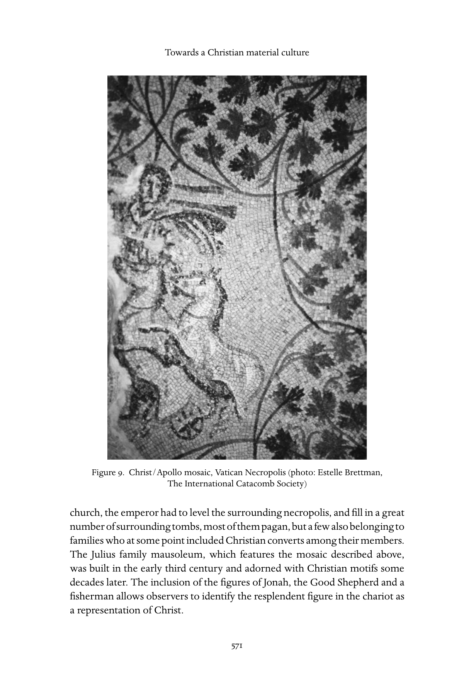

*图9　基督／阿波罗马赛克，梵蒂冈墓地。摄影：Estelle Brettman，The International Catacomb Society。原书第571页。*

根据这一整套图像安排，观看者可以推断：墓室的装饰旨在传达基督徒对复活的盼望。不过，把索尔穿行于狄俄尼索斯式葡萄藤间的形像用于这个目的，也可能使人质疑，埋葬于此的人究竟抱持怎样的基督教信念，或是否把自己神明的身份弄混了。然而，与其把它当作宗教混融的例子，倒不如认为，它说明罗马基督徒选择以既有、熟悉的象征语汇表达信仰。因此，我们看到的是一种熟悉类型经过改用、获得新的基督教意义，而非信仰的混乱或摇摆。战车人物的身份，因而不是关键。追问他到底是基督、阿波罗，还是某种混合人物，是误解了艺术表达通常如何发挥作用。这大概与其说是某位神的肖像，不如说是在表现一种观念：神明超越黑暗与死亡。在这个语境中，基督的作为借索尔或阿波罗的传统象征来表达；墓穴中其余的整套图像，既支持又充实了这一表达。

文学中也会用熟悉的形像或隐喻传达新意义。例如，亚历山大里亚的克莱孟在约190至200年劝说异教徒归信时，借赫利俄斯的形像比喻复活、遍及宇宙的基督：“向你致敬，光啊！……那光就是永生，凡分享它的都活着。然而，黑夜向光致敬，因惧怕而退缩，让位于主的白昼。万有化为不眠的光，日落变成了日出。”克莱孟此前已经引用《以弗所书》5:14，措辞仿佛在描述太阳神：“睡着的人啊，醒来，从死人中起来，基督就要光照你。复活的太阳，那在黎明以前诞生、以光芒照耀的一位，将赐给你生命。”[^ch32-8] 在这两处，生动的诗性语言大胆借用了光辉太阳神的形像：他从黎明到黄昏驾车驰过天空，用来象征基督徒上帝超越的力量与美。克莱孟用听众能够理解的语言向他们讲话。

传统罗马装饰艺术中的葡萄藤与收获葡萄题材，也出现在早期基督教文学中。装饰华美、果实累累的藤蔓，由小童（putti）或有翼小天使采摘；它们可以只是象征繁荣丰盛的悦目图案，也可以指向巴克斯／狄俄尼索斯崇拜。这位葡萄藤之神战胜了死亡，其崇拜给信徒许诺某种有福的来世。同时，葡萄藤与收获也可以成为基督教象征，因为耶稣称自己为真葡萄树（《约翰福音》15:1–5），而圣餐礼中盛在杯里的发酵葡萄汁，象征他的血。因此，葡萄收获既可以表达异教的宗教期盼，也可以表达基督教的期盼，或同时表达两者。例如，一位基督教作者如此描述这类场景，用以表达在圣餐中与基督神秘联合，以及基督神圣的临在：

> 属灵的葡萄树是救主，嫩枝与枝条是他的圣徒，葡萄串是他的殉道者，与葡萄树相连的树木显明受难；采葡萄的是天使，盛满葡萄的筐是使徒，压酒池是教会，酒是圣灵的能力。[^ch32-9]

这些以及其他在视觉和文学中运用熟悉象征的例子表明：这些象征保留原有意涵的同时，也被赋予了新意义。基督徒借广为人知、在自身文化环境中普遍可懂的形式表达信仰，而这些形式对他们又具有特殊意义；这是解释和传播其宗教的一种实际而自然的方法。所选形像足够复杂，能够承载多重意义；也足够灵活，能够跨越宗教与世俗的界线。因此，把这类“借用”看作宗教混融、信仰混乱、暗中信奉异教或宗教态度暧昧的证据，是误解了图像的力量及其可塑性。当这个新宗教已为人充分理解，并真正在所处环境中扎根以后，新的视觉形像才出现，用来表达其核心教导、价值及群体身份。

这些新形式的出现，逐渐排挤了旧形式；这一模式与教会由受迫害的少数群体，转为获得帝国支持、拥有权势的多数群体相呼应。转变需要时间，但轨迹清楚可辨：最初改用传统希腊—罗马题材，到三世纪教会增长期间，创造新的基督教图像。最终，在拜占庭早期，基督徒身份与罗马身份的第二阶段融合，产生了高度发展的图像体系，反映了这种结合，也反映了基督教凌驾于昔日竞争者之上的地位。

不过，把传统形式用于新的宗教目的，也引出一个问题：在文化上，基督徒与非基督徒邻人究竟有多大差别？他们独特的信仰和实践，如何在不同时间与空间表现出来，又如何因社会地位或经济保障的差异而不同？必须结合具体处境与群体，理解基督教与其发生环境之间的互动和适应。随着考察的时间、地点不同，我们看到基督徒经历零星迫害，与相对和平的时期交替出现。两种情形都深刻影响文化融入的过程，直到基督教终于从罗马文化的边缘移到中心。因此，一种可辨识的基督教物质文化，虽远非稳定一致地演进，却终究形成了。

## 基督教视觉文化的出现

<!-- 原书第574–576页；PDF第623–625页 -->

大多数历史学家同意：在现存可辨认为基督教艺术与建筑的遗存中，很少能断代于三世纪初以前。早先的学术研究有时认为，基督教艺术之所以“姗姗来迟”，是因为基督徒起初抗拒视觉艺术，或抗拒专为敬拜建造场所。较近的研究则指出，异教器物与基督教器物、世俗住宅建筑与家庭教会之间，往往难以区别，并强调上述从改用到创新的渐进过程。[^ch32-10] 学者已不再坚持，早期基督徒一概反对具象艺术或教堂建筑，因此没有这些东西。相反，最初两个世纪器物的缺失，部分可能只是辨识上的问题，也可能源于保存条件的变迁。最早能够断代的一些器物与图像，大概因安置于地下墓葬，或被后来的建筑覆盖而幸存；大量其他遗物则因城市重建、战争或风雨摧残，甚至历史上各时期的毁像攻击而消失。

现存遗物的出处和环境都相当有限。绝大多数基督教器物来自丧葬场所，尤其是罗马地下墓窟。值得注意的例外，包括陶灯、戒指、玻璃器皿或餐具；其上以模制、刻划或印压方式饰有基督教题材，年代最早可到二世纪末或三世纪初。亚历山大里亚的克莱孟甚至列出印戒上适用的图案：鸽子、鱼、船或锚；但禁止刀剑、酒杯和情人的肖像。[^ch32-11] 虽然这类物件许多出土于墓葬，其明显的大量生产和广泛分布，仍可能表明它们曾供日常使用。

与丧葬艺术或简朴私人用品处于另一端的，是在叙利亚东部杜拉欧罗波斯发现的三世纪中叶基督教家庭教会。其中一间用于洗礼的房间，装饰十分丰富（参上文图6，原书第414页）。罗马之外，也有君士坦丁以前建造教堂的其他证据。迦百农一座五世纪八角形教堂，建在既有住宅之上；人们认为，那座住宅是位于圣彼得家中的早期家庭教会。阿奎莱亚（Aquileia）一组双教堂建筑，包含一间可能断代于主教狄奥多尔任期（308–319）的祈祷室。文献还提到，罗马帝国不同地区存在基督教堂、书籍与陈设，进一步证明三世纪中后期基督徒群体不断增长，已具备一定的安全、财富和持续性，从简朴的家庭聚会转向在宏伟建筑中容纳较大人群。例如，波菲利抱怨说：“基督徒模仿神庙的建造，兴建宏大建筑，在其中集会祷告；其实没有什么妨碍他们在自己家里这样做。”[^ch32-12]

不过，最为丰富的早期可辨识基督教遗存，仍是罗马地下墓窟的绘画。其中最古老的，位于古阿庇亚道旁的卡利斯图斯地下墓窟；这处早期基督徒墓地，年代可断为三世纪最初十年。罗马其他早期基督教地下墓窟，包括塞巴斯蒂安、多米提拉和普里西拉墓窟；它们都提供了早期基督教文化的物质证据。这些墓窟中有小型家族墓室（cubicula），墙壁和天花板绘有图画，往往以线条和装饰边框划分成不同区块及层带。此外，还有用于封闭廊道墙壁上横向墓穴（loculi）的雕刻石板，少量罕见的马赛克，以及相当数量的雕刻石棺。除壁画与浮雕之外，还有一组数量虽少却很重要的圆雕。这些物件之所以被辨认为出自基督徒环境，或是因为内容，或是因为它们在更大的一套基督教图像中的位置。不过，并非所有题材都为基督教独有；其风格与技法，也与邻近异教墓葬的绘画及更普遍的室内装饰十分接近。[^ch32-13]

罗马地下墓窟的艺术，显然是为私人家族墓室制作，而非用于公共空间。因此，它们未必代表“正式”教会会允许、乃至委托制作怎样的会众聚会场所装饰。既然这一时期幸存的教堂壁画，只有杜拉欧罗波斯家庭教会洗礼室中的绘画，任何结论都至多只能暂定。不过，杜拉不大可能是独一无二的；罗马墓窟的壁画也说明，教会官员大概允许甚至鼓励具象绘画，至少在丧葬场所如此。卡利斯图斯地下墓窟的名称，就为这种认可提供了证据：它据说以首任管理者命名，而此人后来成为罗马主教（217–222）。此外，墓窟本身还包括其后三世纪数位教宗的墓。

不久，群体中的英雄、主教与殉道者之墓，就成为朝圣目的地，因而需要特定标志或构筑物，用来标明圣徒的纪念祠。前述梵蒂冈圣彼得纪念祠就是一例。依传统，自三世纪初起，彼得之墓便以一座带小柱的建筑构件标示；其中留有开口，使访客能够接近墓穴本身。其他墓地的殉道者之墓，也有类似标记；后来，其上又建起更大建筑，为朝圣者提供遮蔽和座位。他们常在纪念祠旁举行追思餐宴。这些餐宴延续了传统异教习俗，即在亡故家人的墓旁举行葬祭宴饮。因此，墓地设有长凳与小桌（mensae），可供向死者浇奠酒或放置食物供品。四世纪，这些建筑扩大，终于转为朝圣教堂，圣餐桌安置在圣徒墓上，由此延续与受尊崇死者共同进餐的古老实践。

## 文化语境与转变中的早期基督教图像

<!-- 原书第576–581页；PDF第625–630页 -->

这些地下墓穴的墙画或墓板刻画中，最早能够断代的题材，通常是取自传统罗马装饰艺术、具有装饰性或宗教意义含混的图像，如花卉、水果、鸟、葡萄藤和花环；也有某些可被赋予特定基督教意义的形像，如鱼或渔夫、鸽子、船、锚和牧人。其中许多形像，若抽离原处、挂在博物馆墙上，便无法与异教作品区别。不过，它们在更大艺术布局中的位置，以及配合刻写的墓志，有助于辨认其基督教性质，及其所传递的特定基督教信息。例如，卡利斯图斯地下墓窟中的鱼，与一篮饼和一小瓶酒一起出现，大概指向圣餐礼（参上文图3，原书第144页）。

如上所述，其中许多是罗马宗教及世俗图像中的标准题材。例如，牧人形像使人想到基督教与犹太教经书对这一隐喻的多次使用，如《约翰福音》10:11的“我是好牧人”；它可能改自罗马艺术中肩扛公羊的赫尔墨斯。赫尔墨斯为诸神与人类传递消息，也在冥界充当亡灵的引路者（psychopompos），因此适合出现在丧葬场所。其基督教版本常难与非基督教版本区别，尤其当物件出处不明时；小型牧人雕像往往就是如此。同样，俄耳甫斯的形像也经过改用，用以传达基督作为的性质。俄耳甫斯驯服野兽，拯救死者欧律狄刻；他被转化为基督：驯服人的情欲，并从死亡中施行拯救。[^ch32-14]

多米提拉地下墓窟中，基督作为教师、与学生在一起的图像（参上文图7，原书第484页），与苏格拉底等哲学家的表现形式有众所周知的相似之处。基督教与异教丧葬图像共有的其他题材，还包括葬祭宴饮——五人或七人坐在半圆形桌旁——以及坐着读卷轴的男子，和蒙面纱、双手向外向上伸展祈祷的女子（orant）。读书者与祈祷者，分别表达传统罗马人的智慧与虔敬之德，也可能意在表现死者的习惯或品格。不过，对基督教委托人或观者而言，祈祷者还可以代表等待复活的基督徒灵魂；教师或坐着的读书者，则可以暗示基督教教导才是真正的哲学。[^ch32-15]

著名的萨拉里亚道石棺，说明在早期，辨别一件物品究竟属于基督教还是异教有多么困难。这具大理石巨棺断代于三世纪末，通常被视为早期基督教浮雕的实例。两端各有硕大的公羊头，中间一条图像浮雕带具有宗教意味，却没有明显的基督教特征。中央站着一位肩扛公羊的牧人；他左边坐着一名读卷轴的男子，右边坐着一名持卷起卷轴的女子。男女各有同伴，其中一人作祈祷姿态。这类宗教归属含混的图像，可能出自工匠作坊：作坊提供的题材目录有限，而顾客既有异教徒，也有基督徒。

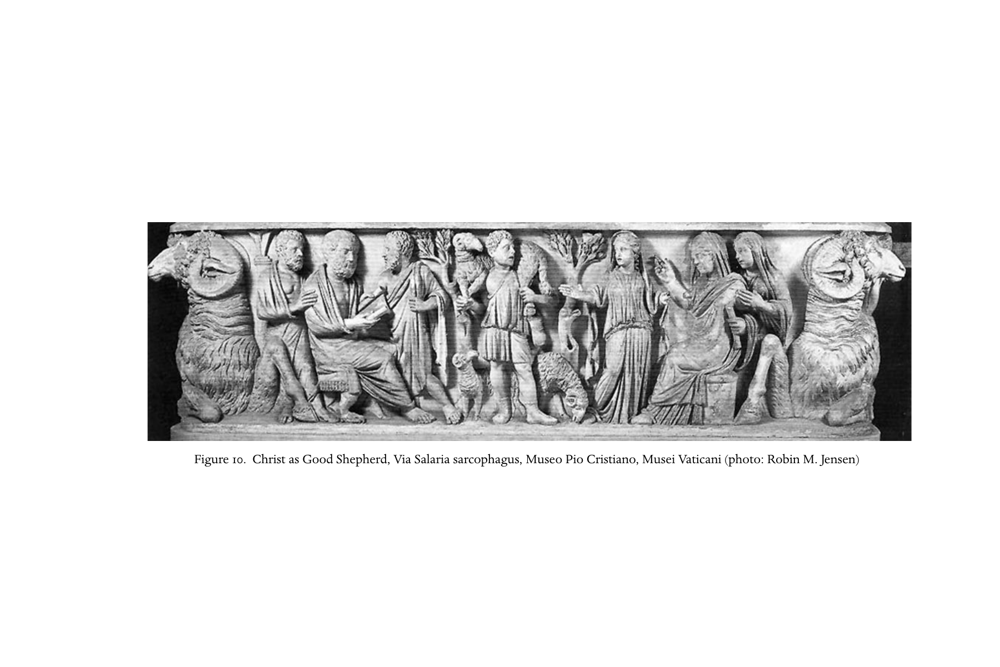

*图10　好牧人基督，萨拉里亚道石棺。藏于梵蒂冈博物馆庇护基督教博物馆（Museo Pio Cristiano, Musei Vaticani）。摄影：Robin M. Jensen。原书第578页。*

然而，到三世纪中叶，这些较为通用的图像旁，已加入许多取材于基督教《旧约》和《新约》的叙事场景。有些故事远比其他故事常见。最初，无论壁画还是浮雕，《旧约》人物都比《新约》场景多。其中包括亚当与夏娃、亚伯拉罕与以撒、挪亚、摩西、但以理、火窑中的三个青年，以及最受欢迎的约拿。有些场景似乎没有明确的基督教以前的原型，因而可能是全新创造；另一些则明显受到特定异教范型的影响。例如，但以理几乎总被画成裸体，如同赫拉克勒斯或墨勒阿格洛斯等古典英雄。在耶稣变水为酒等神迹故事的图像中，他手持一根杖；这是当时广为人知的术士标志。[^ch32-16]

约拿图像提供了另一个借用并改造古典原型的例子。裸体斜倚在蓖麻藤下的约拿，其姿势与异教石棺上的神话人物恩底弥翁完全相同。恩底弥翁被诅咒——或蒙福，取决于你的看法——永葆青春却长眠不醒；月神塞勒涅每晚探望他，并为他生下五十个女儿。当约拿以同样姿势出现时，象征的是永恒而幸福安息的盼望，而不是暗示他的违命或受辱（参图11，原书第580页）。不过，这个故事也使人想到“约拿的神迹”，作为基督死亡与复活的预表（《马太福音》12:39–40），因而其图像可能具有救恩论意义。此外，约拿的裸体、沉入水中及从海兽腹中重新出现，也可能暗指基督教洗礼，从而使象征具有圣礼层面。

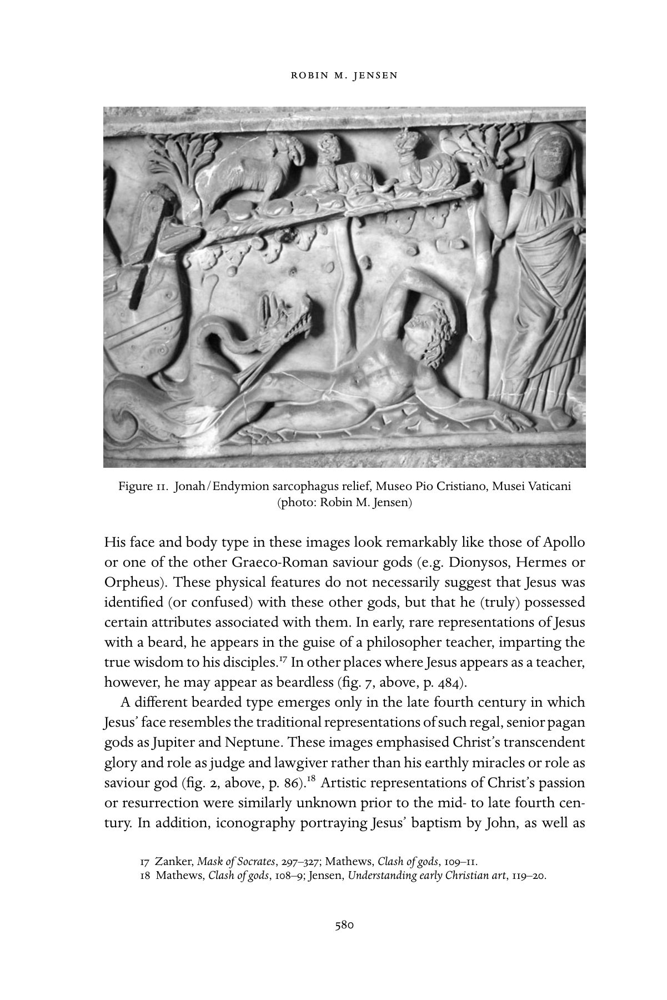

*图11　约拿／恩底弥翁石棺浮雕。藏于梵蒂冈博物馆庇护基督教博物馆（Museo Pio Cristiano, Musei Vaticani）。摄影：Robin M. Jensen。原书第580页。*

耶稣出现在治病或行神迹的场景中时，除了持杖，通常还是俊美无须的青年。这些图像中的面容和体形，与阿波罗或其他希腊—罗马救主神，如狄俄尼索斯、赫尔墨斯或俄耳甫斯，十分相似。这些身体特征并不必然意味着人们把耶稣等同于、或混同于其他诸神，而是说，他确实拥有与那些神相联系的某些属性。在早期罕见的有须耶稣图像中，他以哲学教师的形貌出现，向门徒传授真正的智慧。[^ch32-17] 不过，在其他以教师身份出现的场景中，耶稣也可能无须（参上文图7，原书第484页）。

另一种有须形像直到四世纪末才出现：耶稣的面容类似朱庇特、尼普顿等具有王者风范、年长的异教大神的传统形像。这些图像强调基督超越的荣耀，以及审判者、立法者的身份，重心不在他尘世的神迹或救主神的角色（参上文图2，原书第86页）。[^ch32-18] 同样，在四世纪中后期以前，也没有已知表现基督受难或复活的艺术作品。此外，耶稣受约翰施洗、博士来拜等图像，比耶稣尘世生活的其他场景明显更早出现；后者包括后来基督教艺术中较为常见的最后晚餐或登山变像。随着受难场景与登宝座的基督出现，还产生了其他新图像类型；如今，这些通常被认为与基督教皇帝的图像相联系。例如，一座空十字架，上方是花环中的基督字母组合chi-rho（参下文图13，原书第587页）。与这种图像转变相伴，最早的题材，包括牧人和约拿，逐渐消失。

审判、受难、得胜和登宝座的基督等新图像，都排除了对实际钉十字架场面的表现。这与该时期基督教文学广泛讨论基督受难的情况形成鲜明对照。事实上，除了少数例外，钉十字架的图像都不能断代到五世纪初以前，直到六世纪乃至七世纪仍极为罕见。为解释这种明显的缺席，人们提出过不同理论：早期基督徒淡化耶稣之死；这一场面太过骇人，不宜表现；或信仰的核心奥秘应向未入教者隐蔽。[^ch32-19] 然而，任何一种理论单独来看，都不足以解释钉十字架图像的缺失；尤其考虑到，受难故事的其他场景确实存在，而它们既未淡化，也未掩饰耶稣的死法。此外，暴力死亡或献祭性死亡的图像，在异教世界广为人知，也可能提供可用的范型。[^ch32-20] 无论最初缺席的原因是什么，钉十字架图像最终出现之际，也正是四世纪及以后前往圣地朝圣日益流行、十字架圣物广泛传播的时期。[^ch32-21]

## 建筑的文化融入：从家庭教会到巴西利卡

<!-- 原书第581–585页；PDF第630–634页 -->

虽然保罗断言，基督徒的上帝没有人手建造的殿宇，早期基督徒仍需要共同祷告、进餐的聚会空间。最初，他们似乎既继续一同前往圣殿，也在家中聚餐，或许还祷告、学习（比较《使徒行传》2:46、5:42及20:7–9）。在这个意义上，他们类似另一个犹太群体，即法利赛人。[^ch32-22] 这些活动并不需要特殊建筑。群体中有住宅的成员，便在家中对外接待的房间主持聚会，可能用会客厅、餐室，或两者兼用（比较《罗马书》16:5；《哥林多前书》16:19；《歌罗西书》4:15；《腓利门书》2）。[^ch32-23] 随着群体扩大，房屋可以改建，甚至在原址重建，以容纳更多人或举行更正式的集会。迦百农建在彼得家中的教堂，就是这样的地方。不过在最初，保罗和其他使徒也在会堂教导；当这样做越来越困难，他们便寻找其他适用空间，如当地的讲学厅（比较《使徒行传》9:20、13:5、14–43；19:8–9）。对罗马圣克莱孟教堂及圣若望保禄教堂的考察表明，其他可供使用、具有实际功能的建筑，也可能被利用和改造，如公寓楼（insulae）中的房间、旧店铺或仓库。[^ch32-24] 这些空间虽没有足以辨认为基督徒聚会场所的特征，却不是藏匿处。到三世纪末，其中有些在规模和设计上可能已颇为可观，罗马当局也很清楚其所在，能够予以没收或摧毁。[^ch32-25]

《新约》中提到的那类会堂，是群体成员共同诵读、研习经书的地方，大概并不用于祷告。会堂似乎兴起于散居地区，是圣殿以外的另一种选择；圣殿于公元70年被毁以后，它们开始成为犹太宗教与社会生活的中心。不过，即使在二世纪，会堂大概仍相当简朴，和早期基督徒场所一样，常从改建住宅开始。因此，会堂建筑的发展，与基督教堂建筑大致平行，并非后者的范本。[^ch32-26] 然而，到三世纪中叶，罗马帝国各地都可见会堂，有些相当宏大。杜拉欧罗波斯的会堂，由住宅于三世纪中叶改建，其主厅约14米乘9米，饰以精美壁画，西墙设有妥拉龛。当地的基督教家庭教会（上文图6，原书此处标为第144页），规模与之相当，也很可能由同一批工匠装饰。[^ch32-27]

一种特有基督教建筑的逐渐发展，与独特基督教图像题材的发展平行。前者出现相对较慢，无疑部分是因经济或社会资源不足。建造或改建房屋，比制作小型艺术品需要更多财力；还需要土地，以及大量不同种类的熟练劳动力。一座教堂的建立，更不用说改建，也预设了某种程度的公共接纳，即使房屋属于私人、由私人维护亦然。

与此同时，早期基督徒似乎有意避免使用类似典型异教神庙或祠堂的敬拜空间；这与他们借用异教图像题材的做法不同。当他们开始新建房屋时，刻意采用源自周围世俗文化、而非宗教文化的特定设计。除了希望将自己的敬拜与传统诸神的崇拜及其所认定的偶像崇拜区别开来，基督徒还会发现，典型神庙建筑对他们的集会方式及发展中的礼仪并不实用。罗马神庙的基本设计服务于公共仪式，而这些仪式主要在户外举行。神庙往往坐落在城市主要广场，仪式包括公开行列和露天献祭。虽然此类建筑是城市景观的重要部分，却并非用来容纳大规模集会。异教神庙的内殿（cella）不是共同敬拜的地方，而是安放祭祀神像的小室。相反，早期基督徒群体由自愿加入、经过入教仪式的成员组成，定期集会，仪式须避开公众视线。

不过，仅从这些需要看，基督徒的聚会场所本来也可能类似其他自愿社团，包括古代晚期流行的俱乐部、丧葬社团（collegia）和秘仪崇拜。这些群体和早期基督徒一样，举行仅限成员的聚会，共同进餐，执行各种仪式。其活动具有秘密性，因此需要室内私人空间。密特拉神的信徒便是这样一个群体。他们人数不多，在没有窗户的小房间聚会；两条长墙边设长凳，供进餐时躺卧。和基督徒、犹太人一样，他们的聚会场所——密特拉祠（mithraea）——也常由住宅改建。杜拉欧罗波斯的密特拉祠，最初只占一个房间，最后扩展到整栋房屋。[^ch32-28]

然而，到三世纪中叶，基督徒群体会觉得这类空间太小、限制太多。基督徒倾向于在一个城市地区组成较大的单一群体，而不是分成地方性、封闭的小群体聚会。群体由主教领导，并有其他教会职务人员协助，包括长老与执事。向寡妇、孤儿等群体提供物质及经济援助，需要存放食物衣物的库房。礼仪使用特殊家具、书籍和仪式用具，不用时必须妥善保管。屏障、台阶或高台，为教士与平信徒划分不同空间。最后，随着基督教洗礼从自然环境中的户外活动，变成室内的秘密仪式，它需要专用房间，并配备足以浸没身体的洗礼池。[^ch32-29] 杜拉欧罗波斯的基督教家庭教会，为早期洗礼室提供了绝佳实例；房间一端有大型水池（参上文图6，原书第414页）。

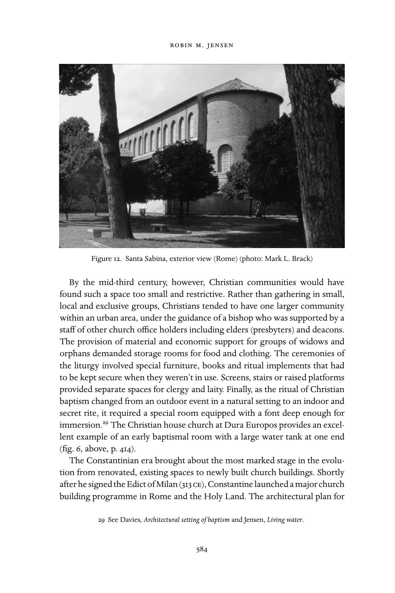

*图12　圣撒比纳教堂外观，罗马。摄影：Mark L. Brack。原书第584页。*

从改用既有空间转向新建教堂的演变中，君士坦丁时代带来了最显著的阶段。签署《米兰敕令》（313）不久，君士坦丁就在罗马和圣地展开大规模教堂建造计划。这些最初教堂的平面，以巴西利卡的设计为基础。巴西利卡原为市政或世俗建筑，内部空间宏大，适合举行隆重仪式。君士坦丁在罗马建造的第一座教堂，是位于其妻所有土地上的拉特朗大殿。原址一座宫殿成为罗马主教的住所；新建教堂有长76米、分为五个纵向空间的堂身，尽头西侧有大型半圆后殿。后殿围合的圣所中，设有主教座，两侧为长老设置半圆形长凳。内部装饰富丽堂皇，包括银像、金祭坛和闪亮的马赛克，还有两排绿色大理石内柱，配以宏伟柱头。[^ch32-30] 这类建筑象征着基督教开始转变：它原是一个少数群体，利用手边可得的事物，以熟悉的语言表达自己；如今则成为人口中强大、富裕、占主导的一部分，能够决定用什么形式、什么风格表达自身文化身份。巴西利卡设计的宏大规模及潜在的庄严气势，很适合日益复杂的礼仪；同时，它反映教会社会政治地位的改变，成为教会新的自我理解与文化融入的一种明确、纪念碑式的象征。虽然今天的拉特朗大殿已不复原貌，罗马五世纪的圣撒比纳教堂经过保存、修复，仍显示这种传统巴西利卡形式（参上文图12，原书第584页）。凯撒利亚的优西比乌亲历了从迫害时期到“教会的和平”的转变。[^ch32-31] 他用下面的话概括这场剧变：当人们看见，荒凉与破坏之地，已建起新的“殿宇，从地基上升至极高，比被毁的那些更加壮丽”时，心中充满“无法言喻的喜悦”。[^ch32-32]

## 译校说明

本章保留作者对早期图像含义、建筑用途及断代的推测语气，不把图像形式相似直接译为信仰相同。原书第582页把杜拉欧罗波斯家庭教会图6的页码写为144；实际图6见原书第414页，已在正文注明此处为原书标页。原书关于早期会堂“大概不用于祷告”、君士坦丁“签署《米兰敕令》”等表述，均依作者原说译出。

## 注释

[^ch32-1]: Justin, 1 Apol. 6；13；25；Tert. Apol. 10；Athenagoras, Leg. 4；M. Polyc. 9；Arnobius, Adv. nat. 1.29；3.28；5.30。

[^ch32-2]: Min. Fel. Oct. 8.4.

[^ch32-3]: Min. Fel. Oct. 18–24.

[^ch32-4]: Tert. Idol.，全篇。

[^ch32-5]: 例如参Cic. N.D. 1.36.101–2；引于Balch, ‘Areopagus speech’, 59–79。

[^ch32-6]: Min. Fel. Oct. 18–19；Justin, 1 Apol. 20；Clem. Al. Protr. 6。

[^ch32-7]: Or. C. Cels. 4.31；比较Clem. Al. Protr. 4。

[^ch32-8]: Clem. Al. Protr. 11及9；译文出自本章作者。

[^ch32-9]: Hipp. Ben. Is. Iac. 25；译文出自本章作者。

[^ch32-10]: Breckenridge, ‘Reception of art’, 361–9；Grigg, ‘Aniconic worship’, 428–9；Murray, ‘Art and the early church’, 304–45。

[^ch32-11]: Clem. Al. Paed. 11；比较Tert. Pud. 7.1–4；10f（关于牧人图案的杯）。

[^ch32-12]: Porph. Christ. frag. 76；译文据White, Social origins of Christian architecture，第II卷，104；比较Euseb. HE 8.1–2。

[^ch32-13]: 关于地下墓窟及其图像，参Snyder, Ante pacem；Nicolai et al., Christian catacombs of Rome；Finney, Invisible God；Mancinelli, Catacombs of Rome；Stevenson, Catacombs；Hertling and Kirschbaum, Roman catacombs。

[^ch32-14]: Murray, Rebirth and afterlife, 37–63.

[^ch32-15]: 参上文第五部分第27章。

[^ch32-16]: Mathews, Clash of gods, 54–91.

[^ch32-17]: Zanker, Mask of Socrates, 297–327；Mathews, Clash of gods, 109–11。

[^ch32-18]: Mathews, Clash of gods, 108–9；Jensen, Understanding early Christian art, 119–20。

[^ch32-19]: Grabar, Christian iconography, 132；Milburn, Early Christian art, 109；van der Meer, Early Christian art, 120–2；Jensen, Understanding early Christian art, 133–7。

[^ch32-20]: Balch, ‘Suffering of Isis/Io’, 25–42.

[^ch32-21]: Jensen, Understanding early Christian art, 150–1.

[^ch32-22]: White, Social origins of Christian architecture，第I卷，103。

[^ch32-23]: Osiek and Balch, Families in the New Testament world, 193–212；Snyder, Ante pacem, 128–36。

[^ch32-24]: Krautheimer, Early Christian and Byzantine architecture, 28–30.

[^ch32-25]: M. Saturn. 2；Euseb. HE 8.2。

[^ch32-26]: Rutgers, ‘Diaspora synagogues’, 92–5。另参上文第一部分第2章；Levine, Ancient synagogues revealed。

[^ch32-27]: Jensen, ‘Dura Europos synagogue’, 184–7.

[^ch32-28]: White, Social origins of Christian architecture，第I卷，47–59；Snyder, Ante pacem, 140–52。

[^ch32-29]: 参Davies, Architectural setting of baptism及Jensen, Living water。

[^ch32-30]: Liber pontificalis 1.181.

[^ch32-31]: 参上文第30章。

[^ch32-32]: Euseb. HE 10.2.


---

<a id="conclusion"></a>

# 结语：回顾与展望

《剑桥基督教史》第一卷《起源至君士坦丁》中文译稿

> 原书第586–589页，PDF第635–638页。正文及5条脚注完整翻译。图13保留原图并附中文图注。
>
> [结语英文原文](<结语（英文）.md>) · [原书PDF](<../01 起源至君士坦丁.pdf>)

<!-- 原书第586–588页；PDF第635–637页 -->

凯撒利亚的优西比乌可以不断修订《教会史》，更新结尾，借此纳入后来的事件；我们却必须为第一卷作出明确的收束。和优西比乌一样，我们以君士坦丁为界；不过，凭借历史的后见之明，我们知道，在他之后还有一段漫长而曲折的基督教故事。我们乐于将那一度难以想象、尚待展开的历史，留给后面八卷去勾勒、分析：欧洲、拉丁美洲、非洲、中国，中世纪西方、拜占庭东方，文艺复兴、宗教改革、现代性，乃至后现代性。然而，就为基督宗教提供充分历史叙述这一工作而言，本卷把我们带到了哪里？我们能否从橡实中，看出橡树主干与众多枝条的轮廓？历代基督教会在讲述自己的历史时，或声称与“基督教起源”保持有机延续，或力求彻底回归一种被认为遭到背弃的起源。然而，自始至终，创造力，以及适应各种文化经验的过程，都与保守本能相互竞争。因此，人们完全可能追问：古代基督教真能被看作后来历史的真正基础吗？

到本卷所述时期结束时，一系列起初颇为模糊、未定型的可能性，已经形成大体连贯的形态；在这个意义上，或许可以作肯定回答。本卷各篇文章记述了：在最初三个世纪的不同地方，基督徒如何建立种种结构与话语形式，把早期传教群体转变为遍布地中海盆地及其以外地区、能够代代相传的宗教运动。他们发展出文本、仪式、生活方式、制度、律法、教育与社会化形式，以及各种历史性自我理解；这些从此构成这一运动的标志。虽然语言、神学与仪式实践的细节各不相同，对耶稣这一人物的敬奉——尽管理解方式不同——始终是早期各种崇拜形态的中心。生命、死亡、复活、神圣恩赐与神圣故事的象征，为持续的批判性、神秘性和神学反思，提供了长久而富有活力的源泉。到君士坦丁时代，基督教“福音”虽远非帝国普遍信奉的宗教，却已确立一种文化体系的要素；这个体系在吸收希腊—罗马世界文化资源的同时，也将改变这些资源。[^conclusion-1] 不过，这种统一感本身，是通过最终排除诺斯替派、摩尼教徒等群体才获得并维系的。教会与帝国的强大联盟将进一步强化这一过程，并越来越多地界定何谓正统。

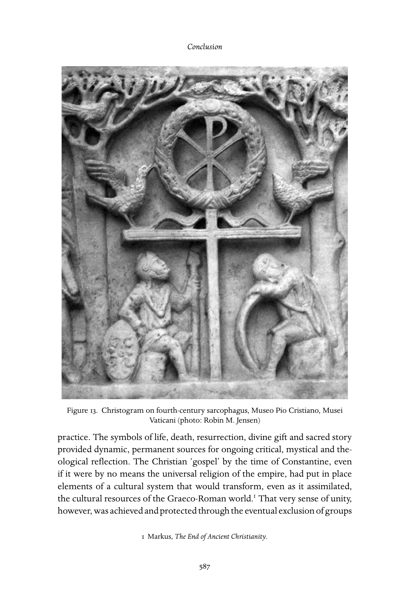

*图13　四世纪石棺上的基督字母组合。藏于梵蒂冈博物馆庇护基督教博物馆（Museo Pio Cristiano, Musei Vaticani）。摄影：Robin M. Jensen。原书第587页。*

古代基督教确实留给所有后继者的，是一组张力或问题；在此后的千余年间，它们将不断占据每一代耶稣追随者的心思。

**统一与多样。** 最早时期表明：虽然拿撒勒的耶稣提供了一个凝聚点——对他的理解本身却多种多样！——基督徒自一开始，就不断试探多样与一致、接纳与排斥的界限。旧有模式把最早时期看作必然走向一种获承认“正统”的演化过程；如今，研究则日益注意那些自认为是“基督徒”的各色人物，他们表达信仰，以及在仪式和伦理中实践信仰的方式，都很不相同。这些群体并非各行其道，大多相互交涉，展开辩论和争执。最早的基督教既产生了保罗《哥林多前书》[^conclusion-2]和居普良De unitate ecclesiae（《论教会的统一》）那样雄辩的合一呼吁，也在实践中一再违背这种和谐愿景。这样的统一，以什么条件为可接受？多样性的界限何在？这些问题过去从未、未来也永远不会远离人们的视野。

**界定与未定。** 从一开始，基督徒就从事解释工作：这位耶稣是谁？他与以色列上帝的应许有何关系？不同的宗教知识形式相互竞争：一方面是古老神圣文本中传承下来的“智慧”，另一方面是当代神圣奥秘启示所带来的“新”经验。“要试验诸灵”的训令（《约翰一书》4:1），要求这两种认识、谈论上帝的方式相交汇，也概括了基督教作为群体宗教而非仅为个人宗教的一项充满张力的任务：在各种关于宗教真理的主张之间作出判断。这些主张不可能全都正确，却也并非全能清楚证实或否定。正如阿维丽尔·卡梅伦有力指出的，早在起初，方向就已经确定：“基督教将成为一个关乎表达与解释的问题。”[^conclusion-3] 不过，基督教宗教诗学的典型形式，是力求同时维持两极张力的悖论：上帝的超越与内在，已经获得救赎的确信与对未来盼望的需要，乃至宗教语言本身在表达真理时的充分与不充分。

<!-- 原书第589页；PDF第638页 -->

**教会与世界。** 我们所认识的早期基督教话语，既关乎此世，也关乎超越此世。使徒保罗说“这世界的样子将要过去”，同时却建立教会，谈论“立下根基”（《哥林多前书》7:31；3:10–11）。有人认为，是君士坦丁“出卖”教会，把一个反主流文化的教会变为获得政治特权的既成体制。[^conclusion-4] 然而，基督徒与社会秩序的关系，从一开始就复杂得多，而且彼此影响。此后仍将如此：有人离开城市，逃往沙漠；[^conclusion-5] 有人则在城市中找到适合基督徒生活与使命的家园。活在此世与盼望来世之间的张力，在每一时代的基督徒身上重新体现，总受当时政治处境和事件影响；一些关键人物又会重新激发这种张力。例如，当末世热情似乎消退时，孟他努派这样的人，会为自己的时代重新点燃它。对这种立场的反应总是褒贬不一：有人称赞他们是真正忠信者，也有人指斥他们是极端异端。

**开始与终结、旧与新。** 最早的基督徒努力为自己的信仰辩护，宣称它既极其古老，植根于以色列先知，也是在近世出现、具有宇宙意义的神圣启示新事。基督徒的自我身份，既根植于从犹太人那里承接的经书，当时如此，此后也始终将在与犹太人、犹太教的关系中得到界定。虽然其中的界线不断改变，令人悲痛的是，古代护教论战中谩骂攻击的方式，却在迥异的历史时代一再重演。在古代及以后，自我界定的工作始终涉及对起源的建构，以及声称自己对起源具有独一或特殊的忠诚。从这个意义上说，本卷与后续各卷的关系是可变的。我们力求在这里提供复杂的分析框架，是综合学术研究，对古代事件和发展作出的重建。然而，在基督教历史中，各时各地的基督徒群体，都已在文本与生活中书写这段叙事。古代基督教提供了原材料：彼得与保罗，耶路撒冷与罗马，亚历山大里亚与安提阿，殉道者与修士，主教与先知。未来每一代人，都将以多种方式，在自我画像的马赛克中重新安排、重新塑造这些材料。

## 注释

[^conclusion-1]: Markus, The End of Ancient Christianity.

[^conclusion-2]: 或后来保罗学派作者所写的《以弗所书》。

[^conclusion-3]: Cameron, Christianity and the rhetoric of empire, 13–14.

[^conclusion-4]: Crossan, Jesus: a revolutionary biography, 201：“如今是否该在宗教与神学、伦理与道德方面，对君士坦丁作一些基本的成本核算？还是已经太晚？”

[^conclusion-5]: Brown, Body and society.


---

<a id="bibliography"></a>

# 参考文献

> 原书第590–682页，PDF第639–731页。依既定约定，完整保留作者名、文献题名、刊名、版本及页码；书目说明、分类标题和各章章目译为中文。条目沿原书次序和行序排列，原书页码保留于注释。

<a id="pdf-639"></a>
<!-- PDF page 639; original page 590 -->

## 参考文献

### 引用文献总目

#### 原始文献

以下列出本卷各作者引用的资料、文本与版本，并非穷尽性的参考书目。更完整的目录，请参F. Young、L. Ayres、A. Louth（编），Cambridge history of early Christian literature（Cambridge: Cambridge University Press, 2004），以及S. Döpp、W. Geerlings（编），Dictionary of early Christian literature，M. O’Connell译（New York: Crossroad, 2000）。

丛书与期刊的缩略语，参原书第xxxvii–xliv页缩写表。

##### A. 非文学资料：铭文与纸草

The Amherst papyri, 2 vols., B. P. Grenfell and A. S. Hunt (eds.) (London: Oxford University  

Press, 1977, original 1900–1).  

Betz, H. D. (ed.). The Greek magical papyri in translation, 2nd ed. (Chicago: University of  

Chicago Press, 1992).  

Corpus inscriptionum Iudaicarum, 2 vols., J. Frey (ed.), Sussidi allo Studio delle Antichità  

Cristiane (Vatican City: Pontificio istituto di archeologia cristiana, 1936–52).  

Corpus papyrorum Judaicarum, 3 vols., V. Tcherikover and A. Fuks (eds.) (Cambridge: Harvard  

University Press, 1957–64).  

Gardner, I. (ed.). Kellis literary texts, MDOP 4 (1996).  

Gardner, I. et al. (eds.). Coptic documentary texts from Kellis, MDOP 9 (1999).  

Gibson, E. The ‘Christians for Christians’ inscriptions of Phrygia: Greek texts, translation and  

commentary, HTS 32 (1978).  

Grenfell, B. P., and A. S. Hunt (eds.). New classical fragments and other Greek and Latin papyri,  

Greek papyri ser. 2 (Oxford: Clarendon Press, 1897).  

Heine, R. E., The Montanist oracles and testimonia, PatrMS 14 (1989).  

Horbury, W. and D. Noy (eds.). Jewish inscriptions of Graeco-Roman Egypt (Cambridge:  

Cambridge University Press, 1992).  

Inscriptiones Graecae, 14 vols. (Berlin: De Gruyter, 1913–).  

Inscriptiones Graecae urbis Romae, L. Moretti (ed.). Studi pubblicati dall’ Istituto Italiano per  

la storia antica 17 (Rome, 1968–).  

Inscriptiones Latinae Christianae veteres, 3 vols., E. Diehl, J. Moreau, and H. I. Marrou (eds.),  

4th ed. (Berlin: Weidmann, 1925–85).  


<a id="pdf-640"></a>
<!-- PDF page 640; original page 591 -->
Inscriptiones Latinae selectae, 3 vols., H. Dessau (ed.), 3rd ed. (Berlin: Weidmann, 1962).  

Kent, J. H. Inscriptions 1926–1950, Corinth: Results of excavations conducted by the American  

School of Classical Studies at Athens 8/3 (Princeton: Princeton University Press, 1966).  

Kölner papyri, B. Kramer, R. Hübner and M. Gronewald (eds.), 10 vols., Abhandlungen  

der Rheinisch-Westfälischen Akademie der Wissenschaften, Sonderreihe papyrologica  

Coloniensia 7 (Opladen: Westdeutscher Verlag, 1976–).  

Labriolle, P. de. Les sources de l’histoire du Montanisme: textes grecs, latins, syriaques, Collectanea  

Friburgensia 24 (Paris: Leroux, 1913).  

Lefebvre, G. Recueil des inscriptions grecques-chrétiennes d’Egypte (Cairo: IFAO, 1907).  

Mazar, B., M. Schwabe and B. Lifshitz (eds.). Beth She’arim, 3 vols. (New Brunswick, NJ:  

Rutgers University Press, 1973–4).  

Monumenta Asiae Minoris antiqua, 10 vols., Publications of the American Society for Archae-  

ological Research in Asia Minor [JRSM] (London: Longmans, Green, 1928–93).  

Naldini, M. Il cristianesimo in Egitto: lettere private nei papiri dei secoli ii – iv (Florence: Le  

Monnier, 1968).  

Noy, D. Jewish inscriptions of Western Europe, vol. i: Italy (excluding the city of Rome), Spain and  

Gaul (Cambridge: Cambridge University Press, 1993).  

—. Jewish inscriptions of Western Europe, vol. ii: The city of Rome (Cambridge: Cambridge  

University Press, 1995).  

The Old Syriac inscriptions of Edessa and Osrhoene: texts, translations, and commentary, H. J. W.  

Drijvers and J. F. Healey (eds. and trans.) (Leiden: Brill, 1999).  

Orientis Graeci inscriptiones selectae, 2 vols., W. Dittenberger (ed.) (Leipzig, 1903–5; repr.  

Hildesheim: Olms, 1970).  

The Oxyrhynchus papyri, 67 vols., B. P. Grenfell and A. S. Hunt (eds.) (London: Egypt Explo-  

ration Fund, 1916–2001).  

Roberts, C. H. (ed.). Catalogue of the Greek and Latin papyri in the John Rylands Library, vol. iii:  

Theological and literary texts (nos. 457–551 ) (Manchester: Manchester University Press,  

1938).  

Sylloge inscriptionum Graecarum, 4 vols., W. Dittenberger (ed.), 3rd ed. (repr., Hildesheim:  

Olms, 1960).  

Tabbernee, W. Montanist inscriptions and testimonia: epigraphic sources illustrating the history  

of Montanism, PatrMS 16 (1997).  

##### B. 文学资料：基督教与非基督教

Abgar legend [英译： NTApoc, vol. i].  

Act of Peter [BG, 4; 英译： NHL].  

NHS 11, D. Parrott (ed.) (1979), 473–93.  

Acta Joannis [英译： NTA poc, vol. ii].  

Acta Maximiliani [Musurillo, 244–9].  

Acta proconsularia, in S. Thasci Caecili Cypriani opera omnia, G. Hartel (ed.), CSEL 3.3  

(1868–71).  

Les Actes de Mar Mari, 2 vols. C. Jullien and F. Jullien (eds. and trans.), CSCO 602–3, Scriptores  

Syri 234–5 (2003).  

The Acts of Mar Mari the Apostle, A. Harrak (ed. and trans.), Writings from the Greco-Roman  

World (Atlanta: Society of Biblical Literature, 2005).  


<a id="pdf-641"></a>
<!-- PDF page 641; original page 592 -->
Acts of Andrew [英译： NTApoc, vol. ii].  

文本： Acta Andreae, J.-M. Prieur (ed.), CCSA 5–6 (1989).  

Acts of Andrew and Matthias in the city of cannibals [英译： James (ed.), Apocryphal New Testament].  

文本： Acta apostolorum apocrypha, R. A. Lipsius, M. Bonnet and H. Kraft (eds.) (Leipzig:  

Hinrichs, 1891), vol. i.  

文本及译本： The Acts of Andrew and The Acts of Andrew and Matthias in the city of  

cannibals, D. R. MacDonald (ed. and trans.) (Atlanta: Scholars Press, 1990).  

Acts of Paul [英译： NTApoc, vol. ii].  

文本： Acta apostolorum apocrypha, R. A. Lipsius, M. Bonnet and H. Kraft (eds.) (Leipzig:  

Hinrichs, 1891), vol. i.  

Acts of Paul and Thecla [英译： NTApoc, vol. ii].  

文本： Acta apostolorum apocrypha, R. A. Lipsius, M. Bonnet and H. Kraft (eds.) (Leipzig:  

Hinrichs, 1891), vol. i.  

Acts of Peter [英译： NTApoc, vol. ii].  

文本及法译： Les Actes de Pierre: introduction, textes, traduction et commentaire, L.  

Vouaux, Documents pour servir à l’étude des origines chrétiennes (Paris: Letouzey  

et Ané, 1922).  

Acts of Peter and Paul [英译： ANF 8].  

文本： Acta apostolorum apocrypha, R. A. Lipsius, M. Bonnet and H. Kraft (eds.) (Leipzig:  

Hinrichs, 1891), vol. i.  

Acts of Peter and the twelve apostles [NHC vi, 1; 英译： NHL].  

NHS 11, D. Parrott (ed.) (1979), 197–229.  

Acts of Pilate [英译： NTApoc, vol. i].  

Acts of Sharbil, Babai and Barsamya [英译： ANF 8].  

文本及英译： Ancient Syriac documents relative to the earliest establishment of Christianity in  

Edessa and the neighbouring countries, W. Cureton (ed. and trans.) (Amsterdam: Oriental  

Press, 1967, original 1864).  

Acts of Thomas [英译： NTApoc, vol. ii].  

文本： La version Copte de la prédication et du martyre de Thomas, P.-H. Poirier (ed.), with E.  

Lucchesi, Subsidia hagiographica 67 (Brussels: Société des Bollandistes, 1984).  

文本及英译： The Acts of Thomas: introduction, text, and commentary, 2nd rev. ed., A. F. J.  

Klijn (ed.), NovTSup 108 (2003).  

Albinus. Epitome, in Albinos: Épitomé, P. Louis (ed.) (Paris: Les Belles Lettres, 1945).  

Alexander of Lycopolis. Alexandri Lycopolitani contra Manichaei opiniones disputatio, A.  

Brinkmann (ed.), Teubner (1895).  

英译： An Alexandrian Platonist against dualism: Alexander of Lycopolis’ treatise ‘Critique of the  

doctrines of Manichaeus’, P. W. van der Horst and J. Mansfield (eds.) (Leiden: Brill, 1974),  

48–97.  

Allogenes [NHC xi, 3; 英译： NHL].  

NHS 28, C. W. Hedrick (ed.) (1990), 173–267.  

Ambrose of Milan [英译： NPNF2 10].  

—. De fide. 文本： Sancti Ambrosii opera viii, O. Faller (ed.), CSEL 78 (1962),  

—. De obitu Theodosii. 文本： Sancti Ambrosii opera vii, O. Faller (ed.), CSEL 73 (1955).  

英译： Sancti Ambrosii Oratio de obitu Theodosii, M. D. Mannix (ed. and trans.), Catholic  

University of America patristic studies 9 (Washington, DC: Catholic University of  

America, 1925).  


<a id="pdf-642"></a>
<!-- PDF page 642; original page 593 -->
—. Explanatio psalmorum XII. 文本： M. Petschenig (ed.), CSEL 642 (1999).  

Apocalypse of Adam [NHC v, 5; 英译： OTP, vol. i; NHL].  

NHS 11, D. Parrott (ed.) (1979), 151–95.  

Apocalypse of Baruch [英译： OTP, vol. i, APOT, vol. i].  

文本及法译： Apocalypse de Baruch, P. Bogaert (ed. and trans.), SC 144 (1969).  

Apocalypse of Elijah [英译： OTP, vol. i].  

文本： G. Steindorff, Die Apokalypse des Elias: eine unbekannte Apokalypse und Bruchstücke der  

Sophonias-Apokalypse, TU 17 (1899).  

英译： D. Frankfurter, Elijah in Upper Egypt: the Apocalypse of Elijah and early Egyptian Chris-  

tianity, SAC 7 (1993), 299–328.  

(First) Apocalypse of James [NHC v, 3; 英译： NHL].  

NHS 11, D. Parrott (ed.) (1979), 65–103.  

(Second) Apocalypse of James [NHC v, 4; 英译： NHL].  

NHS 11, D. Parrott (ed.) (1979), 105–49.  

Apocalypse of Paul [NHC v, 2; 英译： NHL, NTApoc, vol. ii].  

NHS 11, D. Parrott (ed.) (1979), 47–63.  

Apocalypse of Peter [NHC VII, 3; 英译： NHL, NTApoc, vol. ii].  

NHMS 30, B. A. Pearson (ed.) (1996), 201–47.  

Apocryphal New Testament [参Elliott, The Apocryphal New Testament; James, The Apocryphal  

New Testament].  

Apocryphon of James [NHC i, 2; 英译： NHL].  

NHS 22–3, H. W. Attridge (ed.) (1985), 13–53.  

Apocryphon of John [NHC ii, 1; iii, 1; iv, 1; BG, 2; 英译： NHL].  

NHMS 33, M. Waldstein and F. Wisse (eds. and trans.) (1995).  

Apostolic constitutions [英译： ANF 7].  

文本及法译：Les constitutions apostoliques, 3 vols., M. Metzger (ed. and trans.),  

SC 320, 329, 336 (1985–7).  

Apostolic fathers. 文本及德译： Die apostolischen Väter, F. X. Funk, K. Bihlmeyer,  

M. Whittaker, A. Lindemann and H. Paulsen (eds. and trans.) (Tübingen: Mohr  

Siebeck, 1992).  

文本及英译： The Apostolic fathers, LCL, 2 vols., B. D. Ehrman (ed. and trans.) (2003).  

文本及英译： The Apostolic fathers, LCL, 2 vols., K. Lake (ed. and trans.) (1912–13).  

文本及英译： The Apostolic fathers, 5 vols., J. B. Lightfoot (ed. and trans.) (London: Macmil-  

lan, 1885–90).  

文本及英译： The Apostolic fathers: Greek texts and English translations of their writings, 2nd  

ed., J. B. Lightfoot and J. R. Harmer (eds. and trans.), M. W. Holmes (ed. and rev.)  

(Grand Rapids, MI: Baker, 1992).  

文本及法译： La doctrine des douze apôtres (Didachè), W. Rordorf and A. Tuilier  

(eds. and trans.), SC 248 (1978).  

文本及英译： The Didache: text, translation, analysis, and commentary, A. Milavec (ed. and  

trans.) (Collegeville, MN: Liturgical Press, 2003).  

文本及法译： Lettres: Ignace d’Antioche, Polycarpe de Smyrne, martyre de Polycarpe,  

P. T. Camelot (ed. and trans.), SC 102 (1998).  

文本及法译： Lettres: martyre de Polycarpe, 2nd ed., P. Th. Camelot (ed. and  

trans.), SC 10 (1951).  

文本： Der Hirt des Hermas, M. Whittaker (ed.), GCS 48 (1967).  


<a id="pdf-643"></a>
<!-- PDF page 643; original page 594 -->
Apuleius. 文本： Apulei Platonici Madaurensis opera quae supersunt, 3 vols., R. Helm, P. Thomas  

and C. Moreschini (eds.), Teubner (1908–13, 1991–2001).  

Aristeas, Letter of. 文本及法译： Lettre d’Aristée à Philocrate, A. Pelletier (ed. and  

trans.), SC 89 (1962).  

文本及英译： An introduction to the Old Testament in Greek, H. B. Swete (ed.) (Cambridge:  

Cambridge University Press, 1902), 499–574.  

Aristides of Athens. Apologia. 文本： Goodspeed, Die ältesten Apologeten.  

英译： The apology of Aristides on behalf of the Christians: from a Syriac ms. preserved on Mount  

Sinai, J. R. Harris and J. Armitage Robinson (eds. and trans.), 2nd ed., Texts and studies:  

contributions to biblical and patristic literature 1.1 (Cambridge: Cambridge University  

Press, 1891).  

Aristotle. Politica. 文本及英译： LCL, H. Rackham (ed. and trans.) (1932).  

[Aristotle]. De mundo. 文本： Aristotelis qui fertur libellus de mundo, W. L. Lorimer (ed.) (Paris:  

Les Belles Lettres, 1933), 47–103.  

Arnobius. 文本： Adversus nationes libri VII, A. Reifferscheid (ed.), CSEL 4 (1875).  

英译： Arnobius, The case against the pagans, 2 vols., G. E. McCracken (trans.), ACW 7–8  

(1949).  

Ascension of Isaiah [英译： NTApoc, vol. ii].  

文本： Ascensio Isaiae, 2 vols., P. Bettiolo, A. G. Kossova, C. Leonardi, E. Norelli and L.  

Perrone (eds.), CCSA 7–8 (1995).  

英译： J. Knight, The ascension of Isaiah, Guides to apocrypha and pseudepigrapha (Sheffield:  

Sheffield Academic Press, 1995).  

Asclepius 21 –29 [NHC vi, 8; 英译： NHL].  

NHS 11, D. Parrott (ed.) (1979), 395–451.  

Athanasius of Alexandria [英译： NPNF2 4].  

文本： Athanasius Werke, vol. ii, pt 1, vol. iii, pt 1, H. G. Opitz (ed.) (Berlin: De Gruyter,  

1934–41).  

Athenagoras. Legatio sive supplicatio pro Christianis. 文本： Legatio pro Christianis, M. Marcovich  

(ed.), PTS 31 (1990).  

文本及英译： in Athenagoras: Legatio and De resurrectione, W. R. Schoedel (ed. and trans.),  

OECT (1972).  

文本及法译： Supplique au sujet des chrétiens, G. Bardy (ed. and trans.), SC 3  

(1943).  

英译： Early Christian fathers, C. C. Richardson, E. R. Fairweather, E. R. Hardy and  

M. H. Shepherd (eds. and trans.), LCC 1 (1970).  

英译： Athenagoras: Embassy for the Christians; the resurrection of the dead, J. H. Crehan (trans.),  

ACW 23 (1956).  

Augustine. Contra Cresconium Donatistam = Asconium Grammaticum parties Donati: Sancti  

Aureli Augustini Scripta contra donatistas, M. Petschenig (ed.), CSEL 52 (1909).  

—. De civitate Dei. 文本： Sancti Aurelii Augustini episcopi De civitate Dei, libri xxii, B. Dombart  

and A. Kalb (eds.), 5th ed., Teubner (1981).  

文本及英译： Augustine: City of God, LCL, 7 vols., W. M. Green, P. Levine, G. E. McCracken,  

E. M. Sanford and D. S. Wiesen (eds. and trans.) (1957–72).  

—. De doctrina Christiana. 文本： J. Martin (ed.), CCSL 32 (1962).  

文本及英译： R. P. H. Green (ed. and trans.), OECT (1995).  

—. De trinitate. 文本： De trinitate libri XV, 2 vols., W. J. Mountain (ed.), CCSL 50–50A (1968).  


<a id="pdf-644"></a>
<!-- PDF page 644; original page 595 -->
英译： The Trinity, S. McKenna (trans.), FC 45 (1963).  

英译： The Trinity, E. Hill (trans.), John E. Rotelle (ed.), in The works of Saint Augustine, pt 1,  

vol. v (Brooklyn, NY: New City Press, 1991).  

—. Retractationes. 文本： Sancti Aurelii Augustini Retractationum libri ii, P. Knoll (ed.), CSEL 36  

(1902).  

文本： Sancti Aurelii Augustini Retractationum libri ii, A. Mutzenbecher (ed.), CCSL 57  

(1984).  

英译： The retractations, M. I. Bogan (trans.), FC 60 (1968).  

Aurelius Victor. Liber de Caesaribus. 文本： F. Pichlmayr and R. Gruendel (eds.), Teubner  

(1970).  

英译： Liber de Caesaribus, H. W. Bird (trans.), TTH 17 (1994).  

Authoritative teaching [NHC vi, 3; 英译： NHL].  

NHS 11, D. Parrott (ed.) (1979), 257–89.  

Bala’izah Gnostic fragments [英译： NTApoc, vol. i].  

P. E. Kahle, Jr., Bala’izah: Coptic texts from Deir el-Bala’izah in Upper Egypt, 2 vols. (London:  

Oxford University Press, 1954), vol. i, 473–7.  

Barnabas, Epistle of [参Apostolic fathers].  

Basil of Caesarea, Epistulae. Text and French trans: Lettres, 3 vols., Y. Courtonne (ed.) (Paris:  

Les Belles Lettres, 1957–61).  

英译： Letters, A. C. Way (trans.), FC 13, 28 (1951–5).  

—. Homiliae. 文本： PG 85.  

英译： Exegetic homilies, A. C. Way (trans.), FC 46 (1963).  

Basilides. 文本： Quellen zur Geschichte der christlichen Gnosis, W. Völker (ed.), Samm-  

lung Ausgewählter Kirchen- und Dogmengeschichtlicher Quellenschriften, n.s. 5  

(Tübingen: Mohr Siebeck, 1932), 38–44.  

英译： Foerster, Gnosis, vol. i, 59–83.  

英译： The Gnostic scriptures, B. Layton (ed.) (Garden City, NY: Doubleday, 1987), 427–44.  

The book of the laws of countries: dialogue on the fate of Bardaisan of Edessa, H. J. W. Drijvers  

(ed. and trans.) (Assen: van Gorcum, 1965).  

Book of Thomas the Contender [NHC ii, 7; 英译： NHL].  

NHS 20–1, B. Layton (ed.) (1989), vol. ii, 173–205.  

Books of Jeu [英译： NTApoc, vol. i]  

NHS 13, C. Schmidt (ed.) (1978), 1–211.  

Julius Caesar. 文本： Commentarii rerum gestarum, vol. i: Bellum Gallicum, W. Hering (ed.),  

Teubner (1987).  

文本及英译： The Gallic war, LCL, H. J. Edwards (ed. and trans.) (1917).  

Carpocrates. 英译： Foerster, Gnosis, vol. i, 36–40.  

Testimonia: M. Smith, Clement of Alexandria and a secret gospel of Mark (Cambridge, MA:  

Harvard University Press, 1973), 295–350.  

Chronicon Edessenum. 文本： Chronica minora, 6 vols., I. Guidi, E. W. Brooks, J. B. Chabot  

(eds.), CSCO 1–6.; Scriptores Syri, ser. 3, pt 4 (1955), vol. i.1, pp. 1–13 (Syriac), and  

vol. ii.2, pp. 1–11 (Latin trans.).  

Chrysostom, John [英译： NPNF 1 9–14].  

—. Adversus Judaeos. 文本： PG 48.  

英译： John Chrysostom, Discourses against Judaizing Christians, P. W. Harkins (trans.), FC 68  

(1979).  


<a id="pdf-645"></a>
<!-- PDF page 645; original page 596 -->
—. Homiliae in Johannem. 文本： PG 59.  

英译： Commentary on Saint John the apostle and evangelist, 2 vols., T. A. Goggin (trans.), FC  

31, 43 (1957–60).  

Cicero. 文本： M. Tulli Ciceronis scripta quae manserunt omnia, 28 vols., C. F. Müller, W. Friedrich  

et al. (eds.), Teubner (1914–).  

Texts and 英译： LCL, 28 vols., H. M. Hubbell, H. Rackham, E. W. Sutton et al. (eds. and  

trans.) (1913–2002).  

Cleanthes. Hymn to Zeus. 文本： SVF, vol. i.  

英译： C. J. de Vogel. Greek philosophy: a collection of texts, selected and supplied with some notes  

and explanations, 4th ed. (Leiden: Brill, 1973), no. 943, vol. iii, 82–3.  

1 Clement [参Apostolic fathers].  

2 Clement [参Apostolic fathers].  

[Clement] [参Clementina].  

Clement of Alexandria [英译： ANF 2].  

—. Paedagogus. 文本： Clemens Alexandrinus, vol. i: Protrepticus und Paedagogus. O. Stählin, and  

U. Treu (eds.), GCS 12, 2nd ed. (1974).  

文本及法译： Clément d’Alexandrie: le Pédagogue, 3 vols., M. Harl, H.-I. Marrou,  

C. Matray and C. Mondésert (eds. and trans.), SC 70, 108, 158 (1960–70).  

英译： Clement of Alexandria (Exhortation to the Greeks, Rich man’s salvation, To the newly  

baptized), LCL, G. W. Butterworth (ed. and trans.) (1919).  

英译： Clement of Alexandria: Christ the educator, S. P. Wood (trans.), FC 23 (1954).  

英译： Alexandrian Christianity: selected translations of Clement and Origen with introductions  

and notes, J. E. L. Oulton and H. Chadwick (eds. and trans.), LCC 2, Ichthus edition  

(1977).  

—. Protrepticus. 文本： Clementis Alexandrini Protrepticus, M. Marcovich (ed.), VCSup 34 (1995).  

文本： Protrepticus und Paedagogus, O. Stählin and U. Treu (eds.), 3rd ed., GCS 1 (1972).  

文本及法译： Le protreptrique, C. Mondésert and André Plassart (eds. and trans.),  

3rd ed. rev., SC 2 (1976).  

—. Stromateis. 文本： O. Stählin, L. Früchtel, and U. Treu (eds.), GCS 52, 2nd ed. (1985) (bks 1–6);  

O. Stählin and L. Früchtel (eds.), GCS 17, 2nd ed. (1970) (bks 7–8).  

英译： Clement of Alexandria, Stromateis, books one to three, J. Ferguson (trans.), FC 85 (1991).  

—. Excerpta ex Theodoto. 文本及英译： R. P. Casey, The Excerpta ex Theodoto of Clement of  

Alexandria, SD 1 (1934).  

—. Letter to Theodore. 文本及英译： M. Smith, Clement of Alexandria and a secret gospel of Mark  

(Cambridge, MA: Harvard University Press, 1973), 445–53.  

Clementina.  

—. Ascents of James. 英译： Robert E. van Voorst, The ascents of James: history and theology of a  

Jewish-Christian community, SBLDS 112 (1989).  

—. Epistula Petri ad Jacobum [英译： NTApoc, vol. ii].  

—. Homilies [英译： ANF 8].  

文本： Die Pseudoklementinen, vol. i: Homilien, B. Rehm, J. Irmscher and G. Strecker (eds.),  

GCS (unnumbered), 3rd ed. corrected (1992).  

—. Kerygma Petrou [英译： NTApoc, vol. ii].  

—. Recognitions [英译： ANF 8].  

文本： Die Pseudoklementinen, vol. ii: Rekognitionem, B. Rehm and F. Paschke (eds.), GCS  

51 (1965).  


<a id="pdf-646"></a>
<!-- PDF page 646; original page 597 -->
The Cologne Mani codex: ‘Concerning the origin of his body’, R. Cameron and A. J. Dewey (eds.  

and trans.), SBLTT 15 (1979).  

Commodian. Carmina. 文本： J. Martin (ed.), CCSL 128 (1960).  

Concept of our great power [NHC vi, 4; 英译： NHL].  

NHS 11, D. Parrott (ed.) (1979), 291–323.  

Concilium Carthaginense quartum habitum ab episcopis numero ducentis quatuorum, era ccc-  

cxxxvi. 文本： Concilia Africae A. 345 –A. 525 , C. Munier (ed.), CCSL 149 (1974).  

Constantine. Oratio ad sanctorum coetum. 文本： Eusebius, Werke, vol. i, I. A. Heikel (ed.), GCS  

7 (1902).  

英译： Constantine and Christendom: the Oration to the saints, the Greek and Latin accounts of  

the discovery of the cross, the edict of Constantine to Pope Silvester, M. J. Edwards (trans.),  

TTH 39 (2003).  

Cyprian of Carthage [英译： ANF 5].  

文本： Sancti Cypriani episcopi opera, 6 vols., G. F. Diercks, G. W. Clarke et al. (eds.), CCSL  

3, 3A–E (1972–).  

—. Epistulae. 英译： The letters of St Cyprian of Carthage, 4 vols., G. W. Clarke (trans.), ACW  

43–4, 46–7 (1984–9).  

—. De lapsis and De ecclesiae catholicae unitate, M. Bévenot (ed. and trans.), OECT  

(1971).  

英译： St Cyprian, ‘The lapsed’ and ‘The unity of the catholic church’, M. Bévenot (trans.), ACW  

25 (1957).  

—. Sententiae episcoporum numero lxxxvii de haereticis baptizandis. 文本： G. F. Diercks (ed.),  

CCSL 3E (2004).  

Cyril of Alexandria.  

文本： Opera, 7 vols., P. E. Pusey (ed.) (Oxford: Clarendon Press, 1868–77).  

文本： E. Schwartz, Acta conciliorum oecumenicorum: iussu atque mandato societatis scien-  

tiarum argentoratensis (Berlin: De Gruyter, 1914), 1.1.1, pp. 33–42.  

文本及译本： Cyril of Alexandria: select letters, L. R. Wickham (ed. and trans.), OECT  

(1983).  

英译： J. I. McEnerny (trans.), FC 76, 77 (1987).  

Cyril of Jerusalem [英译： NPNF2 7].  

文本： Cyrilli Hierosolymorum archiepiscopi opera quae supersunt omnia, 2 vols., W. C. Reischl  

and J. Rupp (eds.) (Munich: Lentner, 1848–60; repr. Hildesheim: Olms, 1967).  

英译： The works of Saint Cyril of Jerusalem, 2 vols., L. P. McCauley and A. A. Stephenson  

(trans.), FC 61, 64 (1969–70).  

—. Catechesis Mystagogicae 文本及法译： Catéchèses mystagogicae. A. Piédagnel and  

P. Paris (eds. and trans.), SC 126 (1966).  

—. ‘Epistula ad Constantium imperatorem’, in E. Bihain, ‘L’épı̂tre de Cyrille de Jérusalem  

à Constance sur la vision de la croix’, Byzantion 43 (1973), 286–91.  

Dead Sea scrolls. Qumran Cave i, D. Bartholémy and J. T. Milik (eds.), DJD 1 (1955).  

文本及英译： The Dead Sea scrolls study edition, 2 vols., F. Garcı́a Martı́nez and E. J. C.  

Tigchelaar (eds.) (Leiden: Brill, 2000).  

[Demetrius]. On style, D. C. Innes (trans.), in Aristotle, vol. xxiii, LCL (1995).  

Dialogue of the savior [NHC iii, 5; 英译： NHL, NTApoc, vol. i].  

NHS 26, S. Emmel (ed.) (1984), 37–95.  

Didache [参Apostolic fathers].  


<a id="pdf-647"></a>
<!-- PDF page 647; original page 598 -->
Didascalia Apostolorum.  

Syriac text and 英译： The Didascalia apostolorum in Syriac, A. Vööbus (ed. and trans.), CSCO,  

401–2, 407–8, Scriptores Syri, vols. 175–6, 179–80 (Louvain: Secrétariat du Corpus SCO,  

1979).  

Latin text: Didascalia et Constitutiones apostolorum, 2 vols., F. X. Funk (ed.) (Turin: Bottega  

d’Erasmo, 1962).  

Latin text: Didascaliae apostolorum; Canonum ecclesiasticorum; Traditionis apostolicae ver-  

siones Latinae, E. Tidner (ed.), TU 75 (5th ser., vol. xix) (Berlin: Akademie-Verlag, 1963).  

英译： Didascalia apostolorum: the Syriac version translated and accompanied by the Verona Latin  

fragments, with an introduction and notes, R. H. Connolly (trans.) (Oxford: Clarendon  

Press, 1929, repr. 1969).  

Dio Cassius. 文本及英译： Dio Cassius: Roman History, LCL, 9 vols., E. Cary (ed. and trans.)  

(1914–27).  

Dio Chrysostom. 文本及英译： Dio Chrysostom, LCL, 5 vols., J. W. Cohoon and H. L. Crosby  

(eds. and trans.) (1932–51).  

Diodorus Siculus. 文本及英译： Diodorus Siculus, LCL, 12 vols., C. H. Oldfather, C. L.  

Sherman, C. Bradford Welles, R. M. Geer and F. R. Walton (eds. and trans.) (1933–67).  

Diogenes Laertius. 文本： Diogenis Laertii vitae philosophorum, 3 vols., M. Marcovich (ed.),  

Teubner (1999).  

文本及德译： Diogenes Laertius, Leben und Meinungen berühmter Philosophen, 2  

vols., O. Apelt and K. Reich (eds. and trans.), Philosophische Bibliothek 53–4 (Hamburg:  

Meiner, 1998).  

文本及英译： Diogenes Laertes, Lives of eminent philosophers, LCL, 2 vols., R. D. Hicks (ed.  

and trans.) (1925).  

Diognetus, Epistle to [参Apostolic fathers].  

Dionysius of Alexandria. 文本： The letters and other remains of Dionysius of Alexandria, C. L.  

Feltoe (ed.), Cambridge patristic texts (Cambridge: Cambridge University Press, 1904).  

英译： St Dionysius of Alexandria: letters and treatises, C. L. Feltoe (trans.), TCL ser. 1 (1918).  

Dionysius bar Salibi, Commentari in Apocalypsim.  

Latin and Syriac texts: In Apocalypsim, Actus et Epistulas catholicas, Jaroslav Sedlácek (ed.),  

2 vols. in 1, CSCO 53, 60; Scriptores Syri ser. 2, vol. ci (Paris: Typographeus Reipublicae,  

1909–10).  

Dioscurides Pedianus. 文本： De materia medica libri quinque, 3 vols., M. Wellmann (ed.),  

(Berlin: Weidmann, 1906–14).  

Discourse on the eighth and ninth [NHC vi, 6; 英译： NHL].  

NHS 11, D. Parrott (ed.) (1979), 341–73.  

Egerton gospel [Egerton papyrus 2; 英译： NTApoc, vol. i].  

文本及英译： H. I. Bell and T. C. Skeat, Fragments of an unknown gospel and other early  

Christian papyri (London: British Museum, 1935).  

Elliott, J. K. (ed.). The Apocryphal New Testament: a collection of apocryphal Christian literature  

in an English translation (Oxford: Oxford University Press, 1993).  

Ephrem. Saint Ephrem’s commentary on Tatian’s Diatessaron: an English translation of Chester  

Beatty Syriac MS 709, C. McCarthy (trans.), JSS Sup 2 (1993).  

—. Hymns against heresy in Des heiligen Ephraem des Syrers Hymnen contra haereses, 2 vols.,  

E. Beck (ed. and trans.), CSCO 169–70, Scriptores Syri 76–7 (1957).  


<a id="pdf-648"></a>
<!-- PDF page 648; original page 599 -->
—. St Ephraim’s prose refutations of Mani, Marcion, and Bardaisan, 2 vols., C. W. Mitchell,  

A. A. Bevan and F. C. Burkitt (eds. and trans.) (London: Williams and Norgate,  

1912).  

Epictetus. 文本及英译： Epictetus, LCL, 2 vols., W. A. Oldfather (ed. and trans.) (1925–8).  

Epiphanius. Panarion (Adversus haereses). 文本： Epiphanius i–iii, K. Holl and J. Dummer  

(eds.), 2nd ed., GCS 25, 31, 37 (1980–5).  

文本及英译： The Panarion of Epiphanius of Salamis, 2 vols., F. Williams (trans.), NHS 35–6  

(1987–94).  

Epistula apostolorum [英译： NTApoc, vol. i; Elliott, Apocryphal New Testament].  

文本： Gespräche Jesu mit seinen Jüngern nach der Auferstehung, C. Schmidt (ed.), I. Wajnberg  

(trans.), TU 43 (1913).  

文本及法译： L’Épı̂tre des apôtres, accompagnée du Testament de notre Seigneur et  

notre saveur Jésus-Christ, J. N. Pérès (ed. and trans.), Apocryphes 5 (Turnhout: Brepols,  

1994).  

Eugnostos the Blessed [NHC ii, 6; 英译： NHL].  

Euphemia and the Goth with the Acts of martyrdom of the confessors of Edessa, Shmona, Guria,  

and Habib, F. C. Burkitt (ed. and trans.), Text and Translation Society Publications  

(London: Williams and Norgate, 1913).  

NHS 27, D. Parrott (ed.) (1991).  

Eusebius [英译： NPNF2 1].  

Texts: Eusebius Werke, 9 vols., I. A. Heikel, E. Schwartz, E. Klostermann et al. (eds. and  

trans.), GCS 7, 9, 11, 14, 20, 23–4, 34, 43, 47, n.s. 6.1 (1902–75).  

—. Demonstratio evangelica. 文本： Eusebius Werke, vol. vi: Die Demonstratio evangelica, I. A.  

Heikel (ed.), GCS 23 (1913).  

英译： Eusebius, The proof of the gospel, 2 vols., W. J. Ferrar (trans.), TCL ser. 1 (1920).  

文本及意译： Dimostrazione evangelica, P. Carrara (ed. and trans.), Letture cris-  

tiane del primo millennio 29 (Milan: Paoline, 2000).  

—. De ecclesiastica theologia and Contra Marcellum. 文本： Eusebius Werke, vol. iv: Gegen Marcell;  

Über die kirchlichen Theologie, E. Klostermann (ed.), G. C. Hansen (rev.), GCS 14 (1972).  

—. Historia ecclesiastica. 文本及法译： Histoire ecclésiastique, rev. and corr. ed.,  

E. Schwartz (ed.), G. Bardy (trans.), SC 31, 41, 55, 73 (2001–).  

文本及英译： Eusebius: The ecclesiastical history, LCL, 2 vols., K. Lake, J. E. L. Oulton and  

H. J. Lawlor (trans.) (1926–32).  

英译： Eusebius, bishop of Caesarea: the Ecclesiastical history and the Martyrs of Palestine,  

H. J. Lawlor and J. E. L. Oulton (trans.) (London: SPCK, 1927).  

英译： Ecclesiastical history, R. J. Deferrari (trans.), FC 19, 29 (1953–6).  

英译： The history of the church from Christ to Constantine, G. A. Williamson (trans.) and  

Andrew Louth (rev.) (London: Penguin, 1989).  

—. Laus Constantini. 文本： I. A. Heikel (ed.), GCS 7 (1902).  

—. Praeparatio evangelica. 文本及法译： Eusebius: la Préparation évangélique, livre  

vii, G. Schroeder and E. des Places (eds. and trans.), SC 215 (1975).  

文本及英译： Eusebius, Praeparatio evangelica, 5 vols., E. H. Gifford (ed.) (Oxford: Clarendon  

Press, 1903).  

—. De vita Constantini. 文本： Eusebius Werke, vol. i, F. Winkelmann (ed.), GCS 1 (1975, rev.  

1992).  


<a id="pdf-649"></a>
<!-- PDF page 649; original page 600 -->
英译： Eusebius, Life of Constantine: introduction, translation, and commentary, Averil Cameron  

and S. G. Hall (eds. and trans.) (Oxford: Clarendon Press, 1999).  

Eutropius. Breviarium ab urbe condita. 文本： F. Ruehl (ed.), Teubner (1975).  

英译： The Breviarum ab urbe condita of Eutropius, H. W. Bird (trans.), TTH 14 (1993).  

Eutychius. Annales. 文本： PG 111.  

Exegesis on the soul [NHC ii, 6; 英译： NHL].  

NHS 20–1, B. Layton (ed.) (1989), ii. 136–69.  

4 Ezra [英译： OTP, vol. i, APOT, vol. ii].  

文本： Die Esra-Apokalypse ( iv. Esra), A. F. J. Klijn (ed.), GCS (un-numbered) (1992).  

文本： Die Esra-Apokalypse ( iv. Esra), 2 vols., B. Violet (ed.), GCS 18, 32 (1910–24).  

Filastrius. Sancti Filastrii episcopi Brixiensis Diversarum hereseon liber, F. Marx (ed.), CSEL 38  

(Vienna: F. Tempsky, 1898).  

—. Filastrii episcopi Brixiensis Diversarum hereseon liber, F. Heylen (ed.), CCSL 9 (Turnhout:  

Brepols, 1957).  

Foerster, W. Gnosis: a selection of Gnostic texts, 2 vols.; R. McL. Wilson, (trans.) (Oxford:  

Clarendon Press, 1972–4).  

Gelasius of Cyzicus. Historia ecclesiastica. 文本： Anonyme Kirchengeschichte (Gelasius Cyzicenus),  

G. C. Hansen (ed.), GCS n.s. 9 (2002).  

Gesta apud Zenophilum.  

文本： S. Optati Milevitani libri vii, K. Ziwsa (ed.), CSEL 26 (1893), 185–97.  

Goodspeed, E. J. Die ältesten Apologeten: Texte mit kurzen Einleitungen (Göttingen:  

Vandenhoeck & Ruprecht, 1914).  

The gospel of the Egyptians [NHC ii, 2; iv, 2; 英译： NHL].  

NHS 4, A. Böhlig and F. Wisse (eds. and trans.) (1975).  

The gospel of Eve [英译： NTApoc, vol. i].  

The gospel of the Hebrews [英译： NTApoc, vol. i].  

The gospel of Mary [BG,1; 英译： NTApoc, vol. i, NHL].  

NHS 11, D. Parrott (ed.) (1979), 453–71.  

The gospel of Peter [英译： NTApoc, vol. i].  

文本及法译： Evangile de Pierre, M. G. Mara (ed. and trans.), SC 201 (1973).  

The gospel of Philip [NHC ii, 3; 英译： NTApoc, vol. i, NHL].  

NHS 20–1, B. Layton (ed.) (1989), 1.131–217.  

The gospel of the Saviour.  

文本及英译： Gospel of the Savior: a new ancient gospel, C. W. Hedrick and P. Mirecki (eds.  

and trans.) (Santa Rosa, CA: Polebridge, 1999).  

The gospel of Thomas [英译： NTApoc, vol. i, NHL].  

NHS 20–1, B. Layton (ed.) (1989), 1.38–128.  

英译： The critical edition of Q, J. M. Robinson, P. Hoffman and J. S. Kloppenborg (eds.)  

(Minneapolis: Fortress, 2000).  

The gospel of truth [NHC i, 3; XII, 2; 英译： NHL].  

NHS 22–3, H. W. Attridge (ed.) (1985), 1.55–117.  

The gospel of the twelve [英译： NTApoc, vol. i].  

Gregory of Nazianzus. Orations [ET in NPNF2 7].  

文本及法译： Discours, J. Bernardi, J. Mossay, P. Gallay and C. Moreschini (eds.  

and trans.), SC 247, 250, 270, 284, 309, 318, 358, 384, 405 (1978–).  


<a id="pdf-650"></a>
<!-- PDF page 650; original page 601 -->
Gregory of Nyssa. De vita Gregorii Thaumaturgi. 文本： Gregorii Nysseni opera, vol. x, pt ii,  

bk 1: Sermones, G. Heil, J. P Cavarnos, O. Lendle (eds.) (Leiden: Brill, 1990).  

Gregory Thaumaturgus. Epistula canonica. 文本： PG 10.  

英译： ‘Canonical letter’, in P. J. Heather and J. Matthews, The Goths in the fourth century,  

TTH 11 (1991).  

—. In Originem oratio panegyrica.  

文本及法译： Remerciement à Origène, suivi de la lettre d’Origène à Grégoire,  

H. Crouzel (ed. and trans.), SC 148 (1969).  

英译： St Gregory Thaumaturgus: Life and Works, M. Slusser (trans.), FC 98 (1998).  

Gregory of Tours. Historia Francorum.  

文本及德译： Gregory of Tours, Zehn Bücher Geschichten, 2 vols., W. Giese-  

brechts and R. Buchner (eds. and trans.), 4th ed., Ausgewählte Quellen zur deutschen  

Geschichte des Mittelalters 2–3 (Darmstadt: Wissenschaftliche Buchgesellschaft, 1970).  

文本及法译： Gregory of Tours, Histoire des Francs, 2 vols., R. Latouche (ed.  

and trans.), Classiques de l’histoire de France au moyen age 27–28 (Paris: Les Belles  

Lettres, 1963–5).  

文本及意译： Storia dei Franchi: i dieci libri delle storie, 2 vols., M. Oldoni (ed. and  

trans.), Nuovo medioevo 55 (Naples: Liguori, 2001).  

英译： Gregory of Tours, The history of the Franks, L. Thorpe (trans.), Penguin classics  

(Baltimore: Penguin, 1974).  

Hänggi, A. and I. Pahl. Prex eucharistica: textus e variis liturgiis antiquioribus selecti, Spicilegium  

Friburgense 12 (Fribourg: Éditions Universitaires, 1968).  

Heracleon. Fragmenta. 文本： A. E. Brooke, The fragments of Heracleon (Cambridge: Cambridge  

University Press 1891).  

英译： Foerster, Gnosis, vol. i, 162–83.  

Hermas, Shepherd of (Visions, Mandates and Similitudes) [参Apostolic fathers].  

Hermetica. 文本： The Greek Corpus Hermeticum and the Latin Asclepius in a new English trans-  

lation, with notes and introduction, B. P. Copenhaver (ed. and trans.) (Cambridge:  

Cambridge University Press, 1992).  

Hilary of Poitiers [英译： NPNF2 10].  

—. Adversus Valentem et Ursacium. 文本： S. Hilarii episcopi Pictaviensis opera, vol. iv, A. Feder  

(ed.), CSEL 65 (1916).  

英译： Hilary of Poitiers: conflicts of conscience and law in the fourth-century church, L. R.  

Wickham (ed. and trans.), TTH 25 (1997).  

—. Epistula de synodis. 文本： A. Feder (ed.), CSEL 65 (1916).  

Hippolytus [英译： ANF 5].  

Texts: Hippolytus Werke, GCS 1, 26, 36, 46, G. N. Bonwetsch, H. Achelis, P. Wendland and  

A. Bauer (eds.) (1897–).  

—. Commentarii in Danielem. 文本及法译： Commentaire sur Daniel, G. Bardy and  

M. Lefèvre (eds. and trans.), SC 14 (1947).  

—. contra Noëtum. 文本： Contro Noeto, M. Simonetti (ed.), Biblioteca Patristica 35 (Bologna:  

EDB, 2000).  

英译： Contra Noëtum, R. Butterworth (ed. and trans.), Heythrop monographs 2 (London:  

Heythrop College, 1977).  

—. Refutatio omnium haeresium. 文本： M. Marcovich (ed.), PTS 25 (1986).  


<a id="pdf-651"></a>
<!-- PDF page 651; original page 602 -->
英译： Philosophoumena, or, The refutation of all heresies, F. Legge (trans.), TCL ser. 1 (1921).  

[Hippolytus?]. Traditio apostolica. 文本及法译： Hippolyte de Rome: la Tradition  

apostolique d’après les anciennes versions, 2nd ed., B. Botte (ed. and trans.), SC 11 bis;  

(1968).  

英译： The treatise on the ‘Apostolic tradition’, G. Dix (ed. and trans.), H. Chadwick (ed.), 2nd  

ed., (London: SPCK, 1968).  

英译： The Apostolic tradition: translation and commentary, P. F. Bradshaw, M. E. Johnson and  

L. E. Phillips (eds. and trans.), Hermeneia (Minneapolis: Fortress, 2002).  

英译： On the apostolic tradition, A. Stewart-Sykes (ed. and trans.) (Crestwood, NY: St  

Vladimir’s Seminary Press, 2001).  

Historia Augusta. 文本及英译： Scriptores historiae Augustae, LCL, 3 vols., D. Magie (trans.),  

1924–32.  

Holladay, C. R. Fragments from Hellenistic Jewish authors, vol. i: Historians, vol. ii: Poets,  

vol. iii Aristobulus, vol. iv, Orphica (Missoula, MT: Scholars Press, 1983–96).  

Hypostasis of the Archons [NHC ii, 4; 英译： NHL].  

NHS 20–1, B. Layton (ed.) (1989), 1.220–59.  

Hypsiphrone [NHC xi, 4; 英译： NHL].  

NHS 28, C. W. Hedrick (ed.) (1990), 269–79.  

Ignatius of Antioch. Epistulae [参Apostolic fathers].  

Interpretation of Knowledge [NHC xi, 1; 英译： NHL].  

NHS 28, C. W. Hedrick (ed.) (1990), 21–88.  

Irenaeus [英译： ANF 1].  

—. Adversus haereses. 文本及法译： Irénée de Lyon, Contre les hérésies, A. Rousseau  

and L. Doutreleau (eds. and trans.), SC 100, 152–3, 210–11, 263–4, 293–4 (1969–82).  

文本及拉丁译： Libros quinque adversus haereses, 2 vols., W. W. Harvey (ed.)  

(Cambridge: Typis Academicus, 1857).  

Armenian text: Irenäus, Gegen die Häretiker, K. Ter-Mekerttschian and E. Ter-Minassiantz  

(eds.), TU 35.2 (1910).  

Partial 英译： Irenaeus of Lyons: Against heresies, R. M. Grant (trans.), Early church fathers  

(London: Routledge, 1997).  

英译： Five books of St. Irenaeus, bishop of Lyons, Against heresies, J. Keble (trans.) (Oxford:  

J. Parker, 1872).  

英译： St Irenaeus of Lyons Against the heresies, D. J. Unger (trans.), J. J. Dillon (rev.), ACW 55  

(1992).  

—. Epideixis tou apostolikou kērygmatos. 文本及法译： Irénée de Lyon: Demonstration  

de la prédication apostolique, A. Rousseau (ed. and trans.), SC 406 (1995).  

Armenian text and German trans.: Des heiligen Irenäus Schrift zum Erweise der apostolischen  

Verkündigung, K. Ter-Mekerttschian und E. Ter-Minassiantz (eds. and trans.), TU 31.1  

(1907).  

Armenian text and English and French trans.: Epideixis tou apostolikou kērygmatos = The  

proof of the apostolic preaching, with seven fragments, K. Mekerttschian, S. G. Wilson,  

Max, Prince of Saxony, J. Barthoulot and J. Tixeront (eds. and trans.), PO 12.5 (1919;  

repr. 1989).  

英译： Irenaeus’ Demonstration of the apostolic preaching: a theological commentary and transla-  

tion, I. M. MacKenzie (trans.) (Aldershot, Hants: Ashgate, 2002).  


<a id="pdf-652"></a>
<!-- PDF page 652; original page 603 -->
英译： On the apostolic preaching, J. Behr (trans.) (Crestwood, NY: St Vladimir’s Seminary  

Press, 1997).  

英译： Proof of the apostolic preaching, J. P. Smith (trans.), ACW 16 (1952).  

英译： The demonstration of the apostolic preaching, J. A. Robinson (trans.), TCL ser. 4  

(1920).  

—. Fragmenta. 文本及德译： Fragmente vornicänischer Kirchenväter aus den Sacra  

Parallela, K. Holl (ed. and trans.), TU 20.2 (1899).  

文本及德译： Armenische Irenaeusfragmente, H. Jordan (ed. and trans.), TU 36.3  

(1913).  

James, M. R. (ed. and trans.). The Apocryphal New Testament (Oxford: Clarendon Press, 1955).  

Jannes and Jambres [英译： OTP, vol. ii].  

Jerome [Text in PL 22–30; PLS, vol. ii, 18–328; 英译： NPNF2 6].  

—. Chronicon. 文本： Chronik des Hieronymus, R. Helm (ed.), GCS 47.  

—. Commentariorum in Amos [英译： NPNF 2 6].  

S. Hieronymi presbyteri opera, pt i: Opera exegetica, vol. vi, Commentarii in prophetas minores,  

M. Adriaen and D. Vallarsi (eds.), CCSL 76 (1969).  

—. Commentariorum in Epistulam ad Galatas [英译： NPNF2 6].  

文本： PL 26.307–438.  

—. Commentariorum in Ezechielem [英译： NPNF 2 6].  

文本： S. Hieronymi presbyteri opera, pt i: Opera exegetica, vol. iv, Commentarii in Hiezechielem  

libri xiv, F. Glorie (ed.), CCSL 75 (1964).  

—. Commentariorum in Habacuc [英译： NPNF 2 6]  

文本： S. Hieronymi presbyteri opera, pt i: Opera exegetica, vol. vi, Commentarii in prophetas  

minores, M. Adriaen and D. Vallarsi (eds.), CCSL 76A (1970).  

—. Commentariorum in Isaiam [英译： NPNF2 6]  

文本： S. Hieronymi presbyteri opera, pt i: Opera exegetica, vol. ii, Commentariorum in Esaiam  

libri i–xi, M. Adriaen (ed.), CCSL 73 (1963).  

文本： S. Hieronymi presbyteri opera, pt i: Opera exegetica, vol. iia, Commentariorum in Esaiam  

libri xii–xviii in Esaia parvula adbreviatio, M. Adriaen (ed.), CCSL 73A (1963).  

—. Commentariorum in Jeremiam [英译： NPNF2 6].  

文本： S. Hieronymi presbyteri opera, pt i: Opera exegetica, vol. iii, In Hieremiam libri VI, S.  

Reiter (ed.), CCSL 74 (1960).  

Sancti Eusebii Hieronymi in Hieremiam prophetam libri VI, S. Reiter (ed.). CSEL 59 (1913).  

—. Commentariorum in Matthaeum [英译： NPNF2 6].  

文本： S. Hieronymi presbyteri opera, pt i: Opera exegetica, vol. vii, Commentarii in Mattheum  

libri IV, D. Hurst and M. Adriaen (eds.), CCSL 77 (1969).  

—. De viris illustribus [英译： NPNF2 3].  

文本： Hieronymus liber De viris inlustribus: Gennadius liber De viris inlustribus. E. C. Richard-  

son (ed.), TU 14.la (1896).  

文本： Hieronymi De viris inlustribus liber: accedit Gennadii Catalogus virorum inlustrium,  

G. Herding (ed.), Teubner (1924).  

—. Epistulae. 文本： Hieronymus, Epistulae, 3 vols., I. Hilberg (ed.), CSEL 54–6, 2nd ed.  

(1996).  

英译： The Letters of Saint Jerome, C. C. Mierow and T. C. Lawler (eds. and trans.), ACW 33  

(1963).  


<a id="pdf-653"></a>
<!-- PDF page 653; original page 604 -->
—. Onomasticon. Text in Eusebius, Werke, vol. iii, pt 1, Das Onomastikon der biblischen Ortsna-  

men, E. Klostermann (ed.), GCS 11.1 (1904).  

Josephus. Texts: Opera, 7 vols., B. Niese (ed.) (Berlin: Weidmann, 1955).  

文本及英译： Josephus, LCL, 10 vols., H. St. J. Thackeray, R. Marcus, A. Wikgren and L.  

H. Feldman (eds. and trans.) (1926–65).  

—. De bello Iudaico. 文本： Der jüdische Krieg, 3 vols., O. Michel and O. Bauernfeind (eds. and  

trans.) (Munich: Kösel, 1959–69).  

—. Vita. 英译： Flavius Josephus: translation and commentary, S. Mason (ed.) (Leiden: Brill, 2000).  

Julian. 文本及英译： Julian, LCL, 3 vols., W. C. Wright (ed. and trans.) (1913–23).  

Justin [英译： ANF 1].  

文本： Goodspeed, Die ältesten Apologeten.  

—. 1 –2 Apologia. 文本： Iustini Martyris apologiae pro Christianis, M. Marcovich (ed.), PTS 38  

(1994).  

英译： The first and second Apologies: translated with introduction and notes, L. W. Barnard (ed.  

and trans.), ACW 56 (1997).  

英译： Saint Justin Martyr: the first Apology, the second Apology, Dialogue with Trypho, Exhortation  

to the Greeks, Discourse to the Greeks, The monarchy or the rule of God, T. B. Falls (trans.),  

FC 6 (1977).  

英译： Early Christian fathers, C. C. Richardson, E. R. Fairweather, E. R. Hardy and M. H.  

Shepherd (eds. and trans.), LCC 1 (1970).  

—. Dialogus cum Tryphone. 文本： M. Marcovich (ed.), PTS 47 (1997).  

英译： Dialogue with Trypho, T. B. Falls (trans), T. P. Halton and M. Slusser (eds.), FC 3 (2003).  

[Justin]. 文本： Pseudo-Justinus: Cohortatio ad Graecos, De monarchia, Oratio ad Graecos, M.  

Marcovich (ed.), PTS 32 (1990).  

Juvenal. 文本及英译： Juvenal and Persius, LCL, G. G. Ramsay (ed. and trans.) (1918).  

Kerygma Petri [英译： NTApoc, vol. ii].  

文本及法译： Kerygma Petri: textus et commentarius, M. Cambe (ed. and trans.),  

CCSA 15 (2003).  

Kerygmata Petrou [英译： NTApoc, vol. ii].  

Lactantius [英译： ANF 7].  

文本： L. Caeli Firmiani Lactanti opera omnia, S. Brandt and G. Laubmann (eds.), CSEL 19  

(1890).  

—. Divinae institutiones. 文本及法译： Lactantius, Institutions divines, P. Monat (ed.  

and trans.), SC 204–5, 326, 337, 377 (1986–7).  

英译： Lactantius: Divine institutes, A. Bowen and P. Garnsey (trans.), TTH 40 (2003).  

英译： Lactantius: The divine institutes, books 1 –7, M. F. Macdonald (trans.), FC 49 (1964).  

—. De morte persecutorum. 文本及英译： De mortibus persecutorum, J. L. Creed (ed. and trans.),  

OECT (1984).  

文本： De mortibus persecutorum, S. Brandt and G. Laubmann (eds.), CSEL 27.2 (1897).  

文本及法译： De la mort des persecuteurs, 2 vols., J. Moreau (ed. and trans.), SC  

39 (1954).  

—. Minor works, M. F. Macdonald (trans.), FC 54 (1965).  

Layton, B. (ed.). The gnostic scriptures (Garden City, NY: Doubleday, 1987).  

Liber pontificalis. 文本： Le Liber pontificalis: texte, introduction et commentaire, 3 vols.,  

L. Duchesne and C. Vogel (eds.), Bibliothèque des écoles françaises d’Athènes et  

de Rome, 2nd ser. (Paris: E. de Boccard, 1981, original 1955–7).  


<a id="pdf-654"></a>
<!-- PDF page 654; original page 605 -->
英译： The book of pontiffs: the ancient biographies of the first ninety Roman bishops to ad 715 ,  

R. Davis (trans.), TTH Latin ser. 5 (1989).  

Livy. 文本及英译： Livy, LCL, 14 vols., B. O. Foster, F. G. Moore, E. T. Sage and A. C.  

Schlesinger (eds. and trans.) (1919–59).  

[Longinus]. De sublimitate. 文本及英译： The Poetics, Aristotle, LCL, D. A. Russell (ed. and  

trans.) (1995).  

Lucian. 文本： Luciani opera, M. D. Macleod (ed.), OCT (1974–87).  

文本： Luciani Samosatensis opera, K. Iacobitz (ed.), Teubner (1913–21).  

文本及英译： Lucian, LCL, 8 vols., A. M. Harmon, K. Kilburn and M. D. Maleod (eds.  

and trans.) (1913–67).  

—. De dea Syria. 文本及英译： On the Syrian goddess, J. L. Lightfoot (ed. and trans.) (Oxford:  

Oxford University Press, 2003).  

Lucretius. De rerum natura. 文本及英译： Lucretius, LCL, W. H. D. Rouse (ed. and trans.),  

M. F. Smith (rev.) (1992).  

2 Maccabees. 文本： 2. Makkabäerbuch, C. Habicht (ed.), Jüdische Schriften aus hellenistisch-  

römischer Zeit, vol. i, Historische und legendarische Schriften, pt 3 (Gütersloh: Mohn,  

1976).  

A Manichaean psalm-book, pt ii. Text, C. R. C. Allberry (ed.), Manichaean manuscripts in the  

Chester Beatty collection 2 (Stuttgart: Kohlhammer, 1938).  

Marcus Aurelius. 文本及英译： Marcus Aurelius, LCL, C. R. Haines (ed. and trans.) (1916).  

Marsanes [NHC x; 英译： NHL].  

NHS 15, B. A. Pearson (ed.) (1981), 119–347.  

Martyrium Crispinae [文本及英译： Musurillo].  

Martyrium Cypriani [文本及英译： Musurillo].  

Martyrium Justini et septem sodalium [文本及英译： Musurillo].  

Martyrium Mariani et Iacobi [文本及英译： Musurillo].  

Martyrium Montani et Lucii [文本及英译： Musurillo].  

Martyrium Perpetuae et Felicitatis [文本及英译： Musurillo].  

Martyrium Pionii [文本及英译： Musurillo].  

Martyrium Polycarpi [参Apostolic fathers; 文本及英译： Musurillo].  

Martyrium Saturnini et Dativi et aliorum [文本： PL 8].  

文本及意译： Note agiografiche, vol. viii, P. Franchi de’ Cavalieri (ed. and trans.),  

Studi e testi 65 (Rome: Tipografia Vaticana, 1935), 47–71.  

Martyrum Scillitanorum acta [文本及英译： Musurillo].  

Maximus of Tyre. 文本： Maximi Tyrii philosophumena, H. Hobein (ed.), Teubner (1910).  

文本： Dissertationes, M. B. Trapp (ed.) Teubner (1994).  

Text with commentary: Maximus Tyrius Philosophumena: Dialexeis, G. L. Koniaris (ed.),  

Texte und Kommentare 17 (Berlin: W. de Gruyter, 1995).  

英译： The philosophical orations, M. B. Trapp (trans.) (New York: Oxford University Press,  

1997).  

Melchizedek [NHC ix, 1; 英译： NHL].  

NHS 15, B. A. Pearson (ed.) (1981), 19–85.  

Melito of Sardis. Peri pascha. 文本及英译： Melito of Sardis: On Pascha and Fragments: texts and  

translations, S. G. Hall (ed. and trans.), OECT (1979).  

文本及法译： Meliton de Sardes: Sur la pâque et fragments, O. Perler (ed. and  

trans.), SC 123 (1966).  


<a id="pdf-655"></a>
<!-- PDF page 655; original page 606 -->
Methodius of Olympus. 文本： Methodius, G. Nathanael Bonwetsch (ed.), GCS 27 (1917).  

英译： The Writings of Methodius, A. Roberts (trans.), Ante Nicene Christian library 14  

(Edinburgh: T & T Clark, 1880).  

—. Symposium. 文本及法译： Le banquet, H. Musurillo (ed. and trans.), SC 95 (1963).  

英译： The symposium: a treatise on chastity, H. Musurillo (trans.), ACW 27 (1958).  

Minucius Felix. Octavius. 文本： M. Minuci Felicis Octavius, B. Kytzler (ed.), Teubner  

(1982).  

文本及英译： LCL, T. R. Glover and G. H. Rendall (eds. and trans.) (with Tertullian,  

Apology, de spectaculis) (1931).  

英译： The Octavius of Minucius Felix, G. Clarke (trans. and ed.), ACW 39 (1974).  

German trans.: Octavius, H. von Geisau (ed.), 3rd ed. (Münster: Aschendorff, 1955).  

Mishnah. 文本： Shishah Sidre Mishnah, C. Albeck (ed.) (Jerusalem: Mosad Byalik, 1975).  

英译： The Mishnah, H. Danby (trans.) (Oxford: Oxford University Press, 1933).  

英译： The Mishnah: a new translation, J. Neusner (ed. and trans.) (New Haven: Yale University  

Press, 1988).  

Musonius Rufus. 文本： C. Musonii Rufi reliquiae, O. Hense (ed.), Teubner (1905, repr. 1990).  

文本及英译： ‘Musonius Rufus, “The Roman Socrates”’, C. E Lutz (ed. and trans.), Yale  

classical studies 10 (1947), 3–147.  

Musurillo, H. (ed. and trans.). Acts of the Christian martyrs, OECT (1972).  

The Nag Hammadi library in English, James M. Robinson (ed.), 4th ed. (San Francisco: Harper  

& Row, 1988).  

Nautin, P. (ed.). Lettres et écrivains chrétiens des iie et iiie siècles (Paris: Editions du Cerf,  

1961).  

New Testament Apocrypha, 2 vols., W. Schneemelcher and R. McL. Wilson (eds.), rev. ed.  

(Louisville, Ky: Westminster John Knox, 1991–2).  

Novatian 英译： ANF 5.  

—. De Trinitate liber. 文本： Novatiani opera quae supersunt, G. F. Diercks (ed.), CCSL 4 (1972).  

文本： Novatiani Romanae urbis presbyteri De Trinitate liber: Novatian’s treatise on the Trinity,  

W. Y. Faussett (ed.), Cambridge patristic texts (Cambridge: Cambridge University  

Press, 1909).  

英译： The treatise of Novatian on the Trinity, H. Moore (ed. and trans.), TCL, ser. 2 (1919).  

英译： Novatian, The Trinity, The spectacles, Jewish foods, In praise of purity, Letters, R. J. DeSi-  

mone (ed. and trans.), FC 67 (1974).  

Numenius. Fragmenta. 文本及法译： Numénius: fragments, E. des Places (ed. and  

trans.) (Paris: Les Belles Lettres, 1973).  

Odes of Solomon [英译： OTP, vol. ii].  

文本及英译： The odes of Solomon: the Syriac texts, J. H. Charlesworth (ed. and trans.),  

SBLTT 13 (1978).  

文本及德译： Oden Salomos: Text, Übersetzung, Kommentar, M. Lattke (ed. and  

trans.), NTOA 41 (1999).  

On the origin of the world [NHC ii, 5; xiii, 2; 英译： NHL].  

NHS 20–1, B. Layton (ed.) (1989), 2.12–134.  

Optatus of Milevis. 文本： S. Optati Milevitani libri vii, K. Ziwsa (ed.), CSEL 26 (1893).  

文本及法译： Optatus de Milève, Traité contre les Donatistes, 2 vols., J. Labrousse  

(ed. and trans.), SC 412–413 (1996–7).  


<a id="pdf-656"></a>
<!-- PDF page 656; original page 607 -->
文本及法译： Le dossier du Donatisme, 2 vols., J.-L. Maier (ed. and trans.), TU  

134–5 (1987–9).  

英译： Optatus, Against the Donatists, M. Edwards (ed. and trans.), TTH 27 (1997).  

—. Appendices to Against the Donatists. 文本： S. Optati Milevitani libri vii, C. Ziwsa (ed.),  

CSEL 26 (1893).  

文本： Le dossier du Donatisme, vol. i, J.-L. Maier (ed.), TU 134 (1987).  

Origen [英译： ANF 4, 10].  

文本： Origenes Werke, 12 vols., P. Koetschau, E. Klostermann, E. Preuschen and W. A.  

Baehrens (eds.), GCS 2–3, 6, 10, 22, 29–30, 33, 35, 38, 40, 41 (1899–1955).  

—. Commentarii in evangelium Joannis. 文本及法译： Commentaire sur Saint Jean,  

C. Blanc (ed. and trans.), SC 1202, 157, 222, 290, 385 (1966–92).  

英译： Commentary on the gospel according to John, 2 vols., R. E. Heine (trans.), FC 80, 89  

(1989–93).  

—. In Matthaeum commentariorum series. German trans.: Der Kommentar zum Evan-  

gelium nach Mattäus, 3 vols., Herman J. Vogt (ed. and trans.), Bibliothek der  

griechischen Literatur, Abteilung Patristik 18, 30, 38 (Stuttgart: A. Hiersemann,  

1983–93).  

—. Contra Celsum. 文本及法译： Contre Celse: introduction, texte critique, traduction  

et notes, M. Borret (ed. and trans.), SC 132, 136, 147, 150, 227 (1967–76).  

英译： Contra Celsum, H. Chadwick (trans.) (Cambridge: Cambridge University Press, 1980).  

—. Dialogus cum Heraclide. 文本： Entretien d’Origène avec Héraclide et les évêques, ses collègues,  

sur le Père, le Fils et l’âme, Jacques Scherer (ed.), Publications, textes et documents,  

Société Fouad i de Papyrologie (Cairo: Imprimerie de l’Institut Français d’Archéologie  

Orientale, 1949).  

文本及英译： Alexandrian Christianity: Selected translations of Clement and Origen with  

introductions and notes, J. E. L. Oulton and H. Chadwick (eds. and trans.), LCC 2 (1977),  

pp. 430–55.  

—. Hexapla. 文本： Origenis Hexaplorum quae supersunt, 2 vols., F. Field (ed.) (repr. Hildesheim:  

Olms, 1964).  

—. Homiliae in Numeros. 文本及法译： Homélies sur les Nombres, A. Méhat (ed. and  

trans.), SC 29 (1951).  

—. De oratione. 英译： Origen: Prayer, Exhortation to martyrdom, J. J. O’Meara (trans.), ACW 19  

(1954).  

—. De principiis. 文本及法译： Traité des principes, H. Crouzel and M. Simonetti  

(eds. and trans.), SC 252, 268 (1978, 1980).  

英译： On first principles, G. W. Butterworth (trans.) (London: SPCK, 1936).  

—. Selecta in Leviticum (fragmenta e catenis), PG 12, cols. 397–404.  

—. Selections from the commentaries and homilies of Origen, R B. Tollinton (ed. and trans.),  

TCL, ser. 1 (1929).  

Collected, partial English translations of Origen’s works:  

—. Origen, R. A. Greer (ed. and trans.) (New York: Paulist, 1979).  

—. Origen, J. W. Trigg (ed. and trans.), Early church fathers (London: Routledge,  

1998).  

—. J. E. L. Oulton and H. Chadwick (eds. and trans.), Alexandrian Christianity: selected  

translations of Clement and Origen with introductions and notes, LCC 2 (1977).  


<a id="pdf-657"></a>
<!-- PDF page 657; original page 608 -->
Origo Constantini imperatoris. 文本及德译： OrigoConstantini,AnonymusValesianus,  

I. König (ed. and trans.), Trierer Historische Forschungen 11 (Trier: Trierer Historische  

Forschungen, 1987).  

英译： From Constantine to Julian: pagan and Christian views, a source history, S. N. C. Lieu and  

D. Montserrat (eds.) (London: Routledge, 1996).  

Orosius. Historiae adversum paganos [文本： PL 31].  

文本： Historiarum adversum paganos libri vii, W. Zangemeister (ed.), Teubner (1889).  

Ovid. Heroides: Amores. 文本及英译： Ovid: The art of love and other poems, LCL, G. Showerman  

(ed. and trans.), G. P. Goold (rev.), 2nd ed. (1977).  

Palladius. Historia Lausiaca. 文本： The Lausiac history of Palladius: a critical discussion together  

with notes on early Egyptian monachism, 2 vols., E. C. Butler (ed.), Texts and studies: con-  

tributions to Biblical and patristic literature 6.1–2 (Cambridge: Cambridge University  

Press, 1898–1904).  

英译： The Lausiac history of Palladius, W. K. L. Clarke (ed. and trans.), TCL, ser. 1 (1918).  

英译： Palladius: the Lausiac history, R. T. Meyer (trans.), ACW 34 (1965).  

Pamphilus, Apologia pro Origine. 文本： Pamphile et Eusèbe de Césarée, Apologie pour Origène:  

suivi de Rufin d’Aquilée, Sur la falsification des livres d’Origène, R. Amacker and E. Junod  

(eds. and trans.), SC 464 (2002).  

Panegyrici latini. 文本： xii panegyrici Latini, E. Baehrens and W. A. Baehrens (eds.), Teubner  

(1911).  

文本： xii panegyrici Latini, R. A. B. Mynors (ed.), OCT (1964).  

英译： In praise of later Roman emperors: the Panegyrici Latini: introduction, translation, and  

historical commentary, with the Latin text of R. A. B. Mynors, C. E. V. Nixon and B. S.  

Rodgers (eds. and trans.), TCH 21 (1994).  

Papias. Fragments. See Apostolic fathers.  

Paraphrase of Shem [NHC vii, 1; 英译： NHL].  

NHMS 30, B. A. Pearson (ed.) (1996), 15–127.  

Peter to James, epistle of [英译： ANF 8].  

Peter to Philip, letter of [NHC viii, 2; 英译： NHL].  

NHMS 31, J. Sieber (ed.), NHMS 31 (1991), 227–51.  

Petronius. Satyricon. 文本及英译： Petronius, LCL, M. Heseltine (ed. and trans.), E. H.  

Warmington (rev., 1969).  

Philo. 文本： Philonis Alexandrini opera quae supersunt, 7 vols., L. Cohn and P. Wendland (eds.)  

(Berlin: De Gruyter, 1930–62).  

文本及英译： Philo, LCL, 10 vols., F. H. Colson, G. H. Whitaker and F. H. Colson (trans.)  

(1929–62).  

—. Philonis Alexandrini Legatio ad Gaium, E. M. Smallwood (ed. and trans.) (Leiden: Brill,  

1961).  

Philodemus. On piety, pt i: Critical text with commentary, D. Obbink (ed.) (Oxford: Clarendon  

Press, 1996).  

Philostorgius. Historia ecclesiastica. 文本： Philostorgius, Kirchengeschichte: mit dem Leben des  

Lucian von Antiochien und den Fragmenten eines arianischen Historiographen, J. Bidez (ed.),  

F. Winkelmann (rev.), 2nd ed., GCS 21 (1972).  

英译： The Ecclesiastical history of Sozomen and the Ecclesiastical history of Philostorgius, as  

epitomised by Photius, patriarch of Constantinople, E. Walford (trans.), Bohn ecclesiastical  

library (London: H. G. Bohn, 1855).  


<a id="pdf-658"></a>
<!-- PDF page 658; original page 609 -->
Philostratus. 文本及英译： Philostratus, The Life of Apollonius of Tyana, LCL, 2 vols., F. C.  

Conybeare (ed. and trans.) (1912), C. P. Jones (rev.) (2005). Philostratus and Eunapius:  

Lives of the Sophists, LCL, W. C. Wright (ed. and trans.) (1921).  

Pirqe avot. 文本及英译： Sayings of the Jewish fathers, C. Taylor (ed. and trans.), Library of  

Jewish classics (New York: Ktav, 1969).  

Pistis Sophia [英译： NHL, NTApoc, vol. i].  

NHS 9, C. Schmidt (ed.), V. MacDermot (trans.) (1978).  

Plato. 文本： Platonis dialogi secundum Thrasylli tetralogias dispositi, 6 vols., K. F. Hermann and  

E. M. Wohlrab (eds.) Teubner (1915–27).  

文本： Opera, J. Burnet (ed.) (Oxford: Clarendon Press, 1900, repr. 1967).  

文本及英译： Plato, LCL, 12 vols., H. N. Fowler, W. R. M. Lamb, P. Shorey, and R.G. Bury  

(eds. and trans.) (1914–27).  

—. Republic 588A–589B [NHC vi, 5; 英译： NHL].  

NHS 11, D. Parrott (ed.) (1979), 325–39.  

Pliny the Elder. Historiae naturalis. 文本及英译： Pliny: Natural History, LCL, 10 vols., H.  

Rackham, W. H. S. Jones, A. C. Andrews and D. E. Eichholz (eds. and trans.) (1938–63).  

Pliny the Younger. Epistulae. 文本： epistularum libri novem, epistularum ad Traianum liber,  

M. Schuster and R. Hanslik (eds.), Teubner (1958).  

文本及英译： Letters and Panegyricus, LCL, 2 vols., B. Radice (ed. and trans.) (1969).  

Plotinus. 文本及英译： Plotinus, LCL, 7 vols., A. H. Armstrong, P. Henry and H.-R. Schwyzer  

(eds. and trans.) (1966–88).  

Plutarch. Moralia. 文本及英译： LCL, 17 vols., F. C. Babbitt, W. C. Helmbold, P. H. De Lacy  

et al. (eds. and trans.) (1927–69).  

—. Parallel Lives. 文本及英译： LCL, 11 vols., B. Perrin (ed. and trans.) (1914–26).  

—. De Iside et Osiride. 文本及英译： J. Gwyn Griffiths (ed. and trans.) (Cardiff: University of  

Wales Press, 1970).  

Polybius. Historiae. 文本及英译： Polybius, LCL, 6 vols., W. R. Paton (ed. and trans.) (1922–7).  

Pontianus Diaconus. Vita Caecilii Cypriani. 文本： Cypriani opera omnia, W. Hartel (ed.), CSEL  

3.3 (1871).  

Pontius Pilate, letter to Claudius [英译： James, Apocryphal New Testament].  

Porphyry. 文本： Porphyrii Philosophi fragmenta, A. Smith and D. Wasserstein (eds.), Teubner  

(1993).  

—. De antro nympharum. 文本： Porphyry: The cave of the nymphs in the Odyssey, Seminar classics  

609, Arethusa monographs (Buffalo: Department of Classics, State University of New  

York, 1969).  

—. Contra Christianos. 文本： Porphyrius ‘Gegen die Christen’, 15 Bücher Zeugnisse, Fragmente  

und Referate, A. von Harnack (ed.), Abhandlungen der preussischen Akademie der  

Wissenschaften, Philosoph.-hist. Kl. 1 (Berlin: Reimer, 1916).  

文本： Neue fragmente des Werks des Porphyrius gegen die Christen: die Pseudo-Polycarpiana und  

die Schrift des Rhetors Pacatus gegen Porphyrius, A. von Harnack (ed.) (Berlin: Verlag der  

Akademie der Wissenschafter, 1921).  

—.Vita Plotini. Greek text: Plotini opera, P. Henry and H.-R. Schwyzer (eds.) (Leiden: Brill,  

1951), vol. i, 1–41.  

文本及英译： Plotinus, LCL, vol. i, A. H. Armstrong (ed. and trans.) (1966).  

Prayer of the apostle Paul [NHC i, 1; 英译： NHL].  

NHS 22–3, H. W. Attridge (ed.) (1985), 5–11.  


<a id="pdf-659"></a>
<!-- PDF page 659; original page 610 -->
Prayer of thanksgiving [NHC vi, 7; 英译： NHL].  

NHS 11, D. Parrott (ed.) (1979), 375–87.  

Prex eucharistica: textus e variis liturgiis antiquioribus selecti, A. Härggi and I. Pahl (eds.),  

Specilegium Friburgense 12 (Fribourg: Editions Universitaires, 1968).  

Protevangelium of James [英译： NTApoc, vol. i].  

Pseudo-Phocylides. 文本及英译： The Sentences of Pseudo-Phocylides: with introduction and  

commentary, P. W. van der Horst (ed. and trans.), Studia in Veteris Testamenti pseude-  

pigrapha 4 (Leiden: Brill, 1978).  

Ptolemaeus. Epistula ad Floram. 文本： Brief an die Flora, A. von Harnack (ed.), 2nd ed., Kleine  

Texte für theologische Vorlesungen und Ubungen 9 (Bonn: A. Marcus und E. Weber,  

1912).  

文本及法译： Lettre à Flora: analyse, texte critique, traduction, commentaire et index  

grec, G. Quispel (ed. and trans.), 2nd ed., SC 24 bis (1966).  

Quintilian. Institutio oratoria. 文本及英译： Quintilian: The Orator’s Education, LCL, 5 vols.,  

D. A. Russell (ed. and trans.). (2001).  

Reardon, B. P. (ed.). Collected ancient Greek novels (Berkeley: University of California Press,  

1989).  

Res gestae divi Augusti, E. Weber (ed. and trans.), 3rd ed., Tusculum-Bücherei (Munich:  

Heimeran Verlag, 1975).  

Robinson, J. M. (ed.). The Coptic Gnostic library: a complete edition of the Nag Hammadi codices,  

5 vols. (Leiden: Brill, 2000).  

Robinson, J. M. and R. Smith (eds.). The Nag Hammadi library in English, 4th ed., rev. (Leiden:  

Brill, 1996).  

Rufinus. Historia ecclesiastica. 文本： Kirchengeschichte, T. Mommsen (ed.), appendix to Euse-  

bius, Werke, vol. ii. 2: Kirchengeschichte ii, E. Schwartz (ed.), GCS 9.1 (1908).  

Second treatise of the great Seth [NHC vii, 2; 英译： NHL].  

NHMS 30, B. A. Pearson (ed.), (1996), 129–99.  

Secret gospel of Mark. 文本及英译： M. Smith, Clement of Alexandria and a secret gospel of Mark  

(Cambridge, MA: Harvard University Press, 1973), 445–53.  

Seneca. 文本及英译： Seneca, LCL, 10 vols., F. J. Miller, R. M. Gummere, J. W. Basore and T.  

H. Corcoran (eds. and trans.) (1917–72).  

Sentences of Sextus [NHC xii, 1; 英译： NHL].  

NHS 28, C. W. Hedrick (ed.) (1990), 295–327.  

英译： The Sentences of Sextus: a contribution to the history of early Christian ethics, H. Chadwick  

(trans.), TS 5 (1959).  

Sententiae episcoporum numero lxxxvii de haereticis baptizandis. 文本： Cypriani opera omnia,  

3 vols., W. Hartel (ed.), CSEL 3.1 (1871).  

Sherk, R. K. Roman documents from the Greek east: Senatus consulta and Epistulae to the age  

of Augustus (Baltimore: Johns Hopkins University Press, 1969).  

—. The Roman empire: Augustus to Hadrian, Translated documents of Greece and Rome 6  

(Cambridge: Cambridge University Press, 1988).  

Sibylline oracles [英译： OTP, vol. i and NTApoc, vol. ii].  

文本： Die Oracula Sibyllina, J. Geffcken (ed.), GCS 8 (1902).  

文本及德译： Sibyllinische Weissagungen: Griechisch–Deutsch, J.-D. Gauger (ed.  

and trans) (Düsseldorf: Artemis & Winkler, 1998).  


<a id="pdf-660"></a>
<!-- PDF page 660; original page 611 -->
文本及法译： La troisième Sibylle, V. Nikiprowetzky (ed. and trans.), Études  

juives 9 (Paris: École Practique des Hautes Études, 1970).  

Socrates Scholasticus. Historia ecclesiastica [英译： NPNF2 2].  

文本： Kirchengeschichte, G. C. Hansen and M. Sirinjan (eds.), GCS n.s. 1 (1995).  

文本及法译： Socrate de Constantinople: Histoire ecclésiastique, livre i, G. C. Hansen  

(ed.), P. Périchon and P. Maraval (eds. and trans.), SC 477 (2004).  

Sophia of Jesus Christ [NHC iii, 4; BG, 3; 英译： NHL, NTApoc, vol. i].  

NHS 27, D. Parrott (ed.) (1991).  

Sozomen. Historia ecclesiastica. [英译： NPNF2 2].  

文本： Sozomenus, Kirchengeschichte, J. Bidez (ed.), GCS n.s. 4 (1995).  

文本： Sozomenus, Kirchengeschichte, G. C. Hansen (ed.), GCS 50 (1960).  

Spartian. Vita Septimii Severi. 文本及英译： Scriptores historiae augustae, LCL, vol. i, D. Magie  

(ed. and trans.) (1921).  

Strabo. 文本及英译： The geography of Strabo, LCL, 8 vols., H. L. Jones (ed. and trans.)  

(1917–32).  

Suetonius. De vita Caesarum. 文本： C. Suetoni Tranquilli opera, vol. i: De vita Caesarum, libri  

viii, M. Ihm (ed.), Teubner (1958, repr. 1978).  

文本及英译： Suetonius, LCL, 2 vols., J. C. Rolfe (trans.), rev. ed. (1997–8).  

Tacitus. 文本： Cornelii Taciti libri qui supersunt, S. Borzsák and K. Wellesley (eds.), Teubner  

(1986–).  

文本： Cornelii Taciti annalium ab excessu divi Augusti libri, C. D. Fisher (ed.), OCT (1946).  

文本： Cornelii Taciti historiarum libri, C. D. Fisher (ed.), OCT (1962).  

文本及英译： Tacitus, LCL, 5 vols., M. Hutton, W. Peterson, R. M. Ogilvie et al. (trans.  

and rev.) (1970, 1985).  

Tatian [英译： ANF 2].  

—. Oratio ad Graecos. 文本： Tatiani Oratio ad Graecos, M. Marcovich (ed.), PTS 43 (1995).  

文本： Goodspeed, Die ältesten Apologeten.  

文本及英译： Oratio ad Graecos and Fragments, M. Whittaker (ed. and trans.), OECT (1982).  

The Teaching of Addai, G. Phillips (ed.), G. Howard (trans.), SBLTT 16 (1981).  

Teachings of Silvanus [NHC vii, 4; 英译： NHL].  

NHMS 30, B. A. Pearson (ed.) (1996), 249–369.  

Tertullian [英译： ANF 3–4].  

文本： Tertulliani opera quae supersunt omnia, 3 vols., F. Oehler (ed.) (Leipzig: T. O. Weigel,  

1851–4).  

文本： Quinti Septimi Florentis Tertulliani opera, 2 vols., E. Dekkers, J. G. P. Borleffs,  

R. Willems et al. (eds.), CCSL 1–2 (1954).  

—. Adversus Hermogenem. 文本： Adversus Hermogenem liber quem ad fidem codicum recensuit,  

J. H. Waszink (ed.), Stromata patristica et mediaevalia 5 (Antwerp: Spectrum, 1956).  

文本及法译： Contre Hermogène, F. Chapot (ed. and trans.), SC 439 (1999).  

英译： The treatise against Hermogenes, J. H. Waszink (trans.), ACW 24 (1956).  

—. Adversus Marcionem. 文本及法译： Contre Marcion, R. Braun and C. Moreschini  

(eds.), SC 365, 368, 399, 456, 483 (1990–2001).  

文本及英译： Adversus Marcionem, 2 vols., E. Evans (ed. and trans.), OECT (1972).  

—. De idololatria. 文本及英译： Quinti Septimi Florentis Tertulliani De idololatria, P. G. van der  

Nat (ed.) and P. H. van Huizen (trans.) (Leiden: Saint Lucas Society, 1960).  


<a id="pdf-661"></a>
<!-- PDF page 661; original page 612 -->
文本及英译： De idololatria, J. H. Waszink, J. C. M. van Winden and P. G. van der Nat  

(eds. and trans.), VCSup 1 (1987).  

—. Adversus Praxean. 文本及英译： Tertullian’s treatise against Praxeas, E. Evans (ed. and  

trans.) (London: SPCK, 1948).  

—. Ad uxorem. 文本及法译： A son épouse, C. Munier (ed. and trans.), SC 273 (1980).  

英译： Treatises on marriage and remarriage: To his wife, an exhortation to chastity, monogamy,  

W. P. Le Saint (trans.), ACW 13 (1951).  

—. Apologeticus. 文本： H. Hoppe and E. Kroymann (eds.), CSEL 69–70 (1939–42, repr. 1964).  

文本及英译： Apology, De spectaculis. LCL, T. R. Glover and G. H. Rendall (eds. and trans.)  

(1931).  

文本及法译： Apologétique: texte établi et traduit, J.-P. Waltzing and A. Sev-  

eryns (eds. and trans.), Collection des universités de France (Paris: Les Belles Lettres,  

1929).  

文本及德译： Apologeticum: Verteidigung des Christentums, C. Becker (ed. and  

trans.) (Munich: Kösel, 1952).  

文本及德译： Tertullians Apologeticum: Werden und Leistung, C. Becker (ed. and  

trans.) (Munich: Kösel, 1954).  

—. De baptismo. 文本： A. Reifferscheid and G. Wissowa (eds.), CSEL 20 (1890).  

文本及法译： Traité du baptême, F. Refoulé (ed. and trans.), SC 35 (1952).  

文本及英译： Tertullian’s homily on baptism, E. Evans (ed. and trans.) (London: SPCK,  

1964).  

—. De praescriptione haereticorum. 文本及法译： Traité de la prescription contre les  

hérétiques: introduction, texte critique, et notes, F. Refoulé and P. de Labriolle (eds. and  

trans.), SC 46 (1957).  

Testimony of truth [NHC ix, 3; 英译： NHL].  

NHS 15, B. A. Pearson (ed.) (1981), 101–203.  

Theodoret of Cyr [英译： NPNF2 3].  

—. Historia ecclesiastica. 文本： L. Parmentier (ed.), 3rd ed., GCS n.s. 5 (1998).  

Theodosiani libri xvi cum constitutionibus Sirmondianis et leges novellae ad Theodosianum perti-  

nentes; consilio et auctoritate Academiae litterarum regiae borussicae, 2 vols., T. Mommsen,  

P. M. Meyer and J. Sirmond (eds.) (Berlin: Weidmann, 1905).  

英译： The Theodosian code and novels, and the Sirmondian constitutions, C. Pharr, T. S. Davidson  

and M. Brown Pharr (trans.), Corpus of Roman law 1 (Princeton: Princeton University  

Press, 1952).  

Theodotus. 文本及法译： Extraits de Théodote, F. Sagnard (ed. and trans.), SC 23  

(1970).  

文本及英译： The Excerpta ex Theodoto of Clement of Alexandria, R. P. Casey (ed. and trans.),  

SD 1 (1934).  

Theognostus. 英译： L. B. Radford, Three teachers of Alexandria: Theognostus, Pierius, and Peter  

(Cambridge: Cambridge University Press, 1908), 1–47.  

Theonas. Against the Manichaeans. 文本： Catalogue of the Greek and Latin papyri in the John  

Rylands Library, C. H. Roberts (ed.) (Manchester: Manchester University Press, 1938),  

vol. iii, 38–9.  

Theophilus of Antioch. Ad Autolycum. 文本及英译： Ad Autolycum, R. M. Grant (ed. and  

trans.) (Oxford: Clarendon Press, 1970).  

文本： Goodspeed, Die ältesten Apologeten.  


<a id="pdf-662"></a>
<!-- PDF page 662; original page 613 -->
Thought of Norea [NHC ix, 2; 英译： NHL].  

NHS 15, B. A. Pearson (ed.) (1981), 87–99.  

Three steles of Seth [NHC vii, 5; 英译： NHL].  

NHMS 30, B. A. Pearson (ed.) (1996), 371–421.  

Thunder: perfect mind [NHC vi, 2; 英译： NHL].  

NHS 11, D. Parrott (ed.) (1979), 231–55.  

Traditions of Matthias [英译： NTApoc, vol. ii].  

Treatise on the resurrection [NHC i, 4; 英译： NHL].  

NHS 22–3, H. W. Attridge (ed.) (1985), 1.123–57.  

Trimorphic protennoia [NHC xiii, 1; 英译： NHL].  

NHS 28, C. W. Hedrick (ed.) (1990), 173–267.  

Tripartite tractate [NHC i, 5; 英译： NHL].  

NHS 22–3, H. W. Attridge (ed.) (1985), 1.159–337.  

Unidentified fragments from Nag Hammadi [NHC xii, 3; 英译： NHL].  

NHS 28, C. W. Hedrick (ed.) (1990), 349–55.  

Untitled tractate in the Bruce codex.  

NHS 13, C. Schmidt (ed.), V. MacDermot (trans.) (1978), 214–317.  

A Valentinian exposition [NHC xi, 2; 英译： NHL].  

NHS 28, C. W. Hedrick (ed.) (1990), 89–172.  

Valentinus. Fragmenta. 文本： Quellen zur Geschichte der christlichen Gnosis, W. Völker (ed.),  

Sammlung Ausgewählter Kirchen- und Dogmengeschichtlicher Quellenschriften,  

n.s. 5 (Tübingen: Mohr Siebeck, 1932), 57–60.  

文本及德译： Valentinus Gnosticus? Untersuchungen zur valentinianischen  

Gnosis mit einem Kommentar zu den Fragmenten Valentinus, C. Markschies, WUNT 65  

(1992).  

英译： Foerster, Gnosis, vol. i, 59–74, 121–61.  

Vergil. 文本及英译： Virgil, LCL, 2 vols., H. R. Fairclough (ed. and trans.), G. P. Goold (rev.)  

(1999).  

Xenophon. Memorabilia. 文本及英译： Xenophon, vol. iv: Memorabilia and Oeconomicus,  

Symposium and Apologia, LCL, E. C. Marchant and O. J. Todd (eds. and trans.)  

(1923).  

Zosimus [英译： ANF 10].  

文本及法译： Zosime, Histoire nouvelle, 3 vols., F. Paschoud (ed. and trans.),  

Collection des universités de France (Paris: Les Belles Lettres, 1971–89).  

英译： Zosimus, R. T. Ridley (trans.), Byzantina Australiensia 2 (Canberra: Australian Asso-  

ciation for Byzantine Studies, 1982).  

Zostrianos [NHC viii, 1; 英译： NHL].  

NHMS 31, J. Sieber (ed.) (1991), 7–225.  

#### 二手文献

以下列出本卷数章作者共同引用的二手文献。针对单篇文章的具体研究，请查阅下文“分章专题书目”。

Adkins, L. and R. A. Adkins. Handbook to life in ancient Rome (New York: Facts on File, 1994).  

Aland, B. ‘Marcion–Marcionites–Marcionism’, EECh (1992), vol. i, 523–4.  


<a id="pdf-663"></a>
<!-- PDF page 663; original page 614 -->
Aland, K. and B. Aland. The text of the New Testament (Grand Rapids, MI: Eerdmans, 1987).  

Alexander, L. The preface to Luke’s gospel: literary convention and social context in Luke 1 .1 –4  

and Acts 1 .1 , SNTSMS 78 (1993).  

Alföldy, G. The social history of Rome, D. Braund and F. Pollock (trans.) (Baltimore: Johns  

Hopkins University Press, 1988).  

Andresen, C. ‘“Siegreiche Kirche” im Aufstieg des Christentums. Untersuchungen zu Euse-  

bius von Caesarea und Dionysius von Alexandrien’, ANRW ii.23.1 (1979), 387–459.  

Applebaum, S. ‘The organization of the Jewish communities in the diaspora’, in The Jewish  

people in the first century: historical geography, political history, social, cultural and religious  

life and institutions, 2 vols., S. Safrai and M. Stern (eds.), CRINT I.1–2 (1974–6), vol. i,  

464–503.  

Attridge, H. W. and G. Hata (eds.). Eusebius, Christianity, and Judaism, StPB 42 (1992).  

Aune, D. E. (ed.). Greco-Roman literature and the New Testament: selected forms and genres,  

SBLSBS (1988).  

—. ‘Magic in early Christianity’, ANRW ii.23.2 (1980), 1507–57.  

—. The New Testament in its literary environment, LEC (1987).  

—. Prophecy in early Christianity and the ancient Mediterranean world (Grand Rapids, MI:  

Eerdmans, 1983).  

—. The Westminster dictionary of New Testament and early Christian literature and rhetoric  

(Louisville, KY: Westminster John Knox, 2003).  

Bagnall, R. A. Egypt in late antiquity (Princeton: Princeton University Press, 1993).  

Balch, D. L. and C. Osiek (eds.). Early Christian families in context: an interdisciplinary dialogue  

(Grand Rapids, MI: Eerdmans, 2003).  

Barclay, J. M. G. Jews in the Mediterranean diaspora from Alexander to Trajan (323 bce –117 ce)  

(Edinburgh: T&T Clark, 1996).  

Bardy, G. ‘Aux origines de l’école d’Alexandrie’, RSR 27 (1937), 65–90.  

Barnard, L. W. Athenagoras: a study in second century Christian apologetic, ThH 18 (1972).  

Barnes, T. D. Athanasius and Constantius: theology and politics in the Constantinian empire  

(Cambridge, MA: Harvard University Press, 1993).  

—. Constantine and Eusebius (Cambridge, MA : Harvard University Press, 1981).  

—. Early Christianity and the Roman empire (London: Variorum Reprints, 1984).  

—. ‘Emperors and bishops 324–44: some problems’, AJAH 3 (1978), 53–75.  

—. ‘Pre-Decian Acta martyrum’, JTS 19 (1968), 509–31.  

Barrett, C. K. Essays on Paul (London: SPCK, 1982).  

—. ‘Pauline controversies in the post-Pauline period’, NTS 20 (1974), 229–45.  

Bartlett, J. R. (ed.). Jews in the Hellenistic and Roman cities (London: Routledge, 2002).  

Barton, J. Holy writings, sacred text: the canon in early Christianity (Louisville, KY: Westminster  

John Knox, 1998).  

Bauckham, R. Jude and the relatives of Jesus in the early church (Edinburgh: T&T Clark, 1990).  

—. ‘Papias and Polycrates on the origin of the fourth gospel’, JTS 44 (1993), 24–69.  

Bauer, W. Orthodoxy and heresy in earliest Christianity, ET of 2nd German ed. (1964),  

W. Bauer, R. A. Kraft and G. Krodel (eds. and trans.) (London: SCM Press, 1972).  

BeDuhn, J. The Manichaean body in discipline and ritual (Baltimore: Johns Hopkins University  

Press, 2000).  

Behr, J. Asceticism and anthropology in Irenaeus and Clement, OECS (2000).  


<a id="pdf-664"></a>
<!-- PDF page 664; original page 615 -->
Benko, S. ‘Pagan criticism of Christianity during the first two centuries a.d.’, ANRW ii.23.2  

(1980), 1055–1118.  

—. Pagan Rome and the early Christians (Bloomington: Indian University Press, 1984).  

Biddle, M. The tomb of Christ (Stroud, Glos.: Sutton, 1999).  

Bienert, W. Dionysius von Alexandrien: zur Frage des Origenismus im dritten Jahrhundert, PTS  

21 (1978).  

Bieringer, R., D. Pollefeyt and F. Vandecasteele-Vanneuville (eds.). Anti-Judaism in the fourth  

gospel (Louisville, KY: Westminster John Knox, 2001).  

— . Anti-Judaism and the fourth gospel: papers of the Leuven colloquium, 2000 (Assen: Van Gorcum,  

2001).  

Birley, A. R. Septimius Severus: the African emperor (London: Eyre & Spottiswoode, 1971).  

Bisbee, G. A. Pre-Decian acts of martyrs and commentarii (Philadelphia: Fortress, 1988).  

Bludau, A. Die ersten Gegner der Johannes Schriften, BibS(F) 22. 1–2 (1925).  

Borgen, P. (ed.). Early Christianity and Hellenistic Judaism (Edinburgh: T&T Clark, 1996).  

Boyarin, D. ‘Justin Martyr invents Judaism’, CH 70 (2001), 427–61.  

Bradshaw, P. F. Early Christian worship: a basic introduction to ideas and practice (London:  

SPCK, 1996).  

—. ‘Redating the Apostolic tradition: some preliminary steps’, in Rule of prayer, rule of faith:  

essays in honor of Aidan Kavanagh, OSB, J. Baldovin and N. Mitchell (eds.) (Collegeville,  

MN: Liturgical Press, 1996), 3–17.  

Bradshaw, P. F., M. E. Johnson and L. E. Phillips. The apostolic tradition: a commentary,  

Hermeneia (Minneapolis: Fortress, 2002).  

Brent, A. Hippolytus and the Roman church in the third century: communities in tension before the  

emergence of a monarch-bishop, VCSup 31 (1995).  

—. The imperial cult and the development of church order: concepts and image of authority in  

paganism and early Christianity before the age of Cyprian, VCSup 45 (1999).  

Brown, P. The body and society: men, women, and sexual renunciation in early Christianity,  

Lectures on the history of religions, n.s. 13 (New York: Columbia University Press,  

1988).  

Brown, R. E. The community of the beloved disciple (Paramus, NJ: Paulist/Newman, 1979).  

Brown, R. E. and J. P. Meier. Antioch and Rome: New Testament cradles of Catholic christianity  

(New York: Paulist, 1983).  

Brox, N. ‘Doketismus – eine Problemanzeige’, ZKG 95 (1984), 301–14.  

Buell, D. K. ‘Rethinking the relevance of race for early Christian self-definition’, HTR 94  

(2001), 449–476.  

Bousset, W. Kyrios Christos: a history of the belief in Christ from the beginnings of Christianity to  

Irenaeus, J. E. Steely (trans.) (Nashville, TN: Abingdon Press, 1970).  

Bultmann, R. K. The gospel of John: a commentary, G. R. Beasley-Murray (trans.) (Oxford:  

Blackwell, 1971).  

—. History of the synoptic tradition, J. Marsh (trans.) (Oxford: Blackwell, 1963).  

—. Jesus and the word, L. Pettibone Smith and E. Huntress Lantero (trans.) (New York:  

Scribners, 1934).  

—. Primitive Christianityinitscontemporarysetting, R. H. Fuller (trans.) (Philadelphia: Fortress,  

1980).  

—. Theology of the New Testament, 2 vols., K. Grobel (trans.) (London: SCM Press, 1952–5).  


<a id="pdf-665"></a>
<!-- PDF page 665; original page 616 -->
Burridge, R. A. Four gospels, one Jesus? A symbolic reading (London: SPCK, 1994).  

Burkert, W. Ancient mystery cults (Cambridge, MA: Harvard University Press, 1987).  

Burtchaell, J. T. From synagogue to church: public services and offices in the earliest Christian  

communities (Cambridge: Cambridge University Press, 1992).  

Buschmann, G. Das Martyrium des Polycarp, KAV 6 (1998).  

Calder, W. M. ‘The epitaph of Avircius Marcellus’, JRS 29 (1939), 1–4.  

Cameron, Averil. Christianity and the rhetoric of empire: the development of Christian discourse,  

Sather Classical lectures 55 (Berkeley: University of California Press, 1991).  

Cameron, Averil and S. G. Hall. Eusebius: Life of Constantine (Oxford: Clarendon Press,  

1999).  

Carleton Paget, J. The Epistle of Barnabas: outlook and background, WUNT 2/64 (1994).  

Chadwick, H. Early Christian thought and the classical tradition (New York: Oxford University  

Press, 1966).  

—. The early Church, PHC 1 (1967).  

— (trans. and ed.). Origen: contra Celsum (Oxford: Oxford University Press, 1953).  

Charlesworth, M. P. ‘The Flavian dynasty’, CAH1 , vol. 11 (1936), 1–45.  

Chilton, B. and C. A. Evans. James the just and Christian origins, NovTSup 98 (1999).  

Cohen, S. J. D. The beginnings of Jewishness: boundaries, varieties, uncertainties (Berkeley:  

University of California Press, 1999).  

Crossan, J. D. Jesus: a revolutionary biography (San Francisco: HarperSanFrancisco, 1994).  

Crouzel, H. Origen, A. S. Worrall (trans.) (San Francisco: Harper & Row, 1989).  

Cullmann, O. ‘The plurality of the gospels as a theological problem in the ancient church’,  

in O. Cullmann, The early Church, A. J. B. Higgins and S. Godman (trans.) (Philadelphia:  

Westminster, 1956), 39–54.  

Culpepper, R. A. John the son of Zebedee: the life of a legend (Columbia: University of South  

Carolina Press, 1994).  

Dahl, N. A. ‘The particularity of the Pauline epistles as a problem in the ancient church’,  

in Neotestamentica et Patristica: eine Freundesgabe, Herrn Professor Dr. Oscar Cullmann, zu  

seinem 60. Geburtstag überreicht, NovTSup 6 (1962), 261–71; repr. in N. A. Dahl, Studies  

in Ephesians: introductory questions, text- and edition-critical issues, interpretation of texts  

and themes, D. Hellholm, V. Blomkvist and T. Fornberg (eds.), WUNT 131 (2000),  

165–78.  

Davies, W. D. and D. C. Allison, Jr. A critical and exegetical commentary on the gospel according  

to Matthew, 3 vols., ICC (1988–97).  

Dehandschutter, B. ‘The Martyrium Polycarpi: a century of research’, ANRW ii.27.1 (1993),  

485–522.  

Deissmann, A. Light from the ancient east: the New Testament illustrated by recently discovered texts  

of the Graeco-Roman world, L. R. M. Strachan (trans.) (London: Hodder & Stoughton,  

1910).  

Dillon, J. M. The Middle Platonists, 80 b.c. to a.d. 220, rev. ed. (Ithaca, NY: Cornell University  

Press, 1996).  

Donfried, K. P. The Romans debate: revised and expanded version (Peabody, MA: Hendrickson,  

1991).  

Drijvers, J. W. Helena Augusta: the mother of Constantine the Great and the legend of her finding  

of the true cross (Leiden: Brill, 1992).  


<a id="pdf-666"></a>
<!-- PDF page 666; original page 617 -->
Droge, A. J. Homer or Moses? Early Christian interpretations of the history of culture, HUT 26  

(1989).  

Dunn, J. D. G. Jesus remembered, Christianity in the making 1 (Grand Rapids, MI: Eerdmans,  

2003).  

Eck, W. ‘Das Eindringen des Christentums in den Senatorenstand bis zu Konstantin dem  

Grossen’, Chiron 1 (1971), 381–406.  

Edwards, M. J. Constantine and Christendom: the Oration to the saints, the Greek and Latin  

accounts of the discovery of the cross, the Edict of Constantine to Pope Silvester, TTH 39  

(2003).  

Ehrman, B. The orthodox corruption of scripture: the effect of early christological controversies on  

the text of the New Testament (New York: Oxford University Press, 1993).  

Elliott, J. K. (ed.). The Apocryphal New Testament: a collection of apocryphal Christian literature  

in an English translation (Oxford: Oxford University Press, 1993).  

Elsner, J. Art and the Roman viewer: the transformation of art from the pagan world to Christianity  

(Cambridge: Cambridge University Press, 1995).  

—. Imperial Rome and Christian triumph: the art of the Roman empire ad 100–450, Oxford history  

of art (Oxford: Oxford University Press, 1998).  

Esler, P. F. (ed.). The early Christian world, 2 vols. (Routledge: London, 2000).  

Fine, S. Jews, Christians and polytheists in the ancient synagogue: cultural interaction during the  

Greco-Roman period (London: Routledge, 1999).  

Fitzgerald, J. T. (ed.). Greco-Roman perspectives on friendship, SBLRBS 34 (1997).  

Frede, H.–J. ‘Die Ordnung der Paulusbriefe und der Platz des Kolosserbriefes im Corpus  

Paulinum’, VL 24 (1969), 290–303.  

Fredriksen, P. From Jesus to Christ: the origins of the New Testament images of Jesus (New Haven:  

Yale University Press, 1988).  

Frend, W. H. C. The archaeology of early Christianity: a history (Minneapolis: Fortress,  

1996).  

—. ‘Christianity in the second century: orthodoxy and diversity’, JEH 48 (1997), 302–13.  

—. Martyrdom and persecution in the early church (Oxford: Blackwell, 1965).  

—. The rise of Christianity (Philadelphia: Fortress, 1984).  

Friesen, S. J. Imperial cults and the Apocalypse of John: reading Revelation in the ruins (Oxford:  

Oxford University Press, 2001).  

—.‘Poverty in Pauline studies: beyond the so-called New Consensus’, JSNT 26 (2004), 323-61.  

—. Twice Neokoros: Ephesus, Asia and the cult of the Flavian imperial family, Religions in the  

Graeco-Roman world 116 (Leiden: Brill, 1993).  

Gamble, H. Y. Books and readers in the early church: a history of early Christian texts (New  

Haven: Yale University Press, 1995).  

Garcı́a Martı́nez, F. and E. J. C. Tigchelaar. The Dead Sea scrolls study edition, 2 vols. (Leiden:  

Brill, 1997–8).  

Geffcken, J. The last days of Greco-Roman paganism, S. MacCormack (trans.), Europe in  

the Middle Ages 8 (New York: North Holland, 1978; ET of Der Ausgang des griechisch-  

römischen Heidentums, Religionswissenschaftliche Bibliothek 6 (Heidelberg: C. Winter,  

1929).  

Grant, R. M. Augustus to Constantine: the rise and triumph of Christianity in the Roman world,  

rev. ed. (Louisville, KY: Westminster John Knox, 2004).  


<a id="pdf-667"></a>
<!-- PDF page 667; original page 618 -->
—. Jesus after the gospels: the Christ of the second century: (Louisville, KY: Westminster John  

Knox, 1990).  

—. The earliest lives of Jesus (New York: Harper & Row, 1961).  

—. Early Christianity and society (New York: Harper & Row, 1977).  

—. Eusebius as church historian (Oxford: Clarendon Press, 1980).  

—. Gnosticism and early Christianity, 2nd ed. (New York: Harper, 1966).  

—. Gods and the one God, LEC 1 (1986).  

—. Greek apologists of the second century (Philadelphia: Westminster, 1988).  

—. Heresy and criticism: the search for authenticity in early Christian literature (Louisville, KY:  

Westminster John Knox, 1993).  

—. The letter and the spirit (London: SPCK, 1957).  

—. Irenaeus of Lyons, Early church fathers (London: Routledge, 1997).  

Gruen, E. Diaspora: Jews amidst Greeks and Romans (Cambridge, MA: Harvard University  

Press, 2002).  

Hall, S. G. Doctrine and practice in the early church (London: SPCK, 1991).  

—. ‘Women among the early martyrs’, in Martyrs and martyrologies: papers read at the 1992  

summer meeting and the 1993 winter meeting of the Ecclesiastical History Society, D. Wood  

(ed.), SCH 30 (1993), 1–21.  

Harland, P. A. Associations, synagogues and congregations: claiming a place in an ancient Mediter-  

ranean society (Minneapolis: Fortress, 2003).  

Harnack, A. von. Lehrbuch der Dogmengeschichte, 3 vols. (Tübingen: Mohr Siebeck 1990; repr.  

of 4th ed., 1909); 英译： The history of dogma, 7 vols. in 4, trans. from the 3rd German ed.,  

N. Buchanan (trans.) (Gloucester, MA: Peter Smith, 1976).  

—. Marcion: das Evangelium vom fremden Gott, ein Monographie zur Geschichte der Grundlegung  

der katholischen Kirche (Leipzig: Hinrichs, 1921; 2nd ed. corr. and expanded 1924, repr.  

Darmstadt: Wissenschaftliche Buchgesellschaft, 1960, 1985); 英译： Marcion: the gospel of  

the alien God, J. Steeley and L. Bierma (trans.) (Durham, N.C.: Labyrinth Press, 1990).  

—. Die Mission und Ausbreitung des Christentums in den ersten drei Jahrhunderten, 2 vols.,  

4th ed. (Leipzig: Hinrichs, 1924); 英译： The mission and expansion of Christianity in the  

first three Centuries, 2 vols., 2nd ed., J. Moffatt (trans.) (London: Williams and Norgate,  

1908).  

Harrill, J. A. The manumission of slaves in early Christianity, HUT 32 (1995).  

Hayes, C. E. Gentile impurities and Jewish identities: intermarriage and conversion from the Bible  

to the Talmud (New York: Oxford University Press, 2002).  

Helleman, W. E. (ed.) Hellenization revisited: shaping a Christian response within the Greco-  

Roman world (Lanham, MD: University Press of America, 1994).  

Hengel, M. The four gospels and the one gospel of Jesus Christ (London: SCM Press, 2000).  

—. Judaism and Hellenism: studies in their encounter in Palestine during the early Hellenistic period,  

2 vols., J. Bowden (trans.) (London: SCM Press, 1974).  

—. ‘Messianische Hoffnung und politischer “Radikalismus” in der “jüdisch-hellenistischen  

Diaspora”’, in Apocalypticism in the Mediterranean world and the Near East: proceedings of  

the international colloquium on apocalypticism, Uppsala, August 12–17, 1979, D. Hellholm  

(ed.) (Tübingen: Mohr Siebeck, 1983), 655–86.  

Hertling, L. and E. Kirschbaum. The Roman catacombs and their martyrs, M. J. Costelloe  

(trans.) (Milwaukee, WI: Bruce, 1956).  


<a id="pdf-668"></a>
<!-- PDF page 668; original page 619 -->
Hill, C. C. Hellenists and Hebrews: reappraising division within the earliest church (Minneapolis:  

Augsburg Fortress, 1992).  

Hoffmann, R. J. ‘How then know this troublous teacher? Further reflections on Marcion  

and his church’, SecCent 6 (1987–8), 173–91.  

—. Marcion, On the restitution of Christianity: an essay on the development of radical Paulinist  

theology in the second century, AAR Academy series 46 (1984).  

Hopkins, K. ‘Christian number and its implications’, JECS 6 (1998), 185–226.  

Horsley, G. H. R. and S. R. Llewelyn (eds.). New documents illustrating early Christianity, 9  

vols. (North Ryde, NSW: Ancient History Documentary Research Centre, Macquarie  

University, 1981–2005).  

Horsley, R. A. and J. S. Hanson. Bandits, prophets, and messiahs: popular movements in the time  

of Jesus (Minneapolis, MN: Winston, 1985).  

Hübner, R. M. ‘Thesen zur Echtheit und Datierung der sieben Briefe des Ignatius von  

Antiochien’, ZAC/JAC 1 (1997), 44–72.  

Hübner, R. M. and M. Vinzent. Der Paradox Eine: antignostischer Monarchianismus im zweiten  

Jahrhundert, VCSup 50 (1999).  

Hunt, E. D. Holy Land pilgrimage in the later Roman empire, ad 312–460 (Oxford: Oxford  

University Press, 1982).  

Hunt, E. J. Christianity in the second century: the case of Tatian (London: Routledge,  

2003).  

Hurtado, L. W. ‘The earliest evidence of an emerging Christian material and visual culture:  

the codex, the nomina sacra and the staurogram’ in Text and artifact in the religions  

of Mediterranean antiquity: essays in honour of Peter Richardson, S. G. Wilson and  

M. Desjardins (eds.) (Waterloo, Ont.: Wilfrid Laurier University Press, 2000),  

271–88.  

—. Lord Jesus Christ: devotion to Jesus in earliest Christianity (Grand Rapids, MI: Eerdmans,  

2003).  

—. ‘The origin of the nomina sacra: a proposal’, JBL 117 (1998), 655–73.  

Huskinson, J. (ed.). Experiencing Rome: culture, identity and power in the Roman empire (London:  

Routledge, 2000).  

Jensen, R. M. ‘Art’, in The early Christian world, 2 vols., P. F. Esler (ed.) (London: Routledge,  

2000), vol. ii, 747–72.  

Johnson, L. T. The Letter of James: a new translation with introduction and commentary, AB 37A  

(1995).  

Jonas, H. The Gnostic religion: the message of the alien god and the beginnings of Christianity,  

3rd ed. (Boston: Beacon Press, 2001).  

Jones, A. H. M. The cities of the eastern Roman provinces, 2nd ed. (Oxford: Clarendon Press,  

1971).  

Jones, D. L., ‘Christianity and the Roman imperial cult’, ANRW ii.23.2 (1980), 1023–54.  

Käsemann, E. The testament of Jesus: a study of the gospel of John in the light of chapter 17,  

G. Krodel (trans.), New Testament library (London: SCM Press, 1968).  

Kelly, J. N. D. Early Christian creeds, 3rd ed. (London: Longman, 1972).  

—. Early Christian doctrines, 5th rev. ed. (London: A. & C. Black, 1985).  

King, K. L. What is Gnosticism? (Cambridge, MA: Belknap Press of Harvard University,  

2003).  


<a id="pdf-669"></a>
<!-- PDF page 669; original page 620 -->
Klauck, H.-J. Hausgemeinde und Hauskirche im frühen Christentum, SBS 103 (1981).  

—. Magic and paganism in early Christianity (Edinburgh: T&T Clark, 2000).  

—. The religious context of early Christianity: a guide to Graeco-Roman religions, B. McNeil  

(trans.), Studies of the New Testament and its world (Edinburgh: T&T Clark, 2000).  

Koester, H. Ancient Christian gospels: their history and development (Philadelphia: Trinity Press  

International, 1990).  

—. Introduction to the New Testament, vol. i: History, culture and religion of the Hellenistic age;  

vol. ii: History and literature of early Christianity, 2nd ed. (Berlin: De Gruyter, 1995–2000).  

—. ‘The origin and significance of the Flight to Pella tradition’, CBQ 51 (1989), 90–106.  

Kugel, J. L., and R. A. Greer. Early biblical interpretation, LEC 3 (1986).  

Labriolle, P. de. La réaction paı̈enne: étude sur la polémique antichrétienne du ier au vie siècle  

(Paris: L’Artisan du Livre, 1934).  

Lampe, P. From Paul to Valentinus: Christians at Rome in the first two centuries, M. Steinhauser  

(trans.) (Minneapolis: Fortress, 2003).  

Lane Fox, R. Pagans and Christians in the Mediterranean world from the second century to the  

conversion of Constantine (New York: Knopf, 1987).  

Lange, N. de. Origen and the Jews: studies in Jewish-Christian relations in third-century Palestine  

(Cambridge: Cambridge University Press, 1976).  

Lattke, M. Die Oden Salomos in ihrer Bedeutung für Neues Testament und Gnosis, 4 vols. in 5  

(Göttingen: Vandenhoeck & Ruprecht, 1979–98).  

Layton, B. The Gnostic scriptures (Garden City, NY: Doubleday, 1987).  

Leon, H. J. and C. Osiek. The Jews of ancient Rome, updated ed. (Peabody, MA: Hendrickson,  

1995).  

Levinskaya, I. A. The book of Acts in its diaspora setting, The book of Acts in its first century  

setting 5 (Grand Rapids, MI: Eerdmans, 1996).  

Lieu, J. M. Image and reality: the Jews in the world of the Christians in the second century  

(Edinburgh: T&T Clark, 1996).  

—. ‘“Impregnable ramparts and walls of iron”: boundary and identity in early “Judaism”  

and “Christianity”’, NTS 48 (2002), 297–313.  

—. Neither Jew nor Greek?: constructing early Christianity, Studies of the New Testament and  

its world (London: T&T Clark, 2002).  

—. The Theology of the Johannine epistles (Cambridge: Cambridge University Press, 1991).  

Lieu, J. M., J. A. North and T. Rajak (eds.). The Jews among pagans and Christians in the Roman  

empire (London: Routledge, 1992).  

Lieu, S. N. C. Manichaeism in the later Roman empire and medieval China, 2nd ed., WUNT 63  

(1992).  

Lindars, B., R. B. Edwards and J. M. Court (eds.). The Johannine literature (Sheffield: Sheffield  

Academic Press, 2000).  

Logan, A. H. B. ‘Marcellus of Ancyra and the councils of a.d. 325: Antioch, Ancyra and  

Nicaea’, JTS 43 (1992), 428–46.  

Long, A. A. Hellenistic philosophy: Stoics, Epicureans, Sceptics, 2nd ed. (Berkeley: University  

of California Press, 1986).  

Lowden, J. Early Christian and Byzantine art (London: Phaidon, 1997).  

MacDonald, D. R. The legend and the apostle: the battle for Paul in story and canon (Philadelphia:  

Westminster, 1983).  


<a id="pdf-670"></a>
<!-- PDF page 670; original page 621 -->
MacMullen, R. Christianizing the Roman empire ( a.d. 100–400) (New Haven: Yale University  

Press, 1984).  

—. Paganism in the Roman empire (New Haven: Yale University Press, 1981).  

Malherbe, A. J. Paul and the popular philosophers (Minneapolis: Fortress, 1989).  

—. Paul and the Thessalonians: the philosophic tradition of pastoral care (Philadelphia: Fortress,  

1987).  

—. Social aspects of early Christianity, 2nd ed. (Philadelphia: Fortress, 1983).  

Mancinelli, F. Catacombs and basilicas: the early Christians in Rome, C. Wasserman (trans.)  

(Florence: Scala, 1981).  

—. The catacombs of Rome and the origins of Christianity, C. Wasserman (trans.) (Florence:  

Scala, 1981).  

Marcus, J. ‘Mark – interpreter of Paul’, NTS 46 (2000), 473–87.  

Markschies, C. Between two worlds: structures of earliest Christianity, J. Bowden (trans.)  

(London: SCM Press, 1999).  

—. Valentinus Gnosticus? Untersuchungen zur valentinianischen Gnosis mit einem Kommentar zu  

den Fragmenten Valentins, WUNT 65 (1992).  

Markus, R. A. The end of ancient Christianity (Cambridge: Cambridge University Press,  

1990).  

May, G. ‘Creatio ex nihilo’: the doctrine of ‘creation out of nothing’ in early Christian thought,  

A. S. Worrall (trans.) (Edinburgh: T&T Clark, 1994).  

Mazza, E. The origins of the eucharistic prayer (Collegeville, MN: Liturgical Press, 1995).  

McGowan, A. B. Ascetic eucharists, OECS (1999).  

Meeks, W. A. The first urban Christians: the social world of the apostle Paul (New Haven: Yale  

University Press, 1983).  

Méhat, A. ‘Clemens von Alexandrien’, TRE 8 (1981), 101–13.  

—. Étude sur les ‘Stromates’ de Clément d’Alexandrie, Patristica Sorbonensia 7 (Paris: Éditions  

du Seuil, 1966).  

—. ‘“Vraie” et “fausse” gnose d’après Clément d’Alexandrie’, in The rediscovery of Gnosticism:  

proceedings of the international conference on Gnosticism at Yale, March 1978, vol. i: The  

school of Valentinus, B. Layton (ed.), SHR 41 (1980), 426–33.  

Metzger, B. M. The canon of the New Testament: its origin, development and significance (Oxford:  

Oxford University Press, 1987).  

—. A textual commentary on the Greek New Testament (New York: United Bible Societies, 1971).  

Mikkelsen, G. B. Bibliographia Manichaica: a comprehensive bibliography of Manichaeism through  

1996, Corpus fontium manichaeorum, Subsidia i (Turnhout: Brepols, 1997).  

Millar, F. The Roman near east, 31 bc – ad 337 (Cambridge, MA: Harvard University Press,  

1993).  

Mitchell, M. M. ‘The Corinthian correspondence and the birth of Pauline hermeneutics’,  

in Paul and the Corinthians: studies on a community in conflict: essays in honour of Margaret  

E. Thrall, T. J. Burke and J. K. Elliott (eds.), NovTSup 109 (2003), 17–53.  

—. ‘Epiphanic evolutions in earliest Christianity’, Illinois Classical studies 29 (2004), 183–204.  

—. ‘New Testament envoys in the context of Greco-Roman diplomatic and epistolary  

conventions: the example of Timothy and Titus’, JBL 111 (1992), 641–62.  

—. Paul and the rhetoric of reconciliation: an exegetical investigation of the language and composition  

of 1 Corinthians, HUT 28 (1991; Louisville, KY: Westminster John Knox, 1992).  


<a id="pdf-671"></a>
<!-- PDF page 671; original page 622 -->
—. ‘Rhetorical shorthand in Pauline argumentation: the functions of “the gospel” in the  

Corinthian correspondence’, in Gospel in Paul, L. A. Jervis and P. Richardson (eds.)  

(Sheffield: Sheffield Academic Press, 1994), 63–88.  

Mitchell, S. Anatolia; land, men and gods in Asia Minor, 2 vols. (Oxford: Clarendon Press, 1993).  

—. ‘The cult of Theos Hypsistos between pagans, Jews and Christians’, in Pagan monotheism  

in late antiquity, P. Athanassiadi and M. Frede (eds.) (Oxford: Clarendon Press, 1999),  

81–148.  

Modrzejewski, J. M. The Jews of Egypt: from Rameses II to emperor Hadrian, R. Cornman  

(trans.) (Philadelphia/Jerusalem: Jewish Publication Society, 1995).  

Mullen, R. L. The expansion of Christianity: a gazetteer of its first three centuries, VCSup 69  

(2004).  

Murphy-O’Connor, J. Paul: a critical life (Oxford: Clarendon Press, 1996).  

—. St. Paul’s Corinth: texts and archaeology, GNS 6 (1983).  

Musurillo, H. (ed. and trans.). Acts of the Christian martyrs: introduction, texts, and translations,  

OECT (1972).  

Nautin, P. (ed.). Lettres et écrivains chrétiens des iie et iiie siècles (Paris: Éditions du Cerf, 1961).  

—. Origène: sa vie et son oeuvre (Paris: Beauchesne, 1977).  

Neuschäfer, B. Origenes als Philologe, 2 vols., Schweizerische Beiträge zur Altertumswis-  

senschaft 18. 1–2 (Basel: Reinhardt, 1987).  

Niederwimmer, K. The Didache: a commentary, Hermeneia (Minneapolis: Fortress, 1998).  

Nock, A. D. Conversion: the old and the new in religion from Alexander the Great to Augustine of  

Hippo (Baltimore: Johns Hopkins University Press, 1998, original 1933).  

Noormann, R. Irenäus als Paulusinterpret: zur Rezeption und Wirkung der paulinischen und  

deuteropaulinischen Briefe im Werk des Irenäus von Lyon, WUNT 2.66 (1994).  

Pagels, E. H. The Gnostic Paul: Gnostic exegesis of the Pauline letters (Philadelphia: Fortress,  

1975).  

Osiek, C. Shepherd of Hermas: a commentary, Hermeneia (Minneapolis: Fortress, 1999).  

Osiek, C. and D. L. Balch. Families in the New Testament world: households and house churches  

(Louisville, KY: Westminster John Knox, 1997).  

Pearson, B. A. ‘From Jewish apocalypticism to gnosis’, in The Nag Hammadi texts in the  

history of religions: proceedings of the international conference at the Royal Academy of  

Sciences and Letters in Copenhagen, September 19–24, 1995 , on the occasion of the 50th  

anniversary of the Nag Hammadi discovery, S. Giversen, T. Petersen and J. P. Sørensen  

(eds.), Historisk-filosofiske skrifter 26 (Copenhagen: The Royal Danish Academy of  

Sciences and Letters, 2002), 146–63.  

—. Gnosticism and Christianity in Roman and Coptic Egypt (London: T&T Clark, 2004).  

—. Gnosticism, Judaism, and Egyptian Christianity (Minneapolis: Fortress, 1990).  

Porter, S. E. Handbook of classical rhetoric in the Hellenistic period, 330 b.c. – a.d. 400 (Leiden:  

Brill, 1997).  

Poschmann, B. Paenitentia secunda: die kirchliche Buße im ältesten Christentum bis Cyprian  

und Origenes: eine dogmengeschichtliche Untersuchung, Theophaneia 1 (Bonn: Hanstein,  

1940).  

Pouderon, B. D’Athènes à Alexandrie: études sur Athénagore et les origines de la philoso-  

phie chrétienne, Bibliothèque copte de Nag Hammadi, Études 4 (Louvain: Peeters,  

1997).  


<a id="pdf-672"></a>
<!-- PDF page 672; original page 623 -->
Price, S. R. F. Rituals and power: the Roman imperial cult in Asia Minor (Cambridge: Cambridge  

University Press, 1984).  

Radford, L. B. Three teachers of Alexandria: Theognostus, Pierius, and Peter: a study in the  

early history of Origenism and anti-Origenism (Cambridge: Cambridge University Press,  

1908).  

Rawson, B. (ed.). The family in ancient Rome: new perspectives (Ithaca, NY: Cornell University  

Press, 1986).  

Reed, J. L. Archaeology and the Galilean Jesus (Harrisburg, PA: Trinity Press International,  

2000).  

Roberts, C. H. Manuscript, society and belief in early Christian Egypt (London and New York:  

Oxford University Press, 1979).  

Rosenmeyer, P. A. Ancient epistolary fictions: the letter in Greek literature (Cambridge: Cam-  

bridge University Press, 2001).  

Rudolph, K. Gnosis: the nature and history of Gnosticism, R. McL. Wilson (ed.) (San Francisco:  

Harper & Row, 1987).  

Runia, D. Philo in early Christian literature: a survey, CRINT iii.3 (1993).  

Safrai, S. and M. Stern (eds.). The Jewish people in the first century: historical geography, political  

history, social, cultural and religious life and institutions, 2 vols., CRINT i.1–2 (1974–6).  

Sage, M. M. Cyprian, Patristic monograph series 1 (Cambridge, MA: The Philadelphia  

Patristic Foundation Ltd., 1975).  

Saldarini, A. J. Matthew’s Christian-Jewish Community (Chicago: University of Chicago Press,  

1994).  

Sanders, E. P. Jesus and Judaism (Philadelphia: Fortress, 1985).  

—. (ed.). Jewish and Christian self-definition, vol. i: The shaping of Christianity in the second and  

third centuries (London: SCM Press, 1980).).  

—. Jewish law from Jesus to the Mishnah: five studies (London: SCM Press, 1990).  

—. Judaism: practice and belief 63 bce –66 ce (London: SCM Press, 1992).  

Sanders, J. A. The Dead Sea Psalms scroll (Ithaca, NY: Cornell University Press, 1967).  

Schmid, U. Marcion und sein Apostolos: Rekonstruktion und historische Einordnung der marcionis-  

tischen Paulusbriefausgabe, ANTF 25 (1995).  

Schneider, A. ‘Propter sanctam ecclesiam suam’: die Kirche als Geschöpf, Frau und Bau im Bußun-  

terricht des Pastor Hermae, SEAug 67 (1999).  

Schnelle, U. Antidocetic christology in the gospel of John, L. M. Maloney (trans.) (Minneapolis:  

Fortress, 1992); ET of Antidoketische Christologie im Johannesevangelium, FRLANT 144  

(1987).  

Schoedel, W. R. Ignatius of Antioch: a commentary on the letters of Ignatius of Antioch, Hermeneia  

(Philadelphia: Fortress, 1985).  

Schürer, E. The history of the Jewish people in the age of Jesus Christ (175 b.c. – a.d. 135 ), 3 vols.,  

E. Schürer, G. Vermes, F. Millar et al. (revs. and eds.) (Edinburgh: T&T Clark, 1973–87).  

Schwartz, D. R. Agrippa i: the last king of Judaea, TSAJ 23 (1990).  

Schwartz, S. Imperialism and Jewish Society 200 b.c.e. to 640 c.e. (Princeton: Princeton  

University Press, 2001).  

Schweitzer, A. The quest of the historical Jesus, 1st complete ed., J. Bowden (ed.),  

W. Montgomery, J. R. Coates, S. Cupitt and J. Bowden (trans.) (Minneapolis: Fortress,  

2001).  


<a id="pdf-673"></a>
<!-- PDF page 673; original page 624 -->
Simon, M. Verus Israel: a study of the relations between Christians and Jews in the Roman empire  

( ad 135 –425 ), H. McKeating (trans.), Littman library of Jewish civilization (Oxford:  

Oxford University Press, 1986).  

Smallwood, E. M. Philonis Alexandrini Legatio ad Gaium, 2nd ed. (Leiden: Brill, 1970).  

Snyder, G. F. Ante pacem: archaeological evidence of church life before Constantine, 2nd ed. (Macon,  

GA: Mercer University Press, 2003).  

Snyder, H. G. Teachers and texts in the ancient world: philosophers, Jews and Christians, Religion  

in the first Christian centuries (London: Routledge, 2000).  

Stanton, G. N. A gospel for a new people: studies in Matthew (Edinburgh: T&T Clark, 1992).  

Stanton, G. N. and G. G. Stroumsa (eds.). Tolerance and intolerance in early Judaism and  

Christianity (Cambridge: Cambridge University Press, 1998).  

Stark, R. The rise of Christianity: a sociologist reconsiders history (Princeton: Princeton  

University Press, 1996).  

Stark, R. and W. S. Bainbridge. The future of religion: secularization, revival, and cult formation  

(Berkeley: University of California Press, 1985).  

Sterling, G. E. Historiography and self-definition: Josephos, Luke-Acts, and apologetic historiogra-  

phy, NovTSup 64 (1992).  

Stern, M. Greek and Latin authors on Jews and Judaism, 3 vols. (Jerusalem: Israel Academy of  

Sciences and Humanities, 1976–84).  

Stevenson, J. The catacombs: rediscovered monuments of early Christianity (London: Thames  

and Hudson, 1978).  

Stevenson, J. and W. H. C. Frend. A new Eusebius: documents illustrating the history of the church  

to ad 337 (London: SPCK, 1987).  

Stewart-Sykes, A. The lamb’s high feast: Melito, Peri pascha and the Quartodeciman paschal liturgy  

at Sardis, VCSup 42 (1998).  

Strecker, G. The Johannine letters: a commentary on 1 , 2 and 3 John, L. M. Maloney (trans.),  

Hermeneia (Minneapolis: Fortress, 1996).  

Taylor, J. E. Christians and the holy places: the myth of Jewish-Christian origins (Oxford: Claren-  

don, 1993).  

Theissen, G. The Gospels in context: social and political history in the synoptic tradition  

(Edinburgh: T&T Clark, 1992).  

Thomassen, E. ‘Orthodoxy and heresy in second-century Rome’, HTR 97 (2004), 241–  

256.  

Trebilco, P. R. Jewish communities in Asia Minor, SNTSMS 69 (1991).  

Trevett, C. Montanism: gender, authority and the New Prophecy (Cambridge: Cambridge:  

University Press, 1996).  

van Tilborg, S. Reading John in Ephesus, NovTSup 83 (1996).  

Vielhauer, P. Geschichte der urchristlichen Literatur: Einleitung in das Neue Testament, die  

Apokryphen und die Apostolischen Väter (Berlin: De Gruyter, 1975).  

Walker, P. W. L. Holy city, holy places: Christian attitudes to Jerusalem and the Holy Land in the  

fourth century, OECS (1990).  

Weiss, J. Earliest Christianity: A history of the period a.d. 30–150, 2 vols., F. C. Grant (ed. and  

trans.) (New York: Harper, 1937).  

White, L. M. (ed.). Social networks in the early Christian environment: issues and methods for  

social history, Semeia 56 (1992).  


<a id="pdf-674"></a>
<!-- PDF page 674; original page 625 -->
—. The social origins of Christian architecture, 2 vols., HTS 42 (1996–7).  

Wilken, R. L. The Christians as the Romans saw them, 2nd ed. (New Haven: Yale University  

Press, 2003).  

—. The land called holy: Palestine in Christian history and thought (New Haven: Yale University  

Press, 1992).  

Williams, M. A. Rethinking ‘Gnosticism’: an argument for dismantling a dubious category  

(Princeton: Princeton University Press, 1996).  

Williams, R. Arius: heresy and tradition, 2nd ed. (London: SCM Press, 2001).  

—. ‘Defining heresy’, in The origins of Christendom in the west, A. Kreider (ed.) (Edinburgh:  

T&T Clark, 2001), 313–35.  

— ‘Does it make sense to speak of pre-Nicene orthodoxy?’, in The making of orthodoxy: essays  

in honour of Henry Chadwick, R. Williams (ed.) (Cambridge: Cambridge University Press  

1989), 1–23.  

—. ‘Origenes/Origenismus’, TRE 25 (1995), 397–420.  

Wilson, S. G. Related strangers: Jews and Christians 70–170 ce (Minneapolis: Fortress,  

1995).  

Wischmeyer, W. K. ‘Die Aberkiosinschrift als Grabepigramm’, JAC 23 (1980), 22–47.  

Young, F. M. Biblical exegesis and the formation of Christian culture (Cambridge: Cambridge  

University Press, 1997).  

Young, F. M., L. Ayres and A. Louth. The Cambridge history of early Christian literature  

(Cambridge: Cambridge University Press, 2004).  

Zanker, P. The mask of Socrates: the image of the intellectual in antiquity, A. Shapiro (trans.),  

Sather Classical lectures 59 (Berkeley: University of California Press, 1995).  

Zuntz, G. The text of the epistles: a disquisition upon the Corpus Paulinum (London: British  

Academy, 1953).  

### 分章专题书目

#### 序篇：耶稣基督，基督教的基础

Frances M. Young  

Allison, D. C. Jesus of Nazareth: millenarian prophet (Minneapolis: Fortress, 1998).  

Bauckham, R. The climax of prophecy (Edinburgh: T&T Clark, 1993).  

Bockmuehl, M. N. A. (ed.). The Cambridge companion to Jesus (Cambridge: Cambridge  

University Press, 2001).  

Chilton, B. Rabbi Jesus: an intimate biography (New York: Doubleday, 2000).  

Crossan, J. D. The historical Jesus: the life of a Mediterranean Jewish peasant (San Francisco:  

HarperSanFrancisco, 1991).  

Crossan, J. D. and J. L. Reed. Excavating Jesus: beneath the stones, behind the text (San Francisco:  

HarperSanFrancisco, 2001).  

Davies, S. L. Jesus the healer: possession, trance, and the origins of Christianity (New York:  

Continuum, 1995).  

Dodd, C. H. Parables of the Kingdom (London: Nisbet, 1935).  

Downing, F. G. Christ and the Cynics (Sheffield: Sheffield Academic Press, 1988).  

Drake, H. A. ‘Eusebius on the true cross’, JEH 36 (1985), 1–22.  


<a id="pdf-675"></a>
<!-- PDF page 675; original page 626 -->
Ehrman, B. D. Jesus: apocalyptic prophet of the new millennium (Oxford: Oxford University  

Press, 1999).  

Funk, R. W. and the Jesus Seminar (eds.). The acts of Jesus: the search for the authentic deeds of  

Jesus (San Francisco: HarperSanFrancisco, 1998).  

Funk, R. W., R. W. Hoover, and the Jesus Seminar (eds.). The five gospels: the search for the  

authentic words of Jesus (New York: Macmillan, 1993).  

Gelston, A. The Eucharistic prayer of Addai and Mari (Oxford: Clarendon Press, 1992).  

Gibson, S. and J. E. Taylor. Beneath the Church of the Holy Sepulchre, Jerusalem: the archaeology  

and early history of traditional Golgotha, Palestine Exploration Fund monograph series  

maior 1 (London: Palestine Exploration Fund, 1994).  

Hick, J. (ed). The myth of God incarnate (London: SCM Press, 1977).  

Hooker, M. D. Jesus and the servant: the influence of the servant concept of deutero-Isaiah in the  

New Testament (London: SPCK, 1959).  

Horsley, R. A. Jesus and the spiral of violence: popular Jewish resistance in Roman Palestine (San  

Francisco: Harper & Row, 1987).  

Kiley, M. C. et al. (eds). Prayer from Alexander to Constantine: a critical anthology (London:  

Routledge, 1997).  

Klausner, J. Jesus of Nazareth, H. Danby (trans.) (London: George Allen and Unwin, 1925).  

Lincoln, A. T. Paradise now and not yet, SNTSMS 43 (1981).  

Lindars, B. The gospel of John, New Century Bible (London: Oliphants, 1972).  

Maccoby, H. Jesus the Pharisee (London: SCM Press, 2003).  

Meier, J. P. A marginal Jew: re-thinking the historical Jesus, 3 vols. (New York: Doubleday,  

1991–2001).  

Neill, S. C. and N. T. Wright. The interpretation of the New Testament, 1861 –1986 (Oxford:  

Oxford University Press, 1988).  

Paulus, H. E. G. Das Leben Jesu als Grundlage einer reinen Geschichte des Urchristentums  

(Heidelberg: C. F. Winter, 1828).  

Powell, M. A. The Jesus debate: modern historians investigate the life of Christ (Oxford: Lion,  

1998).  

Reimarus: fragments, C. H. Talbert (ed.), R. S. Fraser (trans.) (London: SCM Press, 1971).  

Rowland, C. The open heaven: a study of apocalyptic in Judaism and early Christianity (London:  

SPCK, 1982).  

Sanders, E. P. The historical figure of Jesus (London: Penguin Books, 1993).  

Smith, M. Jesus the magician (New York: Harper & Row, 1978).  

Strauss, D. F. The life of Jesus critically examined, reprint, P. C. Hodgson (ed.), trans. from the  

4th German ed. by George Eliot (Ramsey, NJ: Sigler, 1994).  

Taylor, J. E. ‘Golgotha: a reconsideration of the evidence for the sites of Jesus’ crucifixion  

and burial’, NTS 44 (1998), 180–203.  

Theissen, G. and D. Winter. The quest for the plausible Jesus: the question of criteria, M. E.  

Boring (trans.) (Louisville, KY: Westminster John Knox, 2002).  

Thiede, C. P. and M. d’Ancona. The quest of the true cross (London: Wiedenfeld and Nicolson,  

2000).  

Vermes, G. Jesus the Jew (London: Collins, 1973).  

—. The religion of Jesus the Jew (London: SCM Press, 1993).  

Webb, M. The churches and catacombs of early Christian Rome: a comprehensive guide (Brighton:  

Sussex Academic Press, 2001).  


<a id="pdf-676"></a>
<!-- PDF page 676; original page 627 -->
Witherington, B., III. Jesus the sage: the pilgrimage of wisdom (Minneapolis: Fortress, 1994).  

—. Jesus the seer: the progress of prophecy (Peabody, MA: Hendrickson, 1999).  

Wrede, W. The messianic secret, J. C. G. Greig (trans.), Library of theological translations  

(Cambridge: J. Clarke, 1971).  

Wright, N. T. Jesus and the victory of God (London: SPCK, 1996).  

Young, F. M. ‘Temple, cult and law in early Christianity: a study in the relations between  

Jews and Christians in the early centuries’, NTS 19 (1973), 325–38.  

#### 第1章　公元一世纪的加利利与犹太地区

Seán Freyne  

Arav, R. and R. A. Freund. Bethsaida, I and II: ‘A city by the north shore of the sea of Galilee’  

(Kirksville, MO: Thomas Jefferson State University Press, 1995, 1999).  

Barag, D. ‘Tyrian currency in Galilee’, INJ 6/7 (1982/3), 7–13.  

Ben-David, A. Jerusalem und Tyros: ein Beitrag zur palästinensischen Münz- und Wirtschafts-  

geschichte (126 a. C.–57 p. C) (Basel: Kyklos, 1969).  

Betz, H. D. ‘Jesus and the Cynics: survey and analysis of a hypothesis’, JR 74 (1994),  

453–75.  

Chancey, M. A. The myth of a Gentile Galilee, SNTSMS 118 (2002).  

Crossan, J. D. The birth of Christianity (San Francisco: HarperSanFrancisco, 1998).  

Edwards, D. R. and C. T. McCollough (eds.). Archaeology and the Galilee: texts and contexts in  

the Greco-Roman and Byzantine periods, South Florida studies in the history of Judaism  

143 (Atlanta: Scholars Press, 1997).  

Fiensy, D. A. The social history of Palestine in the Herodian period (Lewiston, ME: Mellen, 1991).  

Frankel, R. ‘Galilee, prehellenistic’, ABD vol. ii, 879–94.  

—. ‘Har Mispe Yamim, 1988/89’, Excavations and surveys in Israel 9 (1989), 100–102.  

—. ‘Some oil-presses from western Galilee’, BASOR 286 (1992), 39–71.  

Frankel, R. and R. Ventura. ‘The Mispe Yamim bronzes’, BASOR 311 (1998), 49–59.  

Freyne, S. ‘Archaeology and the historical Jesus’, in S. Freyne, Galilee and Gospel: collected  

essays, WUNT 125 (2000), 160–182.  

—. ‘Behind the names: Galileans, Samaritans, Ioudaioi’, in S. Freyne, Galilee and gospel:  

collected essays, WUNT 125 (2000), 114–31.  

—. ‘Galilean questions to Crossan’s Mediterranean Jesus’, in S. Freyne, Galilee and gospel:  

collected essays, WUNT 125 (2000), 208–29.  

—. Galilee from Alexander the Great to Hadrian: a study of Second Temple Judaism (Wilmington,  

DE: Michael Glazier and Notre Dame, IN: Notre Dame University Press, 1980; repr.  

Edinburgh: T&T Clark, 1998).  

—. Galilee, Jesus and the gospels: literary approaches and historical investigations (Philadelphia:  

Fortress, 1988).  

—. ‘The geography of restoration: Galilee–Jerusalem relations in early Jewish and Christian  

experience’, NTS 47 (2001), 289–311.  

—. ‘The geography, politics and economics of Galilee and the quest for the historical Jesus’,  

in Studying the historical Jesus: evaluations of the current state of research, B. Chilton and  

C. A. Evans (eds.) (Leiden: Brill, 1994), 75–121.  

—. ‘Herodian economics in Galilee: searching for a suitable model’, in S. Freyne, Galilee  

and gospel: collected essays, WUNT 125 (2000), 86–113.  


<a id="pdf-677"></a>
<!-- PDF page 677; original page 628 -->
—. ‘Jesus and the urban culture of Galilee’, in S. Freyne, Galilee and gospel: collected essays,  

WUNT 125 (2000), 183–207.  

—. ‘Urban–rural relations in first-century Galilee: some suggestions from the literary  

sources’, in S. Freyne, Galilee and gospel: collected essays, WUNT 125 (2000), 45–58.  

Goodman, M. The ruling class of Judaea: the origins of the Jewish revolt against Rome a.d. 66–70  

(Cambridge: Cambridge University Press, 1993).  

Hanson, K. C. ‘The Galilean fishing economy and the Jesus tradition’, BTB 27 (1997), 99–111.  

Hanson, R. S. Tyrian influence in the upper Galilee (Cambridge, MA: American School of  

Oriental Research , 1980).  

Herrenbrück, F. Jesus und die Zöllner, WUNT 2.41 (1990).  

—. ‘Zum Vorwurf der Kollaboration des Zöllners mit Rom’, ZNW 78 (1987), 186–99.  

Hoehner, H. W. Herod Antipas, SNTSMS 17 (1972).  

Horsley, R. A. Archaeology, history and society in Galilee: the social context of Jesus and the rabbis  

(Valley Forge, PA: Trinity Press International, 1996).  

—. Galilee: history, politics, people (Valley Forge, PA: Trinity Press International, 1995).  

—. Sociology and the Jesus movement (New York: Crossroads, 1989).  

Jeremias, J. Jerusalem in the time of Jesus (London: SCM Press, 1969).  

Kraabel, A. T. ‘New evidence of the Samaritan diaspora has been found in Delos’, BA 47  

(1984), 44–6.  

Lenski, G. E. Power and privilege: a theory of social stratification (New York: McGraw-Hill,  

1966).  

Levine, L. I. (ed.). The Galilee in late antiquity (New York: The Jewish Theological Seminary  

of America, 1992).  

Mendels, D. The rise and fall of Jewish nationalism: Jewish and Christian ethnicity in ancient  

Palestine (New York: Doubleday, 1992).  

Meyers, E. M. (ed.). ‘Galilean regionalism as a factor in historical reconstruction’, BASOR  

221 (1976), 95–101.  

—. (ed). Galilee through the centuries: confluence of cultures (Winona Lake, IN: Eisenbrauns,  

1999).  

—. (ed.). The Oxford encyclopedia of archaeology in the near east, 5 vols. (New York: Oxford  

University Press, 1997).  

Meyers, E. M., E. Netzer and C. L. Meyers. Sepphoris (Winona Lake, IN: Eisenbrauns, 1992).  

—. ‘Sepphoris, the ornament of all Galilee’, BA 49 (1986), 4–19.  

Meyers, E. M., J. F. Strange and D. E. Groh. ‘The Meiron excavation project: archaeological  

survey in Galilee and Golan, 1976’, BASOR 230 (1978), 1–24.  

Nagy, R. M. (ed.). Sepphoris in Galilee: cross currents of culture (Raleigh: North Carolina  

Museum of Modern Art; Winona Lake, IN: Eisenbrauns, 1996).  

Netzer, E. ‘Herod’s building projects: state necessity or personal need?’, in Jerusalem cathedra  

1, L. I. Levine (ed.) (Jerusalem: Izhak Ben-Zvi Institute, 1981), 48–67.  

Netzer, E. and Z. Weiss. Zippori (Jerusalem: Israel Exploration Society, 1994).  

Nun, M. Ancient anchorages and harbours around the sea of Galilee (Kibbutz Ein Gev: Kinnereth  

Sailing Co., 1988).  

Oakman, D. E. Jesus and the economic questions of his day (Lewiston, NY: Mellen, 1986).  

Oakman, D. E. and K. C. Hanson. Palestine in the time of Jesus: social structures and social  

conflicts (Minneapolis: Fortress, 1998).  


<a id="pdf-678"></a>
<!-- PDF page 678; original page 629 -->
Overman, J. A. ‘Recent advances in the archaeology of the Galilee in the Roman period’,  

Current research in Biblical studies 1 (1993), 35–57.  

Raynor, J. T. and Y. Meshorer. The coins of ancient Meiron (Winona Lake, IN: Eisenbrauns,  

1988).  

Richardson, P. Herod, king of the Jews and friend of the Romans (Columbia: University of South  

Carolina Press, 1996).  

Safrai, Z. The economy of Roman Palestine (London: Routledge, 1994).  

Stemberger, G. Jews and Christians in the holy land: Palestine in the fourth century, R. Tuschling  

(trans.) (Edinburgh: T&T Clark, 2000).  

Stern, E. (ed.). The new encyclopedia of archaeological excavations in the Holy Land, 4 vols.  

(Jerusalem: Jerusalem Exploration Society & Carta; New York: Simon & Schuster,  

1993).  

Stern, M. ‘Aspects of Jewish society: the priesthood and other classes’, in The Jewish people in  

the first century: historical geography, political history, social, cultural and religious life and  

institutions, 2 vols., S. Safrai and M. Stern (eds.), CRINT I. i–ii (1974–6), vol. ii, 561–630.  

Strange, J. ‘Some implications of archaeology for New Testament studies’, in What has  

archaeology to do with faith?, J. H. Charlesworth and W. P. Weaver (eds.) (Philadelphia:  

Trinity Press International, 1992), 23–59.  

Strange, J. F., D. E. Groh and T. R. W. Longstaff. ‘Excavations at Sepphoris: the location and  

identification of Shikhin: Part i’, IEJ 44 (1994), 216–27.  

—. ‘Excavations at Sepphoris: the location and identification of Shikhin: Part ii’, IEJ 45 (1995),  

171–87.  

Syon, D. ‘The coins from Gamala: an interim report’, INJ 12 (1992/3), 34–55.  

Tcherikover, V. ‘Palestine under the Ptolemies: a contribution to the study of the Zenon  

papyri’, Mizraim 4–5 (1937), 9–90.  

Theissen, G. Social reality and the early Christians: theology, ethics and the world of the New  

Testament, M. Kohl (trans.) (Edinburgh: T&T Clark, 1993).  

—. Sociology of early Palestinian Christianity (Philadelphia: Fortress, 1978).  

#### 第2章　犹太人的散居

Tessa Rajak  

Abusch, R. ‘Negotiating difference: genital mutilation in Roman slave law and the history  

of the Bar Kokhba revolt’, in The Bar Kokhba war reconsidered: new perspectives on the  

second Jewish revolt against Rome, P. Schäfer (ed.), TSAJ 100 (2003), 71–91.  

Applebaum, S. Jews and Greeks in ancient Cyrene, SJLA 28 (1979).  

Barclay, J. M. G. (ed.). Negotiating diaspora: Jewish strategies in the Roman empire (New York:  

T&T Clark, 2004).  

Bar-Kochva, B. Pseudo-Hecataeus ‘On the Jews’: legitimizing the Jewish diaspora (Berkeley:  

University of California Press, 1996).  

Bickerman, E. J. The Jews in the Greek age (Cambridge, MA: Harvard University Press, 1988).  

Brooten, B. J. Women leaders in the ancient synagogue, BJS 36 (1982).  

Chaniotis, A. ‘The Jews of Aphrodisias: new evidence and old problems’, SCI 21 (2002),  

209–42.  

Cohen, S. J. D. ‘Epigraphical rabbis’, JQR 72 (1981/2), 1–17.  


<a id="pdf-679"></a>
<!-- PDF page 679; original page 630 -->
Cohen, S. J. D. and S. E. Frerichs (eds.). Diasporas in antiquity, BJS 288 (1993).  

Collins, J. J. Between Athens and Jerusalem: Jewish identity in the Hellenistic diaspora, 2nd ed.  

(Grand Rapids, MI: Eerdmans, 2000).  

Collins, J. J. and G. E. Sterling (eds.). Hellenism in the land of Israel (Notre Dame, IN: University  

of Notre Dame Press, 2001).  

Doran, R. ‘The Jewish Hellenistic historians before Josephus’, ANRW II.20.1 (1987),  

246–97.  

Feldman, L. H. Jew and Gentile in the ancient world: attitudes and interactions from Alexander  

to Justinian (Princeton: Princeton University Press, 1993).  

Gafni, I. M. Land, center and diaspora: Jewish constructs in late antiquity, JSPSup 21 (1997).  

Gibson, E. L. The Jewish manumission inscriptions of the Bosporus kingdom, TSAJ 75 (1999).  

Goodenough, E. R. Jewish symbols in the Greco-Roman period, 13 vols. (New York: Pantheon,  

1953–68).  

Goodman, M. (ed.). Jews in a Graeco-Roman World (Oxford: Clarendon Press, 1998).  

—. ‘Jewish proselytizing in the first century’, in The Jews among pagans and Christians in the  

Roman empire, J. M. Lieu, J. A. North and T. Rajak (eds.) (London: Routledge, 1992),  

53–78.  

—. Mission and conversion: proselytizing in the religious history of the Roman empire (Oxford:  

Clarendon Press, 1994).  

—. ‘Trajan and the origins of the Bar Kokhba war’, in The Bar Kokhba war reconsidered: new  

perspectives on the second Jewish revolt against Rome, P. Schäfer (ed.), TSAJ 100 (2003),  

23–29.  

Grabbe, L. L. Judaism from Cyrus to Hadrian, 2 vols. (Minneapolis: Fortress, 1992).  

Gruen, E. S. Heritage and Hellenism: the reinvention of Jewish tradition (Berkeley: University  

of California Press, 1998).  

Hachlili, R. Ancient Jewish art and archaeology in the diaspora, HO 7.1 (1998).  

Honigman, S. ‘The Jewish politeuma at Heracleopolis’, SCI 21 (2002), 251–66.  

—. The Septuagint and Homeric scholarship in Alexandria: a study in the narrative of the Letter of  

Aristeas (London: Routledge, 2003).  

Isaac, B. H. The invention of racism in Classical antiquity (Princeton: Princeton University  

Press, 2004).  

—. ‘Roman religious policy and the Bar Kokhba war’, in The Bar Kokhba war reconsidered:  

new perspectives on the second Jewish revolt against Rome, P. Schäfer (ed.), TSAJ 100 (2003),  

36–54.  

Jones, S. and S. Pearce (eds). Jewish local patriotism and self-identification in the Graeco-Roman  

period, JSPSup 31 (1998).  

Kasher, A. The Jews in Hellenistic and Roman Egypt: the struggle for equal rights, rev. ed., TSAJ  

7 (1985).  

Kraemer, R. S. ‘Typical and atypical family dynamics: the cases of Babatha and Berenice’, in  

Early Christian families in context: an interdisciplinary dialogue, D. L. Balch and C. Osiek  

(eds.) (Grand Rapids, MI: Eerdmans, 2003), 130–56.  

Levine, L. I. The ancient synagogue: the first thousand years (New Haven: Yale University Press,  

2000).  

Lewis, N., Y. Yadin and J. C. Greenfield. (eds.). The documents from the Bar Kochba period in  

the Cave of Letters, JDS 2 (1989).  

Lieu, J. ‘The race of the God-fearers’, JTS 46 (1995), 483–501.  


<a id="pdf-680"></a>
<!-- PDF page 680; original page 631 -->
Linder, A. (ed). The Jews in Roman imperial legislation (Detroit: Wayne State University Press,  

1987).  

Olsson, B. and M. Zetterholm (eds.). The ancient synagogue: from its origins until 200 ce  

(Stockholm: Almqvist and Wiksell, 2003).  

Oppenheimer, A. ‘The ban on circumcision as a cause of the revolt: a reconsideration’, in  

The Bar Kokhba war reconsidered: new perspectives on the second Jewish revolt against Rome,  

P. Schäfer (ed.), TSAJ 100 (2003), 55–69.  

Overman, J. A. and R. S. MacLennan (eds.). Diaspora Jews and Judaism: essays in honor of, and  

in dialogue with, A. Thomas Kraabel (Atlanta: Scholars Press, 1992).  

Pucci Ben Zeev, M. Jewish rights in the Roman world: the Greek and Roman documents quoted  

by Josephus Flavius, TSAJ 74 (1998).  

Rajak, T. ‘The ancient synagogue’ (review article), SPhilo 15 (2003), 100–8.  

—. ‘Inscription and context: reading the Jewish catacombs of Rome’, in Studies in early Jewish  

epigraphy, J. W. van Henten and P. W. van der Horst (eds.), AGJU 21 (1994), 226–41.  

—. The Jewish dialogue with Greece and Rome: studies in cultural and social interaction, AGJU 48  

(2001).  

—. ‘Josephus in the diaspora’, in Flavius Josephus in Flavian Rome, J. C. Edmondson, S. Mason,  

and J. B. Rives (eds.) (Oxford: Oxford University Press, 2005), 79–97.  

—. ‘Synagogue and community in the Graeco-Roman diaspora’, in The Jews in the Hellenistic  

and Roman cities, J. R. Bartlett (ed.) (London: Routledge, 2002), 22–38.  

Reynolds, J. M. and R. Tannenbaum. Jews and God-fearers at Aphrodisias: Greek inscriptions  

with commentary, Proceedings of the Cambridge Philological Society 12 (Cambridge:  

Cambridge Philological Society, 1987).  

Runesson, A. The origins of the synagogue: a socio-historical study (Stockholm: Almqvist and  

Wiksell, 2001).  

Rutgers, L. V. The hidden heritage of diaspora Judaism (Louvain: Peeters, 1998).  

—. The Jews in late ancient Rome: evidence of cultural interaction in the Roman diaspora, RGRW  

126 (1995).  

Schäfer, P. (ed.) The Bar Kokhba war reconsidered: new perspectives on the second Jewish revolt  

against Rome, TSAJ 100 (2003).  

—. Judeophobia: attitudes towards the Jews in the ancient world (Cambridge, MA: Harvard  

University Press, 1997).  

Schwartz, D. R. ‘From the Maccabees to Masada: on diasporan historiography of the Second  

Temple period’, in Jüdische Geschichte in hellenistisch-römischer Zeit, A. Oppenheimer  

(ed.) (Munich: Oldenbourg, 1999), 29–40.  

Smallwood, E. M. The Jews under Roman rule: from Pompey to Diocletian, SJLA 20 (1976).  

Tcherikover, V. Hellenistic civilization and the Jews, S. Applebaum (trans.) (Philadelphia:  

Jewish Publication Society of America, 1961).  

van der Horst, P. W. Ancient Jewish epitaphs: an introductory survey of a millennium of Jewish  

funerary epigraphy (300 bce –700 ce), CBET 2 (1991).  

van Henten, J. W., and P. W. van der Horst (eds.). Studies in early Jewish epigraphy, AGJU 21  

(1994).  

Williams, M. The Jews among the Greeks and Romans: a diasporan sourcebook (London: Duck-  

worth, 1998).  

—. ‘The structure of the Jewish community in Rome’, in Jews in a Graeco-Roman world,  

M. Goodman (ed.) (Oxford: Clarendon Press, 1998), 215–28.  


<a id="pdf-681"></a>
<!-- PDF page 681; original page 632 -->
#### 第3章　罗马帝国

Hans-Josef Klauck  

Albrecht, M. von. A history of Roman literature from Livius Andronicus to Boethius: with special  

regard to its influence on world literature, 2 vols., G. L. Schmeling and M. von Albrecht  

(revs.), Mnemos.Sup. 165 (1997).  

Alföldy, G. ‘Pontius Pilatus und das Tiberieum von Caesarea Maritima’, SCI 18 (1999),  

85–108.  

Alvarez Cineira, D. Die Religionspolitik des Kaisers Claudius und die paulinische Mission, HBS  

19 (1999).  

Baltrusch, E. Die Juden und das römische Reich: Geschichte einer konfliktreichen Beziehung  

(Darmstadt: Wissenschaftliche Buchgesellschaft, 2002).  

Beard, M., J. A. North and S. R. F. Price. Religions of Rome, 2 vols. (Cambridge: Cambridge  

University Press, 1998).  

Boardman, J. (ed.). The Oxford history of classical art (Oxford: Oxford University Press, 1993).  

Boyle, A. J. ‘Introduction: reading Flavian Rome’, in Flavian Rome: culture, image, text, A. J.  

Boyle and W. J. Dominik (eds.) (Leiden: Brill, 2003), 1–67.  

Boyle, A. J. and W. J. Dominik, (eds.). Flavian Rome: culture, image, text (Leiden: Brill, 2003).  

Bradley, K. R. Slavery and society at Rome, Key themes in ancient history (Cambridge:  

Cambridge University Press, 1994).  

Braund, D. Rome and the friendly king: the character of the client kingship (London: Helm, 1984).  

Cambell, J. B. The Roman army, 31 bc – ad 337: a sourcebook (London: Routledge, 1994).  

The Cambridge ancient history, vol. x. The Augustan empire, 43 bc – ad 69, A. K. Bowman, E.  

Champlin and A. Lintott (eds.), 2nd ed. (Cambridge: Cambridge University Press,1996).  

The Cambridge ancient history, vol. xi: The high empire, ad 70–192, A. K. Bowman,  

P. Garnsey and D. Rathbone (eds.), 2nd ed. (Cambridge: Cambridge University Press,  

2000).  

Casson, L. Travel in the ancient world (repr., Baltimore: Johns Hopkins University Press, 1994,  

original 1974).  

Clauss, M. Kaiser und Gott: Herrscherkult im römischen Reich (Stuttgart: Teubner, 1999).  

Coarelli, F. The column of Trajan, C. Rockwell (trans.) (Rome: Editore Colombo and German  

Archaeological Institute, 2000).  

Colish, M. L. The Stoic tradition from antiquity to the early middle ages, vol. i: Stoicism in Classical  

Latin Literature, 2nd ed. (Leiden: Brill, 1990).  

Colledge, M. A. R. ‘Art and architecture’, CAH2 , vol. xi (2000), 966–83.  

Danker, F. W. Benefactor: epigraphic studies of a Graeco-Roman and New Testament semantic  

field (St. Louis, MO: Clayton, 1982).  

Dihle, A. Greek and Latin literature of the Roman empire: from Augustus to Justinian, M. Malzahn  

(trans.) (London: Routledge, 1994).  

Freudenberger, R. Das Verhalten der römischen Behörden gegen die Christen im 2. Jahrhundert  

dargestellt am Brief des Plinius an Trajan und den Reskripten Trajans und Hadrians, MBPF  

52 (1967).  

Gager, J. G. (ed.). Curse tablets and binding spells from the ancient world (New York: Oxford  

University Press, 1992).  

Garnsey, P. and R. P. Saller. The Roman empire: economy, society and culture (London: Duck-  

worth, 1987).  


<a id="pdf-682"></a>
<!-- PDF page 682; original page 633 -->
Glad, C. E. Paul and Philodemus: adaptability in Epicurean and early Christian psychagogy,  

NovTSup 81 (1995).  

Goodman, M. The Roman world, 44 bc – ad 180 (London: Routledge, 1997).  

Gradel, I. Emperor worship and Roman religion, Oxford classical monographs (Oxford:  

Clarendon Press, 2002).  

Graf, F. Magic in the ancient world, RA 10 (1997).  

Harrill, J. A. ‘Slavery’, in Dictionary of New Testament background, C. A. Evans and S. E. Porter  

(eds.) (Downers Grove, IL: InterVarsity, 2000), 1124–7.  

Harris, W. V. Ancient literacy (Cambridge, MA: Harvard University Press, 1989).  

Heichelheim, F. M. ‘Bevölkerungswesen’, in Der kleine Pauly 1 (1964), 879–80.  

Labahn, M. and J. Zangenberg (eds.). Zwischen den Reichen: Neues Testament und römische  

Herrschaft, TANZ 36 (2002).  

Laffi, U. ‘Le iscrizioni relative all’introduzione nel 9 a.C. del nuovo calendario della provincia  

d’Asia’, SCO 16 (1967), 5–98.  

Lémonon, J.-P. Pilate et le gouvernement de la Judée: textes et monuments, EBib (1981).  

Morford, M. P. O. The Roman philosophers: from the time of Cato the Censor to the death of Marcus  

Aurelius (London: Routledge, 2002).  

Newlands, C. E. ‘The emperor’s saturnalia: Statius, Silvae 1.6’, in Flavian Rome: culture, image,  

text, A. J. Boyle and W. J. Dominik (eds.) (Leiden: Brill, 2003), 499–522.  

Novak, R. M. Christianity and the Roman empire: background texts (Harrisburg, PA: Trinity  

Press International, 2001).  

Pollitt, J. J. ‘Rome: the republic and early empire’, in The Oxford History of Classical Art,  

J. Boardman (ed.) (Oxford: Oxford University Press, 1993), 217–95.  

Radt, W. Pergamon: Geschichte und Bauten einer antiken Metropole (Darmstadt: Wis-  

senschaftliche Buchgesellschaft, 1999).  

Reale, G. A history of ancient philosophy, vol. iv: The schools of the imperial age, J. R. Catan (ed.  

and trans.) (Albany: State University of New York Press, 1990).  

Riepl, W. Das Nachrichtenwesen des Altertums, mit besonderer Rücksicht auf die Römer (repr.  

Hildesheim: Olms, 1972, original 1913).  

Roth, J. P. The logistics of the Roman army at war (264 bc – ad 235 ), CSCT 23 (1999).  

Saller, R. P. Personal patronage under the early empire (Cambridge: Cambridge University Press,  

1982).  

Schubert, C. Studien zum Nerobild in der lateinischen Dichtung der Antike, Beiträge zur Alter-  

tumskunde 116 (Leipzig: Teubner, 1998).  

Shelton, J.-A. As the Romans did: a sourcebook in Roman social history, 2nd ed. (Oxford: Oxford  

University Press, 1998).  

Sherk, Robert K. Roman documents from the Greek east: senatus consulta and epistulae to the  

age of Augustus (Baltimore: Johns Hopkins University Press, 1969).  

Strobel, K. Untersuchungen zu den Dakerkriegen Trajans: Studien zur Geschichte des mittleren  

und unteren Donauraumes in der Hohen Kaiserzeit, Antiquitas, ser. i, Abhandlungen zur  

alten Geschichte, vol. 33 (1984).  

Swain, S. Hellenism and empire: language, classicism, and power in the Greek world, ad 50–250  

(Oxford: Clarendon Press, 1996).  

Torelli, M. ‘Roman art, 43 bc to ad 69’, CAH2 , vol. x (1996), 930–58.  

Urner, C. ‘Kaiser Domitian im Urteil antiker literarischer Quellen und moderner  

Forschung’ (Diss. phil., University of Augsburg, 1993).  


<a id="pdf-683"></a>
<!-- PDF page 683; original page 634 -->
van Nijf, O. M. The civic world of professional associations in the Roman east, DMAHA 17 (1997).  

Veyne, P. Le pain et le cirque: sociologie historique d’un pluralisme politique, L’univers historique  

(Paris: Du Seuil, 1976); ET Bread and circuses: historical sociology and political pluralism;  

abridged version, O. Murray (ed.), B. Pearce (trans.) (London: Penguin, 1990).  

Wengst, K. Pax romana and the peace of Jesus Christ, J. Bowden (trans.) (London: SCM Press,  

1987).  

Woolf, G. ‘Romanisierung’, Der neue Pauly 10 (2001), 122–7.  

Zanker, P. The power of images in the age of Augustus, A. Shapiro (trans.), Jerome lectures 16  

(Ann Arbor: University of Michigan Press, 1989).  

#### 第4章　犹太基督教

Joel Marcus  

Achtemeier, P. J. 1 Peter: a commentary on First Peter, Hermeneia (Minneapolis: Fortress,  

1996).  

Alexander, P. S. ‘“The parting of the ways” from the perspective of rabbinic Judaism’, in  

Jews and Christians: the parting of the ways, ad 70 to 135 , The second Durham–Tübingen  

research symposium on earliest Christianity and Judaism (Durham, September 1989),  

J. D. G. Dunn (ed.), WUNT 66 (1992), 1–25.  

Allison, D.C. ‘The fiction of James and its Sitz im Leben’, RB 108 (2001), 529–70.  

Bagatti, B. The church from the circumcision: history and archaeology of the Judaeo-Christians,  

Publications of the Studium Biblicum Franciscanum, Smaller Series no. 2 (Jerusalem:  

Franciscan Printing Press, 1971).  

Bauckham, R. ‘The parting of the ways: what happened and why’, ST 47 (1993), 135–51.  

Baur, F. C. ‘Die Christuspartei in der korinthischen Gemeinde, der Gegensatz der petrinis-  

chen und paulinischen Christenthums in der ältesten Kirche, der Apostel Petrus in  

Rom’, Tübinger Zeitschrift für Theologie 4 (1831), 61–206.  

Berger, K. Die Gesetzesauslegung Jesu: ihr historischer Hintergrund im Judentum und im Alten  

Testament, pt i: Markus und Parallelen, WMANT 40 (1972).  

Bernheim, P.-A. James, brother of Jesus, J. Bowden (trans.) (London: SCM Press, 1997).  

Borg, M. Conflict, holiness and politics in the teaching of Jesus (New York: Mellen, 1984).  

Brock, S. ‘Jewish traditions in Syriac sources’, JJS 30 (1979), 212–32.  

Brown, R. E. The churches the apostles left behind (New York: Paulist, 1984).  

—. ‘Not Jewish Christianity and Gentile Christianity, but types of Jewish/Gentile Christian-  

ity’, CBQ 45 (1983), 74–9.  

Carleton Paget, J. ‘The definition of “Jewish Christian/Jewish Christianity” in the history  

of research’, in A history of Jewish believers in Christ from antiquity to the present, vol. i, R.  

Hvalnik and O. Skarsaune (eds.) (Peabody, MA: Hendrickson, 2006).  

—. ‘Jewish Christianity’, in The Cambridge history of Judaism, vol. iii: The early Roman period,  

W. Horbury, W. D. Davies and J. Sturdy (eds.) (Cambridge: Cambridge University  

Press, 1999), 731–75.  

Casey, M. From Jewish prophet to Gentile God: the origins and development of New Testament  

Christology (Cambridge: James Clarke & Co., 1991).  

Daniélou, J. The theology of Jewish Christianity, J. A. Baker (trans.), Development of Christian  

doctrine before the Council of Nicaea 1 (London: Darton, Longman & Todd, 1964).  


<a id="pdf-684"></a>
<!-- PDF page 684; original page 635 -->
de Boer, M. C. Johannine perspectives on the death of Jesus, Contributions to biblical exegesis  

and theology 17 (Kampen: Kok Pharos, 1996).  

—. ‘The Nazoreans: living at the boundary of Judaism and Christianity’, in Tolerance and  

intolerance in early Judaism and Christianity, G. N. Stanton and G. G. Stroumsa (eds.)  

(Cambridge: Cambridge University Press, 1998), 239–62.  

Draper, J. A. ‘Torah and troublesome apostles in the Didache community’, in J. A. Draper  

(ed.), The Didache in modern research, AGJU 37 (1996), 340–63.  

Dunn, J. D. G. ‘The Colossian philosophy: a confident Jewish apologia’, Bib 76 (1995), 153–81.  

—. ‘Jesus and ritual purity: a study of the tradition-history of Mark 7.15’, in J. D. G. Dunn,  

Jesus, Paul and the Law: studies in Mark and Galatians (Louisville, KY: Westminster John  

Knox Press, 1990), 37–60.  

—. Jesus, Paul and the Law: studies in Mark and Galatians (Louisville, KY: Westminster John  

Knox Press, 1990).  

Fee, G. D. The first epistle to the Corinthians, NICNT (1987).  

Ford, J. M. ‘Was Montanism a Jewish-Christian heresy?’, JEH 17 (1966), 145–58.  

Frankfurter, D. ‘Jews or not? Reconstructing the “other” in Rev 2:9 and 3:9’, HTR 94 (2001),  

403–25.  

Georgi, D. The opponents of Paul in Second Corinthians (Philadelphia: Fortress, 1986).  

Herford, B. A. Christianity in Talmud and Midrash (Clifton, NJ: Reference Book Publishers,  

1966 (orig. 1903)).  

Jervell, J. Luke and the people of God: a new look at Luke-Acts (Minneapolis: Augsburg, 1972).  

—. The theology of the Acts of the Apostles (Cambridge: Cambridge University Press, 1996).  

Jones, F. S. ‘The Pseudo-Clementines: a history of research’, SecCent 2 (1982), 1–33, 63–96.  

Käsemann, E. ‘Epheserbrief’, RGG3 2 (1958), 517–20.  

Kimelman, R. ‘Birkat ha-minim and the lack of evidence for an anti-Christian Jewish prayer  

in late antiquity’, in Jewish and Christian self-definition, vol. ii: Aspects of Judaism in  

the Graeco-Roman period, E. P. Sanders, A. I. Baumgarten and A. Mendelson (eds.)  

(Philadelphia: Fortress, 1981), 226–44.  

Klijn, A. F. J. Jewish-Christian gospel tradition, VCSup 17 (1992).  

Kruse, H. ‘Die ‘dialektische Negation’ als semitisches Idiom’, VT 4 (1954), 385–400.  

Lane, W. L. Hebrews, 2 vols., WBC 47AB (1991).  

Laws, S. A Commentary on the epistle of James, HNTC (1980).  

Loader, W. R. G. Jesus’ attitude towards the Law: a study of the gospels, WUNT 2/97 (1997).  

Luedemann, G. Opposition to Paul in Jewish Christianity, E. M. Boring (trans.) (Minneapolis:  

Fortress, 1989).  

Malina, B. J. ‘Jewish Christianity or Christian Judaism: toward a hypothetical definition’, JSJ  

7 (1976), 46–57.  

Marcus, J. ‘Authority to forgive sins upon the earth: the Shema in the gospel of Mark’, in  

The gospels and the scriptures of Israel, C. A. Evans and W. Stegner (eds.), JSNTSup 104;  

SSEJC 3 (1994), 196–211.  

—. ‘The circumcision and the uncircumcision in Rome’, NTS 35 (1989), 67–81.  

—. ‘James’, in The books of the Bible, 2 vols., B. W. Anderson (ed.) (New York: Charles  

Scribner’s Sons, 1989), vol. 1, 339–43.  

—. ‘The Jewish war and the Sitz im Leben of Mark’, JBL 111 (1992), 441–462.  

—. Mark 1 –8: a new translation with introduction and commentary, AB 27 (2000).  


<a id="pdf-685"></a>
<!-- PDF page 685; original page 636 -->
Marjanen, A. ‘Thomas and Jewish religious practices’, in Thomas at the crossroads: essays on  

the Gospel of Thomas, R. Uro (ed.) (Edinburgh: T&T Clark, 1998), 163–82.  

Martyn, J. L. The gospel of John in Christian history: essays for interpreters, Theological Inquiries  

(New York: Paulist, 1978).  

—. History and theology in the fourth gospel, 2nd ed. (Nashville: Abingdon, 1979).  

Meier, J. P. Law and history in Matthew’s gospel: a redactional study of Mt. 5 :17–48, AnBib 71  

(1976).  

Overman, J. A. Matthew’s gospel and formative Judaism: the social world of the Matthean com-  

munity (Minneapolis: Fortress, 1990).  

Painter, J. Just James: the brother of Jesus in history and tradition, Studies on personalities of the  

New Testament (Columbia: University of South Carolina Press, 1997).  

Pancaro, S. The Law in the fourth gospel, NovTSup 42 (1975).  

Petersen, W. L. ‘The Diatessaron of Tatian’, in The text of the New Testament in contemporary  

research, B. D. Ehrman and M. W. Holmes (eds.) (Grand Rapids, MI: Eerdmans, 1995),  

77–96.  

Pritz, R. A. Nazarene Jewish Christianity from the end of the New Testament period until its  

disappearance in the fourth century, StPB 37 (1988).  

Riches, J. K. Jesus and the transformation of Judaism (London: Darton, Longman & Todd,  

1980).  

Riegel, S. X. ‘Jewish Christianity: definitions and terminology’, NTS 29 (1978), 410–15.  

Rouwhorst, G. ‘Jewish liturgical traditions in early Syriac Christianity’, VC 51 (1997),  

72–93.  

Sanders, E. P. ‘Jewish association with Gentiles and Galatians 2:11–14’, in The conversation  

continues: studies in Paul and John in honor of J. Louis Martyn, B. R. Gaventa (ed.)  

(Nashville: Abingdon, 1990), 170–88.  

Schiffman, L. H. ‘At the crossroads: Tannaitic perspectives on the Jewish-Christian schism’,  

in Jewish and Christian self-definition, vol. ii: Aspects of Judaism in the Greco-Roman period,  

E. P. Sanders, A. I. Baumgarten and A. Mendelson (eds.) (Philadelphia: Fortress, 1981),  

115–56.  

Segal, A. F. Two powers in heaven: early rabbinic reports about Christianity and gnosticism, SJLA  

25 (1977).  

Shepherd, M. H. ‘The gospel of John’, in The interpreter’s one-volume commentary on the Bible,  

C. M. Laymon (ed.) (Nashville: Abingdon, 1971), 707–28.  

Sim, D.C. The gospel of Matthew and Christian Judaism: the history and social setting of the  

Matthean community, Studies of the New Testament and its world (Edinburgh: T&T  

Clark, 1998).  

Simon, M. ‘Réflexions sur le Judéo-Christianisme’, in Christianity, Judaism and other Greco-  

Roman cults: studies for Morton Smith at sixty, 4 vols., J. Neusner (ed.), SJLA 12 (1975),  

vol. 3, 53–76.  

Smith, D. M. ‘The contribution of J. Louis Martyn to the understanding of the  

gospel of John’, in The conversation continues: studies in Paul and John in honor of  

J. Louis Martyn, R. T. Fortna and B. R. Gaventa (eds.) (Nashville: Abingdon, 1990),  

275–94.  

Strecker, G. ‘On the problem of Jewish Christianity’, appendix 1 in Orthodoxy and heresy in  

earliest Christianity, W. Bauer (ed.) (Philadelphia: Fortress, 1972), 241–85.  


<a id="pdf-686"></a>
<!-- PDF page 686; original page 637 -->
ter Haar Romeny, R. B. ‘Hypotheses on the development of Judaism and Christianity in  

Syria in the period after 70 ce’, in Matthew and the Didache: two documents from the  

same Jewish-Christian milieu?, H. van de Sandt (ed.) (Assen: Van Gorcum; Minneapolis:  

Fortress, 2004), 1–21.  

Visotzky, B. L. ‘Prolegomenon to the study of Jewish Christianities in rabbinic literature’,  

in B. L. Visotzky, Fathers of the world: essays in rabbinic and patristic literatures, WUNT  

80 (1995), 129–49.  

Westerholm, S. Jesus and scribal authority, ConBNT 10 (Lund: Gleerup, 1978).  

Whittaker, M. Jews and Christians: Graeco-Roman views, Cambridge commentaries on writ-  

ings of the Jewish and Christian world 200 bc to ad 200, vol. 6 (Cambridge: Cambridge  

University Press, 1984).  

Wolthuis, T. ‘Jude and Jewish traditions’, CTJ 22 (1987), 21–45.  

Wright, N. T. The epistles of Paul to the Colossians and to Philemon: an introduction and commen-  

tary, TNTC (1986).  

Wyschogrod, M. ‘Letter to a friend’, Modern theology 11 (1995), 165–71.  

#### 第5章　外邦基督教

Margaret M. Mitchell  

Bauckham, R. ‘What if Paul had travelled east rather than west?’ BibInt 8 (2000), 171–84.  

Baur, F. C. The church history of the first three centuries, vol. i, 3rd ed., A. Menzies (trans.)  

(London: Williams and Norgate, 1878).  

—. Paul, the apostle of Jesus Christ: his life and work, his epistles and his doctrine: a contribution to  

a critical history of primitive Christianity, 2 vols., 2nd ed., A. Menzies and E. Zeller (eds.  

and trans.) (London: Williams and Norgate, 1875–6).  

Becker, J. Paul, apostle to the Gentiles, O. C. Dean, Jr. (trans.) (Louisville, KY: Westminster  

John Knox, 1993).  

Betz, H. D. 2 Corinthians 8 and 9, Hermeneia (Philadelphia: Fortress, 1985).  

—.Antike und Christentum, Gesammelte Aufsätze, vol. iv (Tübingen: Mohr Siebeck, 1998).  

—. Galatians, Hermeneia (Philadelphia: Fortress, 1979).  

—. ‘The gospel and the wisdom of the barbarians’, Biblica (forthcoming).  

—. ‘Mysterienreligion, ii: Christlicher Kult und Mysterien. 1. Urchristentum und Alte  

Kirche’, RGG4 (2002), cols. 1640–2.  

—. Paulinische Studien, Gesammelte Aufsätze, vol. iii (Tübingen: Mohr Siebeck, 1994).  

—. ‘Religionsgeschichtliche Schule’, RGG4 (2004), cols. 323–6.  

Buell, D. K. and C. J. Hodge. ‘The politics of interpretation: the rhetoric of race and ethnicity  

in Paul’, JBL 123 (2004), 235–51.  

Donaldson, T. L. Paul and the Gentiles: remapping the apostle’s convictional world (Minneapolis:  

Fortress, 1997).  

Dunn, J. D. G. The Cambridge companion to St Paul (Cambridge: Cambridge University Press,  

2003).  

Elliott, N. Liberating Paul: The justice of God and the politics of the apostle (Maryknoll, NY:  

Orbis, 1994).  

Engberg-Pedersen, T. (ed.). Paul beyond the Judaism/Hellenism divide (Louisville, KY: West-  

minster John Knox, 2001).  


<a id="pdf-687"></a>
<!-- PDF page 687; original page 638 -->
—. (ed.). Paul in his Hellenistic context (Minneapolis: Fortress, 1995).  

Fitzmyer, J. A. Romans, AB 33 (1993).  

Fredriksen, P. ‘Judaism, the circumcision of Gentiles, and apocalyptic hope, another look  

at Galatians 1 and 2’, in The Galatians debate, M. D. Nanos (ed.) (Peabody, MA: Hen-  

drickson, 2002), 235–60.  

Gager, J. G. Reinventing Paul (Oxford: Oxford University Press, 2000).  

Georgi, D. The Opponents of Paul in 2 Corinthians (Philadelphia: Fortress, 1986).  

—. Remembering the poor: the history of Paul’s collection for Jerusalem (Nashville: Abingdon,  

1992).  

Grant, R. M. Paul in the Roman world: the conflict at Corinth (Louisville, KY: Westminster  

John Knox, 2001).  

Güttgemanns, E. Der leidende Apostel und sein Herr: Studien zur paulinischen Christologie,  

FRLANT 90 (1966).  

Haenchen, E. The Acts of the Apostles: a commentary, B. Noble and G. Shinn (trans.)  

(Philadelphia: Westminster, 1971).  

Hall, R. G. ‘Circumcision’, ABD vol. i, 1025–31.  

Hays, R. B. The faith of Jesus Christ: the narrative substructure of Gal 3:1 –4:11 , rev. ed., The  

biblical resource series (Grand Rapids, MI: Eerdmans, 2001).  

Hengel, M. Between Jesus and Paul (London: SCM Press, 1983).  

Horsley, R. A. (ed.). Paul and empire: religion and power in Roman imperial society (Harrisburg,  

PA: Trinity Press International, 1997).  

Johnson, L. T. ‘Luke-Acts, book of’, ABD vol. iv, 403–20.  

Klein, G. ‘Paul’s purpose in writing the epistle to the Romans’, in The Romans debate,  

K. P. Donfried (ed.), rev. ed. (Peabody, MA: Hendrickson 1991), 29–43.  

Knox, J. Chapters in a life of Paul, rev. ed., D. R. A. Hare (ed.) (Macon, GA: Mercer University  

Press, 1987).  

Lightfoot, J. B. St Paul’s epistle to the Galatians (Peabody, MA: Hendrickson, 1993 (orig. 1865)).  

—. St Paul’s epistles to the Colossians and Philemon (Peabody, MA: Hendrickson, 1993 (orig.  

1875)).  

MacDonald, M. Y. Early Christian women and pagan opinion: the power of the hysterical woman  

(Cambridge: Cambridge University Press, 1996).  

Martyn, J. L. Galatians, AB 33A (1997).  

Meggitt, J. J. Paul, poverty and survival (Edinburgh: T&T Clark, 1998).  

Mitchell, M. M. ‘1 and 2 Thessalonians’, in The Cambridge companion to St Paul, J. D. G. Dunn  

(ed.) (Cambridge: Cambridge University Press, 2003), 51–63.  

—. ‘Paul’s letters to Corinth: the interpretive intertwining of literary and historical recon-  

struction’, in Urban religion in Roman Corinth, D. N. Schowalter and S. J. Friesen (eds.),  

HTS 53 (2005), 307–38.  

Moessner, D. P. (ed.). Jesus and the heritage of Israel: Luke’s narrative claim upon Israel’s legacy  

(Harrisburg, PA: Trinity Press International, 1999).  

Mount, C. N. Pauline Christianity: Luke-Acts and the legacy of Paul, NovTSup 104 (2002).  

Munck, J. Paul and the salvation of mankind, F. Clarke (trans.) (London: SCM Press,  

1959).  

Ollrog, W.-H. PaulusundseineMitarbeiter:UntersuchungenzuTheorieundPraxisderpaulinischen  

Mission, WMANT 50 (1979).  


<a id="pdf-688"></a>
<!-- PDF page 688; original page 639 -->
Räisänen, H. Jesus, Paul and Torah: collected essays, D. E. Orton (trans), JSNTSup 43 (1992).  

—. Paul and the law (Philadelphia: Fortress, 1983).  

Riesner, R. Paul’s early period: chronology, mission strategy, theology, D. Stott (trans.) (Grand  

Rapids, MI: Eerdmans, 1998).  

Roetzel, C. J. Paul: a Jew on the margins (Louisville, KY: Westminster John Knox, 2003).  

Sampley, J. P. Pauline partnership in Christ: Christian community and commitment in light of  

Roman law (Philadelphia: Fortress, 1980).  

—. (ed.). Paul in the Greco-Roman world: a handbook (Harrisburg, PA: Trinity Press Interna-  

tional, 2003).  

Sanders, E. P. Paul (Oxford: Oxford University Press, 1991).  

—. Paul and Palestinian Judaism: a comparison of patterns of religion (Philadelphia: Fortress,  

1977).  

—. Paul, the Law and the Jewish people (Philadelphia: Fortress, 1983).  

Schüssler Fiorenza, E. In memory of her: a feminist theological reconstruction of Christian origins,  

10th anniversary ed. (New York: Crossroad, 1994).  

Scott, J. M. Paul and the nations: the Old Testament and Jewish background of Paul’s mis-  

sion to the nations with special reference to the destination of Galatians, WUNT 84  

(1995).  

Segal, A. F. Paul the convert: the apostolate and apostasy of Saul the Pharisee (New Haven: Yale  

University Press, 1990).  

Smith, J. Z. Drudgery divine: on the comparison of early Christianities and the religions of late  

antiquity (Chicago: University of Chicago Press, 1990).  

Stendahl, K. Paul among Jews and Gentiles and other essays (Philadelphia: Fortress, 1976).  

Theissen, G. The social setting of Pauline Christianity: essays on Corinth, J. H. Schütz (ed. and  

trans.) (Philadelphia: Fortress, 1982).  

Vollenweider, S. ‘Paulus’, RGG4 6 (2003), 1035–66.  

Young, F. M. The theology of the Pastoral Letters (Cambridge: Cambridge University Press,  

1994).  

Young, F. M. and D. F. Ford. Meaning and truth in 2 Corinthians (London: SPCK, 1987).  

Ziesler, J. A. Pauline Christianity, rev. ed. (Oxford: Oxford University Press, 1990).  

#### 第6章　约翰传统的基督教

Harold W. Attridge  

Anderson, P. N. The Christology of the fourth gospel: its unity and disunity in the light of John 6,  

WUNT 2/78 (1996).  

Ashton, J. ‘The identity and function of the Ioudaioi in the fourth gospel’, NovT 27 (1985),  

40–75.  

— .Understanding the fourth gospel (Oxford: Clarendon, 1991).  

Attridge, H. W. ‘Genre bending in the fourth gospel’, JBL 121 (2002), 3–21.  

—. ‘Gnosticism and apocalypticism: Valentinian and Sethian apocalyptic traditions’, JECS  

8 (2000), 173–211.  

—. ‘The restless quest for the Beloved Disciple’, in Early Christian voices in texts, traditions,  

and symbols: essays in honor of François Bovon, D. H. Warren, A. Graham Brock and  

D. W. Pao (eds.), BIS 66 (2003), 71–80.  


<a id="pdf-689"></a>
<!-- PDF page 689; original page 640 -->
—. ‘“Seeking” and “asking” in Q, Thomas and John’, in From quest to Q: Festschrift James M.  

Robinson, Jon Ma. Asgeirsson, K. de Troyer and M. W. Meyer (eds.), BETL 146 (2000),  

295–302.  

Bauckham, R. ‘Qumran and the fourth gospel: is there a connection?’ in The scrolls and  

the scriptures: Qumran fifty years after, S. E. Porter and C. A. Evans (eds.), JSPSup 26,  

Roehampton Institute London papers 3 (1997), 267–79.  

Berger, K. Im Anfang war Johannes: Datierung und Theologie des vierten Evangeliums, 2nd ed.  

(Gütersloh: Gütersloher Verlagshaus, 2003).  

Blank, J. Krisis: Untersuchungen zur johanneischen Christologie und Eschatologie (Freiburg im  

Breisgau: Lambertus, 1964).  

Borgen, P. Bread from heaven: an exegetical study of the concept of manna in the gospel of John and  

the writings of Philo, NovTSup 10 (1965).  

—. ‘John 6: tradition, interpretation and composition’, in Critical readings of John 6, R. A.  

Culpepper (ed.), BIS 22 (1997), 95–114, repr. in P. Borgen, Early Christianity and Hellenistic  

Judaism (Edinburgh: T&T Clark, 1996), 205–29.  

—. Logos was the true light, and other essays on the gospel of John (Trondheim: Tapir, 1983).  

Boyarin, D. ‘The gospel of the Memra: Jewish binitarianism and the prologue to John’, HTR  

94 (2001), 243–84.  

Brown, R. E. The epistles of John, AB 30 (1982).  

—. An introduction to the gospel of John, F. J. Moloney (ed.) (New York: Doubleday, 2003).  

—. ‘The Paraclete in the fourth gospel’, NTS 13 (1967), 113–32.  

Bull, K.-M. Gemeinde zwischen Integration und Abgrenzung: ein Beitrag zur Frage nach dem Ort  

der johanneischen Gemeinde(n) in der Geschichte des Urchristentums, BBET 24 (1992).  

Casey, M. Is John’s gospel true? (London: Routledge, 1996).  

Charlesworth, J. H. The Beloved Disciple: whose witness validates the gospel of John? (Valley  

Forge, PA: Trinity Press International, 1995).  

—. ‘A critical comparison of the dualism in 1QS 3:13–4:26 and the “dualism” contained in  

the gospel of John’, in John and the Dead Sea scrolls, J. H. Charlesworth (ed.) (New York:  

Crossroad, 1990 (orig. John and Qumran (London: Chapman, 1972)), 76–106.  

—. ‘The Dead Sea scrolls and the gospel according to John’, in Exploring the gospel of John:  

in honor of D. Moody Smith, R. A. Culpepper and C. C. Black (eds.) (Louisville, KY:  

Westminster John Knox, 1996), 289–300.  

—. Jesus and the Dead Sea scrolls: the controversy resolved (New York: Doubleday, 1992).  

Clark-Soles, J. Scripture cannot be broken: the social function of the use of scripture in the fourth  

gospel (Boston: Brill, 2003).  

Countryman, L. W. The mystical way in the fourth gospel: crossing over into God (Philadelphia:  

Fortress, 1987).  

Culpepper, R. A. (ed.). Critical Readings of John 6, BIS 22 (1997).  

Daly-Denton, M. David in the fourth gospel: the Johannine reception of the Psalms, AGJU 47  

(2000).  

De Conick, A. D. Seek to see him: ascent and vision mysticism in the gospel of Thomas, VCSup  

33 (1996).  

Denaux, A. (ed.). John and the Synoptics, BETL 101 (1992).  

Dodd, C. H. The interpretation of the fourth gospel (Cambridge: Cambridge University Press,  

1953, 1968).  


<a id="pdf-690"></a>
<!-- PDF page 690; original page 641 -->
Duke, P. D. Irony in the fourth gospel (Atlanta: John Knox, 1985).  

Dunderberg, I. Johannes und die Synoptiker: Studien zu Joh 1 –9, Annales academiae scien-  

tiarum fennicae, Dissertationes humanarum litterarum 69 (Helsinki: Suomalainen  

Tiedeakatemia, 1994).  

—. ‘John and Thomas in conflict?’ in The Nag Hammadi library after fifty years: proceedings  

of the 1995 Society of Biblical Literature commemoration, J. D. Turner and A. M. McGuire  

(eds.), NHMS 44 (1997), 361–80.  

Fortna, R. T. The fourth gospel and its predecessor: from narrative source to present gospel, Studies  

in the New Testament and its world (Edinburgh: T&T Clark, 1989).  

—. The gospel of signs: a reconstruction of the narrative source underlying the fourth gospel, SNTSMS  

11 (1970).  

Frey, J. Die johanneische Eschatologie, vol. i: Ihre Probleme im Spiegel der Forschung seit Reimarus;  

vol. ii: Das johanneische Zeitverständnis; vol. iii: Die eschatologische Verkündigung in den  

johanneischen Texten, WUNT 96, 110, 117 (1997, 1998, 2000).  

Haenchen, E. John 1 : a commentary on the gospel of John chapters 1 –6, R. W. Funk (trans.),  

Hermeneia (Philadelphia: Fortress, 1984).  

Junod, E. and J.-D. Kaestli. Acta Iohannis, 2 vols., CCSA 1–2 (1983).  

Kangaraj, J. J. ‘Mysticism’ in the gospel of John: an inquiry into its background, JSNTSup 158  

(1998).  

Koester, C. R. Symbolism in the fourth gospel: meaning, mystery, community, 2nd ed.  

(Minneapolis: Fortress, 2003).  

Kysar, R. John, the maverick gospel (Atlanta: John Knox, 1976).  

Lang, M. Johannes und die Synoptiker: eine redaktionsgeschichtliche Analyse von Joh 18–20 vor  

dem markinischen und lukanischen Hintergrund, FRLANT 182 (1999).  

Martyn, J. L. The gospel of John in Christian history: essays for interpreters (New York: Paulist,  

1978).  

—. History and theology in the fourth gospel, rev. ed. (Nashville: Abingdon, 1979).  

Matson, M. A. In dialogue with another gospel? The influence of the fourth gospel on the passion  

narrative of the gospel of Luke, SBLDS 178 (2001).  

Meeks, W. ‘Am I a Jew? Johannine Christianity and Judaism’, in Christianity, Judaism and  

other Greco-Roman cults: studies for Morton Smith at 60, 4 vols., J. Neusner (ed.) (Leiden:  

Brill, 1975), vol. i, 163–86.  

—. ‘The man from heaven in Johannine sectarianism’, JBL 91 (1972), 44–72, repr. in Interpre-  

tations of the fourth gospel, J. Ashton (ed.) (London: SPCK, 1986), 141–73.  

—. The Prophet-king: Moses traditions and the Johannine Christology, NovTSup 14  

(1967).  

Menken, M. F. F. ‘The Christology of the fourth gospel: a survey of recent research’, in From  

Jesus to John: essays on Jesus and New Testament Christology in honour of Marinus de Jonge,  

M. de Boer (ed.), JSNTSup 84 (1993), 292–320.  

—. Old Testament quotations in the fourth gospel: studies in textual form, CBET 15 (1996).  

Miller, R. J. (ed.). The complete gospels: annotated scholars version (Sonoma, CA: Polebridge,  

1994).  

Minear, P. ‘The original functions of John 21’, JBL 102 (1983), 85–98.  

Moloney, F. J. The Johannine Son of Man, 2nd ed., BSRel 14 (1978).  

—. ‘When is John talking about sacraments?’ ABR 30 (1982), 10–33.  


<a id="pdf-691"></a>
<!-- PDF page 691; original page 642 -->
Morgan-Wynne, J. E. ‘References to baptism in the fourth gospel’, in Baptism, the New  

Testament and the church, S. E. Porter and A. R. Cross (eds.), JSNTSup 171 (1999), 116–35.  

Nagel, T. Die Rezeption des Johannesevangeliums im 2. Jahrhundert: Studien zur vorirenäischen  

Aneignung und Auslegung des vierten Evangeliums in christlicher und christlich-gnostischer  

Literatur, AzBiG 2 (2000).  

Neyrey, J. H. An ideology of revolt: John’s Christology in social-science perspective (Philadelphia:  

Fortress, 1988).  

Nickelsburg, G. W. E. Resurrection, immortality and eternal life in intertestamental Judaism,  

HTS 26 (1972).  

O’Day, G. R. Revelation in the fourth gospel: narrative mode and theological claim (Philadelphia:  

Fortress, 1986).  

Pagels, E. H. Beyond belief: the secret gospel of Thomas (New York: Random House, 2003).  

Quast, K. Peter and the Beloved Disciple: figures for a community in crisis, JSNTSup 32 (1989).  

Rebell, W. Gemeinde als Gegenwelt: zur soziologischen und didaktischen Funktion des Johannese-  

vangeliums (New York: P. Lang, 1987).  

Riley, G. J. Resurrection reconsidered (Minneapolis: Fortress, 1995).  

Robinson, J. A. T. The priority of John, J. F. Coakley (ed.) (London: SCM Press, 1985).  

Schenke, H.-M. ‘The function and background of the Beloved Disciple in the gospel of John’,  

in Nag Hammadi, Gnosticism and early Christianity, C. W. Hedrick and R. Hodgson, Jr.  

(eds.) (Peabody, MA: Hendrickson, 1986), 111–25.  

Schnelle, U. ‘Johannes und die Synoptiker’, in The four gospels 1992: Festschrift Frans Neirynck,  

3 vols., F. van Segbroeck (ed.), BETL 100/1–3 (1992), vol. iii, 1799–1814.  

Schottroff, L. Der glaubende und die feindliche Welt: Beobachtungen zum gnostischen Dualismus  

und seiner Bedeutung für Paulus und das Johannesevangelium, WMANT 37 (1970).  

Smalley, S. S. ‘“The Paraclete”: pneumatology in the Johannine gospel and Apocalypse’, in  

Exploring the gospel of John: in honor of D. Moody Smith, R. A. Culpepper and C. C. Black  

(eds.) (Louisville, KY: Westminster John Knox, 1996), 289–300.  

Smith, D. M. John among the gospels: the relationship in twentieth-century research (Minneapolis:  

Fortress, 1992).  

Taeger, J.-W. Johannesapokalypse und johanneischer Kreis: Versuch einer traditionsgeschichtlichen  

Ortsbestimmung am Paradigma der Lebenswasser-Thematik, BZNW 51 (1989).  

Tobin, T. ‘The prologue of John and Hellenistic Jewish speculation’, CBQ 52 (1990), 252–69.  

van Belle, G. The signs source in the fourth gospel: historical survey and critical evaluation of the  

Semeia hypothesis, BETL 116 (1994).  

van der Horst, P. ‘The birkat ha-minim in recent research’, ExpT 105 (1994), 363–8.  

van Wahlde, U. C. The earliest version of John’s Gospel: recovering the gospel of signs (Wilmington,  

DE: Glazier, 1989).  

—. ‘The Johannine “Jews”: a critical survey’, NTS 28 (1981/2), 33–60.  

#### 第7章　最早期基督徒的社会与教会生活

Wayne A. Meeks  

Aune, D. E. ‘Worship, early Christian’, ABD vol. vi, 973–89.  

Bobertz, C. A. ‘The development of episcopal order’, in Eusebius, Christianity and Judaism,  

H. W. Attridge and G. Hata (eds.), StPB 42 (1992), 183–211.  


<a id="pdf-692"></a>
<!-- PDF page 692; original page 643 -->
—. ‘Patronage networks and the study of ancient Christianity’, in StPatr 24 (1993), 20–7.  

Burridge, K. New heaven, new earth: a study of millenarian activities, The pavilion series: social  

anthropology (New York: Schocken, 1969).  

Cancik, H. ‘Lucian on conversion: remarks on Lucian’s dialogue Nigrinos’, in Ancient and  

modern perspectives on the Bible and culture: essays in honor of Hans Dieter Betz, A. Yarbro  

Collins (ed.) (Atlanta, GA: Scholars Press, 1998), 26–48.  

Cerfaux, L. ‘La multiplication des pains dans la liturgie de la Didachè: Did 9:4’, Bib 40 (1959),  

943–948.  

Dahl, N. A. ‘The crucified Messiah’, in Jesus the Christ: the historical origins of christological  

doctrine, D. H. Juel (ed.) (Minneapolis: Fortress, 1991), 27–47.  

—. ‘The origin of baptism’, in Interpretationes ad Vetus Testamentum pertinentes Sigmundo  

Mowinckel septuagenario missae, N. A. Dahl and A. S. Kapelrud (eds.) (Oslo: Land og  

kirke, 1955), 36–52.  

Goodman, F. D. Speaking in tongues: a cross-cultural study of glossolalia (Chicago: University  

of Chicago Press, 1972).  

Grant, R. M. ‘The structure of eucharistic prayers’, in Antiquity and humanity: essays on  

ancient religion and philosophy presented to Hans Dieter Betz on his 70th birthday, A. Yarbro  

Collins and M. M. Mitchell (eds.) (Tübingen: Mohr Siebeck, 2001), 321–32.  

Gülzow, H. ‘Die sozialen Gegebenheiten der altchristlichen Mission’, in Kirchengeschichte  

als Missionsgeschichte, 2 vols., H. Frohnes and U. W. Knorr (eds.) (Munich: Chr. Kaiser,  

1974), vol. i, 189–226.  

Hatch, E. The organization of the early Christian churches, 4th ed. (London: Longmans, Green,  

1892).  

Kerényi, C. Eleusis: Archetypal image of mother and daughter, R. Manheim (trans.) (New York:  

Schocken, 1977).  

Kittel, B. The hymns of Qumran, SBLDS (1981).  

Klauck, H.-J. Herrenmahl und hellenistischer Kult: eine religionsgeschichtliche Untersuchung zum  

ersten Korintherbrief, NTAbh (1982).  

Klauser, Th. and H. Strathmann. ‘Aberkios’, RAC 1 (1950), cols. 12–17.  

Lifshitz, B. Donateurs et fondateurs dans les synagogues juives: répertoire des dédicaces grecques  

relatives à la construction et à la réfection des synagogues, Cahiers de la revue biblique 7  

(Paris: J. Gabalda, 1967).  

MacMullen, R. ‘Peasants, during the principate’, ANRW II.1 (1974), 253–261.  

McLean, B. H. ‘The Agrippinilla inscription: religious associations and early church  

formation,’ in Origins and methods: towards a new understanding of Judaism and  

Christianity: essays in honour of John C. Hurd, B. H. McLean (ed.), JSNTSup 86 (1993),  

239–70.  

Meeks, W. A. ‘Il cristianesimo,’ in Storia di Roma, 4 vols., A. Momigliano and A. Schiavone  

(eds.) (Turin: Einaudi, 1992), vol. ii.3, 283–319.  

—. The origins of Christian morality: the first two centuries (New Haven: Yale University Press,  

1993).  

—. In search of the early Christians: selected essays, A. R. Hilton and H. G. Snyder (eds.) (New  

Haven: Yale University Press, 2002).  

Murray, O. ‘Symposium’, OCD3 (1996), 1461.  

—. ‘Symposium literature’, OCD3 (1996), 1461.  


<a id="pdf-693"></a>
<!-- PDF page 693; original page 644 -->
Mylonas, G. E. Eleusis and the Eleusinian mysteries (Princeton: Princeton University Press,  

1961).  

Neusner, J. The idea of purity in ancient Judaism: the Haskell lectures, 1972–73, SJLA 1 (1973).  

Penn, M. ‘Performing family: ritual kissing and the construction of early Christian kinship’,  

JECS 10 (2002), 151–74.  

Phillips, L. E. The ritual kiss in early Christian worship (Cambridge: Grove Books, 1996).  

Poland, F. Geschichte des griechischen Vereinswesens, Preisschriften 38 (Leipzig: Teubner, 1909).  

Reicke, B. I. Diakonie, Festfreude und Zelos, in Verbindung mit der altchristlichen Agapenfeier  

(Uppsala: Lundequistska bokhandeln, 1951).  

Rydbeck, L. Fachprosa, vermeintliche Volkssprache und Neues Testament: zur Beurteilung der  

sprachlichen Niveauunterschiede im nachklassischen Grieschischen, Studia Graeca Upsalien-  

sia (Uppsala: Uppsala Universitetet, 1967).  

Smith, D. E. From symposium to eucharist: the banquet in the early Christian world (Minneapolis:  

Fortress, 2003).  

Vogliano, A. ‘La grande iscrizione Bacchia del Metropolitan Museum: I’, AJA 2nd series, 37  

(1933), 215–31.  

Wallace, A. F. C. ‘Revitalization movements’, AmAnthr 58 (1956), 264–81.  

Waltzing, J.-P. Étude historique sur les corporations professionnelles chez les romains depuis les  

origines jusqu’à la chute de l’empire d’occident, Mémoires couronnés et autres mémoires  

publiés par l’Académie Royale (Brussels: Hayez, 1895–1900).  

Weber, M. The theory of social and economic organization, A. M. Henderson and T. Parsons  

(eds. and trans.) (New York: Free Press, 1957).  

Worsley, P. The trumpet shall sound: a study of ‘cargo’ cults in Melanesia, 2nd ed. (London:  

MacGibbon & Kee, 1968).  

#### 第8章　书面记录的形成

Margaret M. Mitchell  

Achtemeier, P. J. ‘The origin and function of the pre-Markan miracle catenae’, JBL 91 (1972),  

198–221.  

Alexander, L. ‘The living voice: skepticism towards the written word in early Christian and  

in Graeco-Roman texts’, in The Bible in three dimensions, D. J. A. Clines, S. E. Fowl and  

S. E. Porter (eds.), JSOTSup 87 (1990), 221–47.  

Baarda, T. ‘De Christi scriptis’: Jesus as author in early Christian literature’, SNTS presidential  

address, 1 August 2001.  

Bauckham, R. (ed.). The gospels for all Christians: rethinking the gospel audiences (Grand Rapids,  

MI: Eerdmans, 1998), 9–48.  

Berger, K. ‘Hellenistische Gattungen im Neuen Testament’, ANRW II.25.2 (1984), 1031–1432.  

Betz, H. D. Essays on the Sermon on the Mount, L. L. Welborn (trans.) (Philadelphia: Fortress,  

1985).  

—. ‘Paul’s “second presence” in Colossians’, in Texts and contexts: biblical texts in their textual  

and situational contexts. Essays in honor of Lars Hartmann, T. Fornberg and D. Hellholm  

(eds.) (Oslo: Scandinavian University Press, 1995), 507–18.  

—. ‘The problem of rhetoric and theology according to the apostle Paul’, in L’Apôtre Paul:  

personnalité, style et conception du ministère, A. Vanhoye (ed.), BETL 73 (1986), 16–48.  


<a id="pdf-694"></a>
<!-- PDF page 694; original page 645 -->
—. The Sermon on the Mount: a commentary on the Sermon on the Mount, including the Sermon  

on the Plain (Matthew 5 :3–7:27 and Luke 6:20–49), A. Yarboro Collins (ed.), Hermeneia  

(Minneapolis: Fortress, 1995).  

Brown, R. E. The gospel according to John, 2 vols., AB 29–29A (Garden City, NY: Doubleday,  

1966–70).  

Burridge, R. A. What are the gospels? A comparison with Graeco-Roman biography, 2nd ed.  

(Grand Rapids, MI: Eerdmans, 2004).  

Chance, J. B., R. F. Hock and J. Perkins (eds.). Ancient fiction and early Christian narrative,  

SBLSymS 6 (1998).  

Elliott, J. K. (ed.). The collected biblical writings of T. C. Skeat, NovTSup 113 (2004).  

Gamble, H. Y. ‘The Pauline corpus and the early Christian book’, in Paul and the lega-  

cies of Paul, W. S. Babcock (ed.) (Dallas: Southern Methodist University Press, 1990),  

265–80.  

Goodspeed, E. J. A History of early Christian literature, rev. ed., R. M. Grant (ed.) (Chicago:  

University of Chicago Press, 1966 (original 1942)).  

—. The meaning of Ephesians (Chicago: University of Chicago Press, 1933).  

Hays, R. B. Echoes of scripture in the letters of Paul (New Haven: Yale University Press,  

1989).  

Hengel, M. Studies in the gospel of Mark, J. Bowden (trans.) (Philadelphia: Fortress, 1985).  

Klauck, H.-J. Die antike Briefliteratur und das Neue Testament: ein Lehr- und Arbeitsbuch, Uni-  

Taschenbücher 2022 (Paderborn: Schöningh, 1998).  

—. Apocryphal gospels: an introduction, B. McNeil (trans.) (London: T&T Clark, 2003).  

Kloppenborg, J. S. The formation of Q: trajectories in ancient wisdom collections (Philadelphia:  

Fortress, 1987).  

—. Q parallels: synopsis, critical notes, and concordance (Sonoma, CA: Polebridge Press, 1988).  

Kloppenborg Verbin, J. S. Excavating Q: the history and setting of the sayings gospel (Minneapolis:  

Fortress, 2000).  

Koch, D.- A. Die Schrift als Zeuge des Evangeliums: Unterschungen zur Verwendung und zum  

Verständnis der Schrift bei Paulus, BHT 69 (1986).  

Koester, H. Synoptische Überlieferung bei den apostolischen Vätern, TU 65, ser. 5, vol. x (1957).  

MacDonald, D. R. The Homeric epics and the gospel of Mark (New Haven: Yale University  

Press, 2000).  

Malherbe, A. J. Ancient epistolary theorists, Sources for biblical study 19 (Atlanta: Society of  

Biblical Literature, 1988).  

Massaux, É. The influence of the gospel of Saint Matthew on Christian literature before Saint  

Irenaeus, N. J. Belval and S. Hecht (trans.), A. J. Bellinzoni (ed.), New gospel studies  

5/1–3 (Macon, GA: Mercer, 1990–3; first French ed. 1950).  

Metzger, B. M. The text of the New Testament: its transmission, corruption and restoration, 3rd  

enlarged ed. (New York: Oxford University Press, 1992).  

Mitchell, M. M. ‘Epiphanic Evolutions in Earliest Christianity’, Illinois Classical Studies 29  

(2004), 183–204.  

—. ‘Homer in the New Testament?’ JR 83 (2003), 244–60.  

—. ‘Patristic counter-evidence to the claim that “The gospels were written for all Chris-  

tians”’, NTS 51 (2005), 36–79.  

—. ‘Rhetorik, I. Antike, 3. Christlich’, RGG4 (2005), vol. 7.  


<a id="pdf-695"></a>
<!-- PDF page 695; original page 646 -->
Moessner, D. P. Jesus and the heritage of Israel; Luke’s narrative claim on Israel’s legacy, Luke the  

interpreter of Israel 1 (Harrisburg, PA: Trinity Press International, 1999).  

Robinson, J. M., P. Hoffmann and J. S. Kloppenborg (eds.). The critical edition of Q  

(Minneapolis, MN: Fortress, 2000).  

Sampley, J. P. (ed.). Paul in the Greco-Roman world: a handbook (Harrisburg, PA Trinity Press  

International, 2003).  

Stanton, G. ‘The early reception of Matthew’s gospel: new evidence from papyri?’ in The  

Gospel of Matthew in current study: studies in memory of William G. Thompson, S. J., D. E.  

Aune (ed.) (Grand Rapids, MI: Eerdmans, 2001), 42–61.  

Stowers, S. K. ‘Does Pauline Christianity resemble a Hellenistic philosophy?’ in Paul beyond  

the Judaism/Hellenism divide, T. Engberg-Pedersen (ed.) (Louisville, KY: Westminster  

John Knox, 2001), 81–102.  

—. Letter writing in Greco-Roman antiquity, LEC 5 (1986).  

Swain, S. ‘Biography and biographic in the literature of the Roman empire’, in Portraits:  

biographical representation in the Greek and Latin literature of the Roman empire, M. J.  

Edwards and S. Swain (eds.) (Oxford: Clarendon Press, 1997), 1–37.  

Theissen, G. The miracle stories of the early Christian tradition, F. McDonagh (trans.)  

(Philadelphia: Fortress, 1983).  

Trobisch, D. Paul’s letter collection: tracing the origins (Minneapolis: Fortress, 1994).  

Tuckett, C. M. Q and the history of early Christianity: studies on Q (Edinburgh: T&T Clark,  

1996).  

White, John L. Light from ancient letters (Philadelphia: Fortress, 1986).  

#### 第9章　马吉安与“正典”

Harry Y. Gamble  

Aalders, G. J. D. ‘Tertullian’s quotations from St Luke’, Mnemosyne 5 (1937), 241–82.  

Aland, B. ‘Marcion: Versuch einer neuen Interpretation’, ZTK 70 (1973), 420–47.  

—.‘Marcion/Marcioniten’, TRE 22 (1992), 89–101.  

Balas, D. L. ‘Marcion revisited: a “post-Harnack” perspective’, in Texts and testaments,  

W. E. March (ed.) (San Antonio, TX: Trinity University Press, 1980), 95–108.  

Barton, J. ‘Marcion revisited’, in The canon debate, L. M. McDonald and J. A. Sanders (eds.)  

(Peabody, MA: Hendrickson, 2002), 241–354.  

Bellinzoni, A. J. The sayings of Jesus in the writings of Justin Martyr, NovTSup 17 (1967).  

Bianchi, U. ‘Marcion, théologien biblique ou docteur gnostique?’ VC 21 (1967), 141–9.  

Bienert, W. ‘Marcion und der Antijudaismus’, in Marcion und seine kirchengeschichtliche  

Wirkung, G. May and K. Greschat (eds.), TU 150 (2002), 191–205.  

Blackman, E. C. Marcion and his influence (London: SPCK, 1948).  

Bludau, A. Die Schriftfälschungen der Häretiker: ein Beitrag zur Textkritik der Bibel, NTAbh 11  

(1925).  

Bovon, F. ‘The canonical structure of gospel and apostle’, in The canon debate, L. M. McDon-  

ald and J. A. Sanders (eds.) (Peabody, MA: Hendrickson, 2002), 516–27.  

Campenhausen, H. von. The formation of the Christian Bible, J. A. Baker (trans.) (Philadephia:  

Fortress, 1972).  


<a id="pdf-696"></a>
<!-- PDF page 696; original page 647 -->
Clabeaux, J. J. A lost edition of the letters of Paul: a reassessment of the text of the Pauline corpus  

attested by Marcion, CBQMS 21 (1989).  

Cosgrove, C. H. ‘Justin Martyr and the emerging Christian canon: observations on the  

purpose and destination of the Dialogue with Trypho’, VC 36 (1982), 209–32.  

Dahl, N. A. ‘The origin of the earliest prologues to the Pauline letters’, Semeia 12 (1978),  

233–77.  

Dassmann, E. Der Stachel im Fleisch: Paulus in der frühchristlichen Literatur bis Irenäus (Munster:  

Aschendorff, 1979).  

Drijvers, H. J. W. ‘Marcionism in Syria: principles, problems, polemics’, SecCent 6 (1987–8),  

153–72.  

Dungan, D. L. ‘Reactionary trends in the gospel producing activity of the early Church:  

Marcion, Tatian, Mark’, in L’évangile selon Marc: tradition et rédaction, M. Sabbe (ed.),  

BETL 34 (1974), 179–201.  

Finegan, J. ‘The original form of the Pauline collection’, HTR 49 (1956), 85–104.  

Gager, J. G. ‘Marcion and philosophy’, VC 26 (1972), 53–9.  

Graham, W. A. ‘Scripture’, ER, vol. xiii, 133–45.  

Grant, R. M. ‘Marcion and the critical method’, in From Jesus to Paul: studies in honor of Francis  

Wright Beare, P. Richardson and J. C. Hurd (eds.) (Toronto: Wilfrid Laurier University  

Press, 1984), 207–15.  

Gregory, A. The reception of Luke and Acts in the period before Irenaeus: looking for Luke in the  

second century, WUNT 2/169 (2003).  

Hahneman, G. M. The Muratorian fragment and the development of the canon, OTM (1992).  

Heckel, T. K. Vom Evangelium des Markus zum viergestaltigen Evangelium, WUNT 120 (1999).  

Higgins, A. J. B. ‘The Latin text of Luke in Marcion and Tertullian’, VC 2 (1951), 1–42.  

Kerschensteiner, J. Der altsyrische Paulustext, CCSO 315 (1970).  

Kinzig, W. ‘Kaine diatheke: the title of the New Testament in the second and third centuries’,  

JTS 45 (1994), 519–44.  

Knox, J. Marcion and the New Testament: an essay in the early history of the canon (Chicago:  

University of Chicago Press, 1942).  

Lewis, A. S. Catalogue of the Syriac MSS in the convent of St Catharine on Mt Sinai, Studia  

Sinaitica 1 (London: Clay, 1894).  

Lindemann, A. Paulus im ältesten Christentum: das Bild des Apostels und die Rezeption der  

paulinischen Theologie in der frühchristlichen Literatur bis Marcion, BHT 58 (1979).  

May, G. ‘Marcion in contemporary views: results and open questions’, SecCent 6 (1987–8),  

129–51.  

—. Schöpfung aus dem Nichts: die Entstehung der Lehre von der creatio ex nihilo, AKG 48 (1978);  

英译： Creatio ex nihilo: the doctrine of ‘creation out of nothing’ in early Christian thought, A.  

S. Worrall (trans.) (Edinburgh: T&T Clark, 2004, 1994).  

—. ‘Der Streit zwischen Petrus und Paulus in Antiochien bei Markion’, in Von Wittenberg nach  

Memphis: Festschrift für R. Schwarz, W. Homolka and O. Ziegelmeier (eds.) (Göttingen:  

Vandenhoeck & Ruprecht, 1989), 204–11.  

May, G., and K. Greschat (eds.). Marcion und seine kirchengeschichtliche Wirkung, TU 150 (2002).  

McDonald, L. M. and J. A. Sanders (eds.) The canon debate (Peabody, MA: Hendrickson,  

2002).  


<a id="pdf-697"></a>
<!-- PDF page 697; original page 648 -->
Merkel, H. Die Pluralität der Evangelien als theologisches und exegetisches Problem in der Alten  

Kirche (Berne: Lang, 1978).  

—. Die Widersprüche zwischen den Evangelien: ihre polemische und apologetische Behandlung in  

der alten Kirche bis zu Augustin, WUNT 13 (1971).  

Nestle, E. Einführung in das griechische Neue Testament, 3rd ed. (Göttingen: Vandenhoeck &  

Ruprecht, 1909).  

Norelli, E. ‘Marcion: ein christlicher Philosoph oder ein Christ gegen die Philosophie?’, in  

Marcion und seine kirchengeschichtliche Wirkung, G. May and K. Greschat (eds.), TU 150  

(2002), 113–30.  

Parker, D. The living text of the gospels (Cambridge: Cambridge University Press,  

1997).  

Petersen, W. L. Tatian’s Diatessaron: its creation, dissemination, significance and history in  

scholarship, VCSup 25 (1994).  

Regul, J. Die antimarcionitischen Evangelienprologe, Aus der Geschichte der lateinischen Bibel  

6 (Freiburg: Herder, 1969).  

Rensberger, D. ‘As the apostle teaches: the development of the use of Paul’s letters in second  

century Christianity’ (Ph.D. dissertation, Yale University, 1981).  

Schmid, U. ‘Marcions Evangelium und die neutestamentlichen Evangelien: Ruckfragen  

zur Geschichte und Kanonisierung der Evangelienüberlieferung’, in Marcion und  

seine kirchengeschichtliche Wirkung, G. May and K. Greschat (eds.), TU 150 (2002),  

67–78.  

Skeat, T. C. ‘The oldest manuscript of the four gospels’, NTS 43 (1997), 1–34, repr. in  

The collected biblical writings of T. C. Skeat, J. K. Elliott (ed.), NovTSup 113 (2004),  

158–92.  

Stanton, G. N. ‘The fourfold gospel’, NTS 43 (1997), 317–46.  

Stendahl, K. ‘The Apocalypse of John and the epistles of Paul in the Muratorian fragment’,  

in Current issues in New Testament interpretation, W. Klassen and G. S. Snyder (eds.)  

(New York: Harper & Row, 1962), 239–45.  

Stuhlhofer, F. Der Gebrauch der Bibel von Jesus bis Euseb: eine statistische Untersuchung zur  

Kanongeschichte (Wuppertal: Brockhaus, 1988).  

Sundberg, A. C. ‘Canon Muratori: a fourth century list’, HTR 66 (1973), 1–41.  

—. ‘Toward a revised history of the New Testament canon’, StEv 4; TU 102 (1968), 452–61.  

West, H. P. ‘A primitive version of Luke in the composition of Matthew’, NTS 14 (1967),  

75–95.  

Williams, D. S. ‘On Tertullian’s text of Luke’, SecCent 8 (1991), 193–9.  

—. ‘Reconsidering Marcion’s gospel’, JBL 108 (1989), 477–96.  

Wilshire, L. E. ‘Was canonical Luke written in the second century? A continuing discussion’,  

NTS 20 (1974), 246–53.  

Wilson, R. S. Marcion: a study of a second century heretic (London: Clarke, 1932).  

Wilson, S. G. ‘Marcion and the Jews’, in Anti-Judaism in early Christianity, 2 vols., S. G. Wilson  

(ed.) (Waterloo: Wilfrid Laurier University Press, 1986), vol. ii, 45–58.  

Woltmann, J. ‘Der geschichtliche Hintergrund der Lehre Markions vom “Fremden Gott”’,  

in Wegzeichen: Festgabe zum 60. Geburtstag von Prof. Dr. Hermengild M. Biedermann,  

E. C. Suttner and C. Patock (eds.) (Würzburg: Augustinus, 1971), 15–42.  

Zahn, Th. Geschichte des neutestamentliche Kanons, 2 vols. (Erlangen: Deichert, 1888–92).  


<a id="pdf-698"></a>
<!-- PDF page 698; original page 649 -->
—. ‘Das Neue Testament Theodors von Mopsuestia und der ursprüngliche Kanon der  

Syrer’, NKZ 11 (1900), 788–806.  

#### 第10章　面对犹太母体的自我界定

Judith Lieu  

Becker, A. H. and A. Y. Reed (eds.). The ways that never parted: Jews and Christians in late  

antiquity and the early middle ages, TSAJ 95 (2003).  

Borgen, P. Bread from heaven: an exegetical study of the conception of manna in the gospel of John  

and the writings of Philo, NovTSup 10 (1965).  

Boyarin, D. Border lines: the partition of Judaeo-Christianity, Divinations (Philadelphia:  

University of Pennsylvania Press, 2004).  

—. Dying for God: martyrdom and the making of Christianity and Judaism (Stanford: Stanford  

University Press, 1999).  

Cohen. S. ‘The rabbi in second-century Jewish society’, in The Cambridge history of Judaism,  

vol. iii: The early Roman period, W. Horbury, W. D. Davies and J. Sturdy (eds.)  

(Cambridge: Cambridge University Press, 1999), 922–90.  

Dawson, J. D. Christian figural reading and the fashioning of identity (Berkeley: University of  

California Press, 2002).  

Dunn, J. D. G. (ed.). Jews and Christians: the parting of the ways ad 70 to 135 , WUNT 66 (1992).  

—. The partings of the ways between Christianity and Judaism and their significance for the character  

of Christianity (London: SCM Press, 1991).  

—. The theology of Paul the apostle (Grand Rapids, MI: Eerdmans, 1998).  

Gager, J. G. The origins of anti-semitism: attitudes towards Judaism in pagan and Christian  

antiquity (Oxford: Oxford University Press, 1985).  

Herz, P. ‘Einleitung’, in Ethnische und religiöse Minderheiten in Kleinasien: von der hellenistis-  

chen Antike bis in das byzantische Mittelalter, P. Herz and J. Kobes (eds.) (Wiesbaden:  

Harrassowitz, 1998), xiii–xx.  

Horbury, W. Jews and Christians in contact and controversy (Edinburgh: T&T Clark,  

1998).  

Hruby, K. Juden und Judentum bei den Kirchenvätern (Zurich: Theologischer Verlag, 1971).  

Jones, F. S. An ancient Jewish Christian source on the history of Christianity: Pseudo-Clementine  

recognitions 1 .27–71 (Atlanta: Scholars Press, 1995).  

Krauss, S. The Jewish-Christian controversy from the earliest times to 1789, vol. i: History,  

W. Horbury (ed. and rev.), TSAJ 56 (1995).  

Levenson, J. D. The death and resurrection of the beloved son: the transformation of child sacrifice  

in Judaism and Christianity (New Haven: Yale University Press, 1993).  

Lieu, J. M. Christian identity in the Jewish and Graeco-Roman world (Oxford: Oxford University  

Press, 2004).  

Lim, R. Public disputation, power, and social order in late antiquity, TCH 23 (1995).  

Lindars, B. The theology of the letter to the Hebrews (Cambridge: Cambridge University Press,  

1991).  

Ruether, R. Faith and fratricide: the theological roots of anti-semitism (New York: Seabury,  

1974).  

Schoedel, W. R. ‘Ignatius and the archives’, HTR 71 (1978), 97–106.  


<a id="pdf-699"></a>
<!-- PDF page 699; original page 650 -->
Schreckenberg, H. Die christlichen Adversus-Judaeos-Texte und ihr literarisches und historisches  

Umfeld (1 .–11 . Jh.), 2nd ed., Europäische Hochschulschriften, ser. 23, Theology, vol.  

clxxii (Frankfurt am Main: Lang, 1990).  

Stroumsa, G. ‘From anti-Judaism to antisemitism in early Christianity?’, in Contra Iudaeos:  

ancient and medieval polemics between Christians and Jews, O. Limor and G. Stroumsa  

(eds.) (Tübingen: Mohr Siebeck, 1996), 1–26.  

Taylor, M. Anti-Judaism and early Christian identity: a critique of the scholarly consensus, StPB  

46 (1995).  

Tomson, P. J. and D. Lambers-Petry. The image of the Judaeo-Christians in ancient Jewish and  

Christian literature, WUNT 158 (2003).  

Tränkle, H. Q. S. F. Tertulliani adversus Iudaeos (Wiesbaden: Steiner, 1964).  

Williams, A. L. Adversus Judaeos: a bird’s-eye view of Christian apologiae until the Renaissance  

(Cambridge: Cambridge University Press, 1935).  

#### 第11章　面对希腊—罗马世界的自我界定

A. J. Droge  

Andresen, C. Logos und Nomos: die Polemik des Kelsos wider das Christentum, AKG 30 (1955).  

Armstrong, A. H. ‘Pagan and Christian traditionalism in the first three centuries’, in Studia  

patristica xv: papers presented to the seventh international conference on patristic studies held  

in Oxford, 1975 , E. A. Livingstone (ed.), TU 128 (1984), 414–31.  

Athanassiadi, P. and M. Frede (eds.). Pagan monotheism in late antiquity (Oxford: Clarendon  

Press, 1999).  

Bader, R. Der Alethes logos des Kelsos, TBA 33 (1940).  

Barnard, L. W. Justin Martyr: his life and thought (Cambridge: Cambridge University Press,  

1967).  

Borret, M. Origène contre Celse, 5 vols., SC 132, 136, 147, 150, 227 (1967–76).  

Des Places, E. ‘Platonisme moyen et apologétique chrétienne au iie siècle ap. J.-C.:  

Numénius, Atticus, Justin’, in Studia patristica xv: papers presented to the seventh interna-  

tional conference on patristic studies held in Oxford, 1975 , E. A. Livingstone (ed.), TU 128  

(1984), 432–41.  

Dillon, J. ‘Monotheism in gnostic tradition’, in Pagan monotheism in late antiquity,  

P. Athanassiadi and M. Frede (eds.) (Oxford: Clarendon Press, 1999), 69–79.  

Droge, A. J. ‘Apologetics, NT’, ABD vol. i, 302–7.  

—. ‘Josephus between Greeks and barbarians’, in Josephus’ Contra Apionem: studies in  

its character and context, L. H. Feldman and J. R. Levison (eds.), AGJU 34 (1996),  

115–42.  

—. ‘“The lying pen of the scribes”: of holy books and pious frauds’, Method & theory in the  

study of religion 15 (2003), 117–47.  

Edwards, M. J. ‘The Constantinian circle and the Oration to the saints’, in Apologet-  

ics in the Roman empire: Pagans, Jews and Christians, M. J. Edwards, M. Goodman,  

S. R. F. Price and C. Rowland (eds.) (Oxford: Oxford University Press, 1999),  

251–75.  

Edwards, M. J., M. Goodman, S. R. F. Price and C. Rowland (eds.), Apologetics in the Roman  

empire: Pagans, Jews and Christians (Oxford: Oxford University Press, 1999).  


<a id="pdf-700"></a>
<!-- PDF page 700; original page 651 -->
Gager, J. G. Moses in Greco-Roman paganism, SBLMS 16 (1972).  

Geffcken, J. Zwei griechische Apologeten, Sammlung wissenschaftlicher Kommentare zu  

griechischen und römischen Schriftstellern (Leipzig: Teubner, 1907).  

Goldhill, S. (ed.), Being Greek under Rome: cultural identity, the second sophistic and the develop-  

ment of empire (Cambridge: Cambridge University Press, 2001).  

Goodenough, E. R. The theology of Justin Martyr (Jena: Frommann (Biedermann), 1923).  

Hoffmann, R. J. Celsus on the true doctrine: a discourse against the Christians (New York: Oxford  

University Press, 1987).  

Holte, R. ‘Logos spermatikos: Christianity and ancient philosophy according to St Justin’s  

Apologies’, ST 12 (1958), 109–68.  

Hyldahl, N. Philosophie und Christentum: eine Interpretation der Einleitung zum Dialog Justins,  

ATD 9 (1966).  

Lapin, H. (ed.), Religious and ethnic communities in later Roman Palestine (Bethesda: University  

Press of Maryland, 1998).  

Leclerq, H. ‘Oracle’, DACL 12 (1935–6), cols. 2225–6.  

Lewis, B. History: remembered, recovered, invented (Princeton: Princeton University Press,  

1975).  

Momigliano, A. Alien wisdom: the limits of Hellenization (Cambridge: Cambridge University  

Press, 1975).  

Murray, O. ‘Hecataeus of Abdera and Pharaonic kingship’, JEA 56 (1970), 141–71.  

Osborn, E. F. Justin Martyr, BHT 47 (1973).  

Pélagaud, E. Un conservateur au second siècle: étude sur Celse et la première escarmouche entre la  

philosophie antique et le christianisme naissant (Lyon: Georg, 1878).  

Pépin, J. ‘Le “challenge” Homère-Moı̈se aux premiers siècles chrétiens’, RSR 29 (1955),  

105–22.  

Peterson, E. Der Monotheismus als politisches Problem (Leipzig: Hegner, 1935).  

Pilhofer, P. Presbyteron kreitton: der Altersbeweis der jüdischen und christlichen Apologeten und  

seine Vorgeschichte, WUNT 2/39 (1990).  

Waszink, J. H. ‘Some observations on the appreciation of “The philosophy of the barbarians”  

in early Christian literature’, in Mélanges offerts à Mlle Christine Mohrmann, L. J. Engels  

et al. (eds.) (Utrecht: Spectrum, 1963), 41–56.  

Whittaker, J. ‘Moses Atticizing’, Phoenix 21 (1967), 196–201.  

Wifstrand, A. ‘Die wahre Lehre des Kelsos’, Bulletin de la Société Royale des Lettres de Lund  

1941 –42 5 (1942), 391–431.  

Zeitlin, Froma I. ‘Visions and revisions of Homer’, in Being Greek under Rome: cultural  

identity, the second sophistic and the development of empire, S. Goldhill (ed.) (Cambridge:  

Cambridge University Press, 2001), 196–266.  

#### 第12章　基督徒群体间的自我区分：诺斯替派及其反对者

David Brakke  

Bianchi, U. (ed.). Le origini dello gnosticismo: colloquio di Messina, 13–18 Aprile 1966, SHR 12  

(1970).  

Bousset, W. Hauptprobleme der Gnosis, FRLANT 10 (1907, repr. 1973).  


<a id="pdf-701"></a>
<!-- PDF page 701; original page 652 -->
Brakke, D. ‘The seed of Seth at the flood: biblical interpretation and gnostic theological  

reflection’, in Reading in Christian communities: essays on interpretation in the early church,  

C. A. Bobertz and D. Brakke (eds.), CJA 14 (2002), 41–62.  

Buell, D. K. Making Christians: Clement of Alexandria and the rhetoric of legitimacy (Princeton:  

Princeton University Press, 1999).  

Bultmann, R. K. ‘Der religionsgeschichtliche Hintergrund des Prologs zum Johannes Evan-  

gelium’, in Eucharisterion: Studien zur Religion und Literatur des Alten und Neuen Testa-  

ments, 2 vols., H. Schmidt (ed.), FRLANT n.s. 19 (1923), vol. ii, 3–26.  

Dawson, D. Allegorical readers and cultural revision in ancient Alexandria (Berkeley: University  

of California Press, 1992).  

Edwards, M. J. ‘Neglected texts in the study of Gnosticism’, JTS n.s. 41 (1990), 26–50.  

Hanson, R. P. C. Origen’s doctrine of tradition (London: SPCK, 1954).  

King, K. L. Revelation of the unknowable God, California Classical library (Santa Rosa, CA:  

Polebridge, 1995).  

Layton, B. ‘Prolegomena to the study of ancient Gnosticism’, in The social world of the first  

Christians: essays in honor of Wayne A. Meeks, L. M. White and O. L. Yarbrough (eds.)  

(Minneapolis: Fortress, 1995), 334–50.  

—. ‘The significance of Basilides in ancient Christian thought’, Representations 28 (1989),  

135–51.  

Le Boulluec, A. La notion d’hérésie dans la littérature grecque, iie – iiie siècles, 2 vols. (Paris:  

Études Augustiniennes, 1985).  

Logan, A. B. Gnostic truth and Christian heresy (Edinburgh: T&T Clark, 1996).  

—. ‘Gnosticism’, in The early Christian world, 2 vols., P. F. Esler (ed.) (London: Routledge,  

2000), vol. ii, 907–28.  

Lyman, R. ‘Hellenism and heresy’, JECS 11 (2003), 209–22.  

Markschies, C. Gnosis: an introduction, J. Bowden (trans.) (London: T&T Clark, 2003).  

—. ‘Valentinian Gnosticism: toward the anatomy of a school’, in The Nag Hammadi Library  

after fifty years: proceedings of the 1995 Society of Biblical Literature commemoration,  

J. D. Turner and A. M. McGuire (eds.), NHMS 44 (1997), 401–38.  

McGuire, A. M. ‘Valentinus and the gnōstikē hairesis: an investigation of Valenti-  

nus’s position in the history of Gnosticism’ (Ph.D. dissertation, Yale University,  

1983).  

Norris, R. A. ‘The insufficiency of scripture: Adversus haereses 2 and the role of scrip-  

ture in Irenaeus’s anti-gnostic polemic’, in Reading in Christian communities: essays  

on interpretation in the early church, C. A. Bobertz and D. Brakke (eds.), CJA 14 (2002),  

63–79.  

Rousseau, P. Pachomius: the making of a community in fourth-century Egypt, TCH 6 (1985).  

Schenke, H.-M. ‘The phenomenon and significance of gnostic Sethianism’, in The redis-  

covery of Gnosticism: proceedings of the international conference on Gnosticism at Yale,  

New Haven, Connecticut, March 28–31 , 1978, 2 vols., B. Layton (ed.), SHR 41 (1980–1),  

vol. ii, 588–616.  

—. ‘Das sethianische System nach Nag-Hammadi Handschriften’, in Studia Coptica, P. Nagel  

(ed.), Berliner byzantinistischer Arbeiten 45 (Berlin: Akademie Verlag, 1974), 165–73.  

Sevrin, J.-M. Le dossier baptismal séthien: études sur la sacramentaire gnostique (Quebec: Presses  

de l’Université Laval, 1986).  


<a id="pdf-702"></a>
<!-- PDF page 702; original page 653 -->
Standaert, B. ‘L’évangile de vérité: critique et lecture’, NTS 22 (1976), 243–75.  

Tabbernee, W. ‘To pardon or not to pardon? North African Montanism and the forgiveness  

of sins’, StPatr 36 (2001), 375–86.  

Trigg, J. W. ‘The charismatic intellectual: Origen’s understanding of religious leadership’,  

CH 50 (1981), 5–19.  

Turner, J. D. ‘Sethian Gnosticism: a literary history’, in Nag Hammadi, Gnosticism, and early  

Christianity, C. W. Hedrick and R. Hodgson (eds.) (Peabody, MA: Hendrickson, 1986),  

55–86.  

—. Sethian Gnosticism and the Platonic tradition, Bibliothèque copte de Nag Hammadi, section  

études 6 (Quebec: Presses de l’Université Laval, 2001).  

Turner, J. D. and R. Majercik (eds.). Gnosticism and later Platonism: themes, figures, and texts,  

SBLSymS 12 (2000).  

von Staden, H. ‘Hairesis and heresy: the case of the haireseis iatrikai’, in Self-definition in the  

Graeco-Roman world, B. F. Meyer and E. P. Sanders (eds.) (Philadelphia: Fortress, 1982),  

76–100.  

#### 第13章　真理与传统：爱任纽

Denis Minns  

Abramowski, L. ‘Irenaeus, Adv. haer. III.3.2: ecclesia romana and omnis ecclesia; and ibid.  

3.3: Anacletus of Rome’, JTS 28 (1977), 101–4.  

Aland, B. ‘Fides und subiectio: zur Anthropologie des Irenäus’, in Kerygma und Logos: beiträge  

zu den geistesgeschichtlichen Beziehungen zwischen Antike und Christentum. Festschrift für  

Carl Andresen zum 70. Geburtstag, A. M. Ritter (ed.) (Göttingen: Vandenhoeck &  

Ruprecht, 1979), 9–28.  

Anatolios, K. Athanasius: the coherence of his thought. (London: Routledge, 1998).  

Andia, Y. de. Homo vivens: incorruptibilité et divinisation de l’homme selon Irénée de Lyon (Paris:  

Études Augustiniennes, 1986).  

Bacq, P. De l’ancienne à la nouvelle Alliance selon s. Irénée: unité du livre iv de l’Adversus haereses  

(Paris: Lethielleux, 1978).  

Bengsch, A. Heilsgeschichte und Heilswissen: eine Untersuchung zur Struktur und Entfaltung  

des theologischen Denkens im Werk ‘Adversus haereses’ des hl. Irenäus von Lyon, Erfurter  

theologische Studien 3 (Leipzig: St Benno-Verlag, 1957).  

Benoı̂t, A. Saint Irénée: introduction à l’étude de sa théologie, Études d’histoire et de philosophie  

religieuses 52 (Paris: Presses Universitaires de France, 1960).  

Berthouzoz, R. Liberté et grâce suivant la théologie d’Irénée de Lyon: le débat avec la gnose aux  

originesde lathéologiechrétienne, Études d’éthique chrétienne 8 (Fribourg: Universitaires;  

Paris: Éditions du Cerf, 1980).  

Blanchard, Y.-M. Aux sources du canon: le témoignage d’Irénée, Cogitatio fidei 175 (Paris: Éditions  

du Cerf, 1993).  

Brox, N. A history of the early church, J. Bowden (trans.) (London: SCM Press, 1994).  

—. Offenbarung, Gnosis und gnostischer Mythos bei Irenäus von Lyon: zur Charakteristik der  

System, Salzburger patristische Studien 1 (Salzburg: Pustet, 1966).  

Congar, Y. M.-J. Tradition and traditions: an historical and a theological essay, M. Naseby and  

T. Rainborough (trans.) (London: Burns and Oates, 1966).  


<a id="pdf-703"></a>
<!-- PDF page 703; original page 654 -->
Donovan, M. A. One right reading? A guide to Irenaeus (Collegeville, MN: Liturgical Press,  

1977).  

Fantino, J. La théologie d’ Irénée: lecture des écritures en réponse à l’exégèse gnostique, une approche  

trinitaire (Paris: Éditions du Cerf, 1994).  

Jaschke, H.-J. Der Heilige Geist im Bekenntnis der Kirche: eine Studie zur Pneumatologie des Irenäus  

von Lyon im Ausgang vom altchristlichen Glaubensbekenntnis, MBT 40 (1976).  

Joppich, G. Salus carnis: eine Untersuchung in der Theologie des hl. Irenäus von Lyon,  

Münsterschwarzacher Studien 1 (Münsterschwarzach: Vier-Türme-Verlag, 1965).  

MacKenzie, I. M. Irenaeus’ Demonstration of the apostolic preaching: a theological commentary  

and translation (Aldershot, Hants: Ashgate, 2002).  

Minns, D. Irenaeus, Outstanding Christian thinkers (London: Geoffrey Chapman, 1994).  

Orbe, A. Antropologı́a de san Ireneo, BAC, seccion iv: Teológia y canones 286 (1969).  

—. Espiritualidad de san Ireneo, Analecta gregoriana 256, series Facultatis theologiae, sectio  

A, no. 33 (Rome: Editrice Pontificia Università Gregoriana, 1989).  

—. Parábolas evangélicas en san Ireneo, 2 vols., BAC 331–2 (1972).  

—. Teologı́a de san Ireneo: comentario al libro v del ‘Adversus haereses’, 3 vols., BAC, Maior 25,  

29, 33 (1985–8).  

—. Teologı́a de san Ireneo iv: traducción y comentario del libro iv del ‘Adverus haereses’, BAC,  

Maior 53 (1996).  

Osborn, E. F. Irenaeus of Lyons (Cambridge: Cambridge University Press, 2001).  

Pagels, E. H. The gnostic gospels (New York: Random House, 1979).  

Pyper, H. S. ‘Irenaeus’, in The Oxford companion to Christian thought, A. Hastings,  

A. Mason and H. S. Pyper (eds.) (Oxford: Oxford University Press, 2000), 328–9.  

Seibt, K. Die Theologie des Markell von Ankyra, AKG 59 (1994).  

Sesboüé, B. Tout récapituler dans le Christ: christologie et sotériologie d’Irénée, Collection ‘Jésus  

et Jésus-Christ’ 80 (Paris: Desclée, 2000).  

Tremblay, R. La manifestation et la vision de Dieu selon saint Irénée de Lyon, MBT 41 (Münster:  

Aschendorff, 1978).  

Wingren, G. Man and the incarnation: a study in the biblical theology of Irenaeus,  

R. Mackenzie (trans.) (Edinburgh: Oliver & Boyd, 1959).  

#### 第14章　发展中的教会如何通过实践界定自身

Carolyn Osiek  

Balch, D. L. ‘Household codes’, in Greco-Roman literature and the New Testament, D. E. Aune  

(ed.), SBLSBS 21 (1988), 25–50.  

—. ‘Neopythagorean moralists and the New Testament household codes’ in ANRW ii 26.1  

(1992), 380–411.  

Barclay, J. M. ‘Poverty in Pauline studies: a response to Steven Friesen’, JSNT 26 (2004),  

363–6.  

Bobertz, C. A. ‘The role of patron in the cena dominica of Hippolytus’ Apostolic tradition’,  

JTS 44 (1993), 170–84.  

Boswell, J. The kindness of strangers: the abandonment of children in western Europe from late  

antiquity to the Renaissance (New York: Pantheon, 1988).  


<a id="pdf-704"></a>
<!-- PDF page 704; original page 655 -->
Corley, K. E. Private women, public meals: social conflict in the synoptic tradition (Peabody, MA:  

Hendrickson, 1993).  

Countryman, L. W. The rich Christian in the church of the early empire: contradictions and  

accommodations (New York: Mellen, 1980).  

Dixon, S. The Roman mother (Norman: University of Oklahoma Press, 1988).  

Eyben, E. ‘Family planning in Graeco-Roman antiquity’, Ancient society 11/12 (1980–1), 5–82.  

—. ‘Fathers and sons’, in Marriage, divorce, and children in ancient Rome, B. Rawson (ed.)  

(Canberra: Humanities Research Centre; Oxford: Clarendon Press, 1991), 114–43.  

Garnsey, P. ‘Sons, slaves – and Christians’, in The Roman family in Italy: status, sentiment,  

space, B. Rawson and P. R. C. Weaver (eds.) (Canberra: Humanities Research Centre;  

Oxford: Clarendon Press, 1999), 101–21.  

Glancy, J. A. Slavery in early Christianity (Oxford: Oxford University Press, 2002).  

Hands, A. R. Charities and social aid in Greece and Rome (Ithaca, NY: Cornell University Press,  

1968).  

Harnack, A. von. Militia Christi: the Christian religion and the military in the first three centuries,  

D. M. Gracie (trans.) (Philadelphia: Fortress, 1981).  

Harrill, J. A. ‘The domestic enemy: a moral polarity of household slaves in early Christian  

apologies and martyrdoms’, in Early Christian families in context: an interdisciplinary  

dialogue, D. L. Balch and C. Osiek (eds.) (Grand Rapids, MI: Eerdmans, 2003), 231–54.  

Harris, W. V. ‘Towards a study of the Roman slave trade,’ Memoirs of the American Academy  

in Rome 36 (1980), 117–40.  

Helgeland, J., R. J. Daly and J. P. Burns. Christians and the military: the early experience  

(Philadelphia: Fortress, 1985).  

Madden, J. ‘Slavery in the Roman empire: numbers and origins’, Classics Ireland 3 (1996),  

3–5.  

Martin, D. B. ‘Slave families and slaves in families’, in Early Christian families in context: an  

interdisciplinary dialogue, D. L. Balch and C. Osiek (eds.) (Grand Rapids, MI: Eerdmans,  

2003), 207–230.  

Meggitt, J. Paul, poverty and survival (Edinburgh: T&T Clark, 1998).  

Oakes, P. ‘Constructing poverty scales for Graeco-Roman society: a response to Steven  

Friesen’s “Poverty in Pauline studies”’, JSNT 26 (2004), 367–71.  

Osiek, C. Rich and poor in the Shepherd of Hermas, CBQMS 15 (1983).  

—. ‘Female slaves, Porneia, and the limits of obedience’, in Early Christian families in context: an  

interdisciplinary dialogue, D. L. Balch and C. Osiek (eds.) (Grand Rapids, MI: Eerdmans,  

2003), 255–74.  

Ryan, E. ‘The rejection of military service by the early Christians’, TS 12 (1952), 1–32.  

Saller, R. P. ‘Corporal punishment, authority, and obedience in the Roman household’, in  

Marriage, divorce, and children in ancient Rome, B. Rawson (ed.) (Canberra: Humanities  

Research Centre; Oxford: Clarendon Press, 1991), 144–65.  

—. Patriarchy, property, and death in the Roman family, Cambridge studies in population,  

economy, and society in past time 25 (Cambridge: Cambridge University Press,  

1994).  

—. ‘Roman kinship: structure and sentiment’, in The Roman family in Italy: status, sentiment,  

space, B. Rawson and P. R. C. Weaver (eds.) (Canberra: Humanities Research Centre;  

Oxford: Clarendon Press, 1999), 7–34.  


<a id="pdf-705"></a>
<!-- PDF page 705; original page 656 -->
Tilley, M. ‘The ascetic body and the (un)making of the world of the martyr’, JAAR 59 (1991),  

467–79.  

Winter, B. W. Roman wives, Roman widows: the appearance of new women and the Pauline  

communities (Grand Rapids, MI: Eerdmans, 2003).  

#### 第15章　从耶路撒冷直到地极

Margaret M. Mitchell  

Barrett, C. K. Freedom and obligation: a study of the epistle to the Galatians (Philadelphia:  

Westminster, 1985).  

Bauckham, R. James: wisdom of James, disciple of Jesus the sage (London: Routledge, 1999).  

Chilton, B. and C. A. Evans. The missions of James, Peter, and Paul, NovTSup 115 (2005).  

Conzelmann, H. Acts of the Apostles, Hermeneia (Philadelphia: Fortress, 1987).  

Dibelius, M. James, rev. by H. Greeven, M. A. Williams (trans.), Hermeneia (Philadelphia:  

Fortress, 1976).  

Dieterich, A. Die Grabschrift des Aberkios (Leipzig: Teubner, 1896).  

Fitzmyer, J. A. The acts of the apostles, AB 31 (New York: Doubleday, 1998).  

Haenchen, E. The acts of the apostles, B. Noble et al. (trans.) (Philadelphia: Westminster,  

1971).  

Hardwick, M. E. Josephus as an historical source in patristic literature through Eusebius, BJS 128  

(1989).  

Harnack, A. von. Zur Abercius-Inschrift, TU 12/4b (1895).  

Hirshman, M. A rivalry of genius: Jewish and Christian biblical interpretation in late antiquity,  

B. Stein (trans.) (Albany: State University of New York Press, 1996).  

Lüdtke, W. and T. Nissen. Die Grabschrift des Aberkios: ihre Überlieferung und ihr Text, Teubner  

(1910).  

Merkelbach, R. ‘Grabepigramm und Vita des Bischofs Aberkios von Hierapolis’, Epigraphica  

Anatolia 28 (1997), 125–39.  

Mitchell, M. M. ‘Does the James ossuary bring us closer to Jesus?’, Sightings, January 2003.  

—. ‘Grave doubts about the “James ossuary”’ Sightings, June 2003.  

Painter, J. Just James: the brother of Jesus in history and tradition, 2nd ed. (Columbia: University  

of South Carolina Press, 2004).  

Schreckenberg, H. ‘Josephus in early Christian literature and medieval Christian art’, in  

Jewish historiography and iconography in early and medieval Christianity, H. Schreckenberg  

and K. Schubert (eds.), CRINT III/2 (1992), 7–138.  

Shanks, H. and B. Witherington, III. The brother of Jesus: the dramatic story and meaning of  

the first archaeological link to Jesus and his family (San Francisco: HarperSanFrancisco,  

2003).  

#### 第16章　概览：基督教的地理扩展

Frank Trombley  

Bedon, R. Atlas des villes, bourgs, villages de France au passé romain (Paris: Picard, 2001).  

Finn, T. M. ‘Mission and expansion’, in The early Christian world, 2 vols., P. F. Esler (ed.)  

(London: Routledge, 2000), vol. i, 295–315.  


<a id="pdf-706"></a>
<!-- PDF page 706; original page 657 -->
Gibbon, E. The history of the decline and fall of the Roman empire, 7 vols., J. B. Bury (ed.) (New  

York: AMS Press 1974, repr. of the 1909–14 ed.).  

Gounares, G. G. Eisagōgē stēn palaiochristianikē archaiologia, vol. i: Architektonikē, 2nd ed.  

(Thessalonike: University Studio Press, 2000).  

Hefele, K. J. von (ed.). A history of the councils of the church, from the original documents, 5 vols.  

(New York: AMS Press, 1972; ET of Histoire des conciles d’après les documents originaux,  

21 vols. (Hildesheim: Olms, 1973, orig. 1907)).  

Holl, K. ‘Das Fortleben der Volksprachen in Kleinasien in nachchristlicher Zeit’, Hermes 43  

(1908), 240–54.  

Jones, A. H. M. The later Roman empire, 284–602: a social, economic and administrative survey,  

2 vols. (Baltimore: Johns Hopkins University Press, 1986, orig. 1964).  

Laskaris, N. G. Monuments funéraires paléochrétiens (et byzantins) de la Grèce (Athens: Les  

Éditions Historiques Stéfanos D. Basilopoulos, 2000).  

Leyerle, B. ‘Communication and travel’, in The early Christian world, 2 vols., P. F. Esler (ed.)  

(London: Routledge, 2000), vol. i, 452–74.  

Reynaud, J.-F. Lugdunum Christianum: Lyon du ive au viiie s.: topographie, nécropoles et édifices  

religieux, Documents d’archéologie française 69 (Paris: Éditions de la maison des  

sciences de l’homme, 1998).  

Segal, J. B. Edessa, the ‘blessed city’ (Oxford: Clarendon Press, 1970).  

Thomas, C. Christianity in Roman Britain to ad 500 (Berkeley: University of California Press,  

1981).  

Tibiletti, G. Le lettere private nei papiri greci del iii e iv secolo d. C.: tra paganesimo e cristianesimo  

(Milan: Vita e Pensiero, 1979).  

Trombley, F. R. Hellenic religion and Christianization, c.370–529, 2 vols., Religions in the  

Graeco-Roman world 115, 1–2 (Leiden: Brill, 1993–4).  

#### 第17章　小亚细亚与亚该亚

Christine Trevett  

Alcock, S. E. (ed.). The early Roman empire in the east (Oxford: Oxbow Books, 1997).  

—. Graecia capta: the landscapes of Roman Greece (Cambridge: Cambridge University Press,  

1993).  

Ando, C. Imperial ideology and provincial loyalty in the Roman empire (Berkeley: University of  

California Press, 2000).  

Arnold, C. E. The Colossian syncretism: the interface between Christianity and folk belief at  

Colossae, WUNT 2/77 (1995).  

—. Ephesians, power and magic: the concept of power in Ephesians in light of its historical setting,  

SNTSMS 63 (1989).  

Bauer, J. B. Die Polykarpbriefe, KAV 5 (1995).  

Bergren, T. A. Sixth Ezra: the text and recensions (Oxford: Oxford University Press,  

1998).  

Berger, K. ‘Unfehlbare Offenbarung: Petrus in der gnostischen und apokalyptischen  

Offenbarungsliteratur’, in Kontinuität und Einheit: für Franz Mussner, P.-G. Müller  

and W. Stenger (eds.) (Freiburg: Herder, 1981), 261–326.  

Bienert, W. A. ‘The picture of the apostle in early Christian tradition’, NTApoc, vol. ii, 5–27.  


<a id="pdf-707"></a>
<!-- PDF page 707; original page 658 -->
Boatwright, M. T. Hadrian and the cities of the Roman empire (Princeton: Princeton University  

Press, 2000).  

Bowe, B. E. A church in crisis: ecclesiology and paraenesis in Clement of Rome, HDR 23 (1988).  

Bremmer, J. N. (ed.). The apocryphal acts of Paul and Thecla (Kampen: Kok Pharos, 1996).  

Brent, A. ‘Luke-Acts and the imperial cult in Asia Minor’, JTS 48 (1997), 411–38.  

Brown, C. T. The gospel and Ignatius of Antioch (New York: Lang, 2000).  

Cadoux, C. J. Ancient Smyrna: a history of the city from the earliest times to 224 a.d. (Oxford:  

Blackwell, 1938).  

Chow, J. K. Patronage and power: a study of social networks in Corinth, JSNTSup 75  

(1992).  

Conzelmann, H. Gentiles, Jews, Christians: polemics and apologetics in the Greco-Roman era,  

M. E. Boring (trans.) (Minneapolis: Fortress, 1992).  

Davis, S. J. The cult of Saint Thecla: a tradition of women’s piety in late antiquity, OECS (2001).  

Denzey, N. ‘What did the Montanists read?’, HTR 94 (2001), 427–48.  

Desjardins, M. ‘Bauer and beyond: on recent scholarly discussions of hairesis in the early  

Christian era’, SecCent 8 (1991), 65–82.  

Dignas, B. Economy and the sacred in Hellenistic and Roman Asia Minor (Oxford: Clarendon  

Press, 2002).  

Drijvers, J. W. and J. W. Watt (eds.). Portraits of spiritual authority: religious power in early  

Christianity, Byzantium and the Christian orient, RGRW 137 (1999).  

Duensing, H. and A. de Santos Otero. ‘The fifth and sixth books of Esra’, NTApoc, vol. ii,  

641–652.  

Duff, P. B. Who rides the beast? Prophetic rivalry and the rhetoric of crisis in the churches of the  

apocalypse (Oxford: Oxford University Press, 2001).  

Edwards, D. R. Religion and power: pagans, Jews, and Christians in the Greek east (Oxford:  

Oxford University Press, 1996).  

Eisen, U. E. Women officeholders in early Christianity: epigraphal and literary studies, L. M.  

Maloney (trans.) (Collegeville, MN: Liturgical Press, 2000).  

Elm, S. ‘“Pierced by bronze needles”: anti-Montanist charges of ritual stigmatization in  

their fourth-century context’, JECS 4 (1996), 409–40.  

Esler, P. F. Galatians (London: Routledge, 1998).  

—. ‘The Mediterranean context of early Christianity’, in The early Christian world, 2 vols.,  

P. F. Esler (ed.) (London: Routledge, 2000), vol. i, 3–25.  

Ficker, G. ‘Widerlegung eines Montanisten’, ZKG 26 (1905), 447–63.  

Fortna, R. T. and T. Thatcher. Jesus in Johannine tradition (Louisville, KY: Westminster John  

Knox 2001).  

Freeman, P. The Galatian language: a comprehensive survey of the language of the ancient Celts in  

Greco-Roman Asia Minor (Lewiston, NY: Mellen, 2001).  

Froehlich, K. ‘Montanism and gnosis’, OrChrAn 195 (1973), 91–111.  

Geagan, D. J. ‘Roman Athens: some aspects of life and culture, i. 86 b.c.–a.d. 267’, ANRW  

ii. 7.1 (1980), 371–437.  

Gebhard, E. R. The Isthmian games and the sanctuary of Poseidon in the early empire, JRASup 8  

(1993).  

Gibson, E. L. ‘Jewish antagonism or Christian polemic: the case of the Martyrdom of Pionius’,  

JECS 9 (2001), 339–58.  


<a id="pdf-708"></a>
<!-- PDF page 708; original page 659 -->
Gill, D. W. J. and C. H. Gempf (eds.). The book of Acts in its first century setting, ii: The book of  

Acts in its Graeco-Roman setting (Grand Rapids, MI: Eerdmans, 1994).  

Goree, B. W. ‘The cultural bases of Montanism’ (Ph.D. dissertation, Baylor University, 1980).  

Goulder, M. D. ‘Ignatius’ “docetists”’, VC 53 (1999), 16–30.  

—. ‘A poor man’s Christology’, NTS 45 (1999), 332–48.  

—. A tale of two missions (London: SCM Press, 1994).  

Griffin, M. ‘The Flavians’, CAH2, vol. xi (2000), 1–83.  

Hall, J. M. Hellenicity: between ethnicity and culture (Chicago: University of Chicago Press,  

2002).  

Hall, R. G. ‘The Ascension of Isaiah: community situation, date and place in early Christianity’,  

JBL 109 (1990), 289–306.  

Hall, S. G. ‘Aloger’, TRE 2 (1978), 290–5.  

—. ‘The origins of Easter’, StPatr 15.1 (1984), 554–67.  

Harland, P. A. ‘Christ-bearers and fellow-initiates: local cultural life and Christian identity  

in Ignatius’s letters’, JECS 11 (2003), 481–99.  

—. ‘Imperial cults within local cultural life: associations in Roman Asia’, Historia 17 (2003),  

85–107.  

Harris, B. F. ‘Bithynia: Roman sovereignty and the survival of Hellenism’, ANRW ii.7.2  

(1980), 857–901.  

Harrison, P. N. Polycarp’s two epistles to the Philippians (Cambridge: Cambridge University  

Press, 1936).  

Hartog, P. Polycarp and the New Testament: the occasion, rhetoric, theme and unity of the  

epistle to the Philippians and its allusions to New Testament literature, WUNT 2/134  

(2002).  

Hemer, C. J. The letters to the seven churches of Asia in their local setting, JSNTSup 11 (1986).  

Hill, C. E. ‘Cerinthus, Gnostic or chiliast: a new answer to an old question’, JECS 8 (2000),  

135–72.  

—. ‘The Epistula apostolorum: an Asian tract from the time of Polycarp’, JECS 7 (1999),  

1–53.  

Hills, J. V. Tradition and composition in the Epistula apostolorum, HDR 24 (1990).  

Horbury, W. Jews and Christians in contact and controversy (Edinburgh: T&T Clark, 1998).  

Hovhanessian, V. Third Corinthians: reclaiming Paul for Christian orthodoxy (New York: Lang,  

2000).  

Horrell, D. G. ‘Early Jewish Christianity’, in The early Christian world, 2 vols., P. F. Esler (ed.)  

(London: Routledge, 2000), vol. i, 136–67.  

—. The social ethos of the Corinthian correspondence: interests and ideology from 1 Corinthians to  

1 Clement (Edinburgh: T&T Clark, 1996).  

Horsley, G. H. R. ‘The inscriptions of Ephesos and the New Testament’, NovT 34 (1992),  

105–68.  

Hübner, R. M. ‘Die antignostische Glaubensregel des Noët von Smyrna (Hippolyt Refutatio  

ix,10,9–12 und x,27,1–2) bei Ignatius, Irenaeus und Tertullian’, MTZ 40 (1989), 279–311.  

Hyvärinen, K. Die Übersetzung von Aquila, ConBOT 10 (1977).  

Kaestli, J.-D., J.-M. Poffet and J. Zumstein (eds.). La communauté johannique et son histoire: la  

trajectoire de l’évangile de Jean aux deux premiers siècles (Geneva: Labor et Fides, 1990).  

Kannengiesser, C. ‘Arius and the Arians’, ThSt 44 (1983), 456–75.  


<a id="pdf-709"></a>
<!-- PDF page 709; original page 660 -->
Knight, J. The Ascension of Isaiah, Guides to apocrypha and pseudepigrapha (Sheffield:  

Sheffield Academic Press, 1995).  

—. Disciples of the beloved one: the Christology, social setting and theological context of the ‘Ascension  

of Isaiah’, JSPSup 18 (1996).  

Koester, H. ‘ΓΝΩΜΑΙ ΔΙΑΦΟΡΟΙ: the origin and nature of diversification in the  

history of early Christianity’, HTR 58 (1965), 280–318; repr. in H. Koester and  

J. M. Robinson (eds.), Trajectories through early Christianity (Philadelphia: Fortress,  

1971), 114–43.  

—. (ed.). Ephesos, metropolis of Asia: an interdisciplinary approach to its archaeology, religion and  

culture (Valley Forge, PA: Trinity Press International, 1995).  

—. (ed.). Pergamon: citadel of the gods (Harrisburg, PA: Trinity Press International, 1998).  

Körtner, U. H. J. Papias von Hierapolis: ein Beitrag zur Geschichte des frühen Christentums,  

FRLANT 133 (1983).  

La Piana, G.. ‘Foreign groups in Rome during the first centuries of the empire’, HTR 20  

(1927), 183–403.  

—. ‘The Roman church at the end of the second century’, HTR 18 (1925), 201–77.  

Lalleman, P. J. The acts of John: a two-stage initiation into Johannine gnosticism, Studies in the  

apocryphal acts of the apostles 4 (Leuven: Peeters, 1999).  

Lechner, T. Ignatius adversus Valentinianos? Chronologische und theologiegeschichtliche Studien  

zu den Briefen des Ignatius von Antiochien, VCSup 47 (1999).  

Levick, B., S. Mitchell, J. Potter and M. Waelkens (eds.). Monumenta Asiae Minoris antiqua,  

vol. x: Monuments from the upper Tembris valley, Cotiaeum, Cadi, Synaus, Ancyra and  

Tiberiopolis recorded by C. W. M. Cox, A. Cameron and J. Cullen, JRSM 7 (London: Society  

for the Promotion of Roman Studies, 1993).  

Lindemann, A. Paulus, Apostel und Lehrer der Kirche: Studien zu Paulus und zum frühen  

Paulusverständnis (Tübingen: Mohr Siebeck, 1999).  

Lohse, B. Das Passafest der Quartodecimaner, BFCT 2/54 (1953).  

MacDonald, M. Y. Early Christian women and pagan opinion: the power of the hysterical woman  

(Cambridge: Cambridge University Press, 1996).  

Macro, A.D. ‘The cities of Asia Minor under the Roman imperium’, ANRW ii.7.2 (1980),  

658–97.  

Magie, D. Roman rule in Asia Minor, to the end of the third century after Christ, 2 vols. (Princeton:  

Princeton University Press, 1950).  

Malina. B. J. ‘Social levels, morals and daily life’, in The early Christian world, 2 vols., P. F.  

Esler (ed.) (London: Routledge, 2000), vol. i, 369–400.  

May, G., K. Greschat and M. Meiser (eds.). Marcion und seine Kirchengeschichte, TU 150 (2002).  

McGinn, S. E. ‘Internal renewal and dissent in the early Christian world’ in The early Christian  

world, 2 vols., P. F. Esler (ed.) (London: Routledge, 2000), vol. ii, 893–906.  

Mitchell, S. ‘The administration of Roman Asia from 133 bc–ad 250’ in Lokale Autonomie und  

römische Ordnungsmacht in den kaiserzeitlichen Provinzen vom 1 . bis 3. Jahrhundert, W. Ech  

(ed.), Schriften des historischen Kollegs Kolloquien, 42 (Munich: Oldenbourg, 1999),  

17–46.  

—. ‘Ethnicity, acculturation and empire in Roman and late Roman Asia Minor’, in Ethnicity  

and culture in late antiquity, S. Mitchell and G. Greatrex (eds.) (London: Duckworth,  

2000), 117–51.  


<a id="pdf-710"></a>
<!-- PDF page 710; original page 661 -->
—. ‘The life and Lives of Gregory Thaumaturgus’, in Portraits of spiritual authority: religious  

power in early Christianity, Byzantium and the Christian orient, J. W. Drijvers and J. W.  

Watt (eds.), RGRW 137 (1999), 99–138.  

—. ‘The Life of St Theodotus of Ancyra’, AnSt 32 (1982), 93–113.  

Mueller, J. ‘Anti-Judaism in the New Testament Apocrypha: a preliminary survey’, in Anti-  

Semitism and early Christianity, C. A. Evans and D. A. Hagner (eds.) (Minneapolis:  

Fortress, 1993), 253–68.  

Müller, C. D. G. ‘Apocalypse of Peter’, NTApoc, vol. ii, 620–38.  

—. ‘Ascension of Isaiah’, NTApoc, vol. ii, 603–20.  

—. ‘Epistula apostolorum’, NTApoc, vol. i, 249–84.  

Müller, U. B. Zur frühchristlichen Theologiegeschichte: Judenchristentum und Paulinismus in  

Kleinasien an der Wende vom ersten zum zweiten Jahrhundert nach Christ (Gütersloh:  

Mohn, 1976).  

Munier, C. ‘Où en est la question d’Ignace d’Antioche? Bilan d’un siècle de recherches  

1870–1988’, ANRW ii.27.1 (1993), 359–484.  

Nörr, D. ‘Zur Herrschaftsstruktur des römischen Reiches: Die Städte des Ostens und das  

Imperium’, ANRW ii.7.1 (1979), 3–20.  

Orbe, A. ‘Marcionitica’, Augustinianum 31 (1991), 195–244.  

Pagels, E. H. The Johannine gospel in gnostic exegesis: Heracleon’s commentary on John, SBLMS  

17 (1973).  

Paulsen, H. ‘Die Bedeutung des Montanismus für die Herausbildung des Kanons’, VC 32  

(1978), 19–52.  

Pekáry, T. ‘Kleinasien unter römischer Herrschaft’, ANRW ii.7.2 (1980), 595–657.  

Perkins, J. ‘The social world of the Acts of Peter’, in The search for the ancient novel,  

J. Tatum (ed.) (Baltimore: Johns Hopkins University Press, 1994), 296–307.  

—. The suffering self: pain and narrative representation in the early Christian era (London:  

Routledge, 1995).  

Peterson, P. M. Andrew, brother of Simon Peter: his history and legends, NovTSup 1 (1958).  

Prieur, J.-M. and W. Schneemelcher. ‘The acts of Andrew’, NTApoc, vol. ii, 101–51.  

Prigent, P. ‘L’hérésie asiate et l’église confessante: de l’apocalypse à Ignace’, VC 31 (1977),  

1–22.  

Prinzivalli, E. ‘Gaio e gli Alogi’, Studi storico-religiosi 5 (1981), 53–68.  

Rapske, B. The book of Acts and Paul in Roman custody, The book of Acts in its first century  

setting 3 (Grand Rapids, MI: Eerdmans, 1994).  

Rizakis, A.D. ‘Roman colonies in the province of Achaia’, in The early Roman empire in the  

east, S. E. Alcock (ed.) (Oxford: Oxbow Books, 1997), 15–36.  

Robbins, V. K. The tapestry of early Christian discourse: rhetoric, society and ideology (London:  

Routledge, 1996).  

Robbins, V. K., P. Borgen and D. B. Gowler (eds.). Recruitment, conquest and conflict: strategies in  

Judaism, early Christianity and the Greco-Roman world, Emory studies in early Christianity  

6 (Atlanta: Scholars Press, 1998).  

Schepelern, W. Der Montanismus und die phrygischen Kulte: eine religionsgeschichtliche Unter-  

suchung (Tübingen: Mohr Siebeck, 1929).  

Schmidt, C., P. Lacau and I. Wajnberg (eds. and trans.). Gespräche Jesu mit seinen Jüngern  

nach der Auferstehung; ein katholisch-apostolisches Sendschreiben des 2. Jahrhunderts nach  


<a id="pdf-711"></a>
<!-- PDF page 711; original page 662 -->
einem koptischen Papyrus des Institut de la mission archéol. française au Caire, TU 43  

(1919).  

Schneider, P. G. ‘The acts of John: the gnostic transformation of a Christian community’,  

in Hellenization revisited: shaping a Christian response within the Greco-Roman world,  

W. E. Helleman (ed.) (Lanham, MD: University Press of America, 1994), 241–70.  

—. The mystery of the acts of John: an interpretation of the hymn and the dance in light of the acts’  

theology (San Francisco: Mellen Research University Press, 1991).  

Schoedel, W. R. ‘Papias’, ANRW ii.27.1 (1993), 235–70.  

—. ‘Polycarp of Smyrna and Ignatius of Antioch’, ANRW ii.27.1 (1993), 272–358.  

Scholer, D. M. (ed). Gnosticism in the early Church (New York: Garland, 1993).  

Seibt, K. Die Theologie des Markell von Ankyra, AKG 59 (1994).  

Siker, J. S. ‘Christianity in the second and third centuries’, in The early Christian world,  

2 vols., P. F. Esler (ed.) (London: Routledge, 2000), vol. i, 231–57.  

Slusser, M. ‘Docetism: a historical definition’, SecCent 1 (1981), 163–72.  

Smith, T. V. Petrine controversies in early Christianity: attitudes towards Peter in Christian writings  

of the first two centuries, WUNT 2/15 (1985).  

Spawforth, A. and P. Cartledge. Hellenistic and Roman Sparta: a tale of two cities, rev. ed.  

(London: Routledge, 2001).  

Spawforth, A. and C. Mee. Greece, Oxford archaeological guides (Oxford: Oxford University  

Press, 2001).  

Stewart-Sykes, A. ‘The Asian context of the New Prophecy and of Epistula apostolorum,’ VC  

51 (1997), 416–38.  

—. ‘The original condemnation of Asian Montanism’, JEH 50 (1999), 1–22.  

Strecker, G. ‘Chiliasmus und Doketismus in der johanneischen Schule’, KD 38 (1992),  

30–46.  

Strobel, A. Das heilige Land der Montanisten: eine religionsgeographische Untersuchung, RVV 37  

(1980).  

—. Ursprung und Geschichte des frühchristlichen Osterkalendars, TU 121 (1977).  

Sumney, J. L. ‘Those who “ignorantly deny him”: the opponents of Ignatius of Antioch’,  

JECS 1 (1993), 345–65.  

Syme, R. Anatolica: studies in Strabo, A. R. Birley (ed.) (Oxford: Clarendon Press, 1995).  

Tabbernee, W. ‘“Our trophies are better than your trophies”: the appeal to tombs and  

reliquaries in Montanist-orthodox relations’, StPatr 31 (1997), 206–17.  

—. ‘Portals of the Montanist new Jerusalem: the discovery of Pepouza and Tymion’, JECS  

11 (2003), 87–93.  

Tiessen, T. L. ‘Gnosticism as heresy: the response of Irenaeus’, in Hellenization revisited:  

shaping a Christian response within the Greco-Roman world, W. E. Helleman (ed) (Lanham,  

MD: University Press of America, 1994), 339–360.  

Trevett, C. ‘“Angelic visitations and speech she had”: Nanas of Kotiaeion’, in Prayer and  

spirituality in the early Church, P. Allen, W. Meyer and L. Cross (eds.) (Everton Park,  

QLD: Centre for Early Christian Studies, Catholic University of Australia, 1999),  

vol. ii, 259–77.  

—. Christian women and the time of the apostolic fathers (pre 160 c.e.): Corinth, Rome and Asia  

Minor (Cardiff: University of Wales Press, 2005).  


<a id="pdf-712"></a>
<!-- PDF page 712; original page 663 -->
—. ‘Spiritual authority and the “heretical” woman: Firmilian’s word to the church in  

Carthage’, in Portraits of spiritual authority: religious power in early Christianity, Byzan-  

tium and the Christian orient, J. W. Drijvers and J. W. Watt (eds.), RGRW 137 (1999),  

45–62.  

Trummer, R. Die Denkmäler des Kaiserkults in der römischen Provinz Achaia, University of Graz  

dissertation series 52 (Graz: Technische Universität Graz, 1980).  

von Campenhausen, H. Ecclesiastical authority and spiritual power in the church of the first three  

centuries, J. A. Baker (trans.) (London: A. & C. Black, 1969).  

Wagner, W. H. After the apostles: Christianity in the second century (Minneapolis: Fortress,  

1994).  

Walzer, R. Galen on Jews and Christians (London: Oxford University Press, 1949).  

Weidmann, F. W. Polycarp and John: the Harris fragments and their challenge to the literary  

tradition, CJA 12 (1999).  

Wilson, S. G. (ed.). Anti-Judaism in early Christianity, vol. ii: Separation and polemic,  

Studies in Christianity and Judaism 2 (Waterloo: Wilfrid Laurier University Press,  

1986).  

Winter, B. W. After Paul left Corinth: the influence of secular ethics and social change (Grand  

Rapids, MI: Eerdmans, 2001).  

Winter, B. W. and Clarke, A. D. (eds.). The book of Acts in its ancient literary setting, The book  

of Acts in its first century setting 1 (Grand Rapids, MI: Eerdmans, 1993).  

Wiseman, J. ‘Corinth and Rome i: 228 b.c.–a.d. 267’, ANRW ii.7.1 (1979), 438–548.  

Wisse, F. ‘The use of early Christian literature as evidence for inner diversity and conflict’,  

in Nag Hammadi, gnosticism and early Christianity, C. W. Hedrick and R. Hodgson, Jr.  

(eds.) (Peabody, MA: Hendricksen, 1986), 177–90; repr. in Gnosticism in the early church,  

D. M. Scholer (ed.) (New York: Garland, 1993), 365–78.  

Woll, D. B. Johannine Christianity in conflict, SBLDS 60 (1981).  

Wright, B. G., III. ‘Cerinthus apud Hippolytus: an inquiry into the traditions about Cerinthus’  

provenance’, SecCent 4 (1984), 103–15.  

Young, F. M. ‘Greek apologists of the second century’, in Apologetics in the Roman empire:  

pagans, Jews, and Christians, M. J. Edwards, M. Goodman, S. R. F. Price and C. Rowland  

(eds.) (Oxford: Oxford University Press, 1999), 81–104.  

#### 第18章　埃及

Birger A. Pearson  

Adriani, A. (ed.). Repertorio d’arte dell’Egitto greco-romano, ser. C, vols. i (text) and ii (tables)  

(Palermo: Fondazione ‘Ignazio Mormino’ del Banco di Sicilia, 1966).  

Alexandrie: une mégapole cosmopolite: Actes du 9ème colloque de la Villa Kérylos à Beaulieu-sur-Mer  

les 2 & 3 octobre 1998 (Paris: Academie des Inscriptions et Belles-Lettres, 1999).  

Alexandrina: hellénisme, judaı̈sme et christianisme à Alexandrie. Mélanges offerts au P. Claude  

Mondésert (Paris: Éditions du Cerf, 1987).  

Bardy, G. ‘Aux origines de l’école d’Alexandrie’, RSR 27 (1937), 65–90.  

Bowman, Alan K. Egypt after the Pharaohs, 332 bc–ad 642 (Berkeley: University of California  

Press, 1986).  


<a id="pdf-713"></a>
<!-- PDF page 713; original page 664 -->
Brown, S. Kent. ‘Coptic and Greek inscriptions from Christian Egypt: a brief review’, in  

The roots of Egyptian Christianity, B. A. Pearson and J. E. Goehring (eds.) (Minneapolis:  

Fortress, 1992), 26–41.  

Calderini, A. Dizionario dei nomi geografici dell’Egitto greco-romane, vol. i, fasc. 1: Alexandreia  

(Milan: Cisalpino-Golardica, 1935).  

Camplani, A. ‘Sulla trasmissione di testi gnostici in copto’, in L’Egitto cristiano: aspetti e  

problemi in età tardo-antica, A. Camplani (ed.), SEAug 56 (1997), 121–75.  

Chauveau, M. ‘Alexandrie et Rhakotis: le point de vue des Égyptiens’, in Alexandrie:  

une mégapole cosmopolite: Actes du 9ème colloque de la Villa Kérylos à Beaulieu-sur-Mer  

les 2 & 3 octobre 1998 (Paris: Academie des Inscriptions et Belles-Lettres, 1999),  

1–10.  

Dorival, G. ‘Les débuts du christianisme à Alexandrie’, in Alexandrie: Une mégapole cosmopo-  

lite: Actes du 9ème colloque de la Villa Kérylos à Beaulieu-sur-Mer les 2 & 3 octobre 1998  

(Paris: Academie des Inscriptions et Belles-Lettres, 1999), 157–74.  

Emmel, S. ‘Coptic language’, ABD vol. iv, 180–8.  

Empereur, J.-Y. Alexandria rediscovered, M. Maehler (trans.) (New York: Braziller, 1998).  

Frankfurter, D. Religion in Roman Egypt: assimilation and resistance (Princeton: Princeton  

University Press, 1998).  

Fraser, P. M. Ptolemaic Alexandria, 3 vols. (Oxford: Clarendon, 1972).  

Godlewski, W. (ed.), Coptic studies: acts of the third international congress of Coptic stud-  

ies, Warsaw, 20–25 August 1984 (Warsaw: PWN- Éditions Scientifiques de Pologne,  

1990).  

Goehring, J. E. Ascetics, society, and the desert: studies in early Egyptian monasticism (Harrisburg,  

PA: Trinity Press International, 1999).  

Griggs, C. W. ‘Excavating a Christian cemetery near Seila in the Fayum region of Egypt’,  

in Coptic studies: acts of the third international congress of Coptic studies, Warsaw, 20–25  

August 1984, W. Godlewski (ed.) (Warsaw: PWN- Éditions Scientifiques de Pologne,  

1990), 145–50.  

Haas, C. Alexandria in late antiquity: topography and social conflict (Baltimore: Johns Hopkins  

University Press, 1997).  

Jakab, A. Ecclesia alexandrina: evolution sociale et institutionnelle du christianisme alexandrin ( iie  

et iiie siècles) (Bern: Lang, 2001).  

Judge, E. A. ‘The earliest use of monachos for “Monk” (P. Coll. Youtie 77) and the origins of  

monasticism’, JAC 20 (1977), 72–89.  

Judge, E. A. and S. R. Pickering. ‘Papyrus documentation of church and community in  

Egypt to the mid-fourth century’, JAC 20 (1977), 47–71.  

Kemp, E. W. ‘Bishops and presbyters at Alexandria’, JEH 6 (1955), 125–42.  

Meinardus, O. Christian Egypt, ancient and modern, 2nd ed. (Cairo: American University in  

Cairo Press, 1977).  

Pearson, B. A. ‘Alexandria’, in E. M. Meyers (ed.), The Oxford encyclopedia of archaeology in  

the Near East, 5 vols. (Oxford: Oxford University Press, 1997), vol. i, 65–9.  

—. ‘Basilides the gnostic’, in A companion to second-century Christian ‘heretics’, A. Marjanen  

and P. Luomanen (eds.), VCSup 76 (2005).  

—. ‘Christianity in Egypt’, ABD vol. i, 954–60.  

—. ‘Cracking a conundrum: Christian origins in Egypt’, ST 57 (2003), 61–75.  


<a id="pdf-714"></a>
<!-- PDF page 714; original page 665 -->
—. ‘Earliest Christianity in Egypt: some observations’, in The roots of Egyptian Christianity,  

B. A. Pearson and J. E. Goehring (eds.) (Minneapolis: Fortress, 1990), 132–59.  

—. The emergence of the Christian religion: essays on early Christianity (Harrisburg, PA: Trinity  

Press International, 1997).  

—. Gnosticism and Christianity in Roman and Coptic Egypt (London: T&T Clark International,  

2004).  

—. ‘On Rodney Stark’s foray into early Christian history’, Religion 19 (1999), 171–6.  

—. ‘Pre-Valentinian gnosticism in Alexandria’, in The future of early Christianity: essays in  

honor of Helmut Koester, B. A. Pearson (ed.) (Minneapolis: Fortress, 1990), 455–66.  

Pearson, B. A. and J. Goehring (eds.). The roots of Egyptian Christianity (Minneapolis: Fortress,  

1990).  

Ritter, A. M. ‘De Polycarpe à Clement: aux origines d’Alexandrie chrétienne’, in Alexandrina:  

hellénisme, judaisme et christianisme à Alexandrie. Mélanges offerts au P. Claude Mondésert  

(Paris: Éditions du Cerf, 1987), 151–72.  

Roberts, C. H. (ed.), Catalogue of the Greek and Latin papyri in the John Rylands library, 3 vols.  

(Manchester: Manchester University Press, 1938).  

Scholer, D. ‘Bibliographia gnostica: supplementum ii/1’, NovT 40 (1998), 73–100.  

—. Nag Hammadi bibliography 1948–1969, NHS 1 (1971).  

—. Nag Hammadi Bibliography 1970–94, NHMS 32 (1997).  

Starobinsky-Safran, E. ‘La communauté juive d’Alexandrie à l’époque de Philon’,  

in Alexandrina: hellénisme, judaı̈sme et christianisme à Alexandrie. Mélanges offerts  

au P. Claude Mondésert (Paris: Éditions du Cerf, 1987), 45–75.  

Stroumsa, G. G. ‘The Manichaean challenge to Egyptian Christianity’, in The roots of Egyptian  

Christianity, B. A. Pearson and J. E. Goehring (eds.) (Minneapolis: Fortress, 1990),  

307–19.  

Telfer, W. ‘Episcopal succession in Egypt’, JEH 3 (1952), 1–13.  

Tkaczow, B. ‘Archaeological sources for the earliest churches in Alexandria’, in Coptic  

studies: acts of the third international congress of Coptic studies, Warsaw, 20–25 August 1984,  

W. Godlewski (ed.) (Warsaw: PWN- Éditions Scientifiques de Pologne, 1990),  

431–5.  

—. Topography of ancient Alexandria (an archeological map), Travaux du Centre d’Archéologie  

mediterranéenne de l’Academie polonaise des Sciences 32 (Warsaw: PWN- Éditions  

Scientifiques de Pologne, 1993).  

van den Broek, R. ‘The Authentikos logos: a new document of Christian Platonism’,  

in R. van den Broek, Studies in gnosticism and Alexandrian Christianity, NHMS 39  

(1996), 206–34.  

—.‘The Christian “school” of Alexandria in the second and third centuries’, in R.  

van den Broek, Studies in gnosticism and Alexandrian Christianity, NHMS 39 (1996),  

197–205.  

—. ‘Jewish and Platonic speculations in early Alexandrian theology: Eugnostos, Philo,  

Valentinus, Origen’, in R. van den Broek, Studies in gnosticism and Alexandrian Chris-  

tianity, NHMS 39 (1996), 117–30.  

—. ‘Juden und Christen in Alexandrien im 1. und 3. Jahrhundert’, in R. van den Broek,  

Studies in gnosticism and Alexandrian Christianity, NHMS 39 (1996), 181–96.  

—. Studies in gnosticism and Alexandrian Christianity, NHMS 39 (1996).  


<a id="pdf-715"></a>
<!-- PDF page 715; original page 666 -->
van den Hoek, A. ‘The “Catechetical” school of early Christian Alexandria and its Philonic  

heritage’, HTR 90 (1997), 59–87.  

—. Clement of Alexandria and his use of Philo in the Stromateis: an early Christian reshaping of  

a Jewish model, VCSup 3 (1988).  

—. ‘How Alexandrian was Clement of Alexandria? Reflections on Clement and his Alexan-  

drian background’, HeyJ 31 (1990), 179–94.  

van der Horst, P. W. and J. Mansfeld. An Alexandrian Platonist against dualism: Alexander of  

Lycopolis’ treatise ‘Critique of the doctrines of Manichaeus’ (Leiden: Brill, 1974).  

van Haelst, J. Catalogue des papyrus littéraires juifs et chrétiens (Paris: Sorbonne, 1976).  

#### 第19章　叙利亚与美索不达米亚

Susan Ashbrook Harvey  

Aune, D. E. The cultic setting of realized eschatology in early Christianity, NovTSup 28 (1972).  

BeDuhn, J. The Manichaean body in discipline and ritual (Baltimore: Johns Hopkins University  

Press, 2000).  

Behr, J. The way to Nicaea: The formation of Christian theology, vol i (Crestwood, NY: St  

Vladimir’s Seminary Press, 2001).  

Brock, S. P. ‘The Baptist’s diet in Syriac sources’, OrChr 54 (1970), 113–24.  

—. ‘Christians in the Sasanid empire: a case of divided loyalties’, in S. P. Brock, Syriac  

perspectives on late antiquity (London: Variorum Reprints, 1984), ch. 6.  

—. ‘Eusebius and Syriac Christianity’, in Eusebius, Christianity and Judaism, H. W. Attridge  

and G. Hata (eds.), StPB 42 (1992), 212–34.  

—. ‘Greek and Syriac in late antique Syria’, in Literacy and power in the ancient world,  

A. K. Bowman and G. Woolf (eds.) (Cambridge: Cambridge University Press, 1994),  

149–60.  

—. ‘A martyr at the Sasanid court under Vahran ii: Candida’, AnBoll 96 (1978), 167–81.  

—. ‘What’s in a word? An intriguing choice in the Syriac Diatessaron’, in Understanding,  

studying and reading: New Testament essays in honour of John Ashton, C. Rowland and  

C. H. T. Fletcher-Louis (eds.), JSNTSup 153 (1998), 180–7.  

Caner, D. Wandering, begging monks: spiritual authority and the promotion of monasticism in late  

antiquity, TCH 33 (1998).  

Doran, R. ‘The martyrdom of Habbib the deacon’, in Religions of late antiquity in practice,  

R. Valantasis (ed.) (Princeton: Princeton University Press, 2000), 413–23.  

Drijvers, H. J. W. Bardaisan of Edessa (Assen: Van Gorcum, 1966).  

—. Cults and beliefs at Edessa, EPRO 82 (1980).  

—. East of Antioch: studies in early Syriac Christianity (London: Variorum, Reprints, 1984).  

Griffith, S. H. ‘Asceticism in the church of Syria: the hermeneutics of early Syrian monas-  

ticism’, in Asceticism, V. L. Wimbush and R. Valantasis (eds.) (New York: Oxford  

University Press, 1995), 220–45.  

—. ‘The Doctrina Addai as a paradigm of Christian thought in Edessa in the fifth century’,  

Hugoye: Journal of Syriac Studies 6.2 (July 2003).  

Harvey, S. A. ‘The Edessan martyrs and ascetic tradition’, in Symposium Syriacum V, 1988:  

Katholieke Universiteit, Leuven, 29–31 août 1988, R. Lavenant (ed.), OrChrAn 236 (1990),  

95–206.  


<a id="pdf-716"></a>
<!-- PDF page 716; original page 667 -->
—. ‘Feminine imagery for the divine: the Holy Spirit, the Odes of Solomon and early Syriac  

tradition’, SVTQ 37 (1993), 111–39.  

—.‘Women’s service in ancient Syriac Christianity’, in Mutter, Nonne, Diakonin: Frauenbilder  

im Recht der Ostkirchen, Kanon 16 (2001), 226–41.  

Jefford, C. N. (ed.). The Didache in context: essays on its text, history and transmission, NovTSup  

77 (1995).  

Meeks, W. A. and R. L. Wilken. Jews and Christians in Antioch in the first four centuries of the  

Common Era, SBLSBS 13 (1978).  

Murray, R. Symbols of church and kingdom: a study in early Syriac tradition (Cambridge:  

Cambridge University Press, 1975; rev. ed. Piscataway, NJ: Gorgias, 2004).  

Peppermüller, R. ‘Griechische Papyrusfragmente der Doctrina Addai’, VC 25 (1971),  

289–301.  

Ross, S. K. Roman Edessa: politics and culture on the eastern fringes of the Roman empire, 114–242  

ce (New York: Routledge, 2001).  

Säve-Söderbergh, T. Studies in the Coptic Manichaean psalm-book: prosody and Mandaean par-  

allels (Uppsala: Almqvist and Wiksells, 1949).  

Slee, M. The church in Antioch in the first century ce: communion and conflict, JSNTSup 244  

(2003).  

Smid, H. R. Protevangelium Jacobi: a commentary, G. E. van Baaren-Pape (trans.) (Assen: Van  

Gorcum, 1965).  

Zetterholm, M. The formation of Christianity in Antioch: a social-scientific approach to the  

separation between Judaism and Christianity (London: Routledge, 2003).  

#### 第20章　高卢

John Behr  

Doutreleau, L. ‘Irénée de Lyon (saint). i. Vie. ii. Oeuvres’, in Dictionnaire de spiritualité  

ascétique et mystique, doctrine et histoire, M. Viller, C. Baumgartner and A. Rayez (eds.),  

17 vols. (Paris: Beauchesne, 1932–7), fasc. l–lx, pp. 1923–38.  

Fishwick, D. ‘The federal cult of the three Gauls’, in Les martyrs de Lyon (177), J. Rougé  

and R. Turcan (eds.), Colloques internationaux du Centre National de la Recherche  

Scientifique 575 (Paris: CNRS, 1978), 33–45.  

Grant, R. M. ‘Eusebius and the martyrs of Gaul’, in Les martyrs de Lyon (177), J. Rougé  

and R. Turcan (eds.), Colloques internationaux du Centre National de la Recherche  

Scientifique 575 (Paris: CNRS, 1978), 129–36.  

Griffe, É. La Gaule chrétienne a l’époque romaine, vol. i, Des origines chrétiennes à la fin du ive  

siècle (Paris: Picard, 1947).  

Hodge, A. T. Ancient Greek France (Philadelphia: University of Pennsylvania Press, 1999).  

Petersen, W. L. ‘Eusebius and the paschal controversy’, in Eusebius, Christianity and Judaism,  

H. W. Attridge and G. Hata (eds.), StPB 42 (1992), 311–25.  

Quentin, H. ‘La liste des martyrs de Lyon de l’an 177’, in AnBoll 39 (1921), 113–38.  

—. ‘Sites and museums in Roman Gaul i’, in Athena review: journal of archaeology, history,  

and exploration 1.4 (1998) (www.athenapub.com).  

Thompson, J. W. ‘The alleged persecution of the Christians at Lyons in 177’, AJT 16 (1912),  

359–84.  


<a id="pdf-717"></a>
<!-- PDF page 717; original page 668 -->
Tripp, D. H. ‘The original sequence of Irenaeus “Adversus haereses” i: a suggestion’, SecCent  

8 (1991), 157–62.  

van der Meer, F. and C. Mohrmann. Atlas of the early Christian world, M. F. Hedlund and H.  

H. Rowley (eds. and trans.) (London: Nelson, 1958).  

#### 第21章　北非

Maureen A. Tilley  

Baudrillart, A., A. Vogy and U. Rouzines (eds.). Dictionnaire d’histoire et de géographie  

ecclésiastiques, 27 vols. (Paris: Letouzey et Ane, 1912–).  

Burns, J. P., Jr. Cyprian the bishop (London: Routledge, 2002).  

—. ‘Christians and the Roman state: 193–324’, <http://people.vanderbilt.edu/  

∼james.p.burns/chroma/>.  

Clarke, G. W. ‘Christianity in Roman Africa’, <http://people.vanderbilt.edu/  

∼james.p.burns/chroma/>.  

Duval, N. and F. Prévot (eds.). Recherches archéologiques à Haı̈dra, vol. ii: La basilique i dite de  

Melléus ou de Saint-Cyprien, Collection de l’École française de Rome 18 (Rome: École  

française de Rome, 1981).  

Ennabli, A. Carthage retrouvée (Paris: Herscher, 1995).  

Fantar, M. ‘Punic civilization’, in Carthage: a mosaic of ancient Tunisia, A. Ben Abed Ben  

Khader and D. Soren (eds.) (London: W. W. Norton, 1987), 88–109.  

Ferguson, J. The religions of the Roman empire (Ithaca: Cornell University Press, 1970).  

Février, P.-A. ‘Africa–Archaeology’, s.v. ‘Africa iv’, EECh (1992).  

Frend, W. H. C. ‘Jews and Christians in third century Carthage’, in Paganisme, Christianisme:  

influences et affrontements dans le monde antique. Mélanges offerts à Marcel Simon (Paris:  

Boccard, 1978), 185–94.  

Ghaki, M. ‘Le Libyque’, in Carthage: l’histoire, sa trace et son echo: [exposition] les musées de  

la ville de Paris, Musée du Petit Palais, 9 mars–2 juillet 1995 (Paris: Association Française  

d’Action Artistique, 1995), 204–9.  

Labriolle, P. C. de. History and literature of Christianity from Tertullian to Boethius, H. Wilson  

(trans.) (London: Kegan Paul, Trench, Trubner, 1924).  

Lancel, S. Carthage: a history, A. Nevill (trans.) (Oxford: Blackwell, 1995).  

—. ‘Carthage et les échanges culturelles en Mediterranée’, in Carthage: l’histoire, sa trace et  

son écho: [exposition] les musées de la ville de Paris, Musée du Petit Palais, 9 mars–2 juillet  

1995 (Paris: Association française d’action artistique, 1995), 24–48.  

Lejay, M. ‘Les origines de l’église d’Afrique et l’église romaine’, in Mélanges Gode-  

froid Kurth, vol. ii: Mémoires littéraires, philologiques et archéologiques, J. P. Waltzing,  

K. Hanquiet and J. Closon (eds.) (Paris: Les Belles Lettres, 1908), 41–7.  

Leynaud, A.-F. Les catacombes africaines: Sousse-Hadrumète, 2nd ed. (Algiers: Jules Cabonel,  

1922).  

MacKendrick, P. L. The North African stones speak (Chapel Hill: University of North Carolina  

Press, 1980).  

MacMullen, R. Romanization in the time of Augustus (New Haven: Yale University Press,  

2000).  


<a id="pdf-718"></a>
<!-- PDF page 718; original page 669 -->
Maier, J.-L. L’épiscopat de l’Afrique romaine, vandale et byzantine (Rome: Institut Suisse de  

Rome, 1973).  

Picard, G.-C. Les religions de l’Afrique antique (Paris: Plon, 1954).  

Raven, S. Rome in Africa, 3rd ed. (London: Routledge, 1993).  

Rives, J. B. Religion and authority in Roman Carthage from Augustus to Constantine (Oxford:  

Clarendon Press, 1995).  

Saxer, V. Morts, martyrs, reliques en Afrique chrétienne aux premiers siècles: les témoignages de  

Tertullien, Cyprien et Augustin à la lumière de l’archéologie africaine (Paris: Beauchesne,  

1980).  

—. Vie liturgique et quotidienne à Carthage vers le milieu du iiie siècle (Vatican City: Pontificio  

Istituto di Archeologia Cristiana, 1969).  

Setzer, C. ‘Jews, Christians and Judaizers in North Africa’, in Putting body and soul together:  

essays in honor of Robin Scroggs, V. Wiles, A. R. Brown and G. F. Snyder (eds.) (Valley  

Forge, PA: Trinity Press International, 1997), 185–200.  

Shaw, B. ‘Autonomy and tribute: mountain and plain in Mauretania Tingitana’, in Désert  

et montagne au Maghreb: hommage à Jean Dresch: ouvrage publié avec le concours du Centre  

National des Lettres, Revue de l’Occident mussulman et de la Méditerranée 41–2 (Aix  

en Provence: Edisud, 1987), 66–89.  

—. ‘The formation of Africa Proconsularis’, Hermes 105 (1977), 369–80.  

Soren, D. ‘Introduction’, in Carthage: a mosaic of ancient Tunisia, A. Ben Abed Ben Khader  

and D. Soren (eds.) (London: W. W. Norton, 1987), 14–37.  

Sznycer, M. ‘La religion punique à Carthage’, in Carthage: l’histoire, sa trace et son echo:  

[exposition] les musées de la ville de Paris, Musée du Petit Palais, 9 mars–2 juillet 1995 (Paris:  

Association française d’action artistique, 1995), 100–16.  

Taylor, L. R. The divinity of the Roman emperor (Middletown, CT: American Philological  

Association, 1931).  

Tilley, M. A. ‘The ascetic body and the (un)making of the world of the martyr’, JAAR 59  

(1991), 467–80.  

—. ‘The passion of Perpetua and Felicity’, in Searching the scriptures, vol. ii: A  

feminist commentary, E. Schüssler Fiorenza (ed.) (New York: Crossroad, 1994),  

829–58.  

Trevett, C. ‘Montanism’, in The early Christian world, 2 vols., P. F. Esler (ed.) (London:  

Routledge, 2000), vol. ii, 929–51.  

van Oort, J. ‘Jewish elements in the origin of North African Christianity’, in Ancient Chris-  

tianity in the Caucasus, T. Mgaloblishvili (ed.), Caucasus world: Iberica Caucasica 1  

(Richmond, Surrey: Curzon, 1998), 97–105, 218–221.  

#### 第22章　罗马

Markus Vinzent  

Altendorf, H.-D. ‘Zum Stichwort: Rechtgläubigkeit und Ketzerei im ältesten Christentum’,  

ZKG 80 (1969), 61–74.  


<a id="pdf-719"></a>
<!-- PDF page 719; original page 670 -->
Andresen, C. and A. M. Ritter. Handbuch der Dogmen- und Theologiegeschichte, vol. i: Die Lehr-  

entwicklung im Rahmen der Katholizität, 2nd ed. (Göttingen: Vandenhoeck & Ruprecht,  

1999).  

Bardy, G. ‘“Philosophie” et “philosophe” dans le vocabulaire chrétien des premiers siècles’,  

Revue d’ascétique et de mystique 25 (1949), 97–108.  

Cerrato, J. A. Hippolytus between east and west: the commentaries and the provenance of the corpus,  

OTM (2002).  

Claridge, A., J. Toms and T. Cubberley. Rome: an Oxford archaeological guide to Rome, Oxford  

archaeological guides (Oxford: Oxford University Press, 1998).  

Gessel, W. M. ‘Das Tropaion der Petersmemorie: eine Quellenrelecture’, in ‘. . . zur Zeit  

oder Unzeit’: Studien zur spätantiken Theologie-, Geistes- und Kunstgeschichte und ihrer  

Nachwirkung: Hans Georg Thümmel zu Ehren, A. M. Ritter, W. Wischmeyer and W. Kinzig  

(eds.), Texts and studies in the history of theology 9 (Mandelbachtal and Cambridge:  

Edition Cicero, 2004), 135–41.  

Gwatkin, H. M. Early church history to a.d. 313, 2 vols. (London: Macmillan 1909).  

Hübner, R. M. ‘Die Anfänge von Diakonat, Presbyterat und Episkopat in der frühen Kirche’,  

in Das Priestertum in der Einen Kirche: Diakonat, Presbyterat und Episkopat, A. Rauch and  

P. Imhof (eds.), Koinonia 4 (Aschaffenburg: Kaffke-Verlag, 1986), 45–89.  

Jeffers, J. S. Conflict at Rome: social order and hierarchy in early Christianity (Minneapolis:  

Fortress, 1991).  

Lüdemann, G. Heretics: the other side of early Christianity, J. Bowden (trans.) (London: SCM  

Press, 1996).  

—. ‘Zur Geschichte des ältesten Christentums in Rom’, ZNW 70 (1979), 86–114.  

Manson, T. W. ‘St Paul’s letter to the Romans – and others’, in The Romans debate: revised  

and expanded version, K. P. Donfried (ed.) (Peabody, MA: Hendrickson, 1991), 3–15.  

Markus, R. A. Gregory the Great and his world (Cambridge: Cambridge University Press,  

1997).  

Noy, D. Foreigners at Rome: citizens and strangers (London: Duckworth, 2000).  

Robinson, T. A. The Bauer thesis examined: the geography of heresy in the early Chris-  

tian church, Studies in the Bible and early Christianity 11 (Lewiston, NY: Mellen,  

1988).  

Scholten, C. ‘Gibt es Quellen zur Sozialgeschichte der Valentinianer Roms?’, ZNW 79 (1988),  

245–61.  

Speigl, J. ‘Der Ökumenische Patriarch: zur Entstehung und kanonischen Bestätigung einer  

frühkirchlichen Institution im Spannungsfeld mit der Kirche von Rom’, in ‘. . . zur  

Zeit oder Unzeit’: Studien zur spätantiken Theologie-, Geistes- und Kunstgeschichte und ihrer  

Nachwirkung: Hans Georg Thümmel zu Ehren, A. M. Ritter, W. Wischmeyer and W. Kinzig  

(eds.), Texts and studies in the history of theology 9 (Mandelbachtal and Cambridge:  

Edition Cicero, 2004), 53–75.  

Steinby, E. M. (ed.). Lexicon topographicum urbis Romae, 6 vols. (Oxford: Oxford University  

Press, 1995–2000).  

Stewart-Sykes, A. (ed. and trans.). Hippolytus: On the apostolic tradition (Crestwood, NY: St  

Vladimir’s Seminary Press, 2001).  

Vinzent, M. ‘Die Entstehung des römischen Glaubensbekenntnisses’, in Tauffragen und  

Bekenntnis: Studien zur sogenannten ‘Traditio apostolica’, zu den ‘Interrogationes de fide’  


<a id="pdf-720"></a>
<!-- PDF page 720; original page 671 -->
und zum ‘Römischen Glaubensbekenntnis’, W. Kinzig, C. Markschies, and M. Vinzent  

(eds.), AKG 74 (1999), 185–410.  

—. ‘Die frühchristlichen Lehrer, Gnostiker und Philosophen, und die Ziele ihres Unter-  

richts’, Das Altertum 41 (1996), 177–87.  

—. ‘Hippolyt von Rom und seine Statue’, in ‘. . . zur Zeit oder Unzeit’: Studien zur spätantiken  

Theologie-, Geistes- und Kunstgeschichte und ihrer Nachwirkung: Hans Georg Thümmel  

zu Ehren, A. M. Ritter, W. Wischmeyer and W. Kinzig (eds.), Texts and studies in  

the history of theology 9 (Mandelbachtal and Cambridge: Edition Cicero, 2004),  

125–34.  

—. ‘“Oxbridge” in der ausgehenden Spätantike, oder ein Vergleich der Schulen von Athen  

und Alexandrien’, ZAC/JAC 4 (2000), 49–82.  

—. ‘Der Schluß des Lukasevangeliums bei Marcion’, in Marcion und seine kirchengeschichtliche  

Wirkung, G. May and K. Greschat (eds.), TU 150 (2002), 79–94.  

—. ‘Viktor i, Bischof von Rom’, TRE 35 (2003), 93–97.  

Vinzent, M. and W. Kinzig. ‘Recent research on the origin of the Creed’, JTS n.s. 50 (1999),  

534–59.  

Wallraff, M. Der Kirchenhistoriker Sokrates: Untersuchungen zu Geschichtsdarstellung, Methode  

und Person, FKDG 68 (1997).  

Wander, B. Gottesfürchtige und Sympathisanten: Studien zum heidnischen Umfeld von Diaspo-  

rasynagogen, WUNT 104 (1998).  

—. Trennungsprozesse zwischen frühem Christentum und Judentum im 1 . Jahrhundert n. Chr.  

Datierbare Abfolgen zwischen der Hinrichtung Jesu und der Zerstörung des Jerusalemer Tem-  

pels, TANZ 16 (1994, 2nd rev. ed. 1997).  

#### 第23章　君士坦丁以前的教会制度

Stuart George Hall  

Bähnk, W. Von der Notwendigkeit des Leidens: die Theologie des Martyriums bei Tertullian, FKDG  

78 (2001).  

Benrath, G. A. ‘Buße v’, TRE 6 (1981), 452–73.  

Bernard, J. H. ‘The Cyprianic doctrine of the ministry’, in Essays on the early history of  

the church and the ministry, 2nd ed., H. B. Swete (ed.) (London: Macmillan, 1921),  

215–62.  

Bradshaw, P. Daily prayer in the early church: a study of the origin and early development of the  

divine office, Alcuin Club Collections 63 (London: Alcuin Club/SPCK, 1981).  

—. The search for the origins of Christian worship: sources and methods for the study of early liturgy,  

2nd ed (New York: Oxford University Press, 2002).  

Brightman, F. E. ‘Terms of communion, and the ministration of the sacraments, in  

early times’, in Essays on the early history of the church and the ministry, 2nd ed.,  

H. B. Swete (ed.) (London: Macmillan, 1921), 313–408.  

Bulley, C. J. The priesthood of some believers: developments from the general to the special priesthood  

in the Christian literature of the first three centuries, Paternoster biblical and theological  

monographs (Waynesboro, GA: Paternoster Press, 2000).  

Butterweck, C. ‘Tertullian’, TRE 33 (2002), 93–107.  

Cochrane, C. N. Christianity and Classical culture (Oxford: Oxford University Press, 1940).  


<a id="pdf-721"></a>
<!-- PDF page 721; original page 672 -->
Dodd, C. H. The apostolic preaching and its developments (London: Hodder and Stoughton,  

1936).  

Goldhahn-Müller, I. Die Grenze der Gemeinde: Studien zur Problem der zweiten Buße im  

Neuen Testament unter Berücksichtigung der Entwicklung im 2. Jh. bis Tertullian, GTA 39  

(1989).  

Hall, S. G. ‘Calixtus i’, TRE 7 (1981), 559–63.  

Hess, H. The early development of canon law and the council of Serdica, OECS (2002.).  

La Piana, G. ‘The Roman church at the end of the second century’, HTR 18 (1925),  

201–77.  

Lindemann, A. ‘Antwort auf die “Thesen zur Echtheit und Datierung der sieben Briefe des  

Ignatius von Antiochien”’, ZAC/JAC 1 (1997), 185–94.  

Neumann, J. ‘Bischof i’, TRE 6 (1980), 653–82.  

Neymeyr, U. Die christlichen Lehrer im zweiten Jahrhundert: ihre Lehrtätigkeit, ihr Selbst-  

verständnis, und ihre Geschichte, VCSup 4 (1989).  

Rankin, D. Tertullian and the church (Cambridge: Cambridge University Press 1995).  

Rousseau, P. The early Christian centuries (London: Longman, 2002).  

Sieben, H. J. Die Konzilsidee der alten Kirche, Konziliengeschichte, Reihe B, Untersuchungen  

(Paderborn: Schöningh, 1979).  

Staats, R. ‘Hermas’, TRE 16 (1986), 100–8.  

Swete, H. B. (ed.). Essays on the early history of the church and the ministry, 2nd ed. (London:  

Macmillan, 1921).  

Torjesen, K. J. ‘Social and historical setting: Christianity as culture critique’, in The Cambridge  

history of early Christian literature, F. M. Young, L. Ayres and A. Louth (eds.) (Cambridge:  

Cambridge University Press, 2004), 181–99.  

van de Sandt, H. W. M. and D. Flusser. The Didache: its Jewish sources and its place in early  

Judaism and Christianity, CRINT iii/5 (2002).  

Wehr, L. Arznei der Unsterblichkeit: die Eucharistie bei Ignatius von Antiochien und im Johannes-  

evangelium, NTAbh n.s. 18 (1987).  

Young, F. M. ‘On episkopos and presbyteros’, JTS n.s. 45 (1994), 142–8.  

—. The use of sacrificial ideas in Greek Christian writers from the New Testament to John Chrysostom,  

Patristic monograph series 5 (Cambridge, MA: The Philadelphia Patristic Foundation  

Ltd 1979).  

#### 第24章　一神论与创造

Gerhard May  

Armstrong, A. H. (ed). The Cambridge history of later Greek and early medieval philosophy  

(Cambridge: Cambridge University Press, 1967).  

Dihle, A. The theory of will in classical antiquity, Sather classical lectures 48 (Berkeley: Uni-  

versity of California Press, 1982).  

Ehrhardt, A. The beginning: a study in the Greek philosophical approach to the concept of creation  

from Anaximander to St John (Manchester: Manchester University Press, 1968).  

Grant, R. M. The early Christian doctrine of God (Charlottesville: University of Virginia Press,  

1966).  


<a id="pdf-722"></a>
<!-- PDF page 722; original page 673 -->
Greschat, K. Apelles und Hermogenes: zwei theologische Lehrer des zweiten Jahrhunderts, VCSup  

48 (2000).  

Levenson, J. D. Creation and the persistence of evil (San Francisco: Harper & Row, 1988).  

Löhr, W. A. Basilides und seine Schule: eine Studie zur Theologie- und Kirchengeschichte des zweiten  

Jahrhunderts, WUNT 83 (1996).  

Meijering, E. P. God being history (Amsterdam: North Holland, 1975).  

Norris, R. A. God and world in early Christian theology (New York: Seabury, 1965).  

Schmuttermayer, G. ‘Vom Gott unter Göttern zum einzigen Gott’, in Freude an der Weisung  

des Herrn: Beiträge zur Theologie der Psalmen: Festgabe zum 70. Geburtstag von Heinrich  

Gross, E. Haag and F.-L. Hossfeld (eds.), SBB 13 (1986), 349–74.  

Sorabji, R. Time, creation and the continuum (London: Duckworth, 1983).  

van Winden, J. C. M. ‘Hexaemeron’, RAC 14 (1988), 1250–69.  

Young, F. M. ‘“Creatio ex nihilo”: a context for the emergence of the Christian doctrine of  

creation’, SJT 44 (1991), 139–51.  

#### 第25章　一神论与基督论

Frances M. Young  

Bardy, G. Paul de Samosate (Bruges: Imprimerie Sainte-Catherine, 1923).  

Clark, E. A. The Origenist controversy: the cultural construction of an early Christian debate  

(Princeton: Princeton University Press, 1992).  

Cunliffe-Jones, H. and B. Drewery (eds.). A history of Christian doctrine (Edinburgh: T&T  

Clark, 1978).  

Daniélou, J. Origen, W. Mitchell (trans.) (New York: Sheed & Ward, 1955).  

De Riedmatten, H. Les actes du procès de Paul de Samosate: étude sur la christologie du iiie au ive  

siècle (Fribourg en Suisse: Editions St Paul, 1952).  

Grillmeier, A. Christ in Christian tradition, vol. i: From the apostolic age to Chalcedon (451 ), 2nd  

rev. ed., J. Bowden (trans.) (London: Mowbray, 1975).  

Loofs, F. Paulus von Samosata, TU 44/5 (1924).  

Millar, F. ‘Paul of Samosata, Zenobia and Aurelian: the church, local culture and political  

allegiance in third century Syria’, JRS 61 (1971), 1–17.  

Trigg, J. W. Origen: the Bible and philosophy in the third century church (London: SCM Press,  

1983).  

Wallace-Hadrill, D. S. Christian Antioch: a study of early Christian thought in the east (Cam-  

bridge: Cambridge University Press, 1982).  

#### 第26章　迫害中形成的教会论

Stuart George Hall  

Alexander, J. S. ‘Novatian/Novatianer’, TRE 24 (1994), 678–82.  

Bähnk, W. Von der Notwendigkeit des Leidens: die Theologie des Martyriums bei Tertullian, FKDG  

78 (2001).  

Benrath, G. A. ‘Buße v’, TRE 6 (1981), 452–73.  

Bévenot, M. ‘Cyprian von Karthago’, TRE 8 (1981), 246–54.  

— (trans.). St Cyprian, ‘The lapsed’ and ‘The unity of the catholic church’, ACW 25 (1957).  


<a id="pdf-723"></a>
<!-- PDF page 723; original page 674 -->
Burns, J. P. Cyprian the bishop (London: Routledge, 2002).  

Gülzow, H. Cyprian und Novatian: der Briefwechsel zwischen d. Gemeinden in Rom u. Karthago  

z. Zeit d. Verfolgung d. Kaisers Decius, BHT 48 (1975).  

Hinchliff, P. B. Cyprian of Carthage and the unity of the Christian church (London: Geoffrey  

Chapman, 1974).  

Knipfing, J. R. ‘The libelli of the Decian persecution’, HTR 16 (1923), 345–90.  

May, G. ‘Kirche iii’, TRE 18 (1989), 218–27.  

Neumann, J. ‘Bischof i’, TRE 6 (1980), 653–82.  

Sebastian, J. J. “. . . baptisma unum in sancta ecclesia . . .”: a theological appraisal of the baptismal  

controversy in the work and writings of Cyprian of Carthage (Delhi: ISPCK, 1997).  

#### 第27章　走向基督教的教养

Frances M. Young  

Bardy, G. ‘Pour l’histoire de l’école d’Alexandrie’, Vivre et penser 2 (1942), 80–109.  

Daube, D. ‘Rabbinic methods of interpretation and Hellenistic rhetoric’, HUCA 22 (1949),  

239–64.  

Hanson, R. P. C. Allegory and event: a study of the sources and significance of Origen’s interpretation  

of scripture (Louisville, KY: Westminster John Knox, 2002, orig. 1959).  

Hatch, E. The influence of Greek ideas on Christianity (New York: Harper, 1957 (orig. 1890)).  

Heine, R. E. ‘Gregory of Nyssa’s apology for allegory’, VC 38 (1984), 360–70.  

Kaster, R. A. Guardians of language: the grammarian and society in late antiquity, TCH 11  

(1988).  

Lamberton, R. Homer the theologian, TCH 9 (1986).  

Lieberman, S. Hellenism in Jewish Palestine (New York: Jewish Theological Seminary of  

America, 1950).  

Marrou, H.-I. A history of education in antiquity, G. Lamb (trans.) (New York: Sheed and  

Ward, 1956; ET of L’histoire de l’éducation dans l’antiquité, 2nd ed. (Paris: Éditions du  

Seuil, 1948)).  

Torjesen, K. J. ‘“Body”, “soul” and “spirit” in Origen’s theory of exegesis’, AThR 67 (1985),  

17–30.  

—. Hermeneutical procedure and theological structure in Origen’s exegesis, PTS 28 (1985).  

Trigg, J. W. Origen: the Bible and philosophy in the third-century church (Atlanta: John Knox,  

1983).  

Young, F. M. ‘Books and their “aura”: the functions of written texts in Judaism, paganism  

and Christianity during the first centuries ce’, in Religious identity and the problem  

of historical foundation, J. Frishman, W. Otten and G. Rouwhorst (eds.), Jewish and  

Christian perspectives series 8 (Leiden: Brill, 2004), 535–52.  

—. ‘The fourth century reaction against allegory’, StPatr 30 (1997), 120–5.  

#### 第28章　迫害：起源与遗产

W. H. C. Frend  

Alföldi, A. ‘Introduction: the age of Decius, Gallus and Aemilianus’, CAH1 , vol. xii, 165–9.  

Barnes, T. D. ‘Legislation against the Christians’, JRS 58 (1968), 32–50.  


<a id="pdf-724"></a>
<!-- PDF page 724; original page 675 -->
Baynes, N. H. ‘The Great Persecution’, CAH1 , vol. xii, 646–77.  

Beschaouch, A. ‘Une stèle consacrée à Saturne le 8 novembre 323’, Bulletin archéologique 4  

(1968), 253–68.  

Bowersock, G. W. Martyrdom and Rome (Cambridge: Cambridge University Press, 1995).  

Clarke, G. W. ‘Some observations on the persecution of Decius’, Antichthon 3 (1969),  

63–76.  

Coleman, K. M. ‘Fatal charades: Roman executions staged as mythological enactments’,  

JRS 80 (1990), 44–73.  

Davies, J. G. ‘Condemnation to the mines: a neglected chapter in the history of the perse-  

cutions’, University of Birmingham historical journal 6 (1958), 99–107.  

de Ste Croix, G. E. M. ‘Why were the early Christians persecuted?’ Past and present 26 (1963),  

6–38.  

Dodds, E. R. Pagan and Christian in an age of anxiety (Cambridge: Cambridge University  

Press, 1965).  

Dörries, H. Constantine and religious liberty (New Haven: Yale University Press, 1960).  

Ensslin, W. ‘The development of paganism in the Roman empire’, CAH1 , vol. xii, 409–49.  

Francis, J. A. Subversive virtue: asceticism and authority in the second-century pagan world  

(University Park: Pennsylvania State University Press, 1995).  

Frend, W. H. C. The Donatist church: a movement of protest in Roman North Africa (Oxford:  

Clarendon Press, 2000, orig. 1952).  

—. ‘The failure of the persecutions in the Roman empire’, Past and Present 16 (1959),  

10–30.  

—. ‘Prelude to the Great Persecution: the propaganda war’, JEH 38 (1987), 1–18.  

Grégoire, H. Les persécutions dans l’empire Romain, 2nd rev. ed., Académie Royale des Sciences,  

des Lettres et des Beaux-arts de Belgique, Classe des lettres et des sciences morales  

et politiques, Mémoires, 2nd ser., vol. lvi, fasc. 5 (Brussels: Palais des Académies,  

1964).  

Guyon, J. Le cimetière aux deux Lauriers: recherches sur les catacombes romaines, Roma sotter-  

ranea cristiana 7 (Rome: École Française de Rome, 1987).  

Hardy, E. G. Christianity and the Roman government (London: Allen & Unwin, 1925).  

Knipfing, J. R. ‘The libelli of the Decian persecution’, HTR 16 (1923), 345–90.  

Last, H. ‘The study of the “persecutions’”, JRS 27 (1937), 80–92.  

Lietzmann, H. Messe und Herrenmahl: eine Studie zur Geschichte der Liturgie, AKG 8 (1926).  

Marichal, R. ‘La date des graffiti de la basilique de Saint-Sebastien à Rome’, Nouv. Clio 5  

(1953), 119–20.  

Mattingly, H. ‘Quattuor principes mundi’, CAH1 , vol. xii, 331–9.  

McKechnie, P. ‘Christian grave inscriptions from the familia Caesaris’, JEH 50 (1999),  

427–41.  

Mitchell, S. ‘Maximinus and the Christians in a.d. 312: a new Latin inscription’, JRS 78 (1988),  

105–24.  

Molthagen, J. Der römische Staat und die Christen im zweiten und dritten Jahrhundert,  

Hypomnemata: Untersuchungen zur Antike und zu ihrem Nachleben 28 (Göttingen:  

Vandenhoeck & Ruprecht, 1970).  

Momigliano, A. (ed.). The conflict between paganism and Christianity in the fourth century  

(Oxford: Oxford University Press, 1970).  


<a id="pdf-725"></a>
<!-- PDF page 725; original page 676 -->
Perler, O. ‘Das vierte Makkabaerbuch, Ignatius von Antiochien und die ältesten  

Martyrerberichte’, Rivista di archaeologia cristiana 25 (1949), 47–72.  

Rives, J. B. ‘The decree of Decius and the religion of the empire’, JRS 89 (1999),  

135–54.  

Roques, D. Synésios de Cyrène et la Cyrénaı̈que du bas empire (Paris: Éditions du Centre national  

de la recherche scientifique, 1988).  

Selinger, R. The mid-third century persecutions of Decius and Valerian (New York: Lang,  

2002).  

Sherwin-White, A. N. ‘The early persecutions and Roman law again’, JTS n.s. 3 (1952),  

199–213.  

Simonetti, M. ‘Julius Africanus’, EECh, vol. i, 460.  

Sordi, M. Il cristianesimo e Roma, Storia di Roma 19 (Bologna: Cappelli, 1965).  

Speigl, J. Der römische Staat und die Christen: Staat und Kirche von Domitian bis Commodus  

(Amsterdam: Hakkert, 1970).  

Streeter, B. H. ‘The rise of Christianity’, CAH 1, vol. xi, 253–93.  

Turcan, R. ‘Le culte impérial au iiie siècle’, ANRW ii.16.2 (1978), 996–1084.  

Wlosok, A. Rom und die Christen: zur Auseinandersetzung zwischen Christentum und römischem  

Staat (Stuttgart: Klett, 1970).  

#### 第29章　公元300年以前的教会与国家

Adolf Martin Ritter  

Barnes, T. D. ‘Pagan perceptions of Christianity’, in Early Christianity: origins and evolu-  

tion to ad 600: in honour of W. H. C. Frend, I. Hazlett (ed.) (London: SPCK, 1991),  

231–43.  

Berkhof, H. Kirche und Kaiser: eine Untersuchung der Entstehung der byzantinischen  

und der theokratischen Staatsauffassung im vierten Jahrhundert (Zollikon – Zurich:  

Evangelischer Verlag, 1947).  

Chadwick, H. The church in ancient society: from Galilee to Gregory the Great (Oxford: Oxford  

University Press, 2001).  

Delatte, L. Les traités de la royauté d’Ecphante, Diotogène et Sthénidas, Bibliothèque de la faculté  

de philosophie et lettres de l’Université de Liége, fasc. xcvii (Paris: Droz, 1942).  

Frend, W. H. C. ‘Church and state – perspective and problems in the patristic era’,  

E. A. Livingstone (ed.), StPatr 17.1 (1982), 38–54.  

Freudenberger, R. ‘Christenreskript: ein umstrittenes Reskript des Antoninus Pius’, ZKG 78  

(1967), 1–14.  

—. ‘Die Überlieferung vom Martyrium des römischen Christen Apollonius’, ZNW 60 (1969),  

111–30.  

—. Das Verhalten der römischen Behörden gegen die Christen im 2. Jh., dargestellt am Brief des  

Plinius an Trajan und den Reskripten Trajans und Hadrians, MBPF 52 (1967).  

Gärtner, H.-A. ‘Imperium Romanum’, RAC 17 (1996), 1142–98.  

Gottlieb, G. Christentum und Kirche in den ersten drei Jahrhunderten (Heidelberg:  

C. Winter, 1991).  

Gross, K. ‘Augustus. B (Christentum u. Augustus)’, RAC 1 (1950), 999–1004.  


<a id="pdf-726"></a>
<!-- PDF page 726; original page 677 -->
Guyot, P. and Klein, R. Das frühe Christentum bis zum Ende der Verfolgungen: eine Dokumentation,  

2 vols., Texte zur Forschung 60 (Darmstadt: Wissenschaftliche Buchgesellschaft, 1997).  

Harnack, A. von. Das Edikt des Antoninus Pius, TU 13/4a (1898).  

Hazlett, I. (ed.). Early Christianity: origins and evolution to ad 600: in honour of W. H. C. Frend  

(London: SPCK, 1991),  

King, N. ‘Church-State relations’, in Early Christianity: origins and evolution to ad 600: in  

honour of W. H. C. Frend, I. Hazlett (ed.) (London: SPCK, 1991), 244–55.  

Klein, R. ‘Das Bild des Augustus in der frühchristlichen Literatur’, in Rom und das  

himmlische Jerusalem: die frühen Christen zwischen Anpassung und Ablehnung, R. von  

Haehling and P. Mikat (eds.) (Darmstadt: Wissenschaftliche Buchgesellschaft, 2000),  

205–36.  

Kretschmar, G. ‘Der Weg zur Reichskirche’, VF 13 (1968), 3–44.  

Malingrey, A. M. Philosophia: étude d’un groupe de mots dans la littérature grecque des  

présocratiques au 4eme siècle après J.-C. (Paris: Klincksieck, 1961).  

O’Donovan, O. and J. Lockwood O’Donovan. From Irenaeus to Grotius: a sourcebook in  

Christian political thought, 100–1625 (Grand Rapid, MI: Eerdmans, 1999).  

Peterson, E. ‘Der Monotheismus als politisches Problem: ein Beitrag zur Geschichte der  

politischen Theologie im Imperium Romanum’ (Leipzig: Hegner, 1935), repr. in E.  

Peterson, Theologische Traktate (Munich: Beck, 1951), 45–147.  

Popkes, W. ‘Zum Thema “Anti-imperiale Deutung neutestamentlicher Schriften”’, ThLZ  

127 (2002), 850–62.  

Rahner, H. Church and state in early Christianity, L. D. Davis (trans.) (San Francisco: Ignatius  

Press, 1992; ET of Kirche und Staat im frühen Christentum: Dokumente aus acht Jahrhun-  

derten und ihre Deutung (Munich: Kösel, 1961)).  

Ritter, A. M. ‘Kirche und Staat’ im Denken des frühen Christentums: Texte und Kommentare  

zum Thema Religion und Politik in der Antike, Traditio Christiana 13 (Bern: Lang,  

2005).  

Schneemelcher, W. ‘Kirche und Staat im Neuen Testament’, in Kirche und Staat: Festschrift  

H. Kunst, K Aland and W. Schneemelcher (eds.) (Berlin: De Gruyter, 1967), 1–18.  

Strobel, F. A. ‘Schriftverständnis und Obrigkeitsdenken in der ältesten Kirche (Eine  

auslegungs- und problemgeschichtliche Studie zum Verhältnis von Kirche und Staat,  

vor allem bis zur Zeit Konstantins des Großen)’ (Ph.D. dissertation, University of  

Erlangen, 1956); cf. the abstract in ThLZ 82 (1957), 69–71.  

—. ‘Zum Verständnis von Rm 13’, ZNW 47 (1956), 67–93.  

Theissen, G. Gospel writing and church politics: a socio-rhetorical approach, Chuen  

King lecture series 3 (Hong Kong: Theology Division, Chung Chi College, CUHK,  

2001).  

—. ‘The political dimension of Jesus’ activities’. in The social setting of Jesus and the Gospels,  

W. Stegemann, B. J. Malina and G. Theissen (eds.) (Minneapolis, MN: Fortress, 2002),  

225–50.  

Wickert, U. ‘Christus kommt zur Welt: zur Wechselbeziehung von Christologie, Kosmolo-  

gie und Eschatologie in der Alten Kirche’, in Kerygma und Logos: Beiträge zu den geistes-  

geschichtlichen Beziehungen zwischen Antike und Christentum: Festschrift für Carl Andresen,  

A. M. Ritter (ed.) (Göttingen: Vandenhoeck & Ruprecht 1979), 461–81.  


<a id="pdf-727"></a>
<!-- PDF page 727; original page 678 -->
Winkelmann, F. Euseb von Kaisareia: der Vater der Kirchengeschichte (Berlin: Verlags-Anstalt  

Union, 1991).  

Wissowa, G. Religion und Kultus der Römer, 2nd ed. (Munich: Beck, 1971).  

#### 第30章　君士坦丁与“教会的和平”

Averil Cameron  

Barnes, T. D. ‘Constantine and the Christians of Persia’, JRS 75 (1985), 126–36.  

—. ‘The editions of Eusebius’ Ecclesiastical history’, GRBS 21 (1980), 191–201.  

—. The new empire of Diocletian and Constantine (Cambridge, MA: Harvard University Press,  

1982).  

Baynes, N. H. Constantine the Great and the Christian church, British Academy, annual Raleigh  

lecture 1930 (New York: Haskell House, 1975, 1930).  

Borgehammar, S. How the Holy Cross was found: from event to medieval legend (Stockholm:  

Almqvist & Wiksell, 1991).  

Bowersock, G. W. ‘Peter and Constantine’, in ‘Humana sapit’: études d’antiquité tardive offertes  

à Lellia Cracco Ruggini, J.-M. Carrié and R. Lizzi Testa (eds.), Bibliothèque de l’antiquité  

tardive 3 (Turnhout: Brepols, 2003), 209–17.  

Brown, P. Power and persuasion in late antiquity: towards a Christian empire (Madison:  

University of Wisconsin Press, 1992).  

Bruun, P. ‘The Christian signs on the coins of Constantine’, Arctos n.s. 3 (1962), 5–35.  

—. ‘The disappearance of Sol from the coins of Constantine’, Arctos n.s. 2 (1958), 15–37.  

Callu, J.-P. ‘Naissance de la dynastie constantinienne: le tournant de 314–316’, in ‘Humana  

sapit’: études d’antiquité tardive offertes à Lellia Cracco Ruggini, J.-M. Carrié and R. Lizzi  

Testa (eds.), Bibliothèque de l’antiquité tardive 3 (Turnhout: Brepols, 2003), 111–20.  

Cameron, Averil. ‘The reign of Constantine, 306–337’, CAH 2, vol. xii (2005), 90–109.  

Corcoran, S. ‘Hidden from history: the legislation of Licinius’, in The Theodosian Code,  

J. Harries and I. Wood (eds.) (London: Routledge, 1993), 97–119.  

Curran, J. Pagan city and Christian capital: Rome in the fourth century (Oxford: Clarendon  

Press, 2000).  

Digeser, E. D. ‘Lactantius, Porphyry and the debate over religious toleration’, JRS 88 (1998),  

129–46.  

—. The making of a Christian empire: Lactantius and Rome (Ithaca, NY: Cornell University  

Press, 2000).  

Downey, G. A history of Antioch in Syria from Seleucus to the Arab conquest (Princeton: Princeton  

University Press, 1961).  

Drake, H. A. Constantine and the bishops: the politics of intolerance (Baltimore: Johns Hopkins  

University Press, 2000).  

—. In praise of Constantine (Berkeley: University of California Press, 1976).  

—. ‘Lambs into lions: explaining early Christian intolerance’, Past and present 153 (1996),  

3–36.  

Evans Grubbs, J. Law and family in late antiquity: the emperor Constantine’s marriage legislation  

(Oxford: Oxford University Press, 1995).  

Fowden, G. ‘The last days of Constantine: oppositional versions and their influence’, JRS  

84 (1994), 146–70.  


<a id="pdf-728"></a>
<!-- PDF page 728; original page 679 -->
Hall, S. G. ‘The sects under Constantine’, in Voluntary religion: papers read at the  

1985 summer meeting and the 1986 winter meeting of the Ecclesiastical History Society,  

W. J. Sheils and D. Wood (eds.), Studies in church history 23 (Oxford: Blackwell, 1986),  

1–13.  

Harries, J. and I. N. Wood (eds.). The Theodosian Code (London: Routledge, 1993).  

Jones, A. H. M. and T. C. Skeat. ‘Notes on the genuineness of the Constantinian documents  

in Eusebius’ Life of Constantine’, JEH 5 (1954), 196–200.  

Kolb, F. Diocletian und die Erste Tetrarchie: Improvisation oder Experiment in der Organisation  

monarchischer Herrschaft? Untersuchungen zur antiken Literatur und Geschichte 27  

(Berlin: De Gruyter, 1987).  

Kondoleon, C. (ed.). Antioch: the lost ancient city (Princeton: Princeton University Press,  

2000).  

Kraft, H. (ed.). Konstantin der grosse, Wege der Forschung 31 (Darmstadt: Wissenschaftliche  

Buchgesellschaft, 1974).  

Krautheimer, R. Rome: profile of a city, 312–1308 (Princeton: Princeton University Press,  

1980).  

Leeb, R. Konstantin und Christus: die Verchristlichung der imperialen Repräsentation unter Kon-  

stantin dem grossen als Spiegel seiner Kirchenpolitik und seines Selbstverständnisses als  

christlicher Kaiser, AKG 58 (1992).  

L’Huillier, M.-C. L’empire des mots: orateurs gaulois et empereurs romains 3 e et 4e siècles, Centre  

de recherches d’histoire ancienne 114 (Paris: Les Belles Lettres, 1992).  

Lieu, S. N. C. and D. Montserrat. Constantine: history, historiography and legend (London:  

Routledge, 1998).  

—. From Constantine to Julian: a source history (London: Routledge, 1996).  

Magdalino, P. (ed.). New Constantines: the rhythm of imperial renewal in Byzantium, 4th–  

13th centuries, Papers from the twenty-sixth spring symposium of Byzantine studies,  

St Andrews, March 1992 (Aldershot: Variorum, 1994).  

Mango, C. ‘Constantine’s mausoleum and the translation of relics’, BZ 83 (1990), 51–61.  

Millar, F. The emperor in the Roman world (London: Duckworth, 1977).  

Nixon, C. E. V. and B. S. Rodgers (eds. and trans.). In praise of later Roman emperors: the  

Panegyrici Latini: introduction, translation, and historical commentary, with the Latin text  

of R. A. B. Mynors, TCH 21 (1994).  

Pietri, C. Roma Christiana: recherches sur l’église de Rome, son organisation, sa politique, son  

idéologie de Miltiade à Sixte iii (311 –440), Bibliothèque des écoles françaises d’Athènes  

et de Rome 224 (Paris: L’École Française de Rome, 1976).  

Rees, R. Layers of loyalty in Latin panegyric, ad 289–307 (Oxford: Oxford University Press,  

2002).  

Rodgers, B. S. ‘Constantine’s pagan vision’, Byzantion 50 (1980), 259–78.  

Sutherland, C. H. V. and R. A. G. Carson. The Roman imperial coinage, vol. vi: From Diocletian’s  

reform ( a.d. 294) to the death of Maximinus ( a.d. 313) (London: Spink, 1967).  

Sutherland, C. H. V., R. A. G. Carson and P. Bruun. The Roman imperial coinage,  

vol. vii: Constantine and Licinius, a.d. 313–337 (London: Spink, 1966).  

van Dam, R. ‘The many conversions of the emperor Constantine’, in Conversion in late  

antiquity and the early Middle Ages: seeing and believing, K. Mills and A. Grafton (eds.)  

(Rochester, NY: University of Rochester Press, 2003), 127–51.  


<a id="pdf-729"></a>
<!-- PDF page 729; original page 680 -->
Wallraff, M. ‘Constantine’s devotion to the sun after 324’, StPatr 34 (2001), 256–69.  

Weiss, P. ‘The vision of Constantine’, JRA 16 (2003), 237–59.  

#### 第31章　第一次尼西亚会议

Mark Edwards  

Arnold, D. W. H. The early episcopal career of Athanasius, CJA 6 (1991).  

Bardy, G. ‘La réaction Eusébienne et le schisme de Sardique’, ch. 2 of J.-R. Palanque,  

G. Bardy and P. de Labriolle, Histoire de l’Eglise depuis les origines jusqu’à nos jours, vol.  

iii: De la paix constantinienne à la mort de Théodose, A. Fliche and V. Martin (eds.) (Paris:  

Bloud & Gay, 1936), 97–130.  

Bindley, T. H. The oecumenical documents of the faith: the Creed of Nicaea, three epistles of Cyril,  

the Tome of Leo, the Chalcedonian definition (London: Methuen & Co., 1899).  

Bright, W. Notes on the canons of the first four general councils (Oxford: Clarendon Press, 1882).  

Burgess, R. W. ‘The date of the deposition of Eustathius of Antioch’, JTS 51 (2000),  

150–60.  

Campenhausen, H. von. ‘Das Bekenntnis Eusebs von Caesarea’, ZNW 67 (1976), 123–39.  

Chadwick, H. ‘The origin of the title “Oecumenical council”’, JTS 23 (1972), 132–5.  

—. ‘Ossius of Cordova and the presidency of the Council of Antioch, 325’, JTS n.s. 9 (1958),  

292–304.  

Dossetti, G. L. Il Simbolo di Nicea e di Constantinopoli: edizione critica, ricerca condotta col  

contributo del Consiglio nazionale delle ricerche, Testi e ricerche di scienze religiose 2  

(Rome: Herder, 1967).  

Edwards, M. J. ‘The Arian heresy and the oration to the saints’, VC 49 (1995), 379–87.  

Ehrhardt, C. T. H. R. ‘Constantinian documents in Gelasius of Cyzicus’, JAC 23 (1980),  

48–57.  

Elliott, T. G. ‘Constantine and the Arian reaction after Nicaea’, JEH 43 (1992), 169–94.  

Gelzer, H., H. Hilgenfeld and O. Cuntz (eds). Patrum Nicaenorum nomina Latine, Graece,  

Coptice, Syriace, Arabice, Armeniace (Stuttgart: Teubner, 1995, orig. 1898).  

Hanson, R. P. C. The search for the Christian doctrine of God (Edinburgh: T&T Clark, 1988).  

Hess, H. The early development of canon law and the Council of Serdica, OECS 1 (2002).  

Jonkers, E. Acta et symbola conciliorum quae quarto saeculo habita sunt, Textus minores in usum  

academicum 19 (Leiden: Brill, 1954).  

Kinzig, W. and M. Vinzent. ‘Recent research on the origin of the Creed’, JTS 50 (1999),  

534–59.  

Lim, R. Public disputation, power and social order in late antiquity, TCH 23 (1995).  

Schwartz, E. ‘Eusebios von Caesarea’, PW 6 (1907), cols. 1370–1439.  

—. ‘Zur Geschichte des Athanasius viii’, Nachrichten von der königlichen Gesellschaft der Wis-  

senschaften zur Göttingen. Philologisch-historische Klasse aus dem Jahre 1911 (Berlin: Wei-  

dmann, 1911), 367–426); repr. as ch. 8 of E. Schwartz, Zur Geschichte des Athanasius,  

Gesammelte Schriften, vol. iii (Berlin: De Gruyter, 1959), 188–264.  

Skarsaune, O. ‘A neglected detail in the creed of Nicaea (325)’, VC 41 (1987), 34–54.  

Stead, G. C. ‘Athanasius’ earliest written work’, JTS 39 (1988), 76–91.  

—. ‘“Eusebius” and the Council of Nicaea’, JTS 24 (1973), 85–100.  

—. ‘The word “from nothing”’, JTS 49 (1998), 671–84.  


<a id="pdf-730"></a>
<!-- PDF page 730; original page 681 -->
Wiles, M. F. ‘A textual variant in the creed of the Council of Nicaea’, StPatr 26 (1993), 428–33.  

Williams, R. D. ‘Arius and the Melitian schism’, JTS 37 (1986), 35–52.  

#### 第32章　走向基督教物质文化

Robin M. Jensen  

Balch, D. L. ‘The Areopagus speech: an appeal to the Stoic historian Posidonius against  

later Stoics and the Epicureans’, in Greeks, Romans, and Christians: essays in honor of  

Abraham J. Malherbe, D. L. Balch, E. Ferguson and W. A Meeks (eds.) (Minneapolis:  

Fortress, 1990), 52–79.  

—. ‘The suffering of Isis/Io and Paul’s portrait of Christ crucified (Gal. 3.1): frescoes in  

Pompeian and Roman houses and in the temple of Isis in Pompeii’, JR 83 (2003),  

24–55.  

Breckenridge, J. D. ‘The reception of art into the early church’, Atti del ix congresso inter-  

nazionale di archeologia cristiana 9.1 (1978), 361–9.  

Davies, J. G. The architectural setting of baptism (London: Barrie and Rockliff, 1962).  

Elsner, J. (ed.). Art and text in Roman culture (Cambridge: Cambridge University Press, 1996).  

Fine, S. (ed.). Sacred realm: the emergence of the synagogue in the ancient world (New York:  

Oxford University Press, 1996).  

Finney, P. C. (ed.). Art, archaeology and architecture of early Christianity, E. Ferguson (ed.),  

Studies in Early Christianity 18 (New York: Garland, 1993).  

—. The invisible God: the earliest Christians on art (New York: Oxford University Press, 1994).  

Grabar, A. The beginnings of Christian art, 200–395 , S. Gilbert and J. Emmons (trans.) (London:  

Thames and Hudson, 1967).  

—. Christian iconography: a study of its origins, T. Grabar (trans.) (Princeton: Princeton Uni-  

versity Press, 1968).  

Grigg, R. ‘Aniconic worship and the apologetic tradition’, CH 45 (1976), 428–33.  

Jensen, R. M. ‘The Dura Europos synagogue, early Christian art, and religious life in  

Dura Europos’, in Jews, Christians, and polytheists in the ancient synagogue, S. Fine (ed.)  

(London: Routledge, 1999), 174–89.  

—. Face to face: portraits of the divine in early Christianity (Minneapolis: Fortress, 2005).  

—. Living water: the images, symbols, and settings of early Christian baptism (Leiden: Brill,  

forthcoming).  

—. Understanding early Christian art (London: Routledge, 2000).  

Krautheimer, R. Early Christian and Byzantine architecture, 4th ed. (Harmondsworth:  

Penguin, 1986).  

Levine, L. I. Ancient synagogues revealed (Jerusalem: Israel Exploration Society, 1982).  

Mathews, T. F. The clash of gods: a reinterpretation of early Christian art, rev. ed. (Princeton:  

Princeton University Press, 1999).  

Milburn, R. L. P. Early Christian art and architecture (Berkeley: University of California Press,  

1988).  

Murray, Sr Charles. ‘Art and the early church’, JTS n.s. 28 (1977), 303–45.  

—. Rebirth and afterlife: a study of the transmutation of some pagan imagery in early Christian  

funerary art (Oxford: BAR, 1981).  


<a id="pdf-731"></a>
<!-- PDF page 731; original page 682 -->
Nicolai, V. F., F. Bisconti and D. Mazzoleni. The Christian catacombs of Rome: history, decoration,  

inscriptions (Regensburg: Schnell & Steiner, 1999).  

Rutgers, L. V. ‘Diaspora synagogues: synagogue archaeology in the Greco-Roman world’,  

in Sacred realm: the emergence of the synagogue in the ancient world, S. Fine (ed.) (New  

York: Oxford University Press, 1996), 67–95.  

van der Meer, F. Early Christian art, P. Brown and F. Brown (trans.) (Chicago: University of  

Chicago Press, 1967).  


---

<a id="index"></a>

# 索引

> 原书第683–740页，PDF第732–789页。本索引收录正文讨论的主题及古今人物，不包括脚注和参考文献。
>
> 依原索引的英文字母次序保留条目，主要词目附原文便于检索；分项与交叉参见译为中文。所有数字均为**原书印刷页码**，不是本译稿页码；罗马数字指原书卷首页。括号内“续”沿用跨页条目。原PDF第790页只有“REVELATION”字样，非索引正文；第791页为空白。

<!-- 原书第683页；PDF第732页 -->

- 弃婴（abandonment of children），281–2
- 神名缩写（abbreviations / nomina sacra），192，337。另参“基督字母组合chi-rho”。
- 阿伯基乌斯／阿伯基奥斯墓志（Abercius / Aberkios），171，172，295–6，303，314，315，351
- 阿布加尔·乌卡马（Abgar Ukkama）：相关创立传说，364–5
- 埃德萨的阿布加尔八世（Abgar VIII of Edessa），356
- 阿比提纳殉道者（Abitina），520，522
- 洗濯（ablutions）。参“洗礼”“公共浴场”“犹太礼仪沐浴”。
- 堕胎（abortion），281–2
- 节制（abstinence）。参“独身”“禁食”。
- 亚该亚（Achaea）。参“希腊与爱琴海诸岛”。
- 亚历山大里亚主教阿基拉斯（Achillas），557
- 阿基琉斯·塔提乌斯（Achilles Tatius），83
- 阿基利乌斯·格拉布里奥（Acilius Glabrio），505
- 弗里吉亚阿克莫尼亚（Acmonia）：尤利娅·塞维拉兴建的会堂，63
- “行传”传统（Acta tradition），193
- 《安得烈行传》（Acts of Andrew），315，323
- 《使徒行传》（Acts of the Apostles），189
    - 由其衍生的“行传”传统，193
    - 对亚历山大里亚早期基督徒存在的暗示，336
    - 安提阿作为早期基督教中心，351
    - 正典地位，212，213
    - 会议与主教会议，429
    - 题献给赞助人提阿非罗，159，189
    - 其中所见“早期大公主义”，即基督教制度化，123
    - 对圣餐的描写，163
    - 犹太基督教的证据，95
    - 向外邦人扩展的传教，88
    - 外邦基督教的资料，106
    - 对敬畏上帝者的描述，64
    - 史学性质，189
    - 其中可辨认的犹太散居群体，56
    - 所述外邦基督教的起源，107
    - 罗马天然的吸引力，399
    - 文体所反映的早期基督教领袖社会及教育水平，158
    - 所呈现的早期基督教统一性，97
- 《埃德萨殉道者行传》（Acts of the Edessan Martyrs），364
- 《约翰行传》（Acts of John）
    - 小亚细亚与亚该亚的基督教文学文化，315，325
    - 论独身，276
    - 与约翰文献的关系，128，136，325
- 《马尔·马里行传》（Acts of Mar Mari），365
- 《保罗行传》（Acts of Paul），213，276，323
- 《保罗与特克拉行传》（Acts of Paul and Thecla），124，315，321
- 《彼得行传》（Acts of Peter），276，315，323
- 《多马行传》（Acts of Thomas），276，357–9，362
- 亚当、夏娃与堕落（Adam and Eve）：爱任纽的观点，271
- 阿达曼提乌斯（Adamantius）：论马吉安，196
- 阿道克图斯（Adauctus），310
- 亚戴与阿布加尔·乌卡马的归信（Addai），364
- 《亚戴与马里礼仪》（Addai and Mary, Liturgy of），11
- 阿迪亚贝内（Adiabene）：王朝归信犹太教，65
- 《反异端》（Adversus haereses）。参“里昂的爱任纽”各分项。
- 反犹太人论著传统（adversus Judaeos），221–3
- 埃利亚·卡皮托利纳（Aelia Capitolina）：建于耶路撒冷废墟之上，67，77，299

<!-- 原书第684页；PDF第733页 -->

- 埃米利安（Aemilian）：审问亚历山大里亚主教狄奥尼修，516
- 伊索（Aesop），81
- 非洲（Africa）。参“北非”。
- 爱筵（agapē / love-feast），166，423
- M.维普萨尼乌斯·阿格里帕（Agrippa, M. Vipsanius），83
- 犹太地区的阿格里帕一世（Agrippa I），40，76
- 犹太地区的阿格里帕二世（Agrippa II），43，76
- 迦太基主教阿格里皮努斯（Agrippinus），387，431，480
- 圣阿尔班（Alban）：不列颠早期基督徒人口，308
- 阿尔基比亚德斯，高卢基督徒（Alcibiades），370，376
- 亚历山大里亚主教亚历山大（Alexander），522，554–6，557，559，562，564
- 亚历山大大帝（Alexander the Great）
    - 建立亚历山大里亚，334
    - 犹太地区与加利利早期历史，38
    - 其世界中“蛮族”文化的更古老性，231
    - 与罗马帝国，69
    - 征服以后犹太散居的扩展，53
- 耶路撒冷主教亚历山大（Alexander），333，470
- 吕科波利斯的亚历山大（Alexander of Lycopolis）：反摩尼教著作，347
- 弗里吉亚人亚历山大，高卢基督徒（Alexander the Phrygian），370，376
- 皇帝亚历山大·塞维鲁（Alexander Severus），512
- 菲利普·亚历山大（Alexander, Philip），99
- 亚历山大里亚（Alexandria），334
    - 阿里乌争议。参“阿里乌与阿里乌主义”。
    - 早期教会充当银行，340
    - 主教。参年表xxii–xxiii；339。
    - 教理学校（didaskaleion），340–4，493–500
    - 教会结构，338–40
    - 犹太散居群体，55，60，65，67，71
    - 约翰群体的位置，127
    - 梅利提乌斯分裂，522，557，559
    - 基督教起源，336–7
    - 对基督徒的迫害，513，514，515，516，522
    - 哲学学校，487
    - 与其他地方基督徒的关系，344–5
    - 基督教的社会与宗教文化，337–40
- 寓意解释（allegorical interpretation）
    - 爱任纽的观点，266
    - 与马吉安对犹太经书的字面解释相比，200–1
    - 文学的道德用途：奥利金借用异教辩护，499
    - 北非偏好预表解释而非寓意解释，395
    - 奥利金的运用，258，494，496–500
    - 奥利金用来为之辩护的保罗文本，498
    - 斐洛论犹太律法的解释者，59
    - 宗教真理的寓意性质，499
    - 面对犹太母体的自我界定与区分，219–20，221
- 施舍与照顾穷人（almsgiving），157–8，289–91
- 小亚细亚阿马斯特里斯（Amastris）：早期基督徒人口，308
- 米兰的安布罗斯（Ambrose of Milan），3，546
- 奥利金的赞助人安布罗修斯（Ambrosius），493，513
- 阿米娅（Ammia）：先知活动，321
- 阿米安努斯·马尔凯利努斯（Ammianus Marcellinus），544
- 阿摩尼乌斯·萨卡斯（Ammonius Saccas），490
- 先知阿摩司（Amos）：与耶稣的比较，51
- 大祭司亚拿努斯（Ananus），50，91
- 老底嘉主教阿纳托利乌斯（Anatolius），333
- 安居拉（Ancyra）：尼西亚会议原拟召开地，558
- 卡尔·安德烈森（Andresen, Carl），238
- 使徒安得烈（Andrew）
    - 《安得烈行传》，315，323
    - 小亚细亚与亚该亚的禁欲派，323
- 罗马主教阿尼凯图斯（Anicetus），320，377，404，406
- 安尼乌斯·阿努利努斯（Annius Anulinus），520
- 对基督徒的匿名指控（anonymous charges），507，508
- 《安东尼传》（Anthony, Life of），193
- 反犹主义（anti-Semitism）
    - 反犹太人论著传统，221–3
    - 犹太基督教消亡的作用，102
    - 与马吉安，200，222
    - 关于《马太福音》的预设与实况，94，216
    - 面对犹太母体的自我界定与区分，222，224
- 安提阿（Antioch）
    - 尼西亚会议前的预备审议，557，560
    - 戴克里先迫害起源于当地事件，519
    - 早期基督教，351，353–4
    - 教会结构，150
    - 铭文与基督徒人口，303
    - 外邦人受到犹太教吸引，64，121
    - 君士坦丁的“金教堂”，546，547
    - 撒摩撒他的保罗之争，362–3，432

<!-- 原书第685页；PDF第734页 -->

- 安提阿（Antioch，续）
    - 保罗传教，109
    - 相关神学，353
- 安提阿会议（Antioch, Council of），553，554，566
- 安条克·埃皮法尼斯（Antiochus Epiphanes），39
- 安条克三世（Antiochus III），66
- 阿斯卡隆的安条克（Antiochus of Ascalon），235
- 安提帕（Antipas）。参“希律·安提帕”。
- 古老性（antiquity）：希腊—罗马人的尊重，223–4，230–3，239，240，242
- 马吉安的《对立论》（Antitheses），200
- 皇帝安东尼努斯·庇护（Antoninus Pius），67，231
- 阿佩勒斯，马吉安追随者（Apelles），409
- 阿弗拉哈特（Aphrahat），98
- 卡里亚阿佛洛狄西亚斯（Aphrodisias）：犹太人的联系，63
- 阿皮基乌斯（Apicius），81
- 《巴录启示录》（Apocalypse of Baruch），525
- 《以斯拉启示录》（Apocalypse of Ezra），525
- 《约翰启示录》（Apocalypse of John）。参“启示录”。
- 《保罗启示录》（Apocalypse of Paul），193
- 《彼得启示录》（Apocalypse of Peter），193，212，213
- 早期基督教的启示思想（apocalypticism）
    - 小亚细亚与亚该亚，320，322
    - 基督徒对独身的看法，276
    - 埃及／亚历山大里亚基督教，338
    - 圣餐的末世意义，167
    - 约翰传统的启示思想，137–40
    - 启示文学体裁的重要性，193
    - 马太传统的启示思想，188
    - 北非殉道者崇敬，391
    - 奥利金的批评，533–4
    - 保罗传统的启示思想，113
    - 对政治与政府的态度，524，525，527，530–3，535，536
    - 期待落空给基督徒造成的难题，27
- 耶稣的启示思想（apocalypticism of Jesus）
    - 追随者作为末世更新运动的社会结构，146–8
    - “已经”与“尚未”之间的末世张力，27
    - 现代认识到其重要性，18
    - 历史上可信的叙述，26–9
    - 施韦泽《历史耶稣的探寻》的观点，17
    - 施特劳斯《耶稣传：批判性考察》的观点，17
- 犹太启示思想（apocalypticism, Jewish）：《犹大书》与《启示录》的呼应，96
- 《约翰密传》，又名《依约翰所传秘书》（Apocryphon of John / Secret book according to John）
    - 诺斯替主义的历史形成，249，250，346
    - 与约翰文献的关系，128
- 希拉波利的克劳狄乌斯·阿波利纳里乌斯（Apolinarius），315，326
- 阿波罗（Apollo）
    - 基督徒的改用，12，571，570–2，580
    - 君士坦丁对无敌太阳神的奉献，541
    - 君士坦丁的阿波罗异象，541
    - 狄狄马神谕与戴克里先迫害的起源，519
    - 传统诸神及宗教在民间的衰落，518
- 阿波罗尼乌斯（Apollonius），326
- 亚历山大里亚的亚波罗（Apollos）
    - 埃及基督教的起源，336
    - 《使徒行传》称其为亚历山大里亚犹太人，122
    - 被视为向外邦人传教的犹太基督徒，122
    - 与保罗传教的地域争议，115
- 护教（apologetics）。另参各护教家，如“殉道者游斯丁”。
    - 三世纪语气与性质的变化，512
    - 以犹太文化更古老为依据的论证，230–3
    - 从捍卫一神论发展出基督论，452–3
    - 北非，388，392–3
    - 对政治与政府的态度，530
    - 罗马传统，82
    - 面对犹太母体的自我界定与区分，223–4
- 《约翰福音》中的疑难手法（aporias），129
- 背教者（apostates）。参“异端与分裂”“失足者”。
- 使徒作为早期基督教职分（apostle），416
- 《使徒信经》（Apostles’ Creed），428，566
- 使徒权威（apostolic authority）
    - 小亚细亚与亚该亚的使徒传统，322–5
    - 亚历山大里亚克莱孟声称与之有联系，257
    - 主教职作为其延续，254，255，269，419，475
    - 高卢与之的联系，370
    - 爱任纽的观念，268–70
    - 《约翰福音》中门徒的象征性对照，134
    - 保罗在二世纪基督教中的独特显著地位，202

<!-- 原书第686页；PDF第735页 -->

- 使徒权威（apostolic authority，续）
    - 赋予彼得的权威，133，149，411，477–9
    - 基督徒群体倾向援引个别使徒的权威，201，202
    - 瓦伦廷声称师从保罗门徒丢达，253，256，323
- 《使徒宪章》（Apostolic constitutions），416，424
- 《使徒传统》（Apostolic tradition）
    - 施舍与照顾穷人，290，291
    - 归于罗马希波吕托斯，279
    - 洗礼，422
    - 使用信经，425
    - 禁食，289
    - 基督徒可以及不可以从事的职业，286，287
    - 所规定的祷告仪式，279，288
    - 主教的祭司预表，420
    - 奴隶归信基督教，286
- 基督徒对希腊—罗马物质文化与题材的改用（appropriation），570–4，577–80
- 阿普列尤斯（Apuleius），236
- 锡诺普的阿奎拉（Aquila of Sinope），319
- 亚居拉，罗马基督徒（Aquila），117，401
- 阿奎莱亚（Aquileia）：幸存的早期教堂建筑，575
- 和平祭坛（ara pacis），82
- 阿拉伯／纳巴泰（Arabia / Nabataea）
    - 保罗传教，109，150
    - 乡村基督教，311
- 君士坦丁凯旋门（Arch of Constantine），541，542
- 考古学（archaeology）。另参“地下墓窟”各分项。
    - 由此反映的基督徒人口，304
    - 二至三世纪巴勒斯坦基督徒存在的争议，299
    - 埃及基督教的证据，331
    - 与加利利历史，40，42
    - 高卢缺乏相关证据，366
    - 作为犹太散居研究的资料，53，60
    - 现代历史研究的运用，22
    - 北非基督教的稀少证据，381
    - 罗马基督教，398
- 阿基劳斯（Archelaus），39，48
- 建筑（architecture）。另参“考古学”“物质文化”“家庭教会”“会堂”及具体建筑，如“罗马圣撒比纳教堂”。
    - 巴西利卡形式，584，585
    - 基督教的文化融入，581–5
    - 君士坦丁兴建教堂，546–8，584
    - 礼仪要求，583，584
    - 密特拉祠，583
    - 罗马帝国，82–3
    - 纪念祠，570，576
    - 幸存的早期教堂建筑，575，582
- 阿尔孔派（Archontics），249
- 《阿里斯提亚斯书信》（Aristeas, Letter of），61，182
- 雅典的阿里斯提德（Aristides），315
- 阿里斯托布鲁斯三世（Aristobulos III），48
- 逍遥学派的阿里斯托布鲁斯（Aristobulos the Peripatetic），62
- 阿里斯托芬（Aristophanes）：爱任纽对他的熟悉，266
- 亚里士多德与亚里士多德主义（Aristotle and Aristotelianism）
    - 家庭、家户及父权，275，277，283
    - 修辞的运用，81
    - 罗马人重新发现其学说，78
- 阿里乌与阿里乌主义（Arius and Arianism），554–6
    - 尼西亚会议之后，564–7
    - 小亚细亚与亚该亚，327
    - 与基督教教育，487
    - 与君士坦丁，545，550
    - 君士坦丁二世的阿里乌主义，551
    - 与尼西亚会议，554–6，557，562–7
    - 阿里乌在厕所死亡，565
    - 阿里乌受绝罚，564
    - homoousios的使用，555
    - 与道的神学，556
    - 一神论与基督论教义的发展，466
    - 尼西亚信经的内容，562–4
    - “出于无”（ex ouk ontōn）的表述，554，555，563
    - 迫害基督徒的遗产，522
    - 尼西亚会议以前在安提阿的预备审议，557
- 阿尔勒（Arles）
    - 基督徒群体，378
    - 阿尔勒会议，482，523，544，545，553–4，559
- 亚美尼亚（Armenia）：早期基督徒人口，308
- 西卡的阿尔诺比乌斯（Arnobius），310，313，392
- 阿里安（Arrian）：哲学方法，78
- 阿尔西诺伊州（Arsinoite nome）
    - 与亚历山大里亚教会的银行往来，340
    - 早期基督徒人口的文学证据，305
- 艺术（art）。参“考古学”“建筑”“物质文化”。
- 阿尔塔帕努斯（Artapanus），232
- 阿尔特蒙（Artemon），457
- 《以赛亚升天记》（Ascension of Isaiah），315，321

<!-- 原书第687页；PDF第736页 -->

- 禁欲（asceticism）。另参“独身”“禁食”“修道主义”。
    - 《四福音合参》，354
    - 马吉安派，197
    - 与殉道现象相联系的实践，291
    - 叙利亚基督教与《多马行传》，357
- 阿斯克勒庇俄斯崇拜（Asclepius），79
- 小亚细亚（Asia Minor），第17章。另参具体城镇及地区，如“弗里吉亚”。
    - 使徒传统，322–5
    - 千禧年主义，320，322
    - 早期基督徒人口，308，317–18
    - 早期基督教以多样还是统一为特征，318–19
    - 铭文，314
    - 犹太基督教，97，98，319–20
    - 犹太群体，316，317
    - 文学文化，315–16，328
    - 孟他努主义，即新预言运动，316，321–2，325–7
    - 正统与原始正统，325–7
    - 异教宗教，315
    - 保罗传教，109–12
    - 先知活动，321
    - 公众对基督徒的厌恶，318，505，508
    - 社会与文化特点，316–17
    - 三一神学，324，327
    - 基督徒的统一性及普遍性意识，328–9
- 亚历山大里亚主教亚他那修（Athanasius）
    - 对阿里乌在厕所死亡的叙述，565
    - 367年第三十九封复活节书信对正典的决定性意义，191，213
    - 论尼西亚会议，552
    - 爱任纽的影响，273
    - 与尼西亚信经，561，562，564
    - 迫害的遗产，522
    - 保存罗马与亚历山大里亚两位狄奥尼修的基督论通信，466，467
    - 主教任内的磨难，565
- 无神论（atheism）
    - 对基督徒的指控，452，505，521，569
    - 伊壁鸠鲁主义被视为无神论，489
- 雅典那哥拉（Athenagoras）
    - 小亚细亚与亚该亚的基督教文学文化，315
    - 亚历山大里亚教理学校（didaskaleion），341
    - 其作品所反映的埃及／亚历山大里亚基督教，340
    - 其Legatio pro Christianis，509
    - 道的神学，456
    - 论一神论与创造，444–5
    - 为皇帝及帝国祈祷，528
    - 文体所反映的早期基督教领袖社会及教育水平，159
- 雅典（Athens）
    - 保罗在亚略巴古的演说，568，569
    - 早期基督徒人口，309
    - 保罗传教，113，114
- 阿塔卢斯，高卢基督徒（Attalus），370，376
- 阿提卡（Attica）：保罗传教，114–17
- 阿提库斯（Atticus）
    - 论世界在时间中的创造，436
    - 哲学的起源及源流，236
- 希波的奥古斯丁（Augustine）
    - 《上帝之城》，551
    - 母亲莫尼卡的异信婚姻，279
    - 奴隶与儿童的平等，283
    - 分裂派洗礼有效性之争再起，483
- 奥古斯都·恺撒（Augustus Caesar）
    - 庇护犹太群体，66
    - 斐洛的赞赏，525
    - 其与耶稣同时代，被视为天意，529，533
    - 统治，69–70
    - 罗马建筑计划，82
- 皇帝奥勒良（Aurelian）：协助罢黜撒摩撒他的保罗，363，468
- 奥勒留·马诺斯（Aurelius Manos），310
- 奥勒留·维克托（Aurelius Victor），539
- 观鸟占卜（auspicium），79
- 《权威教导》（Authoritative teaching），338
- 权威（authority）
    - 使徒权威。参“使徒权威”。
    - 会议与主教会议，477
    - 主教权威。参“主教：权威”。
    - 诺斯替派的依据，250，253，268
    - 奥利金的观念，259
    - 罗马对权威的坚持，404–6，411–12，460
    - 居普良肯定彼得权威，却不以此肯定罗马首位权，478
    - 爱任纽的教会传统观，268–70
    - 瓦伦廷派的依据，253，254，255，256，323
- 罗马“双月桂树”地下墓窟（Aux deux lauriers），517

<!-- 原书第688页；PDF第737页 -->

- 北非巴力·哈蒙崇拜（Ba’al Hammon），384–5，518
- 巴巴塔（Babatha），67
- 安提阿主教巴比拉斯（Babylas），470，514
- 巴比伦尼亚（Babylonia）：犹太散居群体，53，67
- 《巴比伦塔木德》（Babylonian Talmud），53
- 酒神节阴谋（Bacchanal conspiracy），504
- 巴克斯／狄俄尼索斯（Bacchus / Dionysos）
    - 基督徒改用其崇拜题材，570，572，580
    - 以希腊式解释把雅威等同于他，80
- 罗杰·巴格纳尔（Bagnall, Roger），349
- 匪徒（bandits）：耶稣及其追随者被如此看待，147
- 银行（bank）：亚历山大里亚早期教会的作用，340
- 洗礼（baptism），160–3
    - 《使徒传统》中的仪式，422
    - 建筑要求，584
    - 儿童，283
    - 全身浸水与向头上浇水，160
    - 君士坦丁的受洗，549
    - 与死亡、复活的联系，160，162
    - 《十二使徒遗训》中的仪式，422
    - 杜拉欧罗波斯家庭教会，161，414，575，576，584
    - 诺斯替派，251
    - 异端、分裂派、拜偶像者施洗的有效性，394–5，479–83，560
    - 教会制度的发展，422–3
    - 奉耶稣之名受洗，162
    - 约翰传统的基督教，141
    - 施洗约翰，161–2，580
    - 傅油，163
    - 保罗的发展，120
    - 《腓立比书》2:6–11的使用，162
    - 与洁净及圣洁的联系，161–2
    - 受洗后罪人的和好，394–5，411–12，426–8，472–4，476，555
    - 与犹太礼仪沐浴的联系，160，161
    - 视觉表现，580
- 巴尔·科赫巴起义（Bar Kochba revolt），67
    - 耶路撒冷基督徒群体因此离散，299
    - 与犹太散居的重要性，53
    - 对犹太基督教的影响，99
    - 与“分道扬镳”模式，215
    - 对罗马帝国的影响，77
- 巴拉巴（Barabbas），147
- 蛮族（barbarians）
    - 希腊—罗马文化、哲学源出蛮族的看法，230–3，235–7
    - 哥特人入侵，506，514
    - 希腊—罗马世界自我区别于蛮族，105
- 巴尔代桑与叙利亚语基督教（Bardaisan），356–7
- 巴拿巴（Barnabas）。另参“巴拿巴书信”。
    - 埃及基督教起源，336
    - 早期基督徒传教士的耶路撒冷会议，103
    - 非保罗系统的外邦传教，121
    - 保罗失去这一同工，109
    - 第三代保罗传统著作，即二世纪初，106
- 《巴录启示录》（Baruch, Apocalypse of），525
- 凯撒利亚的巴西尔（Basil），546，560
- 教堂建筑的巴西利卡形式（basilica），584，585
- 巴西里德（Basilides）
    - 埃及基督教起源，336，348
    - 与埃及诺斯替主义，345，346
    - 诺斯替派身份受到质疑，248
    - 所用的正当化策略，255
    - 一神论与创造，441–2
    - 否定神学，441
- 《巴西里德福音》（Basilides, Gospel of），190
- 沐浴（bathing）。参“洗礼”“公共浴场”“犹太礼仪沐浴”。
- 瓦尔特·鲍尔（Bauer, Walter），xvi，97，99，318，336，397
- 费迪南德·克里斯蒂安·鲍尔（Baur, Ferdinand Christian），123
- 《便西拉智训》希腊译本（Ben Sira），62
- 贝勒尼基（Berenice）：犹太散居群体，60
- 庇哩亚（Beroea）
    - 早期基督徒人口，309
    - 犹太散居群体，56
    - 早期基督徒的社会阶层，159
- 贝罗苏斯（Berossus），232
- 波斯特拉的贝里卢斯（Beryllus）：奥利金的审查，429，458
- 圣经（Bible）。另参“福音书”“犹太经书”“新约”“旧约”“七十士译本”及具体经卷，如“加拉太书”。
    - 早期基督教经书图版，176
    - 解释。参“经书解释”。
    - 爱任纽的理解，266–8
    - 礼仪中的诵读、解释与劝勉，168
    - 北非的拉丁文圣经，386

<!-- 原书第689页；PDF第738页 -->

- 圣经（Bible，续）
    - 经书与正典的区分，204
    - 叙利亚文圣经与《四福音合参》，354–5
- 书目文化（bibliographic culture）。参“文学文化”各分项。
- 文献之战（bibliomachy / battle of the literatures），178
- 比布利斯，高卢基督徒（Biblis），370
- 《马可福音》的传记性质（biographical nature），185
- 从鸟类飞行与行为占卜（bird flight / auspicium），79
- 斥异端者祷文（birkat-hamminim），100，132，227
- 节育（birth control），281
- 主教（bishops）。参“主教（episkopoi）”。
- 比提尼亚—本都（Bithynia-Pontus）：普林尼所述当地基督徒。参“小普林尼与图拉真：关于基督徒的通信”。
- 布兰狄娜及其女主人，高卢基督徒（Blandina），370，372
- 波伊图斯派（Boethusians），48
- 《争辩者多马书》（Book of Thomas the Contender），359
- 京特·博恩卡姆（Bornkamm, Günther），20
- 博斯科雷亚莱（Boscoreale）：艺术与建筑，82
- 波斯特拉（Bostra）：保罗传教，109
- 威廉·布塞特（Bousset, Wilhelm），15，247
- 丹尼尔·博亚林（Boyarin, Daniel），244
- 婆罗门（Brahmans）：与希腊哲学起源及源流的联系，236
- 艾伦·布伦特（Brent, Allen），405，406
- 不列颠（Britain）：早期基督徒人口，307
- 雷蒙德·E.布朗（Brown, Raymond E.），88
- 建筑物（buildings）。参“建筑”。
- 鲁道夫·K.布尔特曼（Bultmann, Rudolf K.），19，20，247
- 丧葬实践（burial practices）。另参“地下墓窟”各分项。
    - 基督徒墓地，303
    - 基督徒墓志铭文，302–4
    - 犹太散居群体，62
    - 早期基督教物质文化的丧葬背景，574
    - 石棺，575，577，578，579，580，587
- 迦太基主教凯基利安（Caecilian），522，544，558
- 滨海凯撒利亚（Caesarea Maritima）
    - 基督教根源，300，308
    - 犹太散居群体，55，65
    - 奥利金迁居，300
- 皇室财政人员（Caesariani），515
- 盖乌斯（Caius）：攻击约翰著作，324
- 罗马卡勒波迪乌斯地下墓窟（Calepodius），515
- 皇帝卡利古拉／盖乌斯（Caligula / Gaius），46，65，70，77
- 罗马主教卡利斯图斯（Callistus）
    - 与卡利斯图斯地下墓窟，460，576
    - 早期基督教婚姻，279
    - 一神论与基督论，456–63
    - 与北非的关系，394
    - 与基督徒迫害，481
    - 罗马早期基督教，405
- 罗马卡利斯图斯地下墓窟（Callistus），144，460，516，575，576，577
- 阿维丽尔·卡梅伦（Cameron, Averil），588
- 食人指控（cannibalism）：针对基督徒，507，509
- 真理准则（canon of truth）。参“信仰准则”。
- 正典著作（canonical writings），212–13
    - 亚他那修367年第三十九封复活节书信的决定性意义，191，213
    - 结尾的书籍咒诅，193
    - “福音与使徒”两部分形式，203，211
    - 形成日期，191，204，213
    - 优西比乌的讨论，213
    - 四重福音，190–1，206，212，213，267
    - 与诺斯替主义，267
    - 爱任纽的提议，255，266–7
    - 犹太经书作为其中一部分，212
    - 二世纪末主要文集已到位，191
    - 马吉安的正典，202，205
    - 马吉安对正统正典形成的贡献，203–5，211–12，267
    - 穆拉多利正典目录，204
    - 北非，387
    - 保罗书信，212，213
    - 经书与正典的区分，204
    - 礼仪中的使用及公开诵读，作为最后决定因素，213
- 迦百农（Capernaum）：幸存的早期教堂建筑，575，582
- 卡帕多西亚（Cappadocia）：早期基督徒人口，308
- 卡波克拉底与卡波克拉底派（Carpocrates and Carpocratians），248，336
- 迦太基（Carthage）。参“北非”。
- 米洛斯地下墓窟（catacombs, Melos），309
- 北非地下墓窟（catacombs, North Africa），308，382
- 罗马地下墓窟（catacombs, Rome）
    - “双月桂树”墓窟，517
    - 卡勒波迪乌斯墓窟，515
    - 卡利斯图斯墓窟，144，460，516，575，576，577
    - 基督教图像，576–81
    - 所得人口证据，304，398
    - 多米提拉墓窟，505，515，575
    - 铭文与基督徒人口，303
    - 所反映的基督教成长，505，512，513，515，517
    - 犹太散居群体，63

<!-- 原书第690页；PDF第739页 -->

- 罗马地下墓窟（catacombs, Rome，续）
    - 所反映的基督教物质文化，574，575–6
    - 马克西穆斯墓窟，517
    - 诺瓦提安墓窟，517
    - 潘斐利乌斯墓窟，517
    - 彼得与保罗传教，402
    - 普里西拉墓窟，575
    - 塞巴斯蒂安墓窟，575
    - 特拉松墓窟，517
    - 维尼亚·兰迪尼尼犹太地下墓窟，63
- 亚历山大里亚教理学校（catechetical school / didaskaleion），340–4，493–500
- 早期大公主义，即基督教制度化（catholicism, early），122–4，133，154–5
- 独身（celibacy）
    - 基督徒的实践，276
    - 君士坦丁的法律，544
    - 马吉安派的规定，197
    - 叙利亚与美索不达米亚，357，358
- 塞尔苏斯（Celsus），xv
    - 耶稣由马利亚与士兵潘特拉所生之说，496
    - 维护希腊—罗马人与“他者”边界的尝试，244
    - 其作品所反映的埃及／亚历山大里亚基督教，340
    - 把基督徒视为犹太教叛教者，510
    - 《真实的道》（Alēthēs Logos）可能针对游斯丁，237，238，239
    - 论马吉安，195
    - 一神论与基督论的悖论，452，456
    - 一神论观念，240–3
    - 指控基督教新奇而不古老，223，232，237–40，243
    - 奥利金在《驳塞尔苏斯》中的反驳，223，238，465
    - 基督徒对政治与政府的态度，532，534
    - 面对希腊—罗马世界的自我界定与区分，230
    - 对早期基督徒社会阶层的看法，156
- 矶法（Cephas）。参“使徒彼得”。
- 克林妥（Cerinthus）
    - 小亚细亚与亚该亚的基督教文化，316，324
    - 当地的千禧年主义，320
    - 基督论，33
    - 与约翰传统的竞争，33，127
    - 《约翰福音》针对其异端，268
- 迦勒底人（Chaldeans）：对希腊哲学的贡献，236
- 子的可变／不变性（changeability / unchangeability），555，564
- 吟诵与歌唱（chanting and singing），168
- 灵恩或出神现象（charismatic / ecstatic phenomena），169
- 灵恩性与制度性教会权威（charismatic vs. institutional authority），122–4，133，154–5
- 婚姻中的贞洁与忠实（chastity and fidelity），278，279–80
- 基督字母组合chi-rho（chi-rho symbol），303，542，581，587
- 儿童与童年（children and childhood），280–3
    - 弃置与遗弃，281–2
    - 受洗者被表现为儿童，162
    - 儿童洗礼，283
    - 上帝为父的社会含义，282
    - 父权与服从义务，275，277，282
    - 孌童关系，281
    - 宗教实践，283
    - 奴隶儿童，284
    - 奴隶与儿童的比较，283
    - 基督徒担任儿童教师的限制，287
- 千禧年主义（chiliasm）。参“启示思想”。
- 选民（chosen people）。参“神圣拣选”。
- 基督徒对政府与政治的态度（Christian attitudes），xvii，589
    - 与启示思想，525，527，530–3，535，536
    - 护教，530
    - 奥古斯都与耶稣同时代，被视为天意，529，533
    - 首次将教会设想为政治结构，526
    - “君士坦丁转向”的影响，535–6
    - 发展，525–7
    - 东西方看法差异不大，537
    - 源于犹太观念，525
    - 与现代“国家”概念，524–5
    - 君主制与一神论的亲近关系，536
    - 《新约》中的态度，524，525，526，527
    - 为皇帝及帝国祈祷，528，535
    - “世界”与“国家”的区别，524
- “基督徒”与“基督教”（‘Christians’ and ‘Christianity’）
    - 将基督教、犹太教视为分立封闭体系的问题，215，221
    - 各种形态，第二、三、四部分。另参“外邦基督教”“犹太基督教”“约翰传统的基督教”。

<!-- 原书第691页；PDF第740页 -->

- “基督徒”与“基督教”（‘Christians’ and ‘Christianity’，续）
    - 史学问题，586–9
    - 什么构成理想基督徒生活，291
    - 把犹太及异教智者认作基督徒，224，243，254，255
    - 民众将其与犹太教联系，505，510
    - 公元一至四世纪传播地图，294
    - 婚姻与家庭生活的基督教化，278
    - 塞尔苏斯批评其一神论，237–40
    - 君士坦丁治下并非帝国官方宗教，538，551
    - 被指控新奇而不古老，223–4，232，237–40，243
    - “分道扬镳”模式，215，217，228
    - 被视为对犹太教的叛乱，239
    - 自我身份。参“自我界定与区分”各分项。
    - 奴隶与奴隶制，285
    - 这些称呼的使用，103，150，220，222，319，338，351
- 基督论（Christology）。另参“道的神学”“一神论与基督论”。
    - 脱离其他问题单独研究的危险，460
    - 安提阿／叙利亚与美索不达米亚，353，363–4
    - 阿里乌争议。参“阿里乌与阿里乌主义”。
    - 小亚细亚与亚该亚的使徒传统，324
    - 子的可变／不变性，555，564
    - 子作为受造物（ktisma），555，564
    - 和子说争议（filioque），567
    - 与历史耶稣的关系，8–15
    - homoousios。参“homoousios的使用”。
    - 爱任纽，267，272–3
    - 与犹太基督教，89，94，99
    - 约翰传统的基督教，132，136–7，189
    - 马吉安派幻影说，197
    - 马可笔下耶稣被误解的身份，185–6
    - monogenēs表述，562，567
    - 撒摩撒他的保罗之争，363–4
    - 爱任纽论总归，272
- 《埃德萨编年史》（Chronicle of Edessa），356–7
- 罗马皇帝与罗马、亚历山大里亚主教年代（chronology）。参年表xxii–xxiii。
- 金口者（Chrysostom）。参“狄奥·克里索斯托姆”“金口约翰”。
- 教会与“国家”的关系（church and ‘state’）。参“基督徒对政府与政治的态度”“政治与宗教”。
- 教堂建筑（church buildings）。参“建筑”。
- 教会组织与制度（church organisation）。参“教会结构”“早期基督教制度结构”。
- 教会财产（church property）。参“教会财产（ecclesial property）”。
- 教会的神学（church, theology of）。参“教会论”。
- 西塞罗（Cicero）
    - 书信，81
    - 哲学方法，78
    - 论罗马宗教，79
    - 《蒂迈欧篇》的影响，435
- 基利家（Cilicia）：保罗传教，109
- 割礼（circumcision）
    - 洗礼作为基督的割礼，162
    - 外邦归信者，87，95，111
    - 哈德良的禁令，67
    - 约翰传统的态度，95
    - 犹太教主要的界定标志，57，104
    - 保罗的理解，111，112，118
    - 面对犹太母体的自我界定与区分，222
- 努米底亚基尔塔（Cirta），517，520
- 有基督徒人口的城镇（cities and towns），306–9
- 罗马公民身份（citizenship）
    - 高卢基督徒，370
    - 保罗的公民身份，159
    - 大多数早期基督徒的社会地位，310
- 公民社会（civil society）。参“基督徒对政府与政治的态度”“政治与宗教”。
- 约翰·J.克拉博（Clabeaux, John J.），210
- 皇帝克劳狄乌斯（Claudius）
    - 将犹太人逐出罗马，66，71，93，117，503
    - 与亚历山大里亚犹太人，65，71
    - 《本丢·彼拉多致克劳狄乌斯书》，532
    - 宗教事务上的保守态度，70
- 《克莱孟一书》（1 Clement）
    - 致哥林多人，315
    - 正典地位，212
    - 所暗示的保罗书信结集，184
    - 对哥林多人保罗传教之延续的见证，117
    - 圣餐，424
    - 犹太基督教的证据，32，94
    - 对政治与政府的态度，526
    - 先知活动引发的张力，321
    - 罗马教会，402

<!-- 原书第692页；PDF第741页 -->

- 《克莱孟一书》（1 Clement，续）
    - 罗马及帝国西部保罗传教的延续，118
    - 第二代保罗传统著作，106
    - 面对犹太母体的自我界定与区分，219
- 亚历山大里亚的克莱孟／提图斯·弗拉维乌斯·克莱孟（Clement of Alexandria / Titus Flavius Clemens），256–8
    - 宗教真理的寓意性质，499
    - 施舍与照顾穷人，291
    - 改用异教题材，572
    - 亚历山大里亚教理学校（didaskaleion），340–4
    - 其作品所反映的埃及／亚历山大里亚基督教，338，339，340
    - 与犹太人及犹太学术的知识交往，227，438
    - 所保存的犹太文学片段，62
    - 生平与著作，342
    - 论一神论及从无创造，446
    - 所列印戒题材，574
    - 基督教诗歌中改用的异教崇拜意象，13
    - 熟悉斐洛作品，438
    - 早期基督徒的社会与教育水平，159，512
- 罗马的克莱孟（Clement of Rome）。另参《克莱孟一书》（1 Clement）。
    - 受洗后罪人的纪律与悔改，426
    - 主教职的神圣权威，475
    - 早期教会职分的发展，417，418，420
    - 知悉保罗书信集，208
    - 教会传统观念，268
- 克莱奥梅涅斯（Cleomenes），458
- 教士（clergy）。参“执事”“教会结构”“主教”“长老”。
- 伊特鲁里亚克鲁西乌姆（Clusium）：铭文与基督徒人口，304
- 册页本（codex）：基督徒的偏好，180，184，192，227
- 《梵蒂冈抄本》（Codex Vaticanus），193
- 社团（collegia）。参“自愿社团”。
- 罗马斗兽场（Colosseum），83
- 《歌罗西书》（Colossians）
    - 后保罗性质，106，183
    - 家庭规范，278，284
    - 包含于马吉安保罗书信集，208
    - 可能确为保罗所作，110
    - 奴隶与奴隶制，284
- 科鲁梅拉（Columella），81
- 康茂迪安（Commodian）：护教，392
- 皇帝康茂德（Commodus）：雅典那哥拉Legatio pro Christianis的呈献对象，509
- 罗马帝国的通信与交通（communications and transportation），73–4，152
- 群体组织（community organization）。参“教会结构”“早期基督教制度结构”。
- 充当妾室的女奴（concubine slaves），286
- 认罪（confession / exomologēsis），427
- 认信者（confessors），390，393，472–3
- 皇帝君士坦斯（Constans），547
- 君士坦丁凯旋门（Constantine, Arch of），541，542
- 皇帝君士坦丁（Constantine），xviii
    - 治下的阿里乌与阿里乌主义，545，550
    - 受洗，549
    - 下令制作圣经，177，193
    - 出生、双亲与青年时代，539–40
    - 给予主教的权力与特权，545–6
    - 关于独身与婚姻的法律，544
    - 对基督教的支持，542–4
    - 治下基督教并非帝国官方宗教，538，551
    - 兴建教堂，546–8，584
    - 异端观念源自其时，97，545，550
    - 归信，72
    - 与尼西亚会议，540，545，552，553，557，559
    - 声称神圣启示，541，542–4
    - 其“神性”，550
    - 与多纳图斯派争议，544，548
    - 对早期支持基督教的主张，541
    - 《米兰敕令》，542，543
    - 使用书信传统，192
    - 优西比乌对他的记述，538，542，548–9，550，551，559
    - 葬礼，550
    - 给予基督教教士的豁免，543，544
    - 利用教会制度力量，415
    - 干预教会事务，545，551
    - 帝国基督教初期对耶稣的理解，4，5，6
    - 拉克坦提乌斯对他的记述，539，541，542
    - 遗产，550–1
    - 论外发之道（logos prophorikos）出于内在之道（logos endiathetos），557，563
    - 米尔维安桥之战，522，542，543
    - 母亲。参“海伦娜”；550–1。
    - 尼西亚信经中homoousios的使用，548，560，563
    - 治下对基督徒的官方宽容，542，549

<!-- 原书第693页；PDF第742页 -->

- 皇帝君士坦丁（Constantine，续）
    - 《致圣徒会众演说》（Oratio ad sanctorum coetum），6，548，549，557，558，563
    - 治下的异教宗教，541，543
    - 帝国迫害基督徒至此终结，521
    - 个人宗教信念，548–50，557
    - 与宗教宽容，549
    - 崛起与四帝共治的瓦解，540–2
    - 统治的意义，550–1
    - 相关资料，538
    - 继承者，550
    - 守星期日的立法，544
    - 佐西穆斯对他的记述，539，544
- “君士坦丁转向”（‘Constantinian turn’）
    - 对基督徒政府及政治态度的影响，535–6
    - 回应而非造成基督教的胜利，537
- 君士坦丁堡（Constantinople）
    - 君士坦丁的教堂建造，547
    - 建城，543，551
    - 狄奥多西召集第二次普世会议，566
- 皇帝君士坦提乌斯·克洛鲁斯（Constantius Chlorus），518，539，540
- 皇帝君士坦提乌斯二世（Constantius II），5，547，551，566
- 早期基督教的背景（contexts），第15–22章
- 避孕（contraception），281
- 科普特基督教的发展（Coptic Christianity），336
- 科普特语（Coptic language）：早期埃及基督教作品的翻译，332，333，349
- 哥林多（Corinth）
    - 早期基督徒人口，309
    - 犹太基督徒，93
    - 保罗传教，114–17
    - 罗马退伍军人定居，73
    - 与罗马教会的联系，402
    - 塞普提米乌斯·塞维鲁治下的迫害，511
- 《哥林多前书》（1 Corinthians），114–17
    - 包含于马吉安保罗书信集，208
    - 早期教会职分的发展，416
    - 对政治与政府的态度，526
    - 保罗七封真实书信之一，106
- 《哥林多后书》（2 Corinthians），114–17
    - 包含于马吉安保罗书信集，208
    - 多封书信编成，116
    - 保罗七封真实书信之一，106
- 罗马主教科尔内利乌斯（Cornelius），394，411–12，475–7，514
- 百夫长哥尼流（Cornelius the Centurion，《使徒行传》10），108
- 《赫尔墨斯文集》（Corpus Hermeticum）：与约翰群体的位置，127
- 宇宙论／宇宙生成论（cosmology / cosmogony），第24章。另参“从无创造”“一神论与创造”。
    - 巴尔代桑与叙利亚语基督教，356–7
    - 二世纪相关关切所产生的基督论观念，453–6
    - 诺斯替派，249
    - 与历史耶稣，8–23
    - 摩尼教，361
    - 马吉安，198，440，454
    - 柏拉图，436
    - 普罗提诺，436
    - 《蒂迈欧篇》，435
- 弗里吉亚科提埃乌姆（Cotiaeum）：基督徒人口占优势，309
- 安提阿会议（Council of Antioch），553，554，566
- 阿尔勒会议（Council of Arles），482，523，544，545，553–4，559
- 君士坦丁堡第二次普世会议（Council of Constantinople），566
- 埃尔维拉会议（Council of Elvira），307
- 兰拜西斯会议（Council of Lambaesis），308
- 尼西亚会议（Council of Nicaea），第31章。另参“尼西亚信经”。
    - 会后局势，564–7
    - 处理阿里乌争议，554–6，557，564–7
    - 小亚细亚与亚该亚的基督教，319
    - 与君士坦丁，540，545，552，553，557，559
    - 会议辩论，559
    - 教义作为议题，552，554
    - 普世性质，552，558
    - 会议决定，558–60
    - 优西比乌的记述，552，558，559
    - 拜偶像者、异端、分裂派所行属灵行为的有效性，482，555
    - 确立早期基督教制度，425，431
    - 所处理的问题，553–8
    - 失足者的和好，559，560
    - 地点，558
    - 解决梅利提乌斯分裂，557，559
    - 与会主教人数，558
    - 迫害基督徒的遗产，522
    - 安提阿的预备审议，557
    - 主要参与者，553–8
    - 目的与意义，552–3

<!-- 原书第694页；PDF第743页 -->

- 尼西亚会议（Council of Nicaea，续）
    - 解决十四日派争议，553–4，560
    - 意义，xviii
    - 相关资料，552
    - 异端、分裂派、拜偶像者所行属灵行为的有效性，482
- 塞尔迪卡会议（Council of Serdica），566
- 会议与主教会议（councils and synods）
    - 安提阿会议论撒摩撒他保罗的公函，作为会议行动的标杆，362，432，467–8
    - 权威，477
    - 与德修迫害，431
    - 讨论式会议，432
    - 异端、分裂派、拜偶像者所行洗礼的有效性，481，482
    - 弗里吉亚以哥念类似会议的聚集，431
    - 教会制度的发展，428–33
    - 耶路撒冷会议，103，109，111，156，297
    - 地方／行省会议与普世会议，432，552，558
    - 尼西亚会议标志教会治理新方式，552
    - 北非，387，431
    - 罗马及迦太基回应诺瓦提安分裂的会议，476
    - 议会式会议，432
    - 与会者，431
- 乡村（countryside）。参“乡村地区”。
- 法庭（courts）：会议的司法作用，428–33
- 上帝与以色列所立之约（covenant）。参“神圣拣选”。
- 创造与肉身（creation and the flesh）。另参“禁欲”“独身”。
    - 诺斯替派的贬抑，271
    - 马吉安的贬抑，197，439–41
    - 与一神论。参“一神论与创造”。
    - 北非的争论，393
    - 柏拉图式存在与生成的区分，266，271
    - 爱任纽的过程神学，270–2，273
    - 世界在时间中受造，436，442
- 从无创造（creation ex nihilo / out of nothing）。另参“宇宙论／宇宙生成论”“一神论与创造”。
    - 巴西里德，441–2
    - 观念与用语，436–7
    - 宇宙论背景，454
    - 异端群体促使早期教会形成相关观念，439
    - 里昂的爱任纽，449–50
    - 马吉安与德尔图良，440，447
    - 塔提安接近这一观念，445
    - 安提阿的提奥菲鲁斯，447–8
    - 瓦伦廷派的观念，443
- 子作为受造物（creation / ktisma），555，564
- 从质料基底创造（creation out of material substrate）
    - 雅典那哥拉，445
    - 安提阿的赫尔摩根尼，445–7
    - 殉道者游斯丁，444
    - 在基督教思想中的持续存在，446
    - 柏拉图式观念，436
- 信经（creeds）
    - 《使徒信经》，428，566
    - 尼西亚信经。参“尼西亚信经”。
    - 使用，425
- 克雷斯肯斯（Crescens），407
- 克里特（Crete）。参“希腊与爱琴海诸岛”。
- 克里米亚博斯普鲁斯（Crimean Bosphorus）：释放奴隶的铭文，64
- 克里斯皮娜（Crispina）：殉道，520
- 十字架与钉十字架（cross and crucifixion）。另参“真十字架与圣墓”。
    - 历史推断，24–6
    - 马吉安派的解释，197
    - 早期视觉表现罕见，5，581
    - 罗马人定罪并钉死耶稣的历史推断，24–6
    - 画十字架号，170
    - 对耶稣及追随者社会结构的意义，146
    - 十字架字母组合（staurogram），192
    - 题牌（titulus），484，1–4，8，24
- 约翰·多米尼克·克罗桑（Crossan），21
- 基督教作为文化（culture），170–3
- 物质文化（culture, material）。参“物质文化”。
- 地方文化（culture of locality）：基督徒的适应，300
- 崇拜（cultus）：覆盖于耶稣历史之上，8–15
- 咒诅（curses and cursing）
    - 斥异端者祷文（birkat-hamminim），100，132，227
    - 吕基亚咒诅文本，64
- 罗马邮驿制度（cursus publicus），74
- 库柏勒（Cybele），12，79，317，384
- 犬儒主义（Cynicism），79，407，408
- 迦太基主教居普良（Cyprian）
    - 认信者，390，393，473
    - 会议与主教会议的起始，431，432
    - 死亡，516
    - 与德修迫害，389–90，470–1，514

<!-- 原书第695页；PDF第744页 -->

- 迦太基主教居普良（Cyprian，续）
    - 从其书信推断早期基督徒人口，305，306，307
    - 受洗后罪人的纪律与悔改，389–90，428
    - 梦的启示性质，394
    - 维护主教权威的教会论论证，411，474–5
    - 菲尔米利安与其通信，328
    - 异端施洗的有效性，395
    - 对经书解释的看法，395
    - 早期教会职分的发展，419–21
    - 论“母亲教会”，394
    - 北非基督教的证据，381，389–90
    - 与诺瓦提安分裂，411，475–7
    - 主张主教权威以彼得为基础，411，477–9
    - 圣物敬奉，391
    - 为受迫害者逃避的权利辩护，471
    - 对迦太基教会分裂的教会论回应，即De catholicae ecclesiae unitate，477–9
    - 瓦勒良迫害，515，516
    - 拜偶像者、异端、分裂派所行属灵行为的有效性，479–83
- 塞浦路斯（Cyprus）
    - 基督徒总督，159
    - 115/116年犹太起义，67
- 昔兰尼加（Cyrenaica）
    - 贝勒尼基的犹太散居群体，60
    - 与当地体育馆相联系的犹太青年，63
    - 115/116年犹太起义，67
    - 短刀党刺客的活动，59
- 亚历山大里亚主教区利罗（Cyril），564
- 耶路撒冷主教区利罗（Cyril），5
- 神灵观念（daimones），241，243
- 大马士革（Damascus）
    - 外邦人受到犹太教吸引，64
    - 保罗传教，109
- 《但以理书》（Daniel）
    - 希波吕托斯的注释，531
    - 对政治与政府的态度，525，527，531
- 但以理的人物图像（Daniel），579
- 让·达尼埃卢（Daniélou, Jean），90
- 《论大公教会的统一》（De catholicae ecclesiae unitate），477–9
- 执事（deacons）。参“执事（diakonoi）”。
- 死海古卷与昆兰群体（Dead Sea Scrolls and Qumran community）
    - 独身实践，276
    - 反映一世纪犹太教的多样性，25
    - 昆兰被视为末世更新运动，147，148
    - 约翰群体的位置，127
    - 现代历史研究的使用，22
    - 《所罗门颂歌》及叙利亚语基督教与之相似，355
    - 歌唱与吟诵，168
- 死亡与复活（death and resurrection）。另参“十字架与钉十字架”。
    - 与洗礼相联系，160，162
    - 基督教以此为基础，30–4
    - 空墓被视为历史根源，29
    - 与圣餐相联系，164–5，166
    - 对历史上可信的耶稣叙述的重要性，29–30
    - 赖马鲁斯“遗体被盗”的论题，16
    - 视觉表现，576–81
- 低加波利（Decapolis）：犹太散居群体，55
- 皇帝德修迫害基督徒（Decius），72，470–2，514–16
    - 小亚细亚与亚该亚的早期基督教，318
    - 会议与主教会议的发展，431
    - 敕令并非专门针对基督徒，513
    - 对其后果的教会论回应，474–5
    - 与基督教的地理传播，306，307，308
    - 直接与长期影响，470–2
    - 造成失足者。参“失足者”。
    - 北非早期基督教，389–90
    - 关于罗马主教的俏皮话，307
    - 罗马早期基督教，411
    - 对早期基督徒社会与教会生活的影响，154
- 吉本《罗马帝国衰亡史》（Decline and fall of the Roman empire / Edward Gibbon），2，306，309
- 审议修辞的希腊—罗马传统（deliberative rhetoric），82
- 亚历山大里亚主教德米特里乌斯（Demetrius），259，339，345，404，491
- 编年史家德米特里乌斯（Demetrius the Chronographer），62
- 早期基督徒人口（demographics），第16章。另参“基督教的地理传播”“社会结构与社会地位”。
    - 小亚细亚与亚该亚，317–18
    - 相关争议，312

<!-- 原书第696页；PDF第745页 -->

- 早期基督徒人口（demographics，续）
    - 对语言少数群体的吸引力，311
    - 公元一至四世纪基督教传播图，地图4
    - 判断人口的方法与资料，302–5
    - 乡村人口，311–12
    - 基督徒与非基督徒的人数及比例，309
    - 人口统计估算，306，543
    - 有基督徒人口的城市地区，306–9
- 雅克·德里达（Derrida, Jacques），244
- 后保罗著作（Deutero-Pauline writings），106，181–3
- 偏离（deviance）。参“异端与分裂”。
- 继业者诸王（Diadochoi）
    - 与罗马帝国，69
    - 统治者崇拜传统，72
- 执事（diakonoi），153–6
    - 早期教会职分的发展，417
    - “早期大公主义”，即基督教制度化，123
    - 保罗在腓立比传教，113
    - 坚革哩的非比，118
    - 借自自愿社团的用语，154
- 游斯丁《与犹太人特利弗对话》（Dialogus cum Tryphone Judaeo），220，226，408，409，455
- 犹太散居（diaspora）。参“犹太人的散居”。
- 《四福音合参》（Diatessaron），207，212，354–5
- 《十二使徒遗训》（Didache）
    - 禁止堕胎与弃婴，281
    - 施舍与照顾穷人，289
    - 可能起源于安提阿，353
    - 洗礼仪式，160，422
    - 正典地位，212，213
    - 所反映的灵恩性与制度性权威模式，154
    - 圣餐仪式，165，166，423，424
    - 禁食，288
    - “自由”教师的显著地位及所引发的顾虑，487
    - 犹太基督教的证据，96，225
    - 与约翰传统的基督教，135
    - 所列职分，416，417，420
    - 禁止孌童关系，281
    - 基督徒认同穷人并供应其需要，158
    - 所规定的祷告仪式，168，288
    - 先知活动引发的张力，321
    - 奴隶与奴隶制，285
- 《使徒训导》（Didascalia），225
- 亚历山大里亚教理学校（didaskaleion），340–4，493–500
- 饮食律法（dietary laws）
    - 耶稣的看法，87
    - 犹太散居群体的实践，58
    - 《约翰福音》并不攻击它，95
    - 马可的看法，94
    - 彼得拒绝与外邦人同食的原因（《加拉太书》2），92
- 约翰·狄龙（Dillon, John），242
- 狄奥·卡西乌斯（Dio Cassius），505
- 狄奥·克里索斯托姆（Dio Chrysostom）
    - 被流放，78
    - 修辞典范，82
    - 接受并批评罗马统治，70
- 皇帝戴克里先迫害基督徒（Diocletian），72，517–22
    - 小亚细亚与亚该亚，318
    - 迫害期间的君士坦丁与君士坦提乌斯，540
    - 优西比乌的记述，300
    - 起源，519
    - 叙利亚与美索不达米亚，364
    - 对摧毁文本的重视，177
    - 以帝国统一为目的，518
- 西西里的狄奥多罗斯（Diodorus），231
- 丢格那妥（Diognetus）。参“致丢格那妥书”。
- 亚历山大里亚主教狄奥尼修（Dionysius）
    - 阿里乌争议与其用语，556
    - 颁布墓地规例，517
    - 小亚细亚与亚该亚的千禧年主义，320
    - 通信，345，349
    - 会议与主教会议，430
    - 德修迫害期间藏匿，470
    - 与罗马狄奥尼修的基督论通信，466–7
    - 在诺瓦提安分裂中的角色，475，476
    - 瓦勒良迫害期间的遭遇，515，516
    - 在修复分裂派洗礼争议造成的教会关系中所起作用，482
- 亚略巴古的丢尼修（Dionysius the Areopagite），159
- 哥林多主教狄奥尼修（Dionysius），328
    - 小亚细亚与亚该亚的基督教文学文化，315，316
    - 使用书信传统，192
    - 基督徒认同穷人并供应其需要，158
- 罗马主教狄奥尼修（Dionysius），466–7，517

<!-- 原书第697页；PDF第746页 -->

- 狄俄尼索斯／巴克斯（Dionysos / Bacchus）
    - 基督徒改用其崇拜题材，570，572，580
    - 以希腊式解释把雅威等同于他，80
- 狄奥斯科里德斯（Dioscurides），81
- 丢特腓与约翰传统基督教的领导（Diotrephes），135
- 早期教会的纪律（discipline），426–8
- 讨论式会议（discursive councils），432
- 经纶（dispensatio / oikonomia），461，462，489
- 二神论（ditheism）
    - 对反神格唯一论者的指控，459
    - 诺斯替派神学，249
    - 爱任纽的拒斥，266，267
    - 与道的神学，456
    - 马吉安，197
- 早期基督教的多样与统一（diversity vs. uniformity），xvi，588。另参“基督徒的统一性及普遍性意识”。
    - 小亚细亚与亚该亚，318–19
    - 最早教会的权威，153
    - 埃及基督教，336，346
    - “分立”的罗马基督教，252，397，400–1，403，404–6，460
    - 高卢，374–6
    - 爱任纽面对多样性呼吁合一，255
    - 犹太基督教持续的活力及多样性，97，99
    - 犹太散居群体不同宗教取向，59
    - 一世纪犹太教的多样性，23，25
    - 与现代接受多元主义的联系，23
    - 北非，393–4
    - 基督徒群体间的自我界定与区分，245，246
    - 叙利亚基督教，359–62
    - 对多样性的宽容，255
- 罗马宗教中的占卜与征兆（divination and signs），79，80
- 神圣拣选（divine election）
    - 与犹太世界观，103–5
    - 保罗的观念，111，113，119
    - 面对犹太母体的自我界定与区分，221
- 神圣启示的性质（divine revelation），393–4
- 神圣智慧（Divine Wisdom）。另参“圣灵”“基督论”“道的神学”。
    - 约翰传统的呼应，131
    - 与道等同，456
    - 奥利金的观点，465
    - 撒摩撒他的保罗的观点，468
- 离婚（divorce），279–80
- 幻影说及幻影说者（Docetism / Docetists）
    - 与小亚细亚及亚该亚的基督教文化，323，324
    - 与基督论，453
    - 使用《马可福音》，207
    - 脱离历史耶稣，33
    - 约翰传统基督教的相关倾向，132，133，135，137
    - 马吉安派，197
- 教会确立教义的动力（doctrinal impulse）
    - 与基督教教育，485
    - 与尼西亚会议，552，554
    - 使历史耶稣问题复杂化，8–15
    - 一神论／基督论争论的刺激，468–9
    - 教义合一与敬拜一致的对照，554
- C.H.多德（Dodd），20
- 教义（dogma）。参“教会确立教义的动力”。
- 皇帝图密善（Domitian）
    - 耶稣的侄孙被带到他面前，299
    - 治下对基督徒的迫害，71，299，505–6
    - 斯多亚派的反对，78
    - 转用圣殿税，67
- 罗马多米提拉地下墓窟（Domitilla），484，505，515，575
- 潘诺尼亚主教多姆努斯（Domnus），558
- 尼禄金宫（domus aurea），82
- 多纳图斯派（Donatists）
    - 多纳图斯出现，522
    - 与君士坦丁，544，548
    - 作为戴克里先迫害的遗产，522–3
    - 被视为北非基督教的真正继承者，396
    - 分裂的起源，521
    - 分裂派洗礼有效性之争再起，482，483
- 吉尔·多里瓦尔（Dorival, Gilles），350
- 多罗提乌斯（Dorotheus），310
- 双重不相似准则（double dissimilarity），21
- 梦的启示性质（dreams），393–4
- “不朽之药”与圣餐（‘drug of immortality’），424
- 高卢德鲁伊（Druids），367
- 杜拉欧罗波斯（Dura Europos）
    - 基督教家庭教会，161，304，414，512，546，575，576，584
    - 密特拉祠，583
    - 各种宗教，353
    - 会堂，60，353，582
    - 三语铭文，352
- 动力式神格唯一论（dynamic monarchianism），457

<!-- 原书第698页；PDF第747页 -->

- “早期大公主义”，即基督教制度化（‘early Catholicism’），122–4，133，154–5，263
- 复活节日期（Easter）。参“十四日派争议”。
- 东方与西方的看法（eastern vs. western views）
    - 尼西亚会议之后，566–7
    - 和子说争议（filioque），567
    - 对政治与政府的看法，537
- 伊便尼派（Ebionites），31，99，207，225，457
- 教会建筑（ecclesial buildings）。参“建筑”及具体建筑，如“罗马圣撒比纳教堂”。
- 教会财产与财富（ecclesial property and wealth）
    - 建堂所需的经济及社会资源，583
    - 瓦勒良治下的没收，515
    - 君士坦丁治下教会取得财富，546
    - 君士坦丁建堂与捐赠，547
- 教会结构（ecclesial structures），145–56。另参“会议与主教会议”。
    - 一世纪耶路撒冷之外的城市与殖民地，150–3
    - 君士坦丁干预教会事务作为帝国先例，545，551
    - 尼西亚会议标志教会治理新方式，552
    - 与早期基督徒人口，305，307，308
    - 教会处理分歧的方式，155–6
    - “早期大公主义”，即基督教制度化，122–4，133，154–5，263
    - 埃及／亚历山大里亚，338–40
    - 皇帝作为上帝代理者，551
    - 君士坦丁给予基督教教士的豁免，543，544
    - 教会制度的发展，416–21
    - 爱任纽的观点，263，269
    - 耶路撒冷教会，149–50
    - 耶稣及其追随者，146–9
    - 约翰传统的基督教，133
    - 尼西亚会议论低阶教士婚姻，545
    - 马太是唯一使用ekklēsia一词的福音书，187
    - 北非，387
    - 教会职务的发展，153–6，269。另参“执事”“主教”“长老”。
    - 保罗的发展，120，150–3
    - 政治方面。参“基督徒对政府与政治的态度”“政治与宗教”。
    - 首次将教会设想为政治结构，526
    - 教会组织对穷人的援助，289–91
    - 早期由长老议事会治理，133
    - 罗马，404–6
    - 新兴等级制度与学校／教师的关系，487
- 教会论（ecclesiology），第26章
    - 对德修迫害后果的回应，474–5
    - 将教会设想为政治结构，526
    - 回应分裂，主张教会在主教领导下合一，477–9
- 出神或灵恩现象（ecstatic / charismatic phenomena），169
- 埃德萨（Edessa）
    - 与阿布加尔·乌卡马有关的创立传说，364–5
    - 《埃德萨殉道者行传》，364
    - 基督徒群体，356–7
    - 《埃德萨编年史》，356–7
    - 早期基督徒人口，309
    - 殉道与迫害，364
    - 腹地乡村基督教，311
    - 多马传统，360
- 《米兰敕令》（Edict of Milan），542，543
- 基督教教育（education），485–8
    - 亚历山大里亚教理学校（didaskaleion），340–4，493–500
    - 巴尔代桑与叙利亚语基督教，356–7
    - 基本结构，490
    - 基督教与学校相似，469，486，487
    - 课程，488–90
    - 不同层次，488，492
    - 与教会教义的发展，485
    - 教会等级制度与教师／学校的关系，487
    - 最早教会对教导的强调，485，486
    - 主教的教学角色，486，487
    - 伦理，489，490
    - “自由”教师的显著地位及所引发的顾虑，486，487
    - 罗马希波吕托斯的学校，488
    - 基督作为教师／哲学家的图像，484，575

<!-- 原书第699页；PDF第748页 -->

- 基督教教育（education，续）
    - 以解释经书为目标，490，493–500
    - 耶稣被视为教师，148，485，575
    - 逻辑，488，490
    - 教师在早期教会职分中的角色，416
    - 必须放弃与现代学校的类比，491
    - 文学的道德用途：奥利金借用异教辩护，499
    - 自然哲学或物理学，489，490
    - 奥利金作为相关证据，485，488
    - 奥利金在亚历山大里亚，490–2
    - 奥利金在凯撒利亚，485，488–90
    - 罗马及亚历山大里亚的哲学学校，406–11，487，488
    - 哲学／神学，489
- 罗马帝国的教育（education in Roman empire），78，81–2。另参“修辞”。
    - 基督教教养借用其基本结构，490
    - 经书解释以其体系为基础，191
    - 爱任纽的教育背景，266
    - 文体所反映的早期基督教领袖社会及教育水平，158
    - 塔提安用paideia描述基督教思想，408
    - 基督徒担任儿童教师的限制，287
    - 妇女，278
- 埃格里娅（Egeria）：论埃德萨的多马圣物，360
- 埃及（Egypt），第18章。另参“亚历山大里亚”。
    - 乡村（chōra），335，347–9
    - 科普特基督教的发展，336
    - 早期埃及基督教著作译为科普特语，332，333，349
    - 德修迫害，514
    - 早期基督徒人口，305，308，312
    - 戴克里先迫害，521
    - 独特文化，335，336
    - 早期基督教的多样性，336，346
    - 教会结构，338–40
    - 基督教的证据及资料，331–4，348–9
    - 地理，335
    - 诺斯替主义，336，338，345–6
    - 对希腊人的吸引，231
    - 115/116年犹太起义，67，335
    - 犹太人，335–6，338
    - 迫害的遗产，522
    - 基督教的文学文化，331–4，337–40
    - 摩尼教，346–7
    - 地图，330
    - 修道主义，350
    - 希腊哲学的起源与源流，236
    - 基督教起源，336–7
    - 从迫害记录取得的埃及基督教证据，348
    - 与其他地方基督徒的关系，344–5
    - 罗马兼并埃及，65
    - 基督教的社会与宗教文化，337–40
    - “术士会堂”，515
    - 瓦勒良迫害，515
- 《埃及人福音》（Egyptians, Gospel of）。参“埃及人福音（Gospel of the Egyptians）”。
- 埃尔克赛（Elchasai），460
- 长老（elders）。参“长老（presbyteroi）”。
- 拣选（election）。参“神圣拣选”。
- 象岛（Elephantine）：犹太散居群体，55
- 罗马主教埃留特鲁斯（Eleutherus），261，328，376，406
- 乔治·艾略特（Eliot, George），16
- 埃尔维拉会议（Elvira），307
- 尴尬准则（embarrassment），22
- 皇帝（emperors）。参年表xxii–iii、“罗马皇帝”及具体人物，如“图密善”。
- 小亚细亚与亚该亚的禁欲派（Encratism），323
- 恩底弥翁（Endymion）：基督徒对其图像的改用，579，580
- 公共娱乐（entertainments）：基督徒是否参加，287
- 以拜尼土与保罗向罗马传教（Epainetus），117
- 以巴弗提与保罗向腓立比人传教（Epaphroditus），113
- 《以弗所书》（Ephesians）
    - 后保罗性质，106，110，182，184
    - 家庭规范，278，282，284
    - 包含于马吉安保罗书信集，208
    - 总归观念，272
    - 奴隶与奴隶制，284
- 以弗所（Ephesus）
    - 约翰群体的位置，126
    - 保罗传教，110
    - 早期基督徒的社会阶层，159

<!-- 原书第700页；PDF第749页 -->

- 以弗冷（Ephrem）
    - 论巴尔代桑与叙利亚语基督教，356
    - 与《四福音合参》，354
    - 作品中的犹太基督教证据，98
    - 论马吉安，196
    - 论叙利亚马吉安派，357
    - 论埃德萨的多马圣物，360
- 爱比克泰德（Epictetus）：哲学方法，78
- 伊壁鸠鲁主义（Epicureanism），77–9，489，569
- 展示性修辞的希腊—罗马传统（epideictic rhetoric），82
- 埃皮戈努斯（Epigonus），403，458，460
- 铭文学（epigraphy）
    - 阿伯基乌斯／阿伯基奥斯墓志，171，172，295–6，303，314，351
    - 小亚细亚的基督教，314
    - 所揭示的基督徒人口，302–4
    - 埃及基督教的证据，331
    - 高卢，366，378–9
    - 犹太散居群体，62，63，64
    - 犹太化成分与异教套语混合，64
    - 高卢佩克托里乌斯铭文，378–9
- 埃皮法尼斯，卡波克拉底之子（Epiphanes），336
- 萨拉米斯的埃皮法尼乌斯（Epiphanius）
    - 论埃及基督教，348
    - 论诺斯替派，249
    - 论马吉安，195，196，205
    - 论撒摩撒他的保罗，468
- 主教（episkopoi），153–6。另参个别主教，如“罗马主教卡利斯图斯”。
    - 亚历山大里亚及罗马主教年代。参年表xxii–xxiii。
    - 亚历山大里亚克莱孟的态度，257
    - 与君士坦丁，545–6
    - 出席尼西亚会议的人数，558
    - 早期教会职分的发展，417–21
    - 区分、隔离竞争群体的责任，255
    - “早期大公主义”，即基督教制度化，123，133
    - 埃及／亚历山大里亚，339
    - 优西比乌记载中断裂的耶路撒冷主教传承，299
    - 好客作为重要美德，171
    - 爱任纽的观点，269，475
    - 北非，387
    - 奥利金论真正主教与可见主教，259
    - 保罗在腓立比传教，113
    - 早期与长老称呼可互换，417，419
    - 祭司预表，420–1
    - 罗马，404–6。另参“罗马主教”。
    - 新兴等级制度与学校、教师的关系，487
    - 尼西亚会议确认其行省内优越地位，559
    - 教学角色，486，487
    - 尼西亚会议论调任，559
    - 偶像崇拜、异端或分裂对其施行属灵行为资格的影响，394–5，479–83
    - 借自自愿社团的用语，154
- 主教权威（episkopoi, authority of）
    - 与使徒传承，254，255，269，419，475
    - 以民政为模式，419，474
    - 德修迫害后支持主教权威的教会论论证，411，474–5
    - 失足者争议及诺瓦提安分裂使之加强，477
    - 回应迦太基教会分裂的教会论论证，477–9
- 《阿里斯提亚斯书信》（Epistle of Aristeas），61，182
- 《巴拿巴书信》（Epistle of Barnabas）
    - 正典地位，212
    - 埃及／亚历山大里亚基督教，338
    - 面对犹太母体的自我界定与区分，219–20，222
- 《本丢·彼拉多致克劳狄乌斯书》（Epistle of Pontius Pilate to Claudius），532
- 《致丢格那妥书》（Epistle to Diognetus）
    - 所称基督徒不弃婴，281
    - 对基督徒适应地方文化的神学解释，300
    - 对政治与政府的态度，526
    - 基督徒与世界的社会关系，274
- 《新约》书信（Epistles）。参具体书信，如“希伯来书”。
- 希腊—罗马世界的书信传统（epistolary tradition），181，192
- 《使徒书》（Epistula Apostolorum）
    - 所持正统立场，326
    - 预言，321
- 哥林多的以拉都（Erastus），159
- 末世论（eschatology）。参“启示思想”各分项。
- 爱色尼派（Essenes），50，59

<!-- 原书第701页；PDF第750页 -->

- 伦理（ethics）。参“道德”。
- 埃塞俄比亚太监归信（Ethiopian eunuch，《使徒行传》8），108，122
- 族群性（ethnicity）。参“种族与族群”。
- 圣餐（eucharist），423–5
    - 与爱筵的区别，166，423
    - 紧接洗礼举行，163
    - 《十二使徒遗训》，165，166，423，424
    - 不同基督徒群体共同领受，255
    - 与“不朽之药”，424
    - 末世意义，167
    - 绝罚作为区分竞争基督徒群体的手段，256
    - 作为完整餐宴的一部分，165
    - 罗马与诸神共宴的传统，163，167
    - 教会制度的发展，423–5
    - 约翰传统的基督教，141
    - 纪念性质，164–5，166
    - 与饼鱼神迹的联系，144，165
    - 词语起源，160，166
    - 异教崇拜实践改用于基督教，14
    - 与逾越节晚餐，163，165
    - 保罗的发展，120
    - 相关祷文与仪式，424
    - 与主教的祭司预表，421
    - 非基督徒对其性质的猜疑，507，509
    - 感恩的特点，160，166
    - 与殉道神学，373
    - 基督徒的合一意识，166
    - 基督徒改用葡萄藤与收获葡萄题材，573
- 士每拿主教欧克忒蒙（Euctemon），470，514
- 幸福（eudaimonia）：希腊—罗马哲学及牧灵关怀中的概念，79
- 蒙福的欧格诺斯托斯（Eugnostos the Blessed），338，346
- 欧赫迈罗斯式宗教理论（Euhemeristic theory），15
- 弗里吉亚欧墨尼亚（Eumeneia），303，309，312
- 友阿爹与保罗在腓立比传教（Euodia），114
- 欧普鲁斯，卡塔尼亚殉道者（Euplus），503
- 欧波勒穆斯（Eupolemus），232
- 凯撒利亚的优西比乌（Eusebius of Caesarea）
    - 在尼西亚会议前的安提阿审议中受谴责，557，560
    - 与阿里乌争议，556
    - 小亚细亚与亚该亚的基督教文学文化，315
    - 与亚他那修，565
    - 论巴尔代桑与叙利亚语基督教，356
    - 讨论正典著作，213
    - 基督教向埃及乡村扩展，347–9
    - 亚历山大里亚主教年代，339
    - 将亚历山大里亚克莱孟纳入规范，257
    - 论君士坦丁，538，542，548–9，550，551，559
    - 论君士坦丁兴建教堂，547，576
    - 论君士坦丁堡，543
    - 论尼西亚会议，552，558，559
    - 论会议与主教会议，429
    - 亚历山大里亚教理学校（didaskaleion），340–4
    - 图密善治下的基督徒迫害，71
    - 对伊便尼派的描述，31
    - 论埃及诺斯替主义，345
    - 罗马与亚历山大里亚就复活节争议交换书信，344
    - 来自高卢基督徒的书信，366，369
    - 论耶稣兄弟犹大的孙辈，299
    - 所记海伦娜朝圣及君士坦丁发现圣墓，4
    - 《路加福音》与《使徒行传》的史学性质对其影响，193
    - 论爱任纽，261，262
    - 耶路撒冷教会的中断，298，299
    - 所保存的犹太文学片段，62
    - 与李锡尼的关系，559
    - 基督徒人口的文学证据，305
    - 基督教胜利的文学性质，177
    - 论神格唯一论争议，457–8
    - 尼西亚信经的内容，562–4
    - 尼西亚信经的来源与组成，560–1
    - 尼西亚信经文本，561
    - 论奥利金在亚历山大里亚的教学，490–2
    - 论撒摩撒他的保罗，467
    - 所记迫害，510，513–15，516，519，520，521
    - 基督徒对政治与政府的态度，536
    - 论十四日派争议及禁食仪式，289
    - 知悉多马传统，360
    - 对发现真十字架的沉默，2，4–5
    - 所呈现的早期基督教统一性，97

<!-- 原书第702页；PDF第751页 -->

- 尼科米底亚的优西比乌（Eusebius of Nicomedia），327，555，557–9，565
- 安提阿的欧斯塔修（Eustathius），559，565
- 欧特罗皮乌斯（Eutropius）：论君士坦丁，539
- 欧提基乌斯（Eutychius）：所述埃及／亚历山大里亚教会结构，339
- 邪恶的起源（evil, origins of）
    - 雅典那哥拉，445
    - 诺斯替派的关切，439
    - 安提阿的赫尔摩根尼，446
    - 游斯丁，444
    - 德尔图良，410
- 从无创造（ex nihilo creation）。参“从无创造（creation ex nihilo）”。
- “出于无”表述（ex ouk ontōn），554，555，563
- 出埃及（Exodus）：以西结据此创作埃斯库罗斯式悲剧，62
- 认罪（exomologēsis），427
- 遗弃婴儿（exposure of children），281–2
- 悲剧诗人以西结（Ezekiel），62
- 科尔布的埃兹尼克（Eznik）：论马吉安，196
- 《以斯拉启示录》（Ezra, Apocalypse of），525
- 《以斯拉五、六书》（5 and 6 Ezra），315
- 罗马主教法比安（Fabian），470，514
- 法比奥拉（Fabiola）：离婚与再婚，280
- 安提阿的法比乌斯（Fabius）：在诺瓦提安分裂中的角色，475，476
- 信仰与历史的张力（faith and history），16
- 家庭与家户（family and household）。另参“儿童与童年”“婚姻”“奴隶”。
    - 作为基督教传教场所，122，124，151，159
    - 基督徒的实践与习俗，275–86
    - 基督教化，278
    - 父亲／家长权威，275，277，278，282
    - 罗马帝国宗教与家庭崇拜，80
    - 罗马帝国社会结构的基础，75
    - 以家户为基础的自愿社团，159
- 禁食（fasting），288
- 父（father）：上帝作为父的社会影响，282。另参“家庭与家户”“父权制”。
- 费利基塔斯殉道（Felicitas），388，511
- 阿布通吉的费利克斯（Felix），522
- 婚姻中的忠实与贞洁（fidelity and chastity），278，279–80
- 菲拉斯特里乌斯（Filastrius）：论马吉安，195
- 和子说争议（filioque），567
- 罗马大火（fire of Rome）：尼禄归咎于基督徒，71，503–4
- 凯撒利亚的菲尔米利安（Firmilian），316，328
- 犹太税（fiscus iudaicus），59，66，505，506
- 鱼与捕鱼（fish and fishing），45
    - 基督徒对渔夫的表现，571
    - 鱼作为基督教象征，8，144，378–9，577
    - 饼鱼神迹与圣餐的联系，144，165
- 弗拉维娅·多米提拉（Flavia Domitilla），505
- 弗拉维乌斯·克莱孟（Flavius Clemens），505
- 弗拉维乌斯·约瑟夫斯（Flavius Josephus）。参“约瑟夫斯”。
- 肉身（flesh）。参“创造与肉身”。
- 弗洛拉，瓦伦廷派托勒密的学生（Flora），256，268
- 瓦伦廷派弗洛里努斯（Florinus），255，256，326，377
- 形式批判（form criticism），19
- 早期基督教的各种形态（forms），xiv。另参“外邦基督教”“犹太基督教”“约翰传统的基督教”。
- 四重福音（fourfold gospels），190–1，206，212，213，267
- “分立”的罗马基督教（‘fractionated’ Roman Christianity），252，397，400–1，403，404–6，460
- 戴维·弗兰克福特（Frankfurter, David），349
- 法兰克人与和子说争议（Franks），567
- W.H.C.弗伦德（Frend），312
- 弗龙托（Fronto），509
- 盖乌斯·米努基乌斯·丰达努斯（Fundanus），508
- 墓志铭文（funerary inscriptions）。参“铭文学”。
- 丧葬实践（funerary practices）。参“丧葬实践（burial practices）”。
- 皇帝盖乌斯／卡利古拉（Gaius / Caligula），46，65，70
- 盖犹（Gaius）：主持家庭教会，115
- 盖乌斯·尤利乌斯·恺撒（Gaius Julius Caesar）。参“尤利乌斯·恺撒”。
- 加拉太（Galatia）
    - 早期基督徒人口，308
    - 犹太基督徒，92
    - 保罗传教，109–12
- 《加拉太书》（Galatians），109–12
    - 安提阿作为早期基督教中心，351
    - 包含于马吉安保罗书信集，208
    - 保罗七封真实书信之一，106
- 盖伦（Galen），407
- 皇帝加列里乌斯·马克西穆斯（Galerius Maximus），518，519，520，521，535，540–2
- 加利利（Galilee），第1章。另参“巴勒斯坦”。
    - 文化身份，41–2
    - 早期历史，38–9，136
    - 经济，45–8
    - 地理，37，130
    - 希律时期，39–40，135
    - 研究兴趣，40–1
    - 被视为犹太散居地区，55
    - 犹太人的存在，41
    - 土地占有模式，44，45

<!-- 原书第703页；PDF第752页 -->

- 加利利（Galilee，续）
    - 公元一世纪地图，36
    - 货币制度，46
    - 社会分层，42–5
- 皇帝加里恩努斯（Gallienus），391，516
- 皇帝加卢斯（Gallus），514
- 拉比迦玛列（Gamaliel）：保罗从学，59
- 高卢（Gaul），第20章
    - 与使徒传统的联系，370
    - 阿尔勒基督徒群体，378
    - 基督徒群体，369–71，374–6，378。另参“里昂”“维埃纳”。
    - 早期基督徒人口，307
    - 基督徒群体的多样性，370，374–6
    - 早期基督教的证据及资料，366
    - 和子说争议与法兰克人，567
    - 希腊人／东方人定居，367，369，370
    - 里昂爱任纽与早期基督教，366，369，374–6。另参“里昂的爱任纽”。
    - 基督徒书信，366，369–71
    - 马赛／马萨利亚可能存在的基督徒群体，369
    - 与孟他努主义，370，376
    - 留名的基督徒，370
    - 异教宗教，367，368
    - 佩克托里乌斯铭文，378–9
    - 基督徒迫害，265，307，369–71，372–4，508，509
    - 罗马帝国在当地，367–8
    - 与罗马联系的重要性，369，370，376–8，379
    - 社会与文化影响，366–8
- 迦萨／迈乌马（Gaza / Maiuma）：基督徒人口，308，309
- 约翰内斯·格夫肯（Geffcken），312
- 基齐库斯的格拉修（Gelasius）
    - 论尼西亚会议，553
    - 所述海伦娜朝圣与发现，4
- 《创世记》（Genesis）
    - 创造争论中的关键文本，454
    - 与道的神学，455
- 外邦基督教（Gentile Christianity），第5章
    - 保罗对割礼及其他犹太习俗的理解，111，112
    - “早期大公主义”，即基督教制度化，122–4
    - 耶路撒冷会议据称施加于外邦人的要求，111
    - 犹太基督教面对它而衰亡，101
    - 约翰传统基督教被视为外邦传教，122
    - 因信称义及脱离律法的自由，111
    - 吃祭偶像之肉，111，115
    - 非保罗系统的外邦传教，121–2
    - 保罗传教。参“保罗传教”。
    - 《彼得前书》（1 Peter）的保罗因素，92
    - 保罗版本成功的原因，119–21
    - 犹太及希腊世界观中自我与他者的定义对其影响，103–5
    - 资料，106–8
    - 地域性，109，111，115
- 基督教的地理传播（geographic spread），xvi，295–301。另参具体地区，如“高卢”。
    - 与人口。参“早期基督徒人口”。
    - 基督徒对地方文化的适应，300
    - 判断传播的方法及资料，302–5
    - 从以巴勒斯坦为中心转移，296–300
- 犹太散居的地理分布（geography），54–7
- 《泽诺菲卢斯审理记录》（Gesta apud Zenophilum），381
- 爱德华·吉本（Gibbon），2，306，309
- 方言现象（glossolalia），169
- 诺斯替主义（Gnosticism），第12章
    - 建议弃用此词，248
    - 小亚细亚与亚该亚的基督教文化，323–7
    - 所主张的权威，250，253，268
    - 洗礼，251
    - 与正典著作，267
    - 基督论，454
    - 亚历山大里亚克莱孟的回应，257
    - 贬抑创造与肉身，271
    - 把异端界定为虚假灵知这一单一错误的表现，245
    - 与埃及／亚历山大里亚基督教，336，338，345–6
    - 埃及诺斯替派抄本，333
    - 现今研究不纳入此范畴的群体，248
    - haeresis一词的使用，253
    - 赫拉克利翁对《约翰福音》的解读，190
    - 历史形成，249
    - 学术研究方法的历史，246–8
    - 爱任纽的回应，254–6
    - 耶稣的角色，250
    - 埃及犹太诺斯替派，338，346
    - 使用犹太经书，249，250，264
    - 与约翰传统的基督教，19，125，127，139，190，455

<!-- 原书第704页；PDF第753页 -->

- 诺斯替主义（Gnosticism，续）
    - 游斯丁为回应它而创立异端概念，253–4
    - 与马吉安，197，248，252
    - 促使早期教会形成一神论及创造观，439
    - 保罗基督教被视为受其影响，19
    - 运用柏拉图主义，249，250
    - 主张其起源早于基督教，246，247
    - 对它的回应，251–9
    - 自我区分，250–1
    - 塞特派诺斯替主义，248，249，250，333
    - 作为单一范畴的理解，245
    - 用此词指特定思想学派，248
    - 重视教导，485
    - 神学，249
    - 类型学的理解，247
    - 与瓦伦廷派比较，248，252，253。另参“瓦伦廷及瓦伦廷派”。
- 敬畏上帝者（God-fearers）
    - 外邦基督教，104，112，115，119
    - 犹太基督教，89
    - 犹太散居群体，63，64
    - 保罗寻找他们，112，115
    - 面对犹太母体的自我界定，219
- 尼禄金宫（golden house / domus aurea），82
- 良医（Good Physician）：耶稣这一称谓对叙利亚基督教的重要性，357，361，365
- 好牧人（Good Shepherd）：基督教的表现，571，577，578
- 欧文·古德伊纳夫（Goodenough, Erwin），58
- 马丁·古德曼（Goodman, Martin），49，59
- 《巴西里德福音》（Gospel of Basilides），190
- 《埃及人福音》（Gospel of the Egyptians），190，332，336
- 《希伯来人福音》（Gospel of the Hebrews）
    - 正典地位，213
    - 埃及／亚历山大里亚基督教的证据，338
    - 犹太基督教的证据，96
    - 奥利金提及，190
- 《马提亚福音》（Gospel of Matthias），190
- 《拿撒勒派福音》（Gospel according to the Nazoreans），96
- 《腓力福音》（Gospel of Philip），359
- 《多马福音》（Gospel of Thomas）
    - 饮食律法，87
    - 被视为耶稣言论的早期见证，179
    - 犹太基督教的证据，87，97
    - 与约翰传统的基督教，128，134
    - 现代历史研究的使用，21
    - 提及修道主义，350
    - 奥利金提及，190
    - 未明确肯定复活，134
    - 耶稣反对圣殿的言论，26
- 《真理福音》（Gospel of truth），346
- 《十二使徒福音》（Gospel of the twelve），96，190
- 福音书（Gospels），190。另参“对观福音”及具体福音书，如“路加福音”。
    - 神圣显现的性质，10，185–7
    - 四重福音，190–1，206，212，213，267。另参“约翰福音”“路加福音”“马可福音”“马太福音”。
    - 加利利与犹太地区，37
    - 外邦基督教的资料，106
    - 历史耶稣的重要性，34
    - 把耶稣之死的罪责转向犹太人，26
    - 地方对单一福音的偏好，207，208
    - 马吉安的福音书，202，205–8
    - 对殉道记及传记体裁的影响，193
    - 多部福音书的使用，190，206，207–8
    - 异教崇拜的影响与改用，15
    - 保罗预设耶稣叙事，182，185
    - 先知传统，29
    - 资料批判，18
    - 是否面向特定读者写成，187
    - 塔提安《四福音合参》，即合四福音为单一叙事，207，212
    - 爱任纽论其与《旧约》的统一，267，270
- 哥特人入侵（Goths），513，514
- 政府（government）。参“基督徒对政府与政治的态度”“政治与宗教”。
- 希腊—罗马世界（Graeco-Roman world）。参“罗马帝国”。
- 耶稣兄弟犹大的孙辈（grand-nephews），299
- 弗雷德里克·C.格兰特（Grant），20
- 罗伯特·M.格兰特（Grant），306
- 葡萄藤题材（grapevine motifs）：基督徒的改用，570，572
- 格拉普特，女教师（Grapte），418
- 大母神崇拜（Great Mother），79。另参“库柏勒”。
- 303–312年大迫害（Great Persecution）。参“戴克里先迫害基督徒”。
- 希腊与爱琴海诸岛（Greece and Aegean Islands）。另参具体城市、城镇及地区，如“雅典”。
    - 使徒传统，322–5
    - 千禧年主义，320，322

<!-- 原书第705页；PDF第754页 -->

- 希腊与爱琴海诸岛（Greece and Aegean Islands，续）
    - 早期基督徒人口，308，317–18
    - 早期基督教以多样还是统一为特征，318–19
    - 犹太基督教，319–20
    - 犹太群体，316，317
    - 文学文化，315–16，328
    - 正统与原始正统，325–7
    - 异教宗教，315
    - 保罗传教，114–17
    - 公众对基督徒的厌恶，318
    - 社会与文化特点，316–17
    - 三一神学，324，327
    - 基督徒的统一性与普遍性意识，328–9
- 希腊诸神与罗马诸神的等同，即希腊式解释（Greek gods / interpretatio graeca），79–80
- 希腊魔法纸草（Greek magical papyri），80
- 纳齐安祖的格列高利（Gregory of Nazianzus），553
- 尼撒的格列高利（Gregory of Nyssa），316
- 新凯撒利亚的行神迹者格列高利（Gregory Thaumaturgus）
    - 小亚细亚与亚该亚的基督教文化，316，318，327，328
    - 早期基督徒人口，305，316，318
    - 可能是颂扬奥利金演说的作者，485
    - 早期基督徒的社会地位，310
- 图尔的格列高利（Gregory of Tours）：论里昂爱任纽殉道，372
- “群体识字”（‘group literacy’），192
- 行会（guilds）。参“自愿社团”。
- 体育馆（gymnasium）：基督徒是否参加，287
- 泰勒舍的执事哈比卜（Habib），311
- 皇帝哈德良（Hadrian）
    - 治下的巴尔·科赫巴起义，67，77
    - 兴建万神殿，83
    - 答复敕令，508
- 北非哈德鲁梅图姆地下墓窟（Hadrumetum），308，382
- 拉比哈拿尼雅（Hananiah），525
- “硬性”与“软性”一神论（‘hard’ vs. ‘soft’ monotheism），240–3
- 阿道夫·冯·哈纳克（Harnack）
    - 论基督徒自我界定，234，246
    - 早期基督徒人口，302，304，306
    - 论埃及基督教的扩展，348
    - “自由主义耶稣传”中的看法，17
    - 论马吉安，203，204，207，210
    - 论马吉安的创造观，440
    - 论最早基督徒的社会与教会生活，145
- 哈斯蒙尼王朝（Hasmoneans），39
- 医治与身体完整（healing and bodily wholeness）：叙利亚与美索不达米亚的重要基督教主题，357，358，361，362，365
- 希伯来圣经（Hebrew Bible）。参“犹太经书”。
- 《希伯来书》（Hebrews）
    - 正典地位，212
    - 犹太基督教的证据，95
    - 66–73年犹太战争塑造其文化，218
    - 第二代保罗传统著作，106
    - 面对犹太母体的自我界定与区分，217，218
    - 文体所反映的早期基督教领袖社会及教育水平，158
- 《希伯来人福音》（Hebrews, Gospel according to）。参“希伯来人福音”。
- 阿布德拉的赫卡泰乌斯（Hecataeus），231
- 米利都的赫卡泰乌斯（Hecataeus），231
- 赫格西普斯（Hegesippus），195，308
- 海伦娜，君士坦丁之母（Helena），1–8，23，34
- 大数的赫勒努斯（Helenus），316，328
- 赫利俄斯（Helios）
    - 基督被表现为太阳神，12，571，570–2，580
    - 君士坦丁对无敌太阳神的奉献，541
- 说希腊语的犹太人（Hellēnistai），150
- 希腊化文化与基督教的发展（Hellenistic culture），第1、2、11、27章。另参“罗马帝国”。
- 希腊化犹太教（Hellenistic Judaism）。参“犹太人的散居”“犹太人与犹太教”。
- 拜扎凯纳亨希尔·斯基赫拉（Henchir Skihra）：基督徒人口的考古证据，304
- 赫拉克拉斯与亚历山大里亚教理学校（Heraclas），341，492
- 瓦伦廷派赫拉克利翁（Heracleon）
    - 奥利金反驳其寓意解释，258
    - 对《约翰福音》的看法，190，325
- 赫拉克利德（Heraclides）：奥利金与其辩论，429，432
- 赫拉克利特（Heraclitus），238，243
- 主教赫拉蒙（Herammon），515
- 异端与分裂（heresy and schism），245–6。另参“早期基督教的多样与统一”“正统与原始正统”及具体异端群体、人物，如“摩尼教”。

<!-- 原书第706页；PDF第755页 -->

- 异端与分裂（heresy and schism，续）
    - 异端、分裂派、拜偶像者所行洗礼的有效性，394–5，479–83，560
    - 与君士坦丁，97，545，550
    - 被视为邪灵的创造，254
    - 背后的教会教义动力，468–9
    - 最早教会的权威，155–6
    - 最早基督教的教会结构，152
    - 居普良回应分裂的教会论，97
    - 埃及基督教的起源，336
    - 高卢不同的基督徒群体，370，374–6
    - 脱离历史耶稣，33
    - 爱任纽的理论，245，254–6。另参“里昂的爱任纽”各分项。
    - 游斯丁创立此概念，253–4
    - 促使早期教会形成一神论及创造观，439，447
    - 诺瓦提安分裂与相关权威，411–12
    - 查士丁尼谴责奥利金为异端，344
    - 迫害基督徒的遗产，503，522–3
    - 对异端及分裂派的迫害，503，523
    - 罗马哲学学校对概念形成的贡献，408，410
    - 术士西门被视为始祖，245，246，254，264
    - 只用一部福音被视为异端，207
- 黑马（Hermas）。参“黑马牧人书”。
- 赫尔墨斯（Hermes）：基督被表现为其形貌，574，580
- 安提阿的赫尔摩根尼（Hermogenes），393，445–8，560
- 希律·阿格里帕／阿格里帕一世（Herod Agrippa / Agrippa I），40，76
- 希律·安提帕（Herod Antipas）
    - 宫廷与社会圈子，42，43
    - 处死施洗约翰，28，40
    - 向加利利人征取个人收入，46
    - 统治，39，40，51，76
    - 塞佛里斯与提比里亚作为希律城市，28，47
- 大希律（Herod the Great）
    - 建筑计划，40，48，49
    - 统治，39，48，51，76
- 希律家族（Herodians）
    - 外交带来对犹太人的庇护，66
    - 取代哈斯蒙尼王朝，39
    - 与罗马帝国，76
    - 统治，39–40，135
    - 富裕贵族，43–7
- 希罗多德（Herodotus），231
- 汉密尔顿·赫斯（Hess），428–33
- 《六栏本圣经》（Hexapla），494
- 希拉卡斯（Hieracas），555，562
- 希拉波利（Hierapolis）。另参“帕皮亚”。
    - 犹太墓地，63
- 利昂托波利斯的希拉卡斯（Hieracas），333
- 希耶罗波利斯（Hieropolis）。参“阿伯基乌斯”。
- 腹地（hinterlands）。参“乡村地区”。
- 罗马的希波吕托斯（Hippolytus）。另参“使徒传统”。
    - 启示思想，531
    - 论洗礼，160，394
    - 论巴西里德，441
    - 反对卡利斯图斯，405，481
    - 使用信经，425
    - 作为罗马基督教“分立”的证据，400
    - 作品中的犹太基督教证据，96
    - 捍卫约翰著作，324
    - 生平与著作，405
    - 不同社会身份者的混合婚姻，279
    - 在神格唯一论争议中的角色，456–63
    - 对政治与政府的态度，531
    - 学校，488
    - 《汇编》（Syntagma），195
    - 论瓦伦廷，253
- 历史性释义（historia），495
- 历史可信性准则（historical plausibility），22
- 史学考量（historiographical considerations），586–9
    - 早期基督徒人口，302，306，312
    - 早期基督教的多样与统一，xvi
    - “早期大公主义”，即基督教制度化，122–4，133，154–5，263
    - 信仰与历史的张力，16
    - 诺斯替主义，246–8
    - 为耶稣写历史传记的困难，xiv，8，9，20。另参“耶稣”。
    - 《路加福音》《使徒行传》的史学性质，188，189，193

<!-- 原书第707页；PDF第756页 -->

- 史学考量（historiographical considerations，续）
    - 摆脱早期基督教史的简单模式，xiii
    - 社会史与思想史的对照，xvi
- 宗教史学派（History of Religions school）
    - 诺斯替主义的学术研究方法，247
    - 希腊化文化与基督教的发展，19
- 卡尔·霍尔（Holl），312
- 奥斯卡·霍尔茨曼（Holtzmann），17
- 圣洁亲吻（holy kiss），170
- “圣地”观念（‘Holy Land’），296，547。另参“耶路撒冷：朝圣”“真十字架与圣墓”。
- 圣墓（holy sepulchre）。参“真十字架与圣墓”。
- 圣灵（Holy Spirit）。另参“神圣智慧”。
    - 洗礼傅油与圣灵恩赐的联系，163
    - 小亚细亚与亚该亚的神学传统，324
    - 和子说争议（filioque），567
    - 《使徒行传》中外邦基督教的真正推动者，108
    - 与约翰传统的基督教，125，139
    - 与孟他努主义，427
- 荷马（Homer）
    - 基督教护教家的运用，232
    - 文学的道德用途：奥利金借用异教辩护，499
    - 作为“蛮族”文化的源头，232
- homoousios的使用（同质／同一实体）
    - 尼西亚会议之后，564–7
    - 与阿里乌争议，555
    - 与君士坦丁的联系，548，560，563
    - 安提阿会议的谴责，554
    - 一神论与基督论的发展，467，468
    - 被视为新造词，563
    - 尼西亚信经，562，563
- 基思·霍普金斯（Hopkins），306，312
- 贺拉斯（Horace），81
- 科尔多瓦主教霍西乌斯／奥西乌斯（Hosius / Ossius），558，561，562
- 好客作为基督徒美德（hospitality），171
- 家庭教会（house churches）。另参“家庭与家户”。
    - 与基督教物质文化，581
    - 杜拉欧罗波斯，161，304，414，512，546，575，576，584
    - 北非，381–2
    - 与保罗传教，115，117
    - 罗马，307，404，582
- 北非人祭（human sacrifice），392
- 尼尔斯·许尔达尔（Hyldahl），235
- 许斯塔斯佩斯（Hystaspes）：基督教护教家的运用，232
- 伊尔达巴奥特（Ialdabaoth），250
- 弗里吉亚以哥念（Iconium）
    - 类似会议的聚集，431
    - 保罗传教，109
- 犹太教／基督教的毁像（iconoclasm），570，574，576
- 什么构成理想基督徒生活（ideal Christian life），291
- 身份（identity）。参“自我界定与区分”各分项。
- 偶像崇拜（idolatry）
    - 失足者的行为。参“失足者”。
    - 吃祭偶像之肉，111，115
    - 因忧虑偶像崇拜而抗拒视觉艺术，570，574，576
    - 拜偶像者、异端、分裂派所行属灵行为的有效性，394–5，479–83，560
- 安提阿的伊格纳提乌（Ignatius）
    - 小亚细亚与亚该亚的基督教文学文化，315，328
    - 论独身，276
    - 首次使用Christianismos一词，103，222，319
    - 所暗示的保罗书信结集，184
    - 作品中所见“早期大公主义”，即基督教制度化，123，124，133，154
    - 论圣餐，424
    - 初生的异端概念，253
    - 历史耶稣的重要性，33
    - 犹太基督教的证据，97，224，319
    - 约翰传统基督教的证据，126，127
    - 早期教会职分的发展，417
    - 知悉保罗书信集，208
    - 对政治与政府的态度，526
    - 先知意识，321
    - 在罗马，402
    - 面对犹太母体的自我界定与区分，222
    - 论奴隶与奴隶制，285，286
    - 叙利亚与美索不达米亚的早期基督教，353–4
    - 所呈现的殉道神学，373
    - 第三代保罗传统著作，即二世纪初，106
- 君士坦丁以前基督教的非法地位（illegality），503，508，516
- 狄奥多西治下多神教的非法地位（illegality of polytheism），550

<!-- 原书第708页；PDF第757页 -->

- “不朽之药”与圣餐（‘immortality drug’），424
- 君士坦丁给予基督教教士的豁免（immunity），543，544
- 皇帝崇拜（imperial cult）。参“统治者崇拜传统”。
- 皇帝制度（imperial institution）。参“罗马皇帝”。
- 道成肉身（incarnation）
    - 这一观念体现耶稣的历史性，34
    - 爱任纽的观点，272–3
- 焚香（incense）：基督徒对异教用法的改用，14
- 乱伦（incest）：早期基督徒被如此传言，170，509
- 印度（India）
    - 诺斯替主义起源被追溯至此，247
    - 希腊哲学的起源及源流，236
- 创新（innovation）。参“新奇与创新”。
- 铭文（inscriptions）。参“铭文学”。
- 早期基督教制度结构（institutional structures），xvii，415–16
    - 君士坦丁的利用，415–16
    - 会议与主教会议，428–33。另参同名条目。
    - 纪律，426–8
    - 礼仪、敬拜与仪式，421–5。另参同名条目。
    - 职分，416–21。另参“教会结构”。
    - 异教的模仿，415
- 基督教制度化，即“早期大公主义”（institutionalisation），122–4，133，154–5，263
- 基督教内部的知识传统（intellectual tradition）。另参“基督教教育”“基督教的文学文化”。
    - 奥利金的推动，500
- 混合婚姻（intermarriage）
    - 犹太散居群体，58
    - 基督徒与非基督徒通婚，278–9，280，283
    - 不同社会身份者通婚，279
- 希腊式解释（interpretatio graeca）：将希腊或其他诸神与罗马诸神等同，79–80
- 经书解释（interpretation of scripture）。另参“寓意解释”“字面解释”。
    - 作为基督教教育的目标，490，493–500
    - 解释性评论的运用，495
    - 圣经内部解释传统，191
    - 爱任纽的观点，266
    - 使用犹太学术与释经，227，228
    - 文学文化需要相应工具，191
    - 礼仪背景，168
    - 神格唯一论争议对其依赖，459，462
    - 评估叙事的可能性，5，495
    - 北非的倾向，395
    - 奥利金的实践，464，493–500
    - 以教养体系为基础，191
    - 保罗著作，183，202
    - 面对犹太母体的自我界定与区分，219–20，221
    - 早期基督徒对文本批判的需要及实践，493–6
    - 翻译问题，494
    - 北非倾向预表而非寓意解释，395
    - 缺少分词与标点，494
- 基督教实践与信念的解释性（interpretative nature），588
- 里昂的爱任纽（Irenaeus of Lyons），xvi，254–6，第13章
    - 与启示思想，320，530
    - 将耶稣故事纳入宇宙叙事，9
    - 使用信经，425
    - 与早期基督徒人口，305，308
    - 教育，266
    - 作品在埃及为人所知，344
    - 高卢早期基督教，366，369，374–6
    - 影响，273
    - 与犹太基督教，101，225
    - 约翰群体的位置，126
    - 与殉道者游斯丁，263，373
    - 生平与著作，261，371–2
    - 论马吉安，195，205
    - 早期教会职分的发展，419
    - 论一神论与创造，449–50，454
    - 论上帝全能，449
    - 对政治与政府的态度，530
    - 与坡旅甲的交往，262，370
    - 可能殉道，371
    - 所呈现的殉道神学，372
    - 与安提阿提奥菲鲁斯的异同，263，373，450
    - 与罗马主教维克托，255，262，320，328
    - 广泛通信，328
    - 著作，261，371–2
- 里昂的爱任纽与诺斯替主义（Irenaeus and Gnosticism），254–6
    - 巴西里德，441

<!-- 原书第709页；PDF第758页 -->

- 里昂的爱任纽与诺斯替主义（Irenaeus and Gnosticism，续）
    - 创造作为抗衡诺斯替派贬抑的力量，271
    - 最早提及诺斯替派，249
    - 埃及，345
    - 高卢可能存在的诺斯替群体，374–6
    - 用此词指特定思想学派，248
    - 传统与权威，268
    - 术语的使用，374
    - 瓦伦廷与瓦伦廷派，249，253，256，266，449–50
- 里昂的爱任纽与正统自我界定（Irenaeus and orthodox self-definition），261–73
    - 假定所有基督徒都知道基督教真理，264，269
    - 论主教与教会等级制度，269，475
    - 所提议的正典，255，266–7
    - 基督论，267，272–3
    - 创造的过程神学，270–2，273
    - 拒绝二神论，267
    - 作为“早期大公主义”范例，263
    - 四重福音观念，190，206，267
    - 高卢其他基督徒群体，374–6
    - 异端与正统观念，245–6，254–6，326
    - 不识字基督徒也能持守真信仰，268
    - 论道成肉身，272–3
    - 影响，273
    - 思想中的创新与传统，262–4，268–70
    - 面向内部而非外部读者，263
    - 论经书解释，266
    - 犹太经书，264–5，267
    - 把约翰著作归于正统基督教，264，268
    - 基督教与犹太教的关系，264–5
    - 对基督教文献的看法，266–8
    - 不以礼仪差异为忧，264
    - 把保罗著作归于正统基督教，264，268
    - 参与十四日派争议，377
    - 论总归，272
    - 基督教与罗马帝国的关系，265–6
    - 只用一部福音被视为异端，207
    - 神学，270–3
    - 传统与使徒权威观念，268–70
    - 论三一，270
    - 相信教会统一且普遍，255，262，269，270，344
    - 福音书与《旧约》的统一，267，270
- 《约翰福音》中的反讽（irony），129，137
- 《以赛亚升天记》（Isaiah, Ascension of），315，321
- 先知以赛亚（Isaiah）：《马可福音》开篇引用，185
- 伊西多尔，巴西里德之子（Isidore），336
- 伊西斯崇拜（Isis）
    - 基督徒的改用，12
    - 对其采用希腊式解释，80
    - 对罗马人的吸引，79，80
- 巡回先知作为最早教会形式（itinerant prophets），148–9，154
- 认信者雅各布斯（Jacobus），517
- 雅各，“主的兄弟”（James）
    - 殉道与死亡，91，297
    - 信基督的传教者在耶路撒冷集会，103
    - 雅各骨棺的发现与被判不可信，297
    - 彼得接受其领导，92
    - 与彼得的联系，149
    - 与保罗的地域争议，109
- 《雅各书》（James, Epistle of），91
    - 正典地位，213
    - 所呈现的耶路撒冷教会，297
    - 基督徒认同穷人并供应其需要，157
    - 托名性质，297
- 《雅各礼仪》（James, Liturgy of），425
- 《雅各原福音》（James, Protevangelium of），355
- 雅姆尼亚会议（Jamnia），132
- 昔兰尼的雅孙（Jason），62
- 先知耶利米（Jeremiah）：与耶稣比较，28，51
- 约阿希姆·耶利米亚斯（Jeremias），20
- 耶柔米（Jerome）
    - 论离婚与再婚，280
    - 所述埃及／亚历山大里亚教会结构，339
    - 引用《拿撒勒派福音》，97
    - 论里昂爱任纽可能殉道，371
    - 论犹太基督教，89
    - 论埃及修道主义，350
- 耶路撒冷（Jerusalem）
    - 埃利亚·卡皮托利纳建于其废墟上，67，77，299
    - 社会与经济史，48–51
    - 圣殿。参“圣殿”。

<!-- 原书第710页；PDF第759页 -->

- 耶路撒冷教会（Jerusalem, church in）
    - 巴尔·科赫巴起义遭镇压的影响，299
    - 耶路撒冷毁灭的影响，99，298
    - 分散至巴勒斯坦其他地区，299
    - 早期重要性，296–8
    - 教会组织，149–50
    - 使用保罗书信传统，192
    - 外邦传教，121
    - 与犹太基督教，91–2
    - 约翰传统基督教的对立性描写，134
- 前往耶路撒冷朝圣（Jerusalem, pilgrimage to）。另参“真十字架与圣墓”。
    - 海伦娜寻找真十字架与圣墓，1–8
    - “圣地”观念，296，547
    - 犹太散居群体，59
    - 与钉十字架的视觉表现，581
- 耶路撒冷会议（Jerusalem council），103，109，111，156，297
- 罗马人于70年攻陷耶路撒冷（Jerusalem sacked by Romans）。另参“66–73年犹太战争”。
    - 基督徒群体因此离散，298
    - 第二圣殿时期由此结束，53
    - 圣殿毁灭对《马太福音》的重要性，188
    - 面对犹太母体的自我界定与区分，215，218，219
- 雅各布·耶尔韦尔（Jervell），94
- 耶稣（Jesus）
    - 据称与埃德萨阿布加尔通信，364–5
    - 启示思想。参“耶稣的启示思想”。
    - 与奥古斯都同时代，被视为天意，529，533
    - 奉其名受洗，162
    - 未婚状态对独身传统的影响，276
    - 基督教作为宗教植根于其历史性，31–4
    - 崇拜、教义与基督论使历史研究复杂化，8–15
    - 死亡与复活。参“十字架与钉十字架”“死亡与复活”。
    - 论饮食律法，87
    - 帝国基督教初期的理解，1–8
    - 追随者的教会／群体结构，146–9
    - 鱼作为象征，8，378–9
    - 对追随者回应的历史重建，26，29
    - 加利利与犹太地区的背景，37，47–8，50，51
    - 与诺斯替主义，250
    - 作为良医，357
    - 兄弟犹大的孙辈，299
    - 撰写历史传记的困难，xiv，8，9，20
    - 图像表现，12，86，484，571，570–2，576–81
    - 作为犹太人。参“耶稣作为犹太人”。
    - 犹太人的回应，25–6
    - 十九世纪“自由主义传记”，17，19
    - 被视为术士，22，148，579
    - 作为后来信徒殉道的榜样，503
    - 作为弥赛亚，24–6，131
    - 弥赛亚使命，24–6
    - 现代对历史理解的探寻，15–23
    - 塞尔苏斯称其读过柏拉图，238
    - 对生平与性格的合理推断，24–30
    - 被视为先知，28，51，148–9
    - 被视为更新运动的领袖，146–8
    - 罗马人定罪并钉十字架，24–6
    - 对其历史性的怀疑，15–23
    - 施韦泽的《探寻》，17，18，19
    - 被视为教师，148，575
    - 对圣殿与妥拉的看法，28
    - 第三次探寻，20–3
    - 墓。参“真十字架与圣墓”。
- 亚拿努斯之子耶稣（Jesus son of Ananus），51
- 耶稣作为犹太人（Jew, Jesus as）
    - 与基督教教义的发展，19
    - 认识一世纪犹太教的多样性，23
    - 与犹太基督教，87
- 犹太基督教（Jewish Christianity）
    - 《犹大书》《启示录》使用启示思想，96
    - 基督论，89，94，99
    - 消亡，90，99–102
    - 优西比乌所述伊便尼派，31
    - 埃及／亚历山大里亚基督教的起源，337
    - 对手作为相关信息的来源，89，90，96，97
    - 犹太性的族群与宗教成分，88
    - 犹太战争后的一世纪证据，93–6
    - 对待外邦归信者，87–8，91，92，95

<!-- 原书第711页；PDF第760页 -->

- 犹太基督教（Jewish Christianity，续）
    - 雅各与耶路撒冷教会，91–2
    - 与耶稣，87
    - 66–73年犹太战争的影响，93–6，99
    - 约翰传统中的痕迹，95
    - 马太传统，94
    - 北非，386
    - 保罗与之的交涉，92–3，94，109，111，117
    - 彼得作为代表，91–2
    - 与十四日派争议，320
    - 罗马，93，96，98，117，400
    - 二至三世纪的证据，96–9
    - 面对犹太母体的自我界定与区分，224–5
    - 与保罗的地域争议，109，111，115
    - 以妥拉与实践为中心的定义，88–90
- 犹太人的散居（Jewish diaspora），53
    - 小亚细亚与亚该亚的群体，316，317
    - 与基督徒群体的平行，68
    - 公民生活，60–1，63
    - 克劳狄乌斯将犹太人逐出罗马，66，71，93，117，503
    - 冲突与迫害，65–8，71
    - 不同宗教取向，59
    - 对教育与教导的重视，486
    - 埃及，335–6，338
    - 被理解为流亡后再聚集，54
    - 地理，54–7
    - 埃及的诺斯替派犹太人，338，346
    - 采用希腊语，61–2
    - 犹太人身份，57，61–2
    - 与非犹太人的互动，61–5
    - 希律时期犹太人口中心地图，52
    - 北非，386
    - 与政治权力的关系，65–8
    - 人口估算，57
    - 宗教实践，57
    - 115–117年起义，67，99，335，337
    - 罗马，55，63，66，400
    - 叙利亚与美索不达米亚，352，353，354
    - 缴纳圣殿税，59，66，505，506
    - 术语的使用，54
- 犹太经书（Jewish scriptures）。另参“旧约”“七十士译本”。
    - 正典地位，212
    - 早期基督教的使用，199，200–1
    - 外邦归信者的熟悉程度，219
    - 诺斯替派的使用，249，250，264
    - 爱任纽的看法，264–5，267
    - 基督徒使用犹太学术及释经，227，228
    - 马吉安字面解释与基督徒比喻、预表及寓意解释的对照，200–1
    - 基督教文学文化中的使用，178
    - 马吉安的使用，199–201，264
    - 斐洛论犹太律法的寓意解释者，59
    - 选择哪些妥拉要求适用于基督徒，222
    - 基督教相对于它的自我界定与区分，218–23，227
- 66–73年犹太战争（Jewish war），65。另参“罗马人于70年攻陷耶路撒冷”。
    - 后果，66，67
    - 安提阿的反犹情绪，352
    - 战后关闭利昂托波利斯圣殿，59
    - 战后撒都该祭司群体离散，59
    - 起义者体现一种独特宗教运动，59
    - 与《希伯来书》，218
    - 对犹太基督教的影响，93–6，99
    - 与会堂的兴起，59
    - 对罗马帝国的影响，77
- 犹太人与犹太教（Jews and Judaism）。另参“反犹主义”“法利赛人”“拉比犹太教”“礼仪沐浴”“撒都该人”“面对犹太母体的自我界定与区分”“会堂”“圣殿”。
    - 施舍与照顾穷人，289
    - 希腊—罗马人对犹太教古老性的尊重，223–4，230–3，240，242
    - 对独身的态度，276
    - 不实行弃婴，281
    - 基督教被视为对它的叛乱，239
    - 将犹太先祖认作基督徒，224
    - 持续的活力，222，226
    - 游斯丁主张希腊文化源出犹太人，231
    - 倾向将基督教、犹太教视为分立封闭体系，215，221
    - 一世纪犹太教的多样性，23，25
    - 图密善治下，505
    - 早期基督教礼仪的犹太性质，32
    - 犹太人与基督徒的交往，225–7

<!-- 原书第712页；PDF第761页 -->

- 犹太人与犹太教（Jews and Judaism，续）
    - 犹太性的族群与宗教成分，88
    - 禁食，288
    - 完全归信，65，66
    - 加利利的犹太身份，41
    - 对外邦人的吸引，63–5
    - 诺斯替主义起源被追溯至此，247
    - 福音书把耶稣之死归咎于犹太人，26
    - 毁像，570
    - 以希腊式解释把雅威等同狄俄尼索斯，80
    - Ioudaios一词，39，88–90
    - 爱任纽论基督教与犹太教的关系，264–5
    - 对犹太人回应耶稣的历史推断，25–6
    - 与约翰传统基督教的冲突，125，131
    - 作为合法宗教的地位，66
    - 马吉安的看法，196，200，222，319
    - 婚约（ketubah），277
    - 基督徒对殉道与迫害态度的来源，503
    - 马太的态度，94
    - 一神论与创造，434–6
    - 塞尔苏斯对其一神论的批评，237–40
    - “分道扬镳”模式，215，217，228
    - 逾越节晚餐与圣餐，163，165
    - 被视为哲学家之国，415
    - 塞尔苏斯反驳柏拉图主义源出犹太教，238，239，240，242
    - 游斯丁主张柏拉图主义源出犹太教，231，233–5，237
    - 基督徒的政治及政府态度源自犹太观念，525
    - 民间将其与基督教联系，505，510
    - 劝人归信，65，66
    - 洁净与圣洁问题，161
    - 第二圣殿犹太教的多元或单一整体观，215
    - 自我与他者的世界观，103–5
    - 歌唱与吟诵，168
    - 会堂的发展，59
- 约翰传统的基督教（Johannine Christianity），125
    - 启示思想，137–40
    - 使徒与门徒的象征性对照，134
    - 小亚细亚与亚该亚的使徒传统，323–5
    - 洗礼，141
    - 基督论，132，136–7，189
    - 幻影说倾向，132，133，135，137
    - 教会论，133
    - 伦理与宗教实践，140–2
    - 圣餐，141
    - 被视为外邦传教，122
    - 与诺斯替主义，19，125，127，139，190，455
    - 历史概貌，130
    - 爱任纽将其归于正统教会，264，268
    - 与犹太教的冲突，125，131
    - 群体位置，126，130
    - 基督作为道，127，131，132，136，189，455
    - 爱的诫命，140
    - 《所罗门颂歌》与叙利亚语基督教，355
    - 耶稣作为人子，136–7
    - 资料，126
- 使徒约翰（John）
    - 死亡，134
    - 信基督的传教者在耶路撒冷集会，103
    - 与彼得的联系，149
- 《约翰一书》（1 John）
    - 正典地位，212，213
    - 所反映的教义争执，132
    - 被视为《约翰福音》的入门，190
- 《约翰二书》（2 John）：正典地位，212，213
- 《约翰三书》（3 John）
    - 正典地位，212，213
    - 约翰传统基督教领导权之争，135，153
- 约翰书信总论（John’s epistles），126
- 《约翰行传》（John, Acts of）。参“约翰行传”。
- 《约翰启示录》（John, Apocalypse of）。参“启示录”。
- 《约翰密传》，又名《依约翰所传秘书》（John, Apocryphon of / Secret book according to John）
    - 诺斯替主义的历史形成，249，250，346
    - 与约翰文献的关系，128
- 《约翰福音》（John, Gospel of），126，189–90
    - 疑难手法，129
    - 将匿名作品归于约翰，126
    - 成书年代，126
    - 末世张力，27
    - 加利利与犹太地区，37
    - 被视为受诺斯替主义影响，19
    - 爱任纽将其归于正统教会，264，268
    - 反讽的使用，129，137

<!-- 原书第713页；PDF第762页 -->

- 《约翰福音》（John, Gospel of，续）
    - 犹太基督教的证据，95
    - 产生该书的群体位置，126
    - 道的神学与序言，455
    - 作为对《马可福音》的修订，189
    - 在神格唯一论争议中的使用，462，463
    - 耶稣作为逾越节祭牲，165
    - 编修理论，130，142，190
    - 面对犹太母体的自我界定与区分，216，218
    - “神迹资料”，130
    - 资料批判，18，19
    - 与施特劳斯《耶稣传：批判性考察》，17
    - 象征的使用，129
    - 与对观福音的关系，128
    - 瓦伦廷派使用的唯一福音书，207
- 施洗约翰（John the Baptist）
    - 洗礼，161–2，580
    - 希律·安提帕将其处死，28，40
    - 批评希律式生活，47
    - 对历史耶稣的探寻，28
    - 视觉表现，580
- 金口约翰（John Chrysostom），4，226，546
- 吉斯卡拉的约翰（John of Gischala），45
- 先见约翰（John the Seer），321
- 约拿（Jonah）：基督教图像，571，579，580
- 汉斯·约纳斯（Jonas），247
- A.H.M.琼斯（Jones），306，309
- 约瑟夫斯（Josephus）
    - 为犹太人的古老性辩护，242
    - 犹太地区与加利利早期历史，38
    - 所述犹太教对外邦人的吸引，64，65
    - 加利利与犹太地区地理，37
    - 主张“蛮族”文化更为古老，232
    - 作为希腊化犹太教的文学产物，53
    - 希律时期的犹太地区与加利利，39
    - 对犹太散居意识形态的描述，54
    - 论雅各与耶路撒冷教会，91–2
    - 所辨识的犹太散居群体，56
    - 叙利亚与美索不达米亚的犹太散居，352
    - 所述施洗约翰被处死的原因，40
    - 所述弥赛亚僭称者，25
    - 属于祭司阶层，48，50
    - 加利利社会与经济史，40
    - 所见耶稣及追随者的社会或教会群体，146
- 尤巴一世（Juba I），383
- 尤巴二世（Juba II），383，384
- 主教尤比安努斯（Jubianus），480
- 拉比犹大·哈纳西（Judah Hanasi），58
- “犹太化”（‘Judaising’）。参“犹太基督教”。
- 犹大及《犹大书》（Jude）
    - 正典地位，212，213
    - 耶稣通过这位兄弟所出的侄孙，299
    - 对犹太启示思想的呼应，96
- 犹太地区（Judaea），37。另参“巴勒斯坦”。
    - 早期历史，38–9，136
    - 地理，37，130
    - 希律时期，39–40，135
    - 约翰传统基督教起源于此，130
    - 公元一世纪地图，36
    - 作为罗马帝国的一部分，76–7
    - 社会与经济史，48–51
- E.A.贾奇（Judge），350
- 司法机构（judicial bodies）：会议的作用，428–33
- 尤利娅·塞维拉（Julia Severa），63
- 皇帝尤利安，“背教者”（Julian），415
- 尤利乌斯·阿非利加努斯（Julius Africanus），339，512
- 罗马主教犹利乌斯（Julius），566
- 尤利乌斯·恺撒（Julius Caesar）
    - 减少加利利向罗马纳贡，46
    - 论高卢，367，368
    - 开始imperium统治，69
    - 庇护犹太群体，66
- 因信称义与保罗向外邦人传教（justification by faith），111，113，119
- 殉道者游斯丁（Justin Martyr），xv
    - 谴责弃婴，282
    - 论基督教的古老性，224
    - 可能借用阿提库斯，236
    - 洗礼，160
    - 论独身，276
    - 塞尔苏斯可能直接回应他，237，238，239
    - 因信仰不同而离婚，280
    - 圣餐与密特拉秘仪，14
    - “蛮族”文化更古老的背景，230–3
    - 论哈德良答复敕令，508
    - 创立异端概念，253–4
    - 历史耶稣的重要性，33
    - 被视为历史的发明者，243–4
    - 与爱任纽的异同，263，373
    - 犹太基督教的证据，98，99，101，224

<!-- 原书第714页；PDF第763页 -->

- 殉道者游斯丁（Justin Martyr，续）
    - 与犹太人及犹太学术的知识交往，226，227
    - 约翰与保罗著作对其影响不大，264
    - 道的神学，454，455，456
    - 论马吉安，195
    - 论一神论与创造，443–4
    - 尼西亚信经“出于光的光”已见于其作品，562
    - 以阿帕米亚的努美纽斯为来源，237
    - 论柏拉图源出摩西，231，233–5
    - 哲学源出古老或“蛮族”文化的历史起源说，235–7
    - 对政治与政府的态度，528
    - 在罗马，403
    - 罗马的哲学学校，406–11
    - 论乡村基督徒，311
    - 论诵读、解释经书并由之劝勉，169
    - 面对希腊—罗马世界的自我界定与区分，230
    - 面对犹太母体的自我界定与区分，220，222
    - 基督教优于且先于希腊哲学，233–5，237
    - 与特利弗对话，220，226，408，409，456
- 尤维纳利斯（Juvenal），81
- 恩斯特·凯泽曼（Käsemann），20
- 《彼得宣讲》（Kerygmata Petrou / Kerygma Petri）
    - 埃及／亚历山大里亚基督教的证据，337
    - 犹太基督教的证据，98
    - 纳入伪克莱孟文献，90
- 圣洁亲吻（kiss, holy），170
- 约瑟夫·克劳斯纳（Klausner），20
- 子作为受造物（ktisma），555，564
- L资料（L source），19
- 拉克坦提乌斯（Lactantius）
    - 小亚细亚与亚该亚的基督教，316，318，321
    - 论当地千禧年主义，321
    - 论君士坦丁，539，541，542
    - 论戴克里先迫害，519
    - 基督徒对政治与政府的态度，535–6
    - 文本所倡宗教宽容，549
    - 与早期基督徒的社会地位，310
- 兰拜西斯会议（Lambaesis），308
- 彼得·兰佩（Lampe），400，405，406
- 语言（languages）。另参“科普特语”“叙利亚语”等。
    - 基督教对语言少数群体的吸引，311
    - 君士坦丁在尼西亚会议使用希腊语，540，559
    - 犹太散居群体采用希腊语，61–2
    - 罗马帝国，74
- 《老底嘉书》（Laodiceans）。参“以弗所书”。
- 失足者（lapsi）
    - 受洗后罪人的和好，394–5，411–12，428，472–4，476，559，560
    - 认信者与殉道者赦免其罪的权力，390，393，472–3
    - 尼西亚会议的规定，559，560
    - 会议与主教会议的起始，431
    - 罗马与迦太基会议讨论其和好，476
    - 戴克里先迫害，520，522–3
    - 对其处境的教会论回应，474–5
    - 拜偶像者、异端、分裂派所行属灵行为的有效性，394–5，479–83，555
    - 德修迫害的直接及长期后果，470–2
    - 北非的德修迫害与殉道，389–90，514
- 家神与灶神（lares et penates），80
- 罗马拉特朗大殿（Lateran Basilica），546，585
- 拉丁文基督教文本与译本（Latin），386–7
- 月桂花环（laurel wreath）：士兵拒绝佩戴，388
- 《为基督徒申辩》（Legatio pro Christianis），509
- 格哈德·伦斯基（Lenski），41，42，44
- 利奥尼德斯，奥利金之父（Leonides）：殉道，343，511
- 利昂托波利斯的犹太圣殿（Leontopolis），59
- 《阿里斯提亚斯书信》（Letter of Aristeas），61，182
- 《巴拿巴书信》（Letter of Barnabas）。参同名Epistle条目。
- 《本丢·彼拉多致克劳狄乌斯书》（Letter of Pontius Pilate to Claudius），532
- 《致丢格那妥书》（Letter to Diognetus）。参同名Epistle条目。
- 希腊—罗马世界的书信传统（letter-writing tradition），181，192
- 《新约》书信（Letters）。参具体书信，如“希伯来书”。
- 《利未记》与犹太散居群体的饮食律法（Leviticus），58

<!-- 原书第715页；PDF第764页 -->

- 伯纳德·刘易斯（Lewis），243
- 《教宗名录》（Liber pontificalis），398，547
- 十九世纪“自由主义耶稣传”（‘liberal lives of Jesus’），17，19，41
- M.维比乌斯·利贝拉利斯（Liberalis），307
- 皇帝李锡尼（Licinius），522，535，540–2，543，559
- 《安东尼传》（Life of Antony），193
- 语言学（linguistics）。参“语言”。
- 利努斯（Linus），240
- 罗马帝国的识字状况（literacy），74，180，192，268，494
- 字面解释（literal interpretation）
    - 爱任纽的观点，266
    - 马吉安对犹太经书的解释，200–1
    - 北非倾向，395
    - 奥利金的批评，259，496–500
    - 面对犹太母体的自我界定与区分，219–20，221
- 基督教的文学文化（literary culture），177–8。另参“圣经”“正典著作”“福音书”“保罗著作”。
    - 改用异教题材，572
    - 小亚细亚与亚该亚，315–16，328
    - 文献之战（bibliomachy），178
    - 基督徒偏好册页本，180，184，192，227
    - 创立及其要求，191–4
    - 人口证据，305
    - 最早文本结集，178–80
    - 埃及与亚历山大里亚，331–4，337–40
    - 采用的体裁，192–3
    - 爱任纽的理解，266–8
    - 耶稣在沙土上写字，178
    - 犹太经书，178
    - 书信传统，181，192
    - 礼仪中的诵读、解释与劝勉，168，213
    - 文学的道德用途：奥利金借用异教辩护，499
    - 福音书以前的耶稣叙事，179
    - 北非，381
    - 罗马，397–8
    - 耶稣言论的早期结集，179
    - 文体所反映的早期基督教领袖社会及教育水平，158
    - 叙利亚著作，352，354–6，357–9
    - 经文证言集，178
    - 书面与口述传统二分的问题，180–1
- 希腊—罗马帝国的文学文化（literary culture），81
- 《亚戴与马里礼仪》（Liturgy of Addai and Mary），11
- 《圣雅各礼仪》（Liturgy of St James），425
- 礼仪、敬拜与仪式（liturgy, worship, and ritual），159–70。另参“洗礼”“信经”“圣餐”“祷告”。
    - 建筑要求，583，584
    - 吟诵与歌唱，168
    - 出神或灵恩现象，169
    - 禁食，288
    - 圣洁亲吻，170
    - 教会制度的发展，421–5
    - 爱任纽不以差异为忧，264
    - 犹太影响，32
    - 保罗的发展，120
    - 身体姿势与手势，168，170
    - 诵读、解释神圣文本并由之劝勉，168，213
    - 教义统一与敬拜一致的对照，554
- 圣徒传（lives of saints）：福音叙事对其形式的影响，193
- 《先知生平》（Lives of the Prophets），228
- 李维（Livy），504
- 饼与鱼（loaves and fishes）：神迹与圣餐的联系，144，165
- 逻辑作为基督教教育的一部分（logic），488，490
- 道的神学（logos theology）
    - 与阿里乌争议，556
    - 与二神论，456
    - 约翰传统的基督教，127，131，132，136，189，455
    - 外发之道（logos prophorikos）出于内在之道（logos endiathetos），556，557，563
    - 与神格唯一论争议，457，459，461，463
    - 对一神论与基督论争论的贡献，454–6
    - 奥利金，463–6
    - 撒摩撒他的保罗，468
    - 亚历山大里亚斐洛的思辨，127，409，455
    - 罗马的哲学学校，409
    - 瓦伦廷派观念，252
- 隆戈斯（Longus），83
- 主祷文（Lord’s Prayer），168
- 主的晚餐（Lord’s Supper）。参“圣餐”。
- 爱（love）
    - 耶稣历史上的教导，31
    - 作为约翰传统伦理的基础，140
- 爱筵（love-feast / agapē），166，423
- 卢坎（Lucan），81
- 安提阿的卢基安（Lucian），555
- 撒摩撒他的琉善（Lucian），352
    - 论佩雷格里努斯·普罗透斯，158
- 卢基乌斯·穆纳提乌斯·普兰库斯（Lucius Munatius Plancus），368

<!-- 原书第716页；PDF第765页 -->

- 卢克莱修（Lucretius）：哲学方法，78
- 卢格杜努姆（Lugdunum）。参“里昂”。
- 《路加福音》（Luke），188
    - 反马吉安派序言，323
    - 小亚细亚与亚该亚的使徒传统，323
    - 题献给赞助人提阿非罗，159，189
    - 犹太基督教的证据，95
    - 外邦基督教的资料，106，121，122
    - 史学性质，188
    - 所辨识的犹太散居群体，56
    - L资料，19
    - 马吉安可能采用，202，205–8
    - 所述外邦基督教起源，107
    - 可能在传统及历史上与保罗相联系，207
    - Q资料，18
    - 文体所反映的早期基督教领袖社会及教育水平，158
    - 资料批判，18
- LXX。参“七十士译本”。
- 吕基亚咒诅文本（Lycian curse texts），64
- 吕库尔戈斯论哲学起源及源流（Lycurgus），236
- 吕底亚（Lydia）：早期基督徒人口，308
- 里昂／卢格杜努姆（Lyons / Lugdunum）
    - 基督徒群体，369–71
    - 建城，368
    - 基督徒迫害，265，307，369–71，372–4，508，509
    - 基督徒人口，307
- 路司得（Lystra）：保罗传教，109
- M资料（M source），18
- 耶路撒冷主教马卡里乌斯（Macarius），4
- 《马加比二书》（2 Maccabees），62，436
- 《马加比三、四书》（3 and 4 Maccabees），62
- 马加比家族与起义（Maccabees），29，39
- 马其顿（Macedonia）：保罗传教，112–14
- 拉姆齐·麦克马伦（MacMullen），306，312
- 马克里安努斯（Macrianus），515
- 魔法（magic）
    - 耶稣被视为术士，22，148，579
    - 民间将其与基督教联系，504，507
    - 罗马的实践，80
    - 埃及“术士会堂”与瓦勒良迫害，515
    - 耶稣被画为持杖，579
- 马格尼西亚（Magnesia）：犹太基督教的存在，224
- 迈乌马／迦萨（Maiuma / Gaza）：基督徒人口，308，309
- 曼涅托（Manetho），232
- 《摩尼教诗篇集》（Manichaean psalm book），362
- 摩尼教（Manichaeism）
    - 与阿里乌争议，555
    - 戴克里先的迫害，519
    - 埃及，346–7
    - 以医治、身体完整为重要主题，361，362
    - 摩尼的生平与著作，360–2
    - 吸纳马吉安派会众，196
    - 叙利亚与美索不达米亚，360–2
    - 将其纳入诺斯替主义的类型学研究，248
- 马尼利乌斯（Manilius），81
- T.W.曼森（Manson），20
- 地图（maps）
    - 公元一至四世纪基督教的传播，294
    - 埃及，330
    - 希律时期犹太人口中心，52
    - 北非，380
    - 公元一世纪巴勒斯坦，36
    - 马尔库斯·奥勒留时代的罗马帝国，xlvi
- 马克·安东尼（Mark Antony），69，368
- 安居拉主教马尔凯卢斯（Marcellus）
    - 与阿里乌争议，556–8
    - 小亚细亚与亚该亚的基督教文化，327
    - 爱任纽的影响，273
    - 向罗马犹利乌斯申诉，566
    - 与尼西亚信经，563，564
    - 被判为撒伯流派，565
- 廷吉斯的马尔凯卢斯（Marcellus of Tingis），391
- 马吉安（Marcion），xv，195–6
    - 《对立论》，200
    - 《使徒书》，即保罗书信集（Apostolikon），208–11
    - 小亚细亚与亚该亚的基督教文化，316，323，325
    - 生平资料，196
    - 对“福音与使徒”两部分正典形式的贡献，203，211
    - 其正典，202，205
    - 对基督教的理解，196–9
    - 基督论，454
    - 会众，196，252

<!-- 原书第717页；PDF第766页 -->

- 马吉安（Marcion，续）
    - 宇宙论，或缺乏宇宙论，198，440，454
    - 贬抑物质世界及禁欲，197
    - 以二神论使创造者上帝与耶稣、基督徒的上帝对立，197，200，439–41
    - 幻影说基督论，197
    - 埃及与亚历山大里亚，338
    - 修订文本，202，203，205，210，211
    - 与诺斯替主义，197，248，252
    - 所用福音书，可能为《路加福音》，202，205–8
    - 使用犹太经书，199–201，264
    - 与犹太教，196，200，222，319
    - 被游斯丁列为异端，254
    - 对正统正典形成的贡献，203–5，211–12，267
    - 排除教牧书信，208
    - 依赖保罗著作，201–2，208–11
    - 对彼得的判断，202
    - 思想中的哲学与形而上学成分，198
    - 与罗马哲学学校，408–10
    - 坡旅甲被认为写过某些反马吉安论战，319
    - 可能使用原始形式的福音，206
    - 强调基督教启示与犹太教的彻底断裂，196，201
    - 在罗马，403
    - 叙利亚与美索不达米亚的追随者，356，359
    - 德尔图良的反驳，393
    - 传统主义与保守性质，212
    - 作为正典史早期阶段的见证，205，211–12
- 马尔库斯·安东尼努斯（Marcus Antoninus）。参“马尔库斯·奥勒留”。
- 皇帝马尔库斯·奥勒留（Marcus Aurelius）
    - 雅典那哥拉Legatio pro Christianis的呈献对象，509
    - 其时代罗马帝国地图，xlvi
    - 庇护犹太群体，66
    - 里昂与维埃纳基督徒迫害，372，509
    - 斯多亚主义，78
- 马尔库斯·奥勒留·普罗塞涅斯（Marcus Aurelius Prosenes），310
- 卡拉布里亚主教马尔库斯（Marcus），558
- 高卢瓦伦廷派马尔库斯（Marcus），374
- 马尔库斯·米努基乌斯·费利克斯（Marcus Minucius Felix）。参“米努基乌斯·费利克斯”。
- 马里与阿布加尔·乌卡马的归信（Mari），365
- 认信者马里安努斯（Marianus），517
- 使徒马可与埃及基督教起源（Mark），336
- 《马可福音》（Mark），185–6
    - 传记性质，185
    - 基督论，185–6
    - 幻影说者使用的唯一福音书，207
    - 犹太基督教的证据，94
    - 外邦基督教的资料，106
    - “自由主义耶稣传”依赖其时间顺序，19
    - “弥赛亚秘密”，25
    - 所述外邦基督教起源，107
    - 保罗性质，94，185
    - 其他对观福音被视为对它的修订，186，189
    - 文体所反映的早期基督教领袖社会及教育水平，158
    - 资料批判，18
- 婚姻（marriage），276–80
    - 与独身的比较，276
    - 对贞洁与忠实的期待，278，279–80
    - 基督教化，278
    - 君士坦丁的法律，544
    - 离婚，279–80
    - 犹太散居群体的通婚，58
    - 尼西亚会议论低阶教士婚姻，560
    - 马吉安派的禁婚，197
    - 基督徒与非基督徒混合婚姻，278–9，280，283
    - 不同社会地位者的混合婚姻，279
    - 财产与婚姻分开，277
    - 基督徒对再婚的态度，276，278，280
    - 奴隶，284
- 马赛／马萨利亚（Marseilles / Massalia）：可能存在的基督徒群体，369
- 马提亚尔，讽刺诗人（Martial），81
- J.路易斯·马丁（Martyn），95
- 殉道（martyrdom）。另参“迫害基督徒”。
    - 与之相联系的禁欲实践，291
    - 殉道者的定义，472
    - 耶稣作为榜样，503
    - 从犹太殉道者继承义人受苦传统，503
    - 北非殉道者崇敬，391–2
    - 北非基督教好战的殉道特征，312
    - 北非基督教的迫害与殉道，387–91

<!-- 原书第718页；PDF第767页 -->

- 殉道（martyrdom，续）
    - 赋予赦罪权，472，473
    - 叙利亚与美索不达米亚，363–4
    - 由此统一教会，300
- 《佩尔佩图娅与费利基塔斯殉道记》（Martyrdom of Perpetua and Felicitas / Martyrium Perpetuae et Felicitatis），388，393，511
- 《坡旅甲殉道记》（Martyrium Polycarpi），193，420
- 《撒土尔尼努斯殉道记》（Martyrium Saturnini），381
- 殉道文献（martyrologies）：福音叙事对其形式的影响，193
- 《斯基利殉道者行传》（Martyrum Scillitanorum acta），177，386，388
- 耶稣之母马利亚（Mary）：《所罗门颂歌》及叙利亚语基督教中的敬奉，355
- 物质文化（material culture）。另参“建筑”。
    - 基督作为阿波罗／赫利俄斯／太阳神，12，571，570–2，580
    - 基督徒改用多神教文化与题材，570–4，577–80
    - 墓窟艺术。参“地下墓窟”各分项。
    - 基督字母组合chi-rho，581，587
    - 基督教图像，576–81
    - 十字架／钉十字架，5，581
    - 独特基督教证据的出现，574–6
    - 遗存的丧葬背景，574
    - 毁像问题，570，574，576
    - 耶稣的表现，12，86，484，571，570–2，576–81
    - 私人物品，574
    - 庞贝，82
    - 罗马帝国，82–3
    - 石棺，575，577，578，579，580，587
    - 纪念祠，570，576
    - 希腊—罗马宗教的视觉取向，568
    - 基督徒的上帝超越视觉表现，552–3
- 从质料基底创造（material substrate）。参“从质料基底创造（creation out of material substrate）”。
- 物质世界（material world）。参“创造与肉身”。
- 《马太福音》（Matthew），187–8
    - 是否反犹的争论，94，216
    - 可能起源于安提阿，353
    - 圣殿毁灭的核心地位，188
    - 唯一使用ekklēsia一词的福音书，187
    - 末世论，188
    - 外邦基督教的资料，106
    - 犹太基督教的证据，94
    - 将犹太人说成外部群体，94
    - 与M资料，18
    - 早期教会职分的发展，416
    - 耶稣被描写为新摩西，187
    - 原初语言，106
    - 所述外邦基督教起源，108
    - 谴责法利赛人，94
    - 与Q资料，18
    - 面对犹太母体的自我界定与区分，216，217，218
    - 资料批判，18
    - 耶稣作为教师，146
- 《马提亚福音》（Matthias, Gospel of），190
- 马图鲁斯，高卢基督徒（Maturus），370
- 马克森提乌斯（Maxentius），522，535，540–2，543
- 皇帝马克西米安（Maximian）
    - 退位，521
    - 与君士坦提乌斯崛起，541
    - 戴克里先退位以后继续迫害，540–2
    - 与四帝共治，518，540–2
- 忒韦斯特的马克西米利安（Maximilian），391
- 马克西米拉，孟他努派（Maximilla），321
- 皇帝马克西米努斯／马克西明·达亚迫害基督徒（Maximinus / Maximin Daia），513
    - 小亚细亚与亚该亚，318
    - 对摧毁基督教文本的重视，177，521
    - 热心传统崇拜，521
    - 优西比乌的记述，300
    - 尼科米底亚的基督徒人口，517
    - 基督徒对政治与“国家”的态度，535
- 皇帝马克西米努斯·特拉克斯（Maximinus Thrax），513，531
- 推罗的马克西穆斯（Maximus），241
- 罗马马克西穆斯地下墓窟（Maximus），517
- 礼仪餐宴（meals）。参“圣餐”。
- 吃祭偶像之肉（meat sacrificed to idols），111，115
- 撒狄的梅利托（Melito）
    - 小亚细亚与亚该亚的基督教文学文化，315，316
    - 将耶稣故事纳入宇宙叙事，10
    - 对政治与政府的态度，529
    - 先知活动，321
    - 与十四日派争议，320
    - 面对犹太母体的自我界定与区分，221
- 吕科波利斯的梅利提乌斯（Melitius），522，557，559，565
- 《彼拉多与救主回忆录》（‘Memoirs of Pilate and the Saviour’），34，177，521
- 圣餐的纪念性质（memorial nature），164–5，166
- 米南德，撒马利亚诺斯替派（Menander），345
- 迦太基主教门苏里乌斯（Mensurius），520，522
- 美索不达米亚（Mesopotamia）。参“叙利亚与美索不达米亚”。
- 耶稣作为弥赛亚（Messiah），24–6，131

<!-- 原书第719页；PDF第768页 -->

- 弥赛亚思想（Messianism）：115/116年犹太起义中的色彩，67
- 奥林波斯的美多迪乌斯（Methodius），320
- 中期柏拉图主义（Middle Platonism）
    - 与安提阿赫尔摩根尼，446
    - 马吉安的基督教源出于此，198
    - 奥利金，464
    - 哲学的起源及源流，236
    - 兴起，78，435
    - 罗马哲学学校，406–11
    - 塔提安论一神论与创造，445
    - 琐罗亚斯德的流行，237
- 《米兰敕令》（Milan），542，543
- 军旅生活（military life）
    - 基督徒的限制，287，534
    - 士兵归信后拒绝服役而被处死，391
    - 基督徒士兵拒戴月桂花环，388
    - “雷电军团”传说，453
- 千禧年主义（millenarianism）。参“启示思想”各分项。
- 护教家米尔提亚德斯（Miltiades）：小亚细亚与亚该亚的基督教文学文化，315，316，326
- 罗马主教米尔提亚德斯（Miltiades），523
- 米尔维安桥之战（Milvian bridge），522，542，543
- 职分（ministry），79，153–6，269。另参“执事”“教会结构”“主教”“长老”。
- 米努基乌斯·费利克斯（Minucius Felix）
    - 护教，392
    - 所保存的弗龙托演说，509
    - 论希腊—罗马知识文化，392
    - 北非基督教的证据，381，386
    - 文体所反映的早期基督教领袖社会及教育水平，159
    - 基督徒的上帝超越视觉表现，569
- 神迹故事（miracle stories）：现代历史研究方法，22
- 密特拉崇拜（Mithras）
    - 基督徒的改用，14
    - 密特拉祠／崇拜场所，583
    - 对罗马人的吸引，80
- 混合婚姻（mixed marriages）
    - 基督徒与非基督徒，278–9，280，283
    - 犹太散居群体，58
    - 不同社会地位者，279
- 形态式神格唯一论（modalist monarchianism），323，327，457
- 莫德斯图斯（Modestus）：论马吉安，195
- 神格唯一论争议（monarchian controversies），323，327，456–63，465
- 君主制与一神论的亲近关系（monarchy and monotheism），536
- 神格唯一与上帝、基督的同一实体相伴（monarchy and one substance），563
- 修道主义（monasticism）
    - 埃及，350
    - 作为基督徒迫害的遗产，523
    - 叙利亚与《多马行传》，357
- 莫尼卡，奥古斯丁之母（Monica）：与非基督徒的婚姻，279
- 尼西亚信经中的monogenēs表述，562，567
- 一神论（monotheism）
    - 与君主制的亲近关系，536
    - 希腊—罗马观念与犹太、基督教观念，240–3
    - 犹太基督徒敬奉耶稣，对犹太一神论构成威胁，100
- 一神论与基督论（monotheism and Christology），452–3
    - 阿里乌争议。参“阿里乌与阿里乌主义”。
    - 二世纪宇宙论关切对概念的影响，453–6
    - 发展模式与辩证模式，452，469
    - 罗马与亚历山大里亚两位狄奥尼修的通信，466–7
    - 争论刺激教会教义的发展，468–9
    - 早期主要关切其他问题，453
    - homoousios的使用，467，468
    - 道的神学的贡献，454–6。另参“道的神学”。
    - 神格唯一论争议，456–63
    - 奥利金，463–6
- 一神论与创造（monotheism and creation）。另参“宇宙论／宇宙生成论”“从无创造”“邪恶的起源”。
    - 雅典的雅典那哥拉，444–5
    - 巴西里德，441–2
    - 与基督论问题，453–6
    - 希腊—罗马思想，434–6
    - 异端群体促使早期教会形成相关观念，439，447
    - 安提阿的赫尔摩根尼，445–7
    - 里昂的爱任纽，449–50，454
    - 犹太思想，434–6
    - 殉道者游斯丁，443–4
    - 马吉安与德尔图良，439–41
    - 从质料基底创造，436，444，445–7

<!-- 原书第720页；PDF第769页 -->

- 一神论与创造（monotheism and creation，续）
    - 亚历山大里亚的斐洛，437–9
    - 塔提安，445
    - 安提阿的提奥菲鲁斯，447
    - 上帝、理念与质料的“三原则”教义，435
    - 世界在时间中受造，436，442
    - 瓦伦廷派，442–3
- 孟他努主义／新预言（Montanism / New Prophecy）
    - 小亚细亚与亚该亚，316，321–2，325–7
    - 灵恩性与制度性教会权威，154
    - 与高卢基督徒群体，370，376
    - 据说促成会议与主教会议，429
    - 受洗后罪人的纪律与悔改，427，472
    - 作为犹太基督教的衍生，98
    - 与约翰神学，324，325
    - 孟他努，321
    - 北非，393
    - 正统与异端概念的发展，325–7
    - 罗马，403
    - 乡村起源，317
    - 与罗马维克托，255，256
- 亨利·莫尔（Moore），247
- 道德（morality）
    - 伦理作为基督教教育的一部分，489，490
    - 马吉安派贬抑物质世界及禁欲，197
    - 奥利金借用异教对文学道德用途的辩护，499
    - 与洁净及圣洁的联系，161
- 摩西（Moses）
    - 塞尔苏斯反驳柏拉图主义源于摩西，238，239，240，242
    - 游斯丁主张柏拉图主义源于摩西，231，233–5，237
    - 《马太福音》把耶稣描写为新摩西，187
    - 被指控创新，239
- 母亲（mothers）
    - 父亲对儿童的权威，275，277，282
    - “母亲教会”观念，394
    - 大母神崇拜，79
    - 敬奉耶稣之母马利亚，355
- 多重见证准则（multiple attestation），21
- 穆拉多利正典目录（Muratorian canon list），204
- 穆索尼乌斯·鲁福斯（Musonius Rufus）
    - 论妇女教育，278
    - 哲学方法，78
- 秘仪宗教（mystery religions）。另参“异教宗教”及具体崇拜，如“密特拉崇拜”。
    - 崇拜实践改用于基督教，12–15
    - 与保罗传教，117
    - 对罗马人的吸引，79，80
- 神话性世界观（mythical worldviews）。参“宇宙论／宇宙生成论”。
- 纳巴泰／阿拉伯（Nabataea / Arabia）
    - 保罗传教，109，150
    - 乡村基督教，311
- 拿戈玛第文献（Nag Hammadi documents）
    - 《赫尔墨斯文集》与约翰群体位置，127
    - 埃及基督教的证据，332
    - 《约翰福音》的作用，190
- 尼罗尼亚斯的纳尔基苏斯（Narcissus），557，558
- 纳尔扎卢斯（Nartzalus），304
- 自然哲学／物理学作为基督教教育的一部分（natural philosophy），489，490
- 《拿撒勒派福音》（Nazareans, Gospel according to），96
- 拿撒勒派（Nazarenes），99
- 尼亚波利（Neapolis）：保罗传教，112
- 巴西里德的否定神学（negative theology），441
- 新柏拉图主义的兴起（Neoplatonism），78
- 皇帝尼禄（Nero）
    - 死亡，77
    - 金宫，82
    - 将罗马大火归咎于基督徒，71，503–4
    - 迫害基督徒，71，503–4
    - 斯多亚派的反对，78
- 皇帝涅尔瓦（Nerva）
    - 减轻犹太税，67，506
    - 减轻基督徒迫害，506
    - 重建圣殿的希望，219
- 网络理论（network theory），344
- 新预言运动（New Prophecy movement）。参“孟他努主义”。
- “新约”（‘New Testament’），212–13。另参“福音书”及各卷书名。
    - 小亚细亚与亚该亚的文学文化，315–16
    - 从无创造，439
    - 纪律实践，426
    - 最早现存抄本，331
    - “自由”教师的显著地位及所引发的顾虑，486
    - 马吉安对其形成的贡献，203–5，211–12

<!-- 原书第721页；PDF第770页 -->

- “新约”（‘New Testament’，续）
    - 保罗书信纸草页，176
    - 对政治与政府的态度，524，525，526，527
    - 面对犹太母体的自我界定与区分，227
    - 与“旧约”的统一，267，270
    - 术语的使用，193
- 尼西亚会议（Nicaea, Council of）。参“尼西亚会议（Council of Nicaea）”。
- 高卢主教尼卡西乌斯（Nicasius），558
- 尼西亚信经（Nicene Creed）
    - 会议之后，564–7
    - 各项绝罚，561，563–4
    - 内容评注，562–4
    - “出于上帝的上帝，出于光的光，出于真上帝的真上帝”，562
    - homoousios，562，563
    - 缺乏早期礼仪使用的证据，564
    - 神格唯一与同一实体相伴，563
    - monogenēs表述，562，567
    - 来源与组成，560–1
    - 君士坦丁堡第二次普世会议的确认与修改，566
    - 文本及翻译，561
    - 作为渴望合一的表达，553
    - 与早期教会使用信经，425
- 尼哥拉派（Nicolaitans）：《约翰福音》针对其异端，268
- 尼科马斯（Nicomas），328
- 比提尼亚尼科米底亚（Nicomedia）
    - 阿里乌主义，327
    - 基督徒人口，318，517
- 挪亚诫命（Noachide commandments），111
- A.D.诺克（Nock），232
- 士每拿的诺埃图斯（Noëtus）
    - 小亚细亚与亚该亚的早期基督教，322，327
    - 会议与主教会议的发展，430
    - 使用信经，425
    - 参与神格唯一论争议，456–63
    - 与撒摩撒他保罗比较，468
    - 罗马早期基督教，403
- 圣名缩写（nomina sacra），192，337。另参“基督字母组合chi-rho”。
- 非正典材料（non-canonical materials）：现代历史研究的使用，21
- 诺瑞娅，诺斯替派人物（Norea），250
- 北非（North Africa），第21章。另参“努米底亚”。
    - 护教，388，392–3
    - 受洗后罪人的和好，394–5
    - 地下墓窟，308，382
    - 早期基督教的特点，386–91，395–6
    - 教会建筑，381–2
    - 同僚合作与重视合一的教会特征，387，392，393，394–5
    - 争议神学问题，393–4
    - 教会会议，387
    - 德修迫害，387–91，471，514
    - 早期基督徒人口，303，308，312
    - 戴克里先迫害，520，522
    - 多纳图斯派被视为其基督教的真正继承者，396
    - 教会结构，387
    - 证据与资料，381–2
    - 弗龙托的演说，509
    - 人祭，385，392
    - 犹太教与犹太基督教，386
    - 迫害的遗产，396，522
    - 基督教文学文化，381
    - 地图，380
    - 殉道者崇敬，391–2
    - 好战的殉道特征，312
    - 孟他努主义，393
    - 回应诺瓦提安分裂的会议，476
    - 基督教起源，386
    - 异教宗教，384–5
    - 基督徒迫害，312，387–92，509，510，514，520
    - 腓尼基人，382–5
    - 罗马化，383–4
    - 德修迫害后与罗马通信，470–2
    - 对罗马教会的尊重，386，394–5
    - 献祭在异教宗教中的核心地位，385
    - 居普良回应迦太基教会分裂的教会论，477–9
    - 斯基利殉道者，386，388，510
    - 社会与文化，382–4
    - 德尔图良作为基督教的证据。另参“居普良”“德尔图良”。
    - 术语的使用，381
    - 与更广社会的关系，392–3
    - 对妇女的态度，395–6
- 诺瓦提安与诺瓦提安派（Novatian and Novatianists）。另参“失足者”。
    - 支持另立的迦太基主教，478
    - 小亚细亚与亚该亚的早期基督教，328
    - 持续存在，477

<!-- 原书第722页；PDF第771页 -->

- 诺瓦提安与诺瓦提安派（Novatian and Novatianists，续）
    - 德修迫害后与居普良及迦太基通信，471
    - 尼西亚会议的规定，555
    - 复活节日期，560
    - 居普良回应其分裂的教会论，477
    - 作品中的犹太基督教证据，96
    - 论神格唯一论争议，457
    - 北非早期基督教，395
    - 罗马早期基督教，406，411–12
    - 与科尔内利乌斯分裂，475–7
    - 其洗礼及其他属灵行为的有效性，479–83，555
- 罗马诺瓦提安地下墓窟（Novatian），517
- 基督教与希腊—罗马小说（novels），193
- 新奇与创新（novelty and innovation）
    - 与基督徒自我身份，589
    - 基督教受到的指控，223–4，232，237–40，243
    - 异教作者视君士坦丁为危险创新者，544
    - 居普良与司提反争论异端、分裂派、拜偶像者施洗的有效性，480，481
    - homoousios被视为新造词，563
    - 爱任纽思想中的创新与传统，262–4，268–70
    - 引入创新的机制，237
    - 神格唯一论者与反对者彼此的指控，461
    - 摩西被指创新，239
    - 品达论习俗与创新，238
- 阿帕米亚的努美纽斯（Numenius）：论希腊哲学起源及源流，235，236–7，239，240
- 努米底亚（Numidia）
    - 基尔塔，517，520
    - 基督教会的力量，522
    - 提帕萨，303，304
- 固执与顽梗（obduracy and obstinacy）：作为迫害基督徒的理由，507，510，513
- 基督徒的职业（occupations），286，287
- 屋大维（Octavian）。参“奥古斯都·恺撒”。
- 《所罗门颂歌》（Odes of Solomon）
    - 约翰传统基督教的证据，126，127
    - 所反映的叙利亚语基督教，355–6
    - 三一神学，355，357
- 教会职务（offices），153–6，269。另参“执事”“教会结构”“主教”“长老”。
- 经纶（oikonomia / dispensatio），461，462，489
- 洗礼傅油（oil），163
- 保罗书信集的古拉丁文或西方传统（old Latin），209，210
- “旧约”（‘Old Testament’）。另参“犹太经书”“七十士译本”。
    - 最早基督教文学材料，178
    - 别西大《旧约》与叙利亚文圣经，354
    - 面对犹太母体的自我界定与区分，227
    - 与“新约”的统一，267，270
- 上帝的全能（omnipotence）
    - 里昂的爱任纽，449
    - 安提阿的提奥菲鲁斯，448
- 以弗所主教阿尼西母（Onesimus），124
- 《腓利门书》中的奴隶阿尼西母（Onesimus），151，284
- 米勒维斯主教奥普塔图斯（Optatus），548
- 狄狄马阿波罗神谕与戴克里先迫害的起源（oracle），519
- 神谕作为罗马宗教的一部分（oracles），80
- 罗马帝国作为口述文化（oral culture），74，494
- 口述与书面传统（oral vs. written tradition），180–1
- 祈祷姿势（orans），168
- 祈祷者形像（orant）：图像，577，579
- 教会组织（organisation）。参“教会结构”“早期基督教制度结构”。
- 东方宗教对罗马人的吸引（oriental religions），79，80
- 奥利金（Origen），258–9
    - 安布罗修斯作为赞助人，493，513
    - 反千禧年主义，533–4
    - 护教，313
    - 阿里乌争议与其思想，556
    - 反驳波斯特拉贝里卢斯，429，458
    - 迁往凯撒利亚，300，487
    - 在凯撒利亚教学，485，488–90
    - 回应塞尔苏斯，238，465
    - 基督教教育实践的证据，485，488
    - 类似会议与主教会议的辩论，429，432
    - 使用信经，425
    - 以批判技巧考察福音书历史性，5，496
    - 亚历山大里亚教理学校（didaskaleion），304，341，343
    - 对耶稣的教义理解，11

<!-- 原书第723页；PDF第772页 -->

- 奥利金（Origen，续）
    - 埃及／亚历山大里亚教会结构的演变，339
    - 父亲利奥尼德斯殉道，343，511
    - 基督教地理传播的证据，302
    - 所列福音书，190
    - 被查士丁尼谴责为异端，344
    - 推动基督教内部知识传统，500
    - 与经书解释，464，493–500
    - 与犹太人及犹太学术的知识交往，227
    - 生平与著作，343
    - 道的神学、一神论与基督论，463–6
    - 论神格唯一论，465
    - 回应基督教新奇而不古老的指控，223
    - 论迫害基督徒，513
    - 斐洛的影响，343，438，463
    - 柏拉图主义，343，464
    - 基督徒对政治与政府的态度，533–4
    - 论乡村基督教，312
    - 早期基督徒的社会与教育水平，159，512
    - 基督徒前往会堂，226
    - 基督徒的上帝超越视觉表现，570
- 奥尔基斯托斯／纳科利亚（Orkistos / Nacolea）：基督徒人口占优势，309
- 俄耳甫斯（Orpheus）
    - 塞尔苏斯论希腊哲学的起源及源流，240
    - 基督教图像的运用，575，576
- 正统与原始正统（orthodoxy and proto-orthodoxy），245–6
    - 小亚细亚与亚该亚，325–7
    - 多样性，260
    - 教会教义动力的推动，468–9
    - 与爱任纽。参“里昂的爱任纽与正统自我界定”。
    - 诺瓦提安分裂与相关权威，411–12
    - 罗马哲学学校对概念形成的贡献，408，410
    - 所用的自我区分策略，259
- 奥西里斯崇拜（Osiris），80
- 科尔多瓦主教奥西乌斯／霍西乌斯（Ossius / Hosius），558，561，562
- “我们的父”，即主祷文（Our Father），168
- “出于无”表述（‘out of nothing’ / ex ouk ontōn），554，555，563
- 奥维德（Ovid），81
- 埃及俄克喜林库斯（Oxyrynchus）
    - 早期基督徒人口，305，308，309
    - 圣餐与异教崇拜实践，14
    - 埃及基督教的扩展，348
- 异教哲学家被认作“基督徒”（pagan philosophers），224，243，254，255
- 异教宗教（pagan religions），79–80。另参“秘仪宗教”及具体崇拜，如“密特拉崇拜”。
    - 对其艺术的改用，570–4，577–9
    - 小亚细亚与亚该亚，317
    - 君士坦丁治下，541，543
    - 衰落原因，312
    - 高卢，367，368
    - 希腊式解释，将希腊或其他诸神与罗马诸神等同，79–80
    - 北非，384–5
    - 在民间的衰退，518
    - 基督徒参与公共生活，287
    - 与诸神共进仪式餐宴，163，167
    - 歌唱与吟诵，168
    - 国家与宗教敬拜，79–80
    - 混融，79–80
    - 叙利亚与美索不达米亚，352–3
    - 视觉取向，568
- 教养（paideia）。参“教育”各分项。
- 巴勒斯坦（Palestine）。另参“巴尔·科赫巴起义”“加利利”“犹太地区”“耶路撒冷”各条目，以及“叙利亚与美索不达米亚”。
    - 考古争议，299
    - 君士坦丁兴建教堂，547
    - 戴克里先迫害，521
    - 耶路撒冷教会分散至各地，299
    - “圣地”观念，296，547
    - 公元一世纪地图，36
    - 基督教证据稀少，308
    - 乡村基督教，311
    - 从以巴勒斯坦为基督教中心转移，296–300
- 罗马潘斐利乌斯地下墓窟（Pamphilius），517
- 凯撒利亚长老潘斐卢斯（Pamphilus）：殉道，300
- 潘代努斯（Pantaenus），340，490
- 万神殿（Pantheon），83
- 耶稣诞生的潘特拉传说（Panthera），496

<!-- 原书第724页；PDF第773页 -->

- 教宗制度（papacy）。参“罗马主教”。
- 帕皮亚与小亚细亚、亚该亚的基督教（Papias），315，316，320
- 纸草文献（papyri）
    - 所揭示的基督徒人口，305
    - 君士坦丁文书的真实性，548
    - 埃及基督教的证据，331，348–9
    - 图版，176
- 基督教信仰核心的悖论（paradox），588
- 议会式会议（parliamentary councils），432
- 基督教与犹太教“分道扬镳”模式（‘parting of the ways’），215，217，228
- 逾越节晚餐与圣餐（Passover Seder），163，165
- 牧灵关怀（pastoral care），79，153–6，269。另参“执事”“教会结构”“主教”“长老”。
- 教牧书信（Pastoral Epistles）。另参《提摩太前后书》（1 and 2 Timothy，T段）及“提多书”。
    - “早期大公主义”，即基督教制度化，123，124，133，154
    - 被排除于马吉安正典，208
    - 坡旅甲被认为是作者，319
    - 不鼓励教会领袖再婚，276
    - 第三代保罗传统性质，106，183
- 父权制（patriarchy）
    - 父亲对儿童的权威，275，277，282
    - 家庭与家户中的父权，275，277，278
    - 上帝为父的社会含义，282
- 庇护（patronage）
    - 与基督徒教会结构，151，155
    - 对穷人的私人庇护，289–91
    - 罗马帝国的庇护体系，75
- 保罗（Paul）
    - 阿伯基乌斯以他为自我典范，295–6
    - 小亚细亚与亚该亚的使徒传统，322
    - 真实书信，106
    - 论独身，276
    - 所提及的基督教文学传统，178
    - 作为基督教创始人，19
    - 塞尔苏斯称其读过赫拉克利特，238
    - 信基督的传教者在耶路撒冷集会，103，109
    - 与犹太基督教的交涉，92–3，94，109，111，117
    - 所辨识的犹太散居群体，56
    - 路加可能在传统及历史上与他联系，207
    - 所述外邦基督教起源，107
    - 对政治与政府的态度，525
    - 可能受过法利赛教育，59
    - 面对犹太母体的自我界定与区分，216，217，218
    - 论奴隶制，120，284
    - 社会与教育水平，158，159
    - 教会传统观念，268
    - 瓦伦廷派声称与他有联系，253，256
    - 基督徒的上帝超越视觉表现，568，569
    - 文体，158
- 保罗传教（Pauline mission），108–21
    - 亚该亚／哥林多，114–17
    - 耶稣运动内部的另一立场，218
    - 阿拉伯、叙利亚及基利家，109，150
    - 对割礼及其他犹太习俗的理解，111，112，118
    - “早期大公主义”，即基督教制度化，123
    - 教会结构，120，150–3
    - 加拉太与亚细亚行省，109–12
    - 寻找敬畏上帝者，112，115
    - 历史意识，117
    - 使徒职与福音信息不可分割，111，113，116，123
    - 因信称义与神圣拣选，111，113，119
    - 马其顿，即帖撒罗尼迦与腓立比，112–14
    - 成功原因，119–21
    - 罗马，117–18，402
    - 西班牙与帝国西部，118
    - 与犹太基督教的地域争议，109，111，115
    - 对合一的呼吁，115，116，118
- 保罗书信（Pauline letters）
    - 启示思想，27，113
    - 真实书信，106，181–3
    - 正典地位，212，213
    - 按年代排序，209
    - 结集，184，208–11
    - 按篇幅由长至短排序，209
    - 末世张力，27
    - 外邦基督教的资料，106
    - 所预设的福音叙事，182，185

<!-- 原书第725页；PDF第774页 -->

- 保罗书信（Pauline letters，续）
    - 似乎缺少对历史耶稣的兴趣，31
    - 解释问题，183，202
    - 爱任纽将其归于正统教会，264，268
    - 其中所见耶路撒冷教会，297
    - 对书信传统的运用，181，192
    - 文学风格，158
    - 马吉安派的依赖，201–2，208–11
    - 非保罗系统外邦传教的证据，121
    - 古拉丁文或西方传统，209，210
    - 异教崇拜的影响与改用，15
    - 先知传统，29
    - 托名著作，即后保罗著作与教牧书信，106，181–3
    - 伪克莱孟文献对保罗的诋毁，92
    - 敬奉复活的耶稣，32
    - 所用修辞技巧，182，192
    - 七教会书信集，184，209
    - 文体所反映的早期基督教领袖社会及教育水平，158
    - 叙利亚传统，209，210
    - 期待落空给基督徒造成的难题，27
- 保罗学派著作（Paulinist writings）
    - 《使徒行传》作为保罗主义的成熟阶段，106
    - 《马可福音》被视为此类著作，94，185
- 《保罗行传》（Paul, Acts of），213，276，323
- 《保罗启示录》（Paul, Apocalypse of），193
- 基尔塔主教保罗（Paul），520
- 撒摩撒他的保罗（Paul of Samosata）
    - 小亚细亚与亚该亚的早期基督教，328
    - 尼西亚会议的规定，555
    - 会议与主教会议的发展，362，432，467–8
    - 与亚历山大里亚狄奥尼修，556
    - 与神格唯一论争议，456，457
    - 一神论与基督论，467–8
    - 对追随者重新施洗，482
    - 叙利亚与美索不达米亚的早期基督教，362–3
    - 审判会议，558
- 《保罗与特克拉行传》（Paul and Thekla / Thecla），124，315，321
- 海因里希·保卢斯（Paulus），16
- 奥古斯都和平／罗马和平（pax Augusta / pax Romana），70，265，529，536
- “教会的和平”（‘peace of the church’），538，第30章
- 高卢佩克托里乌斯铭文（Pectorius），378–9
- 孌童关系（pederasty），281
- 埃利泽·佩拉戈（Pélagaud），238
- 比利亚佩拉（Pella）：耶路撒冷基督徒逃往，298
- 灶神（penates），80
- 五旬节（Pentecost），108
- 佩雷格里努斯·普罗透斯（Peregrinus Proteus）：琉善的讽刺，158
- 别迦摩（Pergamum）
    - 犹太散居群体，56
    - 统治者崇拜，317，502，505
- 别加（Perge）：保罗传教，109
- 逍遥学派（Peripatetics）
    - 重新发现亚里士多德主义，79
    - 此后哲学的腐败，235
- 佩尔佩图娅殉道（Perpetua），388，393，511
- 迫害基督徒（persecution of Christians）。另参“殉道”及具体地区，如“北非”。
    - 一至二世纪，503–10
    - 三世纪，511–23
    - 匿名指控，507，508
    - 无神论指控，452，505，521，569
    - 食人指控，507，509
    - 克劳狄乌斯将犹太人逐出罗马，66，71，93，117，503
    - 瓦勒良治下没收基督徒财产，515
    - 德修。参“皇帝德修迫害基督徒”。
    - 戴克里先。参“皇帝戴克里先迫害基督徒”。
    - 图密善治下，71，299，505–6
    - 基督教扩展作为解释，312
    - 与罗马大火，71，503–4
    - 弗龙托的演说，509
    - 与墓志铭文，303
    - 加里恩努斯撤销256年敕令，391
    - 哈德良答复敕令，508
    - 惩罚措施转用于异端及分裂派，503，523
    - 君士坦丁以前基督教的非法地位，503，508，516
    - 乱伦指控，170，509
    - 基督教与犹太教的联系，505，510
    - 遗产，522–3
    - 大多数早期基督徒社会地位低下的作用，310

<!-- 原书第726页；PDF第775页 -->

- 迫害基督徒（persecution of Christians，续）
    - 民间将基督教与魔法联系，504，507
    - 马克西米努斯。参“皇帝马克西米努斯／马克西明·达亚迫害基督徒”。
    - 尼禄治下，71，503–4
    - 涅尔瓦减轻迫害，506
    - 固执指控，507，510，513
    - 淫乱与性放纵指控，509
    - 其后的“教会的和平”，538
    - 小普林尼。参“小普林尼与图拉真关于基督徒的通信”。
    - 政治方面，505，513，515，518，536
    - 民间反基督徒情绪，318，505，508，510，511，513，514，517，536
    - 近乎宽容与增长的时期，503，508，512，517–18
    - 居普良论受迫害者逃避的权利，471
    - 与统治者崇拜传统，505
    - 塞普提米乌斯·塞维鲁禁止归信犹太教、基督教，66，388，511
    - 塞维鲁治下，348
    - 基督徒社会地位的变化，512，515
    - 叙利亚与美索不达米亚，363–4
    - 图拉真治下的对待方式，12，71，506–8。另参“小普林尼与图拉真关于基督徒的通信”。
    - 帝国统一作为动机，505，518
    - 瓦勒良治下，72，390–1，503，514–17
    - 维埃纳与里昂的基督徒，265，307，369–71，372–4，508，509
- 罗马人迫害犹太人（persecution of Jews），65–8，71
- 波斯（Persia）
    - 诺斯替主义起源被追溯至此，247
    - 希腊哲学起源及源流中的术士，236
    - 萨珊人于256年入侵，353
- 佩尔西乌斯，讽刺诗人（Persius），81
- 别西大《旧约》与叙利亚文圣经（Peshitta），354
- 使徒彼得／矶法（Peter / Cephas）
    - 小亚细亚与亚该亚的使徒传统，323
    - 被赋予的权威，133，149，411，477–9
    - 罗马圣彼得大殿，402，542，571，570–2，576
    - 与百夫长哥尼流，108
    - 参与耶路撒冷教会，297
    - 出席耶路撒冷会议，103
    - 被视为向外邦人传教的犹太基督徒，122
    - 作为犹太基督教的代表，91–2
    - 约翰传统基督教的对立性描写，134，135
    - 马吉安的判断，202
    - 在罗马传教，402
    - 与保罗传教的地域争议，109，115
- 《彼得前书》（1 Peter）
    - 正典地位，212，213
    - 使用保罗书信传统，192
    - 保罗因素，92
    - 以保罗色彩描绘彼得，92
    - 托名性质，298
    - 面对犹太母体的自我界定与区分，218
    - 奴隶与奴隶制，284，286
    - 文体所反映的早期基督教领袖社会及教育水平，158
    - 基督徒与世界的社会关系，275
- 《彼得后书》（2 Peter）
    - 正典地位，212，213
    - 提到保罗书信难以解释，183，202
    - 知悉保罗书信集，208
    - 托名性质，298
- 《彼得行传》（Peter, Acts of），276，315，323
- 《彼得启示录》（Peter, Apocalypse of），193，212，213
- 《彼得福音》（Peter, Gospel of），21
- 《彼得宣讲》（Peter, Preaching of）。参“Kerygmata Petrou”。
- 亚历山大里亚主教彼得（Peter），522，557
- 佩特拉（Petra）：保罗在阿拉伯传教的可能地点，109
- 佩特罗尼乌斯，讽刺作家（Petronius），81
- 使节佩特罗尼乌斯（Petronius）：延缓在耶路撒冷竖立卡利古拉神像，77
- 费德鲁斯，奥古斯都的获释奴（Phaedrus），81
- 法利赛人（Pharisees）。另参“拉比犹太教”。
    - 一世纪犹太教的多样性，25
    - 耶路撒冷教会与之相似，150
    - 犹太基督教的消亡，100
    - 与犹太散居群体的联系，59
    - 马太的谴责，94
    - 保罗可能源出其中，59
    - 对犹太地区经济社会动荡的回应，50
- 斐瑞居德斯（Pherecydes），240

<!-- 原书第727页；PDF第776页 -->

- 小亚细亚非拉铁非（Philadelphia）：犹太基督教，97，224
- 《腓利门书》（Philemon）
    - 包含于马吉安保罗书信集，208
    - 保罗七封真实书信之一，106
- 使徒腓利（Philip）：使人归信，108，122
- 皇帝腓力（Philip），513
- 戈尔提那的腓力（Philip）：论马吉安，195
- 《腓力福音》（Philip, Gospel of），359
- 腓力，大希律之子、分封王（Philip）：统治，39，40
- 西得的腓力与亚历山大里亚教理学校（Philip of Side），341
- 腓立比（Philippi）
    - 早期基督徒人口，309
    - 犹太基督徒，92
    - 犹太散居群体，56
    - 保罗传教，112–14
    - 罗马退伍军人定居，73
- 《腓立比书》（Philippians），112–14
    - 2:6–11用于洗礼仪式，162
    - 包含于马吉安保罗书信集，208
    - 早期教会职分的发展，417
    - 保罗七封真实书信之一，106
- 史诗诗人斐洛（Philo），62
- 亚历山大里亚的斐洛（Philo）
    - 所述犹太律法的寓意解释者，59
    - 亚历山大里亚克莱孟对其熟悉，227
    - 所述犹太散居范围，56
    - 所述犹太教对外邦人的吸引，65
    - 深入希腊哲学与文学，62
    - 作为希腊化犹太教的文学产物，53
    - 对犹太散居意识形态的描述，54
    - 前往耶路撒冷朝圣，59
    - 与亚历山大里亚犹太散居群体，55，335
    - 关于道的思辨，127，409，455
    - 论一神论与创造，437–9
    - 新柏拉图主义，78
    - 对奥利金的影响，343，438，463
    - 对政治与政府的态度，525
    - 对埃及犹太人口的估算，57
    - 《蒂迈欧篇》的影响，435
- 比布鲁斯的斐洛（Philo），232
- 加大拉的菲洛德穆斯（Philodemus），78
- 哲学（philosophy）。另参具体学派，如“柏拉图与柏拉图主义”。
    - 亚历山大里亚哲学学校，487
    - 在基督教教育中的角色，489
    - 基督教与哲学学校的相似，469，486，487
    - 当时对哲学历史及古代文化源流的看法，235–7
    - 分成学派而造成的“腐败”，234，235–6
    - 折衷方法，490
    - 基督作为教师／哲学家的图像，484，575
    - 爱任纽的背景，266
    - 犹太人被视为哲学家之国，415
    - 游斯丁论源于摩西，231，233–5
    - 马吉安对基督教的哲学及形而上学处理，198
    - 一神论与创造，434–6
    - 北非人的看法，392
    - 异教哲学家被认作“基督徒”，224，243，254，255
    - 保罗与哲学家的争论，114
    - 罗马帝国，77–9
    - 罗马哲学学校，406–11，487，488
- 菲洛斯托尔吉乌斯（Philostorgius）：论尼西亚会议，553，562
- 坚革哩的非比（Phoebe），118
- 腓尼基（Phoenicia）
    - 腓尼基人在北非定居，382–5
    - 乡村基督教，311
- 《欢悦之光》（Phōs hilaron），12
- 福提努斯（Photinus），558
- 弗里吉亚（Phrygia）。另参具体城市，如“希拉波利”。
    - 基督徒城市，517
    - 基督教铭文与墓志，303
    - 早期基督徒人口，308，309，312，318
- 基督教文献的物质形式，即册页本（physical format），180，184，192，227
- 仪式中的身体姿势与手势（physical ritual positions），168，170
- 物理学／自然哲学作为基督教教育的一部分（physics），489，490
- 彼拉多（Pilate）。参“本丢·彼拉多”。
- 朝圣（pilgrimage）。参“前往耶路撒冷朝圣”。
- 品达（Pindar）：论习俗与新奇，238
- 皮奥尼乌斯殉道（Pionius），514

<!-- 原书第728页；PDF第777页 -->

- 柏拉图与柏拉图主义（Plato and Platonism）。另参“中期柏拉图主义”。
    - 雅典那哥拉接受其宇宙论，445
    - 基督徒对独身的看法，276
    - 此后哲学的腐败，235–6
    - 宇宙论，436
    - 贬抑质料，454
    - 希腊人对埃及的着迷，231
    - 埃及／亚历山大里亚基督教，338
    - 性别联系，277
    - 诺斯替派的运用，249，250
    - 安提阿赫尔摩根尼综合基督教与柏拉图主义，446
    - 爱任纽的熟悉，266，271
    - 塞尔苏斯称耶稣读过柏拉图，238
    - 游斯丁受其影响，444
    - 从质料基底创造，436
    - 文学的道德用途：奥利金借用异教辩护，499
    - 塞尔苏斯反驳柏拉图主义源于摩西，238，239，240，242
    - 游斯丁主张柏拉图主义源于摩西，231，233–5，237
    - 新柏拉图主义兴起，78
    - 奥利金，343，464
    - 哲学上的兴起与主导，435
    - 修辞的使用，81
    - 罗马人重新发现，78
    - 安提阿提奥菲鲁斯的观点，447
    - 游斯丁把三一神学归于柏拉图，234
- 老普林尼所述加利利与犹太地区地理（Pliny the Elder），37
- 小普林尼与图拉真关于基督徒的通信（Pliny the Younger and Trajan），506–8
    - 对基督徒的描述，12，71，506–8
    - 圣餐，165
    - 图拉真指示对后来历史的影响，508
    - 祷告，288
    - 早期基督徒的社会阶层，156
- 普罗提诺（Plotinus）
    - 宇宙论，436
    - 从无创造与利用既有质料基底的对照，437
    - 诺斯替派作为对手，249，260
- 普鲁塔克（Plutarch）
    - 文学的道德用途：奥利金借用异教辩护，499
    - 新柏拉图主义，78
    - 接受并批评罗马统治，70
    - 《蒂迈欧篇》的影响，436
- 波勒蒙与哲学的腐败（Polemo），235，236
- 政治与宗教（politics and religion），xvii，589。另参“基督徒对政府与政治的态度”“罗马皇帝”。
    - 主教权威以民政为模式，419，474
    - 维护异教徒与“他者”边界的尝试，244
    - 教会被设想为政治结构，526
    - 君士坦丁干预教会事务作为帝国先例，545
    - 尼西亚会议标志教会治理新方式，552
    - 会议作为治理／司法机构，428–33。另参“会议与主教会议”。
    - 耶稣及追随者作为末世更新运动，146–8
    - 一神论的政治，240–3
    - 用民政权力罢黜撒摩撒他的保罗，468
    - 基督徒迫害的政治方面，505，513，515，518，536
    - 罗马宗教的政治角色，79
    - 帝国统一、迫害基督徒及其愿景，505，518
- 坡旅甲（Polycarp）
    - 小亚细亚与亚该亚的基督教文学文化，315，328
    - 被认为是教牧书信作者，319
    - “早期大公主义”，即基督教制度化，123
    - 与爱任纽的交往，262，370
    - 殉道，509
    - 《坡旅甲殉道记》，193，420
    - 知悉保罗书信集，208
    - 对腓立比人的保罗传教之延续，114
    - 先知活动，321
    - 十四日派争议，320，377，404
    - 被称为“亚细亚的教师”，486
    - 第三代保罗传统著作，即二世纪初，106
- 波利卡尔穆斯的住宅用作会堂（Polycharmus），60
- 以弗所的波利克拉底与十四日派争议（Polycrates），320，404

<!-- 原书第729页；PDF第778页 -->

- 多神教（polytheism）
    - 希腊—罗马观念，242
    - 狄奥多西使之非法，550
- 庞佩娅·阿格里皮尼拉创立的酒神社团（Pompeia Agrippinilla），151
- 庞贝的艺术与建筑（Pompeii），82
- 主教庞佩乌斯（Pompeius），480
- 庞培征服犹太地区（Pompey），76
- 罗马主教蓬提安努斯（Pontianus），405，406
- 本提库斯，高卢基督徒（Ponticus），370
- 本丢·彼拉多（Pontius Pilate）
    - 《彼拉多行传》，34
    - 《本丢·彼拉多致克劳狄乌斯书》，532
    - 《彼拉多与救主回忆录》，177，521
    - 职位，76
- 本都（Pontus）
    - 早期基督徒人口，308，318
    - 马吉安出身于此，196
    - 保罗传教，110
    - 普林尼论比提尼亚、本都的基督徒。参“小普林尼与图拉真关于基督徒的通信”。
- 穷人（poor）
    - 非洲好战的殉道基督教，312
    - 基督徒认同穷人并供应其需要，157–8，289–91
- 教宗（Popes）。参“罗马主教”。
- 早期基督徒人口估算（population estimates），306，543。另参“早期基督徒人口”。
- 淫乱（porneia），279，280
- 推罗的波菲利（Porphyry），232，249，519，545，575
- 阿帕米亚的波西多尼乌斯（Posidonius），235
- 邮政制度（postal system）
    - 使徒书信，152
    - 罗马邮驿制度，74
- 波提努斯，里昂基督徒领袖（Pothinus），369
- 普拉克西阿斯（Praxeas），256，327，456–63
- 祷告（prayers），168，288。另参“信经”。
    - 为皇帝及帝国祈祷，528，535
    - 圣餐祷告，424
    - 主祷文，168
    - 祈祷姿势（orans），168
    - 祈祷者形像，577，579
- 长老（presbyteroi），153–6
    - 早期由长老治理的见证，133
    - 早期教会职分的发展，417
    - “早期大公主义”，即基督教制度化，123
    - 早期与主教称呼可互换，417，419
    - 爱任纽的观点，269
- 祭司／司祭（priests）。参“主教”“长老”。
- 百基拉与保罗向罗马传教（Prisca），117
- 普里西拉，孟他努派（Priscilla），321
- 罗马普里西拉地下墓窟（Priscilla），575
- 百基拉，罗马基督徒（Priscilla），401
- R.A.普里茨（Pritz），99
- 私人住宅（private houses）
    - 用作基督徒敬拜中心。参“家庭教会”。
    - 用作会堂，60
- 普罗佩提乌斯（Propertius），81
- 教会财产（property, ecclesial）。参“教会财产与财富”。
- 财产与婚姻分开（property），277
- 先知与预言（prophets and prophecy）
    - 小亚细亚与亚该亚的预言，321
    - 出神预言作为早期基督教礼仪实践，170
    - 巡回先知作为最早教会形式，148–9，154
    - 耶稣被视为先知，28，51，148–9
    - 《先知生平》，228
    - 早期教会职分的发展，416，417
    - 新预言运动。参“孟他努主义”。
    - 社会张力，321
- 普罗塞涅斯（Prosenes），310，512
- 新教使用“早期大公主义”理论（Protestant），123
- 原始正统（proto-orthodoxy）。参“正统与原始正统”。
- 《雅各原福音》（Protevangelium of James），355
- 塞尔迪卡主教普罗托格涅斯（Protogenes），558
- 《箴言》（Proverbs）
    - 阿里乌争议与经文解释，556
    - 与约翰传统的基督教，131
    - 与道的神学，455，456
- 《诗篇》（Psalms）
    - 礼仪／仪式中的吟诵或歌唱，168
    - 与道的神学，455，556
- 普塞诺里斯（Psenoris），311
- 伪克莱孟文献（Pseudo-Clementine literature）
    - 埃及基督教的起源，336
    - 所认可的外邦基督教，90
    - 雅各作为妥拉虔敬的典范，91
    - 面对犹太母体的自我界定与区分，225
    - 叙利亚犹太基督教的证据，98

<!-- 原书第730页；PDF第779页 -->

- 伪居普良（Pseudo-Cyprian），381，386
- 伪赫卡泰乌斯（Pseudo-Hecataeus），62
- 伪朗吉努斯（Pseudo-Longinus），81，435
- 伪柏拉图著作中的“三一”神学（Pseudo-Platonic writings），234
- 伪德尔图良（Pseudo-Tertullian）：论马吉安，195
- 亡灵引路者（psychopompos）：好牧人图像的基础，577
- 托勒密（Ptolemaeus / Ptolemy）
    - 注释，374
    - 罗马哲学学校，410
    - 作为瓦伦廷派，256，257，268
- 托勒密统治下加利利的土地占有模式（Ptolemaic rule），44
- 托勒密二世·菲拉德尔福斯与《七十士译本》的产生（Ptolemy II Philadelphus），61，66
- 公共浴场（public baths）
    - 洗礼仪式与其活动相似，423
    - 基督徒是否前往，287
- 公共表演与庆典（public spectacles）：基督徒是否参加，287
- 古代文本缺乏标点（punctuation），494
- 北非的布匿影响（Punic influence），382–5
- 洁净与圣洁（purity and holiness）：与洗礼相联系，161–2
- 毕达哥拉斯主义（Pythagoreanism）
    - 哲学的起源及源流，236，240
    - 对柏拉图“三一”段落的着迷，234
    - 罗马的复兴，79
- Q资料（Q source），18，180，187
- 夸德拉图斯（Quadratus）
    - 护教，528
    - 小亚细亚与亚该亚的基督教文学文化，315
    - 预言观，321
- 十四日派争议（Quartodeciman controversy），288，320
    - 与尼西亚会议，553–4，560
    - 会议与主教会议的证据，430
    - 亚历山大里亚与罗马交换书信，344
    - 爱任纽的参与，377
    - 争论作为犹太基督教延续的证据，96，98
    - 孟他努主义／新预言，322
    - 坡旅甲容忍不同遵守方式，320，377
    - 十四日派的推算方法，320
    - 与罗马教会，403–4
- 昆体良（Quintilian），82，493，495
- 居里扭（Quirinius）：耶稣诞生据称记录于其税册，34
- 昆兰（Qumran）。参“死海古卷与昆兰群体”。
- 拉比犹太教（Rabbinic Judaism）。另参“法利赛人”“会堂”。
    - 散居犹太人依赖其裁决，58
    - 在加利利兴起，40
    - 圣经内部解释传统，191
    - 反对犹太基督教，90，100
    - 多元与单一整体观的对照，215，218，226，228
- 种族与族群（race and ethnicity）
    - 古代观念，104
    - 神灵被视为至高上帝之下的族群神明，241
    - 诺斯替派使用其语言，251
- 拉西尼娅·塞孔达（Rasinia Secunda），304
- 爱任纽论总归（recapitulation），272
- 编修理论（redactional theories）
    - 《哥林多后书》（2 Corinthians）由多封书信编成，116
    - 《约翰福音》，130，142，190
- 《驳斥一切异端》，可能为希波吕托斯所作（Refutatio omnium haeresium），456–63
- 基督教的地域差异（regional varieties），xvi
- 信仰准则（regula fidei）。参“信仰准则（rule of faith）”。
- 赖马鲁斯（Reimarus），15
- 敬奉圣物（relics），391，581
- 君士坦丁治下的宗教宽容（religious toleration），549
- 基督徒对再婚的态度（remarriage），276，278，280，395–6
- 欧内斯特·勒南（Renan），17
- 耶稣及其追随者被视为更新运动（renewal movement），146–8
- 悔改与赦免（repentance and forgiveness）：与洗礼相联系，161
- 阿比提纳主教雷波斯图斯（Repostus），520
- 复活（resurrection）。参“死亡与复活”。
- 启示的性质（revelation），393–4
- 《启示录》（Revelation）
    - 结尾的书籍咒诅，193
    - 正典地位，212，213
    - 对犹太启示思想的呼应，96
    - 不属于约翰文集，127
    - 启示文学体裁的重要性，193
    - 对政治与政府的态度，527，530

<!-- 原书第731页；PDF第780页 -->

- 《启示录》（Revelation，续）
    - 文体所反映的早期基督教领袖社会及教育水平，158
- 修辞（rhetoric）
    - 经书解释以其体系为基础，191
    - 爱任纽的背景，266
    - 北非人的观点，392
    - 作为希腊—罗马教育的一部分，81–2
    - 保罗书信的使用，182，192
    - 各福音书据此面向读者调整内容，187
- 罗东（Rhodon），408
- 仪式（ritual）。参“礼仪、敬拜与仪式”。
- 犹太礼仪沐浴（ritual bathing）
    - 与洗礼相联系，160，161
    - 散居群体的实践，58
- 罗马道路（roads），74，152
- 科林·罗伯茨（Roberts），337，348
- 罗马公民身份（Roman citizenship）
    - 高卢基督徒，370
    - 保罗的公民身份，159
    - 大多数早期基督徒的社会地位，310
- 罗马人定罪并钉死耶稣的历史推断（Roman conviction and crucifixion），24–6
- 罗马皇帝（Roman emperors）。另参具体皇帝，如“塞普提米乌斯·塞维鲁”。
    - 年代。参年表xxii–xxiii。
    - 君士坦丁干预教会事务作为帝国先例，545，551
    - 皇帝崇拜。参“统治者崇拜传统”。
    - 自君士坦丁起被视为上帝代理者，551
    - 图像的运用，581
- 罗马帝国（Roman empire）
    - 《使徒行传》将耶稣运动放入其背景，189
    - 对古老性的尊重，223–4，230–3，239，240，242
    - 军队与军事组织，73
    - 艺术与建筑，82–3
    - 基督徒相对于它的自我界定。参“面对希腊—罗马世界的自我界定与区分”。
    - 基督教作为其中的亚文化，170–3
    - 基督教的发展与帝国文化，19
    - 征服地中海东部世界，69
    - 教育，78，81–2
    - 高卢的殖民定居，367–8
    - 兴起与发展史，69–73
    - 帝国统治的确立，69–70
    - 治下的犹太地区与加利利，39，48，49
    - 语言，74
    - 书信传统，181，192
    - 文学，81
    - 马尔库斯·奥勒留时代的帝国地图，xlv–xlvi
    - 婚姻实践与习俗，277，279–80
    - 征服北非，383–4
    - 哲学，77–9
    - 政治结构与官员，73
    - 宗教与混融，79–80
    - 统治者崇拜。参“统治者崇拜传统”。
    - 社会结构，74–6
    - 叙利亚与美索不达米亚的希腊—罗马文化，352–3
    - 交通与通信，73–4，152，171
- 《罗马书》（Romans），117–18
    - 包含于马吉安保罗书信集，208
    - 保罗七封真实书信之一，106
- 罗马（Rome），第22章
    - 基督徒人口的考古证据，304
    - 艺术与建筑，82
    - 接受其他教会基督徒洗礼的实践，481，482
    - 帝国首都身份对基督教的意义，399–401
    - 德修迫害后与迦太基通信，470–2
    - 地下墓窟。参“罗马地下墓窟”。
    - 君士坦丁兴建教堂，546，547，575
    - 会议与主教会议的起始，431
    - 德修迫害的直接影响，471
    - 衰落，401
    - 最早现存教堂，304，307
    - 教会结构，404–6
    - 铭文与基督徒人口，303
    - 早期基督教的证据及资料，397–9
    - 驱逐犹太人，66，71，93，117，401，503
    - 尼禄将罗马大火归咎于基督徒，71，398，503–4
    - “分立”的基督徒群体，252，397，400–1，403，404–6，460

<!-- 原书第732页；PDF第781页 -->

- 罗马（Rome，续）
    - 高卢与罗马联系的重要性，369，370，376–8，379
    - 家庭教会，307，404，582
    - 作为移民城市，399，401–4
    - 犹太基督徒，93，96，98，117，400
    - 犹太散居群体，55，63，66，400
    - 失足者的和好，473
    - 马吉安的活动，196
    - 神格唯一论争议，456–63
    - 北非对罗马教会的尊重，386，394–5
    - 诺瓦提安分裂与罗马教会，411–12
    - 保罗传教，117–18，402
    - 彼得在罗马，402
    - 哲学学校，406–11，487，488
    - 教会支持穷人，291
    - 基督徒人口估算，306
    - 与十四日派争议，403–4
    - 与罗马以外基督徒群体的关系，402
    - 梵蒂冈圣彼得大殿，402，542，571，570–2，576
    - 瓦勒良迫害，516
- 罗马主教（Rome, bishops of）。参年表xxii–iii；404–6。另参具体主教，如“罗马主教卡利斯图斯”“维克托”。
    - 与亚历山大里亚就复活节争议交换书信，344
    - 对权威的坚持，404–6，411–12，460
    - 居普良的教会论肯定彼得权威，却不以此肯定罗马首位权，478
    - 早期缺少主教，418
    - 由两名使节代表出席会议，558
    - 爱任纽所述传承名单，269，270
- 赫拉德·劳沃斯特（Rouwhorst），98
- 鲁菲努斯（Rufinus）
    - 论尼西亚会议，553，559
    - 所述海伦娜朝圣与发现，3
    - 保存奥利金De principia，497
- 信仰准则／真理准则（rule of faith / rule of truth），255，258，260，262–70，327，425，461，464，497，567
- 统治者崇拜传统（ruler cult tradition），72–3，502
    - 小亚细亚与亚该亚，317
    - 基督教改用其成分，14
    - 与迫害基督徒，505
- 乡村地区（rural areas）
    - 基督教向埃及乡村扩展，335，347–9
    - 基督徒人口，311–12
    - 基督教实践，311–12
- 遵守安息日（Sabbath observance）
    - 君士坦丁关于守星期日的法律，544
    - 犹太基督教，61，224
    - 犹太散居群体，57
    - 《约翰福音》的看法，95
- 撒伯流与撒伯流主义（Sabellius and Sabellianism）
    - 与阿里乌争议，554，555
    - 小亚细亚与亚该亚的早期基督教，327
    - 罗马与亚历山大里亚两位狄奥尼修的基督论通信，466，467
    - 安居拉主教马尔凯卢斯，565
    - 与神格唯一论争议，456，458，459
    - 与撒摩撒他保罗比较，468
- 北非献祭（sacrifice）
    - 人祭，392
    - 在异教宗教中的核心地位，385
- 圣餐的献祭隐喻（sacrificial metaphors），424
- 主教的献祭预表（sacrificial typology），420–1
- 撒都该人／祭司阶层（Sadducees）
    - 圣殿毁灭后离散，59
    - 一世纪犹太教的多样性，25
    - 所致犹太地区经济社会动荡，48，50
- 罗马圣彼得大殿（St Peter’s Basilica），402，542，571，570–2，576
- 圣徒传（saints’ lives）：福音叙事对其形式的影响，193
- 撒马利亚人（Samaritans）
    - 对约翰传统基督教的影响，131
    - 腓利使之归信，108
    - 使犹太自我与他者世界观复杂化，104
- 撒摩撒他派（Samosatenes）。参“撒摩撒他的保罗”。
- 罗马圣克莱孟家庭教会（San Clemente），307，582
- 罗马圣若望保禄家庭教会（Santi Giovanni e Paulo），307，582
- 桑克图斯，高卢基督徒（Sanctus），370
- E.P.桑德斯（Sanders），22，59
- 罗马耶路撒冷圣十字大殿（Santa Croce in Gerusalemme），xlviii，1–2
- 罗马圣撒比纳教堂（Santa Sabina），584，585

<!-- 原书第733页；PDF第782页 -->

- 塞拉皮斯秘仪（Sarapis），14
- 石棺（sarcophagi），575，577，578，579，580，587
- 撒狄会堂（Sardis），67
- 萨珊波斯人于256年入侵（Sasanian Persian incursions），353
- 安提阿的撒土尔尼努斯（Saturninus），345
- 撒土尔尼努斯，北非基督徒迫害者（Saturninus），510
- 分裂（schism）。参“异端与分裂”。
- 乌尔里希·施密德（Schmid），210
- 格奥尔格·施穆特迈尔（Schmuttermayer），437
- 阿尔伯特·施韦泽（Schweitzer），17，18，19，27，41
- 北非斯基利殉道者（Scillitan martyrs），386，388，510。另参“斯基利的斯佩拉图斯”。
- 经书（scripture）。参“圣经”。
- 罗马塞巴斯蒂安地下墓窟（Sebastian），575
- 基督徒对再婚的态度（second marriage），276，278，280
- 第二圣殿犹太教的多元与单一整体观（Second Temple Judaism），215
- 提吉西斯的塞孔杜斯（Secundus），522，555，564
- 自我界定与区分（self-definition and differentiation），xv–xvi
    - 基督教的古老根源与彻底新颖性，589
    - 希腊—罗马人自我区别于蛮族的世界观，105
    - 外邦基督教，103–5
    - 什么构成理想基督徒生活，291
    - 基督教实践与信念的解释性，588
    - 犹太散居群体，57，61–2
    - 犹太世界观，103–5
    - 祷告、禁食与慈善，291
    - 自我意识总意味着区分，214
    - 基督徒与世界的社会关系，274–5，291
- 基督徒群体间的自我界定与区分（self-definition amongst Christian groups），245–6。另参“早期基督教的多样与统一”“异端与分裂”“正统与原始正统”。
    - 亚历山大里亚的克莱孟，257
    - 主教的责任，255
    - 诺斯替派，250–1
    - 爱任纽，第13章
    - 马吉安，252
    - 奥利金，258–9
    - 为此发展的策略，259
    - 瓦伦廷派，256
- 面对希腊—罗马世界的自我界定与区分（self-definition vis-à-vis Graeco-Roman world），230。另参“塞尔苏斯”“殉道者游斯丁”。
    - 维护基督教、犹太教与希腊—罗马世界边界的尝试，243–4
    - “蛮族”文化更古老的看法，230–3
    - 与爱任纽，265–6
    - 一神论观念，240–3
    - 摩西作为柏拉图的前驱，231，233–5
    - 异教指控基督教新奇而不古老，232，237–40，243
    - 当时对哲学源出古老或“蛮族”文化的看法，235–7
    - 基督教优于且先于希腊哲学，233–5，237
- 面对犹太母体的自我界定与区分（self-definition vis-à-vis Jewish matrix），214–15，589
    - 反犹太人论著传统，221–3
    - 与反犹主义，222，224
    - 面向希腊—罗马世界的护教，223–4
    - 到三世纪基督徒、犹太人之间已明确区分，259
    - 关系的复杂性，227–9
    - 观念层面，214，217，225
    - 有意识拒绝犹太人对经书的理解，219–20
    - 追踪发展延续性的困难，218
    - 倾向将基督教、犹太教视为分立封闭体系，215，221
    - 神圣拣选，221
    - 最早基督教实例，216–18
    - 犹太人与基督徒的交往，225–7
    - 犹太人与基督徒的知识交往，226–7，228
    - 经书解释，219–20，221
    - 与爱任纽，264–5
    - 耶路撒冷圣殿的毁灭，215，218，219
    - 犹太基督教与“犹太化”，224–5
    - 犹太经书的重要性与意义，218–23，227
    - 语言或话语层面，214，218，223，224
    - “分道扬镳”模式，215，217，228
    - 选择哪些妥拉要求适用于基督徒，222
    - 社会文化层面，214，217，218，224–7
- 塞涅卡（Seneca）
    - 侄子卢坎，81

<!-- 原书第734页；PDF第783页 -->

- 塞涅卡（Seneca，续）
    - 哲学方法，78
    - 斯多亚派反对尼禄，78
- 塞佛里斯与提比里亚（Sepphoris and Tiberias）：耶稣的回避，28，47
- 皇帝塞普提米乌斯·塞维鲁（Septimius Severus）：禁止归信犹太教与基督教，66，388，511
- 《七十士译本》（Septuagint / LXX）
    - 产生，66
    - 与希伯来文本的差异，199
    - 作为犹太散居的文学产物，53，55
    - 作为早期基督教文学文化的基础，106，179
    - 面对犹太母体的自我界定与区分，227
- 塞尔迪卡会议（Serdica），566
- 塞雷尼乌斯·格拉尼安努斯（Serenius Granianus），508
- 士求·保罗（Sergius Paulus），159
- 塞特派诺斯替主义（Sethian Gnosticism），248，249，250，333
- 七作为整体性或普遍性的象征（seven），209
- 保罗七教会书信集（seven-churches collection），184，209
- 皇帝塞维鲁（Severus）：其迫害所反映的埃及基督教，348
- 性行为（sexual behaviour）
    - 节制。参“独身”。
    - 受洗后罪人的纪律与悔改，428
    - 以不道德行为作为描写异端的套语，374
    - 早期基督徒乱伦指控，170，509
    - 对婚姻贞洁及忠实的期待，278，279–80
    - 对基督徒的淫乱与性放纵指控，509
    - 孌童关系，281
    - 淫乱（porneia），279，280
    - 对奴隶的性利用，284，286
- 《黑马牧人书》（Shepherd of Hermas）
    - 要求施舍与照顾穷人，290
    - 正典地位，212，213
    - 里昂爱任纽在其中发现从无创造，450
    - 受洗后罪人的纪律与悔改，426，428，472
    - 论禁食，289
    - 犹太基督教的证据，96
    - 论婚姻，280
    - 早期教会职分的发展，418
    - 预言迫害，508
    - 乡村根源，311
    - 基督徒与世界的社会关系，275
    - 黑马自称threptos，即被养为奴隶的弃婴，281
    - 论合一，404
- A.N.舍温—怀特（Sherwin-White），507
- 纪念祠与基督教物质文化（shrines），570，576
- 西卜预言（Sibylline prophecies），232，525，548
- 短刀党刺客（sicarii），59
- 画十字架号（sign of the cross），170
- 《约翰福音》的“神迹资料”（‘signs source’），130
- 迦萨主教西尔瓦努斯殉道（Silvanus），300
- 保罗门徒西拉（Silvanus），114
- 罗马主教西尔维斯特（Silvester），558
- 马塞尔·西蒙（Simon），89
- 术士西门（Simon Magus）
    - 《彼得行传》，323
    - 被归为一切异端的起源，245，246，254，264
- 歌唱与吟诵（singing and chanting），168
- 罪人（sinners）。参“失足者”。
- 本都锡诺普（Sinope）：马吉安的出身地，196
- 罗马主教西克斯图斯二世（Sixtus II），516
- 奴隶与奴隶制（slaves and slavery）
    - 儿童与奴隶的比较，283
    - 基督徒的态度，283–6
    - 基督教化，285
    - 奴隶归信基督教，286
    - 奴隶被视为家户成员，283
    - 释放奴隶，284，285
    - 婚姻与儿童，284
    - 与保罗基督教，120，284
    - 罗马帝国，75
    - 性利用，284，286
    - 早期基督徒的社会阶层，156，157
    - 斯多亚派“真正”奴役的观念，284，285，286
    - threptoi，即被养为奴隶的弃婴，281，282
- 社会结构与社会地位（social structures and social status）。另参“儿童与童年”“家庭与家户”“婚姻”“奴隶与奴隶制”。
    - 早期基督徒的公民身份，310
    - 早期基督教，156–9，310–11
    - 埃及／亚历山大里亚基督教，337–40
    - 加利利，42–5
    - 高卢，366–8，370
    - 较高地位者受到基督教吸引，157，159

<!-- 原书第735页；PDF第784页 -->

- 社会结构与社会地位（social structures and social status，续）
    - 耶稣及其追随者，146–9，157
    - 犹太地区，48–51
    - 不同社会地位者的混合婚姻，279
    - 早期基督徒身份指标混杂的特点，157
    - 基督徒职业限制，287
    - 保罗传教跨越阶层的吸引力，120
    - 迫害与社会地位的变化，512，515
    - 以哲学方法处理基督教的社会需要，407
    - 基督徒认同穷人并供应其需要，157–8
    - 先知活动引发的张力，321
    - 基督徒参与公共生活，287
    - 基督徒与世界的关系，274–5，291
    - 罗马帝国，74–6
    - 早期基督教领袖的文体揭示社会背景，158
- 教会历史学家苏格拉底（Socrates），3
    - 论尼西亚会议，552，553，559，560
- 哲学家苏格拉底（Socrates）
    - 基于其形像的基督教图像，577
    - 被视为基督徒，243
- 哥林多基督徒苏格拉底（Socrates），328
- “软性”与“硬性”一神论（‘soft’ vs. ‘hard’ monotheism），240–3
- 无敌太阳神（Sol Invictus）
    - 基督被表现为太阳神，12，571，570–2，580
    - 君士坦丁的奉献，541
- 基督徒士兵（soldiers）。参“军旅生活”。
- 所罗门（Solomon）。参“所罗门颂歌”“所罗门智训”。
- 梭伦（Solon）
    - 希腊人对埃及的着迷，231
    - 论哲学起源及源流，236
- 约翰传统基督教中耶稣作为人子（Son of Man），136–7
- 索菲娅／智慧（Sophia）。参“神圣智慧”。
- 智术师使用修辞（sophists），82
- 资料批判的发展（source-criticism），18
- 索佐门（Sozomen）
    - 论尼西亚会议，553，559
    - 所述海伦娜朝圣与发现，3
- 西班牙（Spain）
    - 早期基督徒人口，307
    - 和子说争议（filioque），567
    - 保罗计划前往传教，118
- 斯巴尔提安努斯，塞普提米乌斯·塞维鲁传记作者（Spartian），511
- 斯基利的斯佩拉图斯（Speratus）
    - 护教角色，388
    - 受审问，177
    - 基督教反对统治者崇拜，15
    - 作为斯基利殉道者的发言人，510
- 斯彪西波斯与哲学的腐败（Speusippus），236
- 罗德尼·斯塔克（Stark），306，312，319
- “国家”与教会的关系（‘state’）。参“基督徒对政府与政治的态度”“政治与宗教”。
- 十字架字母组合（staurogram），192
- 罗马主教司提反（Stephen），395，411，479–83
- 首位殉道者司提反（Stephen），150，297
- 斯托比铭文（Stobi inscription），60
- 斯多亚主义（Stoicism）
    - 与哲学的腐败，235
    - 游斯丁论其源出且误解摩西，239
    - 与道的神学，454，455
    - 文学的道德用途：奥利金借用异教辩护，499
    - 哲学上的主导地位，435
    - 论“真正的”奴役，284，285，286
    - 罗马帝国，77–9，114
    - 万物本性最终为神圣的观念及其影响，454
    - 罗马哲学学校，406–11
    - 对罪的看法，476
    - 神明超越视觉表现，569
- 斯特拉波（Strabo）
    - 所述亚历山大里亚犹太散居群体，60
    - 所述加利利与犹太地区地理，37
    - 作为罗马专业文献的范例，81
- 大卫·弗里德里希·施特劳斯（Strauss），16–17
- 格奥尔格·施特雷克尔（Strecker），98
- 固执与顽梗作为迫害基督徒的理由（stubbornness and obduracy），507，510，513
- 基督教作为亚文化（subculture），170–3
- 苏埃托尼乌斯（Suetonius）
    - 论罗马大火，504
    - 论犹太人被逐出罗马，93
- 上帝受苦的神学问题（suffering of God），459，462
- 太阳神（sun god）
    - 基督被如此表现，12，571，570–2，580
    - 君士坦丁对无敌太阳神的奉献，541

<!-- 原书第736页；PDF第785页 -->

- 君士坦丁关于守星期日的法律（Sunday observance），544
- 象征（symbolism）。另参“寓意解释”。
    - 圣餐的象征，166
    - 七作为整体性或普遍性的象征，209
    - 《约翰福音》中的使用，129
- 尼西亚信经（Symbolum Nicaenum）。参“尼西亚信经”。
- 宴饮会与圣餐（symposion），163
- 会堂（synagogue）
    - 尤利娅·塞维拉在弗里吉亚阿克莫尼亚兴建会堂，63
    - 基督徒前往，226
    - 基督教堂建筑与其平行发展，582
    - 发展，59
    - 杜拉欧罗波斯，60，353，582
    - 重视教育与教导，486
    - 约翰传统基督徒被逐出，132
    - 早期教会职分源自会堂官员，417
    - 官员，61
    - 与保罗传教，112，119
    - 诵读、解释神圣文本并由之劝勉，169
    - 面对犹太母体的自我界定与区分，217
    - 术语，60
- 埃及“术士会堂”与瓦勒良迫害（‘synagogue of magicians’），515
- 混融（syncretism）
    - 基督徒改用异教题材并非混融实例，572，573
    - 基督徒的拒绝，568
    - 异教宗教，79–80
- 主教会议（synods）。参“会议与主教会议”。
- 对观福音（Synoptic Gospels）。另参“路加福音”“马可福音”“马太福音”。
    - 与《约翰福音》的关系，128
    - 术语起源，187
    - 圣餐作为逾越节晚餐，165
    - 马太、路加被视为对马可的修订，186
    - 各福音书面向特定读者调整内容，187
- 循都基与保罗在腓立比传教（Syntyche），114
- 叙利亚与美索不达米亚（Syria and Mesopotamia），351。另参“巴勒斯坦”。
    - 与阿布加尔·乌卡马有关的创立传说，364–5
    - 安提阿，351，353–4。另参“安提阿”。
    - 禁欲，357
    - 巴尔代桑，356–7
    - 独身，357，358
    - 文化与宗教，352–3
    - 传统的多样性，359–62
    - 埃德萨，356–7。另参“埃德萨”。
    - 外邦人受到犹太教吸引，64
    - 以医治、身体完整为重要基督教主题，357，358，361，362，365
    - 犹太基督教，97，98
    - 犹太散居群体，352，353，354
    - 犹太地区作为罗马叙利亚行省的一部分，76
    - 摩尼教，360–2
    - 殉道与迫害，363–4
    - 撒摩撒他保罗之争，362–3
    - 保罗书信集的叙利亚传统，209，210
    - 保罗传教，109
    - 乡村基督教，311
    - 叙利亚文圣经与《四福音合参》，354–5
    - 叙利亚语著作，352，354–6，357–9
    - 相关神学，353，354–6，363–4
- 塔西佗（Tacitus）
    - 尊重犹太教的古老性，240
    - 论图密善在不列颠的建筑计划，505
    - 论尼禄迫害，504
    - 论演说与修辞，82
- 北非塔尼特崇拜（Tanit），384–5
- 塔提安（Tatian）
    - 主张犹太教及基督教的古老性，223
    - 与巴尔代桑比较，357
    - 《四福音合参》，207，212，354–5
    - 论“蛮族”文化更古老，232
    - 犹太基督教的证据，98
    - 论一神论与创造，445
    - 基督徒对政治与政府的态度，528
    - 在罗马，403
    - 罗马哲学学校，408
- 加利利社会中的税吏（tax collectors），44
- 教师（teachers）。参“教育”各分项。
- 《亚戴教训》（Teaching of Addai），364
- 耶路撒冷圣殿（Temple）。另参“撒都该人”。
    - 安条克三世的保护，66
    - 卡利古拉金像危机，77
    - 毁灭。参“罗马人于70年攻陷耶路撒冷”“66–73年犹太战争”。
    - 耶稣的看法，28
    - 原址建立卡皮托利努斯朱庇特崇拜，67

<!-- 原书第737页；PDF第786页 -->

- 耶路撒冷圣殿（Temple，续）
    - 第二圣殿犹太教的多元与单一整体观，215
- 散居犹太人缴纳的圣殿税，70年后为犹太税（temple tax / fiscus judaicus），59，66，505，506
- R.B.特尔·哈尔·罗梅尼（ter Haar Romeny），98
- 德尔图良（Tertullian）
    - 谴责弃婴，281
    - Adversus Judaeos重复使用Adversus Marcionem部分内容，223
    - 施舍与照顾穷人，290，291
    - 启示思想，531–3
    - 护教，392，531–3
    - 受洗后罪人的和好，394–5，427，472
    - 论创造，393
    - 使用信经，425
    - 主教职的神圣权威，475
    - 主教的使徒传承，419
    - 邪恶问题，410
    - 论禁食，289
    - 谴责基督徒逃避迫害，471
    - 拒绝殉道者与认信者赦罪，473
    - 与基督教的地理传播，302
    - 论“蛮族”文化更古老，232
    - 论希腊—罗马知识文化，392
    - 论安提阿赫尔摩根尼，393，445，447
    - 与犹太人的知识交往，227
    - 经书解释观，395
    - 犹太基督教的存在，224，386
    - 士兵拒戴月桂花环，388
    - 犹太教作为合法宗教的地位，66
    - 论马吉安，195，200，205，223
    - 与殉道者崇敬，391
    - 论殉道与迫害，504，505，506，508，511，512，516
    - 论神格唯一论争议，456–63，563
    - 论一神论与创造，440，447
    - 孟他努主义，393
    - 首次使用“母亲教会”，394
    - 北非基督教的证据，381
    - 对政治与政府的态度，531–3
    - 基督徒是否参加公共表演与庆典，287
    - 不鼓励再婚，278
    - 论梦的启示力量，393
    - 早期基督徒的社会与教育水平，159，512
    - 早期基督徒的社会阶层，156
    - 批评图拉真对待基督徒的方式，72
    - 三一神学，395
    - 基督徒的上帝超越视觉表现，569
    - 对妇女的态度，395–6
- 《十二先祖遗训》（Testaments of the twelve patriarchs），228
- 四帝共治（Tetrarchy）
    - 瓦解，540–2
    - 治下的迫害。参“皇帝戴克里先迫害基督徒”。
- 文本（texts）。参“文学文化”各分项。
- 泰勒斯（Thales），236
- 感恩与圣餐（thanksgiving），160，166
- 《保罗与特克拉行传》（Thekla / Thecla），124，315，321
- 狄奥多尔，奥利金的学生（Theodore），485，488–90
- 居鲁士主教狄奥多雷（Theodoret）
    - 论尼西亚会议，553
    - 所述海伦娜朝圣与发现，3
    - 论马吉安，196
    - 论尼西亚信经，560
- 皇帝狄奥多西（Theodosius）
    - 米兰安布罗斯为其所作葬礼演说，4
    - 使多神教非法，550
    - 召集君士坦丁堡第二次普世会议，566
- 老底嘉的狄奥多图斯（Theodotus），557
- 皮匠狄奥多图斯（Theodotus the Shoemaker），256，327，403，457，459
- 尼西亚主教忒奥格尼斯（Theognis），558，564
- 神学（theology）。另参具体主题，如“基督论”“道的神学”。
    - 基督教教育中的神学，489
    - 教会教义的发展，468–9
    - 早期基督教，xvii
    - 埃及／亚历山大里亚各种基督教形态，337–40
    - 与希腊—罗马哲学，79
    - 对基督徒适应地方文化的神学解释，300
    - 殉道神学，372
    - 基督教神学与哲学学校的相似，469
    - 罗马哲学学校，406–11
    - 叙利亚与美索不达米亚，353，354–6，363–4
- 利比亚主教提奥纳斯（Theonas），555，564
- 亚历山大里亚主教提奥纳斯（Theonas）：反摩尼教著作，347
- 安提阿的提奥菲鲁斯（Theophilus）

<!-- 原书第738页；PDF第787页 -->

- 安提阿的提奥菲鲁斯（Theophilus，续）
    - 主张犹太教及基督教的古老性，223
    - 论从无创造，447–8
    - 论安提阿赫尔摩根尼，445，447–8
    - 与爱任纽的异同，263，373，450
    - 约翰及保罗著作对其影响不大，264
    - 生平与著作，354
    - 道的神学，454，456
    - 论马吉安，195
    - 基督徒对政治与政府的态度，528
- 提阿非罗，《路加福音—使徒行传》的受书人（Theophilus），159，189
- 治疗派（Therapeutai），59，276，338
- 《帖撒罗尼迦前书》（1 Thessalonians），112–14
    - 传播启示性的福音信息，113
    - 包含于马吉安保罗书信集，208
    - 保罗七封真实书信之一，106，183
- 《帖撒罗尼迦后书》（2 Thessalonians）
    - 后保罗性质，106，183
    - 包含于马吉安保罗书信集，208
    - 对政治与政府的态度，527
- 帖撒罗尼迦（Thessalonica）
    - 早期基督徒人口，309
    - 保罗传教，112–14
    - 早期基督徒的社会阶层，159
- 丢达，保罗的门徒（Theudas）：瓦伦廷声称从其受教，253，256，323
- 历史耶稣的第三次探寻（Third Quest），20–3
- 使徒多马（Thomas）
    - 与其相联系的东方传教，122
    - 约翰传统基督教的对立性描写，134
    - 与叙利亚的联系，359
- 《多马行传》（Thomas, Acts of），276，357–9，362
- 《多马福音》（Thomas, Gospel of）。参“多马福音”。
- 《争辩者多马书》（Thomas the Contender, Book of），359
- 特拉塞阿·帕埃图斯与斯多亚派反对尼禄（Thrasea Paetus），78
- 罗马特拉松地下墓窟（Thrason），517
- 上帝、理念与质料的“三原则”教义（‘three principles’），435
- 被养为奴隶的弃婴（threptoi），281，282
- “雷电军团”（‘Thundering Legion’），453
- 提比里亚与塞佛里斯（Tiberias and Sepphoris）：耶稣的回避，28，47
- 皇帝提比略（Tiberius）
    - 将犹太人逐出罗马，66
    - 统治，70
- 提布卢斯（Tibullus），81
- 《蒂迈欧篇》（Timaeus）
    - 影响，435
    - 对游斯丁的影响，444
    - 对亚历山大里亚斐洛的影响，438
- 世界在时间中受造（time），436，442
- 提摩太（Timothy）
    - 保罗在阿提卡与亚该亚传教，114
    - 保罗在马其顿传教，113，114
- 《提摩太前书》（1 Timothy）
    - 施舍与照顾穷人，289
    - 所见“早期大公主义”，即基督教制度化，154
    - 初生的异端概念，253
    - 奴隶与奴隶制，284
    - 第三代保罗传统性质，106，183
- 《提摩太后书》（2 Timothy）
    - 所见“早期大公主义”，即基督教制度化，154
    - 第三代保罗传统性质，106，183
- 努米底亚提帕萨（Tipasa），303，304
- 耶稣十字架上的题牌（titulus），xlviii，1–4，8，24
- 埃奎提乌斯名堂（Titulus Equitii），304
- 《提多书》（Titus）
    - 所见“早期大公主义”，即基督教制度化，154
    - 主教等级制的萌芽，475
    - 第三代保罗传统性质，106，183
- 皇帝提图斯在犹太战争中的角色（Titus），77
- 提多，早期基督教传教士（Titus）
    - 信基督的传教者在耶路撒冷集会，103
    - 保罗向哥林多人传教，116
- 提图斯·弗拉维乌斯·克莱孟（Titus Flavius Clemens）。参“亚历山大里亚的克莱孟”。
- 《多比传》（Tobit）：以伪装天使理解耶稣，33
- 基督之墓（tomb of Christ）。参“真十字架与圣墓”。
- 说方言（tongues / glossolalia），169
- 妥拉（Torah）
    - 雅各的虔敬遵奉，91–2
    - 犹太基督教以妥拉与实践为中心的定义，88–90
- 有基督徒人口的城镇（towns and cities），306–9
- 教会传统（tradition）。参“信仰准则”。
- 皇帝图拉真（Trajan）。另参“小普林尼与图拉真关于基督徒的通信”。

<!-- 原书第739页；PDF第788页 -->

- 皇帝图拉真（Trajan，续）
    - 建筑计划，83
    - 治下的犹太起义，67，335
    - 别迦摩奉献给他的神庙，502
    - 治下对待基督徒的方式，12，71，506–8
- 翻译问题与经书解释（translation issues），494
- 尼西亚会议论主教调任（translation of bishops），559
- 罗马帝国的交通与通信（transportation and communication），73–4
    - 基督徒利用其便利，152，171，192
    - 爱任纽的赞扬，265
- 克里斯廷·特雷维特（Trevett），427
- 三一神学（Trinitarian theology）
    - 小亚细亚与亚该亚，324，327
    - 罗马与亚历山大里亚两位狄奥尼修的基督论通信，466
    - 和子说争议（filioque），567
    - 爱任纽的观点，270
    - 游斯丁在柏拉图中发现此观念，234
    - 从属论理解，270，395
    - 叙利亚语基督教，355，357
    - 德尔图良，395
- 第三代保罗传统著作（Trito-Pauline writings），106，181–3
- 真十字架与圣墓（true cross and holy sepulchre）
    - 君士坦丁兴建教堂，547
    - 寻获的传说／历史，1–8
    - 怀疑态度，2
    - 原址建造的维纳斯神庙，299
    - 题牌，xlviii，1–4，8，24
    - 钉十字架视觉表现的首次出现，581
- 《真理福音》（Truth, Gospel of），346
- 特利弗（Trypho）：游斯丁与其对话，220，226，408，409，455
- 《十二使徒福音》（twelve, Gospel of），96，190
- 《十二先祖遗训》（Twelve patriarchs, Testaments of），228
- 北非倾向预表而非寓意解释（typological interpretation），395
- 加利利使用推罗铸币（Tyrian coinage），46
- 子的可变／不变性（(un)changeability），555，564
- 基督徒的统一性与普遍性意识（unity and universality），587–8。另参“早期基督教的多样与统一”。
    - 小亚细亚与亚该亚，328–9
    - 文化现象，171
    - 推动教会教义发展，469
    - 教义统一与敬拜一致的对照，554
    - 最早基督徒的教会结构，152
    - 与圣餐，166
    - “分立”的罗马基督教，252，397，400–1，403，404–6，460
    - 爱任纽的信念，255，262，269，270，344
    - 尼西亚信经作为其表达，553
    - 北非，387，392，393，394–5
    - 保罗传教，115，116，118
    - 居普良回应迦太基教会分裂的教会论，477–9
    - 拜偶像者、异端、分裂派所行属灵行为的有效性，479–83
- 帝国统一（unity of empire）：迫害基督徒及其愿景，505，518
- 有基督徒人口的城市地区（urban areas），306–9
- 瓦伦廷及瓦伦廷派（Valentinus and Valentinians），252
    - 与阿里乌争议，555，556
    - 所主张的权威，253，254，255，256，323
    - 巴尔代桑作为瓦伦廷派，356
    - 与亚历山大里亚克莱孟，257
    - 埃及基督教的起源，336，348
    - 埃及诺斯替派抄本，334
    - 与埃及诺斯替主义，345–6
    - 高卢，374
    - 与严格意义的诺斯替主义比较，248，252，253
    - 只用《约翰福音》，207
    - 爱任纽的记述，249，253，256，266，449–50
    - 使用《约翰福音》，268
    - 被游斯丁列为异端，254
    - 论一神论与创造，442–3
    - 与奥利金，258，259
    - 罗马，403
    - 罗马哲学学校，410
    - 自我区分，256
    - 叙利亚与美索不达米亚，356，359
    - 与罗马维克托，255，256
- 皇帝瓦勒良迫害基督徒（Valerian），72，390–1，503，514–17
- 瓦勒里乌斯·维克托·帕特尔努斯（Valerius Victor Paternus），307
- 约瑟夫·范·哈尔斯特（van Haelst），348
- 维吉尔（Vergil）
    - 《牧歌》第四首，548
    - 安基塞斯预言罗马统治，70，77
    - 作为罗马文学的典范，81
- 盖扎·维尔迈什（Vermes），29

<!-- 原书第740页；PDF第789页 -->

- 皇帝维斯帕先（Vespasian）
    - 关闭利昂托波利斯圣殿，59
    - 在犹太战争中的角色，77
    - 铲除弥赛亚僭称者，25
    - 帝国统一愿景，505
- 维提乌斯·埃帕加图斯，高卢基督徒（Vettius Epagathus），370，376
- 萨拉里亚道石棺（Via Salaria sarcophagus），577，578
- 罗马主教维克托（Victor）
    - 亚历山大里亚／埃及基督徒群体，344
    - 小亚细亚与亚该亚基督徒群体，320
    - 坚持权威，404，405，406
    - 北非的同僚合作与基督徒合一意识，392
    - 会议与主教会议的证据，430
    - 高卢基督徒群体，376
    - 与诺斯替派争议，256，259
    - 与里昂爱任纽，255，262，320，328，376
    - 参与神格唯一论争议，456–63
    - 在十四日派争议中的角色，404
- 漂洗工维克托（Victor the Fuller），517
- 维埃纳（Vienne）
    - 基督徒群体，369–71
    - 建城，368
    - 基督徒迫害，265，307，369–71，372–4，508，509
    - 基督徒人口，307
- 罗马维尼亚·兰迪尼尼犹太地下墓窟（Vigna Randinini），63
- 葡萄藤及收获葡萄题材（vine and grape harvest）：基督徒的改用，570，572
- 四项枢德（virtues），489
- 基督徒的上帝超越视觉表现（visual representation），552–3。另参“物质文化”。
- 据称基督徒抗拒视觉表现（visual representation），570，574，576
- 维特鲁威（Vitruvius），81
- 古代识字活动的有声性质（vocal nature），180，192
- 自愿社团（voluntary associations）
    - 早期教堂建筑与其公共空间相似，583
    - 与最早基督徒教会结构的比较，151，153
    - 犹太散居群体的参与，60–1，63
    - 普林尼取缔未经许可社团的命令，506
    - 举办的仪式餐宴，163，164
    - 仪式实践，159
    - 罗马帝国，76
- 扬·亨德里克·瓦辛克（Waszink），446
- 教会财富（wealth）。参“教会财产与财富”。
- 马克斯·韦伯（Weber），154
- 保罗书信集的西方或古拉丁文传统（Western / old Latin tradition），209，210
- 西方与东方的看法（western vs. eastern views）
    - 尼西亚会议之后，566–7
    - 和子说争议（filioque），567
    - 对政治与政府的看法，537
- 阿尔伯特·维夫斯特兰德（Wifstrand），243
- 神圣智慧（Wisdom, Divine）。参“神圣智慧”。
- 《所罗门智训》（Wisdom of Solomon）
    - 深入希腊哲学与文学，62
    - 与道的神学，455
- 妇女（women）。另参“家庭与家户”“婚姻”。
    - 教育，278
    - 以女性受骗作为描述异端的套语，374
    - 婚姻习俗与社会地位，276–80
    - 北非的态度，395–6
    - 与保罗基督教，112，114，120
    - 与预言，321
    - 在早期教会中的角色，124
    - 早期基督徒的社会阶层，156，157，159
    - 担任会堂职务，61
- 古代抄本缺乏分词（word division），494
- 基督徒对世界的态度（world），524。另参“基督徒对政府与政治的态度”。
- 敬拜（worship）。参“礼仪、敬拜与仪式”。
- 威廉·弗雷德（Wrede），19，25
- 书面作品（written works）。参“文学文化”各分项。
- 色诺克拉底（Xenocrates）
    - 与哲学的腐败，236
    - 论神灵（daimones），241
- 色诺芬论从无创造（Xenophon），437
- 雅威作为巴克斯／狄俄尼索斯（YHWH），80
- 芝诺与哲学的腐败（Zeno），235，236
- 泽农论加利利土地占有模式（Zenon），44
- 罗马主教泽菲里努斯（Zephyrinus），456–63
- 琐罗亚斯德与琐罗亚斯德教（Zoroaster and Zoroastrianism），236，237，240
- 佐西穆斯（Zosimus）：论君士坦丁，539，544

