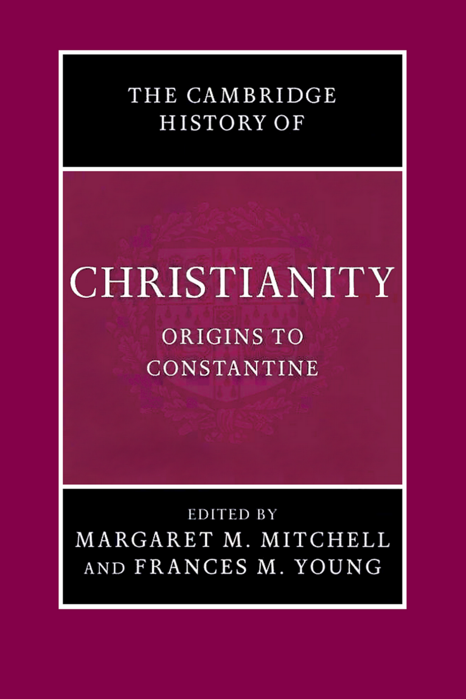
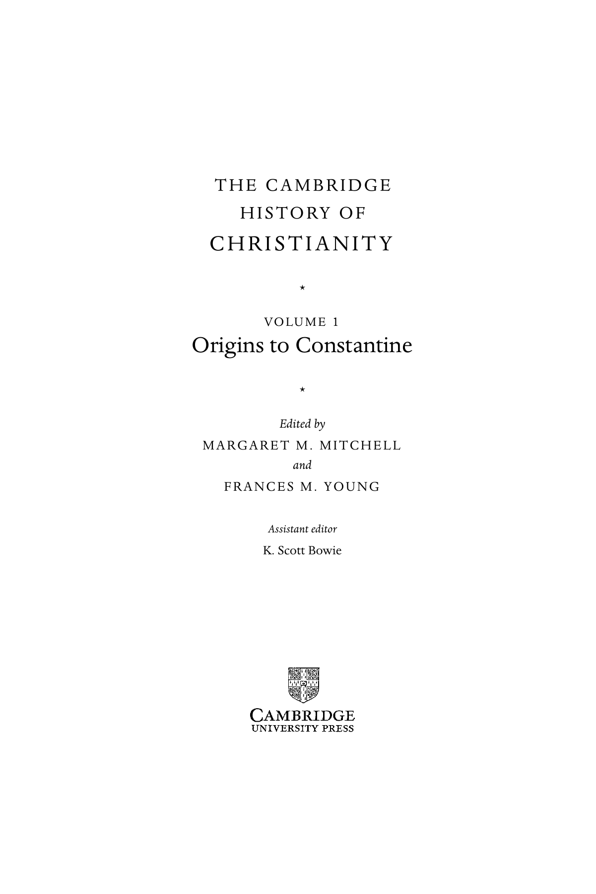

# 卷首资料

> 本节译自PDF第1–13页；人名履历与丛书计划保留原书出版时的状态。

## 封面与书名页

**剑桥基督教史**

**第一卷：起源至君士坦丁**

主编：玛格丽特·M.米切尔（Margaret M. Mitchell）、弗朗西丝·M.杨（Frances M. Young）

助理编辑：K.斯科特·鲍伊（K. Scott Bowie）

## 本卷简介

作为九卷本《剑桥基督教史》的第一卷，《起源至君士坦丁》全面概述最初三个世纪中，基督宗教在地中海世界兴起所涉及的主要事件、人物、地点与问题。三十余篇专家学者撰写的文章，追踪这段充满变化的历史，从耶稣时代直到四世纪帝国基督教的兴起。本卷以深入思考、充分文献为基础，分析耶稣死后数十年内出现，并通过传教迅速遍布罗马帝国的多种基督徒群体、身份与实践。《起源至君士坦丁》考察截至三世纪末各地基督徒群体的独特特征，同时探索制度形式、知识实践与神学表述的发展；这些将成为随后数世纪基督教史的标志。

玛格丽特·M.米切尔是芝加哥大学新约与早期基督教文献教授。著有Paul and the rhetoric of reconciliation: an exegetical investigation of the language and composition of 1 Corinthians，以及The heavenly trumpet: John Chrysostom and the art of Pauline interpretation，并任Novum Testamentum Supplements专著丛书共同执行编辑。

弗朗西丝·M.杨是英国国家学术院院士，1998年因对神学的贡献获授大英帝国官佐勋章（OBE）。1986年出任伯明翰大学神学教授及系主任，1995年任文学院院长，1997至2002年任副校长，现为神学荣休教授。其众多著作包括From Nicaea to Chalcedon、Biblical exegesis and the formation of Christian culture，以及较面向一般读者的The making of the creeds、Can these dry bones live?和Face to face。

## 丛书说明

《剑桥基督教史》按年代全面叙述基督教从起源至今的各方面发展，涵盖神学、思想、社会、政治、地域与全球层面。每卷本身都对相应时期的学术研究作出实质贡献，全套构成一部重要的学术参考书。它的目标远不止西欧基督教及其分支的历史，而是提供全球视野。从早期开始，东方及科普特基督教就得到充分考虑；后来的非洲、远东、新大陆、南亚及其他非欧洲地区的基督教发展，也得到适当覆盖。各卷包括大众虔敬及基督教信仰的非正式表达，并在广阔文化背景下，考察基督徒形成、敬拜与敬虔的社会学问题。基督教与其他主要信仰的关系，也始终在关注范围内。本丛书将为学者与学生提供极有价值的资源。

| 卷次与书名 | 主编（依原书丛书计划） |
|---|---|
| 1　起源至君士坦丁 | Margaret M. Mitchell、Frances M. Young |
| 2　君士坦丁至约600年 | Winrich Löhr、Fred Norris、Augustine Casiday |
| 3　中世纪早期基督教，约600至约1100年 | Thomas Noble、Julia Smith |
| 4　西欧基督教，约1100至约1500年 | Miri Rubin、Walter Simon |
| 5　东方基督教 | Michael Angold |
| 6　改革与扩张，1500–1660年 | Ronnie Po-chia Hsia |
| 7　启蒙、复兴与革命，1660–1815年 | Stewart J. Brown、Timothy Tackett |
| 8　世界基督教，约1815至约1914年 | Brian Stanley、Sheridan Gilley |
| 9　世界基督教，约1914至约2000年 | Hugh McLeod |

## 版权与出版资料

剑桥大学出版社：剑桥、纽约、墨尔本、马德里、开普敦、新加坡、圣保罗。

英国地址：The Edinburgh Building, Cambridge CB2 2RU, UK。美国由剑桥大学出版社纽约分社出版。

出版社网站：www.cambridge.org。本书资料：www.cambridge.org/9780521812399。

© 剑桥大学出版社，2006。

本书受版权保护。除法定例外及相关集体许可协议规定外，未经剑桥大学出版社书面许可，不得复制本书任何部分。

2006年首次出版。在英国剑桥大学印刷厂印刷。

英国图书馆备有本书书目记录。

美国国会图书馆在版编目资料：

Origins to Constantine／Frances M. Young、Margaret M. Mitchell主编；K. Scott Bowie助理编辑。页数、尺寸待定。——《剑桥基督教史》第1卷。附参考文献及索引。ISBN 0-521-81239-9（精装）。主题：教会史——初期与早期教会，约30–600年。附加检索项：I. Young, Frances M.（Frances Margaret）；II. Mitchell, Margaret Mary, 1956–；III. Bowie, Kenneth Scott；IV. 书名；V. 丛书。分类及控制号：BR165.O66 2006；270.1–dc22；2005012926。

精装ISBN-13：978-0-521-81239-9；ISBN-10：0-521-81239-9。

剑桥大学出版社不对本书所引外部或第三方网站网址的持续有效性、准确性负责，也不保证其内容现在或将来始终准确、适当。

## 原书目录

以下页码沿用原书印刷页码，便于与正文引用及索引对应；合订译稿顶部另有可点击目录。

| 卷首项目 | 原书页码 |
|---|---|
| 插图目录 | ix |
| 地图目录 | x |
| 撰稿人 | xi |
| 前言 | xiii |
| 致谢 | xxi |
| 罗马皇帝与罗马、亚历山大里亚主教年表 | xxii |
| 原始及二手文献缩写表 | xxv |
| 序篇：耶稣基督，基督教的基础 | 1 |

| 章节／部分 | 作者 | 原书起页 |
|---|---|---|
| **第一部分　政治、社会与宗教背景** | | |
| 第1章　公元一世纪的加利利与犹太地区 | 肖恩·弗雷恩（Sean Freyne） | 37 |
| 第2章　犹太人的散居 | 泰莎·拉贾克（Tessa Rajak） | 53 |
| 第3章　罗马帝国 | 汉斯-约瑟夫·克劳克（Hans-Josef Klauck） | 69 |
| **第二部分　耶稣运动** | | |
| 第4章　犹太基督教 | 乔尔·马库斯（Joel Marcus） | 87 |
| 第5章　外邦基督教 | 玛格丽特·M. 米切尔（Margaret M. Mitchell） | 103 |
| 第6章　约翰传统的基督教 | 哈罗德·W. 阿特里奇（Harold W. Attridge） | 125 |
| 第7章　最早期基督徒的社会与教会生活 | 韦恩·A. 米克斯（Wayne A. Meeks） | 145 |
| **第三部分　群体传统与自我界定** | | |
| 第8章　书面记录的形成 | 玛格丽特·M. 米切尔（Margaret M. Mitchell） | 177 |
| 第9章　马吉安与“正典” | 哈里·Y. 甘布尔（Harry Y. Gamble） | 195 |
| 第10章　面对犹太母体的自我界定 | 朱迪思·刘（Judith Lieu） | 214 |
| 第11章　面对希腊—罗马世界的自我界定 | A. J. 德罗格（A. J. Droge） | 230 |
| 第12章　基督徒群体间的自我区分：诺斯替派及其反对者 | 戴维·布拉克（David Brakke） | 245 |
| 第13章　真理与传统：爱任纽 | 德尼斯·明斯（Denis Minns） | 261 |
| 第14章　发展中的教会如何通过实践界定自身 | 卡罗琳·奥西克（Carolyn Osiek） | 274 |
| **第四部分　最初三个世纪基督教的地域差异** | | |
| 第15章　从耶路撒冷直到地极 | 玛格丽特·M. 米切尔（Margaret M. Mitchell） | 295 |
| 第16章　概览：基督教的地理扩展 | 弗兰克·特龙布利（Frank Trombley） | 302 |
| 第17章　小亚细亚与亚该亚 | 克里斯廷·特雷维特（Christine Trevett） | 314 |
| 第18章　埃及 | 伯格·A. 皮尔森（Birger A. Pearson） | 331 |
| 第19章　叙利亚与美索不达米亚 | 苏珊·阿什布鲁克·哈维（Susan Ashbrook Harvey） | 351 |
| 第20章　高卢 | 约翰·贝尔（John Behr） | 366 |
| 第21章　北非 | 莫琳·A. 蒂利（Maureen A. Tilley） | 381 |
| 第22章　罗马 | 马尔库斯·文岑特（Markus Vinzent） | 397 |
| **第五部分　基督教神学的形成** | | |
| 第23章　君士坦丁以前的教会制度 | 斯图尔特·乔治·霍尔（Stuart George Hall） | 415 |
| 第24章　一神论与创造 | 格哈德·迈（Gerhard May） | 434 |
| 第25章　一神论与基督论 | 弗朗西丝·M. 杨（Frances M. Young） | 452 |
| 第26章　迫害中形成的教会论 | 斯图尔特·乔治·霍尔（Stuart George Hall） | 470 |
| 第27章　走向基督教的教养 | 弗朗西丝·M. 杨（Frances M. Young） | 485 |
| **第六部分　“外人”成为公民：走向帝国庇护** | | |
| 第28章　迫害：起源与遗产 | W. H. C. 弗伦德（W. H. C. Frend） | 503 |
| 第29章　公元300年以前的教会与国家 | 阿道夫·马丁·里特尔（Adolf Martin Ritter） | 524 |
| 第30章　君士坦丁与“教会的和平” | 阿维丽尔·卡梅伦（Averil Cameron） | 538 |
| 第31章　第一次尼西亚会议 | 马克·爱德华兹（Mark Edwards） | 552 |
| 第32章　走向基督教物质文化 | 罗宾·M.詹森（Robin M. Jensen） | 568 |
| 结语：回顾与展望 | | 586 |
| 参考文献 | | 590 |
| 索引 | | 683 |

## 插图目录

| 编号 | 图名 | 原书页码 |
|---|---|---|
| 图1 | 圣物匣中的十字架题牌，罗马耶路撒冷圣十字大殿 | xlviii |
| 图2 | 罗马圣普登齐亚纳教堂祭坛马赛克：外邦人的教会与受割礼者的教会 | 86 |
| 图3 | 鱼与饼，罗马圣卡利斯图斯地下墓窟 | 144 |
| 图4 | 阿伯基乌斯铭文碎片，梵蒂冈博物馆庇护基督教博物馆 | 172 |
| 图5 | 切斯特·贝蒂纸草P46，第21叶正面：《罗马书》末尾、《希伯来书》开头 | 176 |
| 图6 | 杜拉欧罗波斯基督教洗礼室复原 | 414 |
| 图7 | 作为哲学家的基督，罗马多米提拉地下墓窟 | 484 |
| 图8 | 别迦摩图拉真神庙 | 502 |
| 图9 | 基督／阿波罗马赛克，梵蒂冈墓地 | 571 |
| 图10 | 好牧人基督，萨拉里亚道石棺，梵蒂冈博物馆庇护基督教博物馆 | 578 |
| 图11 | 约拿／恩底弥翁石棺浮雕，同上馆藏 | 580 |
| 图12 | 罗马圣撒比纳教堂外观 | 584 |
| 图13 | 四世纪石棺上的基督字母组合，同上馆藏 | 587 |

## 地图目录

| 编号 | 图名 | 原书页码 |
|---|---|---|
| 地图1 | 马尔库斯·奥勒留时代的罗马帝国 | xlvi |
| 地图2 | 公元一世纪的巴勒斯坦 | 36 |
| 地图3 | 希律时期犹太人口中心 | 52 |
| 地图4 | 基督教的传播，公元一至四世纪 | 294 |
| 地图5 | 罗马时期的埃及 | 330 |
| 地图6 | 罗马时期的非洲 | 380 |

## 撰稿人

任职信息依原书，†表示作者已故。

| 撰稿人 | 原书所列单位／身份 |
|---|---|
| 哈罗德·W. 阿特里奇（Harold W. Attridge） | 耶鲁大学神学院 |
| 约翰·贝尔（John Behr） | 圣弗拉基米尔正教神学院 |
| 戴维·布拉克（David Brakke） | 印第安纳大学 |
| 阿维丽尔·卡梅伦（Averil Cameron） | 牛津大学基布尔学院 |
| A. J. 德罗格（A. J. Droge） | 加利福尼亚大学圣迭戈分校 |
| 马克·爱德华兹（Mark Edwards） | 牛津大学基督堂学院 |
| W. H. C. 弗伦德（W. H. C. Frend） | †格拉斯哥大学荣休教授；剑桥大学冈维尔与凯斯学院编外研究员 |
| 肖恩·弗雷恩（Sean Freyne） | 都柏林圣三一学院 |
| 哈里·Y. 甘布尔（Harry Y. Gamble） | 弗吉尼亚大学 |
| 斯图尔特·乔治·霍尔（Stuart George Hall） | 伦敦国王学院荣休教授；苏格兰圣安德鲁斯大学 |
| 苏珊·阿什布鲁克·哈维（Susan Ashbrook Harvey） | 布朗大学 |
| 罗宾·M.詹森（Robin M. Jensen） | 范德比尔特大学神学院 |
| 汉斯-约瑟夫·克劳克（Hans-Josef Klauck） | 芝加哥大学 |
| 朱迪思·刘（Judith Lieu） | 伦敦国王学院 |
| 乔尔·马库斯（Joel Marcus） | 杜克大学神学院 |
| 格哈德·迈（Gerhard May） | 美因茨约翰内斯·古腾堡大学荣休教授 |
| 德尼斯·明斯（Denis Minns） | 牛津大学黑衣修士学院 |
| 韦恩·A. 米克斯（Wayne A. Meeks） | 耶鲁大学荣休教授 |
| 玛格丽特·M. 米切尔（Margaret M. Mitchell） | 芝加哥大学 |
| 卡罗琳·奥西克（Carolyn Osiek） | 布赖特神学院 |
| 伯格·A. 皮尔森（Birger A. Pearson） | 加利福尼亚大学圣巴巴拉分校荣休教授 |
| 泰莎·拉贾克（Tessa Rajak） | 雷丁大学 |
| 阿道夫·马丁·里特尔（Adolf Martin Ritter） | 海德堡鲁普雷希特—卡尔大学 |
| 莫琳·A. 蒂利（Maureen A. Tilley） | 代顿大学 |
| 克里斯廷·特雷维特（Christine Trevett） | 加的夫大学 |
| 弗兰克·特龙布利（Frank Trombley） | 加的夫大学 |
| 马尔库斯·文岑特（Markus Vinzent） | 伯明翰大学 |
| 弗朗西丝·M. 杨（Frances M. Young） | 伯明翰大学荣休教授 |

<!-- PDF第13页为空白。 -->
