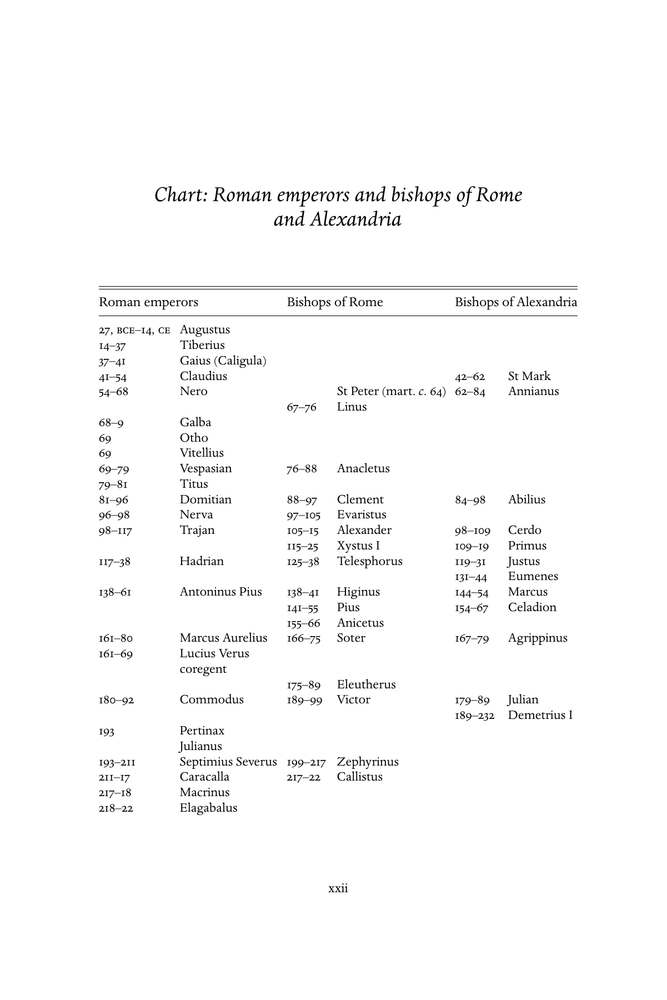
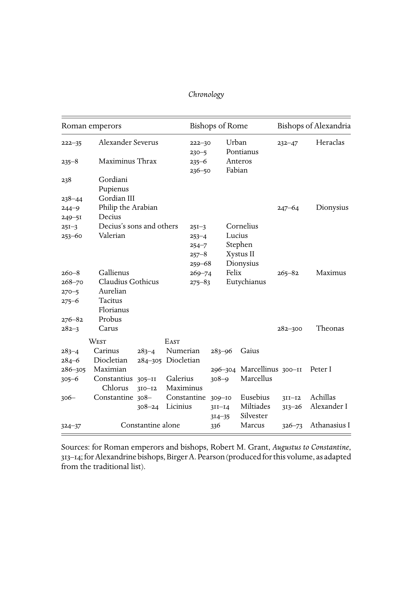

# 罗马皇帝与罗马、亚历山大里亚主教年表

> 原书第xxii–xxiii页，PDF第23–24页；第25页为空白。为便于阅读，将原书平行三栏分为以下三表。年代依原表，不依据正文其他章或后来的年表改写；未另标者为公元。

## 罗马皇帝

| 在位年代 | 姓名 |
|---|---|
| 公元前27–公元14 | 奥古斯都（Augustus） |
| 14–37 | 提比略（Tiberius） |
| 37–41 | 盖乌斯，卡利古拉（Gaius / Caligula） |
| 41–54 | 克劳狄乌斯（Claudius） |
| 54–68 | 尼禄（Nero） |
| 68–69 | 加尔巴（Galba） |
| 69 | 奥托（Otho） |
| 69 | 维特里乌斯（Vitellius） |
| 69–79 | 维斯帕先（Vespasian） |
| 79–81 | 提图斯（Titus） |
| 81–96 | 图密善（Domitian） |
| 96–98 | 涅尔瓦（Nerva） |
| 98–117 | 图拉真（Trajan） |
| 117–138 | 哈德良（Hadrian） |
| 138–161 | 安东尼努斯·庇护（Antoninus Pius） |
| 161–180 | 马尔库斯·奥勒留（Marcus Aurelius） |
| 161–169 | 卢基乌斯·维鲁斯，共治（Lucius Verus） |
| 180–192 | 康茂德（Commodus） |
| 193 | 佩尔提纳克斯（Pertinax）；尤利安努斯（Julianus） |
| 193–211 | 塞普提米乌斯·塞维鲁（Septimius Severus） |
| 211–217 | 卡拉卡拉（Caracalla） |
| 217–218 | 马克里努斯（Macrinus） |
| 218–222 | 埃拉加巴卢斯（Elagabalus） |
| 222–235 | 亚历山大·塞维鲁（Alexander Severus） |
| 235–238 | 马克西米努斯·特拉克斯（Maximinus Thrax） |
| 238 | 戈尔狄安诸帝（Gordiani）；普皮埃努斯（Pupienus） |
| 238–244 | 戈尔狄安三世（Gordian III） |
| 244–249 | 阿拉伯人腓力（Philip the Arabian） |
| 249–251 | 德修（Decius） |
| 251–253 | 德修之子及其他诸帝 |
| 253–260 | 瓦勒良（Valerian） |
| 260–268 | 加里恩努斯（Gallienus） |
| 268–270 | 克劳狄乌斯·哥提库斯（Claudius Gothicus） |
| 270–275 | 奥勒良（Aurelian） |
| 275–276 | 塔西佗（Tacitus）；弗洛里安努斯（Florianus） |
| 276–282 | 普罗布斯（Probus） |
| 282–283 | 卡鲁斯（Carus） |

后段原表分东西两部：

| 西部年代 | 西部统治者 | 东部年代 | 东部统治者 |
|---|---|---|---|
| 283–284 | 卡里努斯（Carinus） | 283–284 | 努梅里安（Numerian） |
| 284–286 | 戴克里先（Diocletian） | 284–305 | 戴克里先 |
| 286–305 | 马克西米安（Maximian） |  |  |
| 305–306 | 君士坦提乌斯·克洛鲁斯（Constantius Chlorus） | 305–311 | 加列里乌斯（Galerius） |
|  |  | 310–312 | 马克西米努斯（Maximinus） |
| 306– | 君士坦丁（Constantine） | 308– | 君士坦丁 |
|  |  | 308–324 | 李锡尼（Licinius） |
| 324–337 | 君士坦丁独掌帝国 |  |  |

## 罗马主教

| 任期／记事 | 姓名 |
|---|---|
| 约64年殉道 | 圣彼得（St Peter） |
| 67–76 | 利努斯（Linus） |
| 76–88 | 阿纳克勒图斯（Anacletus） |
| 88–97 | 克莱孟（Clement） |
| 97–105 | 埃瓦里斯图斯（Evaristus） |
| 105–115 | 亚历山大（Alexander） |
| 115–125 | 西克斯图斯一世（Xystus I） |
| 125–138 | 忒勒斯福鲁斯（Telesphorus） |
| 138–141 | 希吉努斯（Higinus） |
| 141–155 | 庇护（Pius） |
| 155–166 | 阿尼凯图斯（Anicetus） |
| 166–175 | 索特尔（Soter） |
| 175–189 | 埃留特鲁斯（Eleutherus） |
| 189–199 | 维克托（Victor） |
| 199–217 | 泽菲里努斯（Zephyrinus） |
| 217–222 | 卡利斯图斯（Callistus） |
| 222–230 | 乌尔班（Urban） |
| 230–235 | 蓬提安努斯（Pontianus） |
| 235–236 | 安忒罗斯（Anteros） |
| 236–250 | 法比安（Fabian） |
| 251–253 | 科尔内利乌斯（Cornelius） |
| 253–254 | 卢基乌斯（Lucius） |
| 254–257 | 司提反（Stephen） |
| 257–258 | 西克斯图斯二世（Xystus II） |
| 259–268 | 狄奥尼修（Dionysius） |
| 269–274 | 费利克斯（Felix） |
| 275–283 | 欧提基安努斯（Eutychianus） |
| 283–296 | 盖乌斯（Gaius） |
| 296–304 | 马尔凯利努斯（Marcellinus） |
| 308–309 | 马尔凯卢斯（Marcellus） |
| 309–310 | 优西比乌（Eusebius） |
| 311–314 | 米尔提亚德斯（Miltiades） |
| 314–335 | 西尔维斯特（Silvester） |
| 336 | 马尔库斯（Marcus） |

## 亚历山大里亚主教

| 任期 | 姓名 |
|---|---|
| 42–62 | 圣马可（St Mark） |
| 62–84 | 安尼安努斯（Annianus） |
| 84–98 | 阿比利乌斯（Abilius） |
| 98–109 | 凯尔多（Cerdo） |
| 109–119 | 普里穆斯（Primus） |
| 119–131 | 尤斯图斯（Justus） |
| 131–144 | 欧墨涅斯（Eumenes） |
| 144–154 | 马尔库斯（Marcus） |
| 154–167 | 凯拉迪翁（Celadion） |
| 167–179 | 阿格里皮努斯（Agrippinus） |
| 179–189 | 尤利安（Julian） |
| 189–232 | 德米特里乌斯一世（Demetrius I） |
| 232–247 | 赫拉克拉斯（Heraclas） |
| 247–264 | 狄奥尼修（Dionysius） |
| 265–282 | 马克西穆斯（Maximus） |
| 282–300 | 提奥纳斯（Theonas） |
| 300–311 | 彼得一世（Peter I） |
| 311–312 | 阿基拉斯（Achillas） |
| 313–326 | 亚历山大一世（Alexander I） |
| 326–373 | 亚他那修一世（Athanasius I） |

来源：罗马皇帝与主教，据Robert M. Grant, Augustus to Constantine, 313–314；亚历山大里亚主教由Birger A. Pearson为本卷编制，依传统名单改编。

## 原表对照

[原PDF第25页空白页影像](<assets/pdf-025.png>)。
