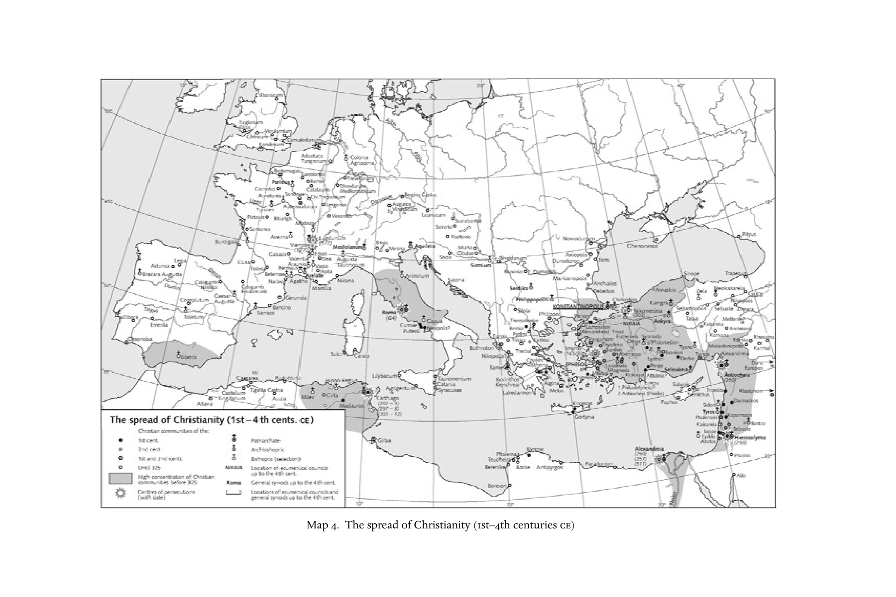

# 第4部分　最初三个世纪基督教的地域差异

<!-- 原书第293–294页；PDF第342–343页。 -->

*地图4　基督教的传播，公元一至四世纪。原书第294页。图例：不同圆点分别标示一世纪、二世纪、一二世纪均有及截至325年的基督徒群体；阴影标示325年前基督徒密集区域；光芒符号标示迫害中心（括号内为年）；不同十字形分别标示牧首区、总主教区及主教区。NICAEA式大写地名为四世纪以前的普世会议地点；Rome式字样为同一时期的普遍性会议地点；括线符号表示两者兼有。图内地名保留原图。*
