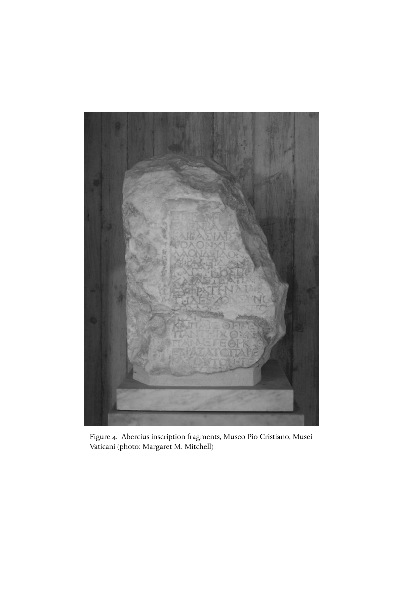

# 第七章 最早期基督徒的社会与教会生活

**作者：韦恩·A. 米克斯（Wayne A. Meeks）**

《剑桥基督教史》第一卷《起源至君士坦丁》中文译稿

> 原书第145–174页，PDF第194–223页。按原文完整翻译正文、引文与脚注解释；参考书目作者名、题名和定位保留原文。
>
> [第七章英文原文](<第七章 最早期基督徒的社会与教会生活（英文）.md>) · [原书PDF](<../01 起源至君士坦丁.pdf>)

<!-- 原书第145页；PDF第194页 -->

从拿撒勒人耶稣开始、最终形成多种形态基督教会的这场运动，以惊人的速度发展，从最初几年起就呈现多样形式。早期发展的绝大部分，我们已无从看见；学者试图勾勒其轮廓的尝试，必须审慎看待。不过，我们大体可以借用一位现代社会学家的话说：这场运动起初是一个犹太教派，不久就转变为希腊—罗马世界的一种宗教崇拜。[^1]这一演变并非单线发展。有些尝试失败了，其数量很可能超过我们所能知道的；另一些则被竞争群体压制。我们只能从这一过程的若干方面，拼接出片段图景：从加利利的开端，到复活节后的耶路撒冷群体，再到罗马帝国城市中的家庭会众，其结社的社会形式；典型归信者的社会位置；敬拜和仪式形式，以及正在形成的基督教亚文化的其他维度。

## 群体组织

<!-- 原书第145–146页；PDF第194–195页 -->

耶稣追随者带给古代地中海世界最深刻的创新，或许是一种新的宗教群体形式。阿道夫·冯·哈纳克在关于“基督教的传教与扩展”的经典研究中断言：到公元300年，“教会本身……仅凭它的存在”，就已取代使徒时代“传教者”的活动；教会之所以能够做到这一点，是因为它把自身激进而革命性的主张，转化为当地人看来“熟悉、渴望而自然”的形式。这一断言颇有道理。[^2]唯有与同时代社会现象比较，我们才能对早期基督教在其环境中的“自然性”和新颖之处有所认识。不过必须记住，比较的双方，都是依据稀少、时而偶然留存的证据作出的重构。

### 耶稣及其追随者

<!-- 原书第146页；PDF第195页 -->

关于耶稣及其追随者的最早传统，提供的图景既稀疏又往往相互矛盾。我们可以用几种不同模式来补充它。有些特征提示一种不免略带时代错置、可称为“政治性”的运动；也就是说，它主要由自身对罗马霸权所造成处境的回应来界定。[^3]传统中的其他要素，则呈现全然不同的图景：一位教师及其门徒圈子；[^4]另一些则像是在描写驱魔者与行神迹者的求助者和传播其名声的人。[^5]还有部分传统，似乎以犹太和圣经特有的先知色彩描绘耶稣，[^6]使他的追随者看起来像一场末世更新运动。这些不同模式不必相互排斥。

我们必须记住：材料中所有耶稣故事，都已经过他死后的重新解释；运动若要在他死后延续，这种解释便不可避免。不过，十字架事件本身，仍是历史研究耶稣周围群体的唯一稳固起点。[^7]这种处刑方式立即告诉我们，在一组关键观察者——罗马总督及其顾问——眼中，耶稣与追随者是什么样的人。一世纪犹太历史学家弗拉维乌斯·约瑟夫斯描述了数次运动，其领袖同样死于罗马当局之手；时间从公元6年犹太地区被编为叙利亚辖下的次级行政区，一直到66年起义前夕。约瑟夫斯曾是一支犹太叛军的指挥官，幸存之后成为弗拉维王朝的受庇护者；他并非客观观察者。在罗马人看来，他所描绘的这些运动有一点最重要：在一个危险地靠近帝国东部边疆的地区，它们威胁了罗马和平。

<!-- 原书第147页；PDF第196页 -->

约瑟夫斯用后来灾难所孕育的分类与敌意，描述这些骚动，因而很可能放大了其反罗马面向。他还力图将这些运动与犹太地区的本土贵族划清界限，并把自己算入贵族之列；这种意图也可能扭曲其描写。他称若干领袖为“强盗”（lēistai，例如AJ 18.7；20.121、160、163、167、172、185、186），也偏爱用这个词指称总督弗洛鲁斯治下起义的煽动者，例如BJ 2.434。福音书用同一个词称呼与耶稣一同被钉十字架的两人（可15:27；太27:38、44）；第四福音书还用它称巴拉巴（约18:40；亦注意10:8）。约瑟夫斯称另一些人为goētai，即“占卜者”或“骗子”，尽管承认他们自称prophētai，即“先知”（BJ 1.148–54；AJ 20.160、167–72、188）。他还说，有些领袖怀有称王的企图（BJ 2.57、60、444；AJ 17.272、273、278–85）。

约瑟夫斯关于失败起事的叙述中，反复出现几个因素，提醒我们不能轻易把“政治”与“宗教”分开。首先，那些吸引追随者、解释其目标的戏剧性意象，都呼应以色列往昔的神圣传统：将从旷野出发征服圣地（AJ 20.167）；约旦河将奉命开出干路（AJ 20.97）；摩西藏于圣山的会幕器具将被寻回（AJ 18.85–7）；城墙将奉命倒塌（AJ 20.170）。其次，这些起事因此具有末世性：对应过去的拯救事件，上帝将在近在眼前的未来直接、最终介入，改变社会秩序。第三，这些运动来自民众，由权威根植于传统和个人感召力，而非制度的人物领导。

这三个特征，都见于耶稣及追随者的早期传统。上世纪在犹太地区昆兰旱谷发现的教派文献所描绘的群体，也具有这些特点。尽管二者差异明显，我们在两种情况下所面对的，都类似现代人类学家所说的“更新”或“本土复兴”运动。一个传统社会刚经历社会、文化变化，通常是外来势力压在其上；这时，一位富有感召力的领袖召集追随者，实行某种变革方案。它取用该社会传统上界定自身的象征意象，却又以富于想象的方式重新组织，以应对当前危机。[^8]

<!-- 原书第147–148页；PDF第196–197页 -->

早期教会所记忆、传述的耶稣与门徒故事中，有若干因素很符合“更新运动”模式。一个十二人小组被特别选出，尽管传统对具体姓名存在差异，仍明显暗指雅各的十二个儿子及以他们命名的古代以色列支派，因而暗示某种恢复以色列原初身份的意图。耶稣“呼召”门徒的记述，以及归于他的那些强调打断职业与家庭生活、转而以行乞维生并四处游行的言论，都对应本土复兴运动中常见的否定阶段：与既定规范和模式决裂，为重新从过去想象出的理想文化模式腾出空间。这种巡回生活，也是约瑟夫斯所描写群体的特征，常使它们类似“社会性强盗”；[^9]昆兰群体退往犹太旷野，也是平行现象。基督教传统中聚焦耶稣与耶路撒冷及圣殿关系的要素——预言圣殿毁灭、“洁净”圣殿及“凯旋入城”——同样符合这一模式。

另外两种主要组织模式，即智慧教师带领门徒，以及驱魔或行奇术者拥有追随者，看来同样深植于耶稣传统。二者很容易都归入末世先知与更新运动的意象之下，因为“记号”和教导，包括自由运用“智慧”话语的形式，都是以色列经典先知形象的特征。不仅公元前八至六世纪那些神谕被搜集、保存为经书的先知，摩西与以利亚也都是典范。

与福音书所描绘耶稣自身的活动地点相对应，他的早期追随者似乎有两个活动中心：一个在大体属于乡村地带的犹太地区、加利利和撒马利亚诸村落；另一个在耶路撒冷。[^10]关于这个新教派如何在巴勒斯坦村落文化中立足，唯一的一手信息，来自耶稣给受委派者或“使徒”的指示。在那里，我们看见巡回先知摆脱地域和家庭纽带；而这些纽带，尤其在乡村环境中，通常决定一个人的身份：“狐狸有洞，天空的飞鸟有窝，人子却没有枕头的地方。”（太8:20；路9:58）“人到我这里来，若不恨自己的父母、妻子、儿女、弟兄、姐妹，甚至自己的性命，就不能作我的门徒。”（原文引路14:16；参太10:37）另一方面，他们又必须依靠所受差遣要去的村民维生，向他们宣讲上帝统治的消息，参可6:8–11及平行经文。

<!-- 原书第149页；PDF第198页 -->

自然，到这些传统被收入书面福音书时，这幅图景已在某种程度上理想化。不过，四处游行、靠施舍维生的先知或使徒，显然在耶稣教派向犹太与撒马利亚村落的传播中，发挥了重要作用。他们的传教之所以可能，是因为他们与村民共享一种文化：它不仅包括门徒用来解释耶稣生平的神学信念、经书和传统，也包括门徒自己扮演的、社会所熟悉的先知角色。但材料并未清楚告诉我们，当先知的消息得到接受时，村中究竟形成了何种组织群体，或是否形成了群体。大概在那里也像城市一样，新弥赛亚的拥护者会聚集于家中祈祷、相互劝勉、举行仪式性聚餐；领导权显然主要掌握在巡回者或其地方代表手中。若干早期基督教文献，最明显的是《马太福音》与《十二使徒遗训》，见证了地方领袖与巡回领袖之间的冲突。

### 耶路撒冷

<!-- 原书第149–150页；PDF第198–199页 -->

《使徒行传》和保罗较早的书信，呈现出一个以耶路撒冷为中心的群体，比刚才描述的乡村运动显得稳定得多，也更有结构。领导方式仍较为非正式，“使徒”数目不确定（加1:17、19；将此称号限于十二人，是较晚的系统化处理；参林前15:4–7）。《使徒行传》还谈到“长老”（徒15:6、22），使人想起地方犹太组织。[^11]然而，某些个人行使特别的权力：首要的是彼得，即矶法（加1:18；2:9；徒1:13、15；2:14、37；第3–5、10章；15:17）；他常与西庇太的儿子雅各和约翰并列（可5:37；9:2；13:3；14:33；保罗在加2:9所说的“柱石”，或许就是这三人）；另有“主的兄弟”雅各（加1:19；2:12；徒12:17；15:13；21:18；参《多马福音》12）。雅各在运动中掌权，与较早传统所说耶稣近亲对他怀有敌意，形成对照（可3:31–35及平行经文；约7:3–5）。《使徒行传》描绘一个组织严密、实行财产共有的教派（2:44–45；4:32–37；5:1–11），某些方面像哲学学派，却又公开表现犹太虔敬，尤其在圣殿中，并在许多方面类似法利赛人。这幅图景的重要部分，很可能出自理想化，以及《使徒行传》作者特定的护教与神学目的。实际上，对于耶路撒冷最初基督徒群体采取的形式，我们能确定的很少。然而，对下一阶段基督教发展的决定性转变，即移向以色列地以外的城市，它们必定至关重要。

### 城市与殖民城

<!-- 原书第150页；PDF第199页 -->

《使徒行传》一句简短的话，是我们了解一种城市性、兼容性传教如何开始的唯一实质线索；这种传教确立了基督教扩展的模式：

> 那些因司提反事件所引发的迫害而四散的人，一直走到腓尼基、塞浦路斯和安提阿，只向犹太人讲道。但其中有些塞浦路斯人和昔兰尼人，来到安提阿，也向希腊人讲道。（徒11:19–20）

司提反的圈子，被认定属于耶路撒冷基督徒群体中称为Hellēnistai的一翼（徒6:1）；也就是来自耶路撒冷讲希腊语的犹太人中的归信者，其中许多人很可能在散居城市长大，后来迁回犹太地区，参6:9。[^12]假如这一记述在历史上可靠，那么，有意识地面向外邦人的传教，就是由这些讲希腊语的犹太基督徒开始的；其起点，则是奥龙特斯河畔安提阿这座大都市。来自塔尔苏斯、曾为法利赛人的保罗，在归信后，也是在该城接受基督徒传教工作的历练。他更早前往纳巴泰王国，即加1:17的“阿拉伯”，那次尝试显然未获成功；参林后11:32–33，并注意，保罗在罗15:19概述的“周围”传教范围中，没有包括阿拉伯。按《使徒行传》，弥赛亚耶稣的追随者，也是在安提阿首次被称为Christianoi，即基督徒（徒11:26）；这个称呼很可能来自外人，他们此时已认出，这是一个可与犹太主体社群区分的教派。

<!-- 原书第150–151页；PDF第199–200页 -->

我们知道，耶稣被处死后约十年内，基督教已传入其他若干城市，包括大马士革和罗马；依据后来的证据，也可猜测埃及及北非城市很早就建立了基督徒群体。但遗憾的是，对于这些教会各自的起源，我们几乎没有，甚至完全没有可靠资料。只有保罗及其分布广泛的同工网络的传教活动，留下丰富的一手证据；这要归功于保罗和其门徒所写书信的保存，以及《使徒行传》作者给予保罗的中心位置。这些材料呈现三四十年间的密集努力，在小亚细亚中西部、马其顿和希腊贸易路线沿线的城市中，植下基督徒群体。假定其他地方的基督徒，也采取类似保罗圈子的策略，并发展相似社会形式，并非不合理；但当地可能还有许多我们一无所知的特征。

城市基督教策略的关键，是私人家庭。不仅《使徒行传》多次讲到某人与“他／她全家”一同归信（16:15、31–34；18:8；参10:1；11:14；约4:53），保罗也回忆自己为全家施洗（林前1:16；参16:15–16），并在书信中多次明确提到“某某家中的集会（ekklēsia）”（林前16:19；罗16:5；门1；西4:15）。然而，城市基督教运动的“基本细胞”，[^13]并不只是一个家庭聚在一起祈祷。有些群体形成于非基督徒主持的家户中，例如罗16:10、11、14、15列出的四组，更不用说familia Caesaris，即皇帝家属及其家内人员（腓4:22）。反过来，家长归信时，也并非家中每个人都必然成为基督徒；奴隶阿尼西母的事例就说明这一点（门8–21）。在罗马帝国早期，大量俱乐部和行会蓬勃发展，由一位较富有的家长充当其庇护者，并不罕见。有时，这样受庇护的宗教协会，会把家户的大部分成员纳入其中；例如公元二世纪初，庞培娅·阿格里皮尼拉在图斯库卢姆创立的著名狄俄尼索斯协会。[^14]另一些情况下，庇护人与受助群体没有直接联系，只因施惠而得到依附者回报的荣誉；例如，若干会堂铭文记载了异教徒的捐助，参路7:5。因此，基督徒“集会”的形成，遵循了熟悉的模式。[^15]

<!-- 原书第151–152页；PDF第200–201页 -->

不过，一世纪基督徒群体在若干方面，与罗马世界典型的宗教崇拜，以及工匠行会等自愿结社很不一样，尽管在其他方面颇为相似。基督徒虽发展了独特仪式，外人却不容易注意到。他们没有圣所、神庙、神像或献祭，也不举办公开节庆、音乐表演或朝圣。据我们所知，他们没有竖立可辨识的铭文。另一方面，加入其信仰所带来的社会后果，比加入常见诸神的崇拜深远得多。它意味着被纳入一个联系紧密的群体，经历重新社会化；这种过程要求忠诚取代自然亲属纽带，而在许多情况下也确实得到这种忠诚，同时要求服从一位上帝、一位主，排除参与任何其他崇拜。此外，这个人为组成的家庭，承担着通过持续道德教导与劝诫，使成员重新社会化的任务。若我们相信这场运动领袖的文字，几乎没有生活领域不受彼此关切。因此，教会结合了家庭、宗教团体、俱乐部与哲学学派的特征，却又不完全等同于其中任何一种。

基督徒宗教群体还有另一项特殊之处。家庭集会固然是基督教在希腊—罗马城市生活中的立足点，但每个由十来人构成的细胞，都不断被提醒：自己属于一个广阔得多的运动。“一位上帝的单一子民”这一观念，是这个教派继承自犹太教的自我形象。它通过两种方式得到扩展、强化，并具有实际形式。在神话叙事上，基督徒的弥赛亚观念取用《创世记》中创造与人类起源的宏大故事：起初如何，终末也必如何。因此，最早关于洗礼仪式的记述，充满乐园与堕落的暗喻：在基督里，受洗者重新披上亚当失去的上帝形象；在他里面，犹太人与希腊人、奴隶与自由人、男性与女性的原初合一得以恢复（参《加拉太书》3:27及以下；林前12:13；西3:5–15）。外邦传教之所以充满活力，其观念基础很可能很大部分就在这一神话叙事组合中。

<!-- 原书第152–153页；PDF第201–202页 -->

反过来，这项使命本身的实际需要，也强化了合一观念。罗马和平与罗马道路建设，加上更早时亚历山大及其继承者统治下，希腊语在帝国东半部城市的传播，使旅行和通信获得前所未有的便利。基督徒使徒充分利用这些条件；他们旅行时需要支持，也需要与已建立的教会持续联系并加以督导，因此发展出一个非同寻常的网络，由“同工”、受委派者和信使组成。无论真实署名还是托名的使徒书信，都成为基督教文学两种最重要文类之一。反讽的是，合一观念却常导致分裂：如果两个派别，谁也无法让对方接受自己那一版本的单一真理，就不得不分开。因此，分裂的历史，以及二世纪兴起的“异端”概念本身，反而见证了合一理想及强制实现它的实际动力。到了君士坦丁时代，这一动力最终产生遍及帝国的一套复杂制度，在某些方面映照着帝国自身的行省官僚体系。

### 教会“职分”的创设

<!-- 原书第153页；PDF第202页 -->

古代教会组织最重要、最独特的发展之一，是后来被称为“单一主教制”的建立：每个城市的基督徒群体，由一位主教治理。希腊文episkopos意为“监督”；他高于称为“长老”（presbyteroi）和“执事”（diakonoi）的其他教职等级。自二世纪起，运动重新传入乡村，城市主教原则上也主持依附该城的城镇、村落基督徒事务；希腊文称这种周边地区为chōra。然而，这一对教会未来形态如此重要的发展，极难详细追溯，其历史仍有争议。部分原因是，西方新教和天主教解释者数世纪的论战，对材料形成倾向性读法，现代历史学家难以摆脱；部分原因则是材料本身晦涩。这里仅能略触若干问题。

基督教运动虽倾向于创造地方及跨地方制度，却未因此及早实现结构统一，情况恰恰相反。从《新约》及其他早期文献对于组织的提及，我们得到的印象是：存在相当多样性和尝试，也经常发生冲突；不仅不同人物和群体之间冲突，不同权威模式之间也发生冲突。例如，权威来自社会地位的人，像主持家庭群体的家长和庇护者，可能与依靠恩赐的人发生冲突，如本地或来访的先知（例如林前第12–14章；《约翰三书》）。地方领袖可能与巡回者冲突，而不同的巡回“使徒”，所教导的信念和行为形式也可能很不一样（例如《遗训》第11–13、15章）。

<!-- 原书第153–154页；PDF第202–203页 -->

早期基督徒群体常被拿来与众多自愿协会比较。那些协会的铭文呈现出五花八门的职务名称，最常仿效市政职位，如prytanis，即“主席”、财务官、书记、decuriones，即“市议员”、quinquennales，即“五年任期的官员”等；但最早基督徒群体并没有相应证据。我们确实听说，马其顿的腓立比有episkopoi和diakonoi；保罗在给当地教会、应定于六十年代的书信中，向他们致意，仿佛他们是可区分的地方职事人员（腓1:1），却没有透露其职责。[^16]

三种教职等级首次得到清楚区分，是在图拉真时期写成的安提阿伊格纳提乌书信中。伊格纳提乌运用这些书信，以及前往罗马途中对各教会的访问，甚至将自己迈向殉道的行程精心戏剧化，[^17]以倡导主教在中心位置发挥统一作用。然而，《教牧书信》，即《提摩太前后书》和《提多书》，大多数学者认为写于伊格纳提乌同时或略晚，其虚构的地点设置也与伊格纳提乌致函的地区重叠，其中主教与长老却尚未清楚区分（提前3:1–7；5:17–22）。这些及其他材料清楚表明，单一主教制度并非各地同时建立，也不是毫无抵抗就形成的。

现代教会史家，通常把对主教制度的抵抗，理解为“恩赐性”与“制度性”权威冲突的一个例子。这种冲突的经典描绘，见于早期教会实践手册《十二使徒的教导》；人们通常按其希腊文标题的第一个词，称为Didache，即《十二使徒遗训》。《遗训》第11–13章着手规范地方会众如何接待巡回“使徒”和“先知”。随后，15.1–2使用与《教牧书信》极相似的语言，规定选立“主教和执事”，解释说：“因为他们也为你们履行先知和教师的职事。”受选立的职事人员，应得到与巡回者同等的“尊重”。这类“正式”权威，与较少受规范的权力模式之间，确实存在冲突。后者由这样一些人行使：他们要求得到聆听，是因为听众相信，他们以特别方式承载神圣之灵，而与任何正式选任机制无关。马克斯·韦伯正是依据十九世纪晚期教会史家所理解的这种冲突，建立了他著名的支配模式社会学类型学。[^18]

<!-- 原书第154–155页；PDF第203–204页 -->

然而，从“恩赐性”到“日常化”或“常规化”的权威结构，并不存在单一演变路线。正如已经看到的，制度化与权威冲突，在基督教运动最初之时便已开始；在本卷讨论的整个时期，甚至很久以后，“恩赐性”人物仍以各种方式挑战逐渐形成的主教结构。最明显的例子，是二世纪晚期的孟他努主义运动，以及迫害期间给予“认信者”的特殊权利；后者在三世纪中期德修的迫害中达到高潮。[^19]而且，冲突界线并非总划在主教与恩赐人物之间，因为会众以欢呼推选主教的原则，意味着一位有强大民众支持的人，也可能被提升到该职位。[^20]当然，赢得民众支持的未必只是宗教感召力，也可以是其他恩惠。从城市基督教起步时，庇护者对于建立、庇护会众就十分重要；要提供这些服务，他必须具有一定经济和社会地位。随着时间推移，主教既与平信徒庇护者并肩服务，也逐渐代行其角色，这是自然的发展。三世纪教会有这样的实例：某些人本来就因财富与地位而具备充当庇护者的条件，后来被提升为主教；他们确实利用财富和人脉控制自己的教会，其方式在普通罗马社会中相当常见。[^21]

中央权威发展的主要原因之一，是需要控制偏离规范的行为与信念。偏离尤其具有威胁性，不仅因为群体相对弱小，也因为这场运动为自身提出普遍性主张。基督教运动最初几十年，处理分歧只能依靠非正式、临时的方法。偏离者个人，会在家庭集会中受到其他个人的劝说与责备，包括“先知”“使徒”及其他领袖。最严厉的制裁，是其他基督徒回避他，尤其禁止他参加共同聚餐，或将他完全逐出群体（林前5:1–13；太18:15–18；帖后3:14–15）。当然，也有人以通过超自然手段造成身体伤害相威胁（林前11:30；徒5:1–11；启2:22–23；参林前5:5）；但基督徒有组织、经常性地使用强制力量压制偏离，要等到君士坦丁以后与国家权力结盟时才出现。

<!-- 原书第156页；PDF第205页 -->

比起普通成员的偏离，领袖间的分歧对群体稳定更具威胁；成功处理前者，反而可能增强凝聚力。但处理领袖分歧的办法更难找到。基本可用的只有劝说与影响，主要借助熟悉的希腊—罗马修辞，在amicitia与clientela的关系结构中运作。前者是“友谊”，即地位相当者之间的互惠；后者是庇护—依附关系，即社会上位者与依附者之间的互惠。保罗的《加拉太书》和《哥林多后书》第10–13章，是运用修辞劝说与抨击，争取人们忠于一组领袖而非另一组的经典实例。有分歧的领袖之间，协商有时成功（加2:1–10；徒第15章），有时失败（加2:11–13；启2:21）。

未解决的分歧，通常导致意见不同的领袖及其追随者彼此分开。有时，这种分离是友好的、按职能划分、并通过正式“契约”实现的，如耶路撒冷会议（加2:9）。更常见的结果，则是基督教运动分裂，即“分党”（约壹2:19）。正如已见，最早城市会众，是在私人住宅聚会的小型协会；因此，只要拒绝让其他群体的代表进入家门，便可实现这种分裂。这些代表，就是推动教会跨地方发展的主要行动者，即巡回“先知”和“使徒”（《约翰二书》《约翰三书》）。

## 社会地位

<!-- 原书第156页；PDF第205页 -->

二世纪晚期，一位名叫塞尔苏斯的哲学家，写了一部篇幅很长、掌握资料颇多的反基督教论著。他的一项主要批评，是这场运动只吸引没有受教育的人：“奴隶、妇女和小孩子”，以及从事受鄙视行业的劳动者（Origen, C. Cels. 3.44）。这是异教作者对新崇拜常见的指责，基督徒护教者也经常反驳。[^22]然而，在该世纪初，小普林尼已忧虑地指出，“各个等级”（omnis ordinis）的人，都有被告发为基督徒的危险；一个世纪后，北非的德尔图良骄傲地呼应这一判断（Apol. 37.4）。事实上，基督教在古代社会结构中的位置，既复杂又多变。

### 早期基督徒的社会层次

<!-- 原书第157页；PDF第206页 -->

耶稣的追随者常被称为“农民”，但这种用法很不精确；这个词最直接、最简单的意思，是“主要活动为亲手耕种土地的自由男女”。[^23]福音传统把耶稣本人描绘为tektōn，或tektōn的儿子（可6:3；太13:55），因此出身于独立木匠或建筑工人的家庭。他的门徒中，有来自拥有奴隶和雇工的捕鱼家庭的儿子；其中一人是“税吏”（可1:16–20；2:14）。这个巡回团体的支持，来自显然有一定财力的妇女，其中包括分封王一位管事的妻子（路8:2–3）。在城市中，正如已经看到的，家长的庇护不可或缺；其中有些人拥有财富，甚至具有市政地位，例如哥林多的该犹和以拉都。信徒中既有奴隶，也有奴隶主。

因此，早期基督徒群体的社会地位范围，似乎几乎重现了整个社会，只缺少两端：一端是罗马贵族，另一端是农业和矿业奴隶，以及无地农民。基督徒的社会构成若有什么特别，恰恰就在于这些不同层次，混合于如此亲密的群体中；虽然正如已经看到的，许多地方仍努力在群体内部维持等级感。而且，有些证据表明，许多被基督教吸引的个人，尤其后来成为领袖者，本身就混合了不同地位指标。保罗传教圈，是这场运动中我们唯一拥有实质证据的圈子；其中那些重要到足以在书信或《使徒行传》中被辨认的个人，通常具有不一致的社会地位。也就是说，他们在财富或教派内声望等指标上位置较高，却在其他方面位置较低，例如出身奴隶、财富来自商业，或因其为女性。[^24]早期基督教书信及其他劝诫文学中更一般的陈述，使我们感到，大批归信者是自由商人或工匠；有些人相当富裕，许多人却可能将自己认同于“穷人”。这里不只是贫穷劳动者，即希腊文penētes，也包括一无所有者ptōchoi。早期基督教格言与劝诫，常常维护他们的权益，如同犹太智慧文学过去所做的一样。

<!-- 原书第157–158页；PDF第206–207页 -->

例如，《雅各书》斥责有些基督徒，想尊敬穿华丽托加袍、戴贵族金戒指的来客，却轻视走进集会的一个ptōchos：

> 上帝岂不是拣选了世上那些ptōchoi，使他们在信上富足，并承受国度……吗？岂不是富人欺压你们，把你们拉到法庭去吗？（雅2:1–7）

生活较宽裕的基督徒，负有照料穷人的义务。这在犹太社群中已经为人熟悉，基督教作者也频频敦促。按照保罗的记述，耶路撒冷使徒加给外邦基督徒群体的唯一要求，就是“记念穷人”（原文引加2:9）。他竭力兑现承诺，从自己建立的教会筹款，帮助“耶路撒冷圣徒中的穷人”（林前16:1–4；林后第8–9章；罗15:25–28）。不过，他显然不仅将此视为慈善，也视为各教会之间公平（isotēs）的表达，尤其体现外邦基督徒与耶路撒冷母教会之间的团结。《使徒行传》同时借用古典友谊传统，以及《申命记》关于以色列在旷野的图景，描绘耶路撒冷使徒领导下财物共有的理想群体（徒4:32–35）。最终形式可定于二世纪中期的《十二使徒遗训》，保留了这一理想：“不要拒绝有需要的人，要与你的弟兄分享一切，不要说是你自己的。”（4.8）但它在另一处也流露某种务实的疑虑：“让你的施舍在手中捂出汗，直到你知道要给谁。”（1.6）约公元175年，哥林多主教狄俄尼修赞扬罗马教会，是“各个城市”基督徒的施惠者，帮助穷人，甚至援助被判入矿山的弟兄（Eusebius, HE 4.23.10）。琉善对于一度做过基督徒的佩雷格里努斯·普罗透斯的讽刺，也见证基督徒素来照料患难中的弟兄（De mort. Peregr. 12–13）。据报，三世纪中叶，罗马本城的正统教职人员，就援助着1,500名贫困者；哥尼流的报告，见Eusebius, HE 6.43.11。

<!-- 原书第158–159页；PDF第207–208页 -->

至少对于基督教运动领袖的社会层次，我们还可以从其现存著作的风格，推断若干证据。风格差异极大。在《新约》中，一端是《启示录》不合规范的语法，以及《马可福音》粗糙却并非毫无艺术的并列句法；另一端，则是《路加福音—使徒行传》精心写成的圆熟长句序言，以及《希伯来书》和《彼得前书》更为精致的修辞。保罗显示出熟练的语言能力，对修辞与哲学的惯用论题有所认识，也有很强的天然修辞效果感。然而，他的书信没有当时学堂中逐渐流行的阿提卡式高雅文体痕迹；他是否接受过高等阶段的正式教育，仍值得怀疑。[^25]人们把早期基督教文学风格，与医学、药学等“专业”手册、哲学学派的“劝诫论说”，以及希腊小说等通俗文学相比，这颇有说服力。[^26]至二世纪晚期和三世纪初，已有若干受过高等教育、风格娴熟的基督徒从事写作：亚历山大里亚的奥利金和克莱孟、雅典的雅典那哥拉，以及拉丁文作者米努基乌斯·费利克斯和德尔图良。显然，随着基督教日渐成熟、根基愈稳，其社会层次也在向上移动。[^27]

如前所述，即使在一世纪，也有少数地位较高者受到基督教吸引。罗16:23称哥林多的以拉都为“城内财务官”；他很可能就是若干年后，作为当选该殖民城市政营造官的回报，出资铺设剧场广场的那个人。[^28]那部后来以《路加福音》和《使徒行传》之名收入正典的两卷作品，其作者将作品献给自己的庇护者提阿非罗，并称其为kratistos，即“最尊贵的”，相当于拉丁文egregius。提阿非罗显然是一名基督徒或慕道者（路1:1–4）。作者用心描绘基督教如何吸引地位高者的好感：帖撒罗尼迦和庇哩亚的“尊贵”人物，尤其妇女（徒17:4、12）；塞浦路斯总督、元老士求保罗（13:12）；雅典“亚略巴古议员”狄俄尼修（17:34）；以弗所的亚细亚首领（19:31）；当然还有保罗本人，尽管来自行省、又是犹太人，却被描绘成生来具有罗马公民身份（原文引16:37–6；22:25–29；25:10–12）。我们虽可能怀疑作者有所夸大，却不大可能认为这些报道全属捏造。

## 敬拜与仪式

<!-- 原书第159–160页；PDF第208–209页 -->

正如已见，早期基督徒群体类似罗马帝国城市中常见的其他自愿协会：丧葬社团、工匠和职业俱乐部、哲学学派、宗教协会及移民团体，尤其那些像基督徒一样在私人家中聚会的团体。也如前述，最初几十年，这场新运动没有公共宗教的种种外在设施与排场：圣所或神庙、神像、献祭、专业祭司、游行和节庆。但一世纪观察者可能用来与基督徒群体比较的大多数俱乐部，都实行许多我们会称为“宗教性”的仪式，通常还明确呼求不同神明。同样，从最早有清楚证据的时刻起，弥赛亚耶稣的信奉者也发展出自身的仪式实践：既塑造、强化这场运动多样而具体的生活与信仰形式，也帮助它与其他群体区分，并将界定自身的重要时刻与日常惯例分开。

其中两项实践，见证如此广泛、如此早，以致可以毫不夸张地说，它们是这场运动的构成要素：一是以水浴为中心的入教仪式，希腊文称baptismos，即“浸入”；二是共同聚餐，最初称“主的聚餐”（kyriakon deipnon，通常译为“主的晚餐”），后来依据一段逐渐成为核心固定程式的祈祷，被称为“感恩”（eucharistia，即圣餐）。虽然两种仪式都经常被提及，直到四世纪，我们才有对其完整实践的全面描述。而且，有充分理由认为，各地及基督教不同圈子的做法差异很大。因此，对于头两个世纪这两项基本仪式，只能勾勒出片段图景。

### 洗礼：入教仪式

<!-- 原书第160–161页；PDF第209–210页 -->

正如名称所示，洗礼的中心行为，是沐浴或洗濯。因此，二世纪中期的游斯丁，可以将整个仪式称为“沐浴”（loutron；1 Apol. 1.61.4、12；62.1）。更早一个世纪，保罗在对该仪式最早的提及之一中，便说：“你们已经洗净了。”（林前6:11；参弗5:26；来10:22）最早材料没有告诉我们，具体在何处、如何洗濯。它能在比喻上等同于埋葬（罗6:4；西2:12），提示可能是全身浸入水中，这便类似犹太仪式浴。一部汇集不同传统的四世纪文献，是现代学者重构出来的；直到最近，它还被认定为已经散佚、归于罗马希波吕托斯的《使徒传统》。其中以浸水为规范。[^29]《十二使徒遗训》反映的做法，或许早在二世纪初就存在，很可能在叙利亚；它也假定浸水通常是标准，却允许在水不够浸入时，把水三次浇在头上（7.3）。后一种安排想必相当常见，因为它与罗马地下墓窟，以及三世纪以后石棺上大多数早期洗礼艺术图像相吻合。我们所知最早可辨认的基督徒聚会建筑，位于幼发拉底河畔杜拉欧罗波斯，年代为三世纪早期；其中洗礼池太浅，无法全身浸入。[^30]显然，各地实践不同；领袖即使希望用动作模仿神学比喻，实际便利往往也会占上风。

在仪式语境中，“洗濯”暗示一组以“洁净”与“不洁”对比为主导的比喻。犹太人、希腊人和罗马人的古代宗教，常用这种对比划定神圣空间的边界，进入前必须洗净；准备加入秘仪崇拜的人，也会在此前若干天接受涉及水的预备仪式。[^31]但对早期基督徒而言，洗礼并非入教的准备，它本身就是入教。其首要功能，不是划分地点和时间，而是划出社会边界：群体与“世界”的分界。基督徒群体把整个入教功能赋予洁净仪式本身，又把入教变成进入一个排他群体的决定性关口，由此创造了新事物。对他们而言，沐浴标志着“洁净”群体与“污秽”世界之间一道持久门槛；“洁净”又像犹太传统中常见的那样，等同于“圣洁”。受洗者如今必须在行为中显出“圣洁”，不能“像那不认识上帝的外邦人”，“因为上帝召我们，本不是要我们沾染污秽，乃是要我们成为圣洁”（帖前4:5–7；参林前6:11；12:2；加4:8；彼前2:12；4:3）。犹太的tebilah，即浸洗，几乎可以确定是基督徒入教水浴的最终原型，但中间经过两次转化：第一次，是施洗约翰的末世仪式，戏剧性地表达全以色列必须洁净，以预备迎接即将到来的上帝统治；第二次，则是与耶稣故事的联系。[^32]

在仪式体系中，“洁净”与“圣洁”不一定涉及道德评价；但用它们代表道德正确，或以道德健全作为仪式洁净的必要前提，却十分常见。约翰同时代的人，显然把他的洗礼理解为融合仪式与道德。最早关于约翰的记述，称他的行为为“悔改的洗礼，使罪得赦”（可1:4；路3:3；徒13:24；19:4；参太3:2、11和Josephus, AJ 18.116及以下）。

<!-- 原书第162页；PDF第211页 -->

基督徒洗礼也常与悔改、赦罪相联，意味着某些哲学圈子所称的“归正”那种根本生活转变（路24:47；徒22:16；26:20；《巴拿巴书》11.1；Justin, 1 Apol. 61；《多马行传》132）。[^33]不过，至少按《使徒行传》，新的基督徒群体成员谨慎地区分“奉主耶稣的名”的洗礼与约翰的洗礼（徒19:5）。“奉〔主〕耶稣〔基督〕的名”这一程式，使用得很早，也很广（林前1:13；徒2:38；8:16；10:48；《遗训》9.5）。不久，它扩展为三重程式：“奉父、子、圣灵的名”（太28:19；《遗训》7.1；Justin, 1 Apol. 61.3；《多马行传》49、121、132、157；《彼得行传》，据Actus Vercellenses抄本，第5节；亦参更早的林前6:11）。

四部正典福音书中，三部记述耶稣自己受约翰的洗，但直到二世纪初，这件事才明确与基督徒洗礼联系起来。伊格纳提乌说，耶稣受洗，“是要以自己的顺服〔或受苦〕使水洁净”（Ign. Eph. 18.2）。反倒是耶稣的死，最早便清楚地与洗礼相联系（参可10:38；路12:50）；洗礼可被等同于与基督一同死而复活。书信回顾洗礼时，以类比语言表达这种等同：“像基督从死里复活……我们也……”（罗6:4）；也用参与的语言：“我们受洗归入他的死”（罗6:3）；并使用带syn-，即“同”此前缀的复合动词（罗6:4、8；西2:12–13；弗2:5–6）。这个主题的一种变化，将归信者受洗前的状态本身描绘为死亡；洗礼便是死亡之死、生命的开始（西2:13；弗2:1、5）。

由洗礼中与基督同死同复活的观念，再进一步，就容易把受洗者视为“重生”（约3:3–5；多3:5；彼前1:3；Justin, 1 Apol. 61.3；Herm. Sim. 9.16.4；《多马行传》132）。因此，早期基督教艺术描绘洗礼，通常把入教者画成儿童。在某些圈子，保罗书信提供了最充分证据，洗礼前脱去衣服，象征与基督同死，即脱去“旧人”（anthrōpos）、“肉体的身体”及与它相联的诸恶。脱去旧身体，可称为“基督的割礼”（西2:11），也就是相当于犹太教归信者割礼的基督徒仪式。而“穿上”的，是基督自己，是“照着创造他者的形象渐渐更新”的“新人”（西3:10）。

<!-- 原书第162–163页；PDF第211–212页 -->

保罗在腓2:6–11所引用的早期基督教诗歌，很可能有时用于洗礼情境。诗歌在高潮处描绘：天上、地上与地下看不见的权势，全都俯伏，承认“主就是耶稣基督”。新入教的基督徒，很可能也如此俯身宣认。这一宣认恰当地表达受洗者所经历的统治转换：从由邪灵权势、“世上元素”掌管的世界，转入“永生上帝”及其子基督所统治的领域。入教者从这位新主领受某些恩赐：圣灵，以及被收纳为上帝儿女的身份；对此，一个早期回应是“阿爸，父！”（加4:6；罗8:15）后来，洗礼之后又加上用油膏抹；二世纪晚期以后对此有广泛见证。《哥林多后书》1:21或许早已暗示这种做法，及其与领受圣灵的关系，参约壹2:20。按游斯丁的记述，到二世纪中叶，新受洗者会立即被带去参加圣餐（1 Apol. 65–66；参Plin. Ep. 10.96；《遗训》第7–9章）。

### 主的晚餐

<!-- 原书第163–164页；PDF第212–213页 -->

在古代，仪式化聚餐是社会与宗教生活中无处不在的一部分。然而，正如洗礼相对于其他仪式浴，成为一种新颖的入教典礼，“主的宴席”或“主的晚餐”（kyriakon deipnon），也发展出独特的象征与实践。聚餐是受过入教礼的归信者定期聚会的中心，地点在当地庇护者家中。《使徒行传》把“擘饼”列为受洗耶稣追随者的构成性实践之一（徒2:42、46；20:7；27:35；参路24:28–35）。邻人不会对此感到惊讶，因为各种自愿协会，都会在庄重场合聚餐，宴席总多少带有仪式性。上层男子的symposion，即“共同饮酒”的宴会，是古典希腊社会生活如此重要的一部分，甚至产生一种专门文学形式，至早期基督教时代仍很活跃。[^34]即使我们从拉比材料及今日实践所知的逾越节家宴，其形式也重现了这种宴饮的一般模式。[^35]任何外邦人读到路加描写耶稣与门徒最后一次逾越节聚餐（路22:14–38），都会认出一个典型的教师与男性学生共宴的场景；不过，所报告的席间谈话主题，至少可以说，很不寻常。希腊、罗马世界城市生活中如此常见的俱乐部，会定期聚集饮食；它们竖立的铭文，也常详细规定酒食供应与餐桌行为。[^36]

在神明面前进食，也很常见；稍具规模的神庙，都有餐室。私人若没有足够大的房子设宴，往往会邀请朋友到这些宗教设施用餐：“赫赖斯邀请你于明日十一日，第九时起，到塞拉皮斯神庙的餐室，参加主塞拉皮斯的宴席。”[^37]邀请甚至可以用神本人的名义发出：“神邀请你于明日第九时起，参加在托厄里斯神庙举行的宴席。”[^38]因此，“奉主耶稣之名”的宴席，本身不会比“主塞拉皮斯的宴席”更显奇特。

为“记念”（anamnēsis）死者而举行庄重聚餐（林前11:24–25；路22:19），也不会令人惊讶。希腊和罗马文化数世纪间，都有丧葬聚餐，以及在指定逝世纪念日举行的聚餐。犹太人进入希腊、罗马文化范围之前与之后，也都有大量类似风俗的证据。罗马帝国时代大量出现的丧葬社团，常把这种纪念聚餐列为提供给会员的福利。铭文还告诉我们，有些基金得到捐赠，专用于资助“作为记念”的宴席及其他仪式。[^39]

基督徒晚餐，不只是一般地记念耶稣，也纪念一个十分具体的场合。我们现存最早的聚餐描述，援引了追溯至耶稣本人的传统：“我从主领受、又传给你们的〔传统〕”，就是：

> 主耶稣在被交付的那一夜，拿起饼来，祝谢了〔eucharistēsas〕，就擘开，说：“这是我的身体，是为你们的。你们应当这样行，为的是记念〔anamnēsis〕我。”饭后，也照样拿起杯来：“这杯是用我的血所立的新约。你们每逢喝的时候，应当这样行，为的是记念我。”（林前11:23–25）

<!-- 原书第164–165页；PDF第213–214页 -->

单凭这段经文，还不能绝对确定：基督徒相聚举行纪念晚餐时，是否每次都诵述耶稣与门徒最后一夜的经过。但假定有这样的诵述，似乎最能直接解释保罗的话，以及对观福音中相平行、但更长的叙事。耶稣向门徒告别、被出卖和逮捕，以及死亡与复活的故事，很可能正是在这位被钉而复活之耶稣的早期门徒晚餐聚会中，经口头演述而成形。群体间实践的差异，也能解释现存不同版本故事之间的差别。学者付出巨大劳力与想象，仍未能消除这些差别，为我们还原晚餐及席间言语的“原始”形式。但有一点清楚：从这场新运动最初之时，人们就相信，晚餐重演耶稣自己与门徒的行动；洗礼则要晚得多，才与耶稣自己受洗的故事联系起来。

关于最后晚餐是否为逾越节家宴，传统有分歧。对观福音所代表的版本明确说是（可14:12–16及平行经文）；但耶稣本人就是逾越节祭牲的观念，也出现得很早（林前5:7）。最终产生《约翰福音》的那些圈子，在演述故事时，相应调整事件日程。其版本中，与门徒的聚餐发生在宰羊日的前夜，使耶稣恰好在献祭之时被钉十字架（约13:1–5；19:14；参19:36和1:29）。第四福音书的最后晚餐，没有饼和杯上的话语；但在关于“天上之粮”的米德拉什式对话（6:26–71）中，对晚餐的暗引大为增加。这些暗引在较早版本的喂饱众人神迹中，便已存在。饼与鱼的神迹，很自然地成为圣餐解释的对象；这大概解释了它何以在早期基督教墓葬艺术中如此流行。[^40]《十二使徒遗训》的感恩祈祷，将献给信徒的饼，等同于“原先分散在山上、聚集后成为一个的饼”（9.4；参约6:12–13）。[^41]

<!-- 原书第165–166页；PDF第214–215页 -->

早期的酒与饼，始终属于一顿完整餐食的一部分，不过它们相对于整餐的先后次序，似乎随地点与时期而变。使用《十二使徒遗训》的圈子，仍以完整聚餐庆祝圣餐，因为最后的感恩祈祷，要在“吃饱之后”进行；这里的动词与约6:12相同。但后来，饼与酒这两项象征要素，逐渐与聚餐分开。比提尼亚—本都行省总督普林尼向图拉真皇帝的报告，可能透露其中一个原因。普林尼说，他审问的基督徒素来“再次聚集进食，不过只是普通、无害的食物；但在我依照您的命令、禁止俱乐部而颁布告示之后，他们便停止这一做法”（Ep. 10.96.7）。有些地方，与圣餐分开的聚餐持续存在，或重新出现，但如今成为一项慈善活动，称为agapē，即希腊文的“爱”，也就是爱筵。不过，这一发展的证据远不清楚；若干常被视为指圣餐以外“爱筵”的文本，同样可以合理理解为指圣餐本身（犹12；Ign. Smyr. 8.2），只是强调与之相联的照顾穷人（Tert. Apol. 39.16）。

共同进食对人类群体如此基本，使仪式化餐食能承载极广泛的意义。在主耶稣宴席的早期记述中，有四组象征尤其重要。

第一，如前所见，聚餐是耶稣的“记念”。它重演他与门徒的最后一餐，也以更一般的方式记念他：重新呈现其故事的重要部分，并通过餐前、餐后构成框架的行动，戏剧性地使耶稣本人临在：“这是我的身体”；“这是我的血”。不过，焦点仍在耶稣地上生命的最后一天；因此，保罗概括刚才所引传统时说：“你们每逢吃这饼、喝这杯，就是宣告主的死。”（林前11:26）聚焦耶稣牺牲之死，后来成为西方教会圣餐象征与思想的特征；东方则更强调，复活升天的主，在宴席中与信徒同在。

第二，聚餐是感恩的场合。感恩对其形式如此核心，以致自二世纪早期起，人们通常以部分代整体，称之为eucharist，即“感恩”（例如Ign. Eph. 13.1；Phild. 4.1；Smyr. 7.1；8.1；《遗训》9.1、5；10.7；Justin, 1 Apol. 66.1）。这一名称，以及促成该名称的祈祷，本身也记念耶稣在最后晚餐（林前11:24；可14:22–23及平行经文）和喂饱众人的神迹中（可6:41；8:6及平行经文），为饼和酒所作的感恩（eucharistēsas）或祝福（eulogēsas）。不过，敬拜者如今感谢的，是他们通过耶稣所领受的恩惠（参Justin, 1 Apol. 65）。流传至今、最早可以确定的圣餐感恩祈祷实例，见于《十二使徒遗训》10.2–6。[^42]

<!-- 原书第166–167页；PDF第215–216页 -->

第三，共同聚餐，是上帝儿女组成的新家庭的集会。它庆祝他们“在基督里”的团结，也帮助标示这个家庭与世俗世界之间的边界。例如，保罗坚持，“祝福的杯”是有分于、或共同参与（koinōnia）基督的血；饼则是“有分于基督的身体”（林前10:16）。因此，参加神庙餐室的宴席——保罗称之为eidōleion，即“偶像庙”，戏仿前述邀请函中serapeion等名称——就等于“与鬼魔同席”（8:10；10:21）。[^43]而且，晚餐在群体共同生活中如此居于中心，以致对于行为不当者，禁止参加便成为严厉纪律措施（林前5:1–13；太18:15–17；参帖后3:10、14）。

第四，主的宴席预先体验末世的喜乐。最早传统所记忆的耶稣最后晚餐言语中，有这样一句：“我实在告诉你们，我不再喝这葡萄汁，直到我在上帝国里喝新的那日子。”（可14:25）保罗所引传统没有这句话，但他自己补充评论说，参与者吃晚餐，是“宣告主的死，直等到他来”（林前11:26）。他在书信结尾程式中加入的礼仪呼声：“我们的主，来吧！”（16:22），很可能也出自圣餐；《十二使徒遗训》即如此使用，也保留阿拉米语marana tha（10.6；参启22:20）。

### 其他仪式化行为

<!-- 原书第167页；PDF第216页 -->

除洗礼和晚餐外，文献还暗示许多较小的仪式化行为，伴随主要仪式，或出现在基督徒相聚的其他场合。有些如唱赞美诗、吟诵及诵念祝福或祈祷，在包括犹太教在内的许多希腊—罗马崇拜中，都有平行形式；另一些如诵读和解释神圣文本，则尤其接近会堂实践。此外，可以推想，基督徒很快发展出自己的婚礼、安葬与纪念死者方式，或许也将家庭生活中其他通常受到重视的场合，以特别方式仪式化；但对此，我们完全没有直接证据。我们距离早期基督徒聚会如此遥远，只能捕捉文字中偶然记录的片段；那些文本原本写给亲身熟悉整体情况的人。不过，这些零碎知识，至少提供起点，让我们想象早期基督徒以哪些不同方式，将信仰付诸行动。

#### 敬拜的诗歌

<!-- 原书第168页；PDF第217页 -->

与古代大多数宗教场合一样，吟诵与歌唱，在早期基督徒聚会中也很突出。《马可福音》告诉我们，最后晚餐结束，耶稣门徒前往橄榄山以前，“唱了诗”（可14:26）。在保罗传统的教会中，“诗篇、颂词和灵歌”是惯常内容（西3:16–17；弗5:18–20）。“诗篇”既可能包括圣经《诗篇集》中的部分作品，也可能包括仿其风格新作的诗歌，参林前14:26。昆兰文本也见证这两种实践；它们很可能在许多犹太圈子中都很常见，“颂词”和“灵歌”也是如此，若这几类确实能区分的话。[^44]当然，吟诵赞美自己神明的，不只是犹太人；罗马帝国不同族群也常使用相似形式。学者在《新约》及其他早期文献的许多段落中，辨认出早期基督教礼仪诗歌或其残片，例如腓2:6–11；约1:1–5、9–14。

祈祷同样结合自由表达与固定程式。[^45]即使主祷文，到一世纪末已逐渐成为基督徒每日规定的祈祷，在最早见证中也有三种形式：路11:1–4的短版；太6:7–13篇幅较长、措辞略异的版本；以及《遗训》8.2中以马太版本为基础、增加颂荣的变体。《遗训》还规定每天祈祷三次（8.3），使它成为基督徒对犹太每日祈祷的替代或补充。[^46]祈祷时使用几种姿势。站立、举臂、掌心向前的orans祈祷姿势，常见于希腊化墓葬艺术，用来表示虔敬；它无疑也常用于犹太和早期基督徒圈子。后来的基督徒解释者，认为它表现被钉十字架。[^47]跪下（徒7:60；9:40；20:36；21:5；弗3:14；参腓2:10），以及屈身或俯伏（林前14:25；参启4:10；7:11；11:16；19:4、10；22:9），也很常见，往往同时说出某种宣信程式：“主就是耶稣！”或颂荣：“荣耀归于上帝！”

#### 诵读、解释与劝勉

<!-- 原书第168–169页；PDF第217–218页 -->

对新归信者来说，熟悉犹太经书，以及弥赛亚耶稣的追随者解释这些文本的方式，显然是重新社会化、成为成员的重要部分。[^48]基督徒定期聚会，很可能包括诵读与阐释经书，即二世纪教会开始称为《旧约》的那些“著作”（graphai）。[^49]这一假定合理，但对于基督徒群体，以及他们推定的榜样——早期会堂——都缺乏早期直接证据，不过参路4:16–21；徒6:9；13:14–42。《提摩太前书》4:13要求专注“诵读、劝勉、教导”；若干年后，游斯丁说，星期日定期聚会时，会诵读“使徒回忆录”或“先知的著作”，随后由主持者“劝诫”（1 Apol. 67.3及以下）。游斯丁所谓“使徒回忆录”，指的是福音书。无疑，某些基督徒集会很早就开始诵读它们；事实上，口头演述耶稣故事与言语，可能正是福音书产生的途径之一。我们知道，更早以前，教会已诵读使徒及其他人的书信（帖前5:27；西4:16；启1:3；22:18及以下）。因此，我们可以在不止一种意义上说，诵读和解释文本，创造了经书。[^50]

#### 狂喜现象

<!-- 原书第169–170页；PDF第218–219页 -->

早期基督徒集会的一个特点，是相信上帝或基督之灵，既临在于群体中，也临在于个人成员里面，并在某些自发活动中直接显现。最富戏剧性的，或许是“说方言”（glōssais lalein，现代用语glossolalia即由此而来；林前12:10、28、30；13:1、8；14:1–40；徒10:46；19:6）。虽然《使徒行传》作者，将说方言合理化为一种即时翻译服务（2:2–13），保罗所处理的哥林多情形，却更像现代某些群体，包括五旬节派基督徒中常见的恍惚现象：当事人失去有意识的控制，不由自主地涌出话语；除了具有解释“恩赐”的人，旁人都无法理解（林前12:10；14:27及以下）。这种现象常伴随快速或突然的身体动作、大量出汗及其他失控的身体表现。然而，说方言虽然像是自发、反结构现象的典型，却发生在敬拜语境中，周围有仪式化行为环绕。保罗在《哥林多前书》中的指示，以及对现代说方言者的观察，都显示这一点。它在礼拜中可预期的时刻发生，通常由相当具体的言语程式和身体行动引发。熟练者甚至有能够诱发或终止恍惚的“触发词”；保罗似乎也假定有类似情况，因为他命令严格规定说话人数与发言时机（林前14:27及以下）。[^51]

《新约》将说方言与说预言并列（徒19:6；林前第14章多处）；但早期基督徒敬拜中，也常有其他圣灵“恩赐”（charismata）。因此，保罗例如会说：“你们聚会的时候，各人有诗歌，有教导，有启示〔apokalypsis〕，有方言，有解释！”（林前14:26）不应在这类狂喜行为与“仪式”之间划出截然界线。一方面，仪式化的言语与行动，为“被灵附身”的表现设定框架，甚至加以激发或控制；另一方面，那些被认为由圣灵赐下的言行，又给仪式化场合带来很大活力与说服力。

#### 圣洁的亲吻

<!-- 原书第170页；PDF第219页 -->

对于早期基督徒聚会中，可能穿插于仪式行为的身体姿势，我们几乎一无所知。例如，直到四世纪，才有在自己身上画十字的见证；[^52]不过，如前所见，有些人把举臂祈祷姿势解释为记念十字架。[^53]一个尤其有趣的例外，是“圣洁的亲吻”：我们现存最早的基督教文献已提及它（帖前5:26；亦见罗16:16；林前16:20；林后13:12；彼前5:14），此后更广泛可见，例如Justin, 1 Apol. 65.2；Athenagoras, Leg. 32.5.8；Clem. Al. Paed. 3.11.81–82；M. Perp. 21.7；Tert. Ad ux. 2.4.3。近来研究显示，在罗马社会，亲吻是近亲与恋人之间的惯常行为；这里是嘴对嘴的完整亲吻，并非现代教会的握手。基督徒把亲吻纳入自己的仪式语汇，不只是表示，也帮助创造一个替代性的家庭，即“上帝的儿女”。[^54]这种实践或许也助长了反对者有时对基督徒提出的乱伦指控。[^55]

## 基督教亚文化的兴起

<!-- 原书第170–171页；PDF第219–220页 -->

基督教起初敬奉的人物，是作为罗马秩序的敌人而被处死的；其经书和最初信念，又来自帝国被统治民族中的一个独特族群。因此，它从一开始就倾向于以反对“这个世界”的姿态呈现自己。与此同时，它适应罗马世界方式与形式的能力，却显示出惊人的多样性与灵活性。古代晚期形成的“基督教”文化，所携带“异教”祖先的基因，比特有的基督教变异还多。尽管如此，文化转变确实发生了；即使不是骤然完成，其规模也极其巨大。基督教在重塑希腊—罗马文化方面发挥了重要作用，无论我们多难精确界定这种作用。[^56]

### 帝国之内的帝国

<!-- 原书第171页；PDF第220页 -->

自基督教运动最初进入巴勒斯坦以外城市时起，基督徒个人的旅行就具有根本重要性：不仅把信仰传播到不同地方，也强化基督徒对自身的理解，认为自己是超越地方联系的群体。[^57]“好客”（philoxenia）是早期基督徒极为赞扬的美德，尤其要求主教具备（提前3:2；多1:8；罗12:13；来13:2；《克莱孟一书》1.2；10.7；11.1；12.1、3；25.1；Herm. Mand. 8.10；Sim. 9.27.2）；拒绝接待，则是一种社会控制手段（《约翰二书》《约翰三书》）。现存最早的基督教铭文之一，生动描绘了旅行、接待的重要性，以及由此产生的信仰普遍性感受所具有的力量。这是一位名叫阿伯基乌斯的人，于二世纪末在弗里吉亚的希耶罗波利斯立下的墓志。阿伯基乌斯或许是当地主教，参Euseb. HE 5.16.3；他自称“纯洁牧人的门徒”：

> 他差我到罗马，观看一个国度，见一位身穿金袍、脚着金鞋的王后；但我在那里看见一个拥有灿烂印记的民族。我也看见叙利亚平原与所有城市；渡过幼发拉底河之后，还看见尼西比斯。我到处都得到同伴；我的车中有保罗与我同行。信仰处处走在我前面，处处摆上食物：那来自泉源、至大而纯洁的鱼，由纯洁童贞女捕获。她不断把它给朋友吃；她拥有上好的酒，把它调和，同饼一起赐下。[^58]

<!-- 原书第172页；PDF第221页 -->

图4：阿伯基乌斯碑铭残片，罗马庇护基督教博物馆（Museo Pio Cristiano）。摄影：Margaret M. Mitchell。

<!-- 原书第171、173页；PDF第220、222页；跨图版页接续正文 -->

对于非基督徒，阿伯基乌斯的意象本会难以理解；但我们能清楚看见，这位旅行者“到处”发现“同伴”，他们庆祝圣餐、认识保罗，并分享他的信仰。这种经验如何强化了他对于单一“子民”与“国度”的宏大观念。铭文没有任何脱离现世的意味。[^59]除特别的基督教意象外，阿伯基乌斯使用一般墓志的惯常形式，包括警告任何被发现侵犯墓穴的人，须向罗马国库（fiscus）及故乡希耶罗波利斯缴纳罚款。在这里，我们瞥见正在形成的悖论：罗马帝国内的基督教帝国。它将在三世纪令德修及其继承者不安，也将使君士坦丁相信，有必要与这个奇异的新“国度”结盟。[^60]

<!-- 原书第174页；PDF第223页为空白页 -->

## 脚注

[^1]: Stark and Bainbridge, Future of religion, 113.

[^2]: Harnack, Mission und Ausbreitung, 526–7；引文由本章作者翻译。

[^3]: 注意，各福音书审判与十字架叙事中，“犹太人的王”这一称号的重要性。耶稣庄严进入耶路撒冷、抨击圣殿中的做法，以及预言圣殿毁灭并被取代的故事，也都明显暗示革命性因素。

[^4]: 把耶稣描绘为教师，尤其主导了《马太福音》。

[^5]: 例如参Mark 1:14–3:30的一连串故事。

[^6]: 例如John 6:14；Acts 3:22–6；Mark 14:65；以及归于耶稣言论的许多先知式审判神谕，如Matt. 11:20–4；21:22–46；Luke 6:24–6；Matt. 10:34–6。

[^7]: 尤其参Dahl, ‘Crucified Messiah’。

[^8]: 关于“更新”“复兴”“本土复兴”和“千禧年”运动的文献极多。早期经典之一是Wallace, ‘Revitalization movements’；另两个例子是Worsley, Trumpet与Burridge, New heaven。

[^9]: Horsley and Hanson, Bandits.

[^10]: 参上文第一部分第1章。

[^11]: Presbyteroi，即“长老”：CII 378、581、590、595、597、663、692；Lifschitz在1975年版的补遗中，650c、650d、653d、731f；Noy, Jewish inscriptions, vol. i: 59、62、71、75、148、149、157、163、181。关于gerousia与gerousiarchēs：CII 9、95、106、119、147、189、301、353、355、368、405、408、425、504、511、600；另参Frey的评论，第lxxxv页及以下；Mazar, Schwabe and Lifshitz, Beth She’arim, 141（vol. ii, 127–8）；Noy, Jewish inscriptions, vol. i: 18、23、76、87、163；vol. ii: 86、96、130、189、238、321、351、354、389、487、521、554、555。另参1 Macc 7:33；11.23；12:35；13:36；14:20、18；2 Macc 11:27；13:13；14:37；3 Macc 1:8；6:1；Judith 6:16；7:23；8:10；10:6；13:12。亚历山大里亚的gerousia：Philo, Flacc. 74；Josephus, BJ 7.412。耶路撒冷的情况：Josephus, AJ 12.138。

[^12]: 十九世纪及二十世纪初的研究，常假定“希腊语派”是一个有组织的派别，与“犹太基督徒”对立；双方冲突被视为推动早期基督教走向“早期大公主义”之“综合”的主要力量。对这一看法有说服力的反驳，参Hill, Hellenists and Hebrews。

[^13]: 这一说法来自Gülzow, ‘Die sozialen Gegebenheiten’, 198。

[^14]: IGUR 160; Vogliano, ‘La grande iscrizione’, 215–31; McLean, ‘The Agrippinilla inscription’.

[^15]: Meeks, First urban Christians, ch. 3；Klauck, Hausgemeinde und Hauskirche；White, Social origins。犹太社群的庇护者，参Lifshitz, Donateurs et fondateurs。

[^16]: Hatch, Organization, 36–51认为，episkopos和diakonos很可能借自自愿协会的职衔；但二词在俱乐部铭文中颇少见，即使出现，似乎也只指较次要职能。协会的内部组织，拉丁材料见Waltzing, Corporations professionnelles, vol. ii, 334–515；希腊对应材料见Poland, Geschichte, 327–423。

[^17]: 伊格纳提乌行程及书信的“戏剧性”，参Schoedel, Ignatius, 11页及以下与全书相关处。

[^18]: Weber, Theory of social and economic organization, 324–92.

[^19]: 参下文第四部分第21章及第六部分第28章。

[^20]: Did. 15；1 Clem. 44；Cypr. Ep. 55.8；另参Frend, Rise of Christianity, 403；Chadwick, Early church, 50、165。

[^21]: 居普良是一个突出例子。参Bobertz, ‘Patronage networks’及‘Development of episcopal order’。

[^22]: 例如Min. Fel. Oct. 36.3–7；Justin, 2 Apol. 10.8；Tat. Orat. 32；Tert. Apol. 37.4。

[^23]: MacMullen, ‘Peasants’, 253.

[^24]: Meeks, First urban Christians, ch. 2.

[^25]: 参下文第三部分第8章。

[^26]: 例如参Rydbeck, Fachprosa；Alexander, Preface to Luke’s gospel；Aune, New Testament in its literary environment；Aune, Greco-Roman literature；Malherbe, Paul and the popular philosophers。

[^27]: 参Eck, ‘Eindringen’，以及下文第三部分第14章。

[^28]: Kent, Inscriptions 1926–1950中的铭文232，第99页及以下、图版21；Meeks, First urban Christians, 58页及以下；Murphy-O’Connor, St Paul’s Corinth, 37。

[^29]: 这一认定，现已被有说服力地驳斥：Bradshaw, ‘Redating’；Bradshaw, Johnson, and Phillips, Apostolic tradition。

[^30]: 参下文第六部分第32章及图6。

[^31]: Mylonas, Eleusis, 194及图70；Kerényi, Eleusis, 图14；Apul. Met. 11.23。

[^32]: 基督徒洗礼的先例，尤其参Dahl, ‘Origin of baptism’。

[^33]: 哲学圈子中的归正，经典著作是Nock, Conversion。亦参Malherbe, Paul and the Thessalonians, 21–33；Meeks, Origins, 18–36；Cancik, ‘Lucian on conversion’。

[^34]: 参Murray, ‘Symposium’及‘Symposium literature’。

[^35]: 例如Josephus, BJ 6.423与Philo, Spec. 2.148。

[^36]: 例如麦西尼亚安达尼亚的长铭文，公元前一世纪，IG 1390 = SIG 2:401–11，尤其第95–99行。亦参Waltzing, Corporations professionnelles, 1:373, n. 5，其中有ordo cenarum的例子；Poland, Geschichte, 259–65；Smith, Symposium to eucharist。

[^37]: P. Coll. Youtie 52；译文据Horsley, New documents, vol. i, 5，略有调整。

[^38]: P. Köln 57；译文据Horsley, New documents, vol. i, 5，略有调整。古代宗教聚餐的总体讨论，参MacMullen, Paganism, 36–42。

[^39]: Klauck, Herrenmahl, 83–6; Reicke, Diakonie, Festfreude und Zelos, 111–18.

[^40]: 参下文第六部分第32章。

[^41]: 这一读法参Cerfaux, ‘La multiplication des pains’。

[^42]: 参Grant, ‘Structure of eucharistic prayers’。

[^43]: 《哥林多前书》第8–10章紧密交织的修辞如何复杂，参Meeks, In search, 196–209。

[^44]: 例如11QPsa；1QHa；4QShirShaba；4QDibHama；另参García Martínez, Dead Sea scrolls, 303–404所译“诗歌文本”。诸多研究中，可参Kittel, Hymns of Qumran；Sanders, Dead Sea Psalms scroll。

[^45]: 参下文第三部分第14章。

[^46]: Aune, ‘Worship, early Christian’, 980–1.

[^47]: Odes Sol. 27; Tert. Or. 14; Min. Fel. Oct. 29.8.

[^48]: Snyder, Teachers and texts, 216.

[^49]: 参上文第一部分第2章。

[^50]: 参下文第三部分第8章。

[^51]: 现代说方言现象，参Goodman, Speaking in tongues。

[^52]: Hipp. Trad. apost. 41（Botte编），这里采用Bradshaw重新断定的年代。

[^53]: 参上文注57。（原书编号如此。）

[^54]: Phillips, Ritual kiss; Penn, ‘Performing family’.

[^55]: 例如参Athenagoras, Leg. 3.1；31页及以下；Justin, Dial. 10.1的报道；另参Wilken, Christians as the Romans saw them, 17–21。

[^56]: 基督教在文学与修辞方面的适应及创新，参下文第三部分第8章；基督教艺术与建筑，参第六部分第32章。

[^57]: Malherbe, Social aspects, 92–112.

[^58]: 文本及讨论，参Klauser and Strathmann, ‘Aberkios’。已发现的残片，见图4，原书次页。

[^59]: 比较《致丢格那妥书》6.1–2：“灵魂怎样在身体里面，基督徒也怎样在世界里面。灵魂分布在身体的所有肢体之中，基督徒也在世界的各个城市之中。”

[^60]: 本章部分内容改写自我较早的论文：Meeks, ‘Il cristianesimo’。

## 译校说明

若干引证定位疑有原书误植，例如正文引路14:16、加2:9及徒16:37–6，脚注53又称“上文注57”。此处保留原书定位并标明，不据推测改写。关于画十字手势的年代，按作者论述及其脚注52所采用的文献断代翻译。
