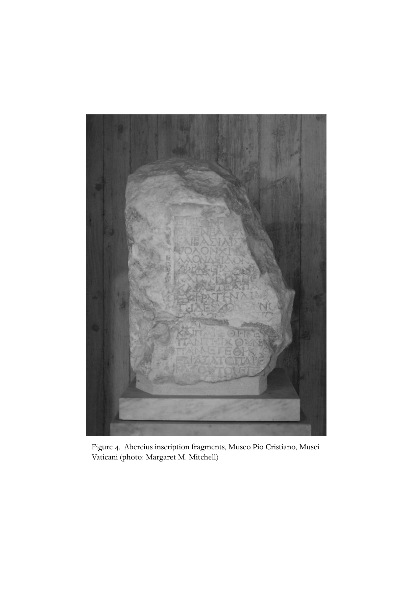

# 第七章英文原文：Social and ecclesial life of the earliest Christians

<!-- PDF page 194; original page 145 -->

### 7. Social and ecclesial life of the earliest Christians

wayne a. meeks

The movement that began with Jesus of Nazareth and would eventually become the Christian church in its manifold varieties developed with astonishing rapidity and exhibited diverse forms from its earliest years. Most of those early developments remain invisible to us, and scholarly attempts to plot their outline must be viewed with scepticism, but roughly we may say, with a modern sociologist, that the movement began as a Jewish sect and was soon transformed into a Graeco-Roman cult.[^p194-1] The evolution was not unilinear. Some experiments, probably more than we can know, failed; others were suppressed by rival groups. We can piece together only fragmentary pictures from several aspects of that process – the social forms of association from the Galilean beginnings to the post-Easter community in Jerusalem and the house congregations in the cities of the Roman empire, the social location of typical converts, forms of worship and ritual and other dimensions of an emerging Christian subculture.

#### Community organisation

Perhaps the most profound innovation that the followers of Jesus introduced into the ancient Mediterranean world was a new form of religious community. There is much truth in the assertion by Adolf von Harnack, in his classic study of ‘the mission and expansion of Christianity’, that by the year 300 ce it was ‘this church itself... through its mere existence’ that had replaced the activity of ‘missionaries’ in apostolic times, and that it was able to do so by indigenising its radical and revolutionary claims into forms that seemed ‘familiar, wished-for, and natural’.[^p194-2] We can gain some sense of both early Christianity’s ‘naturalness’ in its environment and its novelties only by comparing it with contemporary

[^p194-1]: Stark and Bainbridge, Future of religion, 113.

[^p194-2]: Harnack, Mission und Ausbreitung, 526–7, my trans.

<!-- PDF page 195; original page 146 -->
social phenomena. We must keep in mind, however, that we are comparing, on both sides, reconstructions formed from scarce and sometimes random evidence.

#### Jesus and his followers

Several different models can be used to fill out the sparse and often contradictory picture provided by the earliest traditions about Jesus and his adherents. Some features suggest a movement we might call, somewhat anachronistically, political, that is, defined primarily by its response to the situation produced by Roman hegemony.[^p194-3] Other elements in the tradition suggest the quite different picture of a circle of disciples with a teacher,[^p194-4] while others seem to describe the clients and publicists of an exorcist and miracle worker.[^p194-5] Still other parts of the tradition seem to depict Jesus in the specifically Jewish and biblical colours of a prophet,[^p194-6] so that his followers look like an eschatological renewal movement. These different models need not be mutually exclusive.

Keeping in mind that all the stories of Jesus we have in our sources have been transformed by the posthumous reinterpretation that had to take place if the movement was going to continue after his death, the crucifixion itself is the one firm starting place for historical investigation of the group that formed around Jesus.[^p194-7] This form of execution immediately shows us how Jesus and his followers appeared to one key set of observers – the Roman governor and his advisers. The first-century Jewish historian Flavius Josephus describes several movements whose leaders met similar fates at the hands of the Roman authorities, from the time when Judaea was organised as a subprovince under Syria in 6 ce to the eve of the revolt in 66. Josephus writes as a former commander of one group of the Jewish rebel force and as a survivor who had become a client of the Flavian house; he is not an objective observer. In Roman eyes what was important about all the movements Josephus describes was that they were dangerous to the Roman peace in an area perilously close to the eastern frontier. Josephus’ accounts probably magnify the anti-Roman aspects of the story by describing the disturbances with the categories and the animus

[^p194-3]: Note the importance of the title ‘king of the Jews’ in the trial and crucifixion narratives in all the gospels. Revolutionary elements are also clearly implied in the stories of Jesus’ solemn entry into Jerusalem, his attack on practices in the temple, and his prediction of the temple’s destruction and replacement.

[^p194-4]: The portrayal of Jesus as teacher dominates especially the gospel of Matthew.

[^p194-5]: Cf. for example, the sequence of stories in Mark 1:14–3:30.

[^p194-6]: E.g. John 6:14; Acts 3:22–6; Mark 14:65; the many prophetic judgement oracles among the sayings attributed to Jesus, such as Matt. 11:20–4; 21:22–46; Luke 6:24–6; Matt. 10:34–6.

[^p194-7]: See especially Dahl, ‘Crucified Messiah’.

<!-- PDF page 196; original page 147 -->
bred by the later disaster. His interest in distancing all of these movements from the native aristocracy of Judaea, in which he included himself, may also distort his descriptions. He calls several of the leaders ‘bandits’ (lēistai, e.g. AJ 18.7; 20.121, 160, 163, 167, 172, 185, 186), the term he also prefers for the instigators of the revolt under the governor Florus (e.g. BJ 2.434). The same word is used in the gospels to describe the two men crucified with Jesus (Mark 15:27; Matt 27:38, 44) and, in the fourth gospel, Barabbas (John 18:40; note also John 10:8). Others Josephus calls goētai, ‘soothsayers’, ‘charlatans’, though he admits they called themselves prophētai, ‘prophets’ (BJ 1.148–54; AJ 20.160, 167–72, 188). Other leaders, he reports, had royal pretensions (BJ 2.57, 60, 444; AJ 17.272, 273, 278–85).

There are several recurring elements in Josephus’ narratives of failed rebellions that should warn us against a facile separation of ‘political’ from ‘religious’ factors. First, the dramatic images that attracted followers and interpreted their aims echo the sacral traditions of Israel’s past: conquest of the Holy Land would come from the wilderness (AJ 20.167); a dry path would open through the Jordan on command (AJ 20.97); tabernacle implements hidden by Moses on the sacred mountain would be recovered (AJ 18.85–7); the city’s walls would collapse on command (AJ 20.170). Second, the uprisings were thus eschatological: corresponding to the saving events of the past there would come in the immediate future a direct, final intervention by God to transform the social order. Third, the movements were popular, led by figures whose authority was traditional and charismatic, not institutional.

All three features are found in early traditions about Jesus and his followers. They are also characteristics of the community described in the sectarian documents discovered last century in Wadi Qumran in Judaea. In both cases, despite the obvious differences between them, we have to do with something like what modern anthropologists have called a ‘renewal’ or ‘nativist’ movement. In a traditional society that has experienced recent social and cultural change, usually by superimposition of a foreign power, a charismatic leader gathers followers for some transformative programme, cast in imagery drawn from the society’s traditional defining symbols but imaginatively reformulated for the present crisis.[^p194-8]

In the early church’s remembered lore about Jesus and his disciples, there are a number of elements that accord well with the ‘renewal movement’ model. The fact that a group of twelve is singled out – even though the tradition

[^p194-8]: The literature on ‘renewal’, ‘revitalisation’, ‘nativistic’ and ‘millenarian’ movements is vast. One of the early classics is Wallace, ‘Revitalization movements’. Two other examples: Worsley, Trumpet; Burridge, New heaven.

<!-- PDF page 197; original page 148 -->
shows some variation in the specific names – clearly alludes to the eponymous sons of Jacob and the tribes of ancient Israel, thus suggesting some kind of repristinisation of Israel’s identity. Accounts of Jesus’ ‘call’ of disciples, sayings attributed to him that emphasise disruption of occupational and family life and adoption of a mendicant, itinerant existence correspond to the negative phase so often seen in nativistic movements, breaking with settled norms and patterns to make room for ideal patterns of culture reimagined from the past. Such itinerancy characterises the groups described by Josephus, often bringing them to resemble ‘social bandits’,[^p194-9] and the withdrawal of the Qumran group to the desert of Judaea is a parallel phenomenon. The elements of the Christian tradition that focus on Jesus’ relationship with Jerusalem and the temple – the prophecy of the temple’s destruction, the ‘cleansing’ of the temple, and the ‘triumphal entry’ – also fit this pattern.

The other two major organisational patterns – that of a teacher of wisdom with disciples and that of an exorcist-magician having adherents – seem equally deeply rooted in the traditions about Jesus. These two could easily be subsumed under the images of eschatological prophet and renewal movement, for both ‘signs’ and teaching, including the free appropriation of ‘wisdom’ forms of speech, were features of the classic depiction of the prophet in Israel. Not only the prophets of the eighth through the sixth centuries bce, whose oracles had been collected and preserved as scripture, but also Moses and Elijah were paradigmatic.

Corresponding to the locations of Jesus’ own activity as depicted in the gospels, there seem to have been two centres of activity for his early followers. One was in the villages of (mostly) rural Judaea, Galilee and Samaria, the other in Jerusalem.[^p194-10] It is in instructions by Jesus to his delegates or ‘apostles’ that we have our only primary source of information about the way the new sect may have established itself in the village culture of Palestine. There we see itinerant prophets who detach themselves from those ties of place and of family which, especially in a rural setting, ordinarily determine a person’s identity: ‘Foxes have holes, and birds of the air have nests; but the Son of Man has nowhere to lay his head’ (Matt 8:20; Luke 9:58). ‘If anyone comes to me and does not hate his own father and mother and wife and children and brothers and sisters, yes, and even his own life, he cannot be my disciple’ (Luke 14:16; cf. Matt 10:37). On the other hand, they are made dependent for their subsistence upon the villagers to whom they are sent to proclaim their message of the reign of God (see Mark 6:8–11 and parallels).

[^p194-9]: Horsley and Hanson, Bandits.

[^p194-10]: See pt I, ch. 1, above.

<!-- PDF page 198; original page 149 -->
Naturally this picture had been idealised to some extent by the time these traditions were incorporated into the written gospels. Nevertheless, it is clear that wandering, mendicant prophets or apostles played a considerable role in the spread of the Jesus sect in Jewish and Samaritan villages. Their mission was possible because they and the villagers shared a common culture which included not only the theological beliefs, the scriptures and the traditions within which Jesus’ career was interpreted by his disciples, but also the socially familiar role that the disciples themselves acted out, that of the prophet. It is not so clear from our sources what kind of organised group, if any, may have emerged in the villages on those occasions when the prophets’ message was accepted. Presumably there, as in the cities, adherents to the new Messiah would gather in homes for prayers, exhortations and celebration of the ritual meal, and leadership was apparently largely in the hands of the itinerants or their local deputies. In several early Christian documents (most clearly in Matthew and the Didache) there is evidence of conflicts between local and itinerant leaders.

#### Jerusalem

In the Acts of the Apostles and the earlier letters of Paul, we see a group centred in Jerusalem that seems much more stable and structured than the rural movement just described. Leadership was still relatively informal, with an indeterminate number of ‘apostles’ (Gal 1:17, 19; limitation of the title to the twelve is a later schematisation; cf. 1 Cor 15:4–7). Acts speaks also of ‘elders’ (Acts 15:6, 22), recalling local Jewish organisations.[^p194-11] Certain individuals, however, exercised special powers – pre-eminently Peter (Cephas) (Gal 1:18; 2:9; Acts 1:13, 15; 2:14, 37; chs. 3–5; 10; 15:17), often associated with Zebedee’s sons, James and John (Mark 5:37; 9:2; 13:3; 14:33; perhaps these three are the ‘pillars’ Paul refers to in Gal 2:9) and James ‘the brother of the Lord’ (Gal 1:19; 2:12; Acts 12:17; 15:13; 21:18; cf. Gos. Thom. 12). James’ rise to power in the movement contrasts with the traditions of earlier hostility towards Jesus from his immediate family (Mark 3:31–5 and parallels; John 7:3–5). Acts depicts a tightly organised sect, practising community of possessions (2:44–5; 4:32–7;

[^p194-11]: Presbyteroi (‘elders’): CII 378, 581, 590, 595, 597, 663, 692; in Lifschitz’s addenda to the 1975 edition, 650c, 650d, 653d, 731f; Noy, Jewish inscriptions, vol. i: 59, 62, 71, 75, 148, 149, 157, 163, 181; gerousia and gerousiarchēs: CII 9, 95, 106, 119, 147, 189, 301, 353, 355, 368, 405, 408, 425, 504, 511, 600, cf. Frey’s comments, pp. lxxxvf; Mazar, Schwabe and Lifshitz, Beth She’arim, 141 (vol. ii, 127–8); Noy, Jewish inscriptions, vol. i: 18, 23, 76, 87, 163; vol. ii: 86, 96, 130, 189, 238, 321, 351, 354, 389, 487, 521, 554, 555. Cf. 1 Macc 7:33; 11.23; 12:35; 13:36; 14:20, 18; 2 Macc 11:27; 13:13; 14:37; 3 Macc 1:8; 6:1; Judith 6:16; 7:23; 8:10; 10:6; 13:12. Gerousia at Alexandria: Philo, Flacc. 74; Josephus, BJ 7.412; in Jerusalem: Josephus, AJ 12.138.

<!-- PDF page 199; original page 150 -->
5:1–11), in some ways like a philosophical school, yet publicly exhibiting Jewish piety, especially in the temple, and in many ways resembling the Pharisees. Major parts of this picture are probably the results of idealisation and the special apologetic and theological aims of the writer of Acts. Actually we can be certain of very little about the forms that the first Christian communities in Jerusalem took. Yet they must have been of crucial importance for the next, decisive phase of Christian development, the move to cities outside the land of Israel.

#### The cities and colonies

A laconic sentence in Acts provides our only substantial clue to the beginning of the urban, inclusive mission that set the pattern for Christianity’s expansion:

Now those who were scattered because of the persecution that arose over

Stephen travelled as far as Phoenicia, Cyprus and Antioch, speaking the Word

to none except Jews. But there were some of them, Cypriots and Cyrenaeans,

who on coming to Antioch spoke to the Greeks also. (Acts 11:19–20)

Stephen’s circle is identified with a wing of the Jerusalem Christian group called Hellēnistai (Acts 6:1), that is, converts from the Greek-speaking Jews of Jerusalem, many of whom had probably been reared in diaspora cities and later resettled in Judaea (cf. 6:9).[^p194-12] If this statement is historically reliable, it was these Greek-speaking, Christian Jews who began the self-conscious mission to Gentiles, and the great metropolis, Antioch on the Orontes, was the startingpoint. It was in that city that the former Pharisee Paul of Tarsus, after his conversion, served his apprenticeship as a Christian missionary – his earlier venture into the Nabataean kingdom (‘Arabia’, Gal 1:17) had apparently not been successful (cf, 2 Cor 11:32–3, and note that Arabia is not included in the ‘circle’ Paul outlines in Rom 15:19). According to Acts, it was in Antioch, too, that the followers of Messiah Jesus were first called Christianoi (Acts 11:26), most likely by outsiders who now recognised them as a sect distinguishable from the main Jewish community.

We know of a number of other cities into which Christianity was introduced within a decade or so of Jesus’ execution, including Damascus and Rome, and we may guess from later evidence that Christian groups were established early in the cities of Egypt and North Africa. Unfortunately, however, we have

[^p194-12]: In nineteenth- and early twentieth-century scholarship, the ‘Hellenists’ were often assumed to be an organised party in opposition to the ‘Jewish Christians,’ and the conflict between them was taken to be the major force driving the evolution of early Christianity toward the ‘synthesis’ of ‘early catholicism.’ For a convincing refutation of this view, see Hill, Hellenists and Hebrews.

<!-- PDF page 200; original page 151 -->
little or no reliable information about the beginning of any of those churches. It is only the mission of Paul and his wide-flung network of associates for which we have abundant primary evidence, thanks to the survival of letters, written by both Paul and his disciples, and to the central role accorded to Paul by the author of Acts. These sources reveal an intense effort over three or four decades, which planted Christian groups in cities on the trade routes of central and western Asia Minor, Macedonia and Greece. It is not unreasonable to assume that Christians in other places used strategies and developed social forms similar to those of the Pauline circle, but there may have been many local peculiarities of which we have no knowledge.

The key to the urban Christian strategy was the private household. Not only do we hear several times in Acts of the conversion of some person ‘with all his [or her] household’ (16:15, 31–4; 18:8; cf. 10:1; 11:14; John 4:53), but Paul also recalls baptising households (1 Cor 1:16; cf. 16:15–16), and in his letters he several times expressly mentions ‘the assembly (ekklēsia) at N’s house’ (1 Cor 16:19; Rom 16:5; Phlm 1; Col 4:15). However, the ‘basic cell’[^p194-13] of the Christian movement in the cities was not simply the household gathered for prayer. Some groups formed in households headed by non-Christians, like the four named in Romans 16:10, 11, 14, 15, not to mention the familia Caesaris (Phil 4:22). Conversely, not every member of a household always became a Christian when its head did, as the case of the slave Onesimus shows (Phlm 8–21). It was not unusual for a householder of some wealth to become the patron of one of the clubs or guilds that flourished so abundantly in the early Roman empire. Sometimes cultic associations with such patronage incorporated much of the household, as in the famous Dionysiac association founded by Pompeia Agrippinilla in Tusculum (early second century ce).[^p194-14] In other instances, the patron had no direct connection with the group he assisted, save for the honours that the clients returned for the favours rendered; for example, a number of synagogue inscriptions record benefactions by pagans (cf. Luke 7:5). The formation of the Christian ‘assemblies’ thus followed a familiar pattern.[^p194-15]

In a number of ways, however, the Christian groups of the first century were quite different both from typical cults in the Roman world and from other kinds of voluntary associations, such as craft guilds, which they otherwise resembled. Although the Christians had developed their own special rituals,

[^p194-13]: The phrase is from Gülzow, ‘Die sozialen Gegebenheiten’, 198.

[^p194-14]: IGUR 160; Vogliano, ‘La grande iscrizione’, 215–31; McLean, ‘The Agrippinilla inscription’.

[^p194-15]: Meeks, First urban Christians, ch. 3; Klauck, Hausgemeinde und Hauskirche; White, Social origins. Patrons of Jewish communities: Lifshitz, Donateurs et fondateurs.

<!-- PDF page 201; original page 152 -->
these were not conspicuous to outsiders. Christians had no shrines, temples, cult statues or sacrifices; they staged no public festivals, musical performances or pilgrimages. As far as we know, they set up no identifiable inscriptions. On the other hand, initiation into their cult had social consequences that were more far-reaching than initiation into the cults of familiar gods. It entailed incorporation into a tightly knit community, a resocialisation that demanded (and in many cases actually received) an allegiance replacing bonds of natural kinship, and a submission to one God and one Lord excluding participation in any other cult. Moreover, this artificial family undertook to resocialise its members by a continual process of moral instruction and admonition; hardly any aspect of life was excluded from the purview of mutual concern, if we are to believe the writings of the movement’s leaders. The church thus combined features of household, cult, club and philosophical school, without being altogether like any of them.

The Christian cult groups were unusual in another respect as well. While the household assembly was Christianity’s toehold in the life of the Graeco-Roman cities, each of these cells of a dozen or so persons was made constantly aware of being part of a much wider movement. The concept of a single people of the one God was a self-image that the sect had inherited from Judaism. This notion was broadened, reinforced and given practical form in two ways. Mythically, the messianic ideology of the Christians drew upon the great stories of creation and human origins in the book of Genesis – as was the beginning, so must be the end. The earliest reports of baptismal rituals are thus filled with allusions to paradise and fall: in Christ the initiate puts on again the image of God lost by Adam; in him the primeval unity of Jew and Greek, slave and free, male and female is restored (cf. Gal 3:27f.; 1 Cor 12:13; Col 3:5–15). In this mythic complex is probably to be found much of the ideological basis for the vigour of the mission to Gentiles. In turn, the practical requirements of that mission themselves reinforced the ideology of unity. The pax Romana and Roman road building, together with the earlier spread of the Greek language in cities of the eastern half of the empire under Alexander and his successors, had made possible an unprecedented ease of travel and communication. The Christian apostles exploited this facility, and their need for support for their travel and for continuing contact with and supervision of churches already founded led them to develop an extraordinary network of ‘fellow workers’, delegates and messengers. The apostolic letter, real and pseudonymous, became one of the two most important genres of Christian literature. Ironically, the ideology of unity led often to schism, for, if two factions could not convince each other of their respective versions of the single truth, they were obliged to separate.

<!-- PDF page 202; original page 153 -->
Thus the history of schisms and the very concept of ‘heresy’ that emerged in the second century are ironic testimonies to the ideal of unity and the practical drive to enforce it. That drive would eventually produce, by the time of Constantine, an empire-wide complex of institutions which in some ways mirrored the empire’s own provincial bureaucracy.

#### The invention of church ‘offices’

One of the most important and distinctive developments in the organisation of the ancient church is the establishment of what came to be called ‘the monarchical episcopate’, that is, governance of Christian groups in each city by a single bishop (Greek episkopos, ‘overseer’), superior to other orders of clergy called ‘elders’ (presbyteroi) and ‘deacons’ (diakonoi). As the movement spread, beginning in the second century, back into the countryside, the urban bishops presided, in principle, also over the Christians in the towns and villages dependent upon their city – the region known as the chōra in Greek. Yet this development, so significant for the future shape of the church, is exceedingly difficult to trace in detail, and its history remains controversial – partly because it is hard for modern historians to escape from the tendentious reading of the sources during centuries of polemics between Protestant and Catholic interpreters in the west, partly because the sources are themselves obscure. Here we can only touch upon a few of the issues.

The propensity of the Christian movement to create both local and translocal institutions did not ensure early uniformity of structure, but the contrary. From the references to organisation in the New Testament and other early documents, we get the impression of considerable variety and experimentation, and also of frequent conflict not only between different figures and groups, but also between different modes of authority. For example, people whose authority came from their social position, like the householders and patrons of household communities, could clash with charismatics, like local or visiting prophets (e.g. 1 Cor 12–14; 3 John). Local leaders could clash with itinerants, and different travelling ‘apostles’ might teach quite different beliefs and forms of behavior (e.g. Did. 11–13; 15).

Although inscriptions from the numerous voluntary associations with which the early Christian groups are often compared show an exuberance of nomenclature for offices – most often imitating such municipal offices as prytanis (‘president’), treasurer, secretary, decuriones (‘city councilmen’), quinquennales (‘[five-year] magistrates’) and the like – there is no comparable evidence from the earliest Christian groups. In Philippi (Macedonia), we do hear of episkopoi and diakonoi, addressed as apparently distinct local functionaries

<!-- PDF page 203; original page 154 -->
in Paul’s letter to that church (Phil 1:1, to be dated in the 60s) but there is no hint of their responsibilities.[^p194-16]

It is in the letters of Ignatius of Antioch, written in the time of Trajan, that the three orders of clergy are first clearly distinguished. Ignatius uses these letters and his visits to churches along his route to Rome – and indeed his carefully dramatised progress toward martyrdom[^p194-17] – to campaign for a central and unifying role for the bishop. Yet in the Pastoral Letters (1, 2 Tim, Tit), which most scholars date near the time of Ignatius or somewhat later, and whose fictive locale overlaps with the areas addressed by Ignatius, bishops and presbyters are not yet clearly distinguished (1 Tim 3:1–7; 5:17–22). From these and other sources it is evident that establishment of the single bishop did not happen in all places at once, nor did it come about without resistance.

Modern church historians usually interpret the resistance to the episcopate as an instance of the conflict between ‘charismatic’ and ‘institutional’ modes of authority. The classic depiction of such a conflict is found in the ‘Teaching of the twelve apostles’, an early manual of church practice commonly known from the first word of its title in Greek as the Didache. The Didache undertakes to regulate the reception in local congregations of itinerant ‘apostles’ and ‘prophets’ (ch. 11–13). Then, in language much like that found in the Pastoral Letters, Didache 15:1–2 prescribes the appointment of ‘bishops and deacons’, with the explanation, ‘for they also provide for you the service of the prophets and teachers’. The appointed officers are to have equal ‘honour’ with the itinerants. Certainly there were conflicts between such ‘official’ authorities and the more unregulated modes of power, exercised by persons whose claim to be heard depended upon the perception by their hearers that they were bearers in special ways of the divine Spirit, quite apart from any formal mechanisms for selecting them. It was this conflict, as understood by late nineteenth-century church historians, upon which Max Weber based his well-known sociological typology of the modes of dominance.[^p194-18]

However, there was no single line of evolution from ‘charismatic’ to ‘everyday’ or ‘routinised’ structures of authority. Both institutionalisation and

[^p194-16]: Hatch, Organization, 36–51, thought episkopos and diakonos were terms probably borrowed from the titulature of voluntary associations, but the terms are quite rare in club inscriptions, and, where they do appear, seem to have denoted rather minor functions. For the internal organisation of the associations, see, for Latin examples, Waltzing, Corporations professionnelles, vol. ii, 334–515; Greek counterparts, Poland, Geschichte, 327–423.

[^p194-17]: On the ‘theatricality’ of Ignatius’s journey and his letters, see Schoedel, Ignatius, 11f and passim.

[^p194-18]: Weber, Theory of social and economic organization, 324–92.

<!-- PDF page 204; original page 155 -->
conflicts over authority began in the earliest days of the Christian movement, as we have seen, and ‘charismatic’ figures challenged the emerging episcopal structure in a variety of ways throughout the period of our interest and long afterward. The most obvious examples are the Montanist movement of the late second century and the prerogatives accorded to ‘confessors’ during persecutions, reaching a climax in the Decian persecution (mid-third century).[^p194-19] Moreover, the line of conflict was not always drawn between bishop and charismatic, for the principle of election of the bishop by acclamation of the congregations meant that a person with strong popular support might be elevated to the office.[^p194-20] Popular support, to be sure, might be won by other graces than charisma. From the beginning of urban Christianity, patrons were important for the establishment and sheltering of congregations, and a patron had to have some economic and social position in order to provide the needed services. It was natural that in time the bishop would come to serve in lieu of as well as alongside lay patrons. In the third-century church we see instances of elevation to the bishopric of people who had been prepared by wealth and status to act as patrons and who, as bishops, did make use of wealth and connections to exert control over their churches, in ways quite familiar in ordinary Roman society.[^p194-21]

One of the main reasons for the development of centralised authorities was the necessity for controlling deviant behaviour and belief. Deviance was peculiarly threatening, not only because of the comparative weakness of the groups, but also because of the universal claims which the movement made for itself. In the early decades of the Christian movement, only informal and ad hoc means were available for coping with disagreements. Individual deviants were subject to persuasion and censure by other individuals, including ‘prophets’, ‘apostles’ and other leaders in a meeting of the household assembly. The strongest sanction was shunning by the other Christians, especially by banning from the common meals, or expulsion altogether from the community (1 Cor 5:1–13; Matt 18:15–18; 2 Thess 3:14–15). To be sure, physical harm by magical means was also threatened (1 Cor 11:30; Acts 5:1–11; Rev 2:22–3; cf. 1 Cor 5:5), but Christian use of force on a regular basis to suppress deviance had to wait for the post-Constantinian alliance with state power.

[^p194-19]: See pt iv., ch. 21 and pt vi, ch. 28, below.

[^p194-20]: Did. 15; 1 Clem. 44; Cypr. Ep. 55.8; cf. Frend, Rise of Christianity, 403; Chadwick, Early church, 50, 165.

[^p194-21]: Cyprian is a prime example. See Bobertz, ‘Patronage networks’, and ‘Development of episcopal order’.

<!-- PDF page 205; original page 156 -->
Disagreement among leaders was even more threatening to the group’s stability than deviance by ordinary members – successful handling of the latter could in fact strengthen coherence – but means for dealing with it were more difficult to achieve. Essentially there were available only persuasion and influence, exercised mostly through the familiar means of Graeco-Roman rhetoric within the structures of amicitia (‘friendship’, i.e. reciprocity among social equals) and clientela (reciprocity between social superiors and their dependents). Classic instances of rhetorical persuasion and invective aimed at winning allegiance to one set of leaders rather than another are Paul’s letter to the Galatians and 2 Corinthians 10–13. Consultation among disagreeing leaders was sometimes successful (Gal 2:1–10; Acts 15), sometimes not (Gal 2:11–13; Rev 2:21).

Unresolved differences usually led to separation between disagreeing leaders and their followers. Sometimes the separation was amicable, functional and by formal ‘contract’, as in the Jerusalem meeting (Gal 2:9). More often, the result was a splintering of the Christian movement, a ‘schism’ (1 John 2:19). Because the earliest urban congregations, as we have seen, were small associations meeting in private houses, such division could be effected by refusal to admit to the house representatives of other groups, the itinerant ‘prophets’ and ‘apostles’ who were the principal agents of the church’s translocal development (2, 3 John).

#### Social position

In the late second century a philosopher named Celsus wrote a long, well-informed pamphlet against Christianity. Among his principal criticisms was that the movement appealed only to the uneducated, to ‘slaves, women and little children’, and to workers in despised trades (Origen, C. Cels. 3.44). This was a common complaint against the new cult by pagan writers, and Christian apologists frequently undertook to refute it.[^p194-22] Yet, at the beginning of the century, Pliny the Younger had noted with alarm that people ‘of every rank’ (omnis ordinis) were in danger of being denounced as Christians, an assessment proudly echoed a century later in North Africa by Tertullian (Apol. 37.4). Christianity’s location within the structure of ancient society was in fact complex and variable.

[^p194-22]: For example, Min. Fel. Oct. 36.3–7; Justin, 2 Apol. 10.8; Tat. Orat. 32; Tert. Apol. 37.4.

<!-- PDF page 206; original page 157 -->
#### The social level of the early Christians

The followers of Jesus have often been called ‘peasants’, but that is a very imprecise use of the term, which in its most direct and simplest sense denotes ‘free men and women whose chief activity lay in the working of the land with their own hands’.[^p194-23] The gospel traditions depict Jesus himself as a tektōn or the son of one (Mark 6:3; Matt 13.55), thus of a family of independent carpenters or builders. Among his disciples are sons of fishing families with slaves and hired workers; one is a ‘tax collector’ (Mark 1:16–20; 2:14). Support for the itinerant band is provided by women who evidently have some means, including the wife of a commissioner of the tetrarch (Luke 8:2–3). In the cities, as we have seen, the patronage of householders, some of whom had wealth and even civic status, like Gaius and Erastus of Corinth, was indispensable. There were slaveholders as well as slaves among the faithful.

The range of social status in the early Christian groups thus seems very nearly to replicate that of the society at large, omitting the two extremes – the Roman aristocracy and the agricultural and mining slaves and the land-less peasants. If there is anything peculiar about the social complexion of the Christians, it is precisely the mixing of these varying levels in such intimate communities, though efforts were made in many cases, as we have seen, to maintain a sense of hierarchy within the groups. There is some evidence, moreover, that a mixing of status indicators characterised many of the individuals who were attracted to Christianity – especially those who became its leaders. In the Pauline mission, which is the only circle of the movement for which we have substantial evidence, those individuals prominent enough to be identified either in the letters or in the Acts are typically persons of inconsistent status. That is, they rank high in some indicators of status, such as wealth or prestige within the sect, but low in others, such as servile origins, mercantile sources of their wealth or the fact that they are women.[^p194-24] More general statements in the early Christian letters and other paraenetic literature give us the impression that a great many of the converts were free traders or artisans, some of whom were reasonably well off, but many of whom could identify with ‘the poor’ – not merely the working poor, Greek penētes, but the destitute ptōchoi – whose cause is often upheld in early Christian aphorisms and admonitions, as it had been in Jewish wisdom literature. The epistle of James, for example, castigates Christians who would be tempted to honour a visitor who wore a splendid

[^p194-23]: MacMullen, ‘Peasants’, 253.

[^p194-24]: Meeks, First urban Christians, ch. 2.

<!-- PDF page 207; original page 158 -->
toga and the gold ring of nobility while despising a ptōchos who entered the assembly:

Did not God choose those who are ptōchoi in the world but rich in faith and

heirs of the kingdom...? Is it not the rich who oppress you and who haul you

into court? ( James 2:1–7)

Care for the poor by Christians who were better off was an obligation, already familiar in Jewish communities, that was frequently urged by Christian writers. ‘Remember the poor’ was the one requirement laid on Gentile Christian communities by the Jerusalem apostles, as Paul reported the event (Gal 2:9), and he laboured valiantly to make good on his promise to collect money from the churches he had founded for ‘the poor among the saints at Jerusalem’ (1 Cor 16:1–4; 2 Cor 8–9; Rom 15:25–8), though he saw in this evidently not merely charity but also an expression of equity (isotēs) among the churches, particularly solidarity between the Gentile Christians and the mother church of Jerusalem. Acts draws on the classical tradition of friendship as well as the Deuteronomic picture of Israel in the wilderness to depict an ideal community of goods under the apostles in Jerusalem (Acts 4:32–5). The Didache, dating in its final form from the mid-second century, retained the ideal: ‘Do not turn away the needy, but share everything with your brother, and do not say that it is your own’ (4:8), but reveals in another place also a certain practical scepticism: ‘Let your alms sweat in your hands until you know to whom you are giving’ (1:6). Around 175 ce, Dionysius, bishop of Corinth, praised the Roman church as a benefactor of Christians ‘in every city’, helping the poor and even furnishing aid to the brothers condemned to the mines (Eusebius, HE 4.23.10). The satire of Lucian on the sometime Christian Peregrinus Proteus attests to the care which Christians were accustomed to take for brothers in trouble (De mort. Peregr. 12–13). It is reported that in Rome itself, at the middle of the third century, the orthodox clergy were assisting 1,500 needy persons (Cornelius according to Eusebius, HE 6.43.11).

Some evidence for the social level of at least the leaders of the Christian movement may be inferred from the style of their surviving writings. It varies widely. In the New Testament, it ranges from the barbarous grammar of the Apocalypse and the crude but not artless parataxis of Mark to the carefully composed periodic preface to Luke-Acts and the more polished rhetoric of the epistle to Hebrews and 1 Peter. Paul shows a mastery of the language, some acquaintance with rhetorical and philosophical topoi and a strong natural sense of rhetorical effect. However, there is no trace in Paul’s letters of the atticising high style that was coming into vogue in the schools, and it remains doubtful

<!-- PDF page 208; original page 159 -->
whether he had received formal education at the tertiary level.[^p194-25] With some cogency the style of early Christian literature has been compared with that of ‘professional’ handbooks – medical, pharmacological and the like – with the ‘diatribe’ of philosophical schools and with such popular literature as the Greek romances.[^p194-26] By the late second and early third centuries, a number of Christians with advanced education and sophisticated style were writing: Origen and Clement of Alexandria, Athenagoras of Athens and the Latin writers Minucius Felix and Tertullian. It is clear that there was a drift upward in the social scale as Christianity became older and more established.[^p194-27]

Even in the first century, as noted above, a few persons of higher status were attracted to Christianity. Erastus of Corinth, named in Romans 16:23 as ‘city treasurer’, is probably the same person who, a few years later, paved the court of the theatre in return for being elected aedile of the colony.[^p194-28] The author of the two-volume work received into the canon as the gospel of Luke and the Acts of the Apostles dedicated it to his patron, whom he addressed as kratistos, ‘most excellent’, equivalent to the Latin egregius, Theophilus. Theophilus was apparently a Christian or a catechumen (Luke 1:1–4). This author was careful to portray Christianity as attracting the favourable attention of people in high station – persons of ‘first rank’, especially women, in both Thessalonica and Beroea (Acts 17:4, 12); the governor of Cyprus, the senator Sergius Paulus (13:12); Dionysius ‘the Areopagite’ of Athens (17:34); Asiarchs in Ephesus (19:31); and of course Paul himself, depicted as a Roman citizen by birth despite being both a provincial and a Jew (16:37–6; 22:25–9; 25:10–12). Though we may suspect that the author has exaggerated, it is unlikely that all these reports are fabricated.

#### Worship and ritual

The early Christian groups, as we have seen, resembled the other kinds of voluntary associations that were so common in the cities of the Roman empire – burial societies, craft and professional clubs, philosophical schools, cultic associations and unions of immigrants – especially those that met, as the Christians did, in private households. As we have noted, in the early decades

[^p194-25]: See pt iii, ch. 8, below.

[^p194-26]: See e.g. Rydbeck, Fachprosa; Alexander, Preface to Luke’s gospel; Aune, New Testament in its literary environment; Aune, Greco-Roman literature; Malherbe, Paul and the popular philosophers.

[^p194-27]: Cf. Eck, ‘Eindringen’, and pt iii, ch. 14, below.

[^p194-28]: Inscription 232 in Kent, Inscriptions 1 926–1 95 0, 99f and plate 21; Meeks, First urban Christians, 58f; Murphy-O’Connor, St Paul’s Corinth, 37.

<!-- PDF page 209; original page 160 -->
the new movement had none of the trappings of public religion – shrines or temples, cult statues, sacrifices, professional priesthood, processions and festivals. Yet most of the clubs with which first-century observers might have compared the Christian group practised a number of rituals that we would call ‘religious’, usually explicitly invoking various deities. So, too, from the earliest moment for which there is any clear evidence, the devotees of Messiah Jesus developed ritual practices of their own, which served both to shape and reinforce the movement’s varied but specific forms of life and belief and to help distinguish it from other groups and to separate its defining occasions from the routines of everyday life. Two of those practices are attested so widely and so early that we may say without exaggeration that they are constitutive of the movement: an initiatory ceremony centring on a water bath, called in Greek ‘dipping’ (baptismos), and a common meal first called the ‘dominical meal’ (kyriakon deipnon, usually translated ‘the Lord’s Supper’), later, from a prayer that came to be one of its central set-pieces, ‘the thanksgiving’ (eucharistia). Even though both rituals are often mentioned, we do not have full descriptions of the entire practice of either until the fourth century. Moreover, there are good reasons to think that practice varied widely from place to place and from one circle of Christianity to another. Consequently only a fragmentary picture of these two fundamental ritual practices can be drawn for the first two centuries.

#### Baptism: ritual of initiation

The central action of baptism was a bathing or washing, as the name suggests. So Justin, in the middle of the second century, could call the ritual as a whole ‘the bath’ (loutron, 1 Apol. 1.61.4, 12; 62.1). In one of the earliest references to the rite, a century earlier Paul could say, ‘You were washed’ (1 Cor 6:11; cf. Eph 5:26; Heb 10:22). Just how and where the washing was done, our earliest sources do not tell us. The fact that it could be equated metaphorically with burial (Rom 6:4; Col 2:12) suggests complete immersion in water. That would make it analogous to Jewish ritual baths. Immersion is the norm in a fourth-century compilation of various traditions reconstructed by modern scholars and until recently identified with the lost ‘Apostolic tradition’ attributed to Hippolytus of Rome.[^p194-29] The Didache, representing practice perhaps as early as the beginning of the second century, probably in Syria, also assumes immersion to be normal, but it allows that if sufficient water for immersion is not at hand, water may be

[^p194-29]: This identification has now been convincingly refuted by Bradshaw, ‘Redating’; Bradshaw, Johnson, and Phillips, Apostolic tradition.

<!-- PDF page 210; original page 161 -->
poured three times over the head (7:3). The latter must have been a frequent arrangement, for it corresponds with most early artistic depictions of baptism, in Roman catacombs and on sarcophagi of the third century and later. The earliest identifiable Christian meeting house known to us, at Dura Europos on the Euphrates, dating to the early third century, contained a baptismal basin too shallow for immersion.[^p194-30] Obviously local practice varied, and practicality will often have trumped whatever desire leaders may have felt to make action mime metaphor.

‘Washing’ in a ritual context implies a metaphorical complex dominated by the contrast between ‘pure’ and ‘impure’. Very often in ancient religion, among both Jews and Greeks and Romans, that contrast set a boundary around a sacred space, with washings required for entrance; would-be initiates into mystery cults would also in the days before it undergo preparatory rites involving water.[^p194-31] For the early Christians, however, baptism was not a preparation for initiation; it was the initiation. Its primary function was not to draw boundaries between places and times, but to draw a social boundary – between the group and the ‘world’. By making the cleansing rite alone bear the whole function of initiation, and by making initiation the decisive point of entry into an exclusive community, the Christian groups created something new. The bath for them marked a permanent threshold between the ‘clean’ group and the ‘dirty’ world, and ‘clean’ was equated, as so often in Jewish tradition, with ‘holy’. Those who have been baptised are now to exhibit their ‘holiness’ in their behaviour, ‘not... like the Gentiles who do not know God’, ‘for God did not call us to impurity but in holiness’ (1 Thess 4:5–7; cf. 1 Cor 6:11; 12:2; Gal 4:8; 1 Peter 2:12; 4:3). Almost certainly Jewish practice, the tebilah, was the ultimate model for the Christian initiatory bath, but at a twofold remove – transformed first through the eschatological rite of John the Baptist, who thus dramatised the need of all Israel to be purified in order to be ready for the impending reign of God, and, second, through association with the story of Jesus.[^p194-32]

In ritual systems, neither ‘purity’ nor ‘holiness’ necessarily has anything to do with moral evaluations, but it is very common for purity and holiness to represent moral correctness, or for moral soundness to be a necessary prerequisite for ritual purity. John’s baptism was clearly understood by his contemporaries as fusing the ritual and the moral. The earliest accounts of John describe his action as ‘a baptism of repentance for forgiveness of sins’ (Mark 1:4; Luke 3:3; Acts 13:24; 19:4; cf. Matt 3:2, 11 and Josephus, AJ 18.116f.).

[^p194-30]: See pt vi, ch. 32, below, and Fig. 6.

[^p194-31]: Mylonas, Eleusis, 194 and fig. 70; Kerényi, Eleusis, fig. 14; Apul. Met. 11.23.

[^p194-32]: On the antecedents of Christian baptism, see esp. Dahl, ‘Origin of baptism’.

<!-- PDF page 211; original page 162 -->
Christian baptism, too, is often connected with repentance and forgiveness, implying that radical change of life called ‘conversion’ in some philosophical circles (Luke 24:47; Acts 22:16; 26:20; Ep. Barn. 11:1; Justin, 1 Apol. 61; Acts Thom. 132).[^p194-33] Members of the new Christian group, however, were careful, at least according to the book of Acts, to distinguish baptism ‘in the name of the Lord Jesus’ from the baptism of John (Acts 19:5). The formula, ‘in the name of (the Lord) Jesus (Christ)’ was used very early and very widely (1 Cor 1:13; Acts 2:38; 8:16; 10:48; Did. 9:5). Soon it was expanded into the threefold formula, ‘in the name of the Father and of the Son and of the Holy Spirit’ (Matt 28:19; Did. 7:1; Justin, 1 Apol. 61.3; Acts Thom. 49; 121; 132; 157; Acts Pet. [according to the Actus Vercellenses manuscript] 5; cf. already 1 Cor 6:11).

Although three of the four canonical gospels recount Jesus’ own baptism by John, it is not connected expressly with Christian baptism until the early second century, when Ignatius says that Jesus was baptised ‘in order to purify the water by his own submission [or suffering]’ (Ign. Eph. 18.2). Instead, it is Jesus’ death that is most clearly linked early on with baptism (cf. Mark 10:38; Luke 12:50), which can be equated with dying and rising with Christ. Reminders of baptism in the epistles express the equation in the language of analogy: ‘As Christ was raised from the dead... so also we...’ (Rom 6:4), in the language of participation: ‘We have been baptised into his death’ (Rom 6:3), and by verbs compounded in syn-, ‘with’ (Rom 6:4, 8; Col 2:12–13; Eph 2:5–6). A variation of this theme describes the state of the convert prior to baptism as itself death; baptism is a death of death, the beginning of life (Col 2:13; Eph 2:1,5). From the notion of dying and rising with Christ in baptism, it was but a short step to think of the baptised person as ‘reborn’ ( John 3:3–5; Titus 3:5; 1 Peter 1:3; Justin, 1 Apol. 61.3; Herm. Sim. 9.16.4; Acts Thom. 132). Accordingly, representations of baptism in early Christian art usually depict the initiate as a child. In some circles, best attested in the Pauline letters, clothing removed before baptism symbolised death with Christ as taking off ‘the old human (anthrōpos)’, ‘the body of flesh’ and the vices associated with it. The removal of the old body could be called ‘the circumcision of Christ’ (Col 2:11), that is, the Christian equivalent of Jewish circumcision of proselytes. What was ‘put on’ was Christ himself, ‘the new human’, who was ‘being renewed... according to the image of his creator’ (Col 3.10).

The early Christian poem quoted by Paul in Phil 2:6–11 was probably used sometimes in baptismal contexts. It climaxes with a scene of invisible powers

[^p194-33]: On conversion in philosophical circles, the classic work is Nock, Conversion. See also Malherbe, Paul and the Thessalonians, 21–33; Meeks, Origins, 18–36; Cancik, ‘Lucian on conversion’.

<!-- PDF page 212; original page 163 -->
in heaven, earth and the underworld all prostrating themselves and confessing, ‘The Lord is Jesus Christ.’ Very likely the newly initiated Christian thus bowed and confessed. This confession would appropriately signify the change of dominion the baptised person had undergone, from the world ruled by demonic powers, the ‘elements of the world’, to the realm in which ‘the living God’ and his Son the Christ reign. From this new Lord the initiate receives certain gifts: the Spirit and adoption as God’s child – to which an early response was ‘Abba! Father!’ (Gal 4:6; Rom 8:15). Eventually baptism was followed by anointing with oil – widely attested from the late second century on – and possibly there is a hint of such a practice, and its association with the gift of the Spirit, much earlier, in 2 Cor 1:21 (cf. 1 John 2:20). By the mid-second century, according to Justin, the newly baptised were led immediately to the eucharist (1 Apol. 65–6; cf. Plin. Ep. 10.96; Did. 7–9).

#### The Lord’s supper

Ritualised meals were a ubiquitous part of social and religious life in antiquity. Yet, just as baptism became an initiatory ceremony that was novel in comparison with other ritual baths, ‘the dominical banquet’ or ‘Lord’s supper’ (kyriakon deipnon) developed unique symbolism and practices. The meal was the focus of regular gatherings of the initiated converts in the households of their local patrons. The book of Acts speaks of ‘the breaking of bread’ as one of the constitutive practices of the baptised followers of Jesus (Acts 2:42, 46; 20:7; 27:35; cf. Luke 24:28–35). Their neighbours would not have been surprised, for voluntary associations of all kinds gathered on solemn occasions for banquets that were always more or less ritualised. The symposion (‘drinking together’) of upper-class men was so much a part of classical Greek social life that it produced a special form of literature, still very much alive in early Christian times.[^p194-34] Even the shape of the Passover Seder as we know it from rabbinic sources and in practice still today replicates the general pattern of the symposium.[^p194-35] Any Gentile reading Luke’s description of Jesus’ last Passover meal with his disciples (Luke 22:14–38) would have seen a typical symposium of a teacher with his male students – though the reported topics of their discussion around the table are unusual, to say the least. The clubs that were so much a part of urban life in the Greek and Roman world met on regular occasions to eat and drink, and the inscriptions they erected frequently contain detailed rules for the provision of wine and food and behaviour at

[^p194-34]: See Murray, ‘Symposium’ and ‘Symposium literature’.

[^p194-35]: As exemplified by Josephus, BJ 6.423 and Philo Spec. 2.148.

<!-- PDF page 213; original page 164 -->
table.[^p194-36] Eating in the presence of the gods was common, too, and every temple of any size included a dining room. Lacking a house of sufficient capacity for a banquet, a private person would often invite friends to dinner in one of these cultic establishments: ‘Herais asks you to dine in the (dining) room of the Serapeion at a banquet of the Lord Sarapis tomorrow, the eleventh, from the ninth hour.’[^p194-37] The invitation might be issued in the name of the god himself: ‘The god invites you to a banquet taking place in the Thoereion tomorrow from the ninth hour.’[^p194-38] A banquet ‘in the name of the Lord Jesus’ would not in itself seem more unusual than ‘a banquet of the Lord Sarapis’.

Nor would it seem surprising that a solemn meal was held ‘as a memorial’ [anamnēsis] of a person who had died (1 Cor 11:24–5; Luke 22:19). Funeral meals and meals on specified anniversaries of the death were celebrated in both Greek and Roman cultures over several centuries, and evidence is also abundant for similar customs among the Jews, both before and after they entered the sphere of Greek and Roman culture. The burial societies that proliferated in Roman imperial times often included such memorial meals among the benefits they offered their members. Inscriptions tell us of foundations that were endowed to fund banquets and other rites ‘as a memorial’.[^p194-39]

The Christian supper not only remembered Jesus in a general way; it also commemorated a very particular occasion. The earliest description we have of the meal, citing a tradition going back to Jesus himself – ‘I received from the Lord (the tradition) which I handed on to you’ – is that:

The Lord Jesus, on the night on which he was betrayed, took bread and, having

given thanks [eucharistēsas], broke it and said, ‘This is my body, which is for

you. Do this as a memorial [anamnēsis] of me.’ So also the cup after dinner:

‘This cup is the new covenant in my blood. Do this, as often as you drink it,

as a memorial of me.’ (1 Cor. 11:23–5)

It is not absolutely clear from this passage that an account of the events of Jesus’ last evening with his disciples was always recited when Christians met for the memorial supper, but assuming such a recital seems the most obvious way to explain what Paul says as well as the parallel but longer narratives in the Synoptic Gospels. It was probably in oral performances at the supper meetings

[^p194-36]: E.g. the long inscription from Andania in Messenia (first century bce; IG 1390 = SIG 2:401–11), esp. lines 95–9. See also Waltzing, Corporations professionnelles, 1:373, n. 5 (examples of the ordo cenarum); Poland, Geschichte, 259–65; Smith, Symposium to eucharist.

[^p194-37]: P. Coll. Youtie 52, trans. Horsley, New documents, vol. i, 5 (modified).

[^p194-38]: P. Köln 57, trans. Horsley, New documents, vol. i, 5, modified. For a general discussion of cultic dining in antiquity, see MacMullen, Paganism, 36–42.

[^p194-39]: Klauck, Herrenmahl, 83–6; Reicke, Diakonie, Festfreude und Zelos, 111–18.

<!-- PDF page 214; original page 165 -->
of the early disciples of the crucified and risen Jesus that the stories of his farewell to the disciples, his betrayal and arrest, and his death and resurrection took shape. Variations in practice from one group to the next would also account for the differences among the several versions of the story that survive – differences that vast scholarly industry and imagination have failed to resolve in order to yield for us ‘the original’ form of the supper or the words said at it. Nevertheless, it is clear that the supper – unlike baptism, which only much later was connected with the story of Jesus’ own baptism – was believed from the earliest days of the new movement to re-enact Jesus’ own action with his disciples.

The tradition diverged on the question whether the Last Supper was a Passover Seder. The version represented by the Synoptic Gospels states unambiguously that it was (Mark 14:12–16 and parallels), but there also appeared very early the notion that Jesus himself was the Passover sacrifice (1 Cor 5:7), and the recital of the story in circles that eventually produced the gospel of John adjusted the calendar of events accordingly. The meal with the disciples in this version took place the evening before the day when the lambs were sacrificed, so that Jesus was crucified at the very time of the sacrifice ( John 13:1–5; 19:14; cf. 19:36 and 1:29). The fourth gospel does not include the sayings over the bread and cup at the Last Supper, but in the midrashic dialogue on ‘bread from heaven’ (6:26–71) allusions to the supper, already present in earlier versions of the feeding miracle, are multiplied. The miracle of the loaves and fishes was a natural subject for eucharistic interpretation, and that probably accounts for its popularity in early Christian funerary art.[^p194-40] The eucharistic prayer in the Didache identifies the bread offered to the believers with ‘the bread that was scattered on the mountains and, gathered, became one’ (Didache. 9:4; cf. John 6:12–13).[^p194-41]

The wine and bread in the early years were always part of a full meal, though their sequence with respect to the meal seems to have varied from place to place and time to time. The eucharist was celebrated as a full meal still in the circles that used the Didache, for the final thanksgiving was to be given ‘after being satisfied’ (the verb is the same as in John 6:12). Eventually, however, the symbolic elements of bread and wine came to be separated from the meal. One of the reasons for the separation may be found in the report of Pliny, governor general of the province Bithynia-Pontus, to the emperor Trajan. The Christians he had interrogated, Pliny said, had been accustomed ‘to reassemble to take

[^p194-40]: See pt vi, ch. 32, below.

[^p194-41]: For this reading see Cerfaux, ‘La multiplication des pains’.

<!-- PDF page 215; original page 166 -->
food, but ordinary and harmless food, which practice they had stopped after my edict which I issued in accord with your mandate that clubs be banned’ (Ep. 10.96.7). In some places the meal, separate from the eucharist, continued or reappeared, but now as a charitable institution known as the agapē, the Greek word for ‘love’. The evidence for this development is far from clear, however, and a number of the texts that are commonly taken to refer to a ‘love-feast’ separate from the eucharist can just as plausibly be understood to refer to the eucharist itself ( Jude 12; Ign. Smyr. 8.2), with emphasis on care for the poor associated with it (Tert. Apol. 39.16).

Eating together is so fundamental to human communities that a ritualised meal lends itself to a vast array of possible significations. In the early accounts of the banquet of the Lord Jesus, there are four constellations of symbolism that are particularly important. (1) As we have seen, the meal was a ‘memorial’ of Jesus. It re-enacted his last meal with his disciples, but it commemorated Jesus also in a more general way, by re-presenting significant parts of his story and, indeed, dramatically making Jesus himself present in the actions bracketing the meal: ‘This is my body’; ‘This is my blood’. The focus, nevertheless, was on the final day of Jesus’ life on earth, so that Paul could sum up the tradition he had just quoted by declaring, ‘Every time you eat this bread and drink this cup, you proclaim the death of the Lord’ (1 Cor 11:26). That focus on the sacrificial death of Jesus would characterise the eucharistic symbolism and thought of the western church, while in the east the emphasis would be more on the presence of the resurrected and ascended Lord with the faithful at the banquet.

(2) The meal was an occasion for thanksgiving, so central to its shape that beginning early in the second century it was commonly named, by synecdoche, the eucharist, ‘the thanksgiving’ (e.g. Ign. Eph. 13.1; Phild. 4.1; Smyr. 7.1; 8.1; Didache 9.1,5; 10.7; Justin, 1 Apol. 66.1). The name and the prayers that suggested it were themselves recollections of Jesus’ thanksgiving (eucharistēsas) or blessing (eulogēsas) over the bread (and wine) both at the Last Supper (1 Cor 11:24; Mark 14:22–3 and parallels) and in the feeding miracles (Mark 6:41; 8:6 and parallels). But now the worshippers gave thanks for the benefits they received through Jesus (cf. Justin, 1 Apol. 65). The earliest certain example of the eucharistic prayer of thanksgiving that has come down to us is in the Didache (10:2–6).[^p194-42]

(3) The common meal was a gathering of the new family of the children of God. It celebrated their solidarity ‘in Christ’, and it helped to register the

[^p194-42]: See Grant, ‘Structure of eucharistic prayers’.

<!-- PDF page 216; original page 167 -->
boundaries between that family and the profane world. So, for example, Paul could insist that the ‘cup of blessing’ was a ‘sharing’ or ‘partnership’ (koinōnia) in the blood of Christ and the bread ‘a sharing of the body of Christ’ (1 Cor 10:16). Consequently, attending a banquet in a temple dining hall (an eidōleion, ‘idol shrine’, Paul says, parodying such terms as serapeion that we find in the invitations) is tantamount to ‘sharing a table of demons’ (8:10; 10:21).[^p194-43] Further, so central was the supper to the communal life of the group that exclusion from it became a severe form of discipline in cases of misconduct (1 Cor 5:1–13; Matt 18:15–17; cf. 2 Thess 3:10, 14).

(4) Finally, the Lord’s banquet was an anticipation of eschatological joy. Among the sayings of Jesus at the Last Supper remembered in the earliest traditions was this: ‘Amen I say to you that I shall not again drink of the fruit of the vine until that day when I drink it new in the kingdom of God’ (Mark 14:25). The tradition that Paul quotes does not include this saying, but in Paul’s own added comment, in eating the supper the participants ‘proclaim the death of the Lord until he comes’ (1 Cor 11:26). The liturgical cry, ‘Our Lord, come!’ that Paul inserts in the closing formulas of his letter (16:22) is probably also eucharistic, as it is in the Didache – there, too, preserved in Aramaic, marana tha (Didache. 10.6; cf. Rev 22:20).

#### Other ritualised actions

In addition to baptism and the supper, the documents hint of numerous smaller ritualised actions that accompanied the major rituals or took place on other occasions when the Christians met. Some of these, like the singing of hymns or chants and the recital of blessings or prayers, have their parallels in many other Graeco-Roman cults, including Judaism, while some, such as the reading and interpreting of sacred texts, are especially close to practices of the synagogue. In addition, we may infer that the Christians quickly developed their own ways of marrying and of burying and commemorating the dead, and perhaps their special ways of ritualising yet other occasions that were commonly observed in household life, but of those we have no direct evidence at all. At our distance from the early Christian meetings, we catch only glimpses, recorded accidentally in texts written for people who knew the whole at first hand. Still, those scraps of knowledge furnish at least starting-points from which we imagine some of the varied ways in which the early Christians performed their faith.

[^p194-43]: On the complexity of Paul’s tightly woven rhetoric in 1 Cor 8–10, see Meeks, In search, 196–209.

<!-- PDF page 217; original page 168 -->
The poetry of worship. Chanting and singing were prominent in the meetings of the early Christians, as in most religious occasions in antiquity. The gospel of Mark tells us that at the end of the Last Supper Jesus’ disciples ‘sang a hymn’ before they departed to the Mount of Olives (Mark 14:26). In the Pauline churches, ‘psalms, hymns and spiritual odes’ were customary (Col 3:16–17; Eph 5:18–20). The ‘psalms’ would have included some from the biblical psalter, as well as new compositions in the same style (cf. 1 Cor 14:26); both practices are attested also in the texts from Qumran and were probably common in many circles of Judaism, as were ‘hymns’ and ‘odes’ – insofar as any distinction can be made.[^p194-44] It was not only Jews, of course, who chanted their praises to their gods; similar forms were often used by different ethnic groups in the Roman empire. Scholars have detected early Christian liturgical poetry or fragments thereof in many passages of the New Testament and other early literature (e.g. Phil 2:6–11; John 1:1–5, 9–14).

Prayers, too, combined the free and the formulaic.[^p194-45] Even the Lord’s Prayer, which was on its way to becoming the statutory daily prayer for Christians by the end of the first century, appears in three different forms in the earliest attestations: a short version in Luke 11:1–4, a longer version with somewhat different wording in Matt 6:7–13, and a variant of the Matthean version, with a doxology added, in Didache. 8.2. The Didache further directs that the prayer be said three times a day (8:3), thus making it the Christian replacement (or supplement) for the Jewish daily prayer.[^p194-46] Several positions for prayer were in use. Standing with arms raised and palms forward, the orans attitude so often represented in Hellenistic funeral art to signify piety, was certainly common in Jewish and early Christian circles. Later Christian interpreters explained it as representing crucifixion.[^p194-47] Kneeling (Acts 7:60; 9:40; 20:36; 21:5; Eph 3:14; cf. Phil 2:10) and bowing or prostrating oneself (1 Cor 14:25; cf. Rev 4:10; 7:11; 11:16; 19:4, 10; 22:9) were also common, often while speaking some confessional formula – ‘The Lord is Jesus!’ – or doxology – ‘Glory to God!’

Reading, interpreting, exhorting. For new converts, becoming acquainted with the Jewish scriptures and the ways those texts were interpreted by the followers of Messiah Jesus was evidently an essential part of resocialisation as

[^p194-44]: E.g. 11QPsa; 1QHa; 4QShirShaba; 4QDibHama; see further the ‘poetic texts’ translated in Garcı́a Martı́nez, Dead Sea scrolls, 303–404; among the many studies, see Kittel, Hymns of Qumran; Sanders, Dead Sea Psalms scroll.

[^p194-45]: See pt iii, ch. 14, below.

[^p194-46]: Aune, ‘Worship, early Christian’, 980–1.

[^p194-47]: Odes Sol. 27; Tert. Or. 14; Min. Fel. Oct. 29.8.

<!-- PDF page 218; original page 169 -->
a member.[^p194-48] It is likely that the reading and exposition of scripture – the writings [graphai] that the second-century church would begin to call the Old Testament – were features of the regular meetings of Christians.[^p194-49] That assumption is plausible, though early direct evidence is lacking for both the Christian groups and for their presumed models, the early synagogues (but see Luke 4:16–21; Acts 6:9; 13:14–42). 1 Tim 4:13 directs attention to ‘the reading, the exhortation, the teaching’, and a few years later Justin speaks of reading either ‘the memoirs of the apostles’ or ‘the writings of the prophets’ in regular meetings on Sunday, followed by ‘admonition’ by the leader (1 Apol. 67.3f.). By ‘memoirs of the apostles’, Justin means the gospels, which were doubtless read in some assemblies of the Christians from very early times; indeed, oral performance of the stories and sayings of Jesus may have been one of the ways in which the gospels originated. From an even earlier time we know that letters from apostles and others were read in the churches (1 Thess 5:27; Col 4:16; Rev 1:3; 22:18f ). In more than one sense, then, we may say that the reading and interpretation of texts created scripture.[^p194-50]

Ecstatic phenomena. One characteristic of the early Christian assemblies was the belief that the spirit of God or of Christ was present both in the community and within individual members of it, and that the spirit manifested itself directly in certain spontaneous activities. Perhaps the most dramatic was ‘speaking in tongues’ (glōssais lalein, whence the modern designation ‘glossolalia’, 1 Cor 12:10, 28, 30; 13:1, 8; 14:1–40; Acts 10:46; 19:6). Although the author of Acts rationalises tongue-speaking as a kind of instant translation service (2:2–13), the situation at Corinth addressed by Paul sounds more like the trance phenomenon often observed in some modern groups, including Pentecostal Christians. Losing conscious control, the subject pours out involuntary utterances – unintelligible to all but those with the ‘gift’ of interpretation (1 Cor 12:10; 14:27f ) – often accompanied by rapid or sudden bodily movements, profuse sweating and other uncontrolled physical signs. Yet, while glossolalia seems the epitome of a spontaneous, anti-structural phenomenon, it happens within the context of worship, set about with ritualised behaviour. That is clear from Paul’s directives in 1 Corinthians, and also from observations of modern tongue-speakers. The phenomenon occurs at predictable moments in the service, usually introduced by quite specific verbal formulas and physical actions. In adepts, there are even ‘trigger words’ that can induce or terminate

[^p194-48]: Snyder, Teachers and texts, 216.

[^p194-49]: See pt i, ch. 2, above.

[^p194-50]: See pt iii, ch. 8, below.

<!-- PDF page 219; original page 170 -->
the trance – and Paul seems to have assumed something similar, for he orders that the numbers of speakers and the occasions of their speaking be strictly regulated (1 Cor 14:27f.).[^p194-51]

In the New Testament, glossolalia is paired with prophecy (Acts 19:6; 1 Cor 14 passim), but there are other ‘gifts’ [charismata] of the spirit that were also common in the worship of the early Christians. So Paul can say, for example, ‘When you come together, each person has a psalm, has a teaching, has a revelation [apokalypsis], has a tongue, has an interpretation!’ (1 Cor 14:26). No sharp line should be drawn between such ecstatic behaviour and ‘ritual’, for on the one hand ritualised words and actions framed and even stimulated or controlled the manifestations of ‘spirit possession’, and on the other the utterances and actions thought to be given by the Spirit lent to the ritualised occasions much of their energy and persuasiveness.

The holy kiss. We know next to nothing about the physical gestures that may have punctuated the ritual behaviour of the early Christians in their meetings. Signing oneself with the cross, for example, is not attested until the fourth century,[^p194-52] though as we have seen some interpreted the orans position of prayer as a memorial of the crucifixion.[^p194-53] One particularly interesting exception is the ‘holy kiss’, which is mentioned already in our earliest extant Christian document (1 Thess 5:26; also Rom 16:16; 1 Cor 16:20; 2 Cor 13:12; 1 Peter 5:14), and widely thereafter (e.g. Justin, 1 Apol. 65.2; Athenagoras, Leg. 32.5.8; Clem. Al. Paed. 3.11.81–82; M. Perp. 21.7; Tert. Ad ux. 2.4.3). Recent studies have shown that, in Roman society, the kiss (a full kiss on the mouth, not the handshake of modern churches) was customary between close relatives (and lovers). By making the kiss part of their ritual vocabulary, the Christians not only signified but helped to create a counter-family, ‘the children of God’.[^p194-54] Perhaps the practice also contributed to the accusation of incestuous behaviour that opponents sometimes levelled at the Christians.[^p194-55]

#### Emergence of a Christian subculture

Beginning as the cult of a figure executed as an enemy of the Roman order, deriving its scriptures and initial beliefs from a distinctive ethnic group among

[^p194-51]: On modern glossolalia, see Goodman, Speaking in tongues.

[^p194-52]: Hipp. Trad. apost. 41 (ed. Botte), assuming Bradshaw’s redating.

[^p194-53]: See above, n. 57.

[^p194-54]: Phillips, Ritual kiss; Penn, ‘Performing family’.

[^p194-55]: See e.g. the reports by Athenagoras, Leg. 3.1; 31f.; Justin, Dial. 10.1; cf. Wilken, Christians as the Romans saw them, 17–21.

<!-- PDF page 220; original page 171 -->
the subject peoples of the empire, Christianity tended from the outset to present itself in opposition to ‘this world’. At the same time, it showed remarkable diversity and facility in adapting to the ways and forms of the Roman world, and the ‘Christian’ culture that would emerge in late antiquity carried more of the genes of its ‘pagan’ ancestry than of the peculiarly Christian mutations. Nevertheless, there was a cultural shift which, if not precipitous, was of vast magnitude. Christianity played a significant role in the reshaping of Graeco-Roman culture, however difficult it is to define that role with any precision.[^p194-56]

#### An empire within the empire

From the earliest penetration of the Christian movement into the cities outside Palestine, travel by individual Christians was of fundamental importance, not only for the spread of the cult to different places, but also for the reinforcement of the Christians’ understanding of themselves as a community that transcended local connections.[^p194-57] ‘Hospitality’ (philoxenia) was a virtue much praised by early Christians, especially to be sought in bishops (1 Tim 3:2; Titus 1:8; Rom 12:13; Heb 13:2; 1 Clem. 1:2; 10:7; 11:1; 12:1, 3; 25:1; Herm. Mand. 8.10; Herm. Sim. 9.27.2); withholding hospitality was a means of social control (2, 3 John). The significance of travel and hospitality and the power of the resulting sense of the universality of the cult are vividly portrayed by one of the earliest extant Christian inscriptions, an epitaph erected toward the end of the second century in Hieropolis, Phrygia, by a certain Abercius. Abercius, perhaps the bishop of that city (cf. Euseb. HE 5.16.3), describes himself as ‘disciple of a pure shepherd’,

who sent me to Rome to behold a kingdom and to see a queen in golden

robe and golden shoes; but I saw there a people possessing a splendid seal. I

also saw the Plain of Syria and all the cities – Nisibis, when I had crossed the

Euphrates. Everywhere I got companions; with me in my carriage I had Paul.

Everywhere Faith went before me and set out everywhere for food the Fish

from the spring, all-great and pure, whom the pure virgin caught. Him she

gave at all times to friends to eat; possessing an excellent wine, she gave it,

mixed, with bread.[^p194-58]

Abercius’ imagery would have been cryptic to a non-Christian, but we can plainly see how the experience of the traveller, finding ‘everywhere...

[^p194-56]: On Christian adaptations and innovations in literature and rhetoric, see pt iii, ch. 8, below; on Christian art and architecture, see pt vi, ch. 32.

[^p194-57]: Malherbe, Social aspects, 92–112.

[^p194-58]: For text and discussion, see Klauser and Strathmann, ‘Aberkios’. For the recovered fragments, see Fig. 4 (next page).

<!-- PDF page 221; original page 172 -->

<!-- PDF page 222; original page 173 -->
companions’ who celebrated the eucharist and knew Paul and shared Abercius’ faith, reinforced his grand conception of a single ‘people’ and ‘kingdom’. Nothing about the inscription is other-worldly.[^p194-59] Apart from the special Christian images, Abercius employs the usual conventions of an epitaph, including warnings of fines to be paid to the fiscus of Rome and to the patris Hieropolis by anyone found violating the tomb. Here we glimpse something of the emerging paradox of the Christian empire within the Roman empire that would disturb Decius and his successors in the third century and convince Constantine of the need to ally himself with that strange new ‘kingdom’.[^p194-60]

[^p194-59]: Compare Ep. Diognet. 6:1–2: ‘As the soul is in the body, so Christians are in the world. The soul is distributed through all the members of the body, and Christians in every city of the world.’

[^p194-60]: I have adapted some portions of this essay from an earlier one, Meeks, ‘Il cristianesimo’.

<!-- PDF page 223; original page 174 -->
<!-- Blank page in source PDF. -->

