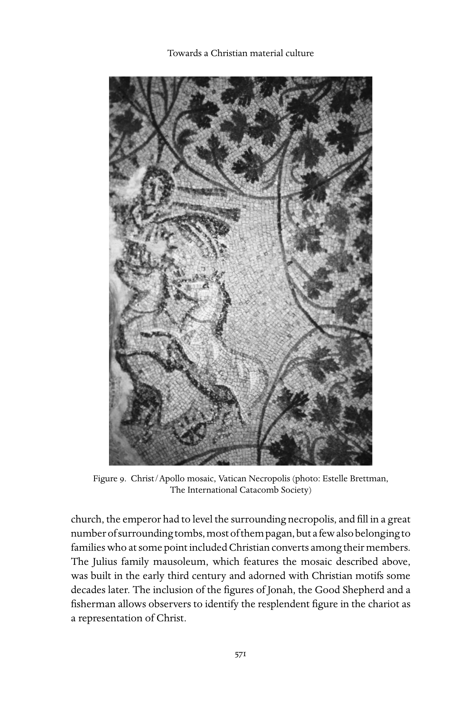
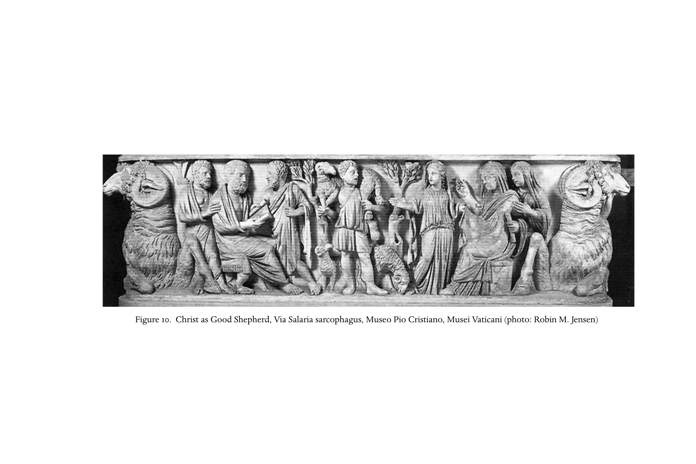
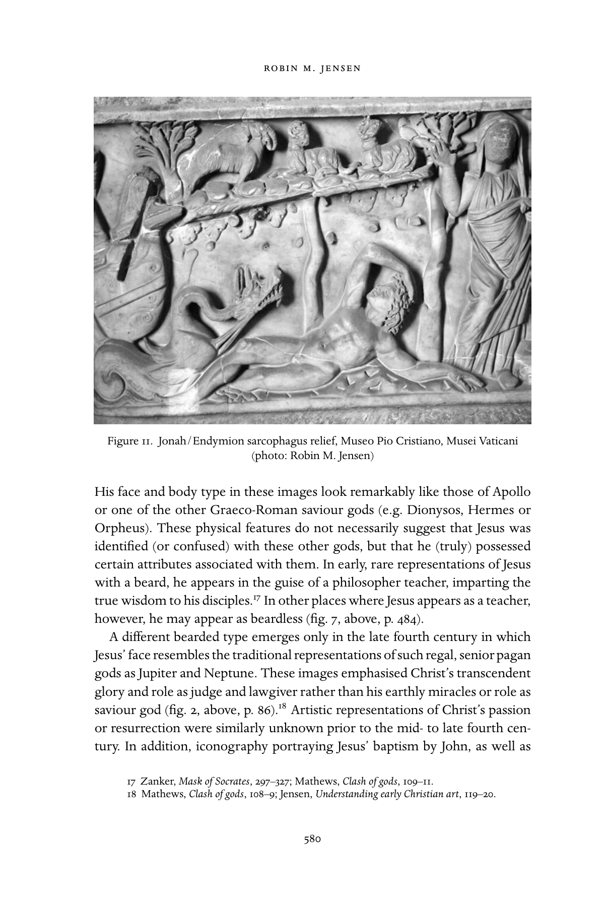
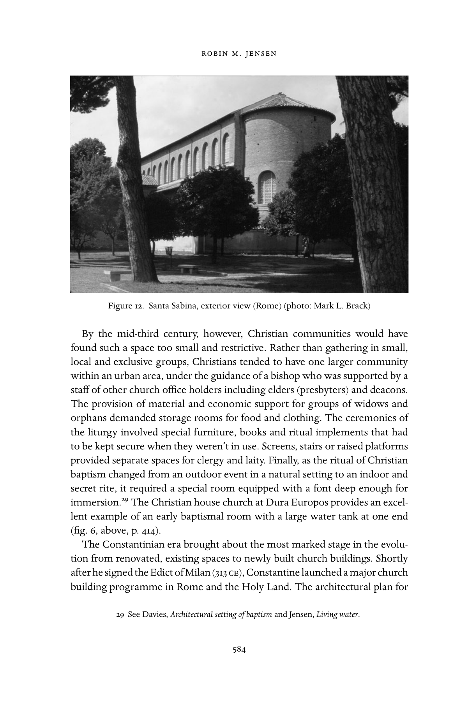

# 第三十二章 走向基督教物质文化

**作者：罗宾·M.詹森（Robin M. Jensen）**

《剑桥基督教史》第一卷《起源至君士坦丁》中文译稿

> 原书第568–585页，PDF第617–634页。正文及32条脚注完整翻译；参考文献作者名、题名和定位保留原文。图9–12保留原图并附中文图注。
>
> [第三十二章英文原文](<第三十二章 走向基督教物质文化（英文）.md>) · [原书PDF](<../01 起源至君士坦丁.pdf>)

## 基督徒、偶像与不可见的上帝

<!-- 原书第568–570页；PDF第617–619页 -->

据路加记述，使徒保罗在雅典亚略巴古的演说中，既指出当地人的崇拜与他所宣讲的上帝之间的相似之处，也指出差异。他看到满城偶像，心中不安，却说雅典人想必极其虔敬，因为在众多崇拜对象之中，他还注意到一座献给“未识之神”的祭坛。这一发现，使他特别从物质形式方面，将基督徒的上帝与其他诸神区别开来：

> 创造世界和其中万物的上帝，既是天地的主，就不住在人手所造的殿宇中，也不用人手服事……我们既是他的后裔，就不应当以为神性像金、银、石头，是由人的技艺和想象塑成的形像。（《使徒行传》17:22–29，据NRSV）

如果保罗这番宣告确实指导了后来基督徒的实践，这个宗教的确会显得是一种“奇怪的新教导”：在为神明建造居所或塑造形像方面，它将与其他宗教截然不同。希腊—罗马多神教重视视觉。对于帝国内不同族群所奉行的大多数“外来”宗教，神庙与神像都占据核心地位；宗教多元与尝试新事物，也是那个时代的特点。据记述，保罗在雅典接触的人热衷于谈论和听取“新鲜事”；他宣讲一位超越视觉表现、遍在所有空间的神，确实是新鲜事。不过，基督徒除了敬拜自己那位不可见而无所不在的上帝，还固执地拒绝尊重邻人的诸神，抵制城邦和皇帝崇拜。他们对宗教并不持多元态度，而是否认其他诸神存在，或断言它们是邪灵的发明。这种违背社会习俗、被视为不爱国的行为，使基督徒被称作无神论者，也常被控犯有不敬神或亵渎罪。[^1]

二世纪末的护教家马尔库斯·米努基乌斯·费利克斯，以异教徒凯基利乌斯与基督徒奥克塔维乌斯之间一场可能虚构的对话，描绘了基督徒的这种无礼。凯基利乌斯声称，基督徒鄙视神庙、唾弃神像、嘲笑异教仪式、轻蔑祭司，甚至蔑视官职的紫袍。[^2] 奥克塔维乌斯的回应印证了他的指责：他把多神教说成轻信、幼稚、头脑简单，是早已死去的凡人所创；这些人把普通人抬举成神，再为他们制作毫无价值的雕像，任鸟在上面筑巢、蜘蛛在其间结网。他接着奚落异教仪式，取笑祭司，直言只有迷信或精神错乱的人才会参加这种宗教。与之相对，他将基督徒的上帝描述为“明亮得无法直视”、不可把握、不可测量，是无法命名、无边无际的无限者。[^3] 其他早期基督教作者也持这些看法，包括与米努基乌斯·费利克斯同时代、同属非洲的德尔图良。他谴责罗马文化的大部分内容本质上都是偶像崇拜，包括观看竞技或戏剧、穿时髦衣服、订立契约或教授文学。尤其在他看来，为愚蠢的“虚无之物”制作形像，是一种彻底堕落的行为：这些东西不能看、不能闻、不能听、不能感受，却被当作神。相反，他把基督徒的上帝描述为不可见、不可言说、不可思议，却又显现在万物中，并为每一历史事件所见证。而且，这位上帝会咒诅、定罪任何制作或敬拜偶像的人。[^4]

不过，在周围文化中，也有某些群体可能赞同奥克塔维乌斯对异教诸神及其形像的看法，或认为德尔图良的谴责有理。保罗曾在会堂与虔敬的犹太人辩论；在亚略巴古，他的演说对象则是伊壁鸠鲁派与斯多亚派哲学家。与传统罗马多神教徒不同，这些群体可能较易接受这样一种宣讲：存在着一位超越、独一、不可见的神，他既没有形像，也没有殿宇。例如，斯多亚派追随创始人芝诺的教导，反对制作神像；芝诺以反对神庙和雕像著称。[^5] 基督教护教家也经常指出，基督教教导与基督以前的哲学家、诗人的教导一致；不过，他们坚持，基督教教导在各方面都完整而真实。[^6] 同样，有些基督教作者援引犹太人对形像的拒斥，以及《十诫》对偶像崇拜的禁令（《出埃及记》20:4；《申命记》5:8），为基督徒拒绝神像，甚至拒绝一般视觉艺术辩护。例如，三世纪埃及作者奥利金赞扬犹太人把画家和造像者逐出自己的国度，并谴责那种把灵魂的目光从上帝引向尘世的艺术。[^7]

## 基督教的文化融入

<!-- 原书第570–574页；PDF第619–623页 -->

根据这些说法，现代读者或许会以为，早期基督徒像虔敬的犹太人一样，谨慎回避周围多神教文化的种种外在形式，尤其是视觉艺术与建筑。然而，参观罗马圣彼得大殿地下的发掘遗址，却会看到一个反例：一座古代基督徒墓穴的穹顶上，有一幅马赛克，基督以太阳神的形貌出现，驾驶着四匹白马拉的战车。他头上的放射状光环伸出金色光芒，短衣与斗篷随风飘扬。他左手持着象征统治权的世界之球；右手大部分已毁，原来想必握着缰绳，或作问候、祝福的手势。不过，不协调的是，战车飞越的空间，既非无云的天空，也非群星闪烁的天穹，而是茂密的葡萄藤（图9）。

在这里，访客遇见的是更早时代的遗迹：那时，基督徒尚未稳居优势，也没有牢固的权势；他们留下的痕迹，反映着与非基督徒邻人之间脆弱而含混的关系。二十世纪中叶，教宗庇护十二世主持圣彼得大殿下的发掘，证实最初圣彼得教堂的主祭坛，确实建在一座古老的圣彼得纪念祠之上。这一发现固然重要，同时展开的异教徒与基督徒墓葬群勘查，也揭示了最初三个世纪中，罗马基督徒与非基督徒之间的许多关系。圣彼得大殿最初由君士坦丁于320年代建造，用来标示并围护朝圣者前来拜谒、敬奉彼得坟墓的地点；该墓位于梵蒂冈山的古代墓地。为兴建这座宏大的朝圣教堂，皇帝必须将周围墓区整平，填埋大量墓穴。其中大多数属于异教徒，也有少数属于某些家庭，其成员曾在某个时期包括归信基督教的人。拥有上述马赛克的犹利乌斯家族墓室，建于三世纪初，数十年后增饰了基督教题材。约拿、好牧人及渔夫形像的存在，使观察者能够将战车上光辉灿烂的人物辨认为基督。

*图9　基督／阿波罗马赛克，梵蒂冈墓地。摄影：Estelle Brettman，The International Catacomb Society。原书第571页。*

根据这一整套图像安排，观看者可以推断：墓室的装饰旨在传达基督徒对复活的盼望。不过，把索尔穿行于狄俄尼索斯式葡萄藤间的形像用于这个目的，也可能使人质疑，埋葬于此的人究竟抱持怎样的基督教信念，或是否把自己神明的身份弄混了。然而，与其把它当作宗教混融的例子，倒不如认为，它说明罗马基督徒选择以既有、熟悉的象征语汇表达信仰。因此，我们看到的是一种熟悉类型经过改用、获得新的基督教意义，而非信仰的混乱或摇摆。战车人物的身份，因而不是关键。追问他到底是基督、阿波罗，还是某种混合人物，是误解了艺术表达通常如何发挥作用。这大概与其说是某位神的肖像，不如说是在表现一种观念：神明超越黑暗与死亡。在这个语境中，基督的作为借索尔或阿波罗的传统象征来表达；墓穴中其余的整套图像，既支持又充实了这一表达。

文学中也会用熟悉的形像或隐喻传达新意义。例如，亚历山大里亚的克莱孟在约190至200年劝说异教徒归信时，借赫利俄斯的形像比喻复活、遍及宇宙的基督：“向你致敬，光啊！……那光就是永生，凡分享它的都活着。然而，黑夜向光致敬，因惧怕而退缩，让位于主的白昼。万有化为不眠的光，日落变成了日出。”克莱孟此前已经引用《以弗所书》5:14，措辞仿佛在描述太阳神：“睡着的人啊，醒来，从死人中起来，基督就要光照你。复活的太阳，那在黎明以前诞生、以光芒照耀的一位，将赐给你生命。”[^8] 在这两处，生动的诗性语言大胆借用了光辉太阳神的形像：他从黎明到黄昏驾车驰过天空，用来象征基督徒上帝超越的力量与美。克莱孟用听众能够理解的语言向他们讲话。

传统罗马装饰艺术中的葡萄藤与收获葡萄题材，也出现在早期基督教文学中。装饰华美、果实累累的藤蔓，由小童（putti）或有翼小天使采摘；它们可以只是象征繁荣丰盛的悦目图案，也可以指向巴克斯／狄俄尼索斯崇拜。这位葡萄藤之神战胜了死亡，其崇拜给信徒许诺某种有福的来世。同时，葡萄藤与收获也可以成为基督教象征，因为耶稣称自己为真葡萄树（《约翰福音》15:1–5），而圣餐礼中盛在杯里的发酵葡萄汁，象征他的血。因此，葡萄收获既可以表达异教的宗教期盼，也可以表达基督教的期盼，或同时表达两者。例如，一位基督教作者如此描述这类场景，用以表达在圣餐中与基督神秘联合，以及基督神圣的临在：

> 属灵的葡萄树是救主，嫩枝与枝条是他的圣徒，葡萄串是他的殉道者，与葡萄树相连的树木显明受难；采葡萄的是天使，盛满葡萄的筐是使徒，压酒池是教会，酒是圣灵的能力。[^9]

这些以及其他在视觉和文学中运用熟悉象征的例子表明：这些象征保留原有意涵的同时，也被赋予了新意义。基督徒借广为人知、在自身文化环境中普遍可懂的形式表达信仰，而这些形式对他们又具有特殊意义；这是解释和传播其宗教的一种实际而自然的方法。所选形像足够复杂，能够承载多重意义；也足够灵活，能够跨越宗教与世俗的界线。因此，把这类“借用”看作宗教混融、信仰混乱、暗中信奉异教或宗教态度暧昧的证据，是误解了图像的力量及其可塑性。当这个新宗教已为人充分理解，并真正在所处环境中扎根以后，新的视觉形像才出现，用来表达其核心教导、价值及群体身份。

这些新形式的出现，逐渐排挤了旧形式；这一模式与教会由受迫害的少数群体，转为获得帝国支持、拥有权势的多数群体相呼应。转变需要时间，但轨迹清楚可辨：最初改用传统希腊—罗马题材，到三世纪教会增长期间，创造新的基督教图像。最终，在拜占庭早期，基督徒身份与罗马身份的第二阶段融合，产生了高度发展的图像体系，反映了这种结合，也反映了基督教凌驾于昔日竞争者之上的地位。

不过，把传统形式用于新的宗教目的，也引出一个问题：在文化上，基督徒与非基督徒邻人究竟有多大差别？他们独特的信仰和实践，如何在不同时间与空间表现出来，又如何因社会地位或经济保障的差异而不同？必须结合具体处境与群体，理解基督教与其发生环境之间的互动和适应。随着考察的时间、地点不同，我们看到基督徒经历零星迫害，与相对和平的时期交替出现。两种情形都深刻影响文化融入的过程，直到基督教终于从罗马文化的边缘移到中心。因此，一种可辨识的基督教物质文化，虽远非稳定一致地演进，却终究形成了。

## 基督教视觉文化的出现

<!-- 原书第574–576页；PDF第623–625页 -->

大多数历史学家同意：在现存可辨认为基督教艺术与建筑的遗存中，很少能断代于三世纪初以前。早先的学术研究有时认为，基督教艺术之所以“姗姗来迟”，是因为基督徒起初抗拒视觉艺术，或抗拒专为敬拜建造场所。较近的研究则指出，异教器物与基督教器物、世俗住宅建筑与家庭教会之间，往往难以区别，并强调上述从改用到创新的渐进过程。[^10] 学者已不再坚持，早期基督徒一概反对具象艺术或教堂建筑，因此没有这些东西。相反，最初两个世纪器物的缺失，部分可能只是辨识上的问题，也可能源于保存条件的变迁。最早能够断代的一些器物与图像，大概因安置于地下墓葬，或被后来的建筑覆盖而幸存；大量其他遗物则因城市重建、战争或风雨摧残，甚至历史上各时期的毁像攻击而消失。

现存遗物的出处和环境都相当有限。绝大多数基督教器物来自丧葬场所，尤其是罗马地下墓窟。值得注意的例外，包括陶灯、戒指、玻璃器皿或餐具；其上以模制、刻划或印压方式饰有基督教题材，年代最早可到二世纪末或三世纪初。亚历山大里亚的克莱孟甚至列出印戒上适用的图案：鸽子、鱼、船或锚；但禁止刀剑、酒杯和情人的肖像。[^11] 虽然这类物件许多出土于墓葬，其明显的大量生产和广泛分布，仍可能表明它们曾供日常使用。

与丧葬艺术或简朴私人用品处于另一端的，是在叙利亚东部杜拉欧罗波斯发现的三世纪中叶基督教家庭教会。其中一间用于洗礼的房间，装饰十分丰富（参上文图6，原书第414页）。罗马之外，也有君士坦丁以前建造教堂的其他证据。迦百农一座五世纪八角形教堂，建在既有住宅之上；人们认为，那座住宅是位于圣彼得家中的早期家庭教会。阿奎莱亚（Aquileia）一组双教堂建筑，包含一间可能断代于主教狄奥多尔任期（308–319）的祈祷室。文献还提到，罗马帝国不同地区存在基督教堂、书籍与陈设，进一步证明三世纪中后期基督徒群体不断增长，已具备一定的安全、财富和持续性，从简朴的家庭聚会转向在宏伟建筑中容纳较大人群。例如，波菲利抱怨说：“基督徒模仿神庙的建造，兴建宏大建筑，在其中集会祷告；其实没有什么妨碍他们在自己家里这样做。”[^12]

不过，最为丰富的早期可辨识基督教遗存，仍是罗马地下墓窟的绘画。其中最古老的，位于古阿庇亚道旁的卡利斯图斯地下墓窟；这处早期基督徒墓地，年代可断为三世纪最初十年。罗马其他早期基督教地下墓窟，包括塞巴斯蒂安、多米提拉和普里西拉墓窟；它们都提供了早期基督教文化的物质证据。这些墓窟中有小型家族墓室（cubicula），墙壁和天花板绘有图画，往往以线条和装饰边框划分成不同区块及层带。此外，还有用于封闭廊道墙壁上横向墓穴（loculi）的雕刻石板，少量罕见的马赛克，以及相当数量的雕刻石棺。除壁画与浮雕之外，还有一组数量虽少却很重要的圆雕。这些物件之所以被辨认为出自基督徒环境，或是因为内容，或是因为它们在更大的一套基督教图像中的位置。不过，并非所有题材都为基督教独有；其风格与技法，也与邻近异教墓葬的绘画及更普遍的室内装饰十分接近。[^13]

罗马地下墓窟的艺术，显然是为私人家族墓室制作，而非用于公共空间。因此，它们未必代表“正式”教会会允许、乃至委托制作怎样的会众聚会场所装饰。既然这一时期幸存的教堂壁画，只有杜拉欧罗波斯家庭教会洗礼室中的绘画，任何结论都至多只能暂定。不过，杜拉不大可能是独一无二的；罗马墓窟的壁画也说明，教会官员大概允许甚至鼓励具象绘画，至少在丧葬场所如此。卡利斯图斯地下墓窟的名称，就为这种认可提供了证据：它据说以首任管理者命名，而此人后来成为罗马主教（217–222）。此外，墓窟本身还包括其后三世纪数位教宗的墓。

不久，群体中的英雄、主教与殉道者之墓，就成为朝圣目的地，因而需要特定标志或构筑物，用来标明圣徒的纪念祠。前述梵蒂冈圣彼得纪念祠就是一例。依传统，自三世纪初起，彼得之墓便以一座带小柱的建筑构件标示；其中留有开口，使访客能够接近墓穴本身。其他墓地的殉道者之墓，也有类似标记；后来，其上又建起更大建筑，为朝圣者提供遮蔽和座位。他们常在纪念祠旁举行追思餐宴。这些餐宴延续了传统异教习俗，即在亡故家人的墓旁举行葬祭宴饮。因此，墓地设有长凳与小桌（mensae），可供向死者浇奠酒或放置食物供品。四世纪，这些建筑扩大，终于转为朝圣教堂，圣餐桌安置在圣徒墓上，由此延续与受尊崇死者共同进餐的古老实践。

## 文化语境与转变中的早期基督教图像

<!-- 原书第576–581页；PDF第625–630页 -->

这些地下墓穴的墙画或墓板刻画中，最早能够断代的题材，通常是取自传统罗马装饰艺术、具有装饰性或宗教意义含混的图像，如花卉、水果、鸟、葡萄藤和花环；也有某些可被赋予特定基督教意义的形像，如鱼或渔夫、鸽子、船、锚和牧人。其中许多形像，若抽离原处、挂在博物馆墙上，便无法与异教作品区别。不过，它们在更大艺术布局中的位置，以及配合刻写的墓志，有助于辨认其基督教性质，及其所传递的特定基督教信息。例如，卡利斯图斯地下墓窟中的鱼，与一篮饼和一小瓶酒一起出现，大概指向圣餐礼（参上文图3，原书第144页）。

如上所述，其中许多是罗马宗教及世俗图像中的标准题材。例如，牧人形像使人想到基督教与犹太教经书对这一隐喻的多次使用，如《约翰福音》10:11的“我是好牧人”；它可能改自罗马艺术中肩扛公羊的赫尔墨斯。赫尔墨斯为诸神与人类传递消息，也在冥界充当亡灵的引路者（psychopompos），因此适合出现在丧葬场所。其基督教版本常难与非基督教版本区别，尤其当物件出处不明时；小型牧人雕像往往就是如此。同样，俄耳甫斯的形像也经过改用，用以传达基督作为的性质。俄耳甫斯驯服野兽，拯救死者欧律狄刻；他被转化为基督：驯服人的情欲，并从死亡中施行拯救。[^14]

多米提拉地下墓窟中，基督作为教师、与学生在一起的图像（参上文图7，原书第484页），与苏格拉底等哲学家的表现形式有众所周知的相似之处。基督教与异教丧葬图像共有的其他题材，还包括葬祭宴饮——五人或七人坐在半圆形桌旁——以及坐着读卷轴的男子，和蒙面纱、双手向外向上伸展祈祷的女子（orant）。读书者与祈祷者，分别表达传统罗马人的智慧与虔敬之德，也可能意在表现死者的习惯或品格。不过，对基督教委托人或观者而言，祈祷者还可以代表等待复活的基督徒灵魂；教师或坐着的读书者，则可以暗示基督教教导才是真正的哲学。[^15]

著名的萨拉里亚道石棺，说明在早期，辨别一件物品究竟属于基督教还是异教有多么困难。这具大理石巨棺断代于三世纪末，通常被视为早期基督教浮雕的实例。两端各有硕大的公羊头，中间一条图像浮雕带具有宗教意味，却没有明显的基督教特征。中央站着一位肩扛公羊的牧人；他左边坐着一名读卷轴的男子，右边坐着一名持卷起卷轴的女子。男女各有同伴，其中一人作祈祷姿态。这类宗教归属含混的图像，可能出自工匠作坊：作坊提供的题材目录有限，而顾客既有异教徒，也有基督徒。

*图10　好牧人基督，萨拉里亚道石棺。藏于梵蒂冈博物馆庇护基督教博物馆（Museo Pio Cristiano, Musei Vaticani）。摄影：Robin M. Jensen。原书第578页。*

然而，到三世纪中叶，这些较为通用的图像旁，已加入许多取材于基督教《旧约》和《新约》的叙事场景。有些故事远比其他故事常见。最初，无论壁画还是浮雕，《旧约》人物都比《新约》场景多。其中包括亚当与夏娃、亚伯拉罕与以撒、挪亚、摩西、但以理、火窑中的三个青年，以及最受欢迎的约拿。有些场景似乎没有明确的基督教以前的原型，因而可能是全新创造；另一些则明显受到特定异教范型的影响。例如，但以理几乎总被画成裸体，如同赫拉克勒斯或墨勒阿格洛斯等古典英雄。在耶稣变水为酒等神迹故事的图像中，他手持一根杖；这是当时广为人知的术士标志。[^16]

约拿图像提供了另一个借用并改造古典原型的例子。裸体斜倚在蓖麻藤下的约拿，其姿势与异教石棺上的神话人物恩底弥翁完全相同。恩底弥翁被诅咒——或蒙福，取决于你的看法——永葆青春却长眠不醒；月神塞勒涅每晚探望他，并为他生下五十个女儿。当约拿以同样姿势出现时，象征的是永恒而幸福安息的盼望，而不是暗示他的违命或受辱（参图11，原书第580页）。不过，这个故事也使人想到“约拿的神迹”，作为基督死亡与复活的预表（《马太福音》12:39–40），因而其图像可能具有救恩论意义。此外，约拿的裸体、沉入水中及从海兽腹中重新出现，也可能暗指基督教洗礼，从而使象征具有圣礼层面。

*图11　约拿／恩底弥翁石棺浮雕。藏于梵蒂冈博物馆庇护基督教博物馆（Museo Pio Cristiano, Musei Vaticani）。摄影：Robin M. Jensen。原书第580页。*

耶稣出现在治病或行神迹的场景中时，除了持杖，通常还是俊美无须的青年。这些图像中的面容和体形，与阿波罗或其他希腊—罗马救主神，如狄俄尼索斯、赫尔墨斯或俄耳甫斯，十分相似。这些身体特征并不必然意味着人们把耶稣等同于、或混同于其他诸神，而是说，他确实拥有与那些神相联系的某些属性。在早期罕见的有须耶稣图像中，他以哲学教师的形貌出现，向门徒传授真正的智慧。[^17] 不过，在其他以教师身份出现的场景中，耶稣也可能无须（参上文图7，原书第484页）。

另一种有须形像直到四世纪末才出现：耶稣的面容类似朱庇特、尼普顿等具有王者风范、年长的异教大神的传统形像。这些图像强调基督超越的荣耀，以及审判者、立法者的身份，重心不在他尘世的神迹或救主神的角色（参上文图2，原书第86页）。[^18] 同样，在四世纪中后期以前，也没有已知表现基督受难或复活的艺术作品。此外，耶稣受约翰施洗、博士来拜等图像，比耶稣尘世生活的其他场景明显更早出现；后者包括后来基督教艺术中较为常见的最后晚餐或登山变像。随着受难场景与登宝座的基督出现，还产生了其他新图像类型；如今，这些通常被认为与基督教皇帝的图像相联系。例如，一座空十字架，上方是花环中的基督字母组合chi-rho（参下文图13，原书第587页）。与这种图像转变相伴，最早的题材，包括牧人和约拿，逐渐消失。

审判、受难、得胜和登宝座的基督等新图像，都排除了对实际钉十字架场面的表现。这与该时期基督教文学广泛讨论基督受难的情况形成鲜明对照。事实上，除了少数例外，钉十字架的图像都不能断代到五世纪初以前，直到六世纪乃至七世纪仍极为罕见。为解释这种明显的缺席，人们提出过不同理论：早期基督徒淡化耶稣之死；这一场面太过骇人，不宜表现；或信仰的核心奥秘应向未入教者隐蔽。[^19] 然而，任何一种理论单独来看，都不足以解释钉十字架图像的缺失；尤其考虑到，受难故事的其他场景确实存在，而它们既未淡化，也未掩饰耶稣的死法。此外，暴力死亡或献祭性死亡的图像，在异教世界广为人知，也可能提供可用的范型。[^20] 无论最初缺席的原因是什么，钉十字架图像最终出现之际，也正是四世纪及以后前往圣地朝圣日益流行、十字架圣物广泛传播的时期。[^21]

## 建筑的文化融入：从家庭教会到巴西利卡

<!-- 原书第581–585页；PDF第630–634页 -->

虽然保罗断言，基督徒的上帝没有人手建造的殿宇，早期基督徒仍需要共同祷告、进餐的聚会空间。最初，他们似乎既继续一同前往圣殿，也在家中聚餐，或许还祷告、学习（比较《使徒行传》2:46、5:42及20:7–9）。在这个意义上，他们类似另一个犹太群体，即法利赛人。[^22] 这些活动并不需要特殊建筑。群体中有住宅的成员，便在家中对外接待的房间主持聚会，可能用会客厅、餐室，或两者兼用（比较《罗马书》16:5；《哥林多前书》16:19；《歌罗西书》4:15；《腓利门书》2）。[^23] 随着群体扩大，房屋可以改建，甚至在原址重建，以容纳更多人或举行更正式的集会。迦百农建在彼得家中的教堂，就是这样的地方。不过在最初，保罗和其他使徒也在会堂教导；当这样做越来越困难，他们便寻找其他适用空间，如当地的讲学厅（比较《使徒行传》9:20、13:5、14–43；19:8–9）。对罗马圣克莱孟教堂及圣若望保禄教堂的考察表明，其他可供使用、具有实际功能的建筑，也可能被利用和改造，如公寓楼（insulae）中的房间、旧店铺或仓库。[^24] 这些空间虽没有足以辨认为基督徒聚会场所的特征，却不是藏匿处。到三世纪末，其中有些在规模和设计上可能已颇为可观，罗马当局也很清楚其所在，能够予以没收或摧毁。[^25]

《新约》中提到的那类会堂，是群体成员共同诵读、研习经书的地方，大概并不用于祷告。会堂似乎兴起于散居地区，是圣殿以外的另一种选择；圣殿于公元70年被毁以后，它们开始成为犹太宗教与社会生活的中心。不过，即使在二世纪，会堂大概仍相当简朴，和早期基督徒场所一样，常从改建住宅开始。因此，会堂建筑的发展，与基督教堂建筑大致平行，并非后者的范本。[^26] 然而，到三世纪中叶，罗马帝国各地都可见会堂，有些相当宏大。杜拉欧罗波斯的会堂，由住宅于三世纪中叶改建，其主厅约14米乘9米，饰以精美壁画，西墙设有妥拉龛。当地的基督教家庭教会（上文图6，原书此处标为第144页），规模与之相当，也很可能由同一批工匠装饰。[^27]

一种特有基督教建筑的逐渐发展，与独特基督教图像题材的发展平行。前者出现相对较慢，无疑部分是因经济或社会资源不足。建造或改建房屋，比制作小型艺术品需要更多财力；还需要土地，以及大量不同种类的熟练劳动力。一座教堂的建立，更不用说改建，也预设了某种程度的公共接纳，即使房屋属于私人、由私人维护亦然。

与此同时，早期基督徒似乎有意避免使用类似典型异教神庙或祠堂的敬拜空间；这与他们借用异教图像题材的做法不同。当他们开始新建房屋时，刻意采用源自周围世俗文化、而非宗教文化的特定设计。除了希望将自己的敬拜与传统诸神的崇拜及其所认定的偶像崇拜区别开来，基督徒还会发现，典型神庙建筑对他们的集会方式及发展中的礼仪并不实用。罗马神庙的基本设计服务于公共仪式，而这些仪式主要在户外举行。神庙往往坐落在城市主要广场，仪式包括公开行列和露天献祭。虽然此类建筑是城市景观的重要部分，却并非用来容纳大规模集会。异教神庙的内殿（cella）不是共同敬拜的地方，而是安放祭祀神像的小室。相反，早期基督徒群体由自愿加入、经过入教仪式的成员组成，定期集会，仪式须避开公众视线。

不过，仅从这些需要看，基督徒的聚会场所本来也可能类似其他自愿社团，包括古代晚期流行的俱乐部、丧葬社团（collegia）和秘仪崇拜。这些群体和早期基督徒一样，举行仅限成员的聚会，共同进餐，执行各种仪式。其活动具有秘密性，因此需要室内私人空间。密特拉神的信徒便是这样一个群体。他们人数不多，在没有窗户的小房间聚会；两条长墙边设长凳，供进餐时躺卧。和基督徒、犹太人一样，他们的聚会场所——密特拉祠（mithraea）——也常由住宅改建。杜拉欧罗波斯的密特拉祠，最初只占一个房间，最后扩展到整栋房屋。[^28]

然而，到三世纪中叶，基督徒群体会觉得这类空间太小、限制太多。基督徒倾向于在一个城市地区组成较大的单一群体，而不是分成地方性、封闭的小群体聚会。群体由主教领导，并有其他教会职务人员协助，包括长老与执事。向寡妇、孤儿等群体提供物质及经济援助，需要存放食物衣物的库房。礼仪使用特殊家具、书籍和仪式用具，不用时必须妥善保管。屏障、台阶或高台，为教士与平信徒划分不同空间。最后，随着基督教洗礼从自然环境中的户外活动，变成室内的秘密仪式，它需要专用房间，并配备足以浸没身体的洗礼池。[^29] 杜拉欧罗波斯的基督教家庭教会，为早期洗礼室提供了绝佳实例；房间一端有大型水池（参上文图6，原书第414页）。

*图12　圣撒比纳教堂外观，罗马。摄影：Mark L. Brack。原书第584页。*

从改用既有空间转向新建教堂的演变中，君士坦丁时代带来了最显著的阶段。签署《米兰敕令》（313）不久，君士坦丁就在罗马和圣地展开大规模教堂建造计划。这些最初教堂的平面，以巴西利卡的设计为基础。巴西利卡原为市政或世俗建筑，内部空间宏大，适合举行隆重仪式。君士坦丁在罗马建造的第一座教堂，是位于其妻所有土地上的拉特朗大殿。原址一座宫殿成为罗马主教的住所；新建教堂有长76米、分为五个纵向空间的堂身，尽头西侧有大型半圆后殿。后殿围合的圣所中，设有主教座，两侧为长老设置半圆形长凳。内部装饰富丽堂皇，包括银像、金祭坛和闪亮的马赛克，还有两排绿色大理石内柱，配以宏伟柱头。[^30] 这类建筑象征着基督教开始转变：它原是一个少数群体，利用手边可得的事物，以熟悉的语言表达自己；如今则成为人口中强大、富裕、占主导的一部分，能够决定用什么形式、什么风格表达自身文化身份。巴西利卡设计的宏大规模及潜在的庄严气势，很适合日益复杂的礼仪；同时，它反映教会社会政治地位的改变，成为教会新的自我理解与文化融入的一种明确、纪念碑式的象征。虽然今天的拉特朗大殿已不复原貌，罗马五世纪的圣撒比纳教堂经过保存、修复，仍显示这种传统巴西利卡形式（参上文图12，原书第584页）。凯撒利亚的优西比乌亲历了从迫害时期到“教会的和平”的转变。[^31] 他用下面的话概括这场剧变：当人们看见，荒凉与破坏之地，已建起新的“殿宇，从地基上升至极高，比被毁的那些更加壮丽”时，心中充满“无法言喻的喜悦”。[^32]

## 译校说明

本章保留作者对早期图像含义、建筑用途及断代的推测语气，不把图像形式相似直接译为信仰相同。原书第582页把杜拉欧罗波斯家庭教会图6的页码写为144；实际图6见原书第414页，已在正文注明此处为原书标页。原书关于早期会堂“大概不用于祷告”、君士坦丁“签署《米兰敕令》”等表述，均依作者原说译出。

## 注释

[^1]: Justin, 1 Apol. 6；13；25；Tert. Apol. 10；Athenagoras, Leg. 4；M. Polyc. 9；Arnobius, Adv. nat. 1.29；3.28；5.30。

[^2]: Min. Fel. Oct. 8.4.

[^3]: Min. Fel. Oct. 18–24.

[^4]: Tert. Idol.，全篇。

[^5]: 例如参Cic. N.D. 1.36.101–2；引于Balch, ‘Areopagus speech’, 59–79。

[^6]: Min. Fel. Oct. 18–19；Justin, 1 Apol. 20；Clem. Al. Protr. 6。

[^7]: Or. C. Cels. 4.31；比较Clem. Al. Protr. 4。

[^8]: Clem. Al. Protr. 11及9；译文出自本章作者。

[^9]: Hipp. Ben. Is. Iac. 25；译文出自本章作者。

[^10]: Breckenridge, ‘Reception of art’, 361–9；Grigg, ‘Aniconic worship’, 428–9；Murray, ‘Art and the early church’, 304–45。

[^11]: Clem. Al. Paed. 11；比较Tert. Pud. 7.1–4；10f（关于牧人图案的杯）。

[^12]: Porph. Christ. frag. 76；译文据White, Social origins of Christian architecture，第II卷，104；比较Euseb. HE 8.1–2。

[^13]: 关于地下墓窟及其图像，参Snyder, Ante pacem；Nicolai et al., Christian catacombs of Rome；Finney, Invisible God；Mancinelli, Catacombs of Rome；Stevenson, Catacombs；Hertling and Kirschbaum, Roman catacombs。

[^14]: Murray, Rebirth and afterlife, 37–63.

[^15]: 参上文第五部分第27章。

[^16]: Mathews, Clash of gods, 54–91.

[^17]: Zanker, Mask of Socrates, 297–327；Mathews, Clash of gods, 109–11。

[^18]: Mathews, Clash of gods, 108–9；Jensen, Understanding early Christian art, 119–20。

[^19]: Grabar, Christian iconography, 132；Milburn, Early Christian art, 109；van der Meer, Early Christian art, 120–2；Jensen, Understanding early Christian art, 133–7。

[^20]: Balch, ‘Suffering of Isis/Io’, 25–42.

[^21]: Jensen, Understanding early Christian art, 150–1.

[^22]: White, Social origins of Christian architecture，第I卷，103。

[^23]: Osiek and Balch, Families in the New Testament world, 193–212；Snyder, Ante pacem, 128–36。

[^24]: Krautheimer, Early Christian and Byzantine architecture, 28–30.

[^25]: M. Saturn. 2；Euseb. HE 8.2。

[^26]: Rutgers, ‘Diaspora synagogues’, 92–5。另参上文第一部分第2章；Levine, Ancient synagogues revealed。

[^27]: Jensen, ‘Dura Europos synagogue’, 184–7.

[^28]: White, Social origins of Christian architecture，第I卷，47–59；Snyder, Ante pacem, 140–52。

[^29]: 参Davies, Architectural setting of baptism及Jensen, Living water。

[^30]: Liber pontificalis 1.181.

[^31]: 参上文第30章。

[^32]: Euseb. HE 10.2.
