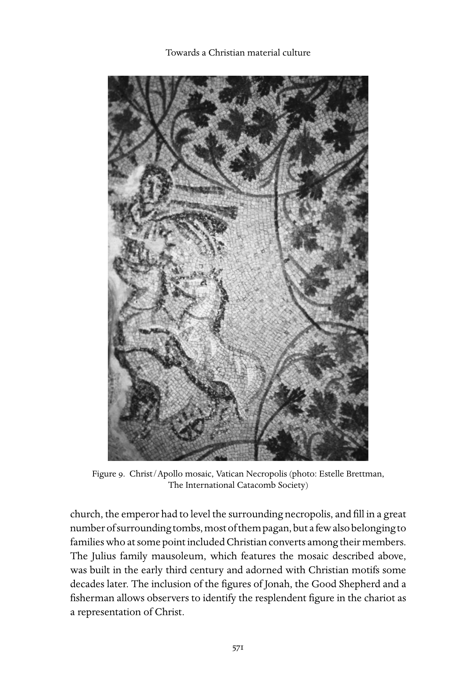
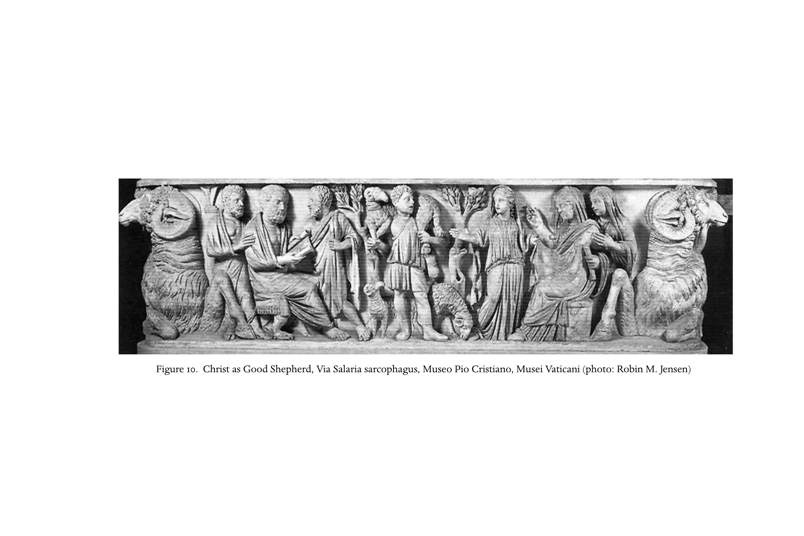
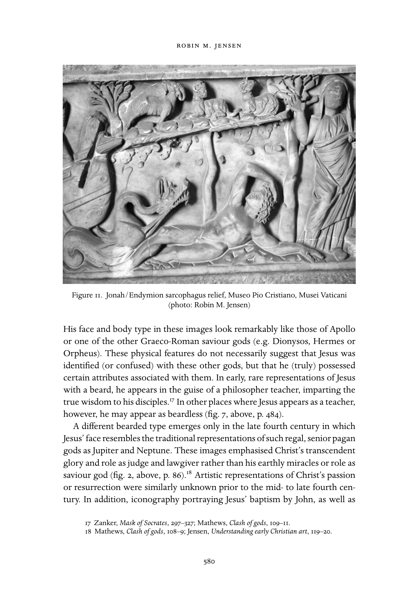
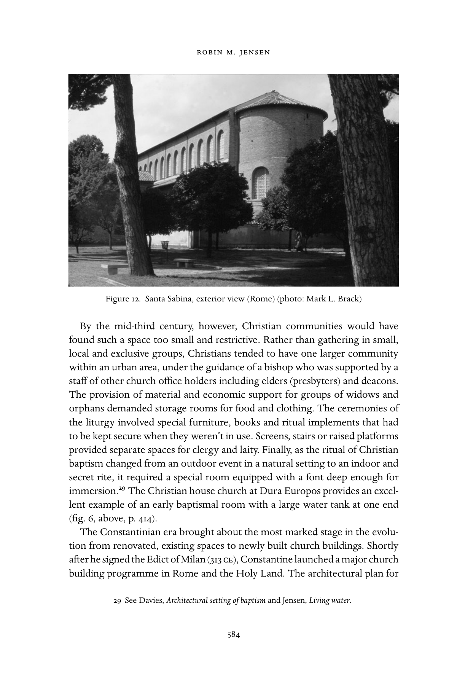

<!-- PDF page 617; original page 568 -->

### 32. Towards a Christian material culture

#### robin m. jensen

#### Christians, idols and the invisible God

In his address at the Athenian Areopagus, the apostle Paul (according to Luke) points out similarities as well as differences between the worship of the locals and the God he proclaims. Distressed to find the city filled with idols, he remarks that Athenians must be extremely religious people, since, among all those objects of worship, he noted an altar dedicated to ‘an unknown god’. This find leads him to distinguish the Christian God from other gods, specifically in terms of their material accoutrements:

The God who made the world and everything in it, he who is Lord of heaven

and earth, does not live in shrines made by human hands, nor is he served

by human hands... Since we are his offspring, we ought not to think that

the deity is like gold, or silver, or stone, an image formed by the art and

imagination of mortals. (Acts 17: 22–9, NRSV)

If Paul’s pronouncement actually had guided subsequent Christian practice, this religion indeed would have appeared to be a ‘strange new teaching’ – radically different from other religions in terms of constructing shrines to house or images to portray its deity. Graeco-Roman polytheism was visually oriented. Temples and statues were central to most of the ‘foreign’ religions practiced by diverse ethnic groups in the empire, while religious pluralism and experimentation were characteristic of the era. Paul’s Athenian contacts are described as eager to hear and tell about ‘something new’, and Paul’s proclamation of a deity beyond visual representation and inhabiting all of space was something new. But besides worshipping their own invisible and omnipresent God, Christians stubbornly refused to respect their neighbour’s gods and boycotted the civic and imperial cult. They were not pluralistic in their attitude towards religion, and either denied that other gods existed, or claimed that they were demonic inventions. Such antisocial and unpatriotic

<!-- PDF page 618; original page 569 -->
behaviour led to Christians being characterised as atheists and often charged with criminal impiety or sacrilege.[^p617-1]

The late second-century apologist Marcus Minucius Felix portrays such Christian effrontery in a (probably fictional) dialogue between the pagan Caecilius and the Christian Octavius. Caecilius claims that Christians despise temples, spit on the gods’ images, sneer at pagan rites, treat priests with contempt and scorn the purple robes of public office.[^p617-2] Octavius proves him right by characterising polytheism as gullible, naive, and simple minded – the creation of long-dead mortals who elevated ordinary human beings to divine status, and then crafted worthless statues of them on which birds might nest, or spiders hang webs. He goes on, ridiculing pagan rituals, making fun of their priests, and flatly stating that only the superstitious or deranged would participate in such a religion. He contrastingly describes his Christian God as ‘too bright for sight’, ungraspable, immeasurable and an unnameable boundless infinity.[^p617-3] Other early Christian writers shared these views, including Minucius Felix’s African contemporary, Tertullian, who condemns most of Roman culture as essentially idolatrous, including attending the games or theatre, wearing fashionable clothing, drawing up contracts, or teaching literature. Above all, Tertullian regards making images of foolish ‘nonentities’, who neither see, smell, hear nor feel but yet are deemed gods, as an utterly depraved activity. By contrast, he describes the Christian God as invisible, indescribable and inconceivable, and yet manifest in everything and known in every historical event. Moreover, this God will curse and condemn anyone who would either make or worship an idol.[^p617-4]

There were, however, certain groups within the surrounding culture who might have shared Octavius’ view of the pagan gods or their images, or thought Tertullian’s condemnation justified. Paul had been arguing in the synagogue with devout Jews and addressed his speech on the Areopagus to Epicurean and Stoic philosophers. In contrast to traditional Roman polytheists, such groups may have been well disposed to the proclamation of a transcendent, singular and invisible god, who had neither image nor shrine. The Stoics, for example, opposed the making of divine images, following the teachings of their founder Zeno, who was known for his opposition to temples and statues.[^p617-5] And Christian apologists often noted that Christian teaching was

[^p617-1]: Justin, 1 Apol. 6; 13; 25; Tert. Apol. 10; Athenagoras, Leg. 4; M. Polyc. 9; Arnobius, Adv. nat. 1.29; 3.28; 5.30.

[^p617-2]: Min. Fel. Oct. 8.4.

[^p617-3]: Min. Fel. Oct. 18–24.

[^p617-4]: Tert. Idol. passim.

[^p617-5]: For example, see Cic. N.D. 1.36.101–2; cited in Balch, ‘Areopagus speech’, 59–79.

<!-- PDF page 619; original page 570 -->
consistent with teachings of earlier, pre-Christian philosophers and poets, although they insisted that on all points Christian teaching was fully complete and true.[^p617-6] Similarly, some Christian writers pointed to Jewish repudiation of images and the prohibition against idolatry in the Ten Commandments (Exod 20:4; Deut 5:8) to defend Christian rejection of divine images and even visual art in general. The third-century Egyptian writer, Origen, for instance, praised Jews for expelling both painters and image makers from their state, and condemning the art that drags the eyes of the soul away from God to the earth.[^p617-7]

#### Christian enculturation

Based on such assertions, a modern reader might assume that early Christians, behaving like pious Jews, scrupulously avoided the trappings of the polytheistic culture that surrounded them, especially its visual art and architecture. However, a visit to the excavations below St Peter’s basilica in Rome offers a contradiction – an ancient Christian tomb with an overhead mosaic portraying Christ in the guise of the sun god driving a chariot drawn by four white horses. The radiate halo around Christ’s head extends golden beams and his tunic and cloak fly in the breeze. In his left hand he holds the orb of the world, a symbol of his dominion. His right hand (mostly missing) must have either held the reins, or perhaps made a gesture of greeting or blessing. Incongruously, however, the space over which his chariot flies is neither a cloudless sky nor a starry heaven, but a lush grapevine (fig. 9).

In this place visitors encounter the vestiges of a much earlier time, when Christians were not yet securely dominant or powerful, and the signs of their existence reflected their tenuous and ambiguous relationships with their non- Christian neighbours. Excavations below St Peter’s basilica undertaken in the mid-twentieth century under Pope Pius xii confirmed that the high altar of the original St Peter’s was actually set over an ancient shrine of the saint himself. As significant as this discovery was, the simultaneous exploration of a network of pagan and Christian tombs also revealed much about the relationships of Christian and non-Christian Romans in the first three centuries. St Peter’s basilica was first built by Constantine in the 320s, to mark and enclose the site where pilgrims came to visit and venerate Peter’s grave, situated in the ancient cemetery on the Vatican hill. In order to build this great pilgrimage

[^p617-6]: Min. Fel. Oct. 18–19; Justin, 1 Apol. 20; Clem. Al. Protr. 6.

[^p617-7]: Or. C. Cels. 4.31; cf. Clem. Al. Protr. 4.

<!-- PDF page 620; original page 571 -->
Figure 9. Christ/Apollo mosaic, Vatican Necropolis (photo: Estelle Brettman, The International Catacomb Society)

church, the emperor had to level the surrounding necropolis, and fill in a great number of surrounding tombs, most of them pagan, but a few also belonging to families who at some point included Christian converts among their members. The Julius family mausoleum, which features the mosaic described above, was built in the early third century and adorned with Christian motifs some decades later. The inclusion of the figures of Jonah, the Good Shepherd and a fisherman allows observers to identify the resplendent figure in the chariot as a representation of Christ.

<!-- PDF page 621; original page 572 -->
Based on this iconographic programme, a viewer may deduce that the mausoleum was decorated in order to convey a Christian hope in the resurrection. The adaptation of an image of Sol riding through a Dionysian grapevine to this end, however, might provoke questions about the supposed Christian convictions of those buried within or whether they were confused about the identity of their god. Yet, rather than point to this image as an example of religious syncretism, one might instead argue that it demonstrates that Roman Christians chose to express their faith using an already-established and familiar symbolic vocabulary. Thus, what we see is neither religious confusion nor ambivalence, but the adaptation of a familiar type, giving it a new, Christian significance. The identity of the character in the chariot, therefore, is beside the point. To ask whether this is Christ, Apollo or some hybrid character is to misunderstand the function of artistic expression in general. This probably is less a portrait of a god than the representation of an idea – the deity’s transcendence of darkness and death. In this context, the reference is to the work of Christ in terms of the traditional symbolism of Sol or Apollo, which is both supported and elaborated by the rest of the iconographic programme of the tomb.

Such use of a familiar image or metaphor to convey a new meaning also occurs in literature. For example, when Clement of Alexandria urges pagans to convert (c.190–200 ce), he summons the figure of Helios as a metaphor for the resurrected and cosmic Christ: ‘Hail, Light!... That light is eternal life, and whatever shares in it, lives. But night pays homage to light, receding through fear, ceding place to the day of the Lord. Everything has become a sleepless light and the setting has been transformed into rising.’ Clement earlier had cited Ephesians 5:14, and seems to describe the sun god: ‘Awake, sleeper, rise from the dead and Christ will shine upon you. The sun of the resurrection, the one born before the dawn, whose beams give light, will give you life.’[^p617-8] In both places, vivid poetic language boldly borrows the imagery of a radiant Sol, riding over the heavens from dawn to dusk, in order to symbolise the transcendent power and beauty of the Christian god. Clement spoke to his audience in language that would have meaning for them.

The motif of the vine and the grape harvest which appears in traditional Roman decorative art also appears in early Christian literature. The lusciously ornamental and loaded vines being harvested by small children (putti) or winged cherubs simply could be attractive symbols of prosperity and abundance or they could be references to the cult of Bacchus/Dionysos, the god of the vine who triumphed over death and whose cult offered devotees some

[^p617-8]: Clem. Al. Protr. 11 and 9, my trans.

<!-- PDF page 622; original page 573 -->
kind of blessed afterlife. At the same time, the image of the vine and harvest can be a Christian symbol, since Jesus spoke of himself as the true vine ( John 15:1–5) and his blood was symbolized in the cup of fermented grape juice in the sacrament of the Eucharist. Thus, the grape harvest could refer either to pagan or Christian religious aspirations (or both). For example, one Christian writer described such a scene in order to express the mystical union with and divine presence of Christ in the eucharist:

The spiritual vine is the savior, the shoots and branches are his saints, the

bunches of grapes are his martyrs, the trees which are joined with the vine

reveal the passion, the vintagers are the angels, the baskets full of grapes are

the apostles, the winepress is the church and the wine is the power of the Holy

Spirit.[^p617-9]

These and other visual and literary applications of familiar symbols demonstrate that, though their original signification was maintained, they were simultaneously being charged with new meaning. Christians expressed their faith through widely recognisable forms that were generally understood within their cultural environment but that also had particular meaning for them – a practical and natural way to explain and spread their religion. The images chosen were complex enough to carry multiple meanings, and flexible enough to cross both religious and secular boundaries. Thus, to view such ‘borrowings’ as evidence of syncretism, religious confusion, crypto-paganism or religious ambivalence misunderstands the power and malleability of images. Once the new religion was well understood and truly entrenched in its environment, new visual images emerged to express its central teachings, values and community identity.

The emergence of these new forms gradually drove out the older ones, a pattern which coincided with the church’s transition from persecuted minority to powerful, imperially supported majority. These shifts took time, but they are clearly discernible, and move from initial adaptation of traditional Graeco- Roman motifs, to invention of new Christian imagery during the period of church growth in the third century. Eventually a second phase of merging Christian and Roman identity in the early Byzantine era produced a highly evolved iconography that reflected that consolidation and the ascendant position of Christianity over its earlier competitors.

Such an application, however, of traditional forms for a new religious purpose raises the question of how different Christians were, culturally, from their

[^p617-9]: Hipp. Ben. Is. Iac. 25, my trans.

<!-- PDF page 623; original page 574 -->
non-Christian neighbours, and how their distinct beliefs and practices were manifested across time and space, or diverged according to social status or economic security. Christianity’s interaction with and adaptation of the culture in which it emerged must be viewed in the context of particular circumstances or communities. Varying according to the time or place of our examination, we see that Christians suffered sporadic episodes of persecution, alternating with periods of relative peace. Each of these greatly affected the process of enculturation, until at last Christianity moved from the edges of Roman culture to its centre. Thus, although the evolution of an identifiable Christian material culture was far from steady or consistent, it did finally arrive.

#### The emergence of Christian visual culture

Most historians agree that few extant examples of recognisably Christian art and architecture can be identified and dated prior to the beginning of the third century. Although older scholarship sometimes argued that this ‘late arrival’ of Christian art was due to Christians’ original resistance to visual art or specially constructed worship spaces, more recent studies have pointed to the difficulty of distinguishing pagan artefacts from Christian ones or secular domestic architecture from house churches, noting the gradual transition from adaptation to innovation discussed above.[^p617-10] Scholars no longer insist that early Christians were uniformly opposed to figurative art or church buildings, and thus had none. Instead, the absence of artefacts from the first two centuries may be explained partly as a problem of identification. The absence may also be explained by the vicissitudes of survival. Many of the earliest datable artefacts and iconography probably endured because they were made for subterranean burials or were covered by later structures, while a great many others perished through urban renewal, the ravages of war or weather, and even iconoclastic attacks at various points in history.

What has survived has a limited provenance and milieu. The great majority of Christian artefacts come from a funerary context, especially from the Roman catacombs. Notable exceptions include terracotta lamps, finger rings, glasses or tableware that were moulded, etched or stamped with Christian motifs, dated as early as the late second or early third century. Clement of Alexandria even provides a list of appropriate motifs for signet rings, including a dove, fish, ship or anchor, but he bans images of swords, drinking cups or portraits

[^p617-10]: Breckenridge, ‘Reception of art’, 361–9; Grigg, ‘Aniconic worship’, 428–9; Murray, ‘Art and the early church’, 304–45.

<!-- PDF page 624; original page 575 -->
of lovers.[^p617-11] And although many of these objects were found in tombs, their evident mass production and widespread dissemination may suggest that they were in daily use.

At the other end of the spectrum from funerary art or modest personal artefacts is the mid-third-century Christian house church discovered at Dura Europos in eastern Syria, which contains an extensively decorated room used for baptism (see fig. 6, above, p. 414). Other evidence of pre-Constantinian church building outside of Rome exists. A fifth-century octagonal church building at Capernaum was built over an existing domestic structure, believed to have been an early house church located in St Peter’s house. A double church building at Aquileia incorporates an oratory that might be dated to the reign of bishop Theodore (308–19). Documents mentioning the existence of Christian church structures, books and furnishings in various parts of the Roman empire offer further evidence of growing Christian communities in the mid- to late third century, that had a relative degree of security, wealth and permanence, and had moved from modest gatherings in homes to larger crowds in imposing edifices. For example, Porphyry complains: ‘But the Christians, imitating the construction of temples, erect great buildings in which they meet to pray, though there is nothing to prevent them from doing this in their own homes.’[^p617-12]

Nevertheless, the most extensive collection of early and identifiably Christian artefacts are the paintings in the Roman catacombs, and of those the oldest are in the Catacomb of Callistus on the ancient Via Appia, an early Christian necropolis dated to the first decade of the third century. Other early Christian Roman catacombs include those of Sebastian, Domitilla and Priscilla, all providing material evidence of early Christian culture. These catacombs contained small family burial chambers (cubicula) with paintings on their walls and ceilings, often divided into fields and registers by lines and decorative frames. In addition to these, however, are examples of carved plaques used to cover the horizontal graves (loculi) cut into the gallery walls, a few rare mosaics and a considerable number of carved stone sarcophagi. In addition to wall paintings and relief carvings are a small but significant group of sculptures in the round. All of these objects have been identified as belonging to a Christian milieu, either by their content or by their placement within a larger programme of Christian imagery. Not all of the iconography, however, is uniquely Christian in its themes and its style, and in technique it closely parallels the

[^p617-11]: Clem. Al. Paed. 11; cf. Tert. Pud. 7.1–4; 10f (on shepherd cups).

[^p617-12]: Porph. Christ. frag. 76, trans. White, Social origins of Christian architecture, vol. ii, 104; cf. Euseb. HE 8.1–2.

<!-- PDF page 625; original page 576 -->
type of painting in neighbouring pagan tombs as well as more general interior decoration.[^p617-13]

The art of the Roman catacombs was clearly made for private family tombs, rather than public spaces, and so is not necessarily representative of what the ‘official’ church may have permitted or even commissioned for the decoration of its congregational meeting spaces. Since the only surviving church wall paintings from this period come from the baptistery of the Dura Europos house church, conclusions are tenuous at best. Nevertheless, it seems unlikely that Dura was unique, and the frescoes in the Roman catacombs indicate that church officials probably permitted and even encouraged figurative painting, at least in a funerary venue. Such approval is demonstrated by the fact that the Catacomb of Callistus bears the name of its supposed first supervisor, who eventually became bishop of Rome (217–22 ce), and the fact that the catacomb itself contains the tombs of several subsequent third-century popes.

Within a short time, the graves of the community’s heroes, bishops and martyrs became pilgrimage destinations, and thus warranted particular markers or structures to identify the saint’s shrine. The above-mentioned shrine of St Peter on the Vatican is an example. According to tradition, from the beginning of the third century, Peter’s grave was indicated by a small columned architectural structure with an opening to give visitors access to the tomb itself. Martyrs’ graves in other cemeteries were similarly marked, and in time covered with larger structures to offer shelter and seating space to pilgrims who often celebrated a memorial meal at the shrine. These memorial meals represented the continuance of a traditional pagan practice of funerary banquets at the graves of deceased family members, and so burial sites were equipped with benches and small tables (mensae) that allowed the pouring of libations or placement of food offerings for the dead. During the fourth century, these structures were enlarged and eventually transformed into pilgrimage churches with eucharistic tables placed over the saint’s grave, thus continuing the ancient practice of dining with the honoured dead.

#### Early Christian iconography in cultural context and transition

The oldest datable motifs painted on the walls, or inscribed on funeral plaques of these underground tombs, usually are decorative or religiously ambiguous

[^p617-13]: On the catacombs and their iconography, see Snyder, Ante pacem; Nicolai et al., Christian catacombs of Rome; Finney, Invisible God; Mancinelli, Catacombs of Rome; Stevenson, Catacombs; Hertling and Kirschbaum, Roman catacombs.

<!-- PDF page 626; original page 577 -->
images drawn from traditional Roman decorative art such as flowers, fruit, birds, grapevines and garlands, as well as certain figures that might be imbued with particular Christian meanings such as the fish or fisher, dove, boat, anchor and shepherd. While many of the latter would be indistinguishable from their pagan counterparts if detached and hung on a museum wall, their placement within a larger artistic programme, along with the addition of inscribed epitaphs, helps to identify them as Christian and as relaying a particular Christian message. The fish in the Catacomb of Callistus, for example, is shown with a basket of bread and a vial of wine, probably indicating the sacrament of the eucharist (see fig. 3, above p. 144).

As noted above, many of these were standard motifs found in Roman religious and secular iconography. For example, the image of the shepherd, which references the many uses of the metaphor in Christian and Jewish scripture (e.g. John 10:11: ‘I am the Good Shepherd’), may have been adapted from a Roman representation of Hermes carrying a ram. Hermes, the god who carried messages from the gods to humans and served as a guide to souls in the underworld (psychopompos), was appropriately portrayed in funereal settings. His Christian version is often hard to distinguish from the non-Christian, especially when the provenance of the object is unknown, as is often true of small shepherd figurines. Similarly, the figure of Orpheus was adapted to convey the nature of Christ’s work. Orpheus, the tamer of wild beasts and the rescuer of the dead (Eurydice), was transformed into Christ the tamer of human passions and saviour from death.[^p617-14]

The representation of Christ the teacher with his students, as in the Catacomb of Domitilla (see fig. 7, above, p. 484), has a well-known parallel in the representation of a philosopher such as Socrates. Other motifs, common to both Christian and pagan burial iconography, include the representation of a funeral banquet (five or seven persons seated at semicircular table), a seated male reading a scroll, and a veiled female praying figure (orant), her hands stretched out and up. Both of these expressed traditional Roman virtues of wisdom and piety, and may have been meant to represent the deceased’s habits or character. However, to a Christian patron or viewer, the orant also could represent the Christian soul awaiting resurrection, while the teacher or seated reader could allude to Christian teaching as true philosophy.[^p617-15]

The well-known Via Salaria sarcophagus provides an example of the difficulty in distinguishing between a Christian object and a pagan one in the early

[^p617-14]: Murray, Rebirth and afterlife, 37–63.

[^p617-15]: See pt v, ch. 27, above.

<!-- PDF page 627; original page 578 -->
Figure 10. Christ as Good Shepherd, Via Salaria sarcophagus, Museo Pio Cristiano, Musei Vaticani (photo: Robin M. Jensen)

<!-- PDF page 628; original page 579 -->
period. Dated to the late third century and usually identified as an example of early Christian relief sculpture, this large marble coffin bears an imposing ram’s head on each end and a central frieze of images that have religious, but not obviously Christian, signification. In the centre a shepherd figure stands with a ram over his shoulders. To his left a man sits reading a scroll, and to his right is a seated woman holding a rolled scroll. Both the man and woman have companions, one of them in the posture of prayer. Such religiously ambiguous iconography might have come from artisans’ workshops, with a limited catalogue of motifs, which were patronised by pagan and Christian clients.

By the mid-third century, however, many of these more universal images were joined by narrative scenes from the Christian Old and New Testaments. Some stories are far more common than others. Initially figures from the Old Testament outnumbered scenes from the New Testament in both wall painting and relief carving. Among these are representations of Adam and Eve, Abraham and Isaac, Noah, Moses, Daniel, the three youths in the fiery furnace and Jonah, who was the most popular of all. Although some of these scenes seem to have no clear pre-Christian prototypes and so to have been invented de novo, others are clearly influenced by particular pagan models. Daniel, for example, is almost always portrayed nude, like such classical heroes as Hercules or Meleager. In illustrations from the gospel stories of Jesus working such wonders as changing water to wine, he holds a wand, the widely recognised attribute of a magician.[^p617-16]

The iconography of Jonah offers another example of a borrowed and adapted classical prototype. Jonah reclining nude under the gourd vine strikes a pose identical to that of the mythical Endymion on pagan sarcophagi. Endymion was cursed – or blessed (depending on your point of view) – with both eternal youth and everlasting sleep, and visited each night by Selene, the moon goddess who bore him fifty daughters. Instead of an allusion to his disobedience or humiliation, when Jonah is portrayed in the same posture, he symbolises the hope of eternal and blissful repose (fig. 11, below, p. 580). However, since the story also calls to mind the ‘sign of Jonah’ as a figure of Christ’s death and resurrection (Matt 12:39–40), his iconography may have a soteriological significance. Additionally, Jonah’s nudity, watery plunge and reemergence from the belly of a sea creature may allude to the Christian ritual of baptism, thus adding a sacramental dimension to the symbolism.

In addition to holding a wand, when Jesus appears in scenes of healing or wonderworking, he normally appears as a beautiful and beardless youth.

[^p617-16]: Mathews, Clash of gods, 54–91.

<!-- PDF page 629; original page 580 -->
Figure 11. Jonah/Endymion sarcophagus relief, Museo Pio Cristiano, Musei Vaticani (photo: Robin M. Jensen)

His face and body type in these images look remarkably like those of Apollo or one of the other Graeco-Roman saviour gods (e.g. Dionysos, Hermes or Orpheus). These physical features do not necessarily suggest that Jesus was identified (or confused) with these other gods, but that he (truly) possessed certain attributes associated with them. In early, rare representations of Jesus with a beard, he appears in the guise of a philosopher teacher, imparting the true wisdom to his disciples.[^p617-17] In other places where Jesus appears as a teacher, however, he may appear as beardless (fig. 7, above, p. 484).

A different bearded type emerges only in the late fourth century in which Jesus’ face resembles the traditional representations of such regal, senior pagan gods as Jupiter and Neptune. These images emphasised Christ’s transcendent glory and role as judge and lawgiver rather than his earthly miracles or role as saviour god (fig. 2, above, p. 86).[^p617-18] Artistic representations of Christ’s passion or resurrection were similarly unknown prior to the mid- to late fourth century. In addition, iconography portraying Jesus’ baptism by John, as well as

[^p617-17]: Zanker, Mask of Socrates, 297–327; Mathews, Clash of gods, 109–11.

[^p617-18]: Mathews, Clash of gods, 108–9; Jensen, Understanding early Christian art, 119–20.

<!-- PDF page 630; original page 581 -->
the adoration of the magi, appeared markedly earlier than other scenes from Jesus’ earthly life, including such images more common in later Christian art as the Last Supper or the transfiguration. And with the arrival of scenes of the passion and the enthroned Christ came other new iconographic types now usually identified with imagery of the Christian emperor, such as an empty cross surmounted by the chi-rho within a wreath (fig. 13, below, p. 587). In conjunction with this transformation in iconography was the gradual disappearance of the earliest motifs, including the shepherd and Jonah.

The new iconography of the trial, passion, triumph and enthronement of Christ excluded any representation of the actual crucifixion – a striking contrast with the extensive discussion of Christ’s passion in Christian literature of this period. In fact, with few exceptions, images of the crucifixion cannot be dated earlier than the early fifth century, and they are extremely rare until the sixth or even the seventh. Different theories have been offered to explain this apparent exclusion: that early Christians de-emphasised the death of Jesus, that the scene was too shocking to be portrayed, or that the central mystery of the faith should be hidden from the uninitiated.[^p617-19] None of these theories by itself adequately explains the absence of crucifixion imagery, however, especially considering the existence of depictions of other scenes from the passion story, which neither underplayed nor disguised the means of Jesus’ death. Furthermore, images of violent or sacrificial death were well known in the pagan world, and might have provided possible models.[^p617-20] Whatever the reason for its early absence, the eventual appearance of crucifixion imagery coincides with the rising popularity of pilgrimages to the Holy Land in the fourth century and beyond, and the dissemination of relics of the cross.[^p617-21]

#### Enculturation of architecture: from house church to basilica

Although Paul asserted that the Christian God has no human-made shrine, early Christians nevertheless needed space where they might meet for communal prayer and meals. At first it appears that they continued to spend time together in the temple as well as gathering in homes to eat and perhaps to pray and study (cf. Acts 2:46, 5:42 and 20:7–9). In this sense they were like another

[^p617-19]: Grabar, Christian iconography, 132; Milburn, Early Christian art, 109; van der Meer, Early Christian art, 120–2; Jensen, Understanding early Christian art, 133–7.

[^p617-20]: Balch, ‘Suffering of Isis/Io’, 25–42.

[^p617-21]: Jensen, Understanding early Christian art, 150–1.

<!-- PDF page 631; original page 582 -->
Jewish group, the Pharisees.[^p617-22] These activities required no special architecture. A member of the group who owned a home hosted the gathering in the public rooms of the house, either the reception room or dining room or both (cf. Rom 16:5; 1 Cor 16:19; Col 4:15; and Philem 2).[^p617-23] As the community grew, the house could be renovated or even built over to accommodate a larger gathering or a more formal meeting. The church built into Peter’s house at Capernaum is such a place. In the beginning, however, Paul and other apostles also taught in the synagogue and, when that became more and more difficult, they found other accommodating spaces, such as a local lecture hall (cf. Acts 9:20, 13:5, 14–43; 19:8–9). Examination of the churches of San Clemente or Santi Giovanni e Paolo in Rome indicates that other functional and available structures may have been used and renovated, such as rooms in apartment blocks (insulae), former shops or warehouses.[^p617-24] While these spaces lacked distinguishing characteristics that would identify them as Christian gathering spaces, they were not hiding places. By the end of the third century, some may even have been impressive in size and design, and well known to the Roman authorities who were able to seize or destroy them.[^p617-25]

Synagogues, like those mentioned in the New Testament, were places where members of the community would gather for communal scripture reading and study (probably not prayer). Synagogues seem to have emerged in the diaspora, as an alternative to the temple, but after the temple’s destruction (70 ce) they began to be central to Jewish religious and social life. Yet, even second-century synagogues were probably still rather modest and, like early Christian spaces, often started as renovated houses. Thus, the development of synagogue architecture parallels Christian church building rather than serving as a model for it.[^p617-26] By the middle of the third century, however, synagogues could be found throughout the Roman empire, and some of them were relatively large and imposing. The synagogue at Dura Europos, converted from a domestic structure in the mid-third century, had a main hall that was approximately 14 × 9 metres in size, elaborately decorated with wall paintings and furnished with a Torah shrine on its western wall. Its counterpart, the Christian house church (fig. 6, above, p. 144), was comparable in size, and probably was decorated by the same artisans.[^p617-27]

[^p617-22]: White, Social origins of Christian architecture, vol. i, 103.

[^p617-23]: Osiek and Balch, Families in the New Testament world, 193–212; Snyder, Ante pacem, 128–36.

[^p617-24]: Krautheimer, Early Christian and Byzantine architecture, 28–30.

[^p617-25]: M. Saturn. 2; Euseb. HE 8.2.

[^p617-26]: Rutgers, ‘Diaspora synagogues’, 92–5. See also pt i, ch. 2, above; Levine, Ancient synagogues revealed.

[^p617-27]: Jensen, ‘Dura Europos synagogue’,184–7.

<!-- PDF page 632; original page 583 -->
While the gradual development of a specific Christian architecture parallels the development of distinctively Christian iconographic motifs, one reason for the relatively slower emergence of the former is undoubtedly a lack of economic or social resources. Construction or renovation of buildings requires more financial means than the manufacture of small art objects, and additionally it requires both land and a great deal of skilled labour of various kinds. The establishment of a church building, not to mention its renovation, also presumes a degree of public acceptance, even if the buildings were privately owned and maintained.

At the same time (and contrary to their borrowings from the motifs of pagan iconography), early Christians seem intentionally to have avoided using worship spaces that looked like typical pagan temples or shrines. And when they began to build new structures, they deliberately adopted a particular design that came out of the surrounding secular, instead of religious, culture. Apart from wanting to distinguish their worship from that of the traditional gods (and the idolatry they associated with it), Christians would have found typical temple architecture impractical for their kind of assembly and their developing liturgical ceremonies. Roman temples were essentially designed for public rites that mainly took place out of doors. Such temples tended to be located in main city squares, and their rituals included public processions and open-air sacrifices. Although such buildings were a main feature of the urban landscape, they were not meant to house large gatherings. The inner sanctum (cella) of pagan temples was not a place for communal worship, but a small room that housed a cult statue. By contrast, early Christian communities consisted of voluntary and initiated members who met in regular assemblies and whose rituals needed to be out of the public view.

Based on these needs alone, however, Christian meeting spaces might have been like those used by other voluntary associations, including the clubs, burial societies (collegia) and mystery cults popular in late antiquity. Like early Christians, these groups held exclusive gatherings where members shared a meal and performed a variety of rituals. Their activities were secret and thus required interior, private spaces. The devotees of the god Mithras were such a group. Gathered in small groups, they met in small, windowless chambers that featured benches along their long walls that served as dining couches. Like Christians and Jews, their meeting places (mithraea) often were renovated homes. The mithraeum in Dura Europos was first built into a single room and eventually expanded to the whole house.[^p617-28]

[^p617-28]: White, Social origins of Christian architecture, i, 47–59; Snyder, Ante pacem, 140–52.

<!-- PDF page 633; original page 584 -->
Figure 12. Santa Sabina, exterior view (Rome) (photo: Mark L. Brack)

By the mid-third century, however, Christian communities would have found such a space too small and restrictive. Rather than gathering in small, local and exclusive groups, Christians tended to have one larger community within an urban area, under the guidance of a bishop who was supported by a staff of other church office holders including elders (presbyters) and deacons. The provision of material and economic support for groups of widows and orphans demanded storage rooms for food and clothing. The ceremonies of the liturgy involved special furniture, books and ritual implements that had to be kept secure when they weren’t in use. Screens, stairs or raised platforms provided separate spaces for clergy and laity. Finally, as the ritual of Christian baptism changed from an outdoor event in a natural setting to an indoor and secret rite, it required a special room equipped with a font deep enough for immersion.[^p617-29] The Christian house church at Dura Europos provides an excellent example of an early baptismal room with a large water tank at one end (fig. 6, above, p. 414).

The Constantinian era brought about the most marked stage in the evolution from renovated, existing spaces to newly built church buildings. Shortly after he signed the Edict of Milan (313 ce), Constantine launched a major church building programme in Rome and the Holy Land. The architectural plan for

[^p617-29]: See Davies, Architectural setting of baptism and Jensen, Living water.

<!-- PDF page 634; original page 585 -->
these first churches was based on the design of the basilica, originally a civic or secular building that provided impressive interior space for the housing of grand ceremonies. The first of the churches Constantine built in Rome was the Lateran basilica constructed on land owned by his wife. A palace on the site became the residence of the bishop of Rome, and the newly built church featured a five-aisled nave, 76 meters in length, with a large apse at its far (west) end. The sanctuary that was encompassed by the apse included the throne of the bishop and semicircular benches to either side for his presbyters. The opulent interior decoration of the building included silver statues, a golden altar and glittering mosaics, in addition to two interior rows of green marble columns with imposing capitals.[^p617-30] Such a building symbolised the beginning of Christianity’s transition from a minority community adapting what it had available and expressing itself in familiar terms, to a powerful, wealthy and dominant segment of the population, now able to determine the forms and styles by which it expressed its own cultural identity. The imposing scale and potential grandeur of the basilica design well suited the gradually more elaborate liturgy, even as it reflected the changed social and political status of the church and became a definitive and monumental symbol of the church’s new self-understanding and cultural integration. Although the Lateran basilica today no longer has its original appearance, the fifth-century church of Santa Sabina in Rome has been both preserved and restored so that it still shows this traditional basilica form (fig. 12, above, p. 584). Eusebius of Caesarea, who lived through the transition from the time of persecution to the ‘peace of the church’,[^p617-31] sums up this dramatic transition, writing that an ‘unspeakable gladness’ came over those who saw, in the place of desolation and destruction, newly built ‘temples rising from their foundations to an immense height and far more splendid than the ones that had been destroyed’.[^p617-32]

[^p617-30]: Liber pontificalis 1.181.

[^p617-31]: See ch. 30, above.

[^p617-32]: Euseb. HE 10.2.

