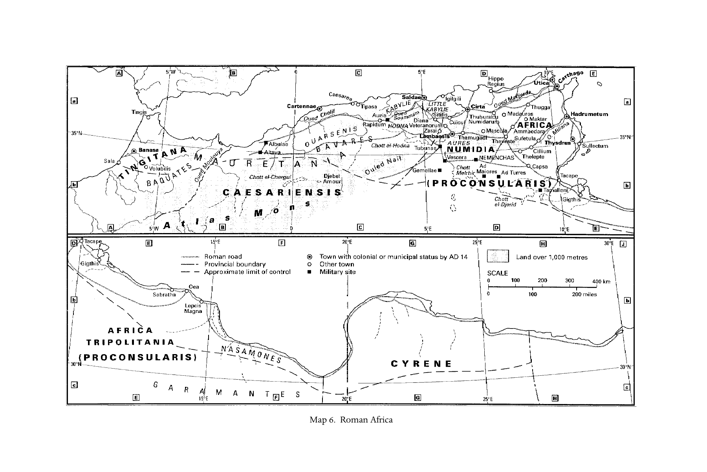

# 第二十一章 北非

**作者：莫琳·A. 蒂利（Maureen A. Tilley）**

《剑桥基督教史》第一卷《起源至君士坦丁》中文译稿

> 原书第380–396页，PDF第429–445页，含章前地图。完整翻译正文与解释性脚注；参考文献作者名、题名和定位保留原文。
>
> [第二十一章英文原文](<第二十一章 北非（英文）.md>) · [原书PDF](<../01 起源至君士坦丁.pdf>)

*地图6：罗马时期的非洲。图例包括罗马道路、行省边界、大致控制界线、公元14年以前已获殖民地或自治市地位的城镇、其他城镇、军事驻地，以及海拔超过1,000米的土地。图内地名保留原文。*

<!-- 原书第381页；PDF第430页 -->

这里的“非洲”，指撒哈拉以北的土地，不包括埃及与埃塞俄比亚，却包括今天的摩洛哥、阿尔及利亚、突尼斯以及利比亚西部。在这片广阔土地上，基督教成长起来，为更广大的教会提供了丰硕的神学思考成果。当代教会论、圣礼神学及圣经诠释传统的根，都在这里得到滋养。

## 证据

<!-- 原书第381–382页；PDF第430–431页 -->

关于最初三个世纪北非基督教的文学证据，来自德尔图良（约160–约225年）、米努基乌斯·费利克斯（二／三世纪）、居普良（卒于258年）、科莫狄安（活跃于三世纪中叶）、伪居普良（258年以后），以及各种讲道与殉道故事。[^1]这些材料展现基督徒社群的信仰、结构及实践。

非洲有许多考古遗址，却没有一处直接见证基督教最早的岁月。甚至迦太基也没有四世纪以前的证据。调查最早期历史的主要障碍，是教堂反复重建，尤其在汪达尔征服以后。

最早提到用于基督教敬拜之建筑的文学记载，都来自四世纪。《泽诺菲卢斯庭审记录》（Gesta apud Zenophilum，320年）提到303年“基督徒聚会的房屋”。《萨图尔尼努斯殉道记》（Martyrium Saturnini，304年或稍后）说，戴克里先迫害期间，主教背弃信仰后，信徒在一位诵经员家中聚会。阿尔塔瓦一方309年的铭文，提到basilica dominica，即“主的厅堂”，是一座纪念殉道者的祠堂。[^2]加里恩归还此前没收教堂的敕令（Euseb. HE 7.13），没有留下在非洲实施的回响。这并不意味着300年以前不存在专门用作教堂的建筑，只意味着我们没有证据。

地下墓窟见证着非洲早期基督教。最古老的是哈德鲁梅图姆墓窟，年代为三世纪中叶。[^3]那时该城已有主教。尽管墓窟名为“善牧”（Bon pasteur），没有迹象表明是基督徒所建，也没有证据表明其中基督徒墓葬占多数。它与作为机构的教会没有联系；不过，铭文证明有基督徒在场。其他墓窟，包括突尼斯的萨拉克塔，即Sullectum、凯尔肯纳、加贝斯，阿尔及利亚的肯舍拉及谢尔贝特—布—阿杜芬，以及利比亚的萨布拉塔、苏尔特和塔尔胡纳山，年代都不能可靠确定。只有萨布拉塔和肯舍拉，即古代马斯库拉，似乎在300年以前已有基督徒社群，但除了主教名字，所知甚少。

## 政治、文化与社会影响

<!-- 原书第382–383页；PDF第431–432页 -->

早在基督教传入以前，不同族群就共同塑造了非洲文化。[^4]希腊史家称为利比亚人的布匿时代以前沿海居民，在晚至二世纪的铭文，以及图阿雷格人的语言中，都留下痕迹。[^5]考古证明，利比亚人与埃及、希腊都有贸易。高地上季节性迁徙放牧的努米底亚人，自八世纪起被称为柏柏尔人，出现在狄多的布匿建城传说中；其语言以发展后的形式延续至今。

经营奢侈品贸易的腓尼基人，[^6]约于公元前1100年建立小型定居点，约前814年建立迦太基。它成为利比亚—布匿文化的中心。[^7]贸易、农业以及玻璃和金属工艺，是经济支柱。[^8]迦太基由富有且有功望的长老实行寡头统治，但民众保有发言权，而且这种权利逐年增强。[^9]

与希腊的贸易持续进行，不过，随着时间推移，不断扩张的腓尼基贸易网支配了西地中海，吞并希腊殖民地，最终导致与罗马冲突。布匿战争（前264–146年）结束时，罗马控制了迦太基城及其属地，即突尼斯东北部，将其设为由裁判官治理的行省，向罗马供应谷物。前67年，罗马人又将昔兰尼纳入非洲领地。前46年，他们吞并朱巴一世的毛里塔尼亚，把“旧非洲”（Africa Vetus）与这一称为“新非洲”（Africa Nova）的新领土，合并为一个由资深执政官治理的行省。最初，内战以及保护罗马谷物供应的需要，推动了两地整合。但到42年，西部分为两个皇帝行省：凯撒利亚毛里塔尼亚和廷吉斯毛里塔尼亚。前25年，东部的凯撒利亚地区交给朱巴二世统治。他在罗马长大，把罗马文化带到祖先土地。[^10]西部廷吉斯地区，成为帝国罗马军队最密集的驻扎区之一。那里建立的罗马城市虽然很少，却有许多当地青年追随父亲从军。[^11]

到公元二世纪之交，同样来自非洲的塞维鲁王朝掌权。他们熟悉当地情况，将努米底亚从非洲资深执政官行省分出。戴克里先治下，非洲资深执政官行省与昔兰尼被分成三个行省：非洲、拜扎凯纳与的黎波里塔尼亚；努米底亚则分为努米底亚基尔塔、锡提菲斯与米利提亚纳三个行省。廷吉斯地区被划归西班牙。

毛里人、巴夸特人、盖图利人及其他部族向北推进时，这些重新划分都有助于罗马化，也使对边界模糊地带的管理更加稳定。[^12]

越深入内陆，语言与贸易品等具有明确布匿和希腊—罗马特色的痕迹就越少。沿海地区，以及很早就大量驻军的地区，例如基尔塔与兰拜西斯周围，罗马化最强。并非所有城市都接受罗马习俗，连政体也未必接受。殖民地和申请城市地位的城镇，采用罗马政制；但许多大城市，尤其的黎波里塔尼亚的城市，仍保留布匿式治理，设有民众大会、元老院和由长老（seniores）协助的苏菲特长官（suffetes）。[^13]这种布匿合议政制能否延续，取决于是否方便罗马当局，以及地方精英抵抗同化的程度。凡合作或吸纳对非洲人有利之处，例如凯撒利亚毛里塔尼亚，就有罗马城市存在；凡无利之处，例如莱普提斯（Leptis／Lepcis），则出现布匿城市与罗马殖民地并立的双重建置。

<!-- 原书第384页；PDF第433页 -->

非洲社会最初主要按部族组织，直到以城市为文化中心的腓尼基人到来。罗马人把大片土地分给政治支持者，并在城市周围安置退伍军人，削弱乡村残存的部族影响；其子女继承父亲的公民地位，强化罗马文化与税收。[^14]朱巴二世输入建筑样式、货币、法律与宗教，加快罗马化。[^15]姓名也发生了一定程度的罗马化，但如同采用罗马城市制度一样，布匿名与罗马名的比例，取决于哪一种更有利于家族向上流动。布匿姓名往往包含神名，强调与罗马以前文化的联系；采用的罗马姓名，则尊崇罗马庇护者。总的来说，非洲人在罗马化有利于自己时，就加以运用，例如担任罗马祭司、改用姓名；而在可能的时候，又紧守自身根源，例如使用新布匿文墓志。

## 非洲诸宗教

<!-- 原书第384–385页；PDF第433–434页 -->

关于布匿时代以前的传统，所知很少。巨大的岩石墓葬证明，当时埋葬死者，随葬品很少。学者常从后世撒哈拉习俗，推测利比亚宗教，例如崇敬陨石、在圣地留下布片。[^16]腓尼基人从推罗带来黎凡特遗产，包括崇敬城市守护神马尔卡特。利比亚与布匿人的接触，使推罗原本不重要的神明塔尼特与巴力·哈蒙，变得突出。[^17]即使到基督教时期，含神名的姓名仍很常见，只是采用拉丁化形式。追溯布匿迦太基的宗教史并不容易，因为希腊作者用希腊神名描述布匿诸神，宗教史家又倾向用腓尼基或现代马格里布传统填补空白。

与埃及、希腊的贸易，影响了宗教图像。公元前396年哈米尔卡袭掠叙拉古德墨忒尔神庙以后，希腊神像，尤其德墨忒尔的形象，传入当地。[^18]伊西斯来自埃及，后来库柏勒经罗马从小亚细亚传入。托勒密王朝统治（前322–96年）留下的希腊法律、语言与建筑，在昔兰尼加延续下来。[^19]随葬物并不埋进墓中，但设有石桌（mensae），供活人探墓并为亡者设宴。[^20]

城市中的布匿宗教得以存续，往往与罗马崇拜融合；乡村中的形式，则较少同化。[^21]大型罗马化城市虽然有奉祀朱庇特、朱诺、密涅瓦的卡庇托神庙，巴力·哈蒙的雕像仍一直制作到基督教时期。居首位的女神塔尼特被等同于朱诺；马尔卡特对应赫拉克勒斯；农业神弗鲁吉费尔对应普鲁托；但被选作巴力面貌的，是庄严的萨图尔努斯，而非朱庇特。他的崇拜跨越阶层，极其流行。[^22]

献祭是布匿宗教不可分割的一部分，由一个合议团体的首席祭司主持。[^23]祭祀遗存显示，有些献祭献给地下神明和／或亡者：人们把奠酒浇入地面，把食物留在墓旁。[^24]巴力·哈蒙掌管墓地与人祭。在饥荒、战争等危急时期，祭品是头生孩子；不过，考古遗存表明，有时也以死胎、生病的较大儿童和小动物替代。[^25]人祭延续到多晚、范围有多广，仍不清楚，但罗马法律与德尔图良的表述，似乎认为它延续到了公元一世纪。[^26]焚祭之后，骨灰埋入瓮中。其他死者则葬于石棺，或石块和陶瓦下，随葬品很少。

如在罗马一样，任期一年的祭司职位，常由同一家族成员担任，是仕途（cursus honorum）的台阶。担任这些职位，是认同罗马的重要方式。皇帝崇拜祭司职体现了这一做法的最高形式，是非洲人事业的顶峰。[^27]它很可能在维斯帕西安时期传入，旨在为罗马化提供宗教基础。[^28]因此，它既代表罗马宗教，也代表罗马政治霸权。

## 早期非洲基督教的地区特点

<!-- 原书第386–387页；PDF第435–436页 -->

布匿宗教的闪族根源，引出了基督教在当地如何起源的问题。遗憾的是，答案未知。非洲人从未像其他教会那样，宣称有一位建教使徒，例如亚历山大里亚的马可或印度的多马。他们很尊重罗马基督徒，却没有教会由罗马创立的传统。[^29]事实上，基督教实践暗示着另一种根源。多数学者把基督教与迦太基及周边犹太社群相联系。[^30]证据包括拉丁文《圣经》中的希伯来语式表达、德尔图良熟悉后来收入《塔木德》和《米示拿》的口传传统，以及加马尔墓地同时埋有犹太人与犹太基督徒。[^31]

非洲基督教也呈现最初数世纪“犹太基督教”的某些标志：[^32]例如，《使徒行传》15:19–20的使徒决议，直到德尔图良（Apol. 9.13）与米努基乌斯·费利克斯（Oct. 30.6）时代，仍被当作规范；德尔图良知道，犹太人称基督徒为拿撒勒人，一个异端派别（Marc. 4.8）；伪居普良《论百倍》（De centesima，PL, supp. 1, cols. 53–67）具有天使基督论；基督徒直到436年仍守某些犹太节日，见第四次迦太基会议第89条。最后，地方教会由seniores laici，即“平信徒长老”组成的委员会治理，类似犹太会众，也可能类似布匿的苏菲特长官。虽然这些证据综合起来仍不足定论，但举证责任应由提出其他解释者承担，例如诉诸一般闪族或布匿文化的解释。

最早提及基督徒的非洲著作，是约180年的《斯基利殉道者行传》（Martyrum Scillitanorum acta），用拉丁文写成，可能因为它依据法庭记录。不过，非洲基督徒最初的语言是希腊语，或许说明基督教根植于说希腊语的商人中，其中可能包括散居犹太人。德尔图良某些论著最初采用希腊文，[^33]对佩尔佩图娅来说，希腊语也是礼仪语言（M. Perp. 12.2）。

无论起源如何，早期基督徒已有拉丁文《圣经》。到180年，保罗书信已有拉丁文版本（M. Scil. 12），其余经书则约于250年前译出。没有一部完整《圣经》存世，只有各种著作中的短小片段。译文常与耶柔米《武加大译本》显著不同（August. Doctr. chr. 2.15）。其中包含别处没有、却在非洲很重要的经文，例如《约翰福音》5:3b–4。甚至在非洲内部，直到奥古斯丁时代，仍流通着不同文本（Retract. 1.7）。

北非在397年的《希波会议摘要》（Breviarium Hipponense）以前，没有正典目录，但可以从非洲人使用的书卷推测实际采用的正典。他们使用除《雅各书》《彼得后书》《约翰二书》和《约翰三书》以外所有圣经书卷。非洲也知道一些早期非正典作品，例如《黑马牧人书》《保罗行传》，或许还有《彼拉多行传》。[^34]殉道故事在礼仪中诵读，一次四世纪会议特意将它们与正典文本区分，见迦太基会议第5条。

与政治文化相呼应，合议性是教会治理的标志，也是衡量基督教传播的尺度。证据见于主教座的分布，以及诸主教在会议上的往来。[^35]目前所知最早的会议，约于220年在阿格里皮努斯主教主持下举行，没有附主教座名的签署名单保存下来。直到奥古斯丁约410年的De unico baptismo 13.22，才记其与会主教为七十人。无论这是精确数目还是约数，参奥古斯丁405年的Cresc. 3.3.3，它都提供了一个基准，可用来衡量后来记载的主教人数。居普良（Ep. 59.10.1）声称，到236／240年，他能够召集九十位主教，谴责一位努米底亚主教的异端。同样没有名单存世，但那时主教已散布于非洲资深执政官行省和努米底亚。这一人数，使阿格里皮努斯召集七十人的说法获得一定可信度。即使在256年两次大迫害之间，仍有八十七位主教齐聚迦太基，代表的地区东至的黎波里塔尼亚莱普提斯，西至图布尔博，但主要集中在迦太基周围220公里内。

非洲传统极为倚重主教。他们经常聚集，讨论共同关心的问题，但并不被强迫把会议共识施行于自己的教区。甚至小村落也有主教。在较大城市，主教有执事协助。司祭，即长老，主要见于迦太基这类大城市，主持各城区的事务。

<!-- 原书第387–388页；PDF第436–437页 -->

非洲基督教从最初开始，就通过殉道和护教表现其不妥协性。[^36]180–305年，非洲基督徒间歇受到迫害。评估迫害强度及其影响时，必须认识到：帝国各地并非所有基督徒都在同一时间、以同一方式受到迫害。即使旨在促成全帝国一致的皇帝敕令，也依赖地方执行；一地可能偶尔执行，或根本不执行，另一地却持续而严厉。周围文化中，无论在战争还是祭坛上，以生命献祭的理想，都支持基督徒认为以忠信献出生命是可接受的观念；但应注意，殉道叙事并未直接染上人祭母题。[^37]

最早的殉道故事《斯基利殉道者行传》，显示即使面对死亡，基督徒也坚决拒绝向皇帝献上神圣敬礼。资深执政官试图宽待囚犯，给他们撤回信仰的机会；他们却更加坚定地宣称自己名为“基督徒”。发言人斯佩拉图斯采用常见的护教论证，第2–8节，为基督教辩护，称其合乎理性，只敬拜上帝这位宇宙最高统治者。基督徒是遵守法律、尊敬皇帝的模范公民；但他们拒绝指着皇帝的守护灵（genius）起誓这一偶像崇拜行为，因为那将否定他们相信上帝是唯一神明的信仰。无论在不妥协还是在护教上，斯佩拉图斯都为其他殉道故事提供了榜样。

一代之后，塞普提米乌斯·塞维鲁使归信基督教成为非法。从这一时期传来两个故事，都讲述出于原则、毫不退让地拒绝偶像崇拜。第一个出自德尔图良《论冠冕》（De corona）：一名军人因拒绝戴象征胜利的月桂冠被处死。德尔图良将冠冕解释为军旅生活中普遍偶像崇拜的象征。尽管法律判决或许更应解释为惩罚违反军纪，而非坚持“基督徒”之名，但有些迹象显示，这名军人的行为，甚至让部分信徒感到难堪。

不过，203年的《佩尔佩图娅与费利基塔斯殉道记》（Martyrium Perpetuae et Felicitatis），描绘的正是因坚持基督教而受迫害。佩尔佩图娅与同殉道者萨图鲁斯的日记，表现出拒绝献祭，甚至拒绝把祭司袍服当作戏服穿着（M. Perp. 18.4–6）。它们呈现一种灵恩型基督教，尊重预言，梦中启示的权威胜过教士。灵恩权威与授职权威之间的冲突，将成为250年代非洲教会主要的紧张点之一；那时，它再次直接从迫害环境中产生。同样，《佩尔佩图娅殉道记》也为250年代《马里安努斯与雅各殉道记》《孟他努斯与卢基乌斯殉道记》等后世作品，记录殉道者的监禁与处决，提供了模式。它们在与家人和当局争辩时，都遵循斯基利殉道者的榜样。[^38]对手越施压，他们越不妥协。

<!-- 原书第389页；PDF第438页 -->

塞维鲁与德修之间，偶尔有非洲殉道事件的记载，见Tert. Scap.各处；Cypr. Ep. 39.3.1，但没有持续迫害，足与德修治下相比。其他地区也许迫害强烈，优西比乌也许夸大了情况，但在非洲，250年代以前没有普遍恐怖的证据。德修与瓦勒良颁布的敕令，构成这一时代最严重的威胁。德修即位后不久，约250年1月，下令所有人献祭。危难时期号召宗教一致并不少见，这是一种动员民众、确保pax deorum，即“诸神的和平”的方式。235–284年确实需要某些有助政治稳定的措施：出现过十八位皇帝，还有更多帝位争夺者；边疆动荡，是这一时期的特征。因此，号召献祭可以理解。特殊之处却在于要求的普遍性，以及坚持执行的程度。居普良著作（Ep. 15.4；Laps. 9.25）显示，不只是家长，而是全部家庭成员都参加皇帝崇拜，浇奠酒、品尝祭肉（Laps. 25）。

献祭者得到已经服从的证明，即libelli，其中一些仍存世。有些人试图通过代理人或贿赂取得证明（Cypr. Ep. 21.2.1–3.2；55.13–14），或像居普良一样，宁愿自愿流亡，也不面对惩罚。各种促人服从的压力失败后，基督徒便遭处决。

据居普良《论失足者》（De lapsis），许多基督徒，包括教士，都献了祭。有些主教甚至带领会众背教（Cypr. Ep. 55、65、67、69）。基督徒争论，决定性的是行为本身，还是仅仅同意这件事。普遍共识基于字面理解：正是身体实际做出的行为，将跌倒的lapsi，即“失足者”，与坚定站立的stantes分开。许多失足者，包括部分教士，希望重新获准进入教会。居普良认为，应由主教逐案判断归回者的罪责程度，施加适当惩戒。但迫害未结束，他便无法回迦太基，只能通过与教士通信治理该城教会。

<!-- 原书第390页；PDF第439页 -->

他不在时，一些基督徒陷入惊慌，想尽办法重新进入教会。有些向“宽松派”教士施压；另一些采取的途径，则给社群带来长期问题。他们去找confessores，即“认信者”——因拒绝献祭而入狱的基督徒——请求代求。认信者在教会中地位特殊：虽然许多人未受圣职，其权威却不容置疑，连居普良也承认。他们已宣认效忠基督，甘愿受苦。监禁和酷刑往往使他们濒于死亡，由此取得在未死的情况下、最接近殉道者的地位。一些认信者向悔改的失足者发出和好书，即libelli pacis，使他们重新纳入教会。有些为忏悔者写信，供自己死后使用；还有些签发一揽子赦免信，甚至不列明适用者姓名。

这种情况下，居普良不得不在认信者权威与自己关于失足者的明确立场之间周旋。德修251年去世后的几年，居普良致力于整顿迦太基教会。认信者不经授职便被纳入教士行列，理由是受苦已足以使他们有权担任执事和长老，但不能任主教。悔改的失足者则按主教规定的条件和好，往往只能在in articulo mortis，即“临终时”，领受圣餐。

到253年，和平间歇消失，瓦勒良（253–259年在位）治下开始新的迫害。绞索在教会颈上越收越紧时，居普良开始准许更多失足者领圣餐。他认为，他们需要圣礼和基督徒相交所提供的属灵力量，才能承受上帝下一轮试炼。256年，瓦勒良颁令，要求高级教士为皇帝献祭，禁止基督徒集会，没收财产，并禁止基督徒拥有自己的墓地（M. Cypr. 1.7）。一些教士被判送入皇帝矿场（Cypr. Ep. 76–79）。256年夏，高级教士开始面临死刑；上层男子失去地位与财产，若仍坚持信仰，也遭处死。上层妇女被放逐，财产被没收（Cypr. Ep. 80）。官员对追捕下层信徒兴趣较少，因为没收小额财产不值得费力；而且这些人在社群中地位不高，也不足以成为展示皇帝震怒的显著例子。居普良的精英身份和职位使他处于危险。他在郊区别墅被捕，押到迦太基，受审，并于258年被处死。

<!-- 原书第391页；PDF第440页 -->

瓦勒良去世后，加里恩撤销256年敕令。基督教虽未成为religio licita，即“合法宗教”，信徒却可以自由集会，并收回敬拜场所和墓地。此后有近四十年的相对和平。随后，290年代，军方开始处死归信后拒绝服役的军人，例如特维斯特的马克西米利安与廷吉斯的马尔凯卢斯。这些殉道者成为社群崇敬的英雄，为基督徒树立榜样，教他们如何在四世纪初戴克里先将要发动的迫害中抵抗国家。更重要的是，他们强化了一种基督徒身份观，认为这一身份要求抵抗国家权威。对殉道者的崇敬，以及围绕这种严格身份界定的争论，将成为四世纪末、五世纪初多纳徒派与大公教会争议的核心。

## 殉道者敬礼

<!-- 原书第391–392页；PDF第440–441页 -->

与其他地区相似，非洲教会也产生了自己的文学，教人预备殉道、赞颂殉道。不过，非洲人期待在世界终结时得到昭雪：正如民政当局在地上审判殉道者，殉道者也将在天上严厉审判他们，见M. Perp. 18；Tert. Mart. 2.4；Apol. 24；参《马加比二书》7:9–19、35。殉道者与认信者的权威，甚至超过教会权威，见M. Perp. 13.1；认信者情况见上文。

以圣经中因忠于上帝而被处死的人，例如马加比殉道者与司提反，为榜样，尊崇本地殉道者，始于德尔图良时代。非洲的圣物敬礼始于居普良：基督徒在其行刑处附近地上铺手帕，承接滴落的血。ad sanctos，即靠近殉道者墓的安葬方式，自295年起已有见证（Acta Maximiliani 3.4）。

殉道者敬礼采用类似罗马人普遍纪念亡故亲属的习俗。在死者逝世纪念日——即其在天国诞生之日，参M. Polyc. 18——基督徒到墓地聚集、歌唱、宴饮，常失于庄重，还通过管道把奠酒倒入墓中。[^39]德尔图良（Spect. 13）与居普良（Ep. 68.6.2）谴责这些庆祝不合基督教，但似乎成效不大，因为一个半世纪以后，奥古斯丁仍在反对这些laetitiae，即欢宴，例如De civ. D. 8.27。

非洲究竟有多少人殉道，没有准确统计。其影响似乎不在绝对人数，而在于给基督徒施加的恐怖，以及教会领袖通过划定基督徒与更广大世界的界限作出的回应。一旦迫害结束，基督徒就必须重新制定对国家的态度，重新构造自身身份。

## 社会中的基督徒

<!-- 原书第392–393页；PDF第441–442页 -->

面对那个世界，基督徒努力为自己的忠诚提供理性说明。护教文献既面向邻人，也强化自身委身。它与殉道一样，表现基督徒拒绝承认自己上帝以外的任何神明。德尔图良、米努基乌斯·费利克斯与科莫狄安等作者，试图让抱有怀疑的同时代人相信基督教的价值，以及传统崇拜和秘仪宗教的荒谬。对他们而言，基督徒身份与实践当然包括一神论；而且，如几乎所有护教文献一样，还主张基督徒在个人与社会生活中，比非信徒更有道德（Tert. Apol. 3–4、10、30；Min. Fel. Oct. 30–31）。

基督徒自称生活简朴、品行正直。他们对周围文化的不自在，以充满矛盾的方式表现出来。德尔图良对哲学和辩证术的轻蔑（Spect. 18；An. 3），以及阿尔诺比乌斯对修辞的拒绝（Adv. nat. 1.59），可归结于德尔图良著名的警句：“雅典与耶路撒冷有什么相通？学园与教会有什么相通？异端与基督徒有什么相通？”（Praescr. 7）然而，这句话本身就以最出色的古典风格表达。德尔图良面向基督徒写作时，反对他们服兵役（Cor. 1）；他却又说，异教徒不应害怕基督徒，因为双方共享城市与文化生活，包括服兵役（Apol. 37.4）。如米努基乌斯·费利克斯解释，运用得当并有哲学支持的修辞，可以帮助传福音（Oct. 39）。

米努基乌斯·费利克斯（Oct. 30.3）与德尔图良（Apol. 9.2）等护教者，尤其猛烈谴责人祭。指控敌人食人，是大多数古代社会护教论辩的常见母题。事实上，基督徒自己也受到这种指控，见Tert. Apol. 23；Min. Fel. Oct. 9中的弗龙托。不过，非洲人在尚不遥远的记忆中，确实曾献儿童为祭，[^40]所以这些指控格外尖锐。[^41]

维克托一世或许为非洲的不妥协性与合议性提供了最后一个例子。据说他从的黎波里塔尼亚来到罗马，成为主教，任期约189–199年。他是第一位威胁把自己教区以外基督徒逐出教会的罗马主教。不同社群在不同日期庆祝复活节，使他深感震惊。但合议性压过了严格主义：他虽威胁绝罚，却从未实际与任何人断绝共融。

## 争论的问题

<!-- 原书第393–394页；PDF第442–443页 -->

基督徒攻击罗马传统宗教与秘仪宗教时，大体团结一致，但教会并非铁板一块。城市间的距离、基督徒人数少，以及每个小镇都有主教，都有助于形成多样的地方实践。这种状况本属预期，也受到尊重；但差异过大时，非洲教会内部各种运动，就使基督徒彼此分裂。引发分歧的问题，包括创造、启示与教会。

创造是一位善神的产物，还是物质本身邪恶？这是某些诺斯替派提出的基本问题。反对赫尔摩根尼时，德尔图良坚持上帝是创造者，创造是美善的（Herm. 15–18）；反对马吉安时，他教导《旧约》的创造上帝，与耶稣的父，是同一位（Marc. 2、4、5）。

启示已经完成，还是持续发生？非洲多数基督徒相信，上帝仍通过梦与异象提供启示。《佩尔佩图娅殉道记》的编者也如此认为，把当下描绘为人人都要说预言的末日。德尔图良相信，人所知道关于上帝的几乎一切，都来自梦；但他也提醒，这些启示需要由共同体评估（An. 9）。他和自己的圈子，极重视同时代弗里吉亚先知的启示；这些先知的严格主义运动自称“新预言”，宣讲迫近的末世，即世界终结，拥抱殉道，也接纳妇女担任领袖。这一运动吸引许多非洲人。德尔图良晚年认为，不追随它的人宽松到近乎异端；但始终重视合议的双方非洲人，并未像别处后来所称的孟他努派那样，成立分离教会，也没有证据表明非洲主教对同情孟他努派者施加惩戒。[^42]

作为认信者，佩尔佩图娅觉得自己有权在祈祷中向上帝提问，并通过异象得到答案，其中一些关乎殉道与医治。同伴萨图鲁斯的异象，则表明认信者高于教士；前者更接近上帝，可以调解后者之间的争端（M. Perp. 13）。一代之后，居普良仍尊重梦作为启示的途径。[^43]

教会是圣徒的家，还是罪人的避难所？人们不只把教会想作受洗基督徒的聚集，也把它看作一个具有实体性的存在。德尔图良首先使用“母教会”这一称谓（Mart. 1）；居普良对此感受如此强烈，以至于说：“不以教会为母者，就不能以上帝为父”（Unit. eccl. 6）。两人都以实际方式宣告教会合一。对合一的投入，支持划定明确界限，也支持德尔图良拒绝异端解释圣经：圣经不是他们有权解释的。教会的纯洁，使他不能接受让悔改的通奸者重新与教会和好（Pud. 2–3）。这种合一观，也使阿格里皮努斯主持的迦太基会议能够拒绝异端洗礼，并使居普良256年的会议，不承认失足后又试图返回教会之教士所施洗礼的有效性（Ep. 67）。对他来说，教会就是挪亚方舟。他向那些已经受洗、却倾向分离群体的人厉声宣告：“教会之外，没有救恩”（Ep. 73.21）。[^44]

然而，合议性仍压过严苛。德尔图良无论多么同情孟他努派，都没有脱离非洲教会；非洲人无论多么坚决为重新施洗辩护，都没有与不重新施洗的罗马人断绝共融。

## 与其他地区基督徒的关系

<!-- 原书第394–395页；PDF第443–444页 -->

北非虽然与埃及共享海岸，它与罗马的关系却留下更多痕迹。两个共同体最重要的交往，围绕三个问题，全部显示非洲人的合议性与维护合一的投入。

第一个问题，是教会能否使受洗后犯罪者重新和好。德尔图良代表非洲传统，反对教会创设新做法，因为这超出其权限。约217–222年任罗马主教的卡利斯图斯，主张更宽容的政策，迫使罗马分裂为其支持者与希波吕托斯（约170–约236年）支持者两方。尽管德尔图良《论贞洁》（De pudicitia）激烈反对，罗马与迦太基始终没有断绝共融；非洲的合议性阻止了这一点。

第二、第三个问题，也同样分裂罗马社群。德修迫害之后，科尔内利乌斯（卒于253年）成为罗马主教。他使失足者重新和好，激怒了严格主义的诺瓦提安派，后者质疑其选举有效性。随后，问题转向如何接纳由异端施洗的人。[^45]非洲人和罗马严格派支持重新施洗。罗马主教司提反（254–257年在任）与居普良为此展开长期争论（Cypr. Ep. 67–75）。即使争议最激烈时，居普良争取凯撒利亚的费尔米利安等海外支持者，而司提反拒绝接待其代表，双方也没有威胁彻底决裂。

## 非洲基督教的其他特点

<!-- 原书第395–396页；PDF第444–445页 -->

非洲基督教倾向字面主义和法律主义。教义的表述产生于解决实际问题的过程，无论问题本身，还是它对教会合一的影响。非洲人探讨的重要领域，包括教会论、三一、灵魂本性、圣经诠释及妇女角色。

与诺斯替派的争论，催生了德尔图良的三一思想。他的“一个本性，三个位格”，成为正统公式（Pud. 2）。他用物质类比作为解释隐喻，倾向一种从属论基督论，例如Prax. 8中的国王、儿子、使者，以及太阳、光、温暖等。奥古斯丁于419年将德尔图良的贡献作了属灵化处理（Trin.）。讨论三一与灵魂时，德尔图良倾向按字面解释圣经，认为实在具有物质性，甚至上帝、魔鬼和灵魂也不例外。在爱任纽基础上，他反对诺斯替派从圣经人物名字创造新宇宙论的寓意解释。不能像异端那样把圣经寓意化（Scorp. 11.4），创造一个与使徒传承所领受教义相矛盾的新故事。他与居普良，如奥古斯丁以前多数非洲人一样，倾向预表而非寓意：把圣经故事和人物看作一幅叠加于当代事件、英雄与恶人之上的图景。居普良《经文见证》（Testimonia）运用预表，巩固《旧约》与《新约》的联系，反对诺斯替派、马吉安派与犹太人的教导。

对妇女的态度及赋予她们的角色，与其他地方并无根本不同，除非从非洲基督教总体特点理解。尊重圣灵在教会中的活动，也延伸到受启示的妇女，其异象作为先知启示受到尊重（Tert. An. 9；M. Perp. 1.4–5、4.1）。只有德尔图良反对妇女担任领袖，或许因为他把妇女领导与诺斯替神学联系起来。他不但与非洲趋势相左，也与非洲以外的新预言成员相左。

除妇女担任领袖的问题外，非洲作者用基督教理由支持社会的一般习俗。德尔图良视罗马人重视univira，即“一生只结婚一次的妇女”，为理所当然，并谴责再婚（Mon. 15；Ad ux.第2卷）。他和居普良都要求妇女遵守比迦太基社会一般标准更严格的行为规范，例如禁止化妆、佩戴首饰和修饰发型，分别见Cult. fem.、Virg.及Hab. virg.。不过，也应注意：妇女行为标准虽严格，在这个严格主义教会中，对男子的要求同样严格，尤其性道德方面，例如Tert. Exh. cast.及Mon.。

总的来说，无论神学还是伦理，非洲基督教都倾向以字面而严格的方式理解圣经与道德。它通过殉道与护教，面对周围文化界定自己；通过致力合一与合议，在内部界定自己。当罗马皇帝接受基督教为合法宗教时，那些把身份建立在反抗国家上的基督徒，被迫重新思考这一身份。接受皇帝馈赠和支持者，像奥古斯丁一样，在神圣计划中为皇帝找到正面，或至少中立的位置，来解释其接受的合理性。无法如此做的人，则视自己为真教会最后的余民。在北非，这些人便是多纳徒派。作为非洲基督教真正的继承者，他们维持对圣经的字面、严格解释，以及殉道文化；在继续反对罗马国家者中间，推动合一与合议。其余所有人，都是外人。[^46]

## 译校说明

- 地区行政史和迫害年代中的疑似原书问题均保留。例如原书第383页朱巴一世领地的称呼、若干行省改组的时间顺序，以及“二世纪之交”塞维鲁王朝掌权的表述；第390–391页将瓦勒良的两轮敕令都系于256年，并写“瓦勒良去世后”加里恩撤令。这些表述已与原PDF文字核对，未作为提取错误擅自改写。
- 本章关于维克托是否实际断绝共融的判断，与第二十章所介绍的观点存在差异；分别保留各章作者的论证。
- 结尾将多纳徒派称为非洲基督教“真正的继承者”，是本章作者对当地传统延续性的解释，依原文保留。

## 脚注

[^1]: 阿尔诺比乌斯，活跃于约275–约311年，以及拉克坦提乌斯，约250–约325年，也来自非洲，但其现存著作不属于本章考察时期。

[^2]: Février, ‘Africa–Archaeology’, 16.

[^3]: Leynaud, Les catacombes africaines, 11–15.

[^4]: 非洲的政治地理并不总能清楚界定。以下依据Shaw, ‘Formation of Africa Proconsularis’；Adkins and Adkins, Handbook, 111–14。

[^5]: Ghaki, ‘Le Libyque’, 204–6.

[^6]: Lancel, Carthage, 5.

[^7]: Lancel, Carthage, 262.

[^8]: Fantar, ‘Punic civilization’, 105–6.

[^9]: Arist. Pol. 2.11; Polyb. Hist. 6.51.

[^10]: MacMullen, Romanization, 43–5.

[^11]: Shaw, ‘Autonomy and tribute’, 68–70.

[^12]: 关于边疆政治不断重新协商的过程，见Shaw, ‘Autonomy and tribute’。

[^13]: MacMullen, Romanization, 35–6.

[^14]: MacMullen, Romanization, 31; Theodosian Code 1.12.4.

[^15]: Macmullen, Romanization, 43–5.

[^16]: Picard, Les religions de l’Afrique antique, 5.

[^17]: Picard, Les religions de l’Afrique antique, 26–27, 56–61.

[^18]: Picard, Les religions de l’Afrique antique, 86.

[^19]: MacKendrick, North African stones speak, 121–5.

[^20]: Ennabli, Carthage retrouvée, 53.

[^21]: 非洲宗教，见Rives, Religion and authority，第1章。

[^22]: Rives, Religion and authority, 142–6.

[^23]: Sznycer, ‘La religion punique’, 112.

[^24]: Picard, Les religions de l’Afrique antique, 33.

[^25]: 例如公元前四世纪，叙拉古的阿加托克利斯率军蹂躏迦太基时，有二百名儿童被献祭。见Diod. Sic. 10.20；Sznycer, ‘La religion punique’, 114–16。

[^26]: Tert. Apol. 9；参Picard, Les religions de l’Afrique antique, 103。

[^27]: Raven, Rome in Africa, 149.

[^28]: Ferguson, Religions of the Roman empire, 95; Taylor, Divinity of the Roman emperor, 212.

[^29]: 反对亲罗马文本具有历史真实性的论证，见Lejay, ‘Les origines de l’église d’Afrique’, 41–7。

[^30]: 非洲犹太人及其与基督徒的关系，见Setzer, ‘Jews, Christians and Judaizers’, 185–200。

[^31]: Setzer, ‘Jews, Christians and Judaizers’, 193–5.

[^32]: 见上文第二部分第4章。

[^33]: Labriolle, History and literature of Christianity, 41.

[^34]: Labriolle, History and literature of Christianity, 58–9；NTApoc, vol. ii, 214–15，关于《保罗行传》，以及vol. i, 501–4。

[^35]: 主教人数及分布，见Maier, L’épiscopat de l’Afrique。

[^36]: 这一时期非洲及其他地区的讨论，见Clarke, ‘Christians and the Roman State’。

[^37]: 唯一的例外可能是M. Perp. 18.4：基督徒被迫穿上刻瑞斯女祭司的服饰，藉此把处死的罪犯献给女神。见Picard, Les religions de l’Afrique antique, 134。

[^38]: 例如M. Perp. 3.5、15.1–6、18.4–6；M. Mar. 8.1、4.10；M. Mont. 19.1–4等。

[^39]: Duval, Recherches archéologiques à Haı̈dra, vol. ii, 191.

[^40]: 参The Octavius of Minucius Felix，Clarke译编，334页注496所列书目。

[^41]: Benko, Pagan Rome, 54–78.

[^42]: 见上文第17章。

[^43]: Ep. 4.1、11.5、39.1、57.5、66.10；以及Pontianus Diaconus, Vita Cypriani, 12。

[^44]: 关于维持界限的详尽讨论，见Burns, Cyprian the bishop。

[^45]: 另见下文第五部分第26章。

[^46]: 见下文第六部分第28章。
