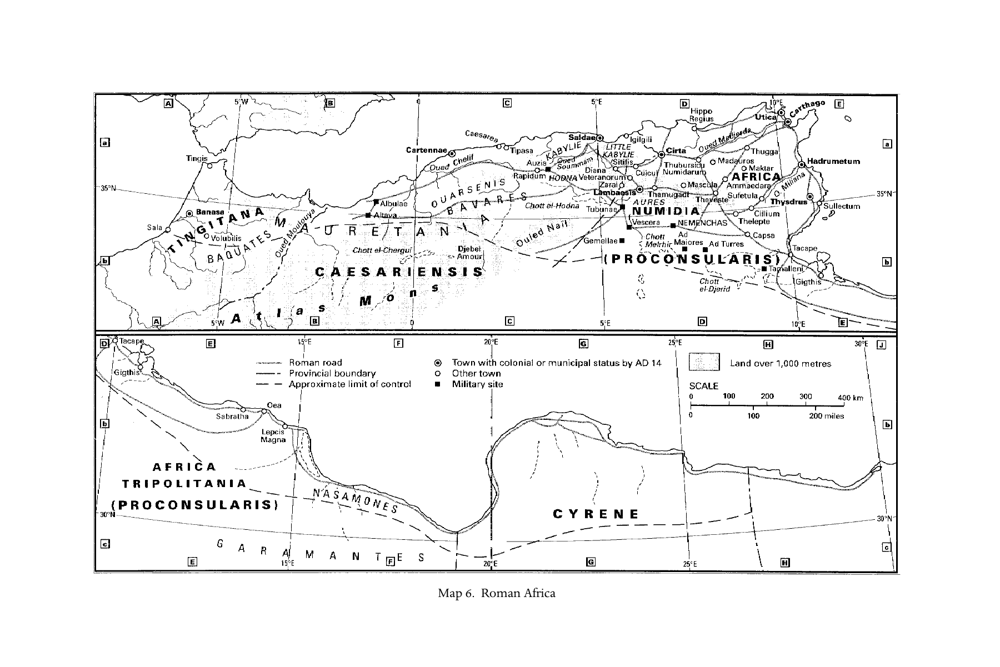

# 第二十一章英文原文：North Africa

<!-- PDF page 429; original page 380 -->

Map 6. Roman Africa

<!-- PDF page 430; original page 381 -->

### 21. North Africa

#### maureen a. tilley

‘Africa’ here refers to the land north of the Sahara, excluding Egypt and Ethiopia, but including modern-day Morocco, Algeria, Tunisia and western Libya. In this vast expanse of land, Christianity grew and provided the larger church with a bounteous crop of theological reflection. The roots of contemporary ecclesiology and sacramental theology, as well as traditions of biblical interpretation, were nourished here.

#### The evidence

Literary evidence for Christianity in North Africa in the first three centuries comes from Tertullian (c.160–c.225 ce), Minucius Felix (second/third century), Cyprian (d. 258), Commodian (fl. mid-third century), Pseudo-Cyprian (post- 258), and various homilies and stories of martyrdom.[^p430-1] It illustrates the beliefs of the Christian communities, their structures and practices.

There are many archaeological sites in Africa, but none provides direct testimony of Christianity’s early years. Not even Carthage boasts pre-fourthcentury evidence. The principal obstacle to investigations into the earliest years is the fact that the churches were repeatedly rebuilt, especially during the post-Vandal conquest.

The earliest literary references to buildings used for Christian worship are all from the fourth century. The Gesta apud Zenophilum (320) mentions ‘the house in which Christians gathered’ in 303 ce. The Martyrium Saturnini (304 ce or shortly thereafter) mentions gathering in a lector’s home during the Diocletianic persecution after the bishop’s defection. An inscription at Altava (309 ce) tells of a basilica dominica (‘dominical hall’), a shrine commemorating a martyr.[^p430-2] Gallienus’ edict restoring previously confiscated churches (Euseb.

[^p430-1]: Arnobius (fl. c.275–c.311) and Lactantius (c.250–c.325) were African, too, but their surviving writings fall outside our period.

[^p430-2]: Février, ‘Africa–Archaeology’, 16.

<!-- PDF page 431; original page 382 -->
HE 7.13) finds no echo of application in Africa. This does not mean that buildings set aside specifically as churches did not exist before 300 ce, but that there is no evidence of them.

Catacombs testify to early Christianity in Africa. The oldest, those at Hadrumetum, date from mid-third century.[^p430-3] By then the city already had a bishop. Despite the title Bon pasteur, there is no indication that Christians established the catacomb or that their burials constituted the majority there. There is no link to the church as an institution; epigraphy, however, attests Christian presence. Other catacombs, such as Salakta (Sullectum), Kerkenna and Gabes in Tunisia, Khenchela and Cherbet-bou-Adoufen in Algeria, and Sabratha, Sirte and Gebel Tarhuna in Libya, are not reliably dated. Only Sabratha and Khenchela, ancient Mascula, appear to have had Christian communities before 300 ce, but little is known, other than the names of their bishops.

#### Political, cultural, and social influences

Even before the introduction of Christianity, many different peoples contributed to African culture.[^p430-4] Pre-Punic coastal inhabitants, called Libyans by the Greek historians, leave traces in inscriptions dated as late as the second century ce and in the languages of the Tuareg.[^p430-5] Archaeology attests trade between Libyans and both Egypt and Greece. Transhumant Numidians of the highlands (called Berbers since the eighth century) figure in the Punic foundation legend of Dido and their language persists in a developed form to the present.

Phoenicians trading luxury goods[^p430-6] established small settlements about 1100 bce and founded Carthage c.814 bce. It became the centre of a Libyco- Punic culture.[^p430-7] Trade, agriculture, and glass and metal crafts were its economic supports.[^p430-8] Carthage was an oligarchy of wealthy and meritorious elders, but the populace retained a voice which grew stronger over the years.[^p430-9]

Trade with Greece persisted, but, over time, the expanding Phoenician trade network dominated the western Mediterranean, engulfing Greek colonies.

[^p430-3]: Leynaud, Les catacombes africaines, 11–15.

[^p430-4]: The political geography of Africa is not always clearly defined. In what follows I rely on Shaw, ‘Formation of Africa Proconsularis’; and Adkins and Adkins, Handbook, 111–14.

[^p430-5]: Ghaki, ‘Le Libyque’, 204–6.

[^p430-6]: Lancel, Carthage, 5.

[^p430-7]: Lancel, Carthage, 262.

[^p430-8]: Fantar, ‘Punic civilization’, 105–6.

[^p430-9]: Arist. Pol. 2.11; Polyb. Hist. 6.51.

<!-- PDF page 432; original page 383 -->
Eventually this led to conflict with Rome. At the end of the Punic wars (264–146 bce), Rome took control of the city of Carthage, administering it and its dependencies (north-east Tunisia) as a praetorian province which supplied grain to Rome. In 67 bce, the Romans added Cyrene to their African territories. In 46 bce, they annexed Juba i’s Mauretania, combining their Africa Vetus with this new territory of Africa Nova into a single proconsular province. Initially, civil war and concern for the protection of Rome’s grain supply promoted the consolidation of the two territories. But in 42, the western part was divided into two imperial provinces, Mauretania Caesariensis and Mauretania Tingitana. In 25 bce, the eastern part, Caesariensis, was given to Juba ii to rule. Juba, reared in Rome, brought its culture to his ancestral land.[^p430-10] The western sector, Tingitana, supported one of the heaviest concentrations of Roman troops in the empire. Although few Roman cities were established there, many recruits from the area followed their fathers into the military.[^p430-11] At the turn of the second century ce the Severans, Africans themselves, came to power. With their knowledge of the local contexts, they split Numidia from Africa Proconsularis. Under Diocletian, Proconsularis and Cyrene were divided into three provinces, Africa, Byzacena and Tripolitana, and Numidia broken into three, Numidia Cirtensis, Sitifensis and Militiana. Tingitana was attached to Hispania.

All these redistributions supported Romanisation and made administration of the ill-defined frontiers more stable as Maures, Baquates, Gaetuli and other tribes pushed northwards.[^p430-12]

Specifically Punic and Graeco-Roman traces such as language and trade goods waned as one moved inland. Romanisation was strongest in coastal areas and in areas where the military was garrisoned early and intensely, e.g. around Cirta and Lambaesis. Not all cities adopted Roman mores, even forms of government. Colonies and cities which petitioned for civic status had Roman forms of government, but many larger cities, especially in Tripolitania, retained Punic forms of governance with assemblies, senates and suffetes assisted by seniores.[^p430-13] The persistence of collegial Punic forms of government depended on the convenience of Roman authorities and the degree of local elite resistance to assimilation. Where cooperation or cooptation benefited Africans, e.g. in Mauretania Caesariensis, Roman cities existed. Where it did not, e.g. in Leptis (Lepcis), dual foundations of Punic cities and Roman colonies grew up side by side.

[^p430-10]: MacMullen, Romanization, 43–5.

[^p430-11]: Shaw, ‘Autonomy and tribute’, 68–70.

[^p430-12]: On the constant renegotiation of frontier politics, see Shaw, ‘Autonomy and tribute’.

[^p430-13]: MacMullen, Romanization, 35–6.

<!-- PDF page 433; original page 384 -->
African social organisation was primarily tribal until the arrival of the Phoenicians, whose culture centred on cities. Romans diminished residual rural tribal influence by distributing large tracts of land to political supporters and by settling veterans around cities, where children assumed their fathers’ civic status and strengthened Roman culture and tax revenues.[^p430-14] Juba ii accelerated Romanisation by importing architectural styles, coinage, laws and religion.[^p430-15] Some Romanisation of names occurred, but, like the adoption of Roman civic forms, the balance of Punic and Roman names varied according to its utility for families’ upward mobility. Punic names were often theophoric and stressed ties to pre-Roman culture. Adopted Roman names honoured Roman patrons. In general, Africans used Romanisation when it was to their own advantage, e.g. participating in Roman priesthoods and changing names, and clung to their roots when they could, e.g. in neo-Punic grave inscriptions.

#### African religions

Little is known of the pre-Punic traditions. Massive rock tombs attest burial of the dead with few grave goods. Scholars often hypothesise from later Saharan customs to Libyan religion, such as the veneration of meteorites and leaving cloth scraps at holy sites.[^p430-16] Phoenicians brought their Levantine heritage from Tyre, including devotion to their civic patron, Melqart. Libyco-Punic contact brought Tanit and Ba’al Hammon, minor Tyrian divinities, to prominence.[^p430-17] Theophoric names were common even in the Christian period, albeit Latinised. Tracing the religious history of Punic Carthage is complicated by Greek authors using the names of Greek divinities to describe Punic gods and by the tendency of historians of religion to fill in gaps with Phoenician or modern Maghreb traditions.

Egyptian and Greek trade influenced the religious iconography. Greek images of the divine, especially Demeter, were imported after 396 bce, when Hamilcar raided her temple in Syracuse.[^p430-18] Isis came from Egypt and later Cybele from Asia Minor via Rome. Greek law, language and architecture

[^p430-14]: MacMullen, Romanization, 31; Theodosian Code 1.12.4.

[^p430-15]: Macmullen, Romanization, 43–5.

[^p430-16]: Picard, Les religions de l’Afrique antique, 5.

[^p430-17]: Picard, Les religions de l’Afrique antique, 26–27, 56–61.

[^p430-18]: Picard, Les religions de l’Afrique antique, 86.

<!-- PDF page 434; original page 385 -->
perdured in Cyrenaica as the heritage of Ptolemaic rule (322–96 bce).[^p430-19] Grave goods are not buried within the tomb but there are tables (mensae) for the living who visited and feasted the dead.[^p430-20]

Punic religion survived in cities, often assimilated to Roman cults, and, in rural areas, in less assimilated forms.[^p430-21] While large Romanised cities had Capitoline temples dedicated to Jupiter, Juno and Minerva, statues of Ba’al Hammon were still carved well into the Christian era. Tanit, the reigning goddess, was assimilated to Juno; Melqart to Hercules; and Frugifer, an agricultural deity, to Pluto, but it was grave Saturn, not Jupiter, who was chosen as the face of Ba’al. His cult was immensely popular across class lines.[^p430-22]

Sacrifice was integral to Punic religion. Sacrifices were offered by the chief priest of a collegial body.[^p430-23] Cultic remnants suggest that some sacrifices were to chthonic deities and/or the dead as libations were poured into the ground and food left at tombs.[^p430-24] Ba’al Hammon presided over graveyards and human sacrifice. During periods of stress, such as from famine and war, offerings were first-born children, but archaeological remains indicate occasional substitution of stillborns, sick older children and small animals.[^p430-25] How late and widespread human sacrifice continued is unknown, but Roman legislation and Tertullian spoke as if it extended into the first century ce.[^p430-26] After immolation, ashes were buried in urns. Otherwise the dead were buried in stone coffins or beneath rocks and clay tiles with few grave goods.

As in Rome, priesthoods held for a year – often by members of the same family – served as steps along the cursus honorum. Holding these posts was an important way of identifying with Rome. The priesthood of the imperial cult was the epitome of this practice, the summit of an African’s career.[^p430-27] It was introduced, probably under Vespasian, in order to provide religious underpinning for Romanisation.[^p430-28] Thus, it represented both Roman religion and political hegemony.

[^p430-19]: MacKendrick, North African stones speak, 121–5.

[^p430-20]: Ennabli, Carthage retrouvée, 53.

[^p430-21]: On religion in Africa, see Rives, Religion and authority, ch. 1.

[^p430-22]: Rives, Religion and authority, 142–6.

[^p430-23]: Sznycer, ‘La religion punique’, 112.

[^p430-24]: Picard, Les religions de l’Afrique antique, 33.

[^p430-25]: E.g. the 200 children sacrificed in the fourth century bce, when Agathocles of Syracuse and his troops ravaged Carthage. See Diod. Sic. 10.20; Sznycer, ‘La religion punique’, 114–16.

[^p430-26]: Tert. Apol. 9; cf. Picard, Les religions de l’Afrique antique, 103.

[^p430-27]: Raven, Rome in Africa, 149.

[^p430-28]: Ferguson, Religions of the Roman empire, 95; Taylor, Divinity of the Roman emperor, 212.

<!-- PDF page 435; original page 386 -->
#### Regional particularities of early African Christianity

The Semitic roots of Punic religion raise the question of the origins of Christianity in this region. Unfortunately, they are unknown. Africans never claimed a founding apostle like other churches, such as Alexandria’s Mark or India’s Thomas. There was great respect for Christians at Rome, but no tradition of a foundation from that city.[^p430-29] In fact, Christian practice suggests alternate roots. Most scholars connect Christianity to Jewish communities in and around Carthage.[^p430-30] Evidence includes Hebraisms in their Latin Bible, Tertullian’s familiarity with oral traditions later enshrined in the Talmud and Mishnah, and the burial of both Jews and Christian Jews in the Gamart cemetery.[^p430-31] African Christianity also exhibits some of the hallmarks of the ‘Jewish Christianity’ of the first centuries,[^p430-32] e.g. the apostolic decree of Acts 15:19–20 treated as normative as late as Tertullian (Apol. 9.13) and Minucius Felix (Oct. 30.6), Tertullian’s knowledge that Jews knew Christians as Nazarenes, a heretical sect (Marc. 4.8), the angel-Christology of pseudo-Cyprian’s De centesima (PL, supp. 1, cols. 53–67), and the Christian observance of some Jewish festivals as late as 436 (fourth Council of Carthage, canon 89). Finally, local churches were governed by a board of elders, the seniores laici (‘lay elders’), similar to Jewish congregations (or possibly the Punic suffetes). While the aggregate evidence is not conclusive, the burden of proof nonetheless is on those who would offer alternative explanations, such as a resort to a general Semitic or Punic culture.

The oldest African writing mentioning Christians, Martyrum Scillitanorum acta from c.180, was composed in Latin, probably because it was based on a court record. But the first language of African Christians was Greek, testimony perhaps of Christian roots among Greek-speaking, possibly Jewish diaspora, traders. The first versions of some of Tertullian’s treatises were in Greek,[^p430-33] and it was the liturgical language for Perpetua (M. Perp. 12.2).

Whatever their origins, early Christians had a Latin Bible. The Pauline letters were available in Latin by 180 (M.Scil. 12) and the remainder of scripture by c.250. There is no single complete Bible extant, only short sections in various writings. Translations often differed significantly from Jerome’s Vulgate (August. Doctr.

[^p430-29]: See the arguments against the historicity of pro-Roman texts in Lejay, ‘Les origines de l’église d’Afrique’, 41–7.

[^p430-30]: On African Jews and their relations with Christians, see Setzer, ‘Jews, Christians and Judaizers’, 185–200.

[^p430-31]: Setzer, ‘Jews, Christians and Judaizers’, 193–5.

[^p430-32]: See pt ii, ch. 4, above.

[^p430-33]: Labriolle, History and literature of Christianity, 41.

<!-- PDF page 436; original page 387 -->
chr. 2.15). They included verses unknown elsewhere but important in Africa, such as John 5:3b–4. Even within Africa, various texts circulated as late as Augustine (Retract. 1.7).

There is no canon list from North Africa before the Breviarium Hipponense (397 ce), but one may surmise the working canon from the books employed by Africans. They used all of the biblical books except James, 2 Peter and 2 and 3 John. Early non-canonical works were known in Africa, such as the Shepherd of Hermas, Acts of Paul and perhaps Acts of Pilate.[^p430-34] Stories of the martyrs were read liturgically, and a fourth-century council took pains to differentiate them from canonical texts (Council of Carthage, §5).

In tune with the political culture, collegiality was a hallmark of church governance and a gauge of the spread of Christianity. Evidence may be found in the diffusion of episcopal sees and interaction at councils.[^p430-35] The first known council was c.220 under the bishop Agrippinus. No list of signatories with sees survives. Not until Augustine’s De unico baptismo 13.22 (c.410) were the bishops of Agrippinus’ council numbered at seventy. Whether this was exact or approximate (August. Cresc. 3.3.3 in 405), it provides a baseline against which to measure the numbers of bishops reported later. Cyprian (Ep. 59.10.1) claimed that by 236/240 he could assemble ninety bishops to condemn the heresy of a Numidian bishop. Again no lists survive, but by then there were bishops scattered throughout Proconsularis and Numidia. Such a number grants some credence to a figure of seventy gathered under Agrippinus. Even in 256 between major persecutions, eighty-seven bishops gathered at Carthage, representing an area from Leptis in Tripolitania in the east to Thuburbo in the west, but concentrated primarily within 220 kilometres of Carthage.

The African tradition was one of strong reliance on bishops who gathered frequently to discuss issues of mutual concern but who were not forced to apply the consensus of the gathering in their own diocese. Even small hamlets had bishops. In the larger cities, bishops had deacons to assist them. Priests were found primarily in metropolitan areas like Carthage, where they presided over urban districts.

The intransigence of African Christianity manifests itself from the very beginning through martyrdom and apology.[^p430-36] Christians in Africa were

[^p430-34]: Labriolle, History and literature of Christianity, 58–9; NTApoc, vol. ii, 214–15 (on Acts of Paul) and vol. i, 501–4.

[^p430-35]: For the numbers and diffusion of bishops, see Maier, L’épiscopat de l’Afrique.

[^p430-36]: For a treatment of this period, both in Africa and elsewhere, see Clarke, ‘Christians and the Roman State’.

<!-- PDF page 437; original page 388 -->
persecuted intermittently from 180 until 305. In assessing the strength and effects of persecution, one must recognise that not all Christians in every area of the empire were persecuted at the same time in the same way. Even imperial edicts designed to promote empire-wide uniformity depended upon local enforcement which may have been sporadic or non-existent in one place while sustained and severe elsewhere. The ambient ideal of human sacrifice, whether in war or at the altar, supported the Christian notion of the acceptability of offering one’s life in fidelity, but it should be noted that no motifs of human sacrifice directly colour martyrdom narratives.[^p430-37]

The earliest martyr story, Martyrum Scillitanorum acta, demonstrates intransigent refusal to offer divine honours to the emperor, even in the face of death. The proconsul tried to treat his prisoners leniently, offering them opportunities to recant. They only became more steadfast in claiming the name ‘Christian’. Speratus, their spokesman, made common apologetic moves (§§ 2–8). He defended Christianity as rational, worshipping God alone as the supreme ruler of the cosmos. Christians were model citizens abiding by laws and honouring the emperor. They drew the line, though, at idolatrous acts of swearing by the genius of the emperor, for it would have given the lie to their belief in God as the only divinity. In both intransigence and apologetic, Speratus provided a model for other martyr stories.

A generation later, Septimius Severus made conversion to Christianity illegal. From that period come two stories of unyielding, principled refusal to commit idolatry. The first is from Tertullian’s De corona. A soldier was executed for refusal to wear a laurel wreath, an emblem of victory. Tertullian construed this crown as a symbol of the idolatry endemic in military life. While the juridical verdict may be interpreted more as a punishment for violation of military discipline than for adherence to the name ‘Christian’, there is some indication that the soldier’s conduct embarrassed even some believers. However, the Martyrium Perpetuae et Felicitatis (203) portrays persecution specifically for adherence to Christianity. The diaries of Perpetua and her comartyr Saturus manifest a refusal to sacrifice or even to wear priestly robes as theatrical costumes (M. Perp. 18.4–6). They depict a charismatic Christianity in which prophecy was respected and revelations in dreams trumped the authority of the clergy. The conflict between charismatic and ordained authority would be one of the major stress points for the African church in the 250s where it again emerged directly from the context of persecution. Likewise

[^p430-37]: The one exception may be M. Perp. 18.4 where Christians were forced to wear the garb of Ceres’ priestesses whereby executed criminals were dedicated to the goddess. See Picard, Les religions de l’Afrique antique, 134.

<!-- PDF page 438; original page 389 -->
the Martyrium Perpetuae would provide the model for recording the imprisonment and execution of later martyrs like the Martyrium Mariani et Iacobi and the Martyrium Montani et Lucii in the 250s. All would follow the example of the Scillitans in their arguments with family and authorities.[^p430-38] The harder their opponents pushed the more intransigent they became.

Between Severus and Decius, there are occasional references to martyrdoms in Africa (Tert. Scap., passim; Cypr. Ep. 39.3.1), but there was no sustained persecution comparable to what would come under Decius. While it may have been intense elsewhere or exaggerated by Eusebius, there is no evidence for widespread terror in Africa until the 250s. Edicts issued under Decius and Valerian provided the most serious threats in this era. Shortly after Decius’ accession, around January 250, he ordered everyone to sacrifice. A call to religious uniformity in times of distress was not uncommon. It was a way to rally the population to ensure the pax deorum (‘peace of the gods’). The years between 235 and 284 needed some help towards political stability. There had been eighteen emperors and many more pretenders. Turmoil on the frontiers marked the period. So the appeal for sacrifice was understandable. What was unusual, however, was the universality of the requirement and the tenacity with which it was enforced. Cyprian’s writings (Ep. 15.4 and Laps. 9.25) reveal that not only heads of families but all members participated in imperial worship, pouring a libation and tasting sacrificial food (Laps. 25).

Those who sacrificed were given certificates of compliance (libelli), some of which have survived. Some tried to acquire them through proxies or bribery (Cypr. Ep. 21.2.1–3.2; 55.13–14), or went into voluntary exile, like Cyprian, rather than face punishment. When various pressures toward conformity failed, Christians were executed.

According to Cyprian’s De lapsis, many Christians, including clergy, sacrificed. Some bishops even led their congregations in apostasy (Cypr. Ep. 55, 65, 67 and 69). Christians debated whether it was the act or merely consent to it that was crucial. The general consensus rested on the literalist understanding that the physical act itself separated those who fell, the lapsi, from those who stood firm, the stantes. Many of the lapsi, including some clergy, sought readmission to the church. Cyprian held that it was the bishop’s prerogative to judge case by case the degree of guilt of those returning and to apply an appropriate penalty. But until the persecution ended, Cyprian could not return to Carthage. He governed the city through correspondence with his clergy.

[^p430-38]: M. Perp. 3.5, 15.1–6, 18.4–6; M. Mar. 8.1, 4.10; M. Mont. 19.1–4, inter alia.

<!-- PDF page 439; original page 390 -->
In his absence, individual Christians panicked. They sought readmission to the church by whatever means they could. Some pressured ‘laxist’ clergy; others took a path that would cause the community long-term problems. They went to confessores, Christians imprisoned for their refusal to sacrifice, and sought their intercession. Confessors held a peculiar place within the church. While many were not ordained, their authority was unquestioned, even by Cyprian. They had professed their allegiance to Christ and had been willing to suffer. By their imprisonment and torture, often to the brink of death, they acquired a status as close to that of a martyr as one can attain without dying. Some confessors issued repentant lapsi letters of reconciliation (libelli pacis) reincorporating them into the church. Some wrote letters on behalf of penitents to be used after their own death. Others issued blanket letters of forgiveness without specifying the names of the persons to whom they applied.

Under these circumstances, Cyprian was forced to navigate between the confessors’ authority and his own articulated position on the lapsi. For a few years after the death of Decius in 251, Cyprian spent time setting the house of the Carthaginian church in order. Confessors were brought into the ranks of the clergy, without ordination, on the grounds that their suffering was enough to grant them the right to the deaconate and presbyterate, though not episcopacy. Repentant lapsi were reconciled on the bishop’s terms, often with communion only in articulo mortis (‘at the time of their death’).

By 253, the interval of peace had evaporated, and under Valerian (r. 253–9) a new persecution began. As the noose tightened on the church, Cyprian began to admit more of the lapsi to communion. He felt that they needed spiritual strength from the sacrament and Christian fellowship to endure the next round of testing from God. In 256 Valerian issued an edict requiring higher-ranking clergy to sacrifice on behalf of the emperor, proscribing Christian assemblies, confiscating property and forbidding Christians to have their own cemeteries (M. Cypr. 1.7). Some clergy were sentenced to the imperial mines (Cypr. Ep. 76–9). During the summer of 256, the higher clergy became subject to the death penalty; upper-class men lost their status and property and, if they persisted in the faith, were also executed. Upper-class women were exiled and their property seized (Cypr. Ep. 80). Imperial officials had less interest in pursuing members of the lower classes since the confiscation of small properties would not be worth the effort. And, having little status in the community, they would not be significant exemplars of imperial wrath. Cyprian’s elite status and position put him at risk. He was arrested at his suburban villa, brought into Carthage, tried and executed in 258.

<!-- PDF page 440; original page 391 -->
On Valerian’s death, Gallienus revoked the edict of 256. While Christianity did not become a religio licita (‘lawful religion’), its adherents were free to assemble and could regain possession of places of worship and cemeteries. Nearly four decades of relative peace ensued. Then, in the 290s, the military began to execute soldiers, such as Maximilian of Theveste and Marcellus of Tingis, for refusal to serve after conversion. These martyrs became heroes venerated by the community. They gave Christians examples of how to resist the state in the persecutions that would come in the early 300s under Diocletian. More importantly, they reinforced Christian identity as requiring resistance to state authority. Reverence for martyrs and debates over this strict construction of Christian identity would be at the heart of the Donatist–Catholic controversies of the late fourth and early fifth centuries.

#### The cult of the martyrs

Parallel to other areas, the African church produced its own literature of preparation and praise for martyrdom. But Africans looked to the end of the world for vindication. As civil authorities judged martyrs on earth, martyrs would sternly judge them from heaven (M. Perp. 18; Tert. Mart. 2.4; Apol. 24; cf. 2 Macc 7:9–19, 35). The authority of martyrs and confessors trumped even ecclesiastical authority (M. Perp. 13.1; for confessors, see above).

The honouring of local martyrs on the model of biblical persons executed for fidelity to God (e.g. the Maccabees and Stephen) began in Tertullian’s era. Veneration of relics in Africa commenced with Cyprian. Christians threw handkerchiefs on the ground near his execution to catch drops of his blood. Burial ad sanctos, i.e. close to the tomb of a martyr, is attested from 295 (Acta Maximiliani 3.4).

The cult of martyrs was celebrated with customs similar to widespread Roman practices for honouring deceased family members. On the anniversary of death, one’s birthday into the heavenly kingdom (cf. M. Polyc. 18), Christians gathered at the cemetery to sing and feast, often indecorously, and to pour libations to the dead through tubes into tombs.[^p430-39] Tertullian (Spect. 13) and Cyprian (Ep. 68.6.2) condemned these celebrations as not properly Christian, but apparently met with little success since Augustine was combatting the practice of these laetitiae over a century and a half later (inter alia, De civ. D. 8.27).

There is no accurate count of the persons martyred in Africa. The impact does not seem to have been due to the sheer number but to the terror inflicted

[^p430-39]: Duval, Recherches archéologiques à Haı̈dra, vol. ii, 191.

<!-- PDF page 441; original page 392 -->
on Christians and the reaction by church leadership in demarcating Christians from the larger world. Once persecution ceased, Christians would be challenged to reformulate their attitude towards the state and to reconfigure their own self-identity.

#### Christians in society

In the face of that world, Christians strove to rationalise their fidelity. Apologetic literature served both to address their neighbours and to reinforce their own commitment. Along with martyrdom, it manifested their refusal to acknowledge any god but their own. Authors like Tertullian, Minucius Felix and Commodian wrote to convince their sceptical contemporaries of the value of Christianity and the absurdity of traditional cults and mystery religions. For them Christian self-identity and practice included monotheism, of course, and, as in nearly all apologetic literature, the assertion that Christians were more moral in their personal and social lives than those who were not believers (Tert. Apol. 3–4, 10, 30; Min. Fel. Oct. 30–1).

Christians claimed to be plain-living and morally upright. Their lack of ease with the ambient culture played out in paradoxical ways. Tertullian’s expressed disdain for philosophy and dialectic (Spect. 18, An. 3) and Arnobius’ rejection of rhetoric (Adv. nat. 1.59) are summed up in Tertullian’s famous aphorism, ‘What is there in common between Athens and Jerusalem, between academe and church, between heretics and Christians?’ (Praescr. 7), yet even this is expressed in the best classical style. While Tertullian, writing to Christians, rejected Christian military service (Cor. 1), he noted that pagans should not fear Christians because they shared their civic and cultural lives, including military service (Apol. 37.4). As Minucius Felix explained, rhetoric, competently used and philosophically supported, might be useful in evangelisation (Oct. 39). Apologists like Minucius Felix (Oct. 30.3) and Tertullian (Apol. 9.2) especially excoriated human sacrifice. Accusing one’s enemies of cannibalism was a common topos in the apologetic of most ancient societies. Indeed, Christians were accused of it (Tert. Apol. 23; Fronto in Min. Fel. Oct. 9). However, since Africans really had offered child sacrifice within recent memory,[^p430-40] the accusations were more cutting.[^p430-41]

Victor i provides perhaps one final example of African intransigence and collegiality. He reputedly came from Tripolitania to Rome, where he became

[^p430-40]: See the bibliography in The Octavius of Minucius Felix, Clarke (trans. and ed.) 334 at n. 496.

[^p430-41]: Benko, Pagan Rome, 54–78.

<!-- PDF page 442; original page 393 -->
bishop (r. c.189–99). Victor was the first bishop of Rome who threatened to excommunicate Christians outside his own diocese. He was scandalised by different communities celebrating Easter on different days. But collegiality overruled his rigour. While he threatened excommunication, he never actually broke communion with anyone.

#### Issues of contention

Christians were largely united in their attacks on Roman traditional and mystery religions, but the church was not a monolith. Distance between cities, the small number of Christians and the existence of bishops in each small town contributed to a variety of local practices. This was expected and respected but, when the differences became too large, various movements within the African church divided Christians among themselves. Issues producing division included creation, revelation and the church.

Was creation the production of a good God or was matter itself evil? This was the basic question some gnostics asked. Against Hermogenes, Tertullian asserted God as creator and creation as good (Herm. 15–18). Against Marcion, he taught that the creator God of the Old Testament and the Father of Jesus were one and the same (Marc. 2, 4 and 5).

Was revelation complete or ongoing? Most Christians in Africa believed that God still provided revelations through dreams and visions. The editor of the Martyrium Perpetuae thought so, casting the present as the final days when all would prophesy. Tertullian believed that nearly everything people knew of God came through dreams, but cautioned that such revelations needed to be evaluated by the community (An. 9). He and his circle placed great stock in revelations given to contemporary Phrygian prophets whose rigorist movement called itself ‘the New Prophecy’. It featured an imminent eschaton (‘end of the world’), and embraced martyrdom and women as leaders. The movement appealed to many Africans. Later in life, Tertullian regarded those who did not adhere to it as so lax as to flirt with heresy, but ever collegial Africans on both sides never formed separate churches as the Montanists (as they were later called) did elsewhere, and there is no evidence of African bishops taking disciplinary measures against Montanist sympathisers.[^p430-42]

As a confessor, Perpetua felt entitled to ask God questions in prayer and to receive the answers in visions. Some had to do with martyrdom and healing. Her colleague Saturus’ visions showed the superiority of confessors to clergy.

[^p430-42]: See ch. 17, above.

<!-- PDF page 443; original page 394 -->
The former, closer to God, could mediate disputes among the latter (M. Perp. 13). A generation later Cyprian still respected dreams as revelatory.[^p430-43]

Was the church the home of saints or the refuge of sinners? The church was envisioned not simply as a gathering of baptised Christians but it was hypostatised. Tertullian was the first to use the epithet ‘mother church’ (Mart. 1), and Cyprian felt so strongly that he said, ‘one cannot have God as Father who does not have the church as mother’ (Unit. eccl. 6). Both proclaimed the unity of the church in practical ways. This dedication to unity sanctioned firm boundaries and Tertullian’s rejection of any interpretation of scripture by heretics: the Bible was not theirs to interpret. The church’s purity kept him from admitting that repentant adulterers might be reconciled to the Church (Pud. 2–3). This concept of unity also made it possible for the council which met under Agrippinus of Carthage to reject the baptism of heretics, and kept Cyprian’s council in 256 from recognising the validity of baptism performed by clergy who had lapsed and later attempted to return to the Church (Ep. 67). For him, the church was Noah’s ark. To those already baptised and tending toward separatist groups he thundered, ‘Outside the church there is no salvation’ (Ep. 73.21).[^p430-44]

Yet collegiality overruled rigour. As sympathetic as Tertullian was to the Montanists, he did not separate from the church in Africa. As strongly as any Africans defended re-baptism, they did not break communion with Romans who did not re-baptise.

#### Relations with Christians elsewhere

While North Africa shared a coast with Egypt, its relationship with Rome leaves more traces. The most significant interactions between the two communities focused on three issues. All betray African collegiality and devotion to unity.

The first issue was whether the church could reconcile those who had sinned after baptism. Tertullian represented the African tradition which objected that the church could not effect novelty. It was beyond its competence. Callistus, bishop of Rome c.217–c.222, argued for a more lenient policy, forcing a split at Rome between his supporters and those of Hippolytus (c.170–c.236). Despite the vehement objections of Tertullian’s De pudicitia, Rome and Carthage never broke communion. African collegiality prevented it.

The second and third issues likewise split the community at Rome. After the Decian persecution, Cornelius (d. 253) became bishop of Rome. His

[^p430-43]: Ep. 4.1, 11.5, 39.1, 57.5 and 66.10, and Pontianus Diaconus, Vita Cypriani, 12.

[^p430-44]: For a thorough discussion of boundary maintenance see Burns, Cyprian the bishop.

<!-- PDF page 444; original page 395 -->
reconciliation of lapsi irked rigourist Novatianists who impugned the validity of Cornelius’ election. Later, the question was the reception of those baptised by heretics.[^p430-45] The Africans and the Roman rigorists supported re-baptism. Stephen, bishop of Rome (r. 254–7), and Cyprian engaged in a protracted debate over the issue (Cypr. Ep. 67–75). Even at the height of the controversy, when Cyprian enlisted overseas supporters like Firmilian of Caesarea and Stephen refused to receive his delegates, neither threatened a complete rupture.

#### Other features of African Christianity

Christianity in Africa tended to be literalistic and legalistic. Doctrines were articulated as a result of solving practical problems, either in se or as they impacted church unity. Significant areas which the Africans addressed were ecclesiology, the Trinity, the nature of the soul, biblical interpretation and roles for women.

Controversies with the gnostics were the catalyst for Tertullian’s Trinitarian thought. His ‘one nature, three persons’ became the orthodox formula (Pud. 2). His explanatory metaphors used physical analogies that tended toward a subordinationist Christology (e.g. king, son, messenger; sun, light, warmth etc. in Prax. 8). Tertullian’s contributions were spiritualised by Augustine in 419 (Trin.). In considering the Trinity and the soul, Tertullian tended towards a literalist interpretation of scripture and a conception of reality as material, even God, demons and the soul. Building on Irenaeus’ work, Tertullian battled gnostic allegorical interpretation that created a new cosmology from the names of biblical characters. Scripture was not to be allegorised as heretics do (Scorp. 11.4), to create a new story that contradicted doctrine received by apostolic succession. He and Cyprian, like most Africans before Augustine, tended towards typology rather than allegory, i.e. to seeing biblical stories and figures as an overlay on current events and contemporary heroes and villains. Using typology, Cyprian’s Testimonia solidified the links between the Old and New Testaments against the teaching of gnostics, Marcionites and Jews.

Attitudes towards and roles for women were not substantially different from those elsewhere, except by reference to the general characteristics of African Christianity. Respect for the Holy Spirit active in the church extended to inspired women, prophets whose visions were respected (Tert. An. 9; M. Perp. 1.4–5 and 4.1). Tertullian alone opposed leadership roles for women, perhaps because of his association of women’s leadership with gnostic

[^p430-45]: See further pt v, ch. 26, below.

<!-- PDF page 445; original page 396 -->
theology. Not only was he at odds with African trends but also with members of the New Prophecy outside Africa.

Aside from women as leaders, African writers supported the general mores of their society with Christian rationalisations. Tertullian took for granted the Roman valorisation of the univira (‘a women married only once’) and condemned remarriage (Mon. 15 and Ad ux. Book 2). Both he and Cyprian prescribed behaviour for women which was stricter than Carthaginian society generally, e.g. forbidding make-up, jewellery and styled hair (Cult. fem. and Virg., and Hab. virg., respectively). It should be noted, however, that while the standards of conduct for women were stricter, so too was the behaviour demanded of men in this rigorist church, especially with regard to sexual mores (e.g. Tert. Exh. cast. and Mon.).

On the whole, whether in theology or in ethics, African Christianity tended towards literal and strict interpretations of scripture and morality. It defined itself against the culture through martyrdom and apologetic. It defined itself internally by being dedicated to unity and collegiality. When the Roman emperor accepted Christianity as a licit religion, Christians who had staked their identity on opposition to the state were forced to rethink that identity. Those who accepted imperial largesse and support rationalised their acceptance by finding a positive, or at least neutral, position for the emperor in the divine plan, as did Augustine. Those who could not, saw themselves as the final remnant of the true church. In North Africa, these would be the Donatists. True heirs of African Christianity, they maintained literal and strict interpretations of scripture and a culture of martyrdom. They fostered unity and collegiality among those who continued to oppose the Roman state. All others were outsiders.[^p430-46]

[^p430-46]: See pt vi, ch. 28, below.

