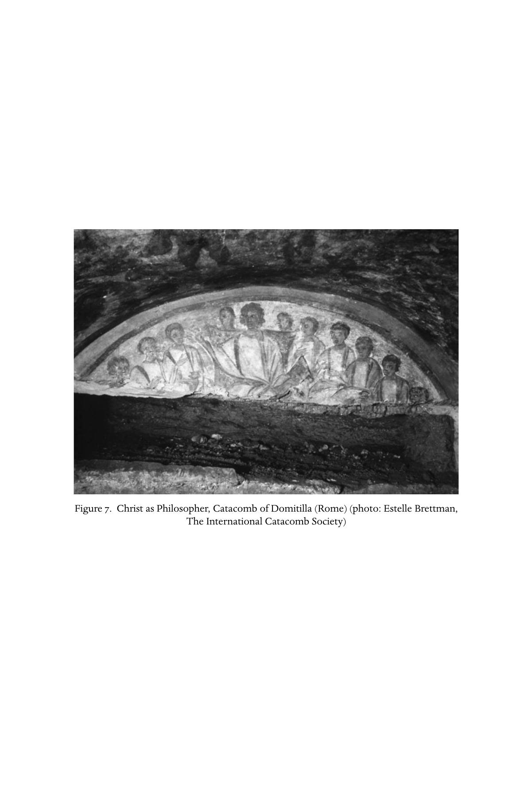

# 第二十七章 走向基督教的教养

**作者：弗朗西丝·M. 杨（Frances M. Young）**

《剑桥基督教史》第一卷《起源至君士坦丁》中文译稿

> 原书第484–500页，PDF第533–549页，含章前图版。完整翻译正文与解释性脚注；参考文献作者名、题名和定位保留原文。
>
> [第二十七章英文原文](<第二十七章 走向基督教的教养（英文）.md>) · [原书PDF](<../01 起源至君士坦丁.pdf>)

*图7：作为哲学家的基督，罗马多米提拉地下墓窟。照片：Estelle Brettman，国际地下墓窟学会。*

## 早期基督教中的教与学

<!-- 原书第485–486页；PDF第534–535页 -->

很可能在245年，一位名叫狄奥多尔的人发表演说，赞颂伟大基督教学者奥利金的品格与工作。[^1]这篇颂词传统上归于本都——土耳其东北部——教会创立者“行神迹者”格列高利。[^2]无论作者是谁，显然都在奥利金居于凯撒利亚期间，做过这位名师的学生。演说十分重要，让我们看见奥利金提供何种课程。因此，到三世纪中叶，已有明确证据：奥利金这样的基督教教师，能够提供完整哲学教育，与希腊—罗马世界各地学校的教育相平行。基督教正在发展自己的paideia，即教养、教育与训练，至少也正在取用、改造希腊—罗马世界的教养。

教与学从一开始就是基督教特色。福音书称耶稣追随者为“门徒”（mathētai），即学生，耶稣本人则被称“拉比”和“教师”。使徒教父与护教者等二世纪文本，把耶稣呈现为那位教师，其教导成全并超越其他一切。教导重点在伦理，根据却在于独一创造上帝之意志的启示：他察看万事，甚至洞见内心，不只行为，连动机都暴露无遗。[^3]基督教诺斯替思想声称，从基督传授的启示获得真知识，也反映这种对“教导”的强调。[^4]因此，正确教导，希腊语dogma、拉丁语doctrina，成为早期基督教的特色关切，并不奇怪。

这使教会更像哲学学校，而非宗教组织；因为古代宗教的特征，不是信仰、教义，甚至也不是伦理，而是神庙、祠堂或家庭中实行的传统仪式。基督教化最终将改变“宗教是什么”的观念，强调信经与正确教义，是参与其敬拜的条件。

早期某些基督徒共同体，主要仿照犹太会堂，[^5]是可信的看法；会堂兼具宗教与“学校”性质。诚然，在耶路撒冷以外，它是“祈祷所”（proseuchē），某种程度替代圣殿；但尤其在散居地，这些共同体核心，是学习犹太文学与传统的过程，是与周围希腊学校相匹配的文化教育。希腊人有法律、历史与诗歌，犹太人也有。希腊学校通过阅读古代经典教育，从文法，经修辞，到哲学；因为只要正确解释，荷马史诗等受尊崇古籍，就包含全部哲学。

律法与先知书，为犹太人提供可比的古老文本，更给出更强学习动机：它们是自己上帝的话，教导他们履行与拣选他们为子民之上帝的约，所应走的生活道路。犹太人发展出类似希腊—罗马文法学家的文学批评方法；[^6]斐洛作品证明，至少有些犹太人，也从自己经书发现希腊同代人从经典找到的那种思想与哲学体系。尤其在散居地，阅读、解释文本，而非向遥远耶路撒冷圣殿献祭，成为宗教活动核心。基督徒集会也一样。[^7]

<!-- 原书第486–487页；PDF第535–536页 -->

最早教会文本中，教师与先知都占突出角色，也预设主教有教学职能；坡旅甲被称为“亚细亚的教师”。[^8]不过，早期基督教也许最引人兴趣的特点，是那些似乎自行设立、作为“独立”教师者的显著地位，以及《新约》书信[^9]和《遗训》已显出的关切：区分谁按正确传统施教，谁不是。

二世纪中叶，瓦伦廷、马吉安与游斯丁都是例子：从更东方来到罗马，似都获罗马教会接纳，但其中两人后来因多数认为教导偏离而被排除。[^10]游斯丁却获接受，似作为“蛮族哲学”的教师活动，穿惯常哲学家服装，收塔提安等学生。这类教师以摩西和圣经著作取代通常经典，[^11]通过释经发展观念。罗马家庭教会中存在“学校”，在亚历山大里亚也有平行：最著名的奥利金以前，瓦伦廷、巴西利德，以及潘代努斯、革利免，都曾在那里教学。

显然，这些半独立哲学教师，与正在形成的教会圣职体系，关系并不总简单。奥利金与所属主教相处不睦，因而从亚历山大里亚迁往凯撒利亚。有人提出，[^12]在本卷所涵盖时期末尾，阿里乌与主教争执、分裂教会，[^13]其行为仿佛仍能依旧传统做独立教师，但当时社会政治发展，已不容如此。史料不仅称他为长老，也称圣经教师。

君士坦丁以后的时期，教会伟大教师将是主教，如凯撒利亚的巴西尔、拿先斯的格列高利、金口约翰、安布罗斯、奥古斯丁；一般教育则会“世俗化”，仍掌握在教授异教经典的修辞教师手中。[^14]不过，在较早时期，可追溯两项平行发展：一方面，教会像会堂一样，本身很像学校，聚会集中阅读、解释文本；另一方面，半独立基督教教师，正以另一套经典——圣经——发展基督教课程。

<!-- 原书第488页；PDF第537页 -->

本章主要关心后一发展，主要证据来自奥利金工作与著述。罗马希波吕托斯学派或许有些类似，但证据有问题。[^15]

## 学生所述的奥利金课程

<!-- 原书第488–489页；PDF第537–538页 -->

狄奥多尔来到奥利金处以前，已接受文法教师（grammatikos）和修辞教师（rhētōr）的标准教育。[^16]事实上，他本在前往贝鲁特学习拉丁文与罗马法的路上，遇见奥利金，视之为天意，并被劝说也跟随他学习。这一切强调，奥利金给予他的，相当于高等、大学层次教育，遵循既定enkyklios paideia，即完整通识教育模式。[^17]

奥利金爱好哲学，确信哲学是真正敬虔的基础，因而说服狄奥多尔留在凯撒利亚，放下故乡、朋友和原定事业。他作为学生住进奥利金家，获得友谊，灵魂燃起爱的火花。演说运用大卫与约拿单的“预表”，不过他承认，当时还不知道这个圣经范例。他被奥利金深深吸引。除这种偶尔的圣经预表外，整篇演说按希腊化修辞的文化母题（topoi）展开。

奥利金的教学技巧，被比作园丁照料荒地，或养护、修剪野生植物。因此，他花时间深入了解学生已有知识；发现潜力，就清理周围土地，以便灌溉、培养初生之苗；发现荆棘、野草，就加以剪除。他如苏格拉底，追问、论辩，毫不留情；又像驯马师制服未驯马匹，驯服学生。但一旦土地柔软，他就播真理种子，教学生向内探索，对诡辩保持批判。

这似乎是在描述逻辑与辩证法教学。因此，在修辞与道德化语言之下，可以发现课程。接着是自然哲学，研究自然学、几何学、天文学等古代世界科学。奥利金使学生超越单纯惊叹创造，理性认识其秩序与“经纶”。[^18]随后是伦理，不只言教，也有身教。

希腊哲学四枢德，构成其伦理核心，却因根本立场而各有解释：审慎，即判断善恶；节制，即选择善；正义，即给予道德生活各方面应有位置；勇敢，即实行其他德性的品格力量。他确实敦促学生学习希腊哲学，却通过自己的基督徒生活解释它。他希望“模仿完美典范”；所以颂词作者虽把他写得足为榜样，却拒绝称他本人为完美典范。由此可察觉，不只是他声称不愿逾越真实，也暗含一种认识：奥利金生活仿照基督，虽然从未明说。

最高智慧之言，是苏格拉底传统著名格言“认识你自己”；因为灵魂由此如在镜中看见自己，在自身反映神圣心灵。像这里一样，我们不断感到希腊哲学与圣经传统观念交汇。狄奥多尔仍依标准修辞母题，承认自己资质迟钝，奥利金未能把全部德性灌输给他；但老师确实使他爱好德性，使他明白，敬虔支撑伦理生活，而后者只能靠神圣恩典达到。最终目标，是变得像上帝，从而亲近神圣者，住于其中。

<!-- 原书第489–490页；PDF第538–539页 -->

因此，神学是全部学习的顶峰。奥利金认为，学生应研究哲学家和古代诗人作品，只排除否认上帝与眷顾的无神论者，无疑指伊壁鸠鲁派。他显然与学生处理一个老生常谈的批评：哲学家产生如此多不同理论，每派有自己的定论，每人确信自己正确、不肯听别人意见。狄奥多尔形容，这些思想家困在泥沼或迷宫，无法逃脱。为免学生遭此命运，奥利金不只介绍一种哲学，而把各派有用、真实之物摆在他们面前，把折衷变成优点。学生不应依附任何人类教师，而应献身上帝与先知。

所以，最高学习是解释圣经，一切哲学学习都为此预备。先知常写晦暗难解的话，尤其对远离上帝者如此。狄奥多尔认为，奥利金善于聆听上帝、有辨识力，能够阐明晦涩，因为神圣之灵与他为友，赐予研究、解释神谕的恩赐。释经需要启示。狄奥多尔确从奥利金学得圣经知识，也在告别中表明：把自己离开，比作亚当离乐园、浪子去远方，以及犹太人被掳巴比伦。

看来，奥利金给予狄奥多尔的哲学教育，与他自己从柏拉图派阿摩尼乌斯·萨卡斯所得，相差不大。辩证法或逻辑、自然学、伦理学三项传统学科，是基本结构。古典教养为这位基督教教师提供课程，但对他而言，目标是为神学与圣经研究奠基。

## 奥利金“学校”的问题

<!-- 原书第490–491页；PDF第539–540页 -->

狄奥多尔描述跟随奥利金学习，与优西比乌的说法并不十分吻合：后者认为，奥利金继任革利免，革利免继任潘代努斯，主持所谓亚历山大里亚教理学校。[^19]当然，狄奥多尔讲的是晚年凯撒利亚，而非亚历山大里亚的教学；即便如此，“高等”教育课程，与传统上称catechesis的洗礼前初级基督教教育，似乎仍断裂。一种图景中，奥利金像“独立”哲学教师，把学生收进家，虽然此时也已按立长老，在教会讲道。另一种图景中，他像教师传承中的正式任命者，至少失去主教支持以前，提供初级信仰教学。我们能否化解这些张力，形成较一致的教学活动图景？

必须摆脱从现代社会学校类比，不可避免带来的假设。古代学校不是我们所熟悉的制度化机构。希腊城市确实支付某些教师薪水，提供公共教育，但多数教师独立工作，聚集学生，人数取决于受欢迎程度。课堂可在体育馆或其他公共场所，也可在自家或别的私人场所。学生依社会地位，可能某时退学，或在准备好时，从初级教师转到文法教师，再到修辞教师，之后还可跟随哲学家。一位哲学教师继另一位时，“学校／学派”可能指这种连续传承；最著名是源于柏拉图、延续数世纪的学园。“学校”一词，可以有不同含义。

优西比乌可能用多种史料，构造奥利金生平与教学叙述。由于尝试按年代而非主题排列，插入其他材料，它本来就颇为零散。几种描述与问题有关：

1. 父亲殉道后，一位富妇成为奥利金庇护者，使他继续学习；很快他已能作为文法教师，获得不错收入。[^20]
2. 迫害期间，所有基督教教理教师离开亚历山大里亚，各种异教徒找他学习上帝之道。因此，德米特里乌斯主教在他十七岁时，任命他主持教理学校。由于许多人来接受初级信仰教导，士兵被派到住处周围，压力越来越大，他必须不断换屋。[^21]
3. 德米特里乌斯把教理任务单独托付奥利金，学生很快越来越多。他判断，这与文法教师工作不相容，便卖掉藏书，取得某种经济独立，专心研究圣经。
4. 到罗马旅行后，他觉得教理工作过于干扰神学与圣经学术研究，[^22]遂划分学生，把初级课交给最有前途学生之一赫拉克拉斯，自己集中高级学生的高等教育。优西比乌说，许多受教育者来到他的学校；几何、算术等预备学习后，他教授希腊哲学，讨论不同体系，给予一般基础，帮助研读圣经。[^23]

最后一点，开始更像狄奥多尔所述凯撒利亚课程。

<!-- 原书第492页；PDF第541页 -->

那么，这究竟是什么“教理学校”？把它想象成类似学园、奥利金任职前后都有一系列知名校长的机构，很可能是后见之明强加于材料；不过，也许反映优西比乌试图在异端教师同样活动的背景中，辨认正统教师谱系。材料暗示更简单的情况：紧急时期，主教请奥利金承担归信者必需的教理；他又回应需求，把主教资助的职责，与自己作为独立教师发展之高级课程结合。换言之，他同时从事不同层次教学。

有意思的是，这一建议，与近来重新评估[^24]他著述中似乎区分不同信徒层次的看法，十分吻合。他按人能否从字面、道德、属灵层面阅读圣经来区分；但与其说给人分类，不如说三重意义对应教育过程三阶段。他知道，人能从一层进入另一层，各意义层次也不相互排斥。讲道显示，他知道听众理解程度不同；回应塞尔苏斯嘲弄时，他欣然承认，不像精英性质的哲学，基督教甚至能教育奴隶与妇女，使之向善。[^25]这些态度，也许来自亚历山大里亚那些年，同时教授广泛层次的经验。凯撒利亚时期，他作为司祭、讲道者和哲学教师，活动似乎同样多样。

## 阅读圣经

<!-- 原书第493–494页；PDF第542–543页 -->

奥利金大部分著述活动，是制作圣经注释。庇护者安布罗修斯帮助资助。[^26]大量作品失传，一些则通过翻译，或各种汇编摘录存世。他也在《论首要原理》（De principiis）讨论释经危险与方法。长期以来，人们把后者视为理解其进路的基本说明；较近研究却试图考察现存注释与讲道中的实际解释。[^27]

清楚的是，圣经处于其哲学核心，阅读圣经是教育目标。如现代学术被进化观念塑造一样，其思想不可避免被柏拉图假设塑造。因此，释经兴趣常产生如今看来离题的评论；事实上，关于其圣经工作的经典英文研究，倾向认为，因他没有历史感，就无望理解文本。[^28]然而，他释经的方式，与许多同时代人明显相同。

文本处于古代一般教育过程核心，所以多数解释发生于课堂，口头活动没有记录。我们仍可从各种修辞手册与其他存世材料，辨认一些情形。一世纪晚期拉丁文著作、昆体良《雄辩术原理》（Institutio oratoria，意为“演说术训练”），完整讨论各教育阶段，使我们看见常用解释步骤；这些也见于奥利金注释。[^29]

古代文本手写在羊皮纸或纸草上。教师首先须确保课堂使用的各抄本，措辞实际相同；换言之，文本批判不可避免，亚历山大里亚也早已实践。文本有不一致或疑问时，奥利金显然知道，必须讨论正确措辞。一个例子足以说明：《马太福音》19:19有些抄本增加“要爱邻如己”。他认为是后加，《马可》《路加》没有这些字，也证实这一点。他说，若非我们的抄本差异太大，这种建议会显得不敬；差异或因某些抄写者粗心，或因校改文本时有责的轻率，或因一些人任意增删。[^30]

奥利金也深知，译本不可能完全表现原文确切措辞。优西比乌[^31]描述他制作《六栏合参》：宏大作品，把希伯来文、希伯来文转写，以及四种或更多希腊译本并列比较。他实际懂多少希伯来语，[^32]又请教多少犹太学者，争议很大。他确实在多处[^33]声称听犹太人解释圣经，或亲自询问特定段落。完整《六栏合参》大概从未抄录，原本也早已失传；但它显示，他如何认真对待学术工作，确保每一笔画准确。

<!-- 原书第494–495页；PDF第543–544页 -->

古代文本没有分词与标点，阅读必须分析词语如何连接、短语在哪里结束。古代阅读全是出声的，需要先研究语法与句子结构，作准备。理解还须关注词汇与词源，因为古籍常用古旧字词。注释者编词语索引，以辨认荷马用词意义；[^34]奥利金也如此，列交叉参照，确立圣经词义，阐明眼前文本。

此外，还须辨认修辞格：明喻、隐喻、拟声、反讽等。不认出语言的“转折”（tropē），就会得到错误意义；毕竟反讽以特殊语气，说出与意图相反的话，未能辨认就完全误读。奥利金花许多力气辨认此类特征，知道把隐喻按字面理解，就会彻底误读。有时，“按字面”读文本是不可能的。他这里只是把文法与修辞学校的标准方法用于圣经。

但在运用中，隐喻也成为文本有更深意义的指标。修辞格与aporiai，即不易解决的疑难，成为寓意解释起点。奥利金认为，圣灵故意把这些“绊脚石”放进文本，刺激读者寻找属灵意义（Princ. 4.3.1）。上帝不可能有眼耳、在伊甸园行走，因为他超越，是不可见、无形体的“他者”。同样，上帝不可能发怒，因为神圣不受情感影响；但他俯就我们的需要，显得发怒，激励我们更公义。有时，研究文本字句反而排除字面阅读。从措辞研究，奥利金能产生象征性解读，仿佛文本是一套密码；词源帮助破解，也成为哲学阅读工具。

其注释另一面，也可在学校实践中找到平行。解释性评论必需，以助理解暗示。古典文本中，诸神、英雄、神话故事及许多特征，都需说明。昆体良警告不要过度、炫耀博学，说明这种做法很常见。有时，自然现象或历史事件，以及地理、天文、音乐信息，都须解释；文本因此很容易提供庞大课程，而反过来，课程也普遍被视为阅读文本的基础，奥利金正如此。

他无视避免过度的警告，论珍珠的长篇，[^35]就是证据；缘起《马太福音》13:45，商人发现极宝贵珍珠，卖掉一切购买的比喻。他告诉我们，哪里最适合找珍珠、如何形成，以及自己这样博学者所知的一切。研究这些文本特征，称historia，有时关乎我们所谓文本背后的“事实”。面对众人因耶稣出身低微、只是木匠之子，而惊疑其智慧的故事，奥利金提醒读者，群众不知道童贞女生子，所以困惑。为证实这一解释性“事实”，他补充伪经传统：耶稣的弟兄，是约瑟前妻所生。[^36]

<!-- 原书第496页；PDF第545页 -->

不过，叙事不只需要补充信息。学校教学生判断故事的可信程度，[^37]寻找证明或驳倒的方法，因为日后在法庭担任律师，这种批判至关重要。奥利金也有自己的技巧：塞尔苏斯声称，马利亚与名叫潘特拉的军人生子，被订婚对象约瑟赶走，他将此视为“神话”。[^38]在福音注释中，他也毫不犹豫指出同一故事不同版本的差异。

例如所谓洁净圣殿故事。[^39]除细节外，时间安排有巨大差异：《约翰福音》把它放在耶稣事工刚开始，其他福音书则紧接其被捕、定罪以前。奥利金“认为，那些解释中只承认历史的人，不可能证明这些矛盾陈述相互和谐”。[^40]他说明约翰时间安排不可信，转而讨论更深意义。转向马太版本时，又指出照现有叙述并不可信之处，寻求各福音作者更深意图。如语法与词汇分析一样，疑难说明文本的“物质”层面，本身不足以使人发现真义；aporiai激发敏锐读者超越字句，进入灵。圣经充满“谜语”或“比喻”。

修辞教师接受，演说者有时为听众益处而说不实之事。奥利金认为，上帝也类似，俯就人类水平。他常说，上帝如父亲对幼子，或医生对病人：“全部神圣经书，都充满这种药物。”[^41]如此，他使受教育求道者，能够接纳那些以别扭翻译腔写成、晦涩难解的“蛮族”书卷；粗糙语言和拟人表述，都得到解释。重要的是理解不断增长，从而超越文本“字句”，发现道德、属灵层面。难怪狄奥多尔认为，释经是奥利金课程的目标。

<!-- 原书第497–498页；PDF第546–547页 -->

教养的全部目标，在于能读、能解释圣经，这也反映于《论首要原理》。它似是现存最早作品，却已让我们总览他在亚历山大里亚发展教学时的思想。写作也许是为辩护释经程序。[^42]它某种程度是“系统神学”，但如今认为，体裁类似古代学校哲学手册，讨论宇宙及逻辑的“首要原则”。由于奥利金观点后来高度争议，希腊原本只存残篇；全书却有鲁菲努斯四世纪拉丁译本。遗憾的是，译本显然略带护教性质，并不完全可靠；即便如此，仍是其神学和释经原则的重要概要。

开篇确认，基督的话与教导，不限于在地时所说；摩西与先知也由基督启示。但这些经书的解释，造成许多冲突意见，因此必须从公认“信仰准则”、使徒传下的教义开始。不过，奥利金明白，有哲学兴趣者，需要超出基本核心继续探究。首先研究上帝本性，圣经如何引导他论证上帝无形体，立即可见。随后依次讨论基督、圣灵、理性受造物、天使、物质创造、成肉身、灵魂、自由意志、魔鬼、最终完成等。第四卷转向圣经，先讨论神圣启示，以及摩西与先知的预言意义，再指出，读不对圣经太容易。

因此，他带着论战意图，无疑也受与犹太人及其他人辩论的经验影响，提出字面阅读的问题。犹太人看不见预言在基督成全，因为狼并未字面上与羊同食，豹未与山羊羔同卧，牛犊、公牛、狮子也未由小孩领着一同吃食。[^43]异端抓住上帝发怒经文，说犹太经书创造神不完美，不可能是救主启示的完美上帝。甚至教会中的朴素信徒，也把连最残暴、不义之人都不至有的行为，归于上帝。奥利金断言，原因是仅按字句读圣经，而未理解属灵意义。

他有一系列不断用来证明属灵或基督论解读的保罗经文，[^44]反复见于著述，包括《罗马书》7:14；《哥林多前书》2:2、10、12–13、16；9:9–10；10:4、11；《哥林多后书》3:6、15–17；《加拉太书》4:24。《论首要原理》另引《希伯来书》8:5；尽管别处承认，除上帝外无人知道谁写此信，此处却似接受出于使徒。[^45]

据这些线索，圣经充满奥秘：有些无法理解，有些是将来事的“预表”。预言充满谜语、晦暗言辞，成千人在解释上犯错，不足为奇。奥利金从《箴言》22:20–21找到钥匙，理解为要求以三重方式陈述真理之言。[^46]朴素者从圣经“肉身”，即明显解释，得到造就；进步者从其“魂”得造就；完全者则从属灵律法得造就，律法“有将来美事的影子”。依使徒，他将：

> 在完全者中讲智慧，却不是这世界的智慧，也不是这世界将要消灭之统治者的智慧；我们讲的是奥秘中上帝的智慧，是隐藏的、上帝在诸世以前为我们荣耀预定的智慧。（《哥林多前书》2:6–7）

人由身体、魂、灵构成，圣经也如此。但要将《论首要原理》说明的三重理论，应用于实际释经，颇为困难。多数注释及其他释经作品中，他实际运用多种可能意义，却分两类：“按字句”和“按灵”。乍看，他用来证明方法的经文，也暗示双重意义。

<!-- 原书第498–499页；PDF第547–548页 -->

理论讨论中，奥利金很快说明，某些段落“完全没有身体层面的意义”，读者必须立即寻找魂或灵。他担心，意义若太透明，读者就不会意识到其外还有什么。因此他认为，上帝之道安排某些绊脚石、障碍和不可能之事，插在律法与历史之间，使我们不至全被语言吸引力带走，或以经书教不出配得上帝之事为由，彻底拒绝真教义，或永不离开字句、因而学不到更神圣成分。[^47]

他断言，圣灵偶尔把虚构织入历史叙事，不只基督以前著作，连福音书也如此，让叙述次序遵循所指向的奥秘事件，而非地上事实。他的例证[^48]先从创造叙事，到耶稣受魔鬼试探，尤其集中摩西律法、某些福音教导及出埃及。不过，他显然相信，圣经大部分按字句就有充分恰当的意义，可造就朴素者。[^49]他自豪于，哲学只能使精英向善，基督教却能改善每个人。

除前述语文学传统外，他的进路也借鉴同时代哲学读文本的方法。柏拉图抨击诗人故事不道德，希望在理想国禁止其教育用途（Res. 10.595A及以下）。但传统占上风，普鲁塔克等发展出论证文学可供“道德”教育的方法。[^50]故事可以是榜样，也可以是警告，教师总应设法提炼其中“道德”。到奥利金时代，受斯多亚影响，哲学教师一般把文学视为寓意，认为荷马真正讨论道德或哲学真理；[^51]释经者应揭出隐藏意义，用以教哲学。

亚历山大里亚革利免完全赞同普鲁塔克：所有宗教真理都以象征、谜语表达，因为神圣超越人类语言与理解。[^52]奥利金有趣之处，是他多么广泛地从圣经自身证明这一点。后来，他至少部分因为对圣经处理过于随意而遭谴责：借寓意，把基督教总体故事的关键部分，如创造、乐园、肉身复活与上帝国，属灵化到趋于消解。[^53]然而，他批判拟人语言，认识言说属灵奥秘或认识上帝实在的困难，强调上帝俯就我们的水平，其遗产将在卡帕多西亚教父与东方正教传统的神学中结出果实。

<!-- 原书第500页；PDF第549页 -->

奥利金的贡献，是推动基督教内部发展真正的知识传统，许多方面类似古代世界的思想传统和教育体系。其核心是书，传递古老智慧、[^54]却需要解释的古书。学习循环始于读文本取得基本技能，最终又以精深重读传统文本、寻找哲学真理为顶点。奥利金以圣经取代希腊古典传统文学正典，使圣经成为基督教教养的冠冕。圣经研究成为一切真理来源，也成为终身属灵探索的根据；它处于一种整合的、重视心智的灵性生活核心，引领灵魂超越共同承认的信经教义之简单框架，踏上旅程。

其遗产深刻影响后世数世纪，不足为奇。然而，自由探究精神[^55]越来越成为问题；随着新争议促成教义公式，其神学诠释学难获接纳，许多观念被认为不令人满意。

## 译校说明

- paideia含教育、训练与文化养成之意，章题采用“教养”，具体论述按语境译“教育”或“课程”。
- 本章“学校”可能指教师家庭、学生群体或师承，并不总对应现代固定机构；“教理学校”的形成与性质，按作者讨论保留不确定性。
- 奥利金关于圣经叙事、字句与属灵意义的论断，以及作者对其方法的评价，均依原文译出。history／historia在相关段落还包括对文本细节的查考，不能一概理解为现代历史学。

## 脚注

[^1]: 见上文第四部分第18章及第25章。

[^2]: 作者归属讨论，见Trigg, Origen, 167。Trigg依Nautin，反对SC版Crouzel的看法。

[^3]: 例如《提摩太前书》5:21、6:13；《提摩太后书》2:15；1 Clem. 21.3–9、28.4等；Ign. Eph. 15.3；Justin, 1 Apol. 12。

[^4]: 见上文第三部分第12章。

[^5]: Burtchaell, From synagogue to church。亦见上文第一部分第2章及第二部分第7章。

[^6]: Daube, ‘Rabbinic methods of interpretation and Hellenistic rhetoric’; Lieberman, Hellenism in Jewish Palestine.

[^7]: Gamble, Books and readers.

[^8]: M. Polyc. 12.2.

[^9]: 例如《哥林多前书》12:28；《提摩太前书》3:2。

[^10]: 见上文第四部分第22章。

[^11]: Droge, Homer or Moses?; Young, Biblical Exegesis.

[^12]: Williams, Arius.

[^13]: 见下文第六部分第31章。

[^14]: 四世纪主教接受过古典、即异教教育；拿先斯的格列高利反对背教者尤利安敕令，维护自己受此教育的权利。这说明态度不同于二、三世纪，当时以圣经取代经典的做法明显。见Droge, Homer or Moses?。

[^15]: 见上文第四部分第22章，以及第23、25章。

[^16]: 以下记述取自归于“行神迹者”格列高利的颂词。

[^17]: 古代教育的经典研究，见Marrou, History of education in antiquity；较近研究见Kaster, Guardians of language。

[^18]: 希腊语oikonomia字面意为“家务管理”，神学著作中却用于上帝眷顾性管理宇宙、通过成肉身实现的神圣救赎目的，甚至上帝自身配置为三一；见上文第25章。

[^19]: HE 6.6。G. Bardy在‘Aux origines de l’école d’Alexandrie’及‘Pour l’histoire de l’école d’Alexandrie’中，质疑这种传承的性质。

[^20]: HE 6.2.

[^21]: HE 6.3.

[^22]: HE 6.15.

[^23]: HE 6.18.

[^24]: Torjesen, ‘“Body”, “Soul”, and “Spirit”’。进一步见下文原书第498页。

[^25]: C. Cels. 3.49ff.

[^26]: Euseb. HE 6.18.

[^27]: 尤其见Neuschäfer, Origenes als Philologe；Young, Biblical exegesis。

[^28]: Hanson, Allegory and event.

[^29]: 以下论述重述Young, Biblical exegesis中的说明。

[^30]: Or. Comm. Matt. 15.14.

[^31]: HE 6.16.

[^32]: Euseb. HE 6.16声称他懂希伯来语，但其著述似显示所知很少；见de Lange, Origen and the Jews。

[^33]: 例如Comm. Jo. 6.83；Hom. in Ezech. 4.8；C. Cels. 1.45、55。他对犹太学者的借鉴，完整讨论见de Lange, Origen and the Jews。

[^34]: Lamberton, Homer the theologian.

[^35]: Comm. Matt. 10.7–10.

[^36]: Comm. Matt. 10.17.

[^37]: 进一步讨论见Grant, Earliest lives。

[^38]: C. Cels. 1.32–7.

[^39]: Comm. Jo. 10.119–22.

[^40]: Comm. Jo. 10.130.

[^41]: Hom. Jer. 20.3.

[^42]: Trigg, Origen, 91.

[^43]: Princ. 4.2.1中的《以赛亚书》11:6–7。

[^44]: Heine, ‘Gregory of Nyssa’s apology for allegory’.

[^45]: 引于Euseb. HE 6.25。

[^46]: Princ. 4.2.4.

[^47]: Princ. 4.2.9.

[^48]: 这些例证构成Princ. 4.3的大部分。

[^49]: Princ. 4.2.6.

[^50]: Plut. Lib. ed. (Moralia 1a–14c) and Adol. poet. aud. (Moralia 14d–37b).

[^51]: Lamberton, Homer the theologian.

[^52]: Plut. Superst.（Moralia 164e–171f）；De Is. et Os.（Moralia 351c–384c）；Def. orac.（Moralia 409e–438d）。参Clem. Al. Str. 5.4及以下。

[^53]: Young, ‘Fourth century reaction against allegory’.

[^54]: Hatch, Influence of Greek ideas；较近见Young, ‘Books and their “aura”’。

[^55]: 见上文第25章；Crouzel, Origen。
