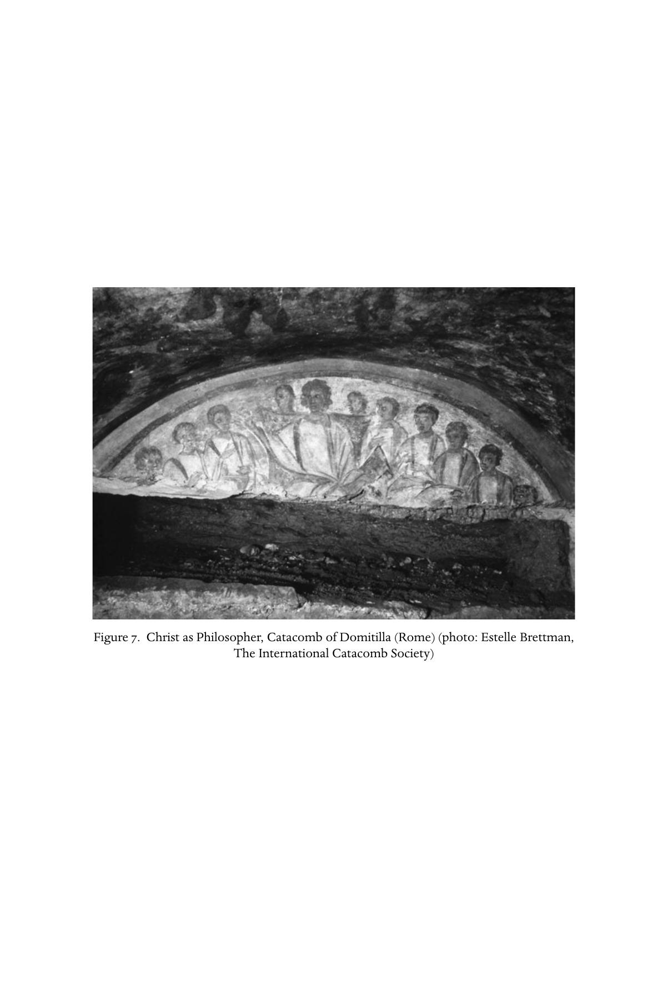

# 第二十七章英文原文：Towards a Christian paideia

<!-- PDF page 533; original page 484 -->

Figure 7. Christ as Philosopher, Catacomb of Domitilla (Rome) (photo: Estelle Brettman, The International Catacomb Society)

<!-- PDF page 534; original page 485 -->

### 27. Towards a Christian paideia

#### frances m. young

#### Teaching and Learning in Early Christianity

Probably in the year 245 ce, someone named Theodore delivered an oration celebrating the character and work of the great Christian scholar, Origen.[^p534-1] This panegyric has traditionally been attributed to Gregory Thaumaturgus,[^p534-2] the founder of the church in Pontus (north-east Turkey). Whoever the author was, he was clearly a student of this renowned teacher during the years that Origen spent in Caesarea. The speech is of great importance in revealing to us the kind of curriculum Origen offered. By the mid-third century, then, we have clear evidence that a Christian teacher like Origen could offer a complete philosophical education, which paralleled that which was offered in schools all over the Graeco-Roman world. Christianity was developing its own paideia (‘education’, ‘training’), or at least appropriating and adapting that of the Graeco-Roman world.

Teaching and learning were characteristic of Christianity from the beginning. The term used in the gospels for the followers of Jesus is ‘disciples’ (mathētai), that is ‘pupils’, and Jesus himself is addressed both as ‘rabbi’ and ‘teacher’. In second-century texts such as the Apostolic fathers and the Apologists, Jesus is presented as the teacher, with the teaching that fulfils and surpasses all others. This teaching focused on ethics, but its warrant lay in the revelation of the will of the one creator God who oversees everything, even seeing into the heart, so that not just actions but motives were laid bare.[^p534-3] Christian Gnosticism reflects this ‘teaching’ emphasis in its claim to have received true knowledge from revelations imparted by the Christ.[^p534-4] It is hardly surprising, then, that correct teaching (dogma in Greek, doctrina in Latin) became a

[^p534-1]: See pt iv, ch. 18, and ch. 25, above.

[^p534-2]: For discussion of the authorship, see Trigg, Origen, 167. Trigg follows Nautin against Crouzel in the SC edition.

[^p534-3]: E.g. 1 Tim 5:21, 6:13; 2 Tim 2:15; 1 Clem. 21.3–9, 28.4, etc.; Ign. Eph. 15.3; Justin 1 Apol. 12.

[^p534-4]: See pt iii, ch. 12, above.

<!-- PDF page 535; original page 486 -->
characteristic concern of early Christianity, and this made the church more like a philosophical school than a religious organisation – for it was not beliefs, doctrines or even ethics that characterised ancient religion, but traditional ritual practices performed in temples, shrines or households. Christianisation would eventually transform notions of what a religion is by emphasising creeds and correct doctrine as conditions for practising its cult.

It is plausible to suggest that some early Christian communities were modelled largely on the Jewish synagogue,[^p534-5] an organisation that had both religious and ‘school’-like properties. For, while it is true that, away from Jerusalem, the synagogue was a ‘prayer-house’ (proseuchē), which to some extent replaced the temple, yet, at the heart of these Jewish communal organisations, particularly in the diaspora, was a process of learning about Jewish literature and traditions, a cultural education to match the schools of the surrounding Greek culture. As the Greeks had their law, their history, their poetry, so did the Jews. Greek schools engaged in education through the reading of ancient classical texts, from the stage of learning grammar, through education in rhetoric, to the study of philosophy – for, rightly interpreted, the whole of philosophy was to be found in ancient revered texts, like the epics of Homer. The Law and the prophets provided Jews with comparable ancient texts, and an even greater incentive to study them in that they were the Word of their God, teaching the way of life required of them to fulfil their covenant with the God who had chosen them to be his own people. Jews developed scholarly methods of literary criticism analogous to those of the Graeco-Roman grammarians;[^p534-6] and the works of Philo are evidence that at any rate some Jews also found in their scriptures the kind of intellectual and philosophical systems their Greek contemporaries found in classical texts. In the diaspora especially, reading and interpreting these texts came to constitute the heart of Jewish religious activity, rather than offering sacrifices in the faraway Jerusalem temple. So too in the Christian assembly.[^p534-7]

Teachers, as well as prophets, have a prominent role in texts coming from the earliest churches, and a teaching function is assumed for bishops; Polycarp is called ‘the teacher of Asia’.[^p534-8] But perhaps the most intriguing feature of early Christianity is the prominence of people who appear to set themselves up as ‘freelance’ teachers, and the concern, already evident in the New

[^p534-5]: Burtchaell, From synagogue to church. See also pt i, ch. 2 and pt ii, ch. 7, above.

[^p534-6]: Daube, ‘Rabbinic methods of interpretation and Hellenistic rhetoric’; Lieberman, Hellenism in Jewish Palestine.

[^p534-7]: Gamble, Books and readers.

[^p534-8]: M. Polyc. 12.2.

<!-- PDF page 536; original page 487 -->
Testament epistles[^p534-9] and the Didache, to distinguish those who teach according to the right traditions and those who do not. In the mid-second century we have the examples of Valentinus, Marcion and Justin, all of whom arrived in Rome from places further east, all of whom were apparently accepted within the Roman church, but two of whom were later excluded when the majority sensed that their teaching was aberrant.[^p534-10] Justin, however, was accepted, apparently operated as a teacher of the ‘barbarian philosophy’, wearing the conventional philosopher’s dress and taking in pupils such as Tatian. Such a teacher substituted Moses and the biblical writings for the usual classics,[^p534-11] and developed his ideas through exegesis of texts. The presence of ‘schools’ among the house churches of Rome can be paralleled in Alexandria, where Valentinus and Basilides taught, as well as Pantaenus and Clement, in the years before the most famous of all, Origen.

Clearly the relationship between such semi-independent philosophical teachers and the emerging hierarchy of the church was not always straightforward. Origen found that relations with his bishop became uncomfortable, so occasioning his move from Alexandria to Caesarea. It has been suggested[^p534-12] that Arius, whose dispute with his bishop divided the church at the end of the period of this volume,[^p534-13] was behaving as if he could be an independent teacher in this older tradition at a time when social and political developments precluded it – he is described in the sources not only as a presbyter but as a scripture teacher. In the post-Constantinian period, the great teachers of the church would be the bishops – people like Basil of Caesarea, Gregory of Nazianzus, John Chrysostom, Ambrose and Augustine – while general education would become ‘secularised’ and remain in the hands of the rhetoricians who taught from the pagan classics.[^p534-14] In this earlier period, however, we can trace two parallel developments. On the one hand, the church, like the synagogue, had itself a strong resemblance to a school, its gatherings focusing on the reading and interpretation of texts; on the other hand, semi-independent Christian teachers were developing a Christian educational curriculum based on an alternative set of classical texts, namely the Bible.

[^p534-9]: E.g. 1 Cor 12:28; 1 Tim 3:2.

[^p534-10]: See pt iv, ch. 22, above.

[^p534-11]: Droge, Homer or Moses?; Young, Biblical Exegesis.

[^p534-12]: Williams, Arius.

[^p534-13]: See pt vi, ch. 31, below.

[^p534-14]: Fourth-century bishops had received a classical (pagan) education, and Gregory of Nazianzus defended his right to it against the edict of Julian the Apostate. This bespeaks a different attitude from the second–third centuries, where substitution of the Bible for the classics is evident; see Droge, Homer or Moses?

<!-- PDF page 537; original page 488 -->
It is this latter development which chiefly concerns us in this chapter, and the principal evidence lies in the work and writings of Origen. The school of Hippolytus in Rome may have been somewhat similar, but the evidence is problematic.[^p534-15]

#### Origen’s curriculum, according to his pupil

Theodore came to Origen after having received the standard education with the grammatikos and the rhētōr.[^p534-16] In fact, he was on his way to study Latin and Roman law in Beirut when he came across Origen – an encounter he attributed to providence – and was persuaded to study with him as well. All this underlines the fact that what Origen gave this pupil was the equivalent of tertiary (university) education, following the pattern of the established enkyklios paideia.[^p534-17]

Origen’s love of philosophy, together with his conviction that philosophy was the foundation of true piety towards God, was what persuaded Theodore to stay in Caesarea and give up his homeland and friends, as well as his intended career. He was taken into Origen’s household as a pupil, and offered friendship, a spark of love being kindled in his soul – his speech develops the ‘type’ of David and Jonathan, though he confesses he did not yet know of this scriptural example. He was captivated by Origen. Apart from the occasional feature, such as this reference to a biblical type, the whole discourse runs according to the cultural frames (topoi) of Hellenistic rhetoric. Origen’s skill as a teacher is likened to the work of a gardener, taking in hand an uncultivated plot, or a wild plant that needed nurturing and pruning. Thus he took time to penetrate his students’ existing knowledge – when he found potential, he cleared the ground around so as to irrigate and develop the initial growth; when he found thorns and wild growth, he cut it out. He was Socratic in his ruthless questioning and argumentation. He tamed them, like a trainer tames unbroken horses. But once the soil was softened he began to plant the seeds of truth. He taught them to search within themselves, and to be critical of sophistry.

This would seem to be a description of the teaching of logic and dialectics. So beneath all the rhetoric and moralising, we can uncover the curriculum. It

[^p534-15]: See pt iv, ch. 22, and chs. 23 and 25, above.

[^p534-16]: The following account is drawn from the panegyric attributed to Gregory Thaumaturgus.

[^p534-17]: For the classic study of ancient education, see Marrou, History of education in antiquity; more recently Kaster, Guardians of language.

<!-- PDF page 538; original page 489 -->
went on to natural philosophy – the study of physics, geometry and astronomy, the ancient sciences about the world. Thus Origen moved his pupils beyond mere amazement and wonder at creation to a rational awareness of its order and ‘economy’.[^p534-18] Then he went on to ethics, which he imparted not only by words but also by example.

The four cardinal virtues of the Greek philosophical tradition provide the core elements of his ethical teaching, but they are given their own slant by Origen’s fundamental outlook: prudence – interpreted as the capacity to judge between good and evil; temperance – the ability to select what is good; justice – the capacity to give every aspect of the moral life its due; and courage – the strength of character to carry out the other virtues. Indeed, Origen urged his pupils to study the philosophy of the Greeks, but interpreted it through his Christian lifestyle. He was one who desired to ‘imitate the perfect pattern’ – the encomiast therefore refuses to call Origen himself the perfect pattern, despite presenting him as exemplary, and so one can detect, not just his avowed refusal to go beyond the truth, but a sense that he knew, though he never explicitly says so, that Origen’s life was patterned on Christ. The highest word of wisdom was ‘Know yourself ’ – the classic maxim of the Socratic tradition, for the soul then beholds itself as in a mirror, and reflects the divine mind in itself. Again and again one senses, as here, the confluence of the Greek philosophical tradition and notions that derive from the biblical tradition. Theodore confesses – still reflecting standard topoi – that Origen never succeeded in instilling all the virtues into his pupil, because of his dull nature, but his teacher did make him a lover of virtue, and Origen did get him to understand that piety is what undergirds the ethical life, which is only achieved through divine grace. The ultimate object is to become like God, so as to draw near to the divine and abide within it.

Theology, then, was the climax of all these studies. Origen thought it important that his pupils should study what was written by the philosophers and by the ancient poets, excluding only the work of the atheists who deny both God and providence (doubtless a reference to the Epicureans). He clearly tackled with them the well-rehearsed criticism that philosophers came up with so many different theories, each school having its own set of dogmas, each philosopher sure he is right and unwilling to listen to the opinions of others. Theodore describes such thinkers as caught in quagmire or labyrinth from which they cannot escape. To secure his pupils against such a fate, Origen did

[^p534-18]: The Greek word oikonomia literally means ‘household management’, but is used in theological writing to refer to God’s providential management of the universe, the divine saving purposes effected through the incarnation, and even the divine self-disposition into Trinity (see ch. 25, above).

<!-- PDF page 539; original page 490 -->
not introduce them to a single school of philosophy. He set before them what was useful and true from all the various philosophies. Thus he made a virtue of eclecticism. Origen’s students were to attach themselves not to any human teacher, but devote themselves to God and to the prophets.

So the highest study of all was the interpretation of the scriptures, and it was for this that all the study of philosophy was a preparation. The prophets often wrote words that are dark and enigmatical, especially to those who have wandered far from God. Theodore suggests that Origen was a skilled and discerning listener to God, who was able to elucidate what was obscure, because the Divine Spirit had made him his friend, and given him the gift of investigating and explaining the divine oracles. To interpret scripture required inspiration. That Theodore had learned something about the scriptures from Origen is then demonstrated as he takes his leave, comparing his departure to Adam leaving paradise, to the prodigal going off to a far country and the deportation of the Jews to Babylon.

It would appear that the philosophical education Origen gave Theodore differed little from that he had received himself from the Platonist, Ammonius Saccas. The conventional three disciplines of dialectic (or logic), physics and ethics provided the basic structure. The classical paideia provided this Christian teacher with his curriculum. Yet the goal, for Origen, was to provide foundations for theology and biblical study.

#### The question of Origen’s ‘school’

Theodore’s description of his studies with Origen does not sit well with Eusebius’ suggestion that Origen succeeded Clement, who succeeded Pantaenus, as head of the so-called Catechetical School in Alexandria.[^p534-19] Of course Theodore’s account refers to Origen’s teaching activities, not in Alexandria, but towards the end of his life in Caesarea. Yet even so, there seems to be a disjunction between this programme of ‘tertiary’ education and the practice of initial Christian education prior to baptism traditionally associated with the term ‘catechesis’. In the one case, Origen would seem to have been a ‘freelance’ philosophical teacher, taking pupils into his household, even though at this stage he had also been ordained presbyter and gave homilies in an ecclesiastical setting. In the other case, he would seem to have been some kind of official appointee, in a succession of teachers, providing, at least until he lost

[^p534-19]: HE 6.6. The nature of this succession was questioned by G. Bardy, ‘Aux origines de l’école d’Alexandrie’ and ‘Pour l’histoire de l’école d’Alexandrie’.

<!-- PDF page 540; original page 491 -->
the favour of his bishop, elementary instruction in the Christian faith. Can we resolve these tensions, and come to some kind of consistent picture of Origen’s teaching activity?

It is important to disabuse ourselves of the inevitable assumptions drawn from analogies with schools as we experience them in modern societies: schools were not institutions. Greek cities did provide salaries for some teachers to offer public education, but the majority of teachers operated on a freelance basis, gathering groups of students whose size depended on the teacher’s popularity. Their classes might be held in the gymnasium or other public locale, or at their own house or some other private place. Depending upon their social status, pupils would either drop out at some stage, or move from the elementary teacher to the grammatikos and then to the rhētōr, as and when they were ready to do so. They might then proceed to some philosopher. When one philosophical teacher followed another as his successor, the word ‘school’ might be used for this continuous succession – the best-known case being the Academy which stemmed from Plato and lasted several centuries. The word ‘school’ could have a variety of possible connotations.

Eusebius may be using multiple sources to construct his account of Origen’s life and teaching activities – it is in any case a rather episodic narration, broken up by the insertion of other material, on account of Eusebius’ attempts to order his material chronologically rather than topically. Several different descriptions are apposite to our enquiry. (1) After his father’s martyrdom, a rich woman became Origen’s patron so that he could pursue his studies, and he rapidly reached the stage where he could earn well as a grammatikos.[^p534-20] (2) During the persecution, all the Christian catechists had left Alexandria. Various pagans approached Origen for instruction in the Word of God. So at the age of seventeen the bishop, Demetrius, appointed him head of the catechetical school. He came under increasing pressure as soldiers were posted around the house where he was living, because of the large numbers who came to him for elementary instruction in the faith, and he had to keep moving from house to house.[^p534-21] (3) Responsibility for catechesis was entrusted by Demetrius to Origen alone, and he soon saw pupils coming to him in increasing numbers. He decided that this responsibility was not compatible with being a grammatikos, so he sold his library in order to gain some financial independence, and devoted himself to study of the scriptures. (4) After a trip to Rome, Origen decided that his catechetical work was too distracting from his

[^p534-20]: HE 6.2.

[^p534-21]: HE 6.3.

<!-- PDF page 541; original page 492 -->
study of theology and his scholarly work on the scriptures.[^p534-22] So he divided up his pupils and entrusted the introductory lessons to Heraclas, one of his most promising students, while concentrating on the higher education of more advanced pupils. Eusebius speaks of the many educated people who came to Origen’s school, where, after preparatory studies including geometry and arithmetic, he instructed them in Greek philosophy, discussing the different systems of the philosophers, and giving many a general grounding which would stand them in good stead for study of the scriptures.[^p534-23] This begins to sound more like the account given by Theodore of his curriculum in Caesarea.

What then was this ‘catechetical school’? The notion of something like the Academy, of which there was a series of well-known heads, both prior and subsequent to Origen’s tenure, is probably imposed on the material by hindsight, though it may represent Eusebius’ attempt to identify the lineage of orthodox teachers in a context where heterodox teachers also practised. The accounts suggest something rather simpler: that the bishop asked Origen to undertake the necessary catechesis of converts in an emergency; and that in response to demand, Origen combined duties for which he was patronised by the bishop with the development of a more advanced programme undertaken as a freelance teacher. In other words, Origen engaged in different levels of teaching activity concurrently.

Interestingly enough, this suggestion coheres well with recent reassessment[^p534-24] of the distinction, which Origen apparently makes in his writings, between different levels of Christian believer, classifying people according to their capacity to read scripture literally, morally or spiritually. It seems that, so far from categorising persons, Origen means to suggest that the three levels of meaning relate to three stages in an educational process. He knew it was possible to move from one level to another, and that none of the levels of meaning was exclusive of the others. It is clear from his homilies that Origen was aware of differing levels of understanding in his audience, and in response to Celsus’ jibes, Origen is pleased to admit that Christianity could educate even slaves and women to be good, unlike philosophy, with its elitist character.[^p534-25] Maybe these attitudes were the fruit of his experience of teaching at a wide range of levels concurrently during the years in Alexandria. His teaching activities in Caesarea, as priest, homilist and philosophical teacher, would appear to have been similarly diverse.

[^p534-22]: HE 6.15.

[^p534-23]: HE 6.18.

[^p534-24]: Torjesen, ‘“Body”, “Soul”, and “Spirit”’. See further below, p. 498.

[^p534-25]: C. Cels. 3.49ff.

<!-- PDF page 542; original page 493 -->
#### Reading the scriptures

Most of Origen’s literary activity went into the production of commentaries on scripture. He had a patron, Ambrosius, who helped to finance this work.[^p534-26] A huge amount is lost, though some has survived in translation or excerpted in compendia of various kinds. Origen also discusses the pitfalls and methods of interpreting scripture in his work, De principiis (‘On first principles’). For a long time the latter was taken as a basic account of his approach. More recent study, however, has sought to examine his actual practice of biblical interpretation in the extant commentaries and homilies.[^p534-27] What is clear is that scripture lay at the heart of his philosophy, and its reading was the goal of his educational programme. Inevitably his mind was as shaped by Platonic assumptions as modern scholarship has been by evolutionary ones. So his exegetical interests often produce comments which now seem far from the point – indeed, the classic study of Origen’s biblical work in English tends to suggest that, since he had no historical sense, he had no hope of understanding the texts.[^p534-28] Yet Origen simply approached the task of interpretation in recognisably the same ways as many of his contemporaries.

Texts lay at the heart of the normal educational processes of antiquity. So most interpretation went on in the classroom, and we have no record of this oral activity. We can, however, discern something of what went on from various rhetorical handbooks and other surviving material. Because of its full discussion of the various stages of education, Quintilian’s Institutio oratoria (‘Training in oratory’), a Latin work dating from the late first century ce, enables us to observe the various exegetical moves commonly made, which are also found in Origen’s commentaries.[^p534-29]

Texts in the ancient world were handwritten on parchment or papyrus. The first thing the teacher had to do was to see that the various copies being used in the class actually had the same wording. In other words, textual criticism was unavoidable, and it had long been practised in Alexandria. It is quite clear that Origen understood the necessity of discussing what the correct wording of a text was where there was an inconsistency or doubt. One example will prove the point: Matthew 19:19 in some copies had the added words, ‘You shall love your neighbour as yourself.’ Origen thought it had been added, and that the addition is confirmed by the absence of these words in Mark and

[^p534-26]: Euseb. HE 6.18.

[^p534-27]: See particularly Neuschäfer, Origenes als Philologe, and Young, Biblical exegesis.

[^p534-28]: Hanson, Allegory and event.

[^p534-29]: The following exposition re-presents that found in Young, Biblical exegesis.

<!-- PDF page 543; original page 494 -->
Luke. He suggests that it would irreverent to make such a suggestion if it were not for the fact that there is much diversity in our copies, whether by the carelessness of certain scribes, or by some culpable rashness in the correction of the text, or by some people making arbitrary additions or omissions in their corrections.[^p534-30]

Origen was also well aware that a translated text could never quite represent the exact wording of the original. Eusebius tells us[^p534-31] how he produced the Hexapla – a massive work in which he placed the Hebrew, a Hebrew transliteration and four or more Greek versions side by side for comparison. The questions how much Hebrew Origen actually knew[^p534-32] and how much he consulted Jewish scholars are vexed. He does claim in a number of places[^p534-33] to have heard Jews interpreting scripture, or himself enquired of Jews about particular passages. The complete Hexapla was probably never copied, and the original has long since been lost. It is an indication, however, of how seriously Origen took the scholarly endeavour to ensure that every jot and tittle of the text was just right.

In ancient texts there was no word division or punctuation, so reading involved analysis of the text to see how the words fitted together and where the phrases ended. All reading in the ancient world was aloud, and had to be prepared, by studying the grammar and construction of the sentences. Then understanding required attention to vocabulary and etymology, since ancient texts often used archaic words. Commentators would build up concordances so as to discern the Homeric meaning of words;[^p534-34] Origen did the same to establish biblical meanings, listing cross-references to elucidate the text before him. Besides this, figures of speech had to be noted – simile and metaphor, onomatopeia, irony and so on. If the linguistic ‘turn’ (tropē) was not identified, the wrong meaning would emerge – after all, irony is saying the opposite of what you mean with a particular tone of voice, so failing to identify that in a text would be to misread it entirely. Origen expends considerable effort in identifying such linguistic features. He recognises that you cannot take a metaphor literally without completely misreading the text. There are times when taking a text ‘according to the letter’ is impossible. Origen simply adopts here the standard methodology of the schools of grammar and rhetoric, applying it to

[^p534-30]: Or. Comm. Matt. 15.14.

[^p534-31]: HE 6.16.

[^p534-32]: Euseb. HE 6.16 claims he knew the language, but it seems from his writings that his knowledge was slight; de Lange, Origen and the Jews.

[^p534-33]: E.g. Comm. Jo. 6.83; Hom. in Ezech. 4.8; C. Cels. 1.45, 55; de Lange, Origen and the Jews for full discussion of his debt to Jewish scholars.

[^p534-34]: Lamberton, Homer the theologian.

<!-- PDF page 544; original page 495 -->
the scriptures. But as he does so, metaphor becomes an indicator that the text has a deeper meaning. Indeed, figures of speech and aporiai – puzzles that are not easily resolvable – become jumping-off points for allegory. Origen suggests that such ‘stumbling blocks’ were deliberately put into the text by the Holy Spirit so as to stimulate the reader into seeking the spiritual meaning (Princ. 4.3.1). God cannot have eyes and ears or walk in the Garden of Eden – for God is the transcendent ‘other’, invisible and incorporeal. Similarly God cannot be angry, since the divine is impassible; yet God accommodates the divine self to our need, appearing to be angry so as to stimulate us to greater righteousness. Study of the letter of the text at times precludes literal reading. From study of the wording, Origen could generate symbolic readings, as if the text were a kind of code. Etymology helps to crack this code, and becomes a tool of philosophical reading.

The other aspect of Origen’s commentaries can also be paralleled in the practices of the schools. Explanatory comment was necessary to help understand allusions in the text, in the case of classical texts, things like the gods and heroes, the mythical stories, and many other features. Quintilian warns against overdoing it, showing off one’s erudition, which suggests it was common practice to do just that. Sometimes it would be allusion to natural phenomena or historical events, or geographical, astronomical, or musical information, that would need explanation – indeed, texts could easily provide the programme for a huge curriculum, and conversely the curriculum was widely regarded as providing the basis for reading texts – as we saw earlier in Origen’s case. Origen’s capacity to disregard any warning against overdoing is evidenced by his disquisition on the pearl,[^p534-35] provoked by the parable in Matthew 13:45 about a merchant who, on finding a pearl of exceptional value, sold all he had to purchase it. We are told all about pearls – the best places for finding them, how they are formed, indeed, everything a learned person like Origen might know about them. Investigation into such features of the text was called historia, and sometimes involved a focus on what we might call the ‘facts’ behind the text. Faced with the gospel story of the crowds wondering where Jesus got his wisdom, given his lowly origins as a carpenter’s son, Origen alerts his readers to the fact that the crowd was ignorant of the virgin birth – hence the puzzlement, and to confirm this explanatory ‘fact’ he adds the tradition from apocryphal sources that the brothers of Jesus were sons of Joseph by a former wife.[^p534-36]

[^p534-35]: Comm. Matt. 10.7–10.

[^p534-36]: Comm. Matt. 10.17.

<!-- PDF page 545; original page 496 -->
Narratives not only required informative expansion, however. In the schools, pupils were taught to assess the probability of stories,[^p534-37] to find ways of proving or disproving them, the point being that this kind of criticism would be vital when they came to act as lawyers in court. Origen had his own skills here: he treats as ‘myth’ Celsus’ version of the birth of Jesus, whereby Mary had a child by a soldier called Panthera, and so was turned out by Joseph to whom she was betrothed.[^p534-38] In his gospel commentaries he does not hesitate to note discrepancies in different versions of particular stories. One example is the story of the so-called cleansing of the temple.[^p534-39] Quite apart from minor differences, there is a huge discrepancy in the matter of timing: according to John’s gospel this incident came at the very beginning of Jesus’ career; according to the other gospels it immediately preceded his arrest and condemnation. Origen ‘conceives it to be impossible for those who admit nothing more than the history in their interpretation to show that these discrepant statements are in harmony with one another’.[^p534-40] He demonstrates the implausibility of the Johannine timing, and then goes on to discuss the deeper meaning of that narrative. Turning to the Matthaean version, he again draws attention to features which are implausible as they stand, looking for the deeper intent of each evangelist. Just as in the case of his grammatical and lexical analysis, so here, puzzles and problems are a pointer to the fact that the ‘material’ level of the text is not sufficient of itself for one seeking to discover the true meaning. The aporiai stimulate the sensitive reader to go beyond the letter to the spirit. Scripture is full of ‘enigmas’ or ‘parables’.

It was accepted by rhetoricians that orators might speak falsehood for the benefit of the hearer. Origen believes that God does something similar, accommodating himself to the human level. Frequently he speaks of God acting as a father dealing with an infant son, or as a doctor dealing with a patient: ‘the whole of divine scripture is full of such medicines’, he suggests.[^p534-41] In this way he made the obscure and difficult ‘barbarian’ books, written in awkward translationese, acceptable to educated enquirers. Its crude language and anthropomorphisms were explained. The important thing was to grow in understanding so as to move beyond the ‘letter’ of the text, to discover its moral and spiritual level. No wonder Theodore saw the interpretation of scripture as the object of Origen’s curriculum.

[^p534-37]: For further discussion see Grant, Earliest lives.

[^p534-38]: C. Cels. 1.32–7.

[^p534-39]: Comm. Jo. 10.119–22.

[^p534-40]: Comm. Jo. 10.130.

[^p534-41]: Hom. Jer. 20.3.

<!-- PDF page 546; original page 497 -->
This sense that the whole aim of paideia is to be able to read and interpret scripture is reflected also in the work known as De principiis. This appears to be his earliest surviving work, yet it presents us with an overview of Origen’s thinking at a time when he was developing his teaching activities in Alexandria. It may have been written as a defence of his exegetical procedures.[^p534-42] It is a kind of ‘systematic theology’, but its genre is now understood as akin to philosophical handbooks used in ancient schools, dealing with the ‘first principles’ both of the universe and of logic. Because Origen’s views became highly controversial at a later date, only fragments survive in the original Greek, but the whole work is extant in Rufinus’ fourth-century Latin translation. Unfortunately, it is evident that Rufinus’ version is somewhat apologetic in character and not entirely reliable. Nevertheless, the work remains an important summary of Origen’s theological and exegetical principles.

The work begins with the affirmation that the words and teaching of Christ are not confined to what he said when on earth. Moses and the prophets were inspired by Christ. But the interpretation of these scriptures has caused many conflicting opinions, so it is important to begin with the accepted ‘rule of faith’, the doctrines inherited from the apostles. Origen is clear, however, that anyone with a philosophical bent will need to enquire beyond this basic core of doctrine. His initial enquiry concerns the nature of God, and immediately it is clear how scriptural texts inform his argument that God is incorporeal. As the work proceeds, he deals with a range of topics in order: Christ, the Holy Spirit, rational creatures, angels, the material creation, the incarnation, the soul, free will, the devil, the consummation and so on. Book 4 then tackles the question of scripture, beginning with a discussion of its divine inspiration and the prophetic meaning of Moses and the prophets, and then indicating that it is all too easy not to read the scriptures aright.

So with polemical intent, doubtless informed by his own experience of debates with Jews and others, Origen introduces the problems of literal reading. Jews cannot see the prophecies fulfilled in Christ because the wolf did not literally feed with the lamb nor the leopard lie down with the kid, nor the calf and bull and lion feed together, led by a little child.[^p534-43] Heretics dwell on texts about the wrath of God and say the creator God of the Jewish scriptures is imperfect, and so cannot be the perfect God revealed by the Saviour. Even the simple-minded in the church attribute to God things they would not believe of even the most savage and unjust human beings. The reason, Origen asserts,

[^p534-42]: Trigg, Origen, 91.

[^p534-43]: Isa 11:6–7 in Princ. 4.2.1.

<!-- PDF page 547; original page 498 -->
is that the Bible is interpreted according to the bare letter rather than being understood in its spiritual sense.

Origen has a series of Pauline texts which constantly justify his discernment of a spiritual or christological reading.[^p534-44] They are repeatedly found in his writings, and include Romans 7:14; 1 Corinthians 2:2, 10, 12–13, 16; 1 Corinthians 9:9–10; 1 Corinthians 10:4 and 11; 2 Corinthians 3:6, 15–17; and Galatians 4:24. In addition we find in the De principiis reference to Hebrews 8:5, an epistle which Origen here appears to accept as coming from the apostle despite his acknowledgement elsewhere that no one apart from God knows who wrote this letter.[^p534-45] On the basis of such indicators, the Bible is to be regarded as full of mysteries – some simply incomprehensible, others ‘types’ of what is to come. Prophecies are full of riddles and dark sayings. It is hardly surprising that thousands make mistakes in their interpretation. Origen finds the key in Proverbs 22:20–1, which he understood to be an instruction to set forth words of truth in a threefold way.[^p534-46] The simple are to be edified by the flesh of scripture, that is, the obvious interpretation; the person who has made progress is to be edified by scripture’s soul; and the one who is perfect will be edified by the spiritual law, which has ‘a shadow of the good things to come’. According to the apostle, he will ‘speak wisdom among the perfect; yet a wisdom not of this world, nor of the rulers of this world, which are coming to nothing; but we speak God’s wisdom in a mystery, even the wisdom hidden, which God foreordained before the worlds for our glory’ (1 Cor 2:6–7). As a person consists of body, soul and spirit, so does scripture. However, it is difficult to apply this threefold theory, as spelt out in the De principiis, to his actual exegetical practice. In most of his commentaries and other exegetical writings, Origen actually operates with multiple possible meanings that fall into two categories: ‘according to the letter’ and ‘according to the spirit’. Prima facie those scripture passages which he exploited to justify his approach also suggest a twofold meaning.

In his theoretical discussion, Origen hastens on to show that some passages have ‘no bodily sense at all’, and the reader must immediately search for the soul or spirit of the passage. Origen is worried that, if the meaning were transparent, the reader would never realise what lay beyond it. So, he suggests, the Word of God has arranged for certain stumbling blocks, as it were, and hindrances and impossibilities to be inserted in the midst of the law and the history, in order that we may not be completely drawn away by the sheer attractiveness of the

[^p534-44]: Heine, ‘Gregory of Nyssa’s apology for allegory’.

[^p534-45]: Quoted in Euseb. HE 6.25.

[^p534-46]: Princ. 4.2.4.

<!-- PDF page 548; original page 499 -->
language, and so either reject the true doctrines absolutely, on the grounds that we learn from the scriptures nothing worthy of God, or else, by never moving away from the letter, fail to learn anything of the more divine element.[^p534-47]

Origen asserts that occasionally the Spirit wove fiction into the historical narratives, not just of the pre-Christian writings, but even of the gospels, so that sequences should follow the mystical events to which they point rather than earthly factuality. His illustrations begin[^p534-48] with the narrative of creation, continue with the story of Jesus’ temptation by the devil, and focus particularly on the Mosaic Law, some gospel teachings, and the Exodus. Nevertheless, it is quite clear that Origen believed that most of the Bible had a perfectly satisfactory meaning to edify the simple-minded according to the letter.[^p534-49] He takes a pride in the fact that, whereas philosophy could only make the elite good, Christianity was capable of bettering every human being.

Origen’s approach to the scriptures is indebted to contemporary philosophical approaches to texts, as well as to the philological traditions already mentioned. Plato had attacked the poets for the immorality of their tales, and in his ideal state wanted to outlaw their educational use (Res. 10. 595Af.). But tradition prevailed, and people like Plutarch had developed ways of justifying the ‘moral’ use of literature in education.[^p534-50] The stories could be exemplary, or they could be warnings. Teachers should always attempt to draw out the ‘moral’ of the story. By Origen’s time, the influence of Stoic philosophy meant that philosophical teachers would, generally speaking, regard literature as allegorical, and that what Homer was really talking about were moral or philosophical truths.[^p534-51] The exegete should tease out these hidden meanings as a way of teaching philosophy. Clement of Alexandria was entirely at one with Plutarch in thinking that all religious truth comes in symbols and riddles – for the divine is beyond human language and comprehension.[^p534-52] The interesting thing about Origen is the degree to which he proves the point from the scriptures themselves. Later he would be condemned, at least in part, for his cavalier treatment of scripture – his propensity, through the means of allegory, to spiritualise away key elements of the over-arching Christian story, like the creation and paradise, the resurrection of the body and the kingdom of God.[^p534-53]

[^p534-47]: Princ. 4.2.9.

[^p534-48]: The illustrations form the bulk of Princ. 4.3.

[^p534-49]: Princ. 4.2.6.

[^p534-50]: Plut. Lib. ed. (Moralia 1a–14c) and Adol. poet. aud. (Moralia 14d–37b).

[^p534-51]: Lamberton, Homer the theologian.

[^p534-52]: Plut. Superst. (Moralia 164e–171f ); De Is. et Os. (Moralia 351c–384c) and Def. orac. (Moralia 409e–438d). Cf. Clem. Al. Str. 5.4f.

[^p534-53]: Young, ‘Fourth century reaction against allegory’.

<!-- PDF page 549; original page 500 -->
Yet the legacy of his critique of anthropomorphic language, his recognition of the difficulties of speaking about the spiritual mysteries or knowing the reality of God, and his emphasis on God’s accommodation of the divine self to our level would bear fruit in the theology of the Cappadocians and the eastern Orthodox tradition.

The contribution of Origen was to stimulate the development of a genuine intellectual tradition within Christianity. This bore many resemblances to the intellectual traditions and educational systems of the ancient world. Books were at the heart of it, ancient books that passed down the wisdom of long ago,[^p534-54] but needed interpretation. The cycle of studies began with the reading of texts to acquire basic skills, but also culminated in sophisticated re-readings of traditional texts to find philosophical truth. Origen substituted the Bible for the literary canon of the Greek classical tradition. Scripture became the crown of his Christian paideia. The study of scripture became the source of all truth, and the justification of a lifelong process of spiritual exploration. It lay at the heart of an integrated intellectual spirituality, which took the soul on a journey beyond the simple framework of agreed creedal dogma. It is hardly surprising that Origen’s legacy was deeply influential in succeeding centuries. Yet his free spirit of inquiry[^p534-55] became increasingly problematic, and many of his ideas were perceived to be unsatisfactory, as new controversies led to the articulation of doctrinal formulae adverse to the reception of his theological hermeneutics.

[^p534-54]: Hatch, Influence of Greek ideas. More recently, Young, ‘Books and their “aura”’.

[^p534-55]: See ch. 25, above; Crouzel, Origen.

