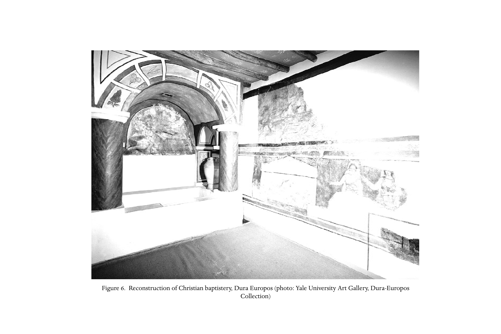

# 第二十三章 君士坦丁以前的教会制度

**作者：斯图尔特·乔治·霍尔（Stuart George Hall）**

《剑桥基督教史》第一卷《起源至君士坦丁》中文译稿

> 原书第414–433页，PDF第463–482页，含章前图版。完整翻译正文、引文和解释性脚注；参考文献作者名、题名与定位保留原文。
>
> [第二十三章英文原文](<第二十三章 君士坦丁以前的教会制度（英文）.md>) · [原书PDF](<../01 起源至君士坦丁.pdf>)

*图6：杜拉—欧罗波斯基督教洗礼室复原。照片：耶鲁大学美术馆，杜拉—欧罗波斯收藏。*

<!-- 原书第415–416页；PDF第464–465页 -->

到君士坦丁时代，教会已成为相当强健的组织，皇帝得以把它视为统一帝国的伙伴。权威体系、信仰模式，以及对资金与财产的掌控，使早期家庭共同体转变成一个覆盖全帝国、彼此相连的组织，越来越反映帝国本身的结构。一个意味深长的事实是：背教者尤利安于360年代试图把时钟拨回去时，他“决意将基督教的秩序与纪律引进异教神庙”。[^1]他设置不同等级的职事，任命教师与诵读员传授异教教义，规定祈祷时刻，并为希望退居哲学生活者建立修院；异教祭司被要求接待旅客、向穷人分发谷物和酒、过圣洁生活、远离酒馆与剧院，否则免职。尤利安认为，“无神论者”的纪律与善行，具有危及传统宗教的吸引力；君士坦丁则认识到它们的用处。

早期以家庭为基础的共同体，其特点已在上文第二部分第7章说明。那里尝试把早期教会现象放在社会与历史环境中考察，注意它如何结合家庭、祭祀团体、俱乐部与哲学学校的特征，却又不完全像其中任何一种。本卷不断注意基督徒群体的多样性：未来原本有一系列可能方向。然而，基督教虽零散、多样，却开始在地中海世界获得一种连贯形象，也形成独特的权威模式。[^2]这或可归于一种感受：虽在许多家庭中聚集，自己却属于同一个“上帝的家”；合一本身就是值得追求的目的。因此，领导者致力于维护社会和谐、解决争议、引导礼仪生活。于是，“以其他根据、其他方式达成的合一，创造了正统能够确立自己的氛围”。[^3]

本章因此考察，那些锻造正统的关键辩论所处的制度背景。我们将参照重要文本，叙述教士各等级，包括单一主教制，如何产生；叙述他们作为祭仪领袖所主持的礼仪与信经表达；也叙述他们在共同体中施行的纪律，以及集体开会时的权威。

## 职事

<!-- 原书第416–417页；PDF第465–466页 -->

目前所知，为负责管理早期教会者编写的最早手册，是《十二使徒遗训》（Didache），即“十二使徒的教导”。它约于100年利用更早材料编成，其中某些可能来自犹太教；它影响了《使徒宪章》等后来的教会手册，或被收入其中。书中先列出所有候洗者应学的道德教导，再指示洗礼、禁食、祈祷和圣餐，规定教会职事人员及星期日敬拜的行为，最后警告上帝迫近的审判。它在许多方面与后世实践不同，也证实其年代较早。

《遗训》第11章的教会领袖，是教师、使徒和先知。教师显然就是需要这本手册的人：新教师应按是否符合其内容受判断（11.1–2）。“使徒”不是《新约》十二使徒，也不是最初的复活见证人，参《哥林多前书》9:1，而是四处旅行的使者，在所到之处接受款待（11.1–6）。先知受到最多关注，不知因为他们发挥主导作用，还是最容易造成麻烦。[^4]书中没有说他们旅行，但像其他工匠一样，他们也可能到来并定居（13.1；参12.1–5）。真先知在圣灵中发言，理当服从；假先知主要凭不道德或贪婪辨认（11.7–12）。先知也许会下令举行圣餐聚餐（11.9），并在其中自由带领祈祷，不受为其他主持者规定的固定形式约束，第9–10章，尤其10.7。

使徒、先知、教师的职分，列于《哥林多前书》12:28任职名单之首；在这封信中，预言在属灵恩赐中占突出地位，尤其见第14章。与《遗训》另有相似之处的《马太福音》，某些段落背后可能也有类似安排（23:34；28:19–20）。然而，这与不久将普遍出现于各教会的主教、长老、执事结构不同。“主教”（episkopos）字面意思是监督者、管理者或监察者。“长老”（presbyter），英语priest一词由此而来，意为年长者；在年长男子担任重要政治与宗教角色的古代世界，这一称谓十分普遍。“执事”（diakonos）意为服侍者或仆人，可以指低微奴隶，也可以指高级官员。有人认为，教会经典安排，即一位主教与其执事、由长老辅助，直接借自犹太会堂：会堂由长老团管理，其中一人作为“会堂主管”（archisynagōgos）主持，另有一名职员（hypēretēs）服务。[^5]

不过，发展并非直线进行。学界的一般共识是，一、二世纪之交，地方会众由主教与长老领导，两者职分重叠或无法区分；[^6]同时先知仍继续活动，可能四处旅行。但这抹平了证据，后者似乎反映不同地区的多样发展。《腓立比书》1:1已经将职事赋予“诸位监督和执事”；罗马的革利免从希腊文《以赛亚书》60:17为此找到圣经基础：“我要在公义中设立他们的监督，在信仰中设立他们的执事”（1 Clem. 42.5）。同一“监督与执事”表达见于《提摩太前书》3:1–13，也出现在《遗训》近结尾处：

> 所以，你们要为自己选立配得主的监督和执事，温柔、不贪财、诚实、经过考验的人；因为他们也为你们承担先知与教师的职事。因此不要轻视他们，他们与先知、教师一样，都是你们尊重的人。[^7]

这很可能是这部多层形成之书的较晚增补。完整段落把《遗训》较早规定，与一种更正式的安排协调起来；在这一安排中，需要较固定的职员来补充或代行先知与教师的职责。

<!-- 原书第417–418页；PDF第466–467页 -->

伊格纳提乌通常假定，每个教会有一位主教，在制度与象征层面都至关重要：

> 你们所有人都要跟随主教，像耶稣基督跟随父；跟随长老团，如同跟随使徒；尊敬执事，如同上帝的任命。没有主教，谁也不要做任何关乎教会的事。应认为在主教或他所委任者主持下的祝谢礼〔eucharistia〕才是健全的。主教在哪里，民众就当在哪里，正如耶稣基督在哪里，普世〔katholikē〕教会就在哪里。不经主教，无论施洗还是举行爱筵〔agapē〕，都是不对的；凡他认可的，才蒙上帝喜悦，使你们所做的一切安稳而健全。[^8]

这些主题以不同形式反复出现，劝各教会团结在唯一主教周围。背景几乎肯定是一种较松散的传统：每个信徒家庭自行管理，同城可能有数个。伊格纳提乌坚持主教重要，也许是面对教会困难而提出的创新；困难既可能是继续守安息日等犹太实践，也可能是错误地教导基督肉身只是表象、并非真实，即“幻影说”。家庭教会没有控制体系，没有固定信经、教义，甚至没有明确界定的正典经书，形态很多，宗教观念差异可能极大。在每个会众中任命一位主教，使其他主教能够承认他，并由他作地方最终裁决者，这种做法会推动上述发展。[^9]

伊格纳提乌每封信都出现主教，只有《致罗马人书》例外。罗马在二世纪中叶以前，可能没有一位“单一”主教，[^10]实际形成时间很可能还更晚。[^11]稍早的罗马革利免并不知道这样的制度，通常断代约140年、影响深远的罗马《黑马牧人书》中也找不到。黑马描述一组异象，启示教会本性及其应有行为。其记录副本要交给负责“外面诸城”的革利免，也交给女教师格拉普特（Grapte），她将“教导寡妇和孤儿”；“而你要在本城，与主持教会的长老一起宣读”。[^12]作品提到使徒、先知、教师，也提到复数的监督，他们看起来像各家庭负责人，可能就是“长老”。[^13]

<!-- 原书第419–420页；PDF第468–469页 -->

180年代写作的爱任纽，[^14]把从革利免那里找到的使徒传承观，与主教独特角色的观念结合；他仍经常称主教为“长老”。面对迫害，他呼吁多种多样的基督徒归于秩序。异端抛弃了交付使徒的原始真理；他们声称提供使徒福音书未记录的耶稣秘密教导。爱任纽拒绝此说，论证使徒把全部真理，交托给他们托付各教会的人，也就是主教。因此，使徒所建各教会的主教传承，保证它们拥有原始福音，其他教义则是人为偏离。[^15]他说，普天下各教会的一致，证明真正使徒传统牢不可破。他列出罗马主教传承名单——其中早期条目是虚构的——并叙述自己与士每拿坡旅甲的亲身联系，以此说明。[^16]

爱任纽的观念，虽未必符合基督教起源的实际情况，却为面对信仰与实践多样性、如何辨认真传统的问题，提供了整齐答案。非洲的德尔图良约200年热情接受这些观点。[^17]随之而来的，是主教相对于其他权威来源的权力增长：先知、教师，以及具有灵恩权威的殉道者与认信者，越来越受主教控制。这个过程在居普良那里达到顶点。面对迫害中大批失足者，以及各教会因后续处理产生的分裂，他主张普世主教团是判断个人与群体的唯一权威。[^18]他生前，其主教权威未必能压过认信者及支持他们的长老；但最终结果，巩固了各地单一主教的权威，也巩固诸主教在会议中共同行动的权威。

居普良的观念，部分来自他在民政治理中的背景：教会遍布帝国，其结构类似帝国，从上而下治理。人们经常注意到教会治理与城市议会之间的平行。[^19]ordo clericus，即教士阶层，与ordo laicus，即平信徒阶层的区分，对应于plebs，即普通公民，与市议员阶层的区分；后者是有产者，负责治理并资助城市公共事务。罗马社会的各个等级——元老、骑士、市议员等——似乎反映在教会不同等级中：主教、长老、执事、寡妇、童贞女、副执事、诵经员。教会取得“第三种族”的身份，既非犹太人，也非希腊／罗马人，可以被视为国中之国。[^20]不过，主教终身的“君主制”，与罗马惯例中任期一年的官职和祭司职相当不同。[^21]爱任纽关于建教者所设、普世一致主教体系的观念，增强主教权威；主教将圣经话语应用于当前需要的关键作用，也增强权威，尤其体现在仲裁，以及在教会共同体内部和彼此之间维持秩序与纪律。

<!-- 原书第420–421页；PDF第469–470页 -->

圣经也提供祭仪的“预表”，强化主教与其他职事等级不断增长的权力。基督徒最初不同于圣经中的犹太教，也不同于周围异教世界，因为他们没有献祭崇拜。[^22]《旧约》祭祀被解释为个人奉献，[^23]尤其在耶稣身上。[^24]寡妇作为教会奉献的领受者，被称为“上帝的祭坛”。[^25]《遗训》称先知为共同体的“大祭司”，可能也出于同样的慈善含义。[^26]但《革利免一书》把上帝经摩西设立亚伦祭司体系，与上帝规定、由主教／长老领导的教会，相提并论。[^27]伊格纳提乌描绘教会聚集在主教周围，其统一性代表上帝自身统一，其中或许也有类似祭司式主教观。接近这一传统的《坡旅甲殉道记》（Martyrium Polycarpi），描绘坡旅甲主教在走向殉道时，以祭司职事为人代求。[^28]归于希波吕托斯、属三世纪初的《使徒传统》重构本，按立新主教的祈祷包括：

> 父啊，你知道人心；求你使你拣选、承担监督职〔episcopatum〕的仆人，牧养你的羊群，在你面前无可指责地担任大祭司，昼夜服侍，不断求你悦纳，献上你圣教会的礼物。愿他有大祭司的权能，按你的命令赦罪，按你的命令分派职责，按你赐给使徒的权柄解开一切束缚。[^29]

这把主教职事与《旧约》职事相等同；在《旧约》中，安排圣所祈祷和献祭、治理百姓宗教生活的，是上帝设立的祭司阶层，即亚伦子孙。

不久以后，居普良经常称主教为sacerdos，即“祭司”，称执事为levita，即“利未人”。可拉、大坍、亚比兰反抗亚伦合法祭司职及其可怕结局，[^30]不断出现在居普良反对异议者的论辩中。在主教职责表中，居于高位的是献祭，即饼酒圣餐，以及捆绑、释放百姓的罪。主教及其献祭的祭司功能，也提供一种替代秩序，对应奥古斯都于基督纪元之初为罗马帝国确立的宗教基础。[^31]

因此，到居普良任期结束时，主教在教会中的角色已显多重。他们既构成基督徒百姓的治理机构，也构成祭司体系。借相互按立、承认与协商确保的一致，使他们穿越时空，与教会的使徒起源相连，形成一个与罗马帝国本身平行的团体。主教决定谁属于教会、谁不属于；他们守护并阐明那一次交付圣徒的真理，向唯一上帝提供他所悦纳的唯一公共敬拜形式，是世界救恩活生生的工具。

## 敬拜与信经

<!-- 原书第421–422页；PDF第470–471页 -->

各地教会都是上帝的“圣所”。[^32]它没有别的圣殿，只有百姓个人与群体本身。纯洁生活就是他们的祭，与异教徒及犹太人的神庙、圣殿和仪式相对。他们构成不朽的灵魂，散布在败坏、垂死之世界的身体中。[^33]归信者要成为这群百姓的一员，就必须与周围世界作决定性的决裂。最初，这是一种象征性洗濯，[^34]可追溯到施洗约翰“为赦罪”所施的洗，后来由耶稣及其追随者接续；但耶稣复活引入新的维度，即圣灵。[^35]圣灵的恩赐意味着内心改变、道德更新、使心思顺从上帝。

《遗训》开篇描述两条道路，即光明与黑暗、善与恶，然后规定，把这些教导传给候洗者。[^36]这是“两条道路”文献的一种版本，似乎起源于基督教以前的犹太教，此后以各种形式贯穿教父时期，甚至晚至加洛林帝国仍出现。[^37]要求的是彻底转向爱上帝、爱邻舍，而非神学教学；不过，最好在寒冷流动水中进行的洗礼，是“奉父、子、圣灵的名”。[^38]这与《马太福音》28:19–20的指示及其他早期实践相符。[^39]

“希波吕托斯”保存了一套完整礼仪规定。[^40]求洗者首先登记为慕道者，前提是其行业或职业并非不当，例如制造偶像、角斗士、娼妓。他们接受圣经教导，通常三年。期间行为受到审查，若合格，就进入一段驱魔过程，“听福音”——此前学习显然主要是《旧约》——并在某个星期日清晨，很可能复活节，参加最后的守夜与祈祷。用祈祷祝福水，候洗者脱衣，涂抹清洁之油，即“驱魔油”，每人都须说：“撒但，我弃绝你，也弃绝你一切服役和一切作为。”由此，异教宗教及社会中一切依赖它的方面，都被放下。

<!-- 原书第422–423页；PDF第471–472页 -->

随后候洗者站入水中，由长老一边询问，一边三次浸入水中，或浇水。第一次，他表示相信全能父上帝；第二次，相信上帝之子基督耶稣，并诵述其降生、受难、复活与未来审判；第三次，相信“圣灵、圣教会及肉身复活”。三次洗礼后，再次受膏，这回使用带香味的“感恩油”，似乎先在洗礼池旁一次，再由主教在会众面前按手膏抹一次。随后，新受洗者首次获准参加祈祷与圣餐，除圣餐饼酒外，也领受象征性的奶、蜜与水饮用。到居普良时代，礼仪各部分已被赋予特定功用：例如，主教膏抹与按手，被认为赋予圣灵，而水使罪得赦。[^41]

这一做法部分仿照公共浴场程序：先涂油、刮去污垢，随后沐浴，最后涂香、穿洁净衣服。这种习俗盛行于西方教会；东方则广泛采用另一种做法，只膏抹一次，然后洗濯一次或数次，并举行圣餐聚餐。[^42]受洗者必须过纯洁生活，远离贪婪与性放纵，也远离渗入日常生活的各种异教宗教实践。不过，他们还有其他神圣义务。《遗训》已经规定：聚集受教（4.1–2）、祈祷（8.2–3）、禁食（8.1；参7.4）、用杯与饼祝谢（9–10）、定期捐献（4.5–8；13；参1.5），以及认罪（14）。

参加圣餐[^43]将成为只向受洗者开放的特色“奥秘”。《遗训》已称这顿餐为eucharistia，即“感恩”，两篇规定祷文都以“父啊，我们感谢你……”开始。用餐前，先为借耶稣使人认识的“大卫的圣葡萄树”，在杯上感恩；再为“借耶稣显明的生命与知识”，在擘开的饼上感恩，并祈求教会在上帝国中聚集。未受洗者不得参加。饭后，感谢上帝借耶稣使其名为人所知，并感谢肉体与属灵食物；另附一篇祈祷，求上帝在世界终结时保守、聚集教会。

<!-- 原书第423–424页；PDF第472–473页 -->

这些祈祷未提基督之死、最后晚餐，或赐下圣灵转变礼物，因此学者通常认为，这顿餐并非天主教的弥撒、新教的主餐或东正教的圣礼仪，而是额外举行的团契餐或爱筵。然而，更好的理解，是它讲的就是《遗训》中那一场共同体聚餐。[^44]早期基督教仪式聚餐的意义、功用与内容并不一致：饼之外的食物广泛用作奉献，酒则绝非普遍使用。[^45]

早期关于会众正式聚餐之祈祷与仪式的见证很少。把四世纪宏大礼仪文本的内容倒推到早期，是错误的；这种做法却屡被尝试，代价是忽略原初多样性的证据。[^46]许多学者试图从同时代犹太范式，为基督教感恩祷文寻找单一起源。[^47]近来犹太学者的批判研究，对此提出疑问；他们倾向表明，辨认早期拉比材料时，同样面临基督教文献的问题。[^48]不过，把共同体聚餐转化为献祭式纪念基督受难及被捕之夜，早在保罗时代就已存在；[^49]它促成有意识地仿照圣经安排圣餐实践。到250年，主所做的事被视为设立一项圣礼，其行动被当作规范。[^50]

《遗训》与《革利免一书》中都有献祭隐喻：[^51]《遗训》认为，祭的纯洁通过彼此和好与赦罪达到；《革利免一书》则通过监督奉献之长老，以及进行奉献之百姓的正确行为达到。安提阿的伊格纳提乌呼吁完全合一：

> 在同一信仰中，在耶稣基督里；他按肉体出于大卫家，是人子，也是上帝之子。这样，你们就当一心顺服主教与长老团，擘同一个饼；这饼是不死之药，是使人不死、而在耶稣基督里永远活着的解毒剂。[^52]

这里不应过分发挥“不死之药”的暗示，据此建立圣餐教义。伊西斯及荷鲁斯复活的故事中，也出现这种药。在此，使擘饼具有医治作用的，与其说是圣餐饼本身，不如说是顺服地聚集为一个会众、服在一位主教之下。伊格纳提乌也类似地用毒草隐喻异端，用祝圣祭坛隐喻主教和使徒规章。[^53]

<!-- 原书第425页；PDF第474页 -->

325年尼西亚会议以前，早期教会没有正式信经公式；即使到那时，也很少有证据说明，《尼西亚信经》取代了各地洗礼认信形式。[^54]然而，从《新约》写作时代起，简短信仰概要就出现于不同场合。[^55]后来，爱任纽往往针对异端，复述“信仰”“宣讲”“真理准则”的概要；措辞并不固定，实质内容却大体相同。爱任纽之后数十年，德尔图良、希波吕托斯和奥利金也有这种灵活概要，现代研究一般称其为“信仰准则”。[^56]其中始终包括承认上帝为父和创造者，承认耶稣及其地上生活，通常也包括圣灵、教会与将来审判的某些内容。二世纪末审判诺埃图斯异端问题的长老们，或主教们，似乎就曾使用此类概要。[^57]若是如此，这就是后世常见、用以解决教义争议的“会议信经”的早期实例。

严格意义的信经，在洗礼预备中产生，逐渐纳入礼仪。其三重结构，来自前述三次洗濯所伴随的三个问题。洗礼以前，候洗者诵念受教时领受的信经、宣认信仰，逐渐成为惯例。感恩祷文成为另一种概述教会信仰的场合。后世《圣雅各礼仪》和《使徒宪章》等文献，[^58]为我们传下东方教会的古老实践：庆祝上帝与其百姓交往的历史，从创造，经族长和先知，到基督来临、施救之死与被高举。所以，信经和信仰概要，最初主要并非正统检验工具；它们自然的场所，是敬拜中的颂赞与认信。这支持一种看法：教会领袖关心会众的礼仪和道德生活，至少不亚于、甚至超过关心正统。

## 纪律

<!-- 原书第426–427页；PDF第475–476页 -->

教会从开始就受到争执与背离困扰。保罗书信已显示关于男子割礼，尤其《加拉太书》，以及乱伦、食用异教祭肉、婚姻与独身、肉身复活信仰等问题的争论，后几项皆见《哥林多前书》。这些过失与分歧，很快显出需要一套处理犯错个人的制度，以及解决争议的程序。

《新约》文本包含纪律决定，必然影响后世实践。那名娶了自己岳母的人，被使徒保罗判为有罪，处罚是逐出共同体。[^59]事实上，所有作恶者都应被排除于同桌团契之外；[^60]在一个如同家庭、为成员提供各种经济与社会支持的共同体中，这种限制可能后果严重。到《马太福音》写成时，定罪需要两三个见证人，先私下劝告，再由“会众”（ecclesia）公开听审，之后才能驱逐；聚集的信徒所作决定由上帝支持，但应以怜悯施行。[^61]

有些早期文本，被理解为暗示最早期认为洗礼后的严重罪行无法补救。[^62]但显然，尽管保存洗礼“印记”不受破坏很重要，[^63]悔改和赦免始终被认为向寻求者开放。[^64]例如罗马的革利免，不但呼吁读者悔改，也劝那些罢黜合法长老者顺服：其他教会将接纳他们，应为他们祈祷；上帝将赦免他们，使他们以卑微却光荣的身份，重回基督羊群。[^65]黑马在异象中领受大量教导，说明如何通过鼓励、促成犯错成员悔改，建立教会，使之不断更新，走向最终命运。[^66]他预见教会在末日前更新，罪人及失足成员有机会接受纪律、重新恢复。作品广受阅读，并被视为权威，二世纪末以前罗马、亚历山大里亚、迦太基和里昂的证据，都能证实这一点。[^67]

凡阅读黑马之处，普遍认为，洗礼赋予的新生命，可以通过正式悔罪更新；这一行动包括公开认罪、一段排除期，以及分阶段重获参与受洗者祈祷和圣餐的资格。德尔图良生动描述exomologēsis，即“认罪”的内容：悔罪者饮食简陋，穿哀服、麻衣、蒙灰，呻吟、哭泣、俯伏于教士前，请信徒为自己祈祷。[^68]不过，具体细节随时间与地方而异。[^69]

<!-- 原书第427–428页；PDF第476–477页 -->

有时，人们抗议对失足者过于宽松。孟他努主义，更适宜称“新预言”，[^70]正是这种严格运动。德尔图良清楚显示，孟他努派主张在各方面收紧纪律，例如让小女孩蒙头、频繁禁食、不为躲避迫害而离开。这些规定来自圣灵、即“保惠师”的话语；它取消使徒时代因人的软弱而作出的某些让步。[^71]特雷维特的结论很可能正确：通常归于新预言的纪律与末世观，其他人也持有并传播；他们之所以遭拒绝，是因为声称受保惠师启示、带着权威发言，却未充分尊重教会正式职事已建立且不断增长的权威。[^72]

德尔图良在道德上一贯严厉，却在洗礼后犯罪问题上，发生了著名的立场转变。早期《论悔改》（De paenitentia）说，再次悔改的机会不可或缺，因为魔鬼特别攻击圣洁者；并用圣经例子加强论证。似乎没有任何罪，无论多严重，被排除在外。救恩有两块“救命木板”：洗礼，以及另一次伴随公开认罪的悔改。[^73]后来，他明确受新预言影响，攻击一位重要主教，[^74]因为后者宣布，适当悔罪后，将赦免通奸与淫乱之罪。[^75]它属于三种不可赦的致死罪之一，即拜偶像、淫乱、杀人；这些罪为《使徒行传》15:28–29经道德化解释的西方版本之使徒决议所禁止。[^76]《黑马牧人书》的建议，与他此前《论悔改》一致，如今却遭明确否定。[^77]

这个问题显然曾大大扰动非洲教会，但到居普良时代，使性犯罪者重新和好，已成为当地既定实践。[^78]如今重大争执转向偶像崇拜。德修皇帝249年开始的迫害，导致大量背弃信仰，因为基督徒服从要求，献上异教祭。许多人随后试图返回教会，一些人在申请中得到认信者和殉道者支持。[^79]教士反应不一：有些几乎不作周折就重新接纳，有些完全拒绝。现存主要记录来自西方；居普良通信清楚显示，他本人起初相当严格，后与其他主教协商，逐渐调整立场。与反对草率重新接纳一样，他同样关心确立主教权威，既包括各共同体唯一主教的权威，也包括全体主教的集体权威。

最初，251年迦太基会议决定：适当调查后，没有实际献祭、仅取得证明者，应获重新接纳；实际献祭但持续悔罪者，若患病濒死，应给予圣餐。[^80]这些安排后来与罗马取得一致；面对新迫害威胁，对持续悔罪者普遍赦免的让步，也同样获得同意。[^81]使献祭者重新和好的安排，差异相当大，[^82]但总体严格。

## 教会会议

<!-- 原书第428–429页；PDF第477–478页 -->

纪律与洗礼争议，使教会会议的司法功能凸显。汉密尔顿·赫斯考察了会议，即council或synod，作为教会治理工具的起源与发展。后来，在基督教皇帝治下，它成为常设的咨询、司法和立法集会，主教的作用类似地方或帝国元老。最早期却很不相同。

《使徒行传》记载一些教会集会：第一次主要是使徒，不过也提到其他会众，包括耶稣家人及某些妇女（1:15–26）；第二次由一组具名先知和教师组成（13:1–3）；第三次则是安提阿正式代表团，到耶路撒冷向“使徒和长老”陈述问题（15:1–35）。在最后这个案例中，一封正式书信被送往安提阿，由当地信徒集会宣读；后世以时代错置的方式，称之为“使徒决议”。每个故事固然很大程度都是路加对过去事件的理想化重构，却使我们宝贵地了解，他期待自己时代——或许一世纪最后十年——教会如何运作。

赫斯认为，最初两世纪的协商，大多属于地方性、会众内部活动，到三世纪才成为跨教会会议。[^83]这一划分，甚至可能仍过于鲜明。如果罗马等大城市中的信仰，起初是由一组分散家庭教会构成，最后一位主教才成为高于其他人的领袖，那么，在革利免代表罗马教会致信哥林多以前，或者黑马向罗马长老和教师呈交那部厚重预言书时，必定已进行广泛协商。优西比乌大段引用一位未具名作者；据其记述，弗里吉亚新预言促成了一些会议：

> 亚细亚各地信徒，为此经常在许多地方聚集，审查这些新奇教导，判为亵渎，拒绝这项异端；于是这些人被逐出教会，隔绝于其共融之外。[^84]

不清楚这是教会间会议，还是地方会众内部协商。

即使地方集会，也能受益于来访专家或学者。同一作者在论著开头，描述加拉太重要城镇安居拉的一场地方争论：他如何驳斥新预言，又受当地长老请求，留下书面记录；实际上他是事后才写。[^85]现存奥利金与赫拉克利德主教，以及怀疑后者的主教们所作教义辩论速记，也显示类似专家咨询。[^86]

<!-- 原书第430页；PDF第479页 -->

他考问波斯特拉的贝吕卢斯，情况也许类似；优西比乌还声称，阿拉伯另一场辩论涉及一次大型集会（synodos）。[^87]三个案例中，奥利金似乎都说服反对方达成一致。亚历山大里亚主教狄奥尼修，247／248–264／265年在任，也有类似成功：阿尔西诺伊州因《约翰启示录》的权威与意义产生分裂，他与当地长老，或主教，举行了三天会议。[^88]

这些协商都符合赫斯强调的公式：目标是共识。有时，说服并不奏效。诺埃图斯[^89]最初因基督论观点受到“蒙福的长老们”警告；但他坚持并聚集追随者，他们便谴责他，将其逐出教会，于是他“建立学校”（didaskaleion），也就是另立教会。[^90]我们无法知道他是否为主教，虽然他被罢黜了“神圣教士职分”；[^91]“蒙福的长老们”很可能是不同教会的主教，而非同一会众的职员，但无法肯定。[^92]

至于罗马主教维克托与十四日派的争议，很可能在190年不久之后，如今可以确定，优西比乌以时代错置的方式阅读那批书信。[^93]一位主要主教试图对罗马其他会众强行统一逾越节做法，随后引发与以弗所、里昂、哥林多、巴勒斯坦及其他地方主教的通信。在优西比乌叙事中，也许还借调整所引文本予以配合：

> 举行了会议及主教共同集会，众人一致制定教会规条〔dogma〕，规定主从死里复活的奥秘，绝不可在主日以外任何日子庆祝，唯有那一天才应结束逾越节禁食。[^94]

优西比乌所见书信，很可能是与地方同僚讨论的成果，而非仅为主教个人交往；除非文本遭过篡改，以弗所的坡利克拉底确实如此说。[^95]不过，系统性地区集会为普世教会颁布法令的观念，属于四世纪，而不是二世纪。

<!-- 原书第431页；PDF第480页 -->

关于会议及其程序的扎实证据，始于249–251年德修迫害的后续影响。但那些记录本身，也为早一代或更早、处理异端洗礼有效性的集会，提供了一些证据：一处在弗里吉亚以哥念，包括邻近行省主教；另一处由迦太基阿格里皮努斯领导，包括非洲及努米底亚主教。[^96]通常认为，类似的迦太基会议，准许重新接纳悔改的通奸者。[^97]

251年居普良结束退避、返回迦太基后，面临重要教士的分裂；他召集支持自己的主教，与长老和执事同席开会，就失足者及异议教士作出规定。[^98]罗马一场类似会议，有六十位主教，以及更多长老、执事参加。[^99]此后，直到256年，迦太基每年都有会议记录。到257年，迫害再起，以及居普良被处死，显然打断这一模式。其他地方围绕失足者和好及随后分裂的类似会议活动，记录较少，却很可能可以相比。[^100]有证据说明，当时已经举行年度集会，尤其处理悔罪事务；[^101]325年《尼西亚会议》第5条将正式规定这件事。

某些材料显示，会议并不只有主教。事实上，不但各类教士，平信徒也参与：“主教、长老、执事、认信者与坚定的平信徒”，都被期待共同作出判断。[^102]会议作为法庭时，平信徒大概与世俗法庭旁听民众发挥相同作用，通过对程序的反应影响长官。这源于会议最初是地方教会成员的本地聚集；在一座城市中，他们可能分散在数个会众。城郊及其他来访教士，也会加入。因此，没有正式成员资格或投票权，虽然远方来者显然需要适当通知和召集。这不算太大问题，因为程序并非多数表决，而是以达成共识为目标。[^103]他们聚集，是为解决行为或教义问题。

<!-- 原书第432页；PDF第481页 -->

赫斯依循西本，区分三种程序形式，其中两种适用于君士坦丁以前：[^104]讨论式和议会式。讨论式类似奥利金与赫拉克利德的辩论，提出问题与解释，达到所有人接受的结论；教育意味浓厚，平信徒参与也相当重要。选举主教的会议，很可能采用这种形式，因为民众欢呼与来访主教，都是程序不可或缺的部分。[^105]

议会式程序则仿照罗马元老院，或者更重要的地方行省和城市机构，也可能仿照collegia，即行业团体。我们有一份清楚描述这种程序的《八十七位主教的意见》（Sententiae lxxxvii episcoporum），[^106]根据256年9月1日迦太基会议的速记整理。先宣读说明讨论问题所必需的书信；随后，主持的居普良主教概述自己的看法，征询意见。其他八十六位表示赞同后，居普良再提出自己的意见，为一致决定作结。

居普良数封书信，宣布这种集会对各种问题的结论。有时是联名信：第57封列出四十三位主教名字，将结论致科尔内利乌斯。第71封则报告，“许多”主教被召集开会后作了怎样的决定；没有名字和人数，但几乎可以确定，是256年春七十一位主教的会议。[^107]后世完整会议记录及会议规章（statuta），将从这些起点发展，成为教会法的重要来源。

不过，到目前为止，所有证据都涉及地方，至多行省会议。尼西亚以前，最接近以“普世”、即“全世界”方式召集主教的唯一案例，是罢黜萨摩萨塔保罗的安提阿会议。据优西比乌说，主教从周边行省聚集，将会议书信致亚历山大里亚主教，以及“全世界我们所有同工，主教、长老和执事”。保罗最后被逐出安提阿教堂，涉及皇帝和罗马主教，也预示了后来的发展。[^108]

<!-- 原书第433页；PDF第482页 -->

由此，我们开始看清：教会内部结构如何使它取得全帝国的视野；再加上对合一的关切，使它成为君士坦丁试图将领土统一于一位上帝之下时，现成可用的工具。[^109]

## 译校说明

- 本章所述礼仪文本的作者归属、年代、主教制形成与会议性质，均保留作者的推定及不同解释，不把后世制度提前视为早期定制。
- 原书第426页称《哥林多前书》5章中的男子娶了自己的“岳母”（mother-in-law），译文依原词保留；该处显有亲属称谓问题。第431页把迫害再起与居普良遇害衔接于“257年”，也保留原文表述。
- 原书第419页注14将爱任纽交叉参照写为第三部分第10章，依原文保留；本卷专论爱任纽的是第13章。第420页注25的“Poly. Phil. 4.23”等定位，同样未擅自修订。

## 脚注

[^1]: Soz. HE 5.16.

[^2]: Lane Fox, Pagans and Christians; Rousseau, Early Christian centuries.

[^3]: Rousseau, Early Christian centuries, 88.

[^4]: 误导性的预言，见《马太福音》7:14–16；《约翰一书》4:1–3。先知带来的问题，见琉善讽刺作品De morte Peregrini；参“正统派”对孟他努派的回应，上文第四部分第17章。

[^5]: 近来Burtchaell, From synagogue to church提出这一论点。

[^6]: 不同看法，见Young, ‘On episkopos and presbyteros’。

[^7]: Did. 15.1–2.

[^8]: Ign. Smyr. 8；参Trall. 3.1。

[^9]: Bauer, Orthodoxy and heresy率先进行这一分析，但他误判罗马处境；罗马很可能比其他中心分裂更严重。见La Piana, ‘The Roman church’；Lampe, Paul to Valentinus；以及上文第四部分第22章。

[^10]: Markschies, Between two worlds, 189–92.

[^11]: 按Brent, Hippolytus，罗马朝向单一主教制的发展始于189年，直到235年才完成。

[^12]: Herm. Vis. 2.4.3.

[^13]: 例如Herm. Vis. 3.5.1；Herm. Sim. 9.27.2。

[^14]: 进一步见上文第三部分第10章。

[^15]: Iren. Haer. 3.3.1–3.

[^16]: Iren. Haer. 3.3.4.

[^17]: 尤其见Praescr.。

[^18]: 见下文第26章。

[^19]: 概要及参考文献见Torjesen, ‘Social and historical setting’, 188–9；较早论述见Cochrane, Christianity and Classical culture, 219–20。

[^20]: 经典论述为Harnack, Expansion of Christanity, vol. i, 240–78。

[^21]: Lane Fox, Pagans and Christians, 545；完整讨论见493–517页。

[^22]: 见Ep. Diognet. 1–6；参Young, Use of sacrificial ideas。

[^23]: 《罗马书》12:1–2；《彼得前书》2:4–5。

[^24]: 《希伯来书》，尤其9:11–14；10:1–16。

[^25]: Poly. Phil. 4.23.

[^26]: Did. 13.3.

[^27]: 1 Clem. 40–4.

[^28]: M. Polyc. 5.5–6.1；参14。

[^29]: Trad. ap. 3.3–5；Stewart-Sykes编译，61页。

[^30]: 《民数记》16章。

[^31]: 完整详述见Brent, Imperial cult。

[^32]: Hipp. Trad. ap. 3.3，上文已引。

[^33]: Ep. Diognet. 1–6.

[^34]: 进一步见上文第二部分第7章。

[^35]: 《马可福音》1:4；《约翰福音》4:1–2；参《马可福音》1:8；《使徒行传》2:38；19:1–6。

[^36]: Did. 1–7.

[^37]: Van de Sandt and Flusser, Didache, 55–190有详细讨论。

[^38]: Did. 7.

[^39]: 参Justin, 1 Apol. 61；Hipp. Trad. ap. 21；Tert. Prax. 26.9。

[^40]: Hipp. Trad. ap. 17–21；Tert. Bapt.所载礼仪信息，大体与Trad. ap.一致。

[^41]: 居普良在Ep. 74.5等处对司提反的误解，由此而来。Hipp. Trad. ap. 21.21可能已含居普良的看法；见Stewart-Sykes编译本，112–113页。

[^42]: 例如Acts Thom. 132–3；157。

[^43]: 亦见上文第二部分第7章。

[^44]: 这是近来van de Sandt and Flusser, Didache, 301–4的看法；相反观点见Niederwimmer, The Didache, 139–43。

[^45]: 全面讨论见McGowan, Ascetic eucharists。Stewart-Sykes编译本130–132页，说明Trad. ap. 23–26中的希波吕托斯聚餐，应视为圣餐。

[^46]: 见Bradshaw, Search。

[^47]: 近来的例子是Mazza, Origins，以及van de Sandt and Flusser, Didache。

[^48]: Bradshaw, Search, 1–29.

[^49]: 《哥林多前书》11:17–34；参10:14–22。

[^50]: Cypr. Ep. 63。正统的非洲主教竟因杯中只用水而受责备，这点十分重要。

[^51]: Did. 14; 1 Clem. 40–1 and 44.4.

[^52]: Ign. Eph. 20.2.

[^53]: Ign. Trall. 6–7。Ign. Eph. 20.2的解释，见Schoedel, Ignatius of Antioch, 95–9；Wehr, Arznei der Unsterblichkeit, 106–11。

[^54]: 进一步见下文第六部分第31章。

[^55]: 经典表述见Dodd, Apostolic preaching；亦见Kelly, Early Christian Creeds, 6–29。

[^56]: Kelly, Early Christian Creeds, 68–99.

[^57]: Hipp. Noët. 1.7；见下文。

[^58]: Prex eucharistica，Hänggi and Pahl编，82–95、244–61页。

[^59]: 《哥林多前书》5:1–6。

[^60]: 《哥林多前书》5:9–13。

[^61]: 《马太福音》18:15–22。

[^62]: 尤其《希伯来书》6:5–8；12:14–17；见Harnack, History of Dogma, vol. i, 171–3。

[^63]: 2 Clem. 6–7.

[^64]: 此为Benrath, ‘Buße’, 452–3的看法。

[^65]: 1 Clem. 54–7.

[^66]: 尤其见Schneider, ‘Propter sanctam ecclesiam’。

[^67]: Staats, ‘Hermas’, 106–7.

[^68]: Tert. Paen. 9；参Or. C. Cels. 3.51。

[^69]: Brightman, ‘Terms of communion’, 365–77.

[^70]: Trevett, Montanism，尤其159–62页；亦见上文第四部分第17章。

[^71]: 例如Tert. Mon. 2–3。德尔图良与孟他努主义的关系，见Rankin, Tertullian and the church, 41–51；悔改问题，见Butterweck, ‘Tertullian’, 100–1。

[^72]: Trevett, Montanism, 114–20及其他处。

[^73]: 例如Tert. Paen. 7–8；12.9。

[^74]: 指迦太基而非罗马主教；见Hall, ‘Calixtus i’, 562；Letters of St Cyprian of Carthage，Clarke译，vol. iii, 194–5，即Clarke对Cypr. Ep. 55.20–21的注释。

[^75]: Tert. Pud.，尤其1.6–9。

[^76]: Pud. 12.1–6.

[^77]: Pud. 10.12.

[^78]: Cypr. Ep. 55.21–22.

[^79]: 事件概要见下文第26章。

[^80]: Cypr. Ep. 55.17.3；Clarke的长注及其他段落参照，见Letters of St Cyprian, vol. iii, 191–3。

[^81]: Cypr. Ep. 57，出自一次会议，Clarke将其断代为253年夏；见Letters of St Cyprian, vol. iii, 212–16。

[^82]: Brightman, ‘Terms of communion’, 369–71，汇集了所需悔罪时间长短的信息。

[^83]: Hess, Early development, 4–20.

[^84]: Euseb. HE 5.16.10.

[^85]: Euseb. HE 5.16.4–5.

[^86]: Or. Dial.

[^87]: Euseb. HE 6.33; 6.37.

[^88]: Euseb. HE 7.24.6–9.

[^89]: 进一步见下文第25章。

[^90]: Hipp. Noët. 1.3–8.

[^91]: Hipp. Noët. 1.3.

[^92]: Hess, Early development, 11–12.

[^93]: Euseb. HE 5.23–5；Hess, Early development, 8–10；Brent, Hippolytus, 412–27完整提出这一论证，虽某些细节有争议。

[^94]: Euseb. HE 5.23.2.

[^95]: Euseb. HE 5.24.8.

[^96]: Euseb. HE 7.7.6；Cypr. Ep. 71.4.1；75.7.4。不确定的日期与情境，见Clarke注释，Letters of St Cyprian, vol. iv, 196–9。

[^97]: Cypr. Ep. 55.20.2–21.2，以及Clarke注释。

[^98]: Cypr. Ep. 51.15.1；亦见下文第26章。

[^99]: Euseb. HE 6.43.2.

[^100]: 见Clarke, Letters of St Cyprian, vol. ii, 11–13。

[^101]: Firmilian in Cypr. Ep. 75.4.3.

[^102]: Cypr. Ep. 43.7.2；更多例子见Hess, Early development, 22–4。

[^103]: 尤其见Hess, Early development, 29–33。

[^104]: Hess, Early development, 24–34；Sieben, Konzilsidee, 466–92。Sieben的第三种模式，是kaiserliche Kognitionsprocess，即皇帝主持的审理程序。

[^105]: 关于居普良材料的全面概要，见Bernard, ‘Cyprianic doctrine’, 230–2；参Euseb. HE 6.11.1–2；6.29.3–4。

[^106]: Sancti Cypriani episcopi opera，CCSL 3E，Diercks编。

[^107]: Clarke, Letters of St Cyprian, vol. iii, 211–12.

[^108]: 进一步见下文第25章。

[^109]: 进一步见下文第六部分第30、31章。
