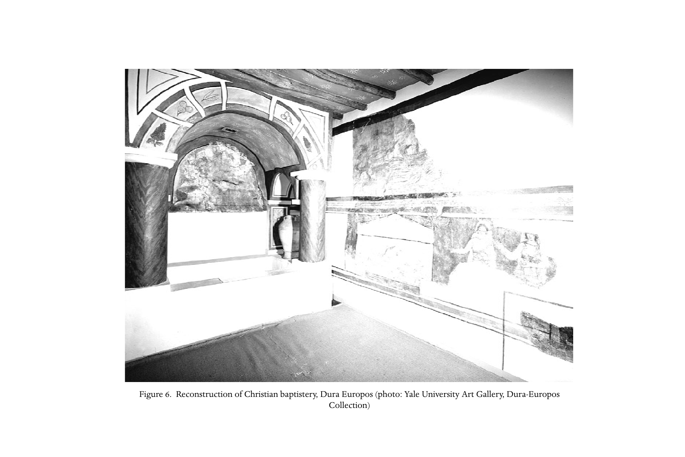

# 第二十三章英文原文：Institutions in the pre-Constantinian ecclesia

<!-- PDF page 463; original page 414 -->

Figure 6. Reconstruction of Christian baptistery, Dura Europos (photo: Yale University Art Gallery, Dura-Europos Collection)

<!-- PDF page 464; original page 415 -->

### 23. Institutions in the pre-Constantinian ecclesia

#### stuart george hall

By the time of Constantine the church was a sufficiently robust organisation for the emperor to engage it as a partner in unifying the empire. Systems of authority, patterns of belief and control of funds and property had turned the early household communities into an interlinked, empire-wide organisation that increasingly mirrored the structure of the empire itself. It is a telling fact that when Julian the Apostate tried to put the clock back in the 360s, he ‘determined to introduce into the pagan temples the order and discipline of Christianity’:[^p464-1] various degrees of ministry were instituted, teachers and readers were appointed to give instruction in pagan doctrines, hours of prayer were established, and monasteries founded for those who wanted to live in philosophical retirement; pagan priests were told to provide hospitality for travellers, to distribute corn and wine to the poor and to live holy lives, avoiding taverns and the theatre, or be deprived of office. Julian saw the discipline and benevolence of the ‘atheists’ as attractions dangerous to traditional religion, whereas Constantine had recognised their usefulness.

The characteristics of the early house-based communities were described in part ii, chapter 7, above. There, the discussion attempted to view the phenomenon of the early church in its social and historical setting, noting how it combined features of household, cult, club and philosophical school, without being altogether like any of them. Throughout this volume the diversity of Christian groups has been observed: there was a range of possible futures. Yet, fractured and diverse as it was, Christianity began to acquire not only a coherent profile in the Mediterranean world, but also distinctive patterns of authority.[^p464-2] This may be attributed to the sense of being a single ‘household of God’, despite meeting in many households – unity was a desirable end in itself. So leadership was dedicated to the preservation of social harmony,

[^p464-1]: Soz. HE 5.16.

[^p464-2]: Lane Fox, Pagans and Christians; Rousseau, Early Christian centuries.

<!-- PDF page 465; original page 416 -->
resolving disputes and directing liturgical life. Thus ‘unity, achieved on other grounds and by other means, created a climate within which orthodoxy could assert itself’.[^p464-3] So here we consider the institutional context for the crucial debates which forged orthodoxy. Through reference to key texts, an account is offered of the process whereby there emerged the clerical orders, including the monarchical episcopate; the liturgies and credal formulations of which the clergy were the cultic leaders; together with the discipline they exercised in the community, and their conciliar authority.

#### Ministry

The earliest known handbook for those responsible for running early churches is the Didache or ‘Teaching of the twelve apostles’. Compiled about 100 ce using earlier material, some probably Jewish, it contributes to or is embodied in later church manuals like the Apostolic constitutions. It first sets out the moral teachings which all candidates for baptism should learn, then gives directions for baptism, fasting, prayer and the eucharist, regulations for the ministers of the church and the conduct of Sunday worship, and a warning about the impending judgement of God. Its early date is verified by its divergence from later practice in many respects.

In Didache 11 the church leaders are teachers, apostles and prophets. The teachers are plainly those who need the manual: a new teacher is to be judged by his conformity to its contents (11.1–2). The apostles are not the twelve of the New Testament, nor the original witnesses of the resurrection (cf. 1 Cor 9:1), but travelling messengers, who receive hospitality in places they visit (11.1–6). The prophets are given most attention, whether because they play the dominant role, or cause the most trouble.[^p464-4] They are not said to travel, though like other craftsmen they may arrive and settle (13.1; cf. 12.1–5). True prophets speak in the spirit and are to be obeyed. False prophets are identified chiefly by immorality or greed (11.7–12). Prophets perhaps command the eucharistic meal to be held (11.9), and lead prayers freely at it, not being bound by the fixed forms prescribed for other officiants (9–10, especially 10.7).

The offices of apostle, prophet and teacher figure at the head of a list of appointments in 1 Corinthians (12:28), a letter in which prophecy is prominent

[^p464-3]: Rousseau, Early Christian centuries, 88.

[^p464-4]: For misleading prophecies, see Matt 7:14–16; 1 John 4:1–3. For the problems of prophets, Lucian’s satire, De morte Peregrini; cf. the ‘orthodox’ reaction to the Montanists (pt iv, ch. 17, above).

<!-- PDF page 466; original page 417 -->
among spiritual gifts (see especially 1 Cor 14). A similar ordering may lie behind passages in Matthew’s gospel (Matt 23:34; 28:19–20), a document which has other affinities to the Didache. Such an ordering is at variance with the structure soon to emerge as universal in the churches, that of bishops, presbyters and deacons. ‘Bishop’ (episkopos) means literally ‘overseer’, ‘superintendent’ or ‘inspector’. ‘Presbyter’, from which the English ‘priest’ derives, means ‘elder’, and was widespread in the ancient world where senior males had important political and religious roles. ‘Deacon’ (diakonos) means ‘minister’ or ‘servant’, and can refer to a menial slave or a senior official. Some hold that the classic arrangement in the church, of a bishop with his deacon supported by presbyters, is a direct borrowing from the Jewish synagogue, which was managed by a body of presbyters, one of whom presided as ‘chief of synagogue’ (archisynagōgos), and served by an officer (hypēretēs).[^p464-5]

The development was not, however, straightforward. The general consensus among scholars has been that, at the turn of the first and second centuries, local congregations were led by bishops and presbyters whose offices were overlapping or indistinguishable,[^p464-6] while prophets, possibly itinerant, also continued to function; this, however, smoothes out the evidence, which seems to reflect diverse developments in different areas. Already in Philippians 1:1 a ministry was ascribed to ‘bishops and deacons’, a formula for which Clement of Rome found biblical foundation in the Greek version of Isaiah 60:17: ‘I will set up their bishops in righteousness and their deacons in faith’ (1 Clem. 42.5). The same formula of ‘bishops and deacons’ is reflected in 1 Timothy 3:1–13, and appears near the end of the Didache:

Elect for yourselves therefore bishops and deacons worthy of the Lord, gentle

men, without avarice, true and proven; for they too minister to you the

ministry of the prophets and teachers. Do not therefore despise them, for

they are your honoured ones along with the prophets and teachers.[^p464-7]

This is probably a later addition to a many-layered book. The passage in full brings the earlier prescriptions of the Didache into line with a more formal arrangement, in which more regular officers are needed to supplement or do duty for the prophets and teachers.

Ignatius generally supposes that there is one bishop in each church, a vital figure both institutionally and symbolically:

[^p464-5]: Recently argued by Burtchaell, From synagogue to church.

[^p464-6]: For a different view, see Young, ‘On episkopos and presbyteros’.

[^p464-7]: Did. 15.1–2.

<!-- PDF page 467; original page 418 -->
All of you, go with the bishop, as Jesus Christ with the Father, and go with the

presbyterium as the apostles; reverence the deacons as the appointment of

God. Let none do any thing pertaining to the church without the bishop. Let

that thanksgiving (eucharistia) be reckoned sound which is under the bishop

or whoever he commit it to. Wherever the bishop is, there let the people be,

just as, where Jesus Christ is, there is the universal (katholikē ) church. It is

not right without the bishop either to baptise or to conduct a charity-meal

(agapē ), but whatever he approves, that is pleasing to God, so that all you do

may be secure and sound.[^p464-8]

These motifs recur with variations, each church being urged to rally round the one bishop. The context is almost certainly a looser tradition, in which each household of the faithful managed itself, and there might be several in a city. Ignatius’ insistence on the importance of the bishop may be an innovation provoked by the difficulties faced in the churches, whether these involved the continuing of Jewish practices like sabbath observance, or the erroneous teaching that the flesh of Christ was apparent rather than concrete (‘docetism’). House churches, without a system of control, without fixed creeds, doctrines or even clearly defined canonical scriptures, took many forms, and the religious ideas could vary immensely. The practice of appointing a single bishop in each congregation who could be recognised by other bishops and be the final local adjudicator would contribute to the development.[^p464-9]

The bishop figures in every letter of Ignatius except one, that to the Romans. Probably there was no single ‘monarchical’ bishop in Rome before the middle of the second century,[^p464-10] and likely later.[^p464-11] Clement of Rome, somewhat earlier, had known no such system; nor is it to be found in an influential document usually dated about 140, The Shepherd of Hermas of Rome. Hermas describes a set of visions in which instructions are revealed about the nature of the church, and how it is to conduct itself. Copies of his account were to be given to Clement, who is responsible for ‘the outside towns’, and to a female teacher, Grapte, who ‘will instruct the widows and orphans’: ‘But you will read it in this city with the elders who preside over the church.’[^p464-12] References to apostles,

[^p464-8]: Ign. Smyr. 8; cf. Trall. 3.1.

[^p464-9]: Bauer, Orthodoxy and heresy, pioneered this analysis, though he misjudged the situation at Rome, which was probably more seriously divided than other centres; see La Piana, ‘The Roman church’; Lampe, Paul to Valentinus; and pt iv, ch. 22, above.

[^p464-10]: Markschies, Between two worlds, 189–92.

[^p464-11]: According to Brent, Hippolytus, the progress towards monepiscopacy begins in Rome in 189 and is not complete till 235.

[^p464-12]: Herm. Vis. 2.4.3.

<!-- PDF page 468; original page 419 -->
prophets, and teachers appear, but also to bishops (in the plural), who look like heads of houses, and are probably the same as ‘presbyters’.[^p464-13]

Irenaeus,[^p464-14] writing in the 180s, combines the idea of apostolic succession, which he found in Clement, with that of the unique role of the bishop (whom he stills often calls ‘presbyter’). In the face of persecution, Irenaeus calls the variegated Christians to order. Heretics have forsaken the original truth delivered to the apostles. Irenaeus rejects their claims to present secret teachings of Jesus not written in the apostolic gospels with the argument that the apostles entrusted the whole truth to those to whom they entrusted the churches, that is, to the bishops. The succession of bishops in the churches that the apostles founded is therefore a guarantee that they possess the original gospel, and that other doctrines are man-made deviations.[^p464-15] The unanimity of the churches throughout the world attests, he says, the security of the true apostolic tradition. He illustrates this by giving the succession list for bishops of Rome, fictitious in its earlier entries, and recounting his own personal links with Polycarp of Smyrna.[^p464-16]

Irenaeus’ ideas, though they may not have corresponded with the reality of Christian origins, offered a tidy solution to the problem of identifying true tradition in the face of diversity of faith and practice. They were adopted enthusiastically by Tertullian in Africa, about 200 ce.[^p464-17] With them goes an increase in the power of bishops in the face of other sources of authority: the prophet, the teacher and the charismatic martyr and confessor would increasingly fall under episcopal control. This process reaches its climax in Cyprian, who, in the face of widespread lapse during persecution, and the divisions in the churches over the outcome, argued that the universal episcopate was the sole authority by which individuals and groups could be judged.[^p464-18] In his lifetime his episcopal authority was not guaranteed against the confessors and the presbyters who supported them, but the outcome cemented the monarchical bishop’s authority in each locality, as well as their concerted authority in council.

Cyprian’s concept derived partly from his background in civil government: the church was empire-wide, and its structures resembled those of the empire, governed from the top down. Parallels between church government and city

[^p464-13]: E.g. Herm. Vis. 3.5.1; Herm. Sim. 9.27.2.

[^p464-14]: See further pt iii, ch. 10, above.

[^p464-15]: Iren. Haer. 3.3.1–3.

[^p464-16]: Iren. Haer. 3.3.4.

[^p464-17]: Notably in Praescr.

[^p464-18]: See ch. 26, below.

<!-- PDF page 469; original page 420 -->
councils have often been noted.[^p464-19] The distinction between the ordo clericus (clergy) and the ordo laicus (laity) parallels that between the plebs (ordinary citizens) and the curial class, propertied men who had the responsibility of ruling and equipping the city’s public affairs. Roman social orders (senatorial, equestrian, curial, etc.) seem reflected in the different orders within the church (bishops, presbyters, deacons, widows, virgins, subdeacons, lectors). The church took on the identity of the ‘third race’ (neither Jew nor Greek/Roman), and could be regarded as a state within a state.[^p464-20] Yet the lifelong ‘monarchy’ of the bishop was quite different from the annual magistracies and priesthoods of Roman convention.[^p464-21] The authority of the bishop was enhanced, both by Irenaeus’ conception of a universal system of unanimous bishops established by the church’s founders, and by their crucial function of applying biblical words to current exigencies – especially in arbitration and maintenance of order and discipline within and between church communities.

Scripture also provided a cultic ‘typology’, reinforcing the growing power of the bishops and other orders of ministry. Christians were originally distinct from biblical Judaism and from the pagan world around them in that they had no sacrificial cult.[^p464-22] The sacrifices of the Old Testament were interpreted in terms of personal dedication,[^p464-23] especially in the case of Jesus.[^p464-24] Widows as recipients of the church’s offering are ‘an altar of God’.[^p464-25] Perhaps in the same charitable sense, the Didache depicts the prophets as the community’s ‘high priests’.[^p464-26] But 1 Clement draws a comparison between the divine appointment of the Aaronic priesthood through Moses, and the divinely ordered church under its bishop/presbyters.[^p464-27] Maybe a similar hieratic view of the bishop is present in Ignatius’ picture of the church gathered round its bishop, his unity representing God’s own. Close to that tradition is Martyrium Polycarpi (‘The martyrdom of Polycarp’), which portrays bishop Polycarp offering a priestly ministry of intercession as he goes to his martyrdom.[^p464-28] In the reconstructed Traditio apostolica (‘Apostolic tradition’) attributed to Hippolytus (early third century), the prayer over a new bishop includes the words:

[^p464-19]: For summary and references see Torjesen, ‘Social and historical setting’, 188–9; an earlier statement will be found in Cochrane, Christianity and Classical culture, 219–20.

[^p464-20]: Classically Harnack, Expansion of Christanity, vol. i, pp. 240–78.

[^p464-21]: Lane Fox, Pagans and Christians, 545; see full discussion on 493–517.

[^p464-22]: So Ep. Diognet. 1–6; cf. Young, Use of sacrificial ideas.

[^p464-23]: Rom 12:1–2; 1 Pet 2:4–5.

[^p464-24]: Heb, esp. 9:11–14; 10:1–16.

[^p464-25]: Poly. Phil. 4.23.

[^p464-26]: Did. 13.3.

[^p464-27]: 1 Clem. 40–4.

[^p464-28]: M. Polyc. 5.5–6.1; cf. 14.

<!-- PDF page 470; original page 421 -->
Father, you know the heart; grant that your servant, whom you have cho-

sen for oversight [episcopatum], should shepherd your flock and should serve

before you as high priest without blame, serving by night and day, ceaselessly

propitiating your countenance and offering the gifts of your holy church. And

let him have the power of high priesthood, to forgive sins according to your

command, to assign duties according to your command, to loose every tie

according to the power which you gave to the apostles.[^p464-29]

This assimilates the episcopal ministry to that of the Old Testament, where the ordering of the sanctuary for prayer and sacrifice, and the government of the religious life of the people, were in the hands of a divinely instituted priestly caste, the sons of Aaron.

Soon after, Cyprian regularly calls a bishop sacerdos (‘priest’), and a deacon levita (‘levite’). The rebellions of Korah, Dathan and Abiram against the lawful priesthood of Aaron and their dreadful fate[^p464-30] recur continually in Cyprian’s polemic against dissidents. High on his list of episcopal duties is the offering of the sacrifice, which means the eucharist of bread and wine, and binding and loosing the sins of the people. This hieratic function of the bishop and his sacrifice also presents an alternative regime to the religious foundation of the Roman empire, as Augustus had established it at the beginning of the Christian era.[^p464-31]

By the end of Cyprian’s episcopate, therefore, the role of the bishops in the church appears manifold. They constitute both government and priesthood for the Christian people. Their unanimity, secured by mutual ordination, recognition and consultation, joins them throughout time and space with the church’s apostolic origins, constituting a parallel body to the Roman empire itself. Bishops determine who belongs and who does not. They are the guardians and exponents of the truth once delivered to the saints. They offer the only forms of public worship acceptable to the only God. They are the living instruments of the world’s salvation.

#### Worship and creeds

The church in every place was God’s ‘sanctuary’.[^p464-32] It had no temples other than the people, individually and corporately. The purity of their life was their sacrifice, in contrast to the temples and rituals of pagans and Jews. They

[^p464-29]: Trad. ap. 3.3–5; Stewart-Sykes (ed. and trans.), 61.

[^p464-30]: Num 16.

[^p464-31]: Full detail in Brent, Imperial cult.

[^p464-32]: Hipp. Trad. ap. 3.3, quoted above.

<!-- PDF page 471; original page 422 -->
constituted the immortal soul dispersed in the body of the corrupt and dying world.[^p464-33] To become one of this people, the convert needed a decisive break with the world around. Originally, this was a symbolic washing,[^p464-34] traceable to the washings by John the Baptist ‘for the forgiveness of sins’, taken up by Jesus and his followers; but the resurrection of Jesus introduces a new dimension, that of the Holy Spirit.[^p464-35] The gift of the spirit is a matter of change of heart, moral reformation, the conforming of the mind to God.

The Didache begins with a description of the two ways, of light and darkness, good and evil, and then directs that this teaching be given to those who are to be baptised.[^p464-36] This is one version of a ‘two ways’ document, apparently originating in pre-Christian Judaism, which reappears in various forms throughout the patristic period, and even as late as the Carolingian empire.[^p464-37] Radical conversion to the love of God and neighbour is required, rather than theological instruction, though baptism, which is to be conducted preferably in cold, running water, was ‘in the name of the Father and the Son and the Holy Spirit.’[^p464-38] This agrees with the direction given in Matthew 28:19–20, and with the other early practice.[^p464-39]

A full prescription for the ceremony appears in ‘Hippolytus’.[^p464-40] Those seeking baptism are first registered as catechumens, provided they are not in the wrong trade or profession (such as idol makers, gladiators, prostitutes). They attend biblical instruction, normally for three years. Their conduct in this time is reviewed, and, if acceptable, they proceed to a course of exorcisms, they ‘hear the gospel’ (their earlier study having been apparently the Old Testament), and come for final vigil and prayers on a Sunday, probably Easter, morning. Water is blessed with prayer; the candidates undress and are anointed with cleansing oil, ‘oil of exorcism’, whereat each is required to say, ‘I renounce you Satan, and all your service, and all your works.’ Thus pagan religion and all the aspects of society which depend upon it are set aside. The candidate then stands in the water, and is three times dipped (or affused) by the presbyter, who interrogates him. The candidate assents to belief, with the first dipping, in God the Father Almighty, with the second, in Christ Jesus the Son of God, whose birth, passion, resurrection and future judgement are recited, and, with the

[^p464-33]: Ep. Diognet. 1–6.

[^p464-34]: See further pt ii, ch. 7, above.

[^p464-35]: Mark 1:4; John 4:1–2; cf. Mark 1:8; Acts 2:38; 19:1–6.

[^p464-36]: Did. 1–7.

[^p464-37]: Elaborately discussed in van de Sandt and Flusser, Didache, 55–190.

[^p464-38]: Did. 7.

[^p464-39]: Cf. Justin, 1 Apol. 61; Hipp. Trad. ap. 21; Tert. Prax. 26.9.

[^p464-40]: Hipp. Trad. ap. 17–21; Tert. Bapt. gives ceremonial information largely in agreement with Trad. ap.

<!-- PDF page 472; original page 423 -->
third, in ‘the Holy Spirit and the holy church and the resurrection of the flesh’. After this triple baptism, the candidate is anointed again, but now with the ‘oil of thanksgiving’, a perfume, apparently once at the font, and once again by the bishop, with laying on of hands in the presence of the congregation. Then the newly baptised for the first time is allowed to join in the prayers and the eucharist, and receives symbolic milk, honey and water to drink, as well as the eucharistic bread and wine. By Cyprian’s time special functions were attributed to parts of the rite. The anointing and laying on of hands by the bishop, for instance, was regarded as imparting the Holy Spirit, while the water gave remission of sins.[^p464-41]

This practice partly imitated what happened in the public baths, where a preliminary oiling and scraping to remove dirt was followed by bathing, and bathing concluded with the application of perfume and clean clothes. This custom prevailed in the western church, whereas in the east another practice was widespread, involving a single anointing followed by the washing or washings and a eucharistic meal.[^p464-42] The baptised were bound to a pure life, free from greed and sexual licence, as well as the many pagan religious practices with which daily life was infused. But they had other sacred duties. Already prescribed in the Didache are meetings for instruction (4.1–2), prayer (8.2–3), fasting (8.1; cf. 7.4), the thanksgiving with cup and bread (9–10), regular giving (4.5–8; 13; cf. 1.5) and the confession of sins (14).

Participation in the eucharist[^p464-43] would become the characteristic ‘mystery’ reserved only for the baptised. Already the Didache calls the meal eucharistia, ‘thanksgiving’, and each of the two prescribed prayers begins ‘We thank you, Father...’. Before eating, thanks are offered over the cup for ‘the holy vine of David’ made known through Jesus, and over the broken bread for ‘life and knowledge made known through Jesus’, with a prayer for the gathering of the church in God’s kingdom. The unbaptised are forbidden to participate. After eating, thanks are offered to God for making his name known through Jesus, and for food, both physical and spiritual. A different prayer is added for the preserving and gathering of the church at the end of the world. Because these prayers lack reference to the death of Christ or the Last Supper or the bestowing of the spirit to transform the gifts, scholars have usually held that this meal was not the (Catholic) Mass, the (Protestant) Lord’s supper or the (Orthodox) Liturgy, but a fellowship meal or agapē additional to it. However,

[^p464-41]: Hence Cyprian’s misunderstanding of Stephen in Ep. 74.5 etc. Cyprian’s view is probably implied by Hipp. Trad. ap. 21.21; see Stewart-Sykes (ed. and trans.) 112–3.

[^p464-42]: E.g. Acts Thom. 132–3; 157.

[^p464-43]: See also pt ii, ch. 7, above.

<!-- PDF page 473; original page 424 -->
it is better to hold that this is about the one community meal of the Didache.[^p464-44] Early Christian ritual meals varied in their meaning, function and content: food other than bread was widely offered, and wine was by no means universal.[^p464-45]

The prayers and rituals associated with the formal meals of congregations are poorly attested for the early period – it is a mistake to read the contents of the great liturgical texts of the fourth century back. This has often been attempted, at the cost of ignoring the evidence for primitive variety.[^p464-46] Many scholars have tried to find a single basis for Christian eucharistic prayers in contemporary Jewish models.[^p464-47] This is called in question by recent critical research by Jewish scholars, which tends to show the same difficulties in identifying early rabbinic material as apply to Christian documents.[^p464-48] Nevertheless, turning the corporate meal into a sacrificial commemoration of the passion of Christ and the night when he was arrested is as ancient as Paul,[^p464-49] and it led to the deliberate modelling of eucharistic practice on scripture. By 250, what the Lord did was regarded as the appointment of a sacramental ceremony, and his actions were taken as the norm.[^p464-50] We find sacrificial metaphors in the Didache and 1 Clement:[^p464-51] in the Didache, the purity of the sacrifice is achieved by mutual reconciliation and forgiveness of sins, in 1 Clement, by the correct behaviour of the presbyters supervising the offering and of the people making it. Ignatius of Antioch appeals for total unity

in one faith and in Jesus Christ, who was according to flesh of David’s family,

the Son of Man and Son of God, so that you should obey the bishop and the

presbytery with undivided purpose, breaking one bread, which is the drug of

immortality, an antidote so as not to die, but to live in Jesus Christ for ever.[^p464-52]

Here, Ignatius’ allusion to the immortality drug should not be pressed to make eucharistic doctrine: such a drug figures in the story of Isis and the resurrection of Horus, and here it is not so much the eucharistic bread, as the obedience of gathering in one assembly under one bishop, that makes the bread-breaking medicinal. Ignatius similarly uses the metaphor of poisonous

[^p464-44]: So recently van de Sandt and Flusser, Didache, 301–4; by contrast, Niederwimmer, The Didache, 139–43.

[^p464-45]: See comprehensively McGowan, Ascetic eucharists. Stewart-Sykes (ed. and trans.) 130–2 shows how the Hippolytean meal in Trad. ap. 23–6 should be regarded as eucharistic.

[^p464-46]: See Bradshaw, Search.

[^p464-47]: So recently Mazza, Origins, and van de Sandt and Flusser, Didache.

[^p464-48]: Bradshaw, Search, 1–29.

[^p464-49]: 1 Cor 11.17–34; cf. 10.14–22.

[^p464-50]: Cypr. Ep. 63; that orthodox African bishops are rebuked for using only water in the cup is important.

[^p464-51]: Did. 14; 1 Clem. 40–1 and 44.4.

[^p464-52]: Ign. Eph. 20.2.

<!-- PDF page 474; original page 425 -->
herbs for heresy, and that of a consecrated altar for the bishop and the apostolic ordinances.[^p464-53]

The early church had no official creedal formula before the Council of Nicaea in 325, and even then there is little evidence for the Nicene Creed displacing local forms of baptismal confession.[^p464-54] However, short summaries of the faith occurred in various contexts from the time when the New Testament was written.[^p464-55] Later, often against heretics, Irenaeus would rehearse summaries of ‘the faith’, ‘the proclamation’, ‘the rule of truth’, with no consistent wording though in substantially similar terms. Such malleable summaries are found also in Tertullian, Hippolytus and Origen during the decades following Irenaeus, and are generally referred to in modern scholarship as ‘the rule of faith’.[^p464-56] It always involves confession of God as Father and creator, of Jesus and his life on earth, and usually something about the Holy Spirit, the church and the coming judgement. Some such summary appears to have been deployed by the presbyters (bishops?) who tried Noëtus for heresy late in the second century.[^p464-57] If so, that is a primitive occurrence of the ‘conciliar creed’ often met the next centuries as a way of settling doctrinal disputes.

Creeds as such emerged in the context of preparation for baptism, and gradually became incorporated into the liturgies. Their threefold shape is owing to the three questions (noted earlier) associated with the three washings. Prior to baptism, it became customary for the candidate to confess the faith by reciting the creed received during instruction. The eucharistic prayer became another occasion for summarising the faith of the church. The ancient practice of the eastern churches, as it comes down to us in later documents such as The Liturgy of St James and The Apostolic Constitutions,[^p464-58] celebrates the history of God’s dealings with his people from the creation, through the patriarchs and prophets, to the coming of Christ and his saving death and exaltation. So creeds and summaries of the faith were not primarily deployed as tests of orthodoxy – they had their natural locus in doxology and confession of the faith in worship. This bears out the view that church leaders were concerned with the liturgical and moral life of the congregation as much as orthodoxy, if not more.

[^p464-53]: Ign. Trall. 6–7. For the interpretation of Ign. Eph. 20.2, see Schoedel, Ignatius of Antioch, 95–9; Wehr, Arznei der Unsterblichkeit, 106–11.

[^p464-54]: See further pt vi, ch. 31, below.

[^p464-55]: Classic presentation in Dodd, Apostolic preaching; see also Kelly, Early Christian Creeds, 6–29.

[^p464-56]: Kelly, Early Christian Creeds, 68–99.

[^p464-57]: Hipp. Noët. 1.7; see below.

[^p464-58]: Prex eucharistica, Hänggi and Pahl (eds.), 82–95, 244–61.

<!-- PDF page 475; original page 426 -->
#### Discipline

Disputes and defections plagued the church from the start. Paul’s letters already reveal disputes about male circumcision (especially Galatians), about incest, the use of flesh sacrificially slaughtered in pagan ceremonies, marriage and celibacy and belief in the bodily resurrection (all in 1 Corinthians). Such faults and disagreements soon revealed the need for a system for dealing with individuals who erred, and a procedure for settling disputes.

New Testament texts contain disciplinary decisions; inevitably these influence later practice. The man who married his mother-in-law was pronounced guilty by the apostle Paul; his sentence was to be expelled from the community.[^p464-59] Indeed, all evil-doers were to be excluded from table fellowship,[^p464-60] a restriction which might have serious implications in a community which constituted a kind of family, and provided all sorts of financial and social support for its members. By the time Matthew was written, judgement needed two or three witnesses, private expostulation and a public hearing by ‘the assembly’ (ecclesia) before expulsion; the decision of the assembled believers, upheld by God, should be mercifully applied.[^p464-61]

Some early texts have been taken to imply that in the earliest period serious sins after baptism were regarded as irremediable.[^p464-62] But it is clear that, while preserving the baptismal ‘seal’ unbroken was regarded as important,[^p464-63] repentance and forgiveness were always seen as available to those who sought it.[^p464-64] Clement of Rome, for instance, not only calls his readers to repent, but appeals to those who had removed their lawful presbyters to submit: they will be received by other churches; they should be prayed for; they will be forgiven by God, restored, small but honourable, to the flock of Christ.[^p464-65] Hermas receives in his visions extensive instructions about the building up of the church, its constant renewal and final destiny, through encouraging and facilitating the repentance of its erring members.[^p464-66] Hermas envisages a renewal of the church before the last day, and an opportunity for the sinful and lapsed members to accept discipline and be restored. His work was widely read and regarded as authoritative, as evidence from Rome, Alexandria, Carthage

[^p464-59]: 1 Cor 5:1–6.

[^p464-60]: 1 Cor 5:9–13.

[^p464-61]: Matt 18:15–22.

[^p464-62]: Notably Heb 6:5–8; 12:14–17; see Harnack, History of Dogma, vol. i, 171–3.

[^p464-63]: 2 Clem. 6–7.

[^p464-64]: So Benrath, ‘Buße’, 452–3.

[^p464-65]: 1 Clem. 54–7.

[^p464-66]: So especially Schneider, ‘Propter sanctam ecclesiam’.

<!-- PDF page 476; original page 427 -->
and Lyons before the end of the second century confirms.[^p464-67] Wherever Hermas was read, the view prevailed that the new life imparted at baptism could be renewed by formal repentance, an act which involved public confession, a period of exclusion and staged reintroduction to the prayers and communion of the baptised. Tertullian describes vividly what is involved in exomologēsis, ‘confession’: the penitent lives on a sparse diet, wears mourning clothes, including sackcloth and ashes, while groaning, weeping and prostrating before the clergy, and inviting the prayers of the faithful.[^p464-68] Details varied, however, from time to time and place to place.[^p464-69]

Occasionally there were protests against laxity towards the fallen. Montanism, which is better described as ‘the New Prophecy’,[^p464-70] was just such a rigorous movement. It is clear from Tertullian that Montanists stood for tighter discipline in various directions: veiling little girls, frequent fasts, not moving away from persecution, for instance. Such things were stipulated by utterances of the Spirit, ‘the Paraclete’, who removed some concession made in the time of the apostles to human weaknesses.[^p464-71] Trevett is probably correct to conclude that the disciplinary and eschatological views usually attributed to the New Prophecy were also held and propagated by others, and that the reason they were repudiated is the claim to speak with authority, inspired by the Paraclete, without due regard to the established and increasing authority of the formal ministry of the church.[^p464-72]

Though always morally rigorous, Tertullian notoriously shifted position on the question of post-baptismal sin. In his early days, he states in De paenitentia that the opportunity to repent again is needed because the devil attacks especially the holy. The argument is enforced with biblical examples. No sin, however grave, is apparently excluded. There are two ‘planks of salvation’, baptism and one further repentance with exomologēsis.[^p464-73] Later, expressly under the influence of the New Prophecy, he attacks a leading bishop[^p464-74] who has declared he will remit the sins of adultery and fornication after due penance.[^p464-75] It is one of the three mortal sins – idolatry, fornication and murder – forbidden

[^p464-67]: Staats, ‘Hermas’, 106–7.

[^p464-68]: Tert. Paen. 9; cf. Or. C. Cels. 3.51.

[^p464-69]: Brightman, ‘Terms of communion’, 365–77.

[^p464-70]: Trevett, Montanism, esp. 159–62; see also pt iv, ch. 17, above.

[^p464-71]: E.g. Tert. Mon. 2–3. For Tertullian’s relation to Montanism, see Rankin, Tertullian and the church, 41–51; on repentance, Butterweck, ‘Tertullian’, 100–1.

[^p464-72]: Trevett, Montanism, 114–20 and elsewhere.

[^p464-73]: See e.g. Tert. Paen. 7–8; 12.9.

[^p464-74]: Of Carthage rather than Rome; see Hall ‘Calixtus i’, 562; Letters of St Cyprian of Carthage, Clarke (trans.), vol. iii, 194–5 (Clarke’s note on Cypr. Ep. 55.20–1).

[^p464-75]: Tert. Pud., esp. 1.6–9.

<!-- PDF page 477; original page 428 -->
by the apostolic decree of Acts 15.28–9 in its moralised western version, and irremissible.[^p464-76] The Shepherd of Hermas, whose recommendations tallied with what had been written in De paenitentia, is explicitly repudiated.[^p464-77]

This question apparently agitated the African church considerably, but the reconciliation of sexual sinners had become settled practice there by Cyprian’s day.[^p464-78] The great quarrel now was about idolatry. The persecution under the emperor Decius, beginning in 249, led to massive defections, as Christians complied with the requirement to offer pagan sacrifice. Many then sought to return to the church, some obtaining the support of confessors and martyrs in their application.[^p464-79] The response of the clergy varied: some readmitted fallen members with little fuss; others excluded them totally. The chief records we have are from the west, where it is apparent from the correspondence of Cyprian that he himself, beginning from a fairly rigorous position, modified it in consultation with other bishops. Cyprian was as much concerned to establish episcopal authority – that of the one bishop in his own community and that of the episcopate corporately – as with resisting hasty readmissions to the church. In the first instance, it was resolved by the Council of Carthage in 251 that, after proper inquiry, those who had not sacrificed, but had only obtained a certificate, should be readmitted, and that those who were steadily penitent after actual sacrifice should be given communion if they were ill and on the point of death.[^p464-80] These arrangements were later agreed with Rome, as was the concession of general amnesty to the steadily penitent in the face of the new threat of persecution.[^p464-81] Arrangements for reconciling those who had sacrificed varied considerably,[^p464-82] but were generally stringent.

#### Councils

The disciplinary and baptismal controversies brought to the fore the judicial function of councils. Hamilton Hess has reviewed the beginnings and development of the council or synod as an instrument of government in the church.

[^p464-76]: Pud. 12.1–6.

[^p464-77]: Pud. 10.12.

[^p464-78]: Cypr. Ep. 55.21–22.

[^p464-79]: The events are outlined in ch. 26, below.

[^p464-80]: Cypr. Ep. 55.17.3, with Clarke’s extended note and references to other passages, Letters of St Cyprian, vol. iii, 191–3.

[^p464-81]: Cypr. Ep. 57, from a council dated summer 253 by Clarke, Letters of St Cyprian, vol. iii, pp. 212–16.

[^p464-82]: Brightman, ‘Terms of communion’, 369–71, collects information on the length of time required.

<!-- PDF page 478; original page 429 -->
Later, under the Christian emperors, it becomes a regular consultative, judicial and legislative assembly, in which bishops function like local or imperial senators. In the earliest period, it was very different. There are stories of ecclesial assemblies in Acts, the first being primarily of apostles, though a congregation of others, including Jesus’ family and some women, is mentioned (1:15–26), the second consisting of a group of named prophets and teachers (13:1–3) and the third involving a formal deputation from Antioch presenting its case to the ‘apostles and presbyters’ in Jerusalem (15:1–35). In this latter case, a formal letter (later anachronistically dubbed ‘the apostolic decree’) is despatched to Antioch, and read to an assembly of the faithful there. While every one of these is a largely idealised reconstruction by Luke of events past, they give a valuable insight into the sort of process he would expect to happen in the church of his day, perhaps the last decade of the first century. Hess finds the consultations of the first two centuries largely local and congregational, only becoming inter-church councils in the third century.[^p464-83] Even this may be too sharp a distinction. If the faith began in great cities like Rome with a set of discrete house churches, among whom a single bishop ultimately emerged as superior, wide consultations must have taken place before Clement wrote on behalf of the church of Rome to that at Corinth, or when Hermas pre-sented his weighty volume of prophecies to the presbyters and teachers at Rome. According to an unnamed writer quoted at length by Eusebius, the New Prophecy in Phrygia precipitated councils:

When the faithful throughout Asia had met frequently and at many places in

Asia for this purpose, and on examination of the new-fangled teachings had

pronounced them profane and rejected the heresy, these persons were thus

expelled from the church and shut off from its communion.[^p464-84]

It is not clear whether these are inter-church meetings, or simply consultations within a local congregation.

Even a local assembly, however, could benefit from the presence of a visiting expert or scholar. The same author begins his treatise by describing a local dispute at the important town of Ancyra in Galatia, how he refuted the New Prophecy, and was asked by the local presbyters to leave a written memorandum: in fact he wrote it afterwards.[^p464-85] We find similar consultation of an expert in the surviving stenographic record of Origen’s doctrinal debate with the

[^p464-83]: Hess, Early development, 4–20.

[^p464-84]: Euseb. HE 5.16.10.

[^p464-85]: Euseb. HE 5.16.4–5.

<!-- PDF page 479; original page 430 -->
bishop Heraclides and the bishops who suspected him.[^p464-86] His examination of Beryllus of Bostra may have been comparable, and another debate in Arabia is alleged by Eusebius to have involved a large gathering (synodos).[^p464-87] In all three cases, Origen appears to have talked round the opposition into agreement. Dionysius, bishop of Alexandria 247/8–264/5, was similarly successful in a three-day conference with the presbyters (bishops?) of the nome of Arsinoe, where schism had arisen over the authority and meaning of the Revelation of John.[^p464-88]

These consultations all fit the formula emphasised by Hess, that the object was consensus. Sometimes persuasion did not work. Noëtus[^p464-89] was first warned by ‘the blessed presbyters’ about his christological views, but, when he persisted and gathered followers, they condemned him and expelled him from the church; whereat he ‘formed a school’ (didaskaleion), in other words set up a separate church.[^p464-90] We cannot tell whether Noëtus was a bishop, though he was deposed from ‘holy clerical office’;[^p464-91] and, although it is likely that the ‘blessed elders’ are bishops of distinct churches and not the officials of a single congregation, we cannot be sure.[^p464-92]

In the case of the dispute between bishop Victor of Rome and the Quartodecimans, probably soon after 190, it is now certain that Eusebius read the dossier of letters anachronistically.[^p464-93] An attempt was made by a leading bishop to impose uniformity of paschal observance on other congregations in Rome, and correspondence with foreign bishops, in Ephesus, Lyons, Corinth, Palestine and elsewhere ensued. In Eusebius’ narrative (aided perhaps by adjustments to the texts he quotes), ‘synods and meetings together of bishops were held, and all with one consent set out an ecclesiastical ruling (dogma) that the mystery of the Lord’s rising from the dead should never be celebrated on any but the Lord’s day, and that on that day alone we should observe the conclusion of the paschal fasts.’[^p464-94] It is likely that the letters Eusebius saw were the fruit of discussion with local colleagues, not just personal episcopal exchanges: unless the text has been tampered with, Polycrates of Ephesus says as much.[^p464-95] But

[^p464-86]: Or. Dial.

[^p464-87]: Euseb. HE 6.33; 6.37.

[^p464-88]: Euseb. HE 7.24.6–9.

[^p464-89]: See further ch. 25, below.

[^p464-90]: Hipp. Noët. 1.3–8.

[^p464-91]: Hipp. Noët. 1.3.

[^p464-92]: Hess, Early development, 11–12.

[^p464-93]: Euseb. HE 5.23–5; Hess, Early development, 8–10; Brent, Hippolytus, 412–27, presents the argument fully, if controversially in some details.

[^p464-94]: Euseb. HE 5.23.2.

[^p464-95]: Euseb. HE 5.24.8.

<!-- PDF page 480; original page 431 -->
the idea of systematic regional gatherings producing a decree for the universal church belongs in the fourth century, not the second.

Solid evidence for councils and their procedures begins with the fall-out of the Decian persecution, 249–51 ce. But those records themselves furnish some evidence of gatherings, a generation or more earlier, to deal with the validity of heretical baptisms, at Iconium in Phrygia, involving bishops from neighbouring provinces, as well as of the bishops of Africa and Numidia led by Agrippinus of Carthage.[^p464-96] It is usually assumed that a similar council at Carthage authorised the readmission of penitent adulterers.[^p464-97] When Cyprian returns to Carthage in 251 after his retreat, he is faced with the schism of leading clergy and deals with it by gathering a council of supportive bishops, sitting with presbyters and deacons, which agreed to rulings on the lapsed as well as on the dissident clergy.[^p464-98] A similar council in Rome was attended by sixty bishops and a greater number of presbyters and deacons.[^p464-99] After that, we have councils on record in Carthage annually till 256. By 257, renewed persecution and the execution of Cyprian apparently broke the pattern. Similar conciliar activity over the reconciliation of the lapsed and the subsequent schisms are less well recorded, but probably comparable.[^p464-100] There is evidence that annual gatherings were already being held, especially to deal with penitentiary matters,[^p464-101] something which canon 5 of Nicaea would formally prescribe in 325.

Some of these data indicate that councils were not solely episcopal. In fact, not only the various clergy, but laymen, contributed: ‘bishops, presbyters, deacons, confessors and steadfast laymen’ are expected to formulate a judgement.[^p464-102] When the synod acted as a court, the lay people presumably played the same role as the people did in attendance at secular courts, influencing the magistrates by their reaction to the proceedings. This grew from the fact that councils were originally local gatherings of the members of a local church, which in a city might be dispersed in several congregations. Suburban and other visiting clergy would be added to this gathering. There was thus no formal membership or voting power, though plainly those further away would need due notice and summons. This did not matter too much, since the

[^p464-96]: Euseb. HE 7.7.6; Cypr. Ep. 71.4.1; 75.7.4. On the uncertain dates and circumstances, see Clarke’s notes, Letters of St Cyprian, vol. iv, 196–9.

[^p464-97]: Cypr. Ep. 55.20.2–21.2, with Clarke’s notes.

[^p464-98]: Cypr. Ep. 51.15.1; see also ch. 26, below.

[^p464-99]: Euseb. HE 6.43.2.

[^p464-100]: See Clarke, Letters of St Cyprian, vol. ii, 11–13.

[^p464-101]: Firmilian in Cypr. Ep. 75.4.3.

[^p464-102]: Cypr. Ep. 43.7.2; further examples in Hess, Early development, 22–4.

<!-- PDF page 481; original page 432 -->
procedure did not involve majority voting, but aimed at consensus.[^p464-103] They were meeting to resolve a matter of conduct or of doctrine.

Hess (following Sieben) identifies three procedural styles, of which two apply to the period before Constantine,[^p464-104] the discursive and the parliamentary. The discursive were like Origen’s debate with Heraclides, when questions and interpretations were offered, and conclusions reached which all accepted; it had strong educational aspects, and the involvement of the laity was significant. Synods for electing bishops probably took such a form, when both popular acclaim and visiting bishops were essential to the proceedings.[^p464-105] The parliamentary process was modelled on the Roman senate, or more significantly on the local provincial and municipal bodies, and perhaps collegia or guilds. We have one clear description of such a process in the Sententiae lxxxvii episcoporum,[^p464-106] edited from a stenographic record of a council held at Carthage on 1 September 256. Letters necessary to explain the issue under discussion were read; then Cyprian, as presiding bishop, outlined his view and asked for opinions. After the other eighty-six had expressed their assent, Cyprian gave his view to round off the unanimous decision. A number of Cyprian’s letters announce the findings of such gatherings on a variety of topics. Sometimes it is a joint letter: Cyprian Epistula 57 has the names of forty-three bishops addressing their conclusion to Cornelius. In Epistula 71, Cyprian reports what ‘a large number’ of bishops had decided when summoned to meet in council; neither names nor number are given, though it is almost certainly the assembly of seventy-one bishops in the spring of 256.[^p464-107] From such origins the full transcripts and synodical statuta of later centuries would develop, and become a major source of canon law.

All the evidence presented so far, however, involves local, or at best provincial, synods. The one case prior to Nicaea that came nearer to involving bishops ‘ecumenically’ (that is, ‘worldwide’) is the council at Antioch which deposed Paul of Samosata. According to Eusebius, bishops assembled from surrounding provinces, and addressed their synodical letter to the bishop of Alexandria and ‘all our fellow ministers throughout the world, bishops, presbyters and deacons’. The fact that the final expulsion of Paul from the church at Antioch

[^p464-103]: See esp. Hess, Early development, 29–33.

[^p464-104]: Hess, Early development, 24–34; Sieben, Konzilsidee, 466–92; Sieben’s third model is the kaiserliche Kognitionsprocess.

[^p464-105]: Cyprianic evidence comprehensively summarised by Bernard, ‘Cyprianic doctrine’, 230–2; cf. Euseb. HE 6.11.1–2; 6.29.3–4.

[^p464-106]: Sancti Cypriani episcopi opera, CCSL 3E, Diercks (ed.).

[^p464-107]: Clarke, Letters of St Cyprian, vol. iii, 211–12.

<!-- PDF page 482; original page 433 -->
involved the emperor and the bishop of Rome also anticipates later developments.[^p464-108]

Thus we begin to discern how it was that the internal structures of the church gave it an empire-wide focus, which, coupled with its interest in unity, made it a ready tool for Constantine in his bid to unite his dominions under one God.[^p464-109]

[^p464-108]: See further ch. 25, below.

[^p464-109]: See further pt vi, chs. 30 and 31, below.

