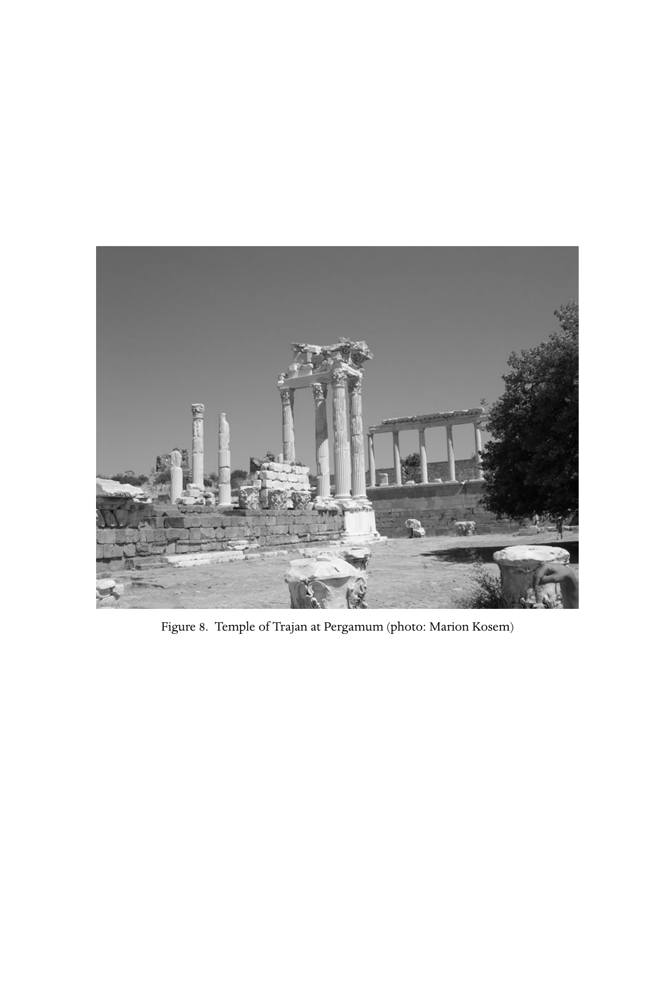

# 第二十八章 迫害：起源与遗产

**作者：W. H. C. 弗伦德（W. H. C. Frend）**

《剑桥基督教史》第一卷《起源至君士坦丁》中文译稿

> 原书第502–523页，PDF第551–572页，含章前图版。完整翻译正文与解释性脚注；参考文献作者名、题名和定位保留原文。
>
> [第二十八章英文原文](<第二十八章 迫害：起源与遗产（英文）.md>) · [原书PDF](<../01 起源至君士坦丁.pdf>)

*图8：别迦摩的图拉真神庙。照片：Marion Kosem。*

<!-- 原书第503–504页；PDF第552–553页 -->

从64年尼禄迫害，到君士坦丁约312年归信基督教，相隔约二百五十年。其间，基督教是非法且可疑的宗教，成员可能遭逮捕、定罪，许多人被处死。二世纪，迫害在行省总督权威下进行；三世纪，皇帝本人开始介入，直到瓦勒良（253–260年）治下，通过元老院颁布敕令，旨在压制教会敬拜，伤害其信徒。基督徒则预期与周围行省社会疏离，并遭迫害。当然，并非所有人都像304年卡塔尼亚执事欧普卢斯一样，主动求殉道；[^1]但从犹太教继承的义人受苦传统很强，又受到耶稣本人及以色列伟大先知之记载的强化。[^2]对后世不幸的是，迫害遗产并未随教会获宽容而消亡，只是转而针对异端与非信徒。

基督徒首次与罗马当局遭遇，既出于偶然，也灾难深重。路加《使徒行传》结束于62年；此前，与行省当局关系尚可容忍。[^3]到罗马时，保罗及追随者仍被视为犹太社群真正成员，尽管可疑且不受欢迎，参《使徒行传》28:22。接下来两年，这一关系看来不至改变。

然而64年7月19日，罗马爆发大火。[^4]狂风助长火势，三个完整城区被毁，数千人无家可归。反应类似前186年罗马面对酒神祭阴谋时的情形，李维曾详述此事。[^5]城市守护神受到冒犯，必须严厉赎罪。但嫌疑落到尼禄本人；他素以宏大计划闻名，人们相信其中包括按其帝都理想、重新规划罗马。随后，借用事后五十年、115年写作的塔西佗的话：“尼禄把罪责强加于一群因其可憎行为受憎恨、被称为基督徒的人，并施以最精心的酷刑。”[^6]

如李维叙述镇压酒神祭一样，“极多的人”被捕；“承认”的人——承认自己是基督徒吗？——被定罪处死，地点很可能在今梵蒂冈附近尼禄的竞技场。有些被钉十字架，有些粗劣扮演阿克泰翁的命运，被狗撕碎；妇女则扮作狄尔刻，绑在公牛角上，或扮作达那俄斯诸女，暴露竞技场，遭野兽袭击。[^7]这场清洗，以人祭的极端方式安抚诸神。

公众怜悯受害者，却没有为尼禄开脱：“看来，他们被毁灭并非为公共利益，而是为餍足一人残酷。”[^8]塔西佗同时代人苏埃托尼乌斯，讲火灾时未提基督徒，但在一份不必然不可靠的尼禄杂项作为清单中，说“基督徒受到惩罚，这类人信奉一种新奇〔即新颖或革命性〕而邪恶的迷信”。所用maleficus一词，有“巫术”或“黑巫术”意味。[^9]此后，基督徒便与纵火，以及借黑巫术追求革命目标相连；他们“敌视社会”，无权存在。[^10]64年事件及其回应，将被长期记住；德尔图良于197年，以institutum neronianum概括。[^11]

<!-- 原书第505–506页；PDF第554–555页 -->

迫害就这样起源。奇怪的是，64年灾难没有引发其他地方类似行动，尤其基督徒最强的小亚细亚诸行省。接下来三十年，他们确实“为这名受苦”（《彼得前书》4:12–16）；到世纪末，亚细亚行省强烈民间敌意开始显现，导致迫害和殉道（《启示录》6:9）。但直到多米提安统治（81–96年）近结束，没有更多有据可查的国家干预。

这位皇帝并非不成功的军人和行政者，却深受猜疑性格困扰，视哲学家为敌，晚年也把贵族成员当敌人。他期待人以“主人与神”称呼自己。[^12]另一方面，如前任维斯帕西安（69–79年），他设想一个以城市化、罗马化为特征的统一帝国，尤其在东方，通过罗马女神和皇帝崇拜巩固。[^13]塔西佗描述不列颠城镇兴建神庙与广场；[^14]在亚细亚，以弗所、老底嘉、士每拿与别迦摩，则以尊崇皇帝的神像、神庙为特色，亚细亚共同议会（koinon tēs Asias）在这些地方聚集，举行皇帝庆典竞技。[^15]

这种情况下，宗教不顺从不被容忍。犹太人每年向国库交两第纳里，即fiscus iudaicus犹太税，也许可获接受，但模仿他们的人不行。狄奥·卡西乌斯说，95年，皇帝堂亲弗拉维乌斯·克莱门斯，与其妻、皇帝侄女弗拉维娅·多米提拉，被控“无神论”（atheotai）；前者处死，后者流放潘达塔里亚岛。另有贵族被控“转向犹太习俗”，处罚是处死或没收财产。[^16]执政官阿基利乌斯·格拉布里奥还被控“图谋革新”（molitor rerum novarum）。[^17]

三世纪多米提拉墓窟归基督徒所有，这一事实不应被用作推论依据；[^18]但“无神论”确是156年士每拿指控基督教的词，后文将见。多米提安惩罚的贵族，看起来拒绝罗马诸神；又不是犹太人，因而把自己置于法律保护之外。德尔图良视其为尼禄之后的基督徒迫害者，[^19]不过这一事件是否构成迫害，仍可争论。

96年9月，多米提安被杀。继任者涅尔瓦（96–98年）当年发行货币，宣告fisci judaici calumnia sublata，即“废除犹太税的滥用”，也许是这些事件回响。德尔图良声称，流亡者获召回。[^20]此后，古典作家再次提到基督教，要到普林尼从比提尼亚—本都致图拉真皇帝（98–117年）的报告，很可能在111年。

<!-- 原书第506–507页；PDF第555–556页 -->

普林尼，全名C. Plinius Caecilius Secundus，生于意大利北部科莫（Comon／Como）的地方贵族家庭。[^21]通过叔父与弗拉维王朝政府相连，很有条件谋求元老院仕途。朋友运不错，使他晋升财务官，自动进入元老院。他熬过多米提安时期，100年、图拉真在位第三年担任执政官，获皇帝信任。约108年，比提尼亚—本都因严重腐败等原因陷入危机，他被任为legatus Augusti，即皇帝使节，全权恢复行省财政与行政。确切任期不明，可能早在109年到任、留至111年，而不是通常说的112–113年。似乎不久后去世，早于图拉真114年取得Optimus，即“至善者”称号。[^22]

其任务与基督教无关，包括整顿五座比提尼亚城市财政，限制滥用帝国邮驿，遏止建筑费用大幅超支，规管或更多时候解散未经批准的collegia，即行会、俱乐部，因为它们可能成为犯罪和叛乱中心。他禁止这些团体。[^23]直到巡视行省第二年，在本都东端阿米苏斯与阿马斯特里斯之间某处，他似才遇到基督徒。[^24]他们被以tanquam Christiani，即“作为基督徒”，带到他面前。公开承认基督教信仰属于非法，处罚是死刑。因此，尽管向皇帝写信时说，自己从未参与审查基督徒，也不知道通常归于他们的罪为何，他仍毫不犹豫，下令处死那些经过三次询问、仍坚持承认身份者。[^25]他不怀疑，因为无论如何，他们“固执、不可弯折的乖谬”也值得惩罚。正如舍温—怀特所坚持，这已成为将基督徒处死的额外理由；[^26]180年7月，斯基利认信者在迦太基面对资深执政官萨图尔尼努斯时，也将发现这一点。罗马公民则被普林尼送往罗马审判处罚。

随后出现复杂情况。一份匿名册子列出一些人，指控其为基督徒。作为诚实行政者，普林尼开始深入调查。否认自己曾为基督徒者，向诸神诵祷，“以酒和香祈求”，最后“诅咒基督”，便获释放。这鲜明说明，即使罗马社会高层，也把基督教信仰理解为具有邪恶巫术性质。

其余一些人称，三年前或更久，甚至二十年前，就已不再信。他们说明部分礼仪，[^27]可能包括诵十诫，以及圣餐后共同进爱筵，强调只是普通食物；可见基督徒被怀疑，为黑巫术吃可憎混合物，甚至食人。普林尼再从两位女仆，或女执事，取证后，断定基督教nihil aliud... quam superstitionem pravam et immodicam，即“无非……乖谬、过度的迷信”。如今神庙重新有人前往，“应给予悔改机会”。[^28]

<!-- 原书第507–508页；PDF第556–557页 -->

图拉真同意。他回复普林尼，几乎总简短切题，称赞使节作为，并指示：虽“不能制定一种普遍规则，仿佛固定程序”，却“不应主动搜捕”基督徒，也就是不把他们当普通罪犯、亵渎者或盗匪。但其宗教仍不合法，若被指控、定罪，就须惩罚；同时，应尽可能给予撤回信仰机会，撤回即可获赦。匿名指控应拒绝，因为“先例极坏，也不配我们的时代”。[^29]

这是基督徒与罗马当局关系的决定性时刻。通信在整个二世纪广为人知。这份批复，即含正式指令的信，被总督用于177年里昂被捕基督徒，[^30]约二十年后又被德尔图良引用、嘲讽。[^31]无论看起来多么混乱矛盾，图拉真答复都给当局提供指导，处理日益棘手的问题。

十年后，亚细亚一些城市显然发生反基督徒骚乱。约125年，皇帝哈德良（117–138年）向资深执政官盖乌斯·米努基乌斯·丰达努斯发批复，[^32]提及前任塞雷尼乌斯·格拉尼安努斯的报告，很可能请求指示如何面对民众攻击。哈德良允许正式提出指控，却重申前任对匿名和恶意告发的愤怒。因此，起诉基督徒更难；不过游斯丁把批复视为确保他们免于迫害，实不足据。[^33]

其意义还在于，行省民众正被激起反对基督徒。人们越来越觉得，基督徒宣讲的一神论与道德，同绝大多数同代人欣然接受的生活方式不相容。皇帝、伟大地方神明及无数附属神，共同照料公共福祉；中期柏拉图主义、斯多亚主义，提供的宗教哲学，胜过摩西或希伯来先知所传。那些先知竟赞美一名犹太人；此人在提比略统治时，作为叛乱者在巴勒斯坦被钉十字架。[^34]还要再过一世纪，基督徒才能反过来压倒对手。

<!-- 原书第508–510页；PDF第557–559页 -->

一段较长相对和平，到150年代结束。先知黑马约130年发出严峻警告，预言“为这名而有争斗、监禁、大患难、十字架和野兽”，此前未成现实。[^35]但156年2月22日，士每拿主教坡旅甲被民众怒潮带到资深执政官面前，控以“无神论”。官员劝他“顾惜年纪”“指着凯撒守护灵起誓”“谴责无神论者”，他一概拒绝，于是被判活活烧死。[^36]

此时，行省敌意正被整理为一系列致命指控。最早史料来自北非人弗龙托，可能出身努米底亚基尔塔，却在罗马以律师发迹，并受任为未来皇帝马尔库斯·奥勒留（161–180年）的教师。因此，其也许向元老院发表的演说，应在约150–155年。米努基乌斯·费利克斯《奥克塔维乌斯》，虽约八十年后编写，保存其一部分。弗龙托指控基督徒“神圣仪式比任何亵渎更污秽”；在大概属于爱筵的“宴会聚集”上，“有醉酒淫乱、乱伦，以及某些涉及拴住的狗的可怕仪式”。[^37]

二十年后，约176年，东方也流传类似指控。雅典纳哥拉向马尔库斯·奥勒留和康茂德写《为基督徒申辩》，请求宽容，回应的清单上除可恨的“无神论”，还增加更可怕的食人指控（Leg. 35）。[^38]177年里昂，暴民在把基督徒拖到总督前以前，也这样追逐、骚扰和指控他们。[^39]总督按图拉真裁定的精神，请示皇帝。马尔库斯·奥勒留决定，撤回信仰者释放，顽固者交付野兽，罗马公民斩首。[^40]叙述事件的书信说，民众欢欣；所谓怜悯，仅限于讥讽他们无谓浪费生命。[^41]基督徒自己却被描绘为得胜者，因为他们“甘愿而喜乐”赴死。[^42]

二世纪最后一个事件，鲜明说明冲突日益加深。此前由基督徒强调界线，如今罗马当局自己也开始意识到，两套信仰、祭仪和伦理之间，有无法调和的鸿沟。180年7月17日，一组来自大概靠近迦太基之斯基利城的北非人，被带到资深执政官萨图尔尼努斯面前。[^43]他开场说：“你们若恢复正确心态，就可配得我们主皇帝的宽赦。”即按图拉真裁定，撤回便释放。

斯基利人发言人斯佩拉图斯毫不妥协，回答他们受虐待时仍感恩，“因为我们尊崇自己的皇帝”。萨图尔尼努斯提醒：“我们也是虔敬的民族”，指着皇帝守护灵起誓，并劝他们照做。全无用处。斯佩拉图斯宣告：“我不承认这个世界的帝国，我服侍的，是无人看见过的那位上帝……”其obstinatio，即顽固，已无可改变。承认自己是基督徒、拒绝再给时间考虑后，斯基利人被判死刑。他们回应“感谢上帝”，“今天我们在天上成为殉道者”。北非基督教将在圣灵引导下，继续成为“殉道者的教会”。[^44]各行省认信者，也表现相同精神，相信殉道将使自己最终与主同在，并在审判日与他一同，使异教敌人付出代价。[^45]

二世纪后半，民众对基督徒的本能愤怒，产生了优西比乌记载的暴力、零星迫害。[^46]犹太人如今不再那么突出，不过此时柏拉图派批评者塞尔苏斯，仍视基督徒为犹太教叛教者。[^47]他也批评他们拒绝承担公共或军事服务责任，似乎希望殉道。但与此同时，基督教不断增强，也获得一定尊重。[^48]三世纪将展开一场较量：究竟不朽诸神，还是基督徒的上帝，照看帝国命运？

## 三世纪

<!-- 原书第511–512页；PDF第560–561页 -->

三世纪大部分时期，民间敌意继续是激起反基督徒迫害的主要因素之一，但皇帝和官员更加主动。此前，或许斯基利人一案除外，他们似乎只是被动接受民众要求毁灭基督徒；如今开始主动出击。

变化最早迹象，出现于202–206年。一份由据称为塞普提米乌斯·塞维鲁（193–211年）传记作者斯巴尔提安保存、断代202年的批复结尾，禁止归信犹太教或基督教；似没有理由怀疑其真实性。[^49]这是两种宗教最后一次被并列于同样恶名之下。主要受害者可能是基督徒。罗马、迦太基、亚历山大里亚基督教领袖似未遭事，新的基督徒却受惩罚，这些地方及哥林多出现丑恶场面。[^50]亚历山大里亚，奥利金父亲列奥尼德遇害。[^51]新归信者佩尔佩图娅、费利基塔斯及同伴，于203年3月在迦太基处死。

详细殉道记显示，归信可给迦太基一个显贵家庭造成何种损害，也再次呈现基督徒“不可弯折的乖谬”：轻蔑拒绝佩尔佩图娅父亲与财务代理官劝她撤回的请求。他们是狂热者，被带着绕迦太基竞技场行走时，威胁代理官将受永恒惩罚；他们临死，承受观众施虐取乐。[^52]

人们对基督教与基督徒毫不同情。德尔图良约197年写，迦太基民众的“本能狂怒”，是迫害主因。[^53]每种自然灾难，都归咎基督徒。他用一句为人熟记的话总结：

> 台伯河若涨到城墙，尼罗河若不涨到田地，天空若不动，或大地动了，若有饥荒，若有瘟疫，立即有人喊：“把基督徒喂狮子！”把所有人都喂一头狮子！[^54]

在非法指控之上，又增加公开反对“罗马诸神”及罗马国家。三世纪之交，基督徒被视为帝国及其价值的主要内部敌人。

然而，另一些因素正转而有利于新宗教。三世纪前半，基督教不能再与“煽动不满的社会下层”等同。奥利金约248年回答塞尔苏斯，描述越来越多受教育者归信：

> 由于入信人数众多，连富人、有尊位者，以及出身高贵、教养精致的妇女，也友好看待信徒；或许可以说，有些人成为基督教导领袖，是为了少许声望。[^55]

东西方、亚历山大里亚与北非，都发生这种变化。

社会组成变化，伴随更多自信。西方，德尔图良《护教书》及其他著作足以自证。“Fiunt non nascuntur Christiani”，即“基督徒是造就出来的，不是生来如此”，[^56]大概是真话。亚历山大里亚，革利免约190年《劝勉希腊人》，首次公开试图使受教育、说希腊语的公民归信。辩护不再只根据圣经证明经文，显示耶稣是弥赛亚，而论证基督教是真哲学。这是从二至三世纪护教的重要变化，很大程度对应教会成员组成之变。[^57]

从塞维鲁晚年，到亚历山大·塞维鲁235年3月被叛军杀死，近乎宽容的时期持续，也是基督教前进时期。德尔图良虽在此前若干年写作，却夸耀：

> 我们不过始于昨日，却已经充满你们的一切：城市、住宅、堡垒、城镇、交易场所，甚至军营、部族、宫廷、元老院与广场。[^58]

这是极大夸张，但杜拉—欧罗波斯家庭教会、最早罗马墓窟，以及皇帝内廷侍从普罗塞内斯[^59]和尤利乌斯·阿非利加努斯的经历，都见证教会力量与可见性增长。后者曾在塞维鲁军中任职，是已知最早基督教编年史家，也是亚历山大·塞维鲁朋友。[^60]

<!-- 原书第513–514页；PDF第562–563页 -->

取代亚历山大·塞维鲁的马克西米努斯（235–238年），粗豪的色雷斯军人，显然无暇容忍非法宗教，突然挑战这些繁荣迹象。第一次，一位皇帝以打击领袖为目标，主动对付基督徒。[^61]奥利金朋友安布罗修斯，也认为自己受威胁。但威胁迅速过去：238年，马克西米努斯被杀，随后十一年和平、发展。[^62]罗马新建墓窟，教会正成为庞大慈善组织，“多达一千五百名寡妇和穷人”由教会经费供养。[^63]

风暴却在聚集。248年，亚历山大里亚发生大规模反基督徒暴力；[^64]奥利金表明，东方人归咎基督徒，认为他们造成时代不稳。[^65]局势再次转动。多瑙河边境，帝国面对强大日耳曼部族联盟哥特人进攻。菲利普皇帝（244–249年）军事无能，249年9月，其军在维罗纳败给一位将领，他也丧命。胜者德修（249–251年），决心恢复帝国边疆与罗马传统价值，采用“图拉真”之名尊崇先帝，并发行一系列纪念许多前任神化（consecratio）的钱币，表明心意。

新皇帝大概出于同一精神，即位头几个月颁令，要求所有居民向诸神献祭、尝祭肉，并起誓已经献祭。[^66]250年1月3日，卡庇托年度祭祀，提供全帝国城市必须遵循的重要榜样。J. B. 里夫斯有力指出，敕令目的积极：

> 它在某种意义上，是卡拉卡拉公民权敕令的宗教对应物：后者以普遍、同质的公民身份，取代杂乱地方公民权；前者则把众多地方崇拜，集中成一个标志罗马帝国成员身份的宗教行为。[^67]

因此，德修敕令并非特别针对基督徒；但作为最主要不顺从者，他们尤其容易遭制裁，因为连“承认”罗马诸神也不愿。这种obstinatio解释了各共同体随后尖锐分裂。成员被迫选择服从皇帝，还是服从教会；新近信徒大增，其中许多只是名义基督徒，使困境加剧。

罗马主教法比安、安提阿主教巴比拉斯等显要人物，几乎立即被捕、审判、处决。[^68]居普良被公开通缉，3月前已离迦太基。[^69]3月12日，[^70]长老皮奥尼乌斯在士每拿处死。但程序拖延；埃及似到年中才实施献祭测试。现存四十四份证明，日期自6月12日至7月14日，精细公式说明场合庄重。[^71]

现有证据显示，皇帝政策立即成功。教会仍主要在城市，领袖为人熟知，却失去对局面的控制。迦太基大批背教，求献祭的人如此多，祭司恳求次日再来。[^72]坡旅甲的主教座士每拿，欧克特蒙主教欣然献祭，并劝别人也做。[^73]《皮奥尼乌斯殉道记》的戏剧性描述表明，尽管近两个世纪的传教，异教居民显然仍占上风，交替嘲笑皮奥尼乌斯与少数同伴，又恳求他别愚蠢舍命。劝说虽徒劳，教会遭受重击却明显；若迫害继续，恢复将缓慢艰难。

实际命运却眷顾基督徒。德修与儿子251年6月在对哥特人战斗中死去。短命皇帝加卢斯（251–253年）治下，又有两年压力，[^74]足以使暴民喊“把居普良喂狮子”，[^75]并使教宗科尔内利乌斯253年死于琴图姆凯莱流放地。但同年夏，加卢斯被除，德修朋友瓦勒良（253–260年）登位，局势部分稳定。

<!-- 原书第515–516页；PDF第564–565页 -->

新皇帝最初据称对基督徒“格外友好”。[^76]证据显示，罗马、迦太基和亚历山大里亚三大中心迅速恢复。迦太基居普良251年初已回城，迅速处理大批希望回归的失足者，并确立主教权威，反对认信者声称，作为“基督朋友”，有权赦罪的是他们，而非主教。[^77]不过，他的胜利短暂。[^78]

导致他被处死的迫害，与德修不同。前者未试图没收教会财产，如今这将是首要目的。优西比乌[^79]引用狄奥尼修主教致同僚赫拉蒙的信，说埃及麻烦始于“埃及术士会堂”与基督徒之间的嫉妒。基督徒指控术士举行杀婴等可怕仪式，就像本世纪早先自己曾被指控。不幸的是，“会堂主管”马克里安努斯，曾掌帝国财政，虽已卸任仍有权势，怀有夺取帝位之志。文本此处有较长缺口，但他似说服瓦勒良：波斯入侵威胁帝国之时，基督徒构成危险。

迫害旨在从经济与社会上摧毁教会，没收不小的财产，阻止领袖履职。第一项目的可理解，因为数年内，通用安东尼尼安努斯币将灾难性贬值。另又禁止基督教礼拜，没收敬拜场所。新策略有充分理由：过去三十年，罗马教会社会组成已变，不再只是“人口渣滓”，其中有matronae，即贵族或近贵族妇女，以及有影响的Caesariani，即皇帝释奴。墓窟常为罗马大宅依附者的葬地，也转入基督徒手中，卡勒波狄乌斯与多米提拉就是主要例子。当局面临艰巨任务。

皇帝与元老院于257年7月、258年8月，颁两道敕令，摧毁教会力量，强调其非法。第一道通常涉及流放或判矿役，[^80]第二道则处死。当局此时不怀疑，基督教是公开敌视国家的宗教。258年9月14日，居普良因第一道令在库鲁比斯舒适流放后，[^81]被带到患病的非洲资深执政官加勒里乌斯·马克西穆斯面前，控以“长期过不敬神生活，聚集一批以非法社团相连者，自称是罗马诸神及宗教的公开敌人”。[^82]他拒绝“遵循罗马仪式”，当日处死。迫害根据再清楚不过：180年7月斯基利人所认信、德尔图良所宣告的，确实如此——基督教无法与罗马诸神宗教调和。究竟它们，还是基督，守护帝国？

亚历山大里亚狄奥尼修，历任两次迫害的主教、亲眼见证者，也面对同一冲突，却未同样悲惨。优西比乌保存他受副总督埃米利安审问的记述。[^83]先禁止基督教礼拜后，埃米利安与主教及其祭司同伴，作相当文明的讨论。但狄奥尼修拒绝敬拜“保护帝国的诸神”，拒绝“忘记那些违反自然的神”时，便被放逐利比亚绿洲凯弗罗。他一如其惯，在那里建立大教会，成为埃及基督徒敬拜中心。罗马，教宗西克斯图斯二世与四位执事，于258年8月6日在墓地遇害，很可能是卡利斯图斯墓窟。

<!-- 原书第516–517页；PDF第565–566页 -->

迫害也许西方比东方更严重，[^84]却因260年6月瓦勒良在埃德萨附近与波斯作战被俘、丧命而截断。儿子加里恩成为唯一统治者（260–268年），迅速“通过法令〔dia programmatōn〕”终止迫害。[^85]一份致埃及诸主教的法令存世，归还“他们的敬拜场所”，并命“任何人不得骚扰他们”。[^86]罗马基督徒没有等待：瓦勒良被俘消息一到，就选出新主教狄奥尼修（260–269年）。[^87]

这种有活力、自信的回应，并不只在罗马。接下来四十三年，教会享和平。虽偶有孤立迫害，“各处教会都平安”。[^88]史家虽缺乏像居普良书信那样紧密记录，文学与物质证据却共同显示，基督教在全帝国进展到一定程度，最终挫败戴克里先以303–312年大迫害摧毁它的希望。

罗马墓窟讲述了这一故事。到300年，“两株月桂”（Aux deux lauriers）墓窟两公里范围，有一万一千座墓，大多葬于此前五十年。[^89]马克西穆斯、潘菲利乌斯、特拉松等墓窟新建。诺瓦提安，约卒258年，其墓窟出土266、270年铭文。[^90]这一时期，教宗狄奥尼修为辖下墓地定规；似乎世纪末，每个titulus，即堂区，都有自己墓地。

其他遗址，尤其小亚细亚，也提供增长证据。尼科米底亚是戴克里先首都，到300年，一座宏伟教堂立于皇宫清楚可见处。311年马克西米努斯入城，发现“几乎所有居民都是基督徒”。[^91]弗里吉亚奥尔基斯图斯、欧梅内亚等城，基督教很强；大迫害中，行省一座未具名城镇的全部居民遭屠杀。[^92]努米底亚基尔塔，显示民众态度转变：259年，认信者马里安努斯与雅各被追逼到长官前；[^93]五十年后，漂洗工维克托却愿付二十folles币，成为长老。[^94]

<!-- 原书第518–519页；PDF第567–568页 -->

整个帝国，包括欧洲西北凯尔特地区，基督教都在前进；但任何想迫害者真正面对的难题，是它进入乡村。原因远不清楚，地中海南岸各行省中，守护居民数千年的传统神明，失去青睐与支持。努米底亚原崇萨图尔努斯，即巴力·哈蒙，最后可断代的尊神铭文是272年；[^95]昔兰尼加，287年后没有阿波罗奉献铭文；[^96]埃及，最后已知圣书体铭文为250年，[^97]270年以后，科普特人转向修道生活这种替代宗教形式。到300年，无论城市乡村，迫害再不能指望舆论全心支持。

此时，基督教成为戴克里先（284–305年）统一帝国政策最后障碍：他以拉丁语、罗马诸神，尤其朱庇特与赫拉克勒斯，为统一行政之庇护和指引。286年，帝权分为二帝共治，他以马克西米安为同僚，负责西方；293年，各自任一副手或凯撒，东方加勒里乌斯，西方君士坦提乌斯。但诸神智慧寄于戴克里先本人，即关联朱庇特的providentia，神圣眷顾；马克西米安则关联赫拉克勒斯，代表英雄精力与自愿服从结合。

四帝共治确立后，又有促进统一一致的措施。传统城市铸币厂，包括亚历山大里亚，被撤销；295–296年，铸造统一货币，最常见单位follis背面，题“献给罗马人民守护灵”（genio populi Romani）。[^98]行省行政也重组；[^99]301年《限价敕令》，试图在全帝国对大量商品实行统一估价。[^100]一致就是准则。如德修时代，基督徒被视为最严重的不顺从者。

冲突来临已有充分预警。290–300年，推罗波菲利十五卷《反基督徒》（Kata Christianōn），代表一场有力宣传战。[^101]但大迫害起点，却是298年安提阿一桩小事：为庆祝波斯战争成功结束而向诸神献祭时，祭牲没有内脏，基督徒受到归咎，皇帝下令将其逐出军队与文职。[^102]此后，优西比乌记载，“对我们的迫害逐渐开始”。[^103]

皇帝对非洲资深执政官所发反摩尼教敕令，已预示态度。[^104]诸神使罗马伟大，革新可能给帝国带来神怒；生活各方面都须遵守disciplina，即规训。摩尼教书应没收，信徒烧死。到对付基督徒之时，已有榜样。

302年末，时刻来到。人们仍极信神谕权威；戴克里先与加勒里乌斯到米利都附近狄迪玛求阿波罗神谕，却发现言辞混乱，受基督教影响而失去力量。[^105]他们由此下定决心，打击基督徒对诸神的挑战。选定日期2月23日，是界神节（Terminalia），将标志敌对宗教的终结。

优西比乌找不出迫害的合理原因。[^106]303年2月23日，戴克里先颁令，基督徒须交出经书，否则监禁；教堂须毁，基督徒不得在法庭起诉。上层基督徒，即honestiores，将失去社会地位；皇帝释奴Caesariani，如瓦勒良时代，降为奴隶；基督徒奴隶不得获释。但据当时在尼科米底亚的拉克坦提乌斯，戴克里先反对流血，[^107]不要产生殉道者，也尚未命普遍献祭。[^108]后者留到次年春第四道迫害敕令，由其凯撒加勒里乌斯推动。

<!-- 原书第520–521页；PDF第569–570页 -->

期间，第二、第三道令已颁布：第二道命监禁教士；第三道配合303年夏在罗马庆祝戴克里先即位二十周年（vicennalia），释放愿献祭者，不愿者则以强力摧折其意志。[^109]起初，当局似乎进展顺利。优西比乌指出，[^110]最初措施只针对主教和教士。北非，我们听见主教背教，如阿比提纳的雷波斯图斯；搪塞，如基尔塔保罗；或如迦太基首席主教门苏里乌斯，交出异端——摩尼教？——或伪作书卷。拜扎凯纳阿普通吉等城，主教与地方市议会领袖关系友好。但304年春第四道令，要求人人普遍献祭，改变局面，带来最终被证明是新旧之间的决战。

北非、埃及，其后巴勒斯坦，遭受最残暴迫害。北非平信徒愿意挑战当局，追求殉道。最著名的克里斯皮娜，是突尼斯西部塔戈拉的上层妇女，被带到特维斯特，面对资深执政官安尼乌斯·阿努利努斯。对方虽不失礼貌，反复论证，她仍坚持信仰，拒绝向诸神献祭，304年12月22日，与五位支持者一同斩首。[^111]其葬地，整个四世纪都是朝圣中心。

迦太基，有四十八名基督徒，在主教背教后于阿比提纳举行礼仪，被捕监禁；他们不但面对当局敌意，也面对迦太基教士敌意。他们于304年2月在狱中开会，决定，凡与当局合作者，都不能与神圣殉道者和平相交，也不能同享乐园喜乐。[^112]这一步，对北非未来极重要。大公教会愿不挑衅当局，对手则视殉道为最高基督徒之善；两者之间的分裂，可以说由此开始。[^113]

巴勒斯坦，优西比乌《巴勒斯坦殉道者》记录四十七次处决，多因挑衅当局。但多数不屈基督徒，被送到埃及矿场。311年，优西比乌在上埃及亲见迫害最恐怖景象。他描述底比斯地区基督徒遭遇多种骇人酷刑后，继续说：

> 我们自己身处这些地方，亲眼看见，同一天许多人一起受刑，有些斩首，有些火烧；以至杀人的斧头钝了、磨损、碎裂，刽子手也极度疲惫，必须轮换接替。

然而，主动求殉道者从未断绝，“喜乐地”领受最后判决。[^114]

马克西米努斯精力充沛，命东方城市按等级体系改革异教崇拜，散布《彼拉多与救主回忆录》等反基督教宣传；加勒里乌斯311年5月5日死后，他接管小亚细亚诸行省，鼓励行省和市议会请求，把“无神论者”赶出边界。吕基亚—旁非利亚科尔巴萨的一方铭文，记录皇帝祝贺该城“脱离盲目、迷误之路，恢复正确而良好的心态”。[^115]

但此时，异教士气正崩溃。太多人自问，基督徒为何如此恨诸神，宁死不拜？[^116]西方迫害，已随戴克里先与马克西米安305年5月1日退位结束。加勒里乌斯311年4月30日发布改变立场的敕令，承认旨在使基督徒回归罗马宗教的措施不成功，现准“基督徒可以重新存在”。[^117]这决定诸神不再独为帝国保护者的命运。君士坦丁从所见得到启发。

<!-- 原书第522页；PDF第571页 -->

312年10月28日，他在罗马城外米尔维安桥，战胜西方篡位者马克森提乌斯，使大迫害走向结束；313年2月与同僚李锡尼米兰会面，最终完成。戴克里先第一道令颁布不到十年，基督教已成为帝国偏爱的宗教。

迫害遗产是什么？戴克里先竭力使基督徒至少承认不朽诸神，却失败了；结果也并非全有利于基督徒。死者最多的埃及与北非，合作者与求殉道者的分歧，像第二次世界大战结束时合作者与抵抗运动之间一样深。埃及，唯有亚历山大里亚主教彼得311年11月25日殉道，才阻止吕科波利斯主教梅利提乌斯发起的分裂，取得多数基督徒支持。即便如此，梅利提乌斯及强硬支持者，继续使亚历山大和亚他那修主教难堪，直到世纪中叶；325年尼西亚会议后的一代人中，他们还影响阿里乌争议发展。[^118]

北非事态更严重。阿比提纳囚犯的命运未知，虽然可以推测殉道。还有另一项记忆：总执事凯基利安强力阻止食物送进牢中。311年门苏里乌斯主教死后，凯基利安被选为迦太基主教，立即引发敌意。居普良死后某时，努米底亚主教取得协助祝圣迦太基新主教的权利，说明教会在努米底亚力量增长。这次，他们却来晚了。

率七十位主教前来的首席主教、提吉西斯的塞孔杜斯，因受挫加入迦太基反对派；七十是承自犹太公会人数的形式性数字。他指控凯基利安由一位traditor，即交出经书者的主教祝圣，很可能指门苏里乌斯代理人、拜扎凯纳阿布通吉的费利克斯。随后召集会议，迅速罢免凯基利安。分裂爆发。这就是君士坦丁312年10月29日进入罗马时面对的情况。皇帝轻率决定凯基利安是真正主教，威胁惩罚对手；国家介入，镇压异议者。

<!-- 原书第522–523页；PDF第571–572页 -->

到313年夏，后者找到能干领袖，多纳徒，他是努米底亚草原边缘卡赛·尼格莱共同体的主教。尽管先后遭罗马主教米尔提亚德、314年8月阿尔勒会议，以及316年11月皇帝本人谴责，多纳徒教会仍存续，自称殉道者的教会，并在整个四世纪支配北非基督教。[^119]

多纳徒教会，是大迫害在西方最主要的遗产；只要存在，就维持殉道传统、教会排他性，以及政教彻底分离的信念。最后一项，将在欧洲中世纪持续成为西方神学特色。

其余教会，东西方皆然，与殉道相关的德性，转与修道生活相认同。修士承接许多殉道者角色。迫害在教会史留下印记，但其遗产并非人们也许期待的宗教自由。古老既定宗教维护诸守护神，照看罗马帝国及行省百姓；它让位给唯一上帝的守护，而这位上帝要求越来越严格，要求人完整、毫无保留地委身神圣教义。异议者感受国家以其名施行的神怒力量。一种迫害让位给另一种，这遗产一直延续到我们今日。

## 译校说明

- 本章对基督教法律地位、迫害动机、主动殉道及政教关系的概括，均为作者的历史解释，未改写为无争议定论。
- 原书第518页称埃及最后已知圣书体铭文为250年；第519页写298年祭牲“没有内脏”；第516页把瓦勒良在260年被俘与死亡相连；第520页将克里斯皮娜之死系于304年12月22日。上述疑似年代或表述问题均按原文保留。
- 凡“今日”“现有证据”“最后已知”等，沿用原书2006年的写作语境。文中将迫害后的分裂比作第二次世界大战后冲突，以及结尾对迫害遗产的评价，同样保留作者论断。

## 脚注

[^1]: Acta Eupli i，即Musurillo第25篇，210–211页。

[^2]: 例如《希伯来书》11:37。

[^3]: Suet. Claud. 25.4记载，49年犹太人因“受克瑞斯图斯煽动的骚乱”被逐罗马，可能指对基督徒的行动。亚居拉、百基拉因此迁出（《使徒行传》18:2）。不过，克劳狄时代的宽容，见《使徒行传》18:12–17，哥林多的迦流。

[^4]: 塔西佗记述火灾及对基督徒后果的英译与注释，见Stevenson and Frend, New Eusebius, 2–3；原文Tac. Ann. 15.44.2–8。

[^5]: Livy 39.8.

[^6]: Ann. 15.44.3.

[^7]: 达那俄斯诸女与狄尔刻，见1 Clem. 6.2。亦见Coleman, ‘Fatal charades’, 44–7；参65页。

[^8]: Tac. Ann. 15.44.8.

[^9]: Suet. Nero 16.2。他指尼禄纵火（38.2）。二世纪视耶稣本人为术士，见塞尔苏斯，载Or. C. Cels. 1.6。

[^10]: Odium generis humani，Tac. Ann. 15.44.6；同一指控也用于犹太人，见Tac. Hist. 5.5.1。

[^11]: Tert. Nat. 1.7.9；参Apol. 5.3。institutum并非法律，而是惯例。

[^12]: Suet. Dom. 13.2.

[^13]: 见上文第一部分第3章。

[^14]: Tac. Agr. 21；参Suet. Tit. 4。

[^15]: 见Charlesworth, ‘Flavian dynasty’, 39–40及脚注。

[^16]: Dio Cassius 67.14.2；Suet. Dom. 15。事件叙述见Streeter, ‘Rise of Christianity’, 254–5。

[^17]: Suet. Dom. 10.

[^18]: Lampe, Paul to Valentinus, 206.

[^19]: Tert. Apol. 5.13–14.

[^20]: 同上。

[^21]: 普林尼家世及官职生涯，见Sherwin-White, Letters of Pliny, 69–82。

[^22]: Sherwin-White, Letters of Pliny, 81–2.

[^23]: 普林尼致图拉真，Ep. 10.33，以及图拉真毫不妥协的回复，Ep. 10.34，涉及普林尼推荐的尼科米底亚消防员团体；见Sherwin-White, Letters of Pliny, 606–10。

[^24]: 普林尼致图拉真，Ep. 10.96。附注英译见Stevenson and Frend, New Eusebius, 18–20。小亚细亚基督教传播，见上文第四部分第17章。

[^25]: Sherwin-White, Letters of Pliny, 693–700。亦见de Ste Croix, ‘Why were the early Christians persecuted?’。

[^26]: Sherwin-White, Letters of Pliny, 599.

[^27]: Sherwin-White, Letters of Pliny, 700–9。关于当时基督教礼仪，仍有用的讨论见Lietzmann, Messe und Herrenmahl, 257–60。

[^28]: 即普林尼把基督教简单理解为有害的外国崇拜。见Wilken, Christians as the Romans saw them, 21–5。

[^29]: Pliny, Ep. 10.97；Sherwin-White, Letters of Pliny, 710–12。图拉真只坚持，基督徒须“敬拜我们的诸神”，显然未要求“诅咒基督”。

[^30]: Euseb. HE 5.1.

[^31]: Tert. Apol. 2.6–9.

[^32]: 文本见Stevenson and Frend, New Eusebius，第18项，21–22页。

[^33]: 1 Apol. 68.6–10.

[^34]: 受教育行省居民，尤其东方居民可选择的各类哲学，见Hunt, Christianity in the second century, 74–98；Dodds, Pagan and Christian in the age of anxiety，第2–3章。

[^35]: Herm. Vis. 3.2.1；参Herm. Sim. 8.3.7。黑马强烈反罗马观，见Frend, Martyrdom and persecution, 193–5。

[^36]: 依据Mart. Polyc.，士每拿教会致弗里吉亚菲洛梅利翁教会、叙述坡旅甲殉道的长信；优西比乌HE 4.15大段引用。值得注意的是，从约107年安提阿伊格纳提乌殉道，到自己被捕，坡旅甲一直作为基督徒之“父”，未受骚扰。

[^37]: Min. Fel. Oct. 8.9。如普林尼审查一样，弗龙托的怀疑集中于爱筵及相关流言。

[^38]: 雅典纳哥拉论证，若基督徒无神，柏拉图也无神，并强调基督徒忠于帝国及统治者（Leg. 6.2）。

[^39]: Euseb. HE 5.1.14；见上文第四部分第20章。

[^40]: Euseb. HE 5.1.47.

[^41]: Euseb. HE 5.1.66：“他们的神在哪里？那种被他们看得比生命还重的敬拜，对他们有什么用？”

[^42]: Euseb. HE 5.1.63；参5.1.55。

[^43]: 文本与英译见Musurillo, 86–9。

[^44]: 见上文第四部分第21章。

[^45]: 参Tert. Spect.第30章；见Frend, Martyrdom and persecution, 368–9。

[^46]: Euseb. HE 5.1.

[^47]: Or. C. Cels. 2.4；亦参4.18。

[^48]: 例如Wilken, Christians as the Romans saw them, 68–93。

[^49]: Sept. Sever. 17.1.

[^50]: 亚历山大里亚见Euseb. HE 6.3.3，“阿奎拉治下”，202年初。哥林多一位“亵渎时代与皇帝、诋毁偶像的高贵基督徒妇女”之命运，载Pall. H. Laus. 65。亦见Frend, Martyrdom and persecution, 321–4；参Barnes, ‘Legislation’。

[^51]: Euseb. HE 6.2.12，很可能202年，“他〔奥利金〕还不到十七岁”。

[^52]: M. Perp. 18.

[^53]: Apol. 37.2.

[^54]: Apol. 41.1.

[^55]: C. Cels. 3.9.

[^56]: Apol. 18.4.

[^57]: 见上文第三部分第11章及第五部分第27章。

[^58]: Nat. 1.14，约197年写；比较212年类似陈述，Tert. Scap. 2。

[^59]: 普罗塞内斯，见McKechnie, ‘Grave inscriptions’。

[^60]: 尤利乌斯·阿非利加努斯，见Euseb. HE 3.2及6.31；Simonetti, ‘Julius Africanus’。

[^61]: Euseb. HE 6.28.

[^62]: Euseb. HE 6.36.

[^63]: Euseb. HE 6.43.11.

[^64]: Euseb. HE 6.1–7.

[^65]: C. Cels. 3.15.

[^66]: 见Rives, ‘Decree of Decius’, 135。

[^67]: Rives, ‘Decree of Decius’, 153.

[^68]: Cypr. Ep. 55.9，法比安；Euseb. HE 6.39.4，巴比拉斯。

[^69]: Cypr. Ep. 66.4.1. Rives, ‘Decree of Decius’, 141.

[^70]: M. Pion. 23.

[^71]: 见Knipfing, ‘Libelli of the Decian persecution’, 363及以下。完整名单见Selinger, Mid-third century persecutions, 137–55。

[^72]: Cypr. Laps. 8.

[^73]: M. Pion. 15。皮奥尼乌斯殉道前事件的精彩素描，见Lane Fox, Pagans and Christians, 460–92。

[^74]: 见Frend, Martyrdom and persecution, 411–12。253年混乱事件，见Alföldi, ‘Age of Decius’, 168–9。

[^75]: Cypr. Ep. 59.8。德修治下殉道人数，见Frend, Martyrdom and persecution, 413。

[^76]: 亚历山大里亚狄奥尼修，优西比乌引于HE 7.10.3。

[^77]: Cypr. Ep. 23，认信者卢基安向居普良的陈述。此前世纪，里昂认信者曾毫不迟疑，自认有“捆绑与释放”之权（Euseb. HE 5.2.5）。

[^78]: 见上文第五部分第26章。

[^79]: HE 7.10.4.

[^80]: 见Cypr. Ep. 76–9；Davies, ‘Condemnation’。

[^81]: 圣居普良Acta proconsularia 1，CSEL 3.3, x–xiv页；英译见Stevenson and Frend, New Eusebius，第222项，247–249页。

[^82]: Acta proconsularia 3–4 (CSEL 3.3, pp. xii–xiii).

[^83]: HE 7.11.3–11.

[^84]: Frend, Martyrdom and persecution, 427–8.

[^85]: Euseb. HE 7.13.1.

[^86]: Euseb. H.E. 7.13.

[^87]: 早于260年7月20日。见Marichal, ‘Date des graffiti’, 119。

[^88]: Euseb. H.E. 7.15.

[^89]: Guyon, Cimitière, 101.

[^90]: 见Stevenson, Catacombs, 33–4；“墓窟的大规模发展”见250–300页。

[^91]: Euseb. HE 9.9.5.

[^92]: Euseb. HE 8.11.

[^93]: M. Mar. 1、2、5，“异教徒盲目的疯狂”，以及“盲目嗜血的总督引起迫害”。此篇受难记如此强调反异教，属于例外。

[^94]: Optatus, De schismate Donatistarum；见Optatus, Against the Donatists，Edwards编译，附录194页上部。

[^95]: 来自诺瓦尔，即Sillegue，CIL 8.20435。见Frend, Donatist church, 83–4。突尼斯西部贝贾附近神庙遗址发现一项较晚奉献，年代为323年11月，但奉献者的三名制，Marcus Gargilius Zabo，暗示到四世纪初，这崇拜已趋贵族化而非民众化，尽管似也有祭司等级。见Beschaouch, ‘Une stèle consacrée à Saturne’, 258–9。

[^96]: Roques, Synésios de Cyrene, 318.

[^97]: Geffcken, Der Ausgang des griechisch-römischen Heidentums, 25.

[^98]: 戴克里先货币改革讨论，见Mattingly, ‘Quattuor principes’, 337–8。

[^99]: 见Ensslin, ‘Development of paganism’。

[^100]: Lactant. Mort. 7.6–7。东方四十多处遗址发现铭文残片，至本书写作时，西方尚未发现。其目的相对有限，见Barnes, Constantine and Eusebius, 11。

[^101]: 见Frend, ‘Prelude’。

[^102]: Lactant. Mort. 10；参Div. inst. 4.27。

[^103]: Chron.，301年条。

[^104]: 戴克里先反摩尼教敕令英译，见Stevenson and Frend, New Eusebius，第236项，267–268页；年代约297年，另有人定为302年3月31日。

[^105]: Lactant. Div. inst. 11; Euseb. V.C. 2.50.

[^106]: Euseb. HE 8.1.1–6，转而强调教会极其繁荣，似享皇帝宠信。

[^107]: Mort. 10；见Moreau注释，SC, vol. ii, 264。

[^108]: Mort. 11；参Moreau注释，SC, vol. ii, 273。皇宫火灾据称由加勒里乌斯引发，随后致命报复见Mort. 14。

[^109]: Lactant. Div. inst. 5.9及11，亲眼记述比提尼亚所见。

[^110]: Mart. Pal. 3.1.

[^111]: M. Crisp.。这一时期殉道记，突出行政者相对耐心，与认信者顽固热忱的对比。

[^112]: M. Saturn. 18 (PL 8, col. 701 B).

[^113]: 见上文第四部分第21章。

[^114]: HE 8.9.4–5.

[^115]: 见Mitchell, ‘Maximinus’。阿里坎达铭文CIL 3.12132英译，见Stevenson and Frend, New Eusebius，第247项，281页。

[^116]: Lactant. Div. inst. 5.23.

[^117]: Lactant. Mort. 34；英译见Stevenson and Frend, New Eusebius，第246项，280–281页。

[^118]: 见下文第31章。

[^119]: Euseb. HE 7.30.19。多纳徒派分裂起源，见Frend, Donatist church，第1章。
