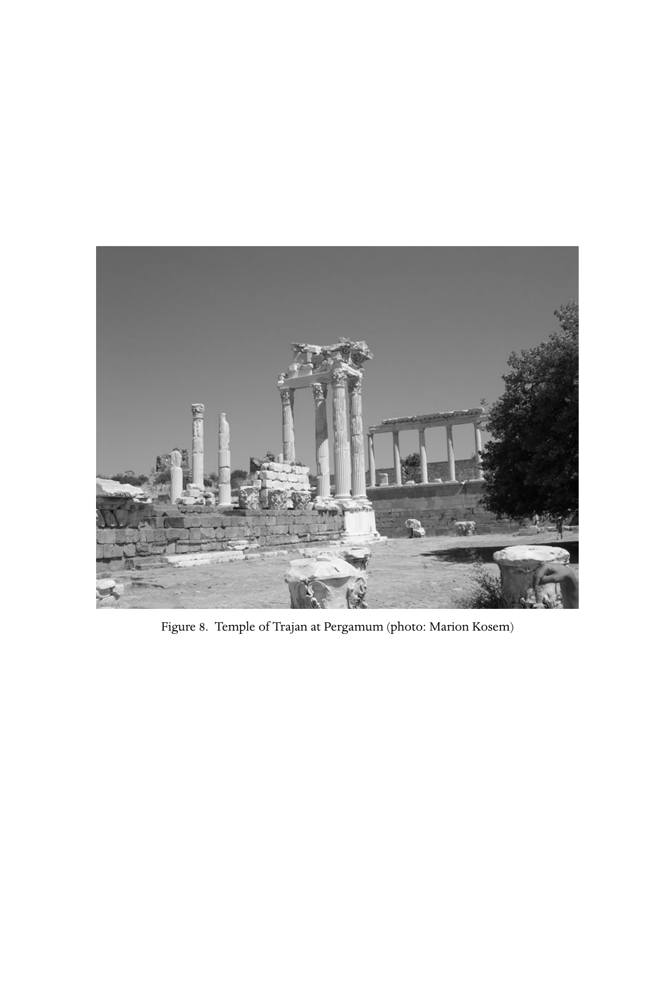

# 第二十八章英文原文：Persecutions: genesis and legacy

<!-- PDF page 551; original page 502 -->

Figure 8. Temple of Trajan at Pergamum (photo: Marion Kosem)

<!-- PDF page 552; original page 503 -->

### 28. Persecutions: genesis and legacy

#### w. h. c. frend

In the 250 years that separate the Neronian persecution in 64 ce from the conversion of Constantine to Christianity, c.312, Christianity was an illegal and suspect religion whose members were subject to arrest, condemnation and, in many cases, death. In the second century, acts of persecution would be carried out on the authority of provincial governors, but, in the third century, the emperors themselves began to become involved until under Valerian (253–60) edicts were promulgated through the senate that were aimed at suppressing the worship of the church and inflicting damage on its adherents. For their part, the Christians expected alienation from surrounding provincial society and subjection to persecution. Not all, however, were, like the deacon Euplus in Catania in 304, volunteer martyrs,[^p552-1] but the tradition of righteous suffering, inherited from Judaism, was strong and was reinforced by the recorded example of Jesus himself, as well as the great prophets of Israel.[^p552-2] Unfortunately for future history, the legacy of persecution, now aimed against heretics and non-believers, was not to die with the grant of toleration to the church.

The first encounter between the Christians and the Roman authorities was both fortuitous and disastrous. Up to the point at which Luke ends the Acts of the Apostles in 62 ce, relations with the provincial authorities had been tolerable.[^p552-3] On arrival in Rome, Paul and his followers were still considered to be authentic, if suspect and unpopular, members of the Jewish community (cf. Acts 28:22). This relationship appeared unlikely to change in the next two years. On 19 July 64, however, a massive fire broke out in Rome.[^p552-4] Fanned by the high

[^p552-1]: Acta Eupli i ( = no. 25 in Musurillo, 210–11).

[^p552-2]: See e.g. Heb 11:37.

[^p552-3]: It is possible that Suet. Claud. 25.4, recording the expulsion of the Jews from Rome in 49 ce because of ‘disturbances at the instigation of Chrestus’, may refer to action against the Christians. Aquila and Priscilla moved from Rome as a result of this edict (Acts 18:2). For tolerance of the Claudian age, however, see Acts 18:12–17 (Gallio at Corinth).

[^p552-4]: See Stevenson and Frend, New Eusebius, 2–3, for a translation and notes on Tacitus’ account of the fire and its consequences for the Christians (Tac. Ann. 15.44.2–8).

<!-- PDF page 553; original page 504 -->
wind, the conflagration destroyed three entire quarters of the city. Thousands were made homeless. The reaction was similar to that experienced when Rome confronted the Bacchanal conspiracy in 186 bce, recorded in detail by Livy.[^p552-5] The guardian gods of the city had been violated. Expiation must be severe. But suspicion fell on Nero himself, well known for his grandiose schemes which it was believed included the replanning of Rome on a scale he considered fitting for an imperial city. Then, to quote Tacitus (writing, however, fifty years after the event, in 115), ‘Nero fastened the guilt and inflicted the most exquisite tortures on a class hated for their abominations called Christians.’[^p552-6] As with Livy’s account of the suppression of the Bacchanals, ‘an immense number’ were arrested, and those ‘who confessed’ (to being Christians?) were condemned and put to death, probably in Nero’s amphitheatre near what is now the Vatican. Some were crucified, others done to death in a crude parody of the fate of Actaeon, torn to pieces by dogs, or, in the case of the women, impersonating the Dirce, fastened to the horns of bulls, or the Danaids, exposed in the arena to attacks by wild beasts.[^p552-7] This purge was to appease the gods by the extreme method of human sacrifice.

The public pitied the victims and did not exonerate Nero. ‘It was not as it seemed for the public good but to glut one man’s cruelty that they were being destroyed.’[^p552-8] Tacitus’ contemporary, Suetonius, does not mention Christians in connection with the fire, but a list of miscellaneous acts of Nero, not necessarily unreliable, states that ‘punishment was inflicted on the Christians, a class of men given to a new (i.e. novel or revolutionary) and wicked superstition.’ The word used, maleficus, has the connotation of ‘magic’ or ‘black magic’.[^p552-9] Henceforth, therefore, the Christians were associated with arson and revolutionary aims pursued through the agency of black magic. They were ‘hostile to society’ and had no right to exist.[^p552-10] The events of 64 and actions taken in response to them, summed up by Tertullian in 197 in the words institutum neronianum, were to be long remembered.[^p552-11]

Such was the genesis of the persecutions. Curiously, the disaster of 64 was not followed by similar actions elsewhere, especially in the provinces of Asia

[^p552-5]: Livy 39.8.

[^p552-6]: Ann. 15.44.3.

[^p552-7]: The reference to Danaids and Dirce is given in 1 Clem. 6.2. See also Coleman, ‘Fatal charades’, 44–7; cf. 65.

[^p552-8]: Tac. Ann. 15.44.8.

[^p552-9]: Suet. Nero 16.2. He blames Nero for starting the fire (38.2). For Jesus himself, regarded as a magician in the second century, see Celsus as cited by Or. C. Cels. 1.6.

[^p552-10]: Odium generis humani (Tac. Ann. 15.44.6), a charge also levelled against the Jews (see Tac. Hist. 5.5.1).

[^p552-11]: Tert. Nat. 1.7.9 (cf. Apol. 5.3). The institutum was not a law, but what was customary.

<!-- PDF page 554; original page 505 -->
Minor where the Christians were strongest. For the next thirty years we gather that they did ‘suffer for the name’ (1 Pet 4:12–16) and, by the end of the century, intense popular ill feeling in the province of Asia was manifesting itself towards them, which resulted in persecution and martyrdom (Rev 6:9), but there was no further documented state intervention against Christians until near the end of the reign of Domitian (81–96 ce).

This emperor was a not unsuccessful soldier and administrator, but was cursed by a deeply suspicious nature that saw philosophers and, towards the end of his reign, members of the aristocracy as his enemies. ‘Master and god’[^p552-12] were the titles by which he expected to be known. On the other hand, like Vespasian (69–79 ce) before him, he had a vision of the unity of the empire chacterised by urbanisation and romanisation, and consolidated, especially in the eastern provinces, through the cult of Roma and the emperor.[^p552-13] While Tacitus describes how temples and fora were being built in the towns of Britain,[^p552-14] in the provinces of Asia, statues and temples in honour of the emperor were characteristic of Ephesus, Laodicea, Smyrna and Pergamum, where the Council of Asia (koinon tēs Asias) met and games in the emperor’s honour were celebrated.[^p552-15]

In these circumstances, religious non-conformity would not be tolerated. Jews might be accepted on payment of two denarii a year to the treasury (the fiscus iudaicus), but not their imitators. Dio Cassius relates how, in 95 ce, the emperor’s cousin, Flavius Clemens, and his wife, the emperor’s niece, Flavia Domitilla, were charged with ‘atheism’ (being atheotai). Clemens was executed; his wife exiled to the island of Pandataria. Other aristocrats were accused of ‘falling away into Jewish customs’, and the penalty was either execution or confiscation of property.[^p552-16] The consul, Acilius Glabrio, was charged in addition with ‘having revolutionary aims’ (molitor rerum novarum).[^p552-17] While nothing should be deduced from the fact that the catacomb of Domitilla was in Christian possession by the third century,[^p552-18] ‘atheism’ was the term applied to Christianity at Smyrna in 156 (see below). The aristocrats punished by Domitian had appeared to reject the Roman gods; as they were not Jews, they put themselves outside the protection of the law. Tertullian regarded

[^p552-12]: Suet. Dom. 13.2.

[^p552-13]: See pt I, ch. 3, above.

[^p552-14]: Tac. Agr. 21; cf. Suet. Tit. 4.

[^p552-15]: See Charlesworth, ‘Flavian dynasty’, 39–40 and footnotes.

[^p552-16]: Dio Cassius 67.14.2; Suet. Dom. 15. For an account of the incident, see Streeter, ‘Rise of Christianity’, 254–5.

[^p552-17]: Suet. Dom. 10.

[^p552-18]: Lampe, Paul to Valentinus, 206.

<!-- PDF page 555; original page 506 -->
Domitian as a persecutor of Christians after Nero,[^p552-19] but whether this incident amounted to persecution is a matter for debate.

Domitian was murdered in September 96. An echo of these events may perhaps be found in the coinage of his successor, Nerva (96–8 ce), proclaiming fisci judaici calumnia sublata (‘abuse of the fiscus judaicus abolished’), issued in 96. Tertullian claims that the exiles were recalled.[^p552-20] Christianity does not figure again among Classical writers until Pliny’s report to the emperor Trajan (98–117 ce) from Bithynia-Pontus, probably in 111.

Pliny (C. Plinius Caecilius Secundus) was born into a family of local aristocrats of the town of Comon (Como) in North Italy.[^p552-21] Connected with the Flavian administration through an uncle, Pliny was well placed to attempt a senatorial career. He was lucky with his friends, advancing to the rank of quaestor, which automatically admitted him to the senate. He survived Domitian’s reign and was consul in 100, Trajan’s third year of reign. He was trusted by that emperor and, when, in c.108, the affairs of Bithynia-Pontus reached crisis point, largely through corrupt government, he was appointed legatus Augusti with full powers to restore the finances and administration in the province. The exact dating of his term is uncertain. He may have been in the province as early as 109 and remained there until 111, rather than the more usual dating of 112–13. He appears to have died not long afterwards, before 114 when Trajan assumed the title of Optimus.[^p552-22]

Pliny’s mandate had nothing to do with Christianity. It included the regulation of the finances of five Bithynian cities, curtailing the misuse of the imperial post, a check to massive overruns in building expenses, and the regulation, or more usually, the suspension of unlicensed collegia (‘guilds’ or ‘clubs’) as possible centres of crime and sedition. These Pliny banned.[^p552-23] It was not until the second year of his tour of the province, at some point between Amisus and Amastris at the eastern end of Pontus, that he appears to have encountered Christians.[^p552-24] These were brought before him tanquam Christiani, ‘as Christians’. Profession of Christianity was illegal, and the penalty for its profession was death. Hence, despite his assertion in his letter to the emperor

[^p552-19]: Tert. Apol. 5.13–14.

[^p552-20]: ibid.

[^p552-21]: Pliny’s family history and official career are given in Sherwin-White, Letters of Pliny, 69–82.

[^p552-22]: Sherwin-White, Letters of Pliny, 81–2.

[^p552-23]: Pliny to Trajan, Ep. 10.33 and Trajan’s uncompromising reply (relating to a collegium of firemen at Nicomedia which Pliny had commended, Ep. 10.34); see Sherwin-White, Letters of Pliny, 606–10.

[^p552-24]: Pliny to Trajan, Ep. 10.96. Translated with notes in Stevenson and Frend, New Eusebius, 18–20. On the spread of Christianity in Asia Minor, see pt. iv, ch. 17, above.

<!-- PDF page 556; original page 507 -->
that he had never previously taken part in investigation of Christians, and that he did not know the nature of the crime usually attributed to them, Pliny had had no hesitation in ordering the execution of those who persisted in affirming their Christianity in the face of a thrice repeated question.[^p552-25] And he felt no doubt, since in any case their ‘obstinacy and unbending perversity deserved to be punished’. This, as Sherwin-White maintained, was now an additional ground for condemning Christians to death,[^p552-26] as the Scillitan confessors were to discover when brought before the proconsul Saturninus at Carthage in July 180. In the case of Roman citizens, Pliny sent them off to Rome for trial and punishment.

Then, there was a complication. An anonymous pamphlet listed individuals whom it denounced as Christian. Pliny, an honest administrator, began to investigate further. Those who denied ever having been Christians, he released once they had recited a prayer to the gods, ‘made supplication with wine and incense’, and, finally, ‘cursed Christ’ – a striking illustration of the maleficent nature of the Christian faith as understood even in the upper echelons of Roman society. Of the remainder, some said that they had ceased to be Christians three or more and some as many as twenty years before. They explained part of the liturgy,[^p552-27] probably the recitation of the Ten Commandments and the eating of a communal agapē after the eucharist, and emphasised that this consisted of ordinary food, an indication that Christians were suspected of consuming vile concoctions for the purpose of black magic or, even, of engaging in cannibalism. After taking further evidence from two maidservants (deaconesses?), Pliny concluded that Christianity was nihil aliud... quam superstitionem pravam et immodicam (‘nothing more... than a perverse and extravagant superstition’), and, now that the temples were being frequented once more, ‘a place for repentance should be granted’.[^p552-28]

Trajan agreed. His replies to Pliny’s letters were almost invariably terse and to the point. He commended his legate’s actions and instructed that, while ‘nothing can be laid down as a general ruling involving something like a set procedure’, Christians were ‘not to be sought out’, that is, not to be treated as common malefactors, sacrilegious or brigands. But theirs was still not a legal religion, and, if accused and convicted, they were to be punished. Every

[^p552-25]: Sherwin-White, Letters of Pliny, 693–700. See also, de Ste Croix, ‘Why were the early Christians persecuted?’

[^p552-26]: Sherwin-White, Letters of Pliny, 599.

[^p552-27]: Sherwin-White, Letters of Pliny, 700–9. For a still useful discussion of the Christian liturgy at this time, see Lietzmann, Messe und Herrenmahl, 257–60.

[^p552-28]: I.e. Pliny understood Christianity as simply a noxious foreign cult. See Wilken, Christians as the Romans saw them, 21–5.

<!-- PDF page 557; original page 508 -->
chance, however, should be given them to recant, and, if so, they could be pardoned. Anonymous accusations were to be rejected as ‘a very bad example and unworthy of our time’.[^p552-29]

This was a decisive moment in the relations between the Christians and the Roman authorities. The text of this correspondence was known widely throughout the second century. This rescript (i.e. a letter containing official instructions) was applied by the provincial governor to Christians arrested at Lyons in 177,[^p552-30] and was quoted and mocked by Tertullian some twenty years later.[^p552-31] Confused and contradictory though it might seem to be, Trajan’s response provided the Roman authorities with guidance on how to deal with an increasingly intractable problem.

Ten years later, there were evidently riots against the Christians in some of the cities in the provinces of Asia. In c.125, the emperor Hadrian (117–38 ce) sent a rescript to the proconsul, Caius Minucius Fundanus,[^p552-32] referring to a report sent to him by the proconsul’s predecessor, Serenius Granianus, probably asking for instructions in the face of popular outbreaks against the Christians. Hadrian would allow regular charges to be brought against them, but the rescript reiterated his predecessor’s indignation against anonymous and vexatious denunciations. Prosecutions of Christians would, therefore, be more difficult, though Justin Martyr was hardly justified in regarding the rescript as securing them from persecution.[^p552-33] Its significance lies also in the fact that the provincials were being roused against the Christians. The feeling was growing that the monotheism and morality they were preaching were incompatible with the way of life accepted readily by the vast majority of their contemporaries. The emperor, the great provincial deities and their myriad satellite divinities look after the common welfare. Middle Platonism and Stoicism provided religious philosophies superior to that purveyed by Moses, or by the Hebrew prophets, who extolled the virtues of a Jew crucified in Palestine as a rebel in the reign of Tiberius.[^p552-34] It would take another century before Christians were able to turn the table on their opponents.

A lengthy interval of comparative peace ended in the 150s. The grim warnings by the prophet Hermas (c. 130) concerning ‘strife, imprisonment, great

[^p552-29]: Pliny, Ep. 10.97; Sherwin-White, Letters of Pliny, 710–12. Trajan insists merely that Christians should ‘worship our gods’. ‘Cursing Christ’ was evidently not required.

[^p552-30]: Euseb. HE 5.1.

[^p552-31]: Tert. Apol. 2.6–9.

[^p552-32]: Text in Stevenson and Frend, New Eusebius, no. 18, pp. 21–2.

[^p552-33]: 1 Apol. 68.6–10.

[^p552-34]: On the various philosophies open to an educated provincial, especially in the east, see Hunt, Christianity in the second century, 74–98; Dodds, Pagan and Christian in the age of anxiety, chs. 2–3.

<!-- PDF page 558; original page 509 -->
afflictions, crucifixions, wild beasts for the sake of the Name’ had not materialised.[^p552-35] At Smyrna, however, on 22 February 156, bishop Polycarp was brought before the proconsul on a wave of popular anger and accused of ‘atheism’. Having refused all pleas from that official to ‘consider his age’, ‘swear by the genius of Caesar’, and ‘denounce the atheists’, Polycarp was condemned to be burnt alive.[^p552-36]

By now provincial antagonism was being formalised into a series of deadly accusations. Our earliest source is Fronto, a North African, possibly from Cirta in Numidia, but who had made his career as a lawyer in Rome, where he had prospered and been appointed tutor to the future emperor Marcus Aurelius (161–80 ce). Hence, his speech, which was perhaps delivered to the senate, must date to c.150–5. Part of it is preserved by Minucius Felix, in the Octavius, though that work was compiled some eighty years later. Fronto accused the Christians of ‘sacred rites more foul than any sacrilege’. At what one presumes was an agapē (‘gathering at a banquet’), ‘there were drunken orgies, there was incest and some horrid rituals involving a tethered dog’.[^p552-37] Twenty years later, similar charges were being spread around in the east, c.176, when Athenagoras, making a plea for toleration of Christians, wrote his Legatio pro Christianis to the emperors Marcus Aurelius and Commodus. The more gruesome charge of cannibalism was added to the list (Leg. 35) that included the hated accusation of ‘atheism’.[^p552-38] At Lyons in 177, the same charges were made by the mob that hounded and harassed the Christians before hauling them before the governor.[^p552-39] The latter acted in the spirit of Trajan’s ruling, by consulting the emperor. Marcus Aurelius pronounced the decision that those who recanted be freed, but the obdurate condemned to the beasts. Roman citizens were to be beheaded.[^p552-40] The letter recounting these events describes them as eliciting the delight of the populace, with pity confined to retorts that their lives had been needlessly thrown away.[^p552-41] The Christians themselves,

[^p552-35]: Herm. Vis. 3.2.1; cf. Herm. Sim. 8.3.7. For Hermas’ strongly anti-Roman views, see Frend, Martyrdom and persecution, 193–5.

[^p552-36]: According to Mart. Polyc., a long letter sent by the church of Smyrna to the church at Philomelium in Phrygia recounting Polycarp’s martyrdom (large portions of which are quoted by Euseb. HE 4.15). It is significant that Polycarp had remained unmolested as the ‘father’ of the Christians from the time of Ignatius of Antioch’s martyrdom c.107, until his own arrest.

[^p552-37]: Min. Fel. Oct. 8.9. As with Pliny’s examination of the Christians, suspicion in Fronto’s mind fastened on the agapē and rumours connected with it.

[^p552-38]: Athenagoras argued that, if Christians were atheists, so too was Plato, and he stressed the loyalty of Christians to the empire and its rulers (Leg. 6.2).

[^p552-39]: Euseb. HE 5.1.14; see pt iv, ch. 20, above.

[^p552-40]: Euseb. HE 5.1.47.

[^p552-41]: Euseb. HE 5.1.66. ‘Where is their god, and what good to them was their worship, which they preferred beyond their lives?’

<!-- PDF page 559; original page 510 -->
however, were described as triumphant, for they went to their deaths ‘readily and with joy’.[^p552-42]

A final episode in the second century provides a striking illustration of the growing conflict. Previously, it was the Christians who stressed the divide, but now the Roman authorities themselves were becoming conscious of the irreconcilable gulf that separated the two systems of belief, cultic practice and ethics. On 17 July 180, a group of North Africans from the town of Scilli, probably near Carthage, were brought before the proconsul Saturninus.[^p552-43] He opened the proceedings by saying to them, ‘You may merit the indulgence of our lord the emperor, if you return to a right frame of mind,’ that is, recant and be freed, along the lines of Trajan’s ruling. Speratus, the spokesman for the Scillitans, replied uncompromisingly that they gave thanks when ill treated ‘because we hold our own emperor in honour’. Saturninus reminded him that ‘We also are a religious people’, swearing by the genius of the emperor, and urged Speratus and his followers to do the same. It was of no use. Speratus proclaimed, ‘I do not recognise the empire of this world. Rather, I serve that God whom no man has seen... ’ The obstinatio was complete, and, after having confessed to being a Christian and refusing time to reconsider, the Scillitans were condemned to death. ‘Thanks be to God’ was the reaction. ‘Today we are martyrs in heaven.’ North African Christianity would continue to be ‘the church of the martyrs’, guided to that end by the Holy Spirit.[^p552-44] The same spirit was being shown by Christian confessors from one province to another, who believed that in martyrdom they would finally be with their Lord, and share with him the Day of Judgement at the expense of their pagan enemies.[^p552-45]

During the last half of the second century, instinctive popular anger against the Christians generated the violent, sporadic persecutions recorded by Eusebius.[^p552-46] The Jews are now less prominent, though at this time the Platonist critic Celsus still regarded the Christians as apostates from Judaism.[^p552-47] He also criticised them for their refusal to take on the responsibilities of public or military service and their apparent wish for a martyr’s death. Yet all the time, Christianity was gaining strength and also a measure of respect.[^p552-48] The third century would see a contest over whether the immortal gods or the Christian God would watch over the destinies of the empire.

[^p552-42]: Euseb. HE 5.1.63; cf. 5.1.55.

[^p552-43]: Text and translation in Musurillo, 86–9.

[^p552-44]: See pt iv, ch. 21, above.

[^p552-45]: Cf. Tert. Spect., ch. 30. See Frend, Martyrdom and persecution, 368–9.

[^p552-46]: Euseb. HE 5.1.

[^p552-47]: Or. C. Cels. 2.4; cf. also 4.18.

[^p552-48]: See, for instance, Wilken, Christians as the Romans saw them, 68–93.

<!-- PDF page 560; original page 511 -->
#### The third century

Through most of the third century, popular hostility continued to be one of the principal factors in rousing persecution against the Christians, but the emperors and their officials now became more active. Previously, they appear to have been, except perhaps in the case of the Scillitans, the passive recipients of demands from the people for the destruction of the Christians. Now, they began to take the initiative.

The first indication that things were changing comes in the years 202–6. There seems no reason to doubt the authenticity of the end of a rescript of Septimius Severus (193–211 ce), preserved by Spartian, his alleged biographer, forbidding conversion either to Judaism or Christianity and dated to 202 ce.[^p552-49] This was to be the last time that the two religions were bracketed in joint infamy. The Christians were probably the main sufferers. Though nothing seems to have befallen the Christian leaders in either Rome, Carthage or Alexandria, new Christians were punished, and ugly scenes occurred there and in Corinth.[^p552-50] At Alexandria, Leonides, Origen’s father, was a victim.[^p552-51] The converts Perpetua and Felicitas and their companions were executed in Carthage in March 203. The detailed account of their martyrdom shows the damage which conversion to Christianity could inflict on one of the leading families in Carthage and once more the ‘unbending perversity’ of the Christians, rejecting with contempt pleas from Perpetua’s father and from the procurator to recant. They were fanatics, threatening eternal punishment on the procurator while being marched round the amphitheatre at Carthage, enduring the sadistic pleasure of the spectators at their deaths.[^p552-52]

There was no sympathy for Christianity or Christians. Tertullian (c.197) writes of the ‘instinctive fury’ of the populace of Carthage as a prime cause of persecution.[^p552-53] Christians were blamed for every natural disaster. In a well-remembered sentence, he summed up the attitude of the people. ‘If the Tiber reaches the walls, if the Nile does not rise to the fields, if the sky does not move or the earth does, if there is famine, if there is plague, the cry is at once, “The Christians to the lion.” All of them to one lion!’[^p552-54] To the charge of illegality

[^p552-49]: Sept. Sever. 17.1.

[^p552-50]: For Alexandria, see Euseb. HE 6.3.3 ‘under Aquila’ (early in 202). For Corinth, the fate of a ‘noble Christian lady who blasphemed both the times and the emperors and spoke ill of the idols’ is recorded by Pall. H. Laus. 65. See also Frend, Martyrdom and persecution, 321–4 (cf. Barnes, ‘Legislation’).

[^p552-51]: Euseb. HE 6.2.12, probably in 202, ‘when he (Origen) was not quite seventeen’.

[^p552-52]: M. Perp. 18.

[^p552-53]: Apol. 37.2.

[^p552-54]: Apol. 41.1.

<!-- PDF page 561; original page 512 -->
was being added that of outspoken opposition to ‘the Roman gods’ and to the Roman state. At the turn of the third century, the Christians were being perceived as prime internal enemies of the empire and of the values for which it stood.

Other factors, however, were turning in the new religion’s favour. In the first half of the third century, Christianity could no longer be identified with ‘the lower orders fomenting discontent’. Origen replying to Celsus c.248 describes how an increasing number of educated individuals were becoming Christians: ‘When on account of the multitude of people coming to the faith even rich men and persons in positions of honour, and ladies of high refinement and birth, favourably regard adherents of the faith, one might venture to say that some become leaders of the Christian teaching for the sake of a little prestige.’[^p552-55] This was happening alike in east and west, Alexandria as well as North Africa.

This change in social composition was accompanied by greater self-confidence. In the west, Tertullian’s Apologeticus and other writings speak for themselves. Fiunt non nascuntur Christiani (‘Christians are made, not born’)[^p552-56] was probably the truth. In Alexandria, Clement’s Protrepticus (c.190) is the first open attempt to convert educated Greek-speaking citizens to Christianity. Defence of the faith was no longer based solely on scriptural proof-texts showing that Jesus was Messiah, but on demonstrations that Christianity was the true philosophy. This was a significant change in Christian apologetics from the second to the third century, corresponding largely to a change in the composition of the membership of the church.[^p552-57]

A time of quasi-toleration lasted from the final years of Septimius Severus to the death of Alexander Severus in March 235 at the hands of rebellious soldiers. It was a period of Christian advance. Tertullian, though writing some years earlier, boasts ‘We are but yesterday, and we have filled everything you have – cities, tenements, forts, towns, exchanges, yes! and camps, tribes, palace, senate, forum.’[^p552-58] This was gross exaggeration, but the house church at Dura Europos, and the first Roman catacombs, as well as the careers of Prosenes, an imperial chamberlain,[^p552-59] and Julius Africanus, onetime officer in Septimius Severus’ army and earliest known Christian chronographer and friend of Alexander Severus, bear witness to the growing strength and visibility of the church.[^p552-60]

[^p552-55]: C. Cels. 3.9.

[^p552-56]: Apol. 18.4.

[^p552-57]: See pt iii, ch. 11, and pt v, ch. 27, above.

[^p552-58]: Nat. 1.14, written c.197 ce; compare a similar statement written in 212 ce, Tert. Scap. 2.

[^p552-59]: On Prosenes, see McKechnie, ‘Grave inscriptions’.

[^p552-60]: For Julius Africanus, see Euseb. HE 3.2 and 6.31; Simonetti, ‘Julius Africanus’.

<!-- PDF page 562; original page 513 -->
These signs of prosperity were abruptly challenged by Alexander Severus’ supplanter, Maximin (235–8 ce), a rough Thracian soldier who evidently had no time for unlawful religions. For the first time an emperor takes the initiative against the Christians by aiming at their leaders.[^p552-61] Origen’s friend, Ambrosius, was among those who believed themselves threatened. The threat, however, passed quickly. Maximin was murdered in 238, and another eleven years of peace and progress followed.[^p552-62] In Rome, new catacombs were created, and the church there was developing into a vast charitable organisation, with ‘up to 1,500 widows and poor persons’ receiving support from its coffers.[^p552-63]

But storms were gathering. In 248 there was a massive pogrom of Christians in Alexandria,[^p552-64] and Origen shows that in the east Christians were being blamed for the instability of the times.[^p552-65] Once again the wheel turned. On the Danube frontier, the empire was threatened by attacks from a powerful confederation of Germanic tribes, the Goths. The emperor Philip (244–9 ce) proved an incompetent soldier. In September 249, his army was defeated at Verona by one of his generals, and he lost his life. The victor, Decius (249–51 ce), was determined to restore both the empire’s frontiers and the traditional values of Rome. He assumed the name ‘Trajan’ in honour of that illustrious emperor, and, to make the point, issued a series of coins commemorating the consecratio of many of his predecessors. It was probably in the same spirit that the new emperor issued a decree in the first months of his reign ordering all the inhabitants to sacrifice to the gods, taste the sacrificial meat and swear that they had sacrificed.[^p552-66] The annual sacrifice on the Capitol on 3 January 250 provided a weighty example which the cities of the empire must follow. J. B. Rives has ably pointed out that the aim of the decree was positive. ‘It was in some way the religious analogue to Caracalla’s citizen decree: while the latter replaced the mishmash of local citizenships with a universal and homogeneous citizenship, the former summarised the huge range of local cults in a single religious act that signalled membership in the Roman Empire.’[^p552-67] Decius’ decree was not aimed, therefore, specifically against the Christians, but as prime non-conformists they were especially subject to sanctions, for they were not prepared even to ‘recognise’ the Roman gods. This obstinatio accounts for the acute divisions that resulted within individual Christian communities.

[^p552-61]: Euseb. HE 6.28.

[^p552-62]: Euseb. HE 6.36.

[^p552-63]: Euseb. HE 6.43.11.

[^p552-64]: Euseb. HE 6.1–7.

[^p552-65]: C. Cels. 3.15.

[^p552-66]: See Rives, ‘Decree of Decius’, 135.

[^p552-67]: Rives, ‘Decree of Decius’, 153.

<!-- PDF page 563; original page 514 -->
Members were forced to choose between obedience to the emperor and obedience to the church, and the recent increase in the number of Christians, many of whom were nominal, made the dilemma worse.

Prominent individuals, such as Fabian, bishop of Rome, and Babylas, bishop of Antioch, were arrested, tried and executed almost at once.[^p552-68] Cyprian of Carthage was publicly proscribed and had left the city by March.[^p552-69] On 12 March,[^p552-70] the presbyter Pionius was executed at Smyrna. Proceedings, however, dragged on. In Egypt, the sacrifice test appears not to have been applied until the middle of the year. Forty-four certificates of sacrifice (libelli) have survived, dating from 12 June to 14 July, the elaborate formulae used attesting to the solemnity of the occasion.[^p552-71]

Available evidence suggests that the emperor’s policy met with immediate success. The church was still very largely urban, and its leaders would be well known. They lost control of the situation. At Carthage there was mass apostasy. The crowd of would-be sacrificers was so great that the priests begged them to return the next day.[^p552-72] At Smyrna, Polycarp’s see, bishop Euctemon readily sacrificed, and encouraged others to do so.[^p552-73] According to the dramatic account of events in the Martyrium Pionii, the pagan population, despite nearly two centuries of Christian mission, was clearly on top, alternately mocking the presbyter Pionius and his few companions and beseeching him not to throw away his life so foolishly. Although their urging was in vain, it was evident that the church had suffered a mighty blow, and, had the persecution been followed up, its recovery would have been slow and difficult.

As it was, fortune favoured the Christians. Decius and his son were killed in battle against the Goths in June 251. There were two more years of stress under the short-lived emperor Gallus (251–3 ce),[^p552-74] enough for the mob to shout ‘Cyprian to the lion’[^p552-75] and for pope Cornelius to die in exile at Centumcellae in 253. In the same summer, however, the situation was partly stabilised by the removal of Gallus and the accession of Decius’ friend, Valerian (253–60 ce).

[^p552-68]: Cypr. Ep. 55.9 (Fabian); Euseb. HE 6.39.4 (Babylas).

[^p552-69]: Cypr. Ep. 66.4.1. Rives, ‘Decree of Decius’, 141.

[^p552-70]: M. Pion. 23.

[^p552-71]: See Knipfing, ‘Libelli of the Decian persecution’, 363ff. A full list is given by Selinger, Mid-third century persecutions, 137–55.

[^p552-72]: Cypr. Laps. 8.

[^p552-73]: M. Pion. 15. See Lane Fox, Pagans and Christians, 460–92, for a brilliant sketch of the events leading to Pionius’ martyrdom.

[^p552-74]: See Frend, Martyrdom and persecution, 411–12. For an account of the confused events of the year 253, see Alföldi, ‘Age of Decius’, 168–9.

[^p552-75]: Cypr. Ep. 59.8. On the number of Christian martyrs under Decius, see Frend, Martyrdom and persecution, 413.

<!-- PDF page 564; original page 515 -->
The new emperor had the reputation of being at first ‘exceptionally friendly’ towards the Christians.[^p552-76] The evidence shows that the great Christian centres of Rome, Carthage and Alexandria recovered quickly. At Carthage, bishop Cyprian returned to his city early in 251. He dealt rapidly with the problems raised by the multitude of lapsed Christians who wanted to return to the church, and asserted his episcopal authority against the claims of the confessors that, as ‘friends of Christ’, they, and not the bishop, had the right to forgive sins.[^p552-77] However, Cyprian’s victory was short-lived.[^p552-78]

The persecution that resulted in his execution differed from that of Decius. Decius had made no attempt to confiscate the goods of the church. Now, this was to be a prime aim. According to Eusebius,[^p552-79] quoting a letter from bishop Dionysius to a fellow bishop, Herammon, the trouble started in Egypt with jealousy between ‘the synagogue of Egyptian magicians’ and Christians. The magicians were accused by the latter of performing horrible rites involving infanticide (just as the Christians had been accused earlier in the century). Unfortunately for the Christians, the ‘ruler of the synagogue’ was Macrianus, a former, yet still powerful, official who had been in charge of the imperial finances. He harboured hopes of gaining the empire for himself, and apparently (there is a lengthy gap in the text here) persuaded Valerian that the Christians posed a danger to the empire at a time when the empire itself was being threatened by Persian invaders.

The aim of the persecution was to destroy the church, financially and socially, by confiscating its not inconsiderable property and by preventing the leadership from functioning. The first aim was understandable as within a few years the coin in common use, the antoninanus, would suffer a catastrophic devaluation. In addition, Christian services were forbidden, and Christian places of worship confiscated. There was good reason for these new tactics. In the previous thirty years, the social composition of the church in Rome had been changing. No longer ‘the dregs of the population’, but matronae (‘wives of the aristocracy or near-aristocracy’) and the influential Caesariani (‘imperial freedmen’), were among its numbers. Moreover, catacombs, often the burial places of retainers of the leading houses in Rome, were passing into Christian hands, those of Calepodius and Domitilla being prime examples. The authorities were faced with a formidable task.

[^p552-76]: Dionysius of Alexandria, quoted by Euseb. HE 7.10.3.

[^p552-77]: Cypr. Ep. 23 (the statement of the confessor Lucian to Cyprian). In the previous century, the confessors of Lyons had assumed without question the right of ‘binding and loosing’ (Euseb. HE 5.2.5).

[^p552-78]: See pt v, ch. 26, above.

[^p552-79]: HE 7.10.4.

<!-- PDF page 565; original page 516 -->
The two edicts aimed at destroying the power of the church and emphasising its illegality were promulgated by the emperor and senate in July 257 and August 258. The first usually involved exile, or condemnation to the mines,[^p552-80] the second, death. The authorities had no doubt now that Christianity was a religion openly hostile to the state. On 14 September 258, Cyprian, having been sent into comfortable exile at Curubis as a result of the first edict,[^p552-81] was brought before the proconsul of Africa, the ailing Galerius Maximus. It was charged that he had ‘lived long an irreligious life and drawn together a number of men bound by an unlawful association, and professed (himself ) an open enemy of the gods and the religion of Rome’.[^p552-82] Cyprian refused to ‘conform to the Roman rites’ and was executed the same day. The grounds for persecution could not be clearer. What the first martyrs in North Africa, the Scillitans, had confessed in July 180 and what Tertullian had proclaimed was so: Christianity could not be reconciled with the religion of the Roman gods. Were they or Christ to be the guardian of the empire?

In Alexandria, where Dionysius, bishop through two persecutions, was an eyewitness, we find the same conflict but without equally tragic results. His account of his interrogation by the deputy prefect, Aemilian, is preserved by Eusebius.[^p552-83] After first forbidding the holding of Christian services, Aemilian conducted a reasonably civilised discussion with Dionysius and his priestly companions. But when Dionysius refused to worship ‘the gods that preserve the empire and forget those gods that are contrary to nature’, he was sent into exile to Cephro, an oasis in Libya. Characteristically, he built a large church there that became a centre of worship for Egyptian Christians. In Rome, pope Sixtus ii and four of his deacons met their deaths on 6 August 258 in cimiterio, probably the catacomb of Callistus.

The persecution, perhaps more severe in the west than in the east,[^p552-84] was cut short by Valerian’s capture and death at the hands of the Persians in a battle near the city of Edessa in June 260. His son, Gallienus, now sole ruler (260–8 ce), hastened ‘by decrees (dia programmatōn)’ to end the persecution.[^p552-85] One of these, addressed to the bishops in Egypt, has survived, restoring ‘the places of worship to them’ (i.e. to the Christian bishops) and ordering that ‘none

[^p552-80]: See Cypr. Ep. 76–9; and Davies, ‘Condemnation’.

[^p552-81]: Acta proconsularia of St Cyprian 1 (CSEL 3.3, pp. x–xiv); English translation in Stevenson and Frend, New Eusebius, no. 222, pp. 247–9.

[^p552-82]: Acta proconsularia 3–4 (CSEL 3.3, pp. xii–xiii).

[^p552-83]: HE 7.11.3–11.

[^p552-84]: Frend, Martyrdom and persecution, 427–8.

[^p552-85]: Euseb. HE 7.13.1.

<!-- PDF page 566; original page 517 -->
should molest them’.[^p552-86] In Rome, the Christians had not waited. As soon as the news of Valerian’s capture had arrived, a new bishop, Dionysius (260–9 ce), was elected.[^p552-87]

The vigour and self-assurance of this response were not confined to Rome. For the next forty-three years the church enjoyed peace. There were occasional, isolated persecutions, but ‘churches everywhere were at peace’.[^p552-88] Though the historian lacks the close-knit documentation provided, for instance, by Cyprian’s letters, literary and material evidence combine to show that this was a period of Christian advance through the empire, to a level that would frustrate Diocletian’s hopes of destroying Christianity through the Great Persecution of 303–12.

In Rome itself, the catacombs tell the story. At the catacomb ‘Aux deux lauriers’, by 300 ce there were 11,000 burials over a two-kilometre area on the site, the majority of whom had been laid to rest in the previous fifty years.[^p552-89] Other catacombs, such as those of Maximus, Pamphilius and Thrason, were newly constructed. That of Novatian (died c.258 ce) has yielded inscriptions dating from 266 and 270.[^p552-90] In this period, pope Dionysius made regulations for the cemeteries under his jurisdiction, and it would seem that by the end of the century every titulus (parish) had its own cemetery.

Other sites, not least in Asia Minor, also provide evidence for the growth of Christianity. At Nicomedia, Diocletian’s capital, an imposing church stood in full view of the imperial palace by 300. When Maximin entered the city in 311, he found that ‘nearly all the inhabitants were Christians’.[^p552-91] In Phrygia, cities such as Orcistus and Eumeneia were strongly Christian, and one unnamed town in the province was the scene of a massacre involving the entire population during the Great Persecution.[^p552-92] Elsewhere, the city of Cirta in Numidia provides an example of the popular change of attitude towards the Christians. Whereas in 259 the confessors Marianus and Jacobus were hounded before the magistrates,[^p552-93] fifty years later, Victor the fuller was prepared to offer 20 folles to become a presbyter.[^p552-94]

[^p552-86]: Euseb. H.E. 7.13.

[^p552-87]: Before 20 July 260. See Marichal, ‘Date des graffiti’, 119.

[^p552-88]: Euseb. H.E. 7.15.

[^p552-89]: Guyon, Cimitière, 101.

[^p552-90]: See Stevenson, Catacombs, 33–4; for the ‘vast development of catacombs’, see 250–300.

[^p552-91]: Euseb. HE 9.9.5.

[^p552-92]: Euseb. HE 8.11.

[^p552-93]: M. Mar. 1, 2 and 5, ‘blind madness of the pagans’, and ‘the blind and bloodthirsty prefect caused persecution’. The anti-pagan emphasis of this passio is exceptional.

[^p552-94]: Optatus, De schismate Donatistarum (see Optatus, Against the Donatists, Edwards (ed. and trans.), appendix, p. 194 (top)).

<!-- PDF page 567; original page 518 -->
All over the empire, including the Celtic lands of north-west Europe, Christianity had advanced. But the real problem facing any would-be persecutor was its progress into the countryside. For reasons that are by no means clear, in the provinces bordering the Mediterranean from the south, the traditional deities that had watched over the respective populations for millennia lost favour and support. In Numidia, hitherto devoted to the worship of Saturn (Baal Hammon), the last dated inscriptions in his honour are from 272.[^p552-95] In Cyrenaica, Apollo has no dedicatory inscription after 287.[^p552-96] In Egypt, the last known inscription in hieroglyphs dates from 250,[^p552-97] and from 270 onwards the Copts were moving towards an alternative form of religion in monasticism. By 300, persecution of the Christians could no longer count on the completely willing support of public opinion, either in town or countryside.

By this time, Christianity had emerged as the final obstacle to Diocletian’s (284–305 ce) policy of unifying the empire under the aegis of the Latin language, the Roman gods and, in particular, Jupiter and Hercules as the guides of a uniform administration. In 286, imperial power was divided into a dyarchy, Diocletian taking Maximian as his colleague responsible for the west. Then in 293 each emperor appointed a deputy or Caesar, Galerius in the east and Constantius in the west. In Diocletian himself, however, resided the wisdom of the gods, the providentia associated with Jupiter, while Maximian was associated with Hercules, who represented heroic energy combined with willing obedience. The establishment of the tetrarchy was followed by other measures promoting unification and uniformity. Traditional city mints, including that of Alexandria, were scrapped, and in 295–6 a single uniform currency was struck featuring on the reverse of its most common unit, the follis, a dedication ‘to the genius of the Roman people’ (genio populi Romani).[^p552-98] Provincial administration was also reorganised,[^p552-99] and in 301 the Edict of Prices attempted to impose a uniform system of valuation for a vast range of goods throughout the empire.[^p552-100]

[^p552-95]: From Novar (Sillegue), CIL 8.20435. See Frend, Donatist church, 83–4. A later dedication, dated November 323, has been found on a temple site near Beja in western Tunisia, but the tria nomina of the dedicant (Marcus Gargilius Zabo) suggests that by the early fourth century the cult had become aristocratic rather than popular, although there seems also to have been a priestly hierarchy. See Beschaouch, ‘Une stèle consacrée à Saturne’, 258–9.

[^p552-96]: Roques, Synésios de Cyrene, 318.

[^p552-97]: Geffcken, Der Ausgang des griechisch-römischen Heidentums, 25.

[^p552-98]: See Mattingly, ‘Quattuor principes,’ 337–8, for discussion of Diocletian’s coinage reform.

[^p552-99]: See Ensslin, ‘Development of paganism’.

[^p552-100]: Lactant. Mort. 7.6–7. Fragments of the inscription have been found on more than 40 sites in the east but, so far, none in the west. On its relatively limited purpose, see Barnes, Constantine and Eusebius, 11.

<!-- PDF page 568; original page 519 -->
Uniformity was the rule. As in the reign of Decius, the Christians were seen as the great non-conformists.

There had been ample warnings of the conflict to come. The decade 290–300 had witnessed a vigorous propaganda war against the Christians represented by Porphyry of Tyre’s fifteen books Against the Christians (Kata Christianōn).[^p552-101] The genesis of the Great Persecution, however, lay in a trivial incident in Antioch in 298. Christians were blamed for the absence of entrails in animals sacrificed to the gods in honour of the successful conclusion of the Persian war, and the emperor ordered them removed from the army and civil services.[^p552-102] Thereafter, Eusebius records, ‘little by little persecution against us began.’[^p552-103] The attitude of the emperors had already been foreshadowed in their decree against the Manichaeans, directed to the proconsul of Africa.[^p552-104] The gods had made Rome great. Innovation might bring divine wrath upon the empire. Disciplina must be observed in all aspects of life. Manichaean books would be seized and adherents of the sect burnt alive. The example was there when the time came to act against the Christians.

That moment arrived late in 302. There was still an immense belief in the authority of oracles, when Diocletian and Galerius visited the oracle of Apollo at Didyma near Miletus. But they found its utterances confused and demoralised by the influence of Christianity.[^p552-105] So their minds were made up. They would strike to remove the Christian challenge to the gods. The day set was 23 February, the feast of Terminalia. It would mark the end of the rival religion.

Eusebius could find no logical reason for the persecution.[^p552-106] On 23 February 303, Diocletian issued an edict requiring that Christians hand over their scriptures on pain of imprisonment, their churches be destroyed, and they be banned from pleading in the courts. Upper class Christians (the honestiores) were to lose their social status; the Caesariani (imperial freedmen), as under Valerian, reduced to slavery; and Christian slaves barred from being manumitted. But, according to Lactantius, who was at Nicomedia at the time, Diocletian opposed the shedding of blood.[^p552-107] No martyrs were to be made,

[^p552-101]: See Frend, ‘Prelude’.

[^p552-102]: Lactant. Mort. 10; cf. Div. inst. 4.27.

[^p552-103]: Chron., at the year 301.

[^p552-104]: English translation of Diocletian’s decree against the Manichaeans (dated c.297 or by others to 31 March 302), in Stevenson and Frend, New Eusebius, no. 236, pp. 267–8.

[^p552-105]: Lactant. Div. inst. 11; Euseb. V.C. 2.50.

[^p552-106]: Euseb. HE 8.1.1–6, points instead to the church’s great prosperity and apparent enjoyment of imperial favour.

[^p552-107]: Mort. 10; see Moreau’s commentary (SC), vol. ii, 264.

<!-- PDF page 569; original page 520 -->
and there was no order yet for a general sacrifice.[^p552-108] That was reserved for the spring of the following year with the fourth edict of persecution, which was the work of Diocletian’s Caesar, Galerius.

In the meantime, a second and third edict had been promulgated, the second ordering the imprisonment of clergy, the third, coinciding with the celebration of the twentieth anniversary of Diocletian’s reign (his vicennalia) in Rome in the summer of 303, releasing those who were prepared to sacrifice. Force was used to break the will of the reluctant.[^p552-109] At first, matters seemed to be going well for the authorities. As Eusebius points out,[^p552-110] the initial measures were aimed at bishops (and clergy) only. In North Africa, we hear of bishops either apostatising, such as Repostus of Abitina, prevaricating, like Paul of Cirta, or handing over heretical (Manichaean?) or spurious works, as did the primate, Mensurius of Carthage. In some towns such as Apthungi, in Byzacena, the bishops and local leaders of the city council were on friendly terms. In the spring of 304, however, the fourth edict, which demanded a general sacrifice by all, changed this and brought about what proved to be the final battle between the old and the new.

North Africa and Egypt, followed by Palestine, saw the most savage of the persecutions. In North Africa, lay Christians were willing to defy the authorities and court martyrdom. The most celebrated of these was Crispina, an upper class woman from Thagora in western Tunisia who was brought before the proconsul Annius Anulinus at Theveste. Despite every argument by the latter, not discourteously expressed, Crispina held firm to her faith, refused to sacrifice to the gods, and was beheaded with five supporters on 22 December 304.[^p552-111] Her resting place became a centre of pilgrimage throughout the fourth century. In Carthage, forty-eight Christians caught celebrating the liturgy at Abitina after the apostasy of their bishop were imprisoned and had to contend with the hostility of the Carthaginian clergy as well as that of the authorities. In a step of the utmost significance for the future of the church in North Africa, these prisoners held a council in February 304, at which they decreed that none of those who collaborated with the authorities would have peace with the holy martyrs and participate in the joys of paradise with

[^p552-108]: Mort. 11; cf. Moreau’s commentary (SC), vol. ii, 273. For death-dealing reprisals after a fire in the imperial palace allegedly started by Galerius, see Mort. 14.

[^p552-109]: Lactant. Div. inst. 5.9 and 11 (an eyewitness account of what he saw in Bithynia).

[^p552-110]: Mart. Pal. 3.1.

[^p552-111]: M. Crisp. The contrast between the relative patience of the administrators and the obstinate fervour of the confessors is highlighted in the martyrologies of this period.

<!-- PDF page 570; original page 521 -->
them.[^p552-112] The schism in the church of North Africa between the catholics, who were prepared not to provoke the authorities, and their opponents, for whom martyrdom was the highest Christian good, may be said to have started at this point.[^p552-113]

In Palestine, there were forty-seven executions recorded by Eusebius in his Martyrs of Palestine, most for provoking the authorities. The majority of recalcitrant Christians, however, were sent to work in the mines of Egypt. It was there that the worst horrors of the persecution, witnessed by Eusebius in 311 in Upper Egypt, took place. After describing a number of horrific tortures meted out to Christians in the Thebaid, Eusebius continues: ‘And we ourselves beheld, when we were at these places, many all at once in a single day, some of whom suffered decapitation, others the punishment of fire; so that the murderous axe was dulled, and worn out, and was broken in pieces while the executioners grew utterly weary and took it in turns to succeed one another.’ Yet the volunteers for martyrdom never ceased and received ‘the final sentence with gladness’.[^p552-114]

Maximin was an energetic ruler. He ordered the reform of the pagan cults in the cities of the east on hierarchical lines. He had anti-Christian propaganda such as the ‘Memoirs of Pilate and the Saviour’ circulated and, when he took over the provinces of Asia Minor on Galerius’ death (5 May 311), he encouraged provincial and city councils to petition him to have the ‘atheists’ removed from their boundaries. An inscription from Colbasa in Lycia and Pamphylia records the emperor’s congratulations to the city for ‘having been freed from blind and wandering ways to have returned to a right and goodly frame of mind’.[^p552-115]

But at this point pagan morale was crumbling. Too many people were asking themselves why Christians hated the gods to the extent of giving their lives rather than worship them.[^p552-116] Persecution in the west had ended upon the abdication of Diocletian and Maximian on 1 May 305. The palinode of Galerius, issued on 30 April 311, admitted the ill success of the measures designed to bring the Christians back to the religion of Rome, and now allowed ‘that Christians may exist again’.[^p552-117] This sealed the fate of the gods as no longer the sole protectors of the empire. Constantine took his cue from what he had seen. His

[^p552-112]: M. Saturn. 18 (PL 8, col. 701 B).

[^p552-113]: See pt iv, ch. 21, above.

[^p552-114]: HE 8.9.4–5.

[^p552-115]: See Mitchell, ‘Maximinus’. The text of the Aricanda inscription (CIL 3.12132) is given in translation in Stevenson and Frend, New Eusebius, no. 247, p. 281.

[^p552-116]: Lactant. Div. inst. 5.23.

[^p552-117]: Lactant. Mort. 34; translation in Stevenson and Frend, New Eusebius, no. 246, pp. 280–1.

<!-- PDF page 571; original page 522 -->
victory over the western usurper, Maxentius, at the Milvian bridge outside Rome on 28 October 312, brought an end to the Great Persecution, finally achieved by his meeting with his colleague Licinius at Milan in February 313. Within a decade of Diocletian’s first edict, Christianity had become the favoured religion of the empire.

What was the legacy of the persecutions? Diocletian’s great effort to bring the Christians at least to acknowledge the immortal gods had failed, but the results were not to be altogether favourable to the Christians. In the two territories where the persecution had claimed the most lives, Egypt and North Africa, divisions between those who had co-operated with the authorities and those who courted a martyr’s death were as deep as those that separated the collaborators and the Resistance at the end of the Second World War. In Egypt only the martyrdom of Peter, bishop of Alexandria, on 25 November 311, prevented the schism, initiated by Melitius, bishop of Lycopolis, from gaining the support of the majority of Egyptian Christians. As it was, Melitius and his hardline supporters continued to embarrass bishop Alexander and Athanasius to the middle of the century and exerted an influence on the development of the Arian controversy for a generation after the Council of Nicaea (325 ce).[^p552-118]

Events in North Africa took a more serious turn. We do not know the fate of the Abitinians, though their martyrdom may be presumed. There was also another memory, that of the archdeacon Caecilian forcibly preventing food from reaching them in prison. When in 311 bishop Mensurius died, Caecilian was elected bishop of Carthage in his place. There was an immediate hostile reaction. Indicative of the increased strength of the church in Numidia, at some time after the death of Cyprian, the Numidian bishops had acquired the right of assisting at the consecration of a new bishop of Carthage. This time they arrived too late. Frustrated, the primate, Secundus of Tigisis, who had arrived with seventy bishops (a formal number inherited from the number of the Jewish Sanhedrin), joined the Carthaginian opposition. He accused Caecilian of being consecrated by a traditor bishop (i.e. one who had surrendered the scriptures), probably Mensurius’ deputy, Felix of Abthungi in Byzacena. He now assembled a council that promptly deposed Caecilian. Schism had broken out. This was the situation that greeted Constantine on his entry into Rome on 29 October 312. Rashly, the emperor decided that Caecilian was true bishop of Carthage and threatened to punish his opponents. The state had intervened to crush dissenters. By the summer of 313, the latter had found an able leader in Donatus, bishop of a community on the edge of the Numidian steppes

[^p552-118]: See ch. 31, below.

<!-- PDF page 572; original page 523 -->
at Casae Nigrae. Despite successive condemnations by bishop Miltiades of Rome, the Council of Arles in August 314, and finally by the emperor himself in November 316, the church of Donatus survived, claiming to be the church of the martyrs. It was so to dominate Christian North Africa throughout the fourth century.[^p552-119]

The Donatist church was the prime legacy of the Great Persecution in the west, maintaining so long as it lasted the tradition of martyrdom, the exclusive nature of the church, and the belief in the complete separation of church and state. The last would remain a feature of western theology through the European Middle Ages.

In the remainder of the church, in both east and west, the virtues associated with martyrdom became identified with monasticism. The monks took over much of the role of the martyr. Persecution left its own mark on the history of the church. But its legacy was not religious liberty, as one might have expected. Defence of the age-old established religion of guardian deities watching over the Roman empire and the peoples of the provinces gave way to the guardianship of a single God, whose demands were ever more exacting. This God desired complete and unreserved commitment to divine doctrines. Those who dissented felt the power of God’s wrath exercised in his name by the state. One form of persecution gave way to another, a legacy which has lasted until our own day.

[^p552-119]: Euseb. HE 7.30.19. For the origins of the Donatist schism, see Frend, Donatist church, ch. 1.

