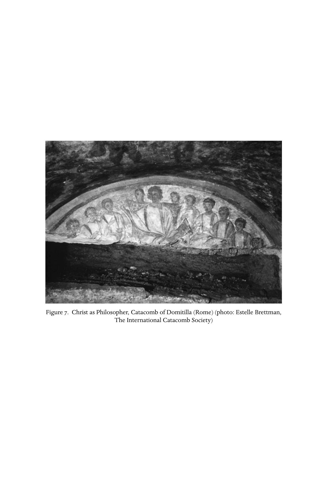

# 第二十六章英文原文：Ecclesiology forged in the wake of persecution

<!-- PDF page 519; original page 470 -->

### 26. Ecclesiology forged in the wake of persecution

#### stuart george hall

#### The Decian persecution and its immediate effects

The persecutions under the emperor Decius (249–51 ce) divided the churches and had lasting consequences for the way the church was perceived and organised. Before 250 ce, Christians had been persecuted from time to time. The severity and extent varied greatly, and the legal basis remains uncertain. Although there were occasional imperial rescripts or other enactments, local popular feeling and the personal attitude of local officials (always susceptible to bribes) usually determined events.[^p519-1] When the Emperor Decius had defeated his predecessor Philip (244–9 ce) in September 249, he decreed that all citizens should offer sacrifice to the gods.[^p519-2] It was not a specifically anti-Christian decree: only the worship of the gods, not renunciation, was the subject of the libellus, or certificate of sacrifice, which every citizen had to obtain from the examining tribunal.[^p519-3] Notable bishops fell victim: Fabian of Rome on 20/21 January 250, Babylas of Antioch soon after, and Alexander of Jerusalem died in the Caesarea prison.[^p519-4] Euctemon of Smyrna was probably not the only bishop who sacrificed, and persuaded others to do the same.[^p519-5] Dionysius of Alexandria and Cyprian of Carthage went into hiding, and tried to restore the situation, as hundreds, perhaps thousands, of Christians across the empire defected or dissimulated: both these bishops describe the rush to get certificates by making the required public offerings.[^p519-6] Decius had decreed the most systematic attempt ever made to enforce religious conformity, and, as far as the Christian

[^p519-1]: Bähnk, Von der Notwendigkeit des Leidens, 53–6, and generally Frend, Martyrdom and persecution, and pt vi, ch. 28, below.

[^p519-2]: The actual edict does not survive. Sage, Cyprian, 178–81, refutes the notion, adopted by Frend, Martyrdom and persecution, 406–7, that there were two phases or edicts.

[^p519-3]: Convenient examples in English translation in Stevenson and Frend, New Eusebius, 214–15, based on texts in Knipfing, ‘libelli’, 363ff.

[^p519-4]: Euseb. HE 6.39.1–4.

[^p519-5]: M. Pion. 15, 17 (Musurillo, 157, 161).

[^p519-6]: Cypr. Laps. 8–9 (see Bévenot, St Cyprian, 12–15); Dionysius in Euseb. HE 6.41.10–12.

<!-- PDF page 520; original page 471 -->
population was concerned, had considerable success. Persecution petered out when barbarian incursions distracted the emperor, and he perished on the northern frontier in June 251.

The church in Rome could not appoint a bishop for fourteen months. The problem of mass apostasy was, however, pressing, and the remaining clergy in Rome and Carthage were obliged to make decisions. Multitudes who had been brought up as Christians had lapsed, and found themselves excluded from the benefits of church membership. Excommunication was a grave matter. While it carried with it the threat of spiritual damnation, its physical and social consequences were more immediate and pressing than would be the case in modern western Christianity. The local church was a household, a familia, which made mutual provision for the sick, the widowed, the orphaned and the elderly, and for the decent disposal of the dead. The lapsed therefore sought ways to get themselves restored. Surviving clergy themselves might be compromised. Cyprian from his hiding place had first to justify his flight: the Roman clergy sent a document without a named addressee to Carthage explicitly criticising faithless shepherds who forsake the sheep.[^p519-7] Cyprian, whose writings and correspondence are our chief source of information, replied by praising their martyred bishop Fabian and questioning the authenticity of the text he received. He would however consistently defend the right of Christians to flee from persecution, even regarding it as a form of confession; in this he differed from Tertullian, who had condemned flight as apostasy.[^p519-8]

Three further letters from Rome were penned on behalf of the clergy by Novatian.[^p519-9] An important figure, he was a Roman cleric who wrote fluent Latin, and had theological gifts that were acknowledged even by his opponents.[^p519-10] From his considerable output the few surviving works include De Trinitate (‘On the Trinity’), unrivalled in surviving Roman theology of the period. Given the multitude of disputes over the persons of the Godhead which divided the church in Rome in the time of Callistus i and Hippolytus,[^p519-11] Novatian may have been responsible for the absence of such doctrinal controversy from the later conflicts.[^p519-12] He was a presbyter under bishop Fabian, and came to the fore in the vacancy caused when Fabian fell an early victim to the persecution

[^p519-7]: Cypr. Ep. 8.1, citing John 10:11–12.

[^p519-8]: Cypr. Ep. 59.6; Bähnk, Von der Notwendigkeit des Leidens, 296.

[^p519-9]: Cypr. Ep. 30, 31, 36.

[^p519-10]: See the complimentary epithets for Novatian in Cornelius apud Euseb. HE 6.43.7 and Cypr. Ep. 55.24.

[^p519-11]: Kelly, Early Christian Doctrines, 109–26; Hall, Doctrine and practice, 75–80.

[^p519-12]: See pt iv, ch. 22, and ch. 25, above.

<!-- PDF page 521; original page 472 -->
instituted by the emperor Decius in 250. All Novatian’s letters support Cyprian’s stand against the ready reinstatement of lapsed Christians. Those who had fraudulently or by bribery obtained certificates of sacrifice were as guilty as those who actually sacrificed; the wave of requests for reinstatement based on the recommendation of confessors was to be rejected.

#### Sinners and confessors

When it came to the restoration of a penitent sinner, practice varied. The repentance of the baptised is clearly envisaged in some early documents.[^p519-13] The curing of sinful members by repentance is systematically urged upon the churches in the figurative revelation to Hermas in the mid-second century.[^p519-14] Where restoration was permitted, it involved penitential behaviour such as fasting, almsgiving and attendance for prayer among the catechumens for a matter of years before final restoration. The young Tertullian argued in De paenitentia (‘Repentance’) for one opportunity to repent after baptism, exactly the position of Hermas. Later, approving the severity of the New Prophecy (so-called ‘Montanism’), he repudiated Hermas and argued in De pudicitia (‘On modesty’) that the church had no authority to remit post-baptismal sins, except hypothetically by the decision of a body of prophets. After the Decian calamity, churchmen were faced with the need to find a policy which would match the situation. One way forward related to the standing of confessors and martyrs. These terms (confessor = homologētēs; martyr = martys) were both applied to those who attested their faith by suffering and were often used interchangeably. A stricter definition, now conventional, had already begun to arise, whereby a martyr had died in bearing witness to the faith, whereas a confessor had suffered trial, torture or imprisonment, but had survived, or was so far surviving. In the Decian persecution few executions took place: death occurred as the result of torture, or very commonly of imprisonment.[^p519-15] Prisoners were deprived of food and drink, perhaps in order to persuade them to yield. Public confession brought such esteem among the faithful that not only were martyrs commemorated annually, but confessors were specially honoured: they enjoyed the same privileges as presbyters, and could be appointed deacon or

[^p519-13]: Matt 18:15–17; Rev 2:5 etc.; 1 Clem. 57–8.

[^p519-14]: E.g. Herm. Vis. 2.2 (6.1–8); 4.2 (23.5; 30.2); thorough presentation of evidence in Schneider, ‘Propter sanctam ecclesiam suam’.

[^p519-15]: Sage, Cyprian, 186–9.

<!-- PDF page 522; original page 473 -->
presbyter without an ordination rite.[^p519-16] Such veneration is related to certain biblical texts, where the gift of the Holy Spirit is promised to those who bear witness to Christ before judges (Matt 17:17–20), or the martyrs will themselves share in Christ’s reign and judgement (Rev 20:4). It was held that a confessor had the spiritual authority to remit sins, or at least to commend a penitent to the clergy for forgiveness. This happened conspicuously in the prison at Lyons in 177.[^p519-17] Tertullian repudiated this practice, arguing that a martyr atoned for his own sins alone.[^p519-18]

In Cyprian’s church the confessors played a key role. In hiding in 250, and especially on his return to Carthage in the early spring of 251, he found that men who had spent some time in the prison were recommending not only serious penitents, but relatives and friends, and were issuing certificates of reconciliation to those who petitioned them.[^p519-19] Cyprian took care to praise such confessors, even while criticising their actions. His initial judgement was to urge caution: none should be rashly or immediately restored to communion. This was a view shared and supported by the Roman clergy with whom he corresponded,[^p519-20] and by a group of confessors there, to whom he had written encouragingly in their imprisonment as he did to those in Africa.[^p519-21] Cyprian would sum up his arguments in a weighty tract, De lapsis (‘On the lapsed’), in which the gravity of defying the divine law is argued, and the dangers of defiance picturesquely described. Worldliness and attachment to property had caused many to fall, says Cyprian, as had the threat of torture. Now without any expiation of the crime those who had sacrificed try to take Christ’s body and blood, and the clergy who connive are sacrilegious. Even martyrs and confessors cannot grant what is against God’s law. Those who got certificates without actually sacrificing are guilty before God. To the heartily penitent, he holds out hope at the end: God ‘can grant mercy; he can revoke his own sentence; the one who repents, does good and prays, he can in clemency forgive; he can take into consideration what martyrs have asked and clergy have done for such people’.[^p519-22] This tract was apparently presented at a council when Cyprian returned to Carthage and faced the five presbyters, and two

[^p519-16]: Hipp. Trad. ap. 10.

[^p519-17]: Euseb. HE 5.1.11–13, 32–5, 45–6; Hall, ‘Women’, 12–13.

[^p519-18]: Bähnk, Von der Notwendigkeit des Leidens, 213–20.

[^p519-19]: See Cypr. Ep. 23, on the figure Lucian who wrote in the name of a fellow confessor, Paulus, now dead (as reported to Rome in Ep. 27.1).

[^p519-20]: Cypr. Ep. 30 (penned by Novatian for the Roman clergy).

[^p519-21]: Cypr. Ep. 15; 28.

[^p519-22]: Cypr. Laps. 35.

<!-- PDF page 523; original page 474 -->
others (Novatus[^p519-23] and Felicissimus), who had taken over the church in his absence, and who were responsible for the mass reconciliation of the lapsed, to which Cyprian was opposed.[^p519-24]

#### Ecclesiology and episcopacy

Already the outlines of Cyprian’s ecclesiology were apparent: whatever authority or privilege God might grant to confessors, the fundamental structure of the church rested in the duly appointed bishops, in whom final authority was vested, and whose voice as priests God would hear.

Our Lord, whose instructions we ought to dread and observe, setting forth

the honour of the bishop and the organisation (ratio) of his church, speaks in

the gospel and says to Peter: ‘I say to you that you are Peter, and upon this

rock I will build my church, and the gates of the underworld will not conquer

it, and to you I shall give the keys of the kingdom of heaven, and things which

you bind on earth shall be bound also in heaven, and whatever you set free

on earth shall be set free also in heaven.’ [Matt 16:18–19] Thence through the

changes of times and successions the ordination of bishops and the organisa-

tion of the church have come down, so that the church is established upon

the bishops, and every act of the church is directed by those same superiors

(praepositos).[^p519-25]

Such was the office of bishop as Cyprian saw it. There was a network of congregations throughout the empire which corresponded in organisation to the empire itself. Each bishop was responsible for his local church and its members, for their conduct and their welfare, physical as well as spiritual. He was answerable to his superior in the metropolis, and the metropolitan bishop usually to the greater see nearby, not only for himself, but for those in his charge. The bishops of the greater sees were in communication with each other. It was already the practice that, to make a new bishop, three bishops were needed, normally with the authority, if not the actual presence, of the metropolitan.[^p519-26] An efficient metropolitan needed to keep an accurate written record of ordinations and correspondence, of synods and of judgements. The bishops thus constituted an empire-wide bureaucracy in parallel with that of the empire itself. In an imperial centre like Rome, Alexandria or Syrian Antioch,

[^p519-23]: Not to be confused with Novatian.

[^p519-24]: Cypr. Ep. 41–3; for Novatus, see Cyprian’s hostile portrait Ep. 52.2.

[^p519-25]: Cypr. Ep. 33.1 (my translation).

[^p519-26]: So Novatian got three bishops to ordain him (Cornelius apud Euseb. HE 6.43.8–9).

<!-- PDF page 524; original page 475 -->
the church or churches were presided over by a bishop of great influence, who not only governed in the city, but supervised neighbouring areas. This hierarchy had not always been there, though the seeds of it are as early as the territorial role attributed to Titus in the New Testament (Tit 1:5). Divine authority had been claimed for duly appointed bishops by Clement of Rome,[^p519-27] then in the Ignatian letters for a single bishop in each church.[^p519-28] Irenaeus saw the succession of bishops or ‘elders’ of the apostolic sees, particularly Rome, as guarantors of the genuine tradition of doctrine as against heretical deviation.[^p519-29] This thought was enthusiastically reasserted in North Africa by Tertullian,[^p519-30] and became central to the thinking of Cyprian. His most elaborate statement occurs in the book De catholicae ecclesiae unitate (‘On the unity of the catholic church’), produced in 251, and prompted first by the schism in his native Carthage, but applied to a graver one in Rome.

#### The challenge of Novatian

We know little about the choice in Rome of Cornelius to succeed the martyr Fabian in the spring of 251. Cyprian says he did not rise suddenly, but had been ‘promoted through all the ecclesiastical offices’.[^p519-31] Lifelong clergy like Cornelius probably resented the brilliant Novatian, who had emerged as leader during the emergency. Cornelius favoured compromise when it came to reinstating the lapsed, be they clergy or laity, and he needed defending against allegations of laxity.[^p519-32] For whatever reason, soon after Cornelius’ ordination Novatian rose as champion of the gospel and was ordained by three Italian bishops, with the support of a body of Roman clergy, four or five confessors, and Novatus, who had arrived from Carthage. Cornelius and Novatian both notified other leading bishops. Dionysius of Alexandria supported Cornelius, and pleaded with Novatian to recant.[^p519-33] Fabius of Antioch apparently supported Novatian, and received remonstrations from Cornelius and Dionysius; he died soon after.[^p519-34] Cyprian sent an investigative team to Rome, an act of hesitation which required some diplomatic explanations to Cornelius.[^p519-35] It was embarrassing for

[^p519-27]: 1 Clem. 40–4.

[^p519-28]: E.g. Ign. Eph. 2–6, 20; Smyr. 8.

[^p519-29]: Iren. Haer. 3.3–4.2.

[^p519-30]: Praescr. 20–2.

[^p519-31]: Cypr. Ep. 55.8.

[^p519-32]: Cypr. Ep. 55.11–12; note passim communicare sacrificatis.

[^p519-33]: Euseb. HE 6.45.

[^p519-34]: Euseb. HE 6.41.1; 43–4; 46.3–4.

[^p519-35]: Cypr. Ep. 44–5.

<!-- PDF page 525; original page 476 -->
the champion of discipline to align himself with the laxer party at Rome and against the more rigorous Novatian. But the law of the church must prevail, he says: once Cornelius was duly appointed by bishops, most of the clergy and the voice of the laity, there was no vacancy, and Novatian was outside the church and not a bishop.[^p519-36] Councils in Rome and Carthage met in the summer of 251 to resolve the outstanding issues. No formal records have survived, but the foremost topic was the discipline of the lapsed. In an important letter to a bishop tempted by Novatianism, Cyprian explains their conclusions. Christians are not like the Stoic philosophers, who regard all sins as equal and the good man as impeccable. The lapsed who desire remission are not so much dead as half alive, as the recommendations of martyrs and confessors indicate.[^p519-37]

But since there is in them that which with subsequent repentance (paenitentia) might be restored to faith, and strength growing from repentance might be armed for valour... therefore it was determined... that, after individual examination, those who had received certificates (libellatici) should be meanwhile admitted; that those who had sacrificed should be helped at their end, for ‘there is no confession in the underworld’ [Ps 6.5], nor can any be urged to repentance, if the reward of repentance is taken away. If conflict [i.e. persecution] should come again, he will be found strengthened by us for the battle; but if before battle disease grows fierce, he departs with the solace of peace and communion.[^p519-38]

The final judgement of hearts and minds remains only God’s, he adds. Cyprian later makes it clear that the deathbed reconciliation applies only to those who were already penitent, and have shown genuine remorse.[^p519-39] These decisions of the episcopal council in Carthage were approved by Cornelius in Rome, who had himself gathered a large council with similar results.[^p519-40] Records of both councils were sent to Dionysius of Alexandria, and in the east a widely supported episcopal council came to similar decisions, and rejected Novatianism, appointing one of their own mind to fill the place of the deceased Fabius of Antioch.[^p519-41] There would be a further development, when persecution again threatened, and an African council decreed the reception of all penitents back into the fold, so as to be prepared for impending martyrdom.[^p519-42]

[^p519-36]: Cypr. Ep. 55.8.

[^p519-37]: Cypr. Ep. 55 (ad Antonianum), 16.

[^p519-38]: Cypr. Ep. 55.17.

[^p519-39]: Cypr. Ep. 55.23.

[^p519-40]: Cypr. Ep. 55.6.

[^p519-41]: Euseb. HE 6.43.3.

[^p519-42]: Cypr. Ep. 57.

<!-- PDF page 526; original page 477 -->
The outcome of all this was not so much to introduce new and more worldly standards (apostates and serious sinners had on occasion been reconciled in the past), as to strengthen the position of the bishops both individually and corporately. The role of the bishop as arbiter of membership, admission and exclusion in the local church was asserted, against the alternative of charismatically gifted confessors and martyrs: he was Peter, to whom the Lord had given the keys of the kingdom. But the standing of bishops gathered in council to resolve new issues corporately was also enhanced. This brings us to another issue.

#### De unitate ecclesiae

In the summer of 251, Cyprian had to deal not only with resolving the problem of the lapsed, but with the divisions in the churches which it had caused. His own church had been taken over by dissident presbyters, who found a leader in the deacon Felicissimus and went on in 252 to make one of themselves, Fortunatus, a bishop. At the same time one Maximus, who had led Novatian’s delegation to North Africa, was also ordained bishop by his party, and seems to have had some support across the African provinces.[^p519-43] Support for Novatian continued, if diminished, in Rome and other provinces, and his high-principled church would last for some centuries. These divisions called forth Cyprian’s important tract, De catholicae ecclesiae unitate, probably first presented at the council in 251. It does not specify the adversaries criticised, but constitutes a general criticism of schism, of division from what he perceived as the one true church. He begins by characterising schism and heresy as diabolic deceit: the devil dresses as an angel of light to deceive true believers (2 Cor 11:14). Schism is Antichrist. Once more he begins with the Petrine text of Matt 16:18–19.[^p519-44] Cyprian had used the same text in Epistula 33 to establish the bishop’s unique authority. Here his exposition has come down to us in two versions, reflecting a complicated history. Both appear to be written by Cyprian, and both interpret St Peter’s position as symbolic of the unity of the church.[^p519-45] One, the ‘primacy text’, emphasises that there can be no faith outside the unity of Peter and no church other than the one founded upon his throne: only those acknowledged by the bishop belong. It focuses totally upon Peter, directed by Christ to feed his sheep ( John 21:17). Other apostles have equal power, but Christ

[^p519-43]: Cypr. Ep. 59.9.

[^p519-44]: Cypr. Unit. eccl. 4.

[^p519-45]: Important treatment in Bévenot, Cyprian, de lapsis (OECT), x–xvii, 60–7.

<!-- PDF page 527; original page 478 -->
set up one throne (cathedra) and by his authority appointed one source and

principle of unity. The others were indeed what Peter was, but a primacy

(primatus) is given to Peter and one church and one throne are shown.

This has nothing to do with claims to Roman primacy (as was later to be alleged). It is directed against those in the Carthaginian church who tried to act independently of Cyprian their bishop, and against others like them. The longer ‘received text’ is concerned with the solidarity of the bishops, foreshadowed in the fact that Jesus commissioned one man, Peter, first (Matt 16:18–19), and later all the apostles ( John 20:21–3). ‘The other apostles were indeed what Peter was, endowed in equal measure with honour and power; but the beginning proceeds from oneness (unitate) so that the church of Christ may be shown as one.’ Cyprian emphasises that it is the special duty of bishops to preserve the unity of the church by their brotherhood, to prevent any falsehood. This longer version is probably a revision designed for presentation at a council of bishops, such as that held in the summer of 252, when the local dissidents set up their rival bishop of Carthage, and the agents of Novatian were actually promoting an alternative episcopate in Africa.[^p519-46]

At chapter 5 the text of De unitate becomes unanimous again with the vision of the episcopate as a unity and the church spreading from its single centre over all the earth. Various scriptural arguments follow, emphasising the predicted evil of false prophets in the church,[^p519-47] denying that sectaries meet in Christ’s name,[^p519-48] claiming that even martyr-death in schism is worthless, since such victims are out of charity,[^p519-49] and expressing no surprise if even confessors are deceived into sin.[^p519-50] Cyprian ends with a rousing call to unity, charity and vigilance so as not to be overcome by the devil’s wiles.[^p519-51]

Schism in the church thus led Cyprian to articulate an ecclesiology promoting a concrete notion of the unity of the church, bonded in time and space by the spiritual authority of bishops duly appointed in succession from the apostles and in unanimity with each other. Individual believers might err and sin gravely, but in the bishop they had one who was judge and pastor, his judgements warranted by the unanimity of the worldwide episcopate. The bishops were the priests of divine appointment, for whom the exclusive rights

[^p519-46]: Bévenot dates it later, during the baptismal controversy.

[^p519-47]: Cypr. Unit. eccl. 10–11.

[^p519-48]: Cypr. Unit. eccl. 12.

[^p519-49]: Cypr. Unit. eccl. 14.

[^p519-50]: Cypr. Unit. eccl. 20–1.

[^p519-51]: Cypr. Unit. eccl. 25–7.

<!-- PDF page 528; original page 479 -->
and duties of the Aaronic priesthood of the Old Testament were the model and rule. An act of idolatry or of schism made the priest ritually unclean, unable to perform any spiritual acts. Spiritual acts included especially the offering of the eucharist (now freely spoken of as a sacrifice) and baptism; but it included other things such as ordination and (of course) remission of sins. This concept would soon be severely tested.

#### Baptism and unity

By 256 both Cornelius and his successor had died, and a new bishop, Stephen, governed the church of Rome. He took positions at variance with those of Cyprian, positions which we know only from Cyprian’s own letter collection. First, there was the question of allowing suspect or erring bishops to continue in office. Cyprian had already made clear his view that a bishop who committed idolatry or schism ceased to be a priest.[^p519-52] The second dispute between Cyprian and Stephen concerned whether those baptised in heresy and schism, including Novatianism, are to be treated as already baptised, or subjected to the church’s baptism.[^p519-53]

Cyprian’s first approach to Stephen is tactful and respectful.[^p519-54] He enclosed copies of earlier letters, and argues his usual position, that only the one church can baptise; since Novatian is outside the church, he cannot be reckoned a bishop.[^p519-55] Cyprian himself raises the matter of the baptismal creed, which for him included the phrase, ‘forgiveness of sins and eternal life through the holy church’. This is a fraud when said by Novatianists, since they have not the church.[^p519-56] The heretics do not possess the Holy Spirit, and so cannot bestow him in baptism.[^p519-57] But he also notes that the matter ‘seriously affects both priestly authority and the unity of the catholic church, as well as the dignity deriving from its institution by divine appointment’.[^p519-58] This is undoubtedly true, since the unanimity of the bishops is crucial to Cyprian’s ecclesiology,

[^p519-52]: Significant cases include that of Trofimus (Cypr. Ep. 55.2.1 and 11.1–3, with Clarke’s notes (Letters, vol. iii, 35–40 and 167–84)); the Spanish bishops, Basilides and Martial (Ep. 67.6.1–13); and Marcian of Arles, who supported Novatian (Ep. 68; Novatian’s own part in this is unknown (see Ep. 55)).

[^p519-53]: Cypr. Ep. 69.1.1.

[^p519-54]: Cypr. Ep. 72.

[^p519-55]: Cypr. Ep. 69.3.

[^p519-56]: Cypr. Ep. 69.7.

[^p519-57]: Cypr. Ep. 69.11. In Ep. 71 he rejects the claim that acceptance of heretics without rebaptism is an ancient custom.

[^p519-58]: Cypr. Ep. 72.1.1.

<!-- PDF page 529; original page 480 -->
and the impending difference with Stephen affronts it. With it, he broaches the new topic, which shews that Novatianists were partly in mind: presbyters and deacons who have left the church for heresy, having rebelled against Christ, can on repentance be received back and pardoned, but only as laymen, not as clergy.[^p519-59] Stephen was perhaps more flexible. The argument advances further in Cyprian’s letter to bishop Jubaianus.[^p519-60] Jubaianus had pointed out the coincidence between Novatian’s baptismal practice and Cyprian’s. Cyprian can shrug this off: Novatian apes the church, but what he does is irrelevant.[^p519-61] This information that Novatian held the same view as Cyprian is, however, important, as we shall see, for understanding Stephen’s attitude. Cyprian continues by affirming that his policy is traditional, having been settled for Africa in the time of bishop Agrippinus, probably early in the third century.[^p519-62] Cyprian also has to deal with a document, forwarded by Jubaianus, which argued that, whoever might have conducted a baptism, the candidate received forgiveness of sins on the strength of his faith, and that even Marcionites did not need baptism, having been baptised in the name of Jesus Christ.[^p519-63] This discussion makes it plain that it is not only Novatianist baptism which is under debate, but also, perhaps chiefly, that of heretics generally. As usual, Cyprian regards baptism by any but a lawful bishop as a rebellion against the divinely appointed priesthood, using the example of the rebels against Aaron: Korah, Dathan and Abiram.[^p519-64] Perhaps revealingly, he acknowledges strong tradition on the other side, but claims that reason, and ‘better’ revelation by the Holy Spirit, support him.[^p519-65]

After writing this long and careful argument, Cyprian received a bombshell from Stephen, which is not in the dossier preserved. We know it from Cyprian’s response to a bishop Pompeius, who had asked to know what Stephen had written.[^p519-66] The contents are dismissed as ‘arrogant, irrelevant, self-contradictory, incompetent and imprudent’, and only the conclusion is quoted: ‘Therefore,

[^p519-59]: Cypr. Ep. 72.2.

[^p519-60]: Cypr. Ep. 73.

[^p519-61]: Cypr. Ep. 73.2.

[^p519-62]: Cypr. Ep. 73.3 (also an earlier allusion in Ep. 70.1.2 (important note in Clarke, Letters, vol. iv, 196–9)). For similar rulings in eastern councils, apparently in response to Montanism, see Dionysius in Euseb. HE 7.5.3–6; 7.7.5 (who, though supporting Stephen, pleaded for respect for these earlier rulings); Firmilian in Cypr. Ep. 77.3–4.

[^p519-63]: Cypr. Ep. 73.4.1; cf. 73.16–17. Clarke, Letters, vol. iv, 226 rejects the view that the document was the anonymous tract De rebaptismate, though its arguments are similar.

[^p519-64]: Cypr. Ep. 73.8, appealing to Num 16.

[^p519-65]: Cypr. Ep. 73.13; the fate of past heretics reconciled without baptism is considered at 73.23.

[^p519-66]: Cypr. Ep. 74. More details of Stephen’s letter may be deduced from Firmilian’s commentary in Cypr. Ep. 75.

<!-- PDF page 530; original page 481 -->
if any come to you from any heresy whatsoever, let there be no innovation beyond what is traditional, that a hand be laid on them for penance, since the heretics themselves for their part do not mutually baptise those who come to them, but simply share communion.’[^p519-67] Cyprian repudiates the label ‘innovator’, and denies that Stephen’s tradition is evangelical or apostolic. Most of his arguments are predictable, and clearly angry. But, unless he is responding to other things in Stephen’s letter, he partly mistakes what Stephen writes. He argues as if Stephen lays on hands to impart the Holy Spirit, which is Cyprian’s own interpretation of the rite of episcopal handlaying.[^p519-68] Stephen’s words, however, are in paenitentiam. In other words, he would treat the converted heretic as a penitent being reconciled. His action has precedent in the actions of his predecessor Callistus before 220, who increased his congregation by accepting those coming in from other Christian groups, according to his critic Hippolytus.[^p519-69] Stephen’s appeal to heretical practice is astonishing, and he is taunted with it by Cyprian.[^p519-70] But it makes sense in the Roman context, since the original multiplicity of house churches there,[^p519-71] where many differences of doctrine and practice could easily arise, meant that unity could only be achieved if the principle of ‘one baptism’ was adhered to in Stephen’s sense. Stephen appears to have acted high-handedly towards the African churches, and towards those of Asia Minor who took the same line. He had gone so far as even to deny Cyprian’s representatives bed and board in Rome, and he excommunicated the oriental bishops.[^p519-72] Such actions were incompatible with the principles, so dear to Cyprian, of the unity of the church based upon a unanimous episcopate. We have fragmentary information about Cyprian’s unsuccessful attempt to negotiate in Rome, and a council was held in Carthage in 256, whose conclusions survive as Sententiae episcoporum (‘The sentences of the bishops’). The bishops agree with Cyprian, but there were absentees who presumably dissented.[^p519-73] The most important decision, which applied both to Rome and to African dissidents, was Cyprian’s declaration that none set himself up as ‘bishop of bishops’, but allowed each bishop to decide, and to answer

[^p519-67]: Cypr. Ep. 74.1. On the problems of translation, see Clarke, Letters, vol. iv, 237–8. My version takes proprie as ‘for their part’.

[^p519-68]: Cypr. Ep. 74.5; that this is Cyprian’s regular view is apparent from Ep. 69.11.3.

[^p519-69]: Hipp. Haer. 12.200–21.

[^p519-70]: Cypr. Ep. 74.4.

[^p519-71]: See pt iv, ch. 22, above.

[^p519-72]: Firmilian’s sarcastic acount in Cypr. Ep. 75.25, and Dionysius of Alexandria in Euseb. HE 7.5.4; Clarke, Letters, vol. iv, 243.

[^p519-73]: Sage, Cyprian, 324–7.

<!-- PDF page 531; original page 482 -->
to God, for himself. This was a position which Cyprian had suggested earlier.[^p519-74] Events overtook the dispute: when Stephen died in 257 and Cyprian was himself arrested and finally martyred in 258, Stephen’s successors took steps to mend relations with other churches, aided by the mediation of Dionysius of Alexandria.[^p519-75] The debate died down, but would erupt ferociously as a prime controversy between Donatists and catholics in the fourth century. The issues were settled by conciliar decisions at Arles in 314 and Nicaea in 325, whereby those baptised in the name of the Father, the Son and the Holy Spirit were reckoned baptised (which of course included Novatianists), and those whose baptisms were not doctrinally orthodox (like the Samosatenes) were to be baptised.

Novatianism was not itself the prime subject of the baptismal dispute. It may, however, have played a key role. For Stephen, Novatian was a senior figure, a formidable theologian with a devout following. His decision not to acknowledge impure baptisms could undermine Stephen’s own position, raising the spectre that faults of his predecessors or of those they allowed (like the Spanish bishops)[^p519-76] made their sacramental acts invalid. It is possible, though there is no direct evidence, that this was what led Stephen to reaffirm the old Roman tradition of acknowledging all baptisms, as a function of the faith of the individual and not of the administering priest. If so, he would have seen the stance of Cyprian and his eastern supporters as a gross betrayal, and that could account for his ire.

As to the doctrine of the church itself, this final controversy of Cyprian’s short career repeated the lesson of the lapsed: the hard line is not the way to identify the truth of God as revealed in Jesus Christ. Sixty-five years before, Irenaeus had been obliged to modify his doctrine of the inspired unity of bishops in the apostolic tradition, when Rome differed from Asia over Easter.[^p519-77] Now Cyprian can only maintain that the bishops are a single body by allowing differences of baptismal discipline, as he had allowed flexibility towards the lapsed. Stephen adopted a more generous, charitable and evangelical policy, but did it with disastrous rigour. As to Novatian, his own schism and his denial of other baptisms were doubtless pursued in good faith, in response to calamity and disorder. He tried to find a faultless church, but could only produce one which essentially lacked the charity which is the church’s bond and soul.

[^p519-74]: [Cyprian] CSEL iii/1 435–6; Cypr. Ep. 69.17.

[^p519-75]: Euseb. HE 7.2–9.

[^p519-76]: See n. 52 above.

[^p519-77]: Euseb. HE 5.24.11–18.

<!-- PDF page 532; original page 483 -->
These diverse positions, which were variously replicated in the east, but are less well documented, each left its mark, positive or negative, on the later catholic church. The issues would emerge again in Donatism and Augustine, and in various guises have reappeared in the church since. The imperial church embodied Cyprian’s presupposition of a single worldwide church reflecting the shape of the empire, but with Stephen’s more generous and practical view of baptismal membership.

<!-- PDF page 533; original page 484 -->

Figure 7. Christ as Philosopher, Catacomb of Domitilla (Rome) (photo: Estelle Brettman, The International Catacomb Society)

