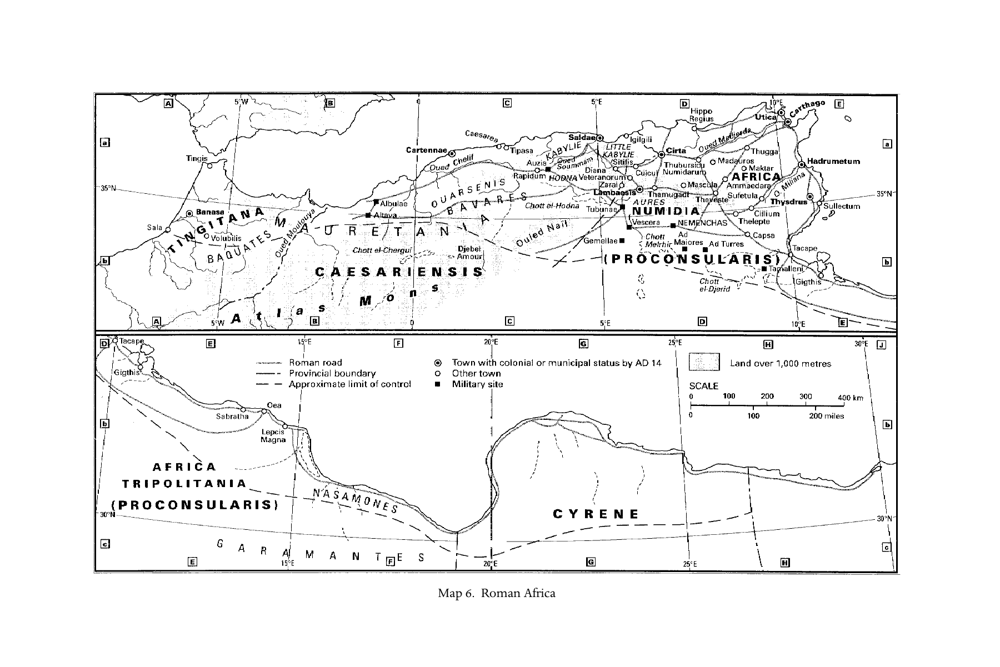

# 第二十章英文原文：Gaul

<!-- PDF page 415; original page 366 -->

### 20. Gaul

#### john behr

#### The evidence

Almost all we know about Christianity in Gaul during the first two or three centuries ce is connected with the Christian communities in Vienne and Lyons in the latter decades of the second century. The episcopal lists and martyrologies do not provide any reliable evidence for this period. No archaeological evidence of the Christians themselves survives to provide a tangible sense of how they constructed their own physical world. With the possible exception of one inscription, epigraphy yields nothing that can be securely dated to the pre-Constantinian era. And even the couple of references to Christianity in Gaul made by contemporary writers abroad are difficult to evaluate properly. Nevertheless, the precious excerpts, some rather lengthy, of letters written by Christians in Gaul, which Eusebius preserves, and the writings of Irenaeus of Lyons, arguably the most important Christian figure of the second century, offer a vivid picture of the remarkable vitality and diversity of these communities.

#### Social and cultural influences

The areas of Gaul in which Christianity appears in the second century ce are marked by the confluence of several forces and peoples. The background of the Celts, or the Gauls as the Romans called them and as they became known, lies in the so-called Hallstatt culture (named after a site near Salzburg, Austria). By 750 bce, some had migrated to the area of Provence, beginning what is known as the La Tène culture (named after a site near Lake Neuchâtel, Switzerland), which lasted until the beginning of the Christian era, when the dominance of the Roman empire overshadowed all such distinctions. About the same time, between 734 and 580 bce, the Mediterranean coastal regions

<!-- PDF page 416; original page 367 -->
of Gaul were colonised by Ionian Greeks from Phocaea (70 km north-west of ancient Smyrna), in search of metals and other raw materials.[^p415-1] Marseilles (Massalia) was founded around 600 bce at the mouth of the Rhône to conduct trade with the settlements further up river. A number of other Greek colonies were established soon after along the Riviera. These settlements were clearly centres of trade and commerce during the following centuries: there is evidence of coins minted at Massalia and of trading with the Gauls, in whose graves have been found Greek, Etruscan and Massalian items, including smaller luxurious pieces made in gold, silver and amber. Gauls, from varying backgrounds, had spread out through much of Europe, even getting as far south as Rome, where in 386 bce they sacked and burnt the city before being driven out, and as far east as Asia Minor, where some settled permanently (the ‘Galatians’).

The final influence on the region is, of course, that of Rome. After the defeat of Hannibal in 202 bce, with whom the Gauls had joined forces, and other attacks by the Gauls themselves, the Romans gradually expanded throughout the Mediterranean. By 121 bce, they had conquered the Gauls on the lower Rhône. A few years later, the first Roman colony was established at Narbonne (Narbo Martius), and the surrounding area (modern Provence) was renamed Narbonensis. In the decades that followed, the vast districts of Gaul beyond this area, from the Atlantic to the Rhine and stretching as far north as modern Holland, were gradually brought under the influence of Roman civilisation. There were no cities as such, but rather the landscape was dotted with oppida (‘hill forts’), though there did develop some rudimentary form of government, with each civitas, or local polity, consisting of several oppida, being governed by a local, elected, chief magistrate. Some of these civitates began to mint their own coins, based on Greek and Roman models, so increasing the possibility for trade with Rome, and integrating Gaul into the Roman economic system. Other aspects of Greek and Roman culture also began to flourish: Julius Caesar reports that the Druids (the religious leaders of Gaul, who, along with the equites (‘knights’), were distinguished from the commoners) even knew the Greek alphabet (B. Gall. 6.14). The Gauls had various deities, whom Caesar tried to identify with the Roman gods, the most important of which were the equivalent of Mercury, the Roman god of commerce (B. Gall. 6.12), and the mother goddesses depicted, usually in threes, in various reliefs. The Gauls were also known to practice rites of rebirth, and were even reported to have performed human sacrifices (B. Gall. 6.16).

[^p415-1]: On this period of Gaul, see Hodge, Ancient Greek France.

<!-- PDF page 417; original page 368 -->
The most important event for the identity of Gaul during our period, and for subsequent European history, was the Gallic wars, the eight successive campaigns against Gaul and Britain lead by Julius Caesar between 58 and 50 bce. His Commentaries on the Gallic wars opens by noting that Gaul is divided into three parts: that inhabited by the Belgae, north and west of the Marne and Seine rivers; that of the Aquitani, dwelling between the Garonne river and the Pyrenees; and the largest area, the remaining part, in which the Gauls lived. It is in the aftermath of these wars that the cities that will principally concern us, Vienne (Vienna) and Lyons (Lugdunum), were established as colonies for the veterans of the Gallic wars.[^p415-2] During the Gallic wars, Vienne, the former capital of the Allobroges tribe, was established as a colony, serving as a supply depot and a camp for hostages. After Caesar’s assassination (44 bce), the Allobroges, who had remained loyal to the Romans during Vercingetorix’ assault on the town in 52 bce, drove the Roman veterans out of Vienne. These soldiers, in turn, were the original settlers of the nearby town of Lyons, beginning the long-standing rivalry between the two cities. In the following year, 43 bce, Mark Antony was sent to install another colony of veterans in Vienne, and Lucius Munatius Plancus, a general of the wars, was sent to be the governer of Lyons, establishing it as a proper colony. Despite the relative age of Vienne, Lyons unquestionably became the more important of the two cities. It is situated on the hill of Fourvière (the forum vetus, or ‘old forum’), at the confluence of the Rhône and Saône rivers, and lay at the intersection of major trade roads. It soon became the capital of the Three Gauls, while the third division of Gaul was in turn named Lugdunensis, and an annual festival of the Three Gauls was instituted there.[^p415-3] The town was the birthplace of the future emperors Claudius (10 bce–54 ce) and Caracalla (188–217 ce), and is mentioned by a number of Roman writers, from Livy (59 bce–17 ce) to Ammianus Marcellinus (330–400 ce). There is a good deal of archeological evidence from Lyons indicating the assimilation of Gallic and Roman religion, such as an altar base with reliefs of the Mother Goddess, Mercury, Sucellus and Fortuna. There is also evidence for the worship of deities from the east, such as the altar, dating to 160 ce, from the shrine of Cybele, the Great Mother of the Phrygian gods. Remains of the two Roman theatres of Lyons can still be seen today on the Fourvière, the larger of which (built around 17–15 bce) could seat 10,000 spectators, and to the north, across the Saône, lay the amphitheatre and circus, built at the beginning of the first century ce.

[^p415-2]: For descriptions and images of these cities and their archaeological remains, see Quentin, ‘Sites and museums in Roman Gaul i’.

[^p415-3]: For this festival, see Fishwick, ‘Federal cult of the Three Gauls’.

<!-- PDF page 418; original page 369 -->
#### The Christian community

As the shores of the Mediterranean and the valley of the Rhône had long since been home to Greeks from the east, especially Asia, who remained in contact with their fellow countrymen back home, it is not surprising that the earliest witness we have of the Christian communities in Gaul indicates such diversity. This is the ‘Letter of the churches of Vienne and Lyons’ to their brethren in Asia and Phrygia, written shortly after the persecutions in these two cities. The date of this pogrom and thus the letter depends upon Eusebius, who is not, however, totally consistent. His Chronicon would place the persecutions during the seventh year of Marcus Aurelius’ reign (166–7), while his later Historia ecclesiastica, in which the letter is preserved, places the events a decade later, in his seventeenth year (177), the date that is generally accepted.[^p415-4] The letter seems to indicate that the founders of the two churches were among the martyrs (cf. HE 5.1.13), suggesting that Christianity was established in this region only in the mid-second century. That Christianity had made its way up the Rhône valley probably implies that there was already a Christian community in Marseilles, at the mouth of the Rhône, although the earliest evidence for this comes from the crypt of St Victor, which can possibly be dated as early as the mid-third century.

That the title of the letter places the church of Vienne before that of Lyons is striking, given the pre-eminence of Lyons. The leader of the community in Lyons was Pothinus, who was imprisoned during the persecution and subsequently martyred. He was already over ninety years old (HE 5.1.29), and so presumably was one of the original founding fathers of the church in Lyons. Around this time, Irenaeus was sent on a mission to Rome, which will be discussed below, taking with him a letter for Eleutherus, the ‘bishop of the Romans’ (174–89 ce), which describes Irenaeus as a ‘presbyter’, a word which was used interchangeably with ‘bishop’ during the course of the second century.[^p415-5] The fact that the letter mentions Vienne before Lyons, together with its particular style and theological tenor, makes it probable that the letter was written by Irenaeus as the leader of the community in Vienne, assuming a general oversight of Lyons while its leader was imprisoned.[^p415-6] When Irenaeus

[^p415-4]: Cf. Grant, ‘Eusebius and the martyrs of Gaul’. The text of the letter can be found in Euseb. HE 5.1–3.

[^p415-5]: Euseb. HE 5.3.4–4.2. Irenaeus describes Polycarp as being a ‘presbyter’ (letter preserved in HE 5.20.7) and refers to Victor’s predecessors as ‘presbyters’ (HE 5.24.14). The indistinct employment of the vocabulary of ecclesial office is also shown by the description, in the ‘Letter of the churches of Vienne and Lyons’, of Pothinus having been entrusted with ‘the ministry of episcopacy in Lyons’ (tēn diakonian tēs episkopēs, HE 5.1.29).

[^p415-6]: Cf. Nautin, Lettres, 54–61, 93–5; Doutreleau, ‘Irénée de Lyon’, 1928–9.

<!-- PDF page 419; original page 370 -->
returned from Rome, after the death of Pothinus, he became bishop of Lyons, which is how he is traditionally known. Irenaeus was from the east, and the name ‘Pothinus’ probably indicates a similar eastern background. Irenaeus describes how, in his early youth, he had known Polycarp, the bishop of the church in Smyrna. This connection with Polycarp was important for Irenaeus: he emphasises that Polycarp had been appointed bishop of Smyrna by the apostles themselves and spoke often about his discussion with John and others who had seen the Lord.[^p415-7] Irenaeus thus brought with him to Gaul a living connection with the age of the apostles themselves. Polycarp was martyred sometime in the late 150s, after returning from a visit to Rome. It is tempting to picture both Pothinus and Irenaeus as having accompanied Polycarp to Rome, and then having moved on to Gaul, perhaps with Christians from Rome itself. Other epistolary evidence, considered below, demonstrates that links with Rome were important to the Christians in Gaul.

The letter indicates that a number of others in the Christian community of Vienne and Lyons were also immigrants from the east. It specifically mentions that Attalus, a Roman citizen, was a native of Pergamum (HE 5.1.17), and that Alexander, a physician, was a Phrygian who had spent many years in various parts of Gaul (HE 5.1.49). Alcibiades, who, as we will see later, was connected with the Montanist movement, was also from Phrygia (HE 5.3.2–4). The same may be true of Vettius Epagathus, who though young and ‘distinguished’ or ‘noble’ (episēmos), acted as the advocate for the Christians, ‘having the Advocate in himself, the Spirit, more abundantly than Zacharias’.[^p415-8] The other names recorded by the letter offer evidence that these Christian communities were diverse in composition: Sanctus, the deacon of Vienne, replied to his interrogators in Latin (HE 5.1.20); Blandina was a slave girl, whose nameless mistress was also martyred (HE 5.1.17), and who also encouraged a fifteenyear-old boy called Ponticus (HE 5.1.53); along with Attalus, several others appear to have been Roman citizens (HE 5.1.47); Maturus was a ‘recent convert’ (HE 5.1.17), as perhaps was also Biblis, who initially denied her faith before ‘recovering herself’ and being martyred (HE 5.1.25–6). Finally the letter records that a number of the Christians had pagan servants, who were also seized and interrogated (HE 5.1.14). Thus, despite the severity of the persecution, the letter specifically mentions only eleven Christians from the two communities, ten by name and the anonymous mistress of Blandina. It is probable, however,

[^p415-7]: Cf. Iren. Haer. 3.3.4; and his ‘Letter to Flora’, cited in HE 5.20.4–8.

[^p415-8]: HE 5.1.9–10. The mention here of Zacharias is an allusion to the priestly father of John the Baptist (Luke 1:6), though it is also given as the (baptismal?) name of Vettius in the martyrologies. Cf. Nautin, Lettres, 50.

<!-- PDF page 420; original page 371 -->
that the actual number of martyrs was larger. The later martyrologies record forty-nine names of those who perished, though some of the names seem to refer to the same person.[^p415-9] The number of Christians in both communities was certainly larger, though, again, as Eusebius mentions that the letter contained a list of the names of those who survived (HE 5.5.3), the overall number could not have been too extensive. The Christian communities in the cities of Vienne and Lyons were not, therefore, too large to be counted, but they were big enough to survive such a pogrom, and, as we have seen, while predominantly of eastern background, as were their leaders, they were made up of a wide cross-section of society.

#### Personalities and events

Of the figures mentioned in the letter, we know nothing else. However, more is known of Irenaeus, its probable author.[^p415-10] Although he had come from the east, and preferred Greek, the language in which he wrote, as he was living, he says, among the ‘Celts’, he had become ‘accustomed for the most part to use a barbarous dialect’, thus excusing, in a typically rhetorical flourish, the lack of beauty or persuasiveness of style in his own writings.[^p415-11] Irenaeus’ main literary monument is his five books entitled Detection and refutation of gnosis falsely so-called, usually known simply by the Latin title Adversus haereses (‘Against the heresies’). Book 3 of this work mentions Eleutherus as the current bishop of Rome (Haer. 3.3.3), and so it can be dated to the period between 174 and 189. The only other extant work of Irenaeus, rediscovered at the beginning of the twentieth century in an Armenian manuscript, is his Epideixis tou apostolikou kērygmatos (‘Demonstration of the apostolic preaching’), a short summary work presenting the apostolic preaching by citing passages from the scriptures (the Law, the Psalms and the prophets). Although chapter 98 of the Epideixis refers the reader to the Adversus haereses, it is probable, given the more primitive use of the apostolic writings in the Epideixis and a particularity in the Armenian text at this point, that the final chapters are a later addition and that the Epideixis is in fact the earlier work.[^p415-12] Jerome (c.342–420) is the first to refer to Irenaeus as ‘bishop of Lyons and martyr’ (In Esaiam 17), though it is possible that this is a later scribal error, for Jerome does not refer to him as a martyr elsewhere.

[^p415-9]: Cf. Quentin, ‘La liste des martyrs de Lyon’; Nautin, Lettres, 49–50.

[^p415-10]: See pt iii, ch. 13, above.

[^p415-11]: Haer. 1.Pref.3. Cf. Haer. 1.10.2; 3.4.1.

[^p415-12]: Cf. Irenaeus, On the Apostolic Preaching, Behr (trans.), 3, 16 and 118 n. 229.

<!-- PDF page 421; original page 372 -->
The first full report of his martyrdom is by Gregory of Tours (c.540–94, Historia Francorum 1.27).

Having looked at the composition of the Christian communities in Gaul, as reflected in the letter, we can turn to the events described therein. Although doubts have been raised concerning the authenticity of the letter and its account, it is generally accepted as being fairly reliable. Nevertheless, the description of the events is already shaped by theological reflection on the significance of the martyrs’ suffering, drawing upon martyrological topoi,[^p415-13] and certainly reflecting, as we will see, Irenaeus’ own theological vision. The pogrom seems to have broken out in Lyons and then spread out to Vienne, drawing in their deacon Sanctus. No particular cause is recorded, other than hostility resulting from popular prejudice against the largely immigrant Christians.[^p415-14] After suffering at the hands of the local population, the Christians were interrogated in public by the local magistrates in the forum, and then imprisoned until the arrival of the governor. The governor, as Pliny had done in Bithynia earlier (cf. Ep. 10.96, c.112 ce), wrote to the emperor for his ruling. Marcus Aurelius, like Trajan previously (cf. Plin. Ep. 10.97), decided that all those who recanted should be set free, but otherwise they should be condemned to the wild beasts or, if a Roman citizen, beheaded (cf. HE 5.1.43, 47). A number of Christians were then put to death in various ways, described in grisly detail. Finally the bodies of those who had been strangled in the prisons were thrown to the dogs, while the bodies of the other martyrs were burnt and thrown into the Rhône, perhaps following the practice of throwing into the river the losers of the oratorical contests held in honour of the Three Gauls.[^p415-15]

With its gruesome narration of the sufferings of the martyrs, the letter is concerned to present a clear theological vision, in which we can see many similarities with the theology developed by Irenaeus in his Epideixis and Adversus haereses. The most striking figure is that of Blandina, who is in many ways the heroine of the whole account (more lines are devoted to her than to any other figure, and she is named, while her mistress remains nameless), personifying the theology of martyrdom articulated by Irenaeus on the basis of Christ’s words to Paul: ‘My strength is made perfect in weakness.’[^p415-16] Blandina is specifically described as so ‘weak in body’ that the others were fearful

[^p415-13]: Thus, the letter mentions that the confessors ‘heroically endured all that the people en masse heaped on them: abuse, blows, dragging, despoiling, stoning, imprisonment and all that an enraged mob is wont to inflict on their most hated enemies’ (HE 5.1.7).

[^p415-14]: Cf. Musurillo, Acts of the Christian martyrs, xx–xxii.

[^p415-15]: HE 5.1.57–63. The background for this practice might in turn have been a parody of the burial rites of Celtic origin. Cf. Fishwick, ‘Federal cult of the Three Gauls’, 35.

[^p415-16]: 2 Cor 12:9; cf. Iren. Haer. 5.2–10; Behr, Asceticism, 76–9.

<!-- PDF page 422; original page 373 -->
lest she not be able to make the good confession; yet she ‘was filled with such power that even those who were taking turns to torture her in every way from dawn until dusk were weary and beaten. They themselves admitted that they were beaten... astonished at her endurance, as her entire body was mangled and broken’ (HE 5.1.18). Not only is she, in her weakness, filled with divine power by her confession, but she becomes fully identified with the one whose body was broken on Golgotha: when hung on a stake in the arena, ‘she seemed to hang there in the form of a cross, and by her fervent prayer she aroused intense enthusiasm in those who were undergoing their ordeal, for in their torment with their physical eyes they saw in the person of their sister him who was crucified for them, that he might convince all who believe in him that all who suffer for Christ’s sake will have eternal fellowship in the living God’ (HE 5.1.41). For Irenaeus it was the martyr, no longer living by the flesh, but by the spirit, who is the truly living human being, ‘the glory of God’.[^p415-17] Similarly characteristic is the description of the martyrs’ deaths as their ‘new birth’ (HE 5.1.63), and the use of the term ‘virgin’ to refer to the church: when the ten ‘stillborn’ who had recanted then returned to their confession, ‘the virgin mother had much joy in recovering alive those whom she had cast forth as stillborn’ (HE 5.1.11, 45).[^p415-18] It is also noteworthy, and struck Eusebius as such, since he records this passage separately from the main narrative, that those who had survived their encounter with the wild beasts refused to be known as ‘martyrs’, reserving this for those alone who have endured until the end, in imitation of ‘the true and faithful martyr’ and ‘firstborn from the dead’, Christ himself.[^p415-19] Although Irenaeus had probably learnt from Justin in Rome, the theology he develops, and which is presented in this letter, comes from further east.[^p415-20] It is represented by Ignatius of Antioch, whose words on his way to his own martyrdom, ‘I am the wheat of Christ, and am ground by the teeth of the wild beasts, that I may be found to be the pure bread of God’, are cited by Irenaeus as coming from ‘one of ours’.[^p415-21] This allusion to the eucharist is developed by Irenaeus, who sees a parallel between

[^p415-17]: Cf. Haer. 4.20.7; 5.9.2.

[^p415-18]: For Irenaeus’ comments on the church as the virgin mother in whom Christians receive a new birth through martyrdom, see Haer. 4.33.4, 9.

[^p415-19]: HE 5.2.2–4; cf. Rev 3:14, 1:5; Col 1:18.

[^p415-20]: Other teachings which Irenaeus inherited from the east include the infancy of the newly created Adam, previously found only in Theophilus of Antioch (Autol. 2.25) and the abundant fruitfulness of the earth in the millennial kingdom of the Lord, a tradition which he received from ‘the elders who saw John, the disciple of the Lord, and related that they had heard from him how the Lord used to teach in regard to these times’, things which are also testified by Papias (Haer. 5.33.3–4).

[^p415-21]: Haer. 5.28.4; the quotation comes from Ign. Rom. 4.

<!-- PDF page 423; original page 374 -->
the eucharistic offering and human death and resurrection, the fulfilment of what is prefigured in baptism: by receiving the eucharist, as the wheat and vine receive growth from the spirit, Christians are prepared, as they make the fruits into bread and wine, for their own resurrection wrought by the word, at which point, just as the bread and wine receive the word, becoming the body and blood of Christ, the eucharist, so also will their bodies receive immorality and incorruptibility from the Father.[^p415-22] Just as Christians prepare bread for the eucharist, the celebration of Christ’s own death and resurrection, so also the sufferings of the martyrs prepare them for God, who celebrates their death as their new birth and entry into his own glory. The theological seeds that Irenaeus brought with him from Asia clearly flourished into a profound legacy for Christianity in Gaul.

#### Christian others

Beside the communities depicted for us in the letter, there were a number of others in the area who claimed to possess a higher ‘knowledge’ (gnōsis). Irenaeus describes and analyses a bewildering variety of purveyors of ‘knowledge falsely so-called’ in the first two books of his Adversus haereses.[^p415-23] But for Irenaeus this was not merely an arcane academic exercise. Some of these claimants to ‘knowledge’ he only knew by report, but others he claims to have encountered personally. He had read some of the ‘Commentaries’ of Ptolemaeus, a disciple of Valentinus, and had become acquainted with their teachings through personal contact (Haer. 1.Pref.2; cf. 1.8.2–5 for Ptolemaeus’ commentary on the prologue to John’s gospel). Irenaeus also claims to have received the testimony of women who were duped into the mystery of the ‘union’ with other Valentinian teachers, but later repented and confessed (Haer. 1.6.3). However, closer to home, Irenaeus’ greatest struggle was with a certain Marcus, perhaps a disciple of Valentinus.[^p415-24] According to Irenaeus, Marcus had deceived many people, especially women (though that is, of course, a topos) ‘in our own regions around the Rhône’ (Haer. 1.13.7; the section 1.13.1–21.5 is devoted to Marcus). Marcus was also from Asia, where, according to Irenaeus, he defiled

[^p415-22]: Haer. 5.2.3. Cf. Behr, Asceticism, 67–78.

[^p415-23]: It is worth noting that Irenaeus does not describe all his opponents as ‘Gnostics’; indeed, he does not call Valentinus, Basilides and their followers ‘Gnostic’, but reserves this term for a particular (and particularly obscure) sect who seem to hold views similar to those in the Apocryphon of John, in Haer. 1.29. See pt iii, ch. 12, above.

[^p415-24]: Such is the implication of the present order of Haer. 1; though Tripp (‘Original sequence of Irenaeus “Adversus haereses” i’) suggests, on the basis of the account of Haer. 1 given in Haer. 2.Pref.1, that the present order of Haer. 1 should be rearranged, which would then make Marcus independent of Valentinus.

<!-- PDF page 424; original page 375 -->
in mind and body the wife of a certain deacon ‘from among our own people in Asia’ (Haer. 1.13.5). Irenaeus also records the words of ‘the divinely inspired elder and preacher of the truth’ against Marcus, referring probably to Pothinus (Haer. 1.15.6; 13.3), so that the struggle with Marcus was one which Irenaeus inherited from his predecessor. Marcus seems to have indulged in number and letter mysticism to a quite extraordinary degree (Haer. 1.14–17), and to have used numerous apocryphal writings (Haer. 1.20.1). Irenaeus mentions two particular rites of Marcus. In the first, he ‘gives thanks over the cup mixed with wine and draws out at great length the prayer of invocation’, making the cup appear to be purple or red, through some kind of trickery, so that it appears that ‘grace from above has dropped her own blood into the cup’, and then, handing the cups over to the women, he has them ‘giving thanks over them in his presence’ (Haer. 1.13.2). When the women partake of his ‘grace’, according to Irenaeus, they are enabled to prophesy as he himself does (Haer. 1.13.3). The other ritual described by Irenaeus is the ‘spiritual marriage’, involving a ‘bridal chamber’ in which they ‘complete the mystic teaching with invocations of those who are being initiated’ (Haer. 1.21.3). This rite also seems to have involved the anointing of the heads of those being initiated with a mixture of oil and water (Haer. 1.21.4). Irenaeus clearly wants his readers to believe that what goes on in this ‘bridal chamber’ is nothing other than ritualised debauchery, just as Christians were themselves accused of Thyestean feasts and Oedipal intercourse.[^p415-25] Irenaeus’ accounts, rather than his interpretations and accusations, clearly indicate that these rituals were the rites of eucharist, the mixed cup over which thanks is given, and baptism, the invocation of those being initiated and their investiture with the wedding garment. However, more important for Irenaeus than the actual practices of his opponents (the historical accuracy of which can no longer be determined), is their own self-understanding, which is invariably expressed in mythological terms (as demonstrated not only in Irenaeus’ accounts but also in the Nag Hammadi material). The ever more complex and bizarre mythologies elaborated by his opponents to explain themselves and their situation are taken by Irenaeus to imply an anti-cosmic moral dimension.[^p415-26] The same interrelationship is evident in Irenaeus’ theology, although in his case the human being is placed firmly within the economy of God as unfolded in scripture, which entails an

[^p415-25]: See pt vi, ch. 28, below.

[^p415-26]: Cf. Williams, Rethinking ‘Gnosticism’, 118, which argues that the ‘Gnostics’ had a much higher estimation of the body than previously thought; yet, even he speaks of a ‘mythological devaluation of the human body’, in what the Gnostics said about their bodies rather than what they did.

<!-- PDF page 425; original page 376 -->
asceticism understood as living the life of God as exemplified in the crucified and risen Christ.[^p415-27]

#### Relations with Christians elsewhere

Whilst suffering at the hands of the locals, the Christians in Gaul were intimately involved in the affairs of Christians in Rome and further east. The letter of the martyrs of Gaul was written in response to the problems which had arisen in Asia and Phrygia as a result of the ‘New Prophecy’ led by Montanus and usually known by his name. Several aspects of the letter indicate that the martyrs were aligned with the prophets, for instance, the description of Vettius Epagathus (HE 5.1.9–10) and perhaps also Alexander the Phrygian (HE 5.1.49–51). More explicitly, an extract from the letter, taken out of its original context by Eusebius, describes how Alcibiades led a very austere life, partaking of nothing but bread and water, but that it was revealed to Attalus, after his first contest in the amphitheatre, that Alcibiades was ‘not doing well in refusing the creatures of God’ and in fact was ‘a stumbling block’ to others, whereupon Alcibiades learnt his lesson and they ‘partook of everything, giving thanks to God, for they were not deprived of the grace of God, but the Holy Spirit was their advocate’ (HE 5.3.2–3). This emphasis on the guidance of the Spirit echoes the language of the Montanists, but is deployed to correct their excessive rigour, and significantly bases itself upon the authority of the martyrs rather than a claim to charismatic authority. This extract is placed by Eusebius just before an account of how, in addition to their letter to their brethren in Asia and Phrygia, the confessors of Gaul had also written to Eleutherus, ‘the bishop of the Romans’ (174–89 ce), concerning the strife which had arisen in Rome on account of the Montanists (HE 5.3.4–4.3). Only a short passage of the letter to Eleutherus is preserved, which seems to imply a gentle criticism of the way in which he exercised his office, contrasting it with Irenaeus, who had brought him the letter: ‘if we thought that office could confer righteousness upon anyone, we should first of all have commended him as a presbyter of the church, which is his position’ (HE 5.4.2). It seems that this embassy of peace found a positive response from Eleutherus, though this was not the end of the problem for Rome or for Asian Christianity.[^p415-28]

The further involvement of the Christians in Gaul with affairs in Rome indicates that Eleutherus and his successor, Victor (189–98 ce), were leaders of a particular community within the factionalised federation of distinct

[^p415-27]: Cf. Behr, Asceticism, 18–21, 25–127.

[^p415-28]: Cf. Trevett, Montanism, 56–9.

<!-- PDF page 426; original page 377 -->
communities in Rome.[^p415-29] At some point, Irenaeus was in contact with Florinus, whom he had previously met in Polycarp’s house in Asia, when he was a ‘man of rank in the royal hall’, but who was now a presbyter in Rome. Florinus, however, had become attracted by Valentinian teaching, and so Irenaeus wrote to him, warning him about ‘the teachings which not even the heretics outside the church ever dared to proclaim’.[^p415-30] Eventually Irenaeus wrote to Victor, warning him of Florinus’ teaching, which had now taken a written form that was available to him in Lyons: ‘inasmuch as the books of these men may possibly have escaped your observation, but have come to our notice, I call your attention to them, that for the sake of your reputation you may expel these writings from among you... they constitute a stumbling block to many, who simply and unreservedly receive, as coming from a presbyter, the blasphemy which they utter against God.’[^p415-31] Victor complied with Irenaeus’ zeal for orthodoxy, and Florinus was obliged to lay aside his office (HE 5.15). Irenaeus intervened with Victor on one further occasion, this time concerning the conflicts that had arisen about the Quartodeciman practice of Asian Christians, that is, their celebration of Christ’s Pascha on the fourteenth of Nisan. According to Eusebius, as a result of the strife Victor had ‘cut off from the common unity all the communities of Asia (tēs Asias... tas paroikias)’ (HE 5.24.9). This almost certainly refers to Asian Christians in Rome, and probably to Asian Christians within Victor’s own community, rather than Christians in Asia,[^p415-32] for, following the precipitous action of Victor, Irenaeus, in the name of the Christians of Gaul, reminded him that his own predecessors had tolerated a plurality of practices, so that those who ‘observed’ were at peace with those who did not ‘observe’.[^p415-33] Most importantly, Irenaeus pointed out that when Polycarp visited Rome during the time of Anicetus, a predecessor of Victor, neither could persuade the other of their own practice, and yet Anicetus had conceded to Polycarp the celebration of the eucharist, preserving the peace (HE 5.24.16–17). As Irenaeus comments, ‘the distinction in the fast emphasises

[^p415-29]: For this, see Lampe, Paul to Valentinus.

[^p415-30]: HE 5.20.4–5. Eusebius mentions one letter to Florinus, entitled ‘On the sole sovereignty’ or ‘That God is not the author of evil’, and mentions that he wrote another work for Florinus, entitled ‘On the Ogdoad’ (HE 5.20.1).

[^p415-31]: Iren. Frag. Syr. 28 (in Libros quique adversus haereses, Harvey (ed.), vol. ii, 457).

[^p415-32]: Cf. Petersen, ‘Eusebius and the paschal controversy’.

[^p415-33]: HE 5.24.14. What is being ‘observed’ (or not) has been a matter of great scholarly controversy, for the verb has no object. Cf. Stewart-Sykes, Lamb’s high feast, 205. Also debated is whether Victor’s community had any annual celebration of Pascha, for it is noteworthy that, while Eusebius records two letters from the supporters of the Quartodecimans, he does not provide any comparable evidence for an alternative practice; the (subsequent?) celebration of Pascha on the following Sunday would seem to be a compromise position.

<!-- PDF page 427; original page 378 -->
the harmony of our faith’ (HE 5.24.13). Once again, the Christians from Gaul had intervened in events in Rome regarding affairs which concerned their fellow Christians from Asia, indicating that they were aware and involved in the life of the church at large.

#### Other evidence

By the time that Cyprian (d. 254) wrote (Ep. 68) to Stephen in Rome, Faustinus was now the bishop in Lyons, and there was also a community in Arles, led by the bishop Marcianus, who had associated himself with Novatian. We hear nothing more of Christianity in Gaul until the beginning of the 4th century, when Gallic bishops are mentioned in the lists of the synods in Rome (313 ce), and then in Arles itself (314 ce). There is, however, one final piece of evidence from Christianity in Gaul – the inscription in Greek from the cemetery of Saint Pierre l’Estrier in Autun, which can possibly be dated to the early 3rd century:

Ichthuos ouraniou theion genos ētori semnōi

Chrēse, labōn pēgēn ambroton en broteois

Thespasiōn hydatōn. tēn sēn, phile, thalpeo psychēn

Hydasin aenaois ploutodotou sophiēs.

Sōtēros hagiōn meliēdea lambane brōsin,

Esthie pinaōn ichthun echōn palamais.

Ichthui chortaz ara, lilaiō, despota sōter.

Eu heudoi mētēr, se litazome, phōs to thanantōn.

Aschandie pater, tōmōi kecharismene thumōi,

Sun mētri glukerēi kai adelpheioisin emoisin,

Ichthuos eirēnēi seo mnēseo Pektoriouo.

Divine race of the heavenly Fish, with a noble heart

draw, receiving, amongst mortals, the immortal spring

of oracular water. Friend, warm your soul

in the eternal waters of bounteous wisdom

Receive the food, sweet as honey, of the Saviour of the saints;

Eat with zest, holding the Fish in your hands.

That I may be filled with the Fish, I ardently desire, Master and Saviour.

That my mother may be in blessed calm, I beseech, Light of the dead.

Ascandios, my father, so dear to my heart,

with my sweet mother and brothers,

in the peace of the Fish, remember your Pectorius.[^p415-34]

[^p415-34]: The text reproduced here is that transcribed in Cabrol and Leclercq (eds.), DACL, vol. i, pt 2, 3196, where it is followed by a plate of the inscription. The translation is based on that given in van der Meer and Mohrmann, Atlas of the early Christian world, 42, where a plate of the inscription is also given.

<!-- PDF page 428; original page 379 -->
All the central elements of the faith of Christians in Gaul are brought together in this beautiful inscription of Pectorius: baptism, eucharist (received in the hands), eternal life, prayers for the departed and request for their prayers in turn. The image of Christ as the ‘Fish’, emphasised by the fact that the first five lines of this inscription form an acrostic spelling out ‘Fish’, is based both upon the symbolism of the baptismal waters and the play made upon the Greek word for ‘fish’ (the letters of which, i-ch-th-u-s, are taken as signifying ‘Jesus Christ, God’s Son, Saviour’), and once again links the Christians of Gaul to Rome, where the image is found in the art of the catacombs, and Asia and Phrygia, where it occurs in the epitaph of Abercius Marcellus.[^p415-35] It is this international character that is most characteristic of Christianity in Gaul during the first two and a half centuries.

[^p415-35]: A translation of this epitaph can be found in Stevenson and Frend, New Eusebius, 110–11. See Fig. 4, above, for an image of the extant fragments.

<!-- PDF page 429; original page 380 -->

Map 6. Roman Africa

