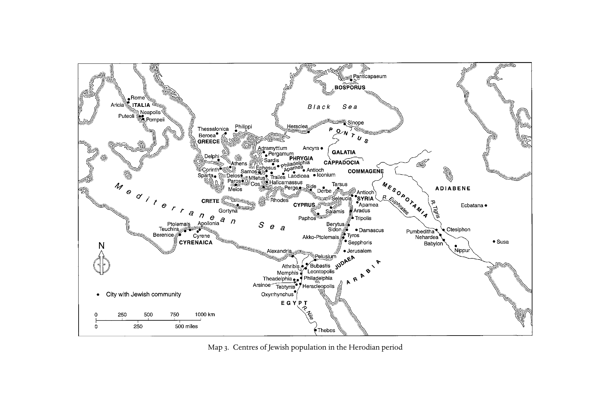

# 第二章 犹太人的散居

**作者：泰莎·拉贾克（Tessa Rajak）**

《剑桥基督教史》第一卷《起源至君士坦丁》中文译稿

> 对应原书第 53–68 页，PDF 第 102–117 页。正文及 52 条脚注完整翻译；脚注中的作者名、书名、论文名和文献定位保留原文，解释性文字译为中文。沿用第一章的术语与纪年格式，保留作者的判断、保留意见及原文引证。原书出版于 2006 年，文中的“近来”“目前”等表述属于作者写作时的语境。
>
> [第二章英文原文](<第二章 犹太人的散居（英文）.md>) · [第一章中文译文](<第一章 公元一世纪的加利利与犹太地区（中文）.md>) · [原书 PDF](<../01 起源至君士坦丁.pdf>)

## 发展与遗产

<!-- 原书第53页；PDF第102页 -->

犹太历史中的第二圣殿时期，从公元前 538 年结束巴比伦之囚、返回故土，一直到公元 70 年罗马人洗劫耶路撒冷，恰当地被称为“犹太教的形成期”。我们今天所理解的犹太教，其许多特征和制度，都是在这一时期形成的。在这些发展中，散居，即人口的分散，其极其重大的历史意义无可争辩。换言之，犹太人必须适应这样一种处境：一部分人生活在故土，另一部分人则生活在其他地方的社群之中。公元 70 年的灾难之后，尤其是在公元 135 年巴尔·科赫巴起义失败、犹太人被禁止进入耶路撒冷之后，散居的重要性进一步增强。不过，拉比运动最初的重要繁荣，仍发生在犹太地区和加利利，因此，这种分处两地的生存格局延续了下来。

散居的历史通常被认为始于公元前 587／586 年：尼布甲尼撒把耶路撒冷居民掳走。后来，波斯王居鲁士准许他们返回，但许多人自愿留在巴比伦尼亚。当地社群延续了数个世纪，也曾经历繁荣，并在古代晚期产生了拉比学术最重要的丰碑——《巴比伦塔木德》。这部庞大汇编也保存了大量来自以色列地的传统，但它毕竟是散居地区学园的产物。另一方面，犹太人大量分布于地中海各地，是在亚历山大大帝征服东方之后出现的，并在希腊人、继而罗马人的统治下得到巩固（见地图 3）。希腊化犹太教的主要文学成果——《希伯来圣经》的希腊译本，即“七十士译本”（LXX），以及斐洛和约瑟夫斯的著作——在近代以前主要被纳入基督教文化，并通过基督教的传承保存下来。在文字记录中断之后，考古学仍为我们提供了相当数量的实物遗存，见证地中海地区这些犹太散居社群的存在。

## 思想观念

<!-- 原书第54页；PDF第103页 -->

人们对流亡处境的思考，与远离故土的生活状况一同演变。“diaspora”一词本身，就出自亚历山大里亚的希腊文《妥拉》译本，最早见于《申命记》（28:25；30:4–5）。它源于一个意为“撒散”的希腊语词根，用同一个译词统摄了若干不同的希伯来语词，其中包括意为“流亡”的 galut，由此形成了一个比此前更连贯的概念构造。如同《希伯来圣经》中的表述，散居是一种暂时的离散处境，此后必将迎来重新聚集，例如《诗篇》第 146 篇、《以赛亚书》49:6、《以斯拉书》11:9，即《尼希米记》1:9，尤其是《马加比二书》1:27 中的祷告。有时，特别是在先知书中，这种处境被视为蒙羞的状态，并被解释为对民族的惩罚（例如耶 41:12–22；但 12:2）。但在希腊化—罗马时期的希腊文犹太著作中，对散居更为积极的理解日渐流行。表达这种看法的不仅有亚历山大里亚的斐洛，还有出身犹太地区祭司阶层的约瑟夫斯，尽管后者是在耶路撒冷陷落之后，于散居地区写作的（AJ 4.115；14.110）。[^1]这两位作者都没有使用具有专门含义的名词 diaspora，虽然约瑟夫斯使用了同一词根的动词形式。事实上，他们并未在概念上把生活在以色列地的犹太人与其他各地的犹太人截然分开。[^2]另一方面，他们的著作也充分提到现实存在或令人向往的故土；斐洛还谈到最终的重新聚集，约瑟夫斯则没有。这种依恋已经隐含在犹太人的通常称呼 ioudaios／a 之中，因为这个词本来就指来自犹太地区的人。[^3]斐洛有一段经常被引用的话，概括了这一点：他借用希腊人谈论殖民城与母城时的语汇，指出世代居住之地是犹太人的故乡（patris），而耶路撒冷则是他们的母城（metropolis；《反弗拉库斯》46）。[^4]

## 散居的地点与人口

<!-- 原书第54–55页；PDF第103–104页 -->

犹太社群固然会回应各自的地方环境，但巴勒斯坦与散居地区的利益和关切，在思想与行动的许多领域又是相通的；两者在看法上的差距，主要是侧重点和相互权衡的不同。此外，从地理上说，一方面是犹太地区与加利利，另一方面是散居地区，二者之间的边界既没有被明确划定，也不可能完全界定清楚。无论在沿海，还是约旦河彼岸的低加波利，这片狭小的犹太领土四周，都环绕着希腊—叙利亚城市，犹太人与异教徒，后来还有基督徒，在其中共同生活。罗马行省的首府凯撒利亚，是这些城市中尤其显著的一座。在主要中心之外，加利利乡村与犹太地区不同，同样是人口混居的区域。因此，研究这一地区的专家完全有理由发问：生活在加利利，对犹太人而言，是否也是“一种散居式的生存”？[^5]这个问题当然没有单一或简单的答案。

<!-- 原书第55页；PDF第104页 -->

重要的犹太聚居区，分布在罗马亚细亚行省的城市，包括小亚细亚的沿海和内陆地区，以及希腊和埃及。在埃及，象岛，即阿斯旺附近的 Elephantine，早在希腊化时代以前便有犹太军事移民，可能最早可追溯到公元前七世纪；后来，新的军事与平民移民又进入埃及的城镇和村落。纸草上保存的各类私人和公共文书，为我们观察这些社群的生活打开了一扇窗。[^6]亚历山大里亚的社群是希腊—罗马世界中最重要的犹太散居社群。尽管遭受骚扰与迫害，它始终保持着旺盛活力，直到图拉真统治时期的犹太起义使其遭受重创。这一社群之所以突出，有若干原因：人口众多；周边较小的犹太社群构成了强大的腹地支持；[^7]在城中十分显眼——全城五个区中，有两个是犹太区，而其他区域也有犹太人居住；其会堂规模宏大、富丽堂皇，塔木德文献提及时仍流露出惊叹（t. Sukk. 4.6；y. Sukk. 5.1.55a–b；b. Sukk. 51b）；在希腊化和罗马时期，其部分精英成员拥有崇高地位；此外，它还创造了富有活力的犹太希腊文化，源头和基础都是七十士译本。我们很幸运，这个社群最杰出的代表，公元一世纪的释经家、哲学家和社群代言人斐洛，其大部分著作都保存了下来。[^8]

<!-- 原书第55–56页；PDF第104–105页 -->

罗马的犹太社群在公元前二世纪中叶之前便已建立。此后，它不仅因一般性移民而增长，还因一批批被奴役的犹太人的到来，发展到数千人的规模。[^9]这些人中，许多是在巴勒斯坦的历次战争之后被俘的；通过依照罗马法获得解放，他们能够在两代之内取得公民权。不过，在首都取得财富和较高社会地位，无疑比在行省城市中更加困难。罗马犹太地下墓窟保存下来的墓志铭，大多可追溯到公元三至四世纪；它们似乎表明，死者及其家属多是经济条件相当普通的人。除少数例外，他们与罗马平民中的很大一部分一样，依旧说希腊语，而非拉丁语。现存资料提到十一或十二个不同的犹太会堂，也有可能存在一个统辖各会堂的社群组织。[^10]

<!-- 原书第56页；PDF第105页 -->

罗马帝国境内犹太散居的范围，可以大致而非精确地描绘出来；无疑，也有一些社群没有留下任何痕迹。[^11]不过，斐洛在引述一封据称由希律家族的亚基帕一世写给盖乌斯皇帝，即卡利古拉，的信时，提供了一份颇有用的概览。由于这封信旨在强调犹太人分布之广，我们可以认为，作者已经尽其所能地列举完整：

> 埃及、腓尼基、柯勒叙利亚，以及叙利亚的其余地区，直到更远的人类居住之地——旁非利亚、基利家，亚细亚的大部分地区，远至庇推尼和本都的各个角落〔黑海地区〕；同样也进入了欧洲——色萨利、彼奥提亚、马其顿、埃托利亚、阿提卡、阿尔戈斯、哥林多，以及伯罗奔尼撒大部分最优良的地区……还有那些最受重视的岛屿：优卑亚、塞浦路斯、克里特。至于幼发拉底河以外的国家，我还没有说到。（《致盖乌斯使团》281–4）

斐洛没有列出意大利和罗马，后者正是其作品的叙事背景，也遗漏了北非的昔兰尼加和迦太基。后来成为罗马阿拉伯行省的地区，同样有犹太人。在古代晚期以前，西班牙、高卢和日耳曼存在犹太社群的证据十分稀少，尽管在一些地方发现了年代更早、与犹太教有关的器物。

<!-- 原书第56–57页；PDF第105–106页 -->

若要捕捉犹太散居生活中的若干片段，我们会借助约瑟夫斯《犹太古史》中的个别事件，以及《路加福音—使徒行传》后半部分关于保罗与不同会堂及其领袖交往的、颇有争议的记述。这两种性质迥异的材料，偶然照亮的地点竟然很少重合。例如，约瑟夫斯完全没有提到希腊本土的犹太人；如果只依靠他的著作，我们就不会知道庇哩亚或腓立比存在犹太社群。另一方面，别迦摩是一个重要中心，约瑟夫斯引述的有关犹太人特权的法令，似乎也曾在那里集中保存。它既以行省首府著称，也是《启示录》七城之一（参启 2:12–17），却不在保罗活动的范围之内。

<!-- 原书第57页；PDF第106页 -->

要估算犹太人口的规模，证据的不足就更加严重。一位近来探讨过这一问题的古代史学家甚至有说服力地主张，干脆应放弃这种尝试。[^12]斐洛所说埃及有一百万犹太人，很可能不过是一种修辞性的夸饰；少数学者提出罗马帝国全境有八百万犹太人的惊人估计，[^13]其依据则是可疑的中世纪材料。

## 散居地区的犹太身份与宗教实践

古代地中海世界的犹太身份具有很大差异，这并不令人意外。不过，我们依然可以谈论一些共同特征。如同后来的时代，人们对“犹太人”意味着什么的理解，同时包含族属和宗教两方面的要素。

<!-- 原书第57–58页；PDF第106–107页 -->

由于没有中央权威，而我们所考察的时间又很长、地域又很广，各地还受到不同的区域性影响，因此，哪怕只是尝试对散居地区的宗教实践作出概括，似乎都显得冒失。[^14]不过，我们仍可谨慎地从通常所要求的最低限度入手，探讨怎样才算是一个犹太人。希腊和罗马作者嘲讽犹太习俗与行为的言论，多少能让我们了解其外在表现。尽管这些言论依赖刻板印象和带有敌意的夸张描绘，它们毕竟在某种程度上记录了哪些实践引起了外人的注意。[^15]合理的推测是，一般而言，散居犹太人愿意遵行《妥拉》规定的核心习俗，由个人在家庭生活中加以实行。男性割礼是《圣经》中盟约的标记，也是外人辨识犹太人的主要标志。[^16]遵守安息日尤其令异教徒困惑，在他们看来，这无异于懒散和愚昧。尽管如此，一些犹太人还是可能申请并获准免服兵役，以免必须在安息日作战；奥古斯都也豁免了他们在这一天出庭的义务（斐洛，《致盖乌斯使团》23；158；约瑟夫斯，AJ 16.27）。调整粮食配给的时间，是犹太人的另一项请求。异教作者中有一个相当普遍、却几乎肯定有误的看法，认为安息日是禁食日；但这至少表明，某些固定的或额外的禁食，确实属于犹太人的宗教实践。三个与农事和朝圣有关的节日——逾越节、Sukkoth，即住棚节，以及 Shavuot，即七七节——体现了散居犹太人与以色列地的联系，也申明了圣殿的重要性。利未记的饮食规定经常出现在散居文献的叙事中；作者让故事中的人物避开禁食之物或外邦人准备的食物，其中无疑部分带有劝诫目的。在保罗文献中，我们能够看到人们对祭过偶像之肉的反感（《哥林多前书》第 8、10 章；参徒 15:29；启 2:14）。通过洗濯获得洁净，与祷告联系在一起；有趣的是，与巴勒斯坦相比，在散居地区，以洗手实现洁净的证据，比浸入浴池的证据更加充分。[^17]与未归信犹太教的外邦人通婚，不被认可，但无疑仍会发生。[^18]

<!-- 原书第58页；PDF第107页 -->

耶路撒冷制定的律法裁决，有时确实可能被送往海外；但我们仍可赞同这样一种看法：“散居犹太人有能力解释《圣经》，他们并非坐在那里，耐心等待希列学派和沙买学派把彼此的分歧寄给他们。”[^19]即使在圣殿被毁之后，逐渐发展起来的拉比运动所宣称的权威，也很可能很少深入到远离其加利利中心的地区。公元 200 年前后，犹大·哈纳西拉比的《米示拿》体现了这一运动的生活规范；但尽管流传下来的大量拉比游历故事容易给人不同印象，其影响范围仍可能相当有限。[^20]在公元四世纪以前，散居地区的铭文没有提到拉比。[^21]

<!-- 原书第58–59页；PDF第107–108页 -->

欧文·古德伊纳夫曾在一部规模宏大的研究中，试图把散居犹太教建构为一个独立而极具特色的宗教体系。他强调斐洛的寓意解经、那些具有鲜明特征的视觉象征及其可能含义，以及许多包含显著犹太因素的魔法纸草文献所表现出的高度混融性。但是，其中第一项几乎不可能构成普通人的信仰基础；第二项被古德伊纳夫过度解释了；第三项则属于犹太人、异教徒和基督徒共同参与的活动领域。更恰当的看法是，E. P. 桑德斯所界定的“共同犹太教”，把巴勒斯坦与散居地区联系在一起。[^22]公元 70 年以前，人们所期待的对圣殿和耶路撒冷的忠诚，通过两个德拉克马，即半舍客勒，的圣殿税来表达；罗马人允许征收并运送这笔税款。朝圣也是这种忠诚的表现；我们恰好知道，斐洛一生中曾有一次完成过这种虔敬之举（Prov. 残篇 2.64）。公元前二世纪，持异议的敖尼雅家族大祭司在下埃及的莱昂托波利斯建立了一座圣殿，但它只有地方性的重要意义。公元 73 年，犹太地区的起义已被彻底镇压之后，韦斯巴芗下令关闭了这座圣殿；其目的大概是威慑，并消除残余抵抗力量可能集结的任何中心（约瑟夫斯，BJ 7.433–5）。

<!-- 原书第59页；PDF第108页 -->

第二圣殿时期巴勒斯坦显著的宗教多样性，在散居地区只有较微弱的回响。斐洛在《论沉思生活》中谈到马雷奥提斯湖畔一个称为 therapeutai 的群体，他们实行禁欲性的共同生活，与爱色尼派颇为相似。如果根据《使徒行传》所说扫罗曾师从迦玛列学习（徒 22:3），就可以把这位大数人的散居犹太家庭视为法利赛派。古德曼则把《马太福音》23:15 对法利赛人的严厉指责，[^23]解释为针对一项专门由法利赛派向散居地区开展的传教活动。耶路撒冷圣殿的毁灭，很可能使撒都该派大祭司阶层的幸存成员分散各地。此外，如果沿用约瑟夫斯的说法，把公元 66–73 年的起义者视为犹太教中一条独立的思想脉络或“哲学派别”，那么这里就应提到，这位历史学家记载：起义失败之后，西卡里人，即“刺客”，把活动转移到了昔兰尼加（BJ 7.437–41）。另一种偏离主流的倾向，体现在那些对律法作寓意解释、继而不再遵行律法的人身上；他们因此受到斐洛的批评（Migr. 89）。

<!-- 原书第59–60页；PDF第108–109页 -->

圣殿的毁灭，无疑推动了会堂的发展，使其成为各地社群自立的依托，尽管变化的速度很难判断。这个希腊词本来只意为“集会”或“社团”。此后，无论是指宗教社群还是其公共建筑，“会堂”几乎都只与犹太教的实践联系在一起。除了诵读和研习《妥拉》、背诵与祷告，会堂还成为慈善、社交和政治活动的重要实体场所。从考古学看，已经发掘出的约十五座散居地区会堂，其身份主要不是凭设计和布局来识别——这方面并无统一模式——而是凭一小组特定象征：它们被刻出、划出，或镶入马赛克，成为装饰的一部分。除七枝灯台外，分布最广、最能可靠标识犹太教的，还有与圣殿礼仪有关的象征，例如羊角号、香铲和水罐，以及与住棚节有关的棕榈枝和香橼。通常还能够辨认出一座、偶尔两座《妥拉》经柜。在杜拉·欧罗普斯，即使没有其他保存下来的同类例证，那一系列丰富的公元三世纪圣经题材图像，也足以使人毫不怀疑建筑使用者的身份。[^24]相比之下，斯托比的铭文则详细规定了如何把波吕卡尔穆斯的部分私宅转交社群使用。在私人住宅中集会，想必绝不是什么罕见之事。[^25]

## 犹太社群

<!-- 原书第60页；PDF第109页 -->

统治权力向犹太社群作出的承诺，本质上并不持久，而且会受到地方压力的影响。命运如钟摆般来回摆动，是散居文献偏爱的主题：其叙事往往以《出埃及记》中新法老的出现，以及《以斯帖记》情节中的逆转，作为理解模式。[^26]但在最有利的情况下，散居地区扎根已久的社群，仍可获得稳定，并保持延续。

<!-- 原书第60–61页；PDF第109–110页 -->

奥古斯都时代，亚历山大里亚的犹太社群取得了一定程度的法律自治。就连外部观察者、希腊作家斯特拉波也注意到这一点：“他们之上有一位族群长官，管理社群，审理诉讼，照管契约，就仿佛他是一个独立政体的统治者。”（引自约瑟夫斯，AJ 14.117）关于埃及，以及昔兰尼加的贝勒尼基城，有时会出现 politeuma 一词，指一个自治单位。[^27]在其他地方，犹太群体只是利用城市为各类社团、行会和宗教团体提供的行政与社会空间。[^28]Synagōgē 只是这类集体组织的名称之一。不过，就现有证据所能显示的而言，犹太人对这些组织的用词始终相当灵活，因地点和群体而异。其他名称还有 synodos、syllogos、laos，即“人民”，以及拉丁语 universitas；一些犹太群体在铭文中甚至只是自称 hoi ioudaioi，即“犹太人”。Proseuchē，意为“祷告所”，字面上则是“祷告”，这个词显然产生于托勒密时期的埃及，最早可见于公元前三世纪的文献，到了罗马时期仍偶尔出现。[^29]

<!-- 原书第61页；PDF第110页 -->

犹太社团领袖与任职者的荣衔，同样并不统一。犹太社群常有自己的 archontes，即“执政官”，与城市社会称呼其行政长官的用语相呼应。会堂领袖 archisynagōgos 在整个时期都十分重要。铭文所呈现的是这一显贵的荣誉地位与公共角色，却明显没有提到礼仪职责或相关联系。[^30]一些会堂中出现了引人注目的女性任职者；这一现象同样能在更广阔的社会中找到对应：罗马时期小亚细亚的城市里，自主女性拥有不同寻常的突出地位。[^31]

## 社会与文化身份：同非犹太人的互动

<!-- 原书第61页；PDF第110页 -->

正如我们已经看到的，散居地区犹太社群的延续，依靠的是务实的立场；除此之外，还依靠对多重身份之复杂性、以及互动的可能与限度的细致理解。适应环境，并在一定程度上融入更广阔的社会，是一个可以观察到的普遍模式。[^32]某些犹太个人与群体，想必曾在相当大的规模上被同化，最终融入周围环境，不再作为独立群体存在；但这类过程由于其本身的性质，并不会留下记录。

<!-- 原书第61–62页；PDF第110–111页 -->

文化身份的一个根本决定因素，是主要使用地中海通用语言希腊语作为口语和书面语言，不仅用于日常生活，也用于宗教目的。后者之所以可能，源于一项意义重大的决定：把“犹太律法”译成希腊语。这个决定很可能早在公元前三世纪中叶便已作出，而且很可能如《阿里斯提亚书信》所说，得到了一位好学而有文化修养的托勒密国王的支持。关于译本起源的传说，把翻译工作归于来自犹太地区的学者。此后，《希伯来圣经》的其他各卷也陆续被译成希腊语；这些译本运用同一种经过精心锤炼、极富特色的“翻译语言”的不同变体，制作过程延续了几个世纪，而且很可能也在亚历山大里亚以外的地方展开。翻译是文学活动的一个重要分支，这一点在希腊文《便西拉智训》的序言中表现得很清楚：作者的孙子解释了，自己来到埃及之后，如何、又为何努力翻译那位博学祖父所写的智慧与训诲之书。这说明，希伯来语作为神圣语言和民族语言，依然受到尊重；同时也意味着，至少在散居人口中的学者阶层，存在着实际运作的双语能力。

<!-- 原书第62页；PDF第111页 -->

然而，这些活动也表明，犹太人在文化适应方面达到了很高程度。现存证据只能让我们极偶然地窥见：这种适应如何体现在犹太人参与城邦的教育和文化机构之中。但从文学遗产可以看出，斐洛深入掌握希腊哲学和文学的情形，在一些地位不及他的作者那里也有对应者。例如，《马加比三书》《马加比四书》以及《所罗门智训》的匿名作者，这些作品都被收入次经；《马加比二书》所概述的、如今已经失传的原始著作，其作者在书中被称为昔兰尼的雅孙；还有那位被称作伪赫卡泰奥斯的托名写作者。此外，编年史家德米特里乌斯、被称为“逍遥学派哲学家”的亚里斯托布鲁斯、史诗诗人斐洛，以及以埃斯库罗斯风格创作出埃及题材悲剧的以西结，这些作者所采用的文类和风格，也很能说明问题。他们的作品由克莱孟和优西比乌以片段形式保存下来。[^33]

与其把“希腊主义”和“犹太教”这两个沿用已久的抽象概念，想象成彼此对立的两种世界观，不如把散居文化理解为各种传统复杂交织的结果。它们共同织成了讲希腊语的犹太教所独有的文化，其经纬已无法再一一分离。同时，如今人们已广泛接受：希腊化过程也是犹太地区社会发展不可分割的一部分，尽管其影响的范围、深度和意义仍有争议。[^34]

<!-- 原书第62–63页；PDF第111–112页 -->

在物质文化方面，丧葬实践和墓志铭，揭示了犹太人如何适应不同的散居环境。犹太人通常采用周围社会通行的埋葬方式和墓志铭类型，[^35]也往往沿用常见的墓葬装饰艺术风格。在公共墓地中发现的犹太墓葬里，弗里吉亚希拉波利斯那片保存至今的庞大墓地中的实例，尤其引人注目；那里至今仍不断出土新的珍贵材料。在这种总体趋同之中，犹太人的群体身份又通过一系列细微的文化标记得到维持。当异教徒逐渐以土葬取代火葬时，犹太人始终只实行土葬。在罗马，土葬还可能结合一种特殊做法：把遗骨收入骨盒，实行二次安葬，显然沿袭了耶路撒冷及其周边盛行的习俗。罗马独特的犹太地下墓窟，例如维尼亚·兰迪尼尼墓窟，以及托洛尼亚别墅地下的墓窟，预示了后来规模庞大的基督教地下墓葬系统。[^36]至少在这里，约瑟夫斯所宣扬的反对奢华墓葬的训诫，似乎得到了有意识的遵守（《驳阿庇安》2.205）。

<!-- 原书第63页；PDF第112页 -->

铭文学也为犹太人参与城市生活提供了证据。现存约两千篇犹太铭文中，包括一些简短的颂扬性铭文；在这方面，犹太人或许同样表现出某种特有的节制。[^37]一篇公元一世纪的昔兰尼加铭文，证实有犹太青年（ephebes）与体育馆发生联系。到三世纪，小亚细亚出现了犹太城市议员（bouleutai）。不过，评估这一现象的意义时，应当记得：他们出现的时代，市政公职正日益成为旧有精英的负担。关于这一发展，我们拥有的最佳证据，是卡里亚阿佛洛狄西亚斯那篇著名铭文：石柱的一面列出一个由犹太人与归信者组成的社团的成员，另一面则列出一群“敬畏上帝者”（God-fearers，下文简称“敬神者”），其中包括若干城市议员。不过，这篇铭文的年代，如今看来要比最初所想的更晚。[^38]可以肯定，担任市政公职意味着至少要被动地参与异教礼仪，因为这些礼仪既与城市的仪典生活不可分割，也构成了每一种公共活动的一部分。

<!-- 原书第63–64页；PDF第112–113页 -->

一些非犹太人通过充当资助者，表达对犹太社群的支持。朱利娅·塞维拉修建了一座“房屋”，会堂后来就在这座房屋中建立；地点在弗里吉亚的阿克摩尼亚。她竟然正是尼禄统治时期一位主持皇帝崇拜的女祭司。后来，三个使用罗马三名制姓名的人修缮了这座建筑。既然这种公益捐助是双向进行的，我们便可以推断，某些犹太社群在城市环境中，是一股不容忽视的力量。在这里，散居会堂呈现为一个面向外部的机构，促进社群与周围世界的交往。[^39]

<!-- 原书第64页；PDF第113页 -->

外人还有一种更持久的方式，能够表明自己与犹太群体的联系，却不必成为正式成员。“敬神者”这一称呼被广泛使用，便暗示了这种可能。它具有若干不同形式：有的是 theosebeis，字面上意为“虔敬上帝者”，见于一些铭文；有的是 phoboumenoi 或 sebomenoi ton theon，字面上表示“敬畏者”或“敬畏上帝者”，后一种形式见于《使徒行传》[^40]及其他铭文。不过，这两类用语无疑都指尚未归信的同情者。这些人对犹太教的兴趣，同样可能既出于宗教或精神倾向，也出于社会因素。这个称呼是否意味着使用者属于一个正式、普遍认可的犹太社群附属类别，仍是一个尚无定论、持续引发争论的问题。无论如何，可以清楚看到，“犹太化”是一个十分显眼的现象，约瑟夫斯对此颇感自豪，也乐于谈论。他宣称，叙利亚每座城市既有犹太人，也有犹太化者（BJ 2.462–3）；叙利亚安提阿还有大量市民被犹太习俗吸引，并“以某种方式”被纳入犹太人的共同体（BJ 7.45）。在大马士革，男人们担心这些影响波及自己的妻子（BJ 2.560）。某些区域性的铭文群，特别是吕基亚的诅咒铭文，把犹太教或基督教因素与当地异教惯用语混合得如此彻底，以至于很难判断：书写者是否有意识地趋向犹太教，我们看到的是否只是犹太影响的痕迹，抑或这不过是一种宗教混合，其信奉者甚至不知道自身传统中包含了犹太因素。“至高上帝”这一称号，既用于希伯来人的上帝，也用于宙斯。在克里米亚博斯普鲁斯地区的释奴铭文作者中，就有敬拜“至高上帝”的人；铭文中获释的奴隶，仍须“对会堂”承担某些剩余义务。[^41]

<!-- 原书第64–65页；PDF第113–114页 -->

如果假定“敬神者”和“犹太化者”总是用来指这样一些人：他们在通向归信的艰难道路上走了一段，却在某个地点停了下来，那就过于简单了。相反，这类称呼反映的是罗马城市宗教“市场”中选择的广度与复杂性，以及众多彼此重叠的身份。[^42]另一个由七十士译本创造的词 prosēlytos，即“归信者”，含义就较为明确。完全成为犹太人，是一个真实存在的选择。虽然在这一时期，犹太权威人物似乎很少、甚至从未主动招徕归信者，但归信者显然并不罕见，也往往并非不受欢迎。[^43]阿迪亚贝尼王朝因一位兼具商人和传教者身份的人士的活动而归信，此后，它不仅向圣殿作出重要捐赠、援助耶路撒冷，也支持了公元 66–73 年的起义者。不过，大多数人接触犹太教，还是通过个人交往，或当地显而易见的会堂活动。斐洛赞美那些放弃一切、前往“更美好的家园”的归信者所具有的勇气。[^44]约瑟夫斯则写道，在许多加入者中，有些人“缺乏必要的坚忍，后来又离开了”（《驳阿庇安》2.123）。这不是一条容易走的路。但无论人数究竟多少，它都是一个主流现象。一个群体，其历史性的自我理解鼓励人们主动保持分离，却又维持着如此开放的边界，其中或许存在着一种悖论。

## 与邻人及统治权力的冲突

<!-- 原书第65–66页；PDF第114–115页 -->

尽管犹太人已经适应周围文化——或者恰恰因为如此——他们与邻人之间的摩擦并不少见。在希腊化时期的亚历山大里亚，反犹太教的倾向既表现为文学论述，也表现为民众情绪。[^45]但真正使犹太人与希腊人之间产生严重对立的，是罗马对埃及的兼并；这一变化损害了双方的地位。公元 38 年，卡利古拉短暂却充满挑衅的统治期间，暴力爆发了：会堂被焚，商店遭劫，犹太人被驱赶集中到隔离区，并受到袭击，许多人遇害。他的继任者克劳狄皇帝进行了调查，颁布措辞严厉的敕令，恢复交战双方之间的平衡；然而，他仍毫不避讳地说，亚历山大里亚犹太人居住在“一座不属于他们的城市”，还把据称由犹太人造成的纷争说成一种“普遍的……疾病”。[^46]公元 66 年，巴勒斯坦的紧张局势在若干叙利亚城市引发了希腊人与犹太人之间的暴力。凯撒利亚发生了一场围绕空间使用的族群—宗教争端，罗马对这一争端的处理，成为第一次犹太起义的导火索之一。起义失败后，巴勒斯坦周边城市又出现了更多城市冲突，以及针对犹太少数群体的袭击。

<!-- 原书第66页；PDF第115页 -->

犹太人十分清楚，统治权力对自己的命运具有决定性影响；他们也理解，获得政府支持，无论是何种政府，都至关重要。广为流传的七十士译本起源故事，正是这种认识的集中体现：托勒密二世·菲拉德尔福斯国王热情地下令进行这项翻译。塞琉古征服者安条克三世曾颁布敕令，保护耶路撒冷圣殿的洁净与神圣权利，这为后来树立了先例；显然，无论犹太人身处何地，此举都对他们意义重大。希律王朝成员在外交中发挥了主导作用，使罗马行省的犹太社群先后得到尤利乌斯·凯撒、马库斯·安东尼和奥古斯都的庇护。凯撒禁止 collegia，即“社团”，却把犹太会堂排除在禁令之外。当犹太社群与邻人发生争执时，罗马的声明维护了他们遵行传统习俗（nomoi）的权利，因而对他们有所帮助；不过，这类声明需要反复重申。约瑟夫斯的《犹太古史》见证了这样一个过程：在罗马共和时期、三头政治时期和帝国早期，支持希腊城市中犹太人的元老院、行政官或行省总督的敕令与决议，是如何以坚决而警惕的态度，被争取、促成、守护并归档的。[^47]在整个时期，这些文件既提供实际帮助，也成为犹太人的自豪之源。后来的基督教作者认为，与教会相比，犹太教在罗马帝国享有合法地位；用德尔图良的话说，它是一种 religio licita，即“合法宗教”（《护教篇》21.1）。

然而，现实中罗马统治下的犹太历史，经常充满深重的不安。文献记载了三次暂时把犹太人逐出罗马城的行动：第一次早在公元前 139 年，另外两次则发生在提比略和克劳狄两位皇帝统治时期。这些措施始终被归因于犹太人招徕归信者的活动；至少在人们的观感上，这些活动加剧了普遍的宗教与社会焦虑，促使罗马时而对东方宗教和哲学家采取行动。[^48]直到塞普蒂米乌斯·塞维鲁统治时期，归信犹太教才遭到正式禁止。

<!-- 原书第66–67页；PDF第115–116页 -->

公元 70–73 年起义遭到镇压，罗马还发行著名的“犹太被征服”（Judaea capta）钱币加以庆祝。此事使世界各地犹太人的地位都受到贬损。圣殿不被允许重建；原先的圣殿税因而被转入罗马新设的犹太税库（fiscus iudaicus），用以重建罗马卡庇托林山上的朱庇特神庙。征税范围又扩大到妇女与儿童，多米提安皇帝在最初一些年间还严厉征收，这构成了一种集体惩罚。多米提安的继任者涅尔瓦于公元 97 年宣布，对其中某些滥用行为加以缓解，但这项征敛一直延续到古代晚期。

<!-- 原书第67页；PDF第116页 -->

公元 115／116 年，昔兰尼加、埃及和塞浦路斯的散居犹太人相继起义，既反抗异教邻人，也反抗罗马当局（卡西乌斯·狄奥 68.32；优西比乌，《教会史》4.2.4；奥罗修斯，Hist. 7.12.6–7）。其背景是巴勒斯坦起义留下的后果，其中也可能带有弥赛亚色彩。在主要起义稍早的时候，看来巴比伦尼亚的犹太人已参与了图拉真新近征服的美索不达米亚行省中一场成功的反叛。罗马军队费了很大力气，才镇压这些犹太起义。亚历山大里亚社群多年后才恢复元气，一些乡村社群则彻底消失。图拉真去世后不久，继这些起义之后，巴勒斯坦又爆发了一场反对其继任者哈德良的大起义。领导者是自称“以色列之君”的巴尔·科赫巴，显然还得到了一些拉比领袖的支持。相关史料很匮乏；但如果皇帝禁止割礼的措施，无论其目的为何，确实如《奥古斯都史》所说，是这最后一次大规模抵抗爆发的导火索（《哈德良传》14.2），那么散居犹太人所受的打击，就会与巴勒斯坦犹太人同样沉重。[^49]据称，这项禁令后来被安敦宁·庇护撤销。[^50]起义之后，罗马殖民城埃利亚·卡庇托利纳在耶路撒冷的废墟上建立起来，卡庇托林朱庇特崇拜直接被安置在圣殿遗址上；散居犹太人无疑也充分感受到了由此带来的苦难。巴巴塔是一位散居犹太妇女，原先生活在纳巴泰人之中，并在罗马阿拉伯行省拥有土地、参与诉讼。她的文书是在死海附近的洞穴中发现的；她大概曾为躲避这次起义而藏身于此，并最终死在那里。[^51]

<!-- 原书第67–68页；PDF第116–117页 -->

在经历了一个必须视为犹太历史低谷之一的世纪之后，犹太人的历史或许才于二世纪后半叶进入了一个较少动荡的时期。已经发掘出来的散居会堂遗址和铭文，大部分属于这个时代。在撒狄，一座大型会堂紧邻全城主要的浴场—体育馆建筑群；它很可能原是一座市政建筑，在公元二或三世纪通过某种方式被犹太社群取得，此后又屡次经过精心修缮，一直延续到六世纪。在现代解释中，它已成为一种象征：犹太人融入了一座城市的生活，而这座城市本身又是晚期异教文化的重要中心。[^52]这种理解可以成立，但前提是，我们意识到象征本身可能承载的含混性。物质遗存可能使我们产生一种令人安心的印象，仿佛它见证的是和谐融入，以及一个社群所拥有的力量。但与此同时，散居处境的本质更多在于无力，而非有力；其局势随时可能转为尖锐对立。这无疑是地中海犹太人在我们所考察的半个千年散居历程中学到的教训。早期基督教社群也有过许多同样的经历；面对这些经历，他们既运用了旧有方法，也发展出了新的应对方式。

## 地图 3：希律时期的犹太人口聚居中心

原书第 52 页、PDF 第 101 页的本章前置地图。地图地名保留英文，以便对照原书。

## 脚注

[^1]: 关于这些观念及其在拉比传统中的延续，参 Gafni, *Land, center and diaspora*, 19–78。

[^2]: 参 Rajak, ‘Josephus in the diaspora’, 81–3。

[^3]: 参本卷前文第一章。

[^4]: S. Pearce 在‘Jerusalem as “mother-city” in the writings of Philo of Alexandria’中探讨了其中的细微差别，见 Barclay, *Negotiating diaspora*, 19–37。

[^5]: 参 S. Freyne, ‘Introduction: studying the Jewish diaspora in antiquity’，收入 Bartlett, *Jews in the Hellenistic and Roman cities*, 1–5；另参前文第一章。

[^6]: 参 Mélèze-Modrzejewski, *Jews of Egypt*。相关文书参 CPJ。

[^7]: 详细论述见 Kasher, *Jews in Hellenistic and Roman Egypt*。

[^8]: 关于斐洛数量庞大、内容复杂的著作的导论，参 Schürer, *History*，第 III 卷第 2 分册，809–89。

[^9]: 参 Leon and Osiek, *Jews of ancient Rome*；Rutgers, *Jews in late ancient Rome*。

[^10]: Williams, ‘Structure of the Jewish Community’。

[^11]: 权威性综述见 Schürer, *History*，第 III 卷第 1 分册，1–86。

[^12]: B. McGing, ‘Population and proselytism: how many Jews were there in the ancient world?’，收入 Bartlett, *Jews in the Hellenistic and Roman cities*, 88–106。

[^13]: 例如 Feldman, *Jew and Gentile*。

[^14]: T. Kraabel 曾提出这一论点，参‘The Roman diaspora: six questionable assumptions’及‘Unity and diversity among diaspora synagogues’，收入 Overman and MacLennan, *Diaspora Jews and Judaism*, 1–33。

[^15]: 相关文本汇集于 Stern, *Greek and Latin authors*。

[^16]: Cohen, *Beginnings of Jewishness*, 39–49；Isaac, *Invention of racism*, 472–4。

[^17]: Sanders, *Jewish law*, 260–72。

[^18]: Goodman, ‘Jewish proselytizing’, 63–6；Barclay, *Negotiating diaspora*, 410–12。

[^19]: Sanders, *Jewish law*, 256。

[^20]: 主要材料见 Williams, *Jews among Greeks and Romans*, 81。

[^21]: Cohen, ‘Epigraphic rabbis’。

[^22]: Sanders, *Judaism: practice and belief*, 47–303；另参 Rutgers, *Jews in late ancient Rome*, 201–9。

[^23]: Goodman, ‘Jewish proselytizing’, 61–2。

[^24]: 关于以上全部材料，参 Hachlili, *Ancient Jewish art*。

[^25]: 关于会堂历史所涉及的证据及解释问题，参 Levine, *The ancient synagogue*；Fine, *Jews, Christians and polytheists*；Runesson, *Origins of the synagogue*；Olsson and Zetterholm, *The ancient synagogue*；Rajak, ‘The ancient synagogue’。

[^26]: Gruen, *Heritage and Hellenism*，分析了若干此类故事。关于约瑟夫斯，参 Rajak, ‘Josephus and diaspora’, 92–7。

[^27]: 埃及的材料见 Kasher, *Jews in Hellenistic and Roman Egypt*, 29–38、208–11。昔兰尼加贝勒尼基城的文本见 Applebaum, *Jews and Greeks*, 167。关于近来对埃及犹太自治团体纸草文书档案的重建，参 Honigman, ‘The Jewish politeuma at Heracleopolis’。Smallwood 在 *Jews under Roman rule* 中，把 politeuma 理解为界定散居犹太社群地位的一个法律术语。

[^28]: Harland, *Associations, synagogues and congregations*。

[^29]: 关于用词的多样性，参 Rajak, ‘Synagogue and community’。

[^30]: T. Rajak and D. Noy，收入 Rajak, *The Jewish dialogue*, 393–430。

[^31]: Brooten, *Women leaders*，是一部里程碑式的研究。

[^32]: Barclay 在 *Negotiating diaspora* 中对这些现象作了精细区分。

[^33]: 关于这些文献，参 Schürer, *History*，第 III 卷第 2 分册，470–704；Collins, *Between Athens and Jerusalem*；Holladay, *Fragments*，第 I–IV 卷；Doran, ‘Jewish Hellenistic historians’；Bar-Kochva, *Pseudo-Hecataeus*。

[^34]: Hengel 的 *Judaism and Hellenism* 仍在引起争论；例如参 Collins and Sterling, *Hellenism in the land of Israel*。

[^35]: van der Horst, *Ancient Jewish epitaphs*；Rutgers, *Jews in late ancient Rome*, 100–38。

[^36]: Rajak, ‘Reading the Jewish catacombs of Rome’；Rutgers, *Jews in late ancient Rome*, 50–67；另参本卷下文第四部分第十六章、第六部分第三十二章。

[^37]: 较早的研究 CII，Frey 编，仍不可或缺。较新的成果参 Horbury and Noy, *Jewish inscriptions of Graeco-Roman Egypt*；Noy, *Jewish inscriptions of Western Europe*，第 I、II 卷；导论见 Williams, *Jews among the Greeks and Romans*；专题研究见 van Henten and van der Horst, *Studies in early Jewish epigraphy*。

[^38]: Reynolds and Tannenbaum, *Jews and God-fearers*；Chaniotis, ‘The Jews of Aphrodisias’。近来关于敬神者的研究，见 Levinskaya, *Book of Acts*, 51–82、117–26；以及 Lieu, ‘Race of the Godfearers’。

[^39]: Rajak，收入 *Jewish dialogue*, 463–78。

[^40]: 例如徒 13:43、16:14、17:4、17:17、18:7。

[^41]: Mitchell, ‘The cult of Theos Hypsistos’；Gibson, *Jewish manumission inscriptions*, 96–123；Levinskaya, *Book of Acts*, 83–116。

[^42]: Cohen, *The beginnings of Jewishness*, 140–97。

[^43]: Goodman 在 *Mission and conversion* 中论证了这一点。

[^44]: 斐洛，Spec. 1.52；Virt. 102–8。另见 Cohen, *The beginnings of Jewishness*, 157。

[^45]: Schäfer, *Judaeophobia*。

[^46]: CPJ，第 II 卷，153。

[^47]: Rajak，收入 *The Jewish dialogue*, 301–34；Pucci Ben Zeev, *Jewish rights*；Gruen, *Diaspora*。

[^48]: Isaac, ‘Roman religious policy’。

[^49]: Oppenheimer 的‘Ban on circumcision’和 Abusch 的‘Negotiating difference’，都否认这项禁令的历史真实性；参本卷下文第三章。

[^50]: Linder, *Jews in Roman imperial legislation*, 99–102。

[^51]: 文本见 Lewis et al., *Documents from the Bar Kochba period*；讨论见 Kraemer, ‘Typical and atypical family dynamics’。

[^52]: 总体评估见 Rajak, *The Jewish dialogue*, 447–62。

## 本章术语与引证说明

- **diaspora／dispersion：散居、离散。** 本章既讨论离开故土的处境，也讨论海外社群，不把所有 diaspora 一律等同于被迫“流亡”；exile 则译作“流亡”。
- **acculturation／integration／assimilation：文化适应、融入、同化。** 依原文区分，不混作一个过程。
- **synagōgē／synagogue：会堂、会堂社群。** 原词既可指集会群体，也可指建筑，译文依上下文处理。
- **God-fearers：敬畏上帝者、敬神者。** 保留作者对这一名称是否构成正式身份类别的疑问。
- **prosēlytos／proselyte：归信者。** 与尚未完全归信的敬神者区分。
- **AJ／BJ／Ap.**：约瑟夫斯的《犹太古史》《犹太战争》《驳阿庇安》。
- **Flacc.／Legat.**：斐洛的《反弗拉库斯》《致盖乌斯使团》。其他作品缩写及文献定位依原文保留。
- **LXX**：七十士译本。原文某些《圣经》书卷名称和章节编号采用希腊文传统，译文保留其定位；不以现代中文常见分章自行替换。
- **t.／y.／b. Sukk.**：分别指《托塞夫塔》《耶路撒冷塔木德》《巴比伦塔木德》中的《住棚节篇》，定位依原文保留。
- **CPJ／CII**：分别为 *Corpus Papyrorum Judaicarum*（犹太纸草文献集）与 *Corpus Inscriptionum Judaicarum*（犹太铭文集）。
