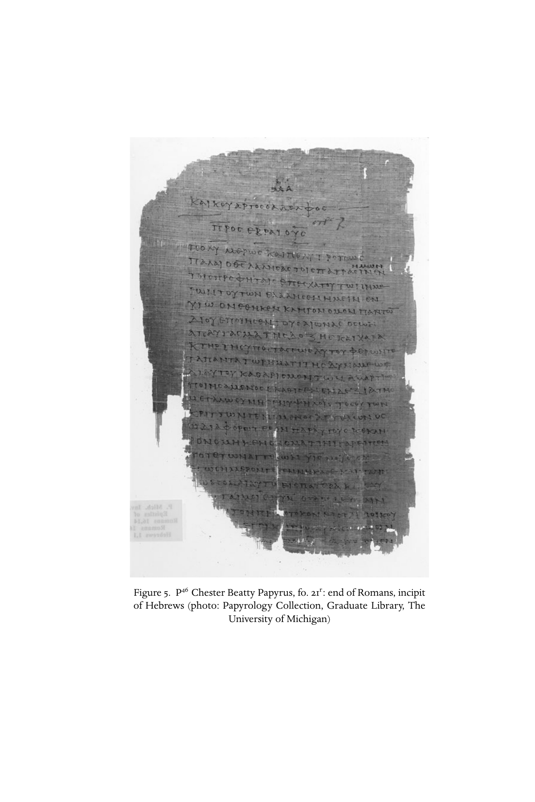

# 第八章 书面记录的形成

**作者：玛格丽特·M. 米切尔（Margaret M. Mitchell）**

《剑桥基督教史》第一卷《起源至君士坦丁》中文译稿

> 原书第177–194页，PDF第226–243页；附本部分前置图5。正文、引文及脚注解释译为中文，参考文献作者名、题名和定位保留原文。
>
> [第八章英文原文](<第八章 书面记录的形成（英文）.md>) · [原书PDF](<../01 起源至君士坦丁.pdf>)

<!-- 原书第176页；PDF第225页；本部分前置图版 -->

图5：切斯特·比蒂纸草P46，第21叶正面：《罗马书》结尾、《希伯来书》起首。摄影：密歇根大学图书馆纸草学藏品部。

## 文献之战

<!-- 原书第177页；PDF第226页 -->

现存最古老的拉丁文基督教文本，记载了对一位北非基督徒的如下审问：

> 总督萨图尔尼努斯问：“你箱子里那些东西是什么？”
>
> 斯佩拉图斯回答：“书，还有义人保罗的书信。”[^1]

不清楚这些“书和保罗的书信”，是被告斯佩拉图斯作为证物拿出来的——若是如此，出于自愿还是法官命令——还是带来教导、安慰囚犯的；但这次相遇，突出了基督徒身份与基督教文本之间的关键联系。公元303年2月，戴克里先通过立法规定三项战略行动，对基督教运动展开迫害。值得注意的是，他认为其中第二项，即交出文本并公开焚毁，[^2]对于摧毁这种信仰的重要性，不亚于拆毁教堂及剥夺其领袖的公民权利。后来继续迫害的马克西米努斯·达亚，显然也认同这一判断。他为对抗基督教经书的威胁，命人编写一部反制文献《彼拉多与救主回忆录》，并强行宣传，要求将其交给学童背诵。[^3]这些四世纪初针对书籍的猛烈攻势，最终未能成功；事实上，令历史学家遗憾的是，《彼拉多与救主回忆录》连一份抄本也未留下。优西比乌则把基督教文献的最终胜利，看在君士坦丁皇帝为庆贺而下令制作五十部华美经书——包括《旧约》和《新约》——供其如今已成为基督教帝国的新首都及周边地区分发使用。[^4]

<!-- 原书第178页；PDF第227页 -->

这场发生于本卷所涵盖时期末尾、富于戏剧性的“书籍之战”，[^5]表明早期基督教一个根本事实：这是一个宗教运动，文本存在于其背景与前景之中，更处于其核心与灵魂。其群体的特征，是对神圣文献无所不在、甚至近乎痴迷的专注与习惯。在君士坦丁以前，基督徒成功地撰写、搜集、分发和解释了一组文本，并将它们深深融入自身生活。他们觉得这些文本如此富于感召力，以致愿意生活在其中。[^6]可是，这场运动的创始人，唯一被记载的书写行为，只是用手指在随风扬尘的土地上，留下转瞬即逝、没有被读出的痕迹；[^7]它何以在一个世纪内创造出蓬勃的文学文化，随后又依靠这种文化维系生命？[^8]

## 最早的基督教传统与“经书”

<!-- 原书第178–179页；PDF第227–228页 -->

走向文本传统的这一发展，其枢纽人物是保罗，即我们知道姓名的最早基督教作者。[^9]不过，保罗自己已经置身于某些既有基督教文学传统中，并与之同时存在。他在林前15:3–4复述，并声称自己领受过的euangelion，即“福音消息”的简要形式，[^10]是“基督照经书所说，为我们的罪死了”，以及“他照经书所说，在第三日复活了”。最早的福音消息本身，就包含文本，并以文本为中心；这里指以色列的神圣经书。拿撒勒人耶稣最初的追随者，转向自己的“经书”，即希伯来文与希腊文的犹太神圣文本，设法用其中所见，解释他们已经认识的耶稣。保罗只有确信听众已熟悉关键的支持性文本，才会有把握地概括说，这些事是“照经书所说”。[^11]因此，再加上犹太与希腊—罗马文学文化中充分见证的平行例子，最早的基督教文学形式之一，很可能是“经文见证集”：从经书挑出的一系列段落，被基督徒视为指向耶稣的生平、行动，尤其神迹、死亡及非凡的复活。[^12]

因此，基督教“书面记录”的建立，其首要因素，是一个无比重要的决定：在《托拉》、先知书与诸著作的整体框架下，从事基督教文学活动，例如参路24:44。起初，这表现为忠诚的犹太人自然保留上帝之道不受质疑的文学权威；后来，则成为外邦人有意识地挪用文献的一步，而他们原先并不声称这些文本属于自己。[^13]早期基督教文学文化，最初在以色列经书的词汇范围、情节结构、人物阵容、世界观与神学前提内展开，后来除极少数例外，[^14]也仍然如此。这里的经书，主要是通过称为七十士译本的希腊文翻译为人所知的。

<!-- 原书第179–180页；PDF第228–229页 -->

这种文化又以拿撒勒人耶稣为中心。在耶稣去世，约公元30年，到第一部福音书《马可福音》约于70年写成之间，耶稣的话像其他圣人和哲学家的言语一样，被记忆、译为希腊文、重述、修改，并重新铸入常见形式：chreiai，也称警句、宣言故事或apophthegmata，即名言轶事；比喻；logia，即言论；apokalypseis，即启示；预言；祝福与灾祸宣告；以及gnomai，即格言。[^15]关于耶稣的叙事也经历类似过程，包括与同时代人争论的故事——如今又在早期教会自身与邻人争执的光照下讲述——以及行神迹的记载。渐渐地，这个过程促使材料汇集。有时按文类聚集，例如国度的比喻、[^16]敬拜教导、[^17]教会规章指示、[^18]智慧言论[^19]和神迹故事；[^20]另一些时候，则通过关键词或主题关联，汇成更大块材料。有些文本的排列原则，却完全不明显，如《多马福音》。有学者认为，它是基本独立于正典福音书的早期耶稣言论见证；另一些则认为它较晚，且由其他材料衍生。[^21]引发最密集研究、也引发最多争论的重构言论文献，是Q，即“对观言论来源”。《马太福音》与《路加福音》在明显并非依靠另一共同来源《马可福音》的地方，仍有大量平行内容，这便提示它的存在。[^22]这些材料或许保存在笔记册里，[^23]是“工作文献”，是实用文本；它们在写成、搜集及阅读它们的群体中发挥重要作用，而文学过程也鲜明显示，人们还不断思考、修改、重述它们。[^24]

## 早早转向书写

<!-- 原书第180页；PDF第229页 -->

耶稣传统，例如“主的晚餐”的传统（林前11:23–26；可14:22–25及平行经文），曾有一段时间同时以口头和书面形式存在。[^25]但不应假定，基督徒普遍偏爱口传，认为它比文字更有权威。[^26]同一时期基督教文学迅速增长，反而提示相反情况：相信基督的人高度珍视书面文字，把它当作传达这场宗教运动的真理、价值、根源、应许与期待的一种惯常、可信的媒介。尤其，二者未必被看成竞争关系，而是联系在一种逐渐发展的“耶稣故事知识”的创作与接受文化之中。这种文化存在于古代语言文化的流动性中：“口头”与“书面”的界线远不如现代固定，而且阅读是出声进行的。

充分认识这一点，还要求我们不要寻找一个单一动机或诱因，来解释基督徒为何突然、勉强地从口头活动“转换”为文学活动。人们通常把这种“转变”归因于第一代人的逝去，以及一种担忧：最初见证人死后，重要“见证”可能失落。虽然这有时确实发挥作用，例如约19:35；21:20–24，但推动早期基督教文学活动的因素有很多：

<!-- 原书第181页；PDF第230页；原文列项恢复为列表 -->

- 七十士译本作为“神圣文本”的榜样。
- 会堂敬拜中诵读、解释经书的实践，为基督徒提供了原型。[^27]
- 传教群体在地理上的扩散，需要彼此保持联系。
- 来自外人的挑战，包括外邦人与犹太人，要求有组织、连贯的回应。
- 群体内部关于实践与信念的争论迅速出现，需要裁断，也促使人们通过书写及改写文本，谋求统一性与普遍性。
- 这场宗教运动微妙而奇特地处于犹太与希腊—罗马宗教先例的交汇处，其自我界定与神学表达所需的诠释任务，日益复杂。
- 还有不可忽略的一点：最初几代中某些关键领袖具有突出的文学技能，使文本成为后来基督教论述的有效载体。

由于这些原因，从很早开始，文本就成为围绕耶稣之名发展的宗教圈子一种自然而有吸引力的媒介。书面记录的兴起，充满热情，毫不勉强，也不迟疑。

## 保罗的书信

<!-- 原书第181–182页；PDF第230–231页 -->

保罗写信的世界，早已习惯将书信作为交流手段。他向自己在加拉太、腓立比、帖撒罗尼迦和哥林多建立的集会（ekklēsiai），以及前方希望很快访问的罗马信徒写信。[^28]埃及保存了大量以纸草书写的古希腊日常书信，使我们得以了解罗马帝国早期日常通信的做法。[^29]我们也拥有柏拉图、德摩斯梯尼、伊索克拉底、伊壁鸠鲁、西塞罗和塞涅卡等古典大家公开流传的“文学书信”，以及较晚的书信写作手册。[^30]保罗寄给早期基督教会的现存书信，介于这两个层次之间。它们包含许多与简单家庭、商务日常书信相同的文学惯例，例如开头格式、祝愿健康、告知程式、问安和告别；它们也是真正写给作者所认识、直接称呼之读者的信。[^31]但书信正文，即完成主要事务的中心部分，复杂得多，其中精细、充分展开的论证，更接近演说家和哲学家的文学书信，也接近《阿里斯提亚书信》作者等希腊化犹太作者的作品；比起纸草中的简单便函，它们更像演说或论著。[^32]

保罗书信不仅运用日常书信的topoi，即“常用论题”或“套语”，还采用多种修辞形式与技巧：hypotheseis，即“命题”；三段论；paradeigmata，即“供仿效的例子”；synkriseis，即“比较”；寓意解释；以及elenchoi，即“反驳”。[^33]书信是一种灵活载体，可发挥多种功能：建议、指导、劝诫、辩护、痛斥、告知、安慰、管理、请求、解释与警告。[^34]在某些关键情况下，保罗决定写信处理问题，是因为文字比他本人亲口说话、亲身在场更有效。[^35]这些书信出自一位思维娴熟、人格令人难忘的人物，努力处理口头福音宣讲对某个城市或地区每一个小型基督徒群体——当地家教会成员——此后历史所具有的神学、伦理和牧养意义，[^36]并在经书所载上帝对人类计划的光照下理解它。[^37]

<!-- 原书第182–183页；PDF第231–232页 -->

“耶稣基督的使徒”保罗写这些书信，不是为了向外人传布信仰；它们预设读者已基本了解福音叙事、主要人物，即耶稣、上帝，也就是犹太人或以色列人的上帝、圣灵及“这世代的统治者”，以及关键事件。作为对其口头“福音”的第二层、第三层反思，[^38]它们既强化，也参与形成一种宗教世界观；保罗本人已为创造它做出许多工作。最重要的是，书信在鲜明勾勒的救赎叙事中，为收信者写定关键角色与身份：“弟兄姐妹”“正在得救的人”“蒙召的人”“相信的人”。[^39]这种论证策略，使身份能够轻易、自然地从最初收信者转移到后世读者；他们会阅读、思考这些书信，也发现它们塑造着自己的基督徒身份。[^40]但保罗书信是难解的文本，正如《彼得后书》作者后来所感叹；而他同时见证，在二世纪初的某个时候，这些文献已经成为graphai，即“经书”（3:15–16）。

## 托名保罗作品与保罗书信集

<!-- 原书第183页；PDF第232页 -->

保罗书信不仅为神学反思这一过程提供果实与荆棘，也为未来树立解释程序与标准。在许多方面支配后来基督教思想史的保罗诠释，早在他生前就已开始：他曾与哥林多读者，例如林后2:3–9；7:11–13；10:7–10，以及其他读者，就书信的意义与意图协商。[^41]引导这些有争议文本之意义的一种方法，是由保罗再写新文本，取代较早文本，或在其基础上继续展开。[^42]因此，他死后，其他人延续这种实践，[^43]拿起笔，“通过好像出自他的书信”传达消息（帖后2:2）。保罗既然能通过书信跨越帝国、远距离临在，也就能在死后通过书信，无论自己的还是真正托名的，继续临在。[^44]哪些信确由保罗所写，哪些出自后来的这些“保罗”，学界并无完全一致的意见；但最有力的共识认为，《以弗所书》《歌罗西书》和《帖撒罗尼迦后书》属于“第二代保罗传统作品”，《教牧书信》，即一世纪晚期或二世纪初的《提摩太前后书》和《提多书》，则属于“第三代保罗传统作品”。这些判断，建立在与推定“真保罗”书信在历史、神学、语言及文学特征上相互关联的比较之上。[^45]

<!-- 原书第183–184页；PDF第232–233页 -->

例如，约公元50年，保罗写给帖撒罗尼迦基督徒，是为回应末世迟延所引起的神学危机；后来一位仰慕该信的读者，则以它为文学模板，连书信结构中的独特之处也一并仿效，写出续篇，处理几乎相反的末世危机：害怕末世已经来到（帖后2:2）。这种文学策略，只有在保罗书信已被公认为权威教导时，才能奏效，参帖后2:15；3:14。新文本的读者，也必须已习惯于“如同自己就是帖撒罗尼迦人”那样阅读，从而领受据称寄给早期马其顿基督徒之劝告的益处。同一时期，《以弗所书》这封“通函”的写成，也体现了将保罗书信读者普遍化的过程。它最早的抄本，开头实际上并不点名以弗所人，而是称呼任何地方“在基督耶稣里的圣徒和信徒”。[^46]他们可以从这部富于想象地汇集保罗原始书信陈述的作品中，[^47]得到适合自身世代、将保罗神学与伦理灵意化的enchiridion，即“手册”。

托名保罗书信，依靠并取用原始书信，加以“更新”和细化，以适应较晚处境。因此，它们预设保罗书信已以某种形式收集起来，作为权威文献流传。我们不知道确切何时、由谁完成，但到《克莱孟一书》，一世纪末？，以及安提阿伊格纳提乌书信，约公元117年？，这些信已为人所知并被引述。最早的集子，很可能是写给七个教会的书信；七这个数目，强化了书信面向普遍读者的观念。这一诠释策略，立即成功到某种程度上取代了自身：更多致教会及个人的信被加入，形成十封、十三封和十四封的集子。[^48]每种版本通过各信内部的编辑工作，例如由五封独立信函编成的《哥林多后书》，[^49]以及收信数量与排列顺序，为合集赋予不同解释形态。我们知道有以《加拉太书》《哥林多前后书》或《罗马书》开头的集子。[^50]这部早期书信选集，以及需要方便地在各信之间翻阅，可能就是基督徒在文学作品中偏好册页本、而非卷轴的原因。[^51]这种物质形式，后来证明也同样适合基督教另一种典型文学文类；[^52]它也很快开始成套编集、传播。

## 福音书文学

<!-- 原书第185页；PDF第234页 -->

保罗书信预设了耶稣生、死与复活的叙事，[^53]却并不自行构成这样的叙事。罗马对犹太地区战争结束前后，这场战争为公元66–73年，且在70年发生圣殿被毁的灾难，一位文笔质朴、善用反讽的匿名基督徒，不自觉地开创了福音书文学；它后来成为最具辨识度的基督教文学产品。从很早起，这位作者就被认定为彼得的传译者马可。[^54]当他写下起首的话：“上帝之子耶稣基督的‘好消息’〔即‘福音’〕的起头”（可1:1），所表达的意义远超自己所能知道的：他的文本将成为一系列早期基督教“福音书”的第一部，每一部都倡导一种关于耶稣及其在上帝救赎计划中位置的特定视角。

### 马可

《马可福音》汇编了作者所继承的传统，尤其关于耶稣的神迹故事、争论轶事、较少量的耶稣教导，以及或许已经存在的受难故事纲要。他把这些传统单元，与其基本上属于保罗式的“好消息”观念并置：福音就是耶稣的死与复活，信徒受洗归入其中，以获得其救赎功效。[^55]这种并置，使他面临若干逻辑和神学问题。他试图在叙事展开中解决它们，由此产生一部“未经琢磨的钻石”般的文本：尽管粗粝，却是一篇引人入胜、构思精巧的文学作品。第一个问题，是耶稣作为弥赛亚的身份，在其生前及马可时代都受到遮蔽和误解；第二个与之相关的问题，是一位行神迹者竟被谋杀，这令人难以置信的不协调。在一个知道其他弥赛亚、其他医治者的世界，马可汇集熟悉与陌生之物，写出全新事物：被钉十字架的以色列之王的文字圣像。

<!-- 原书第185–186页；PDF第234–235页 -->

马可这一革命性文本，具有“传记性”，[^56]因为它大致依照时间顺序，追随一位中心人物的一生，直到其死亡；全书除两三个场景外，耶稣都在场。开篇便出现假定听众熟悉的先知以赛亚，他的声音解释、说明行动（1:2–3；1:11；参玛3:1），使马可整个“起头”，都与《创世记》的“起初”，以及后者所开启的圣经文献合集发生关系。[^57]因此，马可的“好消息”是一种新叙事，以以色列经书之先知性续篇的姿态出现，[^58]聚焦于“耶稣是谁？”这一问题（可8:27）。

它也是有意提出的一种对抗性解读，针对那些与交出耶稣、使他被钉十字架的权势相联系的同时代人，即“长老、祭司长、文士”（8:31）。他们争辩耶稣的弥赛亚身份（12:35–37），称之为亵渎（14:61–64），又在这出颠倒的戏剧中，恰于他被钉十字架时，嘲弄他登上以色列王位（15:31–32）。但当他以人子身份带着能力来临，将追随者从这世界救出时（13:27），耶稣的追随者[^59]将胜过那些对手；他们既是耶稣的敌人，也是信徒的敌人。

这部文本远比表面看来复杂。读者被置于优越的位置，可以看见并从人物的无知中学习：不仅是耶稣那些单薄刻板的邪恶对手，也包括他自己的门徒——彼得、雅各、约翰及其他人。他们摸索、挣扎，常错过就在眼前的神圣显现。通过门徒不理解这一叙事安排，马可完成了重大的神学转换：真正而更优越的宗教洞见，其存放之处，从过去的历史，转向“好消息”，也就是他的文本！这一举措，加上叙事中可见的仪式结构，保证任何世代的读者，都有一种接近耶稣的途径；它不仅等同于、甚至优于历史上的门徒所拥有的途径。[^60]

### 对马可的修订

<!-- 原书第186–187页；PDF第235–236页 -->

若认真对待《马可福音》的这一认识论主张，即文本是神圣显现的载体，而这些显现在历史层面曾经、也不断被误解，那么，文本必须把事情说对，就极其重要。马可在较大的问题上取得成功：神圣实在可以通过文本传达；但由此也把注意力引向自身叙事中的不足、空白和不妥之处，后来作者便着手填补。匿名基督徒接过这一任务，修订马可这部“起头”作品，加入更多耶稣言论传统，并为自己的处境调整其神学视野。由于马太和路加采用马可现成叙事作为自身框架，大量逐字抄录，三部福音书因此被称为“对观福音”，以表明其“共同视角”。

真正引人注意的，反而是一个悖论：有些地方，它们严格逐字忠于马可记述；另一些地方，却相当自由地改动。各福音作者编辑活动的动机，很可能不止一个，影响最终作品的因素也各不相同。根据古代修辞文化，即古代paideia教育体系的课程，论述应适合主题、说话者及听众这三个交流要素。因此，各福音书在某些不同方面，适应其预期或意向中的听众，并不足为奇。追溯至二世纪初的古代传统，曾试图重现各福音书写作的时间与地点。它们常带传奇色彩，把马太置于安提阿或犹太地区、路加置于亚该亚、马可置于罗马或亚历山大里亚。这是早期读者理解每部福音书个性与特殊性的一种方式，[^61]即使这些作品很快便会广泛传播。[^62]我们不必假定，每位福音作者只认识一个家教会或城市中心，也不必认为他们只为少数朋友写作；但他们似乎确实针对一世纪最后几十年中不同的关切与具体教会处境。[^63]

#### 马太

<!-- 原书第187–188页；PDF第236–237页 -->

《马太福音》的作者，似乎生活在公元70年耶路撒冷毁灭之后，与非基督徒犹太人和外邦基督徒近距离相处（太22:7；23:38–39）。他觉得《马可福音》值得重视，却在开头与结尾有所不足，对于耶稣教导的记录也过少。编辑马可、形成新版本时，马太给其难解的受苦弥赛亚形象一个新角度，将耶稣描绘成新摩西：一方面增添婴儿叙事，令人想起摩西危险的出生与在埃及的童年；另一方面，把Q及自己特殊材料中的传统教导，编入耶稣五篇、或许六篇长讲论。[^64]值得注意的是，马太是唯一使用ekklēsia，即“教会”一词的福音作者。[^65]他的耶稣，是一个服从其话语与命令之新群体的创立者，尤其参第18章；甚至超越摩西，从奇迹受孕起就是“以马内利”，即“上帝与我们同在”，并一直临在于群体中（1:23；28:20；18:20；结合赛7:14）。这只是马太约十二处“程式化引经”之一；作者用这些引文郑重强调，耶稣的作为及生平事件，都应验了“经书”。

这种认为预言在耶稣历史中得到应验的意识，也应用于他死后及随后发生的事件。耶稣被描绘为预言耶路撒冷毁灭，甚至包括提图斯军队点燃大火的细节（23:38；22:7）。马太把这些事件解释为上帝对犹太领袖及人民的惩罚，因为他们使耶稣死亡（27:25），又故意拒绝“福音”消息（28:11–15）。结合马太让耶稣对会堂领袖发出的激烈斥责——他们当时也在为灾难寻找神学解释，却在别处找到答案——[^66]《马太福音》便成为面向外邦人传教的奠基文献；他们是那将结果子的ethnos，即“民族”（21:43；参28:19–20）。

但马太加在马可“小启示录”上的比喻，清楚警告：主的再临（parousia），只让行为与口头认主相符的人进入上帝国。比较可13:1–37与太24:1–25:46，并注意7:21–27与25:31–46之间的平行。因此，写一部像《托拉》本身那样，保存并重新呈现“我所吩咐你们的一切”（28:20）的文本，显然利害重大。《马太福音》成为最早教会阅读和引用最广的福音书，或许不足为奇。[^67]

#### 路加与《使徒行传》

<!-- 原书第188–189页；PDF第237–238页 -->

这位作者明确承认，自己之前已有“许多”未具名的前人，即马可及其他人。他很可能在二世纪初写作，认为自己新的“叙述”（diēgēsis）有其理由：他“十分精确地”（akribōs）追查口头与书面传统，希望“按次序”（kathexēs；1:3）写下。路加不仅在日益扩大的基督教书架上，为自己的作品争取位置，还通过采用史学序言的文学形式，[^68]其中惯常提及见证人、先前来源、“准确”与“可靠”，公开将自己关于“在我们中间已经成就之事”的叙述，置于古代地方史的行列。[^69]从精心写成的希腊文修辞长句（路1:1–4），转为出生叙事中明显的七十士译本用语，其标志立即见于1:5，这显示路加仿效的双重文学标准，以及希望自己作品与哪些著作为伍。

由此形成的混合体，是一出分三幕展开、神圣先知应许得到应验的戏剧。它促使路加不仅为马可，也为自己写续篇，产生第二卷（logos；徒1:1），即我们今天所称的《使徒行传》。路加在其中，为一个统一的基督教运动提供起源故事；这种浪漫化视野，与保罗书信的一手证据并不相符。他描写这场运动完全忠于耶路撒冷和犹太教的根源（1:8及以下；2:22–38；24:44–47），却在受到拒绝后，转向“必将听从”的外邦人（徒28:28）。《路加福音—使徒行传》写给庇护者提阿非罗，是最完整的早期护教作品：它为基督教运动的合法性辩护，认为这是一种根植于“义人”创始者耶稣的宗教；耶稣不威胁罗马权威，甚至那位签署处死令的罗马总督，也三次如此宣告。[^70]他发起的运动，目标是普遍的宗教救赎，并非政治叛乱。两卷作品展示，福音如何从耶路撒冷及犹太文学文化的根源，扩展到罗马与外邦听众（1:8及以下；2:22–38；徒28:30–31）。耶稣及其发起的运动，是“世界历史”的一部分，被放置在与罗马帝国的关系中（路2:1；3:1）。

#### 约翰

<!-- 原书第189–190页；PDF第238–239页 -->

学者争论，《约翰福音》是否像马太和路加一样，也是对马可的改写。[^71]马太把马可的“起头”推回耶稣的祖先亚伯拉罕（太1:1–17），路加则推回亚当（路3:23–37）；这位文学神学家更胜一筹，把它推到《创世记》1:1创造以前，那原初、历史之前的“起初”。他著名的序言，以诗歌描绘logos，即“道”的历程，巧妙地处于一个位置，为耶稣争取来自希腊化犹太教与希腊哲学的神圣赞颂。马可叙事中心的基督论问题：“人们说我是谁？”[^72]在约翰这里，成为关于来源与归宿的追问：“他从哪里来？”“他往哪里去？”[^73]和马可一样，序言已向读者提示答案；但阅读过程中，读者获得机会，通过文本“看见”“触摸”神圣实在，从而获得信仰与真实生命（约20:30–31；约壹1:1–4）。

像马太一样，约翰把叙事材料与讲论相结合；但他的焦点，与其说在伦理，不如说在基督论。约翰笔下的耶稣，是神圣的“阐释者”（1:18）；他通过述说自己的身份，即那些频繁的“我是”宣告，以及悖论，启示上帝。[^74]其中最主要的悖论，是他恰在被钉十字架之时受到高举：从地上被实际“举起”（约3:14；8:28；12:32–34），成为一个矛盾相合的荣耀时刻（约1:14；12:16、23、28；17:5）。但即使福音文本中这神圣的自我阐释，也需要更新与进一步解释。《约翰福音》有几个结尾，在新版本中随时间加入，使我们略见作品背后那位见证者，即“蒙爱门徒”的后来命运，尤其参21:20–25；另参19:35，也看见如今已殉道的彼得的命运（21:18–19）。

福音书的再版，还伴随至少一本指导如何正确阅读它的入门书，或许出自最后几位编辑之一？[^75]《约翰一书》谴责那些离开正确“起头”的人，认为他们不明白“耶稣基督成了肉身而来”（约壹4:2–3），并藉“水和血”而来（约壹5:6；参约19:34）。不难理解，其他读者，例如诺斯替派的赫拉克利翁，会在这部福音书对耶稣面对死亡时不动情、从容不迫的描写中，[^76]找到充分理由，支持相反观点。与此同时，约翰的启示讲论，也成为纳格·哈马迪所发现诸书中的标准文学形式。[^77]

## 四重福音

<!-- 原书第190–191页；PDF第239–240页 -->

诺斯替派及其他基督徒拥有的福音书，不止这四部。奥利金解释路加所说“许多人已经提笔”（路1:1）时，举出《埃及人福音》——别处还举《希伯来人福音》——《十二使徒福音》《巴西里德福音》《多马福音》及《马提亚福音》等，并说还有“许多其他作品”。[^78]二世纪，对于这些不同福音书的地位、权威及相互一致性，争论日渐增多。人们提出几种解决办法：让一个基督徒群体选择最能反映自身观点的一部福音书，或许再作适当编辑；[^79]把各福音书调和为单一综合叙事；[^80]或有意将各种不同描绘，收进一部多卷、但具有决定性地位的合集。最后一种立场后来起了决定作用，其倡导者是里昂的爱任纽。他论证，四重福音，不多也不少，根植于上帝旨意及宇宙秩序，就像四风，或支撑世界的四根柱子。[^81]这与“按〔马太、马可、路加或约翰〕所传的福音”这些标题一致。[^82]

## 书籍文化

<!-- 原书第191页；PDF第240页 -->

最早的基督徒不只生产文本，也创造了一种文学文化。那些独自或共同“查考经书”的读者群体，需要工具。他们自然延续希腊—罗马教育体系所教授的标准文学批评技巧，从中找到诠释工具，即解释方法。借助这些技巧，人学会准确阅读，判断文本作者身份是否真实，并汇集最可靠的读法与解释。[^83]他们也在自身文本中，发现如何阅读“经书”的先例，包括可4:10–12、加4:24、林前10:11等难解段落。基督徒释经者本能地将“以荷马解释荷马”的原则用于自己的经书时，这些段落也日益发挥诠释学原则的作用。[^84]任何以书籍为中心的群体，例如昆兰犹太人，或与早期基督徒颇多相似的哲学学派，[^85]都会默契地，或通过明确商议，约定阅读哪些、不读哪些文本。[^86]前三个世纪的基督徒也一样。由二十七卷构成的《新约》正典，其正式定型超出本卷范围；367年亚他那修的第三十九封复活节书信，通常被视为至少从后见角度而言的界定性时刻。[^87]

<!-- 原书第192页；PDF第241页 -->

不过，主要文献群，即保罗书信与福音书集，至二世纪末已大体就位，虽然其他作品仍有争议。[^88]文学文化还需要社会资源，即识字者、[^89]抄写员，以及物质工具：纸草、羊皮纸、墨水、抄写室、档案与图书馆。[^90]值得注意的是，基督徒似乎最早在书籍领域，对物质文化留下独特印记。[^91]虽然册页本偶尔用于“袖珍版”，却非希腊—罗马世界文学作品偏好或常用的形式。然而，已经发现的福音书纸草残片，百分之百出自册页本。[^92]基督徒特有的选集式文学，即书信集、福音书集，以及巡回教师的群体，显然是他们很早采用册页本形式的部分原因。无论起初是否有此意图，使用册页本而非卷轴，都使基督徒与犹太人及“异教徒”区别开来。

还有两种书写上的独特现象，指向这场运动特有的中心：一是为“主”“耶稣”“基督”和“上帝”等名称使用特别缩写，学者称为nomina sacra，即圣名缩写；[^93]二是很早、在二世纪便使用“十字架形缩写符号”（staurogram），用十字形记号简写“十字架”一词。这可能是最早的基督教图像作品，就保存在一部纸草册页本的纸面上。[^94]

<!-- 原书第192–193页；PDF第241–242页 -->

最早基督教作者采用的文类，书信、叙事性“福音书”、历史与启示录，在本卷整个时期，都将对基督徒身份留下难以估量的印记。由于保罗及其早期仿效者，书信一直是基督教文学表达所偏爱的载体：《新约》二十七卷中有二十一卷，许多使徒教父作品，以及哥林多的狄俄尼修等后来人物，甚至君士坦丁，都采用它。反讽的是，即使可能在保罗生前反对他的彼得和雅各，后来也被描绘为拿起他所选择的武器，即书信。[^95]保罗将希腊—罗马修辞技巧纳入自己的宣讲，把基督教福音猛然抛进古代追求真理时，修辞与哲学关系问题的漩涡，[^96]也推进护教论证的领域；二者后来都成为二世纪及以后基督教论述的持久任务。[^97]

路加护教史学的杰作，对第一位教会史家优西比乌产生重大影响。[^98]他的《使徒行传》，也带动一批与多马、彼得、约翰、保罗、特克拉和安得烈等人物相联系的《行传》作品。[^99]这些作品呼应通俗小说惯例，[^100]显然在基督徒中广泛阅读，受到热切喜爱。[^101]福音书的叙事形式，包括言论、神迹故事和受难叙事，成为《坡旅甲殉道记》[^102]等殉道文献，以及亚他那修《安东尼传》等圣徒传记据以构建的文学模板。基督徒不只创作文学上的《传》，也在生活中仿效它们，使文本与生命持续、充满活力地互动。[^103]这甚至延伸到死亡。

保罗书信中的启示性论述（帖前4:13–5:11；林前第15章）、福音书中的相关内容（可第13章及平行经文），以及大量独立文本，例如《彼得启示录》《保罗启示录》，即使引起激烈争论，仍始终是基督教运动的基本底色。最著名的是《约翰启示录》：一部一世纪文献，最初几个世纪，其权威与“正典性”受到争议，最终却成为《新约》收尾的压轴之作（Euseb. HE 3.25.1–7）。[^104]最终定型的完整“新约”文献合集，[^105]以一段维护书籍的诅咒结束，如今它适用于整个合集：

> 若有人在这些话上加添什么，上帝必将写在这书中的灾祸加在他身上；若有人从这预言之书的话中删去什么，上帝必从生命树和圣城中除去他的分，就是属于那些记载在这书中之人的分。（启22:18–19）

<!-- 原书第194页；PDF第243页 -->

这一抄写题记，恰当说出了我们一直追踪的动力：一种不断扩张、态度坚定严肃的文学文化，关心如何找到适当工具，以管理自身作品及其意义。最早的基督徒教导，复活的耶稣不在墓中，而应在文本中找到；他们很容易想象一个没有圣殿的天堂（启21:22），却无法想象那里没有书。

## 脚注

[^1]: M. Scil. 12，所记事件约发生于公元180年。

[^2]: Euseb. HE 8.2.4.

[^3]: Euseb. HE 9.5.1；亦见1.9.3；9.7.1。

[^4]: V.C. 3.1.5；另参4.36.2–4。

[^5]: 荷马、赫西俄德史诗与基督徒《圣经》之间的“文献之战”，参Young, Biblical exegesis, 57。

[^6]: “基督徒的经验中，有某种东西驱使〔人们〕把它记在书里，表达它，为它辩护，并解释它。”Goodspeed, History of early Christian literature, vi。

[^7]: John 7:53–8:11；恰好，这又是在一段文本地位不确定的经文中记述的！

[^8]: 后来的基督教作者，会把作者身份投射到耶稣身上；参Baarda, ‘De Christi scriptis’。

[^9]: 注意，本章开头的简短引文中，斯佩拉图斯唯一点名的人就是保罗。

[^10]: 参Mitchell, ‘Rhetorical shorthand’。

[^11]: 例如Isa 53:5及以下；Hos 6:2；Jon 2:1。

[^12]: 参Gamble, Books and readers, 24–8、65。

[^13]: 例如参1 Cor 10:1的“我们的祖宗”；Gal第3–4章及Rom第4章中，亚伯拉罕作为“我们的先祖”。

[^14]: 马吉安的情况，参下文第9章。

[^15]: Berger, ‘Hellenistische Gattungen,’ 1031–1432; Aune, Westminster Dictionary, 187–190.

[^16]: Mark第4章及平行经文。

[^17]: 参Betz, Essays, 1–16、55–69；以及其Sermon on the Mount，将Matt 6:1–18视为“敬拜教导”。

[^18]: Koester, Ancient Christian gospels, 53–4.

[^19]: 同上，55–62。

[^20]: Theissen, Miracle stories; Achtemeier, ‘Pre-Markan miracle catenae’.

[^21]: Koester, Ancient Christian gospels, 75–128，尤其81；Aune, Westminster dictionary, 465–73及其所列进一步文献。

[^22]: 参Tuckett, Q and the history of early Christianity；Kloppenborg Verbin, Excavating Q；Koester, Ancient Christian gospels, 128–71。

[^23]: Stanton, ‘Early reception’, 59.

[^24]: Gamble, Books and readers, 39、77–8，讨论基督教文本的“实用性”。但不应把它与“审美”价值对立；许多早期基督教文献精心的文学艺术，也体现后者。

[^25]: Koester, Synoptische Überlieferung.

[^26]: Euseb. HE 3.39.3–4所载帕皮亚传统，历来如此理解，近来例如Dunn, Jesus remembered, 173–254；不过，参Alexander, ‘The living voice’及Gamble, Books and readers, 30–1恰当的批评。保罗策略性地决定写信，而非亲自讲话，参Mitchell, ‘New Testament envoys’。

[^27]: Gamble, Books and readers, 208–14.

[^28]: 参上文第二部分第5章。

[^29]: White, Light from ancient letters.

[^30]: Malherbe, Ancient epistolary theorists.

[^31]: 参Klauck, Die antike Briefliteratur；Aune, Greco-Roman literature, 158–225。

[^32]: 保罗书信中最接近日常便函的，是《腓利门书》。

[^33]: 相关论述见Sampley, Paul in the Greco-Roman world。

[^34]: Stowers, Letter writing.

[^35]: Mitchell, ‘New Testament envoys’.

[^36]: 详细讨论参上文第二部分第5章。

[^37]: 保罗如何使用经书，参Hays, Echoes of scripture及Koch, Die Schrift。

[^38]: Mitchell, ‘Rhetorical shorthand’.

[^39]: 例如1 Cor 1:1–24。

[^40]: 参Dahl, ‘Particularity of the Pauline epistles’。

[^41]: Mitchell, ‘Corinthian correspondence’.

[^42]: 最清楚的例子是1 Cor 5:9–10，但整个哥林多书信群都说明这一点；Mitchell, ‘Corinthian correspondence’。

[^43]: 起初可能是其传教团队成员；Gamble, Books and readers, 99。

[^44]: Betz, ‘Paul’s “second presence”’.

[^45]: Koester, Introduction, vol. ii, 241–305; Vielhauer, Geschichte, 58–251.

[^46]: 马吉安文本的开头称收信者为老底嘉人（Tert. Marc. 5.17；参Col 4:16）。

[^47]: Goodspeed, Meaning of Ephesians, 9认为，该信618个简短意义单元中，有550个“在措辞或实质上，与保罗具有无可误认的平行之处”。

[^48]: Frede, ‘Die Ordnung’；Gamble, ‘Pauline corpus’及其Books and readers, 59–63。Trobisch, Paul’s Letter Collection认为，保罗自己以四封信的合集，开启了这一过程。

[^49]: Mitchell, ‘Corinthian correspondence’.

[^50]: 参上文图5，展示约公元200年的纸草P46中，《罗马书》接在《希伯来书》之后的情况。（此处前后次序依脚注原文保留；与图5图注相反。）

[^51]: Gamble, ‘Pauline corpus’, and Books and readers, 49–66.

[^52]: 斯基特认为，册页本是为福音书而采用的；Elliott, Collected biblical writings of T. C. Skeat, 73–87。

[^53]: 例如，他把主的晚餐放在“被交付的那一夜”（1 Cor 11:23）。

[^54]: Papias 2.15 [ = Euseb. HE 3.39].

[^55]: 参Marcus, ‘Mark – interpreter of Paul’及其所列关于这一长期争论的文献。

[^56]: 用语出自Swain, ‘Biography and biographic’。把福音书视为“传记”，参Aune, New Testament in its literary environment, 17–76；Burridge, What are the gospels?。

[^57]: 参Mark 13:19；10:6；John 1:1将决定性地完成这一举措。

[^58]: 另一看法见MacDonald, Homeric epics，认为马可以《奥德赛》为“底本文本”（hypotext）写作；批评性评估见Mitchell, ‘Homer in the New Testament?’。

[^59]: “跟随”是马可表示成为耶稣门徒的专门用语：1:18；2:14、15；6:1；8:34；9:38；10:21、28、32、52；15:41。

[^60]: 保罗对自己的使徒职分，也提出同样主张；参Mitchell, ‘Epiphanic evolutions’。

[^61]: 详见Mitchell, ‘Patristic counter-evidence’。

[^62]: 各福音书在埃及纸草中均得到充分见证；值得注意的例外是马可。参Metzger, Text, 247–56。

[^63]: Bauckham, Gospels for all Christians恰当地敦促学者，不要预设福音书群体孤立或完全分隔。但他认为，四位福音作者都为“一世纪晚期罗马帝国任何及每一个基督徒群体”写作（第1页），又走向另一极端。

[^64]: 同样程式见7:28；11:1；13:53；19:1；26:1；另参28:19–20。

[^65]: Matt 16:18；18:17，两次。路加将此词留用于第二卷《使徒行传》。

[^66]: 例如参《以斯拉四书》。

[^67]: Massaux, Influence of the gospel of Saint Matthew.

[^68]: 参Alexander, Preface to Luke’s gospel，该书试图区分技术手册与史学序言；Moessner, Jesus and the heritage of Israel中诸文，讨论路加序言及其在古代史学中的位置。

[^69]: Sterling, Historiography and self-definition.

[^70]: Luke 23:4、14、22；另参Acts 18:15–16；25:9–12。

[^71]: 参上文第二部分第6章。我倾向于认为，约翰确实知道马可。

[^72]: Mark 8:27、29；另参1:24；4:41；6:2–3等。

[^73]: John 7:27–8；8:14；9:29–30；19:9等。

[^74]: 悖论作为基督教论述的特征，参Cameron, Christianity and the rhetoric of empire。

[^75]: Brown, Gospel according to John, vol. i, xxiv–xl.

[^76]: 比较John 12:27与Mark 13:32–41；定位依原书保留。

[^77]: 参Robinson编，The Nag Hammadi library in English。

[^78]: Hom. Luc. 1.4–5；参Klauck, Apocryphal gospels，以及NTApoc, vol. 1所译文本。

[^79]: 马吉安编辑的《路加福音》，参下文第9章。

[^80]: 例如塔提安的《四福音合参》，参下文第四部分第19章。

[^81]: Iren. Haer. 3.11.8；同样还有Ezek 1:18的四活物；另参Rev 4:6–7，后者是福音作者传统图像的来源；Burridge, Four gospels。

[^82]: Hengel, Studies in the gospel of Mark, 64–84主张这些标题可定于一世纪，但这有争议。

[^83]: Grant, Heresy and Criticism；Young, Biblical exegesis；进一步讨论见下文第五部分第27章。

[^84]: Neuschäfer, Origenes, vol. i, 276–85。圣经内部相互解释，是拉比释经的重要原则，也影响基督徒实践；参Kugel and Greer, Early biblical interpretation。

[^85]: 尤其体现在对“智识实践”的重视上；Stowers, ‘Does Pauline Christianity resemble a Hellenistic philosophy?’。

[^86]: Snyder, Teachers and texts，尤其94–99，讨论“文献群组织”。

[^87]: Metzger, Canon, 210–12, 312–13.

[^88]: Euseb. HE 3.25；进一步讨论参下文第9章；Barton, Holy writings；另参Metzger, Canon, 157–62。

[^89]: 关键在于“群体识字”：在一个可能只有百分之十的人识字的世界，只要群体中一个成员能读，所有人都能接触书面文本，因为当时惯常大声诵读；有价值的讨论见Gamble, Books and readers, 2–10。

[^90]: Gamble, Books and readers.

[^91]: Hurtado, ‘Earliest evidence’.

[^92]: Skeat，载Elliott编，Collected biblical writings of T. C. Skeat, 73–87，尤其79；269–80。

[^93]: Gamble, Books and readers, 74–8。《巴拿巴书》9.8提供了这一做法的文学见证。上文图5第四行，可见Θ̅C̅这一缩写；th-s代表theos，即“上帝”。

[^94]: Hurtado, ‘Earliest evidence’.

[^95]: Koester, Introduction, vol. ii, 292–7.

[^96]: Betz, ‘Problem’; Mitchell, ‘Rhetorik’.

[^97]: 参下文第11章。

[^98]: Grant, Eusebius as church historian, 39–41.

[^99]: 译文见NTApoc, vol. ii。

[^100]: Aune, Westminster dictionary, 320–3; Chance et al., Ancient fiction.

[^101]: Cameron, Christianity and the rhetoric of empire, 89–119.

[^102]: 有意形成的平行，参Aune, Westminster dictionary, 296。

[^103]: Cameron, Christianity and the rhetoric of empire, 141–54.

[^104]: 四世纪的《梵蒂冈抄本》可能以《启示录》结尾。斯基特论证，它是君士坦丁委托制作的抄本之一；Elliott, Collected biblical writings of T. C. Skeat, 193–237。

[^105]: “新约”虽是圣经用语（Jer 31:31；2 Cor 3:6），但直到二世纪晚期，才被用于一个文本群，例如Iren. Haer. 4.28.2；Hipp. Fr. 63 in Gen. 2。

## 译校说明

图5原图说明为《罗马书》结尾、《希伯来书》开头；脚注50却称《罗马书》接在《希伯来书》之后。此处分别保留并标明二者差异。脚注76的Mark 13:32–41等疑似原书误植，也未据推测改写。
