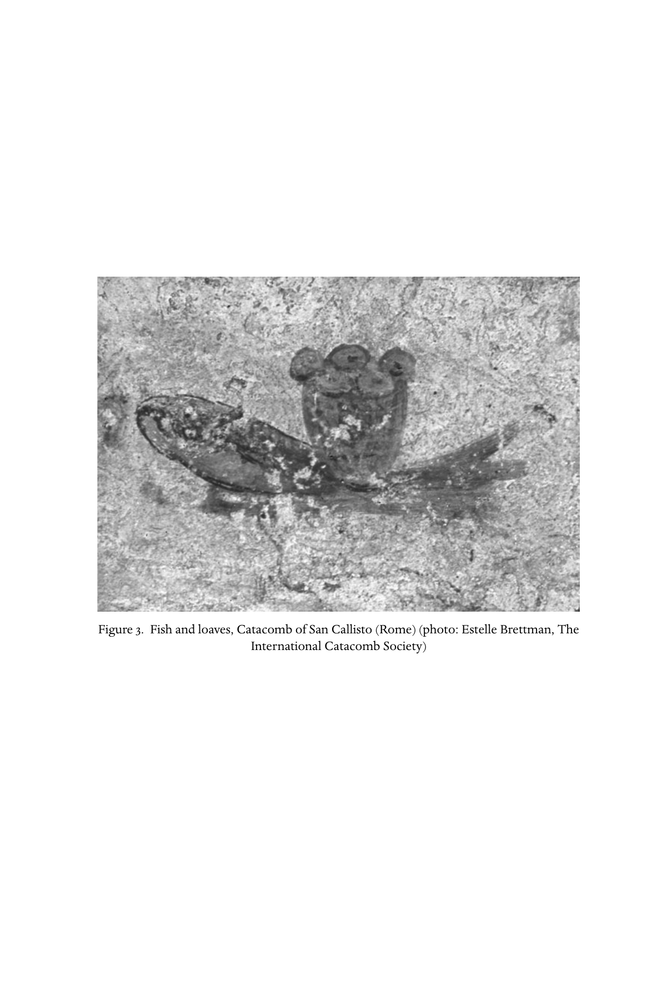

# 第六章 约翰传统的基督教

**作者：哈罗德·W. 阿特里奇（Harold W. Attridge）**

《剑桥基督教史》第一卷《起源至君士坦丁》中文译稿

> 原书第125–143页，PDF第174–192页；另附原书第144页图3。正文、解释性脚注与引文译为中文，参考文献作者名、题名及定位保留原文。
>
> [第六章英文原文](<第六章 约翰传统的基督教（英文）.md>) · [原书PDF](<../01 起源至君士坦丁.pdf>)

## 约翰传统基督教的文学证据

<!-- 原书第125页；PDF第174页 -->

约翰文献群的复杂性，使勾勒约翰传统基督教的轮廓成为困难的工作。尽管如此，这些材料仍呈现出一个早期耶稣追随者群体：他们大量运用圣经象征，相当鲜明地将自身与其所出自的犹太环境区分开来。这些信徒热切敬奉耶稣，视他为上帝救赎旨意的决定性启示，并认为自己在圣灵保惠师的引导下，与他及彼此保持亲密联系。他们意识到自己与其他信徒的关系，希望最终与他们联合。其虔敬在一组富于反思的文学作品中获得独特表达，探索表达耶稣信仰的新方式。他们的共同生活包括其他耶稣追随者也熟悉的仪式行为，却坚持这些仪式独有的属灵价值。争论最终使群体分裂。到了二世纪中叶，约翰传统的某些代表，在正在形成的“大公教会”中取得受尊重的地位；所谓大公教会，是遍布地中海的信徒相互联结的网络，他们在逐渐兴起的主教权威领导下相互扶持、维持团契。一世纪约翰群体留给普世教会的遗产，是其独特文献及对耶稣的理解，后者后来主导了基督教正统的发展。约翰传统基督教的其他代表，则培育了不同的传统支脉，影响了二世纪多种运动；其反对者及许多现代研究，将这些运动称为“诺斯替派”。

### 材料来源

<!-- 原书第126页；PDF第175页 -->

约翰传统基督教的首要材料，是匿名的“按约翰所传”的福音书，即《约翰福音》。[^1]在词汇、风格和关切方面与它密切相关的，是约翰书信；这些书信虽然处理不同问题，却无疑彼此关联。[^2]多数学者认为，它们反映了约翰群体在解释福音书时努力应对各种问题的情况；[^3]不过，有些学者则将这些书信与福音书本身的晚期形成阶段相联系。[^4]

这些核心文本的年代与产生地点，至今仍引起争论。对于福音书一个相对“定型”的版本，[^5]广泛接受的年代是一世纪末或二世纪初，尽管其他估计差异很大。十九世纪研究倾向于将其定在二世纪中期或晚期。[^6]这部福音书最早的抄本见证P52（P. Ryl. 457）曾被定为约公元125年，为许多二十世纪注释者提供了成书年代的下限，即最迟须在此以前写成；然而，这张纸草的年代远非确定，而且明确引述这部福音书，要等到二世纪最后四分之一时期的爱任纽才开始。尽管如此，安提阿伊格纳提乌书信、《所罗门颂歌》等二世纪作品对本书的暗引，[^7]使大多数注释者相信，公元90–110年是合理的成书时间范围。有些批评家把年代大幅提前至公元70年圣殿毁灭以前，因而将它视为这一文类最早的实例。[^8]

产生这部福音书、且其经历反映于书信中的群体，究竟位于何处，同样只能推测。爱任纽将蒙爱门徒约翰所写的福音书与以弗所联系起来。[^9]

<!-- 原书第127页；PDF第176页 -->

爱任纽和其他教父还记述约翰在以弗所活动的轶事：有时与克林妥等“诺斯替派”教师竞争，[^10]有时从事牧养工作。[^11]一些学者仍认为，以弗所很可能是这部福音书、至少是其最终版本的产生地点；[^12]另一些人则提出地中海沿岸或叙利亚腹地的其他地点。[^13]福音书与其他宗教文献的相似之处，支持了这些探索。一世纪犹太哲学家斐洛生活于亚历山大里亚；他关于逻各斯的复杂思辨，常被视为约翰序言的背景。[^14]亚历山大里亚既是被称为“诺斯替派”的思辨性基督教的中心——人们也常把它作为福音书的背景——[^15]也是产生《赫尔墨斯文集》的圈子所在；这组希腊—罗马宗教文献，与福音书的象征世界颇有相似之处。[^16]另一方面，《死海古卷》与福音书的“二元论”及其运用经书的方式相近，[^17]因而促使人们推测福音书具有巴勒斯坦根源。[^18]更往东看，伊格纳提乌书信及《所罗门颂歌》很可能产生于二世纪的叙利亚；其意象和灵性生活，与福音书也有引人注意的相似之处。[^19]

讨论约翰群体时，偶尔还会涉及其他文本。《启示录》虽然明确归于一位名叫约翰的异象领受者，却不属于这里的相关文献群。尽管具有某些共同母题，它的语言、文学风格和神学，仍清楚地将其与福音书及书信区分开来。[^20]

<!-- 原书第128页；PDF第177页 -->

两部二世纪文本，间接延续了约翰的文学传统。《约翰密传》是二世纪基督教一条重要支脉最重要的见证。现存四份抄本，全都以科普特文译本保存，见证了该作品的两种修订本；[^21]爱任纽也知道这部作品。[^22]稍晚的《约翰行传》，[^23]则是一部具有当时典型特征的虔敬虚构作品，记载以这位使徒为主角的传说。二者都表明，某些二世纪“约翰传统”的基督徒具有“诺斯替派”特征；但若将其证据投射回一世纪，作为福音书的背景，就必须谨慎。

文献群复杂的核心，即福音书，令我们难以为其所代表的基督教定位。文本表面的若干特征，已经显示出这些困难。从文类来看，它叙述耶稣的生、死与复活，与一世纪晚期其他近似传记的福音书相平行。[^24]它与其他已知福音书，尤其对观福音，既有相似又有差异，这种交织的情形不断引发关于它们与《约翰福音》关系的争论。近来多数学者怀疑存在直接依赖关系，[^25]但也有学者认为，若干段落，尤其受难叙事，显示它依赖对观福音。[^26]少数学者则反过来主张，一部或多部对观福音依赖《约翰福音》。[^27]近来，由于它可能与非叙事性的耶稣传统，尤其《多马福音》，存在关联，约翰文本中互文暗引的可能性变得更加复杂。[^28]

<!-- 原书第128–129页；PDF第177–178页 -->

判断《约翰福音》与其他福音书的关系，并不只是确定其材料来源及可能具有的历史价值。认识它与对观福音、或许还有《多马福音》的松散关系，可以揭示文本的修辞：它持续反思各种关于耶稣的宣讲中那些“约定俗成的认识”。负责写成这部福音书的人，无疑熟悉构成对观福音和其他福音书的材料，甚至可能认识其中一部或多部的最终形式；但他们对口传传统和文学作品，都作了自由改编。[^29]

文本显然乐于使用象征。几乎每一件事似乎都指向另一事物。耶稣的神迹是“记号”，但它们如何指示、指示什么，并非一眼可知。耶稣的讲论充满引人联想的用语，常常指向他自己，同时引入经书及一般文化的主题。[^30]复杂的叙事使时间界限重叠，将群体生活写入耶稣的故事。[^31]

反讽的运用，又增加了复杂性。其他福音书当然并非没有这种修辞，[^32]但它贯穿本书。[^33]有时，反讽是一种明白可见的戏剧手法：人物的无知或误解，反而强化读者的信念。[^34]福音书的枢纽事件，显然充满反讽：耶稣得“荣耀”的“时候”，竟奇异地显现在被钉十字架的耻辱之中，例如约12:23–33。不过，可能还有更深层的反讽，通过拨动读者的预期，引发反思。[^35]无处不在的象征与反讽，都提示我们：福音书对实际信念和实践的指涉，并非直截了当。

<!-- 原书第129–130页；PDF第178–179页 -->

若把福音书用作历史重构的材料，众多难解之处又使问题更加复杂。情节上的一些特征挑战了文本的统一性，例如难以理解的时间与空间顺序，[^36]或行动似乎已经结束，后续发展却又不予理会。[^37]在观念层面，关于耶稣与父的关系、[^38]审判，[^39]或末世救赎的陈述，常常相互矛盾或难以协调。[^40]这些困难促使学者尝试追溯福音书的来源与编修历史。一种广泛接受的理论认为：福音书从一个原始神迹故事集，即“记号来源”发展而来，[^41]经过对耶稣言语作讲道式阐释的过程，再由一位福音作者主导编成文学作品，随后又得到其他编辑或编修者补充。

编修理论又进一步成为理解文本背后群体历史的基础。这些理论假定，约翰信徒起初是一个独特的耶稣运动，后来逐渐适应二世纪的基督教。[^42]福音书很可能确实经历了长期发展，因而留下改写和扩充的迹象；[^43]然而，把编修活动解释为试图驯服一部“特立独行”的叙事，[^44]仍不能令人满意。一个根本问题在于：假定的编修者若真在纠正文本，工作未免太差，竟留下如此多彼此紧张的因素。同样合理、实际上甚至更有说服力的理解，是把这些因素视为有意的文学策略。过于轻易地诉诸编修性纠正来解释不连贯之处，可能同时遮蔽文学作品本身的功能，以及其背后群体的性质。

## 约翰传统基督教的一种可能历史

<!-- 原书第130–131页；PDF第179–180页 -->

约翰传统基督教的历史，大体可以作如下勾勒。这个群体在耶稣死而复活之后不久，就始于以色列，很可能在犹太地区；[^45]领导者或许是耶稣的一位门徒，文本中蒙爱门徒的形象以他为原型。这个平等的团契“记念”[^46]耶稣的言行，并通过解释经书，[^47]理解自己的经历。群体运用犹太传统的资源，理解其拉比或教师的使命：[^48]他是上帝所差来的，[^49]是像摩西的先知，[^50]是弥赛亚、[^51]人子、[^52]上帝之子，[^53]是上帝之道的体现。[^54]除了传统称号，福音书还挪用耶路撒冷敬拜传统中的象征，将其应用于耶稣：他是新的圣殿，[^55]是“活水”[^56]和“光”[^57]的源头；他的一生反映出圣经规定的礼仪节期循环。[^58]这个犹太地区的约翰群体，很可能吸收撒马利亚的归信者而扩展；后者带来以摩西式先知为中心的独特弥赛亚期待。[^59]

<!-- 原书第132页；PDF第181页 -->

面对犹太圈子的外部反对，群体成员愈加强烈地主张，耶稣的来源与归宿都在天上，并且他与上帝具有亲密关系。[^60]他们顶着重大反对坚持这些主张，逐渐带上“教派”的特征，社会边界划分明确。[^61]这些主张最终导致他们“被逐出会堂”，福音书三次提到这一创伤。[^62]某些学者把这种驱逐与birkat hamminim相联系；后者名为“祝福”或赞美上帝，实际是针对异端者的诅咒。据说，一世纪最后十年，雅姆尼亚，即雅夫内，的拉比将它加入《站立祷文》，亦称《十八祝文》。约翰信徒的历史固然经历了与犹太母体痛苦的分离，但这不能与birkat hamminim的引入相对应，因为后者不能定在三世纪以前。[^63]传统犹太人与新出现的耶稣追随者之间的张力，在早期基督教材料中广有见证。[^64]第四福音书所见的敌意虽然特别强烈，却并非孤例。

如今，这些信徒无论身在犹太地区还是散居地，都已与原先的犹太环境有所区别；[^65]他们面对新的挑战，而这些也写入约翰文献群。《约翰一书》明显呈现教义争论，争议涉及群体特有的基督论宣认所蕴含的意义。被否定的基督论，可能不止一种，其确切根源和形态仍有争议。《约翰一书》提到的对手，可能反对福音书所坚持的父与子的密切关联，也可能质疑神圣逻各斯与耶稣表面上的血肉存在有何联系。

<!-- 原书第133页；PDF第182页 -->

这种“幻影说”立场，可能包含关于基督内天上或神圣层面，与地上或人性层面之关系的理论；也可能出于哲学理由，[^66]或甚至出于劝诫上的考虑，[^67]贬低肉身耶稣的意义。无论如何，书信作者坚持父与子的密切联系（约壹2:22–23），也坚持耶稣确实“成了肉身”而来（约壹4:1–3；参约贰7）。书信坚持罪与赎罪的真实性（约壹1:8–2:2；4:10），以及相应承担道德责任的必要性，又显露其他教义争论。[^68]无论《约翰一书》与福音书有何关系，它的立场都与二世纪许多重要基督徒的明确主张十分相近。在关键教义问题上，这些书信的立场大体与正在形成的“大公教会”相容。

约翰群体发展中的第二个冲突点，关乎其组织形式。[^69]福音书在表面上并不谈论阅读它们的群体如何组织。有些文本暗示平等主义观念，例如《马太福音》拒绝尊称（太23:9），《马可福音》将服事理想化（可10:45），或《使徒行传》对原初“共产生活”的田园式描绘（徒2:44；4:32）。早期群体的实际情况无疑更复杂；保罗书信表明，社会组织正在形成。[^70]福音书有时也透露出它们所面向的教会世界，而不只是其所描写的理想团契。《马太福音》16:18–19著名地将彼得描绘成权威人物，或许在与仍受尊重的文士及法利赛人竞争（太23:3）。这一形象暗示单一主教制的萌芽；这种制度首先明确见于安提阿的伊格纳提乌。其他地方的治理则掌握在长老议事会手中，《使徒行传》20:17–38有所暗示，《教牧书信》（提前3:1–12）及一世纪晚期罗马的《克莱孟一书》42.4–5则明确可见。

<!-- 原书第133–134页；PDF第182–183页 -->

第四福音书很少明确谈及制度结构。它把耶稣的追随者描绘成羊群（约第10章）与葡萄树（约第15章），二者都暗示特别的亲密关系。羊听见并认得牧人的声音；[^71]葡萄树的枝条直接从耶稣这根主干生出（约15:2、5–6）。牧羊意象进一步暗示，还有其他羊，应当归入同一羊群（原文引约11:41）。然而，这两种比喻都没有在耶稣与他的“羊”之间，为中介结构留下任何位置。假如现实中的蒙爱门徒或其继承者确实担任治理角色，文本主体并未反映这一点。21:21–23中耶稣与彼得的对话，暗示这位门徒已经去世；他的死，可能促使群体反思自己与其他权威来源的关系。

文本所呈现的，并不是简单的奠基神话，而是相互形成象征性对照的门徒。最显著的是蒙爱门徒与彼得的对照。[^72]在最后晚餐上，他靠在耶稣怀里（约13:23），[^73]并居间让彼得得以询问耶稣（13:24）。在十字架旁，蒙爱门徒站在耶稣身边，成为他收纳的兄弟（约19:26）；此前，彼得却不认并离弃了耶稣（约18:17、25、27）。复活节早晨，彼得与蒙爱门徒一同跑向坟墓，但蒙爱门徒先到（约20:4），看见叠好的裹尸布就“信了”（约20:8）。假如成书时彼得已与等级结构相联系，那么这位门徒的优先地位，可能具有教会论意义。

如果蒙爱门徒的形象确实蕴含教会论的潜台词，那么其形象的其他方面也可能具有特殊意义。他成为耶稣母亲的监护人这一新身份，可能与主的兄弟雅各相对照（加1:19；可6:3）；保罗和《使徒行传》都证明，雅各在耶路撒冷教会担任领导。[^74]它也可能与多马的主张相对照；多马即“孪生子”，在早期叙利亚传统中被理解为耶稣的兄弟。[^75]与蒙爱门徒不同，多马直到看见复活的耶稣，并受邀触摸他之后，才相信（约20:28）。[^76]

<!-- 原书第134–135页；PDF第183–184页 -->

无论这些人物是历史上的个人，还是理想类型，蒙爱门徒与其他门徒的对照，都暗示了对当时基督徒群体的批评；不同群体分别由不同使徒人物象征。不过，所有门徒确实都是使徒：他们像耶稣一样被“差”到世上（约20:21）。

这些书信透过丢特腓这一人物，提供了关于约翰信徒领导权争论的诱人线索。《约翰三书》批评他“好为首”（philōproteuōn），并且“不接待我们”（约叁9）。丢特腓很可能代表二世纪初兴起的新型领导方式，类似安提阿的伊格纳提乌。执笔写《约翰三书》，或许也写了另两封约翰书信的那位“长老”，[^77]可能代表较旧的领导形式，更接近第一代使徒中依靠恩赐的巡回传道者。那么，“长老”与丢特腓之间的竞争，就类似《十二使徒遗训》所见的发展。《遗训》是第一部教会规章书，很可能于一世纪晚期至二世纪初，在讲希腊语的叙利亚编成。[^78]《遗训》12.1–5承认、但也限制巡回先知的权威；15.1–2则将未来交给地方选出的主教和执事。[^79]

第四福音书描绘门徒时，虽然对各位名义领袖及其追随者作出评价，但最后一章的彼得形象，具有特殊意义。他三次宣告爱主，恢复了因三次不认耶稣而失去的地位（约21:15–17），最终受命“牧养羊”（约21:17）。这一章承认：无论使徒彼得，或其他教会领袖，比蒙爱门徒逊色多少，他们的权威地位仍应受到尊重。

因此，《约翰福音》第21章表明，约翰信徒正逐渐与二世纪更广泛的教会和解；到了爱任纽时代，后者以相互联结的等级体系、初具形态的正典和信经式宣认为特征。[^80]书信提到“敌基督者”从“我们中间出去”（约壹2:18–19），也证明群体内部存在分裂。这些人或许坚持书信所批评的神学立场，例如带有幻影说色彩的基督论，或否认罪的真实性。他们的遗产，可能在《约翰密传》和《约翰行传》等二世纪文本中仍可感受到。

## 约翰传统基督教的独特特征

<!-- 原书第136页；PDF第185页 -->

约翰文献显示，“蒙爱门徒的群体”在更广泛的基督教范围内，有其自身发展。到了二世纪，这一发展使其中部分人与一种基督教更密切结合：它深受保罗影响，正在安提阿、以弗所以至罗马等城市中心兴起。尽管如此，书面记录仍在神学与实践方面保持独特特征，尤其体现于基督论、末世论和伦理三个领域。在每个领域，约翰传统的独特立场，都强化了其他形式基督教中已经存在的因素。归根结底，这部福音书最独特之处，在于它用来表达主张的文学手法。

### 基督论

福音书的核心，是一种极“高”的耶稣观：他是上帝创造性的道，成为人的肉身，正如序言所宣告的（约1:1–18）。[^81]把耶稣与上帝之道联系起来，无疑与其他早期信徒为解释耶稣意义而运用的智慧传统范畴相关。[^82]同样，认为耶稣是上帝所差来的某种本原或施行者的道成肉身，也见于其他早期颂赞基督的文本。[^83]第四福音书的独特之处，在于它同时维持这一宣认的两极，却没有明确化解二者的张力：耶稣与父为一（约10:30），但父又比耶稣大（约14:28）；耶稣掌管风浪（约6:19），拥有超乎常人的知识（1:48；16:30），却又在朋友的坟前落泪（约11:35）。

把这些彼此紧张的因素仅仅当作文献发展过程的标志，会忽略它们在观念上的作用。福音书的矛盾陈述，反复重申序言的两项主张：耶稣是上帝的道，同时又是血肉之躯。最终，当他最显然为人，即死亡之时，他荣耀的神性也显得最清楚。

<!-- 原书第136–137页；PDF第185–186页 -->

文本如何处理关于耶稣意义的主张，可见于一系列称耶稣为“人子”的经文。若干段落令人想起对观传统的言语，却常有新的转折。有些经文（约1:51；5:27；6:62）与“末世性”人子言论中的要素相平行：人子将在天上荣耀中、众天使环绕之下“来临”，执行审判。[^84]另一些经节[^85]令人想起构成《马可福音》骨架、其他福音书也有平行记述的受难预言。[^86]还有一些经文（约6:27、53；9:35）描绘当下的人子，提供滋养，要求人相信。

在所有这些情况中，熟悉传统的回声都被转化得陌生了。在约1:51，人子不是被天使环绕，而是通过雅各天梯的意象，成为天使上下往来的通道。在约3:13–14，另一个圣经互文，即《民数记》第22章中有医治作用的蛇，重新解释受苦的人子。约8:28中，人子被“举起”，显明其真实身份；约12:32中，他应许吸引所有人归向自己。前面各章对人子言论的运用，预备了约13:31的最后一句：它大胆地把“末世性”言论所关联的“荣耀”，与人子被“举起”的那个“时候”的事件结合起来。

处理这些人子言论的方式，显示作者有意挪用耶稣传统，使荣耀与苦难的陈述保持反讽式张力，邀请福音书的读者或听众沉思十字架的意义。[^87]一位富于反思的作者重塑传统材料，以强化一项核心基督教信念。[^88]虽然确实有人把福音书读成朴素的幻影说文本，[^89]但它对这些传统基督论言论的处理，与书中许多其他方面一样，都强烈强调道成肉身的基督，是基督教思想的焦点。[^90]

### 末世论

<!-- 原书第137–138页；PDF第186–187页 -->

适用于基督论的情形，也适用于福音书的末世论。[^91]引人注意的是，福音书没有末世审判或启示文学式灾变的场景；在对观福音中，耶稣却常谈到这些，保罗那里也有平行材料。[^92]而且，有些段落运用末世论范畴，尤其“审判”[^93]与“复活”，[^94]来描写的不是未来事件，而是个人当下与基督相遇、面对他的处境。但有些段落确实提到，将在“末日”来临的审判和复活。[^95]末世论视角中的这些矛盾，激起了关于这部福音书所代表之基督教性质的争论。尤其在这些材料中，有些学者发现一位纠正性编修者的痕迹：他把正统强加在更激进的原始来源之上。[^96]

不过，在接受这种机械的编修假说以前，应记住福音书基督论中显而易见的重新诠释策略。类似手法很可能也用于末世论段落，而在这里，福音书实际上并未开辟全新道路。其他早期基督教教师，也曾运用末世论范畴，表示信徒所盼望的现实，已经成为他们当下经历的一部分，尤其是在敬拜中。这类主张突出地见于关于洗礼的段落：在保罗传统基督教中，洗礼使基督的死与复活，在信徒生活中成为现实。[^97]这一仪式也使圣灵中的新生命成为当下的现实，[^98]尽管信徒仍渴望末世的圆满。[^99]保罗本人面对的一种危险，就是有人倾向于把这种修辞过于按字面理解，因而忽略未来的盼望与当下的伦理要求；而他认为，二者对于“在基督里”的生活都不可或缺。[^100]

<!-- 原书第138–139页；PDF第187–188页 -->

第四福音书处理末世期待的方式，与保罗相似，在当下现实与未来盼望之间保持平衡。但与保罗相比，它更强调“永生”已经实现的一面：信徒与上帝保持“住在”彼此之中的关系，这也为任何较传统意义上的“永生”盼望奠定基础。

耶稣与伯大尼马大的对话，集中显出福音书的末世论张力。耶稣向马大宣告，她的兄弟必会复活；她便以传统的犹太盼望回应，[^101]说兄弟将在末日复活（约11:23–24）。耶稣并未否定她的盼望，却指出自己就是复活，因而暗示，与他一同度过的生命就是永恒生命。福音书表明，若没有信仰生活，对未来复活的盼望便是徒然。同样，在最后晚餐讲论的核心部分（14:1–4），耶稣谈及自己离去的“道路”，应许回来，带门徒与他同到天上的“住处”（约14:2）；这是约翰传统中相当于保罗所谓“被提”的说法（帖前4:17）。随后的对话却表明，原本设想为他回来之后的“未来”亲密关系，现在已经存在。对于遵守耶稣之道的人，耶稣与父都要来，在他那里建立“住处”（约14:23）。门徒若遵守他的命令，就像葡萄树上的枝条，住在他里面。[^102]这一连串末世论时刻，与第11章的顺序相平行：传统盼望得到强烈肯定，却又被暗示为有一个前提——那盼望须先在信徒生活中预先实现。传统末世论没有被取消，而是重新聚焦于其当下的先决条件。[^103]保惠师，即“真理的灵”（约14:17），在这一焦点转换中发挥中心作用。这位“圣灵”（约14:26）通过洗礼的重生而临在（约3:5），住在门徒之中（约14:17），教导他们（约14:26），并为他们抵挡敌对的世界（约16:8–11）。[^104]

<!-- 原书第139–140页；PDF第188–189页 -->

从第11章和第15章灵活运用末世论范畴的角度看，审判主题中的矛盾获得了更清楚的化解。约12:47–48关于这一主题的高潮性言论，结合了两项彼此紧张的主张：子既审判，又不审判。耶稣这位子，不同于坐在末世荣耀中的人子，他来不是为了审判，而是为了拯救（原文引约12:48）；但他已经说出，或将要说出的道（约13:31），却提供了“末日”审判的依据。福音书容许末世未来的存在，但将它牢固奠基于当下：成为肉身、也呈现于书中的道，与那些受召聆听它的人相遇。[^105]

### 伦理与宗教实践

<!-- 原书第140页；PDF第189页 -->

约翰文献所描绘的耶稣追随者，很少展现构成其实际生活特征的各种实践。与山上宝训（太第5–7章）不同，第四福音书没有谈论非暴力、爱仇敌、转过另一边脸、拒绝离婚或多走一里路的伦理。

第四福音书的伦理，可以归结为“彼此相爱”这一条命令：最后晚餐中郑重宣告它（原文引约13:31），借一句格言加以说明（约15:13），各书信又予以呼应。[^106]福音书很少讨论实际后果，虽然它和书信都坚持赦罪的重要性。[^107]然而，门徒应体现的爱，以同属门徒的群体为中心。这种爱并未被视为与严厉斥责敌人不相容（约8:44）；后者或许反映了一个敌意“世界”对他们的仇恨。[^108]

福音作者和《约翰一书》作者，都没有展开细致的伦理体系，而是聚焦于伦理行为的根本动机。最后晚餐讲论表明，其基础不只是一条由上帝使者颁布的神圣命令；耶稣为朋友而死，也以行动体现了“最大的爱”（原文引约15:14）。这种伦理奠基又构成一种救赎论：十字架显明了某种能够吸引人（约12:32）、医治人（约3:14–15）的东西；最后讲论清楚表明，那就是付诸行动的爱。把“爱的命令”置于基督教宣讲中心，约翰绝非独一无二。[^109]但将这条命令如此密切地与十字架相连，则是福音作者富于创造性的融合：把伦理的理论基础与启示教义结合起来。

<!-- 原书第140–141页；PDF第189–190页 -->

第四福音书既不关心伦理细节，也不在意禁食等宗教实践；禁食曾困扰其他基督徒，[^110]而按《十二使徒遗训》8.2–3，它还标示群体边界。约翰传统的基督徒，或许像其他早期耶稣追随者一样，拒绝圣经规定的禁食，但文本并未说明。与《马太福音》7:7–13和《路加福音》11:2–4不同，本书对祈祷几乎没有明确指导。耶稣最后的祈祷（17:1–26），隐约呼应主祷文，[^111]却未被提出作为仿效的范式。耶稣认可祈求式祷告（约14:13–14；16:26），但不规定形式。书信提供宣认信仰的语句实例（约壹4:7–10），却不作规范性规定。

文本表明，约翰信徒施洗，也举行神圣聚餐；这两项都是基督徒群体的标志。对于耶稣本人是否施洗，福音书提供了相互冲突的见证，[^112]但这似乎无关紧要：它坚持人必须由“水和灵”“从上面生”（约3:5）。与尼哥底母的对话，恰恰用“再次／从上面生”的措辞，为这一行为提供了约翰传统特有的解释。洗礼既不是洗净罪污，[^113]也不是末世的印记，[^114]或参与基督的死，[^115]而是用希腊化宗教的语言说，是“重生”。[^116]虽然其他洗礼神学并不明显可见，洗礼象征却在文学上得到复杂展开。使重生发生的“水”，呼应约第4章雅各井中的水；在那里，智慧传统中水与教导的等同十分明显。约7:38又给这种传统等同关系带来新的转折：教导将在每个信徒里面，如泉水般涌流。信徒之“水”又与耶稣被刺透的肋旁所流出的水联系起来（约19:34），产生新的关联。[^117]因此，洗礼的“水”，最终与信徒对十字架的领悟相联。[^118]《约翰一书》2:26–27还提到能够教导人的“恩膏”，或许暗指另一种洗礼象征。

<!-- 原书第141–142页；PDF第190–191页 -->

约翰信徒庆祝神圣聚餐，这一点清楚，但如何庆祝则不清楚。无论实际做法如何，都不应期待在一世纪晚期或二世纪初已经存在标准程式。[^119]有两段经文与他们的实践相关。第13章记载一次简单的最后聚餐，没有像对观福音及保罗的叙述那样，赋予饼或酒以象征意义。[^120]相反，耶稣为门徒洗脚，要求他们也照样行（约13:3–17）。另一方面，耶稣关于生命之粮的长篇讲论，在结尾（约6:51–58）肯定吃耶稣的肉、喝他的血的重要性。这段经文明显暗指保罗与对观福音群体所举行的那种圣餐。

一种解释认为：约翰群体举行自己的神圣聚餐，没有“设立圣餐的话”，[^121]也不提饼／身体、酒／血的象征。一位编修者为了填补空白，扩充第6章“生命之粮”的讲论，将这些因素加入其中。尽管有学者为约第6章的完整性辩护，[^122]多数学者仍接受文学分层的理论，以及它对约翰传统圣餐实践发展所具有的含义。

然而，福音书整体的文学策略，应当提醒我们谨慎。本书经常把早期基督教教导与实践的要素置入新语境；我们有理由怀疑，圣餐材料也使用了类似策略。如果这是一项编修举措，那么把关于圣礼性进食的文字放在第6章，实在不是让福音书与某种新确立的正统实践相协调的有效方法。相反，第6章与第13章的“圣餐”段落，可能是有意相互配合的：人必须“吃肉”“喝血”，才能与耶稣有分（约6:53）；也必须认识、理解他爱的服事行为（约13:17）。若“吃”“喝”发挥传统智慧文学比喻的作用，那么第6章所讲的行为，就必须与第13章所暗示的行为解释联系起来。

第6章的“圣礼”语言，无疑暗指约翰群体在其发展某一阶段采用的仪式实践。它也许较晚才进入群体生活；但更可能的是，它描述了一项已被接受的实践，而福音作者希望深化对它的理解。

## 结语

<!-- 原书第142–143页；PDF第191–192页 -->

约翰传统基督教，构成了一世纪晚期或二世纪初其他基督教形式之外的另一种选择。部分原因在于，它的群体历史、口传与书面传统，以及实践，可能不同于那些与它日益接触的“其他羊”。但它与竞争者最重要的区别，在于对传统形式与信仰主张作出深入分析，由此创造性地尝试理解耶稣的经验，以及追随他意味着什么，并因而将这些置入新的语境。

<!-- 原书第144页；PDF第193页 -->

图3：鱼与饼，罗马圣卡利斯托地下墓窟。摄影：Estelle Brettman，国际地下墓窟协会（The International Catacomb Society）。

## 脚注

[^1]: 福音书本身匿名，但末尾题记（21:24）暗示，它出自“耶稣所爱的那门徒”。至二世纪晚期，教父将文本归于约翰（Iren. Haer. 3.1.1；亚历山大里亚的克莱孟，转引于Euseb. HE 6.14.7）；不久，人们又把他等同于西庇太之子约翰。对观福音把后者列为耶稣亲近的同伴，John 21:2也简略提及他。这一归属值得怀疑，蒙爱门徒这个人物的作用仍有争议。辨认其身份的尝试，参Charlesworth, Beloved Disciple；传统的历史，参Culpepper, John；其文学功能，参Attridge, ‘The restless quest’。

[^2]: 书信之间的关系，参Brown, Epistles of John, 14–35。

[^3]: 尤其参Brown, Epistles of John, 47–115。

[^4]: 例如参Strecker, Johannine letters。

[^5]: 有些部分明显是后加的，尤其“行淫妇人段落”（John 8:1–11），但何时加入仍不清楚。

[^6]: 较早的意见，参Brown, Introduction, 206–10。

[^7]: 二世纪全部证据，包括P52的年代，近来研究见Nagel, Rezeption。Culpepper, John, 107–38简要概述了证据。

[^8]: 参Robinson, Priority；Berger, Anfang。

[^9]: Iren. Haer. 3.1.1.

[^10]: Haer. 3.3.4，转引于Euseb. HE 3.28.6。关于这些传说及爱任纽的重要性，参Culpepper, John, 123–28。

[^11]: Clem. Al. q.d.s. 42，转引于Euseb. HE 3.32.5–19，记述使徒约翰与以弗所地区一只“迷羊”的故事。

[^12]: 近来参van Tilborg, Reading John。

[^13]: 参Brown, Introduction, 19–206。

[^14]: 例如参Borgen, Logos；Tobin, ‘Prologue’；Boyarin, ‘Gospel of the Memra’。

[^15]: 最著名的倡导者是Bultmann, Gospel of John。亦参Schottroff, Der glaubende und die feindliche Welt。“诺斯替派”这一范畴已受到批判性审视。Williams, Rethinking ‘Gnosticism’强调宽泛概括的危险，但承认二世纪存在一些具有家族相似性的基督徒群体；他称之为“造物主创世论者”（demiurgic creationists）。King, What is Gnosticism?追溯这一范畴在论战及学术中的用法。一手材料参Foerster, Gnosis与Layton, Scriptures。

[^16]: Dodd, Interpretation尤其注意到这一点。英译本参Copenhaver, Hermetica。

[^17]: James H. Charlesworth长期主张二者有联系；参Charlesworth, ‘Dead sea scrolls’、‘Critical comparison’及Jesus and the Dead Sea scrolls。Ashton, Understanding, 232–7表示赞同。其他人仍持怀疑态度，参Bauckham, ‘Qumran’。诠释学上的相似性，参Clark-Soles, Scripture。

[^18]: 不过，与古卷具有相同教派立场的犹太人，也可能生活在散居地区；参Brown, Introduction, 199–206。

[^19]: Lattke, Oden全面论述了《所罗门颂歌》的相关研究。

[^20]: 可能的联系，例如参Taeger, Johannesapokalypse。

[^21]: 其中三份来自1945年发现的纳格·哈马迪科普特文文献集，第四份保存在柏林的一部科普特文抄本中。对观校勘版参Waldstein and Wisse, Apocryphon。

[^22]: Haer. 1.29；翻译及讨论见Layton, Scriptures, 163–9。

[^23]: 译文见Schneemelcher, NTApoc, vol. ii, 152–212。Junod and Kaestli, Acta提供新的校勘本与法译本。它与约翰传统的关系，参Koester, Introduction, vol. ii, 202–4。

[^24]: 最容易比较的文本是对观福音；不过，第四福音书很可能产生于一个其他耶稣叙事也在争取注意的时期，那些叙事如今只以残片保存。一般的福音书讨论，参Koester, Ancient Christian gospels；文本参Schneemelcher, NTApoc, vol. i。

[^25]: 争论史参Smith, John among the gospels；近来研究参Schnelle, ‘Johannes’及Denaux, John。

[^26]: Lang, Johannes。Dunderberg, Johannes在John 1–9的一个编修层中，发现对观福音的痕迹。

[^27]: Matson, Dialogue.

[^28]: 《约翰福音》与《多马福音》可能的联系，参下文注76。

[^29]: 文类的模糊性，参Attridge, ‘Genre bending’。

[^30]: 参Koester, Symbolism。

[^31]: Martyn, Gospel及其History and theology强调这一点。

[^32]: 例如Mark 15:39百夫长的宣告，就具有相当明显的反讽。

[^33]: 近来论述参Duke, Irony及O’Day, Revelation。

[^34]: 例如，第3章的尼哥底母误解“从上面／再次生”的意思，第4章的撒马利亚妇人也不明白耶稣所赐“活水”的性质。

[^35]: 例如参7:27对于认识耶稣来源所作的文字运用。众人声称知道耶稣来自哪里——加利利？——却坚持弥赛亚的来源将无人知晓，因而显出他们不知他源于天上。文本也可能在质疑读者预先认定耶稣来自伯利恒的看法。

[^36]: 例如，从加利利（第4章）到耶路撒冷（第5章），再到加利利（第6章），又折返（第7章）的表面行程，至少显得突兀，缺乏交代。

[^37]: John 14:31本可极好地过渡到18:1。14:31明显的结束语，常被用作根据，将第15–17章视为编修性增补。

[^38]: John 10:30：“我与父原为一”；14:28：“父是比我大的。”

[^39]: 耶稣作为“人子”，究竟不审判（原文引John 2:17），还是执行审判（5:22、27）？

[^40]: 复活是未来的现实（John 5:28–9），还是当下的现实（John 11:25）？

[^41]: 关于福音书来源与编修，最持久的理论是“记号来源”假说。参Fortna, Gospel of signs及Fourth gospel and its predecessor。其结论的简本见Miller, Complete gospels, 175–95。另一解释见van Wahlde, Earliest version。研究史的批判性回顾，参van Belle, Signs source。

[^42]: Brown, Community使这一发展理论的一个版本广为流传。其他理论参Bull, Gemeinde。

[^43]: 第21章位于20:30–31的题记之后，显然像一篇附录；不过，有学者认为它与前文具有整体关系。参Minear, ‘Original function’。

[^44]: 这种福音书观，参Kysar, John, the maverick gospel。布尔特曼认为，最后执笔的是一位“教会编修者”，他使福音书的已实现末世论等因素，与正在形成的正统相协调。

[^45]: 最初的复活显现（John 20）发生在耶路撒冷，门徒在那里受命从事赦罪的职事（John 20:22）。因此，和路加一样，耶路撒冷是复活后群体最初的中心。犹太地区的根源可能还更深。虽然腓利称耶稣为“拿撒勒人约瑟的儿子”（John 1:45），文本也暗示犹太地区是他自己的“故乡”。那些不接待他的“自己人”（John 1:11），尤其适用于“犹太地区的人”；但矛盾的是，救恩也从他们而来（John 4:22）。7:27中犹太地区之人的无知，或许还包括他们不知道耶稣也有犹太地区的来源，即伯利恒。

[^46]: “记念”似乎是这一群体的专门用语；参John 2:17、22；12:16。

[^47]: 约翰如何运用经书，参Daly-Denton, David；其圣经文本的确切形式，参Menken, Old Testament quotations。

[^48]: 这一称号见John 1:38，同时使用希伯来文rabbi与希腊文didaskalos；3:2、10；11:28；13:13–14；20:16再次使用希伯来文rabbouni与希腊文didaskalos两种形式。

[^49]: 这是本福音书思考耶稣最常见的方式。参4:34；5:23–4、30、37；6:38–9；6:44；7:16、28、33；8:16、18、26、29；9:4；12:44–5、49；13:16、20；14:24、26；15:21、26；16:5、7；20:21。

[^50]: 参1:45；4:19；6:14；7:40；9:17。背景尤其参Meeks, Prophet-king。

[^51]: 参1:41，其中顺便将这一称号译为Christos；4:25撒马利亚妇人的话中，也有同样译法。

[^52]: 参1:51；3:13–14；5:27；6:27、53、62；8:28；9:35，其中“上帝之子”是一个异文；12:23、34；13:31。福音书对这一称号的处理，值得进一步注意，参下文。

[^53]: 参1:18；其文本难题，见Ehrman, The Orthodox corruption, 78–82；1:34、49，等同“以色列的王”；3:16–18、35–6；5:19–26；6:40；8:35–6；10:36；11:4、27，等同Christos；14:13；17:1；19:7；20:31，等同“基督”。

[^54]: John 1:1、14。序言的基督论明显呼应神圣智慧这一形象（Prov 8；Sir 24；Wis 7），深刻影响了历代对本福音书的接受，但它并非福音书基督论故事的终点。

[^55]: 参2:14–16.

[^56]: 参John 4:14; 7:37–9.

[^57]: 参John 1:9；8:12。后一处及第7章的水意象，都出现于住棚节期间（John 7:2）；这个节日突出使用这两种象征。

[^58]: 节期循环依据Exod 23:14–17；Lev 23:3–44；Num 9:9–39，部分反映于下列顺序：安息日（John 5:9）；逾越节（6:4）；住棚节（7:2）；修殿节（10:22）。安息日显然是每周的节日，但在《摩西五经》的节期表中首先提及。

[^59]: Acts 8见证了撒马利亚传教，却把它作为复活后的事件。John 4则表明，撒马利亚人在耶稣生前就已成为门徒。这一说法可能属于马丁强调的福音书历史“重写底本”现象的一部分。

[^60]: 基督论主张的社会功能，参Meeks, ‘Man’。

[^61]: 参Rebell, Gemeinde；Neyrey, Ideology。Ashton, Understanding回顾约翰研究时，将约翰群体界定为教派，是其核心观点。

[^62]: John 9:22；12:42；16:2。这些文本指一次事件，还是一个漫长过程，尚不清楚。

[^63]: 批评把birkat hamminim视为一世纪拉比发展之假说，参van der Horst, ‘Birkat’；亦参上文第4章，以及下文第三部分第10章。对“雅夫内”历史真实性的更广泛批评，参Boyarin, ‘Justin Martyr’。

[^64]: Matt 23显示与当时会堂的摩擦，并预言迫害（Matt 23:34）。保罗与犹太同道的问题，明显见于其书信（1 Thess 2:14–16；Phil 3:2–11；2 Cor 11:24；Gal 5:11），也见于《使徒行传》戏剧化的叙事（13:45、50；14:2–5；17:5、13；20:19；21:27–36）。Rev 3:9明显呈现与会堂的竞争，以及“犹太人”作为自我身份认定所受的争议。不过，这些材料并未提到逐出会堂。

[^65]: 一个长期存在的问题，是耶稣的对手hoi Ioudaioi的身份；他们往往似乎与耶稣传道时的犹太地区环境特别相关，却也可能象征约翰基督徒在新环境中遭遇的反对。参Meeks, ‘Am I a Jew?’；Ashton, ‘Identity’；van Wahlde, ‘Johannine “Jews”’。

[^66]: 神不受苦或不受情感变动，是广泛流行的哲学假定。中期柏拉图主义的神学，参Dillon, Platonists, 128、155、280–5。

[^67]: 另参Wis 2:21–3:3：基于灵魂不朽的信念，否定苦难的意义。二世纪初的基督教出现了“幻影说”基督论。安提阿伊格纳提乌的重要证据，参Schoedel, Ignatius, 19–29。

[^68]: 参1 John 2:3–6; 3:15–17; 4:11–12.

[^69]: 参下文第7章。

[^70]: 例如参1 Cor 12:28中的各种职能角色，以及16:19中百基拉、亚居拉的“家教会”。

[^71]: John 10:3、27。这一母题在拉撒路复活（11:43）及抹大拉的马利亚认出耶稣（20:16）时，得到戏剧性展现。

[^72]: Quast, Peter对证据作了有益回顾。

[^73]: 正如“独生者”原在父的怀里（John 1:18）。

[^74]: Gal 2:6；Acts 15:13–21；另参Mark 6:3。雅各的角色，近来参Chilton and Evans, James。

[^75]: 这一点参Schenke, ‘Function’。关于狄低摩犹大多马，参《多马福音》1、13及《多马行传》。

[^76]: 近来几位学者在第四福音书中，发现了对“多马传统”基督教的批评立场。Riley, Resurrection将《约翰福音》强调复活的身体真实性，与《多马福音》没有明确肯定复活相对照。De Conick, Seek在《多马福音》中发现追求上升神秘经验的倾向，而《约翰福音》将耶稣视为启示所在，否定这种上升的可能。Pagels, Beyond belief将《约翰福音》隐含的权威主义——一切取决于耶稣——与《多马福音》认为每个人心中都可发现智慧相对照。Dunderberg, ‘John and Thomas’, 361–80提出怀疑性的批评。特定言论传统的个案检验，参Attridge, ‘“Seeking” and “asking”’。

[^77]: 作者问题，参Brown, Epistles of John, 14–35。

[^78]: 参Niederwimmer, Didache。

[^79]: 关系较远的一个例子，是《克莱孟一书》所见证的哥林多动荡。问题似乎在于，一批更年轻的领袖取代了上一代领导者；参1 Clem. 44。

[^80]: 自我界定的“正统”如何发展，参下文第三部分第13章。

[^81]: 近来研究参Menken, ‘Christology’。

[^82]: Matt 11:19; 1 Cor 1:24; Heb 1:3.

[^83]: 这类颂赞常见于被认为具有赞美诗性质的材料：Phil 2:6–11；Col 1:15–20；Heb 1:1–3。它们也见于宣信程式，例如1 Cor 8:6。

[^84]: 参Mark 13:26–7及平行经文；Matt 25:31–46。约翰文献中人子的总体讨论，参Moloney, The Johannine Son of Man。

[^85]: John 3:13–14; 8:28; 12:23–34; 13:31.

[^86]: Mark 8:31；9:31；10:33。认为本书对对观福音有所认识的论据之一，是突出运用人子母题的三次受难预言，形成了与对观福音、尤其《马可福音》的结构相似性。

[^87]: 坚持以专注的信仰目光凝视十字架，形成了将本福音书视为“神秘主义”文本的悠久传统。参Countryman, Mystical way；Kangaraj, ‘Mysticism’。

[^88]: 像保罗一样，福音作者也完全可以宣称，自己只知道基督并他钉十字架（1 Cor 1:23）。

[^89]: Käsemann, Testament曾著名地为这一判断辩护。

[^90]: 这一点的详细论述，参Schnelle, Antidocetic Christology。

[^91]: 总体讨论参Frey, Eschatologie。

[^92]: 参Matt 24–25; Mark 13; Luke 21; 1 Thess 4:13–18; 1 Cor 7:29–31; 15.

[^93]: John 2:17–21；8:15。然而，按John 5:22、27，父已将审判交给子。对这一主题的总体探讨，参Blank, Krisis。

[^94]: 参John 5:24–5; 11:25–6.

[^95]: 参John 5:28–9; 6:39–40, 44, 54; 11:24; 12:48.

[^96]: 例如参Haenchen, John 1, 259–60。

[^97]: Rom 6:1–11细致而克制地运用洗礼与死而复活的平行关系。未来盼望（第8节），以及对“新生命”的伦理理解（第11节），都十分清楚。Col 2:12–13更直接强调参与基督的新生命；但未来盼望仍然保留（Col 3:1–4）。保罗后继传统将末世语言用于当下经验的例子，参2 Tim 2:18；2 Thess 2:2。

[^98]: Gal 2:19–20；Phil 3:7–11；Rom 8:9–11有著名的颂述。

[^99]: 参Rom 8:18–30.

[^100]: 例如参Phil 3:12–16：紧接着肯定“在基督里”之后，又强调基督徒生活中“尚未”的因素。保罗批评哥林多人的自信（1 Cor 4:8–9），背后可能也有类似关切。

[^101]: 这一盼望经典地表达于Dan 12:1–3，却非人人认同，正如Mark 12:18及平行经文，以及Acts 23:6–8所示。犹太信仰的多样性，参Nickelsburg, Resurrection。

[^102]: John 15:5–10。上帝与遵守其命令的信徒相互内住这一主题，也呼应于1 John 2:24；4:12、16；5:3。

[^103]: 如此重视最初与启示之道的相遇，及由此流出的生命，可能吸引了二世纪“诺斯替派”基督徒。但他们与第四福音书一样，并未舍弃未来末世论。参Attridge, ‘Gnosticism’。

[^104]: 保惠师的角色，参Brown, ‘Paraclete’及Smalley, ‘“Paraclete”’。

[^105]: 1 John 4:17维持同样的末世盼望结构：过爱的生活，使人在“审判之日”有坦然无惧的信心（parrhēsia）。

[^106]: 1 John 2:7提及如今已成“旧命令”的这条诫命，尤其在4:7–5:4受到颂述。

[^107]: 参John 20:23; 1 John 1:9; 2:1.

[^108]: John 15:18–29；17:14。福音书一面宣讲爱，一面使用严厉谩骂，使它最严厉的批评者感到反感，例如Casey, Is John’s gospel true?。

[^109]: 参Matt 5:43–4; 22:35–40; Mark 12:28–34; Luke 10:25–8; Gal 5:14; Rom 13:8–10.

[^110]: 早期基督徒多样的禁食实践，参下文第7章。

[^111]: 这些祈祷有相同的呼求对象，即父，也有来临、荣耀／尊为圣，以及赐予等共同主题。

[^112]: John 3:22说耶稣施洗，4:2则说只有门徒施洗；这一差异可能源于编修。

[^113]: 参Mark 1:4; Luke 3:3; Acts 2:38.

[^114]: 参Rev 7:3; 9:4.

[^115]: 参Rom 6:1–4; Col 2:12–13

[^116]: 参Corpus Hermeticum 13.

[^117]: 一些解释者在福音书其他地方也发现洗礼暗喻，但大多数很难说明确。例子见Moloney, ‘Sacraments?’；Morgan-Wynne, ‘References’。

[^118]: 1 John 5:7呼应了血与水的联系。

[^119]: Bradshaw, Worship反对假定早期存在一种规范性的圣餐行为形式；McGowan, Ascetic eucharists讨论了头两个世纪圣餐实践的广泛多样性。

[^120]: Mark 14:22–5; Matt 26:26–9; Luke 22:15–20; 1 Cor 11:23–5.

[^121]: Did. 9–10的“圣餐”，同样没有设立圣餐的话。

[^122]: 参Borgen, Bread及其‘John 6’，也参Anderson, Christology。

## 译校说明

原书若干经文定位似有误植，例如正文的《民数记》第22章、约11:41、约13:31，以及脚注39和93的John 2:17与2:17–21等。此处依英文原书保留定位，未将推定的正确定位混入作者原文；需要引用这些经节时，可据所用圣经版本复核。
