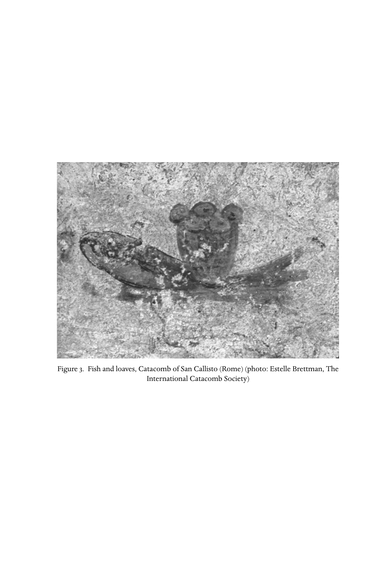

# 第六章英文原文：Johannine Christianity

<!-- PDF page 174; original page 125 -->

### 6. Johannine Christianity

harold w. attridge

#### The literary evidence for Johannine Christianity

The complexity of the Johannine corpus renders attempts to trace the contours of Johannine Christianity difficult. Nonetheless, the sources reveal a community of early followers of Jesus who, using an abundance of biblical symbols, defined themselves rather starkly against the Jewish milieu in which they arose. These believers cultivated an intense devotion to Jesus as the definitive revelation of God’s salvific will, and understood themselves to be in intimate contact with him and with one another, under the guidance of the Spirit-Paraclete. They were conscious of their relationship to other believers with whom they hoped to be in eventual union. Their piety found distinctive expression in a reflective literary corpus that explored new ways of expressing faith in Jesus. Their common life included ritual actions known to other followers of Jesus, but they insisted on the unique spiritual value of those rites. Disputes eventually divided the community. By the middle of the second century some representatives of the Johannine tradition achieved a respected role in the emerging ‘great church’, the interconnected web of believers throughout the Mediterranean that provided mutual support and maintained fellowship under the leadership of emerging episcopal authorities. The Johannine community of the first century bequeathed to the universal church its distinctive literary corpus and estimation of Jesus, which came to dominate the development of later Christian orthodoxy. Other representatives of Johannine Christianity, nurturing alternative strands of tradition, influenced various second-century movements, characterised by their opponents and much modern scholarship as ‘Gnostic’.

<!-- PDF page 175; original page 126 -->
#### Sources

The primary source for Johannine Christianity is the anonymous gospel ‘according to John’.[^p174-1] Closely related in vocabulary, style and concerns are the Johannine epistles, which are certainly interrelated, even if they address discrete problems.[^p174-2] Most scholars find in them evidence of the Johannine community wrestling with problems of the interpretation of the gospel,[^p174-3] although some associate the epistles with a late phase of the gospel itself.[^p174-4]

Date and provenance of these central texts still generate controversy. The widely accepted date for a reasonably ‘final’ form of the gospel[^p174-5] is the late first or early second century, although other estimates have ranged widely. Nineteenth-century scholarship tended to place the gospel in the mid- or late second century.[^p174-6] The dating of P52 (P. Ryl. 457), the gospel’s earliest witness, to around 125 ce, provided many twentieth-century commentators a terminus ante quem, although the dating of the papyrus is hardly secure, and explicit citation of the gospel does not begin until Irenaeus in the last quarter of the second century. Nonetheless, allusions to the gospel in second-century works such as the Epistles of Ignatius of Antioch and the Odes of Solomon[^p174-7] persuade most commentators that the period of 90–110 constitutes a reasonable framework for the work’s composition. Some critics push the date considerably earlier, before the destruction of the temple in 70 ce, thus finding in this gospel the earliest example of the genre.[^p174-8]

The location of the community that produced the gospel and whose experience is reflected in the epistles is also a matter of conjecture. Irenaeus associates the gospel written by the Beloved Disciple, John, with Ephesus.[^p174-9] Irenaeus and

[^p174-1]: The gospel itself is anonymous, although its final colophon (21:24) suggests that it was written by the ‘disciple whom Jesus loved’. By the late second century church fathers attributed the text to John (Iren. Haer. 3.1.1; Clement of Alexandria, cited in Euseb. HE 6.14.7), who is soon equated with John the son of Zebedee, named as a close companion of Jesus in the Synoptic Gospels, and briefly mentioned in John 21:2. The attribution is doubtful and the function of the character of the Beloved Disciple remains debated. On attempts to identify the figure, see Charlesworth, Beloved Disciple. For a history of the tradition, see Culpepper, John. On the literary function of the Beloved Disciple, see Attridge, ‘The restless quest’.

[^p174-2]: On the relationship among the epistles, see Brown, Epistles of John, 14–35.

[^p174-3]: See especially Brown, Epistles of John, 47–115.

[^p174-4]: See e.g. Strecker, Johannine letters.

[^p174-5]: Some sections are clearly later additions, particularly the ‘pericope of the adulteress’, John 8:1–11, although when it was added remains unclear.

[^p174-6]: For earlier opinions, see Brown, Introduction, 206–10.

[^p174-7]: On all the second-century evidence, including the dating of P52, see most recently Nagel, Rezeption. Culpepper, John, 107–38, offers a brief summary of the evidence.

[^p174-8]: See Robinson, Priority; Berger, Anfang.

[^p174-9]: Iren. Haer. 3.1.1.

<!-- PDF page 176; original page 127 -->
other church fathers report anecdotes of John’s activity in Ephesus, competing with ‘Gnostic’ teachers such as Cerinthus,[^p174-10] or engaged in pastoral activity.[^p174-11] While some scholars continue to think of Ephesus as a probable venue, at least for the gospel’s final form,[^p174-12] others have proposed options on the Mediterranean littoral or in the Syrian hinterland.[^p174-13] Affinities between the gospel and other religious literature support such efforts. Alexandria was the home of the first-century Jewish philosopher Philo, whose complex speculation on the logos is often seen as a background to the Johannine prologue.[^p174-14] Alexandria was also a centre both for the speculative Christianity labelled ‘Gnostic’, often proposed as a background to the gospel,[^p174-15] and also for circles that generated the Corpus Hermeticum, a body of Graeco-Roman religious literature with affinities to the gospel’s symbolic world.[^p174-16] Alternatively, the Dead Sea scrolls parallel the gospel’s ‘dualism’ and its use of scripture,[^p174-17] prompting speculation about the gospel’s Palestinian roots.[^p174-18] Further east, the Epistles of Ignatius and the Odes of Solomon, probably of second-century Syrian provenance, offer intriguing similarities to the gospel’s imagery and spirituality.[^p174-19]

Other texts occasionally enter discussions of the Johannine community. Although explicitly attributed to a visionary named John, the book of Revelation is not part of the relevant literary corpus. Despite some common motifs, its language, literary style and theology clearly distinguish Revelation from the gospel and epistles.[^p174-20]

[^p174-10]: Haer. 3.3.4, cited by Euseb. HE 3.28.6. On these legends, and the importance of Irenaeus, see Culpepper, John, 123–28.

[^p174-11]: Clem. Al. q.d.s. 42, cited by Euseb. HE 3.32.5–19, reports the activity of John the Apostle and a ‘lost sheep’ from the region of Ephesus.

[^p174-12]: Most recently, see van Tilborg, Reading John.

[^p174-13]: See Brown, Introduction, 19–206.

[^p174-14]: See e.g. Borgen, Logos. Tobin, ‘Prologue’; Boyarin, ‘Gospel of the Memra’.

[^p174-15]: The best known proponent is Bultmann, Gospel of John. See also Schottroff, Der glaubende und die feindliche Welt. The category ‘Gnostic’ has come under critical scrutiny. Williams, Rethinking ‘Gnosticism’, highlights dangers in broad generalisations but agrees that there were second-century Christian groups sharing a family resemblance, which he labels ‘demiurgic creationists’. King, What is Gnosticism?, traces the category’s polemical and scholarly uses. For primary sources, see Foerster, Gnosis, and Layton, Scriptures.

[^p174-16]: Noted especially by Dodd, Interpretation. For an English translation, see Copenhaver, Hermetica.

[^p174-17]: A connection has long been championed by James H. Charlesworth. See Charlesworth, ‘Dead sea scrolls’, ‘Critical comparison’ and Jesus and the Dead Sea scrolls. It is endorsed by Ashton, Understanding, 232–7. Others remain sceptical. See Bauckham, ‘Qumran’. On the hermeneutical parallels, see Clark-Soles, Scripture.

[^p174-18]: Jews sharing the sectarian stance of the scrolls may, however, have also been in the diaspora. See Brown, Introduction, 199–206.

[^p174-19]: Lattke, Oden, provides a comprehensive treatment of scholarship on the Odes.

[^p174-20]: On possible relationships, see e.g. Taeger, Johannesapokalypse.

<!-- PDF page 177; original page 128 -->
Two second-century texts obliquely continue the Johannine literary tradition. The Apocryphon of John is the most important witness to a major strand of second-century Christianity. Four copies, all surviving in Coptic translations, attest two recensions of the work,[^p174-21] which was known also to Irenaeus.[^p174-22] The slightly later Acts of John,[^p174-23] pious fiction typical of the period, records legends featuring the apostle. Both works witness some second-century ‘Johannine’ Christians with ‘Gnostic’ characteristics, but caution is necessary in retrojecting their evidence to the first century as background to the gospel.

The complex heart of the corpus, the gospel, defies attempts to situate the Christianity that it represents. Several surface features of the text signal the difficulties. The genre, a narrative of the life, death and resurrection of Jesus, parallels other late first-century quasi-biographical gospels.[^p174-24] A patchwork of similarities to and differences from other known gospels, particularly the Synoptics, has produced continuous debate about their relationship to John. Most recent scholars are sceptical of direct dependence,[^p174-25] although some argue that assorted pericopes, particularly the passion narrative, indicate dependence on the Synoptics.[^p174-26] A few voices alternatively argue for the dependence of one or more of the Synoptics on John.[^p174-27] The possibility of Johannine intertextual allusions has recently become even more complicated because of the possible relationship between the gospel and non-narrative Jesus traditions, particularly the Gospel of Thomas.[^p174-28]

To decide the relationship of John to other gospels is not simply to determine its sources and, hence, its possible historical value. Understanding the loose relationship with the Synoptics and perhaps Thomas reveals the text’s

[^p174-21]: Three come from the Nag Hammadi collection of Coptic texts, discovered in 1945. The fourth survives in a Coptic codex in Berlin. For a synoptic edition, see Waldstein and Wisse, Apocryphon.

[^p174-22]: Haer. 1.29. For translation and discussion, see Layton, Scriptures, 163–9.

[^p174-23]: For a translation, see Schneemelcher, NTApoc, vol. ii, 152–212. Junod and Kaestli, Acta, provide a new critical text and French translation. On the relationship to Johannine tradition, see Koester, Introduction, vol. ii, 202–4.

[^p174-24]: The most readily comparable texts are the Synoptic Gospels, but the fourth gospel probably emerged at a time when other narratives about Jesus, now extant in fragmentary form, competed for attention. On gospels in general, see Koester, Ancient Christian gospels. For the texts, see Schneemelcher, NTApoc, vol. i.

[^p174-25]: For a history of the debate, see Smith, John among the gospels, and for recent work, Schnelle, ‘Johannes’; and Denaux, John.

[^p174-26]: Lang, Johannes. Dunderberg, Johannes, finds evidence of the Synoptics in a redactional layer of John 1–9.

[^p174-27]: Matson, Dialogue.

[^p174-28]: For possible connections between John and Thomas, see n. 76 below.

<!-- PDF page 178; original page 129 -->
rhetoric, which engages in a sustained reflection on the ‘conventional wisdom’ of various proclamations about Jesus. The writers responsible for the gospel no doubt knew of the stuff of which the Synoptics and other gospels were made, and may have even known one or more in its final form, but freely adapted both oral traditions and literary productions.[^p174-29]

The text obviously delights in symbolism. Almost everything seems to point to something else. The miracles of Jesus are ‘signs’, but how and what they signify is not immediately apparent. Jesus’ discourses are replete with evocative terms, often pointing to himself, but introducing scriptural and general cultural themes.[^p174-30] The complex narrative collapses temporal horizons, inscribing the life of the community into the story of Jesus.[^p174-31]

The use of irony introduces further intricacies. Although hardly unknown in the other gospels,[^p174-32] the trope pervades this text.[^p174-33] Sometimes irony is a transparent dramatic device in which a character’s ignorance or misunderstanding reinforces the reader’s beliefs.[^p174-34] Irony obviously pervades the pivotal event of the gospel, the ‘hour’ of Jesus’ ‘glory’, strangely manifest in the ignominy of crucifixion (e.g. John 12:23–33). Yet there may be even deeper irony, playing with readers’ expectations in order to provoke reflection.[^p174-35] Both pervasive symbolism and irony hint that the gospel does not contain straightforward references to actual belief and practice.

Further complicating the use of the gospel as a source for historical reconstruction are numerous aporias. Features of the plot challenge its unity, such as temporal and spatial sequences that make little sense,[^p174-36] or an apparent closure in the action that subsequent developments ignore.[^p174-37] At the conceptual level, affirmations about the relationship of Jesus and his Father,[^p174-38] about

[^p174-29]: On generic ambiguity, see Attridge, ‘Genre bending’.

[^p174-30]: See Koester, Symbolism.

[^p174-31]: This is emphasised by Martyn, Gospel, and his History and theology.

[^p174-32]: More than a hint of irony is evident e.g. in the centurion’s declaration in Mark 15:39.

[^p174-33]: For recent treatments, see Duke, Irony, and O’Day, Revelation.

[^p174-34]: Thus Nicodemus misunderstands being born ‘from above/again’ in ch. 3, and the Samaritan woman (ch. 4) fails to perceive the nature of the ‘living water’ that Jesus offers.

[^p174-35]: See e.g. the play on the knowledge of Jesus’ origins at 7:27. The crowds claim to know where Jesus is from (Galilee?) but insist that the origins of the Messiah will be unknown, thereby revealing their ignorance of his heavenly origin. The text may also call into question a reader’s presupposition that Jesus comes from Bethlehem.

[^p174-36]: E.g. the apparent movement from Galilee (ch. 4), to Jerusalem (ch. 5), to Galilee (ch. 6) and back (ch. 7) is, at the very least, abrupt and unmotivated.

[^p174-37]: John 14:31 would make an excellent transition to 18:1. The apparent closure at 14:31 is often taken as grounds for seeing chs. 15–17 as a redactional addition.

[^p174-38]: John 10:30: ‘The Father and I are one’, and 14:28: ‘The Father is greater than I’.

<!-- PDF page 179; original page 130 -->
judgement,[^p174-39] or about eschatological salvation are often contradictory or difficult to reconcile.[^p174-40] Such difficulties have inspired attempts to trace the gospel’s sources and redactional history. One widely accepted theory posits the gospel’s development from a primitive collection of miracle stories, a ‘signs source’,[^p174-41] through a process of homiletic elaboration of sayings of Jesus, assembled by an evangelist’s guiding literary hand, supplemented by other editors or redactors.

Redactional theories in turn ground construals of the history of the community behind the text. Such theories postulate that Johannine believers began as a distinctive Jesus movement that gradually conformed to the Christianity of the second century.[^p174-42] While it seems highly likely that the gospel did develop over time and therefore shows signs of rewriting and expansion,[^p174-43] the construal of redactional activity as an attempt to domesticate a ‘maverick’[^p174-44] narrative remains unsatisfactory. A fundamental problem is that the supposed redactors did such a miserable job of making corrections, having left so many tensive elements in the text. It is equally plausible, and indeed even more compelling, to read such elements as a deliberate literary strategy. Too ready an appeal to redactional corrections to explain disjunctions may obscure both the functions of the literary work itself and the character of the community standing behind it.

#### A possible history of Johannine Christianity

The overall contours of a history of Johannine Christianity could be sketched as follows. The community began in Israel, probably in Judaea,[^p174-45] in the immediate

[^p174-39]: Does Jesus, qua ‘Son of Man’, not judge ( John 2:17) or does he (5:22, 27)?

[^p174-40]: Is resurrection a future ( John 5:28–9) or present ( John 11:25) reality?

[^p174-41]: The most enduring theory about the sources and redaction of the gospel is the hypothesis of a ‘signs source’. See Fortna, Gospel of signs, and Fourth gospel and its predecessor. A brief version of Fortna’s results is available in Miller, Complete gospels, 175–95. For an alternative, see van Wahlde, Earliest version. For a critical review of the history of research, see van Belle, Signs source.

[^p174-42]: Brown, Community, popularised a version of this developmental theory. For other theories, see Bull, Gemeinde.

[^p174-43]: Coming after the colophon of 20:30–1, ch. 21 clearly seems to be an appendix, although some scholars have argued for its integral relationship with what precedes. See Minear, ‘Original function’.

[^p174-44]: For such a notion of the gospel, see Kysar, John, the maverick gospel. For Bultmann, the final hand was an ‘ecclesiastical redactor’, who brought into line with emerging orthodoxy elements such as the realised eschatology of the gospel.

[^p174-45]: The initial resurrection appearances ( John 20) take place in Jerusalem, where the disciples receive their commission to a ministry of forgiveness ( John 20:22). Hence, as in Luke, Jerusalem is the initial focus of the post-resurrection community. The Judaean roots may be even stronger. Although Jesus is said by Philip to be ‘the son of Joseph, from Nazareth’ ( John 1:45), there is a suggestion that Judaea is also his own ‘homeland’. The reference to ‘his own’ who did not receive him ( John 1:11) is particularly true of ‘the Judaeans’, from whom, paradoxically, also comes salvation ( John 4:22). The ignorance of the Judaeans in 7:27 may also extend to their unawareness of a Judaean origin (Bethlehem?) for Jesus.

<!-- PDF page 180; original page 131 -->
aftermath of Jesus’ death and resurrection, perhaps under the leadership of a disciple of Jesus who inspired the text’s Beloved Disciple. This egalitarian fellowship remembered[^p174-46] what Jesus said and did and engaged in scriptural interpretation[^p174-47] to make sense of their experience. The community interpreted the mission of their rabbi or teacher[^p174-48] with the resources of their Jewish tradition, understanding him to be one sent from God,[^p174-49] a prophet like Moses,[^p174-50] the Messiah,[^p174-51] the Son of Man,[^p174-52] Son of God,[^p174-53] an embodiment of God’s word.[^p174-54] Beyond traditional titulature, the gospel appropriated symbols from Jerusalem’s cultic tradition and applied them to Jesus as the new temple,[^p174-55] the source of ‘living water’[^p174-56] and ‘light’,[^p174-57] whose life reflected the biblical liturgical cycle.[^p174-58] This Judaean Johannine community probably expanded with converts from Samaria, who introduced distinctive messianic expectations focused on a Mosaic prophet.[^p174-59] In the face of external

<!-- Footnote p174-45 continues here in the original; incorporated into its definition above. -->

[^p174-46]: ‘Remembering’ seems to be a technical term for this community. See John 2:17, 22; 12:16.

[^p174-47]: On Johannine use of scripture, see Daly-Denton, David. On the precise form of John’s biblical text, see Menken, Old Testament quotations.

[^p174-48]: For this title, see John 1:38, with both Hebrew (rabbi) and Greek (didaskalos); 3:2, 10; 11:28; 13:13–14; 20:16, again using Hebrew (rabbouni) and Greek (didaskalos) forms.

[^p174-49]: This is the most common way of thinking about Jesus in the gospel. Cf. 4:34; 5:23–4, 30, 37; 6:38–9; 6:44; 7:16, 28, 33; 8:16, 18, 26, 29; 9:4; 12:44–5, 49; 13:16, 20; 14:24, 26; 15:21, 26; 16:5, 7; 20:21.

[^p174-50]: Cf. 1:45; 4:19; 6:14; 7:40; 9:17. For background, see esp. Meeks, Prophet-king.

[^p174-51]: Cf. 1:41, where the title is handily translated as Christos, as at 4:25, on the lips of the Samaritan woman.

[^p174-52]: Cf. 1:51; 3:13–14; 5:27; 6:27, 53, 62; 8:28; 9:35 (‘of God’ is a variant); 12:23, 34; 13:31. The gospel’s treatment of this title merits more attention. See below.

[^p174-53]: Cf. 1:18 (on the textual crux, see Ehrman, The Orthodox corruption, 78–82), 1:34, 49 ( = king of Israel); 3:16–18, 35–6; 5:19–26; 6:40; 8:35–6; 10:36; 11:4, 27 ( = Christos); 14:13; 17:1; 19:7; 20:31 ( = Christ).

[^p174-54]: John 1:1, 14. The Christology of the prologue, with its obvious echoes of the figure of divine wisdom (Prov 8; Sir 24; Wis 7), heavily influenced the appropriation of the gospel through the centuries, but it is not the end of the gospel’s christological story.

[^p174-55]: Cf. 2:14–16.

[^p174-56]: Cf. John 4:14; 7:37–9.

[^p174-57]: Cf. John 1:9; 8:12. Both the last reference and the water image of ch. 7 appear within the feast of Tabernacles ( John 7:2), which prominently featured both symbols.

[^p174-58]: The cycle, based on Exod 23:14–17; Lev 23:3–44; Num 9:9–39, is partially reflected in the sequence sabbath ( John 5:9); Passover (6:4); Succoth or Booths (7:2); Channukah (10:22). The sabbath is obviously a weekly festival, but is mentioned first in the pentateuchal festival calendars.

[^p174-59]: A Samaritan mission is attested in Acts 8, but as a post-resurrection event. John 4 suggests that Samaritans became disciples during Jesus’ lifetime. That claim may be part of the historical ‘palimpsest’ of the gospel highlighted by Martyn.

<!-- PDF page 181; original page 132 -->
opposition from Jewish circles, members of the community insisted ever more stridently on the heavenly source and destiny of Jesus and his intimate relationship with God.[^p174-60] In pressing these claims against considerable opposition, they took on characteristics of a ‘sect’, with well-defined social boundaries.[^p174-61] Their claims eventually led to their ‘expulsion from the synagogue’, a trauma mentioned three times in the gospel.[^p174-62] Some scholars have connected that expulsion with the birkat hamminim, a ‘blessing’, or praise of God, in fact, an imprecation against heretics. This benediction was reportedly added to the Amidah or Eighteen Benedictions in the last decade of the first century by rabbis at Jamnia (Yavneh). Although a bitter separation from its Jewish matrix marked the history of Johannine believers, it cannot be correlated with the introduction of the birkat hamminim, which is not to be dated before the third century.[^p174-63] Tensions between traditional Jews and the new followers of Jesus are widely attested in early Christian sources.[^p174-64] While the animosity attested in the fourth gospel is particularly intense, it was not unique.

Now somewhat distinct from their former Jewish environment, whether in Judaea or the diaspora,[^p174-65] these believers faced new challenges, also inscribed in the Johannine literary corpus. Doctrinal disputes, apparent in 1 John, developed over the implications of the group’s characteristic christological confession. The precise roots and shape of the rejected Christology(ies) are open to debate. The opponents mentioned in 1 John may have resisted the close association of Father and Son on which the gospel insists. They may also have questioned the connection between the divine logos and the apparent fleshliness

[^p174-60]: On the social function of christological claims, see Meeks, ‘Man’.

[^p174-61]: See Rebell, Gemeinde; Neyrey, Ideology. The characterisation of the Johannine community as a sect is central to the review of Johannine scholarship by Ashton, Understanding.

[^p174-62]: John 9:22; 12:42; 16:2. Whether these texts refer to a single event or a lengthy process is unclear.

[^p174-63]: For criticism of the hypothesis of the birkat hamminim as a first-century rabbinic development, see van der Horst, ‘Birkat’; see also ch. 4, above, and pt iii, ch. 10, below. For a more extensive critique of the historicity of ‘ Yavneh’, see Boyarin, ‘Justin Martyr’.

[^p174-64]: Matt 23 reveals difficulties with contemporary synagogues and predicts persecution (Matt 23:34). Paul’s problems with Jewish co-religionists are apparent from his letters (1 Thess 2:14–16; Phil 3:2–11; 2 Cor 11:24; Gal 5:11), and from the dramatised narrative of Acts (13:45, 50; 14:2–5; 17:5, 13; 20:19; 21:27–36). Rivalry with a synagogue and ‘Jew’ as a contested self-identification are evident in Rev 3:9. These sources, however, do not mention expulsion from the synagogue.

[^p174-65]: A perennial problem is the identity of the opponents of Jesus, hoi Ioudaioi, who often seem to be specifically related to the Judaean environment of Jesus’ ministry, but who may symbolise opposition to Johannine Christians in new environments. See Meeks, ‘Am I a Jew?’; Ashton, ‘Identity’; van Wahlde, ‘Johannine “Jews”’.

<!-- PDF page 182; original page 133 -->
of Jesus. Such a ‘docetic’ position may have involved theories about the relationship between the heavenly/divine and the earthly/human in Christ, or it may have denigrated the physical Jesus, on philosophical[^p174-66] or perhaps even paraenetic grounds.[^p174-67] The writer of the epistle insists, in any case, on the close connection between Father and Son (1 John 2:22–3), and maintains that Jesus really did come ‘in the flesh’ (1 John 4:1–3; cf. 2 John 7). Other doctrinal struggles surface in the epistle’s insistence on the reality of sin and atonement (1 John 1:8–2:2; 4:10) and on the concomitant need to assume moral responsibility.[^p174-68] However 1 John relates to the gospel, its positions strongly resemble the explicit stance of many prominent second-century Christians. On crucial doctrinal issues, the position of the epistles is, in broad outline, compatible with the emergent ‘Great Church’.

A second point of conflict in the Johannine community’s development concerns its organisational form.[^p174-69] The gospels overtly are silent on the organisation of the communities that read them. Some texts hint at an egalitarian ideology, e.g. Matthew’s rejection of honorific titles (Matt 23:9), Mark’s idealisation of service (Mark 10:45), or Acts’ idyllic picture of primitive ‘communism’ (Acts 2:44; 4:32). The situation in early communities was certainly more complex, and Paul’s letters attest emerging social organisation.[^p174-70] The gospels, too, occasionally hint at the ecclesial world for which they were written, rather than the ideal fellowship that they describe. Matthew 16:18–19 famously portrays Peter as a figure of authority, perhaps rivalling the still respected scribes and Pharisees (Matt 23:3). The portrait hints at an incipient monarchical episcopacy, first evident in Ignatius of Antioch. Otherwise, governance rested in the hands of presbyteral councils, implied in Acts 20:17–38, and evident in the Pastoral Epistles (1 Tim 3:1–12) and in 1 Clement 42.4–5, from late first-century Rome.

The fourth gospel offers little explicit information about institutional structures. It portrays the followers of Jesus as a flock (John 10) and a vine (John 15), both of which suggest special intimacy. The sheep hear and recognize their

[^p174-66]: Divine impassibility was a widespread philosophical assumption. On Middle Platonic theology, see Dillon, Platonists, 128, 155, 280–5.

[^p174-67]: Cf. the denial of the significance of suffering in Wis 2:21–3:3, based on belief in the soul’s incorruptibility. ‘Docetic’ Christologies emerged in early second-century Christianity. On the important evidence of Ignatius of Antioch, see Schoedel, Ignatius, 19–29.

[^p174-68]: Cf. 1 John 2:3–6; 3:15–17; 4:11–12.

[^p174-69]: See ch. 7, below.

[^p174-70]: See e.g. 1 Cor 12:28 for various functional roles; 16:19 for the ‘house church’ of Prisca and Aquila.

<!-- PDF page 183; original page 134 -->
shepherd’s voice;[^p174-71] the vine’s branches grow directly from the stalk that is Jesus (John 15:2, 5–6). The pastoral imagery further suggests the existence of other sheep (John 11:41) who should belong to the one flock. Neither metaphor, however, has any room for an intermediary structure between Jesus and his ‘sheep’. If a real Beloved Disciple or his successors played a governing role, that role finds no echo in the main body of the text. The disciple’s death, implied by the dialogue between Jesus and Peter at 21:21–3, may have led to community reflection on its relationship to other sources of authority.

What appears instead of simple charter myths are disciples standing in symbolic opposition. Most prominently, the Beloved Disciple contrasts with Peter.[^p174-72] At the Last Supper, he reclines in the bosom of Jesus ( John 13:23),[^p174-73] and mediates Peter’s access to Jesus (13:24). At the cross, the Beloved Disciple stands by Jesus and becomes his adopted brother ( John 19:26), after Peter had betrayed and abandoned Jesus ( John 18:17, 25, 27). Peter and the Beloved Disciple run together to the tomb on Easter morning, but the Beloved Disciple arrives first (John 20:4) and ‘believes’ upon seeing the folded grave cloths (John 20:8). The disciple’s precedence may have ecclesiological implications, if, by the time of the gospel’s composition, Peter had become associated with hierarchical structures.

If an ecclesiological subtext underlies the Beloved Disciple’s portrait, other aspects of his persona may have special significance. His new status as guardian of Jesus’ mother may contrast with James, the Lord’s brother (Gal 1:19; Mark 6:3), whose leadership in the church of Jerusalem is attested by Paul and Acts,[^p174-74] or with the claims of Thomas, ‘the twin’, understood to be the sibling of Jesus in early Syrian traditions.[^p174-75] Unlike the Beloved Disciple, Thomas believes only after seeing and being invited to touch the resurrected Jesus (John 20:28).[^p174-76] Whether they are historical individuals or ideal types, the contrasts

[^p174-71]: John 10:3, 27, a motif dramatically displayed in the raising of Lazarus (11:43) and the recognition of Jesus by Mary Magdalene (20:16).

[^p174-72]: Quast, Peter, usefully reviews the evidence.

[^p174-73]: As the ‘only begotten’ had been at the Father’s bosom ( John 1:18).

[^p174-74]: Gal 2:6; Acts 15:13–21; cf. Mark 6:3. On the role of James, see most recently Chilton and Evans, James.

[^p174-75]: On this point, see Schenke, ‘Function’. On Didymus Judas Thomas, see the Gospel of Thomas 1, 13; and the Acts of Thomas.

[^p174-76]: Several scholars have recently detected a critical stance in the fourth gospel towards ‘Thomasine’ Christianity. Riley, Resurrection, contrasts the emphasis on the physical reality of the resurrection in John with the absence of any explicit affirmation of the resurrection in the Gospel of Thomas. De Conick, Seek, finds a quest for ascent mysticism in Gos. Thom., but a denial of its possibility in John, which makes Jesus the locus of revelation. Pagels, Beyond belief, finds a contrast between the implicit authoritarianism of John, where everything depends on Jesus, and Gos. Thom., where wisdom may be found in every human heart. Dunderberg, ‘John and Thomas’, 361–80, offers a sceptical critique. For a test case of a specific sayings tradition, see Attridge, ‘“Seeking” and “asking”’.

<!-- PDF page 184; original page 135 -->
between the Beloved Disciple and other disciples suggest a critique of contemporary Christian groups, symbolised by various apostolic figures. All the disciples, nonetheless, are indeed apostles, ‘sent’ into the world as was Jesus (John 20:21).

The epistles provide tantalising data on disputes about the leadership of Johannine Christians, in the figure of Diotrophes, criticised in 3 John as one who ‘loves first place’ (philōproteuōn) and who ‘does not receive us’ (3 John 9). Diotrophes probably represents the new style of leadership, like Ignatius of Antioch, that emerged in the early second century. The ‘elder’ who penned 3 John, and perhaps the two other Johannine epistles as well,[^p174-77] may have represented an older form of leadership, closer to the charismatic itinerants of the first apostolic generation. The rivalry between ‘the elder’ and Diotrophes would then resemble the development evident in the Didache, the first book of church order, compiled probably in Greek-speaking Syria during the late first through early second century.[^p174-78] Didache 12.1–5 recognises but restricts the authority of itinerant prophets, while Didache 15.1–2 entrusts the future to locally elected bishops and deacons.[^p174-79]

While the portraits of the disciples in the fourth gospel score points about titular leaders and by implication their followers, the image of Peter in the last chapter takes on special significance. Rehabilitated from his triple denial of Jesus by a triple protestation of love (John 21:15–17), he is finally commissioned to ‘feed the sheep’ (John 21:17). This chapter acknowledges that, however much the apostle Peter and perhaps other ecclesiastical leaders were inferior to the Beloved Disciple, their authoritative position should be respected.

John 21 then suggests that Johannine believers were becoming reconciled with the wider church of the second century, which, by the time of Irenaeus, would be marked by its interconnected hierarchy, incipient canon and creedal confession.[^p174-80] The epistles also attest a schism within the community, in their reference to ‘antichrists’, who ‘have gone out from us’ (1 John 2:18–19). Perhaps those people maintained the theological positions criticised in the epistle, a docetically tinged Christology, or a denial of the reality of sin. Their legacy

<!-- Footnote p174-76 continues here in the original; incorporated into its definition above. -->

[^p174-77]: On the issue of authorship, see Brown, Epistles of John, 14–35.

[^p174-78]: See Niederwimmer, Didache.

[^p174-79]: More distantly related is the turmoil at Corinth attested in 1 Clement. At issue seems to have been the displacement of an older generation of leaders by a new, more youthful cadre. See 1 Clem. 44.

[^p174-80]: On the development of self-defined ‘orthodoxy’ see pt iii, ch. 13, below.

<!-- PDF page 185; original page 136 -->
may be felt in such second-century texts as the Apocryphon of John and the Acts of John.

#### Distinctive features of Johannine Christianity

Johannine literature suggests that the ‘community of the Beloved Disciple’ had its own development within the larger Christian orbit, a development that, by the second century, led some of its number to a closer association with the type of Christianity, heavily influenced by Paul, emerging in urban centres from Antioch through Ephesus to Rome. The written record nonetheless maintains distinctive features in theology and practice, particularly in three areas, Christology, eschatology and ethics. In each area the distinctive Johannine position intensifies elements present in other forms of Christianity. In the final analysis the gospel’s most distinctive features are the literary techniques through which it makes its claims.

#### Christology

At the heart of the gospel stands a very ‘high’ view of Jesus, God’s creative Word in human flesh, as the prologue (John 1:1–18) proclaims.[^p174-81] This association of Jesus with God’s word is certainly related to the sapiential categories exploited by other early believers for explaining the significance of Jesus.[^p174-82] Similarly, the claim that Jesus is the incarnation of a principle or agent sent from God is present in other early celebrations of Christ.[^p174-83] Distinctive of the fourth gospel is the way in which the two poles of the affirmation are maintained without explicit resolution. Jesus and the Father are one (John 10:30); yet the Father is greater than Jesus (John 14:28). Jesus is sovereign over wind and wave (John 6:19) and has preternatural knowledge (1:48, 16:30), but is reduced to tears at a friend’s tomb ( John 11:35).

To reduce these tensive elements to indices of documentary development ignores their conceptual role. The gospel’s antinomies repeatedly reaffirm both claims of the prologue: Jesus is God’s Word, and he is flesh and blood. Ultimately, his glorious divinity is most apparent when he is most visibly human, at his death.

The text’s approach to claims about the significance of Jesus is evident in the series of appellations of Jesus as ‘Son of Man’. Several passages evoke sayings of

[^p174-81]: For recent work, see Menken, ‘Christology’.

[^p174-82]: Matt 11:19; 1 Cor 1:24; Heb 1:3.

[^p174-83]: Such celebrations often appear in material identified as hymnic: Phil 2:6–11; Col 1:15–20; Heb 1:1–3; but also in confessional formulas, e.g. 1 Cor 8:6.

<!-- PDF page 186; original page 137 -->
the Synoptic tradition, but often with a new twist. Some (John 1:51, 5:27, 6:62) parallel elements of the ‘eschatological’ Son of Man sayings, the predictions of the ‘coming’ in heavenly glory surrounded by angels to act as judge.[^p174-84] Other verses[^p174-85] recall the passion predictions that form the backbone of Mark but are paralleled in the other gospels.[^p174-86] Others (John 6:27, 53, 9:35) portray the Son of Man in the present, offering sustenance and soliciting belief.

In all of these cases, the echoes of familiar traditions are made strange. At John 1:51, the Son of Man is not surrounded by angels, but, through an evocation of Jacob’s ladder, he becomes a vehicle for their ascent and descent. At John 3:13–14, another biblical intertext, the healing serpent from Numbers 22 reinterprets the suffering Son of Man. At John 8:28, the ‘lifting up’ of the Son of Man reveals his true identity, and, at John 12:32, he promises to draw all to himself. The manipulation of Son of Man sayings through the earlier chapters anticipates the final saying at John 13:31, which boldly combines the ‘glory’ associated with the ‘eschatological’ sayings, with the event of the ‘hour’ when the Son of Man is ‘lifted up’.

The handling of the Son of Man sayings betrays a deliberate appropriation of traditions about Jesus, holding assertions about glory and suffering in an ironic tension that invites the reader or hearer of the gospel to contemplate the significance of the cross.[^p174-87] A reflective literary hand has reshaped traditional material in order to reinforce a central Christian tenet.[^p174-88] Although the gospel has certainly been read as naively docetic,[^p174-89] the handling of such traditional christological sayings, like much else in the text, strongly emphasised the incarnate Christ as the focal point of Christian thought.[^p174-90]

#### Eschatology

What obtains for Christology also applies to the gospel’s eschatology.[^p174-91] It is striking that the gospel lacks scenes of eschatological judgement or apocalyptic

[^p174-84]: Cf. Mark 13:26–7 and parr.; Matt 25:31–46. In general on the Son of Man in John, see Moloney, The Johannine Son of Man.

[^p174-85]: John 3:13–14; 8:28; 12:23–34; 13:31.

[^p174-86]: Mark 8:31; 9:31; 10:33. Among the arguments for some acquaintance with the Synoptic Gospels is the structural similarity, to Mark in particular, created by the prominence of three passion predictions utilising the motif of the Son of Man.

[^p174-87]: The insistence on seeing the cross with the intense eyes of faith has led to the long tradition of viewing the gospel as a ‘mystical’ text. See Countryman, Mystical way; Kangaraj, ‘Mysticism’.

[^p174-88]: Like Paul, the evangelist could well affirm that he knows only Christ and him crucified (1 Cor 1:23).

[^p174-89]: An assessment famously defended by Käsemann, Testament.

[^p174-90]: For elaboration of this point, see Schnelle, Antidocetic Christology.

[^p174-91]: In general see Frey, Eschatologie.

<!-- PDF page 187; original page 138 -->
catastrophe, like those prominent on the lips of Jesus in the Synoptics and paralleled in Paul.[^p174-92] Some passages, moreover, use eschatological categories, particularly ‘judgement’[^p174-93] and ‘resurrection’,[^p174-94] to describe not future events but the present confrontation between the individual and Christ. Yet some passages do mention a judgement and resurrection to come ‘on the last day’.[^p174-95] The antinomies in the perspectives on eschatology have stimulated debate about the character of the Christianity that the gospel represents. In this material in particular, some scholars have found evidence of the hand of a corrective redactor, imposing orthodoxy on a more radical original source.[^p174-96]

Before embracing such mechanical redactional hypotheses, however, it is important to remember the reinterpretive strategy apparent in the gospel’s Christology. A similar tactic is likely to be at work in the eschatological passages, where the gospel did not, in fact, break new ground. Other early Christian teachers had also used eschatological categories to suggest that hoped-for realities were part of the believers’ present experience, particularly in worship. Such claims appear prominently in passages on baptism, which, in Pauline Christianity, actualises Christ’s death and resurrection in the life of the believer.[^p174-97] The ritual also makes the new life of the spirit a present reality,[^p174-98] even if believers long for eschatological consummation.[^p174-99] One of the dangers that Paul himself confronted was a tendency to take the trope too literally and thereby ignore both the future hope and the contemporary ethical demand that he thought essential to life ‘in Christ’.[^p174-100]

The fourth gospel’s handling of eschatological expectations parallels Paul’s, with a balance between present reality and future hope. Yet, in contrast to Paul, the gospel emphasises the side of the realisation of ‘eternal life’ in the

[^p174-92]: Cf. Matt 24–25; Mark 13; Luke 21; 1 Thess 4:13–18; 1 Cor 7:29–31; 15.

[^p174-93]: John 2:17–21; 8:15. Yet the Father has given judgement to the Son, according to John 5:22, 27. For a general exploration of the theme, see Blank, Krisis.

[^p174-94]: Cf. John 5:24–5; 11:25–6.

[^p174-95]: Cf. John 5:28–9; 6:39–40, 44, 54; 11:24; 12:48.

[^p174-96]: See e.g. Haenchen, John 1, 259–60.

[^p174-97]: Rom 6:1–11 uses the parallel between baptism and death/resurrection with subtlety and restraint. The future hope (v 8) and ethical reading of ‘new life’ (v 11) are clear. Colossians 2:12–13 emphasises more directly the participation in Christ’s new life; nonetheless, future hope remains (Col 3:1–4). For deutero-Pauline applications of eschatological language to present experience, cf. 2 Tim 2:18; 2 Thess 2:2.

[^p174-98]: Famously celebrated at Gal 2:19–20; Phil 3:7–11; Rom 8:9–11.

[^p174-99]: Cf. Rom 8:18–30.

[^p174-100]: See e.g. the emphasis in Phil 3:12–16 on the ‘not yet’ element of Christian life, following close on the affirmation of being ‘in Christ’. Similar concerns may underlie Paul’s criticism of Corinthian self-confidence (1 Cor 4:8–9).

<!-- PDF page 188; original page 139 -->
believer’s ‘abiding’ relationship with God, which grounds any hope of a more conventionally conceived ‘eternal life’.

The dialogue between Jesus and Martha of Bethany sharply focuses the gospel’s eschatological tension. After Jesus proclaims to Martha that her brother would rise, she responds with a conventional Jewish hope[^p174-101] that her brother would rise on the last day (John 11:23–4). Without denying Martha’s hopes, Jesus points to himself as resurrection, and by implication, life lived with him as eternal. Absent the life of faith, hope in a future resurrection is, the gospel suggests, vain. Similarly, at the core of the Last Supper discourses (14:1–4), Jesus, discussing the ‘way’ of his departure, promises to return and take his disciples with him to a heavenly ‘abode’ (John 14:2), the Johannine equivalent of the Pauline ‘rapture’ (1 Thess 4:17). The subsequent dialogues suggest that the intimacy envisioned for the post-return ‘future’ is already present. To those who keep Jesus’ word, Jesus and the Father will come and make their ‘abode’ (John 14:23). Like branches on the vine, his disciples will abide in him, if they keep his commandments.[^p174-102] This sequence of eschatological moments parallels that of John 11. A traditional hope is strongly affirmed, but by implication made contingent upon the anticipatory realisation of that hope in the life of the believer. Traditional eschatology has not been eliminated but refocused on its present preconditions.[^p174-103] The figure of the Paraclete, the ‘spirit of truth’ (John 14:17), plays a central role in this refocusing. Present through baptismal rebirth (John 3:5), this ‘Holy Spirit’ ( John 14:26) abides with the disciples (John 14:17), teaching them (John 14:26) and defending them against a hostile world (John 16:8–11).[^p174-104]

When seen from the perspective of the play on eschatological categories in chapters 11 and 15, the antinomies in the theme of judgement attain clearer resolution. The climactic saying on the subject at John 12:47–8 combines the tensive affirmations that the Son does and does not judge. Unlike the Son of Man seated in eschatological glory, Jesus, the Son, has not come to judge but to save (John 12:48), yet the word that he has spoken (or will speak: John 13:31)

[^p174-101]: The hope, classically expressed at Dan 12:1–3, was not universally shared, as Mark 12:18 and parr. and Acts 23:6–8 indicate. For the diversity of Jewish beliefs, see Nickelsburg, Resurrection.

[^p174-102]: John 15:5–10. The mutual indwelling of God and the believer who abides by God’s command is a theme echoed in 1 John 2:24; 4:12, 16; 5:3.

[^p174-103]: Such focus on the initial encounter with the revealing Word and the life that flows from it may have appealed to second-century ‘Gnostic’ Christians. But, like the fourth gospel, they did not dispense with future eschatology. See Attridge, ‘Gnosticism’.

[^p174-104]: On the Paraclete’s role, see Brown, ‘Paraclete’ and Smalley, ‘“Paraclete”’.

<!-- PDF page 189; original page 140 -->
provides a basis for judgement ‘on the last day’. The gospel allows for an eschatological future, but it is firmly grounded in the present confrontation between the Word, both in the flesh and in the book, and those summoned to hear it.[^p174-105]

#### Ethics and religious practice

The followers of Jesus depicted in the Johannine literature display few of the practices that characterised their lives. Unlike the Sermon on the Mount (Matt 5–7), the fourth gospel says nothing about an ethic of non-violence, of loving enemies, turning the other cheek, renouncing divorce, walking the extra mile.

Ethics for the fourth gospel can be reduced to the single command to love one another, emphatically proclaimed at the Last Supper (John 13:31), illustrated with a proverbial saying ( John 15:13) and echoed in the epistles.[^p174-106] The gospel spends little time on practical consequences, although both it and the epistles insist on the importance of forgiveness of sins.[^p174-107] Yet the love that disciples are to embody focuses on the community of fellow disciples. Such love is not deemed incompatible with harsh words against enemies ( John 8:44), which perhaps mirror the hatred of an inimical ‘world’.[^p174-108]

Neither the evangelist nor the writer of 1 John elaborates a detailed ethic; both focus instead on fundamental motivations for ethical behaviour. The Last Supper discourses indicate that the foundation is not simply a divine command issued by God’s legate, but, in Jesus’ death for his friends, it is also an embodied example of the ‘greatest love’ (John 15:14). This grounding of ethics in turn constitutes a soteriology: the cross reveals something that attracts (John 12:32) and heals (John 3:14–15), which, as the final discourses make clear, is love in action. In making ‘the love command’ central to Christian proclamation, John is hardly unique.[^p174-109] By connecting that command so closely to the cross, the evangelist innovatively fused a theoretical foundation of ethics and a doctrine of revelation.

Unconcerned about ethical details, neither does the fourth gospel worry about religious practices, such as fasting, which troubled other Christians[^p174-110] and, according to Didache 8.2–3, marked community boundaries. Perhaps

[^p174-105]: 1 John 4:17 maintains the same structure of eschatological hope. Living the life of love provides bold confidence (parrhēsia) on the ‘day of judgement’.

[^p174-106]: 1 John 2:7 refers to the now ‘old command’, particularly celebrated in 4:7–5:4.

[^p174-107]: Cf. John 20:23; 1 John 1:9; 2:1.

[^p174-108]: John 15:18–29; 17:14. The fact that the gospel preaches love but uses harsh invective offends its most severe critics, such as Casey, Is John’s gospel true?.

[^p174-109]: Cf. Matt 5:43–4; 22:35–40; Mark 12:28–34; Luke 10:25–8; Gal 5:14; Rom 13:8–10.

[^p174-110]: On the diverse fasting practices of early Christians, see ch. 7, below.

<!-- PDF page 190; original page 141 -->
Johannine Christians rejected the biblical practice of fasting as did other early followers of Jesus, but the text is silent. In contrast to Matthew 7:7–13 and Luke 11:2–4, the gospel offers little explicit instruction about prayer. The final prayer of Jesus (17:1–26), faintly echoing the Lord’s Prayer,[^p174-111] is not proposed for imitation. Jesus endorses petitionary prayer (John 14:13–14; 16:26), but without specifying its form. The epistles provide examples of confessional forms (1 John 4:7–10), but not prescriptions.

The text suggests that Johannine Christians baptised and conducted a sacred meal, two hallmarks of Christian communities. The gospel offers conflicting testimony on whether Jesus himself baptised,[^p174-112] but that seems irrelevant to the insistence that one must be ‘born from above’ by ‘water and spirit’ (John 3:5). The dialogue with Nicodemus offers a specifically Johannine interpretation of the action, precisely in the terminology of ‘birth again/from above’. Neither a cleansing from sin,[^p174-113] nor an eschatological seal,[^p174-114] nor participation in the death of Christ,[^p174-115] baptism is, using language of Hellenistic religion, a ‘rebirth’.[^p174-116] While other baptismal theologies are not in evidence, there is an intricate literary development of baptismal symbols. The ‘water’ through which rebirth occurs is echoed in the water from Jacob’s well in John 4, where the traditional sapiential equation of water and teaching is apparent. That traditional equation receives a new twist in the note that teaching will bubble up as a fountain within each believer (John 7:38). New associations appear through the connection of the believer’s ‘water’ with what flows from Jesus’ pierced side (John 19:34).[^p174-117] Baptismal ‘water’ is thus ultimately connected with the believer’s apprehension of the cross.[^p174-118] 1 John 2:26–7 also mentions a ‘chrism’ that teaches, perhaps alluding to another baptismal symbol.

That Johannine Christians celebrated a sacred meal is clear, although how they did so is not. Whatever their practice, we should not expect a standard formula in the late first or early second century.[^p174-119] Two passages are relevant

[^p174-111]: The prayers share the addressee (Father), and the motives of coming, glory/hallowing and giving.

[^p174-112]: The discrepancy between John 3:22 ( Jesus baptised) and 4:2 (only disciples baptised) may be redactional.

[^p174-113]: Cf. Mark 1:4; Luke 3:3; Acts 2:38.

[^p174-114]: Cf. Rev 7:3; 9:4.

[^p174-115]: Cf. Rom 6:1–4; Col 2:12–13

[^p174-116]: Cf. Corpus Hermeticum 13.

[^p174-117]: Some interpreters find baptismal allusions elsewhere in the gospel, but most are hardly clear. For examples, see Moloney, ‘Sacraments?’; Morgan-Wynne, ‘References’.

[^p174-118]: 1 John 5:7 echoes the connection of blood and water.

[^p174-119]: Bradshaw, Worship, argues against positing a primitive normative form of eucharistic action, and McGowan, Ascetic eucharists, discusses the wide variety of eucharistic practices in the first two centuries.

<!-- PDF page 191; original page 142 -->
to their practice. Chapter 13 recounts a simple final meal, with no symbolism attached to bread or wine, as in the Synoptic and Pauline accounts.[^p174-120] Instead, Jesus washes the disciples’ feet and requires that they do likewise ( John 13:3–17). On the other hand, Jesus’ lengthy discourse on the bread of life concludes ( John 6:51–8) by affirming the importance of eating Jesus’ flesh and drinking his blood. This passage clearly alludes to the kind of eucharist celebrated in Pauline and Synoptic communities.

One interpretation of this evidence sees the Johannine community celebrating its own sacred meal, without ‘words of institution’[^p174-121] or any reference to the symbolism of bread/body, wine/blood. A redactor, concerned to fill a gap, expanded the ‘bread of life’ discourse of chapter 6 to include such elements. Although some have argued for the integrity of John 6,[^p174-122] most scholars accept the theory of literary stratification and its implications for the development of Johannine eucharistic practice.

The gospel’s overall literary strategy should, however, signal caution. The gospel regularly recontextualises elements of early Christian teaching and practice. One might suspect a similar strategy at work in the eucharistic materials. As a redactional move, situating the reference to sacramental eating in chapter 6 is hardly an effective device to harmonise the gospel with some newly orthodox practice. Instead, the ‘eucharistic’ passages of chapters 6 and 13 could be designed to work together. One must ‘eat flesh’ and ‘drink blood’ to have a part with Jesus (John 6:53); one must also know and understand his act of loving service (John 13:17). If ‘eating’ and ‘drinking’ function as traditional sapiential metaphors, then the actions contemplated in chapter 6 must be correlated with the interpretation of the actions suggested by 13.

The ‘sacramental’ language of chapter 6 certainly alludes to a ritual practice used by the Johannine community at some point in its development. It might have come late to the life of the community or, more likely, it describes an accepted practice the understanding of which the evangelist wanted to deepen.

#### Conclusion

Johannine Christianity constitutes an alternative to other forms of Christianity in the late first or early second century. It does so in part because its community

[^p174-120]: Mark 14:22–5; Matt 26:26–9; Luke 22:15–20; 1 Cor 11:23–5.

[^p174-121]: The ‘eucharist’ of Did. 9–10 similarly lacks the words of institution.

[^p174-122]: See Borgen, Bread, and his ‘John 6’; as well as Anderson, Christology.

<!-- PDF page 192; original page 143 -->
history, its oral and written traditions, and its practices may differ from those of the ‘other sheep’ with which it became increasingly in contact. But most of all it is distinct from its competitors because its probing analysis of traditional forms and affirmations resulted in a creative attempt to comprehend and, thus, to recontextualise the experience of Jesus and what it means to follow him.

<!-- PDF page 193; original page 144 -->

