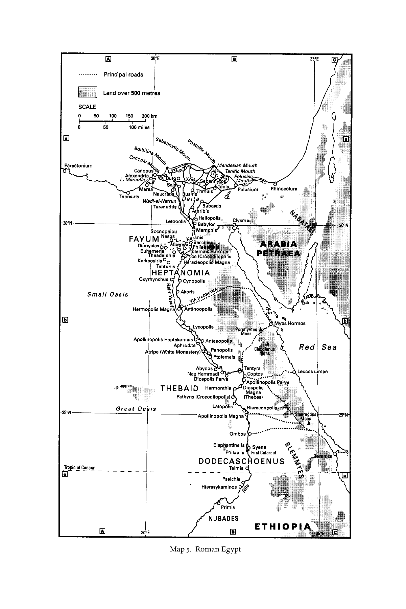

# 第十七章英文原文：Asia Minor and Achaea

<!-- PDF page 363; original page 314 -->

### 17. Asia Minor and Achaea

christine trevett

Asia Minor and Achaea were nurseries for Christianity, as the New Testament shows. The churches there were planted, grew and changed in environs which harboured a long history, within cities (Athens and Corinth, Ephesus and Pergumum among them) in which civic pride flourished and a diversity of cultures proliferated. The context for Christians’ lives was the empire[^p363-1] and, for most of them, a polis with its rivalries, regional grandees, associations and gathered poor.

#### The evidence

Asia Minor is particularly important for understanding the development and diversification of the Christians’ religion. Its significant epigraphy includes overtly Christian inscriptions which pre-date Constantine,[^p363-2] though the Christianity they represent (catholic,[^p363-3] Montanist/New Prophet,[^p363-4] Novatianist,[^p363-5] and others) is often difficult to determine. Inscriptions help to compensate for gaps in terms of Christian writings, art and artefacts.[^p363-6] Although some may be from the late second century, there is a dearth of them through the third in areas where Christians were (e.g. Asia’s western coastal region and Bithynia; cf. Plin. Ep. 10.96; Luc. Alex. 25). Of significance are (1) the openly Christian third-century epitaphs showing ‘Christians’ well integrated with their pagan neighbours;[^p363-7] (2) the pre-216 ce epitaph of the Phrygian Abercius (Greek:

[^p363-1]: See pt i, ch. 3, above.

[^p363-2]: Gibson, The ‘Christians for Christians’ inscriptions; Tabbernee, Montanist inscriptions.

[^p363-3]: Ign. Smyr. 8.2 has the earliest reference to ‘the catholic church’; cf. M. Polyc. 8.1; 16.2; 19.2.

[^p363-4]: ‘Montanism’ is a later designation for ‘the New Prophecy’.

[^p363-5]: On Novatianists in Asia Minor before the fourth century see Tabbernee, Montanist inscriptions, 345–9. Mitchell, Anatolia, vol. ii, 82–3, 100–2; see further pt v, ch. 26, below.

[^p363-6]: Snyder, Ante pacem; Jensen, ‘Art’.

[^p363-7]: Tabbernee, Montanist inscriptions, 62–91; Gibson, ‘Christians for Christians’ inscriptions; Mitchell, Anatolia, vol. ii, 43, 57; Mitchell with Levick, Monumenta Asiae Minoris antiqua, vol. x (JRSM 7).

<!-- PDF page 364; original page 315 -->
Aberkios)[^p363-8] (possibly Avircius Marcellus of Euseb. HE 5.16.3), telling of a common understanding of faith, hospitality and eucharist from Rome to Nisibis (cf. Iren. Haer. 1.10.2); and (3) the early third-century Greek and Latin inscription which seems finally to have located Tymion and the site of the New Prophets’/Montanists’ Phrygian ‘Jerusalem’.[^p363-9]

Many of the New Testament writings relate to Achaea and Asia Minor.[^p363-10] Overlapping them chronologically are those of the apostolic fathers to or from those regions: 1 Clement to Corinth; Polycarp To the Philippians[^p363-11] and the Martyrdom of Polycarp (from Smyrna); Ignatius’ early second-century writings (some to areas addressed in the Apocalypse (Rev. 2–3));[^p363-12] the Fragments of Papias, chiliast and associate of ‘the Elders’ ( Jerome, Vir. ill. 18; Iren. Haer. 5.33.4).[^p363-13] Additionally, there remain Melito’s Peri pascha; the Epistula apostolorum;[^p363-14] the Acts of Paul and Thecla[^p363-15] (and its embedded 3 Corinthians); Acts of Andrew, Peter and John; Eusebius’ fragments of Dionysius of Corinth; and anti-Montanist writers, 5 and 6 Ezra and the Ascension of Isaiah[^p363-16] (the provenance of some of these writings is debated).

In the ‘messy’ and ‘confrontational’ second century,[^p363-17] apologetic literature sought to justify Christians’ anomalous social position,[^p363-18] with Melito, Claudius Apolinarius of Hierapolis,[^p363-19] Athenagoras of Athens and Miltiades, ‘the sophist of the churches’,[^p363-20] addressing Marcus Aurelius (161–80 ce) and ‘secular rulers’. Aristides of Athens and the Asian (?) Quadratus (sometime episkopos in Athens?)[^p363-21] may have been contemporaries (Euseb. HE 4.3.3).

For the third and early fourth centuries there is again the evidence of Eusebius – though little is known of the once-significant figures he mentions, such

[^p363-8]: Calder, ‘Epitaph’, 1–4; Wischmeyer, ‘Der Aberkiosinschrift als Grabepigramm’; Horsley, New Documents, vol ii, 177–81; Frend, Archaeology, 95–100; Tabbernee, Montanist inscriptions, 53 n.13; 130; and the literature cited there. See Fig. 4, above.

[^p363-9]: Euseb. HE 5.18.2 (Apollonius). Tabbernee, ‘Portals’, 87–93.

[^p363-10]: See pt ii, ch. 5, above.

[^p363-11]: Harrison, Polycarp’s two epistles; Bauer, Die Polykarpbriefe; Hartog Polycarp (this last supports the unity of Poly. Phil.).

[^p363-12]: Hemer, Letters.

[^p363-13]: Lieu, Image and reality, 245–52. See too Körtner, Papias von Hierapolis; and Schoedel, ‘Papias’.

[^p363-14]: Stewart-Sykes, ‘Asian context’; Hill, ‘The Epistula apostolorum’.

[^p363-15]: Davis, Thecla.

[^p363-16]: Knight, Ascension and Disciples; Hall ‘The Ascension of Isaiah’.

[^p363-17]: Wagner, After the Apostles, 223.

[^p363-18]: Grant, Greek apologists; Young, ‘Greek apologists’; Lieu, Image and reality, 165, 182–90; Esler, Early Christian world, vol. i, 577 for bibliography.

[^p363-19]: Euseb. HE 4.26.2; 4.27.1; 5.19.

[^p363-20]: Euseb. HE 5.17.5; Tert. Val. 5.

[^p363-21]: Jerome, Vir. ill. 19; Ep. 70.4. Euseb. HE 4.23.3; 5.17.4.

<!-- PDF page 365; original page 316 -->
as Helenus of Tarsus, activist against the Novatianist schism and upholder of eastern practice on re-baptism of heretics (HE 6.46.3; 7.5.4; 7.28.1). One letter of Firmilian of Caesarea has survived, as also work from the philosopherapologist Lactantius and accounts concerning men of the time (such as Gregory of Nyssa on Gregory Thaumaturgus).

Much early literary evidence has been lost, including most of the work of Papias,[^p363-22] Melito (Euseb. HE 4.26.2), Miltiades (HE 5.17.5; Tert. Val. 5) and Dionysius (HE 4.23). It is from opponents’ writings that we learn of Cerinthus, Marcion, the New Prophets and others. There remains, nevertheless, a wide range of texts for recovering the Achaean and Asian Christian legacies.

#### Social and cultural characteristics

Asia Minor (from the western coast of modern Turkey to the Taurus mountain range and northwards), with its long-established Greek cities, and Achaea (Greece)[^p363-23] were linked by the common language of Greek, by proximity to the Mediterranean and its culture, and through being subject to the ubiquitous Roman administration[^p363-24] that had absorbed local leagues and made coloniae of the like of Corinth,[^p363-25] Achaea’s capital. Over centuries Asia Minor and the regions within it had undergone many administrative and boundary-related changes.[^p363-26] Civic rivalry and civil unrest played their parts in the ‘webs of power’ which bound the rulers and the ruled.[^p363-27] Cities might be melting-pots of Greeks and Anatolians, Romans and Jews. Well-established Jewish communities (e.g. in Ephesus, Smyrna, Sardis, Pontus)[^p363-28] might be strongly ambivalent in response to Hellenistic culture, or actively finding means to accommodate to it.

Latin served for the imperial administration, law and the military; Greek as the first language for the majority. In pockets, other languages survived.[^p363-29]

[^p363-22]: Iren. Haer. 5.33.4; Euseb. HE 2.15.2; 3.36.2; 3.39. See too Körtner, Papias von Hierapolis.

[^p363-23]: A senatorial province from 44 ce, covering southern Greece and the Peloponnese south of Macedonia and Illyricum. Corinth, Eleusis, Epidauros, Olympia, Athens and Sparta fell within it. Aegean islands came variously under Achaean or Asian jurisdiction. See e.g. Spawforth and Mee, Greece; Strabo, Geog., esp. bks 8–10.

[^p363-24]: See pt i, ch. 3, above.

[^p363-25]: Wiseman, ‘Corinth and Rome’; Rizakis, ‘Roman colonies’.

[^p363-26]: Magie, Roman imperial rule; Nörr, ‘Herrschaftsstruktur’; Mitchell, Anatolia and ‘Administration’; Jones, Cities; Alcock, Early Roman empire.

[^p363-27]: See too Ando, Imperial ideology; Huskinson (ed.), Experiencing Rome.

[^p363-28]: See Trebilco, Jewish communities; Conzelmann, Gentiles, Jews, Christians; Barclay, Jews in the Mediterranean diaspora; as well as pt i, ch. 2, and pt ii, ch. 10, above.

[^p363-29]: Freeman, Galatian language.

<!-- PDF page 366; original page 317 -->
Indigenous and assimilated foreign cults retained their influence. Asia Minor was long established as home to cults of Zeus, the Phrygian Men, mother goddesses (notably Cybele), divinised heroes, and monotheism as well.[^p363-30] From the site of the Mysteries at Eleusis (overrun and partially destroyed by invasion in 170 ce), through the cult of Poseidon, Ephesus’ economic embrace with the cult of Artemis, and Aphrodisias’ link to Aphrodite, religious symbols embedded in buildings, institutions, writings, sculpture and other artefacts were used to define, claim and retain power. The imperial cult was boosted in Domitian’s time (d. 96 ce), notably in Pergamum, Smyrna and Ephesus. Christian self-definition was refined in response.[^p363-31] Gaps in the evidence and the rural and undocumented nature of much of the territory prevent a comprehensive overview of the religious and cultural interface of Christians with their surroundings.

#### Christianity in this context

Early Christian traditions about Ephesus[^p363-32] and Athens (Acts 17–19; cf. 1 Cor. 1:14; 15:32; 18:23; 19:1, 10) show the interface between Christians, Jews, pagans, city politics and magic.[^p363-33] The presence of diaspora Jews had been important in determining the locations for evangelism but, where confident Jewish communities existed, so might Jews, Christians, pagans and the authorities be in tension. The fourth gospel, traditionally associated with Ephesus, suggests this[^p363-34] and Luke’s picture of fraught relations between evangelists, Jews, and a sometimes hostile populace in Achaea and Asia does too (e.g. Acts 13:42–51; 14:1–7; 18:5–17, 19–20).

Building on the Pauline foundation,[^p363-35] parts of urban and rural Asia Minor saw significant growth for the Christians’ superstitio (Plin. Ep. 96, in 112 ce; cf. Euseb. HE 8.1). Epigraphy shows Christians beyond the cities, while distaste for the New Prophecy (Euseb. HE 5.16.7; 5.18.2) included denigration of its beginnings in a ‘village’ and in ‘little’ places in Phrygia. Most sources concern urban Christians, however.

[^p363-30]: Mitchell, Anatolia, vols. i and ii; ‘The cult of Theos Hypsistos’; and Strobel, Das heilige Land.

[^p363-31]: Trummer, Denkmäler; Jones, ‘Roman imperial cult’; Geagan, ‘Roman Athens’, 386–7, 398–9, 408; Brent, Imperial cult; Harland, ‘Christ-bearers’ and ‘Imperial cults’.

[^p363-32]: On Ephesus see Koester (ed.), Pergamon; van Tilborg, Reading John; and Arnold, Ephesians.

[^p363-33]: Klauck, Magic; Arnold, Ephesians; Trevett, Christian women, pt 3 on Ephesus.

[^p363-34]: See pt ii, ch. 6, above.

[^p363-35]: See pt ii, ch. 5, above.

<!-- PDF page 367; original page 318 -->
The picture was mixed. Gregory Thaumaturgus found few Christians in his native Pontus in the 240s,[^p363-36] while third-century Phrygia had Christian communities from Synnada and Iconium to the Tembris valley in the north, and not all of catholic kind. By the time of Diocletian’s persecution, at least one Phrygian town was said to have been wholly Christian.[^p363-37] Many were Christian around Nicomedia in Bithynia, where Lactantius, the Cicero-loving philosopher, had been based.[^p363-38]

Public distaste for Christians was a factor throughout this period. It erupted in localised, sporadic and occasionally more systematic hostility: the Pliny- Trajan correspondence (Plin. Ep. 10.96.2 and 97.2); the much-debated rescript of Hadrian to Minucius Fundanus (Euseb. HE 4.8.5–7; 4.9; 4.26.10; Justin 1 Apol. 2.2);[^p363-39] the Martyrdom of Polycarp; Melito’s reference to ‘new decrees’ (Euseb. HE 4.26.5). Christians were put to death, as Pliny indicated (cf. Ign. Eph. 12.2; M. Polyc. Acts of Carpus, Papylus and Agathonike,[^p363-40] the M. Pion.). They suffered in the wake of natural disasters in Cappadocia (Firmilian: Cypr. Ep. 75), as well as under Decius, Diocletian and Maximinus in the early fourth century.[^p363-41] Achaea was not unscathed (Euseb. HE 4.26.3 (and 10); 5.24.2–5; and, especially, 4.23.2). Through the martyr discourse of the Acta, we see clearly competing systems.[^p363-42]

#### Christianity and diversity

Walter Bauer (original 1934) challenged assumptions that orthodoxy must have preceded heresy,[^p363-43] but more recent analysis allows for parallel developments, takes account of dissent internal to the church about belief and practice and understands movements of internal renewal or of schism in a more nuanced way. This leads to less dogmatism about where the boundaries lay between ‘insider = orthodox’ and ‘outsider = heretic’ in a given context. It is

[^p363-36]: Evangelisation followed. His ‘canonical letter’ told of Pontus devastated by the Goths in the 250s (Gr. Nyss. V. Gr. Thaum. in PG 46.909C and 954D). Cf. Socr. HE 4.27; Euseb. HE 7.14.1; 7.28.1; Mitchell, ‘Life’.

[^p363-37]: Euseb. HE 8.11.1; Lactant. Div. inst. 5.11. Tabbernee, Montanist inscriptions, 215–16.

[^p363-38]: Euseb. HE 9.6.3–8.14; 9.9a.3–6; cf. V.C. ii.12. Cf. too, HE 8.5.1–6.8.

[^p363-39]: Cf. the disputed rescript from the council of Asia (Euseb. HE 4.13).

[^p363-40]: Euseb. HE 4.15.48 (under Marcus Aurelius). See Barnes, ‘Pre-Decian Acta’ (the Latin recension links them with Decius c.250). For translations, see Musurillo.

[^p363-41]: Euseb. HE 8.6.6–7; 8.12.1; 8.12.6–7; 8.13.1; 9.6.3, on Cappadocia, Bithynia and Pontus. See pt vi, ch. 28, below.

[^p363-42]: See Perkins, Suffering self, e.g. 116; and pt iii, ch. 14, above.

[^p363-43]: Bauer, Orthodoxy and heresy. Contrast e.g. Koester, ‘GNOMAI DIAFOROI’.

<!-- PDF page 368; original page 319 -->
questionable whether we should speak of orthodoxy and heresy as categories before the council of Nicaea.[^p363-44]

The emerging catholic form of what Ignatius called Christianism embraced some theological, ecclesiological and regional diversity. In this period, ‘insideroutsider’ Christian boundaries and writings were being determined, but the lines of demarcation were not solid. The dates of some sources are disputed, and the objects of the authors’ polemic are sometimes hard to establish. Thus, some credited Polycarp with authorship of the Pastoral Letters, and saw in them polemic against Marcion (cf. Iren. Haer. 3.3.4; Poly. Phil. 7.1), while the date and context for the Ignatian corpus have been variously reassessed in recent decades.[^p363-45] There is ample opportunity for mismatch when categorising groups and tendencies.

#### How ‘Jewish’ was Christianity to be?

Christians appreciative of the heritage of Judaism remained influential in the churches. Stark attributed the attacks on Marcion’s anti-Jewish, ditheistic and ascetic teaching to their ‘strong current ties to the Jewish world’.[^p363-46] From the outset, however (Acts, 1–2 Corinthians, Galatians, Colossians and 1 Timothy, the Revelation), Christians had disagreed about orthopraxy, involving variously circumcision, forbidden foods and sabbath, Law, angelic, apocalyptic and other speculations. Ignatius wrote of Christian ‘Judaising’ and ‘old leaven’ (Ign. Magn. 8–10; Phild. 6). Some Christians wanted at least that degree of separation from Gentiles called for in the so-called apostolic decree from Jerusalem (Acts 15:19–20; 1 Cor 8:1, 4, 10; 10:19, 28; Rev 2:14, 20), while others eschewed even those minimalist requirements. It can be hard to determine whether a writer was criticising Jews ‘proper’ or Christian ‘Judaisers’.

There was a broad spectrum of integration and non-integration, between Christians and Christians (e.g. Ign. Phild. 6; Smyr. 5.3; 7.2), Christians and Jews, and between each and pagan society. Relations might be close, complex or fraught with tensions. Marcion’s contemporary, Aquila of Sinope, converted from paganism, then was a proselyte to Judaism. His literalistic rendering of Hebrew scriptures into Greek acted as critique of the LXX version which Christians used.[^p363-47]

[^p363-44]: Williams, ‘Pre-Nicene orthodoxy?’ and ‘Defining heresy’; McGinn, ‘Internal renewal’; Frend, ‘Christianity’.

[^p363-45]: Munier, ‘La question’; Lechner, Ignatius; see the various works by Goulder, as well as those by Hübner.

[^p363-46]: Stark, Rise of Christianity, 64–6; also Malina, ‘Social levels’, 369–400.

[^p363-47]: K. Hyvärinen, Aquila.

<!-- PDF page 369; original page 320 -->
The Quartodeciman controversy was a special case which brought into relief differences of tradition of a regional kind in Christianity.[^p363-48] This, too, related to the question of how ‘Jewish’ was Christianity. In the 150s, Polycarp had spoken for Asian Quartodeciman Easter practice against the alternative advocated in Rome. He and bishop Anicetus respectfully had agreed to differ, although variations in practice would have hampered ecumenical relations between Christians of different ethnic groups in Rome and elsewhere.[^p363-49] A few decades later, bishop Victor took a strong line in favour of uniformity.[^p363-50] Rome’s position had many supporters, but Polycrates of Ephesus cited ‘great luminaries’ of the apostolic age (including John who ‘lay on the Lord’s breast’, John 13:25), revered martyrs, Melito and his own ancestors in the episcopate (HE 5.24.2–7, cf. 5.23.1). These had kept the (arguably more ‘original’) Quartodeciman tradition unswervingly.[^p363-51] Undaunted, Victor excommunicated the Asian churches, a move too far for some other bishops. Irenaeus rebuked Victor for his bulldozing insensitivity (Euseb. HE 5.23.1–24.18), but, like the Arian, the Quartodeciman controversy was not quickly settled. There was not just Christian diversity but a proud distinctiveness in Asia Minor. Its catholic leaders stood their ground, despite the claims and differing practices of Rome.

#### Chiliasm and prophetism

Chiliasm (millenarianism) and Christian prophetism had particular associations with Asia Minor, though either might be found elsewhere. Revelation chapters 20 and 21 told of hope for a New Jerusalem/new heaven and earth, and such ideas re-emerged through Papias of Hierapolis (Iren. Haer. 5.33.3f ), through Cerinthus, ‘the elders’, Irenaeus, and in the New Prophecy.[^p363-52] In the third century, Dionysius of Alexandria (formerly of Cappadocia) was embroiled in debates on the matter (Euseb. HE 7.24, 25) and, during fourth-century persecution, the tradition was rekindled in Methodius of Olympus (Res. 1.55.1; Symp.

[^p363-48]: Among Quartodeciman/‘fourteener’ Christians, the cessation of the fast and the celebration of the resurrection at Easter were reckoned in relation to the 14th of Nisan and the Jewish Passover. Commemoration of crucifixion and resurrection would not always fall on a Friday and Sunday.

[^p363-49]: Lampe, Paul to Valentinus; and La Piana, ‘Foreign groups’.

[^p363-50]: La Piana, ‘Roman church’.

[^p363-51]: See too Tabbernee, ‘Trophies’; Strobel, Osterkalendar; Lohse, Passafest.

[^p363-52]: Euseb. HE 3.28; 7.25; Iren. Haer. 5.33.3f; Tert. Marc. 3.24 and Res. 26. Trevett, Montanism, 95–105, and the literature there.

<!-- PDF page 370; original page 321 -->
9.5) and Lactantius (Div. inst. 7.21–6). Indeed, chiliastic expectation (eschewing allegorising) was another respect in which a Jewish legacy had remained strong among some Christians. Eusebius was unimpressed (HE 3.39.13; 7.24.1).[^p363-53]

Christian prophetism (attested among men and women since Paul’s day, e.g. 1 Cor; Acts 21:8–11) had proved important in Asia Minor but was marginalised as institutionalisation triumphed. There had been John the Seer and others in his circle, ‘Jezebel’ (Rev 2:20–4),[^p363-54] Philip’s daughters, Quadratus, Ammia and the New Prophet (Montanist) women and men who appealed to a ‘succession’ of prophesying (Euseb. HE 3.37.1; 5.17.4). It did not die quickly, as The ascension of Isaiah, Epistula apostolorum, Acts of Paul and Thecla, Cyprian, Epistulae 75 (on Cappadocia), and liturgical prophesying in later Montanism (Epiph. Pan. 49.2) indicated. The fourth-century memorial to the Christian prophetess Nanas is notable.[^p363-55] Taking into account Gnosticism, too, the incidence of female prophesying is striking. Yet, throughout this period we find that women’s role in Christian ministry was contested.

Ignatius, Polycarp and Melito combined both prophet and episkopos roles, but tensions did emerge between one mode of authority/leadership and another. In 1 Clement (as in the Didache) issues of ‘class’ and gender, householder rights, itinerancy and patronage contributed to such tensions.[^p363-56] The New Prophets’ payment of salaries to teachers (of both sexes?) would have democratised leadership for those not well established socially (Euseb. HE 5.18.2 (Apollonius)) and added to the catholic side’s suspicion.

The New Prophecy (later called Montanism), rising in the 160s under its leaders Priscilla, Maximilla and Montanus, differed in emphasis rather than doctrine from the catholic congregations from which it emerged, especially with regard to the exercise of authority and discipline. Its followers seceded or were driven from churches in due course,[^p363-57] under challenge to their ecstatic prophesying (Epiph. Pan. 48.3.4–7.8), writings[^p363-58] and rigorism. They shared in common with many Asian Christians Johannine incarnational orthodoxy, an

[^p363-53]: Nautin, Lettres, 143–65; St Dionysius of Alexandria, Feltoe (ed.).

[^p363-54]: Duff, Who rides the beast?

[^p363-55]: Tabbernee, Montanist inscriptions, 419–25; Trevett, ‘Angelic visitations’; Eisen, Women officeholders, 63–87.

[^p363-56]: See Trevett, Christian women, pt 1; see pt iii, ch. 14, above.

[^p363-57]: Euseb. HE 5.16.9–10 (anon.); Epiph. Pan. 48.1.4 (his source is early and probably Asian).

[^p363-58]: Euseb. HE 6.20.3 on writings; Paulsen, ‘Bedeutung’; Trevett, Montanism, 129–41; Denzey, ‘What did the Montanists read?’; Stewart-Sykes, ‘Original condemnation’.

<!-- PDF page 371; original page 322 -->
anti-docetic[^p363-59] /Gnostic stance (this writer believes), prophetism (with appeal to New Testament and other prophets as forebears), Johannine Paraclete pneumatology, plus, perhaps, chiliasm and Quartodecimanism. If (so Hipp. Haer. 8.19) some among their followers held to Noëtus of Smyrna’s monarchianism, then that too was part of the Asia Minor scene.

The New Prophecy spread rapidly to Rome, North Africa and elsewhere. More rigorist (in fasting, for example) and less forgiving of failure and lapse, its followers were not at odds with apostolic tradition nor, in principle, with episcopacy. Indeed, a hierarchy of church officials emerged, more complex than the catholic churches espoused, and including women (illustrative epigraphy survives). This Montanism retained its base in Asia Minor for centuries, albeit fragmented and diversified in theology and practice. Like Gnosticism it proved to be something against which the catholic tradition might define itself.

#### Diversity in theology and praxis

In the second and third centuries, developments were ‘multi-directional and not easily mapped’.[^p363-60] There were many strands in the tapestry of Asian and Achaean Christian tradition, including a multiplicity of ‘Paulinisms’ and ‘Johannisms’, as various Christians appealed to ancestral teachers and community founders, just as associations and Greek cities did to theirs. The Eusebian picture was simple (HE 3.1.1; cf. 3.4.1), namely that the new religion had spread and diversified through various apostles’ influence: Asia had had John; Achaea, Andrew; Peter for the diaspora of Asia Minor [cf. 1 Pet 1:1]; and Paul working ‘from Jerusalem to Illyricum’ (Acts 16:6–7; 17:10–18:1; 18:23, 19:1,10; 26:9–15; Rom 15:19). The reality was more complex.

In Achaea, as in Asia Minor, Paul was variously remembered: (a) as the admirable founding apostle by Clement in the letter to Corinth when countering schism[^p363-61] (1 Clem. 5.5; 47.1), and as admirable too by Ignatius (Ign. Eph. 12.2; Rom. 4.3), Polycarp (Phil. 3.2; 9.1), Irenaeus[^p363-62] and others; (b) as the catholic promoter of church organisation by the author of the Pastoral Epistles, as also of sound, non-ascetic, socially conservative doctrine in the face of adversaries and

[^p363-59]: Docetists (cf. Euseb. HE 6.12.6 (Serapion of Antioch, c.190s)) maintained that only seemingly was Jesus Christ a human, fleshly (rather than a spiritual) being.

[^p363-60]: Siker, ‘Christianity in the second and third centuries’, 232.

[^p363-61]: Trevett, Christian women, pt 1; Horrell, Social ethos; Bowe, Church in crisis. What the Jewish Christian Hegesippus regarded as orthodoxy lost out there after several generations (Euseb. HE 3.16; 4.21.2).

[^p363-62]: Noormann, Irenäus als Paulusinterpret. Paul was also mentioned in the Abercius inscription.

<!-- PDF page 372; original page 323 -->
loss of Pauline influence in Asia (Acts 20:27–31; 1 Cor 16:9; 2 Tim 1:15; 3:1–15; 4:1–18);[^p363-63] then (c) as anti-Jewish, according to the Hellenised and marriage-denying doctrine of Marcion of Sinope,[^p363-64] in whose truncated ‘canon’ of scripture Paul predominated;[^p363-65] (d) as the teacher of Theodas, mentor to Valentinus,[^p363-66] according to Gnostic claims, and (e) as the promoter of non-docetic orthodoxy and of celibacy in the Acts of Paul and Thecla including 3 Corinthians. Luke, Paul’s associate in the New Testament, figured in the Anti-Marcionite prologue[^p363-67] to Luke’s gospel[^p363-68] as another celibate, an Antiochene who wrote that gospel in Achaea (cf. too, Euseb. HE 3.4.6; Jerome, Vir. ill. 7), dying later in Bithynia (or Boeotia).

Encratism laid claim to Andrew, who was otherwise linked by traditions to both Achaea (Gregory of Nazianzus and Jerome, contrast Origen, so Euseb. HE 3.1) and Asia Minor (cf. John 1:40–4; 6:8; 12:22). In the Acts of Andrew and Mathias in the city of cannibals, Sinope in Pontus was the city concerned. The encratite (third-century?) Acts of Andrew (Euseb. HE 3.25.6) made of him a traveller, who moved from Pontus to Achaea and was imprisoned for teaching asceticism. One form of the text told of his crucifixion in Patras.[^p363-69]

Docetic and encratite elements, plus opposition to Simon Magus (‘father’ of Christian Gnosticism),[^p363-70] were combined in the Acts of Peter (possibly known to the author of the Acts of Paul). These, plus its miracle stories and the modalistic monarchianism[^p363-71] of popular Christian piety, make its thought hard to summarise.[^p363-72] Petrine influence had touched Achaea (1 Cor 1:12; 3:22; 9:5), but in Asia Minor it was 1 Peter which represented ‘mainstream’ Petrine tradition.

[^p363-63]: Müller, Theologiegeschichte; MacDonald, Legend; Lindemann, Paulus.

[^p363-64]: Hoffmann, Marcion (with caution), but also Lieu, Image and reality, 265–70; Schmid, Marcion; Hurtado, Lord Jesus Christ, 549–58; and items in Wilson et al. (eds.), Anti-Judaism, vol. ii; and May et al. (eds.), Marcion.

[^p363-65]: See pt iii, ch. 9, above.

[^p363-66]: The details of Gnostic teachers’ activities in Asia Minor and Achaea are lost, but see Irenaeus (Haer. 1.13.5) on Marcosian influence in the family of an Asian abroad.

[^p363-67]: This is a modern designation. These prefaces to Mark, Luke and John vary in origin and date and were not directed against Marcion. Only the Prologue to Luke survives in Greek.

[^p363-68]: On Marcion and Luke’s gospel, see pt iii, ch. 9, above.

[^p363-69]: Prieur and Schneemelcher, ‘The acts of Andrew’; MacDonald, Acts of Andrew; Peterson, Andrew.

[^p363-70]: Iren. Haer. 1.23.2–4; cf. the Epistula apostolorum, and [Clem.] Recogn. 2.1–3.49; Hom. 2; 3; 7; 16–19.

[^p363-71]: See pt v, ch. 25, below.

[^p363-72]: Cf. Perkins, ‘Acts of Peter’. On ‘Petrine’ traditions, see Berger, ‘Unfehlbare Offenbarung’; and Smith, Petrine controversies. The Gospel of Peter, too, may reflect ‘popular’-level Christianity and tastes. See Hurtado, Lord Jesus Christ, 443–7.

<!-- PDF page 373; original page 324 -->
The legacies of more than one Asian John are hard to untangle.[^p363-73] The Johannine gospel (Iren. Haer. 3.1.1; Euseb. HE 5.20.6), with its logos doctrine (1:1–18) and teaching on the spirit/Paraclete (14:15–17, 25–6; 15:26–7; 16:7–15), were building bricks for the doctrine of the trinity, and valued in the east. Its prophetic (Paraclete) theology also informed the New Prophecy. Like the Johannine letters, the gospel preserved an anti-docetic christology. Jesus, the word made flesh, was the Christ,[^p363-74] but the text’s portrayal of the descendingascending revealer might also fuel docetism.[^p363-75] Christological conflict and docetism emerged in Asia Minor. There were accusations of aberrant teaching, schism (1 John 4.1–15; 5:1–12) and neglect of ethics and fellowship (1 John 2:4–11; 3:15–18),[^p363-76] such as troubled Ignatius (Smyr. 5.2; 6.2–7.2)[^p363-77] and later writers in Asia Minor.[^p363-78] Docetism was as much a general tendency as a distinct body of doctrine with associated believers.[^p363-79]

The name of Cerinthus (Euseb. EH 3.28.1–4),[^p363-80] adoptionist in christology, became inextricably associated with John’s, though other sources either determinedly distanced John from him (Euseb. HE 3.28.6; Iren. Haer. 3.3.4) or else opposed Cerinthus while not being at odds with Johannine thought.[^p363-81] Neither John’s gospel nor the Revelation (see Euseb. HE 7.25; 3.29.5 (Papias)) were acknowledged as authoritative without a struggle – perhaps the New Prophets’ love of them alienated others – and the so-called Alogi (Alogoi, Epiph. Pan. 51.2–3)[^p363-82] ascribed both to Cerinthus (cf. Euseb. HE 7.25.1–4). In Rome, Hippolytus defended them (perhaps in a lost work On the gospel of John and the Apocalypse) after an attack by the catholic Caius. Caius had allegedly attributed them to

[^p363-73]: See pt ii, ch. 6, above; Culpepper, John. On the Johns of Asia, their status and writings, cf. Iren. Haer. 2.22.5; 3.3.4; 3.16.5; 4.20.11; Euseb. HE 3.29.1; 3.31.2; 7.24.1–25.26.

[^p363-74]: 1 John 2:18–22; 4:1–3; 5:1; 2 John 7–11. Kaestli et al. (eds.), Communauté.

[^p363-75]: Woll, Johannine Christianity; Schnelle, Antidocetic Christology; Strecker, ‘Chiliasmus und Doketismus’, 30–46.

[^p363-76]: See Slusser, ‘Docetism’; Lieu, Theology; Fortna and Thatcher, Jesus in Johannine tradition.

[^p363-77]: Sumney, ‘Those who “ignorantly deny”’; and Goulder, ‘Ignatius’ “docetists”’ and ‘Poor man’s Christology’; Schoedel, Ignatius of Antioch.

[^p363-78]: Poly. Phil. 7.3; Hovhanessian, Third Corinthians; Schmidt, Gespräche Jesu; Hills, Tradition; Müller, ‘Epistula apostolorum’; Stewart-Sykes, ‘Asian context’; Hill, ‘The Epistula apostolorum’.

[^p363-79]: Cf. Brox, ‘Doketismus’; Slusser, ‘Docetism’.

[^p363-80]: Cerinthus, Ignatius’ and Polycarp’s contemporary, was probably in Asia (cf. Iren. Haer. 3.34), rather than Egypt (Wright, ‘Cerinthus’).

[^p363-81]: Epistula apostolorum (1.12). Cf. Iren. Haer. 1.26.1; Epiph. Pan. 28.4.1. Stewart-Sykes, ‘Asian context’; Hill, ‘The Epistula apostolorum’, and ‘Cerinthus’.

[^p363-82]: Bludau, Gegner; Hall, ‘Aloger’; Prinzivalli, ‘Gaio’; Trevett, Montanism, 139–41. See too Iren. Haer. 3.11.9.

<!-- PDF page 374; original page 325 -->
Cerinthus when in debate with the New Prophets’ spokesman (Euseb. HE 2.25.5; 6.20.3; Dionysius, Commentarii in Apocalypsim 1).[^p363-83]

John’s name (or Johannine tradition) was used to validate a number of different forms of belief and practice. On the one hand, there was the New Prophecy, while at the same time Johannine cosmology lent itself to Gnostic interests (see, e.g. Iren. Haer. 3.11.7).[^p363-84] Heracleon, Valentinus’ disciple, was the first commentator on the gospel.[^p363-85] Sections 94–102 of the second-century Acts of John (Asian or Egyptian)[^p363-86] were transformed by Gnosticism. That work was polymorphic in its Christology, its Christ bodiless. Here was no homage to the heritage of Judaism but in these Johannine Acts were magic and potion-mongering and the interface of Christian power with that of the virgin goddess Artemis (cf. Acts 19; A. Jo. 43, cf. 37, 55).

In the developing catholic ‘mainstream’, apostles, those who had known them and apostolic tradition became touchstones in the face of neglect or competing versions of the truth. Thus, Irenaeus used the shadowy ‘elders’ to show a catholic tradition in unbroken continuity from Jesus Christ.[^p363-87]

#### Diversity and boundary creation

‘Orthodoxy’ was not the monopoly of one group throughout this period. Moreover, ideas (and their expressions in some writings) overlapped (e.g. in respect of reliance on sapiental or apocalyptic traditions) so that separating Gnostic or New Prophecy/Montanist or Marcionite teachings from a relatively ill-defined and emerging ‘orthodoxy’ took time.[^p363-88] What retrospectively came to be seen as aberrations (e.g. docetism or monarchianism) had been the norm for a great many Christians in time past. Challenges external, and dissent internal, prompted the church to clearer definition of its authority and doctrine. It was honed in struggle.[^p363-89]

By the 150s, Marcion’s teaching of an immaterial Christ and of a good God divorced from the inferior and fickle creator demiurge had spread ‘to

[^p363-83]: Dionysius bar Salibi’s commentary on the Apocalypse (12th century) has preserved elements of Hippolytus’ defence.

[^p363-84]: Naassenes and Peratai also preferred John (Hipp. Haer. 5.2–4 and 11–12).

[^p363-85]: Pagels, Johannine gospel.

[^p363-86]: Schneider, Mystery; Lalleman, Acts of John.

[^p363-87]: Haer. 2.22.5; cf. Euseb. HE 3.23.3. On the elders, Lieu, Image and reality, 241, 245–52. See, too, Körtner, Papias von Hierapolis; and Schoedel, ‘Polycarp of Smyrna’.

[^p363-88]: Constantine proscribed Marcionites (Euseb. V.C. 3.64; cf. Cyr. H. Catech. 4.4). Like Montanists they were hard to eradicate completely, especially in the east.

[^p363-89]: Andresen, ‘Siegreiche Kirche’.

<!-- PDF page 375; original page 326 -->
every nation’ ( Justin, 1 Apol. 26; cf., 58; Iren. Haer. 3.4.3). Allegedly influenced by the Gnostic Cerdo,[^p363-90] Marcion’s career in Asia Minor is unclear. In Rome, he was eventually excommunicated. That so many wrote against him points to Marcion’s success.[^p363-91] He, like Valentinus and the New Prophets, had originally been in a catholic congregation. The seeds and shoots for their teachings had long existed. Gnostic ideas were part of the atmosphere, pre-dating the developed systems,[^p363-92] just as pre-existing elements in Asian Christianity, rather than paganism,[^p363-93] fuelled the (anti-Gnostic?)[^p363-94] New Prophecy.

Irenaeus counselled against extremes of judgement, e.g. with regard to prophecy[^p363-95] and Quartodeciman practice, but he countered Gnosticism (and other tendencies) at length, setting out an ‘orthodox’ position in Adversus omnes haereses. His addresses to Rome to the Asian Florinus (On the Ogdoad and on the monarchia or unity of the Godhead) would serve against the dualism of Marcion and Gnosticism alike.[^p363-96] Florinus, Irenaeus asserted, was attracted to wholly new opinions, at odds with what both of them had heard from Polycarp as the apostolic tradition.[^p363-97]

Literature was ammunition. The Epistula apostolorum (after epistolary beginnings) stole thunder using a format beloved of Gnostics – namely a post-resurrection revelation. But it incorporated anti-docetic christology, an orthodox theology of baptism, plus opposition to Simon Magus and Cerinthus. Alongside apologetics came Christian addresses against dissent and error within the broad spectrum of those who acknowledged Jesus, with Apollonius and the Anonymous challenging the New Prophecy, and Apolinarius and Miltiades addressing pagans, Jews and the New Prophets too (Euseb. HE 4.27.1; 5.16–19). Before the end of the second century, catholic leaders were gathering formally for regional discussion of major issues (Euseb. HE 5.16.10 (Anonymous), on the New Prophecy; HE 5.23.2–4, in Achaea and Pontus

[^p363-90]: Marcionism eschewed the kind of mythological framework beloved by gnostics.

[^p363-91]: See pt iii, ch 9, above.

[^p363-92]: M. Williams, Rethinking ‘gnosticism’.

[^p363-93]: Schepelern, Der Montanismus ( Johannine rather than pagan influence). See also Strobel, Das heilige Land der Montanisten; Goree, ‘Cultural bases’; and Elm, ‘Pierced by bronze needles’.

[^p363-94]: Tert. Val. 5.1. Stewart-Sykes, ‘Asian context’; McGinn, ‘Internal renewal’; Froehlich, ‘Montanism and gnosis’; and Denzey, ‘What did the Montanists read?’.

[^p363-95]: Trevett, Montanism, 56–60.

[^p363-96]: Euseb. HE 5.20.1. Cf. too, Iren. Haer. 1.26 on Cerinthus. See pt iii, ch. 13, above.

[^p363-97]: Euseb. HE 5.20.1 (cf. Iren. Haer. 1.3.4; 3.3.4); 5.20.4–8.

<!-- PDF page 376; original page 327 -->
concerning Easter).[^p363-98] Statements of proto-‘orthodox’ Christian belief, a ‘canon of truth’ or ‘rule of faith’ were being formulated against alternative interpretations.[^p363-99] The first hints of this had appeared in Galatians 2:14; 6:16 (cf. Ign. Eph. 5.2). But these were internal matters. For their part, the governing authorities had never distinguished between catholic, New Prophet, Marcionite, or other Christians. All might have their martyrs (M. Polyc. 10.3; M. Pion. 11; cf. Or. C. Cels. 5.54; Euseb. HE 4.15.46; 5.16.21–2; 7.12).

The battle for incarnational orthodoxy merged into another for Trinitarian orthodoxy. How was Christ to be worshipped as God and Trinitarian doctrine reconciled with God’s unity (monarchia, Tert. Prax. 3 and 9)? Christians of Asia Minor were prominent in the fray, and the monarchian controversy marked the beginning of a series of troubling christological and Trinitarian disputes.

In the 190s, Byzantium exported to Rome the adoptionist so-called dynamic monarchianism of Theodotus the cobbler (Hipp. Haer. 7.23). To Rome went the modalistic monarchianism of Noëtus of Smyrna (see Hipp. Haer. 9.7–12; Noët.; Epiph. Pan. 57).[^p363-100] Tertullian’s ‘Praxeas’ (unidentified ‘busybody’) also had links with Asia. His modalistic monarchianism (Prax. 10, 27–9) had ‘crucified the Father’, and, in turning Rome against the New Prophecy, he had ‘put to flight’ the Paraclete also. In turn, Gregory Thaumaturgus challenged modalism’s re-emergence in third-century Sabellianism.[^p363-101] Indeed, the anti-modalism of many Christians of the east, and their belief in Jesus Christ as the incarnation of the pre-existent and creative logos, was to provide fuel in the later Arian controversy.

Eastern bishops combined in support of Arius, who made Nicomedia his retreat after his excommunication. Eusebius of Nicomedia (d. c.342 ce), politically influential and formerly a fellow student with Arius,[^p363-102] was significant in support,[^p363-103] whereas Marcellus of Ancyra (determined upholder of the Nicaean homoousios language) represented one eastern camp’s anti-Arian stance.[^p363-104] Once again, as in the time of the New Prophecy,[^p363-105] Christians of Ancyra were divided.

[^p363-98]: Synods in Synnada and Iconium (230s and 240s) considered heretics, schismatics and re-baptism (Euseb. HE 7.7.5). Cf. Firmilian’s correspondence with Cyprian in Carthage (Cypr. Ep. 75).

[^p363-99]: Euseb. HE 4.23.4; cf. Iren. Haer. 1.9.4; Euseb. D.E. 3 and 6 on the rule of faith.

[^p363-100]: See pt v, ch. 24, below.

[^p363-101]: Euseb. HE 7.6; 7.26; Hipp. Haer. 9.6; Bas. Ep. 210.

[^p363-102]: Cf. Thdt. HE 1.5 (PG 82.909–12).

[^p363-103]: See pt vi, ch. 31, below.

[^p363-104]: Logan, ‘Marcellus of Ancyra’; Kannengieser, ‘Current theology’; Seibt, Theologie.

[^p363-105]: Euseb. HE 5.16.3–4; cf. Epiph. Pan. 51.33.

<!-- PDF page 377; original page 328 -->
#### Christians with Christians

Achaea and especially Asia Minor lay as the geographical heartland between the extremes of west and east of the empire. Corinth’s two ports had made it accessible to Italy and Asia alike. One of them, Cenchreae, had had a Christian presence in the 50s (Rom 16:1). Traffic and correspondence between Asia Minor and Achaea was constant.

Some Christians travelled extensively, visited, and resettled (Acts 18:1–2, 19–21; M. Polyc. 4; Euseb. HE 4.23; 5.1.17 and 49; 6.27.1; 6.32.3 ( Jerome Ep. 33.4); 7.14.1; 7.32.5). They journeyed to debate contested matters, as when Firmilian, Helenus, Nicomas and Gregory Thaumaturgus attended synods on the Novatian schism and concerning Paul of Samosata (Euseb. HE 6.46.3; 7.23.1; 7.30.2–5). Origen might be found in Cappadocia or in Greece, and Firmilian in Judaea (Euseb. HE 6.23.4 and 32.2; 6.27). Pastoral guidance and philanthropy got around (1 Clem. (Euseb. HE 4.23.9–11; cf. 3.16; Ign. Rom. 3.1); Bas. Ep. 70; Euseb. HE 6.19.15–18 (lay preachers)).

Christians’ texts were rhetorical implements of power, creating truth, cementing or refining relationships between individuals and churches, providing weaponry for one fray or another (Euseb. HE 4.23 (Dionysius)). Socrates of Corinth copied the Martyrdom of Polycarp in Smyrna (M. Polyc. 22) and it was sent to churches unnamed, apart from the one in Philomelium (Phrygia). Christians of Gaul, in correspondence and debate with Rome, Asia and Phrygia about the New Prophecy (Euseb. HE 5.3.4), sent to the churches an account of martyrdoms (Euseb. HE 5.1.2). Dionysius of Corinth wrote, sometimes by request, to inform, encourage, and provide others with ammunition against error.

What survives is the correspondence of like with like: Ignatius with Polycarp; Polycarp with a Macedonian church seething about malpractice and erroneous teaching (Poly. Phil.); Firmilian with Cyprian in Carthage during the controversy with Rome about the (re-)baptism of heretics (Cypr. Ep. 75.17; cf., Euseb. HE 7.5.3–5). We have no letters from Marcionites to Novatianists or Montanists to catholics. In Gaul, the Asian Irenaeus typified an empire-wide Christian vision as he mediated with Eleutherus in Rome (Euseb. HE 5.4.1–2) or rebuked Victor in the heat of the Quartodeciman controversy.

Within and between catholic churches (and perhaps within other kinds too), there were networks of support. Claims to a shared body of proto-orthodox belief stood alongside tensions, heightened by differences of theological and ecclesiological kinds, and by regional sensibilities. In Asia Minor and Achaea,

<!-- PDF page 378; original page 329 -->
apostles, evangelists and many unsung advocates had established and nurtured communities of Christians. But Christian belief and practice grew to be multifaceted, so that growth towards an agreed orthodoxy was protracted. Letters and apologetic works, martyrologies and treatises, epigraphy, Acts and gospels are a legacy for the modern interpreter of this time, but much more has been lost.

<!-- PDF page 379; original page 330 -->

Map 5. Roman Egypt

