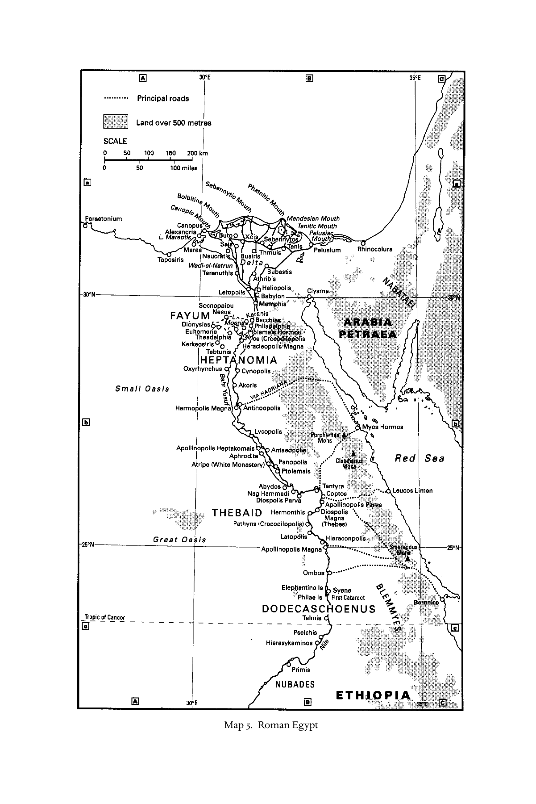

# 第十八章 埃及

**作者：伯格·A. 皮尔森（Birger A. Pearson）**

《剑桥基督教史》第一卷《起源至君士坦丁》中文译稿

> 原书第330–350页，PDF第379–399页，含章前地图。完整翻译正文、文献清单和解释性脚注；参考文献作者名、题名及定位保留原文。
>
> [第十八章英文原文](<第十八章 埃及（英文）.md>) · [原书PDF](<../01 起源至君士坦丁.pdf>)

*地图5：罗马时期的埃及。图例：虚线表示主要道路，阴影表示海拔超过500米的地区；比例尺分别以公里和英里计。图内地名保留原文。*

## 证据

<!-- 原书第331–332页；PDF第380–381页 -->

埃及基督教的证据包括非文学史料和文学史料。除了一些零散的建筑残件，据推测出自亚历山大里亚最早见于记载的教堂，即提奥纳斯教堂——提奥纳斯于282–300年任主教——之外，几乎没有可以断定早于四世纪的考古证据。[^1]最早能够辨认为基督教的墓葬属于四世纪。[^2]埃及没有可断定早于四世纪的基督教铭文。[^3]图像证据同样稀少，只有一两枚“诺斯替派”宝石。[^4]非文学纸草大多是被认为属于最早期基督徒的书信，其中可以断定早于四世纪的寥寥无几。[^5]

文学证据则十分丰富，都是以希腊文写成的作品。后来成为《新约》正典组成部分的著作，很早就传入埃及，其中一些可能在一世纪已经传入。最早可断代为二世纪的《新约》手稿，是在埃及发现的《马太福音》《马可福音》《约翰福音》《提多书》和《启示录》纸草残片。[^6]其他传入埃及、并有二世纪希腊文手稿为证的早期基督教文献，包括《埃杰顿福音》——可能来自叙利亚——、来自罗马的《黑马牧人书》、来自叙利亚的P. Oxy. 1，即《多马福音》26–28语，以及爱任纽的《驳异端》（Adversus haereses）：此书写于高卢，可能经由罗马传入埃及。[^7]

不过，埃及基督徒也创作自己的宗教文献。事实上，二、三世纪埃及基督徒的著述数量，可能比其他任何地区都多。我们掌握的大量证据仅以残篇形式存世，主要是教父作家的引文；另有许多著作已永远失传。现存证据还包括译成科普特文、保存在科普特文手稿中的作品：在埃及纳格·哈马迪附近发现的十二部册页本，以及第十三部的一些散页；[^8]柏林诺斯替册页本（Papyrus Berolinensis 8502）；阿斯丘册页本，即《信仰智慧书》（Pistis sophia）；布鲁斯册页本；以及在代尔·巴拉伊扎发现的另一部册页本残片。

下面列举的作品或作者，很可能来自埃及，主要是亚历山大里亚。[^9]

### 二、三世纪的伪经

- 《希伯来人福音》
- 《埃及人福音》
- 《马可秘传福音》
- 《救主福音》
- 《彼得宣讲》（Kerygma Petri）
- 《彼得启示录》[^10]
- 《巴拿巴书信》
- 《革利免二书》
- 《马提亚传承》
- 《夏娃福音》
- 《雅尼与佯庇》
- 某些基督教形式的《西比拉神谕》
- 《以利亚启示录》

### 使徒教父

<!-- 原书第332–333页；PDF第381–382页 -->

- 《致丢格那妥书》
- 《塞克斯图斯格言集》
- 雅典纳哥拉
- 阿格里帕·卡斯托尔[^11]
- 伪游斯丁
- 亚历山大里亚的革利免

### 其他教父作家

- 奥利金
- 亚历山大里亚的狄奥尼修
- 提奥格诺斯图斯（Theognostus）
- 皮埃里乌斯（Pierius）
- 提奥纳斯[^12]

### 二世纪的诺斯替派及其他“异端”作家

- 巴西利德及巴西利德派
- 提奥多图斯（Theodotus）
- 卡尔波克拉底及卡尔波克拉底派
- 赫拉克利翁（Heracleon）
- 瓦伦廷
- 尤利乌斯·卡西安努斯（Julius Cassianus）[^13]

### 保存在科普特文诺斯替手稿中的著作[^14]

#### “塞特派”诺斯替著作

- 《约翰秘传书》（NHC ii,1；iii,1；iv,1；BG,2）
- 《执政者的本质》（NHC ii,4）
- 《埃及人福音》（NHC iii,2；iv,2）[^15]
- 《塞特三碑》（NHC vii,5）
- 《佐斯特里阿诺斯》（Zostrianos，NHC viii,1）
- 《麦基洗德》（NHC ix,1）
- 《诺瑞娅之思》（NHC ix,2）
- 《异乡人》（Allogenes，NHC xi,3）
- 《三形原初思想》（Trimorphic protennoia，NHC xiii,1）

#### 瓦伦廷派诺斯替著作

<!-- 原书第334页；PDF第383页 -->

- 《真理福音》（NHC i,3；xii,2）
- 《论复活》（NHC i,4）
- 《三部论》（NHC i,5）
- 《灵知阐释》（NHC xi,1）
- 《瓦伦廷派解说》（NHC xi,2）

#### 派别归属不明的诺斯替著作

- 《雅各秘传书》（NHC i,2）
- 《论世界的起源》（NHC ii,5；xiii,2）
- 《灵魂释义》（NHC ii,6）
- 《耶稣基督的智慧》（NHC iii,4；BG,3）
- 《保罗启示录》（NHC v,2）[^16]
- 《雷：完美心智》（NHC vi,2）
- 《我们伟大力量的观念》（NHC vi,4）
- 《伟大塞特第二论》（NHC vii,2）
- 《彼得启示录》（NHC vii,3）[^17]
- 《彼得致腓力书》（NHC viii,2）
- 《真理见证》（NHC ix,3）
- 《许普西弗罗涅》（Hypsiphrone，NHC xi,4）
- 《马利亚福音》（BG,1）
- 《耶乌诸书》（Books of Jeu，布鲁斯册页本）
- 巴拉伊扎诺斯替残篇

#### 非诺斯替著作

- 《权威教导》（NHC vi,3）
- 《西拉努斯的教训》（NHC vii,4）
- 《塞克斯图斯格言集》（NHC xii,1）

## 埃及之旁的亚历山大里亚（Alexandria ad Aegyptum）

<!-- 原书第334–336页；PDF第383–385页 -->

埃及基督教起源于亚历山大里亚；在亚历山大大帝建立的许多城市中，这座城市无疑最为伟大。亚历山大里亚[^18]建于公元前331年，所在地原来已有一个名为拉科提斯（Rhakotis）的本地村落（Strabo Geog. 17.1.6）。[^19]从公元前三世纪起，这一名称用来指亚历山大里亚的埃及本地居民区；科普特文献则以此称呼整座城市。亚历山大于前323年去世后，埃及归马其顿将领、亚历山大的同伴托勒密统治。在托勒密一世——索特尔，即“救主”——治下，亚历山大里亚取代孟斐斯成为埃及首都。托勒密王朝统治时期，它成为希腊化世界的文化、教育与商业中心；在罗马时期仍保持着这一地位。[^20]

亚历山大里亚是一座面向地中海的国际都会，被视为与埃及本土分离，或者位于埃及“之旁”。[^21]埃及的chōra，即“腹地”，包括尼罗河谷、三角洲、法尤姆洼地及沙漠绿洲；埃及96%的土地是沙漠。希腊人从公元前七世纪起就已进入腹地。除亚历山大里亚外，还有另外两座希腊城市——瑙克拉提斯和托勒迈斯，以及后来由哈德良建立的第三座——安提诺波利斯。不过，在许多埃及城镇都能找到说希腊语的人，希腊文化影响无处不在。即便如此，埃及文化与宗教仍在埃及长期延续，甚至在托勒密王朝的扶持下，也出现在亚历山大里亚。

犹太人从巴勒斯坦迁入埃及，早在公元前六世纪就已开始。他们大批流入亚历山大里亚，使当地犹太社群成为整个散居世界中最重要的社群。[^22]犹太人组成politeuma，即“共同体”（Ep. Arist. 310）；托勒密诸王及后来的罗马皇帝鼓励他们遵循祖传习俗生活。到一世纪，亚历山大里亚的犹太人口已达数十万。

公元前30年罗马开始统治埃及后，犹太人在托勒密王朝时期享有的有利经济处境发生改变。前24/23年，埃及本地人及其他非希腊群体开始被征收“人头税”（laographia）。犹太人与希腊居民的关系日益紧张，最终在公元38年爆发了针对犹太人的集体暴力。一批犹太人在斐洛率领下向皇帝盖乌斯，即卡利古拉，申诉，却未获成功。66年，埃及的罗马总督、斐洛已经背弃犹太教的侄子提比略·亚历山大镇压了一场骚乱，造成大量人员死亡（Josephus, BJ 2.487–98）。图拉真统治下，犹太人于115年发动起义，117年被镇压，[^23]导致犹太社群几乎被彻底摧毁（Euseb. HE 4.2）。[^24]犹太人的生命与财产所受的毁灭，也蔓延到了埃及腹地。

埃及基督教的发展，从一开始便受到亚历山大里亚独特的希腊文化与教育环境，以及最早期基督徒所属犹太社群的社会文化和宗教生活影响。基督教向腹地扩展后，又受到埃及本地文化与语言的影响，由此形成一种独特的科普特——即“埃及”——基督教，至今仍充满生命力。

## 埃及基督教的起源

<!-- 原书第336–337页；PDF第385–386页 -->

关于埃及基督教的起源，[^25]史料一直保持沉默，直到二世纪初，亚历山大里亚基督教文献开始出现，早期基督教教师的教义也开始反映在文本与见证中。科普特教会将亚历山大里亚教会的创立归于使徒马可，但这一传统直到四世纪才有记载（Euseb. HE 2.16），十分可疑。[^26]伪革利免文献所载的另一个传说，说马可的表亲巴拿巴曾在亚历山大里亚从事基督教传教活动（Hom. 1.8.3–15.9），也同样可疑。[^27]《新约》《使徒行传》18:25的一个异文，似乎暗示亚历山大里亚已有基督徒：据说当地人亚波罗“在本乡已经受过道的教导”。[^28]不过，这一读法很可能是后来产生的。

因此，历史学家讨论埃及基督教起源时，只能从二世纪史料向前推论。至今仍有影响的一种看法来自瓦尔特·鲍尔。[^29]他解释早期证据稀缺的原因，认为教会领袖知道最早的基督教形式属于“异端”，具体说是“诺斯替派”，所以压下了这些证据。这一结论有一定的可信性：我们所知道、活跃于二世纪初亚历山大里亚的最早基督教教师，正是那些“异端魁首”——瓦伦廷、巴西利德及其子伊西多尔，以及卡尔波克拉底及其子埃皮法内斯。然而，鲍尔理论的问题在于，它迫使他把最早有据可查的亚历山大里亚基督教文献——《巴拿巴书信》以及仅存残篇的伪经《希伯来人福音》和《埃及人福音》——都涂上“异端”和“诺斯替派”的色彩。他还忽视了《彼得宣讲》等其他重要史料，而后者显然不是诺斯替派著作。[^30]

纸草学家科林·罗伯茨研究最早期基督教文学纸草后提出的看法，更为可信。这些纸草并不支持鲍尔所谓诺斯替派是埃及最早基督教形式的观点。罗伯茨对早期基督教手稿中“圣名缩写”（nomina sacra）的讨论尤其重要：Iesous、Christos、kyrios、theos等“神圣名称”，总共十五个，采用缩写并在上方画横线；他把这一抄写惯例追溯到耶路撒冷教会。[^31]罗伯茨的结论是，埃及——即亚历山大里亚——最早的基督教具有犹太性质。最早的“基督徒”，如果可以这样称呼他们，[^32]是亚历山大里亚犹太社群不可分割的一部分。

近来有人主张，原始基督教在115–117年犹太起义中，“连同它所置身其中的整个群体——埃及犹太社群——一起被消灭了”。依此看法，117年终结的犹太基督教，被拒绝参加起义的“外邦基督徒群体”所取代。[^33]115–117年起义对埃及基督徒必定是一个关键事件，但肯定没有造成完全断裂：现有二世纪证据显示，亚历山大里亚犹太教与117年以后的当地基督教，在神学、生活方式和社会组织上，都有显著的连续性。[^34]

## 社会群体与基督教组织

<!-- 原书第337–338页；PDF第386–387页 -->

117年犹太社群遭到毁灭后，它的大量文学遗产，在珍视并保存这些作品的基督徒中延续下来，尤其是最初在亚历山大里亚译成的《圣经》七十士译本（LXX），以及斐洛和其他犹太作家的著作。此时基督徒已组成一个新的共同体，不再属于犹太人的politeuma，而这些遗产深刻影响着他们的著述。考察亚历山大里亚最早的基督教作品之一《彼得宣讲》，颇能说明问题。这部作品由革利免保存了少数片段。作品托名于彼得，又提到“十二使徒”，从而将自己置于最初以耶路撒冷为中心的使徒传统之中（残篇3）。它反映出典型的亚历山大里亚“逻各斯基督论”（残篇1），并表达一种信条：只有一位上帝，他创造了世界，也能使世界终结。这一信条同样可以用典型的亚历山大里亚“否定神学”来表述（残篇2）。作品在圣经文献中发现了关于基督来临、死亡和复活的预言（残篇4）。它是第一部使用“基督徒”一词的亚历山大里亚著作，并把基督徒界定为“第三种族”（残篇2）。[^35]《彼得宣讲》所代表的基督教形态，处于一条通向革利免所代表的“主流”基督教的发展脉络之中；革利免赞许地引用了它。[^36]

我们的文学史料也告诉我们，亚历山大里亚很早便存在其他基督教形态。[^37]当地的犹太基督徒使用《希伯来人福音》。这部作品反映出对耶路撒冷的雅各特别的效忠，同时也受到亚历山大里亚犹太智慧神学的影响。《埃及人福音》则为说希腊语的埃及基督徒所用，他们可能住在亚历山大里亚的拉科提斯区。这一群体倾向禁欲，可能受到当地以西犹太治疗派（Therapeutae）的影响；据斐洛《论默观生活》（Contempl.）描述，治疗派过着一种特殊的团体生活。《巴拿巴书信》以及披上基督教外衣的亚历山大里亚《西比拉神谕》，反映出具有启示文学取向的基督教。对于那些未给我们留下著作、朴实而未受教育的基督徒（simpliciores）来说，启示思想很可能也是他们宗教取向的一部分。[^38]

受过高等教育、具有哲学取向的基督徒中，无疑包括《权威教导》（NHC vi,3）所反映的那类柏拉图主义者，[^39]以及各种诺斯替群体。他们在某种意义上，也延续了亚历山大里亚犹太教的不同形态。例如，《欧格诺斯托斯》（Eugnostos，NHC iii,3；v,1）反映出一世纪已有一种犹太诺斯替思想。[^40]马吉安派基督教也传入了亚历山大里亚，很可能是在二世纪中叶。[^41]革利免知道马吉安派，并在著作中反驳他们，例如Str. 3.3.12。

<!-- 原书第339–340页；PDF第388–389页 -->

亚历山大里亚的基督教组织，也显示出它与当地犹太教的连续性，尤其体现在长老制的形式上。按照会堂的模式，当地每个基督徒会众都有自己的长老。[^42]当然，我们最容易看见的领袖，是史料中具名的早期基督教教师。因此，一个会众可以在长老指导下组织起来，同时包含一位杰出的平信徒教师。有时教师本人也兼任长老，革利免很可能就是如此。

至于主教，优西比乌所列从马可开始、在德米特里乌斯（189–232年任主教）以前的传统名单，似乎无非是“徒然的回声与一缕烟”。[^43]在德米特里乌斯以前，亚历山大里亚肯定不存在安提阿的伊格纳提乌在小亚细亚所倡导的那种单一主教制。耶柔米（Ep. 146.1）告诉我们，早期亚历山大里亚教会的情况是：在赫拉克拉斯与狄奥尼修任主教以前，长老们从自己中间指定一人担任主教。[^44]更晚的证据来自十世纪亚历山大里亚的麦勒基派宗主教欧提基乌斯。他在《编年史》中提到十二位长老，宗主教座出缺时，新宗主教便从他们中间选出；他以“宗主教”称呼这一时期的主教，是时代错置。随后再任命一位新长老，补足长老团中的空缺。欧提基乌斯还告诉我们，直到德米特里乌斯时代，亚历山大里亚主教都是埃及唯一的主教；德米特里乌斯任命了三位主教，其继任者赫拉克拉斯又增设了二十位。[^45]

德米特里乌斯在埃及基督教圣职体系的发展中发挥了关键作用。鉴于他推动亚历山大里亚以外地区的福音传播，有人称他为“亚历山大里亚教会的第二位创立者”，以及“埃及教会的创立者”，并不奇怪。[^46]不过，他巩固自己的主教权威，确实花了一段时间。革利免与奥利金的著作，见证了这一“从基督徒共同体走向制度化教会”的演变。[^47]还应补充的是，德米特里乌斯所开启的过程，实际上直到“大狄奥尼修”（247–264年任主教）、第一位“埃及宗主教”的时代才告完成。[^48]

就社会地位而言，有人主张，亚历山大里亚最早的基督徒，是有教养、有财力的犹太人，代表一个生活舒适的“中产阶层”。[^49]这一判断可能略显片面，尽管我们必须承认，革利免《导师》中描绘的基督徒显然相当富裕。[^50]异教作家塞尔苏斯很可能于170年代在亚历山大里亚写作，他轻蔑地把自己所知道的基督徒斥为“不体面而愚蠢的人，无非是奴隶、妇女和小孩子”（Or. C. Cels. 3.44）。[^51]与他大致同时写作的雅典纳哥拉承认，有些基督徒是“普通人、工匠和老妇”（Leg. 11.1），[^52]不过他也提到一些蓄有奴隶的基督徒（Leg. 55）。[^53]亚历山大里亚基督徒很可能来自所有社会阶层。[^54]

革利免著作所反映的基督徒社会经济状况，也可以推及作为机构的教会本身：到三世纪末，亚历山大里亚教会竟已成为一个经营存款业务的机构！一封埃及基督徒的书信（P. Amherst 3a）提供了证据。写信人身在罗马，告诉阿尔西诺伊州的基督徒同伴，要通过主教的代理人提奥纳斯，把钱交存于亚历山大里亚的“教父马克西穆斯”（Maximus the papas）处。[^55]提奥纳斯后来接替马克西穆斯担任主教（282–300年），并主持在城西兴建了一座教堂。[^56]

## 亚历山大里亚的“教理学校”

<!-- 原书第340–341页；PDF第389–390页 -->

教师在亚历山大里亚基督徒共同体中占有重要位置，然而史料中最早具名的教师，都是“异端”，即诺斯替派。[^57]第一位具名的“正统”基督教教师潘代努斯（Pantaenus），出现在优西比乌记述康茂德统治时期（180–192年）事件的历史中。优西比乌写道，这位著名教师负责一所“圣言学校”（didaskaleion tōn hierōn logōn）；这所学校按照“自古以来的惯例”，一直存在于亚历山大里亚（HE 5.10.1）。[^58]他还说，潘代努斯直到去世始终担任这所学校（didaskaleion）的负责人（5.10.4）；其学生之一是革利免（5.11.1），后者继任，主持学校的“教导”（katēchēsis，6.6.1）。随后优西比乌记载，奥利金十八岁时成为“教理学校”的负责人（tēs katēchēseōs didaskaleion，6.3.3）。202年迫害期间，包括革利免在内的其他教师离开了城市，德米特里乌斯主教把教导（katēchēsis）的任务单独交给奥利金（6.3.8）。后来，奥利金与从前的学生赫拉克拉斯分担这项职责；后者日后接替德米特里乌斯任主教。赫拉克拉斯负责初级教学，奥利金负责高级教学（6.15）。从优西比乌的这些及其他记述，产生了亚历山大里亚“教理学校”的传统：其历任教师自潘代努斯相承，或者，按照“自古以来的惯例”（5.10）所暗示的，始于一些未具名的前辈。

关于亚历山大里亚学校中基督教教师的传承，还有另一种说法，归于五世纪史家西德的腓力（Philip of Side）。他的历史著作有一个节本，保存在十四世纪手稿中。[^59]按照这一记载，历任校长始于雅典纳哥拉，随后依次为革利免、潘代努斯、奥利金、赫拉克拉斯、狄奥尼修、皮埃里乌斯、提奥格诺斯图斯、塞拉皮翁、彼得——主教及殉道者，卒于311年——、马克里乌斯·波利提库斯、盲人狄迪穆斯，以及罗冬。据说罗冬在狄奥多西大帝统治时期（379–395年）将学校从亚历山大里亚迁到西德。[^60]

学者对“教理学校”传统提出了截然相反的解释。一些人[^61]认为，德米特里乌斯以前根本没有学校，只有独立教师。依此看法，亚历山大里亚的平信徒教师，包括革利免，可以在教会中发挥重要作用，提供从洗礼前教导到高深神学的各级教学。其中不少人像革利免一样，精通希腊哲学与文化；有些还从事圣经学研究，活跃于至迟二世纪中叶必定已经存在于亚历山大里亚的某个“抄写作坊”。[^62]但只有从德米特里乌斯时代起，才能说当地有了一所受主教控制的正式基督教学校。此后，赫拉克拉斯、狄奥尼修等学校负责人先后成为主教；不过最终，自提奥菲卢斯任主教时期（385–412年）起，学校便不复存在。

<!-- 原书第342–343页；PDF第391–392页 -->

另一些学者[^63]虽然同意必须批判性阅读优西比乌，却认为不能把他的说法完全抛弃。依据对革利免的细读，这种观点认为：“早在奥利金以前，在教会的影响范围内从事教学和学术研究，就已是亚历山大里亚一项历史悠久的活动。”[^64]至于兼任教师与长老的革利免，“教会与学校之间并不存在对立。他的教导使信徒经过洗礼，继而在教会之内迈向智慧与知识。”[^65]

事实上，无论优西比乌还是革利免，都没有告诉我们完整的经过。革利免时代的亚历山大里亚，显然还有其他基督教教师；在他以前很久，当地也已有杰出的基督教教师，形态类似代表希腊—罗马世界各种哲学传统的私人教师。革利免的特殊之处在于，他把自己的教学用于服务基督徒共同体；对他来说，这些共同体构成“教会”，而他本人在其中发挥了重要的领导作用。甚至有可能，革利免作为亚历山大里亚长老团一员所扮演的角色，牵涉一场教会内部权力斗争，最终导致他离开这座城市。[^66]但亚历山大里亚基督教传统中的“教理学校”，大概到三世纪初，才随着德米特里乌斯主教权威的增长而产生。

这所学校的两位教师，革利免与奥利金，对亚历山大里亚神学发展的贡献尤其突出。提图斯·弗拉维乌斯·克莱门斯，即革利免，生平史料很少。他大约在140–150年之间生于雅典，起初信奉异教。他在定居亚历山大里亚以前，曾在希腊、大希腊、叙利亚和巴勒斯坦学习哲学（Str. 1.11.2）。他归信的时间与地点不详。约202年，他离开亚历山大里亚前往巴勒斯坦，并于约216年在那里去世。其著作深受柏拉图主义影响，尤其受犹太人斐洛的哲学和圣经诠释影响。[^67]主要作品包括：旨在劝异教徒归信基督教的《劝勉希腊人》（Protrepticus）；面向基督徒的劝诫作品《导师》（Paedagogus，意为“作为教育者的基督”）；以及《杂学》（Stromata），写给希望超越单纯信仰、达到更高知识的“灵知型”基督徒。[^68]革利免从异端那里借用了“诺斯替”一词，并区分“真正”与“虚假”的灵知。[^69]

奥利金生于185或186年，从小就是基督徒，受过良好教育。优西比乌《教会史》第六卷大半篇幅都用于叙述他。202年，父亲列奥尼德殉道后，他成为教师（didaskalos），养活家人。后来，一位富裕的基督徒妇女资助他，他的讲授吸引了许多人。作为古代著述最丰的作家之一，奥利金的全部著作都致力于促进基督教信仰，可被视为古代教会最伟大的学者与神学家。他广泛旅行、讲学，后来与德米特里乌斯主教不和，约234年永久离开亚历山大里亚，前往凯撒利亚；此后的著述更加丰盛。德修迫害期间，他遭监禁和酷刑，251年以后的某个时候在推罗去世。[^70]

和革利免一样，奥利金是柏拉图主义者，他的圣经诠释也深受斐洛影响。[^71]多数著作属于释经作品，包括注释和讲道；其中最重要的《约翰福音注释》始于亚历山大里亚，完成于凯撒利亚。他编制的宏伟《旧约》对照本《六栏合参》（Hexapla），将希伯来文本与阿奎拉、辛马库、七十士译本、狄奥多田及另外两个希腊译本分栏并列，虽然仅有残片存世，却是亚历山大里亚文本批判工作的杰作。[^72]在亚历山大里亚写成的《论首要原理》（De principiis），使他成为教会第一位系统神学家。其最伟大的护教作品，是晚年在凯撒利亚写成的《驳塞尔苏斯》（Contra Celsum）。他的三一神学与基督论，对后来亚历山大里亚神学的发展尤其有影响。争议较大的，是他关于人类灵魂先存——而不是轮回！——的教义。由于皇帝查士丁尼于543年将他谴责为异端，其庞大著述大多失传，有些仅以拉丁译本存世。

## 与其他地区基督徒的关系

<!-- 原书第344–345页；PDF第393–394页 -->

里昂的爱任纽[^73]声称，教会从使徒及其门徒领受的信仰，在全世界都是同一个信仰，无论在日耳曼、西班牙、高卢、“东方”、埃及、利比亚，还是“世界的中心地区”，皆是如此（Haer. 1.10.2）。[^74]这种普世而跨地区的合一主张，是教会从犹太教继承的。以耶路撒冷圣殿为中心的犹太教，是希腊—罗马诸宗教历史中唯一同样具有这一特点的其他宗教。

有意思的是，爱任纽的作品在写成后不到二十年，就出现在埃及（P. Oxy. 405）。[^75]革利免肯定知道并使用它；[^76]他是我们所知亚历山大里亚最早反对“异端”的作家。爱任纽的作品，只是埃及以外写成、传入埃及的无数各种体裁著作之一。从一世纪起，这些文献便从巴勒斯坦、安提阿、叙利亚东部、小亚细亚、希腊、罗马和北非等各个地区源源流入，而埃及的基督教作者也向外输出自己的作品。因此，首先是通过基督徒彼此交换书信与文献的“网络”，[^77]我们才能谈论埃及教会与其他地方教会之间的关系。

我们所知亚历山大里亚教会最早与其他教会进行的“正式”书信往来，由优西比乌在记述二世纪末复活节日期争议时提到（HE 5.25）。他引述了一封由巴勒斯坦的耶路撒冷、凯撒利亚、推罗与托勒迈斯诸主教联合写成的通函。通函支持罗马主教维克托倡导的做法，即始终在星期日庆祝复活节，而不是按照小亚细亚的习惯，在犹太阴历尼散月十四日庆祝。信中有这样一句话：

> 我们也要向你们说明，亚历山大里亚同样与我们在同一天庆祝，因为他们与我们交换过书信，好让我们共同而一致地守这个圣日。

尤其值得注意的是，信中没有提到亚历山大里亚主教，当时在任者是德米特里乌斯。事实上，他与罗马的维克托都在189年成为主教。无论亚历山大里亚向巴勒斯坦发过怎样的信，显然都是由长老团集体发出，而非由主教发出；当时主教似乎尚未巩固自己对当地教会的权力。

到三世纪中叶，狄奥尼修任主教时（247–264年），情况已经完全不同。[^78]他数量庞大的通信，包括致罗马、安提阿及其他地方主教的“正式”书信，证明亚历山大里亚教会在帝国中的重要性不断增长。到三世纪末，亚历山大里亚教会在东方的影响力，至少已经相当于罗马教会在西方的影响力。

## 埃及的诺斯替思想与摩尼教

<!-- 原书第345–346页；PDF第394–395页 -->

爱任纽在五卷本《驳异端》中，把诺斯替异端，即“冒名的灵知”，追溯到撒马利亚的“术士”西门（Haer. 1.23.1–4；参《使徒行传》8:9–24）。在西门之后作为“继承者”出现的，是同样来自撒马利亚、后来活跃于安提阿的米南德（1.23.5；参Justin, 1 Apol. 26.4）。随后，“从这些人中兴起”的，是安提阿的萨图尔尼努斯，以及在亚历山大里亚传播自己体系的巴西利德（Haer. 1.24.1）。优西比乌《编年史》在哈德良在位第十六年，即132年，记载：“异端领袖巴西利德住在亚历山大里亚；诺斯替派由他而来。”[^79]因此，根据这些信息，人们可能会错误地断定：埃及的诺斯替思想，始于亚历山大里亚的巴西利德。[^80]

然而，爱任纽特别提到一个“诺斯替”派别；其基本神话见Haer. 1.29的摘述，并不等同于他归于巴西利德的神话（Haer. 1.24.3–5），虽然与萨图尔尼努斯的神话有一定相似之处（1.24.1–2）。关于巴西利德在亚历山大里亚的同时代人瓦伦廷，爱任纽说：“瓦伦廷把所谓‘诺斯替’思想学派的基本原则，改造成自己那一类体系”（Haer. 1.22.1）。[^81]众所周知，爱任纽所摘述的“诺斯替”神话（Haer. 1.29），对应于我们现在拥有的《约翰秘传书》的一部分（NHC ii,1；iii,1；iv,1；BG,1）。正如我在别处论述的，这一神话原本并非基督教神话，而是代表一种犹太诺斯替思想。[^82]无论它来自叙利亚，还是在亚历山大里亚发展形成，在瓦伦廷与巴西利德以前，它就已在当地扎根。《受颂者欧格诺斯托斯》（NHC iii,3；v,1）同样代表亚历山大里亚的一种犹太诺斯替思想；瓦伦廷和巴西利德很可能都知道其希腊文原本。

瓦伦廷与巴西利德的诺斯替思想，则完全具有基督教性质。事实上，甚至有人主张，瓦伦廷根本不是“诺斯替派”。[^83]但仔细阅读瓦伦廷残篇，就会发现它们都暗指一种典型的诺斯替神话。[^84]瓦伦廷派《真理福音》（NHC i,3；xii,2）也同样如此；把这篇论著归于瓦伦廷本人，是颇为可信的。[^85]

瓦伦廷、巴西利德及亚历山大里亚其他诺斯替教师的著作，见证了埃及诺斯替“异端”的强大力量、非同寻常的多样性，以及其持续存在。直到二世纪末，亚历山大里亚基督徒，乃至稍后埃及腹地的基督徒，对于极其多样的教导，都保持着相当程度的开放态度。在早期基督教埃及，甚至仅仅谈论“异端”与“正统”之间存在鲜明界限，都是时代错置；至少在亚历山大里亚，要到二世纪末德米特里乌斯任主教时，才能这样说，而在埃及某些地区还要晚得多。

三世纪，一种新的诺斯替形态进入埃及，那就是摩尼教；它最终凭自身力量成为一种世界宗教。[^86]先知摩尼的门徒，甚至在他276年去世以前，就已从美索不达米亚来到埃及传教。他们很早就在上埃及吕科波利斯周围地区站稳脚跟；现存大多数科普特文摩尼教文献都出自这一带。传教士利用繁忙的商业道路，既可能由亚历山大里亚沿尼罗河而上抵达底比斯地区，也可能从美索不达米亚经海路到红海港口贝勒尼基，再经陆路到吕科波利斯附近的许普塞勒（Hypsele）。如今，我们还获得了摩尼教从吕科波利斯传播到达赫莱绿洲的重要证据，尤其来自古代凯利斯，即今伊斯曼特·哈拉卜（Ismant el-Kharab）。当地考古发掘出一个四世纪初摩尼教社群的遗存。其中发现的文书与文学文本，为埃及摩尼教的生活与宗教提供了新证据，补充了我们从1930年代迈迪奈特·马迪那些轰动发现中已经知道的情况。[^87]

<!-- 原书第347页；PDF第396页 -->

紧随这一传教事业之后，异教与基督教的反摩尼教文献，很快也出现在埃及。最早的两篇，一篇出自柏拉图主义哲学家吕科波利斯的亚历山大，另一篇很可能出自亚历山大里亚主教提奥纳斯（卒于300年），已经可以断代到三世纪末。[^88]不过，也有证据显示摩尼教对埃及基督徒，尤其对修道院中的基督徒，[^89]以及不同类型的其他诺斯替派产生了积极影响，形成摩尼教群体与其他诺斯替派之间某种共生关系。[^90]

## 基督教向腹地的扩展

<!-- 原书第347–348页；PDF第396–397页 -->

优西比乌《教会史》第六卷以如下记述开篇（6.1）：

> 当塞维鲁也煽动针对各教会的迫害时，各地虔敬的勇士都成就了光荣的殉道，而亚历山大里亚尤其频繁。从埃及和整个底比斯地区而来的上帝勇士，被押送到这里，仿佛进入一座宏大的竞技场。他们在种种酷刑与死亡方式下坚忍不拔，因而戴上了上帝为他们预备的冠冕。[^91]

这是优西比乌《教会史》第一次提到亚历山大里亚以外也有基督徒。“埃及”大概指尼罗河三角洲，而“底比斯地区”涵盖尼罗河谷的大部分，从赫尔莫波利斯向上游，即向南，直至叙埃涅。对优西比乌的说法抱有怀疑，是可以理解的：不只是塞维鲁在迫害中所扮演的角色，[^92]以及迫害的规模——“无数人〔murioi〕戴上了殉道的冠冕”，6.2.3——值得怀疑，这些殉道者来自埃及哪些地区，也同样值得怀疑。不过，说190年复活节争议时埃及基督教仍“局限于这座城市及其周边”，肯定不符合事实。[^93]哈纳克在研究基督教传播的巨著中，[^94]关于二世纪，只引用了埃皮法尼乌斯所记异端巴西利德和瓦伦廷据说曾深入腹地的旅行（Pan. 24.2.2、3、4；31.7.1），但埃皮法尼乌斯的证言十分可疑。正如前文所说，爱任纽坚持认为，埃及教会宣认普世共同的信条，但他大概并不了解亚历山大里亚以外的情况。

要获得二世纪亚历山大里亚以外埃及基督教的较可靠证据，我们必须转向埃及沙漠保存下来、依据古文字学断代的纸草。[^95]范哈尔斯特的《目录》提供如下证据。来自法尤姆的有：《旧约》残片，编号174、224，以及可能的52与304；[^96]可能还有一片《新约》残片，编号462；[^97]一片《黑马牧人书》残片，657；以及一片《拿撒尼派诗篇》残片，1066。卡拉拉（Qarara，Hippōnōn polis）出土了一部《旧约》册页本的三片残页，编号33。可能来自帕诺波利斯或附近的，有《新约》《约翰福音》残片，426，以及《旧约》《诗篇》残片，118。安提诺波利斯有两片《旧约》残片，179。出处不明的有《埃杰顿福音》残片，586，以及一片《西比拉神谕》残片，581。俄克喜林库斯的材料相当丰富：《旧约》残片，13、40；《新约》残片，372；[^98]《多马福音》残片，593；一部不知名福音书的残片，592；爱任纽《驳异端》残片，671；亚历山大里亚的斐洛作品的若干残片，696；以及一片巫术文本残片，1076。科林·罗伯茨认为，俄克喜林库斯至迟在二世纪末或三世纪初，就有一处基督教抄写作坊。[^99]

<!-- 原书第349页；PDF第398页 -->

讨论纸草时，有一点必须提醒：纸草文本写成或抄成之后，到它被丢弃在后来发现的地点之前，必然存在一定的时间差。此外，在腹地发现的残片，也可能是在别处抄写的，最有可能的地方是亚历山大里亚。即便如此，根据纸草学证据，仍可推定基督教在二世纪进入了上埃及和法尤姆。它大概也已出现在三角洲，尽管我们不应期待在那里找到纸草。

三世纪的文学与纸草证据都丰富得多。[^100]最重要的文学证据，是狄奥尼修主教大量的书信，其中一部分通过优西比乌和其他作者的引文保存下来。有几封是致埃及诸主教的通函，其中一些确定复活节及此前禁食期的日期。[^101]在三世纪过程中，埃及各州很可能都逐渐有了自己的主教，至少在名义上处于亚历山大里亚主教的权威之下。[^102]

科普特语也在三世纪形成，首要目的是把基督教经书译成埃及人的本族语言。[^103]当然，科普特语在词汇和句法中吸收了希腊语词语与短语，这种语言本身就证明当时存在双语环境。基督教在乡村地区的传播，很可能慢于州府及腹地其他城镇等城市中心，因为乡村使用希腊语较少。[^104]不过，罗杰·巴格纳尔估计，君士坦丁于337年去世时，埃及基督徒已经占多数，这一判断很可能是对的。[^105]即便如此，也不应太快谈论基督教的“胜利”；戴维·弗兰克福特已经表明，埃及宗教的一些基本模式，披上基督教外衣后继续存在。[^106]

## 埃及修道生活的起源

<!-- 原书第350页；PDF第399页 -->

作为一种制度，修道生活在埃及基督教史中所占的位置，比在其他任何地区教会史中都更为重要。[^107]通常人们把修道生活的起源，与四世纪圣徒安东尼和帕科米乌斯联系起来：前者被视为隐修生活之“父”，后者被视为共住修道生活之“父”。然而，近来的研究表明，埃及修道生活的起源早得多，并与第三种形式，即舍弃式修道生活（apotactic）的发展有关。E. A. 贾奇研究了一份出自卡拉尼斯、年代为324年的纸草文书，它为这种修道生活提供了证据，也是目前所知monachos一词用于指“修士”的最早见证。[^108]

文书中，一位名叫伊西多鲁斯的人，因遭帕莫尼斯与哈尔帕卢斯两人袭击，向当地的长官（praepositus）请求伸张正义。他说，若非“执事安东尼努斯与修士以撒”相助，自己就会丧命。[^109]这里的“修士”既不是沙漠苦修者，也不是某个修道团体的成员，而是住在村中、参与地方与教会事务的人。耶柔米的一段谴责（Ep. 22.34），可以帮助理解他的处境：在共住修道者和隐修者之外，埃及还有第三类修士，称作remnuoth，显然是一个意为“独居者”的科普特语词。他们是住在小型家庭共同体中的修士，亦即“独居者”；在耶柔米看来，他们过分独立于教士权威。以撒就是这些“独居者”之一，属于其他史料称为apotaktikoi/ai，即“舍弃者”的一类苦修者；参《路加福音》14:33。[^110]

伊西多鲁斯在呈文中提到“执事”和“修士”时，指的是当时已确立的地方教会成员类别。吉勒·多里瓦尔甚至提出，这种苦修者的一个或多个群体，可能在二世纪亚历山大里亚就已存在。[^111]事实上，以monachos指称这类“独居者”的用法，很可能可以追溯至二世纪。这个希腊语词出现在科普特文《多马福音》中，第16、49、75语，可能指一种特殊类别的基督教苦修者；这样的群体，二世纪亚历山大里亚就可能已经存在。

## 译校说明

- 本章关于纸草断代、人口比例以及新近考古发现的论述，均保留原书2006年的研究语境。
- 原书第346页将《约翰秘传书》的柏林册页本定位写作“BG,1”，但第333页清单中写作“BG,2”；此处保留两处原有定位，以便对照。原书第340页引用雅典纳哥拉《为基督徒申辩》（Leg.）的“55”，也按原文保留。
- 文献清单的分类、归属和推定产地，均为本章作者的判断；正文中的“可能”“大概”及不同学说的分歧均予保留。

## 脚注

[^1]: Tkaczow, ‘Archaeological sources’, 432。关于十九、二十世纪在亚历山大里亚进行的发掘，见Tkaczow, Topography；参Pearson, ‘Alexandria’。

[^2]: 罗杰·巴格纳尔认为，威尔弗雷德·格里格斯关于法尤姆存在一、二世纪基督徒墓葬的主张，是“幻想”。见Griggs, ‘Excavating a cemetery’；参Bagnall, Egypt in late antiquity, 279 n. 113。

[^3]: 见Lefebvre, Recueil des inscriptions。较晚的证据亦见Brown, ‘Coptic and Greek inscriptions’。

[^4]: Pearson, Gnosticism and Christianity, ch. 9.

[^5]: 见Naldini编纂的纸草文集Cristianesimo in Egitto。关于纸草证据的良好讨论，见Judge and Pickering, ‘Papyrus documentation’。

[^6]: Roberts, Manuscript, society and belief, 12–13。《马可福音》（P90）与《启示录》（P98）残片发现于Roberts著作问世以后；见Nestle-Aland NTG27, 689。《约翰福音》最早的见证P52，可断代至二世纪初。

[^7]: Roberts, Manuscript, society and belief, 13–14.

[^8]: 缩写为NHC，有时作CG（Cairensis Gnosticus）。原始文献书目，原书第591–614页，仅列詹姆斯·罗宾逊主持、1995年完成的科普特诺斯替文库项目所刊科普特文—英文版本。其他版本和研究见Scholer, Nag Hammadi bibliography。纳格·哈马迪诸篇及柏林册页本（BG）诸篇的便用译本，见Robinson and Meyer, NHL。

[^9]: 见原始文献书目，原书第591–614页。关于文学证据及确定早期基督教文本产地所涉及问题的详尽讨论，见Pearson, Gnosticism and Christianity, 40–81。我在那里也讨论了产地有争议的作品，例如Epistula apostolorum；一些学者将它归于埃及，但它应当归于小亚细亚。

[^10]: 须与纳格·哈马迪第七册页本中的同名论著区分。

[^11]: 他反驳巴西利德的作品已失传，但Euseb. HE 4.7保存了摘要。

[^12]: 优西比乌还提到另外两位亚历山大里亚作家：后来担任耶路撒冷主教的亚历山大，以及后来担任老底嘉主教的阿纳托利乌斯（HE 6.11.3–6；7.32.6–20）。优西比乌引用亚历山大的书信，并大段引录阿纳托利乌斯的Canons on the pascha。

[^13]: 另一位“异端”作家，莱昂托波利斯的希埃拉卡斯（Hieracas），按埃皮法尼乌斯的说法（Pan. 67），兼以希腊文与埃及文，即科普特文，写作。遗憾的是，其大量著述均已失传。

[^14]: 原始文献书目收录全部科普特文论著；本章下面清单只列几乎可以肯定归于二、三世纪埃及的基督教作品，或产地不明、但归于二、三世纪埃及仍属合理的作品。后一类包括Pr. Paul、Treat. res.、Tri. trac.、Interp. know.、Val. exp.、Ep. Pet. Phil.、Hypsiph.，以及一段柏拉图残篇，即诺斯替派编订本。很可能来自二、三世纪叙利亚的论著包括Apoc. Adam（NHC v,5）、Marsanes（NHC x,1）、Gos. Phil.（NHC ii,3）、1 Apoc. Jas.（NHC v,3）、2 Apoc. Jas.（NHC v,4）、Paraph. Shem（NHC vii,1）、Gos. Thom.（NHC ii,2）、Thom. cont.（NHC ii,7）、Dial. sav.（NHC iii,5）、Acts Pet. 12 apos.（NHC vi,1）与Act Pet.（BG,4）。Pistis Sophia和布鲁斯册页本中的无题论著，很可能来自四世纪埃及。Eugnostos（NHC iii,3；v,1）大概产生于一世纪亚历山大里亚的犹太环境。具有鲜明埃及特色、但并非基督教作品的，是赫尔墨斯文献：Disc. 8–9（NHC vi,6）、Pr. thanks.（NHC vi,7）和Asclepius（NHC vi,8）。

[^15]: 不要与上文列出的同名伪经福音书混淆。

[^16]: 不要与另一部同名伪经作品混淆。

[^17]: 不要与上文列出的同名启示录混淆。

[^18]: 托勒密王朝时期，见Fraser, Ptolemaic Alexandria。自戴克里先起的时期，见Haas, Alexandria。很好的概述见Bowman, Egypt，第7章“Alexandria, queen of the Mediterranean”；亦参Pearson, ‘Alexandria’。依据文书与考古证据研究亚历山大里亚地形，见Calderini, Dizionario, vol. i, fasc. 1；Adriani, Repertorio d’arte。近来的考古工作，包括水下发掘，见Empereur, Alexandria rediscovered。

[^19]: 不过，这个名称最早的圣书体文字见证，是一方公元前311年的铭文，即晚于城市建立。见Chauveau, ‘Alexandrie et Rhakotis’。

[^20]: 斯特拉波在Geographica第17卷中详述这座城市的地形和优美建筑；他约于公元前24–20年住在这里。参Fraser, Ptolemaic Alexandria, vol. i, 7–37；vol. ii, 12–111。

[^21]: 狄奥·克律索斯托莫斯在“致亚历山大里亚人”的演说中，用夸张语气把“强大的埃及民族”称作壮丽亚历山大里亚的“附属物”（prosthēkē，Orationes 32.36）。

[^22]: 见上文第一部分第2章。CPJ充分记录了托勒密和罗马时期犹太人在埃及的存在，也收录铭文。参主要讨论一世纪的Safrai and Stern, Jewish people；亦见Starobinski-Safran, ‘Communauté juive’。

[^23]: 这次起义受到犹太弥赛亚思想激励；见Hengel, ‘Messianische Hoffnung’。

[^24]: 见上文第一部分第3章。

[^25]: Pearson, ‘Earliest Christianity’与‘Christianity in Egypt’；以及较近的Dorival, ‘Les débuts’；Jakab, Ecclesia alexandrina, 35–61；Pearson, ‘Cracking a conundrum’。

[^26]: 关于马可传说，见Pearson, ‘Earliest Christianity’, 137–45；亦见Pearson, ‘Christianity in Egypt’, 955–6。

[^27]: Pearson, ‘Earliest Christianity’, 136–137；但现亦见Carleton Paget, Epistle of Barnabas, 36。

[^28]: 贝扎抄本（Codex Bezae），此处译文由本章作者译出；该抄本代表《使徒行传》的“西方”文本。

[^29]: Bauer, Orthodoxy and heresy, 44–53.

[^30]: Bauer, Orthodoxy and heresy, 47–53.

[^31]: Roberts, Manuscript, society and belief, 19–21；参Hurtado, ‘Nomina sacra’。

[^32]: 亚历山大里亚基督教史料中，“基督徒”一词最早有据可查的用例，出现在Kerygma Petri残篇2（Clem. Al. Str. 6.5.41；参NTApoc, vol. ii, 39）。

[^33]: Modrzejewski, Jews of Egypt, 227–30.

[^34]: Pearson, ‘Cracking a conundrum’, and Gnosticism and Christianity, 12–19, 82–99.

[^35]: 见上文注32。

[^36]: Jakab, Ecclesia alexandrina, 56–7，强调了Kerygma Petri的重要性。

[^37]: Van den Broek, ‘Juden und Christen’.

[^38]: Van den Broek, ‘Juden und Christen’, 188; Dorival, ‘Les débuts’, 170–1.

[^39]: Van den Broek, ‘Authentikos logos’。

[^40]: Van den Broek, ‘Jewish and Platonic speculations’；参van den Broek, ‘Juden und Christen’, 192。

[^41]: Dorival, ‘Les débuts’, 171.

[^42]: Van den Broek, ‘Juden und Christen’, 188–91；Ritter, ‘De Polycarpe à Clement’, 164。散居犹太社群的组织，见Applebaum, ‘Organization’；参上文第一部分第2章。关于最早见于纸草的犹太长老（presbyteroi）证据，P. Oxy. 2476，公元前二世纪，见NewDocs, vol. ix（2002）, 69–72，第24项，S. R. Llewelyn撰。

[^43]: Bauer, Orthodoxy and heresy, 45。这份传统名单，可能由尤利乌斯·阿非利加努斯在其已失传的Chronographies中人为编造；该书是优西比乌的史料之一。此为Grant, Eusebius as church historian, 51–2的看法。另见本书前列“罗马皇帝及罗马与亚历山大里亚主教”对照表，原书第xxii–xxiii页。

[^44]: 见Jakab, Ecclesia alexandrina, 177。

[^45]: PG 111.982；参Kemp, ‘Bishops and presbyters’, 137–8。

[^46]: Telfer, ‘Episcopal succession’, 2.

[^47]: “De la communauté chrétienne à une église institutionnelle”，即“从基督徒共同体走向制度化教会”，为Jakab, Ecclesia alexandrina第8章，175–214页。

[^48]: Jakab, Ecclesia alexandrina, 215–55, esp. 252–5.

[^49]: Jakab, Ecclesia alexandrina, 54–5.

[^50]: 见Jakab根据革利免描绘讨论“亚历山大里亚富裕基督徒”的生活，Ecclesia alexandrina, 257–92。

[^51]: 英译引自Chadwick, Origen: contra Celsum。

[^52]: 采用Crehan在Athenagoras中的英译。

[^53]: Barnard, Athenagoras, 147–9.

[^54]: 参上文第二部分第7章。

[^55]: Deissmann, Light from the ancient east, 205–13; Snyder, Ante pacem, 152–3.

[^56]: 史料见Adriani, Repertorio, 217；参上文注1。

[^57]: 关于亚历山大里亚“教理学校”，见下文第五部分第27章。

[^58]: 采用LCL版Lake的英译。

[^59]: Pouderon, D’Athènes à Alexandrie, 1–70.

[^60]: Pouderon认为，这段记载中明显的年代错误，不应归于腓力本人的已失传著作，而应归于这一节本的传抄者。

[^61]: 尤其见Bardy, ‘Aux origines de l’école’；van den Broek, ‘Christian “school”’；Jakab, Ecclesia alexandrina, 91–106。

[^62]: 亚历山大里亚抄写作坊，见Zuntz, Text of the epistles, 271–3。

[^63]: 尤其见Méhat, Étude, 62–70；van den Hoek, ‘“Catechetical” school’。

[^64]: Van den Hoek, ‘“Catechetical” school’, 76.

[^65]: Van den Hoek, ‘“Catechetical” school’, 71。耶路撒冷主教亚历山大的一封信表明，革利免是一位长老；优西比乌在HE 6.11.6引用此信。见van den Hoek, ‘“Catechetical” school’, 77；Nautin, Lettres, 114–18。

[^66]: Nautin, Lettres, 18, 140.

[^67]: Van den Hoek, Clement of Alexandria; Runia, Philo, 132–56.

[^68]: 革利免其他作品列于原始文献书目，原书第596页。失传著作见Euseb. HE 6.13.1–3。关于革利免，见Méhat, ‘Clemens’。

[^69]: Méhat, ‘“Vraie” et “fausse” gnose’.

[^70]: 关于奥利金，见Williams, ‘Origenes’；Nautin, Origène；Crouzel, Origen。

[^71]: Runia, Philo, 157–83.

[^72]: 关于此作，尤其见Nautin, Origène, 303–361。奥利金可能扩充了一部既有的犹太对照本，见同书333–41页。

[^73]: 见上文第三部分第13章。

[^74]: 这一段的讨论，见Pearson, Emergence, 174–5。

[^75]: Roberts, Manuscript, society and belief, 14, 23.

[^76]: 关于革利免使用爱任纽，见van den Hoek, ‘How Alexandrian?’, 186, 190。

[^77]: 罗德尼·斯塔克在Rise of Christianity中特别强调，运用社会科学研究早期基督教时，“网络理论”十分重要；亦参White, Social networks；Pearson, ‘On Rodney Stark’s foray’。

[^78]: 关于狄奥尼修，尤其见Bienert, Dionysius von Alexandrien。

[^79]: 由本章作者根据耶柔米版本的拉丁文译出；见Helm编，Chronik des Hieronymus, 201。

[^80]: 见Pearson, Emergence, 150–3。巴西利德，见Pearson, ‘Basilides the Gnostic’。关于如何界定“诺斯替主义”，以及如何从历史和宗教现象学上限定它的问题，见Pearson, Gnosticism and Christianity，第7章“Gnosticism as a religion”。不同的处理方式，见Williams, Rethinking ‘Gnosticism’及上文第三部分第12章。诺斯替思想与科普特诺斯替册页本的完整书目，见Scholer, Nag Hammadi bibliography。

[^81]: 采用Layton, Scriptures, 225中的英译。

[^82]: 例如见Pearson, ‘Pre-Valentinian Gnosticism’；Emergence, 122–46；以及‘Jewish apocalypticism to gnosis’。

[^83]: Markschies, Valentinus；亦见上文第三部分第12章。

[^84]: 残篇见原始文献书目。例如，残篇1，即Layton编本的C，明确暗指一种诺斯替人类起源神话，可与《约翰秘传书》中的神话相比。

[^85]: Layton, Scriptures, 250–64.

[^86]: 尤其见Lieu, Manichaeism。摩尼教书目见Mikkelson, Bibliographia Manichaica。宗教史家通常将摩尼教归入诺斯替思想这一较大现象；近来Jason BeDuhn, Manichaean body对此提出挑战。

[^87]: 截至本书写作时，古代凯利斯的文本已出版两卷：Gardner, Kellis literary Texts；Gardner et al., Coptic documentary texts。

[^88]: 关于亚历山大的论著，尤其见van der Horst and Mansfeld, Alexandrian Platonist。提奥纳斯的书信有一部分保存在P. Ryl. 469中。见Roberts, Catalogue, vol. iii, 38–39；van Haelst, Catalogue, no. 700（253页）。

[^89]: Stroumsa, ‘Manichaean challenge’.

[^90]: 这种共生关系反映在一些纳格·哈马迪论著中。尤其见Camplani, ‘Trasmissione di testi gnostici’。

[^91]: 采用LCL版Oulton的英译。

[^92]: 认为皇帝发动了这场迫害，似乎没有根据；迫害在他201年离开亚历山大里亚后不久爆发。见Birley, Septimius Severus, 209。这很可能是一次地方事件，总督莱图斯可能卷入其中（HE 6.2.2）。

[^93]: Telfer, ‘Episcopal succession’, 2.

[^94]: Mission und Ausbreitung, vol. ii, 708.

[^95]: 参上文原书第331–332页；亦见上文第三部分第8章。

[^96]: 第52与304号属于切斯特·比蒂收藏；有人对其产地提出别的看法，如阿佛洛狄托波利斯，或上埃及其他地方。见van Haelst, Catalogue, 30的讨论。

[^97]: P. Ryl. 457，也可能来自俄克喜林库斯；见Catalogue, 30。

[^98]: P. Oxy. 1683，出自一部至少包含《马太福音》的册页本。现在还应加上P. Oxy. 3523，出自一部包含《约翰福音》的册页本；见Llewelyn在NewDocs, vol. vii, 242–8的讨论。

[^99]: Roberts, Manuscript, society and belief, 24.

[^100]: 纸草证据除van Haelst的Catalogue及Naldini的基督徒书信集Il cristianesimo in Egitto外，亦见Judge and Pickering, ‘Papyrus documentation’。

[^101]: 就我们所知，狄奥尼修是第一位每年发布书信、确定复活节日期的亚历山大里亚主教。见Bienert, Dionysius von Alexandrien, 138–77。

[^102]: Harnack, Mission und Ausbreitung, vol. ii, 712.

[^103]: 便于查阅的概述，见Emmel, ‘Coptic language’。

[^104]: 此为Llewelyn在NewDocs, vol. iv, 212的看法。

[^105]: Bagnall, Egypt in late antiquity, 281。Bagnall指出，三世纪的情况“无法量化”，同上，但承认基督徒人数众多。

[^106]: Frankfurter, Religion in Roman Egypt.

[^107]: 更详尽的讨论，见Pearson, Gnosticism and Christianity, 37–40。

[^108]: Judge, ‘Earliest use of monachos’.

[^109]: Judge, ‘Earliest use of monachos’, 73.

[^110]: Judge, ‘Earliest use of monachos’, 79。这一类苦修者，见Goehring, Ascetics, 53–72。

[^111]: Dorival, ‘Les débuts’, 174.
