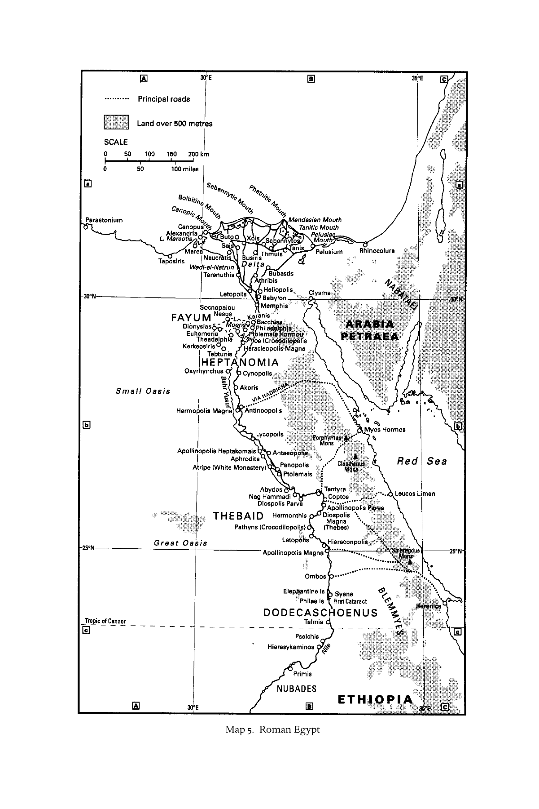

# 第十八章英文原文：Egypt

<!-- PDF page 379; original page 330 -->

Map 5. Roman Egypt

<!-- PDF page 380; original page 331 -->

### 18. Egypt

#### birger a. pearson

#### The evidence

Evidence for Christianity in Egypt consists of non-literary and literary sources. There is virtually no archaeological evidence datable to before the fourth century, apart from a few scattered architectural fragments which are supposed to come from the earliest attested church in Alexandria, that of Theonas (bishop 282–300 ce).[^p380-1] The earliest identifiably Christian tombs date from the fourth century.[^p380-2] There are no Christian inscriptions from Egypt datable to before the fourth century.[^p380-3] The meagre iconographical evidence amounts to a couple of ‘Gnostic’ gems.[^p380-4] Non-literary papyri consist for the most part of what are taken to be the earliest Christian letters, and very few of these date to before the fourth century.[^p380-5]

On the other hand, the literary evidence is massive, consisting of works composed in Greek. Writings that would eventually become part of the New Testament canon were brought to Egypt very early, some probably in the first century. The earliest New Testament manuscripts, datable to the second century, consist of papyrus fragments of Matthew, Mark, John, Titus and Revelation found in Egypt.[^p380-6] Other early Christian literature introduced into Egypt and attested in second-century Greek manuscripts include the

[^p380-1]: Tkaczow, ‘Archaeological sources’, 432. On excavations carried out in Alexandria in the nineteenth and twentieth centuries, see Tkaczow, Topography; cf. Pearson, ‘Alexandria’.

[^p380-2]: Wilfred Griggs’ claims for first- and second-century Christian burials in the Fayum are ‘fantasy’, according to Roger Bagnall. See Griggs, ‘Excavating a cemetery’; cf. Bagnall, Egypt in late antiquity, 279 n. 113.

[^p380-3]: See Lefebvre, Recueil des inscriptions. On later evidence see also Brown, ‘Coptic and Greek inscriptions’.

[^p380-4]: Pearson, Gnosticism and Christianity, ch. 9.

[^p380-5]: See Naldini’s edition of papyri, Cristianesimo in Egitto. For a good discussion of the papyrological evidence, see Judge and Pickering, ‘Papyrus documentation’.

[^p380-6]: Roberts, Manuscript, society and belief, 12–13. The fragments of Mark (P90) and Revelation (P98) turned up since Roberts’ work; see Nestle-Aland NTG27, 689. P52, the oldest attestation of the gospel of John, dates to the early second century.

<!-- PDF page 381; original page 332 -->
Egerton gospel (probably from Syria), The Shepherd of Hermas (from Rome), P. Oxy. 1 ( = Gos. Thom. 26–8, from Syria), and Irenaeus’ Adversus haereses (‘Against heresies’, composed in Gaul and probably introduced into Egypt from Rome).[^p380-7]

But Egyptian Christians produced their own religious literature. Indeed, the literary output of Christians in Egypt during the second and third centuries was probably more abundant than that of any other region. Much of our evidence is fragmentary, consisting largely of quotations from patristic writers; much, too, is irretrievably lost. Our extant evidence also includes works translated into Coptic and preserved in Coptic manuscripts: twelve codices plus loose leaves from a thirteenth found near Nag Hammadi, Egypt,[^p380-8] the Berlin Gnostic codex (Papyrus Berolinensis 8502), the Askew codex (Pistis sophia), the Bruce codex, and fragments from another codex found at Deir el Bala’izah.

Cited in the following lists are works or authors of probable Egyptian (mostly Alexandrian) provenance:[^p380-9]

#### Second- and third-century apocrypha

Gospel of the Hebrews Gospel of the Egyptians Secret Gospel of Mark Gospel of the Saviour Kerygma Petri [‘Preaching of Peter’] Apocalypse of Peter[^p380-10]

Epistle of Barnabas Second Clement

Traditions of Matthias Gospel of Eve Jannes and Jambres Some Christian Sibylline oracles Apocalypse of Elijah

#### Apostolic fathers

Epistle to Diognetus

[^p380-7]: Roberts, Manuscript, society and belief, 13–14.

[^p380-8]: Cited NHC, or sometimes CG (Cairensis Gnosticus). In the Bibliography of primary sources (pp. 591–614) are listed only the Coptic–English editions of the Coptic Gnostic library project directed by James Robinson and completed in 1995. For other editions and studies see Scholer, Nag Hammadi bibliography. For convenient translations of the Nag Hammadi tractates, plus those of the Berlin Codex (BG), see Robinson and Meyer, NHL.

[^p380-9]: See the Bibliography of primary sources (pp. 591–614). For an extensive discussion of the literary evidence and the problems of establishing the provenance of early Christian texts see Pearson, Gnosticism and Christianity, 40–81. I include there discussion of works of disputed provenance, e.g. Epistula apostolorum, which some scholars assign to Egypt but should be assigned to Asia Minor.

[^p380-10]: To be distinguished from the tractate of the same title in Nag Hammadi codex vii.

<!-- PDF page 382; original page 333 -->
Sentences of Sextus Athenagoras Agrippa Castor[^p380-11] Pseudo-Justin Clement of Alexandria

#### Other patristic writers

Origen Dionysius of Alexandria Theognostus Pierius Theonas[^p380-12]

#### Second-century Gnostic and other ‘heretical’ writers

Basilides and the Basilidians Theodotus Carpocrates and the Carpocratians Heracleon Valentinus Julius Cassianus[^p380-13]

#### Writings preserved in Coptic Gnostic manuscripts[^p380-14]

#### ‘sethian’ gnostic writings

Apocryphon of John (NHC ii,1; iii,1; iv,1;

BG,2) Hypostasis of the Archons (NHC ii,4) Gospel of the Egyptians (NHC iii,2; iv,2)[^p380-15] Three Steles of Seth (NHC vii,5)

Zostrianos (NHC viii,1) Melchizedek (NHC ix,1) Thought of Norea (NHC ix,2) Allogenes (NHC xi,3) Trimorphic protennoia (NHC xiii,1)

[^p380-11]: His refutation of Basilides is lost, but summarized in Euseb. HE 4.7.

[^p380-12]: Eusebius mentions two other Alexandrian writers: Alexander, who became bishop of Jerusalem, and Anatolius, who became bishop of Laodicea (HE 6.11.3–6; 7.32.6–20). Eusebius quotes from letters of Alexander and provides an extensive quotation from Antatolius’ Canons on the pascha.

[^p380-13]: The extensive output of another ‘heretical’ writer, Hieracas of Leontopolis, who wrote in both Greek and Egyptian (Coptic) according to Epiphanius (Pan. 67), is unfortunately lost.

[^p380-14]: Included in the bibliography of primary sources are all of the Coptic treatises; included in the following lists are only those Christian writings which are almost certainly assignable to 2nd- or 3rd-century Egypt, or those whose provenance is uncertain but which can plausibly be assigned to 2nd- or 3rd-century Egypt. Those in the latter category are Pr. Paul; Treat. res.; Tri. trac.; Interp. know.; Val. exp.; Ep. Pet. Phil.; Hypsiph.; and the Plato fragment (in a Gnostic edition). Those tractates for which a 2nd- or 3rd-century Syrian provenance is probable include Apoc. Adam (NHC v,5), Marsanes (NHC x,1), Gos. Phil. (NHC ii,3), 1 Apoc. Jas. (NHC v,3), 2 Apoc. Jas. (NHC v,4), Paraph. Shem (NHC vii,1), Gos. Thom. (NHC ii,2), Thom. cont. (NHC ii,7), Dial. sav. (NHC iii,5), Acts Pet. 1 2 apos. (NHC vi,1) and Act Pet. (BG,4). Probably of 4th-century Egypt are Pistis Sophia and the untitled treatise in the Bruce codex. Eugnostos (NHC iii,3; v,1) probably originated in a 1st-century Alexandrian Jewish milieu. Quintessentially Egyptian (but not Christian) are the Hermetic writings: Disc. 8–9 (NHC vi,6), Pr. thanks. (NHC vi,7) and Asclepius (NHC vi,8).

[^p380-15]: Not to be confused with the apocryphal gospel of the same name cited above.

<!-- PDF page 383; original page 334 -->
#### valentinian gnostic writings

Gospel of truth (NHC i,3; xii,2) Treatise on the resurrection (NHC i,4) Tripartite tractate (NHC i,5)

Interpretation of knowledge (NHC xi, 1) A Valentinian exposition (NHC xi, 2)

#### gnostic writings of uncertain affiliation

Apocryphon of James (NHC i,2) On the origin of the world (NHC ii,5; xiii,2) Exegesis on the soul (NHC ii,6) Sophia of Jesus Christ (NHC iii,4; BG,3) Apocalypse of Paul (NHC v,2)[^p380-16] Thunder: perfect mind (NHC vi,2) Concept of our great power (NHC vi,4) Second treatise of the great Seth (NHC vii,2)

Apocalypse of Peter (NHC vii,3)[^p380-17] Letter of Peter to Philip (NHC viii,2) Testimony of truth (NHC ix,3) Hypsiphrone (NHC xi,4) Gospel of Mary (BG,1) Books of Jeu (Bruce codex) Bala’izah Gnostic fragments

#### non-gnostic writings

Authoritative teaching (NHC vi,3) Teachings of Silvanus (NHC vii,4)

Sentences of Sextus (NHC xii,1)

#### Alexandria ad Aegyptum

Egyptian Christianity began in Alexandria, by far the greatest of the many cities founded by Alexander the Great. Alexandria[^p380-18] was founded in 331 bce on a site already occupied by a native village called Rhakotis (Strabo Geog. 17.1.6).[^p380-19] (From the third century bce that name was used to designate the native Egyptian quarter of Alexandria, and Coptic sources use the name to designate the city as a whole.) Upon the death of Alexander in 323, Egypt came under the rule of Ptolemy, a Macedonian general and companion of Alexander. Under Ptolemy i (Soter = ‘Saviour’) the city replaced Memphis as capital of

[^p380-16]: Not to be confused with another apocryphal writing of the same name.

[^p380-17]: Not to be confused with the apocalypse of the same name cited above.

[^p380-18]: For the Ptolemaic period, see Fraser, Ptolemaic Alexandria. For the period from Diocletian on, see Haas, Alexandria. For an excellent general discussion see chapter 7 (‘Alexandria, queen of the Mediterranean’) in Bowman, Egypt; cf. also Pearson, ‘Alexandria’. For the topography of Alexandria based on documentary and archaeological evidence, see Calderini, Dizionario, vol. i, fasc. 1; and Adriani, Repertorio d’arte. On recent archaeological work, including underwater excavations, see Empereur, Alexandria rediscovered.

[^p380-19]: But the earliest hieroglyphic attestation of the name is an inscription dated 311 bce, i.e. after the city’s founding. See Chauveau, ‘Alexandrie et Rhakotis’.

<!-- PDF page 384; original page 335 -->
Egypt. Under Ptolemaic rule the city became the cultural, educational and commercial centre of the Hellenistic world, a position it occupied in the Roman period as well.[^p380-20]

Alexandria was a cosmopolitan city, oriented to the Mediterranean, and regarded as separate from, or ‘alongside of’ Egypt proper.[^p380-21] The Egyptian chōra (‘country’) consisted of the Nile valley and delta, the Fayum depression, and the desert oases (96 per cent of Egypt is desert). Greeks had penetrated into the chōra from the seventh century bce on. In addition to Alexandria, there were two other Greek cities, Naukratis and Ptolemais, and a third founded by Hadrian, Antinoopolis. But Greek-speaking people were to be found in numerous Egyptian towns, and Greek cultural influence was everywhere present. Even so, Egyptian culture and religion persisted in Egypt for a long time, and manifested itself even in Alexandria under Ptolemaic sponsorship.

Jewish immigration into Egypt from Palestine had begun as early as the sixth century bce, and Jews flowed into Alexandria in large numbers, with the result that the Alexandrian Jewish community became the most important in all of the diaspora.[^p380-22] The Jews were organised as a politeuma (‘community’, Ep. Arist. 310), and were encouraged by the Ptolemies and later the Roman emperors to live according to their own ancestral customs. By the first century, the Jewish population in Alexandria numbered in hundreds of thousands.

With the coming of Roman rule in 30 bce, the favourable economic situation of the Jews in Egypt under the Ptolemies changed. A ‘poll tax’ (laographia) was imposed on native Egyptians and other non-Greek groups in 24/23 bce. Relations with the Greek population became progressively strained, leading to a pogrom against the Jews in 38 ce. A group of Jews, led by Philo, appealed unsuccessfuly to emperor Gaius (Caligula). In 66 a riot was put down by Philo’s apostate nephew, Tiberius Alexander, Roman Prefect of Egypt, with great loss of life ( Josephus, BJ 2.487–98). A revolt of the Jews under Trajan in 115, put down in 117,[^p380-23] led to the virtual annihilation of the Jewish community (Euseb.

[^p380-20]: The topography and beautiful buildings of the city are extensively described by Strabo in book 17 of his Geographica (Strabo resided in the city c.24–20 bce); cf. Fraser, Ptolemaic Alexandria, vol. i, 7–37; vol. ii, 12–111.

[^p380-21]: In his oration ‘to the Alexandrians’ Dio Chrysostom refers hyperbolically to ‘the mighty nation of Egypt’ as an ‘appendage’ (prosthēkē, Orationes 32.36) to the magnificent city of Alexandria.

[^p380-22]: See pt i, ch. 2, above. The Jewish presence in Egypt in the Ptolemaic and Roman periods is fully documented in CPJ, which also includes inscriptions. Cf. Safrai and Stern, Jewish people, which concentrates on the first century; also Starobinski-Safran, ‘Communauté juive’.

[^p380-23]: The revolt was inspired by Jewish messianism; see Hengel, ‘Messianische Hoffnung’.

<!-- PDF page 385; original page 336 -->
HE 4.2).[^p380-24] Destruction of Jewish life and property extended into the Egyptian chōra as well.

The development of Christianity in Egypt was impacted from the beginning by the distinctive Greek cultural and educational environment of Alexandria, and by the socio-cultural and religious life of the Jewish community in which the earliest Christians lived. As the Christian religion expanded into the chōra, it came under the influence of native Egyptian culture and language, resulting in the development of a distinctive Coptic (‘Egyptian’) Christianity which is still very much alive today.

#### Christian origins in Egypt

On the origins of Christianity in Egypt[^p380-25] our sources are silent until the early second century, when Alexandrian Christian literature begins to appear and doctrines of early Christian teachers begin to be reflected in texts and testimonies. The Coptic Church credits the apostle Mark with the founding of the Alexandrian church, but that tradition, attested only from the fourth century (Euseb. HE 2.16), is highly dubious.[^p380-26] A legend that Mark’s cousin Barnabas was active in Christian mission in Alexandria, attested in the Pseudo-Clementine literature (Hom. 1.8.3–15.9), is also dubious.[^p380-27] There is a hint of a Christian presence in Alexandria in the New Testament in a variant reading of Acts 18:25, where it is reported that Apollos of Alexandria ‘had been instructed in the word in his home country’,[^p380-28] but that reading is probably secondary.

So, in discussing the origins of Christianity in Egypt, historians have been forced to extrapolate backwards from second-century sources. One stillpopular view is that of Walter Bauer,[^p380-29] who accounts for the paucity of early evidence by suggesting that ecclesiastical leaders suppressed it, knowing that the earliest form of Christianity was ‘heretical’, specifically ‘Gnostic’. This conclusion has a certain plausibility in that the earliest Christian teachers active in early second-century Alexandria of whom we have any information were the ‘arch-heretics’ Valentinus, Basilides and his son Isidore, and Carpocrates and his son Epiphanes. The problem with Bauer’s theory, however,

[^p380-24]: See pt i, ch. 3, above.

[^p380-25]: Pearson, ‘Earliest Christianity’ and ‘Christianity in Egypt’; and, more recently, Dorival, ‘Les débuts’; Jakab, Ecclesia alexandrina, 35–61; Pearson, ‘Cracking a conundrum’.

[^p380-26]: On the Mark legend see Pearson, ‘Earliest Christianity’, 137–45; also Pearson, ‘Christianity in Egypt’, 955–6.

[^p380-27]: Pearson, ‘Earliest Christianity’, 136–137; but see now Carleton Paget, Epistle of Barnabas, 36.

[^p380-28]: Codex Bezae (my translation), representing the ‘western’ text of Acts.

[^p380-29]: Bauer, Orthodoxy and heresy, 44–53.

<!-- PDF page 386; original page 337 -->
is that it requires him to paint with ‘heretical’ and ‘Gnostic’ colours the earliest attested Alexandrian Christian literature, the Epistle of Barnabas, and the fragmentary apocryphal works, Gospel of the Hebrews and Gospel of the Egyptians. He also ignores other important sources such as the Kerygma Petri, which is obviously not a ‘Gnostic’ work.[^p380-30]

More plausible is the view advanced by papyrologist Colin Roberts, based on his study of the earliest Christian literary papryi, which provide no support for Bauer’s view that Gnosticism was the earliest form of Christianity in Egypt. Especially important is Roberts’ discussion of the nomina sacra (abbreviations, with superlineation, of ‘sacred names’ such as Iesous, Christos, kyrios, theos and others, fifteen in all) in early Christian manuscripts, a scribal practice which he traces back to the Jerusalem church.[^p380-31] Roberts concludes that the earliest Christianity in Egypt (i.e. in Alexandria) was Jewish. The earliest ‘Christians’ (if we can call them that)[^p380-32] were an integral part of the Jewish community of Alexandria.

It has recently been argued that primitive Christianity was ‘annihilated’ in the Jewish revolt of 115–17 ‘along with the entire body in which it was immersed – the Jewish community of Egypt’. On this view, the Judaeo-Christianity that came to an end in 117 was replaced by ‘pagano-Christian groups’ which refused to participate in the revolt.[^p380-33] While the revolt of 115–17 must have been a crucial event for Christians in Egypt, there was certainly not a complete rupture, since the existing second-century evidence points to substantial continuities between Alexandrian Judaism and post-117 Alexandrian Christianity in terms of theology, lifestyle and social organization.[^p380-34]

#### Social groups and Christian organisation

Following the destruction of the Jewish community in 117, much of its literary legacy survived among the Christians who treasured and preserved it, notably the Septuagint version (LXX) of the Bible (originally translated in Alexandria) and the writings of Philo and other Jewish authors. This legacy heavily impacted the literary production of Christians who now constituted a new community no longer part of the Jewish politeuma. A look at one of the earliest Alexandrian Christian writings, the Kerygma Petri, preserved in a few

[^p380-30]: Bauer, Orthodoxy and heresy, 47–53.

[^p380-31]: Roberts, Manuscript, society and belief, 19–21; cf. Hurtado, ‘Nomina sacra’.

[^p380-32]: The earliest documented use of the term ‘Christian’ in Alexandrian Christian sources is found in fr. 2 of the Kerygma Petri (Clem. Al. Str. 6.5.41; cf. NTApoc, vol. ii, 39).

[^p380-33]: Modrzejewski, Jews of Egypt, 227–30.

[^p380-34]: Pearson, ‘Cracking a conundrum’, and Gnosticism and Christianity, 12–19, 82–99.

<!-- PDF page 387; original page 338 -->
fragments by Clement, is instructive. Its attribution to Peter and its reference to ‘the twelve’ situates the text in the tradition of the apostles originally based in Jerusalem (fr. 3). It reflects a typically Alexandrian ‘logos Christology’ (fr. 1) and a credo centred upon one God who created the world and can bring an end to it, a credo which can also be expressed in a typically Alexandrian ‘negative theology’ (fr. 2). It finds in the biblical writings prophecies of the coming, death and resurrection of Christ (fr. 4). It is the first Alexandrian writing to use the term ‘Christian’, defining Christians as a ‘third race’ (fr. 2).[^p380-35] The Kerygma Petri represents a variety of Christianity that lies on a trajectory leading to the ‘mainline’ Christianity of Clement, who quotes it approvingly.[^p380-36]

Our literary sources tell us of other varieties of Christianity which existed early on in Alexandria.[^p380-37] The Gospel of the Hebrews was used by Alexandrian Jewish Christians. It reflects a special allegiance to James of Jerusalem, but also the influence of Alexandrian Jewish wisdom theology. The Gospel of the Egyptians was in use by Greek-speaking Egyptian Christians probably resident in the Rhakotis district of Alexandria. This group was oriented to asceticism, and may have been influenced by the Jewish Therapeutae who, situated west of Alexandria, had a particular form of communal life, as described by Philo (Contempl.). Apocalyptically oriented Christianity is reflected in the Epistle of Barnabas, and in Alexandrian Sibylline writings in Christian dress. Apocalypticism was also probably part of the religious orientation of the simple, uneducated Christians (simpliciores), who left us no writings.[^p380-38]

Among the highly educated, philosophically oriented Christians would certainly have been Platonists such as are reflected in the Authoritative teaching (NHC vi,3)[^p380-39] and the various Gnostic groups, who also represent a kind of continuation of the different varieties of Alexandrian Judaism. The tractate Eugnostos (NHC iii,3; v,1), for example, reflects the existence in the first century of a Jewish Gnosticism.[^p380-40] Marcionite Christianity also came to Alexandria, probably in the mid-second century;[^p380-41] Marcionites were known to Clement, who polemicises against them (e.g. Str. 3.3.12).

[^p380-35]: See n. 32, above.

[^p380-36]: The importance of the Kerygma Petri is underscored by Jakab, Ecclesia alexandrina, 56–7.

[^p380-37]: Van den Broek, ‘Juden und Christen’.

[^p380-38]: Van den Broek, ‘Juden und Christen’, 188; Dorival, ‘Les débuts’, 170–1.

[^p380-39]: Van den Broek, ‘Authentikos logos’.

[^p380-40]: Van den Broek, ‘Jewish and Platonic speculations’; cf. van den Broek, ‘Juden und Christen’, 192.

[^p380-41]: Dorival, ‘Les débuts’, 171.

<!-- PDF page 388; original page 339 -->
Christian organisation in Alexandria also exhibits a continuity with Alexandrian Judaism, especially in the form of the presbyterate. Each Christian congregation in Alexandria had its own presbyter, following the model of the synagogue.[^p380-42] To be sure, the leaders most visible to us are the early Christian teachers named in our sources. Thus, a congregation would be organised under the direction of a presbyter, but could include in its membership a prominent lay teacher. In some cases, teachers were also presbyters, as was Clement in all probability.

As for the bishops, those in the traditional list before Demetrius (189–232) going back to Mark, as given by Eusebius, seem to be nothing more than ‘a mere echo and a puff of smoke’.[^p380-43] Before Demetrius, there certainly was no monarchical episcopate, such as was advocated in Asia Minor by Ignatius of Antioch. Jerome (Ep. 146.1) informs us of the situation in the early Alexandrian church. Before the time of the bishops Heraclas and Dionysius, the presbyters named one of themselves to serve as bishop.[^p380-44] Much later evidence is supplied by Eutychius, tenth-century Melchite patriarch of Alexandria. In his Annals, he speaks of twelve presbyters from whom, in case of a vacancy in the patriarchate, a new patriarch would be chosen. (His use of the term ‘patriarch’ for bishop is an anachronism.) Then a new presbyter would be appointed in his place in the presbytery. Eutychius also informs us that, until the time of Demetrius, he was the only bishop in Egypt; Demetrius appointed three bishops, and Heraclas, his successor, appointed an additional twenty.[^p380-45]

Demetrius played a crucial role in the development of the Egyptian Christian hierarchy. It is no wonder that he has been referred to as ‘second founder of the church of Alexandria’, and ‘founder of the church of Egypt’ for his role in the evangelisation of areas outside of Alexandria.[^p380-46] To be sure, it took some time for Demetrius to consolidate his episcopal authority. The writings of Clement and Origen attest to this evolution ‘from the Christian community

[^p380-42]: Van den Broek, ‘Juden und Christen’, 188–91; Ritter, ‘De Polycarpe à Clement’, 164. On the organisation of Jewish communities in the Diaspora, see Applebaum, ‘Organization’; cf. pt i, ch. 2, above. On the earliest papyrus evidence of Jewish presbyteroi (P. Oxy. 2476, 2nd century bce), see no. 24 (by S. R. Llewelyn) in NewDocs, vol. ix (2002), 69–72.

[^p380-43]: Bauer, Orthodoxy and heresy, 45. The traditional list may have been constructed artificially by Julius Africanus in his (lost) Chronographies, one of Eusebius’ sources; so Grant, Eusebius as church historian, 51–2. See chart, ‘Roman emperors and bishops of Rome and Alexandria’, pp. xxii–xxiii above.

[^p380-44]: See Jakab, Ecclesia alexandrina, 177.

[^p380-45]: PG 111.982; cf. Kemp, ‘Bishops and presbyters’, 137–8.

[^p380-46]: Telfer, ‘Episcopal succession’, 2.

<!-- PDF page 389; original page 340 -->
to an institutional church’,[^p380-47] and it should be added that the process begun by Demetrius was really not completed until the time of Dionysius the Great (247–64), the first ‘patriarch of Egypt’.[^p380-48]

In terms of social standing, it has been argued that the earliest Christians in Alexandria were Jews of education and means, representing a ‘middle class’ who enjoyed a comfortable life.[^p380-49] That judgement may be a little one-sided, even though it must be admitted that the Christians depicted in Clement’s Pedagogue were evidently people of means.[^p380-50] The pagan writer Celsus, probably writing in Alexandria in the 170s, contemptuously dismissed the Christians known to him as ‘dishonourable and stupid, and only slaves, women, and little children’ (Or. C. Cels. 3.44).[^p380-51] Athenagoras, writing around the same time as Celsus, acknowledges that some Christians were ‘simple folk, artisans and old women’ (Leg. 11.1),[^p380-52] but he also refers to some who were slave owners (Leg. 55).[^p380-53] Christians in Alexandria are likely to have come from all social strata.[^p380-54]

The socio-economic situation of Christians as reflected in the writings of Clement can be extended to the church itself as an institution, for by the end of the third century the Alexandrian church had become a banking institution! The evidence for this comes in a letter from an Egyptian Christian (P. Amherst 3a), who wrote from Rome to fellow Christians in the Arsinoite nome with instructions to make a monetary deposit in Alexandria with ‘Maximus the papas’ by giving it into the hands of the bishop’s agent, Theonas.[^p380-55] Theonas later became Maximus’ successor as bishop (282–300), and presided over the construction of a church building in the western part of the city.[^p380-56]

#### The ‘Catechetical School’ in Alexandria

While teachers played an important role in the Alexandrian Christian community, the earliest ones named in our sources were ‘heretics’ (Gnostics).[^p380-57] The first named ‘orthodox’ Christian teacher, Pantaenus, appears in Eusebius’

[^p380-47]: ‘De la communauté chrétienne à une église institutionnelle’, ch. 8 in Jakab, Ecclesia alexandrina, 175–214.

[^p380-48]: Jakab, Ecclesia alexandrina, 215–55, esp. 252–5.

[^p380-49]: Jakab, Ecclesia alexandrina, 54–5.

[^p380-50]: See Jakab’s discussion of the life of the ‘rich Christians in Alexandria’ as depicted by Clement (Ecclesia alexandrina, 257–92).

[^p380-51]: Translation by Chadwick, Origen: contra Celsum.

[^p380-52]: Crehan’s translation in Athenagoras.

[^p380-53]: Barnard, Athenagoras, 147–9.

[^p380-54]: Cf. pt ii, ch. 7, above.

[^p380-55]: Deissmann, Light from the ancient east, 205–13; Snyder, Ante pacem, 152–3.

[^p380-56]: Sources cited by Adriani, Repertorio, 217; cf. n. 1, above.

[^p380-57]: On the ‘Catechetical School’ in Alexandria, see pt v, ch. 27, below.

<!-- PDF page 390; original page 341 -->
history in connection with events taking place during the reign of Commodus (180–92). Eusebius writes that Pantaenus, a famous teacher, was in charge of a ‘school of sacred learning’ (didaskaleion tōn hierōn logōn) which had existed in Alexandria ‘from ancient custom’ (HE 5.10.1).[^p380-58] Eusebius adds that Pantaenus was head of the school (didaskaleion) until his death (5.10.4) and had among his pupils Clement (5.11.1), who succeeded him in directing the school’s ‘instruction’ (katēchēsis, 6.6.1). Eusebius subsequently reports that Origen was in his eighteenth year when he became head of the ‘catechetical school’ (tēs katēchēseōs didaskaleion, 6.3.3). During the persecution in 202, other teachers, including Clement, left the city. Bishop Demetrius entrusted the task of instruction (katēchēsis) to Origen alone (6.3.8). Afterwards, Origen shared this duty with his former pupil Heraclas (who later succeeded Demetrius as bishop), with Heraclas in charge of the more elementary instruction and Origen the more advanced (6.15). From these and other reports given by Eusebius arises the tradition of the ‘Catechetical School’ in Alexandria with a succession of teachers from Pantaenus on, or from unnamed predecessors as is implied by Eusebius’ expression ‘from ancient custom’ (5.10).

A different version of the succession of Christian teachers in the didaskaleion at Alexandria is attributed to the fifth-century historian Philip of Side, in an abridgement of his work extant in a fourteenth-century manuscript.[^p380-59] In that account the succession of school heads begins with Athenagoras, followed by Clement, Pantaenus, Origen, Heraclas, Dionysius, Pierius, Theognostus, Serapion, Peter (bishop and martyr, d. 311), Macarius Politicus, Didymus (the Blind) and Rhodon, who is said to have moved the school from Alexandria to Side during the reign of Theodosius the Great (379–95).[^p380-60]

Diametrically opposed interpretations of the tradition concerning the ‘Catechetical School’ have been put forward by scholars. Some[^p380-61] argue that there was no school at all until the time of Demetrius, only independent teachers. In this view, the lay teachers in Alexandria, including Clement, could play an important role in the church, giving instruction at all levels, from pre-baptismal instruction to high theology. Many of them, like Clement, were well schooled in Greek philosophy and culture; some were also biblical scholars active in a ‘scriptorium’ that must have existed in Alexandria by the middle of

[^p380-58]: Lake’s translation in the LCL edition.

[^p380-59]: Pouderon, D’Athènes à Alexandrie, 1–70.

[^p380-60]: Pouderon attributes the obvious chronological errors in this account not to Philip’s own work, which is lost, but to the traditors of this abridgement.

[^p380-61]: See esp. Bardy, ‘Aux origines de l’école’; van den Broek, ‘Christian “school”’; Jakab, Ecclesia alexandrina, 91–106.

<!-- PDF page 391; original page 342 -->
the second century.[^p380-62] But it is only from the time of Demetrius on that one can speak of an official Christian school at Alexandria under episcopal control. Thereafter, some school heads, such as Heraclas and Dionysius, became bishops, but eventually, from the time of bishop Theophilus on (385–412), the school ceased to exist.

Other scholars,[^p380-63] while agreeing that Eusebius must be read critically, nevertheless argue that his claims should not be completely dismissed. In this view, based on a close reading of Clement, ‘teaching and scholarship within the penumbra of the church was a long-established activity in Alexandria well before Origen.’[^p380-64] As for Clement, who was both a teacher and a presbyter, ‘a contrast between church and school is nonexistent. His instruction moved the faithful through baptism and then toward wisdom and knowledge within the context of the church.’[^p380-65]

In fact, the full story is told neither by Eusebius nor by Clement. There were clearly other Christian teachers in Alexandria in Clement’s time and there were prominent Christian teachers in Alexandria long before him of a type similar to the private teachers who represented the various philosophical traditions current in the Graeco-Roman world. Clement can be seen in a special light as one who put his instruction at the service of the Christian communities who for him constituted ‘the church’, in which he assumed an important leadership role. Indeed, it may be that Clement’s role as a part of the Alexandrian presbytery involved a power struggle in the church that led to his departure from the city.[^p380-66] But the ‘Catechetical School’ of Alexandrian Christian tradition probably came into being only in the early third century as a result of the growing authority of bishop Demetrius.

Two of the school’s teachers stand out in terms of their contributions to the development of Alexandrian theology, Clement and Origen. Titus Flavius Clemens, whose life is poorly documented, was probably born a pagan in Athens sometime between 140 and 150. He studied philosophy in Greece, Magna Graecia, Syria and Palestine before settling in Alexandria (Str. 1.11.2). The place and time of his conversion is unknown. He left Alexandria for Palestine around 202, and died there around 216. His writings reflect the strong influence of Platonism and especially of the philosophy and scriptural

[^p380-62]: On the Alexandrian scriptorium see Zuntz, Text of the epistles, 271–3.

[^p380-63]: See esp. Méhat, Étude, 62–70; van den Hoek, ‘“Catechetical” school’.

[^p380-64]: Van den Hoek, ‘“Catechetical” school’, 76.

[^p380-65]: Van den Hoek, ‘“Catechetical” school’, 71. That Clement was a presbyter is indicated in a letter by Alexander, bishop of Jerusalem, quoted by Eusebius, HE 6.11.6. See van den Hoek, ‘“Catechetical” school’, 77; Nautin, Lettres, 114–18.

[^p380-66]: Nautin, Lettres, 18, 140.

<!-- PDF page 392; original page 343 -->
exegesis of Philo Judaeus.[^p380-67] His major works are the Protrepticus (‘Exhortation to the Greeks’), intended to convert pagans to Christianity, the Paedagogus (‘Christ the educator’), a hortatory work addressed to Christians, and the Stromata (‘Miscellanies’), intended for ‘Gnostic’ Christians who wish to go beyond simple faith and attain to a higher knowledge.[^p380-68] Clement takes over the term ‘Gnostic’ from the heretics, and distinguishes between ‘true’ and ‘false’ gnōsis.[^p380-69]

Origen, to whom Eusebius dedicates most of book 6 of his Historia ecclesiastica, was born in 185 or 186, reared as a Christian, and given a good education. Upon the martyrdom of his father Leonides in 202, he became a teacher (didaskalos) to support his family. Later he was given the patronage of a wealthy Christian woman, and drew many to his lectures. One of the most prolific writers of antiquity, Origen devoted all of his writings to the promotion of Christian faith, and can be regarded as the greatest scholar and theologian of the ancient church. He travelled and lectured widely, and, after a falling out with bishop Demetrius, left Alexandria for good around 234 for Caesarea, where he became even more productive. Imprisoned and tortured during the Decian persecution, he died in Tyre sometime after 251.[^p380-70]

Like Clement, Origen was a Platonist and was heavily influenced by Philo in his scriptural exegesis.[^p380-71] Most of his writings are exegetical (commentaries, homilies); his most important commentary, the one on John, was begun in Alexandria and completed in Caesarea. His impressive synopsis of the Old Testament (the Hexapla written in columns with the Hebrew text plus Greek translations by Aquila, Symmachus, the LXX, Theodotion and two others), of which only fragments remain, was a masterpiece of Alexandrian text-critical work.[^p380-72] His work De principiis (‘On first principles’), composed in Alexandria, marks Origen as the church’s first systematic theologian. His greatest apologetic work is his treatise Contra Celsum (‘Against Celsus’), composed towards the end of his life in Caesarea. His Trinitarian theology and his Christology were especially influentual in the subsequent development of Alexandrian theology. More controversial was his doctrine of the pre-existence (but not transmigration!) of the human soul. Much of Origen’s huge output is lost,

[^p380-67]: Van den Hoek, Clement of Alexandria; Runia, Philo, 132–56.

[^p380-68]: Other works of Clement are listed in the bibliography of primary sources (p. 596). On lost writings see Euseb. HE 6.13.1–3. On Clement see Méhat, ‘Clemens’.

[^p380-69]: Méhat, ‘“Vraie” et “fausse” gnose’.

[^p380-70]: On Origen see Williams, ‘Origenes’; Nautin, Origène; Crouzel, Origen.

[^p380-71]: Runia, Philo, 157–83.

[^p380-72]: On this work see esp. Nautin, Origène, 303–361. Origen may have expanded an already existing Jewish synopsis (Nautin, Origène, 333–41).

<!-- PDF page 393; original page 344 -->
some available only in Latin translations, owing to his denunciation as a heretic by emperor Justinian in 543.

#### Relations with Christians elsewhere

Irenaeus of Lyons[^p380-73] claimed that the church’s faith, received from the apostles and their disciples, was one and the same over the entire world, in such diverse regions as Germany, Spain, Gaul, ‘the east’, Egypt, Libya and ‘the central regions of the world’ (Haer. 1.10.2).[^p380-74] The church inherited this claim for universal, cross-regional unity from Judaism, which, with its orientation to the temple in Jerusalem, was the only other religion in the history of Graeco- Roman religions to have this feature.

Interestingly enough, Irenaeus’ work turned up in Egypt within twenty years of its composition (P. Oxy. 405).[^p380-75] It was certainly known to, and used by, Clement,[^p380-76] the earliest known Alexandrian writer against ‘heresies’. Irenaeus’ work is only one of countless writings composed outside Egypt of various genres which, from the first century on, came in a flood from such diverse regions as Palestine, Antioch, eastern Syria, Asia Minor, Greece, Rome and North Africa. And Christian authors in Egypt returned the favour. It is, first of all, through ‘networks’[^p380-77] of Christians exchanging letters and literature that one can speak of relations between the church in Egypt and churches elsewhere.

The first known ‘official’ exchange of letters from the Alexandrian church to other churches is reported by Eusebius in connection with the controversy on the dating of Easter that arose towards the end of the second century (HE 5.25). He quotes from a joint encyclical letter composed by the Palestinian bishops of Jerusalem, Caesarea, Tyre and Ptolemais in support of celebrating Easter always on a Sunday, as advocated by bishop Victor of Rome, instead of on the fourteenth of the Jewish lunar month Nisan, as was the custom in Asia Minor. That letter includes the following sentence: ‘And we make it plain to you that in Alexandria also they celebrate the same day as do we, for letters have been exchanged between them and us, so that we observe the holy day together and in agreement.’ What is of special interest here is that no mention

[^p380-73]: See pt iii, ch. 13, above.

[^p380-74]: For a discussion of this passage see Pearson, Emergence, 174–5.

[^p380-75]: Roberts, Manuscript, society and belief, 14, 23.

[^p380-76]: On Clement’s use of Irenaeus see van den Hoek, ‘How Alexandrian?’, 186, 190.

[^p380-77]: The importance of ‘network theory’ in social-scientific study of early Christianity is underscored especially by Rodney Stark in his book, Rise of Christianity; cf. also White, Social networks; and Pearson, ‘On Rodney Stark’s foray’.

<!-- PDF page 394; original page 345 -->
is made of the Alexandrian bishop, who at that time was Demetrius. Indeed, he had become bishop in Alexandria the same year as Victor in Rome (189). Whatever letter was sent from Alexandria to Palestine came apparently from the presbytery acting collectively, rather than the bishop, who had evidently not yet consolidated his power over the Alexandrian church.

The situation was completely different by the mid-third century, during the time of bishop Dionysius (247–64).[^p380-78] His voluminous correspondence, including ‘official’ letters to bishops in Rome, Antioch and elsewhere, attests to the growing importance of the Alexandrian church in the empire. By the end of the third century, the Alexandrian church was at least as influential in the east as the Roman church was in the west.

#### Gnosticism and Manichaeism in Egypt

In his five-volume work Adversus haereses, Irenaeus traces the Gnostic heresy, ‘gnōsis falsely so-called’, back to Simon ‘Magus’ of Samaria (Haer. 1.23.1–4; cf. Acts 8:9–24). Next in line as ‘successor’ to Simon is Menander, also a Samaritan (1.23.5), who became active in Antioch (cf. Justin, 1 Apol. 26.4). Then, ‘arising from these men’, come Saturninus of Antioch and Basilides, who promulgated his system in Alexandria (Haer. 1.24.1). Eusebius, in his Chronicon, makes the following entry for the sixteenth year of Hadrian’s reign (132): ‘Basilides the heresiarch was living in Alexandria; from him derive the Gnostics.’[^p380-79] Thus, from this information one could conclude (incorrectly) that Egyptian Gnosticism began with Basilides in Alexandria.[^p380-80]

However, Irenaeus makes specific mention of a ‘Gnostic’ sect, whose basic myth (excerpted in Haer. 1.29) is not the same as the one he attributes to Basilides (Haer. 1.24.3–5), though it does somewhat resemble that of Saturninus (1.24.1–2). Of Basilides’ contemporary in Alexandria, Valentinus, Irenaeus reports that ‘Valentinus adapted the fundamental principles of the so-called “Gnostic” school of thought to his own kind of system’ (Haer. 1.22.1).[^p380-81] As is well known, Irenaeus’ excerpt of the ‘Gnostic’ myth (Haer. 1.29) corresponds

[^p380-78]: On Dionysius see esp. Bienert, Dionysius von Alexandrien.

[^p380-79]: My translation of the Latin of Jerome’s version in Helm, ed., Chronik des Hieronymus, 201.

[^p380-80]: See Pearson, Emergence, 150–3. On Basilides, see Pearson, ‘Basilides the Gnostic’. On the problem of defining ‘Gnosticism’ and delimiting it historically and phenomenologically, see Pearson, Gnosticism and Christianity, ch. 7: ‘Gnosticism as a religion’. For different approaches see Williams, Rethinking ‘Gnosticism’, and pt iii, ch. 12, above. For complete bibliography on Gnosticism and the Coptic Gnostic codices, see Scholer, Nag Hammadi bibliography.

[^p380-81]: Layton’s translation in Layton, Scriptures, 225.

<!-- PDF page 395; original page 346 -->
to part of what we now have in the Apocryphon of John (NHC ii,1; iii,1; iv,1; BG,1). As I have argued elsewhere, that myth is not originally Christian but represents a form of Jewish Gnosticism.[^p380-82] Whether it came from Syria, or was developed in Alexandria, it was at home there before Valentinus and Basilides. Eugnostos the blessed (NHC iii,3; v,1), a text probably known in its original Greek form to both Valentinus and Basilides, also represents an Alexandrian form of Jewish Gnosticism.

Valentinus’ form of Gnosticism was thoroughly Christian, as was that of Basilides. Indeed, it has even been argued that Valentinus was not a ‘Gnostic’ at all.[^p380-83] However, careful reading of the fragments of Valentinus reveals that they allude to a typically Gnostic myth.[^p380-84] The same can be said of the Valentinian Gospel of truth (NHC i,3; xii,2), a treatise which can plausibly be assigned to Valentinus himself.[^p380-85]

The writings of Valentinus and Basilides and other Gnostic teachers in Alexandria are testimony to the strength and the extraordinary multiformity of the Gnostic ‘heresy’ in Egypt, and its persistence. Until the end of the second century there was among Alexandrian Christians, and later among Egyptian Christians of the chōra, a considerable degree of openness to a great variety of teachings. Even to speak of any sharp distinction between ‘heresy’ and ‘orthodoxy’ in early Christian Egypt is an anachronism, at least until the end of the second century in Alexandria during the episcopacy of Demetrius, and in some parts of Egypt much later.

In the third century a new form of Gnosticism made its entry into Egypt, Manichaeism, which eventually became a world religion in its own right.[^p380-86] Disciples of the prophet Mani came to Egypt from Mesopotamia as missionaries even before the prophet’s death in 276. They gained a foothold early on in Upper Egypt in the area around Lycopolis, from which most of the extant Coptic Manichaean texts emanated. Missionaries, utilising well-travelled mercantile routes, would have reached the Thebaid not only via Alexandria up the Nile, but also by sea from Mesopotamia to the Red Sea coastal seaport

[^p380-82]: See e.g. Pearson, ‘Pre-Valentinian Gnosticism’; Emergence, 122–46; and ‘Jewish apocalypticism to gnosis’.

[^p380-83]: Markschies, Valentinus; also pt iii, ch. 12, above.

[^p380-84]: For the fragments, see the bibliography of primary sources. Fragment 1 (Layton’s C), for example, clearly alludes to a Gnostic anthropogony comparable to that of the Apocryphon of John.

[^p380-85]: Layton, Scriptures, 250–64.

[^p380-86]: See esp. Lieu, Manichaeism. For bibliography on Manichaeism, see Mikkelson, Bibliographia Manichaica. The standard inclusion of Manichaeism in the larger phenomenon of Gnosticism by historians of religions has recently been challenged by Jason BeDuhn, Manichaean body.

<!-- PDF page 396; original page 347 -->
Berenice and overland to Hypsele, near Lycopolis. And now we have important evidence of Manichaeism’s spread from Lycopolis to the Dakhleh oasis, especially at ancient Kellis (modern Ismant el-Kharab), where archaeological excavations have turned up remains of a Manichaean community of the early fourth century. Documentary and literary texts found there provide new evidence of Manichaean life and religion in Egypt, complementing what we already knew from the sensational discoveries at Medinet Madi in the 1930s.[^p380-87]

Following on the heels of this missionary enterprise, it did not take long for anti-Manichaean literature, both pagan and Christian, to turn up in Egypt. The earliest of these texts, one by the Platonist philosopher Alexander of Lycopolis and the other (probably) by Theonas, bishop of Alexandria (d. 300), date already from the late third century.[^p380-88] But there is also evidence of positive Manichaean influences on Egyptian Christians, especially in the monasteries,[^p380-89] and on other Gnostics of various stripes, resulting in a kind of symbiosis between groups of Manichaeans and other Gnostics.[^p380-90]

#### Christian expansion into the chōra

Eusebius opens the sixth book of his Historia ecclesiastica with the following statement (6.1.):

Now when Severus also was stirring up persecution against the churches,

in every place splendid martyrdoms of the champions of piety were accom-

plished, but with especial frequency at Alexandria. Thither, as to some great

arena, were escorted from Egypt and the whole Thebais God’s champions,

who, through their most steadfast endurance in divers tortures and modes of

death, were wreathed with the crowns laid up with God.[^p380-91]

This is the first mention in Eusebius’ Historia of the existence of Christians outside of Alexandria. ‘Egypt’ presumably refers to the Egyptian delta, and the ‘Thebaid’ covers a large portion of the Nile valley, from Hermopolis up (south) to Syene. One can be excused for casting a sceptical eye on

[^p380-87]: Two volumes of texts from ancient Kellis have been published thus far: Gardner, Kellis literary Texts; and Gardner et al., Coptic documentary texts.

[^p380-88]: For Alexander’s treatise see esp. van der Horst and Mansfeld, Alexandrian Platonist. Theonas’ epistle is partially preserved in P. Ryl. 469. See Roberts, Catalogue, vol. iii, 38–39; van Haelst, Catalogue, no. 700 (p. 253).

[^p380-89]: Stroumsa, ‘Manichaean challenge’.

[^p380-90]: This symbiosis is reflected in some of the Nag Hammadi tractates. See esp. Camplani, ‘Trasmissione di testi gnostici’.

[^p380-91]: Oulton’s translation in the LCL edition.

<!-- PDF page 397; original page 348 -->
Eusebius’ claims, not only respecting the role of Severus in the persecution[^p380-92] and its extent (‘countless numbers [murioi] were being wreathed with the crowns of martyrdom’, 6.2.3), but also the areas in Egypt whence these martyrs came. Nevertheless, it is certainly not the case that Christianity in Egypt in 190 (at the time of the paschal controversy) was ‘confined to the city and its environs’.[^p380-93] Harnack, in his great work on Christianity’s expansion,[^p380-94] cites for the second century only journeys into the chōra supposedly made by the heretics Basilides and Valentinus according to Epiphanius (Pan. 24.2.2, 3, 4; Pan. 31.7.1), but Epiphanius’ testimony is highly dubious. As we have noted, Irenaeus contended that the church in Egypt confessed the universal creed, but he probably had no knowledge of the situation outside Alexandria.

For more reliable evidence of Christianity in Egypt outside Alexandria in the second century we must turn to the papyri preserved by Egypt’s desert sands, dated on the basis of palaeography.[^p380-95] Van Haelst’s Catalogue provides the following evidence: from the Fayum come fragments of the Old Testament (nos. 174, 224, and possibly 52 and 304),[^p380-96] possibly one from the New Testament (462),[^p380-97] one from the Shepherd of Hermas (657), and one from the Naassene Psalm (1066). Three fragments from an Old Testament codex come from Qarara (Hippōnōn polis, no. 33). Possibly from Panopolis or nearby come fragments from the New Testament ( John, 426) and the Old Testament (Psalms, 118). Antinoopolis is represented by two Old Testament fragments (179). Of uncertain provenance are the Egerton gospel fragments (586), and a fragment of the Sibylline oracles (581). Oxyrhynchus is well represented, with fragments from the Old Testament (13, 40), the New Testament (372),[^p380-98] the Gospel of Thomas (593), a fragment from an unknown gospel (592), a fragment from Irenaeus’ Adversus haereses (671), several from writings of Philo of Alexandria (696) and a magical fragment (1076). Colin Roberts has suggested that a

[^p380-92]: There seems to be no basis for the view that the emperor initiated the persecution that broke out soon after he left Alexandria in 201. See Birley, Septimius Severus, 209. The persecution was most likely a local affair, in which the prefect, Laetus, was probably involved (HE 6.2.2).

[^p380-93]: Telfer, ‘Episcopal succession’, 2.

[^p380-94]: Mission und Ausbreitung, vol. ii, 708.

[^p380-95]: Cf. above, pp. 331–2; also pt iii, ch. 8, above.

[^p380-96]: Nos. 52 and 304 are part of the Chester Beatty collection, for which alternative provenances have been suggested: Aphroditopolis or elsewhere in Upper Egypt. See van Haelst’s discussion, Catalogue, 30.

[^p380-97]: P. Ryl. 457, which could have come from Oxyrhynchus (Catalogue, 30).

[^p380-98]: P. Oxy. 1683, a fragment from a codex containing (at least) the gospel of Matthew. To this should now be added P. Oxy. 3523, from a codex containing the gospel of John, on which see Llewelyn’s discussion in NewDocs, vol. vii, 242–8.

<!-- PDF page 398; original page 349 -->
Christian scriptorium existed in Oxyrhynchus by the end of the second century or beginning of the third.[^p380-99]

One caveat is in order in discussing the papyri: a certain time lag must be assumed between the composition or copying of a text on papyrus and its deposit in the place where the papyrus was found. Also, a fragment found in the chōra could have been copied elsewhere, most likely Alexandria. Even so, we can assume from papyrological evidence that Christianity penetrated Upper Egypt and the Fayum during the second century. It was probably present in the delta as well, though one cannot expect to find papyri from that area.

The evidence from the third century, both literary and papyrological, is much richer.[^p380-100] The most important literary evidence consists of the voluminous correspondence of bishop Dionysius partially preserved in quotations by Eusebius and others. Several of these are encyclical letters addressed to Egyptian bishops, including some establishing the date of Easter and its pre-ceding fast.[^p380-101] It is probable that, during the course of the third century, all of the nomes of Egypt came to have their own bishops, ostensibly under the authority of the Alexandrian bishop.[^p380-102]

It is also during the third century that the Coptic language was developed, first of all for the purpose of translating the Christian scriptures into the native tongue of the Egyptians.[^p380-103] To be sure, the Coptic language itself, which appropriated Greek words and phrases into its vocabulary and syntax, is evidence of a bilingual environment. It is probably the case that Christianity spread less rapidly in rural areas, where the use of Greek was less prevalent, than in urban centres such as the nome capitals and other towns in the chōra.[^p380-104] But Roger Bagnall is probably right in his estimate that Christians were in the majority in Egypt by the time of the death of Constantine in 337.[^p380-105] Nevertheless, one should not speak too hastily of a Christian ‘triumph’, for, as David Frankfurter has shown,[^p380-106] basic patterns of Egyptian religion survived in Christian dress.

[^p380-99]: Roberts, Manuscript, society and belief, 24.

[^p380-100]: For the papyrological evidence, in addition to van Haelst’s Catalogue and Naldini’s collection of Christian letters (Il cristianesimo in Egitto), see Judge and Pickering, ‘Papyrus documentation’.

[^p380-101]: Dionysius was the first Alexandrian bishop, so far as we know, to send out annual letters establishing the date of Easter. See Bienert, Dionysius von Alexandrien, 138–77.

[^p380-102]: Harnack, Mission und Ausbreitung, vol. ii, 712.

[^p380-103]: For a convenient survey see Emmel, ‘Coptic language’.

[^p380-104]: So Llewelyn, in NewDocs, vol. iv, 212.

[^p380-105]: Bagnall, Egypt in late antiquity, 281. Bagnall observes that the situation in the third century is ‘unquantifiable’ (ibid.), but allows that Christians were numerous.

[^p380-106]: Frankfurter, Religion in Roman Egypt.

<!-- PDF page 399; original page 350 -->
#### Origins of Egyptian monasticism

Monasticism as an institution has played a greater role in the history of Egyptian Christianity than in that of any other regional church.[^p380-107] The origins of monasticism are usually associated with the fourth-century saints Antony, ‘father’ of the anchorite variety of monasticism, and Pachomius, ‘father’ of the coenobitic. Recent research has shown, however, that the origins of monasticism in Egypt are considerably earlier, and are associated with the development of a third variety of monasticism, apotactic. A papyrus document from Karanis, dated 324 ce, studied by E. A. Judge, provides evidence for this kind of monasticism, and is also the earliest attestation of the use of the term monachos for ‘monk’.[^p380-108] In that document a man called Isidorus appeals to the local praepositus for justice in the case of an attack on him by two people named Pamonis and Harpalus. He reports that he would have died had it not been for the help given by ‘the deacon Antoninus and the monk Isaac’.[^p380-109] The ‘monk’ in this case is not a desert ascetic, nor a member of a monastic community, but lives in the village and participates in civil and church affairs. His situation is illuminated by a denunciation by Jerome (Ep. 22.34) of a third class of monks in Egypt, in addition to the coenobium and the anchorites, called remnuoth (obviously a Coptic word meaning ‘solitary’). They are monks (‘solitaries’) living in small household communities, who in Jerome’s view exercise too much independence of clerical authority. Isaac is one of these ‘solitaries’ and belongs to a class of ascetics referred to in other sources as apotaktikoi/ai (‘renouncers’; cf. Luke 14:33).[^p380-110] When Isidorus refers in his petition to a ‘deacon’ and a ‘monk’ he is referring to categories of local church members already well established by that time. Gilles Dorival has ventured to suggest that one or more groups of such ascetics could already have existed in second-century Alexandria.[^p380-111] Indeed, the use of the term monachos to refer to such ‘solitaries’ probably goes back to the second century. That Greek term occurs in the Coptic text of the Gospel of Thomas (sayings 16, 49 and 75) and may refer to a distinct class of Christian ascetics such as could already have existed in second-century Alexandria.

[^p380-107]: For more extensive discussion see Pearson, Gnosticism and Christianity, 37–40.

[^p380-108]: Judge, ‘Earliest use of monachos’.

[^p380-109]: Judge, ‘Earliest use of monachos’, 73.

[^p380-110]: Judge, ‘Earliest use of monachos’, 79. On this class of ascetics see Goehring, Ascetics, 53–72.

[^p380-111]: Dorival, ‘Les débuts’, 174.

