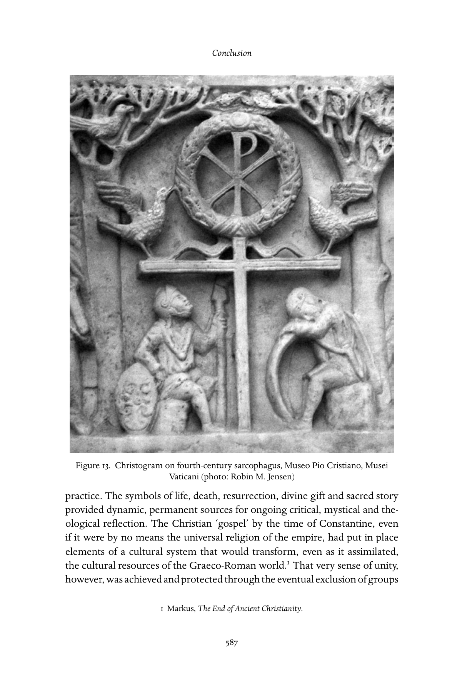

# 结语：回顾与展望

《剑桥基督教史》第一卷《起源至君士坦丁》中文译稿

> 原书第586–589页，PDF第635–638页。正文及5条脚注完整翻译。图13保留原图并附中文图注。
>
> [结语英文原文](<结语（英文）.md>) · [原书PDF](<../01 起源至君士坦丁.pdf>)

<!-- 原书第586–588页；PDF第635–637页 -->

凯撒利亚的优西比乌可以不断修订《教会史》，更新结尾，借此纳入后来的事件；我们却必须为第一卷作出明确的收束。和优西比乌一样，我们以君士坦丁为界；不过，凭借历史的后见之明，我们知道，在他之后还有一段漫长而曲折的基督教故事。我们乐于将那一度难以想象、尚待展开的历史，留给后面八卷去勾勒、分析：欧洲、拉丁美洲、非洲、中国，中世纪西方、拜占庭东方，文艺复兴、宗教改革、现代性，乃至后现代性。然而，就为基督宗教提供充分历史叙述这一工作而言，本卷把我们带到了哪里？我们能否从橡实中，看出橡树主干与众多枝条的轮廓？历代基督教会在讲述自己的历史时，或声称与“基督教起源”保持有机延续，或力求彻底回归一种被认为遭到背弃的起源。然而，自始至终，创造力，以及适应各种文化经验的过程，都与保守本能相互竞争。因此，人们完全可能追问：古代基督教真能被看作后来历史的真正基础吗？

到本卷所述时期结束时，一系列起初颇为模糊、未定型的可能性，已经形成大体连贯的形态；在这个意义上，或许可以作肯定回答。本卷各篇文章记述了：在最初三个世纪的不同地方，基督徒如何建立种种结构与话语形式，把早期传教群体转变为遍布地中海盆地及其以外地区、能够代代相传的宗教运动。他们发展出文本、仪式、生活方式、制度、律法、教育与社会化形式，以及各种历史性自我理解；这些从此构成这一运动的标志。虽然语言、神学与仪式实践的细节各不相同，对耶稣这一人物的敬奉——尽管理解方式不同——始终是早期各种崇拜形态的中心。生命、死亡、复活、神圣恩赐与神圣故事的象征，为持续的批判性、神秘性和神学反思，提供了长久而富有活力的源泉。到君士坦丁时代，基督教“福音”虽远非帝国普遍信奉的宗教，却已确立一种文化体系的要素；这个体系在吸收希腊—罗马世界文化资源的同时，也将改变这些资源。[^1] 不过，这种统一感本身，是通过最终排除诺斯替派、摩尼教徒等群体才获得并维系的。教会与帝国的强大联盟将进一步强化这一过程，并越来越多地界定何谓正统。

*图13　四世纪石棺上的基督字母组合。藏于梵蒂冈博物馆庇护基督教博物馆（Museo Pio Cristiano, Musei Vaticani）。摄影：Robin M. Jensen。原书第587页。*

古代基督教确实留给所有后继者的，是一组张力或问题；在此后的千余年间，它们将不断占据每一代耶稣追随者的心思。

**统一与多样。** 最早时期表明：虽然拿撒勒的耶稣提供了一个凝聚点——对他的理解本身却多种多样！——基督徒自一开始，就不断试探多样与一致、接纳与排斥的界限。旧有模式把最早时期看作必然走向一种获承认“正统”的演化过程；如今，研究则日益注意那些自认为是“基督徒”的各色人物，他们表达信仰，以及在仪式和伦理中实践信仰的方式，都很不相同。这些群体并非各行其道，大多相互交涉，展开辩论和争执。最早的基督教既产生了保罗《哥林多前书》[^2]和居普良De unitate ecclesiae（《论教会的统一》）那样雄辩的合一呼吁，也在实践中一再违背这种和谐愿景。这样的统一，以什么条件为可接受？多样性的界限何在？这些问题过去从未、未来也永远不会远离人们的视野。

**界定与未定。** 从一开始，基督徒就从事解释工作：这位耶稣是谁？他与以色列上帝的应许有何关系？不同的宗教知识形式相互竞争：一方面是古老神圣文本中传承下来的“智慧”，另一方面是当代神圣奥秘启示所带来的“新”经验。“要试验诸灵”的训令（《约翰一书》4:1），要求这两种认识、谈论上帝的方式相交汇，也概括了基督教作为群体宗教而非仅为个人宗教的一项充满张力的任务：在各种关于宗教真理的主张之间作出判断。这些主张不可能全都正确，却也并非全能清楚证实或否定。正如阿维丽尔·卡梅伦有力指出的，早在起初，方向就已经确定：“基督教将成为一个关乎表达与解释的问题。”[^3] 不过，基督教宗教诗学的典型形式，是力求同时维持两极张力的悖论：上帝的超越与内在，已经获得救赎的确信与对未来盼望的需要，乃至宗教语言本身在表达真理时的充分与不充分。

<!-- 原书第589页；PDF第638页 -->

**教会与世界。** 我们所认识的早期基督教话语，既关乎此世，也关乎超越此世。使徒保罗说“这世界的样子将要过去”，同时却建立教会，谈论“立下根基”（《哥林多前书》7:31；3:10–11）。有人认为，是君士坦丁“出卖”教会，把一个反主流文化的教会变为获得政治特权的既成体制。[^4] 然而，基督徒与社会秩序的关系，从一开始就复杂得多，而且彼此影响。此后仍将如此：有人离开城市，逃往沙漠；[^5] 有人则在城市中找到适合基督徒生活与使命的家园。活在此世与盼望来世之间的张力，在每一时代的基督徒身上重新体现，总受当时政治处境和事件影响；一些关键人物又会重新激发这种张力。例如，当末世热情似乎消退时，孟他努派这样的人，会为自己的时代重新点燃它。对这种立场的反应总是褒贬不一：有人称赞他们是真正忠信者，也有人指斥他们是极端异端。

**开始与终结、旧与新。** 最早的基督徒努力为自己的信仰辩护，宣称它既极其古老，植根于以色列先知，也是在近世出现、具有宇宙意义的神圣启示新事。基督徒的自我身份，既根植于从犹太人那里承接的经书，当时如此，此后也始终将在与犹太人、犹太教的关系中得到界定。虽然其中的界线不断改变，令人悲痛的是，古代护教论战中谩骂攻击的方式，却在迥异的历史时代一再重演。在古代及以后，自我界定的工作始终涉及对起源的建构，以及声称自己对起源具有独一或特殊的忠诚。从这个意义上说，本卷与后续各卷的关系是可变的。我们力求在这里提供复杂的分析框架，是综合学术研究，对古代事件和发展作出的重建。然而，在基督教历史中，各时各地的基督徒群体，都已在文本与生活中书写这段叙事。古代基督教提供了原材料：彼得与保罗，耶路撒冷与罗马，亚历山大里亚与安提阿，殉道者与修士，主教与先知。未来每一代人，都将以多种方式，在自我画像的马赛克中重新安排、重新塑造这些材料。

## 注释

[^1]: Markus, The End of Ancient Christianity.

[^2]: 或后来保罗学派作者所写的《以弗所书》。

[^3]: Cameron, Christianity and the rhetoric of empire, 13–14.

[^4]: Crossan, Jesus: a revolutionary biography, 201：“如今是否该在宗教与神学、伦理与道德方面，对君士坦丁作一些基本的成本核算？还是已经太晚？”

[^5]: Brown, Body and society.
