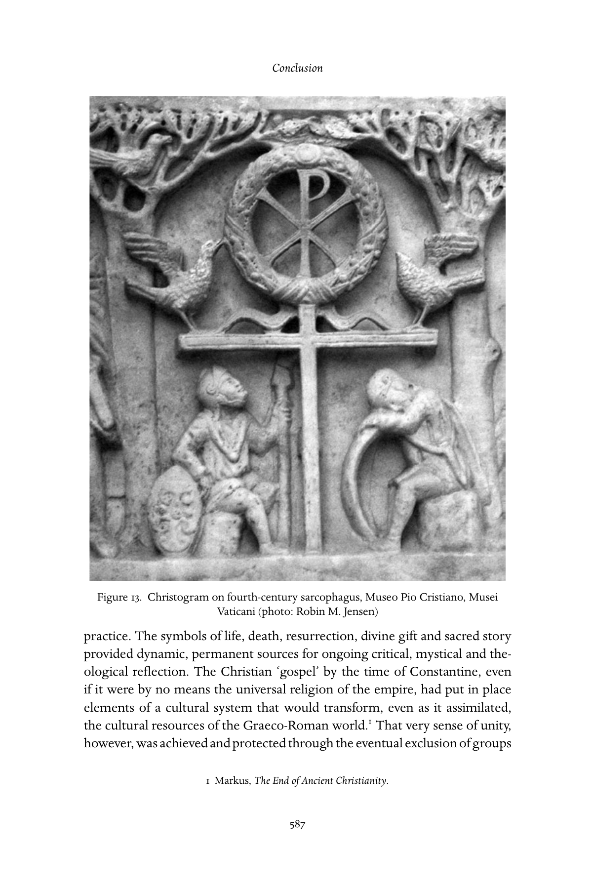

<!-- PDF page 635; original page 586 -->

## Conclusion: retrospect and prospect

While Eusebius of Caesarea could account for subsequent events by issuing new editions with updated endings to his Historia ecclesiastica, we must bring this first volume to a definitive close. Like Eusebius, we take Constantine as our line in the sand, but, with the gift of historical perspective, we know that there is a long and convoluted story of Christianity reaching beyond him. We can happily leave it to the next eight volumes to sketch and analyse that once unimaginable history – in Europe, Latin America, Africa, China, in the medieval west, the Byzantine east, in Renaissance and reformation, modernity and even post-modernity – that is yet to come. But where does this volume leave us in the project of rendering an adequate historiographic account of the Christian religion? Is it possible to trace in the acorn the lineaments of the oak tree, with its main trunk and many branches? In telling their history, Christian churches through the ages have either claimed organic continuity with ‘Christian origins’ or sought a radical return to origins they feel have been betrayed. Yet all along, both creativity and a process of adaptation to varieties of cultural experience have vied with conservative instincts, such that one might well ask: can ancient Christianity really be regarded as the true foundation for subsequent history?

To the extent that, by the end of our period, a roughly coherent shape has emerged from a rather amorphous range of initial possibilities, it is perhaps possible to respond in the affirmative. The essays in this volume have documented how, in various locations over the first three centuries, Christians set in place the structures and forms of discourse that transformed the early missionary groups into a religious movement that spread throughout the Mediterranean basin and beyond it, one capable of transmission from one generation to the next. They developed texts, rituals, lifestyles, institutions, laws, forms of education and socialisation, and various modes of historical self-understanding which were to mark the movement from there forward. Devotion to the figure of Jesus, seen in diverse ways, was central to all versions of the early cult, despite diversity in language, theology and specifics of ritual

<!-- PDF page 636; original page 587 -->
Figure 13. Christogram on fourth-century sarcophagus, Museo Pio Cristiano, Musei Vaticani (photo: Robin M. Jensen)

practice. The symbols of life, death, resurrection, divine gift and sacred story provided dynamic, permanent sources for ongoing critical, mystical and theological reflection. The Christian ‘gospel’ by the time of Constantine, even if it were by no means the universal religion of the empire, had put in place elements of a cultural system that would transform, even as it assimilated, the cultural resources of the Graeco-Roman world.[^p635-1] That very sense of unity, however, was achieved and protected through the eventual exclusion of groups

[^p635-1]: Markus, The End of Ancient Christianity.

<!-- PDF page 637; original page 588 -->
such as the Gnostics and Manichaeans, a process that would be reinforced by the powerful alliance of church and empire which would increasingly define orthodoxy.

What ancient Christianity surely bequeathed to all its descendants was a set of tensions or problematics that would preoccupy each generation of followers of Jesus for the next millennia.

Unity and diversity. The earliest period demonstrates that, while there is a cohering point in Jesus of Nazareth (variously understood!), Christians were continually from the earliest period testing the limits of diversity and conformity, inclusion and exclusion. Older models that regarded the earliest period as an inexorable evolution towards a recognised ‘orthodoxy’ have given way to an increasing attention to the range of persons who thought of themselves as ‘Christian’, while articulating that faith and acting it out in ritual and ethics in quite different fashions. These different groups did not just go their own way, but were mostly mutually engaged, debating and disputing. Earliest Christianity produced such eloquent calls for unity as Paul’s 1 Corinthians[^p635-2] and Cyprian’s De unitate ecclesiae (‘The unity of the church’) while also defying that harmonious vision in practice time and again. What are the acceptable conditions of this unity? What are the limits on diversity? These questions were and would never be far from view.

Definition and indeterminacy. From the very beginning Christians engaged in tasks of interpretation – who was this Jesus, and how did he relate to the promises of the God of Israel? Forms of religious knowledge – received ‘wisdom’ known in ancient sacred texts and contemporary revelations of divine mysteries as ‘new’ experience – competed with one another. The injunction to ‘Test the spirits’ (1 John 4:1) calls for an intersection of these two modes of knowing and talking about God, and sums up the tensive task of Christianity as a communal (not merely individual) religion: to adjudicate between various proposals about religious truth, not all of which can be right, but not all of which are subject to clear verification or invalidation. As Averil Cameron has cogently observed, from early on the die was cast that ‘Christianity was to be a matter of articulation and interpretation.’[^p635-3] Yet the characteristic form of Christian religious poetics was the paradox that sought to hold in tension such poles as God’s transcendence and immanence, the assurance of past

[^p635-2]: Or the later Paulinist’s Ephesians.

[^p635-3]: Cameron, Christianity and the rhetoric of empire, 13–14.

<!-- PDF page 638; original page 589 -->
redemption and need for future hope, and even the adequacy and inadequacy of religious language itself to express truth.

Church and world. Early Christian discourse as we have come to know it is both worldly and other-worldly. The apostle Paul said ‘the form of this world is passing away’ even as he founded churches and spoke of ‘laying a foundation’ (1 Cor 7:31; 3:10–11). While some think it was Constantine who ‘sold out’ and transformed a counter-cultural church into an enfranchised political establishment,[^p635-4] the relationship between Christians and the social order was from the start much more complex and mutually influencing. It was to remain so, with some figures fleeing the city for the desert,[^p635-5] and others finding in the city the proper home for Christian life and vocation. The tension between living in this world and hoping for the next is reincarnated by Christians in each age, always impacted by the current political situation and events, and triggered by key figures, like the Montanists, who rekindle apocalyptic fervour for their times when it seems to have faded. This view is unfailingly greeted by a mixed response: some applaud them as the true faithful, others as extremist heretics.

Beginnings and endings, old and new. The earliest Christians sought to defend their faith as simultaneously very ancient, rooted in the prophets of Israel, and a novelty of cosmic divine revelation in recent times. Christian self-identity, rooted as it was in scriptures appropriated from the Jews, was then and always thereafter would be defined in relation to Jews and Judaism; though the parameters have continually changed, tragically the ancient mode of apologetic invective has been continually re-enacted in quite different historical epochs. The project of self-definition, in antiquity and beyond, has always involved the construction of beginnings, and a claim of unique or special fidelity to them. In that sense the present volume stands in a malleable relationship to the ones which follow. The complex analytical framework we have sought to provide here is an aggregate scholarly reconstruction of ancient events and developments. But, in the history of Christianity, this narrative has been written – in texts and in lives – in Christian communities in every time and place. Ancient Christianity provides the raw materials – Peter and Paul, Jerusalem and Rome, Alexandria and Antioch, martyrs and monks, bishops and prophets – that will be reconfigured and recast in the mosaic self-portraits of each generation to come in manifold ways.

[^p635-4]: Crossan, Jesus: a revolutionary biography, 201: ‘Is it time now, or is it already too late, to conduct, religiously and theologically, ethically and morally, some basic cost accounting with Constantine?’

[^p635-5]: Brown, Body and society.

