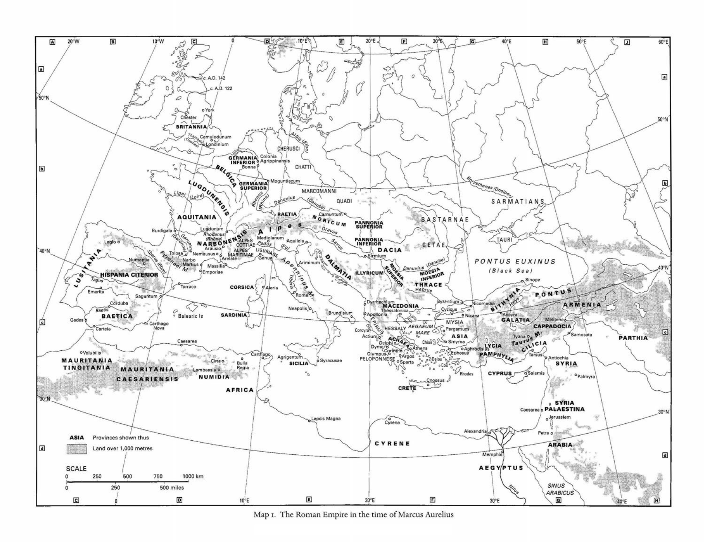
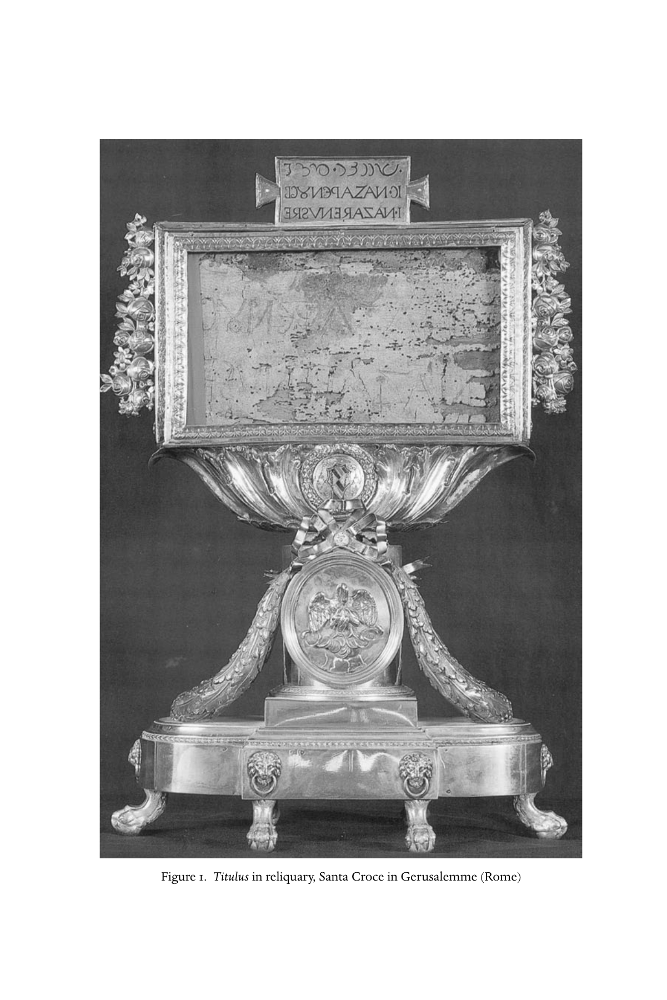

# 原始及二手文献缩写表与卷首地图

> 原书第xxv–xlviii页，PDF第26–49页。缩写及对应文献题名、作者名、出版资料依约保留原文，以便与脚注检索相互对应；分类标题、解释文字及圣经卷名译为中文。原书等宽栏序保留。

## 通用缩写

| 缩写 | 含义／文献 |
|---|---|
| ET | 英文译本 |
| LXX | 《七十士译本》 |
| NRSV | 《圣经·新修订标准版》：The Bible, New Revised Standard Version，Bruce M. Metzger等编（New York: Oxford University Press, 1990） |
| NTApoc | New Testament Apocrypha，2卷，W. Schneemelcher、R. McL. Wilson编，修订版（Cambridge: James Clarke & Co. Ltd.; Louisville, KY: Westminster John Knox Press, 1991–2） |
| NHL | Nag Hammadi Library in English，J. M. Robinson编，第4修订版（Leiden: Brill, 1996） |

## 原始文献

### 圣经各卷

#### 旧约

| 原书缩写 | 中文卷名 |
|---|---|
| Gen | 创世记 |
| Exod | 出埃及记 |
| Lev | 利未记 |
| Num | 民数记 |
| Deut | 申命记 |
| Josh | 约书亚记 |
| Judg | 士师记 |
| Ruth | 路得记 |
| 1–2 Sam | 撒母耳记上下 |
| 1–2 Kgs | 列王纪上下 |
| Nah | 那鸿书 |
| Hab | 哈巴谷书 |
| 1–2 Chr | 历代志上下 |
| Ezra | 以斯拉记 |
| Neh | 尼希米记 |
| Esth | 以斯帖记 |
| Job | 约伯记 |
| Ps | 诗篇 |
| Prov | 箴言 |
| Eccl | 传道书 |
| Song | 雅歌 |
| Isa | 以赛亚书 |
| Zeph | 西番雅书 |
| Hag | 哈该书 |
| Jer | 耶利米书 |
| Lam | 耶利米哀歌 |
| Ezek | 以西结书 |
| Dan | 但以理书 |
| Hos | 何西阿书 |
| Joel | 约珥书 |
| Amos | 阿摩司书 |
| Obad | 俄巴底亚书 |
| Jon | 约拿书 |
| Mic | 弥迦书 |
| Zech | 撒迦利亚书 |
| Mal | 玛拉基书 |

#### 本书引用的七十士译本／次经

| 原书缩写 | 中文卷名 |
|---|---|
| 1–4 Macc | 马加比一至四书 |
| Sir | 便西拉智训 |
| Wis | 所罗门智训 |

#### 新约

| 原书缩写 | 中文卷名 |
|---|---|
| Matt | 马太福音 |
| Mark | 马可福音 |
| Luke | 路加福音 |
| John | 约翰福音 |
| Acts | 使徒行传 |
| Rom | 罗马书 |
| 1–2 Cor | 哥林多前后书 |
| Gal | 加拉太书 |
| Eph | 以弗所书 |
| Phil | 腓立比书 |
| Col | 歌罗西书 |
| 1–2 Thess | 帖撒罗尼迦前后书 |
| 1–2 Tim | 提摩太前后书 |
| Tit | 提多书 |
| Phlm | 腓利门书 |
| Heb | 希伯来书 |
| Jas | 雅各书 |
| 1–2 Pet | 彼得前后书 |
| 1–3 John | 约翰一、二、三书 |
| Jude | 犹大书 |
| Rev | 启示录 |

### 其他原始文献及二手文献

<!-- 以下原书PDF第27–46页；文献题名保留原文。 -->

```text
    安布罗斯（Ambrose）
Exp. Ps. 118   Explanatio psalmi cxviii
Ob. Theo.        De obitu Theodosii

    外典使徒行传（Apocryphal Acts of the Apostles）
Acts Joh.        Acts of John
Acts Pet.        Acts of Peter
Acts Thom.       Acts of Thomas

    使徒教父（Apostolic fathers）
1 –2 Clem.       1 –2 Clement
Did.             Didache
Ep. Barn.        Epistle of Barnabas
Ep. Diognet.     Epistle to Diognetus
Herm. Mand.      Shepherd of Hermas, Mandates
Herm. Sim.       Shepherd of Hermas, Similitudes
Herm. Vis.       Shepherd of Hermas, Visions
Ign. Eph.        Ignatius, To the Ephesians
Ign. Magn.       Ignatius, To the Magnesians
Ign. Phild.      Ignatius, To the Philadelphians
Ign. Pol.        Ignatius, To Polycarp
Ign. Rom.        Ignatius, To the Romans
Ign. Smyr.       Ignatius, To the Smyrneans
Ign. Trall.      Ignatius, To the Trallians
Poly. Phil.      Polycarp, To the Philippians
```


<a id="pdf-028"></a>
<!-- PDF page 28; original page xxvii -->


```text
    阿普列尤斯（Apuleius (Apul.)）
Fl.           Florida
Met.          Metamorphoses
Pl.           De Platone
    〔阿里斯提亚斯〕（[Aristeas]）
Ep. Arist.    Epistle of Aristeas

    阿里斯提德（Aristides）
Apol.         Apologia

    亚里士多德（Aristotle (Arist.)）
Pol.          Politica

    阿尔诺比乌斯（Arnobius）
Adv. nat.     Adversus nationes
    亚他那修（Athanasius (Ath.)）
Apol. sec.    Apologia (secunda) contra Arianos
Decr.         De decretis Nicaenae synodi
Dion.         De sententia Dionysii
Ep.           Epistulae
Ep. Jov.      Epistula ad Jovianum
H. Ar.        Historia Arianorum ad monachos
Syn.          De synodis
Tom.          Tomus ad Antiochenos
    雅典那哥拉（Athenagoras）
Leg.          Legatio pro Christianis
Res.          De resurrectione mortuorum
    奥古斯丁（Augustine (August.)）
Cresc.        Contra Cresconium Donatistam
De civ. D.    De civitate Dei
Doctr. Chr.   De doctrina Christiana
Retract.      Retractationes
Trin.         De Trinitate
    奥勒留·维克托（Aurelius Victor (Aurel. Vict.)）
Caes.         Liber de Caesaribus
    巴西尔（Basil (Bas.)）
Ep.           Epistulae
```


<a id="pdf-029"></a>
<!-- PDF page 29; original page xxviii -->


```text
    尤利乌斯·恺撒（Julius Caesar (Caes.)）
B. Gall.        Bellum Gallicum
    卡西乌斯·狄奥（Cassius Dio (Cass. Dio)）


    金口约翰（Chrysostom, John (Chrys.)）
Adv. Jud.        Adversus Judaeos
Hom. 1–88 in Jo. Homiliae 1–88 in Johannem
    西塞罗（Cicero (Cic.)）
Acad.           Academicae quaestiones
Clu.            Pro Cluentio
Fin.            De finibus
Har. resp.      De haruspicum responso
N.D.            De natura deorum
Rep.            De republica
    亚历山大里亚的克莱孟（Clement of Alexandria (Clem. Al.)）
Paed.           Paedagogus
Protr.          Protrepticus
q.d.s.          Quis dives salvetur
Str.            Stromateis
    克莱孟文集（Clementina ([Clem.])）
Asc. Jas.        Ascents of James
Ep. Petr.        Epistula Petri ad Jacobum
Hom.             Homiliae
Keryg. Pet.      Kērygmata Petrou
Recogn.          Recognitiones
    君士坦丁（Constantine (Const.)）
Or. s.c.        Oratio ad sanctorum coetum
    居普良（Cyprian (Cypr.)）
Ep.              Epistulae
Hab. virg.       De habitu virginum
Laps.            De lapsis
Unit. eccl.      De catholicae ecclesiae unitate
    耶路撒冷的区利罗（Cyril of Jerusalem (Cyr. H.)）
Catech. 1–18    Catecheses illuminandorum
Catech. 19–23   Catecheses mystagogicae
Ep. Const.      Epistula ad Constantium de visione crucis
```


<a id="pdf-030"></a>
<!-- PDF page 30; original page xxix -->


```text
    死海古卷及相关文本（Dead Sea scrolls and related texts）
1QHa            Hodayota or Thanksgiving hymnsa
1QS             Rule of the community
1Qsa            Rule of the congregation (appendix a to 1QS)
1QM             War scroll
CD              Cairo Geniza copy of the Damascus document
4QShirShaba     Songs of the sabbath sacrificea
4QDibHama       Dibre hame’orota or Words of the luminariesa
11QPsa          Psalm scrolla

    西西里的狄奥多罗斯（Diodorus Siculus (Diod. Sic.)）


    第欧根尼·拉尔修（Diogenes Laertius (Diog. Laert.)）


    埃皮法尼乌斯（Epiphanius (Epiph.)）
Mens.           De mensuris et ponderibus
Pan.            Panarion seu Adversus lxxx haereses

    优西比乌（Eusebius (Euseb.)）
Chron.          Chronicon
D.E.            Demonstratio evangelica
E.Th.           De ecclesiastica theologia
Ep. Caes.       Epistula ad Caesarienses
HE              Historia ecclesiastica
L.C.            Laus Constantini
Marcell.        Contra Marcellum
Mart. Pal.      De martyribus Palestinae
Onomast.        Onomasticon
P.E.            Praeparatio evangelica
V.C.            De vita Constantini

    基齐库斯的格拉修（Gelasius of Cyzicus (Gel.)）
HE              Historia ecclesiastica

    纳齐安祖的格列高利（Gregory of Nazianzus (Gr. Naz.)）
Or.             Orationes

    尼撒的格列高利（Gregory of Nyssa (Gr. Nyss.)）
V. Gr. Thaum.   De vita Gregorii Thaumaturgi
```


<a id="pdf-031"></a>
<!-- PDF page 31; original page xxx -->


```text
    行神迹者格列高利（Gregory Thaumaturgus (Gr. Thaum.)）
Ep. can.            Epistula canonica

    希罗多德（Herodotus (Hdt.)）
Hist.               Historiae

    普瓦捷的希拉里（Hilary of Poitiers (Hil. Poit.)）
Ad. Val. et Ur.     adversus Valentem et Ursacium

    希波吕托斯（Hippolytus (Hipp.)）
Antichr.            Demonstratio de Christo et antichristo
Ben. Is. Iac.       De benedictionibus Isaaci et Jacobi
Dan.                Commentarium in Danielem
Fr. 1 –81 in Gen.   Fragmenta in Genesim
Haer.               Refutatio omnium haeresium
Noët.              Contra Noëtum
Trad. ap.           Traditio apostolica

    爱任纽（Irenaeus (Iren.)）
Epid.               Epideixis tou apostolikou kērygmatos
Frag. Syr.          Fragments in Syriac
Haer.               Adversus haereses

    耶柔米（Jerome）
Comm. Am.           Commentariorum in Amos
Comm. Ezech.        Commentariorum in Ezechielem
Comm. Gal.          Commentariorum in Epistulam ad Galatas
Comm. Habac.        Commentariorum in Habacuc
Comm. Isa.          Commentariorum in Isaiam
Comm. Jer.          Commentariorum in Jeremiam
Comm. Mt.           Commentariorum in Matthaeum
Ep.                 Epistulae
Onom.               Onomasticon
Vir. ill.           De viris illustribus

    约瑟夫斯（Josephus）
AJ                  Antiquitates Judaicae
Ap.                 Contra Apionem
BJ                  Bellum Judaicum
Vit.                Vita
```


<a id="pdf-032"></a>
<!-- PDF page 32; original page xxxi -->


```text
    游斯丁（Justin）
1 Apol.         1 Apologia
2 Apol.         2 Apologia
Dial.           Dialogus cum Tryphone Judaeo

    尤维纳利斯（Juvenal ( Juv.)）
Sat.            Satires

    拉克坦提乌斯（Lactantius (Lactant.)）
Div. inst.      Divinae institutiones
Mort.           De morte persecutorum

    琉善（Lucian (Luc.)）
Alex.            Alexander (Pseudomantis)
De mort. Peregr. De morte Peregrini
Men.             Menippus (Necyomantia)

    殉道文献（Martyrologies）
Musurillo        H. Musurillo (ed. and trans.), Acts of the Christian martyrs, OECT
                 (1972)
M. Crisp.        Martyrium Crispinae
M. Cypr.         Martyrium Cypriani
M. Iust.         Martyrium Iustini et septem sodalium
M. Mar.          Martyrium Mariani et Iacobi
M. Mont.         Martyrium Montani et Lucii
M. Perp.         Martyrium Perpetuae et Felicitatis
M. Pion.         Martyrium Pionii
M. Polyc.        Martyrium Polycarpi
M. Saturn.       Martyrium Saturnini, Dativi et aliorum plurimorum
M. Scil.         Martyrum Scillitanorum acta

    推罗的马克西穆斯（Maximus of Tyre (Max. Tyr.)）
    撒狄的梅利托（Melito of Sardis (Mel.)）
Fr.              Fragmenta
Pass.            Homilia in passionem Christi ( = Peri pascha)

    奥林波斯的美多迪乌斯（Methodius of Olympus (Meth.)）
Res.             De resurrectione mortuorum
Symp.            Symposium
```


<a id="pdf-033"></a>
<!-- PDF page 33; original page xxxii -->


```text
    米努基乌斯·费利克斯（Minucius Felix (Min. Fel.)）
Oct.               Octavius

    拿戈玛第册页本（Nag Hammadi Codices）
拿戈玛第册页本（NHC）的引法：先列册号（I），再列篇号（1）。
NHC                 Nag Hammadi Codices
NHL                 Nag Hammadi library in English, J. M. Robinson (ed.), 4th rev. ed.
                            (Leiden: Brill, 1996)
BG                  Berlin Codex
CG                  Cairensis Gnosticus
Pr. Paul            i, 1 Prayer of the apostle Paul
Treat. res.         i, 4 Treatise on the resurrection
Tri. trac.          i, 5 Tripartite tractate
Ap. John            ii, 1 Apocryphon of John
Gos. Thom.          ii, 2 Gospel of Thomas
Gos. Phil.          ii, 3 Gospel of Philip
Hyp. Arch.          ii, 4 Hypostasis of the Archons
Thom. cont.         ii, 7 Book of Thomas the contender
Eugnostos           iii, 3 Eugnostos the blessed
Dial. sav.          iii, 5 Dialogue of the saviour
Gos. Eg.            iv, 2 Gospel of the Egyptians
Eugnostos           v, 1 Eugnostos the blessed
1 Apoc. Jas.        v, 3 (First) Apocalypse of James
2 Apoc. Jas.        v, 4 (Second) Apocalypse of James
Apoc. Adam          v, 5 The Apocalypse of Adam
Acts Pet. 12 apos. vi, 1 Acts of Peter and the twelve apostles
Thund.              vi, 2 Thunder: perfect mind
Disc. 8–9           vi, 6 Discourse on the eighth and ninth
Pr. thanks.         vi, 7 Prayer of thanksgiving
Asclepius           vi, 8 Asclepius 21 –29
Paraph. Shem        vii, 1 Paraphrase of Shem
Steles Seth         vii, 5 Three steles of Seth
Zost.               viii, 1 Zostrianos
Ep. Pet. Phil.      viii, 2 Letter of Peter to Philip
Melch.              ix, 1 Melchizedek
Norea               ix, 2 Thought of Norea
Marsanes            x, 1 Marsanes
Interp. know.       xi, 1 Interpretation of knowledge
Val. exp.           xi, 2 A Valentinian exposition
Allogenes           xi, 3 Allogenes (foreigner)
Hypsiph.            xi, 4 Hypsiphrone
Trim. Prot.         xii, 1 Trimorphic protennoia
Act Pet.            BG, 4 Act of Peter
```


<a id="pdf-034"></a>
<!-- PDF page 34; original page xxxiii -->


```text
    新约外典与伪经（New Testament Apocrypha and Pseudepigrapha）
NTApoc        New Testament Apocrypha, 2 vols., W. Schneemelcher and R. McL.
              Wilson (eds.), rev. ed. (Cambridge: James Clarke & Co. Ltd.;
              Louisville, KY: Westminster John Knox Press, 1991–2).
Gos. Eb.      Gospel of the Ebionites
Gos. Heb.     Gospel of the Hebrews
Gos. Naass.   Gospel of the Naassenes
Gos. Naz.     Gospel of the Nazareans

    诺瓦提安（Novatian）
Trin.               De Trinitate

    旧约伪经（Old Testament Pseudepigrapha）
APOT          The Apocrypha and pseudepigrapha of the Old Testament, 2 vols., R. H.
              Charles (ed.) (Oxford: Clarendon Press, 1913)
OTP           The Old Testament pseudepigrapha, 2 vols., J. H. Charlesworth (ed.)
              (Garden City, NY: Doubleday, 1983–5).
1 –4 Bar.     1 –4 Baruch
Odes Sol.     Odes of Solomon

    米勒维斯的奥普塔图斯（Optatus of Milevis (Opt.)）
Donat.        De schismate Donatistarum

    西卜神谕（Oracula Sibyllina (Orac. Sib.)）
    奥利金（Origen (Or.)）
C. Cels.      Contra Celsum
Comm. Heb.    Commentarii in epistulam ad Hebraeos
Comm. Jo.     Commentarii in evangelium Joannis
Comm. Matt.   In Matthaeum commentariorum series
Dial.         Dialogus cum Heraclide
Hom. Ezech.   Homiliae in Ezechielem
Hom. Gen.     Homiliae in Genesim
Hom. Jer.     Homiliae in Jeremiam
Hom. Luc.     Homiliae in Lucam
Hom. Num.     Homiliae in Numeros
Or.           De oratione
Princ.        De principiis
Sel. Lev.     Selecta in Leviticum

    奥罗修斯（Orosius (Oros.)）
Hist.         Historiae adversum paganos
```


<a id="pdf-035"></a>
<!-- PDF page 35; original page xxxiv -->


```text
    奥维德（Ovid (Ov.)）
Am.           Amores

    帕拉迪乌斯（Palladius (Pall.)）
H. Laus.      Historia Lausiaca

    潘斐卢斯（Pamphilus (Pamph.)）
Ap. Or.       Apologia pro Origene

    拉丁颂辞集（Panegyrici Latini (Pan. Lat.)）
    纸草文献（Papyri）
P. Amh.       Amherst papyri
P. Köln      Kölner papyri
P. Oxy.       Oxyrhynchus papyri
P. Ryl.       John Rylands papyri

    保萨尼亚斯（Pausanias (Paus.)）
    斐洛（Philo）
Contempl.     De vita contemplativa
Decal.        De decalogo
Flacc.        In Flaccum
Legat.        Legatio ad Gaium
Migr.         De migratione Abrahami
Opif.         De opificio mundi
Prov.         De providentia
Quaest. Ex.   Quaestiones et solutiones in Exodum
Spec.         De specialibus legibus
Virt.         De virtutibus

    菲洛斯托尔吉乌斯（Philostorgius (Philost.)）
HE            Historia ecclesiastica

    菲洛斯特拉托斯（Philostratus (Philostr.)）
VA            Vita Apollonii

    柏拉图（Plato (Pl.)）
Epin.         Epinomis
Lg.           Leges
Prt.          Protagoras
Res.          Respublica
Ti.           Timaeus
```


<a id="pdf-036"></a>
<!-- PDF page 36; original page xxxv -->


```text
    老普林尼（Pliny (the Elder) (Plin.)）
HN                 Naturalis historia

    小普林尼（Pliny (the Younger) (Plin.)）
Ep.                Epistulae
Pan.               Panegyricus

    普罗提诺（Plotinus (Plot.)）
Enn.               Enneades

    普鲁塔克（Plutarch (Plut.)）
Adol. poet. aud.   Quomodo adolescens poetas audire debeat
Cam.               Camillus
Def. orac.         De defectu oraculorum
De Is. et Os.      De Iside et Osiride
Lib. ed.           De liberis educandis
Princ. inerud.     Ad principem ineruditum
Quaest. conv.      Quaestiones convivales
Superst.           De superstitione

    波利比乌斯（Polybius (Polyb.)）
Hist.              Historiae

    波菲利（Porphyry (Porph.)）
Christ.            Contra Christianos
De antr. nymph.    De antro nympharum
Vit. Plot.         Vita Plotini

    托勒密（Ptolemaeus）
Flor.              Epistula ad Floram

    拉比文献（Rabbinic Works）
篇名前加‘y.’表示《耶路撒冷塔木德》（Yerushalmi），加‘b.’表示《巴比伦塔木德》
（Bavli）；加‘t.’表示《托塞夫塔》，加‘m.’表示《米示拿》，加‘bar.’表示一则
巴拉伊塔（baraita）。
‘Abod. Zar.        Avodah Zarah
‘Abot              Avot
Ber.               Berakhot
Git.               Gittin
H.ul.              Hullin
Sanh.              Sanhedrin
```


<a id="pdf-037"></a>
<!-- PDF page 37; original page xxxvi -->


```text
Sukk.          Sukkah
Ta‘an.         Ta‘anit
Yad.           Yadayim
Midr. Teh.     Midrash Tehillim
Pesiq. Rab.    Pesiqta Rabbati

    鲁菲努斯（Rufinus (Ruf.)）
HE             Historia ecclesiastica

    塞涅卡（Seneca）
Ep.            Epistulae morales

    苏格拉底·斯科拉斯提库斯（Socrates Scholasticus (Socr.)）
HE             Historia ecclesiastica

    索佐门（Sozomen (Soz.)）
HE             Historia ecclesiastica

    斯巴尔提安努斯（Spartian）
Sept. Sever.   Vita Septimii Severi

    斯特拉波（Strabo）
Geog.          Geographica

    苏埃托尼乌斯（Suetonius (Suet.)）
Claud.         Divus Claudius
Dom.           Domitianus
Jul.           Divus Julius
Nero           Nero
Tit.           Divus Titus

    塔西佗（Tacitus (Tac.)）
Agr.           Agricola
Ann.           Annales
Hist.          Historiae

    塔提安（Tatian (Tat.)）
Orat.          Oratio ad Graecos

    德尔图良（Tertullian (Tert.)）
Ad ux.         Ad uxorem
```


<a id="pdf-038"></a>
<!-- PDF page 38; original page xxxvii -->


```text
Adv. Jud.    Adversus Judaeos
An.          De anima
Apol.        Apologeticus
Bapt.        De baptismo
Carn. Chr.   De carne Christi
Cor.         De corona militis
Cult. fem.   De cultu feminarum
Exh. cast.   De exhortatione castitatis
Herm.        Adversus Hermogenem
Idol.        De idololatria
Marc.        Adversus Marcionem
Mart.        Ad martyras
Mon.         De monogamia
Nat.         Ad nationes
Or.          De oratione
Paen.        De paenitentia
Praescr.     De praescriptione haereticorum
Prax.        Adversus Praxean
Pud.         De pudicitia
Res.         De resurrectione carnis
Scap.        Ad Scapulam
Scorp.       Scorpiace
Spect.       De spectaculis
Val.         Adversus Valentinianos
Virg.        De virginibus velandis

    狄奥多雷（Theodoret (Thdt.)）
HE           Historia ecclesiastica

    安提阿的提奥菲鲁斯（Theophilus of Antioch (Thph. Ant.)）
Autol.       Ad Autolycum

    瓦伦廷（Valentinus (Val.)）
Gos. truth   The gospel of truth

    维吉尔（Vergil (Verg.)）
Aen.         Aeneid

    色诺芬（Xenophon (Xen.)）
Mem.         Memorabilia

    佐西穆斯（Zosimus (Zos.)）
Hist.        Historia nova
```


<a id="pdf-039"></a>
<!-- PDF page 39; original page xxxviii -->


```text
    二手文献（Secondary Sources）
    工具书与丛书（Reference works and series）
AAR Academy series   American Academy of Religion Academy series (New
                     York: Oxford University Press)
AB                   Anchor Bible (Garden City, NY: Doubleday)
ABD                  Anchor Bible dictionary, 6 vols., D. N. Freedman (ed.) (New
                     York: Doubleday, 1992)
ACW                  Ancient Christian writers (New York: Newman Press)
AGJU                 Arbeiten zur Geschichte des antiken Judentums und des
                     Urchristentums (Leiden: Brill)
AKG                  Arbeiten zur Kirchengeschichte (Berlin: De Gruyter)
AnBib                Analecta Biblica (Rome: Pontifical Biblical Institute)
ANF                  Ante-Nicene Fathers (Grand Rapids, MI: Eerdmans)
Ant.                 Antiquitas (Bonn: R. Habelt)
ANRW                 Aufstieg und Niedergang der römischen Welt (Berlin: De
                     Gruyter)
ANTF                 Arbeiten zur neutestamentlichen Textforschung (Berlin:
                     De Gruyter)
ATD                  Acta theologica Danica (Copenhagen: Munksgaard;
                     Leiden: Brill)
AzBiG                Arbeiten zur Bibel und ihrer Geschichte (Leipzig:
                     Evangelische Verlagsanstalt)
BAC                  Biblioteca de autores cristianos (Madrid: Biblioteca de
                     autores cristianos)
BBET                 Beiträge zur biblischen Exegese und Theologie (Bern:
                     Peter Lang)
BCTH                 Bulletin archéologique du Comité des travaux historiques et
                     scientifiques (Paris: Editions du CTHS)
BDR                  Blass, F., A. Debrunner and F. Rehkopf, Grammatik des
                     neutestamentlichen Griechisch, 14th ed. (Göttingen:
                     Vandenhoeck & Ruprecht, 1976)
BETL                 Bibliotheca ephemeridum theologicarum lovaniensium
                     (Leuven: Peeters)
BFCT                 Beiträge zur Förderung christlicher Theologie (Gütersloh:
                     Bertelsmann)
BHT                  Beiträge zur historischen Theologie (Tübingen: Mohr
                     Siebeck)
BibS(F)              Biblische Studien (Freiburg: Herder, 1895–)
BibS(N)              Biblische Studien (Neukirchen-Vluyn: Neukirchener
                     Verlag, 1951–)
BIS                  Biblical interpretation series (Leiden: Brill)
BJS                  Brown Judaic studies (Providence, RI: Brown University)
BSRel                Biblioteca di scienze religiose (Rome: LAS)
```


<a id="pdf-040"></a>
<!-- PDF page 40; original page xxxix -->


```text
BZNW     Beihefte zur Zeitschrift für die neutestamentliche Wissenschaft und
         die Kunde der älteren Kirche (Berlin: De Gruyter)
CAH1     Cambridge Ancient History, 12 vols. (Cambridge: Cambridge University
         Press, 1923–39)
CAH2     Cambridge Ancient History, 2nd ed., 14 vols. (Cambridge: Cambridge
         University Press, 1970–2001)
CBET     Contributions to Biblical exegesis and theology (Leuven: Peeters)
CBQMS    Catholic Biblical quarterly monograph series (Washington, DC: The
         Catholic Biblical Association of America)
CCSA     Corpus Christianorum: series Apocryphorum (Turnhout: Brepols,
         1983–)
CCSG     Corpus Christianorum: series Graeca (Turnhout: Brepols, 1977–)
CCSL     Corpus Christianorum: series Latina (Turnhout: Brepols, 1953–)
CII      Corpus inscriptionum Iudaicarum, 2 vols., J. B. Frey (ed.) (Rome:
         Pontificio istituto di archeologia cristiana, 1936–52).
CIL      Corpus inscriptionum Latinarum (Berlin: Akademie der Wissenschaften,
         1862–).
CJA      Christianity and Judaism in antiquity (Notre Dame, IN: University of
         Notre Dame Press)
ConBNT   Coniectanea Biblica: New Testament series (Stockholm: Almqvist &
         Wiksell International)
ConBOT   Coniectanea Biblica: Old Testament series (Stockholm: Almqvist &
         Wiksell International)
CPJ      Corpus papyrorum Judaicarum, 3 vols., V. Tcherikover and A. Fuks (eds.)
         (Cambridge, MA: Harvard University Press, 1957–64).
CPL3     Clavis patrum Latinorum, 3rd ed., E. Dekkers and E. Gaar (eds.), CCSL
         (1995)
CRINT    Compendia rerum Iudaicarum ad Novum Testamentum (Assen: van
         Gorcum and Minneapolis: Fortress Press)
CSCT     Columbia studies in the Classical tradition (Leiden: Brill)
CSCO     Corpus scriptorum Christianorum orientalium (Louvain:
         Peeters)
CSEL     Corpus scriptorum ecclesiasticorum Latinorum (Vienna:
         Hoelder-Pichler-Tempsky)
DACL     Dictionnaire d’archéologie chrétienne et de liturgie,15 vols., F. Cabrol (ed.)
         (Paris: Letouzey et Ané, 1907–53)
DJD      Discoveries in the Judean desert (Oxford: Clarendon Press)
DMAHA    Dutch monographs on ancient history and archaeology (Amsterdam:
         J. C. Gieben)
EBib     Études bibliques (Paris: J. Gabalda)
EECh     Encyclopedia of the early church, 2 vols., A. di Berardino (ed.), A. Walford
         (trans.) (New York: Oxford University Press, 1992)
EKKNT    Evangelisch-katholischer Kommentar zum Neuen Testament
         (Düsseldorf: Benziger Verlag; Neukirchen-Vluyn: Neukirchener
         Verlag)
```


<a id="pdf-041"></a>
<!-- PDF page 41; original page xl -->


```text
EPRO                       Études préliminaires aux religions orientales dans
                           l’empire romain (Leiden: Brill)
ER                         The encyclopedia of religion, 16 vols., M. Eliade (ed.) (New
                           York: Macmillan, 1987)
FC                         Fathers of the church (Washington, DC: Catholic
                           University of America Press)
FGrH                       Die Fragmente der griechischen Historiker, 3 vols., F. Jacoby
                           (ed.) (Leiden: Brill, 1954–64)
FKDG                       Forschungen zur Kirchen- und Dogmengeschichte
                           (Göttingen: Vandenhoeck & Ruprecht)
Foerster, Gnosis           Gnosis: a selection of Gnostic texts, 2 vols., W. Foerster
                           (ed.), R. McL. Wilson (trans.) (Oxford: Clarendon Press,
                           1972–4).
FRLANT                     Forschungen zur Religion und Literatur des Alten und
                           Neuen Testaments (Göttingen: Vandenhoeck &
                           Ruprecht)
GCS                        Die griechische christliche Schriftsteller der ersten drei
                           Jahrhunderte (Berlin: Akademie Verlag)
GNS                        Good news studies (Collegeville, MN: Liturgical
                           Press)
Goodspeed, Die ältesten   Die ältesten Apologeten: Texte mit kurzen
Apologeten                 Einleitungen, E. J. Goodspeed (ed.) (Göttingen:
                           Vandenhoeck & Ruprecht, 1984, original 1914)
GTA                        Göttinger theologische Arbeiten (Göttingen:
                           Vandenhoeck & Ruprecht)
HBS                        Herders biblische Studien (Freiburg: Herder)
HDR                        Harvard dissertations in religion (Minneapolis: Fortress
                           Press)
HNTC                       Harper’s New Testament commentaries (San
                           Francisco: Harper & Row)
HO                         Handbuch der Orientalistik (Leiden: Brill)
HTS                        Harvard theological studies (Cambridge, MA: Harvard
                           University Press)
HUT                        Hermeneutische Untersuchungen zur Theologie
                           (Tübingen: Mohr Siebeck)
ICC                        International critical commentary on the holy
                           scriptures of the Old and New Testaments (Edinburgh:
                           T. & T. Clark)
IG                         Inscriptiones Graecae, 14 vols. (Berlin: de Gruyter, 1913–)
IGUR                       Inscriptiones Graecae urbis Romae, L. Moretti (ed.), Studi
                           pubblicati dall’ istituto italiano per la storia antica 17
                           (Rome, 1968–)
ILCV                       Inscriptiones Latinae Christianae veteres, 3 vols. E. Diehl, J.
                           Moreau and H. I. Marrou (eds.), 4th ed. (Berlin:
                           Weidemann, 1925–85)
```


<a id="pdf-042"></a>
<!-- PDF page 42; original page xli -->


```text
ILS                  Inscriptiones Latinae selectae, Hermann Dessau (ed.), 3rd ed., 3
                     vols. (Berlin: Weidmann, 1962)
JDS                  Judean Desert studies ( Jerusalem: Israel Exploration Society)
JRASup               Journal of Roman archaeology, supplementary series
                     (Portsmouth, RI: Journal of Roman Archaeology)
JRSM                 Journal of Roman studies monographs (London: Society for
                     the Promotion of Roman Studies)
JSNTSup              Journal for the study of the New Testament: supplement
                     series (Sheffield: Sheffield Academic Press)
JSOTSup              Journal for the study of the Old Testament: supplement series
                     (Sheffield: Sheffield Academic Press)
JSPSup               Journal for the study of the Pseudepigrapha: supplement
                     series (Sheffield: Sheffield Academic Press)
JSS Sup              Journal of Semitic studies supplement (Oxford: Oxford
                     University Press)
KAV                  Kommentar zu den apostolischen Vätern (Göttingen:
                     Vandenhoeck & Ruprecht)
KEK                  Ergänzungsreihe zum kritisch-exegetischen Kommentar über
                     das Neue Testament (Göttingen: Vandenhoeck &
                     Ruprecht)
Der kleine Pauly     Der kleine Pauly: Lexikon der Antike, 5 vols., H. Gärtner, W.
                     Sontheimer, K. Ziegler and A. F. von Pauly (eds.) (Munich:
                     Druckenmüller, 1964–75)
LCC                  Library of Christian Classics (Grand Rapids, MI: Christian
                     classics Ethereal Library)
LCL                  Loeb Classical library (Cambridge, MA: Harvard University
                     Press)
LEC                  Library of early Christianity (Philadelphia: Westminster)
MAMA                 Monumenta Asiae Minoris antiqua, 10 vols., C. W. M. Cox, A.
                     Cameron, J. Cullen and B. Levick (eds.), JRMS (1928–1993).
MBPF                 Münchener Beiträge zur Papyrusforschung und antiken
                     Rechtsgeschichte (Munich: C.H. Beck)
MBT                  Münsterische Beiträge zur Theologie (Münster: Aschendorff )
MDOP                 Monograph, Dakhleh Oasis project (Oxford: Oxbow Books)
Mnemos. Sup.         Mnemosyne, bibliotheca classica Batava, Supplementum:
                     history and archaeology of Classical antiquity (Leiden: Brill)
Musurillo            Musurillo, Herbert (ed.), Acts of the Christian martyrs:
                     introduction, texts, and translations, OECT (1972)
Nestle-Aland NTG27   Novum Testamentum Graecae, 27th rev. ed., E. E. Nestle, B.
                     Aland and K. Aland (eds.) (Stuttgart: Deutsche Bibelstiftung,
                     1993, 1979)
Der neue Pauly       Der neue Pauly: Enzyklopädie der Antike, 15 vols., H. Cancik, H.
                     Schneider and A. F. von Pauly (eds.) (Stuttgart: Metzler,
                     1996–)
```


<a id="pdf-043"></a>
<!-- PDF page 43; original page xlii -->


```text
NewDocs           New documents illustrating early Christianity, 9 vols., G. H. R. Horsley
                  and S. Llewelyn (eds.) (North Ryde, NSW: Ancient History
                  Documentary Research Centre, Macquarie University, 1981)
NHMS              Nag Hammadi and Manichaean studies (Leiden: Brill)
NHS               Nag Hammadi studies (Leiden: Brill)
NICNT             New international commentary on the New Testament (Grand
                  Rapids, MI: Eerdmans)
NovTSup           Novum Testamentum supplements (Leiden: Brill)
NPNF1             Nicene and post-Nicene fathers, series 1 (Grand Rapids, MI: Eerdmans)
NPNF2             Nicene and post-Nicene fathers, series 2 (Peabody, MA: Hendrickson)
NTAbh             Neutestamentliche Abhandlungen (Münster: Aschendorff )
NTOA              Novum Testamentum et orbis antiquus (Freiburg, Switzerland:
                  Universitätsverlag)
OCD3              The Oxford Classical dictionary, 3rd ed., S. Hornblower and A.
                  Spawforth (eds.) (Oxford: Oxford University Press, 1996)
OCT               Oxford Classical texts (Oxford: Oxford University Press)
OECS              Oxford early Christian studies (Oxford: Oxford University Press)
OECT              Oxford early Christian texts (Oxford: Oxford University Press)
OGIS              Orientis Graeci inscriptiones selectae, 2 vols., W. Dittenberger (ed.)
                  (repr. Hildesheim: Olms, 1970)
OrChrAn           Orientalia Christiana analecta (Rome: Pontificio Istituto Orientale)
OTM               Oxford theological monographs (Oxford: Oxford University Press)
PatrMS            Patristic monograph series (Macon, GA: Mercer University Press)
P. Coll. Youtie   Collectanea papyrologica: texts published in honor of H. C. Youtie, 2 vols.,
                  A. E. Hanson (ed.) (Bonn: Habelt, 1976)
PG                Patrologia Graeca, 162 vols. [ = Patrologiae cursus completus: series
                  Graeca], J.-P. Migne (ed.) (Paris, 1844–64)
PHC               Pelican history of the church (New York: Penguin Books)
PL                Patrologia Latina, 221 vols. [ = Patrologiae cursus completus: series
                  Latina], J.-P. Migne (ed.) (Paris, 1857–66)
PO                Patrologia orientalis (Turnhout: Brepols)
PTS               Patristische Texte und Studien (Berlin: De Gruyter)
PW                Paulys Realencyclopädie der classischen Altertumswissenschaft, 70 vols.,
                  A. F. Pauly, G. Wissowa and G. Krolls (eds.) (Stuttgart: Metzler,
                  1894–1972)
RA                Revealing antiquity (Cambridge, MA: Harvard University Press)
RAC               Reallexikon für Antike und Christentum: Sachwörterbuch zur
                  Auseinandersetzung des Christentums mit der antiken Welt (Stuttgart:
                  Hiersemann, 1950–)
RFCC              Religion in the first Christian centuries (London: Routledge)
RGG3              Religion in Geschichte und Gegenwart, 3rd ed., K. Galling (ed.)
                  (Tübingen: Mohr Siebeck, 1957–65)
RGG4              Religion in Geschichte und Gegenwart, 4th ed., H. D. Betz, et al. (eds.)
                  (Tübingen: Mohr Siebeck, 1998–)
RGRW              Religions in the Graeco-Roman world (Leiden: Brill)
```


<a id="pdf-044"></a>
<!-- PDF page 44; original page xliii -->


```text
RVV       Religionsgeschichtliche Versuche und Vorarbeiten (Berlin: De Gruyter)
SAC       Studies in antiquity and Christianity (Philadelphia, PA: Fortress;
          Harrisburg, PA: Trinity Press International)
SBB       Stuttgarter biblische Beiträge (Stuttgart: Katholisches Bibelwerk)
SBLDS     Society of Biblical Literature dissertation series (Atlanta: Society of
          Biblical Literature)
SBLMS     Society of Biblical Literature monograph series (Atlanta: Society of
          Biblical Literature)
SBLRBS    Society of Biblical Literature resources for Biblical study (Atlanta:
          Scholars Press)
SBLSBS    Society of Biblical Literature sources for Biblical study (Atlanta:
          Scholars Press)
SBLSymS   Society of Biblical Literature symposium series (Atlanta: Scholars Press)
SBLTT     Society of Biblical Literature texts and translations (Atlanta: Scholars
          Press)
SBS       Stuttgarter Bibelstudien (Stuttgart: Katholisches Bibelwerk)
SC        Sources chrétiennes (Paris: Éditions du Cerf )
SCH       Studies in church history (Woodbridge, Suffolk: Ecclesiastical History
          Society/Boydell Press)
SD        Studies and documents (London: Christophers)
SEAug     Studia ephemeridis Augustinianum (Rome: Institutum Patristicum
          Augustinianum)
SEG       Supplementum epigraphicum Graecum, J. Hondius, H. W. Pleket, R. S.
          Stroud, et al. (eds.) (Amsterdam: J. C. Gieben, 1923–)
SHR       Studies in the history of religions (Leiden: Brill)
SIG       Sylloge inscriptionum Graecarum, 4 vols., 3rd ed., W. Dittenberger (ed.)
          (repr. Hildesheim: Olms, 1960).
SJLA      Studies in Judaism in late antiquity (Leiden: Brill)
SNTSMS    Society for New Testament Studies monograph series (Cambridge:
          Cambridge University Press)
SSEJC     Studies in early Judaism and Christianity (Sheffield: Sheffield Academic
          Press)
StEv      Studia evangelica (Berlin: De Gruyter)
StPB      Studia post-Biblica ( Jerusalem: Magnes Press)
SVF       Stoicorum veterum fragmenta, 4 vols., H. von Arnim (ed.) (Leipzig:
          Teubner, 1903–24)
TANZ      Texte und Arbeiten zum neutestamentlichen Zeitalter (Tübingen:
          Francke)
TBA       Tübinger Beiträge zur Altertumswissenschaft (Stuttgart: Kohlhammer)
TCH       Transformation of the Classical heritage (Berkeley: University of
          California Press)
TCL       Translations of Christian literature (London: SPCK; Atlanta: Scholars
          Press)
Teubner   Bibliotheca scriptorum Graecorum et Romanorum Teubneriana
          (Leipzig: Teubner)
```


<a id="pdf-045"></a>
<!-- PDF page 45; original page xliv -->


```text
ThH        Théologie historique (Paris: Beauchesne)
TNTC       Tyndale New Testament commentaries (Leicester: Inter-Varsity Press)
TRE        Theologische Realenzyklopädie, G. Krause and G. Müller (eds.) (Berlin: De
           Gruyter, 1976–)
TS         Texts and studies (Cambridge: Cambridge University Press)
TSAJ       Texte und Studien zum antiken Judentum (Tübingen: Mohr Siebeck)
TTH        Translated texts for historians (Liverpool: Liverpool University Press)
TU         Texte und Untersuchungen zur Geschichte der altchristlichen Literatur
           (Berlin: De Gruyter)
VCSup      Supplements to Vigiliae Christianae (Leiden: Brill)
WBC        Word Biblical commentary (Nashville: Nelson)
WMANT      Wissenschaftliche Monographien zum Alten und Neuen Testament
           (Neukirchen-Vluyn: Neukirchener Verlag)
WUNT       Wissenschaftliche Untersuchungen zum Neuen Testament (Tübingen:
           Mohr Siebeck)

    期刊（Periodicals）
ABR          Australian biblical review
AJA          American journal of archaeology
AJAH         American journal of ancient history
AJT          American journal of theology
AmAnth       American anthropologist
AnBoll       Analecta bollandiana
AnSt         Anatolian studies
AThR         Anglican theological review
BA           Biblical archaeologist
BASOR        Bulletin of the American Schools of Oriental Research
Bib          Biblica
BibInt       Biblical interpretation
BTB          Biblical theology bulletin
BZ           Biblische Zeitschrift
CBQ          Catholic biblical quarterly
CH           Church history
CTJ          Calvin theological journal
ExpT         Expository times
GRBS         Greek, Roman and Byzantine studies
HeyJ         Heythrop journal
Historia     Historia: Zeitschrift für alte Geschichte/Revue d’histoire ancienne/Rivista di
             storia antica/Revista de historia antigua/Ancient history bulletin
HTR          Harvard theological review
HUCA         Hebrew Union College annual
IEJ          Israel exploration journal
INJ          Israel numismatic journal
JAAR         Journal of the American Academy of Religion
JAC          Jahrbuch für Antike und Christentum
```


<a id="pdf-046"></a>
<!-- PDF page 46; original page xlv -->


```text
JBL          Journal of biblical literature
JEA          Journal of Egyptian archaeology
JECS         Journal of early Christian studies
JEH          Journal of ecclesiastical history
JJS          Journal of Jewish studies
JQR          Jewish quarterly review
JR           Journal of religion
JRA          Journal of Roman archaeology
JRS          Journal of Roman studies
JSJ          Journal for the study of Judaism in the Persian, Hellenistic and Roman
             periods
JSNT         Journal for the Study of the New Testament
JTS          Journal of theological studies
KD           Kerygma und Dogma
MTZ          Münchener theologische Zeitschrift
NKZ          Neue kirchliche Zeitschrift
Nouv. Clio   La nouvelle Clio: revue mensuelle de la découverte historique
NovT         Novum Testamentum
NTS          New Testament studies
OrChr        Oriens christianus
OrChrAn      Orientalia christiana analecta
RB           Revue biblique
RSR          Recherches de science religieuse
SCI          Scripta classica Israelica
SCO          Studi classici e orientali
SecCent      Second century
SJT          Scottish journal of theology
SPhilo       Studia philonica
ST           Studia theologica
StPatr       Studia patristica
SVTQ         St Vladimir’s theological quarterly
ThLZ         Theologische Literaturzeitung
ThSt         Theologische Studien
TS           Theological Studies
VC           Vigiliae Christianae
VF           Verkündigung und Forschung
VL           Vetus Latina: die Reste der altlateinischen Bibel, 26 vols., E. Beuron,
             B. Fischer, H. J. Frede, P. Sabatier, W. Thiele et al. (eds.) (Freiburg:
             Herder, 1949–).
VT           Vetus Testamentum
ZAC/JAC      Zeitschrift für antikes Christentum/Journal of ancient Christianity
ZKG          Zeitschrift für Kirchengeschichte
ZTK          Zeitschrift für Theologie
ZNW          Zeitschrift für die neutestamentliche Wissenschaft und die Kunde der älteren
             Kirche
```


## 卷首地图与图1

<!-- PDF第47页为空白；地图1位于第48页。 -->

[原PDF第47页空白页影像](<assets/pdf-047.png>)。



*地图1　马尔库斯·奥勒留时代的罗马帝国。原书第xlvi–xlvii页位置。图例：ASIA式粗体字标示行省；阴影表示海拔1,000米以上地区；比例尺分别以千米、英里计。图内地名保留原图。*



*图1　圣物匣中的十字架题牌（titulus），罗马耶路撒冷圣十字大殿。原书第xlviii页。*
