# 剑桥基督教史 第七卷：启蒙、复兴与革命：1660—1815

编者：斯图尔特·J.布朗、蒂莫西·塔克特

原书2006年出版。全卷中文校订稿已完成，包含卷首资料、致谢、导论、大事年表、五编、29章、脚注、参考书目与索引。全文译校状态见校核记录。原书页码与PDF页码均保留，便于对照。

全卷译文一致性校订、重点复核与阅读版PDF校核已完成；本稿尚未经专业精校。

[阅读版PDF](<../output/pdf/07 启蒙、复兴与革命（中文校订版）.pdf>) · [全卷校核记录](<全卷校核记录.json>)

> 译文范围说明：第十四章原PDF第289—290页的一段露骨小说引文，改为明确标记的不露骨转述，保留其自然哲学词汇与论证作用；其余正文、原书注释及资料按原文译出。

- [卷首资料](#pdf-001)
- [致谢](#pdf-015)
- [导论](#pdf-016)
- [第一编 欧洲世界的教会、国家与社会：1660—1780](#pdf-028)
- [欧洲大陆的天主教](#pdf-030)
- [欧洲大陆的新教](#pdf-048)
- [大不列颠与爱尔兰](#pdf-069)
- [经济与社会中的教会](#pdf-087)
- [第二编 欧洲世界的基督徒生活：1660—1780](#pdf-102)
- [欧洲的天主教教士](#pdf-104)
- [欧洲世界的新教教士群体](#pdf-124)
- [面向听众：欧洲的讲道与演说](#pdf-143)
- [基督教教育](#pdf-162)
- [基督教与性别](#pdf-181)
- [民众宗教](#pdf-200)
- [犹太教与基督教的关系](#pdf-223)
- [建筑与基督教](#pdf-241)
- [第三编 运动与挑战](#pdf-264)
- [基督教与科学的兴起：1660—1815](#pdf-266)
- [启蒙运动对基督教的批判](#pdf-280)
- [基督教启蒙运动](#pdf-298)
- [詹森主义与耶稣会在各国遭到取缔](#pdf-317)
- [北大西洋世界的福音复兴](#pdf-344)
- [宗教宽容与基督徒再合一运动：1660—1789](#pdf-363)
- [第四编 非欧洲世界的基督教发展](#pdf-386)
- [伊比利亚美洲的基督教](#pdf-388)
- [1765年以前的英属、法属北美](#pdf-407)
- [非洲的基督教](#pdf-426)
- [南亚与东南亚的基督教](#pdf-448)
- [东亚的基督教](#pdf-466)
- [基督教与其他世界宗教的相遇](#pdf-490)
- [第五编 革命与基督教世界](#pdf-510)
- [美国革命与宗教：1765—1815](#pdf-512)
- [基督教与反对奴隶制、奴隶贸易的运动](#pdf-532)
- [1794年以前的法国革命与宗教](#pdf-551)
- [法国革命与宗教：1795—1815](#pdf-571)
- [革命时代欧洲的基督教复兴运动：1790—1815](#pdf-590)
- [大事年表](#pdf-611)
- [参考书目](#pdf-618)
- [索引](#pdf-667)

---

# 卷首资料

<!-- PDF page 1; original page unnumbered -->

## 原书封面

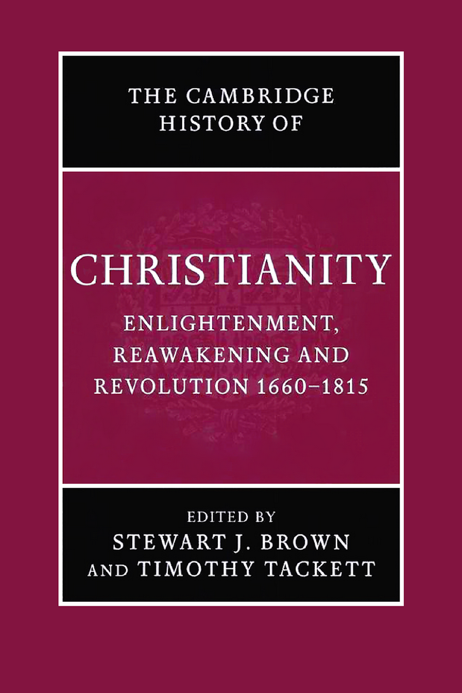

《剑桥基督教史》第七卷：**启蒙、复兴与革命：1660—1815**。斯图尔特·J.布朗、蒂莫西·塔克特主编。

<!-- PDF page 2; original page unnumbered -->

## 本卷简介

在1660至1815年这段动荡的世界历史时期，三个复杂的运动交织在一起，使欧洲和北美发生了根本的文化转向，并最终影响了更广阔的世界。启蒙运动改变了人们对于自然、以及人类掌握自然的能力的看法。宗教复兴运动使一种发自内心、注重亲身体验的基督教信仰重新焕发生机。最后，十八世纪末、十九世纪初的政治与社会剧变，即革命，对君权神授的君主制和被认为出于神意的社会等级秩序提出了挑战，推动了更民主的政府、人权观念和宗教宽容的发展。一种新的宗教氛围由此形成：人们越来越倾向于从自身的感受和经验中寻找信仰的根据。在同一时期，基督教也随着殖民活动和传教而广泛传播到世界各地，并以多种方式回应它与其他文化及宗教传统的相遇。

**斯图尔特·J.布朗（Stewart J. Brown）**为爱丁堡大学教会史教授。著作包括 *William Robertson and the Expansion of Empire*（1997）和 *The National Churches of England, Ireland and Scotland 1801–1846*（2001）。

**蒂莫西·塔克特（Timothy Tackett）**为加利福尼亚大学尔湾分校历史学教授。著作包括 *Priest and Parish in Eighteenth-century France*（1977）和 *Religion, Revolution, and Regional Culture*（1986）。

<!-- PDF page 3; original page unnumbered -->

## 丛书说明

《剑桥基督教史》按时间顺序，全面叙述基督教从起源至今在各方面的发展，包括神学、思想、社会、政治、区域和全球层面。每一卷都独立地为相应时期的学术研究作出重要贡献；全套丛书则构成一部大型学术参考著作。本书旨在提供全球视野，其内容远不局限于西欧基督教及其向外的延伸。从早期开始，东方基督教和科普特基督教就受到充分关注；在较晚的历史时期，非洲、远东、新大陆、南亚及其他非欧洲地区的基督教发展也得到适当的篇幅。各卷讨论民众虔敬以及基督教信仰的非正式表现形式，并把基督徒的培育、礼拜与灵修放在广阔的文化背景中，考察其社会学层面。基督教同其他主要宗教之间的关系，也始终贯穿全书。这套丛书将为学者和学生提供极有价值的资料。

### 分卷目录

| 卷次与题名 | 主编 |
| --- | --- |
| 第一卷　从起源到君士坦丁 | 玛格丽特·M.米切尔、弗朗西丝·M.扬 |
| 第二卷　从君士坦丁到约600年 | 奥古斯丁·卡西代、弗雷德里克·W.诺里斯 |
| 第三卷　中世纪早期基督教：约600—约1100 | 托马斯·诺布尔、朱莉娅·史密斯 |
| 第四卷　西欧基督教：约1100—约1500 | 米里·鲁宾、沃尔特·西蒙斯 |
| 第五卷　东方基督教 | 迈克尔·安戈尔德 |
| 第六卷　改革与扩张：1500—1660 | 夏伯嘉 |
| 第七卷　启蒙、复兴与革命：1660—1815 | 斯图尔特·J.布朗、蒂莫西·塔克特 |
| 第八卷　世界基督教：约1815—1914 | 布赖恩·斯坦利、谢里登·吉利 |
| 第九卷　世界基督教：约1914—约2000 | 休·麦克劳德 |

<!-- PDF page 4; original page unnumbered -->

## 书名页

**剑桥基督教史**

**第七卷**

**启蒙、复兴与革命：1660—1815**

主编：**斯图尔特·J.布朗、蒂莫西·塔克特**

原文题名：*The Cambridge History of Christianity, Volume VII: Enlightenment, Reawakening and Revolution 1660–1815*。

<!-- PDF page 5; original page unnumbered -->

## 原书出版与版权资料

剑桥大学出版社

剑桥、纽约、墨尔本、马德里、开普敦、新加坡、圣保罗

Cambridge University Press, The Edinburgh Building, Cambridge CB2 2RU, UK

美国版由剑桥大学出版社纽约分社出版。

出版社网站：www.cambridge.org

本书资料页：www.cambridge.org/9780521816052

© 剑桥大学出版社，2006年。

本出版物受版权保护。除法律规定的例外以及有关集体许可协议所允许的情形外，未经剑桥大学出版社书面许可，不得复制本书的任何部分。

2006年首次出版。

英国印制，承印者：剑桥大学印刷厂。

英国图书馆备有本书的编目记录。

ISBN-13：978-0-521-81605-2，精装本。

ISBN-10：0-521-81605-X，精装本。

剑桥大学出版社不对本书所引用的外部或第三方网站网址的持续有效性及准确性承担责任，也不保证这些网站的任何内容现在或今后仍然准确、适当。

<!-- PDF page 6; original page v -->

## 原书目录

以下数字均为英文原书的印刷页码。

| 篇目 | 作者 | 原页码 |
| --- | --- | --- |
| 插图与地图目录 |  | ix |
| 撰稿人名单 |  | x |
| 致谢 |  | xiv |
| 导论 | 斯图尔特·J.布朗、蒂莫西·塔克特 | 1 |

### 第一编　欧洲世界的教会、国家与社会：1660—1780

| 章次与题名 | 作者 | 原页码 |
| --- | --- | --- |
| 1　欧洲大陆的天主教 | 奈杰尔·阿斯顿 | 15 |
| 2　欧洲大陆的新教 | 哈特穆特·莱曼 | 33 |
| 3　大不列颠与爱尔兰 | J.C.D.克拉克 | 54 |
| 4　经济与社会中的教会 | 菲利普·T.霍夫曼 | 72 |

<!-- PDF page 7; original page vi -->

### 第二编　欧洲世界的基督徒生活：1660—1780

| 章次与题名 | 作者 | 原页码 |
| --- | --- | --- |
| 5　欧洲的天主教教士 | 马里奥·罗萨 | 89 |
| 6　欧洲世界的新教教士群体 | 安德鲁·R.霍姆斯 | 109 |
| 7　面向听众：欧洲的讲道与演说 | 约里斯·范艾纳滕 | 128 |
| 8　基督教教育 | 多米尼克·朱利亚 | 147 |
| 9　基督教与性别 | 梅里·威斯纳—汉克斯 | 166 |
| 10　民众宗教 | 威廉·弗赖霍夫 | 185 |
| 11　犹太教与基督教的关系 | 弗朗西丝·马利诺 | 208 |
| 12　建筑与基督教 | 让—米歇尔·勒尼奥 | 226 |

### 第三编　运动与挑战

| 章次与题名 | 作者 | 原页码 |
| --- | --- | --- |
| 13　基督教与科学的兴起：1660—1815 | 路易·沙特利耶 | 251 |
| 14　启蒙运动对基督教的批判 | 玛格丽特·C.雅各布 | 265 |

<!-- PDF page 8; original page vii -->

| 章次与题名 | 作者 | 原页码 |
| --- | --- | --- |
| 15　基督教启蒙运动 | 海伦娜·罗森布拉特 | 283 |
| 16　詹森主义与耶稣会在各国遭到取缔 | 戴尔·K.范克雷 | 302 |
| 17　北大西洋世界的福音复兴 | W.R.沃德 | 329 |
| 18　宗教宽容与基督徒再合一运动：1660—1789 | 詹姆斯·E.布拉德利 | 348 |

### 第四编　非欧洲世界的基督教发展

| 章次与题名 | 作者 | 原页码 |
| --- | --- | --- |
| 19　伊比利亚美洲的基督教 | 詹姆斯·D.赖利 | 373 |
| 20　1765年以前的英属、法属北美 | 马克·A.诺尔 | 392 |
| 21　非洲的基督教 | 拉明·萨内 | 411 |
| 22　南亚与东南亚的基督教 | 查尔斯·J.博尔热斯 | 433 |
| 23　东亚的基督教 | 狄德满 | 451 |
| 24　基督教与其他世界宗教的相遇 | 安德鲁·C.罗斯 | 475 |

<!-- PDF page 9; original page viii -->

### 第五编　革命与基督教世界

| 章次与题名 | 作者 | 原页码 |
| --- | --- | --- |
| 25　美国革命与宗教：1765—1815 | 马丁·E.马蒂 | 497 |
| 26　基督教与反对奴隶制、奴隶贸易的运动 | 克里斯托弗·莱斯利·布朗 | 517 |
| 27　1794年以前的法国革命与宗教 | 蒂莫西·塔克特 | 536 |
| 28　法国革命与宗教：1795—1815 | 苏珊娜·德桑 | 556 |
| 29　革命时代欧洲的基督教复兴运动：1790—1815 | 斯图尔特·J.布朗 | 575 |
| 大事年表 |  | 596 |
| 参考书目 |  | 603 |
| 索引 |  | 652 |

<!-- PDF page 10; original page ix -->

## 插图与地图目录

### 插图

| 图号与说明 | 原页码 |
| --- | --- |
| 1　罗马圣彼得大教堂：正立面 | 229 |
| 2　伦敦圣保罗大教堂：正立面 | 231 |
| 3　巴黎圣宠谷教堂 | 233 |
| 4　巴黎荣军院教堂：内部 | 234 |
| 5　瑞士艾因西德伦本笃会修道院：内部 | 237 |
| 6　智利帕里纳科塔教堂 | 388 |
| 7　非洲西南部基督教刚果王国的苦像 | 413 |
| 8　约1700年印度果阿制作的“圣母子”象牙雕像 | 438 |
| 9　“作为日本殉道者主保的圣母玛利亚”：绢画 | 469 |

### 地图

| 图号与说明 | 原页码 |
| --- | --- |
| 1　约1700年的欧洲宗派分布图 | 2 |
| 2　1660年的中欧 | 34 |
| 3　约1800年的印度传教区 | 434 |
| 4　约1696年的中国 | 460 |

<!-- PDF page 11; original page x -->

## 撰稿人

**奈杰尔·阿斯顿（Nigel Aston）**为莱斯特大学欧洲近代早期史副教授（Reader）。著作包括 *Religion and revolution in France* 和 *Christianity and revolutionary Europe c.1750–1830*。

**查尔斯·J.博尔热斯神父（Charles J. Borges，耶稣会）**于1981至2000年在果阿沙勿略历史研究中心工作，曾任中心主任六年。本书撰写时，他为马里兰州洛约拉学院历史学助理教授。著有 *The economics of the Goa Jesuits 1542–1759: An explanation of their rise and fall*，并主编了八卷印度—葡萄牙史著作。

**詹姆斯·E.布拉德利（James E. Bradley）**为加利福尼亚州帕萨迪纳富勒神学院杰弗里·W.布罗米利教会史讲席教授。著作包括 *Religion, revolution, and English radicalism: Non-conformity in eighteenth-century politics and society*，以及与戴尔·K.范克雷合编的 *Religion and politics in Enlightenment Europe*。

**克里斯托弗·莱斯利·布朗（Christopher Leslie Brown）**为罗格斯大学历史学副教授。著作包括 *Moral capital: Foundations of British abolitionism*，以及与菲利普·摩根合编的 *Arming slaves: Classical times to the modern age*。

**斯图尔特·J.布朗（Stewart J. Brown）**为爱丁堡大学教会史教授。著作包括 *Thomas Chalmers and the godly commonwealth in Scotland* 和 *The national churches of England, Ireland and Scotland 1801–1846*。

**路易·沙特利耶（Louis Châtellier）**为巴黎高等研究实践学院宗教学部研究指导教授。著作包括 *Les espaces infinis et le silence de Dieu: science et religion, XVIe–XIXe siècle*、*The Europe of the devout: The Catholic reformation and the formation of a new society*，以及 *The religion of the poor: Rural missions in Europe and the formation of modern Catholicism, c.1500–c.1800*。

**J.C.D.克拉克（J. C. D. Clark）**为堪萨斯大学霍尔英国史杰出教授。著作包括 *English society 1660–1832: Revolution and Rebellion* 和 *The language of liberty 1660–1832*。

<!-- PDF page 12; original page xi -->

**苏珊娜·德桑（Suzanne Desan）**为威斯康星大学麦迪逊分校历史学教授，著有 *Reclaiming the sacred: Lay religion and popular politics in revolutionary France* 和 *The family on trial in revolutionary France*。

**约里斯·范艾纳滕（Joris van Eijnatten）**任职于阿姆斯特丹自由大学历史系。著作包括 *‘God, Nederland en Oranje’: Dutch Calvinism and the search for the social centre* 和 *Liberty and concord in the United Provinces: Religious toleration and the public in the eighteenth-century Netherlands*。

**威廉·弗赖霍夫（Willem Frijhoff）**为阿姆斯特丹自由大学历史学教授，出版过多部荷兰史、法国史及欧洲史著作，包括 *Embodied belief: Ten essays on religious culture in Dutch history*、*Dutch culture in a European perspective*，以及与罗贝尔·米尚布莱、玛丽—西尔维·迪蓬—布沙合著的 *Prophètes et sorciers dans les Pays-Bas, XVIe–XVIIIe siècle*。

**菲利普·T.霍夫曼（Philip T. Hoffman）**为加州理工学院理查德与芭芭拉·罗森伯格历史与社会科学讲席教授。著作包括 *Church and community in the diocese of Lyon, 1500–1789* 和 *Growth in a traditional society: The French countryside, 1450–1815*。

**安德鲁·R.霍姆斯（Andrew R. Holmes）**为贝尔法斯特女王大学爱尔兰研究所研究员，著有 *The shaping of Ulster Presbyterianism belief and practice 1770–1840: Tradition, reform and revival*，并发表过多篇爱尔兰新教史论文。

**玛格丽特·C.雅各布（Margaret C. Jacob）**为加利福尼亚大学洛杉矶分校历史学教授。著作包括 *The Newtonians and the English Revolution, 1689–1720*、*The Radical Enlightenment: Pantheists, freemasons and republicans*、*The cultural meaning of the scientific revolution* 和 *Living the Enlightenment: Freemasonry and politics in eighteenth-century Europe*。

**多米尼克·朱利亚（Dominique Julia）**为巴黎社会科学高等研究院欧洲宗教人类学研究中心主任，兼任法国国家科学研究中心研究主任。著作包括 *Les trois couleurs du tableau noir: la Révolution*，与罗杰·夏蒂埃、玛丽—马德莱娜·孔佩尔合著的 *L’éducation en France du XVIe au XVIIIe siècle*，以及与菲利普·布特里合著的 *Pèlerins et pèlerinages dans l’Europe moderne*。

**哈特穆特·莱曼（Hartmut Lehmann）**为哥廷根马克斯·普朗克历史研究所所长，兼任哥廷根大学与基尔大学名誉教授。著作包括 *Jansenismus, Quietismus, Pietismus* 和 *Pietismus und weltliche Ordnung in Württemberg. Vom 17. bis zum 20. Jahrhundert*（与海因茨·席林、汉斯—于尔根·施拉德合作）。

**让—米歇尔·勒尼奥（Jean-Michel Leniaud）**为巴黎高等研究实践学院历史与语文学部研究指导教授。著作包括 *L’administration des cultes pendant la période concordataire*、*Viollet-le-Duc, ou, Les délires du système* 和 *Jean-Baptiste Lassus, 1807–1857, ou, Le temps retrouvé des cathédrales*。

<!-- PDF page 13; original page xii -->

**弗朗西丝·马利诺（Frances Malino）**为韦尔斯利学院索菲娅·摩西·罗宾逊犹太研究与历史讲席教授。著作包括 *The Sephardic Jews of Bordeaux: Assimilation and emancipation in revolutionary and Napoleonic France* 和 *A Jew in the French Revolution: The life of Zalkind Hourwitz*。

**马丁·E.马蒂（Martin E. Marty）**为芝加哥大学费尔法克斯·M.科恩现代基督教史荣休杰出服务教授，著有五十余部书，包括 *Religion, awakening and revolution* 和三卷本 *Modern American religion*。

**马克·A.诺尔（Mark A. Noll）**为圣母大学麦卡纳尼历史学讲席教授，著述或主编三十余部书，包括 *A history of Christianity in the United States and Canada* 和 *America’s God: From Jonathan Edwards to Abraham Lincoln*。

**詹姆斯·D.赖利（James D. Riley）**为美国天主教大学历史学副教授。著作包括 *Hacendados Jesuitas en Mexico: La Administracion de los Bines Inmuebles del Colegio Maximo de San Pedro y San Pablo de la Ciudad de Mexico, 1687–1767* 和 *Landholding and provincial society: The Labradores of Tlaxcala, 1640–1730*。

**马里奥·罗萨（Mario Rosa）**为比萨高等师范学校近代史教授。著作包括 *Settecento religioso: politica della ragione e religione del cuore*、*Politica e religione nel ‘700 europeo* 和 *Religione e società nel Mezzogiorno tra Cinque e Seicento*。

**海伦娜·罗森布拉特（Helena Rosenblatt）**为纽约市亨特学院副教授，著有 *Rousseau and Geneva: From the First Discourse to the social contract, 1749–1762*。

**安德鲁·C.罗斯（Andrew C. Ross）**曾任传教史与传教学高级讲师，本书撰写时为爱丁堡大学神学院名誉研究员。著作包括 *A vision betrayed: The Jesuits in Japan and China 1542–1742* 和 *David Livingstone: Mission and empire*。

**拉明·萨内（Lamin Sanneh）**为耶鲁大学D.威利斯·詹姆斯传教学与世界基督教讲席教授。著作包括 *Encountering the West: Christianity and the global cultural process: The African dimension* 和 *Abolitionists abroad: American blacks and the making of modern West Africa*。

**蒂莫西·塔克特（Timothy Tackett）**为加利福尼亚大学尔湾分校历史学教授。宗教史著作包括 *Priest and parish in eighteenth-century France*、*Religion, revolution, and regional culture in eighteenth-century France*，以及与克洛德·朗格卢瓦、米歇尔·伏维尔合编的 *Atlas de la Révolution française* 第九卷 *Religion*。

**狄德满（R. G. Tiedemann）**在本书撰写时为伦敦大学亚非学院历史学讲师，即将前往旧金山大学利玛窦中西文化历史研究所任研究职。他主持编纂并主要撰写了<!-- PDF page 14; original page xiii -->*The handbook of Christianity in China* 第二卷 *1800 to the present*，还发表过多篇东亚基督教研究论文。

**戴尔·K.范克雷（Dale K. Van Kley）**为俄亥俄州立大学历史学教授。他出版的三部主要专著为 *The Jansenists and the expulsion of the Jesuits from France*（1975）、*The Damiens affair and the unraveling of the ancien régime, 1750–1770* 和 *The religious origins of the French Revolution*，并发表了大量有关法国旧制度下政教关系、以及詹森主义对法国文化与政治影响的论文。

**W.R.沃德（W. R. Ward）**为杜伦大学近代史荣休教授。著作包括 *The Protestant Evangelical awakening* 和 *Christianity under the ancien régime 1648–1789*。

**梅里·威斯纳—汉克斯（Merry Wiesner-Hanks）**为威斯康星大学密尔沃基分校历史学教授，著述、主编或合编十余部书，包括 *Christianity and sexuality in the early modern world: Regulating desire, reforming practice* 和 *Gender, church, and state in early modern Germany*。

---

<!-- PDF page 15; original page xiv -->

# 致谢

两位编者衷心感谢剑桥大学出版社的卡塔琳娜·布雷特博士、吉莉恩·达德女士、凯文·泰勒先生及其他工作人员，感谢他们在本卷编纂过程中给予的宝贵支持。加利福尼亚大学尔湾分校的乌尔里克·施特拉瑟、丹尼尔·施罗特和斯蒂芬·托皮克三位教授，在项目初期提供了宝贵建议。同校的迈卡·阿尔波协助我们编制了大事年表。我们还要特别感谢爱丁堡大学神学院的安德鲁·C.罗斯博士，他对涉及非西方世界基督教的各部分给予了建议和帮助；同时感谢爱丁堡大学非西方世界基督教研究中心的玛格丽特·阿克顿女士。最后，感谢各位撰稿人为各章付出的努力，以及他们在编辑过程中表现出的合作精神与愉快态度。

---

<!-- PDF page 16; original page 1 -->

# 导论

**斯图尔特·J.布朗、蒂莫西·塔克特**

每一个历史时代都是转型的时代。不过，显而易见，从十七世纪中叶到十九世纪初，也就是本卷所讨论的时期，基督教世界经历了一系列格外艰难的转变和挑战。到这一时期结束时，思想上与政治上的反对力量已经兴起；它们提出质疑的，不仅像新教宗教改革时期那样，是基督教教义的性质和教会的权威，而且还包括基督教这一宗教本身的真实性。然而，同一时期也出现了许多推动宗教重振与更新的运动，其活力和影响引人瞩目，并在各国国教会内部引发了重大争论。作为这一时期结束标志的革命浪潮，则进一步强化了宗教对抗与宗教更新这两股潮流。

在这里，两位编者将简要指出这部集体研究中浮现的几个主要主题。首先概述近代早期基督教世界的地理格局，随后分别讨论构成本卷三大概念支柱的主题：启蒙、复兴与革命。我们认为，这些主题并不是彼此独立、各自分离的历史线索，而是在整个时代中紧密交织，相互回应，相互作用。

## 近代早期基督教世界的地理格局

十七世纪中叶前后，欧洲刚刚走出基督徒之间长期而残酷的宗教战争。到三十年战争及不列颠群岛内战结束时逐渐定型的宗派地理格局，此后只有少量变化，一直延续到二十世纪。罗马天主教信仰此时已经<!-- PDF page 17; original page 2 -->在欧洲南部和地中海西部的广大地区占据压倒性优势，其中包括葡萄牙、西班牙、法国和意大利半岛；在爱尔兰大部分地区、奥属低地、巴伐利亚、波兰和立陶宛，也同样如此。另一方面，新教各宗派则在欧洲北部和中北部牢牢扎根：从大不列颠和爱尔兰北部，一直延伸到被称为“路德宗之海”的波罗的海地区，包括北德意志大多数邦国、普鲁士、斯堪的纳维亚、芬兰、爱沙尼亚和拉脱维亚。再往南一些，在西里西亚、德意志西南部以及瑞士高原，也能见到稳固的新教据点。

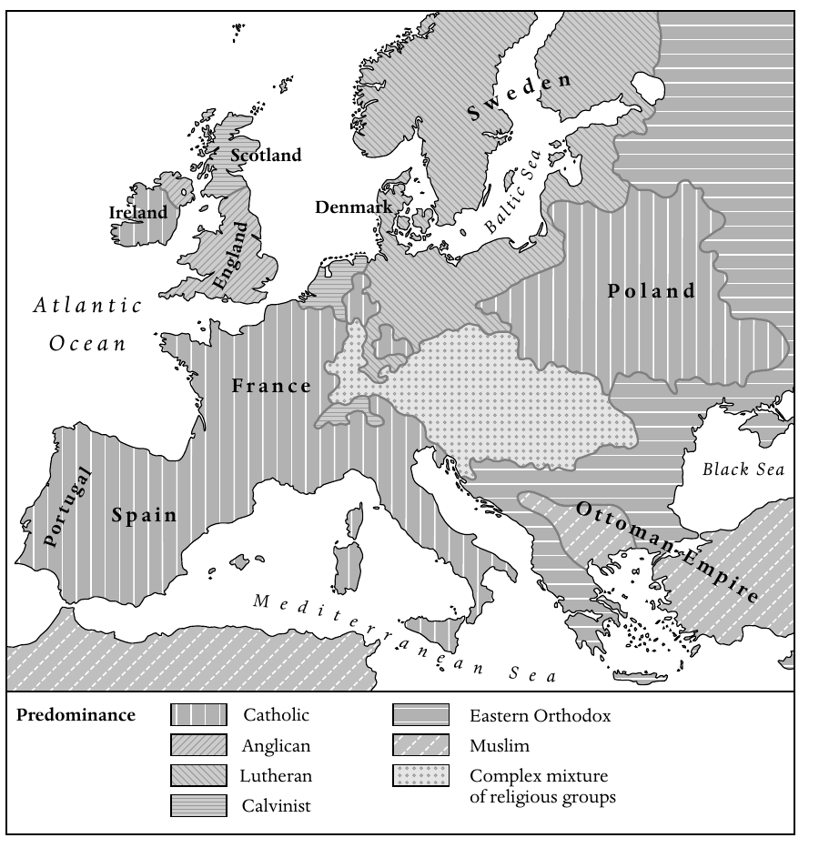

*地图1　约1700年的欧洲宗派分布。图中表示各地区占优势的宗教或宗派；原图英文标签的中文对照如下。*

| 图例英文 | 中文 |
| --- | --- |
| Catholic | 天主教 |
| Anglican | 圣公会 |
| Lutheran | 路德宗 |
| Calvinist | 加尔文宗 |
| Eastern Orthodox | 东正教 |
| Muslim | 伊斯兰教 |
| Complex mixture of religious groups | 多种宗教群体复杂混居 |

图中地名：Sweden，瑞典；Scotland，苏格兰；Ireland，爱尔兰；Denmark，丹麦；England，英格兰；Poland，波兰；France，法国；Portugal，葡萄牙；Spain，西班牙；Ottoman Empire，奥斯曼帝国。海域名称：Baltic Sea，波罗的海；Black Sea，黑海；Mediterranean Sea，地中海；Atlantic Ocean，大西洋。

当然，几乎所有地方都有持不同信仰的少数群体，在国家支持的正统宗教所形成的汪洋中艰难生存。不过，宗派分布的<!-- PDF page 18; original page 3 -->复杂混杂，在欧洲中部一条地带上尤为突出：它从西面的联省共和国出发，横贯德意志中南部、奥地利、波希米亚、匈牙利和特兰西瓦尼亚。在这里，天主教徒、路德宗信徒、加尔文宗信徒、各种新教少数派以及犹太人，以复杂的相邻与混居方式彼此竞争，仿佛处于一场持续不断的宗教冷战之中。再往东、往南，天主教和新教人口分布逐渐与东正教会的势力范围交错；东正教在俄罗斯帝国和巴尔干半岛占据主要地位。不过，巴尔干还存在人数可观的穆斯林少数群体，他们是长期处于奥斯曼土耳其统治之下而改宗的欧洲人。事实上，1648年以后，欧洲只有这一地区仍发生大规模宗教战争；基督徒与土耳其人的斗争时断时续，延续到十八世纪末。

尽管欧洲仍是基督教世界的核心地带，聚集了远多于其他地区的基督徒，但在此前的时期，欧洲人已经以前所未有的规模扩展到地球的广大区域。到十七世纪中叶，基督教传教士与移民已经接触到世界上所有主要文明；他们有时跟随战士和探险家的足迹，有时则独自向前推进。

在墨西哥、加勒比海地区以及中南美洲的广大区域，西班牙和葡萄牙的托钵修会会士与耶稣会士，使原住民持久地皈依了基督教。基督教也已经影响到墨西哥湾以北的北美广大地区。不过，在十七世纪中叶，这里的欧洲移民点仍然相对稀少，只是顽强地依附于海岸和河谷。与西班牙人和葡萄牙人的工作相比，这些地区的欧洲人在使原住民改宗方面，远没有取得同样的成功。

撒哈拉以南非洲的广大地域，情况大体相似。欧洲人的存在主要表现为沿海贸易站，以及刚刚在好望角建立的一个小型荷兰殖民地。然而，在两个区域，即刚果和安哥拉沿海，以及赞比西河下游和莫桑比克沿海，来自葡萄牙和其他国家的修会会士成功建立了一些根基脆弱的基督徒社群，它们一直存续到十九世纪。

在亚洲，葡萄牙在印度次大陆西岸占有的小小果阿省，成为向印度南部和锡兰，即斯里兰卡，开展重要传教活动的桥头堡。少数无畏的耶稣会士和嘉布遣会士向北深入莫卧儿帝国的腹地，甚至进一步进入尼泊尔和西藏。再往东，基督教传教的前景似乎更有希望。西班牙人在<!-- PDF page 19; original page 4 -->菲律宾取得了惊人的成功，在三代人的时间里，使相当大一部分人口持久地改宗。葡萄牙人和来自其他几个国家的修会会士，也在中国、印度支那、印度尼西亚和日本，为相当数量的人施行了洗礼。不过，到1650年前后，随着德川幕府发动大规模迫害基督徒的运动，日本先前取得的许多成果已经开始瓦解。

在十七世纪晚期和十八世纪，基督教在世界某些地区继续扩展。西班牙与葡萄牙在美洲继续推动改宗，进入上、下加利福尼亚，以及亚马孙和巴塔哥尼亚的部分地区。在英属和法属北美，改宗人数仍然相对有限，不过这一时期却有大量信奉不同基督教宗派与教派的欧洲人迁入，并永久定居。十八世纪还出现了最早有系统的新教传教活动，尤其是在敬虔派的影响下，他们资助了北美、非洲和印度的传教工作。但最引人注目的新增信徒，也许是美洲和加勒比海各地种植园中的非洲黑人奴隶。来自初生的美国的自由黑人，本身也将在西非若干地区的传教活动中发挥重要作用。

然而，在其他地方，基督教传教却遭遇重大失望和挫折。十八世纪，国家对基督教教士和平信徒的打击，从日本扩展到中国、印度支那、暹罗和朝鲜。此外，到十八世纪下半叶，几乎世界各地的传教士人数都急剧减少，整体活力也普遍衰退。这在一定程度上是因为非西方国家越来越把基督教视为欧洲政治与文化帝国主义的一部分。但这种衰退，也部分地与欧洲内部的发展有关：欧洲国家争夺帝国势力的竞争日益激烈；教皇否定了耶稣会试图使基督教礼仪适应非欧洲文化的努力；几个欧洲政权广泛打击修会教士，并最终取缔耶稣会；修会教士和教区教士的新成员数量也都大幅下降。

## 启蒙

欧洲内部的这些发展，许多都可以同十七世纪末兴起的一系列思想潮流联系起来，这些潮流通常被称为“启蒙运动”。这场广泛的思想运动有多种根源。从某种意义上说，它是对宗教<!-- PDF page 20; original page 5 -->战争的反应；这种战争直到十七世纪中叶还在蹂躏欧洲，而新教和天主教国家的不宽容政策，又有使战争重新爆发的危险。例如，1685年法国撤销《南特敕令》，1730年萨尔茨堡驱逐新教徒，以及十八世纪大不列颠和爱尔兰针对天主教徒的惩罚性法律，都是这样的例子。有些人开始主张，显然已经到了应当设想另一种社会组织形式的时候：这种形式不再要求强行实现宗教一致。欧洲人通过日益发展的全球贸易和交流网络，越来越多地接触到世界其他宗教与文化，这也影响了新的思想潮流。这种接触使一些欧洲思想家对研究其他宗教产生浓厚兴趣，例如，印度的所谓英国“东方学家”就协助搜集和出版了印度教的古代经典。这类研究使某些欧洲思想家产生新的文化相对主义意识，并相信各种宗教体系，甚至基督教，也在很大程度上是人的建构。不过，也许最重要的因素还是科学的兴起：它提供了一种不依赖宗教权威、而用来理解自然与人类的途径。人们相信，细致观察、数学分析和逻辑推算，也就是理性的力量，将揭示支配自然世界和社会世界的规律。实验方法所采用的实验，可以由各地的人重复进行；它由此证明的可靠真理，是一切有理性的男女都能够接受的。科学将指明改善物质生活的实际途径，也将以社会的自然法则和人的自然权利为基础，指明新的社会组织形式。

“科学革命”的早期倡导者确信，科学的学说为基督教上帝的存在提供了更有力的证明，甚至可能有助于恢复基督教世界的统一。他们相信，科学所揭示的内容印证了《圣经》的启示，同时又以普遍的自然法则为基础，使基督教获得更合乎理性的根据。这反过来将减少宗派分裂和冲突。他们坚持，自然法则和《圣经》的伦理教诲出自同一个源头，即一位仁慈的上帝；他创造了和谐的宇宙，并希望人类在仁爱和相互尊重之中共同生活。接受启蒙理想的人，大多数仍然留在基督教传统之内：他们把人的理性与自然法则视为上帝创造秩序的一部分，并寻求使基督教获得一种更温和、更重伦理的精神。长老宗教士、著名历史学家威廉·罗伯逊，就是这种基督教温和主义的代表。他于1762至1793年担任爱丁堡大学校长，也是公认的<!-- PDF page 21; original page 6 -->苏格兰教会领袖。他力图使这个教会摆脱十七世纪激烈的加尔文主义，转向一种重视实际道德与宽容的理性基督教。这些倾向也深刻影响了一代欧洲君主；他们以启蒙原则为理由，加强对领地内各教会的控制。普鲁士的腓特烈二世、西班牙的卡洛斯三世，尤其是奥地利的约瑟夫二世等“开明专制君主”，颁布了一系列影响广泛的敕令：从强制实行宗教宽容，到重组教会，乃至没收部分教会土地和取缔某些修会。

虽然大多数启蒙运动倡导者仍处于广义的基督教正统范围内，但许多人逐渐摆脱对《圣经》启示的严格依赖，转而接受一种自然宗教，认为仅凭理性就足以引导人走向真理。他们问：如果理性和自然法则已经揭示了造物主的心意，为什么还需要《圣经》的启示？这条道路使一些人走向自然神论，即相信存在一个第一因、一位神圣的创造者；他把关于自身属性和伦理生活基本原则的知识，天赋地赋予了人类。在约翰·托兰或伏尔泰这样的自然神论者看来，人类天赋的神性知识构成世界各大宗教的基础，而具有启蒙思想的男女，如今能够剥除历代积累的附加物和腐败成分，接受上帝存在及其道德要求这些根本真理。然而，另一些启蒙思想家超越了自然神论，对上帝的存在、或者任何由神规定的道德，抱持激进的怀疑态度。诚然，这类思想家是少数，但其中包括德尼·狄德罗、霍尔巴赫男爵，以及可能也应列入的大卫·休谟等有影响的人物。就其较极端的表现而言，晚期启蒙运动可以被理解为从根本上反对基督教，并成为一种完全世俗的世界秩序的先驱。

## 复兴

十七世纪晚期，新教和天主教会内部都出现了基督教更新与复兴的运动。新教的复兴，最初发生在三十年战争的破坏之后、中欧某些流离失所并丧失财产的新教社群之中。有些新教群体对《威斯特伐利亚和约》在各邦强加的宗教安排感到疏离；他们在依据世俗法律确立的教会中找不到精神家园，并且觉得自己随时可能受到迫害。作为回应，<!-- PDF page 22; original page 7 -->他们在既有的教会和国家秩序之外，发展出自己的宗教表达形式，强调个人归信、经常研读《圣经》、组织祈祷和灵修的小型聚会、严格而有规律的生活方式，以及慈善实践。有些人相信千禧年即将来临，并热切期待基督再临。这些新教群体被称为敬虔派。印刷术、书信联系网络、欧洲人向新大陆的迁移，以及其中一个群体的传教热忱，共同推动了这场运动的传播。这个群体是一小群来自波希米亚的新教难民，他们定居于萨克森的亲岑多夫伯爵庄园，其成员后来被称为摩拉维亚弟兄会。十八世纪三十年代，新教复兴传到不列颠，最初是在威尔士，并在很大程度上处于国教会之外的劳动男女中获得支持。约翰·卫斯理和乔治·怀特菲尔德情感充沛的巡回讲道，吸引了大批群众，常常形成规模庞大的露天集会；卫斯理则以欧洲大陆敬虔派为榜样，把归信者组织为卫理宗的班会。大约在同一时期，一系列宗教奋兴席卷北美的英国殖民地，改变并更新了当地宗教生活，这就是后来所称的“大觉醒”。

受到这种发自内心、重视亲身体验的信仰影响的，并不只有新教教会。从十七世纪中叶开始，法国罗马天主教会也经历了一场被称为詹森主义的灵性更新运动，它与新教复兴有一些相似之处。詹森主义在很大程度上，是对天主教改革中那种充满胜利自信的“巴洛克式”正统的反应，尤其是对耶稣会所推崇的形式的反应。深受圣奥古斯丁著作影响的詹森主义者，力图重新强调预定论，以及个人通过上帝恩典而归信的重要性，并培养富有情感的虔敬生活。他们建立信徒社群，实践严格的道德，提升平信徒的作用，并从事慈善活动。詹森主义的某些支流，尤其是十八世纪初更具民众色彩的“痉挛派”，相信神迹医治，并认为自己受到圣灵感动而说出预言。当天主教当权者和波旁王朝的国王企图压制这场运动时，詹森主义者日益政治化，反教权言辞和对绝对君主制的反对，都随之加强。十八世纪，尽管教皇谴责了詹森主义的某些方面，这场运动仍在尼德兰、德意志、西班牙和意大利北部的天主教徒中传播。

<!-- PDF page 23; original page 8 -->

这些基督教复兴运动，最初并不反对当时的科学探索和启蒙运动。事实上，许多怀抱新宗教热忱的人，也分享着科学和理性所激发的、对于社会改善的热切希望。敬虔派大力支持普及教育和高等教育；由敬虔派主导的哈勒大学推动科学研究，尤其重视科学知识的实际应用，同时也研究世界各地的文化。在不列颠，约翰·卫斯理热心研习科学与哲学，还写过学术性的认识论论著。詹森主义者中有法国杰出科学家布莱兹·帕斯卡；他把科学知识和宗教知识都建立在自己的亲身体验之上。受启蒙运动影响的人与受复兴运动影响的人，可以联合批评既有的教会和国家秩序，并共同推动扩大教育的计划。此外，新教不从国教者与哲学家也携手合作，最早有组织地抨击奴隶贸易和奴役非洲黑人的制度。然而，福音派基督徒强烈反对晚期启蒙运动中日渐流行的自然神论和怀疑主义；对于启蒙哲人提倡温和、理性而重伦理的基督教，并因而淡化人类罪性、永罚和基督十字架赎罪等教义的倾向，他们也越来越深恶痛绝。到十九世纪初，这种不信任已经发展为根本性的对立。

## 革命

十八世纪后期席卷大西洋世界的革命浪潮，其起源主要在本卷讨论范围之外。从长期发展来看，这些革命可以同争夺帝国和海上贸易利润的地缘政治竞争联系起来，尤其是大不列颠与法国之间的斗争。英国在七年战争中获胜后，英国议会试图加强对其扩张后的陆上帝国的财政与政治控制，北美英语殖民地对此进行了激烈抵抗。在1775至1783年间，这种抵抗导致独立宣言、漫长战争以及一个新共和国的形成。1789年法国革命爆发，其直接原因是君主政权试图避免财政崩溃，而这种危机源自一个世纪的帝国冲突，其中也包括法国对美国战争的军事干预。不过，这并不是说，启蒙运动和基督教复兴运动没有在革命中发挥重要作用。许多<!-- PDF page 24; original page 9 -->启蒙哲人持续猛烈抨击某些政治制度，因为这些制度被认为不符合造物主赋予人类、并由理性揭示的自然法则和“不可剥夺的权利”。这样的“腐败”制度，包括遥远的英国君主政权和在殖民地没有适当代表的情况下向其征税的帝国议会，也包括把财政特权给予某些社会等级或法人团体的法国君权神授君主制。此外，十八世纪三四十年代的大觉醒，在塑造美国人的身份认同，以及在天意之下共享命运的意识方面，发挥了重要作用。在法国，整个十八世纪詹森主义者对教会和国家的批评，也促成了一种革命话语的形成。

革命一旦爆发，就使基督徒发生分裂。对一些基督徒而言，革命是反叛神所规定的秩序，是出于罪而对“在上有权柄者”，也就是上帝所设立的世俗权威的反抗。然而，对另一些人而言，革命属于上帝为人类安排的天意计划，是一场有望清除腐败、使教会和国家恢复较纯洁形式的运动；它将结束教士特权，扩大宗教宽容，并提升人类的追求。美、法两国革命都为反奴隶制运动激起了强大支持，这使许多支持革命的基督徒感到欣慰。

美国革命确实以自由之名，激发了对确立国教会这一原则的攻击，但它并未造成与基督教的决裂。在法国，革命最终却走得远得多。最初，革命支持在宗教宽容的制度下改革天主教会；然而，这些改革却导致了与罗马的分裂。到了1793年，法国最激进的革命者转而反对基督教本身，把它描绘为旧秩序的思想支柱和反动势力的集结中心，因此必须加以扫除。诚然，即使最激进的去基督教化者，通常也仍然依恋耶稣的伦理教导；耶稣有时甚至被描绘成一位“无套裤汉革命者”。然而，在“恐怖统治”的高峰期，他们仍以残酷而坚决的方式，攻击一切天主教和新教教士，以及教会的物质设施。尽管去基督教化运动到十八世纪九十年代末有所缓和，各教会仍遭受革命官员程度不一的骚扰和迫害。此外，随着革命军和拿破仑的军队越出法国边界，他们又把革命的反教权、甚至反基督教政策传播到欧洲许多其他地区。因此，法国革命的宗教政策成为基督教历史上的一个重要转折点。

<!-- PDF page 25; original page 10 -->

对基督教的猛烈攻击，也使欧洲的新教和天主教地区进一步出现基督教复兴运动。其中有千禧年运动，因为许多人日益相信，政治剧变预示着重大的灵性事件，甚至可能预示基督第二次降临。还有一些基督徒的民众抵抗运动，发生在意大利、西班牙、俄罗斯和德意志，反对被视为“无神”的法国革命政权及拿破仑的统治。此外，许多艺术家和知识分子赞美一种重感情的宗教，渴望恢复基督教世界。在北美，与此相关的复兴活动被称为“第二次大觉醒”。这些复兴运动促使人们再次猛烈抨击奴隶制的罪恶，并推动各大国于1815年就终止奴隶贸易达成协议。它们还激发了新教海外传教活动的大幅增长和天主教海外传教的复苏，为“大传教世纪”及基督教再度向更广阔世界传播奠定了基础。

## 本卷的安排

读者将会看到，本卷各篇文章分为五编。第一编的四章考察十七、十八世纪欧洲的教会、国家与社会问题，旨在广泛概述这一时期基督徒生活经验的政治与社会背景。第二编讨论法国革命以前、主要发生在欧洲的基督徒生活的各种问题：从天主教和新教教士群体的性质与出身，到基督教教育、讲道与演说、宗教建筑、基督教与性别，以及基督教与犹太人。第三编尤其关注影响基督教世界的变化来源，包括科学革命、启蒙运动，以及新教福音派和天主教詹森主义的各类运动。这一编的最后一章，探讨十八世纪法国革命之前兴起的宽容与基督徒再合一的潮流。第四编叙述非欧洲世界的基督教，考察基督徒移民和传教士在世界五个主要地区的推进，也讨论基督教同世界其他主要宗教之间关系的一般问题。最后一编接续讨论“革命时代”的三个中心课题：基督教与美国革命、法国革命和反奴隶制运动的关系。末章论述1790至1815年间的基督教复兴，概述<!-- PDF page 26; original page 11 -->本卷所讨论时期结束时欧洲基督教的状况。

任何一部这样的集体著作，都不可能期待包罗万象。读者在这里很少会读到澳大利亚、新西兰和大洋洲这些广大区域，因为最早的基督徒移民和传教士，在本卷时期的末尾才刚刚抵达那里。本卷也未讨论处于东方正教会传统范围之内、却与罗马教皇保持共融的各类群体，包括东欧所谓“合一派”，以及中东的马龙派、亚美尼亚教会和科普特教会中的某些群体。同样，本卷没有讨论宗教和教士在十九世纪初伊比利亚美洲各国独立运动中的作用。不过，其中一些主题，将在讨论十九世纪基督教的下一卷中处理。

<!-- PDF page 27; original page 12 -->

（原书此页空白。）

---

<!-- PDF page 28; original page 13 -->

# 第一编　欧洲世界的教会、国家与社会：1660—1780

<!-- PDF page 29; original page 14 -->

（原书此页空白。）

---

<!-- PDF page 30; original page 15 -->

# 第一章　欧洲大陆的天主教

**奈杰尔·阿斯顿（Nigel Aston）**

## 总体趋势

在近代早期的后半段，政教关系所追求的平衡很少能够实现。这种失败并不是新现象。作为欧洲公共生活的一项根本关系，政教关系自出现之日起就始终存在争议：在法律、人员任命和政策制定方面，究竟应当由哪个机构拥有最高权威？到十七世纪中叶，国家权力逐渐占据优势，已经十分明显。欧洲的王公家族并非无意推行特伦托大公会议所确立的天主教价值；但他们要依照自己的条件、按照自己的步调来做，而且很少无条件地支持。宗教改革最终摧毁了统一的基督教世界，加上持续存在的奥斯曼威胁，使君主们获得了可供运用的筹码；他们随时准备利用这些筹码，削弱教皇和主教团的地位。保卫信仰并不是一项毫无意义的任务，而双方都十分清楚，在世争战的教会究竟能得到何种支持，要取决于君主如何理解这个说法。自宗教改革以来，路德宗信徒一直坦然承认这一点，也接受了这样一个事实：诸侯的保护会使教会机构的独立性受到限制。天主教教士却不愿承认，他们的教会也同样依赖世俗权力，因而同样容易受到国家支配教会的埃拉斯都主义的侵入，也同样可能面对违背自身意愿的政策决定。

在这一时期，教会绝不能想当然地以为，统治者会把天主教的利益置于本国利益或王朝威望之上。三十年战争使这一教训格外鲜明。十七世纪二十年代看起来或许还是天主教“再征服”的战争，二十年后却几乎只是法国与西班牙争夺欧洲霸权的斗争。先后执政的两位枢机大臣黎塞留和马扎然，毫不避讳地争取异端的援助，先是荷兰人，后是英国人，以确保法国“至基督教陛下”的胜利。1648年，欧洲各国就威斯特伐利亚的全面和约展开谈判时，<!-- PDF page 31; original page 16 -->奥地利哈布斯堡王朝也愿意暂且搁置宗派忠诚，以使帝国能够正常运转，并最终接受新教将继续存在这一事实。

不论是否情愿，早在十七世纪中叶，天主教会就已经必须依照国际法，承认新教徒在德意志各地的权利。因此，1648年以后，斯特拉斯堡的非天主教徒分享了主教座堂教士团成员的正式地位，而奥斯纳布吕克的主教职位则由天主教徒与非天主教徒交替担任。教会以能够依法证明的历史让步，以及建立在区域和地方差异之上的权利与自由为依据，严格遵守了和约条文。威斯特伐利亚的规定，还鼓励教会与新教政权形成某种共存关系；后来，这成为在天主教国家内部容忍新教徒的一种范例。就在1685年撤销《南特敕令》的四年前，法国军队占领斯特拉斯堡，那座“长久以来受到路德宗礼仪玷污”的大教堂重新祝圣。然而，即使路易十四，也谨慎地允许城内新教会众像从前一样继续礼拜。尽管如此，在威斯特伐利亚和约之后的一个世纪中，德意志的天主教圣统制仍力图在可能之处扩张。因此，正如一位学者所说：“新教徒的痛苦经验是，正如在更高层面一样，形势始终相当一致地朝着对他们不利的方向发展。”[^p031-1]

天主教的高级教士更愿意从宗教重新合一、而非宽容的角度思考；他们希望吸收新教徒，而不是为其保留位置。十七世纪八十年代，罗哈斯—斯皮诺拉主教致力于实现帝国内部宗教再合一的愿景；遏制土耳其挑战的需要，使这个目标更为迫切。即使奥斯曼人已经退出东欧平原，这一愿景仍然具有吸引力，并在1749年得到本笃十四世的重申。尽管经历了七年战争，或者也许正是因为这场战争，十八世纪德意志的跨宗派关系仍然蓬勃发展；受过教育的天主教徒遵循费布罗尼乌斯学说的原则，对新教徒表现出开放态度。世俗统治者对此加以鼓励，因为和谐的社会有助于忠诚与稳定；天主教会也顺应这一趋势，以尽可能减少自身宗派特权的损失。

在德意志以外，由于不存在相当于威斯特伐利亚条款的规定，教会迟迟不愿在法律上为宗教竞争者留下余地。在那些习惯于认为宗派多样性会导致政治不稳定的社会中，不宽容很容易得到认可。宗教一致的表象，也符合统治者的需要：他们急于向竞争对手表明，自己的臣民知道，忠诚并不止于世俗义务。路易十四经过长期预谋而<!-- PDF page 32; original page 17 -->撤销《南特敕令》，证实波旁君主政权对所谓“自称改革宗的宗教”的容忍，只是一种战术手段，而不是原则承诺。

法国重新采用了官方只认可单一宗派的模式，而这正是1700年前后欧洲十分普遍的情况。直到十八世纪三十年代初，萨尔茨堡总主教区驱逐敬虔派，另一次广为传播的反新教镇压事件，才使欧洲逐渐出现赞成宽容的反响。萨尔茨堡事件以后，欧洲主张有限宽容的人，始终密切注意那些足以引发舆论、需要以激昂文字声援的案件。他们发现，普鲁士腓特烈二世这类开明专制君主，出于国家建设的考虑，愿意听取他们的意见。然而，不那么开明的统治者，长期以来仍把强制作为实现宗教一致的手段。在葡萄牙，若昂五世还在通过宗教裁判所迫害异端；1734至1743年间，共有五十一人被烧死。

天主教国王通常既是其国家教会事实上的首脑，也是法律上的首脑。事实上，罗马信仰的神学和传统，对于臣民应当向统治者表示的恭顺，至少不逊于任何新教宗派。在特伦托大公会议以后的时代，绝对主义倾向，例如主教所拥有的权力，在教会内部和国家内部同样盛行。统治者很容易相信，天主教天然是权威的支柱，而新教产生于不服从，并且倾向于共和主义。没有什么比天主教会更能认可并支持王权，因为没有教会的祝福，王权本身就难以想象。难怪十七、十八世纪竟有五十一位德意志诸侯改宗天主教。即使信奉天主教的斯图亚特王朝在1688至1689年失去英格兰和苏格兰的王位，又于1690至1691年失去爱尔兰，教会仍继续承认这个家族任命爱尔兰天主教主教的权利。这种承认为其数十年的流亡保留了尊严；克勉十三世于1766年撤回承认，也提醒人们，赋予合法性的最高权力仍握在教会圣统制手中。尽管王座与祭坛的“联盟”越来越偏向前者，其利益却并非完全单向。教会是享有高度特权的法人团体，其权利由君主在加冕时保证；教会领袖的礼仪地位，也高于贵族中的对应人物。

当然，尽管国家和教会对彼此不同的职能、以及能够互相支持的领域都有清楚认识，在大多数年代和大多数国家中，双方仍常常就各自应有的特权发生争执。到十八世纪六十年代，各君主政权坚决要求教会<!-- PDF page 33; original page 18 -->接受比从前界定得更严格的限制，尤其是在赋税问题上。在米兰，1765年设立的经济委员会负责行使国家对教士的权力。1768年的训令规定：“教士在世俗领域的任何特权、任何干预，倘若不是出自君主的同意和自愿授予，就不能被宣称为合法……”[^p033-2] 反耶稣会运动，以及十八世纪中叶君主与教皇之间接连订立的政教协定，都表明了这种趋势。晚期詹森主义也把国家权力视为对自身的保护，因而加以支持，实际上构成埃拉斯都主义传统内部的一种变体。在奥属尼德兰，目标正如鲁汶大学教会法教授泽赫尔—贝尔纳·范埃斯彭（1646—1728）所说，是把教会纳入“国家的自然秩序”。神父不应忘记，自己既是臣民，也是公民。

在天主教国家的治理中，教士提供的行政服务仍然十分宝贵。君主和大臣在提名主教时煞费苦心，希望其政治才干至少同牧灵能力一样突出。同时，由于晋升必须赢得王室青睐，主教和高级教士依然十分精通宫廷技巧，也自然倾向于加强王权而削弱教皇权力。任何大臣都期待主教团的合作，并利用教职荐举制度，使这种合作尽可能得到保证。因此，蓬巴尔于1757年开始对耶稣会采取行动时，便使自己的兄弟获任宗教裁判总长，并在整个过程中依赖高级教士的顺从。在法国，与其他地方一样，主教在管理各省三级会议方面十分突出；弗勒里和布里耶纳两位枢机，则追随黎塞留、马扎然的先例，实际上担任王国的首席大臣。教士承担立法职能也十分常见。波兰十七位主教都进入参议院；格涅兹诺总主教兼首席主教，是联邦中仅次于国王的第二号显贵。在法国大多数高等法院中，都有若干法官职位专门保留给教士，波尔多六席，巴黎十二席。在西班牙，托莱多的波托卡雷罗枢机于十七世纪九十年代末为波旁王朝继位进行政治运作，并取得一定成效；1700至1751年间的十二位卡斯蒂利亚委员会主席中，竟有九位是教士。西班牙高级教士始终参与远远超出牧灵与慈善范围的活动：托莱多的洛伦萨纳试图振兴主教驻地衰落中的丝织业；瓦伦西亚的法维安—富埃罗与塞维利亚的利亚内斯—阿圭列斯，在自己的宫邸中开放公共图书馆；萨拉曼卡的贝尔特兰建立了培养金匠的职业学校。堂区教士也是各自堂区中王权的重要代言人和维护者；而堂区毕竟是<!-- PDF page 34; original page 19 -->遍布欧洲的基层行政单位。村民往往通过讲道台得知王室敕令。富有远见的君主十分清楚，在他们的领地中，没有任何代理人能够像堂区教士那样，深入臣民的日常生活与内心。在十八世纪中叶的政教争端中，说服下级教士从王权的立场看待公共事务，变得至关重要。因此，西班牙的卡洛斯三世和约瑟夫二世，都重视通过神学院的整并与改革，确保堂区神父接受“正确”的教育。倘若这种政策未能奏效，正如十八世纪八十年代末的奥属尼德兰那样，教士顽固地煽动民众反对皇帝的计划，就可能成为计划失败的一个主要原因。

## 教皇制度

从一个层面看，罗马天主教体现为一个国际性教会，拥有普遍适用的一套教会法和宗教规制；从另一个层面看，近代早期各类机构所共有的不合理结构和运作方式，也同样存在于其全国、省区与地方层面。历史先例绝不会轻易被抛弃；到十七世纪末，各国教会已经十分熟悉如何培养并保护自己相对于罗马的独立性。在教皇制度的历史上，世俗统治者几乎从不缺乏这样的坚定态度：面对教皇的权力主张，他们要保卫自己在本国的领导权。只要存在蚕食教权的可能，君主就会尝试，过去如此，十八世纪只是使这一进程加速。

通常认为，《威斯特伐利亚和约》开启了教皇权力逐步衰落的时期，其高潮是克勉十四世于1773年屈辱地同意解散耶稣会，以及二十五年后庇护六世遭受羞辱、被迫流亡并离开圣城。在汉斯·格罗斯看来，罗马教廷患上了“后特伦托综合征”：近两百年前制定的计划已经大体成功完成，却没有提出任何足以取代它的新纲领。这种观点并非没有争议。[^p034-3] 它往往低估了特伦托传统在教义和牧灵方面的政策举措，贯穿整个十八世纪而继续存在的程度。这一时期教皇职务的演变，依赖的是一种已经得到证明的适应能力；这意味着，与其说教皇制度变弱，不如说它变得不同了。

<!-- PDF page 35; original page 20 -->

在意大利境内，教皇长期以来对罗马城和教皇国的领导作用，又通过在整个半岛行使首席主教权而得到扩展。1725年，教皇在罗马召开教省会议，表明其决意在罗马教省主张都主教管辖权。在整个天主教欧洲，教皇仍然作为西方宗主教、“普世教会的主教”而受到尊崇。他继续拥有规模远非任何世俗君主可比的教职荐举权，尽管行使这些权利偶尔也会引起争议。例如，1720年教皇拒绝任命阿尔贝罗尼为塞维利亚总主教，便引发了与腓力五世的外交危机，最终导致教皇使节被驱逐。教皇不愿承认某位统治者，也可能造成持久影响。英诺森十世和亚历山大七世都不愿认可布拉干萨家族的葡萄牙王位主张者若昂四世（1640—1656在位），也不愿让他的提名人选出任主教。若昂的回应是任由主教职位空缺，征用其收入，甚至考虑建立一个国家教会。直到1668年西班牙承认葡萄牙独立，局势才稳定下来。教职晋升、王室权利、教士豁免，以及对教皇封地的宗主权等问题，也都可能引发冲突。

此外，教皇还承担一项独特责任：保护天主教欧洲的边界，防止穆斯林侵入，并鼓励基督教君主，主要是皇帝，收复失于异教徒之手的土地。十七世纪六十年代，亚历山大七世试图组织欧洲列强联盟来对抗奥斯曼人，却因法国提供的援助极为有限而受挫。克勉十世（1670—1676在位）向扬·索别斯基提供财政援助；后者在德涅斯特河击败土耳其人，后来又于1683年率军解除了维也纳之围。1684年，英诺森十一世组织了由帝国、威尼斯和波兰组成的神圣同盟，并派出一支军队参战，直到1687年战事结束。战果十分显著：1686年匈牙利获得解放，两年后贝尔格莱德收复。克勉十一世所关切的事务，使十字军理想延续到了启蒙世纪；1718年的《帕萨罗维茨和约》成为基督教世界扩张的一个里程碑。然而，到十八世纪四十年代，天主教与奥斯曼帝国的关系，已经像一个世纪前天主教与新教的关系那样趋于稳定。本笃十四世与奥斯曼二世保持着十分友好的外交关系，以至于称他为“好土耳其人”。教皇牧灵关怀的另一个对象，是东欧那些在一般意义上承认伯多禄首席权的合一教会。在1773年波兰第一次被瓜分以后，它们承受东正教压力的处境急剧恶化，因为俄罗斯的叶卡捷琳娜二世表示，要不经罗马而<!-- PDF page 36; original page 21 -->庇护白俄罗斯地区的这些教会。在这种情况下，克勉十三世和庇护六世别无选择，只能依靠玛丽亚·特蕾西亚的斡旋，支持合一教会的独立。

每当圣伯多禄的宝座空缺，都会立即引起极其密集的外交活动，因为天主教列强都游说，以确保自己属意的人选当选。这表明，由合适的人担任教皇，能够显著便利政策制定，并在国际关系中带来一点相当有价值的优势。未能取得理想结果，也可能产生长期后果。因此，亚历山大七世（1655—1667在位）始终无法同马扎然建立密切合作关系，因为马扎然最初曾反对他当选。对每一位天主教统治者来说，让自己能够在选举时倚重其忠诚的人获任枢机，因而十分重要。法国和西班牙曾明确要求指定“王室枢机”，但这一要求于1667年遭到拒绝。本笃十三世面对法国企图限制其册封枢机自由的计划时，则以辞去教皇职位、退居自己兼任主教的另一教区贝内文托相威胁。

尽管教皇职务提供种种机会，它仍是沉重负担，即使对于才干卓越的本笃十四世也是如此。同其他教皇一样，本笃十分依赖国务卿，以及出任欧洲各天主教国家首都教皇使节的其他官员所提供的专业协助；这些官员通常都是枢机。在漫长的十八世纪，教廷行政迅速走向成熟。从威斯特伐利亚和约到克勉十一世于1700年即位的半个世纪中，随着反对任人唯亲的努力持续推进，传统“枢机侄”的角色日趋边缘。因此，1692年英诺森十二世在《合宜于罗马教皇》（Romanum decet pontificem）诏书中规定，教皇只能提名一位亲属为枢机。与之相应，国务卿职务的重要性不断上升。教廷高级成员长期派驻使节职位，逐渐成为常规；他们提交的报告，属于当时最专业、最有洞见的一批。有些人才能出众，例如在波兰第一次被瓜分后出使该国的加兰皮枢机，他不露锋芒地使自己成为“一个国际网络的枢纽，这个网络致力于驳斥那些支持国家教会及其法律权利的政策”。[^p036-4] 使节职务逐渐享有相当高的声望。葡萄牙复国后的君主政权和波兰的选举君主政权，都坚持要求派驻本国宫廷的教皇使节升任枢机，以使本国与较大国家处于平等地位。当使节遭到驱逐，或者其使节机构被降为普通使馆时，就明确表明外交关系出现了紧张；十八世纪八十年代的佛罗伦萨，就是后一种情况。

<!-- PDF page 37; original page 22 -->

## 法国的教会与国家

1516年的《博洛尼亚政教协定》，在整个这一时期始终是处理法国教会与教皇关系的一套成熟而有效的规程；教皇通常愿意确认国王提名的教区主教。若不予确认，往往就会招致法国军队暂时占领阿维尼翁和沃奈桑两块飞地。就实际情况而言，高卢教会是一个王室教会，也是其他较小天主教君主国所向往的政教体制典范。尽管教会拥有强大的自治机构，其中最有声望的是五年一届的教士总会议，而且免于直接纳税，转而自行决定“自愿献金”的数额和分摊方式，但它仍是一个依附性的机构，需要依靠君主政权的保护。这种保护并非总能得到；然而，多数主教和神父的忠诚很少动摇，即使1682年的《高卢教会条款》被抛到一边、转而利用教皇来实现王室镇压詹森主义的政策目标时，也是如此。他们十分清楚，王权控制着高级职位的任命；那些希望戴上主教冠的高级教士，必须施展宫廷技巧。在亲政的五十四年间，凡是会使君主王室权力变得复杂的高卢主义，路易十四都不予理会。这种立场，使法国国王能够采取一些典型地不符合高卢主义的政策，例如争取颁布并随后强制推行1713年的《独生子》（Unigenitus）教皇诏书。两年后国王去世。此后，围绕高卢主义的内涵，教会法学家和教士与律师和法官展开了无休止的争论。

路易十四决意成为天主教国王的典范，但他的做法并不一致，说服力也远不如他自己愿意承认的那样强。教士总会议向他施压，要求取消胡格诺派信仰在王国内的合法存在，而国王赞同这个大方向。把新教徒同时描绘为共和主义者和异端，是十分方便的做法。另一方面，就在不久前的1662年，路易还为了酬答新教徒在投石党运动中的忠诚，颁布王室宣言，确认1598年《南特敕令》所给予的宽容。1679年《奈梅亨和约》签订以后，路易改变立场，把撤销《南特敕令》列为国内事务的优先目标，并于1685年付诸实施。以莫城主教博叙埃为先导，高卢教会主教们齐声颂扬国王；但法国以外的天主教舆论，却不是无动于衷，就是持敌对态度。十七世纪八十年代初，胡格诺派所遭受的残酷“劝服”运动，令进步舆论深恶痛绝，并使人们重新关注国家实行<!-- PDF page 38; original page 23 -->宽容的可能性。奥地利的利奥波德一世，作为抵御土耳其威胁、保卫基督教世界的主要人物，仍然十分愤怒，因为路易在1683年解救维也纳时，只派出一支少得可笑的法国军队。教皇英诺森十一世也继续与路易对立：国王坚持扩大王室从某些空缺主教区取得收入的权利，即所谓空缺主教区收益权（régale），又在莱茵地区和德意志边境其他地方推行侵略政策。教皇反对路易属意的人选出任空缺的科隆选侯主教，导致阿维尼翁被占领、驻法国的教皇使节遭扣押，以及国王以大公会议至上论相威胁。争执先是进一步恶化，随后才有所好转：1687年，英诺森拒绝接受新的法国大使；1688年12月，又秘密将路易及其大臣绝罚。

1689年英诺森去世以后，凡尔赛与罗马的关系逐渐改善。路易年事渐高，希望争取教皇支持自己的孙子安茹公爵继承西班牙王位，而他最希望的，还是消灭詹森主义。在十七世纪九十年代，詹森主义者原本未必一定构成王权的威胁；但国王缺乏体察的做法，很快就把他们推向了典型属于高卢主义的大公会议至上论，因而与路易在去世前二十五年间出于权宜而采取的亲教皇政策相冲突。路易确信，除非在自己去世以前，以权威而全面的方式谴责詹森主义，否则它就可能威胁王朝的延续，而这个王朝将传给他年仅三岁的曾孙。事实上，国王于1713年执意迫使十分不情愿的克勉十一世颁布《独生子》诏书，这种鲁莽政策将在他去世后严重破坏法国政治的稳定。

弗勒里枢机长期执政期间（1726—1742），以坚定而灵活的方式处理詹森主义问题；他本人正体现了十八世纪法国教会与国家在制度上的重叠。十八世纪三十年代，弗勒里宣布《独生子》诏书是法国国家法律，随后主要依靠教职荐举权，把与自己气质相近的温和派安置在教会的重要空缺职位上。这项政策使政教关系恢复了一定程度的和谐，甚至延续到他去世以后。但在十八世纪五十年代，巴黎总主教克里斯托夫·德博蒙因詹森主义问题，与巴黎高等法院发生宪制冲突，对整个政治体制产生深远影响，并损害了第一等级，即教士阶层的公共声望。事实证明，对教会中的多数派来说，王权不是可靠的盟友。路易十五不愿无条件地捍卫教会的权利主张；教会容易受到掌握最高司法权的高等法院中反教权者的压力，这一点有目共睹。只有在直接赋税问题上，教会才保住自己的豁免权，成功抵制财政总监奥里于1749年向教士征收二十分之一<!-- PDF page 39; original page 24 -->税的企图。在这件事上，王室的反复无常总算有一次对教士有利。

1764年驱逐耶稣会，无疑是对教会的打击，但它也终止了第一等级与高等法院法官之间的争执，使政教关系恢复了一定稳定。虔诚的路易十六于1774年即位，又进一步巩固了这种稳定。不过，新国王同他的祖父路易十五一样，并不愿从教会圣统制的立场看待公共事务。每逢教士总会议，教士们都会恳请国王颁布权威法令，反对泛滥的不敬神的启蒙哲人著作，以及受启蒙哲人影响的文学作品，声称这些作品正在败坏法国的道德。路易表示同情，却始终没有行动。1787年，他的政府给予法国加尔文宗信徒极为有限的公民权利，令教士十分恼怒。政府不诚实地把这一敕令说成1685年《枫丹白露敕令》的贯彻落实；其真实性质，却是国家认可了一定程度的宽容，而且在全国有效。教士整体上认为，这标志着法国宗派国家开始瓦解，这种看法不无道理。令他们尤其震惊的是，这项措施成为法律时，执政大臣恰恰来自他们自己的行列：图卢兹总主教洛梅尼·德布里耶纳。他曾在第一次显贵会议（1787年2至6月）中领导“反对派”。然而，布里耶纳被召入阁，固然显示第一等级在国事上仍然重要；1787年的敕令，却表明教士地位下降的时刻可能已经不远。

## 西班牙与葡萄牙的王权主义趋势

十七世纪上半叶，腓力四世及其大臣曾多次与罗马发生冲突，但战争和叛乱的压力，使他们无法坚持自己的要求。然而，1700年波旁王朝获得西班牙王位，并由1713年的《乌得勒支和约》加以确认，标志着王室对教会的控制，开始转向一种更接近高卢主义的方式。1700年以后的君主政权，于1737年和1753年与教皇订立政教协定，两者都明确确认王室权威；在西班牙语境中，这一倾向被称为“王权主义”。1753年的协定尤其重要：教皇把大多数圣俸教职的荐举权交给王室，总数达一万二千个，只留下五十二个由教皇掌握。协定也明确，王权并不认为，教皇授予管辖权是其海外教会保教权（patronato）成立的必要基础。教士颂扬波旁<!-- PDF page 40; original page 25 -->君主政权成为常态，尤其在1750年以后，他们常把卡洛斯三世的统治与大卫、所罗门的王权相比。取得与其亲族路易十五相当的权力，并没有使斐迪南六世或其同父异母弟弟卡洛斯三世，产生任何反天主教或反教权倾向。后者既不热衷宗教宽容，也不热衷言论自由；1761年，他还隆重宣布无原罪始胎的圣母玛利亚为西班牙的官方主保。宗教裁判所继续存在；虽然是一条“睡着的狗”，却“经常醒来咆哮，偶尔还会咬人”。[^p040-5]

1753年以后，王室通过卡斯蒂利亚委员会下设的一个院署，提名王国内八个总主教区和五十二个主教区的主教，并设立复杂程序，确保只有品行高尚、声望良好的人能够获任。这些安排并未阻止人们广泛怀疑，某些教职任命涉及买卖圣职，尽管此类指控总是很难证实。人们认为，主教团的参与和合作，是实施王权主义纲领、在主教管辖区域内推行良好治理及健全宗教实践的必要条件。因此，1767年，卡斯蒂利亚委员会向各主教发出通函，命令他们遏制各自主教区的弊端和迷信。当主教政策似乎不符合政府意图时，中央行政当局可能毫不留情：巴塞罗那主教何塞·克利门特，便因毫无根据地被怀疑鼓动加泰罗尼亚分离主义，而被迫辞去主教职务。

波旁王室重新推动了前一王朝所忽视的特伦托改革项目，尤其是培养受过教育的堂区教士。1600至1747年间，只建立了八所神学院；但耶稣会遭到取缔，为这项事业增添了机会，也使其更为迫切，于是1747至1797年间又设立十八所。它们的课程和组织，使它们具有准大学的外观，尽管许多师资薄弱，规模也小得难以独立有效运作。十八世纪六十年代，王室除了参与欧洲大多数天主教君主国的反耶稣会政策，还认真试图以削弱罗马为代价，加强国家对其他修会的控制。这些修会的人数超过堂区教士，但并不以切合牧灵需要而著称。1776年，王室强行为方济各会设置全国代理会长，并在十八世纪八十年代把这一新做法扩展到圣三会、嘉尔笃会和奥思定会。然而，王室权威的这种强制实施，产生了一个意外转折。男女修会成员逐渐习惯于请求卡斯蒂利亚委员会解决内部冲突，结果派系斗争反而加剧；王室原本希望重振修会成员宗教动机的目标，也被挤到了一边。

<!-- PDF page 41; original page 26 -->

在葡萄牙，布拉干萨君主政权决意确保，自己相对于圣座的地位不低于任何其他天主教君主国。1748年，若昂五世（1706—1750在位）获授“至忠陛下”称号，令他极为满意。若昂与教皇的关系长期紧张，原因是他要求确认里斯本宗主教职务，并使其附属于自己在马夫拉的宫廷礼拜堂。为了这个要求，他准备与罗马决裂；事实上，双方于1728至1732年完全断绝外交关系。最终于1737年达成的政教协定，使这一职务得以确立；协定的一项秘密条款还规定，宗主教必定获擢升进入枢机团，这一点又于1766年得到确认。葡萄牙的国家与教会关系始终十分紧密；在若昂五世时期，君主政权也乐于把财富用于教会事业。因此，巴西的金银为1717至1730年修建马夫拉宏大的教堂—修道院建筑群提供了经费，也为1755年地震摧毁里斯本之后的教堂修缮与新建工程提供了资金。教会是国民经济的重要组成部分，其领导者是富有且有文化的高级教士；1668至1820年在任的一百五十六位主教中，五分之四出身贵族。因此，在与梵蒂冈发生争执时，布拉干萨君主政权通常能够依靠主教团的支持。这种关系对大臣蓬巴尔尤其宝贵，他在遍及欧洲、争取废除耶稣会的运动中走在前列。他毫不妥协的立场，使葡萄牙与罗马的外交联系在十八世纪六十年代逐步崩溃。蓬巴尔还普遍限制教士特权，并把宗教裁判所改为王室法庭；不过，随着时间推移，他本人也越来越成为损害葡萄牙国际地位的人物。1775年以后，他被捕，葡萄牙则与庇护六世签订了新的政教协定。玛丽亚一世于1777年即位，开启了本世纪此前未曾有过的里斯本与罗马关系稳定期。

## 意大利

在任何地方，世俗统治者与教皇的关系，都没有在意大利半岛上那样尖锐而敏感。在法国革命以前的一个世纪，教皇国先后在西班牙、波兰和奥地利王位继承战争中，三次遭到外国军队入侵。即使在和平时期，圣座也可能必须退让。1731年，教皇放弃了对帕尔马与皮亚琴察的宗主权。1727年同萨伏依家族订立的政教协定，只把新成立的撒丁王国所要求的权利部分地给予了它；但1741年的第二份协定，却迫使本笃十四世允许这个国家的教职任命<!-- PDF page 42; original page 27 -->完全依照王室的意愿办理。教会庇护权也几乎被废除；双方还同意，教会在1620年以后取得的财产，应缴纳一般的世俗赋税。在那不勒斯王国，王权主义有悠久传统，对耶稣会和宗教裁判圣职部都抱持怀疑，也不满每年的贡礼（chinea）；这种贡礼传统上象征教皇对那不勒斯的宗主权。1734年，教皇在充分承认波旁王朝继位的问题上犹豫不决，使反教廷情绪更加强烈。争端以1741年的政教协定告终，1745年又有第二份协定，圣职部在国家事务上的权威最终被废除。波旁王朝毫不犹豫地坚持，必须按有利于自己的方式维护政教边界。在此后的半个世纪中，教会庇护权受到削减，教士必须纳税，而且只有那不勒斯人能够在王国境内担任圣俸教职的原则，也变得不容争议。这种具有浓厚天主教色彩的埃拉斯都主义，其最后一个象征性举动，是斐迪南于1788年拒绝缴纳贡礼。随后，他与庇护六世对峙四年。最终，由于意大利南部将近一半的主教职位空缺，而法国革命又需要教皇全力应对，教皇作出了让步。不过，十八世纪晚期国家支持改革天主教的典型范例，还是托斯卡纳大公国。这个约有一百万人口的小国，由玛丽亚·特蕾西亚的儿子彼得·利奥波德统治。天主教改革在公国并不是新的潮流，但彼得·利奥波德逐渐把自己看成一位“外在的主教”，干预教士教育，规定阅读书目，规模几乎可与自己的兄长、皇帝约瑟夫二世相比。这是本世纪恺撒教皇主义，即世俗君主支配教会的极致表现；在这种体制中，教会仿佛注定会被国家吸收。1780年，大公延揽新任皮斯托亚与普拉托主教希皮奥内·德里奇作为主要合作者时，局面正是如此；这位高级教士后来被称为“托斯卡纳的教皇”。

## 德意志与哈布斯堡帝国的教会和国家

天主教教士对大多数德意志邦国表现出的强烈国家忠诚，有充分证据可考；甚至在《威斯特伐利亚和约》之前，这已经是政治格局的一个特征。在美因茨、特里尔和科隆三个教会选侯国，这种忠诚最为强烈，因为国家与教会都由同一位总主教亲王统治。美因茨选侯是三位总主教选侯中地位最高者，同时也是帝国大宰相，这使其外交地位远远超过其领土的重要性。他在<!-- PDF page 43; original page 28 -->科隆和特里尔的同僚，在国际上的重要性也几乎不逊于他。这有助于解释，为什么十七世纪八十年代中期，当路易十四的帝国野心达到高峰时，他执意要把自己的人选安插到科隆。正如西蒙·沙玛曾经指出的：“美因茨能够延续下来，证明过时制度仍具有生存能力。”[^p043-6] 历任总主教都自信地表现为缩小版的开明专制君主，准备对抗并战胜民众、贵族和教士反对变革的力量。其中最杰出的是腓特烈·卡尔（1774—1802在位）。1785年，他以明确反奥地利、且由新教势力主导的诸侯联盟（Fürstenbund）为跳板，谋求建立一个“德意志国家教会”；这令腓特烈大帝颇觉好笑。

腓特烈·卡尔的成功，标志着天主教内部一个具有鲜明德意志特性的教会的发展达到顶点。特里尔、美因茨和维尔茨堡等大学的学者，一直站在这一趋势的前列。到十八世纪三十年代，人们运用穆拉托里等杰出历史学家的研究成果，以及自然法观念，来论证长期以来针对向罗马缴纳首年圣俸和教皇使节等问题的批评。随着天主教徒逐渐习惯1648年和约所规定的宗派共存，这一思路也受到詹森主义、以及对德意志新教更友善态度的影响。这种强烈反对教皇至上主义的倾向，在某些邦国最为强烈；那里的君主依靠学者提供理论支持，以对抗教皇，并把自己的领地改造为主权国家。费布罗尼乌斯主义就是最终产物，也是一个独特的天主教改革运动的组成部分。综合来看，这些观点到十八世纪六十年代占据优势，促使赫里贝特·拉布提出一个著名说法：天主教德意志经历了一场“思想革命”。

费布罗尼乌斯主义的兴起，以及德意志新教表现出的自信，是女皇玛丽亚·特蕾西亚（1740—1780在位）在帝国政策上必须关切的问题。同她的父亲卡尔六世、祖父利奥波德一世一样，她也不能被视为会无条件顺从教廷、或者哈布斯堡领地内主教的人。她希望在尊重教皇灵性首席权的同时，治理本国教会，并保护天主教，使之不再遭受新教积极的侵入；理论上，她正是天主教在世间最主要的捍卫者。她与家人每天参与弥撒，约瑟夫二世在独自统治的十年间，也同样如此。十八世纪之交，奥地利教会的制度力量令人印象深刻，尽管主教区和教省的边界往往配置得十分不便。十八世纪，哈布斯堡世袭领地新建主教区的速度，远远落后于人口增长：只增加了三个主教座，尽管<!-- PDF page 44; original page 29 -->人口增长了百分之五十。哈布斯堡王朝对这个人数相对较少的主教团，所拥有的荐举权颇为有限。按照德意志习惯，主教首先由主教座堂教士团选出。高级教士在各地议会中也有充分代表，而这些议会选任的行政官员，多达四分之一来自教士。帝国君主政权决意减少教士的免税权，并在本世纪中叶实现了这一目标：1749年以后，修会必须按十年期限缴纳税款，不再能够每年商议应纳数额。

十八世纪中叶以后，君主政权逐渐脱离耶稣会的影响，构成一次历史性的断裂，因为奥地利天主教一直深受耶稣会塑造。然而，女皇决心推行教育改革计划，以增加教区教士和平信徒的作用。维也纳大学教会法教授保尔·约瑟夫·冯里格尔（Paul Joseph Ritter von Riegger），借鉴受詹森主义影响的教会法学家，例如范埃斯彭，重新激活了哈布斯堡王朝的反教廷传统；费布罗尼乌斯本人正是范埃斯彭的学生。1764年，克勉十三世谴责费布罗尼乌斯的思想，因为他担心，哈布斯堡君主国与德意志各邦有一个共同计划，最终会大幅削弱教皇在中欧的权力。玛丽亚·特蕾西亚并不是费布罗尼乌斯主义者，但她仍继续推行政策，为君主政权的利益，使思想生活走向世俗化。1767年，一个新的行政部门成立，负责发起并实施帝国内的教会立法。主要参与者包括她的儿子兼共同统治者约瑟夫二世、宰相考尼茨，以及从1769年起担任教会事务高级官员的弗朗茨·约瑟夫·海因克。他们都相信，国家权力是完成天主教改革任务的根本。玛丽亚·特蕾西亚仍然担心，会不会背离家族作为天主教文化捍卫者的历史角色。事实上，她的帝国内有许多非天主教少数群体。维也纳估计有两千名新教徒，约占人口百分之一，此外还有数量可观的犹太人。在匈牙利王国，马扎尔精英分属天主教、路德宗和加尔文宗。的里雅斯特、戈里齐亚和曼图亚也有犹太人居住，尽管在这些地方以及波希米亚和摩拉维亚，建立正式社群和举行公共礼拜都未获许可。在卡尔六世统治时期（1711—1740），波希米亚信奉新教者可能被判死刑；不过，1745年邻近的西里西亚被普鲁士吞并以后，秘密信奉新教的人得到容忍。1777年，摩拉维亚有整个村庄公开宣称信奉新教；考尼茨主张，迫害既有损真正基督教的利益，也有损国家的真正利益。然而，如何对待宗教少数群体的问题，双方始终无法一致，使女皇与约瑟夫二世在十八世纪七十年代的关系变得紧张。

<!-- PDF page 45; original page 30 -->

1780年母亲去世以后，约瑟夫终于不再受牵制，能够在帝国内颁布普遍的宽容敕令，并推行前所未有的教会改革政策：禁止教皇诏书传入，关闭修道院，调整神学院的组织与数量，整合为六所总神学院，由国家承担培养堂区教士的任务。不论教士个人意愿如何，也不顾那些看起来足以使中央集权计划失效的各省特权，堂区教士都要被改造为国家的仆役。宗教将成为帝国的黏合剂；詹森主义著作和淡化教皇权威的教科书，都将获准使用。在约瑟夫看来，改宗天主教原则上值得期望，但不能采用强制手段，而应依靠仁爱与劝说。他把特殊的教职晋升机会，留给依照这些原则行事的神父。[^p045-7]

皇帝这套备受争议的纲领，并不缺乏辩护者，尤其当庇护六世于1782年前往维也纳，请求皇帝修改政策而未能成功时，更是如此。是否存在发生第二次德意志宗教改革的危险？庇护极为焦虑：约瑟夫极端的埃拉斯都主义正在同德意志的费布罗尼乌斯倾向汇合，而他自己在意大利以外的权力基础，似乎已经濒临瓦解。1783年，约瑟夫访问罗马，试图强行落实自己对米兰领地内所有主教的任命权主张，这侵犯了教皇的传统特权。庇护以让步保全面子，双方于1784年订立政教协定，却没有完全解决管辖权争端。另一个争执点，是约瑟夫执意任命自己的盟友约翰·卡尔·冯赫伯施泰因，为卢布尔雅那总主教；这个总主教区正是约瑟夫自行创建的。直到候选人于1787年去世，才避免了皇帝与庇护的公开分裂。也正是在约瑟夫统治的这个中间阶段，反对皇帝教会政策的声音开始高涨。大量小册子指出，他别具一格的做法存在犹豫和不一致之处，例如不肯废除教士独身制。面对铺天盖地的批评，约瑟夫恢复审查，试图压制反对者。他的强硬做法只是加剧了问题，并使教士更有信心，鼓励自己的信众抵抗皇帝。这提供了一次有益提醒：十八世纪任何君主，都不能把下级或高级教士的协助视为理所当然。杰里米·布莱克恰当地指出：“不应忽视‘改革’政府与教士的关系，也不应忽视这样的尝试，即调整政教合作的意识形态与实践，使之适应新的愿望和处境。”[^p045-8] 在漫长的十八<!-- PDF page 46; original page 31 -->世纪，最引人注意的，与其说是双方的竞争，不如说是双方都能够借助几个世纪共存的经验，而且从根本上意识到彼此需要。在任何地方，都没有多少人赞同1815年以后才会明确表达出来的教皇至上主义理想。1648至1780年间，教皇权力的伸展范围或许缩小了；然而，多数教皇采取的现实政治方式，却有利于教皇制度的维系，而咨询意见的专业化程度日益提高，也使他们受益。因此，其制度基础足够坚实，能够承受1773年耶稣会被解散、以及1798年法国占领罗马的双重打击。罗马仍然能够成为基督教世界的中心，例如1750年禧年时，波尔托—毛里齐奥的圣莱昂纳尔多，在教皇、枢机以及十万听众面前，进行劝人悔罪的布道。

如果说天主教会自十八世纪中叶以后就一路走下坡，那是十分误导的。如果特伦托改革的各项举措开始走向终结，那是因为几乎已经不再需要它们：这些任务已经成功完成。尽管人们发现了一些去基督教化的征兆，欧洲实际上却正处于基督教化程度最高的阶段；各地民众随时可能被动员起来，反对“启蒙”势力对基督教的攻击。不应忘记，温和的天主教舆论本身也有启蒙的要求。自然权利日益重要，启蒙辩论不断展开，使人们的关注从宗派群体转向个体信徒。约瑟夫的《宽容敕令》，把新界定的权利，从此前宗派共存的区域扩展到天主教独占的区域。不过，所谓“公民权利”仍然不及天主教臣民享有的权利，正如1787年法国敕令所显示的那样。宽容或许意味着宗派教会的边界重新受到界定，却从未打算取消它们的权力与特权；这些东西对任何推行改革的君主仍然有用。1750至1780年间，教会真正的问题，是提出一套后特伦托的纲领；在这方面，它在想象力与牧灵工作上的失败十分明显。君主们主要关心的是把教会变为高效的国家执行机构，因此无意回应由教士发起的倡议。高级教士大体顺从，因为在政治体制内扩大领导作用，也能够满足他们自己的抱负。本笃十四世以后的教皇方面，则过于忙于处理要求废除耶稣会所引发的国际危机及其后果，几乎没有时间为已经改变的时代制定新战略。到十八世纪六十年代，政教关系已经如此紧张，并且在大多数天主教国家的内外战略中占据如此核心的地位，以至于<!-- PDF page 47; original page 32 -->各方都忽略了，这场消耗战可能对各自公信力造成的损害。

## 译校说明

以下说明属于译校补注，正文仍保留原书的称谓与年份。

1. 原书第20页称本笃十四世与“奥斯曼二世”保持友好关系。圣座资料记本笃十四世的教皇任期为1740—1758年；《土耳其宗教基金会伊斯兰百科全书》记奥斯曼二世在位于1618—1622年，两者并不同时。因此，该处苏丹称谓存在编年冲突，不能仅凭这一点断定作者原本所指的人选。参见[圣座：本笃十四世](https://www.vatican.va/content/benedictus-xiv/en.html)、[伊斯兰百科全书：奥斯曼二世](https://islamansiklopedisi.org.tr/osman-ii)。

2. 原书同页把波兰第一次被瓜分记为1773年；波兰通讯社的历史纪年为1772年。本稿保留作者的年份，供对照时注意。参见[波兰通讯社：波兰第一次被瓜分245周年](https://www.pap.pl/en/news/news%2C811162%2C245th-anniversary-of-polands-1st-partition-observed.html)。

3. 这段叙述在提及第一次瓜分之后，又列出“克勉十三世”；圣座资料记其教皇任期于1769年2月2日结束。该段的时间衔接因而有疑问，不宜把其中相关行动都理解为发生在1773年以后。教皇姓名仍照原文。参见[圣座：克勉十三世](https://www.vatican.va/content/clemens-xiii/en.html)。

## 注释

[^p031-1]: W. R. Ward, Christianity under the ancien régime, 1648–1789 (Cambridge: Cambridge University Press, 1999), p. 5.

[^p033-2]: 引自 Norbert Jonard, Milan au siècle des Lumières (Dijon: University of Dijon, 1974), p. 50.

[^p034-3]: Hanns Gross, Rome in the age of the Enlightenment: The post-Tridentine syndrome and the ancien régime (Cambridge: Cambridge University Press, 1990)。可对照 Anthony David Wright, The early modern papacy: From the Council of Trent to the French Revolution, 1564–1789 (Harlow: Longman, 2000)，尤其第7—8页的论述重点。另参见 Owen Chadwick, The popes and European revolution (Oxford: Clarendon Press, 1990)。

[^p036-4]: Dries Vanysacker, Cardinal Giuseppe Garampi (1725–92), an Enlightened Ultramontane (Brussels: Brepols, 1995), p. 11.

[^p040-5]: Charles C. Noel, ‘Clerics and crown in Bourbon Spain, 1700–1808: Jesuits, Jansenists, and Enlightened reformers’, in James E. Bradley and Dale K. Van Kley (eds.), Religion and politics in Enlightened Europe (Notre Dame, Ind.: University of Notre Dame Press, 2001), p. 144.

[^p043-6]: 参见 S. Schama 对 T. C. W. Blanning, Reform and revolution in Mainz (Cambridge: Cambridge University Press, 1974) 的书评，刊于 Times Literary Supplement（1975年3月28日），第333页。

[^p045-7]: 约瑟夫本人“当然不是詹森主义者，而是一种基督教斯多亚主义者”：W. R. Ward, ‘Late Jansenism and the Habsburgs’, in Bradley and Van Kley (eds.), Religion and politics in Enlightened Europe, p. 180。有关皇帝感到神圣声音在内心对自己说话的体验，参见 Derek Beales, Joseph II, vol. 1: In the shadow of Maria Theresa (Cambridge: Cambridge University Press, 1987), p. 192。

[^p045-8]: Jeremy Black, Eighteenth-century Europe, 2nd edn (Basingstoke: Palgrave, 1999), p. 241.

---

<!-- PDF page 48; original page 33 -->

# 第二章　欧洲大陆的新教

**哈特穆特·莱曼（Hartmut Lehmann）**

## 敬虔主义的兴起与衰落

在三十年战争结束至法国革命时代之间，没有哪场宗教运动，比敬虔主义更深刻地改变了欧洲大陆新教的面貌。这场宗教复兴很快被称为敬虔主义；它的追随者为所有新教徒开辟了社会、文化和政治活动的新中心。不过，也许更重要的是，受到敬虔主义思想激励的新教徒，表现出一种新的自我价值感。他们似乎相信，自己正在完成路德宗教改革尚未完成的事业。简言之，他们认为自己是更出色的新教徒。

菲利普·雅各布·施本尔（Philipp Jakob Spener）是第一代敬虔派公认的领袖。他生于1635年，在斯特拉斯堡接受神学训练，到十七世纪六十年代已出任法兰克福新教教会的首席牧师。在这个繁荣的国际贸易中心，他深切关心托付给自己的信众是否真诚信仰，因此于1670年决定，召集会众中一些最虔诚的成员，举行特别聚会。在施本尔看来，法兰克福最初的这个小型聚会，即“教会中的小教会”（ecclesiola in ecclesia），是建立某种基督徒精英群体的尝试。他希望这个群体反过来能够改善整个会众的状况，甚至有助于改革整个教会。几年后，1675年，施本尔为约翰·阿恩特一部著作的新版作序，较详细地阐述了自己的想法。这篇序言不久便以《敬虔愿望》（Pia Desideria）为题独立出版，可视为敬虔主义的奠基文献；它成为此后历代敬虔派最有影响的指南。施本尔在书中特别强调三点。首先，真诚的基督徒应当经常聚会，在灵性上相互扶持。其次，他坚持认为，协助教会改革是所有虔诚基督徒的义务。

<!-- PDF page 49; original page 34 -->

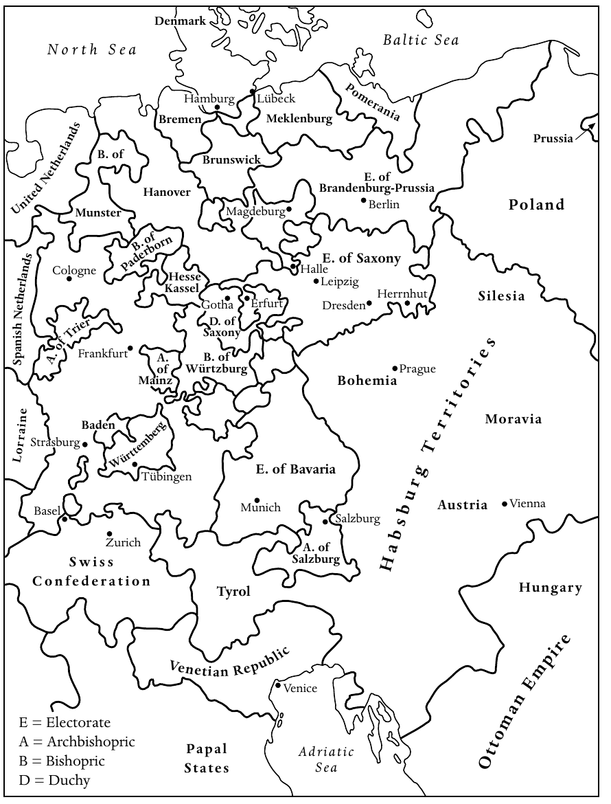

*地图2　1660年的中欧。原图保留英文地名，中文对照如下。*

图例：E（Electorate），选侯国；A（Archbishopric），总主教领地；B（Bishopric），主教领地；D（Duchy），公国。

国家与地区：Denmark，丹麦；United Netherlands，联省尼德兰；Spanish Netherlands，西属尼德兰；Mecklenburg，梅克伦堡；Pomerania，波美拉尼亚；Prussia，普鲁士；Brandenburg-Prussia，勃兰登堡—普鲁士；Poland，波兰；Silesia，西里西亚；Saxony，萨克森；Hesse-Kassel，黑森—卡塞尔；Bavaria，巴伐利亚；Bohemia，波希米亚；Moravia，摩拉维亚；Austria，奥地利；Hungary，匈牙利；Habsburg Territories，哈布斯堡领地；Lorraine，洛林；Baden，巴登；Württemberg，符腾堡；Swiss Confederation，瑞士邦联；Tyrol，蒂罗尔；Venetian Republic，威尼斯共和国；Papal States，教皇国；Ottoman Empire，奥斯曼帝国。

城市与以城市命名的领地：Bremen，不来梅；Hamburg，汉堡；Lübeck，吕贝克；Brunswick，不伦瑞克；Hanover，汉诺威；Münster，明斯特；Paderborn，帕德博恩；Magdeburg，马格德堡；Berlin，柏林；Cologne，科隆；Trier，特里尔；Frankfurt，法兰克福；Mainz，美因茨；Würzburg，维尔茨堡；Gotha，哥达；Erfurt，埃尔福特；Halle，哈勒；Leipzig，莱比锡；Dresden，德累斯顿；Herrnhut，赫恩胡特；Prague，布拉格；Strasburg，斯特拉斯堡；Tübingen，蒂宾根；Basel，巴塞尔；Zurich，苏黎世；Munich，慕尼黑；Salzburg，萨尔茨堡；Vienna，维也纳；Venice，威尼斯。海域：North Sea，北海；Baltic Sea，波罗的海；Adriatic Sea，亚得里亚海。

<!-- PDF page 50; original page 35 -->

他们不应与教会分离，而应努力建设一个更好的教会。第三，施本尔认为，尽管当时的一切征兆都表明救恩史已经向前推进，上帝仍应许他的儿女：在基督再临以前，会有一段漫长时期，他们能够、也应当在这段时期建设上帝的国。这种所谓“对更好时代的盼望”，是对新教末世论十分惊人且富有创新的解释。这一神学观念意味着，凡效法施本尔的人，都应极其积极地参与世间事务，在上帝赐福之下，成功奠定他的国度的基础。基督徒不应因担心最后审判之日迫在眉睫而一味预备迎接它，而应认识到，上帝要求人们承担社会责任，并在处理自身事务时遵循高标准。施本尔由此重新引导了新教徒的活动方向，尤其是那些害怕自己不能获得永生的人。他主张，他们不应恐惧地观察时代的征兆，而应发起并承担有利于教会、乃至一切盼望得救的基督徒共同体的改革计划。

施本尔在法兰克福的各项举措，很快引起注意。有些同僚牧师赞赏他的做法，并试图仿效；另一些人则严厉批评。他们认为，施本尔把一部分会众召集起来举行特别聚会，实际上将使教会分裂为两派：一派被引导得相信自己已经重生，其余人则是所谓“属世之子”（Weltkinder），据说注定灭亡。不足为奇，法兰克福小聚会内部也很快出现紧张。施本尔力求确保小聚会的活力有助于改革教会，但他最重要的合作者、法兰克福律师约翰·雅各布·许茨，却认为教会已经无可挽救，朝这个方向所作的一切努力都徒劳无功。在许茨看来，救恩史已经迅速推进，如今在小聚会中相聚的人，才是末世真正的教会。

经过长久讨论，以及无疑十分痛苦的过程，法兰克福小聚会分裂为二。许茨的追随者另行聚会，数年之后决定迁往宾夕法尼亚，希望在末日将临之际找到避难之地。与此同时，施本尔在法兰克福继续工作了一段时间，但于1686年决定接受德累斯顿宫廷讲道师的职位。尽管这个职位被视为新教德意志、乃至整个路德宗最有声望的职位，施本尔却很快发现，自己无法推行<!-- PDF page 51; original page 36 -->任何拟议的改革：周围是奢华的巴洛克宫廷，而君主对歌剧、烟火和狩猎的兴趣，远胜于社会改革。因此，1692年，仅仅过了几年，施本尔便离开德累斯顿，迁往柏林。职位略低了一些，但这里的宫廷愿意接受他的思想。施本尔一直留在柏林，直到1705年去世。

在柏林，施本尔成为可以称为敬虔主义运动宗师的人物。这座城市的社会构成十分多样，他支持帮助乞丐与赤贫者的计划，积极参与社会制度改革；他也运用自己在宫廷及普鲁士高级军官阶层中的影响，保护在其他领地受迫害的敬虔派。不过，最重要的还是，他为确实数以百计向他求助的人提供辅导，既帮助处理实际事务，也给予灵性建议。施本尔以详尽的长信答复所有请求；这些信在他生前便以《神学思考》（Theologische Bedenken）之名出版。对于敬虔主义史研究者而言，这些书信是信息极为丰富的资料。施本尔希望通过答复来建立一个远超柏林、甚至超越神圣罗马帝国的网络。到晚年，他已经发展出敬虔派交流并取得影响力的两个最重要手段：小聚会和书信。不久，其他宗教社会化方式也得到有效运用：那些彼此视为重生者共同体中弟兄姊妹的人经常互访，志同道合者举行聚会，并建立敬虔派的教育与社会机构。此外，敬虔派很快为教化性小册子和赞美诗贡献大量作品，借此表达自己的灵修精神。到十八世纪初，这场新运动在整个中欧赢得许多追随者，而且，也许更重要的是，它有了鲜明而不可混淆的面貌。换言之，一种新传统已经开始。要被视为敬虔派，就必须把施本尔和约翰·阿恩特的影响，与马丁·路德的影响并列。

早在十七世纪八十年代，虔诚的新教徒就在埃尔福特、马格德堡、吕贝克、奎德林堡等城市，以及许多其他地方，定期举行小聚会。妇女很早便积极参与其中许多聚会，而牧师往往只发挥边缘作用。这表明，施本尔的早期门徒对德意志大学神学院所教授的路德宗正统教义抱持怀疑。与此同时，他们愿意聆听自己认为来自直接感动与启示的内容；在他们看来，这种直接启示可以赐给妇女，也同样<!-- PDF page 52; original page 37 -->可以赐给男子。他们不再服从男性牧师群体的权威，而是依靠灵性的联结、即兴祈祷，以及上帝会直接教导他们如何理解《圣经》某些段落的盼望。正如可以预料的，教会当局很快便介入。凡发现由平信徒主持的小聚会，就加以禁止和解散。在神圣罗马帝国许多路德宗领地，地方当局颁布并执行禁止敬虔派小聚会的敕令，有时还动用不必要的武力。然而，这些措施无法阻止那些确信施本尔思想、并认为自己参与了一场由上帝亲自引导和感动的国际宗教复兴的人。他们相信，受到官方教会迫害，正是自己为上帝所拣选儿女的确切标志。在他们看来，悔罪带来重生，重生带来成圣的任务，成圣则带来得救的确信。

奥古斯特·赫尔曼·弗兰克（August Hermann Francke）比施本尔年轻一代，是他的早期追随者，也是十七世纪八十年代宗教复兴的积极参与者。教会当局解散他曾参与的奎德林堡小聚会之后，弗兰克迁往哈勒，很快便在那里取得惊人成就。他是一位精通各种古典语言、才华出众的学者，获任新成立的哈勒大学教授。此外，他也十分积极地投入社会工作。他创办孤儿院，又把它扩展成小学，继而增设中学和教师培训中心。但这些事业并没有用尽弗兰克非凡的组织才能。短短几年间，除了学校，他还创办药房和印刷所，印制教化性小册子及《圣经》，分发给穷人。不久，许多普鲁士贵族把孩子送往哈勒。弗兰克庞大教育事业的毕业生，在欧洲各地担任教师。早在1706年，其中一些人便前往印度传教，而这只是广泛国际交往网络的开端。

倘若没有柏林的施本尔从旁指导，尤其没有霍亨索伦宫廷给予的特殊特权与保护，弗兰克不可能成功。霍亨索伦王朝在十七世纪初改宗加尔文宗，如今统治的国家，却有强大的路德宗多数群体，并且与地方等级会议关系密切。在十七世纪最后几十年，霍亨索伦家族同许多其他领地的诸侯一样，试图限制<!-- PDF page 53; original page 38 -->本国等级会议的影响。路德宗支持等级会议，而敬虔派希望在霍亨索伦领地立足，恰好适逢其时。普鲁士君主支持施本尔在柏林的社会活动，尤其是给予哈勒的弗兰克特殊特权，便能够削弱路德宗既有教会势力的影响；君主知道，这反过来有助于削弱等级会议的政治作用。因此，霍亨索伦家族决定支持哈勒敬虔派，并不是出于对敬虔主义的喜爱，而是利用他们实现自己的政治目的。

事实证明，在与普鲁士君主打交道时，弗兰克不但不落下风，甚至更胜一筹。他致力于建设自己的王国；或者更准确地说，他确信自己是上帝拣选、用来建设上帝国度的工具。1713年腓特烈·威廉一世成为普鲁士国王后，向弗兰克发出最后通牒，要求他停止参与遍布世界的计划，转而集中力量，改善普鲁士国内的社会与教育。弗兰克知道自己必须让步，至少必须让国王觉得他同意。实际上，他采取了一种可以称为双重策略的做法。一方面，他派遣一些毕业生前往柏林军事孤儿院任教，也向普鲁士军队提供随军牧师，并通过这些及其他方式，试图向国王表明，哈勒只服务于国王的政策，没有其他目的。另一方面，弗兰克不仅继续与许多其他国家的敬虔派联系，还积极扩大哈勒的影响范围。正如近期研究清楚表明的，他与中东欧，尤其是匈牙利和波希米亚，以及北欧，尤其是拉脱维亚、立陶宛和俄罗斯，志同道合的基督徒保持通信。他甚至向西伯利亚派出考察队。弗兰克也与哥本哈根宫廷、英国的福音传播会，以及许多迁居北美英国殖民地的德意志社群，建立密切联系，并向他们供应《圣经》和药品，特别是essentia dulcis药剂。结果，从施本尔于1705年去世到弗兰克于1727年去世之间，哈勒不仅成为普鲁士最重要的敬虔主义中心，以至一些历史学家认为，若不考虑敬虔主义的影响，就无法理解普鲁士的崛起及其独特价值观；它同时也是全世界最活跃的敬虔主义中心。在宗教改革之后两个世纪，经历德意志路德宗长时间自我封闭之后，哈勒敬虔派成为最早走出德意志、<!-- PDF page 54; original page 39 -->并为基督教发展为世界宗教作出重要贡献的德语基督徒。

第三代敬虔派最活跃、也许最有影响力的代表，是生于1700年、曾在哈勒弗兰克教育机构就读的路德维希·尼古劳斯·亲岑多夫伯爵。从十八世纪二十年代起，亲岑多夫便在自己的赫恩胡特庄园聚集虔诚的新教徒，其中有许多来自摩拉维亚和波希米亚的难民，把自己的信仰追溯到约翰·胡斯。1727年，令所有参与者惊喜的是，赫恩胡特发生了一场可以称为集体复兴的事件。这使亲岑多夫确信，上帝赋予了他十分特殊的使命。十八世纪三十年代，亲岑多夫的追随者迅速增加，来自德意志各地的敬虔派加入他的事业。赫恩胡特很快变得太小，亲岑多夫立即采取行动。在随后几年，他在其他地方，甚至其他国家建立新社群，例如尼德兰的宰斯特和莱茵地区的诺伊维德。他也经常旅行。历史学家称他为跨越一切界限的伯爵，这一说法有多重含义。他不仅不止一次前往北美，那里赫恩胡特弟兄会，也就是英语世界所称的摩拉维亚弟兄会，建立了伯利恒社群；他还与那些最忠诚的普通追随者保持密切灵性联系。他的第二位妻子就来自非贵族家庭。

早在十八世纪三十年代，亲岑多夫便派传教士前往遥远地方。其中最著名的，是摩拉维亚弟兄会向西印度群岛糖种植园的非洲奴隶，以及格陵兰的爱斯基摩人传教。亲岑多夫的传教士通常是熟练工匠，最好是木匠，尽管在格陵兰，这种手艺后来证明几乎无用，因为那里找不到可供建房的树木。赫恩胡特传教士成功的秘诀，无疑是始终把《圣经》教导同实际帮助结合起来。亲岑多夫的神学，最适合被描述为早期形式的普世合一思想。他不看重宗派差别，而是试图建立一支由坚定信仰、已经重生的基督徒组成的国际大军，由自己担任无可争议的领袖。在赫恩胡特内部，他按照性别、婚姻状况与年龄，把人们编为所谓“诗班”。十八世纪四十年代末，另一轮灵性亢奋席卷赫恩胡特及其他摩拉维亚社群。这件事广为传播，使传统新教徒、乃至哈勒的敬虔派，都认定亲岑多夫不值得信任。1760年亲岑多夫去世时，他留下的遗产既丰富，又充满问题。到去世时，他已经<!-- PDF page 55; original page 40 -->积欠巨额债务。但他的遗产仍然鼓舞人心，因为他成功创立了第一场真正具有国际性的传教运动，在各大洲都设有据点。

符腾堡敬虔派对亲岑多夫的态度，即使不能说不友善、有时甚至敌对，也至少是最为保留的一批。他们始终与本地等级会议关系密切，整个十八世纪都保持如此。实际上，可以说，符腾堡敬虔派所主张的严格禁欲主义，构成了等级会议政治反对立场的基础。他们反对的君主，同当时多数德意志诸侯一样，企图实行绝对主义统治，并模仿凡尔赛宫廷的生活。同时，符腾堡敬虔派在社会工作方面并不十分活跃。他们专注于灵性造就和个人成圣，加强家庭联系和地方网络，但主要目标并非创建新机构或派遣传教士。那些希望成为传教士的符腾堡青年，便前往赫恩胡特。

符腾堡敬虔派的特殊之处，在于对末世论和末日启示抱有浓厚兴趣。在这方面，最有影响力、也最有学术威望的人，是约翰·阿尔布雷希特·本格尔。他仔细汇集《旧约》和《新约》，尤其是《约翰启示录》中能找到的所有数字，又以自认为有意义的方式把数字组合起来，以揭示救恩史隐藏的时间次序，最终断定基督第二次降临的确切时间是1836年6月，地点当然是耶路撒冷。本格尔确信，上帝把这种认识启示给自己，是为了让他劝告最忠诚的儿女，为这个最关键的事件作好准备。本格尔于1752年去世。失去灵性领袖以后，符腾堡敬虔派仍未忘记：他们所生活、又给他们带来如此多艰难的世界秩序，将在不太遥远的未来彻底改变。十八世纪九十年代，法国革命引发的一连串动荡展开时，符腾堡敬虔派确信，这是基督再临前魔鬼最后肆虐的开端。正如本卷末章将会说明的，他们中有些人决定迁往巴勒斯坦，希望在那里找到安全的避难所，等待1836年和基督第二次降临。

在评估敬虔主义对欧洲大陆新教的影响时，1740年构成一个分水岭。在此之前，运动一直增长，尤其得益于哈勒受到普鲁士国王的优待，以及亲岑多夫各项事业的吸引力。1740年腓特烈大帝在柏林<!-- PDF page 56; original page 41 -->掌权后，局势发生剧变。新普鲁士国王热烈信奉启蒙思想。他鄙视哈勒所宣传的那种虔敬，也毫不犹豫地表明自己的看法。1723年，在弗兰克的压力下，腓特烈·威廉一世决定把启蒙哲学家克里斯蒂安·沃尔夫逐出哈勒大学。1740年，他的儿子腓特烈大帝上台后，最早采取的行动之一，就是恢复沃尔夫在哈勒的教席。对于哈勒乃至其他地方的敬虔派而言，这是一个明确无误的信号：他们享受柏林宫廷保护的时代结束了。

第一次西里西亚战争的爆发，也影响了亲岑多夫的运动。也许并非纯属臆测的是，亲岑多夫在十八世纪四十年代对宾夕法尼亚抱有强烈兴趣，是因为他觉得，腓特烈大帝登位以后，中欧已经不再适合真正信仰的追随者；上帝剩下的儿女需要另一个生活与劳作之地，以等待基督归来。也许，至少部分哈勒敬虔派也抱有同样看法。这就能够解释，为什么十八世纪四五十年代，哈勒和赫恩胡特的追随者在宾夕法尼亚激烈对抗，各自试图取得影响和控制权。

## 正统与不从国教之间的十八世纪欧洲大陆新教

尽管敬虔主义在十八世纪上半叶的欧洲大陆新教中十分重要，若使人以为敬虔派完全主导了这一时期的新教教会生活，仍然会造成误导。前文已经提到对敬虔主义的抵抗，而这种抵抗大多由其他新教徒提出并付诸行动，既包括正统路德宗，也包括传统加尔文宗。进入十八世纪相当长时间之后，新教正统仍然拥有并保持三个主要影响领域：第一，主要大学的神学院；第二，包括大多数教会领袖在内的庞大教士群体；第三，大多数邦国政府和地方行政机构成员。换言之，到十八世纪相当长一段时间内，多数新教领地中，邦国君主统治教会的体制，即“领邦君主教会治理制”（Landesherrliche Kirchenregiment），仍然完整而有效地运作。大学既被要求为政府提供忠诚的法律专家，也有义务培养忠于政府的牧师。各大学都积累了大量正统神学文献，可以用于未来牧师的学术训练。

<!-- PDF page 57; original page 42 -->

相应地，新教教士应在地方层面代表教会与国家。牧师负责妥善办理婚姻、洗礼、葬礼，当然还有主日礼拜。不过，在这些工作之外，他们还必须确保地方秩序不受扰乱，使那些无论在工作日还是主日滋扰他人的人，受到法律制裁。在许多地方，牧师兼任教师；有些提供医疗建议，需要时也提供医疗帮助。在各地，牧师的职责都远不止宣讲纯正信仰。实际上，可以说，主日礼拜是他们职责和职能中最不重要的一项。如果平信徒未经牧师同意和认可便组织小聚会，牧师有义务干预。如果村庄或城市出现激进异议群体，牧师便应采取行动。简言之，牧师是邦国政府伸向地方的手臂。正如大多数邦国政府成员坚持传统正统信仰一样，许多牧师也如此。当然，也有许多牧师不满足于固守传统正统，或仅仅充任政府办事员。正如前文所见，有些转向敬虔主义，另一些则受到早期启蒙思想吸引。事实上，到十八世纪三十年代，尤其到四十年代，接受启蒙思想的牧师人数，已经超过支持敬虔主义者，也超过仍然坚持正统教义者。

此外，在某些地区，延续激进宗教改革传统的新教激进主义，其作用远大于敬虔主义或正统派。典型地区是由一些较小诸侯以家长式方式统治的领地，即普法尔茨、黑森、图林根的部分地方，以及莱茵河下游某些区域。多数情况下，这些激进派受到末世论激励。他们的领袖宣称，末日已经临近，剩余真正的上帝儿女必须与官方国教会分离，因为这些教会在他们看来已经落入魔鬼之手。这些激进派尽可能另行举行礼拜，不经地方牧师协助便举行圣餐。他们沿袭十六世纪重洗派的传统，常常坚持成人洗礼。平信徒讲道十分普遍；人们也普遍相信，未被学术神学败坏的人，最能理解《圣经》中的上帝之言。从十七世纪晚期开始，直到十八世纪相当长一段时间，自行受命的巡回讲道者穿行德意志乡村。他们常遭迫害，被逐出所到的村镇。但他们所受的羞辱越多，在寻求神圣真理的人眼中就越有权威。例如，曾经做过<!-- PDF page 58; original page 43 -->制革工的约翰·腓特烈·罗克，数十年间游走于德意志南部，新教异议者把他尊为先知和圣徒。

几乎所有地方政府，都认为新教分离派是严重的政治危险。这类群体的领袖被投入监狱，当局动用一切手段，拆散区域性的分离派网络，并打消这些不从国教信徒的信心。从十七世纪八十年代起，尤其在1700至1730年间，后来又在十八世纪五十年代，许多新教异议群体面对猜忌与压迫，决定离开德意志。一些迁往特兰西瓦尼亚，但多数前往北美的英国殖民地，尤其是宾夕法尼亚。在这件事情上，德意志的损失是否成为美洲的收获，取决于人们如何看待教会的作用，以及宗教生活应当如何发展。如果相信任何情况下都应服从教会规章，任何异议都只会妨碍会众的灵性成长，就能够赞成那些不容许异议的牧师的行动。然而，如果承认每个人的个人良心的重要性，并认为宗教自由是建设上帝国度的必要成分，就必须相信，新教国家官员和新教牧师在压制不从国教者、驱逐异议者时，违背了自己的基督徒召命。无论如何，通过排除分离派和异议者，德意志新教，无论路德宗还是加尔文宗，都失去了一种富有活力的宗教因素。这种因素本可能带来另一种局面：宗教之所以繁荣，恰恰因为它不再首先被要求服务于政治目的。

## 1648年以后中欧新教国家的巩固

1648年的《威斯特伐利亚和约》确认了1555年的《奥格斯堡和约》，同时作出一些重要修改。除了由天主教诸侯或主教亲王统治的领地，以及路德宗诸侯的领地之外，加尔文宗诸侯如今也在神圣罗马帝国的法律框架内，得到平等地位。路德宗和加尔文宗诸侯也都是本国教会的正式首脑。在帝国内多数路德宗和加尔文宗领地，教会治理交由宗教事务委员会负责。教区监督负责监督区长，区长又有义务管理村镇中直至堂区层面的教会生活。宗教事务委员会还组织未来牧师的教育，监督在职牧师履行职责，并负责<!-- PDF page 59; original page 44 -->管理教会财政与财产。简言之，它们不仅代表作为教会首脑的君主，还获授权执行君主希望实施的、有关教义和教会生活的敕令。在某些路德宗国家，教会事务由主教主持，例如瑞典，教会由乌普萨拉总主教领导。不论在教会生活的实际事务上，还是在维护与捍卫路德宗或加尔文宗教义方面，由主教领导的新教教会与由宗教事务委员会治理的教会，差别都很小。在两种情况下，诸侯都试图把教会纳入绝对主义统治正在形成的官僚体制，并取得程度不一的成功。在中欧，只有少数新教国家的等级会议，仍能在教会事务上行使一些权力。帝国内的梅克伦堡诸公国和符腾堡公国，就是这种情况。帝国以外，匈牙利某些加尔文宗省份，以及瑞士邦联的新教各州，也是如此；下文将会说明，前者一直承受天主教的压力。

中欧新教国家的国教会，最主要的支撑首先来自统治诸侯，其次，尤其在城市中，来自受过良好教育的中产阶级家庭。相比之下，贵族家庭往往以法律上的自主权和社会地位的独特性为荣，并珍视自身宗派传统，即使它可能不同于国家确立的传统。此外，1648年以后的数十年间，还经过很长时间，宗派教义灌输才对下层阶级产生显著影响。作为工匠或农民的雇工，下层民众通常遵循雇主所信奉的宗教。如果有机会为了更好的生活迁往其他地区，或被迫迁移，他们常常并不表现出强烈的宗派忠诚。甚至在工匠中，也有多次改变宗派归属的例子。

不过，也有宗派忠诚的突出事例。1685年，那些宁愿离开法国，也不愿改宗天主教的胡格诺派，在接纳他们避难的国家中，形成紧密的宗派社群和会众。他们由改革宗牧师领导，而牧师又得到大量受过良好教育的商人和工匠支持。在移入社会中，他们成功建立了坚持改革宗信仰的社群，直到十九世纪相当长时间以后，仍忠于英勇祖先的宗教传统。在胡格诺派之后仅几年便被迫迁移的瓦勒度派，也表现出<!-- PDF page 60; original page 45 -->对自身独特传统的非凡宗教忠诚。他们也在获准建立新居的地方，继续保存瓦勒度派信仰。甚至十八世纪三十年代初，被一位毫不妥协的天主教总主教驱逐、不得不离开阿尔卑斯故乡山谷的萨尔茨堡人，也把宗派身份保持了好几代。他们迁往遥远地方，有些去东普鲁士，有些远至新成立的英国殖民地佐治亚，一路受到新教同道的赞颂，被视为真正新教信仰的英雄。在能够定居的领地，他们多数获得特殊特权，包括实践自身信仰的权利，因而得以纪念自己独特的宗教命运。

然而，不能把接纳国的诸侯给予胡格诺派、瓦勒度派和萨尔茨堡人的特权，视为宗教宽容的表现。例如，胡格诺派以极有才能、生产能力很强的工匠著称；路德宗诸侯允许他们定居本国并保留改革宗传统，是在追求自身经济利益。诸侯的立场表现为重商主义理论所要求的经济实用主义，而非有意识的宽容政策。给予萨尔茨堡人避难所的诸侯，也并非受到启蒙运动宗教宽容思想的激励。他们向这些人在穿越帝国的旅程中获得的声誉致敬，同时试图把自己塑造成真正新教信仰的捍卫者。即使在普鲁士，宗教宽容政策也是后来才出现的。

1555年首次宣布、1648年再次确认的“教随国定”（cuius regio ejus religio）原则，在十七世纪末和十八世纪初受到严峻考验，因为几位新教诸侯决定改宗天主教。最突出的事例发生于1697年：萨克森选侯有机会成为波兰国王，条件是改宗天主教，而他确实这样做了。此外还有类似情况。例如，1733年，一位天主教诸侯继承了路德宗的符腾堡公国。自十六世纪宗教改革初期以来，萨克森和符腾堡始终是路德宗最重要的捍卫者。如果君主成为天主教徒，萨克森和符腾堡应如何维护这一传统？当重要诸侯转向另一个宗派阵营时，神圣罗马帝国内的宗派力量平衡又如何维持？在这两个事例中，等级会议都成功主张由自己保护路德宗，并负责教会治理。这种妥协使帝国内新教和天主教势力之间的微妙关系，得以保持。

<!-- PDF page 61; original page 46 -->

不过，也有一些政治事件威胁欧洲列强格局中的宗派平衡。1648年以后的数十年间，1685年撤销《南特敕令》严重损害了新教在西欧的地位。同样，哈布斯堡王朝也着手加强天主教在中东欧的力量。他们巩固天主教会在波希米亚的统治以后，逐步使阿尔卑斯各省重新归于天主教。到1700年前后，随着土耳其人被击败、巴尔干大片地区向哈布斯堡的影响敞开，王朝的主要目标，变为支持匈牙利王国的反宗教改革。匈牙利加尔文宗的领袖再次决意抵抗。早在十七世纪初，加博尔·拜特伦伯爵和乔治·拉科齐公爵就曾率领许多信奉加尔文宗的同胞，起义反抗哈布斯堡的反宗教改革政策，尽管未能成功；1703年，弗朗西斯·拉科齐公爵也采取了同样行动。到1711年，维也纳成功镇压反对势力，匈牙利新教徒继续陷于苦难。三十年后，他们的处境有所改善，因为女皇玛丽亚·特蕾西亚对匈牙利新教徒表现出一定尊重。但直到1782年，也就是她去世两年以后，她的儿子、皇帝约瑟夫二世才颁布著名《宽容敕令》，给予哈布斯堡帝国内部宗派自主权，其中也包括匈牙利新教徒的宗派自主权。

哈布斯堡王朝在西里西亚的反宗教改革，同样具有侵略性。1648年以后，除了两个小公国和布雷斯劳城，西里西亚路德宗信徒不再享有宗教自由。虽有三座所谓“和平教堂”（Friedenskirchen）交给他们，但总计一千二百多座新教教堂，却被收回改作天主教礼拜场所，并编入天主教会众。此后数十年，约二十万西里西亚路德宗信徒决定外迁。另有许多人留下，参加森林中的秘密路德宗礼拜，即所谓“林中教会”（Buschkirchen）；有些人则经常长途跋涉，到邻近路德宗领地的边界另一侧参加礼拜。援助来得很晚，而且出乎意料，来自一个此前就曾拯救中欧新教的强国。1707年，瑞典国王卡尔十二世凭借强大军队，迫使皇帝约瑟夫一世签订《阿尔特兰施泰特协定》。协定保证，把西里西亚一百三十座遭没收的原新教教堂归还路德宗，另准增建六座所谓“恩典教堂”（Gnadenkirchen），并重新开放新教学校。这些措施挽救了西里西亚的新教，比腓特烈大帝于1740年吞并西里西亚，早了数十年。同样必须注意，哈布斯堡王朝的<!-- PDF page 62; original page 47 -->反宗教改革，不仅在西里西亚造成大规模迁移和普遍绝望，也在与天主教维也纳的对抗中，促成了一种极为丰富的西里西亚文学文化。在1740年以前的许多西里西亚诗人中，也许最有才华的是安德烈亚斯·格吕菲乌斯。

这些事例表明，即使《威斯特伐利亚和约》已经签订，接连不断的反宗教改革尝试，仍然挑战中欧新教的巩固。但同时，也应注意，在欧洲某些国家，新教蓬勃发展，并各以不同方式，对该地区的宗派事务产生强大影响。在绝对主义支持下，瑞典和丹麦的路德宗都发展出强有力的传统；即使敬虔主义取代路德宗正统，这一传统也没有削弱。不过，也存在其他影响中欧新教的途径。在尼德兰，新教与等级会议、而非绝对主义诸侯紧密结合，成为强大力量。另一方面，瑞士的新教各州却必须经过几场战斗，才能维护其宗派自主权。也许，没有什么比清教在英格兰的成功，更能鼓舞欧洲大陆的新教徒。英国清教提供了丰富的教化文献，多数经由尼德兰传入中欧。清教也提供了一个范例：新教能够在强权政治的舞台上得到成功捍卫。

因此，1648年以后欧洲新教国家的巩固，应被视为发生于两个层面的过程：欧洲政治层面和民众宗教层面。首先，在欧洲政治层面，新教强国的兴起，有助于稳定新教整体的地位。1648年以后，瑞典和丹麦继续以直接、间接方式保护中欧新教；尼德兰也如此，不过主要凭借其经济力量与文化中心地位。1689年以后，大不列颠成为欧洲首要的新教强国；数十年后，新成立的普鲁士王国也加入其列。因此，到1700年，尤其到1740年，我们能够看到欧洲形成某种双重宗派均势：首先，也最显著地，存在于神圣罗马帝国内部；同时，也存在于欧洲主要列强之间，而后者的影响又有助于加强前者。其次，在新教强国保护下、不再受到反宗教改革力量威胁时，新教在民众宗教层面得到巩固。十八世纪上半叶，新教在中欧许多地区，成为不容置疑的生活方式。其程度之深，以至于当萨尔茨堡<!-- PDF page 63; original page 48 -->总主教在十八世纪三十年代初决定驱逐领地内的新教徒时，多数欧洲人都认为，这种行为已经不合时宜。

## 启蒙运动的目标与吸引力

启蒙运动的新思想，最先吸引了欧洲西北部，也就是大不列颠和尼德兰的新教徒。英国和荷兰思想家大胆迈向新的世界观，而德意志新教中的同道在表达新思想时，通常即使算不上胆怯，也更为谨慎。德意志新教徒塞缪尔·普芬多夫的政治著作，以及同胞克里斯蒂安·托马修斯的哲学论著，就是如此。他们都缺乏大卫·休谟、托马斯·霍布斯或约翰·洛克等苏格兰或英格兰作者的眼界与决心。十八世纪初德意志新教神学家约翰·弗朗茨·布德乌斯、约翰·洛伦茨·冯莫斯海姆、约翰·格奥尔格·瓦尔希、克里斯托夫·马特乌斯·普法夫和约翰·奥古斯特·厄内斯蒂的著作，也同样如此。与安东尼·柯林斯、约翰·托兰、威廉·惠斯顿、托马斯·伍尔斯顿或马修·廷德尔等英国和爱尔兰作者讨论自然神论的作品相比，他们的著作仿佛只是对新思想所作的谨慎调整。在尼德兰写作的巴鲁赫·斯宾诺莎，生前对德意志没有影响。直到他于1677年去世将近一百年以后，其思想才被讨论或受到高度重视。皮埃尔·贝尔和克里斯蒂安·沃尔夫的书，对德意志思想生活的影响稍早一些，但也没有早于十八世纪中叶。甚至著名的德意志哲学家戈特弗里德·威廉·莱布尼茨，在同时代人中受到的注意也很少。只是后世回顾时，他的哲学思考的价值，以及为启蒙神学话语开路的贡献，才获得应有的关注与赞誉。

必须再次强调，1740年这一分界十分重要。在腓特烈大帝成为国王之前，启蒙运动对新教德意志的影响很小。此后，从1740年到七年战争于1763年结束，启蒙运动获得发展动力。在1763年至法国革命爆发之间，包括德意志大学神学院在内的公共领域，逐渐由启蒙运动的核心议题主导。正是在这一时期，莱辛发表了赫尔曼·塞缪尔·赖马鲁斯所写的部分《圣经》批判文本；约翰内斯·约阿希姆·施帕尔丁在著作中阐释启蒙思想原则；奥古斯特·弗里德里希·威廉·萨克和<!-- PDF page 64; original page 49 -->约翰·弗里德里希·威廉·耶鲁萨莱姆，开始以批判方式讨论基督教神学的核心问题；克里斯托夫·弗里德里希·尼古拉伊，则把文学批评运用于《圣经》文本。就在巴士底狱陷落前的二十年间，约翰·萨洛莫·塞姆勒、戈特霍尔德·埃弗莱姆·莱辛和伊曼努尔·康德，在著作中讨论并充分展开启蒙纲领。他们坚持，宗教和神学传统必须经得起理性（Vernunft）的检验；而且，基督教必须遵循宽容原则。对莱辛来说，摩西·门德尔松的思想，比新教传统更重要、更富启发性。对康德而言，以理性为基础的批判，重于教条。

诚然，启蒙纲领具有两个面向。一个面向，是运用理性主义和批判的原则；另一个面向，则是在生活的诸多领域推行实际改革。甚至可以说，尽管《圣经》批判在德意志新教内部的影响，始终局限于相对少数的大学神学家，却正是这些实际改革，从根本上改变了德意志新教，并帮助造就新一代教士，使他们以新方式理解自身任务。至少最初，敬虔派全心支持许多启蒙改革。例如在哈勒，克里斯蒂安·托马修斯支持奥古斯特·赫尔曼·弗兰克的教育事业。不过，敬虔派与启蒙圈子虽然能在实际改革上合作，到了末世论和基督论问题上，便分道扬镳；当启蒙思想家提出《圣经》批判问题时，就更是如此。然而，在许多地方，这种分裂往往直到十八世纪中叶才出现。至少在若干十年间，我们能够观察到，两场改革运动的个别成员，在地方组成联盟，以推动具体计划。

启蒙改革主要涉及德意志生活的六个领域。第一，不论是早期启蒙运动，还是十八世纪下半叶的启蒙运动，改善教育都是核心目标。教育意味着，儿童应定期上学，学习读写；也意味着，人们应学习个人卫生的基本知识，患病时应请医生诊治，使用适当药物。简言之，人们要为自己的生活负责，并运用上帝托付给他们的智力，改善自身、家庭及所在社群的状况。不言而喻，中等学校的课程，以及大学的<!-- PDF page 65; original page 50 -->教学，也应改进。新的大学相继建立，完全致力于启蒙纲领，哥廷根大学就是一例。

第二，对启蒙运动而言，有用知识不再只存在于传统宗教文本或教化文献中。启蒙运动支持者创作并传播大量新的、专业化程度很高的文献，其中许多具有实际用途，讨论医疗问题、农业事务、法律改革等。此外，启蒙思想家认为，受过教育的人应关心诗歌、小说和戏剧。直到十八世纪初，新教德意志出版的大多数文本仍围绕宗教和神学主题；但到1750年，这类主题已占全部出版物不到百分之二十。

第三，对许多人而言，启蒙作者要求的法律改革，比任何其他改革更重要。除了运用正当法律程序，这些改革还讨论死刑、应如何处理杀婴等重大问题。德意志法律专家追随意大利伟大改革者切萨雷·贝卡里亚，要求废除酷刑，也废除死刑。在此以前，被认定犯杀婴罪的妇女，无法期待任何宽恕；现在，讨论却转向那些诱惑年轻女子的男子所应承担的罪责，同时向这些妇女提供建议、辅导与实际帮助。此外，在其激进形式中，启蒙运动不容忍任何迷信。十七世纪的巫术审判，受到鄙弃，令人惊骇。因此，甚至在1789年以前，许多民间神话与传说已经被祛魅。所以，在十八世纪末，尤其在新教德意志，我们能够看到一种引人入胜的愿景：通过合乎理性地运用法律，建立公正而宽容的社会。

第四，启蒙作者坚持，改革纲领还应包括农业、制造业和商业。在这些领域，启蒙运动使人们重视发明，以及新技术的实际应用。一个有力例子，是连续两年歉收造成的1770至1772年严重饥荒。此前发生严重短缺的年份，例如十六世纪七十年代、十七世纪九十年代，所有评论者都恳求同胞停止犯罪、悔改，重新过上良好基督徒的生活，好使上帝停止惩罚，施以怜悯。相比之下，1770至1772年，大多数讨论危机的作者却要求同时代人，比过去更有效地运用<!-- PDF page 66; original page 51 -->上帝赋予的理性能力。他们应实行轮作，建造更好的粮食储存设施，使用肥料和更优良的种子。简言之，他们相信，如果有关改善农业的启蒙纲领得到实施，这场危机原本可以避免。

第五，受启蒙运动激励的人，对欧洲以外的文化产生新的兴趣。敬虔派派传教士前往异域，而启蒙科学家则试图探索并描述亚洲与非洲的社会，尤其是伊朗、印度、中国和日本等非基督教国家。他们不像传教士那样，把这些文化看作异教徒的文化，仿佛除了福音之光以外一无所需，而是以民族学家的眼光加以观察。他们相信，正如约翰·戈特弗里德·赫尔德所阐释的，一切文化和一切民族都是平等的，因此试图向它们学习。欧洲的帝国主义和殖民主义是后来的事。

第六，也是最后一点，热心的启蒙精英特别关心宽容犹太人的问题。直到十八世纪相当长时间之后，德意志犹太人仍只是勉强得到容忍。他们必须额外缴费，才能确保居留，却始终无法作为公民得到接纳。正是在这样的情况下，启蒙精英开始要求，一切宗教的一切成员，包括犹太人，都应完全平等。奥地利皇帝约瑟夫二世最先在这方面迈出重要步骤；其他君主，包括腓特烈大帝，也追随其榜样。法国革命爆发时，许多城镇的犹太居民已经获得较稳固的地位，但民众的敌意，不论在德意志的天主教地区还是新教地区，都继续存在。许多新教徒，尤其是关心传教事业的人，宣传这样一种观念：使所有犹太人改宗基督教，即“对犹传教”（Judenmission），就能解决问题。要实现一个多信仰德意志的愿景，让各类新教徒、天主教徒和犹太人都包含在内，仍有漫长的道路。到1789年，莱辛在《智者纳坦》（Nathan der Weise）中如此雄辩而动人地阐述的宗教宽容纲领，距离被接受为一种生活方式，还相当遥远。

可以想象，启蒙运动代表人物提出的这套全面而富有挑战的纲领，要得到实施，即使只是部分实施，也需要巨大努力。当法国革命彻底改变欧洲局势时，许多工作尚未完成。由于许多法国事件的观察者逐渐相信，应由激进启蒙运动为旧秩序的突然剧变负责，1789年以后，按照启蒙思想<!-- PDF page 67; original page 52 -->推行改革，就困难得多。启蒙攻势还没有成功，反扑就已经开始。

## 作为一种世俗化形式的开明专制

十八世纪下半叶，统治中欧各新教国家的开明专制君主，在最好的情况下会倡导宗教宽容；但更常见的是，除了在某些节日和特殊场合遵循传统礼仪，他们对宗教并无兴趣。例如，开明专制君主以卫生为由，下令关闭此前通常设于城镇中心教堂院落内的墓地，并在城镇、村庄外开辟新墓地。圣地对他们并不重要，圣物也只是作为艺术形式而受到重视。正如当时许多天主教统治者，解散那些未向社会提供有用服务的修会的修道院一样，在许多新教统治者看来，牧师只有在劝人有序生活、勤奋工作、服从当局时，才有用且必要。开明专制君主往往缺乏对宗教的尊重，也缺乏与宗教的深厚情感联系。因此，把新教开明专制君主的统治视为世俗化的重要一步，并没有错。如果这些统治者为国家与教会逐渐分离打开道路，并给予宗教少数群体有效的政治支持，那么，结合启蒙见识的绝对主义统治，至少暂时可能发挥有用作用。然而，他们既坚持政治事务上的绝对服从，又坚持把权威强加于教会生活，从而以违背其启蒙原则的方式，挑战个人良心的神圣性，最终造成无法长期维持的政权。

在新的政治统治形式尚未建立以前，反对开明专制君主教会政策的力量就开始增长，尤其在德意志新教地区。早在1780年，便成立了“维护真正基督教协会”（Christentumsgesellschaft）。不到十年，中欧许多地方出现分会。最初，协会成员出版小册子，反驳启蒙神学观点。几年以后，尤其从十八世纪九十年代初开始，他们积极反对启蒙教会政策。例如，新教宗教事务委员会引进遵循启蒙原则的新赞美诗集或新礼仪时，协会便组织地方抵抗。此外，当巴塞尔成立传教会，<!-- PDF page 68; original page 53 -->以及几年后德意志若干城市创设《圣经》公会时，他们也提供支持。这两类事业的重要外援，都来自大不列颠的新教反革命圈子。“基督教协会”的成员认为，自己正为共同事业而战，也自认属于敬虔主义传统。可以肯定，这些反对开明专制的群体，代表了欧洲大陆新教宗教复兴的开端。这场复兴一直延续到十九世纪相当长时间之后，并体现为“复兴运动”（Erweckungsbewegung），也就是与北美第二次大觉醒、或瑞士法语新教地区的复兴（Réveil）相对应的德意志新教运动。拿破仑战争结束后，在德意志多数新教领地，必须在启蒙思想仍存的代表人物、敬虔主义的新追随者，以及那些在时代动荡中对新教正统产生意外兴趣的圈子之间，达成妥协。在十九世纪中，这种妥协受到自由主义、社会主义，尤其是德意志民族主义的挑战；后者于1813年反抗拿破仑的斗争中，首次以意想不到的方式爆发。

---

<!-- PDF page 69; original page 54 -->

# 第三章　大不列颠与爱尔兰

**J.C.D.克拉克（J. C. D. Clark）**

## 国家教会的理想

从苏格兰1638至1639年的“主教战争”，直到十七世纪五十年代，不列颠群岛内部的战争本质上是宗教战争，往往起于争夺国家教会控制权的尝试。几乎所有冲突参与者最初都认为，一个同质、权威、与政治共同体相重合的教会是正当的；区别只在于，他们为这个统一团体设想了不同目标。然而，冲突的现实粉碎了这一理想：十七世纪四十年代，每个人都行自己眼中看为正的事，“多元社会”取得胜利。这种纷繁而热烈的宗派主义，使1660年君主制复辟之际，国家教会的复兴显得是最不可能实现的政治前景。然而，国家教会理想竟然先得以恢复，随后一直到十九世纪二十年代，都享有支配地位。

英格兰尤其如此。到1660年，“英格兰教会”（Ecclesia Anglicana）这一观念，已经经历一千年多样的发展；1563年的《三十九条信纲》提及“每一个个别或国家教会”（第三十四条），却不加解释，正是沿用较古老的认识。把在英格兰的教会视为英格兰的国家教会，这种意识在十六世纪三十年代和五十年代得到加强，却并非在那时才被创造出来。世俗与神圣彼此扶持，既是一种崇高理想，也是一套行政程序；基督教君主在治理教会中具有合法作用，通常被追溯至君士坦丁。1660年，复辟的复合君主国中，每一个组成领地，都试图实行这个仍然强大的理想。英格兰、苏格兰和爱尔兰各有自己的国家教会，也共同抱持同质基督教社会的愿景，而这些教会的地位，正是这种愿景的表达。

威廉·沃伯顿所说的话，反映了当时普遍接受的看法：“凡存在宗教差异的地方，每一宗派都相信自己才是真理，都力求在其他宗派的废墟上壮大自身……宗派之间的这种内部斗争造成多少迫害、叛乱、<!-- PDF page 70; original page 55 -->革命，以及公民自由和宗教自由的丧失，即使对人类历史所知最少的人，也十分清楚……显而易见的补救办法，就是确立一个教会，同时给予其余各派自由的宽容。”[^p070-1] 这一理想继续主导政教关系。到1780年，国家教会仍是常态，根基牢固，并得到十分精密的理论辩护。

1785年，甚至宽教派的威廉·佩利，也能够把确立国教制度当作没有争议的事项来分析：

> 宗教确立制度的概念包含三件事：一个教士阶层，即脱离其他职业、专门承担宗教职务的一群人；依法为教士的生活提供供养；以及把这种供养限于基督教某一特定宗派的教师。[^p070-2]

然而，这只是最低限度的学说。1660年，一种选择，即实行主教制的圣公会传统取得优势，所涉及的远不止于此。后来成为坎特伯雷总主教的威廉·桑克罗夫特，恳求上帝“把那种混沌、混乱和意见纷争，化为美丽而和谐的整体”。[^p070-3] 事情并未如此发展：主教制此后的胜利，把与之分离的其他选择界定为“宗派”。每个宗派都有一套有关教会论或教会体制的教导，依据《圣经》历史、启示或自然法，为自己的主张辩护。这些教导继续相互竞争，尤其在约1660至1725年间；这一时代，新教与罗马天主教两方面的非国教挑战，激发了圣公会最有力的回应。

不过，在君主国不同领地，“国教会”一词含义不同。在威尔士，它可能像郡制和治安法官制度一样，被视为与1536年合并相关的教会。在苏格兰，1688年革命以后，长老制得以强制实行。爱尔兰教会则可被看作英格兰统治集团的教会，由亨利八世、伊丽莎白、克伦威尔和威廉三世，以不同方式强加于当地。在英格兰，教会却从未在这种政治上主动创制的意义上被“确立”，从未从相互竞争的选择中被挑选出来。从这一英格兰视角看，国教会与国家的关系，只是加强而非创立了教会。正是在这种意义上，塞缪尔·约翰逊于1755年《词典》中，把“确立”（establishment）定义为“确认已经做成之事；批准”。教会也在另一意义上是一个“获确立的机构”：它有复杂的捐产供养体系，由总主教、主教、座堂主任牧师和会吏长组成的圣统制提供服务，并由拥有捐产的大学与文法学校加以支持；它通过获捐助的医院、孤儿院和<!-- PDF page 71; original page 56 -->收容院从事慈善事业，以自称出于神授权利的什一税为供养，并借助世俗权力征收。相比之下，对吉尔伯特·伯内特这类低教会派人物来说，被“确立”的并非教会本身，而是“新教宗教”。[^p071-4] 然而，英格兰国家教会的理论根据，并不来自路德或加尔文，而是英格兰神学家和法律家所完成的工作。

## 英格兰教会的性质

1660年的复辟并非照搬劳德派蓝图，但主要是高教会派运用劳德的遗产，塑造恢复后的体制：王室至尊权、主教制、主教—司祭—执事三级圣职、教会法庭，以及礼仪一致。他们把这种教会体制与高教会派的教会论结合起来，核心是教会具有神圣教权的性质。1660年大批补任主教时，桑克罗夫特在讲道中所捍卫的，并非教会与国家的关系，而是教会本身：教会作为一种教会体制，其形式和权威来自使徒。与这个重大主题相比，只要国家给予保护，教会与国家之间究竟具有何种联系，并不是他首先关心的。[^p071-5]

教会若在主教制下主张权威有独立来源，既可能支持君主制，也可能对其构成挑战。因此，必须论证：主教制可能具有神授权利，但这是较弱意义上的神授，即效法基督或使徒的榜样、沿用其制度，而不是服从一项明确的神圣命令。强制性管辖权只能来自王权。罗马天主教徒、长老派和独立派挑战国王的至尊权，主教制拥护者却不如此。[^p071-6] 这种解释公式未能阻止双方冲突；教会的抵抗也有助于在1688年推翻一位天主教君主。教会要求世俗官长支持的一般理由，并非它只是国家出于实用考虑选择的教会，而是它体现了宗教真理。后来成为主教的威廉·劳埃德，就在这种“确立”意义上论述：首先捍卫教会的使徒地位与教义，然后谴责罗马的谬误，最后才提出支持教会的另一动机，即“国王人身的安全，以及王权的特权……按照律法之下犹太诸王所拥有、并由最初基督教皇帝所行使的权力”。[^p071-7]

在英格兰，人们不断讨论教会的性质及其与国家的联系。由于没有成文法定义，个别教士提出的<!-- PDF page 72; original page 57 -->观点，有时逐渐获得半官方地位，其中最著名的人物是理查德·胡克（约1554—1600）。1662年，新任埃克塞特主教约翰·高登，出于反劳德派目的，编辑并首次合刊《教会政制法》的八卷。第七卷以神授权利以外的理由支持主教制，第八卷则对君主制提出宪制限制，这些内容令人尴尬。因此，1666年，按照总主教吉尔伯特·谢尔登的指示，胡克的著作再次出版，由艾萨克·沃尔顿重新编辑，冠以新写的胡克传，并显著刊出编者对最后三卷真实性的怀疑。胡克本人曾以宽厚态度看待非主教制教会，并不否认它们圣职的有效性；但如今，他的著作却可以被读成查理一世时代高教会派的作品，强调世俗和教会权威之所以相联，是因为二者同样由神意授予。复辟以后，胡克享有最高声望。教士们赞扬他，认为他驳倒了古老的清教徒私人判断权主张，因而能够作为新教不从国教者分离宗派这一新现象的解毒剂。

为了证明君主在非罗马教会中的作用，胡克实际上搁置了使徒统绪，转而主张：“宗教真理是使教会区别于人类其他政治社会的独特差异。”如果教会并非分别奠基于自身的使徒性，就可能推出教会与国家是同一个共同体：“我们认为，英格兰教会的每一个人，同时也是国家共同体的成员；国家共同体的每一个成员，也同时属于英格兰教会。”把这个团体称为教会，还是称为国家共同体，便取决于“偶然”。[^p072-8] 作出这一反教皇论断以后，胡克对于后来被纳入“国教确立”问题的其他事项，没有多说。如今，其他人替他补充了这些论述。

约1660至1725年间，为了回应两大强烈威胁，即新教与罗马天主教两方面的非国教力量，高教会派的教会论得到明确界定。第一种威胁，是十七世纪六七十年代、空位期宗派主义留下的主要挑战。后来成为伊利主教的西蒙·帕特里克，在众多批评分裂的论著中写出一部，指出争论的关键：私人良心、未经许可的圣职、即兴祈祷，以及声称获得个人启示。他针对此类现象，捍卫使徒传承的按立，以及官方规范“无关救恩之事”的合法性。[^p072-9] 谢尔登总主教的随行牧师、后来成为牛津主教的塞缪尔·帕克，受谢尔登委托，有影响力地重新阐述<!-- PDF page 73; original page 58 -->“无可驳倒”的胡克，却去掉胡克对王权的宪制限制。如今的重点，是运用胡克抵制独立分离的非国教这一新现象，以服从这一基督徒义务，取代不从国教者诉诸私人判断的做法。对帕克来说，英格兰教会的“形式与制度，不仅得到基督教最美好、最纯洁时代的认可，而且由本国根本法律所确立”，已经足够，因为“每个国家共同体的最高官长，都应获授权力，在宗教事务上治理并引导臣民的良心”。[^p073-10]

第二种挑战来自罗马天主教。十七世纪七十年代，推定王位继承人约克公爵詹姆斯改宗天主教，使这一挑战变得突出。对此的回应，不仅形成新的世俗政治意识形态——辉格主义，也催生大量出色的圣公会教会论与神学作品，旨在驳斥罗马的权利主张。1679至1681年，辉格党企图排除詹姆斯的继承权，导致排斥危机；教士们在捍卫君主制时，却不突出“国教确立”的概念。他们声称，英格兰教会“比世上其他任何团体，更坚持、教导并实践忠诚；其神学家普遍认为君主制出于神授权利”，与之相反，罗马教会认为国王权威来自人民，国王可能受教皇谴责或罢黜。这种政治立场源于以下事实：“英格兰教会现行的宗教，并非我们新近发明，而正是我们的主耶稣及其使徒留下记载的同一宗教。”衡量标准是宗教真理：“至于我国法律对不从国教者施加的惩罚，与其说因为他们判断不同于我们，不如说因为他们扰乱了世俗政府的安宁。”[^p073-11]

1707年，辉格党高教会派人士约翰·波特，对这种教会论作出经典总结。他仍然同时针对罗马和日内瓦，宣称要依照《圣经》和教父所确立的“基督教会的体制、治理与权利”，证明宗教改革以来英格兰教会的“固有权利”，以及世俗官长的“正当特权”。这部著作意在“制止那些埃拉斯都主义和其他放纵原则；这些原则太过流行，又受到我们中某些人过分支持”。波特认为，教会只拥有属灵权力；然而，它“并非纯属自愿的社团，而是人有义务加入的团体”，因为“这个社团的设立，伴随着奖赏与惩罚的强制约束”。基督去世以后，教会由“后来各世代中同样职分的<!-- PDF page 74; original page 59 -->继任者”治理，直至世界终结；圣职等级与其权力一样，都来自神的委任。波特承认：“要继续叙述教会被置于世俗权力保护以后之事，证明基督教君主的至尊权，并使之与教会权利相协调，将需要另写一部书。”他没有完成这部书，而于1715年成为牛津主教，1737年成为坎特伯雷总主教。[^p074-12]

另一位辉格党高教会派人士埃德蒙·吉布森，1723至1748年任伦敦主教，最终为波特所理解的教会与国家关系，提供了持久有效的法律解释。吉布森的《英格兰教会法典》（Codex）于1713年以两卷对开本出版，1761年重印，被公认为教会法的权威汇编。吉布森既坚持政教联合，也坚持教会具有独立权威。他通过详尽历史考察，论证界定政教关系的文献，承认教会在灵性上的独立。制定法律通常只是“强化古老教会法”，旨在“沿同一渠道”加强它们，而非取而代之。因此，主教施行“治理与纪律”，既依据“神的权威，也依据人的权威”。教会因而并非“国家纯粹的造物”。然而，这并不是走向联盟的前奏，因为基督教君主在国家与教会中的至尊权，使二者不可分离地统一。[^p074-13] 吉布森认为，法学家爱德华·柯克爵士主张，未经议会通过的教省教士会议立法，只约束教士而不约束平信徒，这种说法是错误的。1717年教省教士会议停止活动，使这种高教会派观点变得难以处理，但并未必然驳倒它。

法律家托马斯·伍德，在1720年一部标准汇编中表达类似但经过重要修改的立场。“一般法律”尤其建立在“自然法”，即通常所称的“理性法”，以及“上帝的启示法”之上；“因此，我国法律惩处亵渎、伪誓等行为，接纳妥当制定的教会法规，并假定教会中存在属灵管辖权与权威”。伍德仔细说明教会法庭和世俗法庭各自的作用：二者都受王室至尊权约束，在他的论述中，看不出管辖权冲突。不过，他认为，“教会立法权，以及经王室同意制定的有关教会的法规，约束教士，却不约束平信徒”。[^p074-14] 身兼教士与法律家的理查德·伯恩，也如此主张。到1763年，他明确接受普通法法律家在考克斯案（1700）及米德尔顿诉克罗夫特案（1736）中的学说，<!-- PDF page 75; original page 60 -->即“未经议会法案确认，教省教士会议的法规不约束平信徒”。[^p075-15]

如果说法律家几乎总是重申伍德的立场，那么，质疑吉布森的教士也十分突出。本杰明·霍德利及其盟友，试图以低教会派的最低限度论，反击高教会派的教会论，以防范天主教斯图亚特王朝复辟的威胁。辉格党教士普遍抓住国家合法规范教会作用这一共同立场；霍德利只是其中最声名狼藉者，却利用这一点，同时抨击拒誓派和高教会派神学。第一种批评在政治上得到认可，便使他免受攻击第二者所带来的后果。

霍德利坚持认为，拒誓派针对的，正是确立宗教这一原则：“现在，国教制度被公开、直接地指控为毫无权利。”霍德利回答，尽管有1688年革命，这仍是有效的确立制度，因为上帝既没有为主教，也没有为君主，规定“有规则且从不中断的继承”。相反，每个人“获得上帝恩宠的资格，不能取决于他实际上处在或继续处在任何特定制度中，而在于他依照良心行事、并据此安排自身行动时是否真正真诚……因此，上帝的恩宠随真诚本身而来”。[^p075-16] 霍德利教会论中的埃拉斯都主义，也反映于其神学：不受限制的私人判断，是基督教的本质；没有教会能够声称，自己在直接行使神的委任。基督

> 在这些问题上，没有留下任何可见的人间权威，没有真正能够被称为代替他位置的代理人，没有他的臣民必须绝对依赖的解释者，也没有凌驾于他子民良心或宗教之上的审判者……他的所有臣民，都是同等的臣民；因此，同样没有权威去改变、增添或解释他的律法，从而要求其他人绝对服从这样的解释。[^p075-17]

大多数教士，虽然赞成霍德利有关革命合法性的论证，却仍痛斥这些神学观点。然而，辉格党政治家更经常同情霍德利的神学，因为他们正确认识到，教会要求世俗权威的主张，他们所坚决拒绝的主张，植根于教会自认为直接承受神圣委任的信念。辉格党取得优势的最初几年，议会多次试图废除教士认为属于“国教制度”不可分割部分的法律。一部分遭到废除，一部分则继续存在。面对空前激烈的反对风暴，沃波尔最终退却，不再以牺牲“国教制度”为代价扩大“宽容”。“班戈争论”是对把<!-- PDF page 76; original page 61 -->基督教作最低限度解释的抗议；提出这种解释的霍德利，当时是班戈主教。争论虽然由霍德利教导的政治层面引起，后来却集中于教会的属灵权威。霍德利最有力的对手，是拒誓派威廉·劳。[^p076-18] 他诉诸十六世纪改革者所界定的英格兰教会观：教会对于属灵权威的主张，建立在基督、使徒、教父和大公会议的证据之上。这一论证将在本世纪后半叶普遍流行。

十七世纪六十年代，教会认为自己同时遭受日内瓦和罗马攻击。到十八世纪三十年代，越来越明显的是，两种挑战都被击退，教会将保有法律为它界定的地位。然而，高教会派却遭受一次重大挫败。在强调教会的神圣委任时，他们有时把独立权威赋予教会立法机构。胡克没有界定教省教士会议与议会的关系，1660年以后，这一关系仍不确定。1664年，教省教士会议放弃为教士确定赋税的权利，作为回报，却在1664至1688年间未再获召集。1689年，它再度开会，但对其作用的争论日益激烈。同年，威廉三世再次宣布休会之后，“教省教士会议争论”便在政治层面展开。[^p076-19] 会议最主要的支持者，后来是1713年起任罗切斯特主教的弗朗西斯·阿特伯里；他虽然向新政权宣誓效忠，却也支持詹姆斯党。另一方的主要代表，是1716年起任林肯主教的埃德蒙·吉布森，以及同年起任坎特伯雷总主教的威廉·韦克。霍德利如今成为最后一根稻草。他的神学异端是会议无法回避的挑战，而会议显然打算处分他，使事态更加严重。辉格党政权采取先发行动；经过数次动荡的年度会议后，教省教士会议于1717年停止活动。此后，不管多么牵强，人们都必须把议会当作英格兰教会的平信徒大会。

此时，威廉·沃伯顿刻意采用辉格党语言，为国教制度提供原则上的辩护。然而，在他当时，人们并不普遍认为他已经提出教会的官方理论根据。原因在于，从十七世纪六十年代起重新解释的胡克模式，主张教会与国家本质统一，从而排除了沃伯顿的模式，即本质上分离的教会与国家两个团体之间的契约。到1713年，主张世俗与神圣本质统一的圣公会学说，已经充分形成。沃伯顿1736年的小册子，是后来少数以政教关系为中心的作品之一，因为在波特和吉布森时代，这个问题已经可以被视为解决。从这个角度看，<!-- PDF page 77; original page 62 -->人们倾向于认为，沃伯顿的理论只是通往共同结论的一条道路。1766年，他答复博林布鲁克时，又揭示自身立场的根基。他认为，只有基督教教义才是上帝所赐；“教会治理”却“可以由主教制、长老制或独立制实行”，因为其“具体形式”并未被“规定”。相反，耶稣把选择留给“各个教会，让它们遵循最符合其将获确立之处世俗社会形式的体制”。[^p077-20] 不过，十八世纪中后期多数教士，并不赞同沃伯顿的看法。

沃伯顿在十八世纪三十年代，以自然法和契约语言表达国教制度的观念；同样，佩利在八十年代以功用语言表达类似观念，也反映了其时代的措辞。表面上，二人都否认世俗官长需要关心宗教是否真实。沃伯顿为国教制度提出的核心辩护，是功用而非真理。[^p077-21] 然而，细读之下，即使沃伯顿和佩利，最终也把教会的权利主张建立在其教义的真实性之上。沃伯顿认为，国家会与国内较大的教会结盟，因为它最“能够……实现联盟的目的”，但前提是“在其他方面条件相等”。在1736年第一版中，关键限定是“在［教会之间的］分歧不涉及根本事项的地方”。显然，英格兰教会声称自身奠基于自然法。沃伯顿还在一条脚注中，对教会表示强烈赞许：“我要推荐那部题为《为市政团体法与宣誓法辩护》的优秀论著。”[^p077-22] 但托马斯·舍洛克1718年的那部小册子，却以真理作为教会权威的前提。[^p077-23] 沃伯顿后来虽然删去这一论证，却继续保留最后的主张：联盟“确保……真理的推进”。[^p077-24]

威廉·佩利1785年的畅销著作，至少表面上，也采取类似论证：“国教制度的权威……建立在其功用之上。”这一立场并不是预示功利主义者杰里米·边沁，而是像沃伯顿一样，出于宽教派信念，认为《圣经》没有规定任何特定教会治理形式。然而，佩利并未主张，《圣经》不曾权威地确立任何神学教导。他另一个宽教派前提是：“在宗教中，正如在其他题目中一样，真理若任其自行发展，几乎总能取得优势。”因此，“在不同信仰体系中，最好的，就是最真实的……我们有理由断言，真实宗教凭借自身的真实性，独立于一切有关倾向、适宜性或任何其他内在<!-- PDF page 78; original page 63 -->性质的考虑，便普遍是最好的。”所以，甚至“宽容的正义性与适宜性，我们也主要建立在它有助于真理这一点上”。[^p078-25]

霍德利和沃伯顿，并未摧毁高教会派为国教制度提供的理论根据。威廉·布莱克斯通迅速获赞誉的《英国法释义》，同样说明这一点：他把基督教视为公民社会不可分割的一部分。[^p078-26] 对布莱克斯通而言，英格兰教会的价值，建立在其教义真实、以及能够抵御不从国教者对国家所构成威胁的双重基础上。[^p078-27] 因此，世俗官长“确实有义务保护国教会，只让其真正成员担任受信任并获得报酬的公职；因为，如果每个宗派都被允许自由分享世俗职位，国家教会制度的概念就会立即遭到破坏，主教制教会也就不再是英格兰的教会”。

布莱克斯通指出，《市政团体法》和《宣誓法》是“两道堡垒”，“保障我们的公民自由与宗教自由”；但他没有进一步深入思考，教会在何种意义上被“确立”。[^p078-28] 他重申古老普通法学说：“基督教是英格兰法律的一部分。”[^p078-29] 直到十九世纪初，法官在亵渎性诽谤案件中仍依赖这一学说。布莱克斯通不仅嘲讽辉格党关于国家起源的契约论，[^p078-30] 他叙述教会历史时，也没有给契约留下位置。他论教士的一章，暗示了教会获确立地位的起源：他把教士的“广大特权”追溯到查理曼以前，早于任何能够证明政教缔结联盟的时刻。[^p078-31]

直到十九世纪初，国教会具有实际益处的论证，依然强劲。但从十八世纪六十年代起，圣公会教会论中重新出现另一条与之竞争的传统，批评霍德利—沃伯顿—佩利一系，认为它偏离高教会派教会论。这一传统的代表包括乔治·霍恩、奈兰的威廉·琼斯、塞缪尔·霍斯利和查尔斯·多布尼。他们对于君主制和主教制的神授权利，提出不同解释，却都把教会描绘为按神意设立、构成国家起源的一部分。对他们而言，《圣经》提供的根据，支持由天意、而非契约形成的社会秩序。

这种对于大公性教会论的重新主张，到1815年，形成了对国教制度的辩护，尽管教会“崇高而超越的权利主张”并非“世俗性质”，而它作为“国家确立制度”的地位，也只意味着国家供养礼拜、保护其免受其他宗派侵害，而非具有强制平信徒的权利。因此，重新提出的<!-- PDF page 79; original page 64 -->教会使徒权威主张，即一种“远高于国教确立地位的性质”，也可以成为务实捍卫其国教地位的途径。在这种辩护中，世俗官长支持国教制度，只是“为了维持宗教意识，以谋求社会福祉”。然而，官长选择支持哪一个教会，并非完全不受限制，因为按这种解释，只有一个教会能够主张使徒权威：“其他一切自称为教会的团体，都必然……只是人为制度。”只有信仰根本事项上的分歧，才能为分离提供正当理由：“当一个国教会在体制上是使徒教会时，唯有这样的分歧，才能证明脱离该教会是正当的。”[^p079-32] 正是这种兼具功用论与大公教会论性质的根据，支持国家教会理想在1808至1828年间最后一次繁盛。废除国教地位成为一种理想，则要等到1844年“解放协会”成立。

## 爱尔兰

爱尔兰教会也是“国家”教会，尽管它颇为矛盾地早于自身的“民族国家”，并且不断争论延续性问题。同英格兰教会一样，爱尔兰教会也经十六世纪立法而重组。1704年宗教资格审查法以后，其成员同样垄断政治职位；总主教和主教在爱尔兰上议院占有席位，参加国家仪式，为政治秩序提供认可。教士也试图通过教省教士会议表达意见，却未能成功；这一机构只在1703至1714年开过会，并受到爱尔兰新教议员抵制。尽管教士会议总体上停止活动，教会法庭网络仍继续运作。1688年以后，爱尔兰教会同英格兰教会一样，在政治路线上严重分裂：辉格党指责托利党和高教会派对手，主张教会独立于世俗权力；托利党则贬斥辉格党地主不敬宗教且反教权，指责低教会派教士信奉埃拉斯都主义或宽教派思想。这种体制无法对教会财政、兼任教职或教职荐举权带来根本改革。爱尔兰教会太经常被威胁其生存的政治危险占据心思。

十七世纪的政治事件，强化了一个前提：天主教徒一旦掌权，就会力图彻底剥夺新教徒的财产，甚至可能置之死地。到1700年，约四分之一的人口在两极分化中形成“新教徒”身份，其中一半属于<!-- PDF page 80; original page 65 -->实行主教制的爱尔兰教会，另一半是主要集中于阿尔斯特的长老派。后一个群体对实行主教制的国家教会构成第二种挑战。斯威夫特说：“北方热心的长老派，对国教教士的疏远，甚于对罗马教士；他们指责前者从事偶像崇拜，说他们是伪装的教皇派、礼仪贩子，还有许多其他专门称呼；而这有一个十分有力的理由：国教教士挡了他们的路，教皇派教士却没有。”[^p080-33] 然而，长老派自己也在1725年分裂：一方是支持《威斯敏斯特信条》的“旧光派”，另一方是反对强制信条的“新光派”，其理由往往是反对三位一体论。

1691年的失败，对天主教徒是一场灾难。面对新教徒控制的都柏林议会，威廉三世几乎没有保护他们。从十七世纪九十年代到十八世纪二十年代，一系列法案使天主教徒受到种种公民权利限制。这些零散通过的法律，不久便获得一个体系化名称：“惩罚法”。可以说，这套法典确有效果：爱尔兰没有像苏格兰1715年和1745年那样的詹姆斯党起义，爱尔兰天主教势力的地位也不断削弱。因此，约1720年以后，法典上的反天主教立法越来越少得到执行，天主教礼拜获得事实上的宽容。然而，尽管强迫人们接受宗教信仰，后来声名不佳，为人们遵循宗教真理提供物质动机，对爱尔兰教会教士而言却不是问题。他们采用的策略，如果1689至1691年战争的结果不同，他们的天主教同道也会实行。

此外，这种策略相当成功。在十九世纪二十年代丹尼尔·奥康奈尔带有民粹色彩的爱尔兰民族主义兴起以前，爱尔兰和英格兰的罗马天主教徒，都越来越被看作君主制国家的潜在支持者；美国革命和法国革命，进一步确认了这种逆转。这种转变如此明显，以至爱尔兰议会认为，已经可以在1778年和1782年通过《天主教徒救济法》，拆除惩罚法典中有关宗教礼拜、教育和土地所有权的限制；1792至1793年又进一步放宽。1780年时，几乎无法预见十八世纪最后二十年那种带有革命与共和意味的乡村下层民众暴力。像在英格兰一样，爱尔兰的国家教会似乎是通向日益和谐与繁荣的道路。

对新教不从国教者的法律歧视，效果却较差。长老派在阿尔斯特繁荣发展；他们的不满意识，结合其古老的抵抗理论，在殖民地美洲，以及爱尔兰国内的政治运动中得到表达。十八世纪七十年代初，大批阿尔斯特人移居美洲；而国内政治运动在美国战争期间，几乎使爱尔兰摆脱英格兰<!-- PDF page 81; original page 66 -->的统治。像在英格兰一样，构成主要挑战的是新教、而非罗马天主教的非国教力量。

爱尔兰高教会派认为，自己的教会是普世教会的真正支派；它古老的大公性而非罗马性的身份，由不列颠人圣帕特里克确立。其理论根据的支柱，必须是使徒性与初代教义的纯洁，而非人数占多数。直到十八世纪八十年代，爱尔兰教士仍运用这种教会论，回应天主教或长老派的挑战。有些教士强调一种威胁，有些强调另一种，但都认为，教会地位一直处于危险之中。当英格兰这种争论模式逐渐消退时，在爱尔兰，它却仍是辩论的核心。

如果说使徒性和初代教义构成爱尔兰教会的基础，那么，英格兰教会理论根据中的另一个部分，却不存在。信徒人数相对较少，使沃伯顿式教会与国家同一的愿景，从一开始在爱尔兰就缺乏说服力。英格兰讨论“教会与国家”，爱尔兰却讨论“惩罚法典”。1719年爱尔兰《宽容法》给予新教不从国教者礼拜自由，但在1719年和1733年，废除1704年爱尔兰《宣誓法》的尝试均告失败。爱尔兰教会自身很少产生教会论辩论，主要借助英格兰的理论根据。其捐产不够丰厚，无法充分供养本土知识阶层；因而，它更加坚定地遵循查理一世时代神学家的教导。

国家教会也确实限于各自的国家：教士可以把论证局限于本国，而不觉得必须急于用邻国情形检验其公式。沃伯顿没有提及爱尔兰，也没有提及任何多个宗派大致平等的政治共同体。表面上，他认为，为宗教改革提供正当理由的是人数而非真理。随着人数改变，“教皇派教会与英格兰王国之间的联盟被打破；另一个与新教的联盟，取而代之”。[^p081-34] 然而，沃伯顿的论证最终诉诸真理，而非功用。在1736年版本中，他使用过一个爱尔兰类比，后来又删去。他认为，“如果每个宗派都能自由进入行政机构”，就会产生“混乱”；“谁想看到这种状况给公民社会带来不可容忍祸害的生动图景，可以读一位才子为捍卫爱尔兰《宣誓法》所写的两部小册子；尤其应读上文提到的那部精彩论著《为市政团体法与宣誓法辩护》”。[^p081-35] 他由此再次倚靠托马斯·舍洛克，并以明确暗指的方式倚靠乔纳森·斯威夫特。[^p081-36] 然而，作为爱尔兰高教会派，斯威夫特采用的却是很不相同的论证根据。[^p081-37] 回避讨论<!-- PDF page 82; original page 67 -->邻国宗教安排的，并非只有沃伯顿。1798年，英格兰高教会派查尔斯·多布尼，更公开地以真理作为英格兰教会权利的基础，却同样忽略苏格兰和爱尔兰。[^p082-38]

因此，爱尔兰“国教会”为其公共作用缺乏强有力的理论根据；另一种模式，即“新教优势地位”的观念，直到本世纪后期才形成。十八世纪八十年代起，乡村恐怖暴力骚乱，使克洛因主教理查德·伍德沃德把爱尔兰教会及其国教地位，与新教土地所有者的利益相联系。这一表述吸引了该社会群体，却不能吸引伦敦政府，因为后者正为英爱共存寻求更广泛的基础：从1791至1792年起，英国政府开始实行相反政策，给予爱尔兰天主教徒政治权利。[^p082-39] 伍德沃德的新表述具有实际功用；但即使他也承认，佩利为国教会提供的理论根据中，那种功用论方面的论证，会“颠覆爱尔兰的新教政府”。可以说，事实也证明如此。[^p082-40]

## 苏格兰

苏格兰教会继承了中世纪教会的确立地位，但在十六世纪晚期，以及1688年以后，再次经过根本改革，成为长老制教会。主张苏格兰宗教改革切断了教会与王权的联系，比在英格兰得出同样结论，更具说服力。不过，这一关键问题并不清楚，因为主教派与长老派仍为掌握同一个苏格兰教会而争斗。1660年恢复的主教制，比英格兰的对应制度，更具有妥协性质；例如，它没有质疑既有长老派按立的有效性。然而，这一方案先是遭到长老派盟约派的武装抵抗，随后苏格兰主教又明确表明，对威廉三世的效忠有其限度，因而再度失败。1690年，在充满怨恨的氛围中，苏格兰议会以法案建立长老制。[^p082-41] 主教派渴望斯图亚特王朝复辟，这种可能性不断威胁长老制安排。

十六世纪后期，苏格兰教会受到的加尔文主义影响，远强于英格兰教会。因此，它难以把自己表现为全体苏格兰人的教会；日内瓦式热忱，使它越来越成为由蒙拣选者聚集而成的教会。它接受一份看起来像奠基文献的信条，即1647年由爱丁堡议会批准的《威斯敏斯特信条》。这一信条以1643年苏格兰的《庄严同盟<!-- PDF page 83; original page 68 -->与盟约》为基础；后者曾导致苏格兰试图把加尔文主义和长老制强加给英格兰。具有讽刺意味的是，这种分离教会与国家的尝试，却使苏格兰教会更加像一个议会教会。

在苏格兰，1688年以后，政教联合是含蓄地、自下而上实现的。长老派强烈反对世俗官长同时担任国家和教会首脑，也反对由国王挑选的主教制。相反，它发展出一套复杂正式的教会治理结构，这一点与英格兰长老派不同，能够在没有国家干预的情况下自我规范：从堂区长老会，经由区会和大会，逐级构成金字塔，顶端是每年在爱丁堡开会的总会。这意味着政教分离。1707年合并以后，苏格兰牧师不能像英格兰教士一样，在议会选举中投票；也不能进入威斯敏斯特下议院；苏格兰教会在上议院没有直接代表。苏格兰没有相当于英格兰《市政团体法》或《宣誓法》的法律，把公职限于长老派；不过，在一个如此强烈、且带有强制性的长老派社会中，这类规定没有必要。教会治理与地方治理的联系如此有效，以至很少有牧师成为治安法官，与英格兰做法形成鲜明对照。

这种形式上的政教分离，并未引起苏格兰人对国教制度性质的多少思考。相反，它在长老派内部引发冲突，并在一个教会可能主张完全自理的领域，产生范围有限、却十分激烈的争论：教会要求任命牧师的权利，而这种要求，与地主和王权在宗教改革以前拥有的教职荐举权相冲突。荐举权是财产，因此可以继承；什一税权利也是如此。正如英格兰的什一税，苏格兰的什一税在宗教改革时期，也常被地主占有，如今只有部分流向地方牧师，尽管1740年以后，总会多次向议会请愿，却均未成功。这两种做法都触怒热心的长老派；在反对它们的运动中，长老派借助民众平等观念，以及对地方富人的怨愤。

1660年，荐举权随主教制恢复而复兴。1690年，获胜的长老派废除私人荐举权；1707年《合并法》又保证维持苏格兰既有教会安排。然而，1712年，托利党控制的威斯敏斯特议会，恢复苏格兰平信徒的荐举权；1714年以后，辉格党政府也不肯纠正许多苏格兰人眼中的重大不公。最初，许多<!-- PDF page 84; original page 69 -->荐举权所有者回应民众反对荐举权的情绪，没有强行任用自己的人选。但从乔治二世统治时期起，他们越来越常这样做，逐渐改变牧师群体的性质，使其转向更温和的方向。苏格兰教会所谓“民众派”清楚认识到这一趋势，把私人荐举权看作世俗化和灵性冷淡的象征，加以抵制；他们认为，从十八世纪五十年代起，温和派软化了的加尔文主义，就表现出这些特征。

长老派容易分裂，但各支一般都赞同国家教会原则，只是在其中谁配担任这一角色的问题上分歧。直到十八世纪，这些分裂才逐渐产生新的宗派，以及事实上的自愿原则。1733年，因坚持盟约、反对荐举权，以及不满教士日渐温和，分离教会脱离国教长老会。它开始吸收西南部仍然存在的盟约派成员。其成员言辞激烈，有时抱持千禧年思想，保存盟约派的抵抗理论，却没有放弃国家教会原则。1747年，这个宗派再度分裂，争论成员在接受地方公职时，向王权宣誓效忠是否合法。然而，另一支长老派分离者，很快便明确拒绝国家教会理想，即托马斯·吉莱斯皮于1761年创立的救济教会。他曾任国家教会牧师，1752年因反对荐举权而被罢职。这个宗派没有分离教会那种严峻的加尔文主义，对成员资格采取宽教派态度；到1800年，人数显著增长。

其他分离者包括格拉斯派，得名于约翰·格拉斯（1695—1773）。他因质疑长老派的国家教会信条，于1730年被解除圣俸教职。这样的挑战在苏格兰吸引的支持者很少，不过，罗伯特·桑德曼（1718—1771）继承了这一立场；以他命名的运动，实际上从公理制立场挑战长老制。这些脱离国教会的运动不断增长，在某些地区人数可观，早于约1780年以后英格兰非国教力量的复兴，也更加严重地削弱边界以北的国家教会理想。

有人认为，1707年以后，苏格兰教会总会成为苏格兰议会的替代物。如果如此，这个替代物通常与伦敦辉格党当局协调行事，而非反合并情绪的催化剂，更谈不上成为某种早期民族主义的推动者。在十七世纪，苏格兰长老派与抵抗理论及其<!-- PDF page 85; original page 70 -->实践紧密相连；十八世纪，这种联系逐渐消退。同时，长老派的分裂倾向，也阻止了类似罗马天主教会在爱尔兰所推动的民族主义繁盛：苏格兰不会出现自己的丹尼尔·奥康奈尔。

十九世纪头二十五年，联合王国政府有意识地利用各国教会推进社会政策，承认教士是国家在社会改善和政治稳定工作中的代理人。这一做法已经在英格兰、威尔士和苏格兰奏效；1801年以后，也被用于爱尔兰。到1829年，它在那里失败；伦敦政府坦率接受失败，意味着英格兰也要从根本上重新界定这一制度。不过，在1780年，即使北美殖民地正经历一场意义重大的宗教战争，人们也很少能够预见，后来国家教会理想将遭遇何等程度的挑战。

<!-- PDF page 86; original page 71 -->

## 注释

[^p070-1]: [William Warburton], The alliance between church and state (London, 1736)；此处引自1766年版，收入 Richard Hurd (ed.), The works of the Right Reverend William Warburton D.D., 12 vols. (London, 1811), vol. 7, pp. 241–2, 250。

[^p070-2]: William Paley, The principles of moral and political philosophy (London, 1785), p. 556.

[^p070-3]: W[illiam] S[ancroft], A sermon preached in S. Peter’s Westminster, on the first Sunday in Advent (London, 1660), p. 39.

[^p071-4]: [Gilbert Burnet], An impartial survey and comparison of the Protestant religion, as by law established (London, 1684).

[^p071-5]: [Sancroft], Sermon, pp.9–11.

[^p071-6]: Robert Sanderson, Episcopacy (as established by law in England) not prejudicial to regal power (London, 1661), pp. 13–15, 21, 32, 40.

[^p071-7]: [William Lloyd], A seasonable discourse shewing the necessity of maintaining the established religion, in opposition to popery (London, 1673), pp. 10–17.

[^p072-8]: The Works of Mr. Richard Hooker, ed. Isaak Walton (London, 1666), pp. 447–8.

[^p072-9]: [Simon Patrick], A friendly debate between a Conformist and a Non-Conformist (London, 1669).

[^p073-10]: [Samuel Parker], A discourse of ecclesiastical politie (London, 1670), pp. ii, 10, 112–13, 174, 199–200.

[^p073-11]: [Thomas Comber], Religion and loyalty supporting each other (London, 1681), pp. 37, 39–40, 59.

[^p074-12]: John Potter, A discourse of church-government (London, 1707), sigs. A2r–A3v, pp. 2, 11–12, 53, 124, 139–40, 213.

[^p074-13]: Edmund Gibson, Codex Juris Ecclesiastici Anglicani, 2 vols. (London, 1713), vol. 1, pp. i, iv, xvii–xix.

[^p074-14]: Thomas Wood, An institute of the laws of England (London, 1720; 2nd edn, 1722), pp. 2, 4, 396, 498–500.

[^p075-15]: Richard Burn, Ecclesiastical law, 2 vols. (London, 1763), vol. 1, p.406.

[^p075-16]: Benjamin Hoadly, A preservative against the principles and practices of the nonjurors both in church and state (London, 1716), pp. 2, 72, 78, 90–1.

[^p075-17]: Benjamin Hoadly, The nature of the kingdom, or church, of Christ. A sermon . . . March 31, 1717 (London, 1717), pp. 11–12, 30.

[^p076-18]: William Law, Three letters to the Bishop of Bangor (London, 1721).

[^p076-19]: Thomas Lathbury, A history of the convocation of the Church of England, 2nd edn (London, 1853).

[^p077-20]: Warburton, Works, vol. 7, p.368 (postscript to the fourth edition).

[^p077-21]: Warburton, Works, vol. 7, pp.281–2.

[^p077-22]: Warburton, Works, vol. 7, pp.242–3; [Warburton], Alliance (1736), pp. 110–11.

[^p077-23]: Thomas Sherlock, A vindication of the Corporation and Test Acts. In answer to the Bishop of Bangor’s reasons for the repeal of them (London, 1718), p. 31.

[^p077-24]: Warburton, Works, vol. 7, p.287.

[^p078-25]: ‘Of religious establishments and of toleration’, in Paley, Principles of moral and political philosophy, pp.554–7, 579.

[^p078-26]: William Blackstone, Commentaries on the laws of England, 4 vols. (Oxford, 1765–9), vol. 4, pp. 41–65；有关布莱克斯通对伍德的借鉴，参见 Thomas A. Green 为芝加哥版（1979）所写的导言，第四卷第iii页。

[^p078-27]: Blackstone, Commentaries, vol. 4, pp.52–3.

[^p078-28]: Blackstone, Commentaries, vol. 4, pp.53, 57–8, 432.

[^p078-29]: 引述 1 Ventris, p. 293：Blackstone, Commentaries, vol. 4, p. 59。

[^p078-30]: Blackstone, Commentaries, vol. 1, pp.47–9.

[^p078-31]: Blackstone, Commentaries, vol. 1, pp.364–83, at367.

[^p079-32]: [John Bowles], The claims of the established church; considered as an apostolical institution, and as an authorised interpreter of Holy Scripture. By a layman (1815; London, 1817), pp. 2–5, 15, 75, 78.

[^p080-33]: The advantages proposed by repealing the sacramental test, impartially considered (1732), in The works of Jonathan Swift, 6 vols. (London, 1755), vol. 5, p.222.

[^p081-34]: Warburton, Works, vol. 7, pp.242–4.

[^p081-35]: [Warburton], Alliance (1736), p. 117.

[^p081-36]: [Swift], The advantages propos’d by repealing the sacramental test; idem, The Presbyterians plea of merit; In order to take off the test, impartially examined (Dublin, 1733).

[^p081-37]: 斯威夫特一贯以温和姿态示人，却以一种实际上支持某一方的方式这样做，尽管他声称要在各方之间求取中道：The sentiments of a Church of England man with respect to religion and government (London, 1708)，收入 Swift, Works, vol. 2, pp. 53–80，所引在第57页。

[^p082-38]: Charles Daubeny, A guide to the church, in several discourses (London, 1798).

[^p082-39]: Jacqueline Hill, ‘The meaning and significance of “Protestant Ascendancy”, 1787–1840’, in Lord Blake (ed.), Ireland after the Union (Oxford, 1989), pp. 1–22.

[^p082-40]: Woodward, Present state of the Church of Ireland, p. vii; Peter Nockles, ‘Church or Protestant sect? The Church of Ireland, high churchmanship and the Oxford Movement, 1822–1869’, Historical journal, 41 (1998), pp. 457–93，所引在第467页。

[^p082-41]: John Sage, An account of the late establishment of Presbyterian government by the Parliament of Scotland in Anno 1690. Together with the methods by which it was settled, and the consequences of it (London, 1693).

---

<!-- PDF page 87; original page 72 -->

# 第四章　经济与社会中的教会

**菲利普·T.霍夫曼（Philip T. Hoffman）**

在近代早期欧洲，基督教影响多数人的一生，从出生后不久的洗礼，到去世后的葬礼。甚至日常生活的细节，也受到基督教影响。教堂钟声标示一天中的时刻；至少在天主教地区，人们以圣徒庆日来确定集市举行或债务到期的日期。安息日和庆日决定基督徒何时休息；而在田间劳作的绝大多数欧洲人，必须把相当一部分产物，主要农作物通常约为百分之七，交给拥有什一税权的教会。

基督教会也拥有大量财产，天主教国家尤其如此；在整个欧洲，教会经营或监督慈善机构、学校和大学。按今天的说法，教会也是主要雇主，因为它为男性和女性提供以宗教圣召为业的机会。当然，教会也劝诫信徒过基督徒生活。其确切含义在罗马和日内瓦可能不同，但必然会影响信徒在近代早期社会中的交往。

基督教几乎伸入生活每个角落，因此自然可以追问：它对经济与社会有何作用？尤其是1660至1815年这段时期，不仅经历法国革命的动荡，也见证英格兰工业革命的开端。问题也可以倒过来：经济如何影响基督教会？这些问题长期吸引历史学家和社会科学家，其中最著名的是社会学家马克斯·韦伯（1864—1920）。不过，他在近一个世纪以前发现的“新教伦理”与“资本主义精神”的联系，远非有关基督教与经济关系的最终结论。如今，对于二者的联系，尤其对于经济史的核心问题——解释经济增长——仍有更多可说。

<!-- PDF page 88; original page 73 -->

## 教会财产与什一税权

在新教欧洲，宗教改革剥夺了教会相当多的财产，其中许多来自被解散的修道院。原属教会的土地、不动产和其他资产，落入世俗当局之手，或用于资助学校、大学与慈善机构。新教教会仍拥有一些财产，也保留大部分什一税权，但其财产远少于天主教领地的宗教机构。

要确定天主教会究竟拥有多少财产，并不容易。原因之一是，当时关于教会资产的叙述，以及早期历史研究对其财产的分析，常有偏见。十八世纪希望政府没收教会土地的改革者，往往夸大教会地产；十九世纪研究被取缔修会机构、为教会遭遇惋惜的历史学家，也会如此，而反教权的对手则可能有意低估损失。教会财富还随国家、地区和时间变化，使估算更加复杂。如果只谈不动产，例如法国，革命前夕教士拥有约百分之六的土地，但在南部某些地方不足百分之二，在北部某些地方却接近百分之四十。巴伐利亚比例更高，超过一半森林和农田在教会手中。有人断言，就整个天主教欧洲而言，仅修会教士就可能占有天主教国家百分之十、甚至多达百分之三十的不动产；但我们永远无法知道的真实数字，很可能不同。而且，不动产并非天主教会唯一资产。它还拥有年金、什一税、信徒现金捐赠，以及收取各种领主规费的权利。土地及其他资产收入，使教会成为重要雇主，不仅雇用艺术家、音乐家、工匠和仆役，也雇用律师与地产经理。

天主教会的财富分配不均：一些堂区神父可能财产很少，但并非全都如此，而古老修道院的院长则可能十分富有。这使较富裕的天主教机构，成为统治者和贵族手中的政治肥缺。在法国与西班牙，君主控制若干主要圣俸教职，把它们作为庇护资源，用来奖赏支持者、官员及其家人。这一做法在法国发展到极端：国王可以使支持者或其家人获任不驻院的<!-- PDF page 89; original page 74 -->修院院长，从而控制富裕的修会机构。这些院长无须属于相关修会，也可以同时兼有多个圣俸教职。酬报便是修院扣除开支后的巨额收入。例如，十七世纪初，黎塞留庞大收入的约三分之一，来自这类圣俸教职。到了十八世纪，法国国王有权提名近一千名不驻院院长、一百多位主教，以及大量领取年金者。

在天主教地区，控制圣俸教职的绝不只是君主。在神圣罗马帝国，天主教上层贵族家族掌控许多主教座堂教士团。他们利用座堂教士职位及其他圣俸教职供养亲族，推进自身及其所结盟诸侯家族的利益。在意大利许多地方，贵族也能占有圣俸收入，尽管反宗教改革时期的教皇，设法在其所控制教职的任命中，推行了一定程度的择优原则。不过，天主教会的资产收入并非都浪费于政治分赃。它供养医院工作的修女、学校与学院任教的修会教士，为穷人提供救济；在几乎不给无夫女性留下位置的社会中，也为未婚妇女提供安身之所。即使不驻地的圣俸持有者先提取大部分收入，这些工作仍然进行。面临此类问题的也并非只有天主教会，路德宗和圣公会实际上存在类似情形。在斯堪的纳维亚和德意志，年轻路德宗教士通常需要地方领主或市议员等庇护者，才能获得薪酬较好的职位；否则便可能被派往乡间，依靠微薄津贴生活。同样，在英格兰，圣公会的教职荐举权常用于政治目的；什一税和教会田产收入，也并非全部进入本应受其供养的堂区牧师口袋，大部分反而归于主教、座堂教士团，或经常控制教职任命的地方乡绅。

除了把教会资产用作政治酬庸，天主教统治者还试图向教会财富征税，尽管理论上教产免税。不言而喻，教皇和教士努力抵抗，却远未完全成功。西班牙国王向教产征税，哈布斯堡统治者也如此，尤其在必须抵御土耳其人、保卫奥地利领地时。在法国，教士建立代表机构，向国王提供所谓“自愿献金”，实际上却与税收无甚区别。即使天主教统治者对<!-- PDF page 90; original page 75 -->教会财富征税的能力有限，他们至少还能设法阻止捐赠者继续把财产交给教会，因为一旦进入教会手中，就能逃避国家完整征税。他们担心，每一次新捐赠都会侵蚀税基，使天主教统治者相对于新教统治者处于劣势。在宗派版图分裂的德意志，这种忧虑似乎尤其明显。

这类顾虑构成十八世纪玛丽亚·特蕾西亚在哈布斯堡领地推行宗教改革的一个动机，当然绝非唯一动机；她的儿子约瑟夫二世又把改革推得更远。母子二人既希望加强国家，也希望帮助改革天主教会，尤其想以更有用的方式重新分配教产。正如玛丽亚·特蕾西亚的《政治遗嘱》所说，把更多财产遗赠教会，并非“值得赞扬”，而是“应受责备”，因为教士“不需要”，也未善用既有财产。因此，她与儿子取缔一些修道院，没收财产，并限制进一步捐赠。他们从修道院，以及1773年被取缔的耶稣会，取得的许多资产，随后转用于支持堂区、学校与慈善事业。[^p090-1]

在法国，天主教会财富分配不均，加剧了革命前夕堂区神父对高级教士表达的不满。堂区神父认为，自己是教士中最有用的成员，因此应在天主教会内部行使更大权威。在他们相对贫困的地方，再次强调，并非处处如此，对修会教士或主教的抱怨可能十分强烈，尤其涉及富有且不驻地的什一税权持有者，必须向堂区神父提供的最低收入，即所谓“应得份额”（portion congrue）。当然，批评天主教会财富的并非只有堂区神父，一些启蒙哲人也发起攻击。例如，杜尔哥认为，留给教会的钱，最终会偏离捐赠者原本的虔诚目的；即使专门用于救济穷人，也只会鼓励贫民停止工作，转而乞讨。

因此，革命政权没收法国天主教会财产、废除什一税，并不令人意外。当法国军队征服其他天主教领地时，没收行动也随之扩散，同样不足为奇，因为当地教会财富引发过类似批评。教会土地国有化，除了吸引天主教会的批评者，<!-- PDF page 91; original page 76 -->还具有一系列政治优势。在法国，它能避免政府破产；在其他地方，例如意大利，则为法国入侵者提供作战所需收入。不过，从没收教产中获利的并非只有法国人。在德意志，普鲁士的新教统治者和巴伐利亚的天主教统治者，都急于染指教会资产；法国入侵和神圣罗马帝国的瓦解，便利了他们的行动。

教产世俗化对某些天主教地区的教育与慈善造成毁灭性影响，德意志尤其如此：它使十八所天主教大学，以及修道院所支持的学校消失。这种影响持久存在，因为复辟时期，很少有已世俗化财产归还教会。世俗化也影响了可以称为天主教会“职业”市场的领域，至少在最高层面如此，因为不再有大量高收入圣俸教职，能留给贵族和政治圈内人。大部分庇护资源消失，主教对神父调派则有更多发言权。过去吸引过多天主教教士进入城市的丰厚圣俸教职，现被取缔，使司铎职业至少对某些候选人不再那么有吸引力。这可能是十八世纪晚期天主教欧洲某些地区按立人数减少的原因之一，当然并非唯一原因。财富流失也损害其他职业。在德意志，主教亲王及其宫廷消失，意味着“音乐家、图书管理员、画家［和］建筑师”的岗位减少。[^p091-2]

不过，教会财产流失有一样事情没有影响，那就是农业，尽管流失教产的很大一部分是农地。人们也许以为，新平信徒所有者会更有效地经营土地，但并未发生这样的事，而且原因充分：国有化以前拥有这些财产的修道院、教会和其他宗教机构，本来就经营得有效率。大多数教产出租，教会和修道院管理财产的熟练程度，不逊于世俗地主。它们积累妥善管理地产的专业知识，又能凭借财富投资，并承担一些风险。例如，巴黎附近，圣母院把农场租给出价最高者，却谨慎地不向佃户榨取过度，以免使其破产。如同优秀地主一样，座堂知道应奖励良好佃户，如果天气毁坏作物，就给他们一些宽裕。其做法符合近代早期专家的建议，也符合现代经济学家<!-- PDF page 92; original page 77 -->会给出的建议。座堂投资同样如此。它确实为农业地产投入资金，例如支付新谷仓建设费用，或帮助佃户改良；但显然只在回报高于其他投资机会时才这样做。简言之，它的行为正合经济学家的期望。圣母院并非特例。天主教欧洲许多其他地方的证据显示，修道院与世俗地主以相同方式管理农田；某些地方，例如巴伐利亚，农场脱离教会之手后，反而走向破败。

## 基督教对劳动力市场及其他经济交易的影响

近代早期，多数欧洲人是农民，历史学家长期设想，他们几乎生产自身所需的一切。这一历史研究传统认为，农民总体自给自足，不参与市场；他们的世界是隔绝于市场力量之外的道德经济。

然而，近期研究表明，这一传统看法是错误的，至少对西欧相当部分地区如此。到十八世纪，即使不是更早，西欧许多农民已经出售产品、租赁土地，并在地方劳动力市场受雇或雇人。城市和城镇也存在市场，尤其是劳动力市场：既有熟练工匠、非熟练劳工的市场，也有律师、甚至教士等专业人士的市场，而他们十分关心自己的圣俸教职或牧师职位究竟收入多少。此处“非熟练劳工”的原文疑误，见本章译校说明。

人们或许认为，基督教必然影响这些经济交易，尤其是劳动力市场。毕竟，它吸引受教育精英加入教士阶层，使其离开现代世俗观察者，乃至某些最激进的十八世纪改革者，可能认为更有“生产性”的职业。它也告诫信徒遵守安息日，并且至少在某些教会中，规定圣日不得工作。但其教导和对教士的雇用，最终究竟对劳动力市场产生何种实际影响？

认为教士以某种方式构成经济巨大负担的观点，可以很快排除。首先，无论设想教士从事其他任务时有多大生产力，其人数实在太少，不足以显著影响经济。例如在意大利南部，修会教士与教区教士合计，可能仅占<!-- PDF page 93; original page 78 -->人口的百分之一或二。罗马等拥有丰厚圣俸教职的城市，比例可能略高；但总体上，男性教士和女性修会成员，远未占人口很大部分。十八世纪晚期法国的数字更小，连女性修会成员在内，约占人口百分之零点六。新教地区还更少，例如德意志某些路德宗地区，可能只占人口百分之零点一或零点二。

把人口的百分之一，至多百分之二，转移到其他工作，根本不会对总体经济产生多大影响。而且，即使设想这种重新配置，也忽略了一个事实：许多教士正在做的，恰恰是欧洲许多人希望他们做的。他们讲道、举行弥撒，或安慰丧亲者；结束他们的事奉，会使民众不满，法国革命中民众反对激进去基督教化，就说明这一点。即使可能，让教士从事其他工作，也会使这些虔诚基督徒处境更差，从这个意义上说，反而损害经济。此外，许多教士和女性修会成员，本来就在从事即使最反宗教的现代观察者，也必须承认有用的工作。在天主教领地，修女服务医院，男性修会成员任教学校；斯堪的纳维亚和德意志准备受按立的路德宗教士，担任家庭教师或学校教师。把他们转移到其他工作，会扰乱学校和慈善事业，正如天主教地区教产世俗化时发生的那样。

不过，除了雇用教士，基督教还以其他方式影响劳动力市场。它教导信徒尊重安息日，星期日不工作；至少在广大民众心目中，禁工规定不仅包括礼仪年历的主要庆日，也包括许多圣徒庆日，其中多数通常伴随节庆与庆典。例如，德意志班贝格在1642年，有四十四个庆日完全禁止工作，另有十个庆日禁止工作半天，当然，这都在一年五十二个星期日之外。新教宗教改革取消一部分庆日；许多天主教改革者也这样做，虽然行动比新教徒慢，却同样担心节庆似乎造成酗酒、淫乱、暴力与“迷信”。出于类似原因，世俗当局也限制庆日。例如，1669年，路易十四的财政大臣让—巴蒂斯特·柯尔贝尔，就劝告王国主教减少各自主教区的庆日。

<!-- PDF page 94; original page 79 -->

结果，庆日数量下降。例如在班贝格，到1789年，完全禁止工作的庆日只剩十八个，部分禁工的庆日则不复存在。减少庆日引起民众反对，但也意味着男女每年工作更多。有人认为，每年劳动时间延长，可能反过来解释工业革命初期产出增长的很大部分。如果如此，那么，尽管有蒸汽机和棉纺生产等新技术，在1800年以前，工业革命其实并未大幅提高生产率，也没有真正增加人均消费。人们确实有更多钱购买新消费品，却只是工作更久；更高收入是以牺牲闲暇这一宝贵“商品”为代价，而现在他们不再享有它。总体而言，至少到1800年，他们的处境并没有改善多少，却因一场广泛运动而更加勤劳，使人们比过去更为“勤勉”。[^p094-3]

可以设想，基督教慈善也影响近代早期劳动力市场。杜尔哥等哲学家担心，虔诚遗赠会鼓励贫民放弃工作、以乞讨为生。批评者总能举例：乞丐在教堂门前募得钱，马上就在最近的酒馆喝掉。[^p094-4] 宗教热忱使新教徒和天主教徒都向穷人遗赠财产，创设机构帮助他们。至少按照法国历史学家的研究判断，这种慈善在反宗教改革复兴的天主教中尤其显著；这些学者特别关注近代早期宗教慈善。他们是否发现，宗教慈善确实使大量人口离开劳动力市场？

答案很可能是否定的。至少，法国东南部格勒诺布尔的事例，得出这样的结论。按照遗嘱中的遗赠判断，当地天主教宗教慈善在十七世纪九十年代达到顶峰，随后因经济衰退而被迫减少。不过，接受救济的许多贫民，原本就未就业，因此不论杜尔哥等批评者如何看待，都不可能被吸引离开劳动力市场。他们是老人、病人、孤儿，或抚养幼儿的妇女，本来就不能指望其工作。而且，近代早期欧洲宗教慈善的规模，实在太小，不足以显著影响劳动力市场。担心宗教或公共救助会产生何种激励的，不只是杜尔哥这样的哲学家；但尽管数世纪以来，人们不断忧虑<!-- PDF page 95; original page 80 -->这个问题，任何来源的大规模济贫，其实都是二十世纪的产物。

不过，基督教对劳动力市场最大的影响，来自它在废除奴隶制和奴隶贸易中的作用。废奴虽然是十九世纪的成就，根源却可以追溯到本时期：启蒙运动对奴隶制的攻击，更重要的是威廉·威尔伯福斯（1759—1833）等英国福音派发动的反奴隶制运动。威尔伯福斯与福音派同道争取许多社会改革，但最伟大的成就，是1807年废除英帝国奴隶贸易。他们的运动有助于到1840年结束帝国内奴隶制本身，也促使英国政府在拿破仑战争结束后，向其他欧洲列强施压，要求退出奴隶贸易。这是反对奴隶制的第一个重大步骤，因为其影响，远超过法国革命期间采取、后来又被拿破仑推翻的反奴隶制措施。毫无疑问，这是基督教最光辉的时刻之一，因为近期研究表明，奴隶制实际上有利可图，不会自行消失。在很大程度上，由于福音派的努力，这种把约一千一百万人戴着锁链运出非洲的贸易，终于终止；到1888年，奴隶制本身也将从西方世界消失。

基督教的经济影响，当然不限于劳动力市场。人们立即会想到高利贷立法，也会想到教会对婚姻和家庭的教导，因为在近代早期欧洲，结婚和生育，在很大程度上是经济决定。父母常安排婚姻，急于保障子女或自身的财产。因此，男女青年即使是农民，通常也要等到拥有足以相互供养的资源才结婚；这些资源来自自己的储蓄，或家庭赠与及继承。天主教仍禁止多种亲属婚姻，新教也保留某些禁令；这些障碍限制了准新娘或新郎可以选择的适婚对象。

基督教与早期节育之间，也可能存在联系，至少在法国如此。十八世纪末、十九世纪初，性交中断法开始传播，尤其在教士支持革命的地区。按唐纳德·萨瑟兰的解释，可能原因是，革命政权最终驱逐这些神父中的大多数，尽管他们至少在革命初期曾给予支持。许多地区最后无人能够在讲道台谴责节育，而那些反教权的<!-- PDF page 96; original page 81 -->堂区信徒，无论如何也不太可能听从反节育讲道。[^p096-5]

尽管如此，基督教最大的影响，无疑在劳动力市场，而非金融交易或“婚姻”市场。到中世纪末，反对放贷取息的神学论证已经受到攻击；到十七世纪，新教和天主教地区，都有足够多的变通空间，容许各种创新金融交易，从阿姆斯特丹股票市场，到里昂短期货币市场。十八世纪伦敦与巴黎的股市泡沫，又见证更多金融创新。婚姻限制立法是否十分有效，同样值得怀疑，因为即使在天主教地区，年轻夫妇也常能获得豁免；从经济角度看，无亲属关系者结婚，实际可能有益，因为有助于使夫妻资产分散化。而欧洲其他国家，无论新教或天主教，采用节育都比法国慢得多。

因此，基督教留下最确凿印记的地方，是废除奴隶贸易，以及新教和天主教改革者为减少庆日运动作出的贡献。当然，还有其他影响经济的途径。例如，本时期的宗教不宽容，隔开新教徒与天主教徒、基督徒与犹太人，使许多个人无法彼此贸易。不过，这种可悲的不宽容，究竟造成多少经济损失，仍有待确定。

## 新教伦理、资本主义精神与工业革命

工业革命永久改变了世界。它起于十八世纪英国，使资本主义经济走上持续增长之路，这是近代以前世界所不曾有的。这意味着持续不断的技术变化，以及人均收入反复提高，先在英国，1800年以后则在西欧其他地区及欧洲移民国家发生。最初，增长缓慢；如前所述，直到1800年，英国大部分收入增加，来自延长劳动时间，因而根本算不上真正增长。它也以扰乱社会的变化为代价，人们离开乡村，到城市工厂辛苦劳作。利益在社会中的分配并不均等，起初尤其如此。然而，到1870年，英国普通居民，以及西欧其他许多地区、美国、澳大利亚和新西兰的<!-- PDF page 97; original page 82 -->普通居民，都比祖先寿命更长、生活更好。他们也远比非洲、亚洲或拉丁美洲的普通人富裕。

解释工业革命为什么始于英格兰，以及为什么是西欧，而非中国等世界其他地区率先跃进，是经济史的重大谜题，也一直吸引历史学家和社会科学家。究竟什么使西欧，尤其英国，在资本主义经济增长的道路上抢得先机？

考虑到基督教在欧洲历史中的核心作用，人们或许会从宗教寻找答案。试图把基督教与资本主义增长联系起来的著作，最著名的无疑是马克斯·韦伯的《新教伦理与资本主义精神》。在这部名著中，韦伯并未说加尔文主义造成工业革命，而是提出加尔文主义与资本主义增长之间更微妙的联系。根本而言，他认为，加尔文与清教神学家的教导，无意中帮助资本主义行为取得正当性。尤其是，这些教导鼓励储蓄、投资和不懈追求利润，而韦伯认为，它们正是资本主义的特征。加尔文宗的预定论，使焦虑的信徒寻找自己已经得救的征兆。作为资本主义经营者取得成功，就会提供这种征兆；新教反对懒惰和奢侈消费的告诫，又进一步加强资本主义行为。

围绕韦伯命题，人们写下大量论述。它在社会学，以及研究大不列颠和新英格兰的历史学家中，尤其具有强大吸引力。但在研究近代早期宗教的历史学家，特别是研究欧洲大陆者中，接受程度较低。他们实际上在反宗教改革天主教中，发现类似韦伯所谓新教伦理的精神，并认为，尽管其他差异重重，加尔文主义与特伦托会议后的天主教，都共同要求与资本主义相联系的自律行为。如果他们正确，那么，韦伯的论证所反映的，可能不是对证据的敏锐理解，而是其自身心理及其环境中的政治态度。从同时代神学与俾斯麦对天主教的斗争中，韦伯接受了新教更适合现代社会的信念；但他也钦佩英美清教，把它当作抵御德意志那种令他厌恶、使人衰弱的威权主义的堡垒。由此到构想出新教伦理，确实只有很短一步。

韦伯的支持者当然不会同意。他们会认为，批评者歪曲其论证，因为韦伯联系的，并非<!-- PDF page 98; original page 83 -->新教与资本主义，而是新教的“伦理”与资本主义的“精神”。然而，这种微妙区分，实际可能恰是弱点，而且并非批评者能指出的唯一弱点。韦伯的理想类型方法，换言之，从模糊的历史现实中构造理想化形象的做法，可能对历史记录不公，因为这意味着闭眼不看现实的复杂混乱。这也可能使他把德意志特有的情形，误当作适用于整个西方世界的普遍情况；在德意志，天主教教育曾因革命时代的没收行动而遭受重创。

那么，有没有支持韦伯的确凿证据？他的原始论文实际上没有，因为其中仅有的少量统计资料，经不起仔细检验。韦伯支持者举出的许多证据，即新教徒在商人、发明家和企业家中比例过高，实际上也不能定论，因为很容易由与新教伦理无关的因素造成。如果英格兰早期许多发明家和企业家碰巧是不从国教者，原因可能只是，他们被禁止进入政府或军队谋职。同样，英国成为工业革命发源地，也可能不是由于清教影响，而是因为财产权稳固、运输成本低，以及熟练金属工人供应充足。

真正检验韦伯命题，必须考虑这些影响经济增长的其他因素，并试图区分其作用与新教作用。一种做法是运用统计。然而，把统计技术用于欧洲各国从1300至1850年的长期历史证据，结果提示，新教与经济增长之间没有稳定关系。使用现代数据的类似研究，在这里也相关，因为如果韦伯命题适用于过去，今天也应成立。但近期这些研究中最严谨的一项，没有发现明确证据表明，新教比天主教更有利于经济增长。

另一种能够清楚检验韦伯命题的方式，是研究居住在同一社群的新教徒与天主教徒。他们处于同一经济与政治共同体，因此，影响经济成功的非宗教因素应几乎相同。唯一主要区别是宗教；通过考察财产状况，就能看出，例如新教徒是否储蓄更多，因而更可能增加财富。

<!-- PDF page 99; original page 84 -->

菲利普·本尼迪克特，确实对法国蒙彼利埃城1605至1659年的情况，进行了这样的研究；当地加尔文宗与天主教人口大致相等。他没有发现，加尔文宗信徒比天主教邻居积累更多财富的证据。加尔文宗最终失去该城政治权力，但这似乎未损害其财产。实际上，随着城市繁荣，他们的财富增加；但天主教徒的财富同步增长，某些时候还更快。[^p099-6]

那么，应如何处理韦伯命题？一种选择，是考虑韦伯以后人们对近代早期欧洲史的新认识，重新修订其论述。这种力图保留韦伯有价值部分的努力，目前正在进行。另一种选择，则可能是把韦伯命题移出历史学家的工具箱，转而将它归入一些古怪主张的领域，把这些主张本身作为有趣的历史研究对象。支持后一做法的论证是，多年历史与社会科学研究，已经驳倒韦伯的新教伦理命题，及其若干关键假设。例如，韦伯相信，没有竞争市场，理性计算根本不可想象。[^p099-7] 然而，近期大量经济学工作，专门探索市场之外的理性行为；经济学家及其他社会科学家，发现此类行为十分普遍，甚至在发展中国家如此。历史证据也显示，遥远过去即使没有市场，仍有理性行为。因此，证据似乎说明韦伯错了；若如此，我们或许应到别处寻找基督教与工业革命起源的联系。

可以到哪里寻找？也许是教育与技能传播。有人认为，既有宗教，特别是天主教，阻碍了实际机械知识的获取；这种知识在英国普遍存在，似乎在工业革命中十分重要。[^p099-8] 如果这一论点正确，宗教控制教育，就是阻止欧洲大陆学生学习实用牛顿力学、从而赶上英国的障碍之一。不过，这一问题仍有争议，尤其因为许多历史学家，不接受这类知识与工业革命之间的联系。另一些人则指出，获取机械与新技术知识，存在十分不同的途径，而这些途径可能与基督教几乎无关。[^p099-9]

在天主教欧洲，教产产生足够收入，使主要圣俸教职成为国王和贵族家族眼中的政治肥缺。教产主要是土地，也包括建筑、年金与什一税<!-- PDF page 100; original page 85 -->权，使天主教会成为十八世纪改革、以及法国革命期间没收行动的理想目标。教产流失影响教士招募，也损害德意志的慈善与教育机构，却没有改善农业，因为宗教机构本来已经是专业而高效的地主。

基督教确实影响劳动力市场。英国福音派为结束奴隶贸易，展开一场伟大斗争；另一场较安静的运动，由新教徒与天主教徒共同推进，有助于减少庆日，增加人们工作的时间。额外劳动帮助购买新消费品，甚至可能解释英国工业革命初期人均收入增长的很大部分。当然，基督教与经济之间还有其他联系，但至少有一种学者自以为发现的联系，即韦伯的新教伦理，如今看来似乎有误。

## 译校说明

原书第77页列举城市劳动力市场时，印为“skilled artisans, unskilled lawyers, and also professionals, such as lawyers”。其中“unskilled lawyers”与后面的律师例子重复，依上下文疑为非熟练劳动者。本稿在正文暂译“非熟练劳工”，在此保留原词供核对。

<!-- PDF page 101; original page 86 -->

## 注释

[^p090-1]: Ernst Wangermann, The Austrian achievement: 1700–1800 (London: Thames and Hudson, 1973), pp. 73–105; Karl Otmar Freiherr von Aretin, Vom Deutschen Reich zum Deutschen Bund, Deutsche Geschichte, ed. Joachim Leuschner (Göttingen: Vandenhoeck und Ruprecht, 1980), pp. 54–5; Derek Beales, Prosperity and plunder: European Catholic monasteries in the age of revolution, 1650–1815 (Cambridge: Cambridge University Press, 2003), pp. 179–230; Owen Chadwick, The popes and European revolution (Oxford: Clarendon Press, 1981), pp. 250–2, 412–17.

[^p091-2]: Chadwick, Popes and European revolution, pp. 96–101, 503。关于意大利圣召减少及其与约瑟夫二世改革关系的例子，参见 Xenio Toscani, Il clero lombardo dall’ancien regime alla restaurazione (Bologna: Il Mulino, 1979), pp. 341–7, 359–60。

[^p094-3]: Hans-Joachim Voth, ‘The longest years: New estimates of labor input in England, 1760–1830’, Journal of economic history, 61 (2001), pp. 1065–82, and ‘Time and work in eighteenth-century London’, Journal of economic history, 58 (1998), pp. 29–58; Jan De Vries, ‘Between purchasing power and the world of goods: Understanding the household economy in early modern Europe’, in Roy Porter and John Brewer (eds.), Consumption and the world of goods (London: Routledge, 1993), pp. 85–132, and ‘The Industrial Revolution and the industrious revolution’, Journal of economic history, 54 (1994), pp. 249–70. 另参见 Gregory Clark and Ysbrand Van Der Werf, ‘Work in progress? The industrious revolution’, Journal of economic history, 58 (1998), pp. 840–3.

[^p094-4]: Anne-Robert-Jacques Turgot, ‘Fondation’, in Encyclopédie ou dictionnaire raisonné des sciences, des arts et des métiers, par une société de gens de lettres, ed. Denis Diderot, 28 vols. (Paris, 1751–72), vol. 7, pp.72–5; Kathryn Norberg, Rich and poor in Grenoble, 1600–1814 (Berkeley: University of California Press, 1985), p. 169.

[^p096-5]: D. M. G. Sutherland, The French Revolution and Empire: The quest for a civic order (Malden: Blackwell, 2003), pp. 194, 344–5；并参考与该作者的私人交流。

[^p099-6]: Philip Benedict, ‘Faith, fortune and social structure in seventeenth-century Montpellier’, Past and present, 152 (1996), pp. 46–78.

[^p099-7]: Max Weber, Gesamtausgabe, Die Wirtschaftsethik der Weltreligionen, ed. Helwig Schmidt-Glintzer and Petra Kolonko (Tübingen: J. C. B. Mohr, 1989), pp. 488–9.

[^p099-8]: Margaret C. Jacob, Scientific culture and the making of the industrial west (Oxford: Oxford University Press, 1997), pp. 106–11, 135–6, 145, 157–62.

[^p099-9]: 例如参见 Joel Mokyr, The gifts of Athena: Historical origins of the knowledge economy (Princeton: Princeton University Press, 2002)。

---

<!-- PDF page 102; original page 87 -->

# 第二编　欧洲世界的基督徒生活：1660—1780

<!-- PDF page 103; original page 88 -->

（原书此页空白。）

---

<!-- PDF page 104; original page 89 -->

# 第五章　欧洲的天主教教士

**马里奥·罗萨（Mario Rosa）**

本章考察1650年至法国革命前夕欧洲的天主教教士，对不同教会群体作比较概述。教士分为两大支：第一是教区教士，包括主教圣统制，以及较低层的堂区神父、领受高级圣秩的教士，还有一批流动不定、只领受低级圣秩或仅行剪发礼的人。修会教士则包括隐修会、托钵修会和修会团体中的男女成员。如果本章能够得出某种结论，那就是，在反宗教改革与启蒙运动之间，欧洲形成的不同天主教模式和形态，都受到罗马教会推动的一致化与普世化总体趋势影响。不过，这些新模式也受到其他因素塑造：一方面，是数世纪以来渗透宗教制度和宗教生活的古老宗教与政治传统；另一方面，是欧洲各地特有的政治与社会条件。

## 西班牙与葡萄牙主教

十七世纪初的西班牙主教，虽不再拥有十六世纪主教团的宗教与政治地位，却继续为整个欧洲的主教圣统制提供主要范例。西班牙五十四个主教区，到十八世纪增至六十个，其主教均由王室任命。多数此前是主教座堂教士团成员，具备大学学历，最常见的是教会法与民法学位。但也有来自修会的主教，通常出自方济各会和道明会，<!-- PDF page 105; original page 90 -->大多取得神学学位。所有候选人都必须提供“血统纯洁”（limpieza de sangre）的证明，即证明自己并非近期改宗基督教的“新基督徒”家庭的后裔。虽然王室任命制度可能为经济背景普通的候选人提供机会，出身上层或下层贵族的候选人，人数仍然十分可观。

尽管宗教裁判所试图侵入它自认为有权处理的领域，有时挑战主教的权威与管辖权，主教在牧灵方面仍十分活跃。驻地要求总体得到遵守，托莱多和塞维利亚两个大型教区除外，其主教常受派遣，为君主政权执行政治与外交使命。

十七、十八世纪的西班牙主教中，没有特别突出的人物。他们庄重威严，高度意识到自身职务的责任。十七世纪，他们为穷人从事广泛慈善活动；十八世纪启蒙运动期间，这种关切在一定程度上扩展到公民、文化和社会事务。十八世纪后期，西班牙主教团总体支持卡洛斯三世的改革举措，尤其支持先导致耶稣会被逐出西班牙、后来又导致教皇于1773年取缔耶稣会的斗争。不过，主教面对“现代性”也保持强烈传统意识，相信法国启蒙思想、法国革命和拿破仑入侵带来的观念，具有有害后果。

葡萄牙主教团在国王任命、牧灵活动，以及与宗教裁判所的关系方面，与西班牙相似；不同之处在于，十八世纪其成员来源趋向更加贵族化。本世纪初，若昂五世争取设立的里斯本宗主教职位，专留贵族；其余十二个葡萄牙主教区的主教，也都出身宫廷贵族或小贵族。因此，葡萄牙的教会与主教制度，同国家的联系，比西班牙更紧。这些联系促成1759至1769年葡萄牙与罗马的长期决裂，即Rotura，并便利蓬巴尔大臣针对修会、尤其针对耶稣会的政策。

<!-- PDF page 106; original page 91 -->

## 法国主教

法国主教团似乎以相当不同的方式发展，形成西班牙模式以外的另一种范例，尤其在十七世纪最初数十年如此。法国有强大而活跃的加尔文宗少数群体，1598年《南特敕令》给予承认。宗教战争结束以后，必须重建天主教宗教生活与教会生活。这项工作在约一百三十个法国主教区的框架内推进，各区规模差异极大：北部很大，南部则小得多。像伊比利亚半岛一样，法国主教提名权属于君主；十七世纪，这些任命总体成功。人选越来越偏向上层贵族，以至十八世纪晚期，贵族控制所有法国主教区。

在欧洲所有天主教国家，主教团都是声望卓著的教会精英，但在法国，主教又领导国家第一等级，拥有独特代表体制，即教士会议。它首次召开于1561年，为君主政权的财政需要，商定提供一定款项。会议迅速成为每五年开会的常设机构，力图解决权限范围内的财政与行政问题，并支持君主政权的高卢主义政策。因此，它总体赞成1682年的高卢教会四条款，以及国王镇压加尔文宗的政策，尤其在法国南部各主教区实行的政策。在詹森主义问题上，主教最初有些分歧；但随着这一反对运动开始影响十八世纪法国的宗教、政治与文化生活，主教中逐渐形成强大的反詹森主义多数派。

十七世纪法国主教团当然不乏弊端与丑闻，奢华生活和不定期驻地，又加重这些问题。但一种新的主教模式也在形成，以新的主教神学观和牧灵观为基础，受到圣方济各·沙雷氏、詹森主义者迪盖，以及鲍罗茂和文森特运动影响。十七世纪末、十八世纪初，主教加强教区教士培养，建立许多新神学院，并改善既有神学院的教学。最重要的是，十八世纪法国<!-- PDF page 107; original page 92 -->主教团力图在“全国”和欧洲两个层面，确立自身地位：一方面面对撤销《南特敕令》后仍留在法国的加尔文宗，另一方面面对不信教者和启蒙思想拥护者。1770年以后，这些努力变得关键，主教试图巩固传统天主教力量，保卫被认为同时遭受威胁的基督教信仰和政治秩序。不过，整个世纪，主教仍很少顾及下级教士的经济状况，结果敌意不断积累，到革命时爆发。

## 意大利主教

正如克劳迪奥·多纳蒂所说，与其谈“意大利主教”，不如谈各个意大利国家的主教。不过，为了强调意大利“教会”与罗马的特殊关系，使用前一种说法也有其正当性。

意大利主教区比欧洲任何其他地区都多：例如，托斯卡纳十八个，威尼斯管辖下三十二个，那不勒斯王国约一百三十个。国家干预意大利半岛主教任命的情况，与欧洲其他地区相似，但具体做法更多样：从西西里和那不勒斯王国君主直接任命，到其他地方通行的做法，即地方政治当局提出最多三名候选人，再由教皇最终选择。

多数意大利主教来自教区教士，原为座堂教士或副主教，大部分拥有博士学位。只有百分之十五至三十，尤其是教皇任命者，来自隐修会、托钵修会，或戴蒂尼会、巴尔纳伯会等律修教士团体；其中大多数被派往并不起眼的主教区。主教团贵族化趋势，在萨伏依公国、撒丁岛、威尼斯共和国和西西里最为明显。相比之下，十八世纪那不勒斯王国只有百分之三十的高级教士能够声称贵族出身；托斯卡纳与伦巴第，也有类似趋向“中产”主教的趋势。

尽管罗马立场矛盾，并不总是支持在各主教区实行特伦托纪律，教皇对<!-- PDF page 108; original page 93 -->意大利主教的控制，总体仍比对欧洲其他主教团更直接。这种权威通过1564年设立的大公会议部，以及1571至1572年设立、1601年改为主教与修会教士部的主教部实现。1585年，西斯笃五世进一步规定，意大利主教每三年、其他欧洲国家主教每四年，应定期赴罗马述职朝觐（ad limina），亲自或通过代表，提交教区状况报告，进一步加强教皇权威。

然而，尽管有这些努力，十七世纪最初数十年，罗马与意大利主教仍表现出重大弱点，主要由于修会不断扩张，以及与宗教裁判所关系困难。这一局面，直到1676年英诺森十一世开始、教皇制度更偏向世俗事务的时期，才缓慢解决。本笃十四世长期在位期间（1740—1758），主教职能尤其受到赞扬。他受卢多维科·安东尼奥·穆拉托里著作启发，力图推广一种高级教士模式：不仅是良好的教区行政者，也是能够在公民与宗教事务中，明智实行“温和”的牧者。

十八世纪六十年代，半岛各位“开明”统治者在威尼斯、托斯卡纳、伦巴第和那不勒斯发动反教皇攻势，在主教中造成很大不确定性，尤其在耶稣会被驱逐以后。反罗马而亲国家的主教主义，在托斯卡纳发展最远，体现为彼得·利奥波德与皮斯托亚—普拉托主教希皮奥内·德里奇的教会改革，以及1786年皮斯托亚主教会议上，试图建立“国家”教会而未成功的尝试。不过，与此同时，意大利主教团其他地方出现强大的亲教皇运动。尤其在教皇国、撒丁王国、威尼斯共和国，以及帕尔马、摩德纳等波河谷小国，主教表现出支持教皇首席权的立场。经历改革、法国革命和拿破仑时期之后，这个温和的“罗马派”多数，将确保旧制度下各个“意大利教会”，向十九世纪意大利教会的转变，不至带来剧烈创伤。

## 帝国、哈布斯堡领地与波兰主教

在帝国领土内，按照主教或大修道院院长在各地区的相对<!-- PDF page 109; original page 94 -->权力，天主教会分为“主教的”德意志和“修道院的”德意志。“主教的”德意志，包括六十七个主教区中约五十个由主教亲王统治的教区，其特点是高度独立于罗马，政治与宗教结构数世纪以来融为一体。它覆盖广大区域，管辖权与教会分区如镶嵌画般交错，从德意志西北延至南部，从莱茵河延至萨尔茨堡。主教、修院院长都与各小王朝诸侯、贵族及帝国城市代表，一同进入帝国议会。主教全部贵族出身，由主教座堂教士团选举；其巨大权力，尤其在1648年《威斯特伐利亚和约》以后，越来越具有相对于罗马的自主意识。结果，是主教主义不断加强；十八世纪，尤斯蒂努斯·费布罗尼乌斯的《论教会的状况》（De statu ecclesiae，1763）支持这一立场。同时，这一地区某些世俗化纲领得到巩固，后来在拿破仑占领期间继续推进，直至教会诸侯国解体。

德意志主教积极参与教区宗教生活与行政，也资助巴洛克天主教的大型建筑工程，从教堂、朝圣圣所，到维尔茨堡宫邸之类世俗建筑。也不应忽视主教对本时期造型艺术与音乐的贡献；主教亲王吉罗拉莫·科洛雷多对莫扎特的赞助，只是其中一个例子。

在中东欧，哈布斯堡世袭领地，以及波希米亚和匈牙利王冠领地内，主教团既大力支持世俗政权对土耳其人和新教徒的斗争，也支持教会机构与君主政治权力之间建立紧密联系。十七世纪世袭领地十二个主教区的主教，很少在灵性和宗教领域留下突出印记。典型的奥地利“巴洛克”主教，贵族出身，又为哈布斯堡执行外交和行政任务，很难称为“特伦托式”主教。不过，十八世纪初至中叶的改革时期，一种新型主教开始出现。他们显露出奇特的混合影响：既来自特伦托，例如常常援引大公会议，也来自启蒙运动，例如以“理性”基督教之名，反对民众宗教的传统表现。主教大体赞成1769年公共教会事务会议（Concessus in Publico-Ecclesiasticis）所体现的国家政策，反对被认为迷信的虔敬实践，<!-- PDF page 110; original page 95 -->如大赦、游行、善会和朝圣。约瑟夫二世在1780至1790年的政策，加强了这些改革的国家主义特征，但主教并非总一致支持君主决定。即使赞成取缔男女修院与善会、加强堂区生活，他们仍反对皇帝大幅干预礼仪、宗教或灵修实践；1790年约瑟夫二世去世后，国家在这些领域大体退却。

在宗教如拼布般复杂的领土中，不仅包括王室匈牙利，也包括特兰西瓦尼亚，以及所谓克罗地亚、斯拉沃尼亚与达尔马提亚三位一体王国，主教具有重大文化影响，尤其在1683年维也纳之围以后的哈布斯堡再征服之后。这部分由于他们常在罗马德意志—匈牙利学院受教育，也部分由于其当然上议院议席带来可观政治分量；他们对统治王朝的忠诚，与强烈匈牙利“民族”意识结合。1776年，玛丽亚·特蕾西亚回应人口增长和天主教徒压力，从首席主教的埃斯泰尔戈姆总教区分设若干新教区。随后几年继续设立，到世纪末共二十一个，大体符合西欧标准。约瑟夫主义取缔修会机构，无疑加强了主教区和堂区，匈牙利尤其如此；但这一趋势来自国家指令，而非主教倡议。事实上，匈牙利贵族与农民对约瑟夫改革的反对，又得到主教及教会整体强烈反应的加强。

十七世纪中叶，波兰—立陶宛主教团包括十九个主教区，以及格涅兹诺，即首席主教座，和利沃夫两个总主教区。所有天主教主教由国王提名，东正教会的一位都主教和六位主教，以及希腊礼天主教“合一派”的一位都主教和七位主教，也同样如此。罗马礼主教来自小贵族（szlachta），小贵族还垄断座堂教士团的高级职位与教士席位。不过，在其他方面，他们的社会政治地位，在欧洲其他国家几乎没有对应。不仅担任“王室共和国”的参议员，合一派主教却不具有这种资格；他们控制的大地产，也使其融入大土地所有者阶层。在罗马求学，使他们接触西方文化，而他们与<!-- PDF page 111; original page 96 -->宫廷的联系、家族关系和参议院席位，又使他们成为“国家”教会的代表。这个教会与欧洲其他教会十分不同，同德意志新教和俄罗斯东正教形成鲜明对照。

特伦托改革在瓦尔米亚总主教霍齐乌斯枢机推动下产生强烈影响之后，十七世纪中叶波兰主教已与前辈十分不同。扬·索别斯基在位期间（1674—1696），这位解除土耳其对维也纳包围的君主，似乎终结了此前叛乱与战争的危机。随后出现长期建设时期，促成波兰主教团内部第二阶段的特伦托改革，萨克森王朝的奥古斯特二世（1697—1733）和奥古斯特三世（1733—1763）时期尤其如此。在这种氛围中，教会文化对一种特别的“天主教启蒙”显得更敏感，得到主教及耶稣会、虔修会等某些修会支持。然而，十八世纪晚期，耶稣会被取缔，政治与宪制危机又导致1772、1793和1795年接连三次瓜分波兰，新的困难随之出现。

## 西班牙与葡萄牙的教区教士

十八世纪末，西班牙总人口一千零五十万，教士总数十四万八千，其中教区教士约七万。多数集中于城市，主要依靠圣俸或弥撒遗赠生活。除已领司铎圣秩者，还应计入一批只领低级圣秩、却享有免税和不受世俗司法管辖等特权的“教士无产者”。这些教士不均匀分布于广大半岛，多数乡村出身，家境普通。他们的生活水平、家庭联系，以及高度地方化的身份意识，都使其深深融入西班牙社会。

十八世纪卡洛斯三世时期发起的教会改革，并未从根本上改变教区教士，尤其堂区教士的地位，这与大约同时发生于哈布斯堡奥地利和意大利的改革不同。十九世纪之交，影响主教团的防御性神权视野，也强烈影响下级教士。这种视野将长期塑造西班牙历史的政治、社会和宗教特征。

<!-- PDF page 112; original page 97 -->

葡萄牙教区教士的构成与西班牙相似，尽管现有资料对人数给出的结果互相冲突。外国旅行者从城市观察推广整体，认为教士过多；但像西班牙一样，下级教士分布不均。不仅集中于中大型城市，也在北部比南部大地产地区更普遍。十八世纪八十年代，葡萄牙教士人数很可能因蓬巴尔大臣的改革活动而减少。不过，这些改革并未直接影响教区教士组织；主要目标是改变修会，而非堂区教会社会。因此，蓬巴尔政策更接近西班牙，而非哈布斯堡改革。

## 法国的教区教士

十七世纪，法国总人口一千八百万，教区教士约十万；十八世纪，总人口增至两千五百万，教区教士约十三万。法国堂区神父通常由教会或平信徒荐举权人任命，较少直接由主教任命；还有大量随行司铎，以及无牧灵职责、偶尔举行弥撒的神父。但法国对堂区神父权利的认识，仍显著增强。1611年，高卢主义作者里谢已经大力支持这些权利。此外，十七世纪贝吕勒枢机、圣方济各·沙雷氏和圣文生·德保禄，又极大提升司铎职务的尊严。法国教区教士另一个特点，是存在强大的司铎团体，其中有些成员发简单愿。这类团体包括：1560年出现于意大利、后来由塞萨尔·德比斯在法国建立的基督教教义司铎会，即教义会；贝吕勒于1611年，仿效意大利圣斐理伯·内里而创设的法国祈祷会；圣文生·德保禄于1625年创立的传教司铎会，即遣使会；圣若望·欧德于1643年创立的耶稣玛利亚会，即欧德会；以及让—雅克·奥利耶于1645年创立的圣叙尔皮斯会，他当时是巴黎大型圣叙尔皮斯堂区的本堂神父。圣叙尔皮斯会、祈祷会和遣使会，都致力于神学院教学。

十七世纪法国教区教士，显然也存在道德和纪律失范。例如，许多没有牧灵职责、主要住在城市的神父，<!-- PDF page 113; original page 98 -->以及不少乡村神父，其生活方式与平信徒几乎无异。不过，尽管存在这些困难与妥协，“好神父”的形象及其实践仍然延续，得到新发展的司铎神学，以及詹森主义宗教与道德视野的加强。这些运动与传统，不仅为法国教士提供教义和个人虔敬的典范，也强化神父与堂区社群之间的联系。同时，下级教士经常在讲道台宣读主教训令和王室敕令，有助于确保民众在宗教与公民层面对教会及国家的忠诚。

到十八世纪初，在主教有力控制下，法国教区教士已获得重大改革。但这个世纪也带来一系列教会危机：首先，1713年《独生子》诏书再次谴责詹森主义，产生重大影响；其次，1760年以后，法国许多地方司铎按立人数下降，部分由于社会日渐世俗化，以及启蒙思想传播。同时，整个世纪，下级教士，尤其堂区神父，与主教、座堂教士和修会之间的紧张不断增长。这些紧张，有助于解释下级教士在1789年采取的立场。

## 意大利的教区教士

在意大利半岛，特伦托会议后的主教尤其关注教区教士过多的问题。旨在培训并改善教士行为的神学院，运作不规律，持续时间也短。教会与世俗当局主要关注如何控制庞大教士群体，意大利南部尤其如此。教士过多的主要原因是经济与社会因素，但南部各省高达百分之七十堂区所采用的特殊“接纳制”（ricettizio），也起到作用。这些堂区集体承担牧灵工作，由教士团从自身成员中选任一位代理堂区神父。随后，教士团依照明确规则，向一切出身本堂区的教士，不论司铎还是仅行剪发礼者，给予“接纳”或“庇护”（ricetto）。强烈的地方与家族利益，以及寡头群体的平信徒荐举权，使这种制度既自主，又充分融入意大利南部社会。它不仅造成<!-- PDF page 114; original page 99 -->人数过多、大多不参与堂区事奉的教区教士，也妨碍特伦托会议后高级教士的牧灵工作。十七世纪下半叶，意大利各国主教，与其说要减少按立人数，不如说要重新整顿教士，引导他们领受高级圣秩。英诺森十一世与英诺森十二世任期的牧灵政策，便利这一进程，为意大利天主教会开辟新局面，并至少在十八世纪头五十年，界定半岛教区教会机构及宗教生活的公共面貌。

在穆拉托里与本笃十四世的这些年代，改革精神持续贯穿教会制度上下。但十八世纪后半叶，教会面对启蒙文化和启蒙改革开端时，立场趋于强硬，使这一进程中断，或至少大幅放缓。政治当局对教会机构采取越来越激进的举措，尤其是哈布斯堡的约瑟夫二世与其弟彼得·利奥波德，即未来的皇帝利奥波德二世。在这些改革框架内，教区教士人数剧减。奥属伦巴第是约瑟夫主义接受检验的领土之一，1772至1792年，教士整体减少百分之五十七。彼得·利奥波德的政策虽然不如约瑟夫主义激烈，仍大幅改变托斯卡纳的修会和教区教会机构，使教会人口在1765至1782年减少百分之八。

半岛另一端的那不勒斯王国，波旁王朝教会改革同哈布斯堡改革一样，并未把教士训练和塑造新型教士作为首要问题。不过，波旁王朝确实推行控制教区教士人数的政策，使人数在1765至1766年与1801年之间，从约五万六千逐步显著减至三万六千，不到四十年减少百分之三十五。

## 中欧与东欧的教区教士

哈布斯堡领地的天主教再征服，主要由修会主导，尤其是耶稣会和嘉布遣会；它们不仅得到奥地利与波希米亚哈布斯堡当局的支持，也得到主教本人的支持。两会的牧灵与讲道工作，面对极其薄弱的<!-- PDF page 115; original page 100 -->堂区组织，被认为尤其宝贵。在波希米亚，与十七世纪再征服相连的特殊历史条件，也使修会十分重要。约瑟夫二世正是在这一框架内，改革堂区教区教士，以被取缔的耶稣会和其他修会资产，为堂区神父提供年度津贴。在匈牙利，约瑟夫主义同样具有决定性影响，取缔一百三十四所默观修会修道院。在国家控制下，所得收入用于设立一千个新堂区，而被取缔修会的教士转为教区教士，投入堂区服务。

波兰—立陶宛的教区教士，经历的变化不如哈布斯堡领地剧烈。这里的堂区体制中，约五千个堂区有百分之八十至九十的神父荐举任命权属于贵族，兼占圣俸和神父不驻堂区仍是教区教士的特征。不过，与西欧和中东欧其他国家相比，波兰罗马天主教教区教士有一个不同之处：人数稳定，从特伦托大公会议到瓜分波兰的两个世纪间，始终接近一万至一万一千。在这个意义上，天主教教区教士，与合一教会约一万名已婚神父颇为相似；区别在于礼仪不同，以及合一派教士更加贫困、教育程度更低。

## 西班牙与葡萄牙的修会教士

整个近代，修会人数在西班牙始终是争议问题。最显著的增长发生于十六世纪末至十七世纪上半叶，尤其伴随嘉布遣会、耶稣会、医院修会，以及后来的虔修会建立。同时，托钵修会修院增加，本笃会则大体稳定。时代赋予的新宗教动力、某些贵族的慷慨、以成员众多著称的不同团体之间的竞争，以及统治者的虔敬，都促成人数增长。即使1787年，耶稣会被驱逐以后，王国遍布的两千零六十七所修院中，仍有五万二千多名修会成员。

<!-- PDF page 116; original page 101 -->

托钵修会成员通常来自西班牙社会中下层，因为入会不需证明贵族身份，只需提供血统纯洁证明。贵族出身者则趋向隐修会，尤其圣热罗尼莫会。最能体现西班牙修会教士特色的，也许是充满活力的方济各会群体。1787年人口调查显示，他们十分兴盛，共一万五千人，居于当时仍存约两千所男性修院中的七百所。另一重要群体，尤其在卡斯蒂利亚，是各修会中遵循严厉会规的赤足修会成员，包括赤足方济各会，以及加尔默罗会、奥思定会、圣三会和赎虏会的赤足支派。这些运动常在原修会内部引发强烈紧张，与阿维拉的圣德兰和十字若望相关的某些加尔默罗修院，就可看出这一点。

耶稣会值得单独讨论。它在西班牙的扩张十分显著，到腓力三世和腓力四世时期，众多会院中约有两千名成员。不过，耶稣会与其他修会，尤其势力强大的道明会，关系并非总融洽。但不论耶稣会、道明会、奥思定会或加尔默罗会，修会成功塑造一种宗教与灵性文化的“西班牙模式”，到十七世纪初已在欧洲乃至更广地区立足，后来才被“法国模式”超越并最终取代。

十八世纪西班牙修会教士的核心危机，是1767年耶稣会被驱逐。围绕其道德教义、真实或想象中的巨大财富，以及殖民地传教方法，会士受到高度世俗化的论战攻击。驱逐耶稣会，加重了对隐修会整体的普遍敌意。只有托钵修会，由于在伊比利亚社会广受欢迎，似乎没有经历同样创伤。

1787年人口调查记录约一千所女修院、两万五千名修女。多数是“开放”机构，完全未实行、或难以实行特伦托会议后要求的严格禁院生活。多数女修院由相应男性修会控制。除了正式修女，西班牙特有的一种现象，是“虔敬妇女团体”（beaterios）：未婚妇女和寡妇，在堂区内共同生活，遵循奥思定会规。这种“不那么严格属于修会”的宗教生活，<!-- PDF page 117; original page 102 -->常使教会当局疑虑。然而，在严守会规和赤足支派修院，以及虔敬妇女团体中，强烈的虔敬与灵修表现都十分兴盛，深刻影响近代西班牙女性的宗教性，以及一般宗教实践。

葡萄牙修会教士像教区教士一样，与西班牙相似，尽管也有重要差异。详细统计显示，葡萄牙修会机构从1739年的四百七十七所，增至1765年的四百九十三所；后一个时期共四万两千二百名修会成员，其中男性三万零七百七十二，女性一万一千四百二十八。无论如何，可以确定，十八世纪中叶蓬巴尔政府的改革，对葡萄牙修会教士组织产生强大积极影响，尤其相较于西班牙同期较试探性的努力而言。改革最终体现为1782年和1788年两项王室敕令：一项禁止建立新修会，另一项要求，加入修会必须得到君主许可。

## 法国的修会教士

法国宗教战争结束后，修会强劲复兴。十七世纪初，甚至在主教改革教区教会结构以前，广泛的法国“改革”运动就席卷古老修会与隐修团体，不仅深刻影响法国宗教生活，也波及全欧洲。本笃会内部首先出现通过联邦式联系、集中既有机构的总体趋势。最先改变的是1604年的圣瓦讷与圣伊迪尔夫修会团体，地点在天主教与新教强烈摩擦的洛林；此后传播到法国各地。这些会士后来创立圣莫尔修会。到十七世纪末，改革已如此深入，以至仍与古老、曾经辉煌的克吕尼修道院保持联系的法国本笃会修院，已经寥寥无几。

在本笃会以外，十七世纪最初三十年，改革浪潮也通过律修教士团体复兴，渗入遵循奥思定会规的机构。其中包括圣伯多禄·傅里叶在洛林建立、1628年获罗马批准的“联合会”，即救主律修教士团体（Le Sauveur），以及普雷蒙特雷会，即诺伯特会，<!-- PDF page 118; original page 103 -->后者于1630年在洛林重组，很快不仅传播于法国，也传到波希米亚和波兰，协助当地堂区教士。

托钵修会似乎较少受到这些改革动力影响，加尔默罗会却是显著例外。阿维拉的圣德兰与十字若望的赤足改革，受到法国欢迎，1611年建立加尔默罗会男性支派，深刻影响十七世纪法国宗教生活。

可以说，另一些团体本来就已“改革”，例如耶稣会和祈祷会等新成立的修会或教区司铎团体，于十六世纪下半叶至十七世纪最初数十年进入并扩展于法国。耶稣会长期遭到大学、高等法院，以及维护高卢传统的主教反对；相比之下，祈祷会更容易融入法国社会。

不过，尽管修会活跃，法国修会始终未获得它们在西班牙、意大利，以及哈布斯堡君主国和波兰天主教再征服地区所具有的作用。尽管某些杰出人物与改革团体贡献重大，法国教会从未由修会主导，而是由主教、教区教士，以及前文所述致力于堂区和传教工作的司铎团体主导。如果说法国修会有何突出影响，那主要在欧洲以外：嘉布遣会、道明会和加尔默罗会在黎凡特，耶稣会在加拿大与中国，以及1664年以后外方传教会司铎的工作，都有助于进一步传播天主教基督宗教，并促进法国在近东、远东与新大陆的存在。

法国宗教性的一项特点，是妇女重新投入宗教生活和社会，其背景比西班牙或意大利更具活力。十七世纪，妇女能够在本世纪出现、发简单愿的开放式团体内，选择积极的宗教与社会使命。这些团体包括圣文生·德保禄与露易丝·德马里亚克于1634年创立的仁爱修女会，以及遵循奥思定会规的圣母会。后者由圣伯多禄·傅里叶和阿利克斯·勒克莱尔修女，于1597年在洛林创立，很快传遍法国，主要从事中产阶级女孩教育。

<!-- PDF page 119; original page 104 -->

男性修会积极从事讲道、民众布道、社会福利与教学。1768年，约两万五千名成员，居于两千九百六十六所会院、隐修院及其他修院。同年，王室修会教士委员会开始一系列调查，持续至1780年，使修会在教育和教学领域重新焕发活力。让—巴蒂斯特·拉萨尔于1694至1705年间创设、1725至1726年正式获批的基督学校修士会学校，也在这一新动力下繁荣。尽管十八世纪后期法国未实行系统改革，男性修会人数仍持续减少，从1768年约两万五千，降至1789年略多于一万六千；方济各会尤其显著，减少百分之四十。女性修会降幅较温和，为百分之二十七。修会结构弱点，与舆论中日益弥漫的敌意相结合，使其在革命初期遭法国国民议会取缔。

## 意大利的修会教士

意大利教区教会结构相对薄弱，因而是修会确保十六、十七世纪反宗教改革成功。罗马教廷通过1596年的修会教士部、1601年的主教与修会教士部，以及1598年的修会纪律部，监督修会发展。两位出身修会的教皇，道明会的庇护五世（1566—1572）和方济各会的西斯笃五世（1585—1590），给予一系列特权，进一步便利发展。从十七世纪初开始，意大利修会教士急剧扩张，对纪律造成不良后果。因此，罗马于1649年开始调查各修会的人数与财富，并发起一系列也有益于教区教会结构的改革。

调查委员会当时搜集的资料，显示意大利修会网络范围惊人。不计撒丁岛和科西嘉的隐修院及会士，也不计祈祷会、遣使会，仍有近七万名修会成员，分布于六千两百三十八所修院与学院。百分之六十三的成员、百分之六十五的机构，位于教皇国、那不勒斯总督辖区<!-- PDF page 120; original page 105 -->和西西里。第一波改革取缔约一千五百一十三所修院，但到1654年委员会完成工作时，方济各会已从被取缔的四百四十二所中，恢复两百所；奥思定隐修会则从三百四十二所中恢复一百二十三所。两者合计重开三百二十三所。修会迅速回升，既来自其自身施压，也来自地方当局请求。地方当局认为，这些“小修院”（conventini）有助于在交通困难、与世隔绝的地方提供牧灵服务，为朝圣者和旅行者充当小型收容所，也作为驱魔会士开展工作的治疗中心。

与这些改革同时进行的，还有把特伦托大公会议建议落实于女修院的举措。改革基石是重组财务，并使所有发隆重愿的修女实行禁院生活。后一转变尤其困难，因为修女及其家族抵抗，贵族修院尤其如此。但经济改善也难实现。修院行政重新组织，许多女修院转为女子学校；十八世纪利奥波德在托斯卡纳的改革，又明确认可这一过程。

1694年以后，英诺森十二世在位期间，罗马通过设立另一修会纪律委员会，再次着手改革男性修会。但各修会又一次成功阻挠；1695年，甚至使已经实行四十年的入会人数上限，事实上取消。因此，整个十八世纪上半叶，修会人数继续增长。

哈布斯堡开明专制的教会改革，在修会教士方面尤其成功。在约瑟夫主义下的伦巴第，1767至1772年间存在的二百九十一所男修院，到1790至1792年减至两百所，修会成员总数则减少百分之七十四。女修院也有类似趋势，从1771年的一百六十四所，减至1790年的六十七所。在彼得·利奥波德统治的托斯卡纳，1765至1789年，三百四十五所修院中，有一百三十所消失，修会人口共减少百分之四十三。女性修会同样经历更剧烈削减，1765年二百三十七所修院，到1768年减至一百二十八所。与此同时，“戴面纱”的正式修女人数几乎减半，从1767年的五千一百四十一，降至1782年的两千六百七十。

<!-- PDF page 121; original page 106 -->

那不勒斯王国的波旁改革缺乏整体计划，主要影响分布广泛的方济各会；它占王国全部男性修会成员的百分之二十八以上。1783年以后，卡拉布里亚遭遇可怕地震，灾区重建的一部分措施，以及意大利南部其他更普遍的政治与社会经济趋势，又带来各种取缔行动。最终，南部男性修会人口，从1765至1766年约三万，降至1801年约一万七千，三十五年减少百分之四十四。但波旁改革对女性修会更加犹豫。1766至1787年，这一部分修会人口只减少百分之十六，从两万两千八百二十八，降至一万八千七百七十七。直到1801年法国占领王国，女性修会人数大体保持此水平。

## 哈布斯堡领地与波兰的修会教士

在哈布斯堡世袭领地，默观修会、托钵修会和律修教士团体，都参与重新夺回失于土耳其人或新教宗教改革的领土。也许最能有效体现奥地利天主教的，是耶稣会和嘉布遣会。耶稣会在维也纳、格拉茨、克拉根福和因斯布鲁克设学校与学院，也在维特尔斯巴赫王朝的巴伐利亚，以及神圣罗马帝国天主教地区，建立文化与宗教据点。嘉布遣会则以积极进取的传教，在对抗新教、尤其对抗奥斯曼帝国最困难的时刻活跃。波希米亚情况相似，再征服以后，耶稣会根基稳固，设八所学院和八所驻院；到1782年，嘉布遣会也有三十所修院。

匈牙利与三位一体王国的修会更多样。约瑟夫取缔修会之时，这里约有一百五十二所男修院，三千两百三十四名成员；特兰西瓦尼亚另有二十五所修院。多数男性修会成员属于八十四所方济各会机构，另有二十五所耶稣会会院，以及二十四所虔修会机构。约瑟夫主义尤其沉重打击匈牙利修会：1781年取缔一百三十四所男女修院，驱逐一千四百八十四名男会士和一百九十名女会士，并把<!-- PDF page 122; original page 107 -->这些修会的建筑与收入，转给教区教士。

不过，约瑟夫取缔修会在哈布斯堡世袭领地最具典型意义。相对短时间内，约七百所男女修会机构消失，修会人口从六万五千，降至两万七千。被取缔修会的建筑与收入，不仅用于教区教士，也用于公众需要。此外，未遭取缔的修会教士，也被调派到“公共服务”岗位。总之，仅仅几年，约瑟夫主义就在一个反宗教改革及其宗教社会力量曾经极强的广大地区，造成真正“革命性”的剧变。

十六世纪中叶，波兰有十四个男性隐修会与托钵修会，以及八个女性修会。此后，其他源自西班牙和意大利的修会，以及来自法国的遣使会，也相继建立。十七世纪二三十年代显著增长，在原有二百七十七所会院之外，又增加二百五十所。其中三分之二属于道明会、改革后的严守会规方济各会等托钵修会。耶稣会也尤其成功，最初二十五所学院和驻院，到1626年扩展为四十二所，会士从五百一十二，增至近一千。

十七世纪下半叶，尽管国家陷入普遍政治社会危机，既有修会以外，仍增加七个男性修会，使总数达到二十七。若计入合一教会唯一的修会巴西略会，则为二十八；其男性支派到十八世纪超过一千人，分布一百九十一所修院。嘉布遣会等较古老修会，以及遣使会、巴尔多禄茂会等新团体，在神学院教育中具有突出作用。男性修会的增长持续到十八世纪后半叶，直到1772年波兰第一次被瓜分。当时八百六十所机构内，有一万四千六百名修会成员，相当于、甚至可能超过教区教士人数。与天主教欧洲其他地区不同，波兰修会成员超过百分之六十，已经领受司铎圣秩。这有助于修会牧灵与事奉，也可能解释为什么，相较欧洲其他地区，修会教士失范事例较少。

<!-- PDF page 123; original page 108 -->

波兰女性修会遵循类似增长轨迹，尽管幅度不那么显著。十七世纪中叶已有九十五所会院，下半叶增加十六所，十八世纪上半叶再增三十二所。这些修会方向极其实用，包括以教学著称的乌尔苏拉会、照顾病人的仁慈修女会，以及源于立陶宛、1737至1739年建立的玛利亚生活姊妹会，后者旨在引导犹太妇女及新入教者皈依信仰。

修会组织遭受的第一次严重打击，是1773年耶稣会被取缔，对波兰教学机构影响尤其严重；尽管耶稣会未获教皇认可，仍在当时属于波兰的白俄罗斯地区存续。十八世纪八十年代，约瑟夫主义在第一次瓜分中归奥地利的加利西亚取缔修会，造成进一步损害。结果，从十八世纪中叶到十九世纪初，男性修会人口减少四分之一，女性减少三分之一。但尽管大幅削弱，在波兰从地图上消失的一个半世纪中，修会仍扮演突出角色。修会与教区教士都深刻塑造该国宗教生活，形成一种与欧洲其他国家既相似、又不同的天主教模式。

（英文版译者：盖达·阿姆斯特朗、蒂莫西·塔克特。）

---

<!-- PDF page 124; original page 109 -->

# 第六章　欧洲世界的新教教士群体

**安德鲁·R.霍姆斯（Andrew R. Holmes）**

宗教改革从根本上改变了教士的宗教作用和社会地位。新教改革者坚持信徒皆祭司，尽管这一原则很少真正实现，并拒绝把按立视为圣礼。表面上，这似乎降低教士地位，但凭借按立的象征意义、大学教育，以及通过婚姻与不断兴起的中产阶层建立联系，新教教士仍然是特权群体。他们作为家庭的虔诚家长，其家庭安排有助于界定社群中宗教与社会上受人尊重的生活标准。在苏黎世，他们以适当行为和虔敬为范例，反映威权国家的要求；托比·巴纳德则指出，十八世纪爱尔兰的圣公会牧师家庭，应成为“微型的虔敬共同体”。改革者所设想的、受过教育的堂区教士理想，最终实现，但过程漫长复杂。如近代早期欧洲其他文化变化一样，传统影响、理想与现实不断互动，往往比革命性改变更重要。

1660至1780年，前一世纪的宗派仇怨渐渐平息，启蒙运动也给欧洲宗教生活带来温和影响。欧洲教会开始巩固社会地位，在新教国家，人们广泛接受上述对教士地位与职能的一般理解。然而，显然必须以复数看待1660至1780年的欧洲新教教士群体。经济、地理和文化差异，塑造某个堂区或教会所召请的牧师类型，以及他可能如何开展牧灵工作。不同教会组织形式，即教会论，也影响教士与会众的关系，以及他认为自己能做或不能做什么。国家性质及内部权力关系，则决定世俗当局与教士在任命、晋升、<!-- PDF page 125; original page 110 -->教育和收入等问题上的具体联系。破旧中世纪制度的残余，又给国教会留下财产权及堂区收入归属等长期问题，使事情更复杂。在瑞典、英格兰、尼德兰及许多德意志邦国，堂区结构构成政治社会组织基础，也是使民众基督教化的主要手段，由此提供牧师履职的正式环境。自愿性及受迫害新教教会的地位，则更复杂，其教士领袖的职能与地位相当不确定。在法国和匈牙利等新教徒遭坚决迫害的地区，教士权威严重削弱，教会内部权力越来越委托平信徒承担。

神学发展同样塑造新教教士，既影响其对召命的理解，也影响讲道内容与风格。本时期教士中较趋新的部分，从冗长教义讲道，转向较轻浅、强调道德与共同利益的训讲。另一方面，传统派和福音派则分别专注宗派正统，或宣讲唯独通过基督而获得个人救恩，以抵消道德讲道的影响。后者是敬虔派和福音派新教复兴的突出特点。这场复兴在哈布斯堡迫害面前兴起，又受到人口流动相关社会变化、城市增长及工业革命初期问题塑造。就新教教会的灵性生活而言，复兴使信徒更热切、更积极投入基督教信仰，深刻影响许多牧师理解并实践召命的方式。路德宗敬虔派领袖菲利普·雅各布·施本尔担心，教牧职务只被视为国家的延伸，与平信徒日常生活无关。他本人是忠诚的路德宗牧师，希望提醒教士承担牧灵责任，并通过小型团契实现信徒皆祭司，从而改革教会。宗教复兴最初虽是东欧与中欧受迫害新教少数派自我保存的手段，却在西部成为不可缺少的牧灵策略。社会经济变化挑战教会如何服务周边人口时，传福音与牧灵关怀，便比维持宗派结构更重要。敬虔主义和福音派运动，既增强受其影响教士的神圣召命感，也通过提高平信徒自信，<!-- PDF page 126; original page 111 -->以及产生卫理宗和摩拉维亚弟兄会等新宗派，挑战既有教士地位；这些新宗派对教牧职务有独特且多变的理解。因此，1660至1780年间，出现了对国教新教教士宗教与社会地位的重要挑战。

在这一广阔背景下，本章考察1660至1780年欧洲新教教士的结构与经历，以及其在教会与社会中的地位如何随时间发展。以下五节讨论教士生活的关键方面：社会出身、教育、任命方式及后续职业轨迹、收入水平，以及在国家和地方社群中的地位。贯穿全章的问题，是能否把这一时期新教教士称为专业职业群体。我们将清楚看到，近代早期新教教士处境暧昧：一方面，是对召命及其在堂区共同生活中地位的传统理解；另一方面，是逐渐把自身看成独立职业群体成员的意识。

## 社会出身

各国家与领地在地理文化上差异广泛，几乎无法为近代早期新教教士编制统一的群体人物概况。历史学家根据现有证据得出的结论又相互冲突，使问题更复杂。然而，教士招募确实反映其来源社会的社会文化特征，仍可指出一些一般特点。新教教士主要来自中等或中下阶层，即较富裕农民和城市中产阶层，贵族或贫苦农民很少。奈杰尔·阿斯顿指出，人们决定成为教士，原因多样：个人宗教信念、次子希望取得地位与体面收入、延续家庭传统的愿望，以及社会晋升前景。随着时间发展，教士之子在新教教士中的比例增加，形成内部自我补充过程。十六与十八世纪，教士之子都是符腾堡牧师的最大来源，分别占百分之六十三和百分之四十四。十七世纪晚期至十八世纪初，德意志各领地超过三分之一的路德宗教士，<!-- PDF page 127; original page 112 -->是牧师之子；瑞典1680至1740年的比例，为百分之四十至四十五。十八世纪伦敦教区下级教士的社会出身，也符合这一模式：教士家庭占百分之三十五点四，专业职业家庭百分之三十点六，下层民众百分之十九点四，土地乡绅百分之十二点四，小贵族百分之一点二，教师百分之一。更广泛地看，从十八世纪二十年代起，大学教育成本增长与内部自我补充模式，使英格兰教会新招募者的社会地位开始上升。虽然自我补充重要，研究德意志城市的学者却指出，教士只是广泛受教育城市中产阶层的一部分，与接受法律训练、担任国家职务者相联系。通婚进一步巩固其在这一社会群体中的地位，提供现成的社会与经济上升结构。

认为城市中产阶层垄断新教教士来源，会造成误导。尼古拉斯·霍普指出，1700年以后，德意志各邦与斯堪的纳维亚多数路德宗教士，来自“教士家庭、较富裕农民、手工业者，以及少数公务员家庭”。上、下级教士都是“极普通的社会出身”。这有助于解释晋升与养老安排，例如，新任牧师娶前任的寡妇或女儿，凭借持续占有牧师住宅和教产田，保障自身经济前途。勃兰登堡—普鲁士路德宗国教会的教士，百分之九十八为“乡村平民出身”，其余百分之二来自较低层乡绅。更值得注意的是，这一地区近一半教士的社会背景，没有记录，表明其父亲可能是工匠或农民。农业持续在近代早期经济中居于核心，也反映于其他地区的招募模式。爱尔兰圣公会人口属于少数，因此国教会紧紧依靠新教国家和地方土地社会。平信徒占有什一税，以及婚姻模式，强化这一联系；例如唐郡一百一十八位有圣俸教职的教士中，六十八人出自土地阶层，或与之联姻。在长老派主导的东北部，十八世纪服务阿尔斯特大会的六百一十九位牧师中，百分之七十一是农民之子，百分之二十是教士之子，百分之四是商人之子，百分之一来自其他背景，百分之四来源不详。这一概述说明，教士并非来自社会最高或最低阶层，而是来自广义的<!-- PDF page 128; original page 113 -->中间阶层。不过，教士群体的社会面貌，很大程度取决于其来源地的经济文化条件。

## 教育

对欧洲新教教会而言，受教育的教牧群体是不可缺少的要求。教士不只施行仪式，也要教导上帝之言；要教得好，就必须受教育。到十七世纪初，改革者已取得重大进展。1600年，梅克伦堡只有四分之一牧师未受学术训练；到十七世纪四十年代，英格兰多数地区四分之三的教士已大学毕业。加尔文宗根基更深的地区，数字更高：1619年，普法尔茨百分之九十四的牧师受过正式神学教育；到1630年，尼德兰只有百分之一没有适当资格。不过，内乱可能使理想倒退，十七世纪四五十年代英格兰尤其如此。坎特伯雷教区1637年百分之八十七教士大学毕业，到1662年却降至百分之六十六。此后，英格兰教会教士教育程度提高，多数英格兰和威尔士教区，在按立以前要求大学教育证明。这不意味着所有受按立者都必须取得学位；偏远地区，有学位的教牧可能很少，例如威尔士圣戴维兹教区，1750至1800年驻地教士仅百分之五点九有学位。非国教新教宗派维持受教育教牧的理想，可能更热切，尽管某些情况下效果较差。最成功的例子之一，是1690年成立的阿尔斯特大会。仿效苏格兰长老派，大会从十七世纪最后十年起，要求候选人大学毕业；1702年又决定，除非毕业后再读神学四年，否则不得进入考核。

国教会教士通常在本国大学求学，并不令人意外。中欧二十九所领邦大学中，十五所为路德宗；斯堪的纳维亚与波罗的海地区，也有哥本哈根、乌普萨拉和多尔帕特等类似学府。神学生是学生中最大群体，教会持续显著影响未来教士的生活。德意志西南部蒂宾根大学的神学生，是任何其他学院学生的两倍；其中不少于三分之一，<!-- PDF page 129; original page 114 -->因候选人过多，必须在教会以外谋职。十七世纪五十年代，瑞典大学训练取代教区中等学校教育以后，地方教区仍监督大学教育。英格兰和爱尔兰国教会教士，分别在牛津、剑桥，以及都柏林三一学院受教育。就学期间，未来圣公会教士得以与乡绅交往，建立后来谋求堂区时不可缺少的联系。

虽然学生地理流动性自十七世纪初有所下降，许多未来教士仍在出生国以外受教育。W.R.沃德指出，斯洛伐克人去耶拿，德意志人去英格兰与尼德兰，瑞士人去索米尔、海德堡、赫尔博恩、莱顿和弗拉讷克，匈牙利路德宗去维滕贝格，改革宗同胞则去尼德兰、瑞士和牛津。被领邦大学排除，以及遭到积极骚扰，使获容忍的不从国教者和受迫害新教徒，必须另觅教育机会。为维持受教育教牧的理想，英格兰旧不从国教派建立自己的学院。随着时间推移，这些机构推动教义保守性淡化，十八世纪三十年代起，一些福音派学院又成立，以抵抗这一趋势。虽然对非国教力量发展重要，各学院规模和教育水准差异极大。其他非国教或受迫害群体，则不得不在外国训练。阿尔斯特长老派因被都柏林三一学院排除，必须前往苏格兰，尤其格拉斯哥，接受大学教育。在哈布斯堡领地，出国更加必要，尽管也有建立国际联系的好处。匈牙利改革宗尤其很早建立这些联系，并在整个时期保持。人们设立专门助学金资助匈牙利学生；沙罗什保陶克、瑙吉埃涅德和德布勒森的学院，也得到外国捐助。法国未来新教牧师同样因迫害而必须海外求学；在日内瓦贝内迪克特·皮克泰秘密帮助下，他们在洛桑建立神学院，于1727至1809年运作。

教士教育与训练，并不因大学就读结束而终止；教会当局继续监督，直至按立。等级制教会对候选人的监督，不如长老制严格。英格兰与爱尔兰教会的按立考试通常<!-- PDF page 130; original page 115 -->要求不高；某些德意志邦国，一旦荐举权人把候选人任命到圣俸教职，宗教事务委员会考试便只是形式，尽管不必然表示他无法胜任。在长老制教会，区会和称为“内部评议”（privy censures）的牧师会议，更能确保标准维持，并培养群体认同。1660至1690年，斯图亚特君主在苏格兰强加主教制，却未完全拆散长老制。1690年长老制全面恢复以后，苏格兰总会1698年以法案，确立区会对未来教士学生的考试，即“考核”（trials）。不出所料，阿尔斯特也采用苏格兰模式；尽管1660至1690年受到圣公会当局骚扰，长老派仍维持区会细致监督。不过，为躲避国家注意，按立时间与地点不向会众公布。1672年，总委员会拟定详尽的考核与按立规则。考核可能持续七个月，包括：面向民众的讲道；称为“共同题目”的指定练习，主题涉及新教信条、长老派原则、论战和牧灵问题；辩论；解释《圣经》中的矛盾；以及外语、历史和神学考试。下一世纪，这套制度略作修改，却大体不变。1770年，阿尔斯特大会通过五项有关教士许可和训练的规则，确保候选人在大学至少就读四年。候选人必须修自然哲学与道德哲学课程，并由区会考核科学、希伯来文、希腊文、拉丁文、逻辑、形而上学、自然与道德哲学、神学和教会史。这些考试分三次区会会议进行；若候选人已在大学读满四年，则只需一次。

所选科目显示，欧洲新教教士在多大程度上受到时代价值和优先事项塑造。教士应受的教育，既反映启蒙关切，也反映古典教育的吸引力。这些规则也暗示，教士教育与预备的理论和实践，有时差距极大。不论出于何种原因，到十八世纪初，苏格兰教会当局已很少坚持必须上神学课。1711年总会法案进一步使事情复杂，规定教士应学习<!-- PDF page 131; original page 116 -->毕业后再读神学六年。不过，这不意味着在大学全日制就读，而是在区会监督下私人研习；其间，见习者在堂区学校任教，取得收入。学生必须这样做，凸显大学教育的经济负担。家境普通者根本无力长期在大学读书。霍普表明，路德宗德意志有明显差距：有才能、关系良好的精英，接受五至十年教育；贫穷按立候选人，却至多接受两年神学教育，课程本身还取决于讲师意愿。

除了苏格兰和爱尔兰长老派教会，多数欧洲新教教会，并不坚持把经过证明的神学能力，作为新教士必要资格。如前所述，英格兰教会只要求文科大学教育证明。直到十七世纪相当长时间以后，拥有神学学位的路德宗牧师仍很少。此外，资格类型有明确等级：城市牧师或蒂宾根毕业生获硕士，教区监督或宫廷讲道师获博士。即使提供神学教育，也反映教会当局的价值，以及特伦托会议后形成、往往已经过时的宗派政治。不过，由此产生的所谓路德宗经院神学，在十七世纪受到改革宗神学，以及更注重灵性与虔敬的新取向影响而削弱，为敬虔派牧灵神学获胜奠基。这些发展，使尼古拉斯·霍普正确提醒，不应夸大神学的“强制力量”。十七世纪末、十八世纪初，多数受按立者偏好“惯常与牧灵”教义，而非论争教义。除神学教育不足，针对堂区现实生活的实际训练，按阿斯顿的话说，“不是极少，就是根本没有”。由此呈现的，是通常缺乏处理神学问题的装备，又在几乎没有正式实际或牧灵训练的情况下，被投入堂区事奉的教士。

这一模式也有例外，教会当局曾试图改善未来教士的监督、教育与实际训练，可以列举若干例子。第一，斯堪的纳维亚有培训路德宗教士牧灵神学的传统；考虑民众对国教会的依恋，这似乎取得<!-- PDF page 132; original page 117 -->良好成效。第二，爱德华·边沁于1763至1776年任牛津神学教授，每年为圣公会按立候选人讲课，提供《圣经》概论和希腊文基础。使教士教育更切合实际的最重要尝试，则伴随敬虔主义与福音派兴起。敬虔派警惕旧式路德宗经院神学，要求回归《新约》教会的简朴。他们认为，教士训练不应集中于枯燥神学或讲道学，而应关注《圣经》、祈祷、讲道、探访，以及组织祈祷会。这些关切反映于1694年成立的哈勒大学课程。直到1727年，每年八百至一千两百名学生在哈勒接受教育，接触敬虔派精神与实践。英国福音派也开创教士教育新方式。最显著的机构之一，是1768年在威尔士建立的特雷韦卡学院，为亨廷登伯爵夫人联会培养巡回讲道者。它没有直接先例，但保留新教普遍信念：受教育教牧更受社会尊重，也更能推荐福音。其新意在于，目标是预备人从事教牧，而非训练智力。古典学问和教义并未被忽视，但讲师集中于个人宗教生活与护教学。从1768年至1791年结束，学院教育了二百一十二名学生，绝大多数进入教牧职务。虽然没有规定学制，许多人只短暂就读，特雷韦卡仍显示福音派带来的气氛变化，并为1780至1830年英格兰组织更健全、管理更规范的福音派学院提供范例。受教育教牧仍不可少，但现代社会兴起带来的挑战，要求用新方法预备人去服务它。

## 任命与职业轨迹

牧师获任会众的方式，反映宗派教会论及政教关系性质。符腾堡教会当局高度自主，直接任命牧师填补空缺。更具绝对主义的国家，中央政府则极力控制所有教职荐举权。1688年瑞典《教会法》把荐举权从贵族转给王权。到1693年，芬兰一百九十九个堂区中，不少于<!-- PDF page 133; original page 118 -->一百七十八个，荐举权掌握于君主之手。类似地，普鲁士国王腓特烈1701年的王室宣言规定，平信徒荐举权人所作的一切牧师任命，必须获国王宗教事务委员会确认。其他国教会中，十六世纪宗教安排却造成更复杂局面，使堂区任命权从教会转出。1830年英格兰教会的荐举权分布，反映此前一个世纪的格局：平信徒百分之四十八，座堂及堂区教士百分之二十四，主教百分之十二，王权百分之九，其余百分之七分属其他群体。不过，全国数字掩盖地区差异。坎特伯雷教区二百七十九个堂区，百分之六十荐举权在教会手中，其中一百零五个，仅由总主教掌握。

平信徒荐举权产生多种问题，可能损害堂区牧师的牧灵成效和教会独立。梅克伦堡荐举权人故意选择没有学位的牧师，确保自己控制堂区。尼德兰改革宗地位较弱，使城市执政集团与教会，在牧师任命和讲道内容上发生冲突。[^p133-1] 苏格兰同样复杂而充满争执，会众召请理想与地主、王室荐举现实相冲突。自宗教改革以来，教会领袖就主张会众有权召请自己的牧师；1690年长老制确立时，也采用某种会众召请形式。尽管1707年合并条款保证，议会不干预苏格兰宗教安排，议会仍于1711年通过《苏格兰荐举权法》，把空缺堂区的提名权，交给合法荐举权人，多数是地方地主。重新强加荐举权，煽起会众纷争；总会偶尔任命“巡回委员会”，使之加剧。这些特设牧师团体，负责把地主违背地方会众与区会意愿所提名、不受欢迎的人选，强行安置到堂区。问题还在于，荐举权争论各方，对关键事项并无一致看法；反对者尤其无法同意，哪些群体有资格召请牧师。争论也有强烈社会政治层面，因为控制荐举权的是包括王室在内的大地主，损害了组成苏格兰堂区委员会对应机构——土地所有者委员会——多数的中小<!-- PDF page 134; original page 119 -->地主利益。

会众召请制度在非国教宗派中，通常运作更顺，但即使如此，究竟谁有权选择牧师，也存在重要分歧。英格兰长老派做法多样，随会众不同，“民众”可能指受托管理人、经常捐款者，或大多数听众；有时现任牧师直接指定继任者。与公理宗和浸礼宗相比，英格兰长老派对教士任命有更崇高的理解。前两者把填补空缺，看作牧师个人与会众之间的交易；长老派则强调区会在按立中的重要性，仪式有时延续两天。类似地，十七世纪晚期，阿尔斯特长老派通过区会向牧师发出召请，却常有问题：牧师不足，区会决定批准哪一召请时，必须裁定几个会众各自的需要。十八世纪，召请程序趋严，区会进一步巩固过程控制；阿尔斯特大会还引入某种社会分层，规定牧师只有同时得到三分之二成员，以及承担其三分之二津贴的捐款者支持，才能获任。虽然长老派和独立教会理论上比主教派更平等，“民众”究竟包括哪些人，仍由时代的等级观念决定。

牧师任命方式，显然影响职业轨迹和晋升机会。即使长老派与公理宗，也形成明确报酬等级；某些会众，尤其城市会众，成为候选人竞逐对象。十七世纪欧洲各主教制教会，出现可辨识的教士职业结构。未来教士常从教师起步，可能逐渐升至主教，再升至捐产更丰富的教区，乃至首席主教。英格兰教会主教收入排名，以坎特伯雷为首，年入七千英镑，其后是林肯等教区，一千五百英镑，直至布里斯托尔等贫穷教区，年入四百五十英镑。虽然十八世纪英格兰主教团日趋贵族化，这并<!-- PDF page 135; original page 120 -->不意味着，获任主教者缺乏必要的牧灵和行政才能。坎特伯雷总主教通常智力出众，在清楚的职业结构中形成良好行政能力，从堂区事奉，到座堂领俸教士，再到主教职位。爱尔兰教会也如此，既有清楚的教区等级，也有明确晋升途径；英格兰获任者通常先任总督随行牧师，爱尔兰人则通常先任座堂主任牧师。平均而言，一位爱尔兰主教先后服务两个教区，各约十年，调动最频繁发生于初次任命阶段。相较法国主教任命，英格兰和爱尔兰体制中的晋升，更渐进，也更依据明显能力，而非贵族出身；因此英格兰主教往往比同时代法国主教年长。[^p135-2] 虽然明确职业阶梯显示一定专业化，初次任命与晋升，除候选人能力，还取决于庇护网络、推荐和家族关系。因此，任命是影响力与已证明能力的混合产物。

虽然等级结构提供清楚晋升阶梯，助理牧师职位也可能如英格兰一样成为第一步，多数教士的生活仍很艰难。缺乏家族影响和庇护者支持的毕业生，往往被安置到偏僻、捐产贫乏的乡村圣俸教职，可能陷入贫困、隔绝与孤独。许多人成为助理牧师，由在任圣俸持有者支付报酬，替其履行堂区职责；他们经常必须靠极微薄收入，既维生又保有某种体面。彼得·弗吉恩（Peter Virgin）认为，乔治王朝晚期英格兰不少于五分之一助理牧师，一生都会留在此职。德意志各邦与斯堪的纳维亚许多路德宗教士，也面临同样孤独的生活，尤其东勃兰登堡，教职收入低、语言问题严重；波罗的海地区教士，又缺乏足以舒适生活的农业技能。爱尔兰圣公会教士被压倒性多数的天主教人口包围，通过通信、阅读及少量旅行减轻孤独；但陪伴来自私人友谊，而非正式安排。教会确实让有能力者有机会升到令人眩目的主教高位，或富裕城市会众；然而，多数牧师最多只能希望取得足够生计，许多人处于孤立而令人气馁的境地。

<!-- PDF page 136; original page 121 -->

## 收入

教士收入主要来自两类：依法征收，或自愿捐助。国教会采用前者，但像任命一样，政教关系的确切形式，决定付款方法。日内瓦改革宗牧师由尊敬的牧师团直接任命，领取每年三十镑固定公共薪俸。符腾堡路德宗牧师，也像尼德兰国教会牧师一样，直接由国家支付固定工资。但在政教关系更复杂的国家，教士必须应付复杂而令人沮丧的什一税制度。什一税理论上只是堂区年度产值的十分之一，但分成不同种类、以不同方式征收支付后，就更复杂。本时期，现金支付逐渐成为常态，但较乡村地区仍保留作物、劳务或其他实物支付。普鲁士、苏格兰与英格兰的什一税，又常转让给平信徒所有者，使事情更复杂。苏格兰各堂区由土地所有者委员会监督，包括主要地主与堂区长老会成员，负责收取当地称作teind的什一税，支付牧师津贴的大部分，并维护会堂、牧师住宅、学校和教产田。什一税以实物或现金支付，传统上在收获时征收。堂区什一税持有者通常是大地主，依法必须把部分税收交给委员会，由后者支付牧师。但什一税是可继承财产，许多持有者抵制足额支付牧师应得份额，因而牧师处境脆弱。

苏格兰例子显示，什一税制度复杂，宗教与世俗优先事项也相冲突。税收价值取决于诸多因素：气候、土壤、人口密度、法律框架、堂区居民是否愿意缴纳、中世纪捐产遗产，以及更广泛政治环境。例如，在东、西普鲁士、梅克伦堡与波美拉尼亚各地，平信徒什一税持有者的权势，使地方路德宗教士贫困，又无望纠正。普鲁士牧师的困境，迫使他们实际上成为庇护者的雇员，容易与堂区信徒疏离。什一税缴纳额陡降，教士津贴<!-- PDF page 137; original page 122 -->在瑞典和芬兰则因大北方战争，以及1700至1721年七次严重歉收，价值大幅下降。这些因素使各地教士收入极不相同，迫使教士依靠其他来源。爱尔兰佃农生活艰难，什一税难收，教士便任命什一税代理人，授权收取堂区规费；代理人可保留超过与教士约定金额的全部款项，作为报酬。

欧洲多数新教教士，并非奢侈豪华的代表。即使符腾堡路德宗教士，在国家内部比欧洲其他新教教士更舒适，仍有百分之三十收入低于公认维生水平。许多英格兰国教圣俸持有者必须任教、务农或从事其他工作；爱尔兰教士则通过葬礼讲道、施行人生礼仪收取小额费用、与有钱人联姻，有时甚至主持非法婚姻，补充收入。收入不足和缺乏牧师住宅，促成备受讨论、可能引起不满的兼任与不驻地问题。英格兰1705至1776年，兼有多个堂区的教士，从百分之十六增至百分之三十六；贫困是一个原因，也可能与按立人数减少有关。但不驻地或兼任，不必然造成牧灵疏忽，因为许多教士只是住在邻近堂区，或雇用助理牧师。爱尔兰某些教区极穷，使兼任更有理由。例如1712年，费恩斯教区九十九个堂区，只有三十二个为教士提供任何收入。[^p137-3] 法定报酬方式不平等，有时形成双层制度。传统上吃亏的是助理牧师，如前文英格兰例子所示，他们可能一生贫穷而脆弱。不过，也有改善收入的措施。1704年成立、旨在提高小圣俸收入的“安妮女王恩赐基金”，虽有缺点，仍在1713至1844年支付三百四十万一千六百英镑。基金发挥作用，更重要的是地价上涨，以及圈地法案引起的什一税折算收益，使十八世纪英格兰教士平均收入显著增长。据估算，1736年约一万零五百个圣俸教职中，五千六百三十八个年值不足五十英镑，其中百分之二十不足十英镑；到十九世纪初，全部教士只有三分之一，年入低于一百五十英镑。增长最大的是<!-- PDF page 138; original page 123 -->下级教士。例如，永久助理牧师职，即拥有捐产、让助理牧师具有一定任期保障的职位，同期收入增长惊人的百分之六百八十六。

相比国教会，欧洲非国教教会总体较穷，津贴筹集与支付更不稳定，收入差距更大。受迫害法国新教牧师尤其如此，常常只能希望会众给一张床过夜。阿尔斯特等较稳定地区，十七世纪晚期许多长老派牧师也面临严重欠薪，但强大教会法庭制度，至少能强迫一部分拒付者缴纳。1674年，安特里姆会议决定，最低年津贴三十镑，并要求会众提供住宅、燃料、土地和谷物。津贴常以实物支付，除现金外，还包括泥炭、土地、燕麦、劳务和其他物品。欠薪虽仍普遍，到十七世纪九十年代，规则已对收入产生良好影响，平均津贴升至三十三镑九先令六便士。最低津贴1753年增至四十镑，1770年增至五十镑。但差距仍在：到十八世纪九十年代，只有两个会众的牧师收入超过一百五十镑，一百三十一位牧师年入不到六十镑。如同国教会，总体经济、政治与社会发展，决定约定津贴能否实付。例如因歉收，1717年爱尔兰鲁特区会只有一名牧师领到津贴。英格兰旧不从国教派的津贴，也差异极大。1690年调查显示，牧师实际年入从四十先令到一百镑不等，平均二十至四十镑。这种收入在歉收或经济困难时，几乎没有余裕，许多牧师必须另觅收入。十八世纪之交，各种基金成立，以减轻非国教牧师经济压力，但主要责任仍属地方会众，对许多人负担沉重。也许颇具讽刺意味的是，爱尔兰长老派和英格兰旧不从国教者，都从王室获得称作regium donum，即“王室恩赐”的年度补助，部分为确保其政治安分。这在爱尔兰具有象征意义，十八世纪多次增加，但每名牧师实际分得<!-- PDF page 139; original page 124 -->始终不多：原书记1689年六百镑分给八十个会众，每个十五镑；会众增多以后，1702年每位牧师只分八镑，而足够的年津贴为四十镑。此处金额与平均数的算术疑点，见本章译校说明。1800年通过大不列颠与爱尔兰《合并法》后，政府大幅增加捐助，远超以往零星加款，部分是为了在1798年叛乱以后，确保长老派忠诚。

如果法国胡格诺派、英格兰非国教派和爱尔兰长老派，经常难以供养牧师，新成立非国教群体的问题就更严峻。卫理宗巡回讲道者依靠免费食宿，以及班会、季度会议所组织的每周一便士捐款。反映卫斯理本人信念，这一制度以自愿原则和联会体制相互作用为基础；集资是传福音的手段，而非目的本身。像其他根基较稳的教士一样，卫理宗讲道者也试图靠其他途径补充收入，包括出售自制药品，尽管1770年通过禁令，不许额外收入。地方讲道者经济如此困难，许多人未成为巡回者；1741至1765年接受的两百名讲道者，实际有一半未能成为终身教牧。十八世纪晚期，随着期望提高，资金匮乏变得尖锐，制度越来越显露脆弱。毕竟，正如戴维·亨普顿所说，整个制度依靠“节俭、善意与情感纽带”，而财务问题很容易使这些基础紧张。

## 在国家与地方社群中的地位

依宗派国家内部的具体权力平衡，教士经常属于国家机器，其教育成就及与世俗精英的家族联系，又强化这一地位。学者认为，中欧路德宗职务自十七世纪出现“官僚化”，形成一种“实际上只是另一名中层官员”的教士。[^p139-4] 瑞典卡尔十一世以1688年《教会法》剥夺教士独立，使其在教会纪律方面，按迈克尔·罗伯茨判断，沦为“国家在公共政策问题上的纯粹代理人”，为十八世纪平信徒控制教会铺路。无疑，教士代表国家承担各种行政司法职能，有时几乎无法与世俗权威区别。不过，<!-- PDF page 140; original page 125 -->也存在高估国教教士政治化的危险。教士并不只是国家仆役，许多情况下甚至并不部分如此。他们有自己的召命与责任意识，常与国家政策目标相冲突。多数人更关心治理堂区、收取津贴，以及照顾信徒灵魂的实际事务。本时期国家或许不断扩展影响和结构，却还没强大到能够系统干预复杂的传统堂区生活与日常教牧工作。

自愿或受迫害新教教会的教士地位，又与依法确立的教士不同。由于地理集中，教会结构稳固，阿尔斯特长老派牧师在地方社群中地位突出。政治上更重要的是，不列颠与爱尔兰非国教牧师，因被国家权力结构排除，经常站在共和政治前列。估计六十三名阿尔斯特长老派牧师，卷入1798年旨在推翻英国统治、建立独立爱尔兰共和国的叛乱。匈牙利与法国处境较不幸的教士，政治活动空间受到严重限制，平信徒因而接替其社群政治领袖角色。

教士的社会出身、教育、任命方式、职业轨迹和收入，如何影响其地方地位？总体而言，其地位暧昧。一方面，地方教士凭教育、按立和收入，与众不同，代表官方宗教；若属国教会，也代表国家。符腾堡和瑞典缺乏庞大贵族，使教士能与乡绅平等交往，在地方社会占据显著位置。英格兰教士社会经济状况改善，导致十八世纪所谓“乡绅化”，到乔治王朝晚期，他们有意识地融入“有产等级体系”。更一般地说，教士知道自己属于受教育中产阶层，高于乡村堂区的狭隘与无知。这种高地位及日益认同社会精英，可能使他们疏远本应照顾灵魂的平信徒；正是这种忧虑，使施本尔寻求让路德宗牧职更回应堂区信徒灵性与实际需要的方法。不过，脱离现实的危险，又因以下事实而缓和：

<!-- PDF page 141; original page 126 -->

多数新教教士深入乡村生活，服务当地人，分享其喜乐悲伤，耕作同一土地，面对同一天气。尼古拉斯·霍普认为，德意志与斯堪的纳维亚路德宗牧师的地位，来自属于地方教士家族，而非原先社会出身。他们是地方宗教改革传统的守护者，家族持续占有牧师农场，又强化这一传统。中欧、英格兰及爱尔兰东北等许多地区，倾向任命当地人填补空缺，更加强地方性。与地方社群密切联系无疑有益，但传统、礼俗、荐举权人干涉，以及近代以前堂区生活的封闭，也可能妨碍牧师改革非正式实践与信仰。

一般而言，教士与平信徒关系相互依存。平信徒提供薪资、在公共礼拜中专心聆听，作为回报，期待牧师主持每周礼拜、妥善讲道、探访病人，并留意堂区生活重要变化。牧师的无知或算计、平信徒的狭隘，或更广泛社会变化，打破传统做事方式时，教士与平信徒之间的平衡便受扰乱。例如，相较法国体系性的反教权主义，不列颠反教权事例，通常来自地方冲突，而非对体制的批评。只有从十八世纪六十年代起，随着教士经济地位提高，以及出任治安法官，争端才普遍起来。但卡勒姆·布朗指出，在苏格兰，由于教士与民众共同承受经济现代化带来的艰难，对教士的敌意“几乎完全不存在”。

上述发展是否促进新教教士专业化，很大程度取决于采用何种尺度。除垄断讲道，他们还具有近代早期专业职业的其他标志：专门教育训练、属于拥有自身语言与象征的明确职业群体的意识，以及对自身在更广泛社群中作用的清晰认识。显然，尽管思想、经济和政治环境变化，他们仍投入若干固定职责：讲道、要理教导、牧灵探访，以及主持人生礼仪，包括洗礼、坚信礼或首次圣餐、婚礼和葬礼。敬虔主义与福音派运动，确实使<!-- PDF page 142; original page 127 -->这些职责履行得更彻底、更专注，但不应贬低那些不持同样观点、却在常常艰难且令人气馁的环境中尽力而为的教士。可以说，新教教士永远不可能只是专业职业群体。正如更广义的基督教与文化关系一样，牧师属灵召命与对此召命的世俗理解之间，其确切关系始终暧昧。然而，个人正是在这样的环境中决定成为教士；他们在属灵召命与世界要求之间经历的挣扎，才是基督教传统研究者应当始终关注的事情。

## 译校说明

1. 本章原文把恢复苏格兰荐举权的法案记为1711年，第三章则记为1712年。本稿保留各处年份，供对照。

2. 原书第124页记1689年六百镑分给八十个会众，每个十五镑。按所列总额与会众数直接相除，应为每个七点五镑。正文保留原书数字，并标明此处疑点。

## 注释

[^p133-1]: J. L. Price, Holland and the Dutch Republic in the seventeenth century: The politics of particularism (Oxford: Oxford University Press, 1994), pp. 74–80.

[^p135-2]: D. J. Roorda, ‘Contrasting and converging patterns: Relations between church and state in western Europe, 1660–1715’, in A. C. Duke and C. A. Tamse (eds.), Church and state since the Reformation: Britain and The Netherlands vol. VII – papers delivered at the seventh Anglo-Dutch historical conference (The Hague: Martinus Nijhoff, 1981), p. 139.

[^p137-3]: S. J. Connolly, Religion, law and power: The making of Protestant Ireland 1660–1760 (Oxford: Clarendon Press, 1992), p. 183.

[^p139-4]: R. Po-Chia Hsia, Social discipline in the Reformation: Central Europe 1550–1750 (London: Routledge, 1989), pp. 17–18.

---

<!-- PDF page 143; original page 128 -->

# 第七章　面向听众：欧洲的讲道与演说

**约里斯·范艾纳滕（Joris van Eijnatten）**

在“漫长的十八世纪”，讲道作为传播媒介，承受了前所未有的社会与思想压力。报纸、期刊、小说、公共讲座、咖啡馆、辩论俱乐部、学术社团等其他渠道，迅速接手其教育和道德训诫功能，听众也开始转移注意。然而，整个时期，讲道仍是公共教导的主要途径，地位显著，面貌多样。以下论述分四节：“呈现”描述1660至1800年讲道的一般形态；“目标”考察其宗旨；“传统”讨论宗派式讲道；“转变”则概述十八世纪讲道如何成功回应挑战。

## 呈现

讲道仍主要服务于聚集教堂的有组织听众，但整个时期，也有著名的非正式集会，包括敬虔派小聚会和复兴聚会。挪威汉斯·尼尔森·豪格（1771—1824）等敬虔派平信徒讲道者，步行长途，违法传讲，并常因此入狱。主流机构之外，也有女性讲道者，例如贵格会和不从国教的敬虔派；教会内部私人圈子，尤其福音派中，也有妇女讲道。地点通常是公开或秘密的教堂，但也可能是田野、公园、公共大厅或集市。卫斯理发现圣公会讲道台不向自己开放，便转到露天，坚持半世纪，直至八十八岁，每天三四次。卫理宗通过巡回讲道绕开官方渠道，<!-- PDF page 144; original page 129 -->摩拉维亚弟兄会，即赫恩胡特弟兄会，也同样如此。但多数讲道，仍由既有教士在规定时间、固定地点举行。

年复一年，福音信息向城市与乡村会众宣讲，听众规模、性别、职业和社会地位各异。社会差别重要，也许比过去更甚。一位法国神父，称一群听众为“我的姊妹”，却不得不称另一群为“诸位夫人”，并非特例。在西欧商业化的中产社会，也常有受过高等教育的律师、法官、政治家和学者听众，例如约瑟夫·巴特勒（1692—1752）年轻时讲道的伦敦卷宗教堂，或乌得勒支瓦隆教堂，雄辩讲道者面向讲法语的上流社会。宫廷讲道是排他的盛事，由口才最好、报酬最高者登台；即使有礼仪规程，显贵仍可能派仆人提前占据最佳座位。凡尔赛若知道耶稣会士布尔达卢下午讲道，早晨六点便有人占座。乔治·怀特菲尔德（1714—1770）这种富有感召力、极受欢迎的讲道者，吸引更多人，主要来自中下阶层，又通过广告和报纸报道，接触更广大公众。[^p144-1] 听众在讲道前、中、后的角色，从积极参与到被动消费不等：有人叫喊、颤抖、俯伏，有人看报，有人从头睡到尾。内心驱使和社会义务，是听讲道的明显理由；但在香水与假发盛行的时代，也可能是与适婚对象调情、展示最新时装，或仅仅听新闻的借口。好讲道是近代早期式“资讯娱乐”，优秀讲道者和剧院名演员一样值得一看。十八世纪四十年代，英格兰有句话：“没听过法里内利唱歌、福斯特讲道的人，没有资格进入上流社会。”[^p144-2]

讲道在上午、下午，有时晚上举行，通常每星期日及节庆日都有。将临期、四旬期特别讲道，以及传教讲道，是天主教世界的特征；应时讲道却跨越宗派。场合包括官方庆典、君主周年庆、哀悼日、战争开始或和约签署。疫病、短缺、天灾、火灾和天象征兆，都在讲道中得到解释，最后一类随时间推移较少出现。1755年11月里斯本地震<!-- PDF page 145; original page 130 -->这样的重大灾难，引发讲道台上的多种神学解释。每种人生礼仪，包括洗礼、告解和婚姻，都有讲道；死亡和入修院也提供其他机会。堂区日常起伏和报纸消息，又引发有关饮酒、跳舞、奢侈、轻浮及其他种种恶习的讲道。记述或庆祝重要政治、教会事件，例如王子出生、教会会议开幕的讲道，偶尔会发展成大部头历史、年表和家谱。书目学家有时难分它们究竟是讲道，还是参考书。

遵循特伦托建议，多数天主教讲道指南认为，星期日弥撒中以本地语言讲十五至三十分钟，就已足够。特别讲道是独立于圣体礼的城市盛事，时间明显更长。无论如何，讲道规则常被突破，尤其新教讲道台，长达两小时并不罕见。天主教通常不把讲道视为公共礼拜主项；一些新教徒也如此，虽然理由不同。摩拉维亚领袖尼古劳斯·路德维希·冯亲岑多夫伯爵（1700—1760），认为礼仪功效至少与讲道相当。他相信，歌唱救恩、诵读《圣经》，对信徒聚会同样重要。这并不妨碍这位富天赋、想象力、但稍显无序的灵性领袖，发表大量即兴讲话与演说（Reden、Ansprachen）。柏林、伦敦、荷兰共和国和宾夕法尼亚的听众认真抄录，随后出版。

1660至1800年，出版讲道数量庞大。这些刊物未必代表讲道者实际提供给听众的内容，通常反映城市多于乡村。拟出版的讲道，一般在讲完后扩写润色。敬虔派奥古斯特·赫尔曼·弗兰克（1663—1727）是例外：学生记录，他通常只是草草审阅，便付印。应时讲道是最常印行的类型之一，却一年只在讲道台出现数次，因此我们对寻常主日讲道的了解，比期望少。对出版商而言，讲道是值得投资、能向匿名公众出售的商品，但商业情境通常比简单供求规律复杂。天主教节庆讲道尤其常<!-- PDF page 146; original page 131 -->由组织者付费，分发或作为礼品，正如葬礼讲道通常由死者亲属出资。无论如何，包括讲道在内的教导文献，需求很大。把出版讲道读给不识字者听，可能有助于识字。“普通人”讲道和儿童讲道越来越常见，多为便宜的十二开本。社会教育改革理想日益发展，市场也开始提供面向农民、海员、士兵、夫妇、青年、年轻女士和老人的讲道，农民尤其占重要位置。

讲道出版者从乡村牧师，到大学教授、主教和教区监督都有。如果相信序言，出版是为教导会众，协助天赋较低或经验不足的同僚。它也补充微薄收入、推进教会或学术职业，普遍而言，巩固讲道者声誉。想从外省到巴黎、从巴黎到宫廷的人知道，必须先建立一定讲道名望。身后出版很常见，由亲属、朋友或同僚发行，供人购买保存作纪念。新期刊书评者批评这种做法，因为少有作品符合其文学趣味标准，而且已故作者遗憾地无法接受纠正。一些著名口头讲授专家，为谦逊作榜样，在遗嘱要求销毁手稿。荷兰加尔文宗牧师伯纳德·斯迈特赫尔特（1665—1739）就留下这种指示；他围绕《以赛亚书》42章3节“压伤的芦苇，他不折断”这一单独经节，所讲一百四十五篇，之所以仍以十七卷四开本存世，只因为虔诚门徒在教堂费力抄录。从柏林到伦敦，抄录都是获取名讲道者文本、制作许多有利可图盗版的主要手段。

出版讲道可以广泛借用他人演说作品，口头讲道也常如此。这种抄用未必受责备。圣公会主教团特意建议年轻讲道者这样做，几乎没有神父否认引用博叙埃段落的用途。忙碌、缺经验、乏想象力、不善表达，或只是懒惰的教士，都善用讲道集，寻找相关主题、合适段落、贴切引文，甚至完整讲稿。消费文化因而延伸至讲道；英格兰似乎存在由职业写手供稿、贫困教士购买的讲稿市场。[^p146-3] 印刷媒介增多，甚至使<!-- PDF page 147; original page 132 -->讲道成为收藏品。帝国女伯爵埃莱奥诺雷·楚施托尔贝格—施托尔贝格（1669—1745），欣赏葬礼讲道的安慰作用，搜集约两万五千种不同文本。[^p147-4] 嘉布遣会普罗科普·冯滕普林（1608—1680）是多产畅销作者，超过两千六百篇讲道，分三十卷出版，冠以Eucharistiale（圣体）、Poenitentiale（忏悔）、Orationale（祈祷）、Mariale（圣母）和Decalogale（十诫）等典型题名。德累斯顿路德宗宫廷讲道师弗朗茨·福尔克马·莱因哈德（1753—1812），讲道集不少于四十二卷，于1815至1821年出版；据说每星期日向三四千人讲道。多产作者还有许多，有些听众远超本国，例如英格兰非国教人士菲利普·多德里奇（1702—1751）、苏格兰长老派拉尔夫（1685—1752）与埃比尼泽（1680—1756）·埃尔斯金兄弟，以及德意志路德宗约翰·雅各布·兰巴赫（1693—1735）。十八世纪末，讲道合集系列更流行，例如多有译本的格奥尔格·约阿希姆·措利科费尔（1730—1788）或休·布莱尔（1718—1800）讲道。各国都有持续畅销作者，但这一时期西欧最受尊崇者之一，无疑是约翰·蒂洛森（1630—1694）。他的讲道以英、法、荷、德文反复出版，影响无所不在。

## 目标

一些天主教讲道者，把讲道类比为圣体圣事。雅克—贝尼涅·博叙埃（1627—1704）在1661年以《马太福音》17章5节“这是我的爱子，我所喜悦的；你们要听他”为题讲道，就如此理解：祭坛象征基督身体的真实，讲道台代表基督话语的真实；听众通过圣体体验“内在讲道”，又通过讲道见证“外在讲道”。[^p147-5] 把演说与其他视听传播方法结合，能增强近代早期讲道的影响。耶稣会、祈祷会和嘉布遣会的传教讲道，有时融入精心表演，配旗帜、游行、合唱，以及在壮观舞台前进行的戏剧动作。福音派则把灵性文本配上生动曲调。如果加尔文宗对经文的冗长阐释与应用，似乎离这种热闹很远，多数乃至所有讲道的目标和形式，其实相当接近。为本章概述起见，可把近代早期讲道视为有关基督教信仰的口头论述，旨在<!-- PDF page 148; original page 133 -->教导并激励会众，常常但不总是围绕《圣经》文本的释经、解释和应用。它可以是详尽教义论述、长篇经文注释，或简短教化性训讲。

在新教和天主教两场改革中，讲道都被视为内化信仰所必需。十六世纪新修会落实特伦托改革，耶稣会尤其始终是重要讲道者，至少直到1773年被解散。十七世纪也产生许多讲道极活跃的团体，如嘉布遣会，以及法国遣使会，又称文生会，专为向乡村穷人布道而设。传教司铎专长讲道，能够适应全然不同的公众。法国重要传福音者雅克·布里代纳（1701—1767），在各地城镇村庄举行二百五十六次布道，招摇穿行街头、大声摇铃，召集懒散居民。[^p148-6] 尽管修会作用突出，整个时期的讲道总体产出，仍相对从修会转向教区教士。

尽管敬虔派和启蒙批评者反教权，讲道教士的自我形象大体未损。特伦托会议后通常由耶稣会士写作的讲道指南，着力扩展讲道者自我意识，强调至高神明与卑微讲道者间令人不安的鸿沟。后者是主的使者，有人说是天使，把救恩消息带到尘世悲谷。要在上帝与听众之间中介，讲道这一崇高职务最需要谦卑、服从，以及自觉不配。[^p148-7] 人们极重讲道者的召命、虔敬与谦卑，因此，宗派时代的讲道改革，涉及讲道者多于听众。新教和天主教中，都有丰富的讲道者自喻：色彩鲜明者包括食物贩子，给初学者奶、给进深者硬食；招待基督徒宴席的旅店主人；以及为患病者施灵性医治的医生。

讲道经常结构严密，分段和分目复杂。不过，随着时期推进，较少人工雕琢的安排日渐常见。讲道越来越受到<!-- PDF page 149; original page 134 -->文学标准影响，并相信，简单思想用简单语言表达，更能打动人心。讲道结构可以依据《圣经》或道德主题的逐步论述，改革宗通常从某一经节的释经出发。天主教讲道者则更愿按外在主题组织。在德意志，流行的“等级讲道”（Ständepredigt）映照社会秩序，依次审视各社会等级、年龄群和职业。另一受欢迎类型，是“字母讲道”。例如，耶稣的名字让富想象力者，发挥字母“I”隐含的预表意义，联想到雅各、约瑟、约书亚、以赛亚，以及拉丁文“义者”（iustus）、“审判者”（iudex）和“光照者”（illuminator）。[^p149-8] 改革宗选择主题较少受限制，喜用连续释经（lectio continua），围绕一卷《圣经》或一部要理问答，形成系列。路德宗中，符腾堡格奥尔格·康拉德·里格尔（1687—1743）对《马太福音》讲了不少于一千次，仍只到第十九章。还有其他构思方法：圣公会福音派约翰·牛顿（1722—1807），以亨德尔《弥赛亚》所用经节，出版五十篇讲道。路德宗必须使用固定经课，按礼仪年安排讲道，使欠缺才思者处于不利。因此，讲道者使用修辞方案，让讲道呈现不同形式，或借助轶事、寓言、例证，以及古代异教与教父引文集，确保变化。

加尔文宗讲道者遵循约翰内斯·霍恩贝克（1617—1666）等较早理论家，把讲道视为“解释并应用《圣经》、以造就教会为目的的神圣行动”。[^p149-9] 宗派时代多数讲道者都会赞同，讲道应向听众传递知识和道德教导。敬虔派菲利普·雅各布·施本尔（1635—1705），在1675年《敬虔愿望》中批评过度铺陈。这部有影响力的紧急改革呼吁，把神学反思与实际态度结合；他坚持讲道核心目标是造就信徒（Erbauung），首先必须易懂清楚。德意志哲学家克里斯蒂安·沃尔夫的追随者，极重理性论证、精确术语和透明安排，正为反击他们认为缺乏形状的敬虔派演说。普鲁士腓特烈·威廉一世甚至试图推广沃尔夫式讲道，于<!-- PDF page 150; original page 135 -->1739年正式规定教士使用约翰·古斯塔夫·莱因贝克的讲道学。实际上，施本尔前后的讲道学作者都强调清楚，多数承认讲道既有认知目标，即信仰知识，也有行动目标，即虔敬生活。

本时期的变化，首先是相较教义教导，更强调道德造就；其次，是采用被认为最适合向具体听众传达永恒信息的方法。有效传达日益受到重视，把《圣经》佳音传给现代世界这一持久的解释学问题，也使人认为，讲道语言与内容必须适应听众。本时期杰出改革者约翰·洛伦茨·冯莫斯海姆，原书所记生卒年为1639—1755，同施本尔一样强调造就。他认为，只有论证清楚才能启发理智，只有受启发的理智，才能塑造意志。讲道必须令人信服；按他富影响力的观点，这意味着《圣经》与理性不应、也不可能冲突，讲道台演说与世俗演说遵循同样修辞原则，最重要的是，讲道者必须针对具体环境的具体听众。苏格兰长老派休·布莱尔，是另一位同样权威的作者，他把讲道演说称为“以最有利于使人确信、加以说服的方式，呈现真理的艺术”。[^p150-10]

除莫斯海姆和布莱尔，本时期主要讲道学作品，还包括夏尔·罗兰的《论美文的教学与研习》（1726—1728），以及费讷隆的《论一般雄辩与特别论讲道雄辩的对话》，写于1681年、1718年首次出版。两书在欧洲广被阅读引用。费讷隆认为，讲道演说旨在教导心智、改善道德，途径是分别向理智、想象与情感，进行证明、描绘与感动。让—西夫兰·莫里（1746—1817）之于天主教，如同莫斯海姆之于新教；其《论讲道台雄辩》在1777至1851年出过十三个法文版本。这些书被学院和神学院规定使用，也供实际讲道者利用。其他辅助包括各种讲道集（Postillen）：有些连续注释一卷《圣经》，有些按主题或字母排列可供讲道素材，作百科全书式概览，有些是附讲道索引的神学论著。参考工具还包括象征图像词典、百科全书、辞典，以及比喻、寓言、对偶、历史集，许多冠以“金矿”“宝库”<!-- PDF page 151; original page 136 -->或“珍馐”等奇特题名。教育兴趣增长，最终催生简单讲道规则的解说，以及专门讨论讲道的杂志与期刊。

不能打动情感的讲道，被认为贫瘠。本时期福音派也持同样信念，使用一切可用讲道技巧，包括反问、对偶和反复，追求唯一大目标：让男女直面自身罪恶，唤醒良心，带来归信，从地狱拯救他们。这样的简单语言讲道，因即兴发表而更有效；即兴成功，可能被视为神圣感动的标志。乔治·怀特菲尔德便是大师，以伟大演员般技巧，现场讲过约一万八千篇，随时储备大量轶事。他声音宏亮，按本杰明·富兰克林计算，理论上能在露天传至数万听众。荷兰阿民念派、苏格兰加尔文宗等群体，一致坚决反对在讲道台逐字读稿。相比之下，许多改革者越来越支持背诵、甚至照读，因为即兴并不保证雄辩，休·布莱尔却是明显例外。多数天主教理论家似乎偏好背稿，但法国堂区神父或奥地利堂区牧者中，是否有超过少数这样做，值得怀疑。毕竟，博叙埃不背讲稿，费讷隆也反对此做法。不过，所有作者都同意，即使预备即兴，也应事先在书房认真准备。

祈祷日讲道，可能是最常见的新教应时讲道，奉世俗当局之命，在战争和灾难期间举行，求神援助、承认共同罪恶、抵御神罚。这类“耶利米式哀诉”，直到本时期末才不再流行；后来的讲道不再反省民众罪恶、预言神即刻介入，而讨论社会道德缺陷，以及天意所警示、迫近而内生的国家衰落。祈祷讲道在新教欧洲，与天主教巴洛克节庆讲道，发挥相似的“国家认同塑造”作用。奥地利1663年以后，为本国主保圣人举行的利奥波德讲道，使民众意识到奥地利是由一个统治家族领导、具有凝聚力的国家单位。[^p151-11] 不同讲道有不同目标。天主教圣人讲道（Heiligenpredigt），或<!-- PDF page 152; original page 137 -->节庆讲道，目标有二：唤起对圣人事迹的钦佩，鼓励敬奉；又激励效法其德行。它与葬礼讲道密切相关，后者旨在赞美死者、安慰遗属、教导听众。葬礼讲道包含死者生平概述，因而具有特殊性。它尤其常见于帝国中部路德宗，却绝不限于此；1700年前后数十年，越来越变成纯粹颂词。只有贵族和富有市民，负担得起讲道者竞相制作的华丽印本。它们饰以精美肖像、希伯来文和希腊文字体，甚至葬礼音乐，以对开或四开本，成为死者碑铭，是家属少量定印、奢侈而可携的墓碑。罗斯托克神学家海因里希·米勒（1631—1675）等批评者，以双关把“葬礼讲道”（Leichpredigten）贬为“轻飘讲道”（Leichtepredigten），批评这一体裁日益赞颂死者，而非鼓励生者。[^p152-12] 但华丽葬礼讲道印行风尚，约1750年以后才衰退，部分回应对死亡态度的变化；天主教中仍繁盛到十八世纪八十年代，只是规模稍小。

十八世纪末，讲道集中于改善会众道德状况，因而涉及公民、社会和私人生活各领域。教士现在能谈哲学、自然、政治与经济。例如，围绕一棵树的“自然讲道”，可以想到为后代利益种树的无私者。[^p152-13] 经济讲道可以讨论商业欺诈、吝啬、卫生益处，以及迷信对农业的危害。其他主题包括腓特烈二世、耶稣会、政治革命、宫廷腐败、航运及出版自由。当然，讲道长期用于政治目的。革命以前，法国教士有义务把行政和法律指令告诉主日会众；1695年起，弥撒将结束时从讲道台宣读政府公告。开明政权和革命，都未改变讲道台的政治功能。奥属尼德兰的约瑟夫二世，典型地用讲道台传播皇帝敕令与法规。还可以说，讲道在另一意义上也是、且仍是政治性的：作为公共言说，它本身具有政治性质，因为反映关于宗教、<!-- PDF page 153; original page 138 -->公共领域和政治权力之间关系的预设。现在转向这后一种“政治”意义。

## 传统

1660至1800年这一个半世纪的讲道史，曾被描述为从“巴洛克”转向“新古典”。这是合理视角之一。对关注修辞理论的文学史家，这种对照可能更重要；对关注特伦托会议后天主教与路德宗正统教义差异的神学家，则未必。没有办法能完全满意地整理本时期多样的演说景观。本章所用“宗派式”和“文雅式”标签，只要能说明近代早期讲道与政治变革、传播过程和公共舆论发展的关联，就有帮助。从这一视角，“宗派式讲道”可视为以权威和服从为前提的公共领域的延伸；“文雅式讲道”则反映以自由、温和和善于表达等启蒙德行为基础的公共领域。

当代研究倾向把讲道置于产生它的历史环境，视为传播手段、暗中维系有时颠覆社会政治秩序的修辞工具，以及反映宗教心态的话语方式。[^p153-14] 十九世纪史家对十七世纪后期和十八世纪讲道尤其苛刻，这种评判风气直到最近才开始消退。传统讲道长期被归为旧式虔敬，或被指晦涩、难以接受。十八世纪创新，则被贬为实际、功用、道德说教而肤浅，或被看作启蒙心智那种沉着理性与所谓世俗主义的反映。早在十八世纪，人们已把迂腐、浮夸、好争辩、冗长归于宗派式讲道；改革动力也催生最早的讲道演说历史概述。[^p153-15] 新方法支持者遗憾变化太慢。讲道确实显著改变，却很渐进，也有其限度。到本时期相当晚，仍有大量讲道者坚持传统方式；怀念“教父”时代的传统派，对熟悉的旧讲道仍需求很高。

<!-- PDF page 154; original page 139 -->

因此，本时期大部分时间，仿十七世纪范例、精心铺陈、结构严密的讲道，远为常见。加尔文宗通常采用分析方式，花大量篇幅解释单字与论战。文本仔细划为大段、小段、总论、分论，以及众多标题、要点、教义、用途与改进，注意“是什么”“何种性质”和“有多大”。这类讲道显得任意，因为几乎任何经节，都可能被用来证成任一论证，或装饰任一主题。十八世纪初路德宗讲道者，常用经文汇编遍搜《圣经》，引述或讨论哪怕仅与题目稍有关系的段落，或强调不同经文中的相似词语。天主教讲道也可能同样盘根错节。

关键是，对宗派讲道者，以及想必相当部分听众而言，《圣经》内容如同其宗派解释的权威性一样，都是不言而喻的。批评者指出，讲道台，尤其天主教讲道台，唤起地狱恐惧，巩固既有教权；但它也回应共同信念与预设。[^p154-16] 把《圣经》当作神言宝库搜求，诉诸学术传统，被认为是尊重并光大基督教传统。不过，这不意味着他们展示学问时有所节制。宗派式讲道印页，随处散见希伯来、希腊与拉丁词句；页边和注脚常引迈蒙尼德至格劳秀斯等名家，也引声望微小者。天主教“巴洛克”讲道同样把信仰真理视为当然，使用经文未必是解释它，而是展开道德论点。经文、主日或节庆经课，常只是展开或装饰主题的机会。节庆讲道作为礼仪一部分，发挥仪式作用，是诸多装饰之一；流行的文字游戏，主要为增加所庆祝圣人的荣耀。因此，尽管特伦托偏重圣事神学、宗教改革强调圣言神学，强调天主教巴洛克与新教分析式讲道的相似，大有道理。两者都爱比喻：巴伐利亚耶稣会士受难周讲道，谈榨出鲜血的酒榨，路德宗则发挥“灵性的油库”。天主教讲道者可用<!-- PDF page 155; original page 140 -->“类比的、悲剧的、乡野的、仁慈的”号角，攻打耶利哥城墙；新教讲道者则同样热切地吹响全民悔罪号角。

延续根深蒂固的中世纪习惯，各种宗派讲道者，不论天主教、路德宗或加尔文宗，都喜爱寓意、深义、象征、预表与徽像。因此，德语世界流行“徽像讲道”，形象运用大量图像与明喻，使听众内化徽像意义。最著名代表之一，是维也纳宫廷讲道师、奥思定会士圣克拉拉的亚伯拉罕，本名约翰·乌尔里希·梅格勒（1644—1709）。他用民众语言讲道，尤其丰富运用图像、机智、双关、字谜、轶事和徽像。路德宗也用这种形式。瓦伦丁·恩斯特·勒舍尔（1674—1749）把《主祷文》比作坚固建筑，带听众走过庭院、礼拜堂、文书处、阁楼与军械库，以比喻其中各项祈求。[^p155-17] 教义、礼仪与学术传统，深刻影响宗派式讲道。直到十八世纪末，天主教讲道中的经文，常与故事、寓言、例证起同样作用，也如罪人受罚、祈祷获应允、神迹发生的民间故事，或巫师、魔鬼、巨人与水妖传说，或格言谚语的历史，或为道德教导而嘲笑各社会等级和家庭关系的闹剧。[^p155-18] 直到巴伐利亚主教约翰·米夏埃尔·赛勒（1751—1832）改革，天主教讲道才更明确以《圣经》为中心。

西班牙的宗派讲道，体现为“奇思式”（concetto）讲道。它分成许多段落或条目，利用不寻常思路、对偶、双关与新奇意象，构成充满离题与旁支的复杂演说设计。这种曲折但连贯的结构，带听众和读者沿意外路径抵达预定目的，从而领会宗教真理。它经那不勒斯传入意大利，直到十八世纪相当晚仍繁盛；虽受欢迎，制作显然费力，一旦缺乏才能，就退化为曲折卖弄机智、虚饰学问。耶稣会士何塞·弗朗西斯科·德伊斯拉（1703—1781），在1758年流浪汉小说《著名讲道者坎帕萨斯的赫伦迪奥修士，又名索特斯传》中，讽刺自己认为堕落、无趣味的当代讲道。这本书使矫揉造作的讲道，得了“赫伦迪奥主义”（gerundianismo）的贬称，却遭<!-- PDF page 156; original page 141 -->西班牙宗教裁判所禁毁。大不列颠新古典风格发展较早，多少掩盖了宗派式讲道持续流行的事实；其代表尤其是英格兰清教与苏格兰加尔文宗讲道。同样受到批评的，是零散拉丁文和希腊文、文字游戏，1660年一位批评者说，尽是“出去、退回、前进之类东西”，[^p156-19] 以及冗长释经、笨重风格、复杂分段。

## 转变

十八世纪讲道者发现，必须体会善于表达、受过教育听众的感受，并调整论述。英格兰与法国是革新的摇篮。十七世纪英格兰皇家学会圈子，提倡新古典“朴素风格”；法国的法兰西学院，则为在成员面前所讲的最佳讲道，颁发雄辩奖。英格兰与约翰·蒂洛森之名相联，他适时要求合理改革。吸引力一部分在于诉诸理性，一部分在于掌握新古典风格。他作为讲道者，符合文雅、知情城市公众的期待：他们欣赏其切实论述，没有令人不安的情绪主义与多余装饰，用朴素而优美散文传达道德信息。他回避论战与狂热，结构清楚、风格动人、语言适度，又诉诸“合理宗教”，使其在新教欧洲影响非凡。从爱丁堡到柯尼斯堡，改革者声称，蒂洛森几乎结束“虚假修辞”、假装博学、多余离题、牵强比喻、糟糕机智和粗俗语言的时代，预告简朴、简短、清楚、合理、温和与“自然”安排的新时代。吉尔伯特·伯内特说，讲道者应力求“清楚而高雅风格的朴实”。[^p156-20]

法国一批杰出讲道者，受古典修辞手册启发，确立高雅风格标准。因此，法国宫廷讲道长期享有罕见地位，被视为文学文化作品；甚至伏尔泰这样苛刻的人，也让人在用晚餐时朗读马西永讲道。路易十四挑选优秀讲道者，荣耀本国与天国的统治，赞助并欣赏讲道的精密安排、丰富创意、机智、成熟风格、优雅措辞和出色表达；但一些批评者认为，它们太经常服务演说者虚荣，而非上帝荣耀。伟大<!-- PDF page 157; original page 142 -->文体家与演说大师，是通常被誉为“法国德摩斯梯尼”的博叙埃。他在宫廷或巴黎教堂即兴，以讲道的热忱、独创、清楚与生动，抓住听众，主题包括天意、教会合一和法国国王义务。他与布尔达卢、马西永构成法国宫廷讲道三杰，精湛掌握演说技巧，影响法国及国外后代。三人各具风格：博叙埃凭深刻洞见和有力修辞，耶稣会路易·布尔达卢（1632—1704）则凭逻辑与论证，抓住听众。后者被称为“讲道者之王、国王的讲道者”，忠于道德训诫，毫不回避斥责贵妇的懒散和廷臣的野心。让—巴蒂斯特·马西永（1663—1742）同样重道德，探察内心与激情，心理洞见丰富。1700年前后数十年，法国新教讲道也繁盛；欧洲胡格诺派或瓦隆讲道者中，以雄辩闻名者比例异常之高。法国让·克洛德（1619—1687）、荷兰共和国雅克·索兰（1677—1730）、柏林伊萨克·博索布尔（1659—1738）等人，用“综合”方式展开经文主题，避开推测与抽象，强调道德造就。克洛德1688年《论讲道的构成》简明切要，在欧洲广为阅读。

十七世纪末、十八世纪初，德意志敬虔派主张，讲道目的与其说道德训诫，不如说使人归信、内化信仰，并在日常生活表现出来；原书对此时段的措辞，见本章译校说明。敬虔派的词汇受《雅歌》启发，针对它认为主流“正统”风格的深奥形式主义、多余装饰和贫瘠论争，提出更简单、更合《圣经》、更实际的选择。路德宗主教埃里克·蓬托皮丹（1698—1764），是众多传播这些观念者之一，其活动在丹麦。约1750年后，西班牙詹森主义者尤其受布尔达卢启发，同样率先改革讲道。[^p157-21] 敬虔主义、詹森主义、英法模式、文学与美学发展，以及知情、善于表达、文雅公众持续增长，合力逐渐导致普遍批评宗派式讲道。改革者认为，讲道不为肯定或确认威权宗派社会秩序，而应传递实际信息、改变行为，把简单信念与道德知识，印入听众和读者心中。福音派强调个人选择与经验，欧洲各国改革者则都<!-- PDF page 158; original page 143 -->努力把经文信息具体化，适应“民众”的理解。讲道成为传播载体，形式与内容都反映，也因而传播关于社会秩序、改善与文雅社会的新观念。人们也越来越把讲道视为文学产品，一种除专业能力之外，还需要文学技艺的论述；兴起的期刊媒介用大量篇幅评论讲道。[^p158-22] 十八世纪重新评价修辞，将其作为研究人性的工具，特别关注口头话语、论证与手势对听众的作用，讲道演说由此受益。

因此，要求简朴清楚、赞许更“综合”讲道方法的呼声，在西欧与中欧教士中日益引起共鸣。面向听众的努力，不限于优雅言辞、诉诸理性和常识。讲道更短、更精要，主题式设计取代分析式。改革者普遍同意，成功雄辩反映演说者道德品性，必须充分注意作为“行动泉源”的激情。“动情式”风格拥护者尤其认真看待情感，极力强调古老格言：讲道者必须先亲身感受希望听众感受的东西；唯有说心灵语言者，才能打动他人心灵。詹姆斯·赫维（1714—1758）和约翰—卡斯帕·拉瓦特（1741—1801），以亲切语言、动情风格，以及独白、感叹和“感伤式”结语等修辞手段，把自身宗教热忱传给听众。

讲道学作者有力主张，称职讲道比以往更依赖讲道者的社会经验，以及切中要害的心理观察。套用亚历山大·蒲柏，十八世纪理论家认为，讲道者在《圣经》之外，应研究的适当对象就是人。新教启蒙运动较激进的所谓“新神学派”，赋予讲道鲜明道德性质，把教义限于对上帝、德行与不朽的认识，赞扬其总体目标为培养智慧、道德和宗教幸福（Glückseligkeit）。约翰·约阿希姆·施帕尔丁，是蒂洛森众多热心读者之一，著有1772年畅销书《论讲道职务的有用性及其促进》，认为讲道只有“引导基督徒走向虔敬与心灵安宁”，才有用。这类观念不限于德意志。法国文学批评家让—弗朗索瓦<!-- PDF page 159; original page 144 -->马蒙泰尔（1723—1799）坚持，不必用教义困扰到教堂的人，因为其在场已证明他们是基督徒；讲道目的，应把忠诚基督徒转为有德行的礼拜者。[^p159-23]

一种受到约翰·戈特弗里德·赫尔德（1744—1803）等人尖锐批评的解释学，把经文看作历史上已经过时、却保存真理内核的外壳。耶稣和使徒曾使真理适应同时代人的有限理解，如今必须重新适应十八世纪末听众较高的能力。这意味着攻击前人使用的“迦南语”，诸如“可怒之子”“披戴基督”“在割礼的字句中”等难懂说法，成为其过时的象征。为反击这种“东方主义”，德意志讲道者可以使用威廉·亚伯拉罕·特勒1772年的《阐明基督教教义的新约词典》。据该书，“归信”只是古老说法，意思是“自我改善”。讲道者因此成为会众教师与“启蒙者”。约翰·弗里德里希·威廉·耶鲁萨莱姆（1709—1789）等人的讲道，广受欧洲受教育公众欢迎；对他们而言，讲道是启蒙、道德正直与灵性平静的主要媒介。

讲道者如今常特别回应其认为在上层社会中无谓泛滥的无神论。护教学成为突出主题，莫斯海姆等人就作过“嘲笑宗教者的愚昧”讲道。讲道若应重新阐述、捍卫经文意义，也必须有用。这种功用强调，使某些人谈论圈养牲畜的好处，恰好在圣诞节讲；或活埋可能性，在复活节讲；或承诺更健康、更长寿的医学理论。总体而言，公众善于表达，愿接受道德指导，却能自由挑选灵性牧者，牧灵工作成功回应这一发展，重新确认讲道作为主要口头传播手段的地位。讲道者更愿有效、公开地接触听众，而非在制度环境中认可传统假设。一个结果，是国教会之外讲道越来越受尊重。旧制度暮年，复兴运动和传教会的独立讲道，已成为受重视的宗教演说方式。

## 译校说明

原书第142页在讨论德意志敬虔派时，写作“around the turn of the seventeenth century”。依本章叙述及所涉人物活动时期，本稿将此处理解为十七世纪末、十八世纪初，并在正文如此译出，保留原措辞于此供核对。原书第135页所列莫斯海姆生卒年为1639—1755，正文已标明系原书记载。

<!-- PDF page 160; original page 145 -->

<!-- PDF page 161; original page 146 -->

## 注释

[^p144-1]: Frank Lambert, George Whitefield and the transatlantic revivals, 1737–1770 (Princeton: Princeton University Press, 1994), pp. 52–94.

[^p144-2]: 引自 A. C. Underwood, A history of the English Baptists (London: Baptist Union Publishing Dept., 1947), p. 138。所指为浸礼宗牧师詹姆斯·福斯特（1697—1753）。

[^p146-3]: James Downey, The eighteenth-century pulpit: A study of the sermons of Butler, Berkeley, Secker, Sterne, Whitefield and Wesley (Oxford: Oxford University Press, 1969), pp. 8–9.

[^p147-4]: Rudolf Lenz, De mortuis nil nisi bene? Leichenpredigten als multidisziplinäre Quelle unter besonderer Berücksichtigung der Historischen Familienforschung, der Bildungsgeschichte und der Literaturgeschichte (Sigmaringen: Thorbecke, 1990), p. 20.

[^p147-5]: Johann Baptist Schneyer, Geschichte der katholischen Predigt (Freiburg: Seelsorge Verlag, 1968), pp. 259–61.

[^p148-6]: Edwin Charles Dargan, A history of preaching, 2nd edn, 2 vols. (Grand Rapids, MI: Baker Book House, 1954), vol. 2, pp.254–5.

[^p148-7]: Urs Herzog, Geistliche Wohlredenheit. Die katholische Barockpredigt (Munich: Verlag C. H. Beck, 1991), pp. 125–49; Jacques Truchet, La prédication de Bossuet. Etude des thèmes, 2 vols. (Paris: Editions du Cerf, 1960), p. 24.

[^p149-8]: Herzog, Geistliche Wohlredenheit, pp.233–41.

[^p149-9]: 引自 Jelle Bosma, Woorden van een gezond verstand. De invloed van de Verlichting op de in het Nederlands uitgegeven preken van 1750 tot 1800. Monografie & bibliografie (Nieuwkoop: De Graaf, 1997), p. 269。

[^p150-10]: 引自 Ann Matheson, Theories of rhetoric in the 18th-century Scottish sermon (Lewiston, NY: Edwin Mellen Press, 1995), p. 105。

[^p151-11]: Franz M. Eybl, Abraham a Sancta Clara. Vom Prediger zum Schrifsteller (Tübingen: Niemeyer, 1992), pp. 92–3.

[^p152-12]: Lenz, De mortuis nil nisi bene? pp. 14, 142.

[^p152-13]: Reinhard Krause, Die Predigt der späten deutschen Aufklärung (1770–1805 ) (Stuttgart: Calwer Verlag, 1965), p. 121.

[^p153-14]: 可对照 Lori Anne Ferrel and Peter McCullough (eds.), The English sermon revised: Religion, literature and history 1600–1750 (Manchester: Manchester University Press, 2000); Larissa Taylor (ed.), Preachers and people in the Reformation and early modern period (Leiden: Brill, 2001)。

[^p153-15]: 讲道演说的历史概述，包括 Joseph Romain, Histoire de la prédication ou la manière dont la parole de Dieu a été prêchée dans tous les siècles (1727)，以及 Philipp Heinrich Schuler, Geschichte der Veränderungen des Geschmacks im Predigen, insonderheit unter den Protestanten in Deutschland (1792–94)。十八世纪学术文献史著作（historiae literariae），常含有关讲道的部分。

[^p154-16]: François Brun, ‘La prédication au XVIIIe siècle’, in Jean Delumeau (ed.), Histoire vécue du peuple chrétien, 2 vols. (Toulouse: Privat, 1979), vol. 2, pp.43–66.

[^p155-17]: Werner Schütz, Geschichte der christlichen Predigt (Berlin: de Gruyter, 1972), pp. 120–1.

[^p155-18]: 有关此题的文献，参见 Enzyklopädie des Märchens. Handwörterbuch zur historischen und vergleichenden Erzählforschung, ed. Rolf Wilhelm Brednich et al. (Berlin: de Gruyter, 1975– )。第10卷第3分册包含相关条目“Predigt”“Predigtexempel, Predigtmärlein”和“Predigtschwänke”。

[^p156-19]: 罗伯特·索思语，引自 Downey, The eighteenth-century pulpit, p. 23。

[^p156-20]: 引自 Rolf P. Lessenich, Elements of pulpit oratory in eighteenth-century England (1660–1800) (Cologne: Böhlau, 1972), p. 10。

[^p157-21]: Joël Saugnieux, Les jansénistes et le renouveau de la prédication dans l’Espagne de la seconde moitié du XVIIIe siècle (Lyon: Presses Universitaires de Lyon, [1976]).

[^p158-22]: Matheson, Theories of rhetoric, p.1.

[^p159-23]: Frank Paul Bowman, Le discours sur l’éloquence sacrée à l’époque romantique. Rhétorique, apologétique, herméneutique (1777–1851) (Geneva: Librairie Droz, 1980), p. 13.

---

<!-- PDF page 162; original page 147 -->

# 第八章　基督教教育

**多米尼克·朱利亚（Dominique Julia）**

## 识字、阅读与信仰

新教宗教改革及随后的天主教改革，一个根本特征，是坚持：不能说明自身信仰的人，就不能自称基督徒。因此，路德把要理问答视为“每个基督徒都绝对必须知道的东西；不懂的人，不应被视为基督徒，也不能领受任何圣礼”。[^p162-1] 新教与天主教，都在宗教和教学之间建立强烈联系，贯穿整个近代早期。要理问答以独特问答形式，表达信仰必需的教义真理，包括十诫、信经和主要祈祷文，被视为基本著作，编排便于儿童记忆。路德甚至要求，把它写在牌板（Tafeln）上，悬挂于教堂、学校和家中。引用福音书及保罗书信的《家规表》（Haustafel），规定基督徒对教会当局、君主、父亲或家长，以及妻子对丈夫的社会义务。随着时间发展，这种强制宗教教育，推动书写，更重要的是阅读技能，尽管各地区、各国学习方式不同。有些地方，基督教真理学习严格以教会为中心，完全口传，只在星期日要理课记忆，不通过书籍或学校。例如，天主教法国不懂法语的地区，儿童用地方语言或方言学习，或者读印行译本，或者由教士根据主教认可的官方文本口译。1640至1660年，出现许多奥克语译本，也有巴斯克语、布列塔尼语和弗拉芒语要理问答。达克斯主教1752年指出：“<!-- PDF page 163; original page 148 -->牧者和教师讲授要理，从不为教语言，而为使宗教得到理解与记忆；这只能、也应当用民众自己听说的语言进行。”[^p163-2]

路德宗瑞典在教堂或家庭学习基督教真理；信徒皆祭司的逻辑，使家庭成为教学机构。1686年教会法规定，每个人都应能阅读、理解《圣经》，甚至儿童、农业工人和仆役，也应亲眼看见圣经中上帝的诫命。从十七世纪六十年代至十九世纪初，庞大识字运动以家庭训规牌（原书作Hustlava），提醒基督徒职责义务的墙上牌示，以及《诗篇集》为基础。1695至1819年，后者不少于二百五十版，发行超过一百五十万册。这一大规模运动只教阅读，不在学校，而在家中。领圣餐前的考核中，各路德宗牧区的牧师，经常检查阅读能力和要理知识。从最早存世记录，可得三项结论。第一，瑞典约1660年会阅读者占人口百分之四十，约1690年升至百分之七十，1750年后达百分之八十至九十。第二，早在十七世纪八十年代，便确立先学阅读、再记要理的次序，人们因此从书中学习信仰。最后，同期最年轻年龄组男女儿童的阅读差距，大体消失。[^p163-3]

瑞典事例虽特殊，资料却充分，促使我们思考横贯欧洲、不能用宗派差异解释的文化边界。过去三十年欧洲各地研究，记录西北欧，包括英格兰、低地、莱茵地区及法国东北的识字进步。显然，所得比例不精确，因为资料未必可比，也可能掩盖区域内部城乡、男女及职业差距。乡村中，篱垣田野地区，分割、隔绝、主要交通路线较少，与谷物平原差异明显；平原更易遭军事入侵，也更容易传播文字。不过，整体而言，西北欧<!-- PDF page 164; original page 149 -->经济较先进、人口更密、城市化更高，这些因素决定性地促进识字。虽然区域内部差距持续，反映教育机构脆弱，以及某些地区文字使用仍新，到十八世纪末，总体男性识字率已超过百分之七十，许多城镇更高。整个欧洲，地区格局实际勾画古老文化边界，例如圣马洛至日内瓦一线，分开较先进的法国北部、东北部，与识字少得多的西部、南部；施特拉尔松德至德累斯顿一线，则区分德意志东西。即使在识字少得多的南欧，意大利北部利古里亚、皮埃蒙特和伦巴第，也与大体不识字的中南部形成对照。

实际上，识字率不均来自经济、社会与文化因素的复杂结合。近期所有研究都强调，不能把进步或落后归于单一原因。除财产所有权，大地产地区如东普鲁士、波美拉尼亚和意大利南部文盲更多，以及城市一般领先乡村，那不勒斯王国却非如此，之外，还需强调三点。第一，语言多样性可能妨碍教育政策成功。普鲁士非德语人口，尤其波兰语人口最集中地区，也最抵制德语教学；苏格兰盖尔语区，十七、十八世纪读写率最低。法国南部通常只说、只懂奥克语，几乎无人会读写；人们通过神父、教士教师或传教士等中介，使用印本或手稿，背诵要理、圣歌和圣诞颂歌。一般只有精英学法语，把掌握法语视为文化融入的主要手段。但还需指出，法国南部加尔文宗与天主教差别显著。天主教圣统制选择口传牧灵，用集体歌唱和记忆，以民众本族语接触他们，礼仪语言本身却仍不为民众所懂。胡格诺派则选择法语，作为读经和吟唱诗篇的神圣语言。因此，撤销《南特敕令》以后，多菲内及<!-- PDF page 165; original page 150 -->塞文出现的男女“先知”用法语表达，就不足为奇；仿佛对这些受感动却不识字的人，只有这种语言能带有神介入的标志。

第二个现象也值得注意。比较天主教与新教社群识字率，并不必然得出新教一直进步更快的结论。诚然，英格兰清教徒相信上帝积极临在日常生活，加强其灵性自省与自律，激发十七世纪写自传和日记的愿望。贵格会也相信个人完善通过日常自律逐渐实现，到十八世纪下半叶，所有人都能在婚姻登记签名；英格兰其余人口，五分之二男子和三分之二女子却不能。德意志北部路德宗奥尔登堡沿海堂区，所有男女会阅读，百分之七十男子、略低于百分之五十女子会写字。这种异常高比例，既来自各社群大量建校，也来自路德宗牧师严格监督，经常家访，检查阅读能力。这里，教会政策与学校要求，造成近乎全民识字。[^p165-4] 然而，史家也许太快认定，改革宗城镇整体优于天主教城镇。差别未必单由宗教造成；在解释识字史的复杂因素中，难以分离某种信仰的优势，差异可能更多来自社会经济，而非宗教。十七世纪英格兰某些时候，清教信息反而在识字较少的城市环境更受欢迎。莱茵中部天主教科布伦茨，十八世纪末，百分之八十六男子和百分之六十女子在婚姻登记签名。性别差别似主要因低层乡村妇女入城当女仆。高比例来自极密小学设施，每堂区一校，人口多而分散者有数校，以及七至十一岁儿童近乎普遍入学；十八世纪末特里尔选侯敕令要求如此。科布伦茨数据，很可能适用于同期整个天主教莱茵地区，因为科隆、波恩和美因茨同年入学率类似。路德宗自由城市<!-- PDF page 166; original page 151 -->施派尔1771至1795年的识字比例，估计男性百分之九十五、女性百分之六十八，仅稍高于科布伦茨。[^p166-5] 无论如何，这些数字要求重新审视天主教国家教育落后的旧观念。在德意志这一地区，宗派紧邻且竞争，可能共同促进新教和天主教识字。宗教边界迫使双方参照彼此界定自身，持续分化又相互依赖，结果反而彼此模仿。

最后，地方政治制度也可能影响识字。史家都强调，十八世纪某些山区“共和国”在推动识字方面的作用。亲族与联盟网络结合，维持代代更新、连续的短期和永久迁移链条，迁移者包括识字教士、教师与流动印刷品商贩。在法国阿尔卑斯的新教凯拉、天主教布里昂松地区，或奥属伦巴第科莫湖周边山谷，都发现异常高的男性识字率，可达百分之八十。解释这一现象，不仅要考虑当地经济，小块土地、工匠众多且经常外迁，以及教学方式密集，村落学校与家庭非正式学习，也要考虑社群会议集体治理的重要性；会议自主管理法律、经济和财政问题。这种特殊人际环境，至少可能激发男孩在正式学校之外学习、自学的愿望。瑞士纳沙泰尔州有类似条件：村庄直接民主，以地方政治权力、经济平等和自由劳动条件为基础，促进正规教育，以及家庭、职业内部自学。[^p166-6] 这片新教土地由纪尧姆·法雷尔引入加尔文宗，十六或十七岁首次领圣餐前的考试，既是学校教育结束，也是进入成人生活的仪式。考试在教堂举行，面对社群及其民选代表。受评价的不仅是牧师教学，也是整代人的教义真理知识；这些真理不仅在教会、学校，也同样在家庭阅读、记忆、理解，并融入个人与集体价值体系。

<!-- PDF page 167; original page 152 -->

## 初等学校教育

无法详述近代早期学校发展的一切细节。学校在章程、资金、教师及就读形式方面差异极大：资金来自圣俸、社群捐款、个人家庭或宗教遗赠；教师可能是平信徒、教士或修会成员；入学可能由国家强制，也可能不强制；可能男女同校，也可能分校。应注意，即使十八世纪卡斯蒂利亚等识字较少地区，学校读物出版数量也惊人。巴利亚多利德座堂教士团出版的识字课本（cartillas），含主要基督教祈祷文，十八世纪下半叶每年印三十至四十万册。1740至1761年，马德里书商善会出版赫罗尼莫·德罗萨莱斯《基督徒卡托》超过五十万册，这既是宗教读本，也是识字课本。它们大概以多种方式，用于学校、家庭与要理课。[^p167-7] 尽管相当部分运往美洲，无疑，无论何处使用，都有助于达到最低限度识字。

关于学校运作，可提出三点。第一，不应忽视政治、市政及教会当局，普遍决意塑造基督徒生活规范、消灭乞讨与流浪，两者密切相连。十七世纪普遍建立济贫工场、总收容院或劳动惩戒所，意在把穷人移出一般社会，让他们工作，因为懒惰被视为恶习之母。这不只是经济需要，也是在机构围墙内建立道德秩序：劳动义务，加上忏悔与情绪控制，会为穷人提供得救途径。但教育也包括在内，教师给机构“收养”的儿童基本学校教育与宗教基础，工匠师傅教实际技能。此外，禁闭约束流浪者，同时伴随强烈的普遍济贫教育努力。同样虔诚的贵族、法官、官员和商人圈子，同时支持工场“禁闭”与免费慈善学校。天主教法国，十七世纪下半叶，圣体会、耶稣会创设的圣母会，以及<!-- PDF page 168; original page 153 -->相关詹森主义团体的影响，加强这些倾向。最著名的是让—巴蒂斯特·拉萨尔所创基督学校修士会的学校。德意志北部的慈善学校和孤儿院，也追求类似目标。路德宗敬虔派作用重要，尤其受奥古斯特·赫尔曼·弗兰克创设的哈勒孤儿院影响。该院有自己的印刷所，广泛发行低价宗教文本，1720至1735年，印行不少于三十九版《新约》，以及约二十三版小开本家庭《圣经》。

新教与天主教欧洲在规训、教育孤儿和穷人子女的运动中，当然有差别。路德宗敬虔派强调《圣经》、诵诗篇、直接接触经文，以《圣经》教阅读；家庭强化这些要素，必然加强宗派认同。但也能列出两方教育活动的许多相似。所有机构，都旨在让学生养成基督徒生活规范，热爱真理、服从、勤奋工作，并掌握更“实际”的知识。学生日益增加，教学机构以近代早期权力结构的典型方式回应，通过奖惩，按能力、表现及量化“等级”区分个人。检查控制学习的重复作业，也融入相互及等级监督体系。教学近似分析科学，拆分时间空间，使教师不受阻碍地关注微观细节，立即发现不守规则者。高度仪式化的时间表，以固定讲授、练习和祈祷划分一天，排除混乱。为加强教师对儿童的权威，又设相似仪式化奖惩。学校隔绝外界和城市喧闹，内部划出特定课堂区域，实行严格学习程序，每个学生有指定位置。同一级每个儿童教材相同，期末考试或持续评估，明确显示能否升学。现代教学法由此出现，来自对城市不同阶层、构成“民众”的散漫学生群体，强加秩序与一致的需要。1790年法国，基督学校修士会学校为三万五千名学生提供教育，分布<!-- PDF page 169; original page 154 -->在其设校的一百零八个城镇，平均占七至十四岁男孩四分之一；人口少于一万的城镇，更高达百分之四十。显然，修士会教学方法的影响，远超机构本身。

第二点，是小学教师职业专业化。近代早期初期，教师训练仍以家族世袭为主，儿子向父亲学课堂基本职能与任务，然后继任。但十七世纪末，新教和天主教都开始关注专业师资训练。敬虔派又发挥开创作用。弗兰克在哈勒设多种师资训练所，其中1717年创立的预备教师训练所，旨在为哈勒各校培养未来小学教师。其影响超出哈勒：牧师克里斯托夫·申迈尔和约翰·尤利乌斯·赫克尔，分别在斯德丁（1732—1737）和柏林（1748），努力建立同类“师范所”。后者1753年获认可，为“王室选侯领地乡村司事与教师师范所”，既收寄宿生，也收贫穷工匠，在日常工作之外上几周或几个月职业课程。但这些举措仍较私人、地方化，紧随创设机构的具体需要，影响和成效有限。[^p169-8] 天主教方面，拉萨尔为基督学校修士会创设的小学教师非圣职机构，相较修会有两个创新：修士禁止学拉丁文，也禁止进入教士阶层。双重禁令保留较“平民”的来源，避免转向精英中等教育，十八世纪末某些修会如虔修会，就出现这种转向。修士从学校最佳学生中招募，要求“聪明、性情虔诚，且被认为准备好时，自己也愿进入团体”。这些出身普通的教师，是教会当局与需要受教、受造就平信徒的中介，必须有明显区别于一般民众的生活方式。《礼仪与基督徒生活规范》，旨在使这些被形容为“全是平信徒、未受教育、智力至多中等”的修士，养成随后传给学生的社会行为：基督教道德和其职位所要求的“端庄”，以及控制<!-- PDF page 170; original page 155 -->情绪与激情，施罚时不愤怒、不急躁，只以“纯正、仁爱、公正、适当、温和、不具攻击性且审慎”的方式进行。[^p170-9] 供教师使用的手册，如1720年《基督教学校管理》，细节如此丰富，以至修士无需思考某种情况应做什么、如何做；技能只在执行规则。

第三点，是开明政府普遍改革教育的运动。虽然不如军队、财政、司法等传统国家领域现代化受重视，十八世纪下半叶，德意志各邦、奥地利和意大利半岛，显然有越来越多法律，试图把整个教育系统置于国家控制；其理由是儿童应属于国家。改革核心，是设师资训练学校，即师范学校（Normalschulen），由萨冈奥思定律修教士团长依纳爵·冯费尔比格倡议。费尔比格直接受柏林牧师赫克尔启发，1765年应普鲁士总督要求，提出西里西亚小学规则。早在1764至1765年，布雷斯劳就建立培训教师的“示范”学校；但其计划尤其在奥地利发展。1774年12月6日总学校敕令，要求各省设一所师范学校，作为其他学校典范，并确保天主教学校师资培训。[^p170-10] 两三个月的课程，每周十一小时“理论”，包括宗教，即要理、《圣经》与基督徒伦理，以及阅读、书写和算术。但最重要的是教学实习：未来教师在师范学校或邻近机构，学习费尔比格方法。改革成功，在于这些学校迅速建立，不仅在奥地利各省、哈布斯堡王冠下斯拉夫与匈牙利领地，也在奥属尼德兰与伦巴第；十八世纪最后数十年，培养大量新教师。[^p170-11] 模式显然也超越哈布斯堡边界，在巴伐利亚、美因茨、科隆和特里尔选侯国，以及艾希施泰特、施派尔主教领地，都能见其要素。在所有这些地方，通晓天主教启蒙思想的教士指导师范学校，使其发挥文化先锋作用。

<!-- PDF page 171; original page 156 -->

## 中等与大学教育

转向中等学校和拉丁文教学，天主教、路德宗、加尔文宗与圣公会机构的相似，显著超过差别。1650年，它们共享类似人文主义遗产：从菲利普·梅兰希通的学校与教会条例，到让·施图尔姆的斯特拉斯堡示范文理中学，以及加尔文的日内瓦学校和慈运理的苏黎世学校；所有这些，又借鉴十五世纪末共同生活弟兄会确立的方法。此外，耶稣会1599年《教学规程》，深受十六世纪初巴黎大学“巴黎方式”（modus parisiensis）影响。宗派边界两侧，皆有同样依次分班、讲授与练习，包括问答、辩论、散文仿作；都以古典修辞，以及“正直与德行”理想，作为培育基督徒基础；都分较小组，维持秩序、避免班级过挤；都以作文、奖项和公开背诵的竞争，丰富学校生活。所学文本及次序也相同，尤其西塞罗《书信集》，作为拉丁作文范例，以及维吉尔和贺拉斯。不过，天主教可能更严格排除被认为淫荡或猥亵的古典作者。路德宗学校视泰伦提乌斯为最有用的拉丁会话作者之一，耶稣会通常完全禁止。新教学校无疑更常教希腊文；希腊文《新约》是最常读文本之一，仅次于伊索克拉底《演说集》。当然，两侧教材不完全相同，但必须考虑学校读物市场兴起，有专门作者、书商和印刷者。路德宗与加尔文宗国家，荷兰学者格哈德·约翰内斯·沃西乌斯十七世纪初所写的希腊文、拉丁文语法，广传荷兰、德意志北部及法国加尔文宗学院。耶稣会则忠于曼努埃尔·阿尔瓦雷斯神父的语法，常译为本地语言，或由耶稣会士修订的德斯波泰尔旧手册。不过，教材明显趋向标准化，或为简明清楚，或因某教学修会偏好。天主教与新教学校的重大区别，首先体现在<!-- PDF page 172; original page 157 -->宗教教导问题上。

拉丁学校、学院和文理中学的发展，都根本联系领邦教会与现代国家成长。三十年战争破坏以后，德意志新教诸侯希望复兴基督教教学，以恢复宗教秩序、保障社会政治稳定。教育臣民也成为优先事项，为国家和教会提供所需行政人力。拉丁学校尤其在领邦教会推动与权威下恢复，地方或中央宗教事务委员会负责组织治理。但依据基督教君主权观念，诸侯也可能命令全面巡学，例如1642年萨克森—哥达，或1648年以后不伦瑞克。监督增强及巡查报告，使我们看到宗教学习的根本重要。这些学校积极参与地方教会生活，大量时间用于圣歌，尤其吟唱诗篇。校内第二重要职位通常是领唱，既在教会礼拜指挥合唱，也主持葬礼歌唱，学生护送并庄严陪伴从死者住宅到墓地的行列。除了主日与节庆，学生每周到教堂两三次，歌唱、祈祷、听讲道；每年领圣餐四次，此前在校长面前为罪求赦，校长劝他们改正生活。新教拉丁学校与天主教差别，较少在用本地语背要理，耶稣会学校也背彼得·卡尼修斯的小要理，而更多在阅读经文：低龄读《箴言》或《传道书》，年长者读福音书或《旧约》章节。学生背诵摘录，抄入专门习字本。塞巴斯蒂安·卡斯特利奥以圣经对话训练儿童语言与道德的四卷著作等，也补充其圣经教育。

宗教同样深入天主教学校。要理教义解释，与礼仪年所庆祝奥迹的解释交替；耶稣会低年级用本地语，后来用拉丁文授课。不可避免，强调<!-- PDF page 173; original page 158 -->天主教会权威和教皇至尊权，背诵重要，公开辩论磨炼竞争意识。这种宗教教育不允许直接接触《圣经》，除星期日讲道所给注释。但礼拜堂和学校走廊挂图画版画，激发想象，主题常强调新教拒绝的教义与场景：圣体奇迹、见证善功必要的圣徒殉道者，或圣母战胜异端。重要庆日上演以《旧约》、殉道者或耶稣会圣人故事为题的戏剧，提供可效法的视觉与口头教学范例。灵修读物和祈祷书，许多出自耶稣会士，用于加强虔敬，鼓励按信仰行为。神父也指导学生灵修，圣母善会给许多寄宿生额外神操与慈善启蒙。学生受鼓励经常领圣事，每月告解、每周领圣体。经常朝拜圣体、狂欢节四十小时朝拜，以及基督圣体节盛大城市游行，进一步加强圣体重心。耶稣会也鼓励敬礼圣髑，尤其从地下墓窟转移圣人遗骨时，举行壮观仪式。总之，新教较朴素克制的敬拜，对应于耶稣会激发的凯旋精神。

除宗教礼拜形式差别，另有跨越宗派边界的区别。各地教学机构都有等级，大致对应所在城镇的行政、经济和人口重要性。实际上，学校网络1650年前已大体建成，随后主要靠扩展高年级教学加强，提供大学层次课程，却无权授大学文凭。一些拉丁学校因此变成高级文理学校（gymnasia illustria）。对新学校的社会需求，主要来自小城精英，他们希望孩子先在家附近就学，再送大机构。财政有限，小城只能支付一至三名教师。中等学校，无论英格兰文法学校、德意志拉丁学校，或法、西、意<!-- PDF page 174; original page 159 -->各地学院，质量不可避免差异很大，同样班级名称可能掩盖完全不同水平。法国各省学生转巴黎学院，常被要求重读，甚至降级。天主教国家，教学修会或教区教士团体的教学规程，有时通过标准化调节水平差异。整个十七世纪，城镇既为教师招募，也为财务原因，经常请修会、团体管理学校。但不同团体学校间，始终有质量差异。耶稣会设校策略优先政治首都、主要大学及经济中心，公开目标是通过精英，夺回被异端毒害的地区。其财务要求，也一般排除小城设校，除非特殊条件。借政治当局协助，耶稣会常能建立围绕本会大学的中学网络，例如西属尼德兰杜埃的昂尚大学学院。但有时遭到世俗大学团体猛烈抵抗，例如巴黎，它们好不容易才维持自己的中等学校。耶稣会几乎完全主导西普鲁士领地天主教部分、上巴伐利亚、奥地利和帝国西北的拉丁教学；后者包括南尼德兰、列日亲王国、科隆总主教区和威斯特伐利亚。但十七世纪，其他修会也开始承担较普通学校，尤其奥思定会、静修方济各会与小兄弟会。[^p174-12] 法国同期，祈祷会与教义会各接管二十多所学院，多在人口不足一万城镇，或因耶稣会拒绝邀请，或因市议员反对一个特别宣誓服从教皇的修会到来，如强烈高卢主义的特鲁瓦。意大利半岛，巴尔纳伯会、虔修会和索马斯卡会到来，逐步加强中学网络；它们常同意进入较普通城镇，尽管中央当局不愿批准小学校。有时，加尔默罗会、道明会，以及新近的欧德会、圣若瑟传教会和瓦朗斯圣体司铎等，扩大学校修会范围，尤其在十七世纪末以后，当<!-- PDF page 175; original page 160 -->小城越来越难以吸引主要教学团体。有些地方，如布列塔尼，学校仍由教区司铎掌握，常由主教荐举资助，也部分充作教区神学院。至于新教学校师资，必须谨慎看待反复流传的描述：教师穷困、不稳定，只是等牧职空缺，才暂留教学。细查具体职业轨迹，发现拉丁学校教师留任远比史家过去设想久。例如，不伦瑞克公国十七世纪第三个二十五年，三分之二教师在同地同职超过五年，十分之四超过十年。

关于中等学校，还有三点。第一，各校学生社会面貌差异，似乎加大，尤其受寄宿学校影响。它与私人家庭教师，是社会及财富精英偏好方式。十八世纪，英格兰三分之一乡绅、四分之一贵族接受私人家庭教育。私人教师与寄宿学校也常结合，学生带家教入校。到十七世纪末，特权者不再像十六世纪常见那样，不确定地寄住私人家庭或教师房间，而住专门建筑。意大利贵族学院、法国大型耶稣会和祈祷会寄宿学校，如拉弗莱什、路易大帝、蓬塔穆松和朱伊，以及英格兰九大公学，都提供广泛补充课程。除传统课程，还教舞蹈、歌唱、绘画、战事技艺，即剑术和骑马，以及贵族和商人都有用的数学、会计与书法。寄宿学校给特权者两大好处：儿童在监督下，获得严格道德与智力教育；又通过受控制的精英环境，获得重要处世经验。英格兰精英很大部分读过公学，并非偶然，其中伊顿与威斯敏斯特最受青睐。

第二点，是教学内容逐渐分化。十六世纪制定的人文学科课程，<!-- PDF page 176; original page 161 -->越来越脱离科技演变，也越来越不符合不同社会群体需求。达朗贝尔为1753年《百科全书》写“学院”条目，认为青年为学一种死语言，损失人生最好的十年。他主张教历史、外语、几何和物理实验。无论如何，精英原有学徒训练，出现一定“学校化”。十七世纪初，蒂宾根曾设贵族学院，因战争中断；本世纪后期，地方政治领袖，如1678年都灵、1688年沃尔芬比特尔、1699年南锡—吕内维尔，推动新学院，教舞蹈、绘画，以及骑马、剑术、长矛与火枪操练等军事技能，还有未来军官有用的算术、几何、攻防筑城、历史、地理和外语。通常在常规拉丁学校或私人家教学习后，青春期入学。[^p176-13] 招生长期有两特点：国际性，接受许多在“壮游”中的外国贵族；跨宗派，实行事实上的普世合一，加尔文宗、路德宗和天主教徒共同生活。

实际上，在十六世纪末传统人文主义模式之外，十八世纪发展出各种私人和公共举措，回应不同社会群体职业需要，提供更广教育选择。过去要长期跟军事工程师、建筑师实践，或在大西洋、地中海港口贸易站学习的训练，如今转为专业学校教学。模式极多样：曼彻斯特、纽卡斯尔或伦敦基督公学等古老文法学校，以数学和航海更新课程；各国同时出现不同技术训练，通常包括寄宿及补充课程。国家常支持军事技术部门的预备学校，包括海军、炮兵、工程兵；不久也有土木工程师、建筑师和商人预备学校。天主教国家，这类学校尤其由基督学校修士会发展，因为如前所述，会规禁止其成员学拉丁文。

<!-- PDF page 177; original page 162 -->

培训天主教教士的神学院，也应列入专业学校。它们最初只是即将受按立者短期避静的普通场所，有些后来逐渐成为完整教学机构，使只有部分未来神父再上大学。发展虽非普遍，无疑受到神学冲突，尤其反詹森主义《独生子》诏书争端推动。主教希望控制教士培养，确保神学院教授的神学立场。法国遣使会和圣叙尔皮斯会，因而尤其认真遵循罗马指令。总之，中高等教育开始形成两条轨道：大学大体教“纯”科学，专业学校，如培养“外科医生”的学校，教应用科学与技术。但大学也必须面对专业知识的社会需求，体现为教席增加，尤其德意志大学，在政治经济学、现代语言、行政科学及本国民法等领域增设职位。毕业人数相对初次注册人数的比例上升，也很重要。社会对某些专业技能的需求，与大学培养牧师、法官、律师、医生等专业人士的供给，越来越平衡。

## 国家的作用

最重要的，也就是中等教育整体发展应强调的第三点，现代国家越来越依照“教会在国家之内”的原则，把教学视为自身独占管辖范围。诚然，汉诺威王朝英格兰的国家，反而降低对中高等教育的兴趣，不把它们视为国家事务。大学自然科学教学等改革，只是局部，主要取决于内部因素，如文科课程组织、教学方法和大学财务。联省共和国也如此，坚决的联邦体制与地方主权基础，排除普遍改革。但前文已提到萨克森—哥达、不伦瑞克和普鲁士等德意志邦国，早期就广泛改变教育，尽管成果未必符合雄心。这些改革既想为国家行政提供称职、<!-- PDF page 178; original page 163 -->忠诚的人力，也想建立各级协调的教育层次体系。

新教地区，史家正确强调敬虔派在1694年哈勒大学创立中的作用。但也应注意，勃兰登堡边区伯爵、霍亨索伦家族腓特烈三世，本人是加尔文宗，希望创立明显区别于邻近萨克森选侯国莱比锡、维滕贝格正统路德宗大学的路德宗大学。哈勒很快成为培养普鲁士教会与国家官员的主要机构。敬虔派神学院成为有效抵制路德宗正统的中心；与此同时，创新法学院教重商行政学派的政治经济理论，哲学院引入自然法，以德语代拉丁文教学，也推动课程现代化。[^p178-14] 汉诺威选侯借鉴哈勒许多特点，1737年创设哥廷根大学，作为国家机构，主要训练公务员。它吸引贵族，整个十八世纪占学生百分之十至十五，比例相当高，也吸引富裕中产阶层；但不拒绝外国天主教学生，允许公开实践信仰。三因素尤其使哥廷根成为现代大学典范。第一，神学传统上高于其他学院的特权，从一开始就削弱，因为章程禁止以“异端”观点告发教授。限制审查，与其说要破坏教会权威，不如说要消除神学纷争，尤其正统派与敬虔派路德宗之间。第二，国家保留教授任命权，各学院只能提名，大学传统权力因而大减。最后，教学范围显著拓宽。作为核心的法学院，不仅教罗马法，也教德意志习惯法、封建法、宪法、帝国法及法律史。哲学院继续提供一年级基础课，又增许多学科：经验心理学、自然法、政治、自然史、纯粹及应用数学，包括军民建筑、历史及相关的地理与外交研究，以及古典与现代语言。

天主教地区，改革始于十八世纪二十年代，皮埃蒙特维托里奥·阿梅代奥二世广泛颁令，禁止所有<!-- PDF page 179; original page 164 -->修会教士，包括耶稣会，在中等学校教学。转变首先是集权，把教学事务控制权从都灵大学移走；其次趋向统一，规范学校行政、教师资格和课程。中央奖学金学校“诸省学院”（Collegio delle Provinzie）建立，按各省人口密度，更客观地授奖，意在引入择优原则，吸收市民阶层优秀学生，重组统治阶级，创造新公务员精英。观念迅速传播，随着各国驱逐耶稣会而扩展到全欧洲：葡萄牙1759年，法国1764年，西班牙1767年，那不勒斯王国1768年，随后1773年《主与救主》（Dominus ac Redemptor）诏书完全废除耶稣会。欧洲最大教学修会被取缔，给若干国家带来深刻断裂，严重影响年轻一代宗教教育与指导，也引发公共教育的根本重审、重组。现代化依据三原则。第一，公共教育和国民教育概念兴起，认为整个教学机构都属于国家领域，可能直接与教会冲突。例如1783年，约瑟夫二世决定创设一系列“总”神学院，使未来司铎独立于主教团受训；从此，司铎被视为负责地方公民秩序的国家官员。第二，出现新的教师队伍，教育、效忠关系与招募方式，都与修会成员根本不同。最后，国民教育方案更新课程，重新评价“人文学科”体系。这里无法探讨立法与现实可能有的差距。但运动动力，似乎较少来自倡导者的语言，不论行政实践观念，还是“开明”专制的新政府形式，而更多来自现代国家长期建构过程；国家需要越来越多有技能行政人员服务。此后，天主教和新教教士，都将被视为国家行政者，这一转变将在法国革命十年进一步加速。

（英文版译者：简·约曼、蒂莫西·塔克特。）

<!-- PDF page 180; original page 165 -->

## 注释

[^p162-1]: 出自 Der Grosse Katechismus，收入 Martin Luthers Werke (Weimar: Böhlau, 1910), vol. 30, p. 129。

[^p163-2]: 参见 Jean Eygun, Au risque de Babel. Le texte religieux occitan de 1600 à 1850 (Bordeaux: Association d’etude du texte occitan, 2002), p. 304。

[^p163-3]: Egil Johansson, ‘The history of literacy in Sweden’, in Harvey J. Graff (ed.), Literacy and social development (Cambridge: Cambridge University Press, 1981), pp. 151–82.

[^p165-4]: N. Norden, ‘Die Alphabetisierung der oldenburgischen Küstenmarsch im 17 und 18 Jahrhundert’, in Ernst Hinrichs and Wilhelm Norden (eds.), Regionalgeschichte. Probleme und Beispiele (Hildesheim: Lax, 1980), pp. 103–64.

[^p166-5]: Etienne François, ‘Die Volksbildung im ausgehenden 18 Jahrhundert’, Jahrbuch für westdeutsche Landesgeschichte, 3 (1977), pp. 277–304.

[^p166-6]: 关于纳沙泰尔地区，参见 Pierre Caspard, ‘Pourquoi on a envie d’apprendre. L’autodidaxie ordinaire à Neuchâtel (XVIIIe siècle)’, Histoire de l’éducation, 70 (May 1996), pp. 65–110；以及 ‘Examen de soi-même, examen public, examen Etat de l’admission à la Sainte-Cène aux certificats de fin d’études, XVIe–XIXe siècle’, Histoire de l’éducation, 94 (May 2002), pp. 17–74。

[^p167-7]: Antonio Viñao Frago, ‘Aprender a leer en el Antiguo Regimen: cartillas, silabarios y catones’, in A. Escolaño Benito (ed.), Historia ilustrada del libro escolar en España. Del Antiguo Reimen a la Segunda Republica (Madrid: Ed. Pirámide, 1997), pp. 148–91.

[^p169-8]: Wolfgang Neugebauer, Absolutischer Staat und Schulwirklichkeit in Brandenburg-Preussen (Berlin: de Gruyter, 1985), pp. 372–423.

[^p170-9]: Jean-Baptiste de La Salle, Conduite des écoles，收入 Œuvres complètes (Rome: Frères des Ecoles Chrétiennes, 1993), pp. 664–5。

[^p170-10]: Neugebauer, Absolutistischer Staat und Schulwirklichkeit, pp. 414–16。1765至1778年间，为西里西亚培养超过一百名教师，为西普鲁士培养七十七名。

[^p170-11]: Helmut Engelbrecht, Geschichte des östereichischen Bildungswesens, vol. 3: Von der frühen Aufklärung bis zum Vormärz (Vienna: Osterreichischer Bundesverlag, 1984), pp. 106, 108, 129–38, 491–501.

[^p174-12]: Johannes Kistenich, Bettelmönche im öffentlichen Schulwesen. Ein Handbuch für die Erzdiözese Köln, 1600 bis 1850, 2 vols. (Cologne: Böhlau Verl, 2001)。

[^p176-13]: Norbert Konrads, Ritterakademien der frühen Neuzeit. Bildung als Standesprivilag im 16 und 17 Jahrhundert (Göttingen: Vandenhoeck and Ruprecht, 1982).

[^p178-14]: 参见 Anton Schindling, ‘Die protestantischen Universitäten im Heiligen Römischen Reich deutscher Nation im Zeitalter der Aufklärung’, in Notker Hammerstein (ed.), Universitäten und Aufklärung (Göttingen: Wallstein, 1995), pp. 9–19.

---

<!-- PDF page 181; original page 166 -->

# 第九章　基督教与性别

**梅里·威斯纳—汉克斯（Merry Wiesner-Hanks）**

十七、十八世纪由信徒撰写的基督教群体历史，常突出妇女，把她们的行动视为上帝通过最微小受造物行事的英勇标志。德意志敬虔派戈特弗里德·阿诺德，1729年出版庞大、富同情心的“教会与异端”历史，列出许多“指引真理道路，或遭受巨大痛苦，或具有惊人恩赐、蒙上帝启迪引导的有福妇女”。[^p181-1] 对手批评同样群体时，也注意妇女的力量，却把它视为群体出于魔鬼、至少受错误引导的证据。托马斯·爱德华兹1646年伦敦出版《坏疽》，描绘“宗派分子的错误、异端、亵渎与有害实践”，其中就包括容许妇女讲道。德意志神学家约翰·福伊斯特金，在1704年法兰克福、莱比锡出版的《异端狂热妇女集》，完全聚焦女性，用七百页描述，按全题名所说，那些“使上帝教会受到扰乱的假女先知、江湖骗子、狂热者，以及其他宗派化、癫狂的女性”。

十九世纪末基督教史家常追求更“客观”“科学”，因此突出官方制度与思想发展，少关注民众灵修实践或主流以外个人。如同新近专业化的世俗史同行，他们试图在历史，包括教会史，与较“柔软”的文学、灵修写作之间划清界线，常把妇女完全排除于叙述。

过去三十年妇女史与性别史研究，这里性别指由文化建构、随历史变化且常不稳定，同时涉及男女的性别区分体系，使许多学者回到类似爱德华兹和福伊斯特金的一项观察。他们把十七、十八世纪视为<!-- PDF page 182; original page 167 -->欧洲许多地区基督教女性化的时期，而非仅“宗派分子”与“狂热者”如此。许多人认为，新教和天主教既有教会，都失去灵性活力，转向强调个人归信、直接与上帝沟通、道德再生的群体。有些如平等派或不朽派，仅短暂存在；有些如贵格会，参与社会政治变革；有些如詹森主义和敬虔派，塑造既有天主教及新教教会；另有摩拉维亚弟兄会、卫理宗等，制度化为独立宗派。许多群体受到妇女启发，甚至由妇女创立，追随者中妇女比例偏高。她们借宗教文本语言，以及前代虔敬妇女范例，颠覆或直接挑战男性指令。不过，明确打破男性优先基督教传统的群体极少。几乎所有群体仍把上帝想成男性，把创世记述理解为赋予或规定妇女从属地位，教导妇女顺从，最高乃至全部教士职务专留男子；男人也用宗教传统，支撑所有生活领域、而非仅宗教领域的男性权威。因此，如全部基督教历史一样，这些世纪有关性别的信息矛盾暧昧，既提供支持性别等级的思想，也提供互补和平等观念。

## 欧洲与北美的新教徒

英国内战时期（1640—1660）稍在本卷时限之外，却提供聆听妇女宗教思想的特殊机会，因为战争期间审查暂时中断，使许多妇女，以及非国教官方人员的男子，得以出版宗教作品。妇女在战争中的领导与行动，也是“世界颠倒”的一个例子，1660年斯图亚特王朝复辟试图重新纠正。复辟与圣公会重建，使许多英格兰清教徒移居国外，把性别、性与神学观念带到欧洲大陆，最终带往北美。

虽然多数清教作者与讲道者，在妻子应服从、妇女地位<!-- PDF page 183; original page 168 -->从属的问题上，不与圣公会或大陆新教徒决裂，清教神学实践的某些方面，仍为妇女更积极的角色作准备。男女信徒都应灵性自省，尤其关注归信经历。这是蒙拣选的标志；在新英格兰等较稳固的清教社群，成为加入会众的条件。特别戏剧性的归信，能够赋予一定力量，尤其若带来疾病痊愈，或持续神圣启示。妇女归信叙事常十分个人化、身体化，例如萨拉·怀特1647年伦敦出版《恩典的极大丰富彰显》：“如今我得所愿；我所要的，唯有钉十字架的基督，而我拥有他；钉十字架的基督、赤裸的基督；我拥有他，别无其他……我如此充满造物主，如今再容不下任何受造物。我充满了天上的吗哪。”[^p183-2] 怀特在某些方面虽显被动，却以新教妇女前所未有的方式，公开讨论自身灵性发展。此前，灵性成长与试炼被认为重要的女性，只有修女；但即使阿维拉的圣德兰，自传也未在生前印行。

清教徒把祈祷视为能影响国家事务的积极力量。男女清教徒私下、公开祈求某些政治变化，坚信祈祷帮助家庭、社群和政治盟友。清教否认驱魔有效，因而遇魔附身时，群体祈祷是最有力武器，许多小册子报告其对付撒但这一最可怕敌人的功效。

十七世纪英格兰妇女的祈祷与归信叙事，常发展为更长预言，有些由他人描述，描述者往往敌视妇女或其信息，有些由妇女自己出版。例如，埃莉诺·道格拉斯夫人一生出三十七部小册子，尽管屡因煽动罪入狱。女先知偶尔因公开谈政治宗教受批评，但其行动有《旧约》和古典先例，通常也按她们的自我理解被看待：上帝的传声筒，有些人称“为圣灵所孕”。越过预言、实际讲道的妇女，也强调召命强大，但多数观察者认为，不足以证明明显违背后保罗书信禁止妇女教导的训令。很难知道，内战数十年女性讲道究竟多常见，<!-- PDF page 184; original page 169 -->因为多数报告来自托马斯·爱德华兹等极敌视的观察者，他们又被批评捏造某些记述。妇女倾向在非正式或秘密聚会自发讲道，听众未想到记录内容，因此持续影响多大，并不清楚。

妇女通过另外两种活动，明显影响激进宗教思想传播：在自家组织所谓“聚集型”教会，以及出版小册子。十七世纪初，清教妇女常在家组织祈祷会和小聚会；复辟以后继续向浸礼派、长老派、贵格会等开放家庭。复辟后的评论者，以吸引大量妇女贬低这些群体，但仍缺少客观记录，判断实际性别比例。如前所述，妇女政治宗教小册子，在审查未严格执行的二十年中最常出现，是各种作者小册子全面爆发的一部分。虽然多数女作者贬低自身能力，自称“上帝权能的工具”，却显然希望男性阅读，对主题也不自设界限，深入复杂神学教义，直接挑战国王或议会行动。

多数妇女小册子充满紧迫感，有时促使更公开的政治行动。内战数十年，妇女数次直接向议会请愿。1649年，数百人要求释放平等派领袖约翰·利尔本；1659年，七千名贵格会妇女签名，要求废除什一税。平等派妇女的语言，清楚显示她们认为自己有权作为政治行动者：“我们不得不惊讶悲伤，在你们眼中，我们竟如此卑微，被认为不配向尊贵议院请愿、表达不满。那些载于《权利请愿书》及本国其他良法的自由与保障，我们难道不与国中男子拥有平等利益吗？”[^p184-3] 欧洲此后直到法国革命，才再次出现这种为非世袭统治者妇女要求政治权利的宣言。

复辟使这些行动戛然而止，多数妇女参与的激进群体消失。最重要例外是贵格会，内战数十年间，它最支持妇女独立宗教行动。

<!-- PDF page 185; original page 170 -->

创始人乔治·福克斯虽不主张妇女社会政治平等，却支持女性讲道。独立妇女聚会先在英格兰、后在英属北美成立，监督候选人是否适合结婚、照顾穷人孤儿、维持端庄衣着标准，有时裁定其他道德事务。贵格会教导，上帝之灵不分男女，并向所有信徒提倡多数新教徒特别要求妇女的品质：谦卑、舍己、虔敬、献身、端庄。但这不应使人面对迫害软弱；贵格会是受迫害最猛烈的激进群体，也许因其最坚决宣告信念。贵格会妇女在英格兰及新大陆英国殖民地讲道，也在爱尔兰、欧洲大陆，偶尔世界其他地方，积极传教。她们因讲道、拒纳什一税或宣誓、在家聚会，遭鞭打监禁；年龄、疾病、怀孕或带着幼儿，都不获特殊待遇。她们也出版大量小册子，多为末日预言或对同信者的“劝勉”，还有灵性自传，构成我们拥有的少数十七世纪中下层妇女自撰资料。

玛格丽特·费尔·福克斯（1614—1702）多年来组织、讲道、探望囚犯，也因贵格会信仰入狱，最终嫁乔治·福克斯。她1669年出版《为妇女发言辩护》，认为保罗禁令只针对哥林多“多管闲事、爱说闲话者”，并列出大量《圣经》妇女公开教导他人的例证。费尔不主张世俗事务平等，但贵格会本就更重灵性。她组织的妇女聚会，给许多人公开发言、为家庭以外者从事慈善的机会。十八世纪贵格会整体日渐远离政治，妇女社会行动却持续。十九世纪美国废奴与女权运动的许多女领袖，就在贵格会家庭成长。

虽然十七世纪欧洲许多地方发生社会政治反叛，某些史家因而称“普遍危机”，大陆女性宗教作者和思想家，通常未像英格兰平等派、贵格会<!-- PDF page 186; original page 171 -->妇女那样深度参与。多数是神秘主义者与出神者，可能看见政治事件异象，却不致力促成事件。她们倾向强调内在灵性生活，淡化《圣经》、受按立教士、外在仪式或圣事、高等教育，有时还有理性。法国神秘主义者和改革者安托瓦内特·布里尼翁（1616—1680），认为灵性重生比洗礼重要，因此犹太人与穆斯林也可能蒙福复活。她拒绝归属任何群体，认为基督教分裂是世界将终结的征兆。

大陆和英格兰一些女性思想家，吸引大量追随者。简·利德（1623—1704）写道，真正宗教知识，只能通过转向内心、找到自身内在之光获得。她组织志同道合的“非拉铁非会”，劝人寻求“上帝的童贞智慧”，不要“追随理性大人行淫”。像正式名“公谊会”的贵格会，她不愿称同伴为“教会”。有些女性作品多次再版、翻译，说明广被阅读；到本书写作时，少数仍出版，或收入灵修网站。不过，多数教会和国家官员恐惧这些妇女，既因独立表达，也因所说所写内容。许多妇女及相关群体，被迫流转各地，寻找更宽容当局。布里尼翁先从法国到佛兰德，再到德意志，最终尼德兰；这里也收容非拉铁非会与贵格会。尼德兰是欧洲最宽容地区，因此最常出版这些妇女及其他激进宗教思想家的作品。

妇女也在十七世纪末、十八世纪敬虔运动中重要。运动生于德意志，后传他处，强调道德、读经、个人灵性再生。其历史常被写成施本尔、弗兰克等最著名领袖史，但在许多方面，它是平信徒草根运动，祈祷圈和小聚会中有许多妇女。约翰娜·埃莱奥诺拉·彼得森（1644—1724）组织数个圈子，写大量小册子，包括《启示录》注释。埃德穆特·冯亲岑多夫（1700—1756），主要负责丈夫设于德意志<!-- PDF page 187; original page 172 -->赫恩胡特的摩拉维亚弟兄会聚居地，保障财政、维持日常运作。尼古劳斯·冯亲岑多夫伯爵，最初想把它建成路德宗内部促进更深宗教感受的群体，后来却被视为独立团体。他被逐离德意志十多年，到美洲与英格兰设会众；其间，埃德穆特处理丹麦和利沃尼亚传教、建立孤儿院、管理本土聚居地。她的嫁妆及家族资金，提供赫恩胡特全部活动的主要支持。

敬虔主义在英语世界最重要的衍生，是卫理宗，妇女同样活跃。约翰·卫斯理尚在圣公会任职时，其母苏珊娜就举行未经许可、超过两百人参加的聚会，朗读讲道、讨论宗教。卫理宗鼓励男女公开见证归信和灵性生活，并“劝勉”他人信仰悔改。十八世纪六十年代，萨拉·克罗斯比（1729—1804）与玛丽·博桑凯特·弗莱彻（1739—1815），在约翰·卫斯理勉强认可下，从较非正式劝勉，转为班会领袖；班会每周聚集，成员报告行动与门徒生活。卫理宗因允许妇女讲道受嘲笑，常被以性别化语言批为“愚蠢妇人”，因为妇女积极，也因为所有追随者见证显得过度动情感伤。1791年约翰去世后，卫理宗越来越敌视女性讲道；1803年起，只许妇女向妇女说话，还附严格条件。但有些仍继续，尤其乡村、边疆和传教地区。

一些男性敬虔派与卫理宗领袖，提出的性别观，比传统新教作者，更少强调等级。亲岑多夫认为，亚当堕落以前雌雄兼具，男子必须恢复灵魂女性部分才能得救。摩拉维亚弟兄会唱圣歌赞颂耶稣的阴茎，以及玛利亚的乳房和子宫；亲岑多夫辩护说，羞于耶稣或玛利亚的生殖器，就是否认基督完整人性。对许多敬虔派而言，基督也雌雄兼具，虽男性却是童贞者，因此并非完全意义上的男人。敬虔派，对献身的重视，超过教义；这也使约翰娜·埃莱奥诺拉·彼得森及某些男性作者，把妇女视为正当虔敬最清楚的体现。

不过，理论上推崇女性或雌雄兼具品质，并未在实践中带来永久女性教会领导。如前所见，<!-- PDF page 188; original page 173 -->卫理宗禁止女性讲道；1764年，赫恩胡特一次宗教会议明确禁止妇女担任除最低职位之外的全部治理职务，称这样有助于她们控制“追求〔男性〕权力的欲望”（Herrnsucht）。亲岑多夫本人也批评埃德穆特独立自主，称之为骄傲。他第二任妻子年轻得多，长期是其旅行伴侣。戈特弗里德·阿诺德，本身也是敬虔派，又是十八世纪少数同情既有教会以外个人的史家之一，写道，妇女若在宗教上独行，尤其必须谨慎，因为撒但很容易把她们从宗教自由引向性放纵。把约翰娜·彼得森、埃德穆特·冯亲岑多夫、苏珊娜·卫斯理写进历史的敬虔派和卫理宗史家，则小心将她们称作“贤内助”。

震颤派，正式名称“基督第二次显现信徒联合会”，却无这类保留。它在十八世纪四十年代起于英格兰曼彻斯特一带；1758年，安·李（1736—1784）加入，成为领袖。李是异象者和神秘主义者，追随者视她为再临的基督。他们认为，上帝兼有女性与男性，因此基督第二次来临，必有女性身体。她的异象又告诉她，性欲堕落，因此追随者誓守独身贞洁。她和追随者遭猛烈迫害，1774年率八人赴美洲殖民地。然而，迫害仍继续，她也因遭殴打而死。尽管提倡独身，或许正因如此，震颤派仍不断吸引信徒。约1830年的高峰期，美国震颤派可能有六千人。

形成特殊性观念或独特婚姻制度的激进或敬虔派群体，并非仅震颤派。这些群体不视婚姻为圣礼，多数完全否认圣礼观念，但比路德宗、加尔文宗更强调婚姻灵性本质。婚姻是男女基于共同属于信徒之体而立的盟约，即契约，因此关乎救赎。由此，整个群体，至少其领袖，应能参与择偶决定；这把同意范围，远远扩大到路德、加尔文及其他较温和改革者所要求的父母同意之外。希望结婚的贵格会信徒，须出示证明双方皆为贵格会的证书，否则有被逐风险。宾夕法尼亚摩拉维亚弟兄会，男女婚前分开生活。男子欲婚，向长老会议提出，由会议推荐可能配偶。表示“是”“否”“等待”的三色签置入盒中，抽出一签，被视为“救主的决定”。除了震颤派，<!-- PDF page 189; original page 174 -->另有少数群体禁止一切性关系，靠吸引归信者增加成员。新英格兰萨拉·普伦蒂斯领导的“不朽派”认为，归信使其肉身不朽，婚姻是灵性结合，世俗当局不应控制。

这类观念使大多数新教当局，天主教当局也一样，惊恐；他们视男性为首、男人管辖妻儿仆役的家庭为上帝所立结构，相信教会与国家应共同维护道德秩序。除英国内战或法国革命等短暂时期外，欧洲各国都有官方确立的教会。某些地区，包括大多数天主教国家以及英格兰、苏格兰，教会法庭正式独立于国家控制，自有法官、法典；另一些，包括大多数路德宗地区，法庭是国家政府一部分，政策程序列入国家或领地法典。因此，国家控制程度虽不同，部分地区对此也有争议，教会法庭对婚姻、道德和性问题的态度，却与世俗当局无显著差异。大多数新教及部分天主教地区，婚姻须获父母同意，即使双方已成年。婚姻道德法规发布越频繁，越严厉要求执行，也调查牧师和平信徒的思想行为。

英格兰只有议会法案能够准许离婚，但欧洲及欧洲殖民地某些新教地区，允许因通奸、性无能离婚，有时也允许因感染传染病、恶意遗弃、被判死罪或致命袭击离婚。然而，婚姻法的巨大改变，至少按数量判断，并未带来巨大效果。与本书写作时离婚占民事诉讼相当部分的情况相反，新教婚姻法庭审理离婚案极少，因为婚姻是社会经济、社会生活的基础。欧洲新教教会法庭、新英格兰下级法庭实际审理的性行为案件，绝大多数涉及通常称作“私通”的婚前性交，往往因女子显露孕征而曝光。除惩罚被认定私通者外，新教当局也限制越来越被视为性诱惑来源的场合，如堂区节庆、集体纺纱聚会、舞会。鸡奸通常是死罪，但实际案件很少。

<!-- PDF page 190; original page 175 -->

1640—1660年统治英格兰、殖民时期统治新英格兰的清教徒，对亵渎和非婚生育的忧虑，远甚于对鸡奸的忧虑。

## 欧洲的天主教徒

十七、十八世纪，天主教妇女也像新教妇女一样积极参与教会，贡献同样遭反对、嘲笑或淡化。十六、十七世纪初，包括意大利的伊莎贝尔·罗塞尔、英格兰的玛丽·沃德在内，数位妇女曾试图建立女子耶稣会，至少建立同样致力在世间工作的女修会。耶稣会领袖与教皇，对女修会成员不断接触平信徒的设想惊恐；特伦托会议重申，所有女修会成员必须封闭生活。法令执行虽慢，甚至以教育女孩为宗旨的乌尔苏拉会等群体，也渐被命令接受封闭。后来，玛丽·沃德在大陆试图绕过规定，使其“圣母玛利亚会”的妇女不发正式修愿。但她的独立与声望，引起天主教圣统疑虑；1631年，命令关闭该会学校会院，沃德本人遭监禁。类似不封闭的妇女共同体，如圣方济各·沙雷氏与平信徒妇女让娜·德尚塔尔创立、服务穷人的圣母往见会，也被命令接受封闭，否则关闭。多数接受封闭；往见会两位创立者，最后皆封圣。

女修共同体与世隔绝，削弱其募款能力；特伦托会议后强调圣事，又使多数捐助者偏爱能由成员举行弥撒的男修院。许多女修院日渐贫困，越来越关注申请者嫁资多少，而非修道召命深浅。到十七世纪，欧洲许多地区女修院数量和规模收缩，成员却愈趋贵族化。例如威尼斯，将近60%的上层妇女入修院。封闭生活的长远效果，并非增添，而是减少灵性活力。

十七世纪后期起，欧洲某些地区的平信徒妇女，慢慢能够创立曾被严禁女修会成员建立的组织：在世间积极传教服务的共同体。领导这一转变的，<!-- PDF page 191; original page 176 -->是文生·德保禄与路易丝·德玛利亚克1633年创立的仁爱修女会。两位创立者私下都视它为修会共同体，却明白，只有对外维持世俗身份，才得以服务穷人病人。成员不公开发愿，不穿修会服装，不断强调只在主教或神父邀请之处工作。这种绕过规则的办法奏效：仁爱修女会获教皇批准，并成为其他强调教育穷人、女孩的妇女共同体典范。到1700年，天主教欧洲各地已出现众多从事教育慈善的“修会”。它们明确以圣母玛利亚为榜样，强调她在表亲伊撒伯尔怀施洗若翰时前往探望，也曾作传教工作。曼特农侯爵夫人（1635—1719），起初教养路易十四若干子女，后来成为他秘密迎娶的第二任妻子；1686年，她在圣西尔为贫穷而门第清白的贵族女孩设校。曼特农夫人受乌尔苏拉会教育，视此校为培养年轻女子在世间、而非修院中实践基督徒美德的机构。圣西尔后来被要求采用修会规章，但毕业生成修女者相对很少。

仁爱修女会及同类修会，常获妇女善会支持，成员既提供经费，也亲自从事慈善工作。这些善会仿效耶稣会设立的男子善会；后者旨在对抗新教，同时深化天主教灵性生活。有些从事对妇女特别有意义的灵修，如诵玫瑰经。修会与善会都为妇女提供同伴、灵修实践，以及在家庭之外发挥精力的渠道。十七、十八世纪，大批妇女加入；在世俗主义渐长之时，这无疑使妇女对教会更忠诚。法国革命期间，她们藏匿拒绝向政府宣誓效忠的神父，参加非法礼拜，偶尔组织祈祷会、游行。安娜—玛丽·里维耶（原书记1748—1838），十八世纪九十年代在村中主持礼拜、办学校，后来建立圣母奉献修女会，成为法国许多地区最大的教学修会；她去世时，已有百余会院。十九世纪初，当欧洲某些地区男孩开始获得免费公立教育，天主教地区的修会和女修院，<!-- PDF page 192; original page 177 -->往往提供女孩唯一的教育，进一步加深宗教女性化。

许多天主教妇女加入善会、从事慈善，另有少数倡导更内在的灵修。路易丝·弗朗索瓦丝·德拉瓦利埃尔（1644—1710），十七世纪六十年代曾是路易十四情妇，为他生四孩。她失宠，继而大病濒死，经历灵性归信，离开巴黎，退入附近加尔默罗会女修院。她写一系列向上帝祈祷的文字，忏悔前半生，并提出通过直接神秘相遇获得救赎的典范，即《论上帝的慈悲》。玛格丽特·德拉萨布利埃尔（1640—1693），原为胡格诺派、巴黎著名沙龙主持者，1680年皈依天主教，成为独居悔罪者；在《基督教箴言》《基督教思想》中，强调无条件顺服上帝旨意。

此期最著名女神秘主义者，是法国的让娜—玛丽·布维耶·德拉莫特·盖恩（1647—1717），深受圣方济各·沙雷氏著作影响。盖恩夫人教导，人应努力把个人灵魂消融于上帝，通过祈祷，以及对上帝纯粹无私的爱，达到内在安宁；这通常称“寂静主义”。她感到蒙召传播这种神秘方法，1685年出版《简易祈祷法》。其思想吸引男女，包括费讷隆总主教这样的教会高层；费讷隆后来写道，从她所得，多于从任何神学家所得。盖恩夫人多次奉博叙埃主教之命入狱。博叙埃是当时法国最有影响的教士；尤其使他愤怒的是，她的寂静主义、超脱，以及不关注宗教外部结构，使她在灵性上脱离其权力。他写道，这些思想若再传播，将导致对权威无法容忍的不敬。其著作列入《禁书目录》；她虽一直声明服从天主教会，死后思想却在新教徒中比在天主教徒中更有名。十八世纪初，著作开始在荷兰出版，译本流行于英国与北美卫理宗。本书写作时，许多基督教出版社仍提供平装版，以指导祈祷、灵性生活作宣传，并非把它们当历史文献。

圣方济各·沙雷氏，也启发另一群强调个人圣洁、灵性复兴的妇女。十七世纪初，他向波尔—罗亚尔女修院院长安热利克·<!-- PDF page 193; original page 178 -->阿尔诺（1591—1661），提出修院改革建议。该院修女因虔敬闻名，法国各地纷纷求助，改革修院纪律。修院后来成为法国詹森主义灵性中心；运动基于尼德兰神学家科内利乌斯·詹森的思想，尤其遗著《奥古斯丁》（1642）中的思想。詹森提倡加强个人圣洁，平信徒阅读默想《圣经》、参与教会礼拜，谨守道德，信徒减少领圣体次数。安热利克之弟安托万，是神父、索邦教师，也持这些思想；1643年出版《论频领圣体》，同时攻击耶稣会。

1653、1656年，两道教皇诏书谴责《奥古斯丁》中部分思想；1661年，路易十四命令法国教会全体成员签声明，表示接受诏书。波尔—罗亚尔修女拒绝，称某些倾向詹森主义的神学家认为诏书歪曲詹森言论，而她们身为妇女，显然无能力判断博学男子尚有分歧的神学问题。她们指出，上帝之法，即《新约》中保罗所说，命令妇女在神学问题上保持沉默；她们只是遵从高于路易命令的法律。修女可能从阿维拉的圣德兰著作，学会如何利用关于妇女软弱、负有顺从义务的刻板观念，为自己谋利；安热利克尤其钦佩圣德兰，后者1622年封圣。路易十四新任命的佩雷菲克斯总主教，审问修女，以她们有义务服从他及国王为由，命令签署反詹森主义声明。但多数修女，坚定不移，强调神法先于人法，指出上帝赐予的理性表明国王与总主教另有所图。佩雷菲克斯继而拒向她们施行圣事，把许多人放逐到别院，留院者软禁。与教皇达成停战，使争论平息数十年；但1705年，修女再被命令接受另一反詹森主义诏书。她们再次拒绝，1709年路易十四拆毁修院，把修女逐往别院。

修女著述，包括遭佩雷菲克斯总主教审问的报告，成为继续流传的詹森主义文献一部分；尽管詹森主义本身日益受镇压，许多詹森主义神父逃离法国。詹森主义平信徒继续秘密祈祷聚会；有些证据表明，妇女阅读并<!-- PDF page 194; original page 179 -->在聚会上评论《圣经》。妇女也因散发被禁的詹森主义文献入狱。尽管官方禁止，詹森主义仍塑造法国许多妇女的宗教生活，鼓励她们不仅识字，而且经常阅读，通过家庭灵修培养子女灵性生活；接受天主教教义，不仅出于情感投入与习惯，也出于理智确信。

有关妇女服从义务与理性能力的争论，不仅出于詹森主义，也出现于启蒙运动的批判话语，后者最终影响更大。在巴黎等城市沙龙，在书信和印行著作中，男女讨论性别在多大程度上塑造理性能力，以及男女基本本性究竟平等还是不同。主张理性平等者，如路易丝·德埃皮奈，通常指出，男女在不同程度上倾向美德或恶习，这点也相同。主张差异者，如安托万—莱奥纳尔·托马、让—雅克·卢梭，则宣称，当代妇女，尤其主持沙龙讨论者，道德松弛，但妇女基本本性更有德性。

卢梭的思想后来极有影响。他尤其认为，妇女天生美德，只应在家庭私人领域表现。妇女身为妻母，虽应成为家庭道德中心，却始终须服从丈夫，因为他在《爱弥儿》（1762）所言，“女人是特别为取悦男人而造的”。略显矛盾的是，妇女“天然”道德能力可以训练增进；宗教文献，尤其前代贤德妇女故事，对此特别有用。卢梭并未把宗教本身划入妇女和家庭的“私人”领域，但受他影响的十九世纪作者，往往如此。这些作者包括新教徒和天主教徒；许多学者认为，十九世纪许多地区的基督教，不仅女性化，而且家庭化。

关于性，十七世纪较严厉神学家，尤其詹森主义者，敦促更关注性罪；耶稣会告解神父既考察告解者行为，也考察意图欲望，他们因而指责其“宽纵主义”与“诡辩式决疑”。十八世纪，大多数教士立场较温和。有关道德问题最有影响的天主教作者，圣阿方索·利古里（1697—1787），建议告解神父，不要过度关注他们几乎无望根除的罪，<!-- PDF page 195; original page 180 -->如淫念、私通。他认为，解释人们不会放弃之行为有罪，只会把无知中所犯的罪变成大罪。在某些方面，他把卢梭关于妇女的观念扩及男人，至少普通男人。男女最好都留在较“自然”的状态，不受过多知识腐蚀。许多天主教政府官员也持此见；天主教地区，无论男童女童的学校，都明显少于新教地区。

在实践而非理论中，天主教欧洲的婚姻与性模式，比特伦托会议官员期望的更多样。特伦托规定及其他社会规训措施，在城镇比偏远乡村易执行，也依赖不总能取得的世俗当局合作。例如，法国王室会议拒绝承认特伦托决定，因此婚姻法以王室及地方教会立法为基础。教士独身的执行、教士纳妾的终止，都进展缓慢；有效禁止平信徒婚前性关系亦然，乡村尤其如此。天主教地区常许可卖淫，而新教地区予以禁止；但改革主教偶尔试图关闭全部妓院，为悔罪妓女及其他“失足妇女”，设称作“玛达肋纳之家”的特别机构。鸡奸在天主教欧洲某些地区归不同宗教裁判所管，另一些归主教法庭，还有一些归世俗法庭；逮捕惩罚皆有地域差异。总体上，惩罚逐渐减轻：阿拉贡最后一次因鸡奸执行死刑在1633年，卡斯蒂利亚与其余天主教欧洲地区约晚一个世纪。十八世纪初，巴黎警察开始用密探、告密者追踪“鸡奸者”；尽管由世俗法庭审案，惩罚仍用宗教悔罪语言表述。

## 欧洲以外的基督徒

欧洲殖民把基督教带往世界各地。在西班牙、葡萄牙、法国殖民地区，女修院通常在最初征服后不久设立：加勒比海在十六世纪二十年代，墨西哥四十年代，南美五十年代。1637年，耶稣会传教士在加拿大建立首个原住民归信者共同体的同年，<!-- PDF page 196; original page 181 -->玛丽·德兰卡尔纳西翁与几位修女，在魁北克设乌尔苏拉会院，很快兼收原住民妇女与欧洲移民。奥思定会修女随后加入，女修院数量增加。到1725年，新法兰西每百名居民中就有一名修女。拉丁美洲女修院内妇女比例，可能更高。十七世纪利马，五分之一女性人口住女修院，尽管多数是女仆、女奴或平信徒修女，并非发愿修女。在拉丁美洲，欧洲出身上层妇女常难觅家族可接受的配偶，修院似乎是唯一体面选择。例如葡属巴伊亚，显赫家族超过四分之三女儿入修院。她们常带仆役家具，几乎或完全不理特伦托关于封闭生活的规定。拉美各地主教经常抱怨，修女雇太多仆役，修院全天都有许多访客。

魁北克乌尔苏拉会虽兼收移民与原住民妇女，殖民地多数女修院，却只收欧洲妇女为发愿修女；原住民或混血妇女仅能作平信徒修女、女仆。菲律宾、墨西哥直到十八世纪初，才开设专收原住民妇女的首批修院。原住民男女的平信徒组织，更常见。葡萄牙传教士在马六甲、印度东南海岸设玫瑰经善会，成员为穷人病人行慈善，照顾本会成员，鼓励他们放弃非基督教宗教文化习俗。在越南传教的耶稣会士亚历山大·德罗德（1591—1660），组织独身男女作传道员的共同体，后者中的妇女称“爱十字架会”；他们既照顾病人，也争取归信者。他们发贫穷、贞洁、服从愿，技术上却非修会成员，因此妇女如仁爱修女会一样，能在世间积极传教。正式女修会成员，则从修院内部开展教学传教。即使拉丁美洲最开放的修院围墙，也更容许人进入，而非修女外出。

新教妇女在十七、十八世纪传教，尚不像十九世纪活跃。不过，贵格会、摩拉维亚弟兄会、卫理宗等激进或敬虔派群体，偶有妇女向原住民<!-- PDF page 197; original page 182 -->及欧洲移民教学、讲道。她们一般是男性传教士妻子或姐妹，偶尔也不随男性亲属旅行。例如，英格兰贵格会妇女伊丽莎白·胡顿、琼·布罗克索普，在十七世纪六十、七十年代到巴巴多斯、牙买加，公开读《圣经》、挑战牧师。

像欧洲一样，殖民地妇女的独立宗教活动，也受到认为妇女本性软弱、地位低下的观念限制；此外，人们还担忧欧洲妇女与原住民男子发生性接触。最早欧洲殖民者，无论士兵、传教士、商人、官员，几乎皆男性，经常与原住民妇女有性关系。西班牙、葡萄牙、荷兰当局，起初鼓励欧洲男子与原住民妇女发生性关系，甚至结婚，以建立联盟、巩固殖民权力、增加人口。荷兰东印度公司董事，给愿娶当地妇女、以“自由市民”身份留殖民地的士兵、水手、低级官员奖金。有些荷兰传教士反对，有些赞同，希望娶当地妇女不仅争取归信者，也使传教士能接触女性宗教仪式。英国东印度公司董事1687年更进一步：规定士兵与原住民妇女婚生子女，在受洗日可领小额补助。

不过，接受通婚有限制，而且常明确按种族划界。斯里兰卡荷兰总督之一赖克洛夫·冯洪斯（Rijkloff von Goens），支持混合婚姻，却希望这些婚姻所生女儿嫁荷兰人，使荷兰“种族”，尽可能少地“退化”。在荷兰好望角殖民地，即今南非，虽未实行种族隔离，欧洲男子与非洲妇女性接触频繁，但肤色等级如此强固，基本阻止跨种族婚姻。直到1823年，开普殖民地奴隶不能以基督教仪式结婚。男子要娶女奴，须先使她受洗、获自由。奴隶彼此结婚，常自行创仪式，或用穆斯林仪式，尽管伊斯兰教未获承认。

到第二、三代，许多欧洲男子更愿择混血妇女为配偶。在荷兰、英国地区，一部分是葡萄牙男子与当地妇女之女，信天主教。新教教会当局担心，她们继续忠于天主教、把子女养为天主教徒，<!-- PDF page 198; original page 183 -->甚至使丈夫改宗。因此，他们虽往往总体容忍天主教，却要求新教徒与天主教徒的婚礼，在新教教堂举行，并要求双方承诺子女受新教教养。

跨种族结合子女的命运，差异极大。有些父亲通过收养，或购买合法身份证明，使他们取得婚生资格，能够在殖民社会任要职。例如，弗朗索瓦·卡龙为荷兰东印度公司工作二十年，与日本妇女生五孩，其中两子后来成为荷兰教会知名牧师。更多子女，从父亲那里，得到的支持不多，只能靠乞讨、轻微犯罪维生。

教会婚姻道德政策，常适得其反。例如荷兰殖民地，只有牧师来访才能正式举行婚礼；偏远地区，可能隔数年才一次。但这并未阻止人们结婚，反而鼓励他们，保留传统婚姻模式：交换礼物、而非教堂婚礼之后，开始同居和性关系。新教传教士提倡频繁入教堂，认为讲道是传达新教教义的关键。欧洲男子的亚洲妻子深记在心，赴教堂如此频繁、排场如此大，以至很快颁节俭法，限制华服及教会仪式开支。在丹麦路德宗特兰奎巴殖民地，欧洲男子与当地妇女的非婚生子女被拒洗礼；但他们干脆到葡萄牙天主教教堂受洗，显然不合丹麦政治宗教当局本意。

最初殖民地欧洲人几乎全男性，因此跨种族性关系，通常未动摇他们的优越观念，因为其中性别与种族等级相互强化。但欧洲妇女与原住民男子的关系，则另当别论，导致许多殖民地，正式或非正式限制欧洲妇女流动、活动。此外，更多妇女开始移入后，官方一般停止鼓励，甚至不再容忍欧洲男子与原住民妇女混合婚姻。非正式关系，当然包括强奸、卖淫、纳妾、非正式婚姻，仍持续；很少天主教或新教教士特别关注。例如，巴西殖民地全部奴隶子女中，一半受洗时父亲记作不详；父亲常是<!-- PDF page 199; original page 184 -->白人或混血男子。到十七世纪，拉丁美洲某些地区，称“卡斯塔”（castas）的混血者，已是最大人口群体。他们很少正式结婚；1640—1700年，墨西哥中部混血妇女所生子女，66%出于婚外。天主教会虽正式谴责婚外性关系，却从不拒为子女施洗，甚至偶尔举行集体婚礼，一次使多段非正式结合合法化。托马斯·爱德华兹、约翰·福伊斯特金这样的评论者，若知此类做法，恐怕会像面对妇女作用显著的欧洲宗教群体一样惊恐。

**译校说明：** 原书PDF第191页将安娜—玛丽·里维耶生年记为1748，正文保留此数字。依[教廷公布的生平记录](https://www.causesanti.va/it/santi-e-beati/marie-rivier.html)，应为1768年12月19日，卒于1838年2月3日。

## 注释

[^p181-1]: Gottfried Arnold, Unpartheiische Kirchen und Ketzerhistorie vom Anfang des Neuen Testaments bis auf das Jahr Christi 1688 (Frankfurt: Thomas Fritschens sel. Erben, 1729), p. 1108。引文由本章作者译为英文。

[^p183-2]: 转引自 Barbara Ritter Dailey, “The visitation of Sarah Wight: Holy Carnival and the revolution of the saints in civil war London”, Church history, 55 (1986), p. 447。

[^p184-3]: 转引自 Hilda Smith, Reason’s disciples: Seventeenth-century English feminists (Urbana: University of Illinois Press, 1982), p. 55。

---

<!-- PDF page 200; original page 185 -->

# 第十章　民众宗教

**威廉·弗赖霍夫（Willem Frijhoff）**

## 民众宗教的研究路径

历史论述中的“民众宗教”一词，长期具有差异很大的含义，取决于所指社会群体、地点、时代，甚至宗教背景。与法国著名年鉴学派关系密切、当代民众文化史主要学者之一米歇尔·沃韦尔，曾作出有益区分，指出二十世纪历史学家，研究此题的四条路径。[^p200-1] 第一条，把民众宗教视为人类一种“原初”、原始的宗教性，历代反复适应当时文化环境，根本却不变。此说认为，民众宗教先于基督教，甚至反基督教；它独立于教会规章，默默延续自身生活，常如未被官方社会记载的地下宗教。人类学家玛格丽特·默里，在1921年《西欧的巫术崇拜》中，是最早运用这一有力形象者之一。近来，某些中世纪史家采用相似路径，假定整个中世纪一直有大量半基督教化的城乡人口，继续信奉更古老宗教观念，用根本上异教的方式，解释基督教教义礼仪。[^p200-2] 按此说，新教与天主教改革，都是试图根除中世纪以前及中世纪社会“异教”或“巫术”遗产的大规模努力。

第二条研究路径，以社会分层理论为基础。近代早期研究中，最佳例证来自罗贝尔·芒德鲁。他区分三个社会阶层的宗教文化：一是精英虔敬，大致个人化，为高度灵性创造留空间，例如巴洛克神秘主义或詹森主义虔敬；二是城市阶层制度化、有秩序的宗教，日益受教士控制，组织于清晰制度结构之中，<!-- PDF page 201; original page 186 -->自有价值、义务体系，包括善会、其他虔敬团体，以及修会的平信徒分支；三是乡村宗教，强烈表现异教遗存与后来加入的基督教因素之间的混融。芒德鲁学术生涯后期，在一部有影响的研究中，把此框架用于猎巫，考察法国司法官对被控巫术者的态度。[^p201-3]

这两条路径的问题，在于相当静态。许多所谓“古老传统”，很可能是后世发明，旨在使遗产适应新环境，甚至制造历史延续的幻象，以使当前实践合法化。第二条尤其预设某种“停滞”社会，十八世纪法国乡村有时就这样被称呼，也高度依赖二十世纪六七十年代年鉴学派近代早期社会史家流行的结构分析。[^p201-4] 然而，从中世纪后期到十九世纪初，乡村社会，城市社会更是如此，经历了深刻文化、社会、经济演变。

沃韦尔提出的第三条路径，发展更动态的民众宗教观。它假定官方宗教与另类宗教，存在本质上共时的对立。在此，民众宗教不是依附，而是竞争，是既有教会的一种斗争性替代选择。它作为针对教会精英之教会的动态反文化存在，随精英策略演变。有学者甚至断言，没有对精英文化的反抗，就没有民众文化。两书对此路径特别有影响：米哈伊尔·巴赫金研究弗朗索瓦·拉伯雷作品中的民众文化观念；受他启发的卡洛·金兹堡，则展示十六世纪弗留利磨坊主梅诺基奥的宗教宇宙起源论、乌托邦世界观，后者被神圣宗教裁判所传唤，最终处死。在金兹堡此书及其他著作看来，狂欢节、喧闹惩戒仪式、毁像运动、反叛的节庆面向、嘲讽兄弟会、戏仿礼仪、魔鬼崇拜，都应视为宗教信仰实践的民众表达方式；它们是另一种社会秩序的历史指标，扎根古老传统，却不断调整重塑，也正因此遭既有当局迫害。[^p201-5]

第四、最后一条路径，不从对立形式寻找宗教动力，而从规定性的官方宗教体系与日常宗教生活中亲历的实践之间，相互涵化的历史过程寻找。这基本上是<!-- PDF page 202; original page 187 -->意大利史家埃尔内斯托·德马尔蒂诺、加布里埃莱·德罗萨，以及法国史家让·德吕莫的路径。[^p202-6] 在德吕莫看来，民众宗教没有预先存在的固定整体；相反，民众实践信仰是在历史中建构的。官方与民众宗教的区别，是规定宗教与“亲历宗教”（religion vécue）的区别：教会当局希望的宗教，与实际生活中经历的宗教。按此论点，民众实践的起源、正当性几乎无关紧要；相反，两个世界相遇互动，才构成宗教这一历史现象。德吕莫认为，近代早期“民众”宗教之所以存在，归因特定反宗教改革背景：教会当局发现，不得不直接向亲历宗教发动攻势，使羊群文明化、基督教化或重新基督教化，即使活生生的实践，符合教会官方规定宗教。其结果在德吕莫眼中，是面向民众、尤其乡村民众的大规模涵化运动，使普通人习惯教会规定的宗教实践规则与规律性。

显然，无论选哪条研究路径，都须把民众宗教置于历史中，看作经验与规定、实践与制度化之间的互动或协商过程。从社会顶层到底层，个人都使用不同形式、意义的资源库；它们在历史中形成传承，却在取用过程本身不断更新。由此看，近代早期是民众宗教经验日益与制度宗教冲突的时代；天主教、新教教士都试图控制民众领域，决意使其局限于既有教会规范。但各地之间，以及主要基督教会之间，这些尝试的动机、策略、结果，都差异显著。[^p202-7]

## 自然、超自然与神圣

宗教或巫术实践既是召唤、制伏失控或邪恶力量的方法，任何求助超自然之举，都预设对自然、超常、超自然特定关系的认识。然而，近代早期，宗教世界发展与科学革命到来，使宇宙观发生根本<!-- PDF page 203; original page 188 -->变化。起初，物质世界被视为宇宙秩序的一部分。[^p203-8] 人们认为，它不仅呈现物理性质，也呈现灵性力量，后者通过超越、颠覆自然秩序表现。神迹，以及巫术、奇异现象的广大领域，如畸形儿出生、血雨、日食，超自然信息或预兆，以及洪水、大火、火山爆发等自然灾害、饥荒、瘟疫、其他灾难，都证明，有必要尊重上帝给予的自然世界，理解神圣秩序，并以适当仪式，召唤、控制这些力量。确实，近代早期更清楚区分：唯由上帝造成的超自然“奇事”“神迹”，以及依赖次级原因、包括天使魔鬼活动，而非上帝直接干预自然秩序的超常力量或事件，即“奇观”。[^p203-9]

大量不同神圣地点、人物、物件被保存维护，提供防御各种邪恶、躲避神罚的庇护。整个基督教世界中，圣塞巴斯蒂安、圣罗克等圣人，以及各类圣母圣所，保护信徒免受瘟疫；瘟疫用穿透身体的箭、化脓伤口象征。存有神圣物件的朝圣地，例如阿登的圣于贝尔圣所，用于治愈或驱除狂犬病，或其他生理成因不明的传染病。有些地方，似乎因位于山岳、岛屿等特殊地点而具神圣意义，如法国布列塔尼的圣米歇尔山；另一些因历史上联系救恩史，或存圣人、其他神圣人物遗物而神圣；耶路撒冷、罗马、位于“世界尽头”（finis terrae）的圣地亚哥—德孔波斯特拉，是最显著例子。近代早期，意大利安科纳省洛雷托，成为大圣所；十五世纪传说称，拿撒勒圣家的家宅，即“圣屋”（Santa Casa），由天使移来此地。罗马、科隆、那不勒斯等城市，整体就是巨大圣所，众多教堂、小堂、修院，存各类圣髑与其他圣物。

长远而言，宗教改革带来新的神圣观。新教神学最终拒绝承认，有一个与尘世生活分开的神圣领域。既然按《圣经》，全世界都蒙上帝赐福，人类首要目标又是在全部受造界认识主，就不存在特殊圣地、圣人、圣时、圣节、圣物。原则上，所有信徒共同分享普遍祭司职分。教堂失去神圣属性；圣物、雕像、<!-- PDF page 204; original page 189 -->图像被毁，圣节被废，或减为单纯纪念，依据人的记忆，而非超自然。新教神学礼仪，力图消除仪式、超自然的神圣秩序，代以上帝神圣之言，认为它本身就具有效力量。正统加尔文宗与某些其他新教共同体，甚至想以迷信之名废除整个基督教历法，返回《旧约》时间秩序；在那里，古老安息日，是一周劳动节奏中，真基督徒唯一获准的停歇，须以严肃、严格仪式遵守。

不知不觉，新教自然观的转变，孕育新的神圣秩序。相信一个多少自主、结合自然与超自然的秩序，被对上帝护理、全能的深切确信取代。上帝能、也永远会积极干预自然世界，或通过圣言、圣灵直接干预，或通过天使、魔鬼间接干预。魔鬼直接干预世界的真实性，也广获认同。魔鬼学以更博学、以《圣经》为据、社会上更有秩序的方式，接替古老巫术信仰，带来巫术信念大复兴。但同时，此新神圣秩序，为十八世纪更理性的宇宙观铺路；后者很快彻底排除彼岸干预。在新的近代早期心态中，上帝这类干预，根本联系道德秩序，遵循以神赏回报人的美德、以神罚报应恶行的逻辑。人又可依靠《圣经》中的上帝之言，直接解读此逻辑。幸福、逆境、祸患、灾难，奇象、预兆、预言，都被视为上帝赐福或震怒的诸多标记。疾病、不幸，也被解释为净化灵魂、使态度符合上帝旨意的机会。[^p204-10]

## 迷信

使自然世界道德化，对新教界定民众宗教，以及新教教士精英对迷信的态度，有重要后果。“迷信”被视为大罪，违背《十诫》规定的上帝秩序、尊荣、独一性。它被定义为求助其他超自然力量，从而侵犯上帝全能；或者，按天主教<!-- PDF page 205; original page 190 -->梅赫伦会议（1607）所说，“期待某物产生某种效果，而这种效果既不能由自然原因产生，也不出于神的设立，或教会的规定、批准”。[^p205-11] 此意义上，“迷信”成为总称，指所有被认为违背教会所表达上帝旨意的行为信仰。不过，日常语言中，迷信可有多种含义，取决于所论时代，以及相关宗教共同体之间的关系。

所有改革者，都投入大量、而且思想上极重要的工作，反对迷信，尽管实际中，牧师对他们常称“异教遗存”的东西，态度可很不同。源于中世纪的迷信概念，包含种种被视为异教、或真信徒不得实行的信仰实践，被视为井然有序教会共同体中的失序来源。但宗教改革后的教派冲突中，迷信标签所指，与其说是某种低于官方信条实践的宗教文化层次，不如说是不同、另类，至少过度的宗教文化。实际上，新教教会当局广泛以两种方式使用“迷信”：首先，谴责所有不符合其设想中井然有序教会共同体的大众宗教实践；其次，更广泛地，谴责整个竞争宗教共同体，尤其罗马天主教，包括高级、有秩序、实际相当接近新教对应形式的天主教。

不能因思想上拒斥巫术迷信，以及新教神学家、教会领袖多少与之等同的一整套基督教信仰实践，就忽视实际生活。近代早期世界观，无论天主教、新教，根本都以上帝为中心。日常中，人们倾向把自然世界以外的干预，接受为真实、富有意义的事件。在共同世界理解中，非凡、奇异、神迹，或任何被视为违反自然的事件，都容易被解释为另一实在的表征、标记；尽管具体形式含义历代变化，超自然的象征意义也比超常更有说服力。就此而言，新教徒与天主教徒实无区别，至少直到十八世纪启蒙思想改变问题格局以前如此。

<!-- PDF page 206; original page 191 -->

直白的巫术思维受拒斥，但超自然干预信念本身没有。相反，两大基督教共同体的文化宇宙，都以彼岸的意义体系为特征，尽管新教徒拒绝感官把握神圣，优先文字，而天主教徒运用仪式、图像、视觉象征。[^p206-12] 所有教会继续把天使魔鬼介入尘世事务的故事，作为实事讲述。新教、天主教资料中，天国都保护其选定圣人，或宗教传承的特殊物件，天上干预又使它们意义非凡。毁不掉的《圣经》、烧不坏的马丁·路德画像，以及约翰·阿恩特著名德意志新教灵修书《天堂小花园》（1624）的故事，比比皆是。[^p206-13] 用半巫术式随机翻《圣经》，来作选择或预测未来的“圣经占卜”，仍广布新教徒。神圣物件范围虽不同，新教使用物件的方式，却大致符合天主教处理神圣的方法。

直到近代早期深入发展，天主教、新教仍分享相似的物理、象征精神宇宙。他们对自然现象的感知，对尘世与天界因果关系的叙述，仍大体相互支持，尽管双方论战神学家不断发战斗性论著、讲道、警告。只须比较对超常或天界看似干预世界的反应：巫术、妖术，彗星、日月食，天使、魔鬼。[^p206-14] 他们经验、感知世界的方式，强烈依赖某种文化秩序，教会话语只能极渐进地影响它。加尔文宗神迹神学，试图摆脱天主教传统，却仍被自身词汇囚禁，后者继续支配对神迹的理解。[^p206-15] 在其他方面，宗教话语本身，也与自然观中若干不协调之处搏斗；神学家、宗教会议的教义谕令，无法根除它们。它们构成“迁就说”的基础：圣灵启示《圣经》作者时，在自然现象问题上，迁就普通人的感知模式。此说由奥古斯丁的门徒加尔文，在十六世纪提出；十七世纪后半起，日常感知世界、学术释经、博学科学之间差异扩大，它又大为复兴。[^p206-16]

<!-- PDF page 207; original page 192 -->

因此，天主教徒、新教徒之间，存在日常文化感知与实践的共同性，并由处处共有的家庭宗教实践，祈祷、唱诗、阅读，加强。思想精英不时试以教义或护教著作改变现状。但新教神学虽可能拒绝天上圣徒代祷，不同教派的圣洁、乃至美好生活典范，却大体相同，恰因彼此竞争：行为典范不仅塑造群体身份，若希望使别人归信，也必须对别人有说服力。确实，近代早期资料显示，天主教徒可以尊重，甚至接受新教敬虔、圣洁形式，反之亦然。[^p207-17] 这种价值与生活典范的共同性，是跨教派和睦相处的主要基础之一。我把它在近代早期荷兰社会的表现，称为“日常生活的普世相通性”：来自不同教派者，能够在共同文化、社会生活的一切重要事务上和平共处，搁置日益加强的教派化试图强加公共生活的教会争议分裂，从而达成公民和谐。[^p207-18]

尼德兰这种多教派共享的感知共同体，代表欧洲普遍情形：不同德意志领地的新教徒、天主教徒，以及法国胡格诺派、天主教徒，行为并无那样大差异。他们共享关于自然、共同体、宇宙的基本感知。由此，他们构成诠释共同体，因为无论天主教徒还是新教徒，征兆、奇事，都公开显示上帝意图，从而揭示所感知非凡事物的意义。直到十七、十八世纪，信徒才极缓慢地，更清楚区分两种东西：一种是宗教“征兆”的证据，本身紧密、几乎直接包含意义；另一种是客观“事实”，如今须放入科学话语，才具相关意义。[^p207-19]

对于民众宗教文化，在时空中的这种基本延续，没有理由惊讶。史家过去把地方共同体转向宗教改革，描绘为领袖推动、在全部方面层面即刻完成的集体事件。但过去数十年，随社会文化史新研究出现，此形象已被拆解。我们现在认识到，十六世纪的人，包括地方牧师本人，<!-- PDF page 208; original page 193 -->常不愿接受宗教改革，或犹豫是否接受其全部思想、道德后果。宗教事务委员会记录、巡察报告记下的抱怨或“弊端”，显示宗教文化转变历时很长。事实上，转入新教派信仰，通常是教会当局与地方共同体艰难、持续协商的结果；后者早有对宗教生活、教士角色的理解，常不愿依教会、国家当局吩咐而牺牲它。这种以多个行动者互动过程为中心的宗教文化“协商”新模式，更能解释宗教改革过程表面上的异常，以及不同指标发展不均。宗教机构、人物、物件，实践或信仰，获得象征意义，变得不可触犯，正因为它们被纳为地方共同体身份的组成。

## 民众宗教的改革

十七世纪，尤其十八世纪，民众宗教成为西方基督教所有宗教当局，无论新教、天主教，改革努力的主要目标。要理解问题所在，必须回到新教宗教改革刚发生之后。特伦托会议（1545—1563）是罗马天主教大规模改革的起点。“天主教改革”部分因路德宗新教在神圣罗马帝国及其外显著成功而起，同样扎根于中世纪后期的一种感受：既有基督教秩序，其灵修生活、仪式崇拜、伦理规范，已不足回应基督教共同体、信徒个人生活的新要求。就民众宗教而言，特伦托两大核心观念，是改革教士、教育民众。会议教规法令表达确信：基督教共同体应提高思想能力、道德投入；这种改革，自然会使整个共同体宗教生活改善。为推改革，特伦托提倡纪律严明、训练有素的精英神父群体，服务民众道德、灵性、世俗福祉。神父应住本堂区，守贞洁，<!-- PDF page 209; original page 194 -->读灵修书自我培养。简言之，应作信徒圣洁生活的榜样。[^p209-20]

与此同时，民众将由新型教士，通过礼仪仪式、讲道、要理教导，个别地通过告解，受教育。几代天主教改革者认为，受更好教育的平信徒，自然会离开如今明确被定为迷信、无序、甚至不道德的民众宗教实践信仰。民众灵修将被导入符合天主教改革思想、情感、道德准则的规范价值。出于此目的，只要有助更好教育民众，就鼓励民众敬礼，创设新敬礼。有利天主教改革的神迹，迅速向公众宣传；适应罗马天主教新要求的特殊“反宗教改革圣人”类别兴起。新修会成为运动载体，各采牧灵策略。例如耶稣会，以多种方式，包括传统灵修实践，推广本会圣人敬礼：创立者依纳爵·罗耀拉，大传教士方济各·沙勿略，以及若望·贝尔希曼斯、类思·冈萨加、斯坦尼斯劳斯·科斯特卡，这些青年灵性英雄、主保圣人。尤其重要的是，耶稣会学校内外的青年善会，训练个人效法圣者英雄的美德。[^p209-21]

除不断讲道、要理教导，表现为无数讲道集、讲道手册、要理入门书、平信徒祈祷书外，天主教改革还长期奋力根除越来越被解释为民众、尤其乡村民众之异教、万物有灵心态的东西，代以一种新宗教语言，导向宗教经验内在化。[^p209-22] 十七世纪，尤其十八世纪，人们愈益确信，平信徒，至少下层阶级，从未真正基督教化；被禁、有时甚至隐匿的民众宗教形式，保存基督教以前的异教民俗。所有这些都须切除：性信仰习俗、婚前性交、生育仪式、旨在召唤控制自然力量的仲夏篝火，以及狂欢节、主显节、其他场合中“世界颠倒”的社会仪式。

<!-- PDF page 210; original page 195 -->

这场“基督教化攻势”，是涵化的一种形式，旨在把“异教”农民、市民变为真正基督徒，最终使教士宗教成为全共同体宗教。它找到现成而极佳的工具：中世纪后期已存在，却未恰当用于此目的的巡察制度。两世纪间，欧洲各地罗马天主教主教，定期，有时每年，系统巡察本教区全部堂区。日益精确、详细的问卷，试图发现羊群恶习，使主教追踪本堂神父牧灵努力，以及根除无序实践的成效。[^p210-23] 许多留存问卷，鲜明显示民众宗教之丰富多样。但也揭示天主教改革的某种悖论：教士通过不同方式，使民众接受教会精英标准，确实消除许多最显著的“弊端”，这是当时常用称呼；但许多习俗转入地下，逃过教会控制。十九、二十世纪，它们又以简单地方民俗出现，属于广泛日常宗教领域，却少有教会影响。[^p210-24] 此外，本堂神父常居中调解，一方是教会精英要求，一方是托付其道德、灵性照料的信徒。许多神父倾向兼听双方，给新形式赋旧意义，或反过来。对羊群的忠诚，常优于服从上级。

反对迷信，也是新教宗教改革的主要目标之一。即使公共、宗教当局联合有效压制“教皇派迷信”后，谴责此类实践，仍是热心牧师爱做之事，无论改革宗、清教徒、阿明尼乌派、路德宗、再洗礼派，更不必说英语世界的各新群体，如贵格会、卫理宗。他们谴责敌手，常用“耶稣会士”等虚构称号，很多时候只是辱词，含义大致如“敌基督”，借此划定自身地盘，确认其宗教、道德、公共秩序，有效申明身份。面对新教攻势，天主教会也不甘落后，发展自身文化身份：或拒斥迷信，或利用它，把表面具巫术性质的实践，转为净化后、与教会相系的身份仪式。[^p210-25]

<!-- PDF page 211; original page 196 -->

## 教派混居地区

新教一开始即斥民众宗教为侵犯上帝护理、全能；天主教与其关系，却复杂得多。只要两教在同一地域相遇，差异就明显，例如不列颠群岛、神圣罗马帝国、1685年废除《南特敕令》前法国、瑞士邦联，以及西方基督教边缘的中欧部分地区。在此类混居地区，天主教须在民众宗教惯例、自身教导纯洁性、与其他教派对话、护教要求之间周旋。罗马天主教巴洛克文化，最明显区别于新教宗教文化的，是教育上重图像、姿态、雕像、仪式，以及对不同民众宗教性形式的宽容。确实，默许民众宗教，成为天主教最鲜明标志之一。十七、十八世纪，青年新教徒赴欧洲“壮游”的旅行记，即显示此点。他们在法国、德意志、尤其意大利许多天主教教堂、小堂、朝圣地灵修实践中，发现与自身根本不同的宗教文化。这更坚定他们对天主教教士的轻蔑，指责教士使羊群停留在粗野无知；也更轻蔑天主教会，认为它只关心外在仪式。

在数种对立宗教实践形式并存的情况中，北尼德兰联省共和国，是有趣个案。此邦联只有改革宗教会获准公开存在；不过，创建邦联的《乌得勒支同盟》（1579）第十三条，仍保障人人个人良心自由，虽不保障公开礼拜自由。整个近代早期，即使最猛烈捍卫加尔文宗公共垄断者，也未真正挑战此保障。这意味着，与主要教会相连的数个重要宗教群体，以及许多较小地方异议共同体，能在世俗当局默许下生存；有时，尤其阿姆斯特丹及某些大城，还获全面保护。天主教徒约占人口三分之一，某些地区<!-- PDF page 212; original page 197 -->比例高得多，在十七、十八世纪发展新教派意识。此背景中，民众宗教成为教会间辩证互动的核心因素。改革宗坚定拒绝一切“教皇迷信”，包括天主教的普遍、即礼仪教义方面，以及地方、即民众方面。然而，天主教对民众宗教实践表面的宽容，吸引许多人。这又迫使加尔文宗反复加强否定立场，甚至扩大攻击，及于并非严格宗教的文化活动。因此，公共节庆、狂欢节、丧葬实践的某些方面，也被划入“教皇迷信”。

著名例子是圣尼古拉节前夕。圣尼古拉原为阿姆斯特丹老教堂主保，因而也是城市主保。传统上，当天市政厅前中央水坝广场举行集市，售儿童糖果，家长用它们参与家庭奖惩仪式。莱顿天主教画家扬·斯滕（1626—1679），一幅名画描绘当晚家庭聚会及仪式；他也画主显节等其他家庭节庆，或日常家庭宗教仪式。改革宗宗教事务委员会认为，圣尼古拉节前夕，不过是教皇迷信、旧民众宗教遗存，须毫无保留废除。但公众仍深感节庆意义：它既象征城市身份，也是全国最重要的家庭、儿童节日。很快，圣尼古拉敬礼朝两路发展：一边成为世俗节庆，另一边由天主教重新解释，将他纳入普遍天主教历法的敬礼体系。世俗家庭庆祝，在十八世纪后期、十九世纪初从未中断；那时，教育家，包括自由派新教牧师，发现奖惩仪式的教育潜力，重新关注节日道德面向。

事实上，近代早期荷兰共和国，天主教共同体把传统宗教文化全部实践信仰，都重新解释。这又有两种可能结果：或接纳为真正天主教信仰因素，在与新教牧师护教辩论中如此提出；或完全斥作“迷信”，认为不合<!-- PDF page 213; original page 198 -->反宗教改革的神圣领域观。如此，日常辩证互动使民众宗教态度更清楚：新教反对所有民众宗教形式，天主教则称其中一些为其“大公”、即普世宗教的组成，另一些违反反宗教改革教会标准。在教派混居地区，个人能利用不同教会对民众实践信仰的不同态度，寻求自身最大利益。文献显示，他们确实如此。天主教圣所，即使被毁后，仍吸引两教信徒，前往举行被禁的疗愈仪式，抵御瘟疫、牲畜疫病、天灾。

例如，荷兰阿尔克马尔附近海洛村，一口显灵圣母井，原是朝圣地，圣母小堂在宗教改革后被毁；1713—1714年冬牛瘟期间，仍吸引天主教、新教牧民。大批人来用桶、瓶取水，甚至用四马车运走，使当地人在现场开旅店。世俗当局不敢干预，恐引暴乱。[^p213-26] 有趣的是，此地也向受较多教育的两教平信徒传递另一信息：井在圣母无原罪始胎之夜，即12月8日，奇迹般重新涌水，方济各会士就用此向新教徒及尚不信服的天主教徒，证明该教义真实。这是宗教改革后敬礼的典型：一层满足普通信徒日常需要，另一层向不信者传护教信息。在宗教改革后西方基督教世界，几乎一切宗教话语，包括民众宗教，都心存对手，试图界定能争取他们的信息。

但此例也显示，近代早期社会中，教义与民众日常宗教经验之间有距离。在此根本宗教性、人人需要适当教派身份的社会，人们对其他教会、宗教群体，总感到某种对立。但只要可能，就寻找最合日常需要的宗教实践；若更高世俗、教会当局不干预，就颇和平共处。所有人面向共同体共同需要的基本团结，可称“日常生活的普世相通性”。确实，这类跨教派共处方式，总从一个不言明假定出发：基于共享的普遍基督徒<!-- PDF page 214; original page 199 -->意识，在多教派社会中，为共同体与个人福祉，应暂搁宗教实践、仪式、教会组织、信仰差异。在此情形，民众宗教实践信仰，很容易从教派秩序移向纯世俗秩序，逃脱教会当局一切控制。

## 社会规训与涵化论

要把平信徒宗教实践提升到更高文化水平，公共空间须双重转变。第一，为使人分清必须接受的普遍宗教与被禁民众宗教形式，世俗当局在公共领域发展一系列立法、强制、道德激励，近代早期史家称“社会规训”。此过程主要是世俗国家塑造同质公民群体的努力，但许多方面由第二个类似过程，教会的“教派化”，支撑。[^p214-27] 改革宗教实践、信仰、仪式，意味着宗教、世俗当局自上而下施加，乃至强制新规范、道德、实践；双方通常共同行动，共用策略。实际中，此道德攻势工具，随教会、地区而不同，取决于国家教会合作程度。但结构上，干预政策处处相同：越来越多地点、场合，颁公共行为正式规则；执行教会纪律；引入定期巡察堂区、共同体、乃至家庭的制度，执行训令、根除弊端；以讲道、要理书、课本、通俗文学、民众版画，以及任何可用媒介，系统向人民、特别下层阶级教授新规则；最后，只要可能，就把温和、广可接受的民众实践信仰版本，纳入教会仪式教义。因此，策略有两面。较世俗的一面，是控制人际接触、尤其公共场域的行为；这自人文主义时代、伊拉斯谟《儿童礼仪》（1530）以来就流行，后者是近代早期印行最广的礼仪书、学校入门书之一。较宗教的一面，是所谓“基督教化攻势”，即把<!-- PDF page 215; original page 200 -->基督教高层文化规范，强加民众宗教经验。

在天主教徒中，即使净化后的传统天主教复兴，也不够。太多旧宗教文化形式，受错误内涵、过时意义污染。有些旧圣人，如圣安东尼、圣尼古拉、圣罗克，可在新的斗争背景中重振。但必须给天主教圣人群体，加入代表新价值、能推动美德实践与灵修生活的新圣人。首先是基督养父圣若瑟。更重要的，是亲历时代困难、自寻解决办法，因而具榜样价值者：阿维拉的圣德兰、十字若望、方济各·沙勿略、罗伯托·贝拉尔米诺、方济各·沙雷氏、玛丽·德兰卡尔纳西翁、若翰·喇沙、若瑟·古柏定、利马的罗撒、阿方索·玛利亚·利古里、本笃·若瑟·拉布尔；这里只列若干最重要的新价值承载者。朝圣也如此，有意以净化形式推广，适应教会新价值、新灵性要求。[^p215-28] 当然，这未阻止平信徒敬拜地方隐修者、治病圣人，或使用古老疗愈泉水，而且通常违主教、本堂神父意愿。

圣母敬礼以众多、多半全新的称号推广，宣扬她是道德典范、基督教世界的保护母亲。新圣母朝圣地建立，旧地重振，包括意大利洛雷托、西属尼德兰蒙泰居、德意志凯韦拉尔。灵修围绕基督、圣家、信仰奥迹。玫瑰经、圣衣，以及位于敬礼等级顶端的圣事，都获强劲新动力。圣事本身，特别领圣体与告解，围绕新仪式：领圣体，成为类似新教信仰告白、再洗礼派洗礼的入群仪式；告解，成为控制个人道德发展的工具。人们设计出，使共同体基督教化的新办法，其中最重要的，可能是“传教”：专门修会的神父团队来访，向整个堂区，发动多方面灵性攻势，力求使人集体归向真正基督徒的生活、信仰、道德。[^p215-29]

然而，社会规训，无论在近代早期欧洲大陆社会多么广泛，仍无法吸纳全部<!-- PDF page 216; original page 201 -->民众宗教实践。有些圣所仍向希望维持惯常行为者开放，即使十八世纪教士，对无序民众实践日益批判，衡量无序的尺度也日益严苛。当然，秘密行为总存在，普遍程度，多少取决于公开迫害或执法力度。但这些被禁实践，如今发生于或多或少得到容忍、不受公共社会规则约束的私人空间。最终，十八世纪思想精英发现，这些民众宗教形式，仍持续于公共领域之外。西欧社会走向更普遍、较少教派色彩的基督徒意识，也使人认识到，所有教会都须应对同一问题。

## 争论

涵化成功了吗？让·德吕莫、基思·托马斯、威廉·蒙特等史家，在对此时期研究中，尝试总评两世纪基督教化努力的得失。[^p216-30] 三人都认为，到十八世纪末，民众迷信、巫术信念衰退。概括而言，此过程始于中世纪后期；据说那时，平信徒中存在相当普遍的异教、萨满实践，或巫术与宗教混融。此后，经历压制这类“弊端”、净化教会机构自身、改革仪式，以及教育世俗、教会、司法、思想、文化各类精英的时期。最后，发展出真正基督信仰的内在化，旨在创建一个，由归信、纯洁、“真正”的基督徒，组成的共同体。教会显然发挥作用，但科学革命传播新思想，也至关重要。对许多人来说，到十八世纪末，宇宙比两世纪以前，更易理解。

托马斯《宗教与巫术的衰落》（1971）在此领域影响甚大。他认为，巫术、宗教起初互不关联，后来宗教接替巫术功能，到十七世纪末，宗教本身又与理性、科学、技术分离。他在此说“破除幻惑的过程”，呼应巴尔塔萨·贝克尔拒斥“世界的着魔”。[^p216-31] 尽管博学浩瀚、实证范围广，当然仅限<!-- PDF page 217; original page 202 -->英格兰个案，托马斯研究从一开始，就受文化人类学家批评，既因采用相当粗糙的功能主义，也因有关巫术的理论不严谨。他大体把巫术视作宗教的负面版本，本身少有连贯性。[^p217-32] 此外，如德吕莫著作，托马斯此书既轻忽理论，也体现人类进步的“辉格派”历史观；一代以后，看起来略显天真。

两人的图景中，都未充分呈现的一个历史因素，是宗教精英自身如何认识巫术。十七世纪起，尤其十八世纪，有文化的精英，认识到，存在一种或多或少整合为整体的民众文化。最早描写民众宗教的努力，出现于十七世纪后半，旨在谴责、抵制其实践。确有某些神学家，或民众宗教信仰实践的其他对手，早编“民众”谬误目录；但多围绕当时特定热点，或针对教皇，故欠缺史家使用所需的客观性。例如，菲利普·马尼克斯·范圣阿尔德贡德，以《罗马教会的蜂巢》（Den Byencorf der H. Roomsche Kercke，1574）为题，编流行的教皇派恶行目录，多次翻译再版。

一世纪后，几个国家几乎同时，更充分描述民众宗教实践。荷兰牧师编“谬误”或“罪恶”系统目录，与其说针对教皇派，不如说，是指控自己的羊群，怀有罗马天主教迷信。例如，雅各布斯·洪迪乌斯牧师《千罪黑册》（1679），其同僚亚伯拉罕·马吉鲁斯《历书中的圣人》（1680）。德意志约翰·格奥尔格·施密特，1706—1729年出版辞典，描绘不少于一千种应受谴责的迷信实践。[^p217-33] 有趣之处，不在指控的语气，而在于，试图作出完整、系统的描述。阿德里安、约翰内斯·科尔巴赫兄弟著作，也见类似尝试；两人因批判评估许多宗教信仰，1668年被判无神论罪。天主教方面，神父让—巴蒂斯特·蒂耶尔《论迷信》（巴黎，1679），是法国首个民众宗教实践系统目录，体现同样计划。蒂耶尔神父对迷信定义的深入<!-- PDF page 218; original page 203 -->思考，使其论著成为十七世纪争论的有用例证；该争论，是十八世纪后期将民众宗教建构为学术研究对象的序幕。[^p218-34]

荷兰一批同时代民众信仰批评者，把整个争论提升到更高思想水平。他们与乔纳森·伊斯雷尔所称最早、或“激进启蒙运动”相连，包括皮埃尔·贝尔、安东尼·范达勒，尤其巴尔塔萨·贝克尔。[^p218-35] 贝克尔大学神学毕业，先后任大学城弗拉讷克、阿姆斯特丹牧师，取两地牧灵经验为例，试图建立有关巫术实践、魔鬼干预信念的现象学。他的两卷综合著作《着魔的世界》（De betoverde weereld，1691—1693），也许以书名最著名；后来马克斯·韦伯使它不朽于名句“世界的祛魅”（die Entzauberung der Welt）。此书资料丰富，很快译成法、英、德文，引发真正的国际争论。荷兰宗教会议谴责本书，指斥它讽刺批判释经、神学教条主义，怀疑一切魔鬼学；但贝克尔仍是许多人反迷信斗争的灯塔。[^p218-36]

在此批判性编目阶段约一世纪后，第二个现象改变民众宗教观：十八世纪后半发现“人民”。民众宗教、巫术、迷信，如今成为新型学术对象。博学古物学者旧日“奇闻”研究，发展为系统研究策略，以认识被视为“人民”（das Volk）、乃至“民族”核心的民众文化。传统认为，约翰·戈特弗里德·赫尔德（1744—1803），约1775年最早提出人民身份，以及民众文化（Kultur des Volkes）与学者文化（Kultur der Gelehrten）对立的理论。[^p218-37] 他恰当地区分das Volk三种通行含义：族群意义（populus）、政治意义（natio）、社会意义（vulgus、plebs）。彼得·伯克把人民的发现，描述为一场“把古老、遥远、民众之物等同起来的文化原始主义运动”。[^p218-38] 或许如此，但应将这一发现，置于欧洲民族意识广泛上升的运动中；它几乎同时，开始于西欧各国。[^p218-39] 例如荷兰共和国，莱顿学者约翰内斯·勒弗朗克·范贝尔克海（1729—1805），<!-- PDF page 219; original page 204 -->在十八世纪七十年代，写下关于荷兰人民习俗，包括日常宗教文化的卓越描写，《荷兰自然史》（1769—1805），如今被视为荷兰民族学起源的标志。欧洲首个人类学，或“民俗学”（Volkskunde，此词1782年首用）教席，大约同期设于哥廷根大学；新学科数十年内成熟。欧洲各地，上升的民族意识，产生系统了解本地人口文化的需要，特别强调世界主义精英，与民众浓厚地方文化之间的差异。后来十九世纪初，各教会将开始接受有秩序的民众信仰实践，视为真实宗教经验形式，甚至推广，用以医治精英“道德败坏”。

<!-- PDF page 220; original page 205 -->

<!-- PDF page 221; original page 206 -->

<!-- PDF page 222; original page 207 -->

## 注释

[^p200-1]: Michel Vovelle, ‘La religion populaire, problèmes et méthodes’, in Idéologies et mentalités (Paris: François Maspero, 1982), pp. 125–62.

[^p200-2]: Margaret Murray, The witch-cult in western Europe (Oxford: Clarendon Press, 1921); Ludo Milis (ed.), The pagan Middle Ages (Woodbridge: Boydell Press, 1998).

[^p201-3]: Robert Mandrou, Introduction to modern France, 1500–1640: An essay in historical psychology, trans. R. E. Hallmark (New York: Holmes and Meyer, 1976)；及 Magistrats et sorciers en France au XVIIe siècle. Analyse de psychologie historique (Paris: Plon, 1968)。

[^p201-4]: Gérard Bouchard, Le village immobile: Sennely en Sologne au XVIIIe siècle (Paris: Plon, 1972).

[^p201-5]: Mikhail Bakhtin, Rabelais and his world (Cambridge, MA: MIT Press, 1968). Carlo Ginzburg, The cheese and the worms: The cosmos of a sixteenth-century miller (London: Routledge & Kegan Paul, 1980); The night battles: Witchcraft and agrarian cults in the sixteenth and seventeenth centuries (London: Routledge & Kegan Paul, 1983).

[^p202-6]: 例如， Ernesto de Martino, Sud e magia (Milan: Feltrinelli, 1971); Gabriele de Rosa, Vescovi, popolo e magia nel Sud (Naples: Guida, 1971); Jean Delumeau (ed.), Histoire vécue du peuple chrétien, 2 vols. (Toulouse: Privat, 1979)；以及 Catholicism between Luther and Voltaire: A new view of the Counter-Reformation, trans. Jeremy Moiser (London: Burns & Oates, 1977).

[^p202-7]: 关于此视角，参见 Roger Chartier, ‘Le monde comme représentation’, Annales. Histoire Sciences Sociales, 44 (1989), pp. 505–20；另参见 Joris van Eijnatten and Fred van Lieburg, Nederlandse religiegeschiedenis (Hilversum: Verloren, 2005)；及 Gerard Rooijakkers, Rituele repertoires. Volkscultuur in oostelijk Noord-Brabant 1559–1853 (Nijmegen: SUN, 1994).

[^p203-8]: 参见 R. W. Scribner, ‘Cosmic order and daily life: Sacred and secular in pre-industrial German society’, in Scribner, Popular culture and popular movements in Reformation Germany (London: Hambledon Press, 1987), pp. 1–16；及 ‘Elements of popular belief’, in Thomas A. Brady Jr., Heiko A. Oberman, and James D. Tracy (eds.), Handbook of European history 1400–1600, vol. 1 (Leiden: Brill, 1994), pp. 231–62.

[^p203-9]: Lorraine J. Daston and Katherine Park, Wonders and the order of nature, 1150–1750, 2nd edn (New York: Zone Books, 2001).

[^p204-10]: Wolfgang Brückner, Volkserzählung und Reformation. Ein Handbuch zur Tradierung und Funktion von Erzählstoffen und Erzählliteratur im Protestantismus (Berlin: Erich Schmidt, 1974); Fred van Lieburg, Merkwaardige voorzienigheden. Wonderverhalen in de geschiedenis van het protestantisme (Zoetermeer: Meinema, 2001); and Alexandra Walsham, Providence in early modern England (Oxford: Oxford University Press, 1999).

[^p205-11]: 引自下列文集导论： Helen Parish and William G. Naphy (eds.), Religion and superstition in Reformation Europe (Manchester: Manchester University Press, 2002). 另参见 Kai Detlev Sievers, ‘Aberglaube in der Sicht der potestantischen Orthodoxie und der Aufklärung. Entwicklungsgeschichtliche Betrachtungen’, Kieler Blätter zur Volkskunde, 13 (1981), pp. 27–54.

[^p206-12]: David D. Hall, Worlds of wonder, days of judgment: Popular religious belief in early New England (New York: Alfred A. Knopf, 1989)，分析新教民众宗教的文字、语言面向。另参见 Andrew Cunningham and Ole Peter Grell, The four horsemen of the Apocalypse: Religion, war, famine and death in Reformation Europe (Cambridge: Cambridge University Press, 2000)；及 Gábor Klaniczay, The uses of supernatural power: The transformation of popular religion in medieval and early modern Europe (Cambridge: Polity Press, 1991)。

[^p206-13]: R. W. Scribner, ‘Incombustible Luther: The image of the reformer in early modern Germany’, in Scribner, Popular culture and popular movements in Reformation Germany (London: Hambledon Press, 1987), pp. 323–53; Etienne François, ‘Das religiöse Buch als Nothelfer, Familienreliquie und Identitätssymbol im protestantischen Deutschland der Frühneuzeit (17.–19. Jahrhundert)’, in Ursula Brunold-Bigler and Hermann Bausinger (eds.), Hören, Sagen, Lesen, Lernen. Bausteine zu einer Geschichte der kommunikativen Kultur (Bern: Peter Lang, 1995), pp. 219–30; and Alfred Messerli, ‘Die Errettung des “Paradiesgärtleins” aus Feuers- und Wassernot’, Fabula, 38 (1997), pp. 253–79.

[^p206-14]: 例如参见 Stuart Clark, Thinking with demons: The idea of witchcraft in early modern Europe (Oxford: Clarendon Press, 1997).

[^p206-15]: M. Sluhovsky, ‘Calvinist miracles and the concept of the miraculous in sixteenth-century Huguenot thought’, Renaissance and Reformation, 19 (1995), pp. 5–25.

[^p206-16]: Wiep van Bunge, ‘Balthasar Bekker’s Cartesian hermeneutics and the challenge of Spinozism’, The British journal for the history of philosophy, 1 (1993), pp. 55–79.

[^p207-17]: Jürgen Beyer, Albrecht Burkardt, Fred van Lieburg, and Marc Wingens (eds.), Confessional sanctity (c. 1500–c. 1800) (Mainz: Verlag Philipp von Zabern, 2003); Willem Frijhoff, ‘Witnesses to the Other, incarnate longings: saints and heroes, idols and models’, Studia Liturgica: An international ecumenical review for liturgical research and renewal, 34 (2004), pp. 1–25; Patrick Collinson, Godly people: Essays on English Protestantism and Puritanism (London: Hambledon Press, 1983); Brad S. Gregory, ‘Martyrs and saints’, in Ronnie Po-chia Hsia (ed.), A companion to the Reformation world (Malden MA: Blackwell, 2004), pp. 455–70; John Exalto, Gereformeerde heiligen. De religieuze exempeltraditie in vroegmodern Nederland (Nijmegen: Vantilt, 2005).

[^p207-18]: Willem Frijhoff, Embodied belief: Ten essays on religious culture in Dutch history (Hilversum: Verloren, 2002); ‘La coexistence confessionnelle: complicités, méfiances et ruptures aux Provinces-Unies’, in Delumeau, Histoire vécue du peuple chrétien, vol. 2, pp.229–57; and ‘Le seuil de tolérance en Hollande au XVIIe siècle’, in Homo religiosus. Autour de Jean Delumeau (Paris: Fayard, 1997), pp. 650–7.

[^p207-19]: Lorraine Daston, ‘Marvelous facts and miraculous evidence in early modern Europe’, Critical inquiry, 18 (1991), pp. 93–124. See also Geneviève Demerson and Bernard Dompnier (eds.), Les Signes de Dieu aux XVIe et XVIIe siècle (Clermont-Ferrand: Faculté des Lettres et Sciences Humaines, 1993); and Willem Frijhoff, Wegen van Evert Willemsz. Een Hollands weeskind op zoek naar zichzelf 1607–1647 (Nijmegen: SUN, 1995).

[^p209-20]: Delumeau, Catholicism between Luther and Voltaire; Wolfgang Reinhard and Heinz Schilling (eds.), Die katholische Konfessionaliserung (Gütersloh: Gütersloher Verlagshaus, 1993); Ronnie Po-chia Hsia, The world of Catholic renewal, 1540–1770 (Cambridge: Cambridge University Press, 1998).

[^p209-21]: Louis Châtellier, The Europe of the devout: The Catholic Reformation and the formation of a new society (Cambridge: Cambridge University Press, 1989).

[^p209-22]: 关于这项牧灵努力的一个重要方面，参见 Jean Delumeau, Sin and fear: The emergence of a Western guilt culture, 13th–18th centuries (New York: St Martin’s Press, 1990)。

[^p210-23]: Dominique Julia, ‘La Réforme posttridentine en France d’après les proces-verbaux des visites pastorales: ordre et résistances’, in La Società religiosa nell’età moderna: Atti del Convegno studi di Storia sociale e religiosa, Capaccio-Paestum, 18–21 maggio 1972 (Naples: Guida Editori, 1973), pp. 311–415.

[^p210-24]: Judith Devlin, The superstitious mind: French peasants and the supernatural in the nineteenth century (New Haven: Yale University Press, 1987).

[^p210-25]: Willem Frijhoff, ‘Problèmes spécifiques d’une approche de la “religion populaire” dans un pays de confession mixte: le cas des Provinces-Unies’, in La religion populaire, Paris, 17–19 octobre 1977 (Paris: Editions du CNRS, 1979), pp. 35–43.

[^p213-26]: Frijhoff, Embodied belief, p.126.

[^p214-27]: Michael Prinz, ‘Sozialdisziplinierung und Konfessionalisierung. Neuere Fragestellungen in der Sozialgeschichte der Frühen Neuzeit’, Westfälische Forschungen, 42 (1992), pp. 1–25; Heinz Schilling, ‘Confessional Europe’, in Brady et al., Handbook of European history 1400–1600, vol. 2: Visions, programs and outcomes (Leiden: Brill, 1995), pp. 641–82; Ronnie Po-chia Hsia, Social discipline in the Reformation: Central Europe 1550–1750 (London: Routledge, 1989).

[^p215-28]: Philippe Boutry and Dominique Julia (eds.), Pèlerins et pèlerinages dans l’Europe moderne (Rome: Ecole française de Rome, 2000).

[^p215-29]: Jean Delumeau (ed.), La première communion. Quatre siècles d’histoire (Paris: Desclée de Brouwer, 1987); Louis Châtellier, La religion des pauvres: Les missions rurales en Europe et la formation du catholicisme moderne, XVIe–XIXe siècle (Paris: Aubier, 1993); Bernadette Majorana, ‘Une pastorale spectaculaire. Missions et missionnaires jésuites en Italie (XVIe–XVIIIe siècle)’, Annales, Histoire Sciences Sociales, 57 (2002), pp. 297–320.

[^p216-30]: Delumeau, Catholicism between Luther and Voltaire; Keith Thomas, Religion and the decline of magic: Studies in popular beliefs in sixteenth- and seventeenth-century England (London: Routledge & Kegan Paul, 1971); William E. Monter, Ritual, myth and magic in early modern Europe (Athens, OH: Ohio University Press, 1984).

[^p216-31]: Thomas, Religion and the decline of magic, p.774.

[^p217-32]: 参见 Hildred Geertz, ‘An anthropology of religion and magic’, Journal of interdisciplinary history, 6 (1975), pp. 71–89.

[^p217-33]: Ingeborg Weber-Kellermann and Andreas C. Bimmer, Einführung in die Volkskunde/Europäische Ethnologie: Eine Wissenschaftsgeschichte (Stuttgart: Metzler, 1985), p. 13.

[^p218-34]: François Lebrun, ‘Le “Traité des superstitions” de Jean-Baptiste Thiers: contribution à l’ethnographie de la France du XVIIe siècle’, Annales de Bretagne, 83 (1976), pp. 443–65; Jacques Revel, ‘Forms of expertise: Intellectuals and “popular” culture in France (1650–1800)’, in Steven L. Kaplan (ed.), Understanding popular culture: Europe from the Middle Ages to the nineteenth century (Amsterdam: Mouton, 1984), pp. 255–73.

[^p218-35]: Jonathan I. Israel, Radical Enlightenment: Philosophy and the making of modernity (Oxford: Oxford University Press, 2001).

[^p218-36]: Willem Frijhoff, ‘The emancipation of the Dutch elites from the magic universe’, in Dale Hoak and Mordechai Feingold (eds.), The world of William and Mary: Anglo-Dutch perspectives on the Revolution of 1688–89 (Stanford, CA: Stanford University Press, 1996), pp. 201–18; Robin Attfield, ‘Balthasar Bekker and the decline of the witch craze: The old demonology and the new philosophy’, Annals of science, 42 (1985), pp. 383–95.

[^p218-37]: Peter Burke, Popular culture in early modern Europe (London: Temple Smith, 1978), pp. 3–22.

[^p218-38]: Burke, Popular culture, p.10.

[^p218-39]: Anne-Marie Thiesse, La Création des identités nationales. Europe XVIIIe–XXe siècle (Paris: Editions du Seuil, 1999).

---

<!-- PDF page 223; original page 208 -->

# 第十一章　犹太教与基督教的关系

**弗朗西丝·马利诺（Frances Malino）**

> 我是犹太人！犹太人没有眼睛吗？犹太人没有手、器官……你们刺我们，我们不流血吗？……你们欺侮我们，我们不报复吗？我会与你们买卖、交谈、同行……但不会与你们同吃、同饮、同祷。

## 异乡的陌生人

莎士比亚在《威尼斯商人》中，既捕捉近代早期欧洲犹太人与基督徒关系的暧昧，也捕捉围绕犹太人的神话：中世纪传说中嗜血的高利贷者，“活脱脱魔鬼化身”。此外，夏洛克屡被引用的坚持，一方面作为人，与基督徒毫无不同；一方面作为犹太人，须带着自身传统、实践、法律分别而居，也道出持久张力。这种张力，不仅存在于犹太历史中，也贯穿一切努力：如何与摆脱神话形象的真实犹太人相处，如何欢迎他们进入政治共同体。

莎士比亚可能从未见过犹太人，因为伦敦、布里斯托尔合计不超过一百人。1290年被逐出英格兰后，他们的存在，没有法律保障，宗教实践也仅能半公开进行。到1609年，连这些少数犹太人也消失了。确实，到十七世纪中叶，不仅英格兰，西班牙、葡萄牙、法国、部分德意志，也找不到犹太人。

到十八世纪末，除伊比利亚半岛，犹太人已重返欧洲：德意志17.5万，奥地利帝国7万，匈牙利10万，法国4万至5万，荷兰5万，英国2.5万。这些数字不仅代表人口变化，也反映犹太人与基督徒关系开始改善；其具体形态，在十九、二十世纪仍不断变动。

<!-- PDF page 224; original page 209 -->

不过，本卷所涉多数时期，犹太人自己与同时代基督徒，都把犹太人视为陌生人、流亡者。他们没有法律上的权利，可以要求他人接纳、宽容。此外，王室准许他们留下或返回，不必然意味着，他们有权居住某个城镇、村庄；只有地方当局，能够给予或撤销这种权利。例如，菲尔特有兴旺犹太共同体，邻近纽伦堡，犹太人却仅能白天出现，还须当地居民陪同。莱比锡只在大集市期间准犹太人居留。布达虽数世纪有多样犹太共同体，佩斯却不许任何犹太人过夜。斯特拉斯堡，犹太人缴人头税可白天入城，晚钟一响须离去。他们或通过说服、施压、金钱捐献，维持、扩大这些契约，却从不质疑契约的合法性。

犹太人虽受众多压迫性的地理、财务、服饰限制，常被局限在拥挤居所、隔离区，只能放债、经营旧衣，遵守专门凸显其地位身份的着装规则，却几乎普遍获司法自治特权。共同体内，他们可自由设慈善机构、选治理团体、定学校课程、登记出生婚姻死亡，在自己的法庭，裁决民事案件。共同体用“赫雷姆”（Herem），即逐出社群，维持纪律；强加其上的集体连带责任，更使这项权力必要。

隔离区、犹太街区也许在两群体间筑障碍，却从未密不透风。相反，财务关系频繁，即使未必和谐。回忆录、自传，还显示至少有时存在文化、神学交流。例如意大利拉比莱奥内·莫德纳，津津乐道讲道成功：“〔会堂〕来宾有法国国王之弟，随行若干法国贵族，还有五位最重要的基督教讲道者，他们那年圣灵降临节也讲道。上帝把如此博学的言辞放入我口，所有人都很满意，包括其他许多在场基督徒。”[^p224-1]

威尼斯隔离区内外往来，当然双向，因为莫德纳常外出，“买书、在基督徒印刷所工作、<!-- PDF page 225; original page 210 -->赌博、访异教朋友、教异教学生、出庭圣马可法庭……”[^p225-2] 然而，尽管有个人、甚至亲切互动，他与基督徒同时代人的关系，仍使其大量文学创作，成为捍卫拉比犹太教的论战著作。

近代早期两教关系，以及彼此态度，都难简单概括；但仍可描画基本范围。重要的是，尽管全球规模的伪弥赛亚运动造成创伤，犹太人仍坚守最终获救、聚归故土的弥赛亚信仰。他们因出生与宗教义务，属于犹太民族，通过犹太传统、法律、历史，赋予生活意义。基督教世界，对他们而言，实为另一世界；在灵性、社会、道德上，几乎没有，甚至完全没有吸引力。他们保留意第绪语、拉迪诺语等自身语言，常不讲居住地语言，这强化了自身世界的特殊性，也加强同远方同信者的联系。

基督徒民众对犹太人的态度，加深疏离。犹太人被视为无情债主、人类敌人，被认为有巫师法力、魔鬼形体，被控仪式杀人、亵渎圣体、井中投毒。教皇法令，也许会驳斥这些指控，但以下信念，从未受到质疑：基督教已取代犹太教，犹太人，必须在外观上可辨，在地理上隔离，并集体承担弑神罪名。虽避免强迫改宗，教会却常要求当地犹太人每月参加一次弥撒；他们前往时，几乎总要先用蜡塞住耳朵。

在这一基本范围内，既有非凡的多样性，也有含混矛盾；犹太人内部的分野，又加强了后者。最显著，是塞法迪犹太人与阿什肯纳兹犹太人的区别：前者的文化、宗教传统，见证伊比利亚的过去；后者数世纪的文化、语言发展，则发生在德意志小城、村庄。这些区别造就的共同体，在权利、义务方面，差异极大；在犹太身份上，却又极其相似。比较波尔多、阿尔萨斯即可明白。

亨利二世决心以富有事业心的外国人，充实波尔多，因此选择不追问，那些逃离宗教裁判的人，是否可能秘密遵守犹太教。一个半世纪多，“葡萄牙商人”或<!-- PDF page 226; original page 211 -->“新基督徒”，名义上仍是天主教徒，因而可以自由、全面地参与波尔多的经济与专业生活。但十八世纪初，他们开始抛弃天主教生活方式；1723年王室敕书正式承认犹太身份时，已建立组织严密、能够监督管束成员活动的犹太共同体。

公开成为犹太人，当然带来限制：不得参与商会，排除于行会、市政职务之外，须为特权付大笔钱。但在这些限制之内，他们仍然繁荣，有富裕的船主、经纪人、银行家，许多人还拥有土地。值得注意的是，他们愿在继承事务中，遵循非犹太法律，强调以《圣经》、而非《塔木德》为本的犹太教，也能敏锐回应，自己所处的世俗化资产阶级世界；因此，对基督徒邻居的认同，即使不更强，至少也不弱于对法国东北同信者。他们向法国大臣马勒泽布解释：“葡萄牙犹太人，在英格兰是英国人，在法国是法国人；德意志犹太人，却处处都是德国人，因为很少偏离自身习俗。”[^p226-3]

阿尔萨斯于1648年并入法国时〔斯特拉斯堡，原书记为1697年〕，乡村已有至少587个犹太家庭，分散居住于微小共同体。城市、村庄居留许可，取决于六十一个以上不同地方当局任意决定；法国王室曾许诺确认其特权。十八世纪，犹太人口急增，到1784年，家庭超过四千。六倍的增长，使少数获准的谋生门路，竞争更激烈，也使他们与欠债农民之间的敌意，可能一触即发。十八世纪末，一位御前会议律师写道：“说到不宽容，阿尔萨斯比王国其他省落后两个世纪。当地人民认为，迫害犹太人，就是履行天国法令。”[^p226-4]

## 宽容的暧昧

直到1965年，罗马天主教会才通过原书所称教皇若望的《在我们时代》宣言，“免除”犹太人弑神罪名。不过，近两世纪以前，君主推动现代化、启蒙思想兴起，以及传统共同体生活的<!-- PDF page 227; original page 212 -->瓦解，就使犹太人的地位、宗教实践、集体身份，受到质疑，进入公共争论。毫不奇怪，犹太史家，对这些发展的历史意义，评价各不相同；但都同意，如当时许多人也认为，创造一个世俗、“半中立”互动空间，根本且永久改变了两教关系。

奥地利1782年《宽容敕令》、法国1784年敕书背后动机，差异显著。约瑟夫二世，雄心勃勃地想全面改造帝国，包括确保所有臣民，不论宗教见解、权势地位，都同样富有生产力。路易十六仅回应阿尔萨斯日益动荡的局面。但两位君主，改革犹太人处境时，都决心减轻羞辱，尽可能消除区别。改革也表现出类似的含混、矛盾；对后来事件，也许最重要的，是一种犹疑不定、附带条件的宽容。

约瑟夫决心，使领土管理集中化、合理化，关闭男女修院，废除农奴制，推行普及、免费、义务教育。兵役也成为普遍义务。《宽容敕令》及其他专涉犹太人的法令，反映广泛变革。他禁止在公共商业记录使用希伯来语、意第绪语，剥夺拉比司法权，使犹太人服兵役，要求他们，从政府名单中，采用德语式姓名。他也允许抛弃特殊标记、服饰，学习手工艺、艺术、科学，无限制从事农业。大学、学院向他们敞门；人身税，以及特别诉讼税、护照费，被废除。但他们未获完整公民权，不能任意定居，例如迁入此前被逐出的城镇，也未免除保护费。

路易十六废除许多阿尔萨斯犹太人缴纳的人身税后，试图改善经济地位，同时控制人数。1784年7月10日敕书，否认地方当局有权驱逐合法居留者，正式承认平信徒领袖、拉比权威，略扩经济活动，如今可租农场、葡萄园、开矿、经营银行、<!-- PDF page 228; original page 213 -->商业、设工厂。但也禁止未经王室准许结婚，要求编制准许居于本省者的正式名单。随后一道法令宣布，未列入即将进行的人口调查的犹太人，须一个月内离开法国；革命，使这道法令无限期搁置。

权威未损的犹太领袖，总体积极回应敕书；阿尔萨斯人却激烈反对任何扩展犹太特权：

> 犹太人无法融入任何基督教民族。他们自认是流亡、受奴役的上帝之民，只有弥赛亚来临，才能结束。他们绝不会热爱政府；即使不视之为暴政，至少也视为暂时、不稳定、不配发号施令。他们绝不会热爱一个在宗教上永不视为祖国的国家。从幼年即养成对基督教的憎恶，讲特殊语言，守特殊法律……为他们所仇恨轻蔑的民族所仇恨轻蔑，绝不可能成为有用、热忱、忠诚的成员。[^p228-5]

这些论点，另加犹太人将毁阿尔萨斯经济、取代阿尔萨斯人的论点，将反复出现在革命、拿破仑时代争论。它们引出一位政府大臣的回应，也会重现：人道要求，把犹太人从压迫中解放。“我们会成功，”他总结，“尽管有摩西与《塔木德》。”但连他也同意，若失败，始终可驱逐犹太人。[^p228-6]

与法国的情形不同，犹太人自己，对约瑟夫激进得多的改革，反应强烈，争论炽烈。有些人认为，1782年敕令打开未来新视野。纳夫塔利·赫尔茨·韦瑟利即如此，1782年《和平与真理之言》，劝同胞拥抱“一位伟人、人类救主、崇高皇帝”的教育、语言改革。韦瑟利认为，犹太人长期忽视的算术、几何、天文、历史、地理等“人类知识”，应与“上帝的《托拉》”知识结合，既“修补前代统治者造成的裂缝”，也使以色列子民“成为成就有价值事业的人，以行动、劳动、智慧，帮助国王之国”。[^p228-7]

德高望重的拉比，纷纷通过著述、讲道，反对这些“和平与真理”言论。有人警告，犹太教育基础，<!-- PDF page 229; original page 214 -->须立于古代《塔木德》贤者，科学即使要学，也只能作为装饰。另一人问，“我们自己人民中出了恶人，大胆宣称《托拉》并非一切中最重要”，怎能嫉妒研习《托拉》？保护宗教宇宙完整的决心，无疑推动这些拉比，如同许多阿尔萨斯人。讽刺的是，阿尔萨斯人称犹太人本质无法同化，拉比却怕恰相反：日益接受非犹太世界文化。韦瑟利剃掉胡须，约瑟夫很可能更愿他们改宗，更为拉比提供口实。

但这些恐惧指控，有根据吗？甚至八十年前，已有支持证据。虔敬非凡、商业才干卓越的哈默尔恩的格吕克尔，在引人入胜回忆录，毫不掩饰痛苦，写梅斯犹太人灵性松懈、日益接受外界文化。她写道，1700年从汉堡初到时，“梅斯是高贵、虔敬的共同体。无人戴假发，从未听说有人走出犹太街区，向外邦法庭起诉。旧日没有如今〔1719〕这般傲慢。”[^p229-8]

犹太人，将彼此间的诉讼，交给非犹太法庭，当然严重违反共同体的法律、习俗。确实，1710年梅斯全体成员郑重起誓，不上非犹太法庭，规定违者逐出社群。[^p229-9] 尽管如此，随后数年，不服从者，威胁平信徒领袖，不许将他们逐出社群；领袖时而求高等法院，时而求王室，允许使用逐出社群权。“这些是宗教问题，”一次案件中，领袖坚持。“你们确定，不涉及侮辱王室司法吗？”高等法院回应。[^p229-10] 1718年致国王陈情，领袖写：“我们不得不求助陛下，以防共同体内部毁灭性的失序。”[^p229-11]

最令人动容的请求，发生1774年春，著名高等法院律师皮埃尔—路易·勒德雷尔到巴黎。他有双重任务：谋求恢复，最近被莫普大法官废除的梅斯高等法院；保护梅斯犹太共同体的利益，对抗一名叫朗巴克的人。朗巴克不仅违抗自身共同体权威，更控犹太领袖骚扰，试图限制公共法庭应有管辖。领袖称，朗巴克是个<!-- PDF page 230; original page 215 -->“行为放荡”的人，这是他们在致大法官、梅斯行政长官备忘录中的说法。他竟敢挑战犹太领袖逐出这类人的权力，即“行为恶劣、蔑视上级、破坏民族纪律，背离本教训诫”者。[^p230-12]

这些案件，以及梅斯地方司法官法庭、高等法院受理的许多其他案件，涉及越来越适应非犹太世界、决心争取不受共同体控制的个人，也显示犹太共同体整体的脆弱。当然，并非梅斯独有。相反，在德意志、奥地利，一些个人的金融事业，例如符腾堡卡尔·亚历山大公爵心腹顾问聚斯·奥本海默，为君主带来财富，也为自己、家族带来相应特权。这些“宫廷犹太人”，免于犹太、非犹太法庭管辖，仅向王室负责，他们以引人注目、又危险的方式，在参与两个世界之间，维持平衡。此外，欧洲许多地区，也见宗教遵行松弛、传统对宗教教育的重视减退，培养哲学、科学及其他非犹太来源知识的例子。连格吕克尔，也如兄弟姐妹一样，兼受世俗、宗教教育。

## 启蒙与普遍主义

这些例子，是否表明，两教关系出现一个虽不更简单，却全新的基础？一些犹太史家认为确是如此。另一些史家，则指向更晚、约1770年：犹太人与基督徒，开始不顾隔离屏障，基于违反各自传统价值体系的新观念交往。[^p230-13] 这些史家关注柏林、柯尼斯堡共同体，尤其摩西·门德尔松及其圈子。

门德尔松于1729年生于德绍，父亲是《托拉》抄写员；他自己，则在柏林，以经营纺织业维生。他沉浸欧洲文化，甚至成为其有创造力的参与者，参加柏林学术团体活动，很快，德意志最优秀的思想者，都成为他的朋友、仰慕者。[^p230-14] 除了撰写《斐多》等哲学著作、力证灵魂不朽，他也主持《摩西五经》的德译；相信这会为正统犹太人打开非犹太<!-- PDF page 231; original page 216 -->文化之门，使已同化者更容易回归《托拉》。他把犹太教，定义为自然宗教，加上律法的特殊启示，确信它能同启蒙哲学结合，并设想，两教可基于共同文化，充分宽容、互相尊重。他致不伦瑞克—沃尔芬比特尔王储信称，若基督教抛弃非理性教条，同意基督教创始人，从未解除犹太人遵守摩西律法的义务，犹太教就会承认耶稣是“上帝的先知、使者”，奉派向“堕落的人类……宣讲神圣美德教义”。[^p231-15]

门德尔松与包括纳夫塔利·赫尔茨·韦瑟利在内的同道，即马斯基利姆、宗教启蒙者，相信自己，正在参与一场伟大的社会革命。即使发现基督徒仰慕者以为他即将改宗，或他与瑞士神学家约翰·卡斯帕·拉瓦特公开对峙，后者是启蒙基督教重要代表，也未削弱他们对未来共同体的信念：开明犹太人与基督徒，和睦相处，尊重彼此宗教差异。他们发起“哈斯卡拉”，即犹太版本的宗教启蒙，可比新教神学启蒙、改革天主教，倡世俗教育、宗教改革，很快，吸引了远超德意志诸邦范围的追随者。[^p231-16]

法国犹太人最受尊重、最重要领袖之一贝尔·伊萨克·贝尔，完全认同柏林哈斯卡拉。他订阅希伯来语刊物《采集者》，把韦瑟利《和平与真理之言》从希伯来语译出，促成法国出版。[^p231-17] 梅斯杰出数学家摩西·恩斯海姆，离开妻儿，前往柏林，任门德尔松家中的教师，为《采集者》撰稿。同样来自梅斯的以赛亚·贝尔·宾，成为门德尔松门徒，把《斐多》译成法文。连阿尔萨斯犹太人正式领袖门德尔斯海姆的塞尔夫·贝尔，也求门德尔松帮助。他的请求、门德尔松的人脉，促成克里斯蒂安·威廉·冯多姆关键论著《关于改善犹太人的公民地位》。[^p231-18]

不过，尽管有私人联系，其他国家的犹太人，几乎从未完整吸纳，柏林马斯基利姆的立场，或其论证原则。相反，逻辑连贯的论点，移入不同宗教、政治环境，往往分叉发展。此外，经法国米拉波、雅克—皮埃尔·布里索、亨利·<!-- PDF page 232; original page 217 -->格雷瓜尔神父等塑造、政治化，它们参与形成再生、解放话语，界定并引导整个十九世纪两教关系。

## 再生与改善

显示犹太人、新教徒脆弱处境的痛苦事件，使法国旧制度末年气氛紧张。千禧年主义者、理性主义者、人道主义者，表达共同主题；动机虽不同，目标虽竞争，却都同意，法国必须承认非天主教徒，赋予他们基本人权。巴黎律师雅拉东1784年论：“在法国，决定一个人是法国人的，完全不是宗教，而是出身。无神论者或自然神论者，犹太人或天主教徒，新教徒或穆斯林，有何关系？若在法国出生，父母皆法国人……就是法国人，享公民一切权利。”[^p232-19]

1785年8月25日，梅斯皇家学院公布1787年征文题：“有办法使犹太人在法国更有用、更幸福吗？”选择考察犹太人处境，前一年的征文，已有预兆：讨论关于非婚生子女，也就是新教父母所生子女的法律、观念。不过，此次作品被评“平庸”，竞赛延到次年。1788年，学院不再指望找到解决有关犹太人“众多疑问”的文章，同意奖励三篇“好”作品。

学院，具体说皮埃尔—路易·勒德雷尔，在公布的单页说明，列明希望反驳哪些疑问。[^p232-20] 他解释，约翰—大卫·米夏埃利斯、伏尔泰，把犹太人描成永远受诅咒，公众舆论追随之。[^p232-21] 让—雅克·卢梭称，摩西给犹太人的习俗，与其他民族不相容；敌人抓住此或许欠审慎断言，奉为真理。[^p232-22]

当然，并非只有勒德雷尔指出，这些“著名作者”阻碍犹太人融入。十八世纪以来，犹太人、非犹太人，都争论他们以及整个启蒙运动，对建构现代反犹主义的贡献；后者不仅基于敌视犹太教，也基于假定犹太人本身有先天、不可救药的特质。[^p232-23] 反犹小册子作者<!-- PDF page 233; original page 218 -->亨利·拉布鲁，1942年选择出版伏尔泰语录集《反犹的伏尔泰》，更使有关启蒙遗产的争论充满激情。[^p233-24]

梅斯学院投稿，显示启蒙影响，即使对同时代人，何其复杂暧昧。例如，拉昂农业学院秘书瓦利乌，为犹太人辩驳弑神指控，建议修改耶稣受难日侮辱性祈祷，倡宗教多元。但他列出十七条论据，证明给予犹太人自由、安全，就是确保其有用、幸福的方法后，结论却是：除非承认神迹，“只有我们待他们的方式，才会使他们逐渐改宗”。[^p233-25] 矛盾的是，德拉洛兹神父反持另一论：“赋富人穷人公民权，使其安享财产、自由。服从居住国法律，缴居住国税，却非公民，就是无祖国。什么！在出生民族中仍是外国人者，何来幸福！”[^p233-26]

公众从未听说过，瓦利乌、德拉洛兹神父，以及其他若干参赛者的名字。学院只公布三位共同获奖者：昂贝尔梅尼勒本堂神父格雷瓜尔，南锡高等法院新教律师蒂耶里，波兰犹太人扎尔金德·胡尔维茨。获奖文章出版后，在首都重要刊物，得到评论，提倡把犹太人“作为人”，欢迎进入法国民族；作为交换，期望衣着、语言与法国人相似，与之毗邻居住，不限犹太街区。

格雷瓜尔、蒂耶里，都明确认为，犹太教低于基督教，犹太人需要“纠正”。格雷瓜尔警告，永勿忽视要纠正者的民族性格。胡尔维茨，则激烈否认这些主张：犹太信仰妨碍充分平等，犹太人的“性格”必须再生，或者必须先证明自身价值。“使犹太人幸福、有用的方法？就在这里：不再使他们不幸、无用，给予，毋宁说归还公民权……难道我们的时间、启蒙多得如此充裕，竟可糟蹋于研究愚蠢、野蛮之事？”[^p233-27]

然而，国王交给法国大臣克雷蒂安·纪尧姆·德拉穆瓦尼翁·德马勒泽布的任务，恰是调查。马勒泽布起初<!-- PDF page 234; original page 219 -->以为，1787年完成的敕令涵盖全部非天主教徒：重申良心自由，赋予脱离天主教会权威举行婚姻、丧葬、遗产传承的权利，允许从事手工业、贸易。巴黎高等法院似乎同意，立即登记；梅斯高等法院却拒绝，解释梅斯将变“犹太部族”。

皮埃尔—路易·勒德雷尔忆，敕令颁后，国王立即赞马勒泽布成功，继而说：“你已使自己成为新教徒，现在我要使你成为犹太人：去关心犹太人处境。”[^p234-28] 然而，这是十余年后回忆，压缩了事件。马勒泽布其实在王室默默把犹太人排除敕令之外，使其地位更不安后，才着手犹太问题。犹太人自己明确指出：“犹太人，和其他一切人一样的人，不仅未受这慷慨法律之益，反须因同一法律更受贬抑；它永远消除对外来者的不宽容，却特别、只对犹太人保留。”[^p234-29]

新任务中，马勒泽布几乎不遗漏任何资料来源。他问朋友、西南、东部、巴黎犹太人，警察监察员，国内外大臣，搜集犹太法律习俗，以及朋友、敌人，应邀或主动提交的报告；读历史，绘定居地，取得标主要道路城镇的阿尔萨斯地图，这一切，都是为解答一个萦绕心头的问题：法国犹太人，能否、愿否放弃排他性、特殊性，换取法国人的权利？换言之，他们能否同新教徒一样，只有信仰，不同于大部分法国人？还是永远是一个分离、潜藏危险的民族？越探究、访谈、思索，越无法自信作答。

私人思考中，他反复想到犹太人隔绝、决心与众不同，以及潜在危险。[^p234-30] 他记道，目前，犹太人与新教徒，完全不同；他们因祖先“罪行”、专注商业而被恨。他引用先知耶利米，强调这些因素，如何以诸多方式，阻止犹太人与法国人同吃同饮、进入有益的农业领域，或摆脱“国中之国”（imperium in imperiis）的恶名。

<!-- PDF page 235; original page 220 -->

公开场合，他仍致力改善犹太处境；但到革命前夕，政府对此兴趣，大失动力，部分因更迫切事件，也许也因他深重保留。数月密集调查、搜集资料，没有具体结果，却成功在公共话语中，把宽容，同赋予犹太人民事权利相连；尤其如今，权利不再依附天主教信仰。也向法国犹太人提出紧迫自我界定任务，他们首次在概念上，虽未在实际上，被聚合为一个整体。

因此，到十八世纪末，“开明”犹太人、非犹太人间，形成未来图景：一切涉及犹太人的事，教育、经济活动多元化、语言、公民地位，都须根本改变，甚至性格本身也须转变。格雷瓜尔神父写：“让我们珍爱道德，却勿如此不讲理，要求那些被我们逼成邪恶的人，表现道德。改革其教育，以改革其心灵；早有人指出，他们与我们一样是人，在成为犹太人以前，先是人。”[^p235-31]

不言而喻，许多人，挑战这一未来图景；它至少以削弱社会的基督教性质，以及犹太人对基督教的神学意义，为前提。此外，其他人循米夏埃利斯、卢梭，认为犹太宗教、传统、弥赛亚期待，使融入既不可能、也不合意。甚至犹太人内部，也激辩代价；虽欢迎结束限制生活的压迫法规，拉比与领袖，仍力图保全共同体自治，以及犹太传统的效力。

## 解放与融入

梅斯三获奖者中，仅扎尔金德·胡尔维茨，表达民主、非社团本位、兼容并包的新公民理想；法国革命《人权与公民权宣言》表达此理想。1789年8月争论中，新教议员拉博—圣埃蒂安疾呼：“宽容！我要求禁止这个词，而且它一定会被禁止。这个不公正的词，只把我们说成值得怜悯的公民、得到赦免的罪人……”[^p235-32]<!-- PDF page 236; original page 221 -->巴黎革命者所拥抱的，正是此公民理想，与格雷瓜尔、蒂耶里，以及许多启蒙思想的论点不同。他们欢迎犹太人在街头、咖啡馆、俱乐部，穿国民自卫军制服，积极参与革命；也在1790年1、2月为犹太人准备陈情，向制宪议会请愿。然而，首都事件之外，制宪议会早在1789年12月，即须检验《人权宣言》的包容性，尤其文职、军职参与。原提案，专指非天主教徒；扩大到一切男性，不论职业、宗教之后，一位阿尔萨斯议员问：“包括犹太人吗？”回应：“是。”

短暂问答，很快把讨论从积极公民资格，转向新法国国家根本性质、犹太居民民族身份。“称犹太人为公民，”莫里神父宣称，“就如同说，英国人、丹麦人，不必取得归化证书，不必停止做英国人、丹麦人，也能成为法国人。”[^p236-33] 有些议员主张完全排除，有些建议“宽容”，甚至给“款待”“保护”“安全”。克莱蒙—托内尔对此反驳，很快成为全欧洲犹太融入范式，以及未来解放条件争论的主旋律：

> 作为民族，须拒绝犹太人的一切；作为个人，须给予一切。须停止承认他们的法官，因为他们只能有我们的法官；须拒绝其自身法律保护。他们既不得为政治团体，也不得为等级；唯个人可成公民。但有人会说，他们不想成公民。好吧！若确是其愿，且明确表达，就须驱逐。国家内竟有非公民社会、民族内竟有民族，令人反感。但他们并未这样说……[^p236-34]

1789年12月24日，革命者欢迎非天主教徒为政治共同体完整成员，却明确推迟犹太问题决定。邦—阿尔贝·布里瓦·德博梅茨宣布，裁定这饱受苦难人民之前，“须向他们了解，想成什么，愿付何价得自由，最后是否配得”。他的问题或呼应梅斯学院，也预示以后<!-- PDF page 237; original page 222 -->犹太人自身的讨论。例如，十九世纪初数十年，德意志拉比会议，把改革犹太教实践、确保与现代民族国家公民资格相容，列入议程。

经过二十五个月的鼓动、讨论、辩论、延期，这一过程，终于在1791年9月27日结束。一年半前，1790年1月28日，议会已准塞法迪犹太人，继续享此前权利，包括积极公民权。阿德里安·迪波尔再明确包括犹太人，论宗教自由不允许因信仰区别政治权利：“我相信，既然异教徒、土耳其人、穆斯林、甚至中国人，总之，一切宗教之人都获准，犹太人就不能是唯一无权享有者。”此次，许多本会反对的议员，早已移居国外；在场者则默默同意，反对此提案，就是反对宪法。

对法国、革命理想、宪法的投入，使革命者承认犹太人为同胞公民。但赋权对象，是“信奉犹太教的个人”，因此既未处理旧制度下犹太存在的争议性质，也未处理犹太教不止一套宗教信念的定义。[^p237-35] 直到1806年，拿破仑召集犹太名流会议，才正面处理这些问题。其间，自由树被种下，隔离区围墙倒塌，法军把解放，带给意大利、荷兰、比利时、德意志南部的犹太人。普鲁士改革也包括解放法令，英国悄然允许大幅社会、经济融入，只有哈布斯堡帝国犹太人未受影响。

然而，拿破仑战败后，解放受挫。限制恢复，无权状态重现；在罗马等地方，犹太人，又被限制在隔离区。维也纳条约虽保证享有“在”各德意志邦国获赋的一切权利，最后一刻，介词改为“由”，因此，只剩普鲁士犹太人，保有这些权利。这种对启蒙、拿破仑、宗教怀疑主义的敌视，助长传统宗教仇恨，又给排斥理由。

讽刺的是，削弱法国犹太人权利的，并非拿破仑失败，而是他本人。1808年3月17日，他批准三道法令。前两道，保障犹太人建立官方宗教事务委员会，多少可以与新教相比；第三道，人称<!-- PDF page 238; original page 223 -->“可耻法令”，使法国多数犹太人，至少十年，承受沉重经济、地理、军事限制。他向御前会议解释：“犹太人所作之恶，不出于个人，而出于此民族本身禀性。”[^p238-36]

召集犹太名流会议、大公议会，拿破仑也重提公民资格。他要求，在教义、具体经济事务上，作出保证，成功地重新界定了解放。法国，乃至全欧洲犹太人的解放，由此又同十八世纪不断表达的期待、含混态度、有条件接纳，联系起来。

1790年1月28日，革命者雅克·戈达尔，曾向巴黎公社代表大会演说，谋巴黎犹太人积极公民权。公社主席米洛神父，为其激情打动，转向在场犹太人：“你们宗教见解，虽远离我们基督徒信奉的真理，却不能阻止我们作为人，与你们接近；即使彼此都认为对方有误……仍能够相爱。”[^p238-37] 一家主要刊物后来评论，伏尔泰自称宽容，但本可向米洛神父学些东西。

十六年后，拿破仑向法国、意大利犹太代表，提十二问。第四问，反转米洛代表基督徒同胞承担的责任，他问，在犹太人眼中，法国人究竟是兄弟，还是陌生人。“所有法国人都是我们兄弟，”代表答，“此光荣称号，使我们更自尊，也可靠保证，我们永不停息努力，以配得此称号。”[^p238-38]

即使经过一个半世纪的自由化，两教关系，仍将既不稳固，又容易受损。但米洛如此雄辩表达的“爱”，即使被有条件接纳取代，敌意仍以共享兄弟情谊之名减弱。夏洛克的疑问，已退入过去，尽管并非永久。

**译校说明：** 原书PDF第226页将1965年《在我们时代》宣言归于“教皇若望”。按[教廷公布的宣言文本](https://www.vatican.va/content/dam/wss/archive/hist_councils/ii_vatican_council/documents/vat-ii_decl_19651028_nostra-aetate_en.html)，实际由教皇保禄六世于1965年10月28日颁布。正文保留原书归属，特此指出称谓错误。

<!-- PDF page 239; original page 224 -->

<!-- PDF page 240; original page 225 -->

## 注释

[^p224-1]: Autobiography of a seventeenth-century Venetian Rabbi, ed. and trans. Mark R. Cohen (Princeton: Princeton University Press, 1988), p. 6.

[^p225-2]: 同上, pp.5–6.

[^p226-3]: ‘Mémoire présentée par MM Lopes-Dubec père et Furtado ainé’, Archives départementales de la Gironde, Série I.

[^p226-4]: Bibliothèque Nationale, n.a.fr. 20081, Collection Coquebert de Montbret.

[^p228-5]: ‘Coup d’œil sur la situation actuelle de l’Alsace, relativement aux Juifs’, Archives nationales, H 1641, no 3.

[^p228-6]: ‘Fragments d’une Conversation entre un Baillif d’Alsace et M. d’A . . . m . . . f . . . de l’A . . .touchant les Juifs d’Alsace’, Archives nationales F 12 854B.

[^p228-7]: Paul Mendes-Flohr and Jehuda Reinharz (eds.), The Jew in the modern world (Oxford: Oxford University Press, 1995), pp. 70–4.

[^p229-8]: Memoirs of Glückel of Hameln, trans. Marvin Lowenthal (New York: Schocken Books, 1977), p. 267.

[^p229-9]: “Copie d’une publication faite dans la synagogue contre les juifs qui porteront dorénavant leur affaires aux juges ordinaires”，〔希伯来文〕，Archives de la région lorraine et du département de la Moselle, 17 J 23 Jur. 15。

[^p229-10]: Archives de la region lorraine, Jur. 21.

[^p229-11]: Archives de la region lorraine, Jur. 27.

[^p230-12]: ‘L’affaire de Saloman Rambac’, Archives Nationales, 29 AP 3.

[^p230-13]: Jacob Katz, Tradition and crisis: Jewish society at the end of the Middle Ages, trans. Bernard Dov Cooperman (New York: New York University Press, 1993).

[^p230-14]: 例如，莱辛《智者纳坦》的主人公，以门德尔松为原型。

[^p231-15]: Michael Meyer, The origins of the modern Jew (Detroit: Wayne State University Press, 1967), p. 36.

[^p231-16]: David Sorkin, The Berlin Haskalah and German religious thought (London: Valentine Mitchell, 2000).

[^p231-17]: Hatwic Weisly〔原文如此〕, Instruction salutaire addressée aux communautés juives (Paris, 1790)。

[^p231-18]: Christian Wilhelm Von Dohm, Über die bürgerliche Verbesserung der Juden (Berlin, 1781–83).

[^p232-19]: Paul Hildenfinger (ed.), Documents sur les Juifs à Paris au XVIII siècle (Paris, 1913).

[^p232-20]: Prix proposés en 1787 par la Société royale des sciences et arts de Metz, Archives nationales, 29 AP 6.

[^p232-21]: ‘Herr Ritter Michaelis Beurtheilung’, in [François-Marie Arouet] Voltaire, Dictionnaire philosophique (Basle, 1764), vol. 14.

[^p232-22]: Jean-Jacques Rousseau, The government of Poland, trans. Willmoore Kendall (Indianapolis: Bobbs-Merrill, 1972), p. 6.

[^p232-23]: Arthur Hertzberg, French Enlightenment and the Jews (New York: Columbia University Press, 1968), p. 286.

[^p233-24]: Roland Mortier, ‘Les “philosophes” français du 18e siècle devant le judäısme et la judéité’, in Bernhard Blumenkranz (ed.), Juifs en France au XVIIIe siècle (Paris: Commission française des archives juives, 1994), p. 191.

[^p233-25]: Bibliothèque de Metz, MS 1349.

[^p233-26]: 同上

[^p233-27]: 同上

[^p234-28]: Journal de Paris, 24 (22 Frimaire An VII).

[^p234-29]: ‘ Réflexion sur l’enregistement de l’Edit des non-catholiques au parlement de Metz et projets pour rendre les juifs plus utiles et plus heureux en France’, Archives nationales, 29 AP 3.

[^p234-30]: Archives Nationales, 154 AP II 135.

[^p235-31]: Mendes-Flohr and Reinharz (eds.), The Jew in the modern world, p.50.

[^p235-32]: Léon Kahn, Les Juifs de Paris (Paris, 1895), pp. 17–18.

[^p236-33]: Archives parlementaires de 1787 à 1860, recueil complet des débats législatifs et politiques des chambres françaises. Première série, vol. 10 (Paris, 1878), p. 757.

[^p236-34]: Archives parlementaires, vol. 10, p.756.

[^p237-35]: Archives parlementaires, vol. 31 (Paris, 1888), p. 441.

[^p238-36]: Simon Schwarzfuchs, Napoleon, the Jews and the Sanhedrin (London: Routledge and Kegan Paul, 1979), p. 50.

[^p238-37]: Jacques Godard, Discours prononcé le 28 janvier 1790 (Paris, 1790).

[^p238-38]: Mendes-Flohr and Reinharz (eds.), The Jew in the modern world, p.130.

---

<!-- PDF page 241; original page 226 -->

# 第十二章　建筑与基督教

**让—米歇尔·勒尼奥（Jean-Michel Leniaud）**

## 一批鲜为人知的建筑：概览

艺术史家研究近代早期建筑时，并未十分关注数量问题。但显然，十六世纪中叶以后，欧洲兴建的宗教建筑数量相当可观；除城乡住宅外，可能没有任何建筑活动领域，比兴建礼拜场所，更为活跃。这一时期很长时间，欧洲仿佛一座巨大教堂工地。然而，扩张不能仅以人口增长、迁移，早先暴力毁坏教堂，甚至既有中世纪教堂年久失修解释；更应归于宗教改革后出现的宗教状况。一方面，新宗派有特殊礼仪要求，不再满足于改造中世纪教堂，必须兴建新堂。另一方面，天主教改革吸收人文主义、新教改革因素，重新评估礼仪、建筑、装饰需要。此外，天主教复兴带来新灵修、牧灵活动，继而创立众多修会，都必须为自己的共同体，兴建小堂。

除建筑量显著增长外，这一时期教堂兴建，也以政治权威前所未有的介入为特征。原因在于，当时欧洲国家与本国教会之间，发展出强有力的新关系：国家借此重建、现代化，本国教会获保护。某种程度上，世俗行政机关接过教会当局权力，至少介入其事务。例如法国，王室参与<!-- PDF page 242; original page 227 -->重建被新教徒摧毁的主教座堂，如1601年奥尔良、1604年瓦朗斯。介入，也不限于财政。多种力量，迫使国家、地方市议会，干预教会当局，控制建设，以致任命建筑师，成为王室行政特权。世俗权力，侵入天主教主教的领域，与王权控制新教徒，同步发生。1598年《南特敕令》规定新教教堂位置、数量，1685年废令又命令拆毁。路易十六末年，国家控制减弱；但拿破仑1801年《政教协定》及后续文本，又给世俗当局相当权力，控制天主教、新教教堂及犹太会堂的建设批准、建筑形制。英国也有类似国家控制。1711年法案设税，为伦敦、威斯敏斯特两城及郊镇五十座新教堂筹资。一世纪后，1818年《教堂建筑法》，呼应“五十座新教堂法”；但规定的不再是数量，而是拨款：一百万英镑。经验教人，不宜陷入财务超支。

能否再进一步，通过礼拜场所不同设计、装饰特征，判断兴建时宗教情感性质？一些作者，毫不迟疑地作此推论。例如据说，1818年法案后建教堂的“冷漠”，表明宗教感情，在多大程度上，已被社会惯例的规定取代。同时代人，有时也建立类似联系。十七世纪法国，耶稣会敌人毫不犹豫，把本会建筑中虽有限的意大利影响，与他们认定本会缺乏道德严谨相连。显然，必须极其谨慎，因为我们远未掌握，解释建筑形式的钥匙。但也不应接受陈词滥调，如断言旧制度法国人总警惕巴洛克、洛可可自发奔放，无论博罗米尼的罗马教堂，还是约翰·米夏埃尔·菲舍尔1748—1753年建的奥托博伊伦大修院。艺术史家可更进一步，向宗教史家提出：内部装饰从多彩逐渐变纯白无彩，同样，<!-- PDF page 243; original page 228 -->圣像图像，逐渐稀少、抽象，可能表达了以新的思想方式，理解信仰奥迹，也表达对十八世纪末，所谓“迷信”的谴责。

一般观察最后可归于一点：由上述建筑部门活力、世俗与教会当局参与、宗教情感旺盛可知，如中世纪、文艺复兴一样，教堂建设仍是建筑创造的优先领域。时代重要建筑师，无一不同程度关心。尽管史学传统论证制度、社会、文化日益世俗化，却不可能说，存在一个世俗艺术领域，另有独立神圣领域。近代早期，若有一处地方，汇聚全社会，毫无疑问，就是教堂；同样，除宫殿、剧院、歌剧院外，若有一个艺术项目，汇集大量艺术家，也无疑是教堂。由此，可以理解，礼拜场所为何如此吸引当时的建筑师，其风格、设计，又为何如此多样。

## 风格的繁盛

十七世纪最初数十年，人们极度不信任，源于米开朗基罗风格的繁复，对装饰形式，严格选择，趣味上，强调简洁的体量。某些国家，包括英国，未经历矫饰主义。伊尼戈·琼斯使英国习惯帕拉第奥艺术的欧几里得几何形式：考文特花园圣保罗教堂（1631—1633），展示巨大的科林斯式门廊、托斯卡纳神庙风格的三角山花。但帕拉第奥影响在威尼斯最显著，巴尔达萨雷·隆盖纳在大运河入口建的安康圣母教堂（1631—1651），其穹顶、立面即例。在罗马，卡洛·马代尔诺续建圣伯多禄大殿，1607—1612年完成中殿、立面，大体古典风格，略带矫饰主义细节。

相比之下，弗朗切斯科·博罗米尼，兼受米开朗基罗遗产、独创精神启发。1638—1642年，为圣斐理伯·内里祈祷会建会堂，采用独特设计：立面不取直线，而呈曲线，在凹凸之间起伏。

<!-- PDF page 244; original page 229 -->

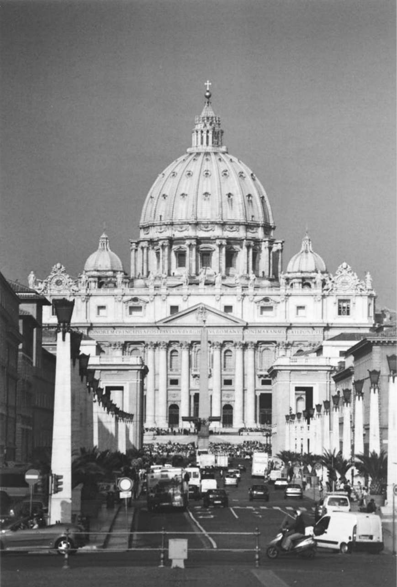

**图1　罗马圣伯多禄大殿。** 立面由卡洛·马代尔诺设计，1607—1612年完成，具有戏剧性的古典风格与矫饰主义细节，对教堂建筑产生深远影响。摄影：格雷厄姆·阿斯特尔斯。

<!-- PDF page 245; original page 230 -->

山花又兼有拱形、三角形山花面。同样，圣伊沃·德拉萨皮恩扎教堂（1643—1650），展示蜂房形六角结构、贝壳式三重螺旋等独创形式。数位建筑师，走上相似道路。1656年，彼得罗·达科尔托纳，在罗马和平圣母教堂立面，结合半球、平行六面体形式，用壁柱、圆柱，创造新效果。卡洛·赖纳尔迪在卡皮泰利圣母教堂（1663—1667），设置两组柱式，一组在前，一组深嵌墙中。但最具博罗米尼风格者，可能是瓜里诺·瓜里尼；身为戴蒂尼会神父、数学学者，他创造起伏立面、集中式顶盖，其结构由复杂叠层组成。因此，都灵圣殓布小堂，圆鼓座上逐层错叠数层六角形，各构件不是弓形弧段，而是拱形。这类结构，较晚的回响，见于瓜里尼弟子B.维托内1744年所建尼斯戴蒂尼会圣加埃塔诺教堂。

但大胆的个人创造，并不符合时代的总体趣味。贝尔尼尼本人，在奎里纳莱圣安德烈教堂（1658—1670），也表现克制，采用椭圆柱形鼓座，两侧小堂，半圆门廊。1660—1670年，古典主义反动更明显：罗马维亚拉塔圣母教堂立面（1658—1662），彼得罗·达科尔托纳放弃前些年曲线，改为两层门廊相叠，几无凸出。1662年，卡洛·赖纳尔迪在人民广场设计近乎孪生的两座教堂，前设古式门廊。卡洛·丰塔纳的科尔索圣马尔切洛教堂（1682），也走类似方向。

宏伟古典风格在英国的胜利，由克里斯托弗·雷恩确立。他视1666年伦敦大火为机会，最终促成重建五十二座教堂的决定。1670—1671年，最早二十座教堂的重建，就实现了他的思想。伦敦沃尔布鲁克圣斯蒂芬教堂（1670），外部平行六面体、上覆穹顶，整体集中式平面。他在重建伦敦圣保罗大教堂中继续探索，以罗马圣伯多禄大殿为灵感。若干年后，负责实施1711年托利党法案的建筑师，仍忠于他的城市纪念性建筑实验：包括合作者范布勒；霍克斯穆尔，其斯皮塔尔菲尔兹基督教堂（1714—1720）为巴西利卡平面，伍尔诺斯圣玛利亚教堂（1716—1724）纳入正方形，东区圣乔治教堂几近新古典线脚；以及詹姆斯·吉布斯等人。

<!-- PDF page 246; original page 231 -->

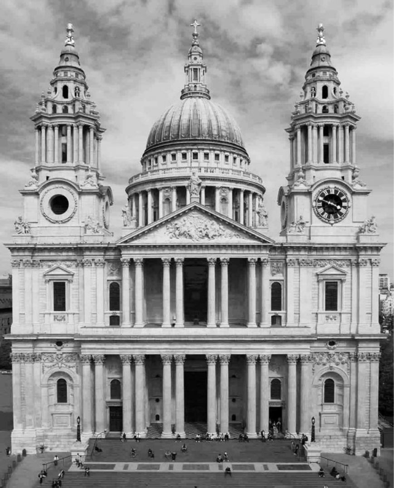

**图2　伦敦圣保罗大教堂正立面。** 1666年大火后重建，1708年竣工。建筑师克里斯托弗·雷恩爵士，以罗马圣伯多禄大殿为灵感。摄影：萨姆·劳埃德。

吉布斯的斯特兰德圣玛利亚教堂（1714—1717），其半圆柱门廊、高耸尖塔，在路口，犹如城市灯塔；田野圣马丁教堂（1722—1725），有门廊、半嵌柱、钟塔。另有约翰·詹姆斯的圣乔治教堂（1720—1725），托马斯·阿彻的史密斯广场圣约翰教堂。

<!-- PDF page 247; original page 232 -->

## 法国的情形

法国出于民族自豪，拒绝意大利影响，受到建筑创新吸引，却又不弃哥特传统，尤其迷恋统一、平衡。其宗教建筑，在数量、多样性两方面，都有成就。因此，为回应宗教战争中新教毁坏，瓦朗斯、奥尔良主教座堂，分别依原设计，以罗曼式、哥特式重建，奥尔良重建一直延至旧制度末。确实，从马尔泰朗热神父到苏夫洛，许多法国建筑师的作品，显示某种哥特趣味；偏爱宽大厅堂式教堂的普雷蒙特雷会建筑，也如此。表达这一趣味的，还有安德烈·费利比安（1699）、米歇尔·德米兰（1702）、让—路易·德科德穆瓦（1706）、洛吉耶神父（1753）等理论家。

萨洛蒙·德布罗斯设计的圣热尔韦立面（1616），显示明显转变：巨大哥特中殿前，建三层柱式叠置屏面。评论者，一开始就将其，推崇为国家典范。穹顶教堂中，最具雄心的作品之一，无疑是瓦尔—德格拉斯教堂。1645年弗朗索瓦·芒萨尔奉奥地利的安娜之请开建，由索邦小堂穹顶（1635）设计者勒梅西耶续建。芒萨尔此前已建圣安托万街圣母往见会小堂穹顶（1632—1633），1665年，又向路易十四，提出波旁家族陵寝小堂的宏大方案，结合集中式平面、穹顶，拟建于圣但尼大修院教堂的东端后殿。他1666年去世，未能实施；但以低矮开口内穹顶纳入外圆顶、产生间接日光的创新，被侄朱尔·阿杜安—芒萨尔用于荣军院教堂（1676）。

数个不同宗教共同体的教堂，都可见意大利影响。很好的例子，包括巴黎加尔默罗会、祈祷会教堂，稍晚法国耶稣会中央建筑圣保罗—圣路易教堂。后者，受到1584年竣工的罗马耶稣堂平面启发，依艾蒂安·马尔泰朗热设计建造（1627—1641）。1662年，轮到应马扎然之请来法国的戴蒂尼会。其小堂依瓜里诺·瓜里尼设计，结合椭圆空间、凹凸曲线，以对角线组织构图，体现“奇异奔放”趣味；这种趣味，反而强化法国对古典主义的坚持。

<!-- PDF page 248; original page 233 -->

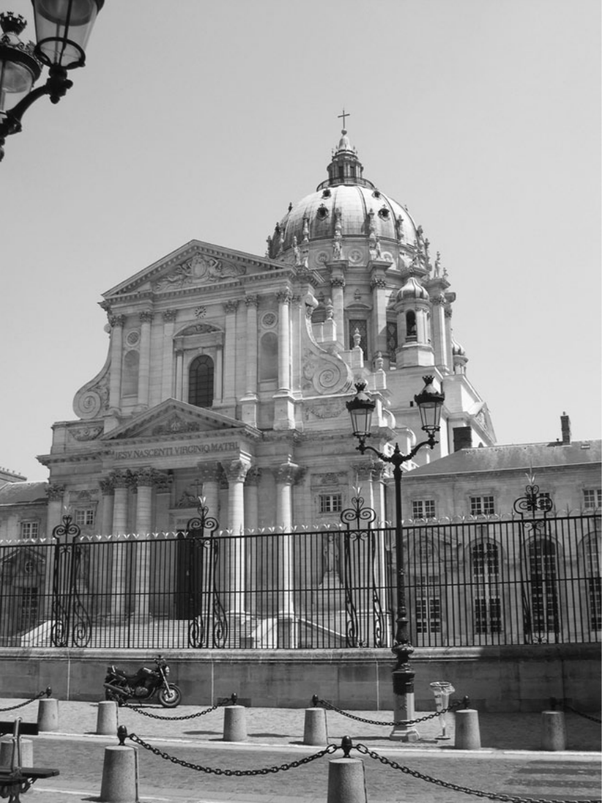

**图3　巴黎瓦尔—德格拉斯教堂。** 1645—1667年兴建，建筑师弗朗索瓦·芒萨尔开工，雅克·勒梅西耶完成。穹顶由皮埃尔·米尼亚尔设计。摄影：海伦·谢尼。

<!-- PDF page 249; original page 234 -->

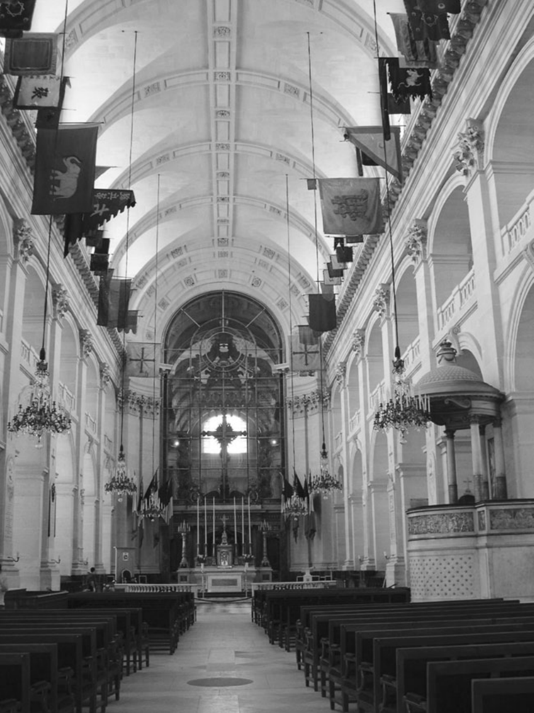

**图4　巴黎荣军院教堂内部。** 1676年，由瓦尔—德格拉斯建筑师弗朗索瓦·芒萨尔之侄朱尔·阿杜安—芒萨尔开建。外圆顶内嵌低矮、开口的内穹顶，使柔和、间接日光充满内部。摄影：海伦·谢尼。

<!-- PDF page 250; original page 235 -->

1676年，阿杜安—芒萨尔开始建荣军院教堂，采用极富独创性的方法，建造前后相接的两座小堂：一座供士兵使用，另一座的用途，仍是谜，或许拟作路易十四陵寝。立面前，还规划以两道门廊划界的半圆广场。总体设计，表达取自罗马圣伯多禄、法国瓦尔—德格拉斯的多种观念；后者结合集中式唱诗席、延长中殿；据说也取自圣但尼波旁陵寝圆堂方案。

凡尔赛皇家小堂，由阿杜安—芒萨尔，于1698年开建，罗贝尔·德科特，于1710年完成。有趣的是，建筑师有意选择古式平面。芒萨尔最初，提出集中式平面，后来决定，取法中世纪圣礼拜堂、宫廷小堂。设计力求，以规模、同宫殿本身的联系，显得突出：中殿修长，立面分两层，作为全堂点睛之笔的上层，专供国王。此外，内部有明显新的高层构件：上层小堂高度，以方墩代替支檐圆柱，承低拱廊，形成受克洛德·佩罗卢浮宫西立面启发的柱廊。这种教堂建筑观念，1697年前即出现于同样归佩罗的方案：檐部下设柱廊的古式巴西利卡。灵感来自维特鲁威法诺巴西利卡，佩罗曾为维特鲁威译本作图再现。

维特鲁威的观念，与更早的类似实验，即萨洛蒙·德布罗斯设计的沙朗通新教教堂，若有联系，无疑也是偶然。无论如何，维特鲁威影响，证明长方形设计吸引力。改革宗教堂，从最初就有集中式例子，如安特卫普圆形、拉罗谢尔八角形；但《南特敕令》废除，导致法国许多新教堂被毁后，沙朗通将成为整个北欧典范。

## 中欧与东欧的洛可可

来自伦巴第、米兰的流动石匠、装饰师团队，四处寻找工地，使意大利纪念性建筑传统，在中欧向北传播。在致力恢复天主教信仰的国家，艺术，尤其<!-- PDF page 251; original page 236 -->建筑，在传教护教中格外活跃。数国参与巴洛克实验，旨在先通过感官，再通过言辞，争取归信者：波希米亚，基利安·伊格纳茨·丁岑霍费尔的布拉格小城区圣尼古拉教堂；匈牙利，普兰陶尔的梅尔克修院（1709—1711）；维也纳，菲舍尔·冯埃尔拉赫的圣嘉禄·鲍荣茂教堂（1715—1723）。

源于法国的洛可可，嫁接到意大利式主干，产生了格外流畅、乐观、明亮的艺术。修院建筑最美例子，有巴尔塔萨·诺伊曼的内雷斯海姆（1745—1798）、十四圣人朝圣堂（1745—1772）；多米尼库斯·齐默尔曼的维斯圣所（1745—1750）；阿萨姆家族在慕尼黑、雷根斯堡、弗赖辛的作品；约翰·米夏埃尔·菲舍尔的奥托博伊伦（1748—1753）；彼得·图姆的瑞士圣加仑；以及同在瑞士、匿名建筑者的艾因西德伦修院。这些建筑师，偏爱曲线，将椭圆中殿，与矩形唱诗席并置，如维斯教堂；发展两侧塔楼的宽阔立面，保留厅堂式教堂传统的宽大开间，使光线充沛。

类似形式，适应地方背景，传到德累斯顿。原书称其为“强者”奥古斯特统治期间天主教波兰的首都，宫廷教堂，就是例子。它们又通过多梅尼科·特雷齐尼的彼得保罗大教堂（1712—1723），以及巴尔托洛梅奥·拉斯特雷利的斯莫尔尼女修院，传入俄罗斯，尤其圣彼得堡；还传罗马、那不勒斯、西西里。西班牙、葡萄牙也独自适应洛可可，或聘外国建筑师，如在瓦伦西亚工作的康拉德·鲁道夫、在穆尔西亚工作的海梅·博尔特，以及约翰·弗里德里希·路德维希；或用地方大师，如安达卢西亚菲格罗亚家族、萨拉曼卡丘里格拉家族。此后，结合巴洛克、洛可可、原住民特色的建筑，传遍拉美地区，如墨西哥奥科特兰圣所，约1745年，或巴西孔戈尼亚斯教堂。

## 法国：走向新古典的简洁

除一两例外，如重建奥尔良哥特主教座堂，或受阿尔卑斯欧洲风格影响的阿尔萨斯埃贝尔斯明斯特大修院，法国拒绝把洛可可用于自身

<!-- PDF page 252; original page 237 -->

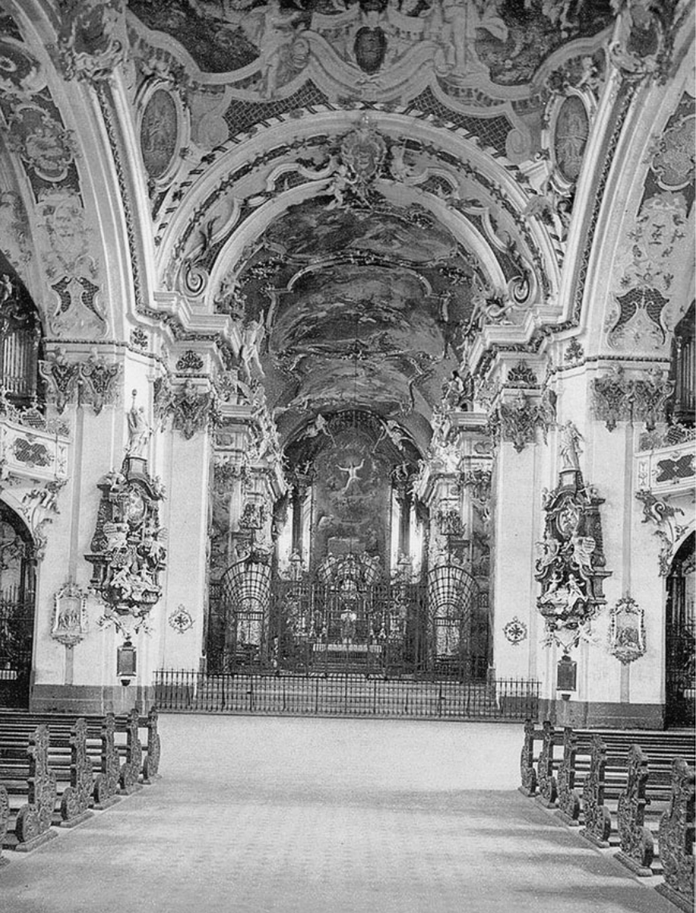

**图5　瑞士艾因西德伦修院，本笃会。** 华丽洛可可内部，在横翼两臂各有一台管风琴。修院1719—1735年兴建。照片由美国历史档案馆提供。

<!-- PDF page 253; original page 238 -->

宗教建筑。1726年，朱斯特—奥雷尔·梅索尼耶，为原由克里斯托夫·加马尔1643年设计的圣叙尔皮斯教堂，提受博罗米尼影响的立面方案，被拒。1732年，让—尼古拉·塞尔万多尼，赢得教堂最后这一部分的设计竞赛，标志圆柱、水平檐部的胜利。让—弗朗索瓦·沙尔格兰1770年后介入上部栏杆建设，虽塔楼上段有博罗米尼式曲线，仍巩固直线支配。此前，苏夫洛1764年，为圣热纳维耶芙教堂——很快改称先贤祠——所作方案，已确认这一趋势。他旨在调和，法国以佩罗柱廊为代表的希腊柱式，与自己钦佩的哥特建筑的科学、轻盈。结果，产生高度理性化、没有诱人巧饰的建筑，完全由精密计算的直线、曲线、平行六面体、球体组成，特点是几乎完美对称、网格组织。

另一同时代方案，也重申了明显的抽象倾向。同在1764年，让—弗朗索瓦·沙尔格兰受命建鲁勒圣斐理伯教堂，外用托斯卡纳门廊，侧廊、半圆唱诗席用爱奥尼亚柱廊，配格间拱顶，重新运用古代巴西利卡形式，迅速成为此后数十年宗教建筑典范。类似布局，见路易—弗朗索瓦·特鲁阿尔在凡尔赛建的蒙特勒伊圣桑福里安（1764—1770）；尼古拉·波坦同在1764年开建的圣日耳曼昂莱圣路易。波坦也用此风格于雷恩主教座堂，方案1764年批准，1786年才开工。革命后，几乎法国所有教堂，都遵循源自鲁勒圣斐理伯的风格，采用巴西利卡平面，加上入口门廊。唯一例外是玛德莱娜，拿破仑一世，亲自审慎选择其设计；与其说，它是天主教礼拜教堂，不如说，是献给法国荣光的神庙。在巴黎，这种基本设计，可见于伊波利特·戈德的格罗卡尤圣伯多禄、圣体圣但尼，莫利诺的巴蒂尼奥勒圣玛利亚，以及伊波利特·勒巴的洛雷托圣母。此风格延至十九世纪四十年代，才受到新哥特的激烈挑战，例如高在巴黎建造的圣克洛蒂尔德，以及让—巴蒂斯特·拉叙斯，在南特建造的圣尼古拉。

<!-- PDF page 254; original page 239 -->

## 家具与内部设施

宗教改革断裂，使人对教堂及其家具、设施的宗教功能，产生不同观念。一些礼拜场所，如今排除一切圣礼功能，选择作为读经、释经、祈祷的聚会处。另一些，则重申自己，是神临在的特殊领域，或举行圣体及其他圣事奥迹的圣地。宗教改革后新教教堂，大部分地面、墙面，被接纳会众的长凳、座席、楼廊占据，圣餐桌、讲道坛，有时管风琴，置于前方。天主教则试图划分空间，一侧为圣所与神父，另一侧为会众。礼仪家具，必须占有相当空间。法国教堂长凳，直到1801年《政教协定》后礼拜恢复，才广泛出现。

家具核心，是祭台、祭台背屏。祭台背屏，这项中世纪遗产，经过许多改动，成为天主教改革的主要家具。此后，它的首要目的，是辅助存放圣体的圣体龛；此前，圣体存于悬器、柜橱、圣体塔。特伦托法令后的图像实践中，多数历史场景渐消失，祭台画题材限于正式规范主题。无论是否结合此类祭台画，新的、更抽象的图像体系出现，由阐释三位一体的象征组成：圣体龛各处安小天使，其上是天军荣光象征、圣灵鸽、四字圣名；整组上方置华盖，表达主权。在这一基本模式之内，多数背屏，尺寸甚大；后来，一场反向运动，渐使它们消失。到十八世纪末、尤其十九世纪初，祭台配件仅剩圣体龛、烛台支架、小天使。

法国祭台本身，几乎总背靠唱诗席尽头，如凡尔赛小堂、巴黎圣母院。罗马则创新，把大桌形式祭台移向中殿。

<!-- PDF page 255; original page 240 -->

1624—1633年，贝尔尼尼在圣伯多禄大殿，装华盖形式巨大祭台顶棚。这种呈现弥撒祭献、真实临在的方法，复兴了早期基督教的祭台华盖传统，立即引起法国效仿，尤其瓦尔—德格拉斯（1665）。但直到下世纪中叶，法国才充分发展“罗马式”祭台、桌式“墓形祭台”，如瓦朗斯主教座堂。即使如此，也有争议：1753年，努瓦永主教座堂教士团，因安装此类祭台，激烈分裂，便把决定权，交给国王御前会议；后者支持创新者。

兼作堂区教堂的修院、协同教士团教堂，重新组织唱诗席。中世纪旧唱诗席隔屏（jubé），原本不透明，如今通过铁艺，变得轻盈、通透；唱诗席入口的一处柱脚旁，增设小祭台，用于举行堂区弥撒。改造旨在使信徒更近礼仪行动，尤其祝圣。

其他家具也获新意义。讲道坛置中殿中央，便神父联系会众，体量巨大，设反音罩改善声学，形成特色图像，如四福音作者，或啄食自身内脏哺育幼鸟、象征基督的鹈鹕。个别耳语告解，随传教、讲道而发展，因而设计新家具，按堂区神父人数安装。约此时，布拉格主教座堂重振圣若望·内波穆克敬礼，他因拒泄告解秘密殉道。最后，管风琴常巨大，以前数件不同乐器，合入同一立面、多个琴箱，包括小风琴、主风琴、唱诗部、回声部。管风琴的位置，可以不同：新教教堂，常置于讲道坛上方；法国天主教堂，通常置于中殿后方。有时两台，横翼两臂各一，如艾因西德伦。大教堂又在唱诗席、围隔上加乐器，伴协同教士团或修院礼拜。

## 视觉艺术与情感唤起

建筑设计演变、教堂家具发展，本身都不足解释天主教、新教宗教改革时代<!-- PDF page 256; original page 241 -->礼拜建筑独创性。建筑师与教士，无论神父、牧师，共同致力于荣耀教会。中世纪，城市教堂常不显眼，空间不足、邻近建筑混乱，妨碍突出。近代初城市版画显示，教堂尖塔之高，更多因设计惯例，而非为标示城中位置。圣嘉禄·鲍荣茂，似乎是最早认真注意到，礼拜场所须与邻近建筑分开的人之一，见1577年《教堂建筑及教会器用指导》两卷。他兼顾财务安全，以及敬拜神的地方，应与世俗生活分开的权利。因此，他提议，让城市街道网，围绕建筑东端、两侧，正立面则朝向公共空间。但建筑、城市规划不能限于功能。礼拜场所兴建，是更大目标的一部分，古罗马人称城市“装饰”。立面，成为城市视觉整体的组成部分，耶稣堂甚至取凯旋门形式。例如，卡洛·赖蒙迪为此建罗马人民广场孪生教堂。同样，雷恩建议，教堂塔楼应高耸、美丽，使建筑师无须过度花费，就能把礼拜场所，同周围密集建筑区别开来，美化城市整体。那时，城市规划，被视为一种政策：兴建公共建筑，使住宅区逐渐围绕它发展，如巴黎荣军院，新教堂在城市设计中地位重要。

在重新界定的城市空间，礼拜建筑外观，获新象征话语力量。例如1631年，隆盖纳确认，威尼斯安康圣母教堂，选择集中式平面，是为了给圣母玛利亚，设计一顶冠冕。博罗米尼解释，圣斐理伯·内里祈祷会立面，曲面而中央凸出，其形象，是奥秘的教会张开双臂，欢迎信徒进入怀抱（1638—1642）。贝尔尼尼为圣伯多禄广场采用同一隐喻；至于圣伊沃·德拉萨皮恩扎（1643—1650），层叠穹顶、三重螺旋尖塔，则与教皇三重冠的形象相类比。类似地，瓜里诺·瓜里尼设计圣殓布小堂，<!-- PDF page 257; original page 242 -->即1667—1690年，都灵的这座小堂，采用三分方案，表达三位一体奥迹。

内部空间组织，以使会众看见、听见的功能为导向。宗教改革产生的教派显然如此，天主教也如此，尽管雷恩试明确区分圣公会与罗马宗教。他写：“罗马天主教徒能建更大教堂，因为只须听弥撒低诵、见举扬圣体；我们的教堂，却须为听众设计。”此观点导致拆除封隔座堂教士唱诗席的屏障；但直到1801年《政教协定》，确认主教座堂除教士团职能，也具堂区职能，最后隔屏才拆，如罗德兹1823年后、利摩日1888年。

同样出于对视听的关注，建筑师扩大中殿，将侧廊限于通行，并提出中殿与唱诗席的不同关系，通常抬高后者。例如莱比锡圣尼古拉，原哥特结构，十八世纪内造椭圆会众空间。也可以问，十八世纪中叶，建筑缩小、采用巴西利卡平面的倾向，是否同样与视听有关。英国音乐厅的实验，证明长方形平面，延伸为半圆形廊，并把开窗移至承檐沟的墙体上部，在这方面，具有优势。不过，十九世纪四十年代新哥特反动兴起时，中世纪风格支持者，如夏尔·德蒙塔朗贝尔、阿道夫—拿破仑·迪德龙，恰以巴西利卡像世俗音乐厅而反对。但尽管批评，多数新哥特堂仍保前代建筑体量统一。总之，无论是否巴西利卡，长方形显然因声学而获偏爱。然而，十九世纪最初二十年，仍建一定数量罗马万神庙式圆形建筑，如都灵圣母教堂，或安东尼奥·卡诺瓦设计的波萨尼奥教堂。

但空间研究，不能只限功能。建筑师也发明扩展内部空间、减弱有限感的办法。穹顶<!-- PDF page 258; original page 243 -->可达此效果，尤其绘错视画时。罗马谷地圣安德烈教堂穹顶（1625—1627），开启长期壁画创作，借学术透视研究，利用表面连续曲线，造升天幻觉。法国最重要例，是米尼亚尔绘瓦尔—德格拉斯穹顶（1663—1666）。中殿等修长空间，更难达到同样效果，因为画家必须，让升天幻景，与入堂者的斜向视角调和。彼得罗·达科尔托纳，瓦利切拉圣母教堂（1647—1651），乔瓦尼·巴蒂斯塔·高利，又名巴奇恰，耶稣堂（1672—1679），创造了最早传达这类效果的杰作。错视画，在建成空间中央造想象空间，使信徒感天地边界消失。十八世纪，阿尔卑斯、中欧、伊比利亚、拉美洛可可建筑装饰，走相似道路。

通过建筑、绘画，扩展内部空间的同时，人们也细致、复杂地研究用光，旨在隐藏光源位置，对观者产生情感效果，加强神秘、不真实之感。贝尔尼尼在胜利圣母教堂科尔纳罗小堂《圣德兰的神魂超拔》（1647—1652），欲达此效：天使以云托圣女，向神光升去；环境光经隐藏圆孔，反射金色光芒，暗示神不可企及。瓜里尼尤其擅长，以直、间接光，赋空间超越、无限。他在数学科学上，最伟大的杰作，是都灵圣殓布小堂。其穹顶上，重叠八角结构，设计使观者，看不见采光口。来源神秘的光线，滤过黑色大理石内部，仿佛染上暗色，产生幽暗之光、黑光，即tenebrosa luc。信徒来敬拜基督殓布，基督教世界最著名圣髑之一，由此理解自己身处复活日基督墓穴图景的核心。另一以光线动人的例子，是丁岑霍费尔的布拉格小城区圣尼古拉，穹顶如灯亭，亮度随外光变化。同样，阿杜安—芒萨尔以光，在巴黎荣军院<!-- PDF page 259; original page 244 -->小堂中，创造惊人效果：用内穹壳，遮住穹顶开窗，穹壳中央的圆孔，则使光，洒遍建筑。

从苏夫洛的圣热纳维耶芙，到布莱革命时期的都会教堂方案，这一代建筑师，放弃以惊奇激起的激情，转向明暗空间连续交替，产生的更简单、鲜明的对比。路易—塞巴斯蒂安·梅西耶小说《2440年：前所未有的梦》（1770—1787），表达想象未来的宗教、美学目标，也可能就是旧制度末期目标。他献给略带泛神论色彩的最高主宰崇拜的神殿，是一座穹顶圆堂，由单圈立柱支撑，四座大门敞开，光线滤过穹顶顶端的透明彩窗。他写，天顶光，使内部与天界、自然元素、季节相接。

法国美学偏爱充沛光线，同时渐减对建筑多彩的兴趣。十八世纪中叶至十九世纪二十年代，如洛雷托圣母堂，即使考古发现希腊神庙彩饰，使色彩兴趣复苏，礼拜场所仍坚守白色。巴黎圣塞韦兰自1699、圣梅里自1751，拆中世纪彩窗，换白玻璃。但趣味转变并非无争论。1754年，反对唱诗席现代化的努瓦永座堂教士，沿袭让—巴蒂斯特·蒂耶尔1688年的思想，认为想看别人、被别人看见，违背虔敬，幽暗更符合神圣奥迹。御前会议不支持；但十八世纪八十年代初，巴黎圣礼拜堂教士，成功阻止王室行政机关，以白玻璃，替换圣路易十三世纪彩窗的方案。同样，内部刷白可引争论。塞巴斯蒂安·梅西耶《巴黎景象》，反对以如此明显世俗的气氛，取代古老神秘阴影，如巴黎圣母院1753年。革命后1806年，米兰呼应其思。

这些争论，使我们看见论据复杂交织。特伦托教规颁后，加强控制圣像敬礼，导致图像主题、历史场景稀少，从而<!-- PDF page 260; original page 245 -->减少用色。此外，礼仪的功能性、理性特征，使人拒绝十七世纪意大利式的强烈效果，创造组织更简单的白色空间。但1750年后，出现更简单、自然、基于明暗对比的感动力。1774年，德瓦伊封闭圣叙尔皮斯圣母小堂的窗；布莱此前，在圣罗克加尔瓦略小堂，已这样做过。革命初期，卡特梅尔·德坎西，也将下令，遮住先贤祠中殿的窗。

若在声音领域作类似研究，将很有趣。近代内部建筑的简化，为音乐新的空间化，也许更为不同作曲风格，铺平道路。继中世纪单声部之后的复调，预设一个相对有限、声学可靠的空间。两唱诗班对答，有时两管风琴，发展为利用新空间立体声效，如艾因西德伦修院堂横翼两台、唱诗席第三台。音乐在礼拜、一般宗教生活中重要地位，无论由风琴师、唱诗班、礼拜堂乐团，或圣读及圣咏诵唱使用的其他声源演出，尚待探索。建筑、音乐之间，研究甚少、却无疑非常重要的互动，必须与建筑、声音的一般关系，共同考察。“声音”还须包括，礼仪、圣文阅读要求的许多不同情境中，讲道者言语、主持教士与辅祭者祈祷。

## 新的神殿

并非只有宗教改革产生的教派，用“神殿”（temple）称礼拜处。十七、十八世纪天主教徒也用，虽有保留，像早期基督徒欲区别异教。神学家坚持，无限的上帝，不能被局限于人造居所的尺寸；教堂首先是ecclesia，即信徒会众所在地。但圣体圣事、真实临在的重要性，使建筑被界定为“上帝之家”（Domus Dei）、“天国之门”（Janua Cœli）。由此形成的隐喻话语，根植<!-- PDF page 261; original page 246 -->教父、中世纪神学家的注释，提供一种意义表达，把经天主教改革净化的基督教，锚定在《圣经》古老、诗性、神圣的世界。此外，近代早期，基督教人文主义推动圣经学复兴，天主教、新教释经者思想竞争，以及神学严谨主义加强的詹森主义影响，都强化此话语。人们希望，以从以色列宗教，到罗马教会的直接、正统传承，回应宗教改革，要求回归最初基督徒的原始主义话语。因此，教堂成“神殿”，唱诗席称“至圣所”，存圣体容器成“会幕”、即圣体龛；两侧蒙脸革鲁宾，如曾在至圣所约柜旁。同样，圣体光座中的圣体，以燃烧的荆棘表示；第一位格，以等边三角形中希伯来四字圣名表示，如维也纳卡尔教堂祭台背屏，教堂也献圣嘉禄·鲍荣茂；第二位格，以IHS字母表示。神父称“献祭者”，祭披取“献祭者围裙”形式，辅祭称“利未人”，有时“祭司支派”。知识人，细致研究《圣经》、弗拉维乌斯·约瑟夫斯的《犹太古史》，从胡安·包蒂斯塔·比利亚尔潘多、特鲁瓦座堂教士路易·马耶，到卡尔梅修士、约翰·伯恩哈德·菲舍尔·冯埃尔拉赫（1721），创造了诸多圣殿、器物的复原图式。博学图像体系展示《旧约》中圣体、祭献台、向神圣临在空宝座献饼之祭台的预表，如阿列省苏维尼圣伯多禄与圣保禄隐修院祭衣间护壁板。总之，似可结论：近代早期，罗马天主教经历首次“复兴”，一次《圣经》复兴，早于十九世纪三十年代起偏爱中世纪的复兴。

以《旧约》预表解释真实临在，旨在调和近代早期天主教特有的超越、理性双重要求。它倾向淡化基督人性，突出IHS、羔羊等象征，也忽视教会史，尤其圣人叙事。这表明，一种宗教，意在压制迷信，走向抽象。这几乎与另一努力同时，虽地方差异大，法国尤其如此，即从礼拜处清除一切悦<!-- PDF page 262; original page 247 -->感官的巧饰：图画、人物、雕饰线脚、色彩、历史化表现，使之专奉圣名。若说十八世纪末方案、成就，反映功用主义宗教观，一种泛化约瑟夫主义、国家把宗教列为“公共服务”，就不正确。这是把仔细研究后，可见的纯然抽象热情，误认作宗教冷漠。布莱的革命时期都会教堂内部方案，可提醒我们，激发宗教想象的激情何其有力：三折楼梯自幽暗中殿末端升起，在横翼交叉处顶端，巨穹光线突然落下；凯旋门标出的阴暗后殿开口前，巨大台座上，祭台耸立。罗马式祭台桌旁，献祭者在香云围绕中，举行最高主宰崇拜。祭司逆光呈剪影，人群沿中殿台阶俯伏，气氛庄严。无疑，这与“伊西斯奥秘”、《魔笛》、共济会装束、革命仪式不远。但这个介于理性、激情之间的宏伟思想剧场，完全有资格，与贝尔尼尼、博罗米尼、瓜里尼，同列一章。

同样，回望中世纪的新哥特复兴，将把福音宣讲者耶稣的人性，以及作为浪漫主义社会话语先驱的耶稣，连同中世纪圣人的黄金传说、多彩、幽暗、建筑形式的如画意境，带入圣所。启蒙宗教，毋宁说，它以《圣经》为本、抽象、严谨主义的观念，有些仍将留在十九世纪；但1830年后，建筑形式迅速更新，将以无言方式，表达新宗教感受的要求。

**（英文版译者：简·约曼。）**

**译校说明：** 原书PDF第251页，将梅尔克修院列于“匈牙利”，并称德累斯顿为“天主教波兰的首都”；两项地理表述存疑，译文保留原书说法，便于对照。

<!-- PDF page 263; original page 248 -->

（原书此页空白。）

---

<!-- PDF page 264; original page 249 -->

# 第三编　运动与挑战

<!-- PDF page 265; original page 250 -->

（原书此页空白。）

---

<!-- PDF page 266; original page 251 -->

# 第十三章　基督教与科学的兴起：1660—1815

**路易·沙特利耶（Louis Châtellier）**

从1660年至十九世纪初，这一时期的特点不仅是技术与科学取得显著进步，还在于一种新思维方式的传播：它借助科学推理而获得效力。塞缪尔·克拉克等英国知识人受到牛顿《自然哲学的数学原理》（1687）的启发；莱布尼茨《神义论》（1710）的巨大影响，也在很大程度上来自作者的数学知识。在法国，《百科全书》（1751—1772）不仅盘点现代科学知识，还引导人们掌握一种新的分析方法，将它用于整个物理现象与形而上现象领域。达朗贝尔在《百科全书序论》中，正是这样解释“科学、艺术和工艺详解词典”这一副标题的。[^p266-1]

原则上，基督教并不敌视科学思想。圣奥古斯丁不是曾在《论基督教教义》中写道：“一切科学都为基督教而战”吗？[^p266-2] 许多神学家，例如中世纪末的库萨的尼古拉，[^p266-3] 都热情地从事数学研究。十六世纪，天主教和新教大学无不教授数学。1550年起，耶稣会在仍然忠于罗马教会的欧洲地区创办中等学校，也教授数学；这一新修会在天主教改革时期的数学教学中发挥了重要作用。[^p266-4]

不过，有一道界线，无论路德还是教皇都不能跨越：《圣经》的教导，不论涉及科学还是神学，都绝不容质疑。伽利略曾试图在信仰领域与世俗科学领域之间作出这样的区分，却没有得到支持，反而在1633年的第二次审判中受到圣职部的严厉谴责。[^p266-5] 对一个忠诚的天主教徒如此严惩，令人惊讶。这一判决引起广泛讨论；许多人私下猜测，罗马审判者所针对的，是否不仅是伽利略的具体<!-- PDF page 267; original page 252 -->个案，而是新科学，乃至任何摆脱亚里士多德思想控制的企图。这位古代哲学家，当时仍在天主教会内部占据思想领袖的位置。

因此，十七世纪中叶，科学思想家与教会当局的关系带有相互不信任的特点。天主教欧洲的情况确实如此。或许，这正是新教欧洲出现新的思想动力的原因。

## 从笛卡尔到牛顿

不过，不能忽略笛卡尔的情况。他对伽利略遭定罪的反应，充分显示了这场审判在天主教知识人中引发的危机。1633年11月，笛卡尔写道，听到消息时：“我震惊得几乎决定烧掉手稿，至少也要把它们藏起来。我简直无法想象，他〔伽利略〕既是意大利人，而且我相信连教皇也欣赏他，除了试图确立地球运动之外，还能因什么事被定罪……我承认，如果伽利略错了，那么我的〔物理〕哲学的全部基础也都错了，因为他显然以这些基础支持自己的论点。”[^p267-6] 结果，笛卡尔已经完稿的《世界论》，一直推迟到他身后的1664年才出版。[^p267-7]

然而，这些事件并未阻止笛卡尔采取有效行动，使思想摆脱亚里士多德的控制。《方法谈》意在证明，他的逻辑方法能够有效用于科学推理；为此，他在1637年将《几何学》和《折光学》与这部著作一同出版。[^p267-8] 更重要的是，笛卡尔理性主义启发了另外几位大学者的研究方法。

其中第一位是克里斯蒂安·惠更斯。他运用笛卡尔的方法，严密地发展了自己的物体碰撞定律。在《土星系统》（1659）中，他又把对行星卫星的观察推及整个太阳系，为地球运动提供了有力论据。地球显然围绕太阳转动，正如月亮围绕地球转动一样：哥白尼的体系由此再次得到证实。[^p267-9] 这种推理将惠更斯引向无限宇宙的图景。在《宇宙论》中，他认为无数行星必然像我们的世界一样，有生命居住。[^p267-10]

十七世纪末，惠更斯的思想大获赞许，并通过丰特奈尔的笔触传向普通公众。丰特奈尔既是一位出色的思想家，<!-- PDF page 268; original page 253 -->也具有同样出色的文学才华。在《关于世界多元性的谈话》（1686）中，他不仅接受其他行星上也有人居住的观点，还在“第五夜”写道：“恒星其实是无数太阳，每一个都照亮着一个世界。”

但是，从天文学角度看来合乎逻辑的观念，一经神学检验，就变得不可接受。应当怎样理解创世？如果《圣经》不过是成千上万个宗教故事中的一个，它还具有什么价值？降临拯救我们的基督，是否可能像某些人设想的那样，只是宇宙各处众多基督中的一位？[^p268-11]

另一方面，瑞士数学家约翰·伯努利坚持认为，不能把神圣的全能者设想为有限。祂既显现于无限小的事物，例如一粒空气微粒，也显现于无限大的事物，例如宇宙和巨人。[^p268-12] 由此形成的世界观，有些类似斯威夫特后来在《格列佛游记》中描绘的图景，不过伯努利是完全认真的。

科学进步使一种全新的《圣经》阅读方式成为可能；恰在此时，学者也在运用语文学与文明比较研究，试图辨认《圣经》的原初意义。[^p268-13] 从这个角度看，人们不禁要问，各种学院，尤其科尔贝尔于1666年创办的科学院，在设立时，是否也部分出于“规训”思想家的意图。[^p268-14]

英格兰则走上了另一条道路，至少最初如此。作为法国科学院范例的英国皇家学会，其作用更多在于鼓励相互砥砺，而非控制思想。面对信仰动摇的人，它还承担着一项真正的护教任务。首批会员之一托马斯·斯普拉特于1667年写道：“如果如使徒所说，上帝不可见之事，可以通过可见之事显明，那么，〔科学家〕借助实验，看见了大量他人无法看见的受造物，这岂不是使他对神永恒大能的信仰，具有更强有力的论据？”

这样，他从实验中找到“敬拜”上帝的论据，因为“上帝作品的美、巧妙与秩序，永远呈现在他眼前”。他还引述弗朗西斯·培根的名言：“对自然略知一二，使人成为无神论者；但了解得多了，却使人重新具有健全而虔敬的心灵。”[^p268-15]

由此便不难理解，当时的大学者之一罗伯特·波义耳，为何把自己的研究视为一种使徒使命。他是亚里士多德与帕拉塞尔苏斯的反对者、《怀疑的化学家》（1661）的作者，也是现代化学的创始人。他在遗嘱中设立基金，旨在运用科学论证，挑战无神论者与不信者。[^p268-16]

<!-- PDF page 269; original page 254 -->

在这样的背景下，艾萨克·牛顿《原理》的结语，宛如一首向上帝升腾的赞歌，也就不足为奇。他在“总释”末尾写道：

> 由此可知，真神是活着的，具有智慧与力量……祂至高，或至为完美。祂永恒、无限，全能、全知；也就是说，祂从永恒延续至永恒，从无限临在至无限；祂统治万物，知道一切已经发生或可能发生的事。祂不是永恒与无限本身，却是永恒而无限的；祂不是绵延和空间本身，却持续存在并始终临在。祂永远存在，无所不在；通过永远、处处存在，祂构成了绵延与空间。[^p269-17]

不过，波义耳与牛顿的科学观有所不同。对牛顿而言，科学并非只是敬畏创造的奇迹，更在于呈现上帝的作品。仿佛科学家一旦完成研究，就已升到神的高度，能够俯瞰祂的创造。这无疑解释了惠更斯、莱布尼茨等人的恼怒：他们询问牛顿普遍引力的原理时，经由塞缪尔·克拉克这一中间人，得到的回答总是上帝“无所不在”。[^p269-18]

科学家如何知道这一点，又怎能如此确信地谈论它？后来成为克洛因主教、撰写《分析学家》的乔治·贝克莱，有自己的解释。他认为，科学家的确信来自新微积分，即无穷小算法或微分算法。牛顿正是借助这种方法，极其精确地计算出行星的椭圆轨道。[^p269-19]

但是，贝克莱于1707年写道，人有权“超出自己的概念，谈论有限量的无穷小部分，即partes infinitesimae，更不用说无穷小的无穷小，即infinitesimae infinitesimarum，如此等等”吗？[^p269-20] 这难道不是试图穿透创世本身的奥秘，怀着路西法般的骄傲，把自己提升到上帝的位置？

受到挑战的不只是牛顿和圣公会。与牛顿争论谁最先发现无穷小算法的莱布尼茨，也受到通常同他关系良好的耶稣会责问。在法国出版的《特雷武评论》第二期，即1701年5—6月号上，耶稣会士针对一篇讨论新算法的文章攻击莱布尼茨；这篇文章，是他请一位朋友转交给杂志的。编辑写道：“当人们推理无限，继而推理无限的无限，再推理无限的无限的无限，如此下去，永远找不到最后的项，然后又把<!-- PDF page 270; original page 255 -->这无穷多个无限，应用于有限量时，那些试图受教或希望被说服的人，未必拥有看清如此深处所需的洞察力。”[^p270-21] 这番警告虽然形式较为圆滑，对新微积分的反对，却与贝克莱同样坚决。

十七世纪末，在天主教与新教国家，科学和宗教的关系，都带有某种暧昧性。科学进步引起公众的浓厚兴趣，1660年代以后专业刊物的诞生，即可证明这一点：英格兰有《哲学汇刊》，法国有《学者杂志》，德意志有《学术纪事》。

天主教和新教教士通常鼓励这种好奇心，认为它是抵御怀疑主义、无神论或单纯宗教冷漠的最佳方式。他们相信，那些有待发现的奇迹，只能把人引向创造者。然而，十七世纪末、十八世纪初的某个时刻，科学进步与新研究技术的精进，不再那么明显地通向上帝。某些人开始觉得，人类心智的惊人发展，或许已经足以解释一切。

## 无限问题：从地狱到天堂

1700年前后，牛顿的发现重新激起了关于空间与时间无限性的争论，这并不奇怪。事实上，自古代伊壁鸠鲁与卢克莱修的著作以来，这类讨论从未停止。不过，反宗教改革时期，焦尔达诺·布鲁诺受审，并于1600年在罗马被处以火刑，赋予了问题新的维度。[^p270-22] 他被指控在名作《论无限、宇宙和诸世界》（1584）中，借用了古代异教和无神论作者的思想。

此后，即使最博学的思想家，也会因“无限”这一观念而恐惧。布莱兹·帕斯卡的一位通信者写道：“我告诉你，只要无限的观念进入一个问题，哪怕只是一点点，整个问题就会变得无法解释，因为心灵会陷入困扰和混乱。”[^p270-23]

帕斯卡自己在《思想录》的著名段落中，解释了这种恐惧。他写道：“由于无法观察无限，人们便鲁莽地探索自然，想象自己与它具有相仿的尺度。”他又说：“当人真正理解这一点时，我想，人们便会安住于自然赋予各自的位置。”[^p270-24]

几年以后，《波尔—罗亚尔逻辑》的作者安托万·阿尔诺与皮埃尔·尼科尔，说得更加明确。他们劝告读者，“永远不要卷入<!-- PDF page 271; original page 256 -->对超乎我们之事的探求……也就是任何涉及无限的事，因为我们的心智是有限的，会在无限中混乱、迷失，被由此产生的大量矛盾观念压倒”。[^p271-25]

无论新教徒还是天主教徒，无论詹森派还是耶稣会，都一致拒绝把无限作为研究对象。无限是唯独属于上帝及其创造的领域。涉足这个问题，无异于触犯禁忌；更糟的是，仿佛在以上帝不存在的方式行事。从相信宇宙无限，到走向无神论，似乎存在一条直接的道路。

因此，尽管牛顿采取了防备措施，并在《原理》中表白信仰，他仍必须澄清人们对其宗教信念的重大怀疑。也许是为了回应批评者，也许只是因为神学始终萦绕心头，牛顿将晚年用于撰写一部历史著作。[^p271-26] 《古代王国编年史修订》直到他去世后一年，即1728年，才以最终形式出版，但其主要论点早已为人所知。

人们原本期待，这部书会运用现代天文学挑战传统编年；它确实如此，却远不止于此。它初步勾画出一种概率计算方法，并用它证明，英格兰教会所教导的神圣历史进程是准确的。更进一步，牛顿认为，自己的方法能够证明，希伯来人在文明史上发挥了先驱作用，远早于希腊人。[^p271-27] 到了这一步，《原理》作者无可挑剔的正统性，便再也无从争议。

此外，牛顿思想最有权威的解释者，包括他在剑桥的继任者，也小心预先堵住可能的批评。威廉·惠斯顿于1696年写道：“摩西的创世记述，并非对万物起源的精细哲学论说，而是一份历史性的真实叙述，说明我们这唯一的地球，如何从混沌中形成，又如何每日经历相继可见的变化，直至成为人类居住之所。”[^p271-28]

然而，大师本人所写的，是一回事；英法两国牛顿派的解释，又是另一回事。法国的伏尔泰，以《牛顿哲学原理》（1738），大大帮助牛顿思想传入欧洲大陆。伏尔泰虽不是数学家，却花了四年研读《原理》；遇到不明白之处，就请教牛顿著作的译者夏特莱夫人。这样投入研究，显然不是为了最终宣称，牛顿的成果丝毫没有触动教会的传统教导。在伏尔泰看来，牛顿全部<!-- PDF page 272; original page 257 -->计算所导出的最终结果，截然不同。他写道，在浩瀚宇宙中，地球不过是一个点。这个点经历过剧烈变动，“其原因隐匿，持续时间几乎无法想象，却似乎保证了人类一种几乎难以设想的存续时间”。他继续说：“但是，这极有可能是一个长达194.4万年的时期。”[^p272-29]

因此，伏尔泰认为，空间无限与时间无限相对应；当然，牛顿一直小心回避这个问题。从此，《圣经》编年，乃至更广义的神圣历史，都被降到寓言的地位，成为人类想象自身起源的产物。至于上帝，则从遥远而高处，主持祂先前创造的行星运动。“伏尔泰的宗教”就这样形成了；最合适的称呼，或许是科学自然神论。[^p272-30]

因此，在思想史，更具体说，在近代基督教史上，莱布尼茨的立场实在是一场革命。他非但没有警告无穷小算法的危险，反而把这种与牛顿几乎同时发明的算法，视为接近上帝、确信其作品伟大的道路。他在1694年《学术纪事》的一篇文章中写道：“最后，正因为我们的算法，恰是一般数学中处理无限的部分，我们才需要借助它，将数学应用于物理；因为无限创造者的本性，通常体现于自然的运行之中。”[^p272-31]

晚年，莱布尼茨同牛顿的代言人塞缪尔·克拉克辩论时，写道：“上帝通过计算创造了世界。”[^p272-32] 对他而言，神学不可与数学分离。这呼应了最伟大的基督教知识人圣奥古斯丁的思想。

同样，他也挑战贝尔、让·勒克莱尔、约翰·洛克等近代《圣经》与宗教批评者。1711年，他致信马勒伯朗士神父：“他们的问题在于，数学训练如此不足，以致无法充分理解永恒真理的本性。”[^p272-33] 因此，在牛顿与莱布尼茨的时代，科学远非反对宗教，而是一条通向上帝的道路。

不过，这条道路以不同途径通往目标。牛顿派认为，世界的辽阔及其卓越组织，向人证明了上帝存在；这样的上帝，也可被设想为宇宙的最高原则，换言之，一种抽象。莱布尼茨派则相反，认为上帝是活生生的位格：“当上帝计算时”（cum Deus calculat），<!-- PDF page 273; original page 258 -->人能够通过理性接近祂，因为祂永远在“永恒的当下”工作。[^p273-34] 这样，十八世纪即将受到质疑的神圣护理观念，不仅得以维持，反而得到加强。[^p273-35] 显然，莱布尼茨依靠最新科学进步形成的宗教思想，与其说同基督教传统决裂，不如说赋予了传统新的力量。

## 唯有自然

在某个时候，人们请同样研究地质学的莱布尼茨，澄清他对创世持续时间的看法。[^p273-36] 创世是否真像《圣经》所说，在六天之内完成？莱布尼茨并不认为，这个问题至关重要。1698年，他向一位通信者解释：“我不敢确定，创世的六‘日’，究竟是几年，还是长得多的时期。如果这样理解不违背恰当的语言用法，我大概会同意那些人的看法：他们把《创世记》只同地球的形成联系起来，并把星辰的创造，解释为它们首次出现在我们眼前。”[^p273-37]

然而，随着时间推移，问题变得复杂得多。化石的发现，起初似乎支持《圣经》的洪水记述；但不久，世界各地都发现了化石，使人想到，发生过的或许不是一次，而是多次洪水。此外，在许多不同文明中，也存在类似《创世记》中挪亚故事的叙述。人们似乎不得不得出结论：海洋曾经覆盖地球的广大区域，甚至整个表面，长达数世纪；有人甚至认为，持续了数百个世纪。

终于，当时最优秀的博物学家，不再满足于质疑《圣经》的编年或《创世记》描述的各种事件，而开始质疑创造行为本身。布丰是一位坚定的牛顿派。他通过翻译牛顿关于无穷小算法的论著，大大提高了自己在法国知识界的声誉。[^p273-38] 他还把自由取法于牛顿《原理》的《地球理论》（1749），放在《自然史》（1749—1767）的开头。

布丰解释说，最初，太阳不过是一颗普通恒星。按照引力法则，环绕它的彗星使它保持炽热。不过，“彗星有时过于接近太阳，其中一些必然会落入太阳”。[^p273-39] 在某个时刻，一颗彗星剥离了太阳的一部分物质，将其抛入空间，使之受到万有引力的作用。这团液体与气体逐渐冷却，成为我们的地球。

<!-- PDF page 274; original page 259 -->

不过，布丰发展出的世界观并非唯物主义。他认为，最初显然存在一种“推动力”，而这种力量只能出自“上帝之手”。[^p274-40] 同样，他也偶尔在《自然史》的叙述中插入“综观”，暂时退后一步，汇集分析要点，并始终小心地把上帝置于最高位置。他在“第一综观”中，这样界定自己所理解的上帝与自然的关系：

> 自然，是创造者为事物的存在与人类的传承而制定的法则体系。自然不是一个东西，否则那个东西就会是一切；自然不是一个存在者，否则那个存在者就会是上帝。我们不如把它理解为一种生命力量：广大、包容一切、赋予一切生机；它从属于最高存在者的权能，只奉祂的命令才开始运作，也只有得到祂的支持与同意，才能继续运作。[^p274-41]

这段精彩文字，无疑表现了布丰开始撰写《自然史》时的心态。不过，正如当代一些评论者指出，随着工作进展，他的思想很可能发生了变化。[^p274-42] 他以一段《创世记》评注，开始自己的最后一部著作《自然的时代》（1778）。在引述第一节“起初，上帝创造天地”之后，他作了一处自己认为至关重要的修改：这句话应当读作“起初，上帝创造天地的**物质**”。[^p274-43]

如此一来，创造行为与地球最终形成之间，便可能经历数十万年，甚至数百万年。[^p274-44] 读者甚至可能怀疑，最初的创造行为究竟是否必要，进而怀疑上帝本身的必要性。

更早以前，在狄德罗与达朗贝尔主编的《百科全书》中，已有几位作者提出类似观念。[^p274-45] 几年以后，保尔·亨利·霍尔巴赫男爵，在《自然的体系，或物理世界与道德世界的法则》（1771）中，毫不畏惧地公开阐述唯物主义论点，并以化名广泛传播。[^p274-46] 在论述中，他甚至像是在回应布丰，因为后者仍把物质的创造留给上帝。霍尔巴赫写道：“如果有人想知道物质来自哪里，我们会回答，它始终存在。如果有人问，物质怎样开始运动，我们会回答，出于同样的理由，它从永恒以来就一直运动。”[^p274-47]

尽管声名远播，《自然的体系》与其说是一部科学著作，不如说是一篇唯物主义宣言。多数启蒙科学家，比霍尔巴赫谨慎得多。他们有所怀疑时，总是小心<!-- PDF page 275; original page 260 -->不公开表达，尤其不让自己的结论显得已经确定。这些作者通常仍在思想中为上帝保留位置，尽管刻意不说明，那究竟是什么位置。

拉普拉斯在《宇宙体系论》（1796）中不断引述牛顿，却除了在结论中极其审慎地用过一次，从不提及“创造者”一词。[^p275-48] 诚然，在以1797年高等师范学校课程为基础的《概率的哲学论》（1820）中，他谨慎地为自己的研究留下了灵性解释的可能。

他写道，如果计算“行星与卫星的全部自转和公转”，就会得出结论：“这些运动并非偶然的可能性，与偶然发生的可能性之比，超过两千亿比一。”然而，对于行星运动的“最初原因”，他从未明确表态。[^p275-49]

值得注意的是，十八世纪后半叶，成熟科学中关于上帝的提述逐渐消失，新研究领域却并非如此。例如植物学，才刚由卡尔·冯·林奈提升为一门科学。[^p275-50] 在《植物学哲学》（1751）中，林奈把以下论断视为信仰真理：“无限存在者在起初创造了多少不同形式，就有多少物种。”[^p275-51]

同样，古生物学的创始人乔治·居维叶，仍忠于《圣经》编年，毫不困难地把自己在地表观察到的灾变，纳入圣书的历史叙述。[^p275-52] 这些思想，距离物种进化，以及拉马克在十九世纪初将要提出的“物种转变论”，仍然相当遥远。[^p275-53]

全新的电学，在这里尤其值得注意。英国学者兼传道人约瑟夫·普里斯特利，把自己的《电学史》（1770），既视为科学著作，也视为传播宗教的著作。他认为，这种新能量，是“〔上帝〕逐步启示自然奇迹”的标记，并期待它带来宗教净化与基督教复兴。

1777年，他写道：“知识迅速推进，像海浪的扩展，或太阳的光芒，并非只沿这个或那个方向，而是向四面八方延伸。我毫不怀疑，在上帝之下，这将成为根除一切谬误与偏见，并终结宗教事务中一切不当和僭夺权威的手段。”[^p275-54]

这样，科学家成了先知、新时代的宣告者。普里斯特利并非孤例。大约同一时期，一个被称为“电学神学家”的群体，在中欧形成；其中包括厄廷格、弗里克和迪维施。他们把电，视为神圣力量的显现。事实上，<!-- PDF page 276; original page 261 -->在他们看来，这种神秘“流体”并不区分敬虔派与天主教徒，因此，也以自己的方式服务于基督徒合一事业。[^p276-55]

不过，最值得注意、最清楚指向未来的例子，或许是《电磁现象的数学理论》（1820）的作者安培。[^p276-56] 他在启蒙精神中成长，却被接连两场悲剧深深震动：恐怖统治期间，父亲在里昂被处决；后来，年轻的妻子去世。他起初受到积极斗争的宗教立场吸引，随后转向观念学派的无神论，最后于1817年坚定地归信天主教。

同年，费利西泰·德拉梅内神父的《论宗教冷漠》出版，这也是一部深刻影响知识界的作品。不过，安培成为榜样，不只因为归信，更在于他把信仰与科学家生活结合的方式。归信来自他生命深处，受到影响的，只有他自己，或许还有最亲近的人；他的科学工作，却丝毫没有因新信仰而改变。他认为，科学就是科学，无须是基督教的，也无须是无神论的。[^p276-57]

渐渐地，明确区分科学与宗教的观念，牢固确立。不过，这种分离并非轻易实现，后来围绕达尔文主义的激烈争论，就足以证明这一点。

因此，1660至1820年的科学与宗教关系史，逐渐由两个领域日益清晰的分离所主导。换一种说法，宗教领域越来越彻底的简化，与影响科学家全部研究活动的日益世俗化相对应。神圣史与自然史长久以来的相互渗透，逐步趋于消失。

神圣史究竟算不算科学？是否更适合根据个人立场，称之为传统或神话？除非，人们后来逐渐理解，宗教不接受任何证明或实验的检验；它更属于内心领域，可能随个人、历史时期与生命阶段而变化。

这场变化，没有胜者，也没有败者。科学进步，恰与宗教感受发生巨大转变的开端同时出现；在这场转变中，个人将占据核心位置。因此，科学并非独自发挥作用。启蒙运动、法国革命等重大运动，扩大并放大了它的影响；各基督教宗派内部灵修的演变，或许也起了同样重要的作用。

**（英文版译者：简·约曼、蒂莫西·塔克特。）**

<!-- PDF page 277; original page 262 -->

<!-- PDF page 278; original page 263 -->

<!-- PDF page 279; original page 264 -->

## 注释

[^p266-1]: Jean le Rond d’Alembert, Discours préliminaire de l’Encyclopédie, ed. M. Malherbe (Paris: Vrin, 2000).

[^p266-2]: 转引自 Marin Mersenne, Correspondance du P. Marin Mersenne religieux minime, ed. Madame Paul Tannery and Cornelis De Waard, 18 vols. (Paris: PUF, then CNRS, 1945–88), vol. 1, p.409.

[^p266-3]: Horizonte. Nikolaus von Kues in seiner Welt. Eine Ausstellung zur 600. Wiederkehr seines Geburtages (Trier: Bischöfliches Dom-und Diözesanmuseum Trier, 2001).

[^p266-4]: Antonella Romano, La Contre-Réforme mathématique. Constitution et diffusion d’une culture mathématique jésuite à la Rénaissance (Rome: Ecole française de Rome, 1999).

[^p266-5]: Pietro Redondi, Galileo eretico (Turin: Einaudi, 1988); F. Beretta, ‘Le siège apostolique et l’affaire Galilée: relectures d’une condamnation célèbre’, Roma moderna e contemporanea, 7/3 (1999), pp. 241–461.

[^p267-6]: Mersenne, Correspondance, vol. 3, p.558.

[^p267-7]: René Descartes, Le Monde, l’Homme. René Descartes, ed. Annie Bitbol-Hespériès (Paris: Seuil, 1996), p. xlvii.

[^p267-8]: Geneviève Rodis-Lewis, Descartes: Biographie (Paris: Calmann-Lévy, 1995).

[^p267-9]: P. Radelet-deGrave, ‘L’Univers selon Huygens, le connu et l’imaginé’, Revue d’histoire des sciences, 56 (2003), pp. 79–112.

[^p267-10]: 同上, pp.104–12.

[^p268-11]: Louis Châtellier, Les espaces infinis et le silence de Dieu. Science et religion, XVIe–XIXe siècle (Paris: Aubier-Flammarion, 2003), pp. 137–49.

[^p268-12]: J. Cohn, Histoire de l’infini. Le problème de l’infini dans la pensée occidentale jusqu’à Kant, trans. J. Seidengart (Paris: Editions du Cerf, 1994), p. 191.

[^p268-13]: Bernard Neveu, Erudition et religion aux XVIIe et XVIIIe siècles (Paris: Albin Michel, 1994).

[^p268-14]: Roger Hahn, The anatomy of a scientific institution: The Paris Academy of Science, 1666–1803 (Berkeley: University of California Press, 1971); 关于近代对自由思想的控制，参见 P. Prodi (ed.), Disciplina dell’anima, disciplina del corpo e disciplina della società tra medioevo ed étà moderna (Bologna: società editrice il Mulino, 1994).

[^p268-15]: Thomas Sprat, History of the Royal Society, ed. Jackson I. Cope and Harold Whitmore Jones (London: Routledge, 1959), pp. 349, 351; Georges Gusdorf, La révolution galiléenne, vol. 1 (Paris: Payot, 1969), p. 41.

[^p268-16]: Hélène Metzger, Newton, Stahl, Boerhaave et la doctrine chimique (Paris: Alcan, 1930), pp. 69–71; Gusdorf, La révolution galiléenne, pp.40–1; L. B. Guyton de Morveau et al., Méthode de nomenclature chimique, ed. Bernadette Bensaude-Vincent (Paris: Seuil, 1994), pp. 43–4.

[^p269-17]: I. Newton, The Principia: Mathematical principles of natural philosophy, trans. I. Bernard Cohen and Anne Whitman (Berkeley: University of California Press, 1999), p. 941; I. Bernard Cohen, Introduction to Newton’s ‘Principia’ (Cambridge, MA: Harvard University Press, 1971); Frank E. Manuel, The religion of Isaac Newton (Oxford: Oxford University Press, 1974); François De Gandt, ‘Présentation’, Isaac Newton, De la gravitation suivi de du mouvement des corps (Paris: Gallimard, 1995), pp. 9–108.

[^p269-18]: Recueil de diverses pièces sur la Philosophie, la Religion Naturelle, l’Histoire, les Mathématiques etc. par Mrs Leibniz, Clarke, Newton et autres auteurs célèbres, 2 vols. (Amsterdam, 1740), vol. 1, pp.69–70; A. Rupert Hall, Philosophers at war (Cambridge: Cambridge University Press, 1980).

[^p269-19]: P. Mancosu, Philosophy of mathematics and mathematical practice in the seventeenth century (Oxford: Oxford University Press, 1996).

[^p269-20]: George Berkeley, The works of George Berkeley, ed. Alexander Campbell Fraser, 4 vols. (Oxford: Clarendon Press, 1901), vol. 3, p.410.

[^p270-21]: Mémoires pour l’histoire des sciences et des beaux arts, 又称 Mémoires de Trévoux (May–June 1701), p. 224.

[^p270-22]: F. Monnoyeur (ed.), Infini des mathématiciens, infini des philosophes (Paris: Belin, 1992).

[^p270-23]: Blaise Pascal, Œuvres complètes, ed. J. Mesnard, 4 vols. (Paris: Desclée de Brouwer, 1964–92), vol. 3, p.354; Louis Châtellier, ‘La limite entre le fini et l’infini chez les savants et les théologiens du XVIIe siècle’, Le Temps des savoirs. Revue interdisciplinaire de l’Institut universitaire de France, 3 (2001), pp. 37–51.

[^p270-24]: Blaise Pascal, Pensées, ed. Philippe Sellier (Paris: Mercure de France, 1976), pp. 128–31.

[^p271-25]: A. Arnauld and P. Nicole, Logique de Port-Royal ou Art de penser, ed. P. Clair and F. Girbal (Paris: Vrin, 1993), p. 295.

[^p271-26]: R. S. Westfall, Never at rest: A biography of Isaac Newton (Cambridge: Cambridge University Press, 1980), chap.〔原书未填章号〕; A. Rupert Hall, Isaac Newton, adventurer in thought, new edn (Cambridge: Cambridge University Press, 1996), pp. 202–24.

[^p271-27]: Frank E. Manuel, Isaac Newton, historian (Cambridge: Cambridge University Press, 1963), pp. 98 and 139–65.

[^p271-28]: William Whiston, A new theory of the earth (London, 1696), p. 3, 转引自 Manuel, Isaac Newton, historian, p.144.

[^p272-29]: Voltaire, Elemens de la philosophie de Newton, mis à la portée de tout le monde (Amsterdam, 1738), p. 296.

[^p272-30]: René Pomeau, La Religion de Voltaire, new edn (Paris: Nizet, 1969).

[^p272-31]: A. Robinet, Architectonique disjonctive, automates systémiques et idéalité transcendantale dans l’Œuvre de G. W. Leibniz (Paris: Vrin, 1986), p. 301.

[^p272-32]: 同上, p.425.

[^p272-33]: G. W. Leibniz, Die philosophischen Schriften, new edn, 7 vols. (Hildesheim and Zurich: Georg Olms Verlag, 1996), vol. 1, pp.360–1.

[^p273-34]: Robinet, Architectonique disjonctive, p.425, 斜体为本章作者所加.

[^p273-35]: Leibniz, Die philosophischen Schriften, vol. 6: Essais de théodicée, pp.156–7.

[^p273-36]: C. C. Gillispie, Genesis and geology: A study in the relations of scientific thought, natural theology and social opinion in Great Britain, new edn (Cambridge, MA: Harvard University Press, 1996); R. Laudan, From mineralogy to geology. The foundation of a science, 1650–1830 (Chicago and London: Chicago University Press, 1987); G. Gohau, Les Sciences de la Terre aux XVIIe et XVIIIe siècles: naissance de la géologie (Paris: Albin Michel, 1990).

[^p273-37]: L. Davillé, Leibniz historien (Paris, 1909), p. 372.

[^p273-38]: I. Newton, La Méthode des fluxions et des suites infinies, ed. and trans. M. de Buffon, new edn (Paris: Blanchard, 1966).

[^p273-39]: Georges-Louis de Buffon, Les époques de la nature (Paris, 1778), new edn, ed. J. Roger (Paris: Editions du Museum, 1988), pp. xlvi–xlvii.

[^p274-40]: Jacques Roger, ‘Buffon et l’introduction de l’histoire dans l’Histoire naturelle’, in Buffon 88, ed. Jean Gayon (Paris: Vrin, 1992), p. 199.

[^p274-41]: Œuvres philosophiques de Buffon, ed. J. Piveteau (Paris: PUF, 1954), p. 31.

[^p274-42]: Roger, “Introduction”, to Buffon, Les Epoques de la nature, p. cxii。罗杰写道：“我确信，布丰晚年已不再相信上帝。”

[^p274-43]: 原文以大写强调。Buffon, Les Epoques de la nature, p. 19。

[^p274-44]: Louis Châtellier, ‘Buffon, le temps et Dieu’, in Religions en transition dans la seconde moitié du XVIIIe siècle, ed. L. Châtellier (Oxford: Voltaire Foundation, 2000–2002), pp. 263–73.

[^p274-45]: Jacques Proust, Diderot et l’Encyclopédie (Paris: A. Colin, 1962); Jacques Roger, Les sciences de la vie dans la pensée française du XVIIIe siècle (Paris: A. Colin 1964); Denis Diderot, Œuvres, ed. Laurent Versini (Paris: R. Laffont, 1994), vol. 1, Philosophie.

[^p274-46]: Paul Heinrich Dietrich, Baron d’Holbach, 〔化名M. Mirabaud〕, Système de la nature ou Des loix du monde Physique et du monde moral (London, 1771).

[^p274-47]: 同上, vol. 1, p.29.

[^p275-48]: Pierre-Simon de Laplace, Exposition du système du monde (1796), new edn (Paris: Fayard, 1984); Charles C. Gillispie, R. Fox, and I. Grattan-Guinness, Pierre-Simon Laplace (1749–1827): A life in exact science (Princeton: Princeton University Press, 1997).

[^p275-49]: P. S. Laplace, Essai philosophique sur les probabilités (Paris, 1820), p. 93.

[^p275-50]: W. Blunt, The complete naturalist: A life of Linnaeus (London: G. Rainbird, 1971); James L. Larson, Reason and experience: The representation of natural order in the work of Carl von Linné (Berkeley: University of California Press, 1971); Tore Frängsmyr (ed.), Linnaeus: The man and his work (Berkeley: University of California Press, 1984).

[^p275-51]: Carl von Linné [Linneus], Philosophie botanique, trans. François A. Quesné (Paris, 1788) p. 131.

[^p275-52]: Georges Cuvier, Discours sur les révolutions de la surface du globe et sur les changements qu’elles ont produits dans le règne animal (Paris, 1828); W. Coleman, Georges Cuvier, zoologist: A study in the history of evolution theory (Cambridge, MA: Harvard University Press, 1964).

[^p275-53]: G. Laurent (dir.), Jean-Baptiste Lamarck 1744–1829 (Paris: Editions du CTHS, 1997); P. Corsi, Lamarck. Genèse et enjeux du transformisme (1770–1830) (Paris: CNRS Editions, 2001).

[^p275-54]: Jan Golinski, Sciences. Public culture: Chemistry and Enlightenment in Britain 1760–1820 (Cambridge: Cambridge University Press, 1992), p. 81.

[^p276-55]: E. Benz, Theologie der Elektrizität. Zur Begegnung und Auseinandersetzung von Theologie und Naturwissenschaft im 17. und 18. Jahrhundert (Mayence: Verlag der Akademie der Wissenschaften, 1971).

[^p276-56]: J. R. Hofmann, André-Marie Ampère: Enlightenment and electrodynamics (Cambridge: Cambridge University Press, 1995).

[^p276-57]: Châtellier, Les espaces infinis, pp.205–14.

---

<!-- PDF page 280; original page 265 -->

# 第十四章　启蒙运动对基督教的批判

**玛格丽特·C.雅各布（Margaret C. Jacob）**

## 君主专制与国教会引发的危机

1660年以后，欧洲内部首次出现了对基督教的持续攻击；自四世纪，基督教会在君士坦丁治下获胜以来，这是未有之事。批评者固然人数很少，危险也很大，但一经释放，就成了再也无法使其沉默的激进力量。

一组特定环境，使反基督教的“灯神”，从被恐惧与迫害激怒的心灵中，那阴暗、愤恨之处跳了出来。有些环境取决于政治事件，另一些则关乎思想力量，主要由哥白尼到牛顿的新科学释放。

十七世纪的系统哲学与科学发现——巴洛克时代，将永远因伽利略、笛卡尔、霍布斯、斯宾诺莎，而被记住——打碎了此前，基督教经院学者所解释的亚里士多德哲学，提供的确定性。

此外，1680年代，法国、英国推行的专制政策，威胁整个北欧、西欧的稳定，也威胁英格兰、爱尔兰、荷兰共和国，乃至可能波及莱茵河以西德意志诸邦，新教徒的宗教独立。

1685年，路易十四废除《南特敕令》，宣布新教在法国非法，又明确表示，要夺取低地与独立德意志邦国领土，巩固王国。法国殖民地新教徒，拥有土地、奴隶的特权，也受到严格限制，给予奴隶的“自由”，同样如此。

同年，天主教徒詹姆斯二世，登上英格兰王位，表明要保障同信者特权。他又收回市镇法团特许状，而所有地方新教司法官的权威，正建立在这些特许状之上。在整个欧洲，特别新教徒当中，<!-- PDF page 281; original page 266 -->将专制主义同天主教等同，原本就是不言自明的。在许多新教徒心中，那只能称作暴政与迫害的现实，忽然使这种等同，变得格外刺目。

1685年，各种迹象，都指向宗教战争复起，即使不是行动上的，也是言辞上的。远超过二十万法国新教徒，离开祖国；留下者，不是被囚，就是屈服改宗。

这些事件，是理解1680年代，以猛烈姿态出现的启蒙基督教批判，必不可少的背景。自此，批判愈发尖锐、刺耳，有时不再那么匿名，却始终怀疑教士权威，往往满怀怨愤。它位于君主专制所引危机的核心。

引发启蒙批判的，不全是消极因素。新的、积极的思想力量，影响所有基督徒；对教会、国家不满者，也可利用这些欧洲本土资源。

十七世纪，是自然哲学探索的伟大时代，始于伽利略，终于1687年牛顿《原理》出版。这些思想者，并无攻击基督教的意图，其科学著作，也未暗含攻击。然而，把西方对自然的理解，引向根本性新方向，一直充满风险。

虔诚者相信，《圣经》说地球在宇宙中心。1543年，哥白尼主张，从数学上看，把太阳放在中心，更有道理。五十年后，伽利略又进一步，挑战中世纪的基本假定：唯有地球，是真实的实体，其他天体，皆由精细的以太物质构成。

1610年，他把望远镜对准月球，宣称所见阴影，最好解释为山脉。天界与地界，看起来越来越像是同一种沉重、可测量的物质，只是构造不同。这些关于自然的新形而上假定，汇入1680年代宗教危机；危机的根源，至少已溃烂二十年。

渐渐地，尤其1685年后，重新迫害新教徒，激起匿名诽谤文作者的写作热潮，一个恶人，成了他们最爱描绘的怪物：太阳王路易十四，法国新教徒的敌人。他同一位新的天主教情妇相爱，忽然变得虔诚敬神。

早在原书所谓1661年“加冕”时，人们便怀疑，这位法国国王可能滥权。法国境外的法语出版界，通常在荷兰共和国，有时在列日，主要由新教徒经营。它们立即指出，新王给宗教自由，带来何种危险。甚至虚构<!-- PDF page 282; original page 267 -->出版者名号，以最低风险，替印刷商、业主，把消息传播出去。

最著名的虚假出版名义之一，是从未存在的“科隆皮埃尔·马尔托”。荷兰埃尔泽维尔出版行，可能早在1661年，就已启用。很快，马尔托有了虚构同行，更准确说，竞争者，如“科隆让·勒布劳”（Jean le Blaue）、“科隆皮埃尔·马尔托”（Pierre Martheau）、“科隆皮埃尔·德拉普拉斯”，以及同样来自科隆的“让·朗热尼”（Jean L’Ingenu）。有个人，索性把出版行叫“***”。

朗热尼印行神父、修女相爱的书，又同另一部，揭露法国宫廷种种内幕的香艳作品合订。[^p282-1] 仿效者，出版《丑闻编年史，或可笑的巴黎》（1668）、《西班牙国情与政府述略》（1667）等书。

西班牙既是天主教、专制国家，教士又像国家的一条臂膀，因此，其政府，也遭这些号称来自科隆的荷兰出版者攻击。当然，一个多世纪前，荷兰人曾反抗西班牙，双方本就毫无好感。

新教徒心中，十七世纪早些时候形成的共识，如今复苏：天主教君王，以及支持他们的教士，都很危险。但与世纪初不同，一个新选择出现了：也许，问题在宗教本身；至少，在过度虔敬、拘泥教条，以及急切相信讲道坛上每句话。过多信仰，破坏正派与文明，接下来就是狂热。

1685年后，对法国国王的攻击，变得具有威胁性。反对派出版物说，废除《南特敕令》，终将毁掉他。路易十四虽同耶稣会结盟，会士却不可信，因为他们反对除自身以外的一切主权。

接着，是故事的教训：“由光启明的眼睛〔能看见〕，法国……陷入天主教的狂怒。”启蒙这一隐喻，受惠于早期出版者，并不少于哲学家。它整个世纪，始终是号召，最终更为这个时代命名。

这份早期使用该词的匿名小册子，又提倡以表里不一求生：新教徒，必须学犹太人，受迫害时，隐藏宗教，却将子女养育得忠于信仰；看看阿姆斯特丹，就知道犹太教怎样存活。[^p282-2]

路易十四的王国，将被敌人化为灰烬；敌人“由上帝与天界力量派来”，后者“对法国建立的暴政，已极为愤怒”。在反对专制与法国国王，战线初划的激烈斗争中，信徒、不敬神者与<!-- PDF page 283; original page 268 -->嘲讽者，联合起来。1715年后，路易十四败亡，此类共同事业，就很少再出现。

十七世纪末，秘密、匿名出版的习惯，成为各地反对审查、既有权威的工具。在英吉利海峡两岸，尤其新教欧洲，新闻作者与小册子作者，宣告一个新的思想共和国。

许多人，被排除在这个新“文人共和国”之外；然而，希望仍是：欧洲人，已站在开明新时代的门槛，世间出现的弊端，将得到纠正。[^p283-3]

共和国，即使仅存在于思想中，也一定是答案。那里更自由，审慎，以及“作为宗教一部分，由母亲传给女儿的……节制”，意味着，可以避开法国宫廷的腐败。

当然，这些歌颂共和国公民美德的虔诚说辞，并未阻止出版者，在同一本书里，绘声绘色、细致描述国王、情妇的不端行为。[^p283-4]

## 新教与正统

新教与启蒙最早对基督教批判的复杂关系，需要加以说明。人们通常不会一觉醒来，就不再相信上帝；也不会刚在上周日进过教堂，便甘于接受自然神论。

皮埃尔·马尔托为我们部分开启的那个失落世界，似乎发生着逐渐的蜕变。最初，相信新教版本的基督教合理，1680年代所见不公、迫害，明显非理性，更鲜明地衬托这种合理性；后来，则转为相信，只要合乎理性，就掌握了有德生活的钥匙。

求道者若抵达此处，星期日早上，便只剩读报、写信可做。启蒙对基督教的批判，最初出现在新教圈。许多天主教徒，虽也批评本教，新教思想者，却往往位于前锋，把反教士主义推向公开异说，最终走向自然神论、无神论、泛神论。

另一位大胆冒称科隆出版者的作品，可更具体说明，国际新教意识的这个转折。《还俗的耶稣会士》（1683），要让世界知道，耶稣会已邪恶到何种地步：伪装的刺客、西班牙雇用的领养老金者，“教师……鸡奸者”。

相比之下，加尔文宗在会众中，行为合乎理性；不过，再想一想，索齐尼派，也就是<!-- PDF page 284; original page 269 -->否认基督神性的人，不也如此吗？[^p284-5] 在这本小册子里，仅仅不狂热，就成了真正宗教性的关键。

这位匿名作者经历的宗教历程，英格兰早期启蒙重要思想者，也曾经历。约翰·洛克等新教徒，希望基督教更理性，却仍是基督徒；与他同时代、又有时遭他著文反驳的约翰·托兰德，最终则完全离开基督教。

托兰德的一本小册子，题为《索齐尼主义的真实陈述……一位泛神论者推荐给正统朋友》（1705）。他没有解释，所谓泛神论者是什么意思——这个词，就是他在此册创造——却明确表示，它与基督教正统，关系不大。

1690年代，洛克出版《基督教的合理性》（伦敦，1695），意在巩固基督教，尝试将其削减为基本要旨。次年，出版前审查已经取消，即将变成泛神论者的自然神论者托兰德，以《基督教并不神秘》（1696）回应。

何必需要宗教教义、教条？为什么不只寻找一组，建立在自然法则上、人人都能同意的合理原则？迫害，以及向不愿接受者强加专制的努力，迫使所有新教徒，决定如何阐述宗教信仰与实践的美德。

如今我们知道，洛克之所以撰写《合理性》，是看过托兰德宣言的未刊稿。宣言提倡不具神秘性的宗教，其与自然神论、世俗思想的关系，比同基督教更密切。[^p284-6]

两人属于同一政治党派。托兰德甚至短暂在荷兰莱顿，受训准备任长老会牧师。洛克同牛顿一样，秘密不信三位一体；但二人都恐惧：合理性，结合对新科学的掌握，尤其再加上对权贵的愤怒，可能把托兰德那样的人，引向何处。

十七世纪末，新教的种种变体、曲折，部分源于各教义群体内部的历史张力，主要却出于专制威胁，以及对其卷土重来的恐惧。理清这些变化，需要细致区分。

不妨设想，英国、荷兰、部分德意志，出现了一种保守新教版本的启蒙。洛克等倡导者，赞同宗教宽容，至少涵盖全部新教徒，也愿接纳新科学，却对自然神论，以及出版者喜爱的淫亵作品，毫无兴趣。

马尔托不会受到虔诚保守派欢迎；但他这样的人，也许能在“边缘”新教教派中，找到归宿，例如荷兰的门诺派、集会派，<!-- PDF page 285; original page 270 -->或英格兰自由派贵格会。这些教派，都根植十六世纪所谓激进宗教改革，强调“内在之光”，以及个人良心的指引，淡化教士权威，教义上倾向自由。

出版淫亵作品，不必意味着，赞同以此为生活方式。有时，生意只是生意；在贵格会、门诺派找到归宿，或可安顿困扰的宗教求索。

要成为倾向异说的求道者，首先需要深切的个人愤怒。路易十四，以及英格兰查理二世、詹姆斯二世，在忠诚教士助纣为虐之下，实施迫害，把愤怒带入新教议程。

至少，这些政策使人怀疑：“他们的宗教，就是一个大君主国。”[^p285-7] 人们认为，耶稣会、经院学者，以及国教会中，马基雅维利式的领袖，正在把曾施于犹太人的手段，施于新教徒。[^p285-8]

唯一希望，是向“公众舆论”的法庭上诉。这个词，正于1680年代被发明，既出于必要，也出于支撑新社交方式的闲暇、相对富裕。[^p285-9]

作者起初，对“权贵”（les Grands）宣讲虔诚、谦卑；[^p285-10] 后来，以能够卖书的方式，讽刺天主教教士。[^p285-11] 他们用嘲笑、讽刺讨好公众，削弱大人物威风，似乎对实际政局作用不大。

他们说，路易十四“真是教会之子，双亲之一，是一位枢机”。[^p285-12] 随后，更严肃的批评者，开始追问：问题是否更具系统性，深藏于欧洲意识之中？

就在对欧洲生活核心迫害倾向，产生怀疑时，一种新的游记文学，也已出现。它释放的想象，也许提示了社会、政治组织的新体系。对某些求索者，唯一可去之处，就是异域故事激起的想象。

欧洲人几乎同时，发现两个新世界：一个在天上，由哥白尼、伽利略、牛顿详述；另一个在地上，由商人、奴隶贩子、传教士讲述。他们通常把远方，看作异国、低等、当然也古怪。但不满现状的欧洲人，从游记中，找到另一种想象自己世界的方法：虚构全新的世界。

在这种虚构中，雌雄同体的“澳洲人”，出生即兼具两性，根本不知道“父亲”一词。因此，母亲、子女，不可能从属于父亲；“男人在女人之上，所僭取的巨大统治，与其说出于正当权威，不如说是可恨暴政的结果”。[^p285-13] 暴政一旦受攻击，其定义，就很<!-- PDF page 286; original page 271 -->容易扩大。权贵既被描绘得，在性方面荒诞不经，何不赋予整个民族，性自由的能力？向东、向西，甚至到非洲旅行，那里都可以自由相爱，无须羞耻。[^p286-14]

依这些虚构澳洲人之见，人类本质，是自由；他们又“相信，这不可理解的存在，就是一切，并给予他一切可想象的崇敬”，却从不谈宗教。那位澳洲解说者、“老哲人”，懂得科学，解释宇宙不过是运动中的原子。

在前往想象新世界的旅程中，从自然神论，到唯物主义，几乎不费力气。几乎同一时刻，一位匿名英国旅者，前往鞑靼，发现“死亡，不过是行动与思想的运动停止”。若有人问宗教，就只说，自己是牧人。[^p286-15]

这种旨在教人不信宗教、开启怀疑新视野的乌托邦游记，起源于十七世纪末，无数匿名作者的写作。直到1720年代，孟德斯鸠、伏尔泰等大哲学家，才采用此体裁，凭文学与想象才能，提升为伟大经典。

从卑微起源开始，乌托邦游记，始终是批判基督教教士、僵硬教义，以及不宽容习惯的载体。

## 斯宾诺莎主义与激进启蒙运动

自伽利略起，新科学对物质，作了深刻的新界定：物质由原子构成，经物体间接触而运动，可以测量，也可通过速度、重量认识。它却未解决，上帝在这个新机械宇宙中，究竟发挥什么作用。

伽利略之后的主要自然哲学家中，只有笛卡尔，尝试完整的哲学综合：上帝通过意志行动，掌管创造；自然则是一套机械配置，物体之间，持续推拉。细微的以太媒介，使行星保持轨道；在笛卡尔想象中，旋转的以太涡旋，充满天界。

必然有人，会试图统一笛卡尔宇宙，解决上帝角色的困境。斯宾诺莎，就通过将上帝与自然合一，承担此事。于是，托兰德所谓泛神论，成为一种可行信条。

斯宾诺莎在世及身后，“斯宾诺莎主义”，有过许多含义；在虔诚者眼中，每一种都很坏。

<!-- PDF page 287; original page 272 -->

斯宾诺莎是阿姆斯特丹犹太人，可能因为异端观点，被逐出会堂。他用拉丁文写作，首先出版《神学政治论》（1670）；但其思想、文本，很快被翻译。荷兰共和国的异说新教圈，是最早接纳者之一，随后，斯宾诺莎主义，进入无数匿名书籍、手稿。

最著名、也最声名狼藉的，是《三个骗子论》（1710—1711）。它先翻译《神学政治论》一部分，再把耶稣、摩西、穆罕默德，称为三大骗子。我们对这份惊世小册子诞生过程的全部了解，都将线索指向荷兰共和国，脱离正统的新教圈。[^p287-16] 这些人，都熟悉约翰·托兰德，不少后来，又与共济会发生联系。

到1720年代，海峡两岸，各个教会的基督教教士，面对多种语言的这类著述，都真正感到惊恐。英格兰，就在此时，出现期刊《自由思想者》，倡导不信宗教，宣称自由思想是“一切人类自由的基础；除去一方，另一方，就不能存在”。

大多数教士不知道，其赞助者，来自辉格党政府最高层。[^p287-17] 局面很严重，而当局，似乎已经失去对印刷机的控制，又使其更加严重。法国尤其如此：在边界以北、以西，荷兰共和国与瑞士，有庞大的法语出版界。

1720年代的出版自由，使年轻伏尔泰，得以起步。他曾在巴黎，不公正地被囚，离开后，去低地为赞颂亨利四世的长诗，寻找出版者。那位国王，曾在1590年代，让法国首次尝到宗教宽容。

伏尔泰靠近的，恰是出版《三个骗子论》的那些圈子。未获成功，他又前往英格兰，爱上那里的相对自由与科学。《英国人书简》（1733），确立了他的文学事业，也使欧洲启蒙圈，对英国的热烈迷恋，得到理由。

伏尔泰从未接受自由思想者的激进主义，从未成为共和主义者、唯物主义者；但其打破偶像的风格，很大程度，受惠于上一代匿名新闻作者、激进辉格党人的开创。

## 1720与1730年代：退潮与基督教更新

在围绕正统的文化战争中，科学证明，是双方忠实的盟友；甚至可以说，它更忠实地服务虔诚者。1690年代及以后，牛顿的直接追随者，<!-- PDF page 288; original page 273 -->都深为虔诚，走上伦敦讲坛，依据自然中所设想的和谐、设计，提出新论据，捍卫基督教。

在新教欧洲，在海峡两岸，最终又在大西洋两岸，一种新神学出现，获得一个略嫌笨拙的名称：物理神学。它从自然哲学，尤其牛顿物理学中，汲取例证。

理查德·本特利在最初的波义耳讲座说，天界原子之间，距离如此巨大，就证明上帝以护理，设置屏障，使物质无法凭自身力量，聚合成形。唯物主义的危险，潜伏于斯宾诺莎、霍布斯及其众多追随者，揭示的异说中；牛顿科学，则提供万无一失的解毒剂——至少，其教士追随者如此说。

荷兰共和国中，虔诚的贝尔纳德·尼文泰特，于1715年，以荷兰文撰写《正确使用世界观》，后来英译为《宗教哲学家》。译者告诉托兰德，此书，就是为他的著作，准备的解毒剂。

该书处处力图，显示上帝对创造物的掌控，以创造物所呈秩序、设计，确认祂的权能、威严。牛顿派让·德萨居利耶，促成其英译，发挥重要作用。

法国虔诚的诺埃尔—安托万·普吕什修院长，写了篇幅很长、在我们看来枯燥的《自然的景观》（1732）。它多次法文再版，译成几乎所有欧洲语言，也肯定上帝的完全主权；只是在法国君主制背景下，普吕什又加一层：国王权力，模仿神权。

法国追随普吕什者，很可能远多于拥护伏尔泰者；本特利得到的公众赞同，也肯定多过托兰德。

《自然的景观》，比斯宾诺莎派的异端思辨，更贴近时代多数人的情感。普吕什、尼文泰特、本特利等人看来，上帝是唯一主动、自行运动、自己立意、自足、永恒的存在。

物质相反，是被动、惰性、由神意决定、依赖神的本性而存在、有限的。运动中的物质，并非因为，自身拥有名为“运动”的内在性质，而是因为上帝作用于它，使其符合神意。

历史舞台，可以由权力模仿创造主的人支配；不过，在荷兰、英格兰，他们不能是绝对君主。我们永远无法给出数字，证明有多少人，赞同这些虔诚或唯物观点。但1730、1740年代，虔诚者可以自豪的庞大版本数量，说明至少一度，他们的声音更响。

<!-- PDF page 289; original page 274 -->

## 世纪中叶的唯物主义与色情危机

1740年代，欧洲大陆陷于战争。普鲁士以赤裸侵略，从奥地利夺取西里西亚；法国再度侵入低地。奥地利王位继承战争（1740—1748），几乎没有给法国带来好处；结束时，法国知识人，对国王、军队的幻灭，已清晰可见。

与此同时，荷兰军事弱点暴露。英国于1747—1748年，在那里策动一场革命，迎来新执政威廉四世，其妻是英国君主的女儿。但这最终，未能解决共和国的种种问题。

甚至奥地利盟友，后来也感到绝望，于1756年发动外交革命，中断同荷兰、英国，半个多世纪的联盟，转而联法。总之，到1740年代末，欧洲出现新的不稳定；英、法在旧世界、新世界的竞争，更加明显、危险。

国内政治与国际环境之间，不能、也不应，建立简单联系。然而，恰在1740年代末，政治压力、不稳定再现之时，哲学异说，也重新猛烈兴起。

这出戏的主角，一端是荷兰受训的医生朱利安·拉美特利，另一端，是不依赖他人资助、富裕的哲人兼共济会员克洛德·爱尔维修。还有数十位配角，有些如当时匿名的狄德罗，后来极其著名；有些相隔如此之久，面具恐怕再也揭不开。

狄德罗贡献了唯物主义的色情小说《泄密的珠宝》，并为此入巴士底狱。唯物主义危机，也使这一体裁真正成熟，代表是约翰·克莱兰《范妮·希尔》（1748—1749），以及几乎肯定出自斯宾诺莎派阿尔让侯爵的匿名小说《女哲学家泰蕾兹》（1748）。自由思想之笔，给了我们范妮·希尔，这个令人难忘、爱情中被动、性方面主动，又颇具哲学意味的人物。

〔引文处理说明：原书此处直接引用露骨性描写，本译稿改用不露骨方式转述。〕她以“自然之火”“运动”“自然哲学”“动物精气”“引力中心”等词，描述欲望与身体欢愉，称身体的自然、机械反应，使自己失去克制，并与爱情忠贞的愿望发生冲突。

<!-- PDF page 290; original page 275 -->

这段叙事，直接结合情色与机械论词汇。[^p290-18] 到1750年，唯物主义，既仍有哲学上的激烈性，也已成为娱乐。

拉美特利的开篇炮《人是机器》（1747），匿名发表于莱顿。他因唯物观点，被法国医疗职位解雇，被迫来到这里；莱顿，也曾是他及所尊导师布尔哈夫的求学之地。

依拉美特利之见，人是机器，精神状态，来自能够自行运动、具有感受性的物质重组。思想、感觉、道德情感，都存在于物质之中。

连荷兰省议会，也无法容忍。他被迫逃往柏林，那是当代异端者最后的避所。腓特烈大帝，给他们宫廷位置，条件是不得批评他的好战与军队。连拉美特利的荷兰出版者，也必须发表长篇小册子，辩护自己有权出版，深刻反对的书。

宣扬异说、性上的大胆，又鼓吹唯物主义的书，如今似乎已无法阻止。英、法出现一批新色情文学，用虚构形式，使唯物信条活起来。

1650年代，它最早作为法国新兴虚构现实主义的一部分出现，就以细描性放纵，激起欲望为首要目的。但同样的匿名文本，也潜藏异说、不信宗教，以及颠覆既有权威的立场。

教士一律遭蔑视；《女哲学家泰蕾兹》《范妮·希尔》等作品中，贵族、国王，也没有好到哪里。这些至今仍有人读的小说，通过把权贵描成毫无道德约束，撩拨读者。唯有虚伪，阻止他们承认：像浪荡子那样生活，必然需要异说相伴。

真正宣讲唯物主义、蔑视既有权威的，却是泰蕾兹，这位真正女哲人，或范妮·希尔等妓女，这些诚实放荡者之口。

这类文学，也许鼓励放纵生活，也促进自由思想与非正统。色情文本，沿着异说者同样的秘密网络流传；两类文学，都无例外地具有唯物主义色彩。

一般而言，托兰德、安东尼·柯林斯及其朋友，1713年使之著名的“自由思想”，往往包括一组独特的形而上信念。从英国的柯林斯、托兰德，到伊拉斯谟·达尔文；从荷兰斯宾诺莎派，到巴黎霍尔巴赫男爵，自由思想者，通常拥护泛神论唯物主义，将运动置于物质、精神置于自然，削弱以神为运动、变化源头的必要性。

一篇纪念安东尼·柯林斯的匿名秘密小册子，果然来自<!-- PDF page 291; original page 276 -->1740年代，简洁表达了这一立场。《哲人》中的哲人，知道“上帝存在，是所有偏见中，最普遍、根深蒂固的”。这里的philosophe，正是后来，用来指启蒙哲学激进倡导者的法语词，其最早用法，就来自此册。

哲人以公民社会取而代之，“它是他在地上，唯一承认的神”。[^p291-19] 采取这种姿态，自由思想者，准备拥抱世界，享受欢愉，只为此时此地而活。

事实上，启蒙自然主义——泛神论唯物主义，只是其中最极端、哲学上最一致的版本——与性自由相合。已故罗伊·波特说：“性方面的宽容，与对其他启蒙观点的赞同，紧密结合。”[^p291-20]

基督教护教者，早就“知道”这点：异说只能引向放纵生活。1690年代，圣公会教士，把自由思想，首先视为风俗之病，而非书本之病。本特利说，著名的波义耳讲座，针对风俗，不是书本。“淫秽”一词，也在此时，获得明确的性含义。[^p291-21]

不出所料，虔诚者无休止推测，不信从何而来。牛顿派、共济会员、古物学者威廉·斯图克利，在1720年代确信：时代的学问，以及对学问过度依恋，产生不信或异说。

“一个数学家或哲人，毕生……进行自然知识实验，因而如此喜爱自己的科学、发现的真理，开始蔑视一切其他学问，神学也在其中。”他虽献身新哲学学问，却相信，借它只能看见“上帝的背影”；借神学，则能“如人与朋友，面对面交谈”那样，与神相谈。[^p291-22]

不过，斯图克利指出，异说还有情感一面，确实敏锐。他把这种疏离，理解为：过多科学、哲学，使自我远离上帝。

如果1720年代，这位外省书斋哲人，已认为哲学思辨过多，使人离神，那么，1750年代法国的成果，必会令他惊恐。

除了1670年代的思想巨人斯宾诺莎，以及十八世纪初，哲学原创性较少的托兰德，直到爱尔维修，才有人以哲学上优雅的方式，系统说明唯物主义及其全部含义。

《论精神》（1758），毫不掩饰地呈现完整无神论的哲学原则，还向读者保证，共和国，将给公民更多美德，以及不会腐蚀人的奢华。这些<!-- PDF page 292; original page 277 -->训诫，夹在对洛克、笛卡尔的博学讨论之中，处处向读者确认：“精神”，不过是一束神经末梢。古代斯多亚派、现代自然哲学家，受到特别赞扬。

爱尔维修，对放荡、香艳，兴趣不大；装点法国启蒙的大部分重要唯物哲学家，也如此。狄德罗、霍尔巴赫及其朋友、马布利，以及为1751年首次出版的大《百科全书》撰稿的许多次要人物，赋予霍布斯、斯宾诺莎，曾艰涩表达的哲学原则，以新生命。

狄德罗的大百科，企图囊括时代全部学问；但克洛德·伊冯修院长所写“灵魂”等条目，又在论述边缘，嵌入时代猛烈的异说。

1752年，伊冯同法国当局，严重冲突，逃往荷兰共和国，随后不出所料，又去柏林。我们对他的少数瞥见之一，来自阿姆斯特丹共济会所记录：他在那里，演说哲人的美德。

即使在逃亡中，人们也正找到，以世俗唯物主义者身份生活的方法。新思想，以及不做基督徒的方式，产生新型的人。一些人，在高度重视宗教宽容的共济会所，找到慰藉。

## 1770至1790年代的世俗立场

> 不必说，我们分别，给了我多少悲伤……在那里，我看见亲爱的威尔克斯！多少激情纷涌！喜悦！对再次分别的恐惧！多么动人的泪水，多么真诚的亲吻！……但时光流逝，这段爱的结束，如同别人正梦见，将拥抱心爱女子，却要被唤醒，同样令我不愿接受。魔力消失，美妙影像散去，留给我的，唯有友谊。[^p292-23]

这封热情的信，于1746年，从荷兰大学城莱顿，抵达英格兰。年轻的保尔·蒂里·霍尔巴赫男爵，写给特别的朋友、同学约翰·威尔克斯。后者回乡，正要宣布订婚。

分离之际，霍尔巴赫呼喊，他的友谊“没有边界”，祝威尔克斯求婚、订婚顺利：“愿爱的道路，铺满鲜花；总之，愿你的求爱，不致徒劳……我几乎想爱上那位未知美人，也不完全像堂吉诃德，因为你的喜欢，足以使我，极强地偏信她的价值……”霍尔巴赫并未爱上<!-- PDF page 293; original page 278 -->威尔克斯未来妻子米德小姐。他在孤独中，寻求哲学慰藉，写道：“不必说，我们分别，给我多少悲伤；哲学徒然高喊，自然仍更强，哲人不得不让位于朋友，即使如今，我仍感觉伤口未愈。”

连哲学、科学——他也正读物理——都不能使年轻霍尔巴赫，忘却对威尔克斯的热烈友谊。又唯有哲学，能在强度上，与这些情感竞争：“闲暇，使我日日更像哲人；我内心，一切激情都在衰退，唯独一种，仍保持热烈：友谊，而你占了其中，不小的部分。”[^p293-24]

这些书信，以及如今新发现的莱顿学生俱乐部资料，显示一个青年小圈子：威尔克斯、霍尔巴赫、道兹韦尔等，都是成员，其举止、氛围，可合理形容为，带有同性情欲色彩。[^p293-25]

共同在莱顿求学二十年后，两人将享盛名，也有人会说，声名狼藉。威尔克斯，以异性放荡、非正统，以及强烈倾向共和的反对派政治闻名；霍尔巴赫，则成为巴黎无神论哲人，经营排除女性的沙龙，把一切异说，列入议程。

1770年代，他又突然匿名发表唯物著作，最终倡导，寻找哲人王，清除腐败，自上而下，改革社会、政府。

二人的私人写作与生活，表明到1750年，海峡两岸的非正统，不只是一组哲学思想，也可以是一种生活方式，试探体面的边界，实验，有时惊世骇俗。

十八世纪后半，性自由、哲学非正统，以及倾向共和或公开共和的反对派政治，三者之间，建立新联系。但具有其中一种，并不总意味着，实践全部三种。

更古老、斯多亚式的自由思想与异说，依然存在。它们在性方面，往往颇为压抑或爱说教，坚持激情，应限于异性婚姻之内。[^p293-26] 拘谨的共和主义者，也仍然很多。

当然，也可以是毫无思想的放荡者，纵欲，试图虔诚，即使偶尔内疚，却只崇拜君王、廷臣。宫廷一向，同此类放荡者相连。

但十八世纪，发明了一种新的非正统文化风格，将越禁激情、非基督教哲学与共和<!-- PDF page 294; original page 279 -->政治融合。1700至1790年代，生活自由的非正统者，其情感风格，虽显著改变，逐渐离开浪荡子粗豪的男性气概、廷臣炫技，但自由生活、自由思想的激进者，早在拜伦勋爵等更极端的浪漫主义者，使这种男女闻名数十年前，就已出现。

世纪初，托兰德的圈子，特别他在欧洲大陆，与萨伏依的欧根周围小群体的交往，已有放荡、非正统、共和的气息。[^p294-27] 1760年代，有威尔克斯与密友；1790年代，则有玛丽·沃斯通克拉夫特。

她把自由生活、共和主义，以及自己版本的自然神论相结合；婚外生育子女，甚至使正派共和主义者，也为之震惊。

英国几个显赫家族，展示1750年后，出现的新世俗主义。因蒸汽机著名的瓦特家族，来自良好苏格兰商业家庭，是体面的化身；到1790年代，又已极为富裕、有名。

但家庭成员间的信，母亲给儿子、丈夫给妻子、兄弟相写，几乎不提上帝，也没有祈祷、呼求。老瓦特，把丧礼看作“一种对死者，甚至生者，都没有用的仪式”。[^p294-28] 即使居丧，也不提上帝；这个词，几乎不在他的词汇中。1819年遗嘱，更没有留一先令给教会、礼拜堂。[^p294-29]

德比郡著名工业家斯特拉特及家人的信，也有类似缺席。他们还参与伊拉斯谟·达尔文圈；达尔文当然，熟悉瓦特家族、普里斯特利。他的泛神论唯物主义、自由生活，以及其德比郡哲学会，在1790年代的激进主义，都广为人知。

斯特拉特家人，身为该会成员，对上帝、教堂、礼拜堂、教士，毫无兴趣。伊丽莎白·达尔文，1804年写给威廉·斯特拉特的慰问信，从不提上帝、护理；也很少迹象，说明斯特拉特会觉得奇怪。1814年，激进爱尔兰诗人托马斯·穆尔，来访这个家庭，认为他们是“真正的雅各宾派”。[^p294-30]

十八世纪后半，法国、荷兰，也观察到类似世俗化过程。无论男女，遗嘱中，请求为灵魂安息作弥撒的内容，开始减少。法国人，已开始将“死亡，视为事实，而非奥秘”。[^p294-31]

寻求按立为神父的男子，明显减少；外省男性，从前涌向善会，如今加入共济会所。低地也有同样趋势。南尼德兰，天主教教士，曾以严厉手段治理；到1770年代，几乎<!-- PDF page 295; original page 280 -->每个城镇，都能见到共济会。新教精英主导的荷兰共和国，1760年代以后，结社明显转向改革；以“有用之事”（Het Nut）为宗旨的社团，在各镇兴起。

这些变化，全都预示对权威的不满。1780年代末，在阿姆斯特丹、布鲁塞尔，尤其巴黎爆发的民主革命，需要另作讨论。但基督教失去光彩、教士从最高基座跌落的过程，必须纳入，通向现代的核心政治转变。

十七世纪后半，一种不诉诸任何基督教教义，也能思考的可能性，在部分史家，称为“激进启蒙”的运动中出现。到十八世纪末，它使这样的世界成为可能：杰斐逊等政治家，可以重写《圣经》，剔除神秘元素；英国达尔文、法国拉普拉斯等科学家，可以不再需要上帝；巴黎革命者，可以清走教堂十字架、雕像，把教堂改为理性神殿。

**译校说明：** 原书PDF第281页将1661年写作路易十四“加冕”之年，此处依原书保留称谓，年份表述存疑。本章PDF第289—290页的一段露骨小说引文，已明确标为不露骨转述；其余论述与注释按原文译出。

<!-- PDF page 296; original page 281 -->

<!-- PDF page 297; original page 282 -->

## 注释

[^p282-1]: 关于法国宫廷，参见 Nouvelles de l’Amerique，藏沃尔芬比特尔图书馆，Qu N 1080a，与 Le Berger gentil-homme par Chavigni (Cologne: Pierre Gaillard, 1685)、Mademoiselle de Benonville. Nouvelle Galante (Liège: chez Louis Montfort, 1686) 合订。

[^p282-2]: Histoire de la decadence de la France prouvée par sa conduite (Cologne: Pierre Marteau, 1687), p. 20。原书所引法文，意为“被光照亮的眼睛，看见法国在灌输给它的美好而欺骗性希望下，放纵了天主教的狂怒……”关于路易十四，见pp. 24–5；关于犹太人，见p. 181。

[^p283-3]: La Reform dans la republique des lettres. Ou Discours sur les pretentions ridicules des demi – Scavans . . . (Cologne: chez ***, 1695), p. 41。引文意为：“确实，如今能够纠正我们中间出现的弊端，对我而言是无上光荣……”关于排斥，见pp. 28–9。

[^p283-4]: Amours des Dames illustres de Notre Siècle (Cologne: [Jean Le Blanc], 1681), pp. 171–3.

[^p284-5]: [Claude Dûpré], Le Jesuite secularisé (Cologne: Jacques Vilebard, 1683), pp. 187–90；关于耶稣会，见pp. 223–4。参照 Sylvia Berti, “The religious sources of unbelief”, Journal of the history of ideas, 56 (1995), pp. 555–75。

[^p284-6]: Margaret C. Jacob, The Newtonians and the English Revolution, 1689–1720 (Ithaca: Cornell University Press, 1976), pp. 214–15.

[^p285-7]: Le Cabinet Jesuitique, p. 25，藏沃尔芬比特尔图书馆，Tq 1399；作者为虔敬胡格诺派。关于兽的数目，见p. 225。

[^p285-8]: Relation de l’Accroissement de la Papacité et du Gouvernement Absolu en Angleterre (Hambourg: Pierre Pladt, 1680)，藏沃尔芬比特尔图书馆，Qu N 895u，针对查理二世。关于经院学者，参见 [Le Noir, Jean], Les nouvelles lumieres politiques Pour le Gouvernement de l’Eglise, ou l’Evangile Nouveau du Cardinal Palavicin, new edn (Cologne: Pierre Marteau, 1687), p. 263，藏同馆，Qu N 895r，与 Rome anti-Chretienne (1687)、Le Paralelle de la persecution d’Antiochus l’Illustre contre les juifs, avec celle qu’on exerce à present en France contre les Protestans (1687) 合订。

[^p285-9]: 法语“公众”的极早用例，参见 L’autheur du Moine secularisé se retractant, et faisant Amande-honoraire (Cologne: Pierre Martheau〔原文如此〕, 1686), p. 6及以下，藏沃尔芬比特尔图书馆，Tq 54。

[^p285-10]: 皮埃尔·马尔托名下最早作此类劝诫的书，参见 Les Devoirs des Grands (Cologne: Pierre Marteau, 1666)、Recueil de plusiers pieces servans a l’histoire moderne (Cologne: Pierre du Marteau, 1663)。

[^p285-11]: 异性情色、反教士故事，参见 Le Convent . . . des freres pacifiques. Nouvelle Galante et veritable (Cologne: Pierre le Blanc, 1685)。

[^p285-12]: La chronique scandaleuse, ou Paris ridicule de c. le petit (Cologne: Pierre de la Place, 1668)，以韵文写成。

[^p285-13]: Jacques Sadeur, Nouveau voyage de la terre australe (Paris: Claude Barbin, 1693)〔几乎肯定为虚假出版信息〕, pp. 70–2，藏沃尔芬比特尔图书馆，Qu N 1013.2。文本中澳洲人说话段旁，有人写“Gabriel de Foigny”。与“皮埃尔·马尔托”名下 Voyage d’Espagne (1667)、Relation de l’Estat et Gourvernement d’Espagne (1667) 合订；同卷另有 Madame d’Aunoy, Memoires de la Cour d’Espagne (The Hague: Moetjens, 1695)。

[^p286-14]: L’Infidelité convaincu, ou les avantures amoureuses (Cologne: Pierre Marteau, 1676)，藏沃尔芬比特尔图书馆，与 Hattige ou les Amours du Roy de Tamaran nouvelle (Cologne: Simon l’Africain, 1676) 合订；后者归于加布里埃尔·布雷蒙。

[^p286-15]: [M. Heliogenes], A Voyage into Tartary (London: T. Hodbkin, 1689), p. 60.

[^p287-16]: Margaret C. Jacob, The radical Enlightenment: Pantheists, freemasons and republicans, 2nd edn (Morristown, NJ: Temple Publishers, 2003)；另参见 Justin Champion, Republican learning (Manchester: Manchester University Press, 2003).

[^p287-17]: Champion, Republican learning, pp.156–7.

[^p290-18]: John Cleland, Memoirs of a woman of pleasure, ed. Peter Sabor (Oxford: Oxford University Press, 1985)。原书引文分别见pp. 102、80、64。

[^p291-19]: Nouvelles libertés de penser (Amsterdam, 1743)：“Le philosophe”是此集所收五篇之一。参照 J. O’Higgins, S. J., Anthony Collins (The Hague: Nijhoff, 1970), pp. 216–17。

[^p291-20]: Roy Porter, ‘Mixed feelings: The Enlightenment and sexuality in eighteenth-century Britain’, in Paul-Gabriel Broucé (ed.), Sensuality in eighteenth-century Britain (Manchester: Manchester University Press, 1982), p. 15.

[^p291-21]: 《牛津英语词典》将英语这一变化定在1660年以后。法语“obscene”，1690年代开始表达专指“不洁”的含义。参见 [Audry de Boisregard], Reflexions sur l’usage present de la langue françoise (Paris, 1692), p. 242。

[^p291-22]: “Commonplace Book of William Stukeley”，藏林肯郡斯波尔丁绅士学会，引自“不信”（infidelity）条目。感谢保管员准予引用。其他斯图克利手稿，藏伦敦共济会会堂，多为1720、1730年代。牛顿任主席期间及身后很久，斯图克利都常参加皇家学会。

[^p292-23]: British Library, MSS ADD 30867，霍尔巴赫男爵1746年8月9日自莱顿致约翰·威尔克斯。

[^p293-24]: 这些信现刊 Hermann Sauter and Erich Loos (eds.), Paul Thiry Baron d’Holbach. Die Gesamte Erhaltene Korrespondenz (Stuttgart: Steiner, 1986), pp. 9–10。

[^p293-25]: G. S. Rousseau, ‘In the house of Madam Van der Tasse, on the long bridge: A homosexual university club in early modern Europe’, in Kent Gerard and Gert Hekma (eds.), The pursuit of sodomy: Male homosexuality in Renaissance and Enlightenment Europe (New York: Harrington Park Press, 1989), pp. 311–48.

[^p293-26]: 第三代沙夫茨伯里伯爵似属较老一类，虽明显在性问题上挣扎。参见 Lawrence E. Klein, Shaftesbury and the culture of politeness: Moral discourse and cultural politics in early eighteenth-century England (Cambridge: Cambridge University Press, 1994)。另参见 Peter N. Miller, “‘Freethinking’ and ‘freedom of thought’ in eighteenth-Century Britain”, The historical journal, 36 (1993), pp. 599–602开头评论。另有思想自由支持者，按当时词义，完全不能称自由思想者，也非放荡者、共和派。“自由思想者”最早用例，参见 Sebastian Smith, The religious impostor on the life of Alexander, a sham-Prophet, doctor and fortune-teller: Out of Lucian (Amsterdam, 1691)。

[^p294-27]: 参见维也纳奥地利国家图书馆所藏宫廷文件，包括色情手稿诗。

[^p294-28]: 詹姆斯致安妮·瓦特，1792年4月4日，Birmingham Public Library, Watt MSS, MII/4/4/17。

[^p294-29]: Watt MSS, MI/6/12, 7 July 1819.

[^p294-30]: 资料见“William Strutt – Memoir”，Derby Local Library, p. 60。另参见其书信，Cambridge, Fitzwilliam Library, Strutt MS 48–1947；及 Eric Robinson, “The Derby Philosophical Society”, Annals of science, 9 (1953), p. 360。

[^p294-31]: Daniel Roche, France in the Enlightenment, trans. Arthur Goldhammer (Cambridge, MA: Harvard University Press, 1998), p. 585.

---

<!-- PDF page 298; original page 283 -->

# 第十五章　基督教启蒙运动

**海伦娜·罗森布拉特（Helena Rosenblatt）**

“基督教启蒙运动”这个词，如今已不再令人诧异，但这只是相对近来的现象。过去，人们曾普遍认为，启蒙运动的本质，即使它成为“启蒙”的东西，就是对宗教的攻击。按照保罗·阿扎尔极有影响的解释，启蒙运动明确要“把基督教送上审判席”，甚至消灭“对生活的宗教解释”；彼得·盖伊同样把它描述为“对基督教的战争”。[^p298-1] 前后许多学者都赞同这一观点，认为启蒙运动在本质上反基督教、反教会，甚至反宗教。

然而，我们如今知道，基督教与启蒙运动的关系，远比这复杂，也更有意思。过去的解释过于关注法国，并错误地倾向于假定，只有一种启蒙运动。过去几年，学者们一直在使启蒙运动“复数化”。如今，我们与其把它视为统一的法语现象，不如把它看作一个“话语家族”，[^p298-2] 在欧洲和美洲，存在许多地区与国家变体。显然，早先的解释建立在对宗教传统的贫乏理解上，或许甚至公然轻蔑这些传统。

德意志启蒙运动深具新教性质，早已得到承认。不过，现在越来越明显，在欧洲许多其他地方，启蒙运动也并非同基督教交战，而是发生在基督教会内部。苏格兰就是一例。教会领袖、大学校长、备受尊重的历史学家兼教士威廉·罗伯逊，倡导一种“宽广、肯定世界的神学”，体现了整个基督教启蒙运动的特征。[^p298-3] 对他和欧洲许多其他基督徒而言，启蒙更多意味着重振和重新界定宗教，而非摧毁宗教。日益增多的研究确实表明，<!-- PDF page 299; original page 284 -->当时存在一个活跃的开明新教徒网络；他们认同相似的信念，运用相似的语言。许多天主教徒也加入其中，相信虔诚信教与接受启蒙，可以同时做到。

无论来自何处，开明基督徒都认同几项核心观念与价值。他们寻找调和信仰与欧洲新科学的方法，主张一切事物，包括宗教，都应当“合理”。正是以合理性为名，他们倡导一种更简单、更清楚、更宽容，并能更有效促进道德的宗教。他们对人性相对乐观，总体上肯定改革与进步。或许最重要的是，他们把自己视为走中间道路的温和派；有人称之为“明智、开明而可靠的虔敬”，[^p299-4] 与一边的狂热和迷信，以及另一边的不信宗教，保持同样距离。

承认这种基督教启蒙运动的存在，就必须放弃一个广泛流行的假设：宗教对其他思想领域的影响，总是保守或倒退的。历史上，基督教著作也曾传播进步的政治与社会观念，十八世纪无疑如此。但同样，正统性程度不同的基督徒，也可能分处政治光谱的不同位置。证据显示，基督教启蒙运动经常与国家结盟，为政治现状提供重要支撑。换言之，它的政治立场多样，政治含义也并不单一明确。

短短一章，无法充分讨论这个迅速扩展的研究领域。因此，本章将集中考察英格兰、日内瓦、德意志与法国的几个重要新教和天主教例子，突出这一运动的独特与显著特征，再探讨这些特征在十八世纪发生的部分变化。目的在于说明，欧洲各地的基督教神学家与教士，如何参与并推动了我们称为启蒙运动的复杂思想文化运动的许多方面。

## 新教启蒙：合理而有益的基督教

英格兰在阐发和传播基督教启蒙运动方面，发挥了奠基作用。当地神学的发展说明，把启蒙与宗教的关系简单理解为对抗，<!-- PDF page 300; original page 285 -->是多么错误。十七世纪末、十八世纪初的英格兰新教徒，并非世俗理性主义攻势下无助的受害者。他们对所谓宗教“热狂”的忧虑，[^p300-5] 至少不亚于对任何假定的“反基督教战争”的忧虑。[^p300-6]

一批倾向荷兰阿明尼乌主义、颇有影响的英格兰思想家，厌倦了新教内部的自相残杀，确信必须保护文明社会免遭其害。他们开始把理性视为宝贵盟友，用来抵抗宗教狂热与宗派主义的复兴。从剑桥柏拉图派、宽教派，到威廉·沃伯顿等温和圣公会人士，这些新教徒阐发了一种开明宗教，并将它传播到欧洲其他地区。

他们的主张是，基督教是一种高度合理的宗教。只要辨明并强调信仰在道德上的核心要素，理性与启示就能协调。他们相信，这种方法能够联合新教徒，也相信，对自然的研究能够证实宗教的核心内容。因此，他们成为牛顿最早的一批追随者，并在传播其著作方面发挥重要作用。许多人热情倡导物理神学。

需要强调的是，这些开明新教徒起初确信，同科学和理性结合，会增强自己的宗教，而非削弱它。遵循英格兰范例，其他地区的开明新教徒也开始相信：宗教一方面反对“热狂”与迷信，另一方面反对自然神论与无神论，理性能够、也应当成为不可缺少的助力。对他们而言，洛克的《基督教的合理性》（1695），提供了极其宝贵的工具，事实上，经常像一部基督教启蒙运动的非官方词典。

日内瓦提供了一个很好的个案。十七世纪末、十八世纪初，当地神学家面临许多同英格兰同僚相似的挑战，急切维护自己信仰的“合理性”。十八世纪最重要的两位日内瓦神学家，让—阿尔方斯·图雷蒂尼（1671—1737），以及其弟子兼继任者雅各布·韦尔内（1698—1789），居于这一发展的核心。

图雷蒂尼认为，基督教教义有时虽然超越理性，却不可能与理性矛盾。他说：“理性在神学中，比在人类法学中更加必要，因为人可能制定不合理、彼此矛盾的法律；上帝却不可能教导我们毫无意义或相互矛盾的事。”[^p300-7] 无论如何，并非所有教义都同样重要；<!-- PDF page 301; original page 286 -->图雷蒂尼认为，教会最好遵循笛卡尔关于秩序、精确和清晰的标准，集中于基督教的“根本信条”或“核心真理”。他同英格兰同僚保持友好关系，也像他们一样，希望这种方法有助于新教再合一。

因此，图雷蒂尼主张一种温和的基督教理性主义，接近约翰·洛克与英格兰宽教派。同英格兰人一样，他赞成理性在宗教事务中发挥作用，很大程度上，是希望遏止热狂式个人启示的泛滥。

但他也担心，加尔文宗过于干涩、悲观、形式化和教条化，正在失去影响。为解决这一问题，他强调信仰的道德与实践方面，软化、淡化预定论与原罪教义。在他引导下，日内瓦撤回了对严格加尔文宗正统《共识信条》的支持。

不久，1725年，城中尊贵牧师团要求，讲道应避免有争议的教义问题。牧师们此时认为，这些问题“不太重要”，无论如何，也“不是得救所必需的”。最重要的是，他们认为，争论中的教义“对道德没有影响”。[^p301-8]

显然，图雷蒂尼这类开明基督徒，自认为同时面对三个敌人。一边是宗教“狂热者”，即敬虔派或“热狂者”；他们认为，这些人的宗教观危险地主观，因而会颠覆教会与国家。另一边，是人数不断增加的自然神论者和唯物主义者。实际上，后者也可被称为“热狂者”，因为其观点同样危险地主观，不尊重权威与传统。对十八世纪初的基督徒而言，哪一方构成更大威胁，实在并不清楚。

第三个敌人，则是此前支配教会的老式正统派与经院教条主义者。他们被认为，尤其应对基督教陷入困境负责：其宗教过于悲观、形式化、僵硬、干涩，因而脱离了现代人的感受。借助理性与合理性，强调基督教信仰的道德核心，正是日内瓦开明加尔文宗应对这三重挑战的整体计划的一部分。

图雷蒂尼开启的理性化与道德化倾向，由弟子雅各布·韦尔内进一步发展。后者堪称开明基督徒的典范。他认为，宗教事务中，有两种有害极端，必须无论如何加以避免：

<!-- PDF page 302; original page 287 -->

一种是完全不信宗教，另一种是迷信。对于所谓“轻信”，韦尔内只有鄙视。他说，一种宗教，如果“建立在寓言之上”，或提出“关于神的错误观念，以及敬奉祂的坏方法”，显然就是虚假的。他坚持，新教并非“盲目信仰”，而是“合理教义”；他甚至称之为“极其开明的信仰”。[^p302-9]

这种新的合理教义，伴随着一种新的、合理的耶稣观。十八世纪日内瓦加尔文宗，顺应整个启蒙运动的倾向，使耶稣更加人性化。他越来越少被描绘成超自然救赎者，而更多被视为教师与道德向导。

他们暗示，人同上帝和解，与其依靠耶稣的牺牲，不如依靠祂的训诫；并反复强调，这些训诫高度合理而且实用。他们认为，有必要说明，耶稣绝不是“狂热者”或“热狂者”。[^p302-10]

当然，这种耶稣观，非常符合某种政治议程。十八世纪政治对抗频仍，日内瓦人不断受到提醒：耶稣是道德改革者，并非政治改革者；祂在政治上顺服、听命，从不试图扰乱政治秩序。因此，同城中贵族政府紧密相连的教会发言人，反复强调自己的宗教有用，也就不足为奇。基督教有用，因为它激发“一切合群美德”，使人服从、守法。[^p302-11] 它能有效约束一切反社会激情。

同英格兰和日内瓦一样，德意志启蒙运动（Aufklärung），也应理解为教会内部的改革运动，而非来自外部的攻击。克里斯蒂安·沃尔夫（1679—1754）的哲学，在这里发挥了类似洛克在其他地方的作用。

像洛克一样，沃尔夫区分两种真理：一种可由理性认识，例如上帝的存在与完美；另一种“超越理性”，因此必须由启示提供，例如三位一体、恩典和赎罪的奥秘。他认为，基督徒不应接受任何反理性的真理。此后，齐格蒙德·雅各布·鲍姆加滕（1706—1757）等沃尔夫派神学家，以及后来的所谓新神学派，传播了基督教是合理宗教的一般观念。

同其他地方的开明基督徒一样，德意志启蒙者自认为是温和派，在宗教极端之间开辟中间道路。他们<!-- PDF page 303; original page 288 -->既厌恶激进敬虔主义的“热狂”，也厌恶路德宗正统派毫无生气的教条主义；既反对迷信式轻信，也反对过度怀疑。他们主张简单、清楚而合理的宗教，认为宗教的真正目标是伦理行动，而非空洞思辨。这种宗教宽容、求和，向科学开放，并对人性与改革持乐观态度。

德意志启蒙运动最富创造性的贡献之一，在历史研究领域。值得注意的是，主要创新来自两位神学家：鲍姆加滕，以及他的学生兼继任者约翰·萨洛莫·塞姆勒（1725—1791）。[^p303-12] 这两位开明新教徒，无论在历史兴趣还是研究方法上，都开辟了新路。

他们坚持严格的历史方法，认为文本，即便《圣经》文本，也应解释为特定时间与地点的产物。他们采用并改造著名的释经原则“迁就说”，据此区分“宗教”与“神学”：前者具有道德性，超越时间而且真实；后者受限于特定时地，因此可能错误。

他们进而认为，宗教，甚至基督教本身，也会随时间演变，乃至改善。塞姆勒最终把这一思想发展为完整的“渐进启示”观，后来启发了莱辛、邦雅曼·贡斯当等彼此差异很大的重要思想家。[^p303-13]

需要注意，这些历史研究突破背后的意图，其实是宗教性的。历史批判方法及其相对新颖的宗教观，是由真诚而投入的新教徒，为更好表达与捍卫宗教而创立的。新的开明观念，再一次主要出于宗派性原因产生。鲍姆加滕与塞姆勒，最想克服德意志路德宗内部的分裂，驳斥自然神论。实质上，他们试图通过把启示历史化，来拯救启示。

## 天主教启蒙

越来越多的研究证明，十八世纪也出现了天主教启蒙运动。这一相对广泛的运动，在地理上被形容为一条南方新月带：“从东南部的天主教德意志地区，经中间意大利中北部、包括罗马，再延伸至<!-- PDF page 304; original page 289 -->西面的伊比利亚半岛。”[^p304-14] 除了一些地区差异与其他特殊性，其特征同新教启蒙，惊人地相似。

首先，天主教启蒙是一种思想更新的努力，试图共同运用启蒙的语言与工具，重新阐述天主教信仰和传统。温和理性主义教士，同样想在宗教极端之间走中间道路，从内部改革、更新宗教。

面对一边巴洛克天主教的过度，另一边理性主义怀疑的过度，他们主张宗教重归清楚与简洁。像新教同僚一样，他们认为神学的真正目标是实践，试图传播教会为人民服务的形象，以及信仰既合理、又有益社会的观念。因此，他们将许多注意力，从教义转向教育与改革，且经常同国家合作开展这些事业。

开明天主教汲取多种思想潮流，包括詹森主义的各种地方形式。不过，尤其值得注意的是，它大量借鉴沃尔夫、洛克等新教思想家。牛顿式自然神学也很流行，使开明天主教徒能够调和自己的信仰，与新科学的方法及目标。最后，较为现代、具有批判性的历史意识，也很可能来自新教。

乍看之下，法国似乎最不可能发展出基督教启蒙。毕竟，启蒙运动正是在那里，以深刻的反教士乃至反宗教性质著称。法国启蒙哲人，采用特别猛烈的反天主教语调，伏尔泰那句常被引述的战号，“砸烂这可耻之物〔教会〕！”（écrasez l’infâme），便是概括。

近来，达林·麦克马洪再次描绘了法国分成两个敌对阵营的图景：世俗启蒙哲人与宗教反哲人，使思想气候两极化。关于詹森主义、它同耶稣会的激烈斗争，以及它与启蒙运动引人入胜而又矛盾的关系，已有重要研究。这些研究也使我们认识到，法国天主教内部本身就深刻分裂。

不过，专注宗教极端、在法国宗教史中设置鲜明两极的倾向，其实扭曲了我们对法国天主教的理解，使我们忽略了一种独具法国特色的基督教启蒙的发展。法国天主教启蒙的存在，促使我们放弃<!-- PDF page 305; original page 290 -->对十八世纪法国宗教史过于简单、两极化的理解，并认识到，启蒙与反启蒙的界线，其实经常模糊不清。

四十多年前，R.R.帕尔默就已指明这一方向。他写道，法国教会中，许多受过教育的人，愿意同情地聆听欧洲流传的新思想。他们倾向于赞同洛克和孔狄亚克的感觉论，向科学开放，对人性乐观。虽然并未提倡官方宗教宽容政策，却“倾向于某种宽容”。他们厌恶“狂热”“迷信”与“徒然的〔神学〕争论”，经常同世俗启蒙的领袖保持友好关系。

无疑，正是因为这些人，直到十八世纪相当晚的时候，许多，即使不是多数，法国天主教徒，仍认为自己完全可以既是基督徒，又接受启蒙。用帕尔默的话说：“正统与哲学之间的界线，并不清晰。”[^p305-15]

十八世纪法国存在基督教启蒙的证据，并不难找。普吕什神父极受欢迎的著作，说明许多法国天主教徒接受科学与物理神学。同欧洲其他地区一样，法国的讲道，日益重视道德造就，而非教义教导。宗教著述总体上，对教义的兴趣明显下降，对宗教所谓“益处”的兴趣则上升。

人们越来越常听到，基督教是一种有用的宗教，因为它有助于社会和政治秩序，是约束一切反社会激情的缰绳。沃伯顿主教的一位法国仰慕者兼译者，于1742年解释说，基督教有益于社会的论点，在法国如此常见，已经成为陈词滥调。[^p305-16] 尽管如此，法国教士仍在1775年总会议上重申这一点。正式《告诫》简明地说：“我们的上帝，是教导有用事物的上帝。”[^p305-17]

法国开明天主教徒反复强调，基督徒所需的信仰并非盲目，而是具有坚实的理性基础。贝尔吉耶神父（1718—1790）是当时最重要的护教者之一，其大量著述得到法国教会资助。他明确说：“基督教远非禁止理性考察启示的证据，反而教导，这种考察是必要的。”[^p305-18]

另一位广受欢迎的天主教作者热拉尔神父，话说得更加直截了当：“不依据理性，或者违背理性而相信，是傻子的事。”也就是<!-- PDF page 306; original page 291 -->“迷信”或“狂热”的人所做的事。[^p306-19] 因此，乌特维尔神父不断再版、被人仿写的《由事实证明的基督教》（1722），声称要依据清楚的“证据规则”与合逻辑的“证明”，提供“坚实基础”。

同样，热拉尔神父希望借助“清楚”“明显”的原则与“合理”论据，使人归信天主教。[^p306-20] 他努力逐条回答自然神论者和无神论者的攻击，试图证明，恰恰是他们不合理，提出不合逻辑、相互矛盾的论证，并沦为自己“奇怪想象”的俘虏。[^p306-21]

基督教或许包含“超越理性”的事，却绝不会“违背”理性。奥秘有时显得“晦涩”，却绝不“荒谬”。[^p306-22] 在这些护教者看来，任何合理的人，只要考察真诚而博学的天主教徒提供的大量历史证据、逻辑证明与合理论点，就必然归信他们的宗教。

因此，法国开明天主教徒，同欧洲其他地方的同道，使用相似语言。他们也阅读、赞赏雅克·阿巴迪、威廉·沃伯顿、图雷蒂尼与韦尔内等开明新教护教者的著作，这并不奇怪。贝尔吉耶这类开明天主教徒，或许正是借助这些新教著作，增强了历史兴趣，并认识到迁就说的用途。

确实，越来越多的法国开明天主教徒，更加着重转向历史，以证实自己的宗教，并为启示提供经验性证据。世纪中叶，又出现了一个更加有趣、新颖的论点。安—罗贝尔—雅克·杜尔哥有力地提出，基督教不仅与合理、开明的价值相容，还促进了这些价值。

按照这一论点，历史上的基督教，是推动进步的力量，促进了现代人珍视的一切：哲学、正义、平等与良好政府。追随杜尔哥，这种看法在开明天主教著述中变得相当常见。例如热拉尔神父说，历代以来，基督教为以下事业作出的贡献最大：

> 摧毁暴政，温和风俗，使君主仁慈，使最野蛮的民族走向文明，废除奴隶制，减轻战争的恐怖，削弱征服精神，使和平更加持久、安全，并以更人道、更道德、适用范围更广的国际法，联系所有国家。[^p306-23]

因此，基督教不仅是约束反社会激情的“缰绳”，也是推动文明进程的“马刺”。

<!-- PDF page 307; original page 292 -->

## 世纪中叶的困境与情感转向

世纪中叶，开明基督徒面临的问题，越来越明显。欧洲，尤其法国，自然神论乃至无神论，正以令人震惊的速度增长；公开反宗教的著述不断增多。主流教会面对的主要问题，显然已是理性型的热狂。

此外，普拉德神父事件等丑闻，[^p307-24] 使法国教会深感难堪，仿佛理性主义敌人就在内部。狄德罗《哲学思想录》等启蒙哲人著作，显示了教会理性主义护教的局限，甚至危险：如果基督教之所以真实，是因为它如此合乎理性，那么，是否仅有理性便已足够？

达朗贝尔为《百科全书》撰写的“日内瓦”条目，充分表现了开明基督徒，在这个敏感时刻面对的困难。他对日内瓦教会，作了一番表面赞扬、实则挖苦的评论：当地牧师团已经如此开明，不再相信基督的神性，不再认同地狱观念，也不接受任何违反理性的事。实际上，他们与自然神论者，几乎没有区别。

这篇文章显然只能是有意挑衅。日内瓦牧师团陷入窘境，急忙维护自身的正统性，但伤害已经造成。

开明基督徒显然面临严重困境。世纪中叶，思想气候已变，他们的理性主义，不再显得有用，甚至不再适宜。他们迫切需要一种新方法、新语言，来表达信仰，于是更加频繁、急切地使用另一套词汇。

不过，需要注意，这套相对新颖的词汇，同样是启蒙不可分割的一部分。早先拥抱理性与合理性语言的开明基督徒，如今越来越转向情感与感受力的话语。概括说，世纪初，他们的语气很像洛克；到世纪末，则更像卢梭。

近来的启蒙研究表明，十八世纪不仅是理性时代，也是情感时代。启蒙运动核心的人性乐观观念，只部分建立在对理性力量的新信任上；它也建立在另一项发现上，即每个人都被认为天生具有某些自然<!-- PDF page 308; original page 293 -->情感。一些学者甚至提出，或许“感受力”（sensibilité），才是这个时期的关键词，而非理性。感受力，指人特有的感受官能、体验细腻情感的能力，以及内在的同情他人的能力。十八世纪，人们越来越认为，人类的道德提升与社会进步，不仅依靠理性，也依靠这些自然情感。

洛克的学生、第三代沙夫茨伯里伯爵（1671—1713），常被视为情感哲学的创始人。需要认识到，他虽有意脱离基督教传统，许多受到他启发的人，却没有这样做。约瑟夫·巴特勒、弗朗西斯·哈奇森等追随者，重新解释他的术语与观念，纳入一种折衷的基督教沙夫茨伯里主义。

不过，十八世纪情感主义最重要的载体，无疑是小说，尤其劳伦斯·斯特恩、塞缪尔·理查逊，以及世纪中叶让—雅克·卢梭的小说；当然，斯特恩本人也是教士。

瑞士法语区，很容易接受这些启蒙潮流。文学研究者指出，感伤小说在那里取得巨大成功：斯特恩与理查逊极为流行的作品，整个世纪不断被翻译、阅读和模仿；卢梭的《新爱洛伊丝》与《爱弥儿》，更引起真正的轰动。

但以往未受到注意的是，加尔文宗神学家与传道人，也大量采用感伤小说的语言。十八世纪初，他们吸收了胡格诺派、宽教派与洛克关于合理性的语言；世纪中叶，他们则越来越接受那些把沙夫茨伯里基督教化的人所普及的语言。他们极其“合理”的宗教，也迅速变得极其“情感化”。

1750年，合理宗教的重要倡导者雅各布·韦尔内，推动出版《愉悦情感理论》。在序言中，他提出几项颇有意思的论断：上帝赋予人多种官能，全是为了引导人走向幸福；除思想官能，也有身体官能。

上帝如此造人，是希望“不仅通过推理，也通过本能和情感，引导我们；后者是更迅速、有效的推动力”。从这篇序言可知，到1750年，韦尔内已确信，所谓“情感<!-- PDF page 309; original page 294 -->证据”，比“无用的论辩”，更能抵挡贝尔等人的非基督教论点。[^p309-25] 无疑，正因为如此，他才敦促年轻同僚纪尧姆·拉热，翻译哈奇森的著作。

拉热（1710—1770），属于在日内瓦受教育、世纪中叶成熟的新一代牧师。他们于1770、1780年代出版的讲道，显示了自己对情感语言的深刻吸收。拉热讲道集的序言说，他年轻时，不仅应韦尔内要求翻译哈奇森，还喜读“理查逊极其动人的小说”，并劝会众同样阅读。据说，他是一个“感受力极其敏锐”的人，以讲道“打动”会众。[^p309-26]

同僚皮埃尔·穆雄（1733—1797）的讲道集序言，同样富于启发。它说，穆雄对科学的热爱、对自然的敏感，只使他更加热爱上帝。卢梭《新爱洛伊丝》与《爱弥儿》问世时，这位加尔文宗传道人，也加入小说引起的“几乎普遍的热情”，为卢梭的“雄辩与独创”倾倒。[^p309-27]

无论考察拉热、穆雄、达尼埃尔·德罗什蒙（1719—？），还是雅各布·韦尔纳（1728—1791）的讲道，都能看到世纪中叶的语调变化。他们都是在日内瓦受教育、颇有声望的加尔文宗传道人。如今，《圣经》不仅被说成合理、可供思考的心智理解；更重要的是，它美丽，能够吸引敏感的心。讲道明确要激发读者的“内在情感”；好的讲道，应当“感动”我们，使我们“神往”。

这些开明牧师，并未完全割断宗教与理性的联系。例如德罗什蒙说，基督教是“常识”的宗教。[^p309-28] 但他更急切强调，宗教实际上高于理性与哲学，因为它不仅诉诸理性，也诉诸“情感”，而情感是“强大得多的力量”。

理性和哲学是“冷”的；宗教则因诉诸内在情感，除了带来“光”，还带来“温暖”，既能“教导”，也能“感动”。总之，宗教同时诉诸心灵与理智。[^p309-29]

同样，雅各布·韦尔纳解释，理性经常“太冷”或“太慢”，所以，上帝不仅赋予人理性，也赋予“隐秘本能”和“主动而强大的推动力”，使人趋善。祂给予人“敏感的心”，以及感受“内在宗教情感”的能力。[^p309-30]

<!-- PDF page 310; original page 295 -->

十八世纪初，图雷蒂尼及其弟子，热心论证基督教启示，是自然理性发现的必要支撑；换言之，启示证实、支持自然宗教。世纪中叶，我们则越来越常见另一种论证：启示对于支撑“内在情感”，不可或缺。

大约同时，一种新的耶稣观也出现了。早先，耶稣被描绘为合理的人、道德教师与向导，其训诫可由善于思考者理解，并有益社会。如今，耶稣与其说向我们的理性说话，不如说向我们的心说话；祂面对的，不只是有智慧的受造物，也是敏感的灵魂。祂被描绘为慷慨、温柔的“朋友”，使人感动得流下同情的泪水。

新一代日内瓦牧师的讲道，充满一种可称为开明基督教情感主义的语言。他们赞美“敏感心灵之间甜美的交流”，称之为“社会的魅力”。[^p310-31] 如今，社会的主要问题，不再是不合理，而是缺乏感受力。

没有感受力的人，也是不合群的人。他们“坚硬”“冰冷”，只会算计，不会感受；温柔的场景不能使之动容，同情的甜美泪水，也不能触动他们。基督教有益社会，不仅因为能为激情套上“缰绳”，也因为能给慷慨的情感以“马刺”。

这些讲道的语言，有时出人意料地富于感官意味。默观上帝，引发“美妙”情感、愉悦“感觉”、“温暖”的感受，以及压倒性的“印象”。德罗什蒙谈到阅读《新约》的体验时说，你能“感到”它“穿透”并“温暖心灵”。[^p310-32]

默观上帝，会激发、强化祂植入人心的自然倾向与内在情感。我们被告知：“宗教，只要求你跟随最甜美、最美好的自然倾向……它是可能赐给合理而敏感的存在者的最美特权。”[^p310-33]

十八世纪后半叶，基督教情感主义的语言，在法国也广为传播。那里，理性主义护教，同样逐渐让位于情感主义护教。一部流行的讲道手册，劝神父更多诉诸堂区信众的心：仅仅“教导”不够，也必须“感动”他们。

若不诉诸“情感”，理性证据根本不足。“大众”不会为思想论据所动，需要被情绪“席卷”。人很像一部“机器”，<!-- PDF page 311; original page 296 -->天生容易受他人的“情感”所“影响”。因此，无论讲坛还是法庭，有效的演说者，都应向“心”说话。[^p311-34]

这种新策略，有助于解释，热拉尔神父的《瓦尔蒙伯爵》，作为十八世纪最重要的天主教护教作品之一，为何写成感伤书信小说。它像同类小说一样，使用全套感伤手法，充斥流泪、颤抖、脸红与昏厥的描写。卢梭的影响极为明显。不过，在这部基督教小说中，所有这些技巧，都是为了使人重返羊群。

热拉尔表示，自己厌恶“神学讨论”。[^p311-35] 他不想使作品“迂腐”“干涩”，而希望它“迷人”，以一种使宗教“可爱”的方式谈论上帝。他要展示基督教究竟多么“高贵”“振奋人心”，借此抵挡自然神论者和无神论者那些危险、“使人沮丧的教义”。

他的小说，以“动人场景”与“仁慈景象”，补充理性论证和逻辑证明，旨在“触动”“感动”读者。[^p311-36]

早先开明基督教著述中的惯常论点，并未消失：天主教是合理而有用的宗教；任何愿意仔细、诚实考察信条的人，都能理解其道理。此外，若没有天主教，道德将全部消失，家庭将破裂，社会将瓦解，权威与正义将颠覆，“混乱”“无政府”将统治一切。[^p311-37]

不过，热拉尔加入了新的重点：任何真诚询问自己内心的人，都能立刻看见宗教的价值，都会“在其中发现对基督教的需要”。这种需要，是一种“内在呼喊”；诚实考察自身情感的人，无法忽视它。[^p311-38]

有些矛盾的是，热拉尔这类开明基督徒倡导的情感主义，为宗教与社会的某种“再魅化”打开了门。启蒙与反启蒙的界线，在这里尤其模糊；卢梭的影响，也在这里最为强烈。

或许受《新爱洛伊丝》中朱莉婚礼的启发，十八世纪后半叶的基督教护教者，不再觉得必须证明，宗教仪式和神学教义可被理解、合乎理性；只要美丽、动人，就已足够。卢梭的朱莉，几乎能“感觉”自己，通过眼与耳而归信。[^p311-39] 贝尔吉耶神父解释：“人总是由感官引导。”因此，人具有一种<!-- PDF page 312; original page 297 -->对“外在崇拜”，也就是教会仪式的自然需要。[^p312-40] 充满奥秘教义与复杂礼仪的基督教，正好适合人性。贝尔吉耶进一步解释：“需要有场面，才能留住人民的注意。”完全剥除“仪式排场”的宗教，根本无法发挥作用；它既不能“感动”，也不能“教导”任何人。[^p312-41]

仪式“动人”“慰藉”，因此回应了人类深切感受到的需要。天主教“温柔而富于同情”；[^p312-42] 按热拉尔的说法，它也具有心理疗愈作用，因为它“平静激情”，并“支撑”“坚固”人原本轻浮易变的性格。[^p312-43]

要确定基督教启蒙中这一情感主义脉流的流行程度与历史意义，还需要更多研究。我们需要知道，它在欧洲其他地区，究竟传播得多广。英格兰与德意志新教，似乎走了同这里描述的轨迹略有不同的道路。

德意志启蒙虽然接受苏格兰道德感理论与宗教情感观念，却似乎仍保留较为理智化的信仰解释；或许，这是为了回应他们认为持续存在的敬虔派威胁。同样，英格兰那些把沙夫茨伯里基督教化的人，也必须面对卫理宗，以及国教会经常敌对的反应。

威廉·沃伯顿、约瑟夫·巴特勒等开明新教徒，对自己眼中的卫斯理式“热狂”深感惊恐，因而避免过度诉诸感受与情绪。不过，一些学者在英格兰也发现了“温情宗教”的证据。要评价它在十八世纪的发展，仍须更多工作。

有一点是清楚的：在整个欧洲、漫长的十八世纪中，基督教启蒙，深受自己以为正在对抗的那种“热狂”影响。它的倡导者，经常像是在用一种热狂的语言，反对另一种热狂。

## 基督教启蒙的若干政治含义

基督教启蒙的政治含义，难以确定。它很可能对政治观念与事件，产生过相互矛盾的影响。“合理性”“有益性”、宽容、改革与同情他人，都是它帮助传播的积极、进步，甚至有人会说，具有民主性的价值。

<!-- PDF page 313; original page 298 -->

不过，如前所述，开明基督徒可能持有极不相同的政治信念。许多人希望同国家合作，推进自己赞成的改革。法国的部分证据显示，世纪末，出现了对开明政治的反动。某些开明天主教徒，惧怕世俗启蒙日益流行，或许觉得有必要，使君主制神圣化。

然而，同时，他们似乎也更加敏感地注意社会问题。他们强调宗教的社会益处，而非政治益处，越来越突出耶稣的慈善、平等思想，以及对穷人的仁爱。

最后，热拉尔与贝尔吉耶两位神父，都倡导政治专制。热拉尔特别攻击据说在法国传播的“共和原则”。[^p313-44] 但他也揭露社会政治秩序的问题，例如宫廷普遍存在的腐败，并主张大大加强对法国穷人困境的关注。

如果进一步研究证实，基督教情感主义，在法国比欧洲其他地方更普遍、更强烈，那么，我们或许应从另一个角度，考虑基督教启蒙的政治含义。近来，萨拉·马扎、威廉·雷迪等历史学家，揭示了情感主义中令人不安的一面。

他们提醒人们注意，其摩尼教式善恶二分倾向：它鼓励对他人作绝对的道德判断，并因此助长一种特殊的政治不妥协。情感主义鼓励人们认为，推理、讨论、协商与证据，都不如真诚心灵的纯洁重要。它有助于传播一种观念：一个人只须审视自己的内心，便可在其中发现人民的声音。这种观念，在恐怖统治期间，将带来悲剧后果。

基督教情感主义，很可能也促成了这种思维。事后回看，开明基督徒的某些言论，确实相当令人不安。拉热的讲道，热情赞颂“敏感而纯洁的心灵之间，真诚、毫不掩饰的交流”，却也说，社会中存在“坏人”，以“空洞推理”与“优雅演说”，掩饰自己的恶意。

这种“伪君子”危害社会，上帝的目光，将穿透他们的心，惩罚他们。拉热还暗示，可以根据说话方式辨认伪君子；大概因为，他们没有表现出正确的情感。[^p313-45]

日内瓦银行家、路易十六的财政大臣雅克·内克尔，又提供了一项令人不安的洞见。很少有人知道，这位开明改革者，曾写过两部基督教护教著作：《宗教观念的重要性》（1788）和《宗教道德课程》（1800）；更少<!-- PDF page 314; original page 299 -->有人知道，这两部作品充满基督教情感主义的语言。

在第一部著作的一个关键处，内克尔赞颂宗教情感的益处，并提出：如果法官不再严格拘守法律条文，只询问自己的“内在情感”，法国司法制度就会运作得更好。一个正直法官的“清白良心”与“敏感洞察”，将更好地保护“无辜”。[^p314-46]

因此，内克尔的例子，不仅显示基督教情感主义传播得更广，也说明，它可能怎样悄然进入政治语言。确实，在革命前的岁月中，开明基督徒的讲道与著述，是“卢梭式”情感主义传遍法国的另一条途径。

<!-- PDF page 315; original page 300 -->

<!-- PDF page 316; original page 301 -->

## 注释

[^p298-1]: Paul Hazard, The European mind, 1680–1715, trans. J. May (New York: World Publishing Co., 1963), pp. xviii, 44–50; Peter Gay, The Enlightenment: The rise of modern paganism (New York: W. W. Norton & Company, 1967), p. 203.

[^p298-2]: J. G. A. Pocock, ‘Enthusiasm: The antiself of Enlightenment’, in Lawrence E. Klein and Anthony J. La Vopa (eds.), Enthusiasm and Enlightenment Europe, 1650–1850 (San Marino, CA: Huntington Library, 1998), p. 7.

[^p298-3]: Stewart J. Brown, ‘William Robertson (1721–1793) and the Scottish Enlightenment’, in Stewart J. Brown (ed.), William Robertson and the expansion of empire (Cambridge: Cambridge University Press, 1997), p. 9.

[^p299-4]: 转引自 David Sorkin, ‘“A wise, enlightened and reliable piety”: The religious Enlightenment in central and western Europe, 1689–1789’, Parkes Institute Pamphlet 1, University of Southampton, 2002, p.12.

[^p300-5]: Klein and La Vopa (eds.), Enthusiasm and Enlightenment; and Michael Heyd, ‘Be sober and reasonable’: The critique of enthusiasm in the seventeenth and early eighteenth centuries (Leiden: E. J. Brill, 1995).

[^p300-6]: Gay, The Enlightenment, p.203.

[^p300-7]: 转引自 Maria-Cristina Pitassi (ed.), Apologétique 1680–1740: sauvetage ou naufrage de la théologie? (Geneva: Labor et Fides, 1991), p. 101.

[^p301-8]: Maria-Cristina Pitassi, De l’Orthodoxie aux Lumières: Genève 1670–1737 (Geneva: Labor et Fides, 1992), pp. 53–5.

[^p302-9]: Jacob Vernet, Instruction chrétienne (Geneva: Henri-Albert Gosse & Comp., 1756), pp. 11–12, 110.

[^p302-10]: Olivier Fatio, ‘Le Christ des liturgies’, in Maria-Cristina Pitassi (ed.), Le Christ entre Orthodoxie et Lumières. Actes du colloque tenu à Genève en aout 1993 (Geneva: Droz, 1994), pp. 11–30.

[^p302-11]: Helena Rosenblatt, Rousseau and Geneva: From the first discourse to the social contract (Cambridge: Cambridge University Press, 1997), esp. pp. 135–41 and 155–7.

[^p303-12]: David Sorkin, “Reclaiming theology for the Enlightenment: The case of Siegmund Jacob Baumgarten (1706–1757)”, Central European history, 36 (2003), pp. 503–30；及 Eric Carlsson, “Enthusiasm, freethinking, and the Aufklärung’s historical turn: Critical history as religious apologetic in S. J. Baumgarten and J. S. Semler”，4月11日在哈佛大学明达·德金兹堡欧洲研究中心宣读的论文〔原书未注明年份〕。

[^p303-13]: James Lee, ‘Benjamin Constant: The moralization of modern liberty’, Ph.D. dissertation, University of Wisconsin-Madison, 2003.

[^p304-14]: James Bradley and Dale Van Kley (eds.), Religion and politics in Enlightened Europe (Notre Dame: University of Notre Dame Press, 2001), p. 15.

[^p305-15]: Robert R. Palmer, Catholics and unbelievers in eighteenth-century France (New York: Cooper Square, 1961), p. 124.

[^p305-16]: William Warburton, Dissertation sur l’union de la religion, de la morale, et de la politique: Tirées d’un ouvrage de M. Warburton, 2 vols. (London: Guillaume Darrés, 1742), vol. 1, p. 3.

[^p305-17]: Avertissement de l’Assemblée-générale du clergé de France (Paris: Guillaume Desprez, 1775), p. 7.

[^p305-18]: [Abbé] Nicolas-Sylvestre Bergier, Apologie de la religion chrétienne contre l’auteur du Christianisme dévoilé & contre quelques autres critiques, 2nd edn, 2 vols. (Paris: Humbolt, 1770), vol. 1, p.143.

[^p306-19]: [Abbé] Philippe-Louis Gérard, Le Comte de Valmont ou Les égaremens de la raison, 5 vols. (Paris: Moutard, 1774), Letter 28.

[^p306-20]: 同上, vol. 1, p. xii.

[^p306-21]: 同上, Letter 4.

[^p306-22]: 同上, Letter 31.

[^p306-23]: 同上, Letter 50.

[^p307-24]: 这位法国教士为《百科全书》撰写极有争议的内容后，神学博士学位被撤销。

[^p309-25]: Louis-Jean Levesque de Pouilly, Théorie des sentimens (London: Jacques Brakstone, 1750), pp. vi and 3.

[^p309-26]: Guillaume Laget, Sermons sur divers sujets importants, 2 vols. (Geneva: Berthelemi Chirol, 1779), vol. 1, pp. xi–xxii.

[^p309-27]: Pierre Mouchon, Sermons sur divers textes de l’Ecriture sainte par M. Pierre Mouchon, Pasteur de l’église de Genève (Geneva: Bonnant, 1798), p. xviii.

[^p309-28]: Daniel de Rochemont, Sermons sur differens textes de l’Ecriture Sainte par feu Mr. Daniel de Rochemont, Ministre du St. Evangile (Geneva: Claude Philibert & Bart. Chirol, 1772), p. 119.

[^p309-29]: Rochemont, Sermons, p.119.

[^p309-30]: Jacob Vernes, Sermons prononcés à Genève par Mr. Le Pasteur Vernes (Lausanne: Jean Mourer, 1790), p. 6.

[^p310-31]: Laget, Sermons, vol. 2, p. 11.

[^p310-32]: Rochemont, Sermons, p.10.

[^p310-33]: 同上, p.85 及 119, 斜体为本章作者所加.

[^p311-34]: Abbé Dinouart, L’Eloquence du corps, ou l’action du prédicateur ou l’action du prédicateur, 2nd edn (Paris: Desprez, 1761), pp. 33–5 and 39–41.

[^p311-35]: Gérard, Valmont, Letter 52.

[^p311-36]: 同上, vol. 1, pp. vii, xv, 16, 33, 42, 106.

[^p311-37]: 同上, Letter 24.

[^p311-38]: 同上, Letter 23.

[^p311-39]: Jean-Jacques Rousseau, Julie, ou la nouvelle Héloise, in Œuvres complètes, vol. 2, ed. Bernard Gagnebin and Marcel Raymond (Paris: Gallimard, 1964), pp. 353–5.

[^p312-40]: Bergier, Apologie, vol. 1, p.410.

[^p312-41]: 同上, vol. 1, p.416.

[^p312-42]: 同上, vol. 1, pp.413–14.

[^p312-43]: Gérard, Valmont, Letter 28.

[^p313-44]: 同上, Letter 53.

[^p313-45]: Laget, Sermons, vol. 2, pp.6, 11, 30–3.

[^p314-46]: Jacques Necker, De l’importance des idées religieuses (London, 1788), pp. 88–9.

---

<!-- PDF page 317; original page 302 -->

# 第十六章　詹森主义与耶稣会在各国遭到取缔

**戴尔·K.范克莱（Dale K. Van Kley）**

依纳爵·罗耀拉创立的耶稣会，于1540年获得教皇认可。几年以后，特伦托大公会议首次召开，耶稣会神学家，作为教皇首权的捍卫者，以及新教“异端”最强大的敌人，开始引起天主教世界注意。

两个半世纪以后，1814年，教皇重建本会，以制度方式，抵御一场革命留下的不信宗教与共和意识形态；这场革命，标志天主教与现代性，在政治形式上分道扬镳。

然而，重建耶稣会的同一教皇制度，四十年前，却于1773年，以该会是“麻烦与纷争”来源为由，将其解散。[^p317-1] 从特伦托第一次会议，到法国革命，基督教世界史上，很少有什么，比十八世纪第三个四分之一，耶稣会遭国际驱逐，更令人惊讶。

克勉十四世于1773年，固然几乎不是自主行动，反耶稣会的主动，却来自无可争辩的天主教方面。首先出手的，是极其天主教化的葡萄牙。“最忠诚的”若泽一世，于1759年9月，将会士逐出欧洲本土，以及南美、亚洲殖民地。

随后，是波旁法国。动力来自王室司法机关，即高等法院；它们设法促使“最基督教的”路易十五，于1764年11月，解散本会，而没有像1759年葡萄牙那样，将所有会士，实际逐出国境。

卡洛斯三世的波旁西班牙，却偏好葡萄牙模式。“最天主教的”国王，于1767年4月，将全部耶稣会士，逐出西班牙本土，以及亚洲、美洲殖民地。西班牙敦促下，波旁王朝在意大利的那不勒斯与帕尔马，同年年底，很快仿效。

随后，波旁诸国联合，在1769年教皇选举中，促成顺从者当选，再向克勉十四世施压，直到他于1773年，以《吾主及救赎者》诏书，正式解散本会。教皇解散令，<!-- PDF page 318; original page 303 -->又意味着各地耶稣会终结，包括德意志天主教邦国、教会诸侯国、奥地利哈布斯堡分散领地，以及世界各地残存的传教事业。

驱逐与解散结束时，意大利神父加布里埃尔·马拉格里达，已受审、处决；总会长洛伦佐·里奇等人，已在狱中多年；数百会士，则在从殖民传教地，返回欧洲的长途航程中死亡。

数十所精英学校，必须另找整套教师；世界各地广阔的天主教传教区，长期无人照管；数千会士，被迫离开祖国，或已成为第二故乡的殖民地，迁往科西嘉或教皇国。全部会士，总计超过2.2万人，都经历不同程度的“还俗”、脱离修会生活，有时自愿，大多却并非如此。

这么多流离失所者的遭遇，甚至引起竞争的基督教宗派，以及非天主教国家同情。在新教普鲁士，腓特烈大帝，雇用他们，服务征服所得的天主教西里西亚；东正教俄国的叶卡捷琳娜大帝，也在原波兰部分领土，使用他们。

这一事件，紧接在一场产生明确反天主教民族主义的革命以前，使同时经历两者的几代人，很难不从法国革命回看禁会，并按“发生在后，所以由前者造成”的逻辑，将时间次序，解释为因果关系。

革命最坚定的敌人，不正是那些，作为前耶稣会士，曾最有力阻挡反宗教启蒙的人，例如奥古斯丁·巴吕埃尔与弗朗索瓦—格扎维埃·德费勒吗？革命国民议会，把教产国有化、取消高卢教会的等级身份，不正是把先前敌人，对耶稣会所做的事，施于全部法国教士吗？革命前，耶稣会的敌人，不正是后来策划、实施革命的同一批百科全书派与启蒙哲人吗？

这一论证，在法国最容易成立。耶稣会刚终结，启蒙哲人，就自称有功。伏尔泰朋友让·勒隆·达朗贝尔宣称，真正审判耶稣会的，是开明“哲学”，此外，还有“诉讼代理人”的角色。[^p318-2]

天主教欧洲其他地方，较难建立这一因果线，因为在事件中，兼任审判者与诉讼代理人的，是天主教君主及其顾问。不过，人们通常认为，这条联系，<!-- PDF page 319; original page 304 -->是通过王权至上派顾问的影响建立的，例如帕尔马禁会的设计者、首席大臣纪尧姆·迪蒂约。

意大利反革命小册子作者乔瓦尼·马尔凯蒂，如此论证：受“哲学家”影响的背信顾问，以无限扩张权力的前景，奉承君主。这种扩张，以教皇、耶稣会，乃至全体教士为代价，却被说成对中古“封建无知”时代，教士篡夺公共职能的正当补偿。[^p319-3]

驱逐史的研究，大体是当时已有主题的变奏：启蒙影响，以及世俗权威扩张。两者并非无关。取缔耶稣会，帮助国家，把权力扩展到教育与传教，也使此前“属灵”职能，服从世俗目标；启蒙事业，总体支持这种变化。

这些主题，在其范围内，也并没有错。十八世纪欧洲“开明”专制君主，确实想以教会为代价，扩张自认为神授的世俗权力；其行动，也获得启蒙倡导者喝彩，其中不少，本身就是君主顾问。

不过，世俗权力，也被认为来自上帝，说明禁会中，存在一种基督教式世俗化。它表现为一群，传统叙述不太重视的参与者：詹森主义者，也就是耶稣会在法国的老对手。

启蒙世纪后半，詹森主义跨越法国国界，走向国际。随行的，是一种高卢教会论；它按定义，似乎限于法国，十八世纪，却也日益获得国际使命。

达朗贝尔所说的“诉讼代理人”，明确就是“詹森主义”。马尔凯蒂，诊断、谴责造成法国革命的阴谋时，除必提的启蒙哲人与共济会，也把詹森派，列于显著位置。

这种指认，并非完全失准。国际驱逐与解散耶稣会，也可视为耶稣会、詹森派数世纪冲突的最后几次交锋之一。因此，故事不只可按较常见方式，向前讲成法国革命的预告，也可向后讲成，争夺特伦托遗产的最后战役之一。不过，回顾性的版本，必然又与<!-- PDF page 320; original page 305 -->前瞻性版本相交，使法国革命起源问题，更加复杂。

## 并不新鲜的罪

詹森派与耶稣会的敌对，始于宗教改革时代的教义争论，在一定意义上，可追溯至特伦托，尤其会议为回应新教改革，以及较小程度上，伊拉斯谟人文主义，而界定天主教称义教义的努力。

圣奥古斯丁的神圣预定、有效恩典教义，虽不必然推出路德“凭恩典、唯独因信称义”，后者却确实包含前两项教义。如果连信心，也不能视为人对救恩的独立贡献，那么，它似乎只能是纯粹“恩典”，即上帝赐予，并由祂预定，给某些人，而不给另一些人。

1524年，路德同伊拉斯谟，就自由意志笔战时，已说明这些含义，远在预定论，于加尔文神学中更加突出之前。因此，奥古斯丁反对伯拉纠、维护神圣恩典的遗产，既与文艺复兴，对人性的重新肯定相冲突，又因联系新教“异端”，受到怀疑。

1545年，特伦托召开时，首要而微妙的任务，是在维护天主教圣人奥古斯丁，坚持救恩唯独出自上帝的同时，反对路德关于原罪无法修复、唯独因信称义的命题，确立人的责任。

结果，是一连串曲折的肯定与咒诅，将神圣主动或恩典，与人的有限自由选择，放入微妙平衡。不出所料，连会议本身，所代表的天主教意见两极，也都未完全满意。[^p320-4]

1560年，已在回应耶稣会人文主义的鲁汶大学神学家米歇尔·德巴耶，即巴伊乌斯，提出一系列强硬奥古斯丁主义命题，捍卫恩典，引起风波。只要避开唯独因信称义，他就能援引特伦托权威；不久，他本人，也将代表西班牙领地出席会议。

不过，西班牙耶稣会神学家路易斯·莫利纳，也能援引同一权威。他回应巴伊乌主义与加尔文主义，于1588年，试图调和神圣控制与人的行动，并偏向自由意志，把“预定”，降为某种“中间”知识，<!-- PDF page 321; original page 306 -->或预知：在每种未来偶然情境之前，人先获仅仅“充足”的恩典，上帝则知道，人将选择怎样行动。

结果，又是一场不大蒙恩的恩典争斗，最终陷于僵局：耶稣会维护莫利纳，道明会则捍卫托马斯·阿奎那神学。在保禄四世时，起草的反莫利纳诏书，也胎死腹中，因为继任者保禄五世，拒绝颁布。

不过，到世纪之交，这场所谓de auxilliis争论发生时，教皇已很难改弦更张。因为其间，圣座在反巴伊乌斯时，已经站到耶稣会一边，附带不同限定，谴责其六十多项命题。

因此，1640年，另一位前鲁汶教授的作品问世，攻击耶稣会“伯拉纠主义”，声称概括奥古斯丁恩典神学，题名《奥古斯丁》，面对的已是充分准备的土壤。作者科内利乌斯·詹森，拉丁名詹森尼乌斯，两年前，以伊普尔主教身份去世，安全置身争斗以外。

耶稣会及盟友，却立刻攻击此书与法国支持者。詹森终身好友、同样想改革的让·迪韦尔热·德奥朗纳，即圣西朗修院长，凭借人脉广布的阿尔诺家族关系，以及波尔—罗亚尔改革派熙笃女修院，灵修指导者的身份，为新奥古斯丁灵修，赢得追随者。

詹森严峻地把人的意志世界，归为两种可能的“愉悦”：一种出于私欲或自利，另一种出于爱德、指向上帝。圣西朗与索邦神学家安托万·阿尔诺，把这一体系，转为悔罪神学，要求告解圣事中的赦罪，推迟到真正转变、由爱德推动的迹象，已经显明。

同加尔文主义不同，这套教义，认为得救需要“善行”，而非唯独信心；但使善行成为可能的爱德倾向，仍只能由恩典赐予。

詹森派，认为爱德稀有，似乎将运动，限于少数精英；不过，这些精英，能够利用各群体，对耶稣会在高等教育与告解中，权势增长的领地性不满。

伟大的布莱兹·帕斯卡，在索邦为阿尔诺辩护，撰写《致外省人信札》，又为惊骇于耶稣会“宽纵”告解实践的巴黎神父，草拟备忘录时，詹森主义，已在学界、非隐修教士中，获得相当支持，更不必说，阿尔诺与帕斯卡本人出身的，平信徒司法与较低级官职持有人环境。

<!-- PDF page 322; original page 307 -->

耶稣会，却认为被自己贬称为“詹森主义”的运动，突出奥古斯丁预定论与“有效”恩典，像“回锅”的加尔文主义。保留全部天主教圣事，使其“异端”更加危险，因为它披着天主教外衣。

在耶稣会想象中，詹森主义使信徒，疏远圣体与告解圣事，无异于从内部摧毁天主教的阴谋。早在1640年代，弗朗索瓦·潘特罗，已经如此谴责；到法国革命时，马尔凯蒂，仍作同样指控。[^p322-5]

詹森派，同样确信，存在另一阴谋：耶稣会，为消灭教育与告解领域的竞争者，发明名为“詹森主义”的异端，使敌手，在当时属灵与世俗权力眼中，有罪。

他们不断坚持，“詹森主义”，是耶稣会，为抹黑天主教会内部，不肯向自己屈膝者，创造的“想象”异端。在詹森派想象中，教会唯一真正的异端，是奥古斯丁五世纪敌人伯拉纠的教导，被耶稣会复兴，又以莫利纳的“莫利纳主义”，现代化。

他们认为，耶稣会使救恩，依赖人的意志，又降低福音道德要求，以迁就未归信的意志。只要求畏惧罪的报应，而非福音所需的痛悔，便能吸引根本未悔改的“忏悔者”，进入告解室。

从堂区篡夺神父职能，到宫廷利用影响，迫害、支配他人，都是同一做法。詹森派始终声称，耶稣会，拥护伯拉纠主义，不是为了教义本身，而是把它当作统治工具。

即使正式会士，对教皇特有的第四项服从誓愿，也为了借教皇权威掩护，建造自己的“普世君主国”，而非真正服务圣座。最终运作的异端，就是奥古斯丁《上帝之城》开篇，谴责的“支配欲”。

耶稣会，确实占据支配地位，至少直到十八世纪中叶。在争取君权神授、日益“绝对”的王室青睐时，一个捍卫人意志特权、容许神圣在宫廷中体现的修会，显然胜过将排场视为私欲、又因类似加尔文主义，令人想起最近宗教内战噩梦的运动。

不过，耶稣会，也唤起那场冲突的创伤记忆，<!-- PDF page 323; original page 308 -->因为它曾与极端天主教阵营相连，也支持某些理论，认为刺杀所谓“暴君”正当，尤其在教皇宣布其为“异端”时。1594年，受耶稣会启发的刺杀亨利四世行动后，国王不就被迫，将本会逐出法国吗？

但十七世纪中叶，教皇已不像从佛兰德战争，到宗教内战时那样，威胁君主。相反，路易十四，把教皇视为不可缺少的盟友，对付詹森主义，所据称构成的“共和”威胁。

他轻易将詹森主义，像新教一样，同内战联系；对于詹森主义，则特别联系世纪中叶，被称为投石党的起义。1604年，皮埃尔·科通，以亨利四世告解神父身份，来到卢浮宫后，耶稣会告解神父与讲道人，就成了波旁宫廷的巴洛克陈设之一。

因此，不断得到耶稣会劝导的波旁王室，出面攻击新宗教威胁，成功向教皇，求得一系列谴责“詹森主义”的诏书，从1653年《适逢其会》，直到1713年《独生子》。

前者，谴责据称取自《奥古斯丁》的五项命题，实际却是不作细微区分，概括该书主要倾向，例如“耶稣基督，不是为所有人死”。后者，则逐字挑出凯斯奈尔《新约道德反思》的101项表述。

除诏书，最有效的迫害工具，是从亚历山大七世取得、又成为法国法律的签署格式，要求所有圣俸教职申请者，宣誓五项命题，确实见于《奥古斯丁》，而且具有被谴责的“异端”含义。

结果，是卷入教士、王室与王家法庭的宗教政治冲突，约1730年达到顶点；此时，启蒙欧洲其他地方，宗教冲突，反而正在衰退。

到1760年代初，詹森派终于报仇时，他们已目睹灵性家园波尔—罗亚尔，于1709年遭毁；取代新教徒，成为巴士底狱人数最多的常客；承受至少四万道王室密札（lettres de cachet）的打击，并从教士、男女修会团体，以及各种修院、学院、大学中，被有系统清除，索邦首当其冲。

连平信徒，也难逃交叉火力。不同于天主教欧洲其他地方，詹森主义，在法国拥有深厚平信徒根基，尤其巴黎，以及特鲁瓦、欧塞尔等北方城市。这场争论最不光彩的阶段之一，发生在取缔<!-- PDF page 324; original page 309 -->法国耶稣会前夕：临终的男女平信徒，同那些曾就《独生子》向未来大公会议上诉的修女、教士一起，遭公开拒绝领受临终圣体与终傅圣事。

不消说，这场运动远非耶稣会单独发动。然而，这不足以抹去他们在整个谴责与迫害过程中突出的身影：从艾蒂安·德尚、弗朗索瓦·安纳促成《适逢其会》，到路易十四的告解神父勒泰利耶参与颁布《独生子》、摧毁波尔—罗亚尔，处处都有他们。

1750年代，路易十五政府终于试图摆脱巴黎总主教拒给詹森派临终圣事的运动。巴黎警察总监派人监视总主教府，果然发现，访客中最显眼的就是耶稣会士。人们认为，耶稣会是谴责詹森主义的幕后推动者。这使他们更像“外国”权力派来的、违背法国利益的代理人，甚至遮蔽了他们身为教育家、传教士所实至名归的声誉。

这幅形象，主要由詹森派拼成，组成部分却源自不同地方，也反映詹森主义自身的变化。早在1630年代，圣西朗已拥护英格兰等新教国家的主教权威：那里以耶稣会为主的“传教”教士，从罗马接受命令，往往削弱当地教长的管辖权。

1650年代，帕斯卡与阿尔诺利用反对耶稣会决疑法的运动，将支持教区教士的立场，延伸到巴黎堂区神父。他们与耶稣会小堂争夺堂区信徒，又是詹森主义的一个支柱。

詹森派自称忠于特伦托精神，因为特伦托同样希望把堂区建成敬拜中心；但他们也因此拥护高卢教士的“自由”，而这种自由，一向阻碍法国完整接受特伦托法令。

特伦托少数教会法令亲教皇的内容，同高卢自由相抵触。最近一次，即1682年教士总会议规定的这些自由，被认为包括：高卢教士有权对罗马的教义判决表示同意；整个教会也有权决定教义，必要时，甚至可以反对罗马。

随着谴责一道接一道颁下，大公会议在界定信条时高于教皇的原则，对詹森主义越来越重要。尤其在1717—1720年，四位詹森派主教与大部分巴黎教士，正式就《独生子》向未来大公会议提出上诉之后。

这一运动同高卢主义相融合，把詹森派变成“上诉派”和反对教皇专断的教会宪制派，也使他们更能得到<!-- PDF page 325; original page 310 -->巴黎高等法院支持。高等法院一向是法国接受特伦托的主要障碍；反詹森主义的君主制，越对高卢主义中反教皇的内容放松坚持，它就越强硬地捍卫这些内容。

詹森主义在整个司法界，尤其巴黎高等法院，获得了政治力量最强的“党派”。拒给圣事之争中，除了零星几位詹森派主教，也只有各高等法院，能够让詹森派在君主与主教联合攻击之下，得到某种保护。

不出意料，詹森派律师与政论作者，也成为高等法院在历史“宪制”中所声称地位的最有力辩护者。对于君主，这种地位主要体现为：有权自由“登记”王室的立法提案；若提案不合高等法院所理解的宪制或“根本”法律，则可代表“国民”抵制。

十八世纪法国“政治”詹森主义的一个突出悖论，是同样的主张，使他们既在君主与教皇面前，成为反专制的宪制派，又在教会面前，成为国家“绝对”权力的倡导者。

因为依高等法院解释，高卢自由在保护法国教会免受教皇支配的同时，也授权王家法官，维护王室——也就是国家——对教会一切公共、外在事务的权利；若国王未能维护这些权利，甚至可以反对国王。

正是以这种矛盾的角色，即不顾、甚至反对国王，也要捍卫王室对教会权利的人，王家法官声称，自己有权介入公开拒给詹森派圣事，这样“属灵”的事务。同一理由，也将证明世俗法庭有权决定解散宗教团体，尽管成员已在上帝面前立下庄严誓愿。

高卢主义与高等法院的宪制观念，都早于詹森主义出现；但十八世纪，詹森派对这些传统的垄断与改造如此深入，不联系宗教冲突，便很难理解它们。

对耶稣会的敌意，也早已存在。然而，是詹森派把耶稣会士塑成连贯的形象：他反对一切自由、法国、宪制的事物，也反对有效恩典与选民预定的真理。

十八世纪詹森主义，给这幅形象添上的最后一笔，是把耶稣会士说成同时卑躬屈膝、又好支配他人的“专制”化身。不只是因为他容许总会长，对自己施行不受限制的权力，也因为这种专制，渗透到他道德——更准确说，不道德——的<!-- PDF page 326; original page 311 -->骨髓。这个鼓吹自由意志、自己却毫无真正意志的人，按定义就是阴谋家，服务的也唯有自己的专制。他一面把专制强加给教皇与君主，一面又随时可能刺杀教皇、国王。

这种形象的传播，主要靠出版物。除1760年代的巴黎高等法院，出版是詹森主义武库中唯一的进攻性武器。

从1650年代帕斯卡《致外省人信札》，到1728年周刊《教会新闻》创办，詹森派开创秘密出版、争取乃至创造有利“舆论”的技巧。他们的出版量，至少是耶稣会五倍，其中大部分火力都指向耶稣会。1760年出版的《教会新闻》索引，覆盖三十二年，涉及耶稣会的条目，就占不少于200页。[^p326-6]

此时，巴黎人已如此痛恨耶稣会：在一宗预示1760年代争讼的案件中，耶稣会试图确认一份有争议的遗嘱有效，好取得遗赠的贵重画作。詹森派律师雅克·奥布里，为挫败他们，细述其“政治与君主式治理的详情”。据一位警察观察员说，公众，特别是听到判决宣读者的喜悦，实在“无法形容”。[^p326-7]

詹森派出版物，操纵舆论政治的能力更是如此强大：1757年，耶稣会被解散前夕，精神失常、失业的仆人达米安，至少间接受到这些出版物影响，试图用小刀刺路易十五，作一次不诉诸言辞的谏诤。然而，同一批出版物，却成功把这个仆人，描写为耶稣会代理人，进一步巩固后者意图弑君的形象。

## 一场反讽的补偿

1757年，帕西奥内枢机等耶稣会在罗马的敌人，担心达米安事件，会反过来伤害巴黎高等法院，因而有利于耶稣会。

此时，天主教世界首都，已聚集一群意大利詹森派，领袖是梵蒂冈图书馆首席馆员、内里·科尔西尼枢机亲信乔瓦尼·加埃塔诺·博塔里。他定期在枢机府邸，同一群志同道合、称为“小拱门”（Archetto）圈子的高级教士聚会。

像帕西奥内一样，博塔里自1750年代初，就与法国上诉派通信，尤其奥古斯丁—夏尔·克莱芒·德比宗修院长。他是欧塞尔座堂的教士兼司库，几位兄弟，同样是詹森派法官，<!-- PDF page 327; original page 312 -->其中最重要的是巴黎高等法院参事克莱芒·德费耶，该院詹森派的关键人物。

1758年，本笃十四世任期将终，克莱芒以巴黎高等法院，包括首席院长马蒂厄—弗朗索瓦·莫莱非正式使者的身份，前往罗马，会见意大利通信友人。

所有期待参与谈判者，都知道，号称不会错误的教皇制度，绝不可能公开否认自己反詹森派的签署格式或诏书。不过，克莱芒等人仍敢于期待，能说服倾向和解的本笃十四世，发表教义声明，保护愿意遵从的上诉派免遭进一步骚扰，也恢复克莱芒认为，在特伦托以后两个世纪中，已经失去的教义平衡。

1720年，摄政政府提出此类声明的最初版本时，虽未能调和教义敌手，如今时机却似乎更有利。仅两年前，本笃十四世已愿意支持路易十五的宣言，承认《独生子》的地位，还达不到“信仰准则”。同时，法国外交大臣、事实上的首相德贝尔尼斯修院长，也并非不知道克莱芒的使命。法国正踉跄走进后来灾难性的七年战争，没有什么，比让国内恢复宗教和平，更是他急切希望的事。

可惜，这些迹象，都没有带来持久结果。克莱芒尚未启程，本笃十四世便已去世。继任者卡洛·雷佐尼科，即克勉十三世，起初的举止，曾带来一点脆弱希望；但国务卿阿尔贝里科·阿尔金托一死，希望也随之埋葬，因为亲耶稣会的卢多维科·马里亚·托里贾尼，继而掌权。

克莱芒回国时，众多意大利奥古斯丁主义友人，给了他一致建议，以博塔里说得最清楚：罗马暂时不会提供教义帮助，因此，“你们的作者”必须“从每一面，攻击耶稣会，唯独不要涉及〔《独生子》〕诏书”；否则，耶稣会便能“打着保卫罗马的旗帜出击，采取各种步骤，表面保卫罗马，实际上，只是保卫自己”。

“总之”，要“把耶稣会的事业，同罗马宫廷的事业分开”，直到会士“失去全部本已日益衰落的信用，那时，才可能回过头，纠正以往的错误”。[^p327-8]

这一建议，具有决定性。耶稣会在法国遭解散的直接起源，就在这里。它意味着，暂缓反对<!-- PDF page 328; original page 313 -->《独生子》，以便更有效消灭那些，利用诏书发明“詹森派”的人。不过，它也意味着，为先发制止一个据称存在的耶稣会阴谋，而组织针对他们的真实阴谋。

克莱芒非常认真对待建议，可见于他为巴黎高等法院友人所译的法文书信，当然也包括兄弟，以及詹森派律师路易—阿德里安·勒佩热：后者是高等法院的幕后军师，也是最有影响法官信任的顾问。[^p328-9]

从回信也看得出，克莱芒与法国上诉派，比意大利人更看重最终纠正教义的前景；意大利人，远比他们了解罗马行事方式。但法国詹森派“总参谋部”，显然说服自己，接受意大利人更具马基雅维利色彩的策略，认为至少短期内可行，而且准备行动。

他们确实动手了。1758年《教会新闻》新年社论，还在谴责《独生子》，说它对“基督教几项根本真理”，造成“致命打击”，照例鞭挞耶稣会的内容，留到结尾。1759年开年社论，却把全部力量，用于从基督教世界，清除受诅咒的“以扫后裔”。随后六年，也都是如此。[^p328-10]

编辑方向改变后，耶稣会立即接连在司法上，遭受小挫折：各省有人反对，把本笃会圣俸教职，并入耶稣会学院；巴黎有人挑战，会士贩卖药品的权利。后案判决，更获公众狂热鼓掌。这些诉讼，都有詹森派律师，以某种身份参与。

无论多少阴谋与策划，诚然都无法预先安排，打中耶稣会“阿喀琉斯之踵”的大案。七年战争中，英国截获法国西印度群岛耶稣会传教区运往欧洲的部分货物，导致该传教区破产。法国耶稣会又作出惊人决定，将商事法庭一连串不利判决，上诉至巴黎高等法院。

但从1760年，詹森派律师沙勒马涅·拉卢尔塞，接手指导马赛的传教区破产债权人，建议他们，向整个法国耶稣会，而非仅向该传教区追索起，对耶稣会的诉讼，就一直掌握在詹森派律师，以及巴黎高等法院法官手中，直到1762年，各省高等法院，大举加入战局。

耶稣会既已上钩，让案件进入巴黎高等法院，法官自然很容易，要求查看、审查诉讼各方援引的会宪。这些会宪，同<!-- PDF page 329; original page 314 -->特伦托法令一样，从未在高卢自由之邦，获得法律认可。

詹森派党团，也巧妙绕开“国王的人”提出的、可以预料的温和建议，即按高卢原则，改革会宪。他们援引帕斯卡权威，宣称本会，道德上已从根本腐坏，取得一项临时判决：禁止再收初学生、禁止再立誓愿，并规定关闭耶稣会学院的日期，由此启动解散程序。

1762年春，王室咨议会终于以改革敕令，援助耶稣会时，改革既在上层，遭克勉十三世与耶稣会总会长否认，又在下层，被勒佩热与同伴破坏。他们同时利用与诺曼底高等法院的友好关系，取得针对本会的第一项最终判决。

这道胎死腹中的敕令本身，还迫使尚未受理耶稣会案的各省高等法院，着手受理；除极少数例外，它们都按巴黎或鲁昂模式行动。

1764年11月，路易十五迟迟颁布王室宣言，解散法国耶稣会，又容许前会士以“私人”身份居留。显然，他只是勉强保住王权原则，实际已被迫就范。

使王室司法权如此容易屈服于高等法院压力的，是灾难性战争中，君主急需各高等法院，登记财政宣言，以及内阁的深刻分裂。接替贝尔尼斯任外交大臣的艾蒂安—弗朗索瓦·德舒瓦瑟尔公爵，至多对耶稣会命运漠不关心，又私下与高等法院关键参事联系。

1757年达米安事件后，巴黎高等法院，利用这些总体形势，在拒给圣事之争中获胜；如今，只是把同一优势，扩展到反耶稣会攻势，以及整个宗教政策制定。

同天主教欧洲其他地方相比，法国反耶稣会案独特之处，除了指控本会结构上“专制”、不合高卢自由，还在于行动自“下”而起，伴随宗教与初步爱国情感混合的民众激情。

尽管在国王坚持下，各高等法院容许前会士个人留法，行动在观念上，却比西班牙、葡萄牙实际驱逐，更加激进。它们仅凭自身世俗权威，就以“不敬神”为由，解散宗教团体，并宣布成员的宗教誓愿无效。

这些独特特点，最终仍源于宗教，源于特伦托未完的事业，却也预示<!-- PDF page 330; original page 315 -->法国革命解散静观修会，以及取消全体教士作为拥有财产之团体时，若干突出的特点。

法国再独特，也不是第一个对耶稣会动手的天主教国家。这项未必光荣的“第一”，属于若泽一世的葡萄牙，以及他强大的首相塞巴斯蒂昂·若泽·德卡瓦略—梅洛：他后来获封奥埃拉斯伯爵，最后以蓬巴尔侯爵之名结束政治生涯。

1750年，若泽一世即位，卡瓦略任王室大臣。他是典型的天主教“开明”改革者，希望增强国家权力，以特伦托以后教皇的国际权威为代价。教廷使节、各修会，尤其耶稣会，代表这种权威，被认为造成葡萄牙文化孤立、经济停滞。

事实上，在这个特伦托改革政策的伊比利亚实验场，耶稣会的根基，比别处都深。他们任王室告解神父与讲道人；果阿、澳门、南美传教工作，多由他们承担；掌管一所大学、十所学院，又通过直接控制的文学院，进入科英布拉大学各专业学院。

凭文艺复兴教皇授予的王室保教权，葡萄牙君主虽早有权，任命大部分教区圣俸教职，特伦托以后的教皇，却通过托钵修会与耶稣会，重新控制传教领域。在葡萄牙本土，耶稣会掌握高等教育，又使他们能在贵族间，建立有利宫廷派系，增强影响。

约1756年，卡瓦略开始恼怒地注意耶稣会，缘起马拉尼昂总督、其弟门东萨·富尔塔多的报告。他将原住民抵制《马德里条约》实施，归咎于南美耶稣会传教士。

葡萄牙与西班牙，1750年议定此约，解决两大伊比利亚殖民强国在南美的领土争端；但把乌拉圭部分领土，从西班牙转交葡萄牙，也使耶稣会“归化村”中逾三万瓜拉尼原住民，被剥夺土地。

巴西南部发现黄金、钻石，使该地区向进一步勘探开放，也使已归信的原住民，暴露于剥削。由此开始，不时有个别耶稣会士，被送回宗主国，接受从牟取暴利，到煽动叛乱的各类指控。

在葡萄牙，传教士案件，又同日益激烈的管辖权角力交织：一边，是教廷使节代表的罗马教廷；另一边，是卡瓦略支持、维护世俗王室特权的法庭。

<!-- PDF page 331; original page 316 -->

关于谁有权改革修会的争端，已使问题迫近摊牌。1758年9月3日，若泽一世似乎遭到刺杀，又导致阿韦多、塔沃拉贵族家族的显赫成员被捕、处决。这给卡瓦略机会，把耶稣会说成秘密鼓动者、精神上的同谋。

1759年夏，亲耶稣会的克勉十三世，屡次拒绝给予王室良心法庭，一项可审判修会教士的全面权利。若泽一世与卡瓦略于是报复，没收全部耶稣会财产，并在9月，把大部分葡萄牙会士，实实在在装上船，送往教皇国海岸的奇维塔韦基亚。

日益孤立、不断受辱的教廷使节菲利波·阿恰约利，也于1760年步会士后尘，开始葡萄牙同罗马教廷，长达九年的断交，即rotura，直到克勉十四世任期，才告结束。

同样具有决定性的1759年，葡萄牙事件，必然是影响詹森派大战略的多个因素之一。一方面，卡瓦略对耶稣会的指控、宣传，为詹森派论战，源源不断提供材料。《教会新闻》通过评论《关于……刺杀……葡萄牙最忠信国王未遂事件的有趣消息》，及其无穷“续篇”，获得写不完的反会内容。[^p331-11]

葡萄牙驻法使节，也不断把卡瓦略的事件版本，送给舒瓦瑟尔，可能促使后者，决心在法国，以更隐蔽方式，采取同样行动。

另一方面，葡萄牙事件，既给詹森派希望，也使他们担心：在葡萄牙被逼急的耶稣会，会利用克勉十三世极其亲会的教皇任期，以前所未有的力量，反扑敌人。

较难察觉的是，詹森派在葡萄牙虽微不足道，国际詹森主义，却也影响葡萄牙，而非只有反向影响。1757年达米安事件时，詹森派重提耶稣会弑君罪名的运动，使卡瓦略想到，也可把1758年9月3日事件，抹到耶稣会头上。

为使欧洲舆论相信耶稣会同谋，他能依靠法国詹森派政论作者：被褫夺圣职的道明会士让—皮埃尔·维乌，即《有趣消息》的匿名作者；巴黎教会法律师皮埃尔·奥利维耶·皮诺，把卡瓦略公布的反会陈述译成法文；以及一度为嘉布遣会士的皮埃尔·帕里索，又名诺尔贝尔神父，后来再称普拉泰尔修院长。他于<!-- PDF page 332; original page 317 -->1760年落脚里斯本，为卡瓦略效力，大量制造反耶稣会文献。[^p332-12] 换言之，葡萄牙事件之所以，在高卢法国引起回响，并非没有法国詹森派帮助。

除这类作者，卡瓦略反会意见的主要来源之一，是表亲、葡萄牙驻教廷使节弗朗西斯科·德阿尔梅达—门东萨的报告。他的信息，又大部分来自，同样通过克莱芒修院长，为法国人出谋划策的罗马奥古斯丁派，如博塔里、帕西奥内等。[^p332-13]

阿尔梅达聘请印刷商尼科洛·帕利亚里尼，印行卡瓦略反会案的《简述》。后者在罗马，因为出版詹森派文献，被捕、破产；后来却在里斯本，重新出现，成为葡萄牙“最忠信国王”的官方印刷商。他最该感谢的，与其说是全能上帝，不如说是阿尔梅达。

这位罗马印刷商的被捕，清楚说明，克勉十三世及国务卿托里贾尼，都不肯接受卡瓦略的事件版本。他们越发相信，葡萄牙耶稣会作为团体无罪，坚定维护被围攻的本会，甚至不惜与葡萄牙宫廷决裂。

法国高等法院反会攻势，也没有吓倒教皇。相反，克勉十三世借机，公开捍卫遭诋毁的修会，向路易十五，以及1762年6月召开总会议的法国主教，分别发出简函。

教皇呼吁，对意志薄弱的国王作用不大，却在高卢主教团，得到更强回应。长期以来，王室正因候选人支持《独生子》，而提名他们为主教。1761年9月，王室就耶稣会的“用处”征询意见时，他们已大声支持受威胁的本会；1765年，克勉十三世颁布捍卫耶稣会的《Apostolicum Pascendi》，他们又将如此。

高卢主教压倒性多数，支持耶稣会、似乎反对国王的立场，很大程度上，是詹森主义争论的产物，也构成法国与其他天主教欧洲国家，又一结构性区别。在其他国家，除少数例外，全国主教团，都站在君主一边，反对克勉十三世与托里贾尼。

到1761年，已越来越清楚：国际詹森主义，要先集中火力对付耶稣会，再说服教皇，重审某些争议教义的大战略，即便尚未完全适得其反，也正严重反弹。反会攻势，非但未离间耶稣会与教皇，反而迄今，使两者更加靠拢。

1761年7月，詹森派在教义上最坏的恐惧，终于<!-- PDF page 333; original page 318 -->成为现实。克勉十三世，打破圣职部枢机团严重分裂的僵局，在托里贾尼帮助下，严厉颁出简函，趁法国詹森派弗朗索瓦—菲利普·梅桑居《基督教教义阐释》的意大利译本，在那不勒斯出版之机，谴责此书。

帕西奥内枢机，身为部员，被迫签署简函，竟真的中风发作。博塔里的反应，即使算不上末世式，也可说怒不可遏：“这不法的奥秘，终于完成了。”

这是首个未经法国请求的反詹森教皇裁决，也成为舒瓦瑟尔敌视耶稣会的另一个原因。博塔里认为，谴责梅桑居教理问答的简函，就是意大利奥古斯丁派的《独生子》，证明“耶稣会，决心利用此书，像利用凯斯奈尔的书一样，在意大利点燃〔纷争之〕火”。[^p333-14]

这个判断，结果证明了自身，因为它促使博塔里等意大利奥古斯丁派，不再对教廷抱希望，转而把自己，重塑为激进高卢模式下，完全意义的詹森派。

反会行动与教廷反应，在意大利，使奥古斯丁派变成高卢式詹森派；在法国，直接结果，却是在相对高卢化的法国耶稣会不复存在之处，使高卢主教，进一步变成捍卫耶稣会的教皇至上派。

博塔里愈发恼怒地说：“只要〔法国〕主教，还是莫利纳主义者，法国就不会有和平。”眼看反会战略走偏，他宣称，自己已充分准备，看到“即将举行的〔1765年〕高卢教士总会议，赞同它在1700年，曾谴责的〔或然论〕命题”。[^p333-15]

更坏的是，博塔里所痛惜的法国教士“教廷化”，在反会运动刺激下，逐渐蔓延其他天主教欧洲地区，尤其意大利。1760年代，对一些此前改革倾向、同情詹森派的高级教士，起了决定作用，使其转为教皇权威的坚定保卫者，后来更成为反詹森、再后来反革命攻势的斗士。

例子包括奥地利的克里斯托夫·巴尔托洛梅乌斯·米加齐、皮埃蒙特的卡洛·阿马代奥·维托里奥·德莱兰泽，以及奥属尼德兰的约翰·海因里希·弗兰肯贝格。

耶稣会终结，最终诚然暂时给法国，带来某种宗教“和平”；然而，它出于疲倦与宗教冷漠，并非詹森派期待的和平。对天主教欧洲其他地方，反会运动的反讽结果，却是输入此前主要属于法国的“纷争之火”。法国革命前数十年，一个詹森派国际阵营，与日益战斗化的教皇至上派国际阵营，开始正面对峙。

<!-- PDF page 334; original page 319 -->

## 西班牙、波旁家族盟约与耶稣会的终结

法国、葡萄牙反会运动，造成的宗教两极分化，在卡洛斯三世即位不久，便直接影响西班牙。1761年，西班牙大宗教裁判官，未经王室许可，公布罗马圣部，对梅桑居詹森派教理问答的谴责。新王卡洛斯三世，随即迫他撤回公布，作屈辱道歉。

争点与其说是詹森主义——西班牙詹森主义运动，与其说造成驱逐，不如说是驱逐耶稣会的产物——不如说是王室与教会权威的关系，以及西班牙宗教裁判所，对罗马的独立。

卡洛斯三世捍卫该书，也是在捍卫昔日导师贝尔纳多·塔努奇。后者资助梅桑居意译本，在那不勒斯出版，如今又任卡洛斯之子费尔迪南多四世的首席大臣；王子接替父亲，统治这块波旁前哨。

塔努奇虽也不完全是詹森派，却不断同博塔里通信，讨论耶稣会；他厌恶会士，视其为教廷权力代理人。他虽已不再是卡洛斯导师，仍是西班牙国王最信任、最有影响的密友之一。

于是，反会运动影响扩大，轮番波及其他天主教王国，连依纳爵·罗耀拉本人的故国西班牙，也未能幸免。尽管卡洛斯三世前任费尔南多六世，于1753年议定政教协定，使波旁王室，对西班牙天主教会的控制，已同法国高卢权利，给予同王朝的控制一样多。

然而，像葡萄牙一样，耶稣会在西班牙的地位，似乎牢不可破：会士任宫廷告解神父，牢牢控制高级贵族教育，以及晋升王家服务高层的渠道。

王室各咨议会中，新近晋升、受大学教育的官员（manteístas），对根基稳固、贵族出身、受耶稣会教育的学院生集团（colegiales）的怨恨，是西班牙耶稣会倒台，未被公开说出的重要原因之一。

西班牙耶稣会领导层，虽像法国同伴一样倾向王权，甚至支持1753年政教协定，本会仍是教皇权力象征。西班牙会士，也同葡萄牙同伴一样，敌视《马德里条约》；因为受影响最大的传教区，属于西班牙，而非葡萄牙。

1766年3月23—25日，马德里爆发，称为“帽子与斗篷暴乱”的民众起义，为驱逐<!-- PDF page 335; original page 320 -->西班牙耶稣会，提供了契机。导火线，是不受欢迎的禁令，禁止戴西班牙宽边帽、穿斗篷，因为它们便于盗窃。暴力却转而发泄于：干旱造成的高粮价、雇佣的瓦隆卫队，以及卡斯蒂利亚咨议会中，不受欢迎的意大利大臣，尤其战争与财政大臣斯奎拉切侯爵。

外省城市，也发生类似后续起义；但马德里这次，特别有政治阶层若干成员及其依附者，策划、参与的证据。

卡洛斯三世逃离马德里，前往安全的阿兰胡埃斯王宫，答应暴动者一系列要求。新任卡斯蒂利亚咨议会主席阿兰达伯爵，一恢复王权，他便撤回部分让步。

阿兰达掌权后，认真搜寻幕后罪魁。最初报告，没有特别指向耶稣会；但到6月，塔努奇的书信，已满是对他们的指控。他的一位通信友人，自1765年任国王恩典与司法大臣的曼努埃尔·德罗达—阿列塔，也同样如此。

卡洛斯委托特别咨议会，调查“起义的起源、工具与推动者”。主持者佩德罗·罗德里格斯·坎波马内斯，是王权至上派，或西班牙高卢派，自1762年起，任卡斯蒂利亚咨议会两名“检察官”之一。

特别咨议会，在1766年夏、秋秘密工作，终于获王室许可，于1767年1月29日，通过坎波马内斯报告；2月20日，向另一特别组成、包括罗达与阿兰达的委员会，提出行动建议。

因此，卡洛斯三世以“紧迫、同样正当而无法回避的原因”，于1767年2月27日，颁令将全体耶稣会士逐出领土，几乎不能令人意外。[^p335-16]

敕令一直是国家机密，直到阿兰达，以军事般精确的方式执行：马德里为3月30日，西班牙其他地方为4月2日，殖民地则视风向、潮汐而定。

敕令虽给流亡神父养老金，他们的命运，却比葡萄牙同伴更加悲惨。克勉十三世，拒绝让更多会士进入教皇国；西班牙船只，开始把他们卸在科西嘉岛时，热那亚、法国，都无法充分安置。岛上又有内战，比平时更不宜居。

西班牙耶稣会，充当帽子与斗篷暴乱的替罪羊，是确凿的。反对卡洛斯三世改革内阁人员、政策的贵族、教士与亲法派，原本彼此不同；与耶稣会有关，却成了他们之间，过于方便的共同点。

<!-- PDF page 336; original page 321 -->

不过，个别会士，可能因编写传单，卷入反叛，即使不能确定，也相当可能。在卡洛斯三世各项“隐秘原因”中，唯一经得起公开司法审理的一例，是耶稣会善会成员贝尼托·纳瓦罗。他承认，曾试图把反大臣小册子，栽赃给竞争的虔修会培养出来的人；真正作者，却是他自觉受恩的耶稣会士。[^p336-17]

卡洛斯三世私下写给表亲路易十五的信中，声称自己坚信耶稣会参与起义，绝不改变，并成为波旁王室中，最坚决要求彻底解散本会的人。

更非个人性的原因，则可为各类史学解释，提供材料。若寻找反教士“启蒙运动”影响，就会突出阿兰达：他在军事上，师法腓特烈大帝，崇敬伏尔泰、达朗贝尔；他对法国“启蒙”的钦佩，甚至经受住法国革命这一终极考验。

若说专制主义，意在消除国中之国的特伦托式教会等级，则检察官坎波马内斯，是最完美体现。他两部极力维护王权的论著，赢得艾克斯高等法院总检察长、克莱芒友人让—弗朗索瓦·勒布朗·德卡斯蒂永的最高赞语：把“1782年〔高卢〕教士条款，在西班牙本土化”。[^p336-18]

但西班牙驱逐，最能说明的，是行动、反应的多米诺效应：最初奥古斯丁派反对耶稣会，引来亲会教皇行动，西班牙再对此反应。

詹森派联系，在这里最关键，最佳体现，就是恩典与司法大臣曼努埃尔·德罗达。他忠实地同詹森派乌得勒支教区通信，1760年代初，任西班牙驻罗马使节时，又受到同一群罗马奥古斯丁派影响。他们曾于1758年接待克莱芒；本笃十四世死后，又劝法国詹森派，暂缓教义问题，优先打击耶稣会。

马里奥·马雷福斯基、弗朗西斯科·哈维尔·巴斯克斯等罗马奥古斯丁派，把耶稣会在西班牙的终结，首先归功于罗达。1767年，特别咨议会，也把“驳斥”克勉十三世，向卡洛斯三世，为命运已定的本会作最后求情，这项微妙任务，交给罗达。[^p336-19]

驱逐蔓延意大利半岛时，反会行动、教廷反应的循环，又升一级。那不勒斯王国与帕尔马公国，分别由卡洛斯三世之子、侄子统治，是波旁西班牙的附属政权。前者于1767年11月，后者于1768年2月，驱逐耶稣会，尽管无法指控<!-- PDF page 337; original page 322 -->会士涉入马德里起义，或葡萄牙、法国刺杀未遂那样的事件。

两地除了西班牙压力，也都明显结合“启蒙”与詹森派论证。帕尔马可见于费尔迪南多公爵首相、钦佩法国百科全书派的纪尧姆·迪蒂约，以及公爵图书馆员、詹森派戴蒂尼会士保罗·马里亚·帕恰乌迪；迪蒂约对耶稣会的敌意，就是从后者而来。

帕尔马颁出类似高卢原则的国事诏令，要求教会当局一切法令，先获王室许可。教皇却声称，帕尔马是自己的封建采邑。因此，四面受迫的克勉十三世，激烈反应，颁布简函，不只把此项及同类措施，斥为“不义”“轻率”，宣布无效，还把所有提出建议、参与执行者，逐出教会。[^p337-20]

教皇禁令与间接支配世俗国家，这种不合时代的幽灵，再度激活波旁列强，使其协同行动：法国占领教皇飞地阿维尼翁、沃奈桑伯爵领，那不勒斯则夺取贝内文托、蓬泰科尔沃。

所谓法国、西班牙之间第三次波旁同盟，即“家族盟约”，直到西班牙驱逐之后，才开始成为反会因素。但天主教列强，为此联合行动的想法，最早已出现在博塔里通信中。

1759年，他写给克莱芒：“唯一补救，就是法国、维也纳，同葡萄牙、西班牙联合，要求教皇，像当年对待圣殿骑士团那样，取缔〔本会〕。”[^p337-21]

詹森派通信网，目的之一，就是影响天主教宫廷政策；博塔里又至少间接联系着整个詹森派欧洲，因此，这想法必然流传，包括传到克莱芒在巴黎高等法院任职的兄弟，这类法官耳中。

1765年10月初，以及1767年4月29日西班牙驱逐后，博塔里再提法国领导反会联盟的计划。他认为，若成功，“将使上帝的教会，摆脱她历来经历过，最凶暴、最可诅咒的迫害之一”。[^p337-22]

于是，法国取缔耶稣会的最初设计者之一绍弗兰修院长，说服巴黎高等法院，于1767年5月9日，再度呼吁展开这场讨伐。两天后，舒瓦瑟尔在国务会议，向路易十五提出此意，认为：“最……合我们心意的，是〔陛下〕、西班牙国王、女皇兼女王〔玛丽亚·特蕾西亚〕、葡萄牙国王联合，促请教皇，解散耶稣会……使该会，不再有总会长，也不再有成员，所有个人，都回归各自出生地的<!-- PDF page 338; original page 323 -->一般法律。”[^p338-23] 几天后，经常同舒瓦瑟尔联系的巴黎高等法院詹森派参事纪尧姆·朗贝尔，写信给克莱芒，要求保密，询问教会法意见：教皇怎样才能取消总会长对修会的权威，以及成员庄严誓愿的效力。

七周后，他又通报，收到马德里来函，“旨在建立西班牙、法国宫廷之间的通信，好从罗马取得一道反耶稣会诏书”。[^p338-24] 追问此时，是舒瓦瑟尔利用国际詹森主义，还是反过来，没有意义。双方显然都在追求自认的宗教、王朝利益，把对方当作手段之一。

卡洛斯三世完全赞同联合行动，也注意、称赞高等法院5月9日判决的有关条款。不过，他的咨议会，直到1768年末，才为针对教皇的“消灭外交”拟出方案：法国、那不勒斯，同西班牙一道，请克勉十三世，彻底解散他的“禁卫军”。[^p338-25]

结果，法、西也不愿同蓬巴尔亲英的葡萄牙，过于密切合作。尽管哈布斯堡自1756年起，与法国结盟，又与那不勒斯、帕尔马的波旁王室联姻，两国也始终未能，使奥地利女皇在反会事业中，成为善意旁观者以外的角色。

舒瓦瑟尔，确实是在波旁家族盟约中，增添反会内容的主要设计者；事实证明，耶稣会比英国更易战胜。但1770年12月，舒瓦瑟尔失势，随后各高等法院遭清洗，路易十五的法国，就不再热心参与。

法国国王最后若仍坚持，也只是出于对表亲卡洛斯三世的个人忠诚。同时，他又容许巴黎总主教，雇用前会士，令西班牙与詹森派都懊恼。

西班牙推动的波旁列强，的确迫使克勉十三世继任者洛伦佐·甘加内利，即克勉十四世，于1773年7月解散耶稣会。但舒瓦瑟尔推广法国模式，容许所有前会士，以脱离修会的“公民”身份返乡的计划，没有成功。

因此，真正被逐出国的会士，大部分一直流亡到世纪之交。届时，庇护七世承认耶稣会，在俄国继续存在，连西班牙，也开始准许前会士，回乡终老。

法国革命进入拿破仑阶段时，尚存的天主教王朝国家，面临的威胁，远大于伊比利亚半岛、帕尔马、那不勒斯几千名年老前会士，可能构成的威胁。

<!-- PDF page 339; original page 324 -->

王朝推动的耶稣会终结，虽没有完全按舒瓦瑟尔1767年的设想发生，但这样一个不断演变、远早于1767年就已开始的计划，确实存在，毋庸置疑。

同样毋庸置疑的是，一类特定的奥古斯丁—詹森派，从1758年末反会运动开始，直到最后，始终参与其中。

1769年春教皇选举中，波旁、葡萄牙使者，以及所谓“王冠枢机”，未能为支持甘加内利，强加任何明确条件。然而，早在同年11月30日，卡洛斯三世便设法，取得他的书面许诺：“向全世界，证明陛下驱逐不安分、叛逆耶稣会士的明智行为正当。”[^p339-26]

此后，除猝然死亡，唯有履行，才能使克勉十四世，摆脱这项显然重压良心的义务。他虽又拖三年，时而援引亲会法国教士的请求，时而援引其他天主教国家的反对，甚至新教普鲁士、东正教俄国的反对。

西班牙使节何塞·莫尼尼奥，后来的佛罗里达布兰卡伯爵，几乎口授日期为1773年7月21日的《吾主及救赎者》简函，又向教皇亲近者，慷慨分送西班牙金币，以克服教皇最后顾虑。这实在不是光彩景象。

教皇解散耶稣会，对詹森派国际阵营，是罗马的胜利，也将是自己的“受难周”。在哈布斯堡默许下，波旁王朝羞辱教皇，以及意大利少数本土国家之一，这场景使许多同情詹森主义、主张改革的意大利教士，转为热烈捍卫教皇特权，传播与之相连的新巴洛克灵修。

禁会又使日益愤怒的教皇至上派国际阵营，增添一批才干出众、愤懑不平的前会士。面对佛罗伦萨《教会年鉴》、维也纳《教会新闻》这类论战刊物——它们效仿日益国际化的詹森派《教会新闻》，并转载其内容——前会士，开始担任战斗性的亲教皇期刊编辑，例如弗朗切斯科·安东尼奥·扎卡里亚的《罗马教会杂志》，以及弗朗索瓦—格扎维埃·德费勒的《政治与文学杂志》。

同时，行动、反应的恶性循环，于1775年，带来反詹森主义的庇护六世。紧接克勉十四世的这个教皇任期，进一步疏远意大利奥古斯丁派，使詹森派，与需要神学理由，扩张高卢式王室权利的王朝国家，缔结反教皇联盟。

奥地利“约瑟夫主义”，以及哈布斯堡托斯卡纳大公彼得·利奥波德主持、受詹森派启发的皮斯托亚宗教会议，正是此类扩权的例子。

<!-- PDF page 340; original page 325 -->

日益两极分化的天主教世纪末，使奥古斯丁派改革议程中，其他更重要事项，无法得到有效推进。即使假设，克勉十四世并未在禁会后不久去世，也会如此。他若不像各地詹森派所信，是被耶稣会下毒，亦很可能死于忧愤。

把反会政治放在首位，本想产生更愿意，向奥古斯丁方向纠正教义的教皇，结果却相反：庇护六世，将用反詹森眼光，看待整场法国革命。

延期政治的牺牲品，包括十七世纪西班牙反会主教胡安·德帕拉福克斯的封圣、上诉派乌得勒支教区同罗马再合一、复兴特伦托频开大公与地方会议的要求，当然还有克莱芒的计划：由教皇颁诏，使教会摆脱签署格式与《独生子》的遗产。

法国应意大利邀请，把此前独有的宗教、政治分裂，成功输出其他天主教欧洲地区，自己如今又因革命改革高卢教会，即《教士公民组织法》，踏入新的分裂。

国民议会要求新秩序中，所有拥有圣俸教职的教士，对此法宣誓，所造成的分裂，比签署格式与《独生子》，更势均力敌；它使主教团反对国家，也比高等法院在拒给圣事之争、审理耶稣会案中的政策，更加坚决。

1791年，庇护六世以“异端”为由，谴责《教士公民组织法》，裂痕遂无法调和。这个裂痕，虽足够新，也折射尚未完全消失的詹森主义旧分歧。旧分歧如今虽遍布天主教欧洲，在反会运动时，却仍使高卢教士，不同于大部分其他国家的教士。

形成《教士公民组织法》的高卢主义，比任何革命前先例，都更加严厉；国民议会，却仍偏好高等法院的模式，即从内部，将教会法团世俗化，而非伊比利亚模式的对外驱逐。不过，这次解散的，是全部静观隐修会，以及整个教区教士法团。

改革的某些部分，确实受詹森主义启发，教皇至上派国际阵营，也如此认定；但《教士公民组织法》，又在若干典型“百科全书式”的方面，超出詹森派议程。它对残存詹森派共同体的割裂，几乎同对整个高卢教士，一样严重。

结果，是教士反动与革命反教士主义的循环，直到<!-- PDF page 341; original page 326 -->革命试验过“去基督教化”，大批高卢“拒誓”教士，除极其反高卢主义的教皇之意大利外，别无避难之地，才告结束。这位教皇，不满足于他们拒绝《教士公民组织法》，甚至坚持，要这些流亡者，也签署格式、接受《独生子》。

直到恐怖统治之后，一个重建的“立宪”教会，既被国家抛开，又遭教皇咒诅，才可能重拾那些，因为优先反会，而延搁的改革。

也唯有这时，年迈却不屈、刚当选新凡尔赛教区主教的克莱芒，才说服一个天主教会，把“特伦托大公会议以来”的莫利纳主义“错误”，正式列入议程，并向该教会1797、1801年，两次全国宗教会议，提交有关教义声明。[^p341-27]

1801年全国宗教会议，还将召开宗教会议本身的必要，列入议程，并就自己的事业，向未来大公会议上诉。这是基督教世界史上，最后一次此类上诉。

然而，上诉之时，拿破仑·波拿巴，正以同庇护七世的政教协定，埋葬立宪教士。协定将给予教皇，废除、重组整个高卢主教团的空前权力。同年，应沙皇保罗一世请求，庇护颁布《天主教信仰》（Catholicai fidei）简函，从教会法上，认可耶稣会在俄国实际存在。

**译校说明：** 原书PDF第321页，在十六、十七世纪之交的莫利纳争论中写“保禄四世”，并称保禄五世为其继任者，时间衔接存疑；PDF第336页又将高卢教士条款写作“1782年”，与本章此前的1682年不一致，也晚于所引1768年书信。译文保留两处原书说法，便于核对。

<!-- PDF page 342; original page 327 -->

<!-- PDF page 343; original page 328 -->

## 注释

[^p317-1]: 引自教皇宗座简函 Dominus ac Redemptor；法译见 Jacques Crétineau-Joly, Histoire religieuse, politique et littéraire de la Compagnie de Jésus composée sur les documents inédits et authentiques, 6 vols. (Paris: Mellier Frères, 1844–46), vol. 5, p. 284。

[^p318-2]: Jean Le Rond d’Alembert, Sur la destuction des jésuites en France, par un auteur désintéressé (n.p., 1765), pp. 96–7.

[^p319-3]: Giovanni Marchetti, Che importa ai preti ovvero, l’interesse della religione cristiana nei grandi avvenimenti di questi tempi, third edn (Cristianopoli, 1798), pp. 25–7.

[^p320-4]: Alain Tallon, Le concile de Trente (Paris: Editions du Cerf, 2000), pp. 45–63.

[^p322-5]: François Pinthereau, Les nouvelles et anciennes reliques de Messire Jean du Vergier de Hauranne, abbé de Saint-Cyran, extraites des ouvrages qu’il a composés et donnés au public et des informations de sa vie et de sa doctrine (Paris, 1648), pp. 5, 246–7; Jean Filleau, Relation juridique de ce qui s’est passé a Poitiers touchant la nouvelle doctrine des jansenistes (Poitiers, 1654); [Louis Patouillet, alias La Croix], Le progrès du jansénisme (Quiloa, 1757).

[^p326-6]: ‘Table raisonnée et aphabétique’, Nouvelles ecclésiastiques, ou Mémoires pour servir a l’histoire de la constitution Unigenitus (Utrecht: aux dépens de la Compagnie, 1728–1803), 1ère partie, pp. 660–868.

[^p326-7]: Bibliothèque de l’Arsenal, Archives de la Bastille, MS 10189, fol. 250，1729年7月15日。

[^p327-8]: Bibliothèque de l’Arsenal, MS 11,883, fols. 151–152，博塔里1758年12月12、20日致克莱芒。

[^p328-9]: Bibliothèque de Port-Royal, Collection Le Paige, MS 549, fols. 30–31.

[^p328-10]: Nouvelles ecclésiastiques (2 January 1758), p. 3; (January 1759), p. 7.

[^p331-11]: [Viou], Nouvelles intéressantes au sujet de l’attentat commis sur la personne . . . de S.M. . . . le Roi de Portugal, 书评见 Nouvelles ecclésiastiques, 1759: 6/2; 6/3; 3, 10, 17/4; 1, 8/5; 26/6; 17/7; 4, 11/9; 16/10; 13/11; 13, 22/12/; 1760: 2, 9, 23, 30/1; 12/3; 16/4; 9/7; 20/8; 3, 10/9; 22/10; 5, 12, 19/11; 10/12，等。

[^p332-12]: 关于维尤，参见 Christine Vogel, “Der Untergang des Gesellschaft Jesu als Europäisches Medienereignis”，吉森大学第四学部哲学博士论文，2003，pp. 66, 93, 96–100。关于诺伯特／普拉特尔，参见 Michèle Janin-Thivos, “La mémoire de l’exécution du père Gabriel Malagrida”, in Régis Bertrand and Anne Carol (eds.), L’exécution capitale: une mort donnée en spectacle, XVIe–XXe siècle (Aix-en-Provence: Publications de l’Université de Provence, 2003), pp. 109–27；及 Nouvelles ecclésiastiques (20 Feb.–6 March 1745), pp. 29–38。

[^p332-13]: Samuel J. Miller, Portugal and Rome, c.1748–1830: An aspect of the Catholic Enlightenment (Rome: Università Gregorianna Editrice, 1978), pp. 51–106.

[^p333-14]: Bibliothèque de l’Arsenal, MS 11,883, fols. 257–258，博塔里1761年7月3、17日致克莱芒。舒瓦瑟尔直接反应，见 Archives des Affaires Etrangères, Correspondance politique, Rome, MS 831, fols. 159–160，1761年7月7日致拉昂主教；与法国禁会命运的联系，见拉昂记1761年9月2日与托雷贾尼谈话，fols. 253–254。

[^p333-15]: Bibliothèque de l’Arsenal, MS 11,882, fols. 107, 130，博塔里1764年6月5日、12月12日致克莱芒。

[^p335-16]: 法译文本见 Nouvelles ecclésiastiques (11 May 1767), p. 77。

[^p336-17]: 本案报道见 Nouvelles ecclésiastiques (6–13 June 1768), pp. 89–96。另参见 Archives des Affaires Etrangères, Correspondance politique, Spain, MS 550, fol. 161及以下，奥松1767年10月26日自埃斯科里亚尔致舒瓦瑟尔。

[^p336-18]: Bibliothèque de Saint-Sulpice, MS 1289, fol. 99，勒布朗·德卡斯蒂永1768年7月29日致克莱芒，附致Camponannes〔原书拼写〕未署日期信副本。

[^p336-19]: Ludwid Freiherr von Pastor, The history of the popes from the close of the Middle Ages, trans. E. F. Peeler (London: Routledge and Kegan Paul, 1949–52), vol. 37, pp. 85–90, 125–7, 150–7。巴斯克斯虽以奥思定会总会长身份住罗马，实际是西班牙人。

[^p337-20]: 文本见 Gustave-Xavier de La Croix de Ravignan, Clément XIII et Clément XIV, 2 vols. (Paris: Julien, Lanier et Cie, 1854), vol. 2, pp.549–52.

[^p337-21]: Bibliothèque de l’Arsenal, Archives de la Bastille, MS 11,883, fol. 164，博塔里1759年3月21日致克莱芒。

[^p337-22]: Bibliothèque de l’Arsenal, Archives de la Bastille, MS 11,882, fol. 192，博塔里1767年〔4月〕29日致克莱芒。“4月”依文本内部证据、本信相对其他信件位置，并排除所有其他可能而确定。

[^p338-23]: Archives des Affaires Etrangères, Correspondance politique, Spain, MS 548, fols. 404–407，舒瓦瑟尔1767年5月11日自马尔利致奥松侯爵。肖夫兰4月29日演说、巴黎法院5月9日判决，见 Bibliothèque nationale, Collection Joly de Fleury, MS 1611, fols. 111–114, 148–153；及 Nouvelles ecclésiastiques (18 May 1767), p. 84。

[^p338-24]: Bibliothèque de l’Arsenal, Archives de la Bastille, MS 11,882, fol. 200，朗贝尔1767年5月12日致克莱芒；另fol. 203，1767年7月4日。

[^p338-25]: 马德里特别会议1768年3月21日批准方案。参见 Enrique Giménez López, “La extirpación de la mala doctrina. Los inicios del proceso de extinción de la compañnia de Jesús (1767–1769)”, in Expulsión y exilio de los jesuitas españoles, ed. Enrique Giménez López (Alicante: Universidad de Alicante, 1997), pp. 251–5。

[^p339-26]: 引自 Pastor, The history of the popes, vol. 38, p.170.

[^p341-27]: Actes du second concile national de France, tenu l’an 1801 de J[ésus] C[hrist] (an 9 de la Répubique française) dans l’église métropolitaine de Paris, 3 vols. (Paris: Imprimerie Chrétienne, 1801), vol. 1, pp.68, 463.

---

<!-- PDF page 344; original page 329 -->

# 第十七章　北大西洋世界的福音复兴

**W.R.沃德（W. R. Ward）**

最初的大规模新教觉醒，产生于敬虔主义、复兴主义与政治的交织。复兴主义不同于敬虔主义，但政治环境，使它从未拥有完全独立的历史。

狭义敬虔主义，是十七世纪初，遍及欧洲大陆的虔敬运动中，一个特定派别；运动中也有其他派别。它在同路德宗正统派冲突的气氛中形成，因而具有独特面貌。菲利普·雅各布·施本尔，原希望就更新与改革，达成共识；希望落空后，敬虔派，便成为他的回应。它所回应的，是陷于停滞的国教会问题。

复兴，却起于特兰西瓦尼亚、波兰与萨尔茨堡之间，广大三角地区的新教徒。这些人被《威斯特伐利亚和约》的安排遗弃，几乎没有保护；因此，除匈牙利以外，他们并没有可供更新的教会制度。这些被遗弃者的经验，塑造了整个复兴主义历史。

新教少数最初被迫迅速取得成效，使复兴主义，始终带着一种急迫乃至绝望的精神气质。对这些少数群体，旧办法既不是必须遵循的规范，多半也已无法采用，因此，他们既有试验的自由，也有不得不试验的压力。

这并非说，旧观念毫无作用。像敬虔主义一样，复兴主义，也生长于路德宗正统传统。复兴理论认为，每个人的心智与良心底部，都存有信仰碎片，可以重新唤醒，使之生效。这一理论形成以前，西里西亚与哈布斯堡领地的新教少数，早已具有相应经验。

这些被剥夺者，长期无法领受教会礼仪，却保留自己身份的记忆。他们在农家厨房秘密敬拜，产生一种旧国教会少有的、强烈的团契（koinonia）。哈布斯堡领地的农民与矿工聚会，承担了使一代代人，成为基督徒的全部重担。

<!-- PDF page 345; original page 330 -->

敬虔主义，或按英语世界的说法，福音主义，是多种态度的混合；这些态度，首先并非复兴主义。很少有哪一种，得到所有福音派共同认同，或仅为他们独有；这些态度，也不断随时间变化。

敬虔主义的根源，是十七世纪初，天主教徒与新教徒共同持有的一种看法：要使因习惯而迟钝、因论争而萎缩的基督教实践，恢复活力，就应鼓励个人默想。许多新著述，来自意大利与西班牙反宗教改革；新教徒，也努力把修院灵修读物，带入家庭。

路德宗神学家约翰·阿恩特《真正的基督教》（1606）前三卷，对应神秘道路的传统阶段：净化之路、光照之路、合一之路。事实上，阿恩特，把中古文献，作了路德宗式编订，成就近代最成功的出版事业之一。

1650年，英格兰长老宗理查德·巴克斯特，呼应前一代清教畅销著作，抱怨默想“人人承认是一项义务，多数人却在实践中否认它”。施本尔的《敬虔愿望》，原是阿恩特按经课讲道集的序言；他设想，“敬虔小组”（collegium pietatis），应成为公开讲道与私人默想之间的中间阶段，使两者都获益。

诚然，他对小组聚会的期望，并未完全实现；不过，此后，福音主义，将以强调在小团体团契中培养的普遍祭司职，为一项特征。

施本尔的末世论，也使他区别于广泛虔敬运动。路德宗正统派，确信世界末日迫近，从而推出两点：第一，末日将临的知识，可以撬动听众良心，要求他们趁尚有时间悔罪；第二，教会传教任务，实际上已近完成。

施本尔却相信，属灵精英如面酵，将更新教会；这也意味着，末日将推迟到不太遥远的未来，直到上帝给教会的全部应许，都已实现。

他要求牧灵策略，发生剧烈转变：牧师不应一再要求，人们赶在不断被推迟的末日前归信，而应邀请基督徒，过服务的生活，并保证，他们能够真正改善世界，甚至帮助促成基督再临。

此外，也没有人要求，永远等候再临。约翰·阿尔布雷希特·本格尔（1687—1752），对这些问题的圣经研究，深深影响卫斯理；他预言，千禧年最早将于<!-- PDF page 346; original page 331 -->1836年开始。十八世纪末，北大西洋沿岸新教徒，更自由地进入非欧洲世界后，施本尔这类末世论，被大量用于推动海外传教。

所有福音运动，都把强调“体系”，视为空洞论争的根源之一。体系，属于亚里士多德；所有福音派，都反亚里士多德。在这里，他们继承阿恩特的传统。

阿恩特在《真正的基督教》第四卷，承认自己，受十六世纪瑞士医生、新柏拉图主义者帕拉塞尔苏斯的教导吸引。他认为，每个人的内在之光，指向魔法之艺；中古犹太神秘主义卡巴拉，则是恢复经文字面之下，隐藏奥秘的伟大努力。他说：“魔法停止之处，卡巴拉开始；卡巴拉停止之处，真正神学与预言之灵开始。”[^p346-1]

炼金术传统的活力论，对寻求恢复宗教活力的人，显然具有吸引力，而且似乎有坚实科学基础。施本尔与弗兰克，都涉猎帕拉塞尔苏斯的科学与神秘主义；整个十八世纪，帕拉塞尔苏斯主义，在德意志与北方，仍占主导。

不过，把路德宗对卡巴拉、希伯来研究的兴趣，看作和谐混融，会受到一种普遍信念的嘲弄：人们认为，《罗马书》第十一章，应许在末日之前，犹太人将归信。

1648年，波兰可怕的反犹屠杀之结果，鼓舞了路德宗正统派的期待。这些事件，一方面重燃许多犹太会众，基于卡巴拉、期待弥赛亚即刻归来的希望；另一方面，也导致数以千计犹太人，改宗天主教。诚然，这并不完全是释经者所预想的结果。

不过，只要许多新教徒，仍只能通过《圣经》与古代经典理解世界，犹太人，就必然是其关注中心。贵格会把特拉华原住民，视为以色列失落支派；六十年后，亲岑多夫，也持近似看法。

其间，科顿·马瑟与乔纳森·爱德华兹，却得出更具贬斥性的结论：原住民不是犹太人，而是迦南人，或是魔鬼亲自从欧洲带来，成为不受基督教影响的特殊子民。

施本尔，也有自己的犹太人问题。1666至1686年，他在法兰克福任首席牧师；该城信仰混杂，拥有德意志最大的犹太居住区。他起初，按传统路德宗办法，寻求<!-- PDF page 347; original page 332 -->由市议会，自上而下改革，改善城市宗教与道德状况，结果不出所料，失败了。随后，他试图通过敬虔小组，培养改革的属灵面酵，并在著名短作《敬虔愿望》中，提出不依靠国家行动的改革计划。

新办法，包括这样一种信念：犹太人之所以未履行千禧年角色，是因教会衰败；教会一旦更新，他们就会加入。这一看法，证据很少，却对福音派思想的发展，至关重要，因为它使人，得以暂缓对犹太人问题的执着，转向一般传教事业。

无论如何，犹太人归信，极为缓慢。施本尔的继承者，转而向个别犹太人讲道，并在哈勒，提供制度支持。摩拉维亚弟兄会创办者尼古拉斯·冯·亲岑多夫伯爵，投入传教的精力，远超结果所能证明合理的程度。

他坚持，技术性的千禧年问题，既未进入最初使徒讲道，弟兄会也应效法。这样，他也摆脱了路德宗正统神学，对空间与时间的限制，给传教，注入新活力。

英格兰福音传道人约翰·卫斯理，也显示同样缓慢的变化。他谈犹太人时，几乎仍沿旧式语言；但对复兴进展感到兴奋时，又使用通常的后千禧年语言，谈末后荣耀，其乐观，不下于爱德华兹。

此外，卫斯理与亲岑多夫，都从德意志敬虔派奥古斯特·赫尔曼·弗兰克，学到可以把契约原则，应用于上帝之国。弗兰克在哈勒的教育慈善机构，既不属教会，也不属国家。没有这一原则，后来从赫恩胡特、巴塞尔与伦敦出发的传教事业，根本不会启程。

十八世纪最后几年，最初福音派的观念组合，开始解体；新一代福音派，也再度执着于千禧年，造出针对犹太人的新攻城槌。施本尔“更好时代的希望”，所带来的解放，毕竟有限。

福音派思想的最后一项特征，可从阿恩特与默想风尚的根源推知：它投入神秘主义。基督教世界，始终有神秘主义潜流；如今，路德宗正统陷于困境，其影响，急剧增强。

激进德意志新教神学家戈特弗里德·阿诺德，为“神秘神学”，建立新教历史谱系；施本尔，也反对正统派，为之维护。弗兰克，为学术用途，将十七世纪西班牙寂静派米格尔·德莫利诺斯，译成拉丁文；<!-- PDF page 348; original page 333 -->莫利诺斯与阿恩特，都对其归信，具有重要作用。卫斯理于1735年，带到佐治亚的埃及马卡里乌斯，并不只是行李中，令人意外的一件；这位作者，也是新教重新发现神秘主义的重要部分。

卫斯理刊行的《德朗蒂先生传》与《格雷戈里奥·洛佩斯传》，大致也可如此理解；他深深受惠于这些作品。虽然他始终无法，把神秘道路整套吞下，却也无法将它吐出。

佛兰德神秘作家安托瓦内特·布里尼翁，与法国寂静派作者盖恩夫人，同教会权威冲突，使整个敬虔主义世界，关注寂静派。法国新教神秘主义研究者皮埃尔·普瓦雷，为两人编辑完整作品集，并搜集反宗教改革材料，后来，由德意志敬虔派格哈德·特尔施特根，编成三卷《圣洁灵魂传选》（1734—1756）。

莫利诺斯说，基督教必须比反宗教改革中，无休止增加的灵修实践，更加简单。寂静派全是哲学上的意志主义者，坚持根本问题，是如何使人的意志，与上帝意志协调，乃至使前者，完全融入后者。这些思想，深入人心。

爱德华兹努力把创造，纳入救赎工作，也受其对美的神秘热爱帮助。他的圣徒，像其他改革宗神学家笔下的圣徒一样，是朝圣者，却不是“穿越这荒凉大地的朝圣者”。他说，圣徒“不是先看见上帝爱他们，才看见祂可爱；而是先看见上帝可爱，基督卓越、荣耀；他们的心，首先被这一景象俘获”。

真正蒙恩的情感，具有“美丽的对称与比例”，正如戴维·布雷纳德身上所见，也正如重生中出现的那样。[^p348-2]

传播天主教灵修的福音派，并非在两教之间充当中间人，而是在以天主教食物，供给未获满足的新教市场。这意味着，福音主义内部神秘主义的未来，不能同其在罗马天主教会的命运分开。

不幸的是，路易十四与教皇，为镇压詹森主义而结成的不圣洁联盟，不仅根本侵蚀了法国整个旧制度，也导致教皇，谴责莫利诺斯，以及康布雷总主教、灵修作家弗朗索瓦·费讷隆，使寂静派备受折磨，并使法国，无法出版书名中带有“神秘主义”的作品。

这场已走向死亡的运动，不再产生持久的宗教体验叙述，转而编写百科全书、论著和手册，以拉丁文出版，赋予它们科学面貌。加尔默罗会学院，设立教席，支撑衰退的领域；<!-- PDF page 349; original page 334 -->教席主持者，则撰写大全。神秘主义，被大学与教会拒于门外，转向非正式聚会、小组、会所与智慧神殿，寻求庇护。

因此，尤其西方那些大量借鉴较近神秘主义与寂静派文献的福音派，实际上，从衰退运动中汲取养分。这场运动，已彻底“教科书化”，失去了从前作为炽热宗教体验动力源的吸引力。

新教徒，还有另外两项顾虑。首先，职业神秘主义，是依托闲暇的事业，福音派却颇为反感闲暇。爱德华兹，代表他们坚持，圣洁“不仅在于默观和单纯被动的享受，也在很大程度上，在于行动”。[^p349-3]

卫斯理虽然推荐寂静派作者，尤其推荐给女士，却同时警告危险；晚年，他还从兄弟的圣诗中，清除“神秘主义”。其次，是教义困难。与上帝的神秘合一，即使是路德宗神秘家雅各布·伯默设想的辩证关系，也无法满足赎罪的需要。

年轻的圣公会福音派亨利·文，原是伯默派威廉·劳的门徒，却在读到一段文字后，激烈拒斥他；劳在其中，似乎把基督宝血，对救恩的作用，说得不比祂卓越的道德品格更大。[^p349-4]

看来，伯默虽然能够使人，摆脱正统派，代价却可能太高。卫斯理去世后，也清楚显出，其福音主义中，大量的经验主义成分，对圣灵教义，造成了困难。

因此，福音主义，正要进入影响最大的时期，其观念组合，却在中欧与西方，同时分解。十八世纪中叶，敬虔派弗里德里希·克里斯托夫·厄廷格，尽管最初福音派反对“体系”，仍想利用瑞典异象者伊曼纽尔·斯威登堡的对应论，将卡巴拉、帕拉塞尔苏斯主义与本格尔末世论，合成一个体系。

两人的联盟，命运不佳，都受到各自教会的纪律程序。厄廷格，又忠于本格尔的实在论式释经体系，而非瑞典异象者的灵性、象形解释。最后，他断定，斯威登堡《真正的基督教》（1771），根本不真实。

卫斯理也激烈拒斥斯威登堡，尽管使自己的卫理运动，发生一次小规模分裂。苏黎世著名讲道人约翰—卡斯帕·拉瓦特，也受到对应论吸引。他<!-- PDF page 350; original page 335 -->相信，人的相貌，是灵性状态的产物；面具之下的真面孔，将在审判日显露，不过，眼下也可以通过相面研究，获得一些洞见。

拉瓦特，极善于说服善意的人，相信彼此观点一致；他也始终与敬虔派“国中的安静者”保持联系。但他所体现的，恰是福音主义的分解。

福音派日益依赖经验主义，也增强了他们吸收复兴主义的能力；两者，本是很不同的事物。最早从事复兴的西里西亚人，发现复兴主义与教会敬虔主义，较易接近，因为弗兰克，组织提供讲道人、文献，以及当地残存新教贵族的支持。

十七世纪末，布雷斯劳以外的西里西亚新教，似乎面对同波希米亚、摩拉维亚，在白山战败以后一样的毁灭命运。不过，山区矿工与牧人，并非全然无助：他们可以依靠长期觊觎西里西亚的柏林政府。

1707年，瑞典试图打破国际政治格局，又带来缓解。卡尔十二世，通过《阿尔特兰施泰特和约》，取得间接统治诸公国，归还120所新教教堂的承诺；哈布斯堡家族直属领地，又须建立六所新“恩典教堂”，并为这些及另外一些教堂，附设学校。

但局势已经改变。瑞典军队，因缺少教堂，在露天举行集体礼拜。军队撤走后，格洛高儿童，仿效聚会，围绕自己选出的领袖，祈祷、唱诗，经常不顾父母反对，给“营地聚会”一词，赋予了新意义。

所谓“儿童起义”的危险，在于他们所代祷的目标——恢复新教教堂与学校——政治上极其敏感。不过，敬虔派宣传者弗兰克，充分利用故事，在欧洲报刊传播，并使最重要的一所“恩典教堂”，建于上西里西亚特申。

那里，制度新教，已支离破碎，但附近山区，据认为约有四万会众。弗兰克，为特申事业，招募最能干的助手。他们先建的，不是教堂，而是一幢大屋：地下窖藏供葡萄酒贸易；地面层，为书店与货房；其上一层，为三位讲道人提供住处；再上一层，则为贵族神学院。

简言之，这是微型哈勒，在宗派生存最受威胁之处，将传教宣传与商业经营结合。核心人物，是约翰·亚当·施泰因梅茨（1689—1762），一位成功的复兴传道人，来自<!-- PDF page 351; original page 336 -->明斯特贝格。他组织了强大团队，以哈勒训练的助手，承担捷克语和波兰语讲道。环境，把特申敬虔派，推向复兴主义。

星期日清晨六点，德语告解开始；圣餐、告解与讲道，持续整天。远道而来的群众，则热烈唱圣诗。特申工作人员，与其像普通堂区牧师，不如像巡回传道人，轮班分工：第一周，主持公开祈祷聚会与牧职；第二周，外出探望病人；第三周休息；第四周，骑马出行，支持巡回讲道人。

西里西亚的故事，在哈布斯堡试图压制新教人口的各地，以不同地方形式重演。波希米亚和摩拉维亚，新教信仰与实践，受损比西里西亚更深；逃亡似乎成为新教劳动阶层的唯一办法，天主教当局，便把劳动力，更牢地束缚于土地。

一连串农民起义，随之发生。1720年代，抵抗又在特申讲道与文字宣传影响下，同复兴结合。普鲁士国王，急于吸引波希米亚新教劳动者，但特申宣传者鼓励的起义，遭哈布斯堡残酷镇压。

跨境秘密招揽劳动力，最成功的人，是尼德维萨的复兴牧师约翰·克里斯蒂安·施韦德勒。他擅长利用复兴，在西里西亚村庄建立的影响，把新教劳动力偷运出来，安置到卢萨蒂亚乡绅庄园，包括亲岑多夫祖母的庄园。

卢萨蒂亚失根的难民人口，成为复兴传道人的主要对象。亲岑多夫，在贝特尔斯多夫庄园，确立宗教宽容后，许多人定居于此。围绕捷克民族主义宗教根源的公开竞争，就此形成。

哈布斯堡王朝，推动敬奉十四世纪波希米亚人内波穆克的若望，1729年，促成其封圣，并大规模推广敬礼。赫恩胡特的摩拉维亚新教徒，则以一场最著名的复兴回应：它比封圣稍稍抢先，国际意义，却远远超过后者。双方，如今各有自己的象征。

同时，哈布斯堡领土以外、影响范围以内，也在酝酿麻烦。据认为，萨尔茨堡教区兼诸侯国，有数千新教徒；一些在矿区，受到非正式容忍，一些以农民身份，住在山区。冯·菲尔米安男爵，当选改革派总主教，使危机爆发。他派耶稣会，对付境内新教徒，以令整个欧洲震惊的方式，<!-- PDF page 352; original page 337 -->将他们逐出家园。最先被逐的两位农民，直奔雷根斯堡帝国议会，带着一份一万八千人签名、要求自由实践新教信仰的请愿。

复兴增强了对新教事业的支持，形式比西里西亚更粗犷，后来也将在美洲再现。1731年11月，总主教几乎未预先通知，便驱逐全部十二岁以上新教徒。

萨尔茨堡新教徒，大批离开。普鲁士代理人，在施瓦本各处接应，把他们分队带往东北，每日发给生活津贴。难民沿途引起“动人的觉醒”，最后在柏林与利沃尼亚之间，进入家庭服务，或取得农民份地。

行动花费普鲁士政府五十万塔勒，却得到两万定居者。所有新教列强，都捐款，并接收一部分被逐者。英国首批接收两百人，由佐治亚托管人，安置于萨凡纳附近，配有两位哈勒牧师，并由卫斯理兄弟，总体监督灵性事务。

萨尔茨堡剧变，大大促进复兴传播。许多人，甚至牛津大学公共休息室中的人，也参与救援；宣传战，达到撤销《南特敕令》以来，未见的程度。普通信徒，没有教会制度，仍能自行行动的证据，震动了新教正统派。

波罗的海地区人口流动不安，也促进强烈的摩拉维亚复兴。哈布斯堡帝国内部，克恩滕、施蒂里亚与蒂罗尔的新教徒，受到鼓舞，并由萨尔茨堡宣传者不断劝勉，相信自己也能重演奇迹。

令人意外的是，复兴中的新教，并未触犯既有福音派观念的宗教顾忌。主要例外，是匈牙利；那里新教徒，虽承受极大压力，仍保留教会体制，也因此，保留在传统上接近政治权力的社会阶层中的立足点。

不过，即使匈牙利新教，增长最大的，也是没有牧师的所谓“寡居”会众。1781年《宽容敕令》颁布时，这类会众，约有一千。总之，信徒皆祭司的原则，在匈牙利，也得到实现。

瑞士与西方大城市，城市贵族强力捍卫正统，虽然并非总能成功。但在改革宗大本营联省共和国，牧灵问题，很不相同。三分之一人口，仍属天主教，更多人，则沉迷放纵生活。接纳<!-- PDF page 353; original page 338 -->大量难民，以及外来思想潮流，使同化更加困难。因此，荷兰人避开改革宗正统的支配，以最少的分离，逐步容纳多样观点，同时保障摩拉维亚弟兄会等外国异议者的宽容。各派，都必须通过说服，争取发展。

被称为德意志改革宗施本尔的特奥多尔·翁特艾克（1635—1693），其事工，清楚显示这一点。他一方面，以雷霆般的沃埃蒂乌斯派讲道，遵循希斯贝特·沃埃蒂乌斯严厉的加尔文教导；另一方面，设法使每个家庭，成为家庭教会。这样，他阻止十七世纪末拉巴迪派分裂，继续侵入改革宗正统。

简言之，他已半步走向复兴主义；继任者弗里德里希·阿道夫·兰佩（1692—1729），更进一步。兰佩承认，教会不可能全由选民组成，却要求选民，在讲道结束时站起来，领受特别信息。这被称为“甄别式讲道”，说明教会实际需要，正推动牧师，走向复兴主义。

东弗里斯兰牧师特奥多鲁斯·雅各布斯·弗雷林豪森，受阿姆斯特丹长老区会招募，到新泽西服务，把这一传统，带往新世界，也使自己能同复兴派坦嫩特家族，融洽合作。

莱茵地区灵修的英雄人物，是最著名的新教神秘家格哈德·特尔施特根（1697—1769）。他是平信徒见证人，不领改革宗圣礼，却不是贵格会信徒。他承接普瓦雷遗产，信仰在于爱上帝、否定自我，也不出所料，从退离世界开始。

不过，他活动的贝格公国及附近，复兴正在酝酿。1720至1760年的一系列复兴中，传道人，因工作超负荷，向他求助。他放弃平信徒职业，专门同瑞士至联省共和国之间，大量家庭小组与个人，接触、通信、讲道。

他成为复兴传道人，是因为听众不肯让他逃脱；他的圣诗，也很快到处流行。

改革宗的阿姆斯特丹与海德堡长老区会，以及路德宗的哈勒，都持续关注美洲。前者，没有试图传播纽约荷兰改革宗的高度正统；那对散居新泽西的荷兰人，已不太有用，对同他们结合、已经同化的胡格诺与普法尔茨移民，更不适用。

来自斯勒伊斯的沃埃蒂乌斯派吉利亚姆·巴托尔夫，以及同派、来自东弗里斯兰的弗雷林豪森，为新世界这些改革宗群体服务。他们才是美洲荷兰改革宗<!-- PDF page 354; original page 339 -->教会的真正创立者。

宾夕法尼亚德意志移民的教义，更加混乱。到独立战争时，他们几乎占殖民地人口一半。早期移民，是逃避欧洲迫害的难民；但大多数，是为繁荣而来。这些经济移民，并不反对重建故乡的路德宗与改革宗教会。

问题在于，他们来自许多不同教会，说许多不同方言，又各自混入洋泾浜英语。宗派认同崩溃；所建教堂，几乎一半，是两派共用的联合教堂，教士任用，也倾向遵循自由市场原则。

不过，复兴到来时，宾夕法尼亚路德宗与改革宗教会，比欧洲国教会，更能承受冲击，甚至胜过美洲英语教会，即圣公会与长老宗。从怀特菲尔德起，人人都把分散的宾夕法尼亚德语人口，视为一个成熟、可供联合的文化整体。

1741年12月，亲岑多夫来到费城，表面上接受牧职，实际想以自己的弟兄会运动，催化统一。但德语移民，并不接受他的领主姿态。

与此同时，弗兰克之子，已得到明确讯号，须为美洲传教筹款。除资金，哈勒也派来教士亨利·梅尔希奥·米伦贝格。他此前，管理亲岑多夫已与之疏远的姨母亨丽埃特·冯·格尔斯多夫，创办的孤儿院。

米伦贝格，与其说神学精微，不如说坚韧。他理解，自己在美洲的工作，同西里西亚特申敬虔派一样，是唤醒被忽略或扭曲的信仰，伴随通常的强烈情感与眼泪，并采用新英格兰以外，美洲全部教士，都必须采用的巡回事工。

到1776年，他聚集126处会众；这样的成果，放在任何复兴传道人身上，都不丢脸。又因哈勒朋友，持续提供观点清一色属于哈勒的教士，教会没有因复兴，发生分裂。阿姆斯特丹长老区会，也仿效派出精力充沛的瑞士人米夏埃尔·施拉特，组织、复兴美洲改革宗教会。

大量涌入宾夕法尼亚内陆、好争辩的苏格兰—爱尔兰人，却较难安顿。1620年代，阿尔斯特苏格兰移民中，复兴已经出现，是长老宗对斯图亚特早期政策的回应；这些政策，要在圣公会国教体制下，实现宗教统一。到1625年，复兴，又传回苏格兰。阿尔斯特<!-- PDF page 355; original page 340 -->复兴，也反映加尔文宗，对敬虔共同体的向往：整个社会，以改革宗标准，共同承认一种宗教。这一理想，也传回苏格兰。在那里，或许是欧洲唯一如此的地方，人们很难，把复兴与改革宗正统分开。

但十八世纪初，爱尔兰长老宗的复兴与正统，都已衰退。在格拉斯哥受教育的牧师，开始回应理性时代；1726年，他们成立分离的安特里姆长老区会，拒绝签署《威斯敏斯特信仰告白》的改革宗正统。

爱尔兰正统长老宗，激烈反对这些拒绝签署者；其中许多人是阿里乌派，接受强调道德与温和的理性信仰。正统派坚持，牧师必须签署信条。

冲突很快，在宾夕法尼亚重演，又因爱尔兰长老宗复兴派坦嫩特家族的著名争斗，更加复杂。家族最重要成员吉尔伯特·坦嫩特，受到弗雷林豪森决定性的影响。

十八世纪初，美洲长老区会，总体上，对信条采取宽松态度。但坦嫩特家族，激起动荡后，费城宗教会议的许多温和长老宗人士，希望强制签署信条，能够约束复兴派，维持教会统一。

怀特菲尔德1739至1740年的大复兴，以及吉尔伯特·坦嫩特，对未归信牧师的猛烈攻击，摧毁了这种希望。1741年，费城宗教会议分裂；复兴派“新派”，自组纽约宗教会议。

这时，亲岑多夫来到美洲，令坦嫩特恐惧；后者于是开始试探，长老宗再合一的可能。1758年，纽约与费城宗教会议，恢复共融，阿尔斯特传统分裂的两翼，终于重聚。

新英格兰，作为大觉醒最典型的故乡，却通过自觉强调自己的欧洲性质，面对宗教问题。持续的英格兰移民，使英格兰教会，在美国革命前夕，达到力量顶峰；为美洲设主教的陈年传闻，也引起不快震颤。

对认为美洲混乱，需要全盘采用母国制度的人，以及厌倦怀特菲尔德派“无法忍受的热狂怪念”的人，圣公会颇具吸引力。此外，英格兰欧洲敌人法国，及其依附原住民，也构成切实威胁。

牧灵问题，同样存在。原本旨在<!-- PDF page 356; original page 341 -->排除圣徒以外一切人的教制，如今，只保证教会成员人数，降到极低水平。儿童在欧洲，常是复兴带头者，在美洲，却被视为特殊问题。爱德华兹在复兴中，特别针对他们；但1750年，被堂区解职时，自己曾接纳的大量青年成员，反而转向反对他。

早在1662年，马萨诸塞宗教会议，已尝试解决。会议把教会成员，限于“以圣约联合的可见信徒……及其婴孩后裔”，却也创设“半途成员”：他们接受教会纪律，可让子女受洗，却不能领圣餐，也不能参与教会议事投票。

半途成员，只须“承认”圣约；十七世纪末，大量人这样做。这一安排，暴露两种重生观的区别：一方，尤其长老宗倾向者，强调基督教养育的作用；另一方，则期待归信。

不过，尽管有半途之约，新英格兰堂区体制，仍继续下滑。马萨诸塞北安普敦牧师所罗门·斯托达德（1643—1729），另走一条路。他抛开整个圣约观念，采用苏格兰教会式国教理想，允许所有体面成年人领圣餐，并信任有力讲道。

他得到五次不同的灵魂收获，最后一次，甚至在死后：堂区由外孙爱德华兹继承，后者以复兴最著名的小册子《忠实记述上帝的惊人作为》，加以描述。[^p356-5] 1737年，这部小册子，首先在英格兰出版，很快由施泰因梅茨译成德文，回应了广泛持有的希望与恐惧。

新英格兰，必须先松开改革宗牧职的重手，才会爆发更大复兴。来自中部殖民地的怀特菲尔德与吉尔伯特·坦嫩特，两位访客，实现了这一点。

1740年，怀特菲尔德到来时，已精通宣传艺术。他大肆抨击新英格兰未归信牧师，起初却仍得到多数牧师支持。因为他们知道，只要他能使人归信，维持半途之约的堂区，其要求便会满足；斯托达德式堂区，其讲道目标，也会实现。

怀特菲尔德，颠倒哀诉衰败的讲道，暗示新英格兰的问题，不在未重生的民众，而在未归信的牧师，提供一种解放。他聚集的群众太多，使弗雷林豪森式甄别讲道，不再可能；他转而有效地，将宗教信息，<!-- PDF page 357; original page 342 -->以《圣经》、市场与人类情感的语言，戏剧化地呈现出来，删去了清教繁复的归信阶段分析。当圣灵抓住人的灵魂，那是一种伟大、自证的体验。因此，在旧清教体制中，被当作热狂、排到边缘的异常心理现象，如今可能成为灵附的证据。

教会权威，随之反攻。詹姆斯·达文波特，依据《使徒行传》十九章十九节，焚烧宗教书籍，两度被司法判定精神失常。爱德华兹，开始坚持，申请入教会者，必须严格见证恩典的工作；1750年，他被堂区驱逐。怀特菲尔德，也再无法取得同样广泛的牧师支持，或重现早期讲道成功。1744年，新英格兰觉醒，实际上已经结束。

不过，觉醒在大西洋另一边，联合王国与联省共和国，经历第二段漫长生命。一群苏格兰教会牧师，在这一阶段的复兴宣传中，发挥核心作用。格拉斯哥学院教会牧师约翰·吉利斯，以《复兴记述史料集》，更新《使徒行传》；该书于1754至1786年，分四卷出版。[^p357-6]

但使复兴朋友与敌人，各自联合的，是怀特菲尔德，因为他把灵性分歧，集中于自己身上。

同欧洲大陆一样，难民问题，也在英格兰留下痕迹。异议派神学家、圣诗作者菲利普·多德里奇，是波希米亚难民的孙子，与特申施泰因梅茨，直接保持密切联系。后者将《家庭释经》译成德文，作为抵抗摩拉维亚主义的解药。

胡格诺派聚集于卫斯理周围，也密集居住在其工作起点——伦敦东区，以及老西区部分地区。在法语佩罗内家族中，他结识瑞士高度正统的受害者。

十八世纪初，被安置于爱尔兰南部的普法尔茨人，使卫斯理遇到几乎类似西里西亚的状况。他们失去教会，却坚持路德《圣经》，热情归附他，后来，又把卫理信仰带往美洲。

英国人，同海外同宗，共有对“无神论”的恐惧，也害怕天主教与新教之间，最终的哈米吉多顿决战；福音派，在宣传者中尤其突出。卫斯理，出身于最狭窄的詹姆斯党圈子；怀特菲尔德，则受巴斯伯爵威廉·普尔特尼赞助。最先使他们进入公众生活的佐治亚事业，也由一窝詹姆斯党人主持。卫斯理从佐治亚<!-- PDF page 358; original page 343 -->归来，拥有此前没有的广阔世界观，以及对欧洲大陆教会局势的知识。

回到英格兰，他遇上十八世纪教会政策，最公开的失败：埃德蒙·吉布森主教，屈辱地否定了自己与辉格党的联盟。看来，只有私人主动事业，才能挽救英格兰教会；也只有旨在限制汉诺威宫廷权力的托利党—乡村派联盟，能够提供同情的政治环境。

1735年，卫斯理带着大量高教会派与神秘主义思想包袱，前往佐治亚。在那里，他几乎接触所有路德宗派别，以及特尔施特根的实践神学。只有归信，才能修剪这过量的虔敬；现成的模式，是摩拉维亚主义，合适契机，则很可能是“有人朗读路德《罗马书》序言时”，这在欧洲大陆，已近乎必经程序。

即使归信，也需要时间，才能带他走出迷宫。他很快拆散自己归信所在的费特巷团体，在欧洲同摩拉维亚主义的大冲突中，站到哈勒一边。对孤儿院管理，有实际兴趣的怀特菲尔德，也如此。

两人都进入亨廷登伯爵夫人周围的卫理圈子。她期待，一旦乔治二世当前宫廷，由威尔士亲王弗雷德里克的莱斯特府班底继承，就能根本改革教会与国家。1751年，弗雷德里克意外去世，结束了这个梦想。

英国复兴，最先在威尔士开始。基督教知识促进会，长期试图使威尔士，同化于英格兰语言、文化与国教体制，反而激起宗教复兴；最终，运动具有威尔士、福音派和异议派性质。

关键人物，是兰道罗尔圣公会本堂牧师格里菲思·琼斯。他认识到，这种同化，只有在极漫长时期内，才可设想，迫使威尔士人，用英语勉强完成灵修，毫无意义。

于是，他在堂区培训教师，冬季就业淡季，将他们轮派威尔士各地，教人读威尔士语《圣经》，学习教会教理。他的计划，以哈勒式题名“威尔士虔敬”宣传，立即成功。到琼斯去世，威尔士已建立3495所巡回学校，超过十五万八千名学生受教。

基督教知识促进会，还把大量、主要为灵修性质的读物，送入威尔士，多数面向家长。据估计，1695年，威尔士约44%人口，未满十六岁，因此，家长占据一种<!-- PDF page 359; original page 344 -->潜在影响极大的祭司角色。福音派利用这一点，取得大规模“部族式”归附。

丹尼尔·罗兰（1713—1790）与豪威尔·哈里斯（1714—1773），都可在一定程度上，被称为威尔士复兴之父。兰盖索助理牧师罗兰，缓和格里菲思·琼斯谴责式的方法，成为成功的复兴讲道人。

哈里斯，性情易怒而复杂，成为典型未按立劝勉者，警告羊群，逃避将来的忿怒。他虽极具威尔士性，却几乎只以英语写作，把整个英格兰福音圈，吸引到威尔士，也帮助怀特菲尔德，成为威尔士卫理运动领袖。

哈里斯，联系哈勒、赫恩胡特与新英格兰，也联系苏格兰复兴派，以及莱斯特府的亲王宫廷。1750年，他与罗兰分道时，威尔士及边区，已有433个宗教团体，十九世纪威尔士宗教生活，已开始成形。

加尔文主义卫理派，远为当地最大运动；这些运动，也已同威尔士社会的部族结构，达成妥协。彭布罗克郡，是豪威尔·戴维斯的活动地，但大量英格兰人口，也吸引卫斯理、怀特菲尔德与弟兄会。

卡迪根郡、卡马森郡，主要属于罗兰与潘特塞林的威廉·威廉斯；拉德诺、蒙哥马利郡、布雷克诺克，是哈里斯的传教地区。格拉摩根与蒙茅斯，人口最密，复兴力量最深，部分因为，它们同时吸引威尔士与英格兰复兴传道人。

苏格兰的问题，独特。1707年，与英格兰联合时，苏格兰教会，获得一切可设想的保障，却仍须努力进入高地；低地教职荐举权争议尖锐，它又被怀疑，是英格兰同化的代理人。

苏格兰正统派，像其他改革宗正统派一样，哀叹时代堕落；不过，其特殊尺度，是对十七世纪初，阿尔斯特与苏格兰西部群众复兴的记忆。在高地，教会同武装詹姆斯党，以及经常暴力的天主教徒和主教制派，激烈斗争。

1730年，尼格牧师约翰·巴尔福，找到进入盖尔语社会的办法。他组织长老及少数其他人，举行团契聚会，使他们真正掌握祈祷、释经与体验宗教的能力，从而建立高地宗教的公共标准，并决定，谁可领圣餐。

这一团契聚会制度，产生深刻、持久的复兴，为福音派征服高地铺路；其程度，是英格兰教会，在威尔士永远无法做到的。

<!-- PDF page 360; original page 345 -->

不过，低地，具有战略决定性；这里，教职荐举权问题，至关重要。1733年，厄斯金兄弟，因反对荐举权，以及自己眼中，理性主义与温和主义，主导教会，而脱离苏格兰教会。三十年内，脱离派教会，聚集一百多处会众。1741年，他们邀请怀特菲尔德，参与工作。

厄斯金运动，看似复兴，实为长老宗旧式改革道路：通过脱离和纪律，实现改革。怀特菲尔德一到苏格兰，就遭卡梅伦派激进者谴责；他很快疏远脱离派，转在苏格兰国教会中，取得最大胜利，同那些试图改变教会力量平衡的莱斯特府势力，一起行动。

坎布斯兰堂区，问题重重。威廉·麦卡洛克，1731年就任后，长期劳作，影响不大。1741年，这里却成为大规模复兴中心；在怀特菲尔德协助下，复兴通过感染与人际联系，传往其他堂区。末日，似乎将临；但同新英格兰一样，苏格兰坎布斯兰复兴，也只盛开一时。

哈里斯，在家乡虽然易怒，在威尔士以外的卫理运动中，却是调停者。确实存在一种不列颠卫理主义，是共同运动，却未成为单一宗派。也有人帮助限制分歧，维持从东欧延伸至美洲的网络，并保留关于哈勒重生工作的、共同统一的“神话”。

主要人物，全都认同国教体制，无意组织新宗派。即使长老宗的苏格兰，信奉主教制的怀特菲尔德与卫斯理，也试图在国教会内部行动。

怀特菲尔德来到伦敦以前，宗教团体，就已形成成熟、整合的市场，供福音传道人进入。它们为其他地方的扩展，提供跳板与范例，却也说明，新英格兰式共同体复兴，在伦敦不可能。

1749至1755年，连摩拉维亚弟兄会，也在伦敦设总部；亲岑多夫，同卫斯理竞争，争取托利党与莱斯特府关系，带来的政治优势。

英格兰异议派，难以进入卫理圈子。对辉格党的持久忠诚，使他们避开托利党与詹姆斯党环境，至少直到对辉格党首相罗伯特·沃波尔爵士，深感厌恶。到世纪中叶，1745年詹姆斯党叛乱期间，新教徒，普遍承诺效忠英国国家，使卫理派与异议派，较易联合。

菲利普·多德里奇，尤其成为一种意义上的“卫理派”：他被<!-- PDF page 361; original page 346 -->吸引进入复兴与改革运动，卷入亨廷登伯爵夫人，以及亲王弗雷德里克的关系网络。新英格兰朋友与联系，则说服异议派圣诗作者艾萨克·瓦茨，相信爱德华兹推动的复兴，实际符合十七世纪温和清教徒理查德·巴克斯特的精神，从而减轻他对整个运动的疑虑。

1750年，美洲、波罗的海与欧洲大部，复兴已经结束；英格兰卫理联盟，也时日无多。1751年，多德里奇与亲王弗雷德里克，都去世。亲王之死，意外打断英国政治正常循环，使怀特菲尔德，永远不能成为主教，也使复兴，在当地不会超过一场运动。

1753年，卫斯理本人重病，为自己写下墓志。他虽然幸存，但在国教会内部，建立宗教团体的信心，降至最低，对许多老朋友，也最为尖刻。

同时，威尔士的哈里斯与罗兰决裂；弟兄会面临破产；怀特菲尔德，无法重现新英格兰与苏格兰的早期成功。

形势，却来援救。1756年，七年战争爆发，仿佛预告，长期推迟的两教清算日将临，激起英格兰与威尔士新复兴。老皮特胜利，引发全国团结，使旧日不可调和的反对者，重返宫廷。乔治三世即位，又带回更多人；美洲与爱尔兰殖民反叛爆发时，更多人，包括卫斯理，也归附。

英国政治当局，与卫斯理追随者的关系，不断改善。直到他死后，在围绕法国革命的激烈分歧阴影下，双方才大体再次分离。卫理主义内部的权威问题，由此浮现，延续又一世纪。

美洲卫理宗，因给当地英裔，提供在反圣公会基础上，确认族源的机会，取得著名繁荣；这几乎与最初意图相反。

不过，卫斯理，确实带来一种新的行动强度与规律性。在英格兰，他接手中部与北部，由其他人创建的小教会联会；再加上他与兄弟查尔斯，在纽卡斯尔地区开创的工作，使他们走出原本缺少冒险的伦敦—布里斯托尔轴线，进入联合王国各地。

怀特菲尔德的许多英格兰归信者，则成为独立派牧师与福音传道人，改变所加入群体的规模、精神气质与行政假设。

<!-- PDF page 362; original page 347 -->

威尔士的哈里斯与罗兰，也弥合分歧，复兴重新获得动力。

因此，几乎各地的复兴，最初都在抵抗现代国家，实际或被感知的同化威胁。即使西方，复兴的时间表，也由东欧、中欧新教危机的时间表决定；那里，同化威胁，表现最为直接。

起初，在没有普通教会机制的条件下，复兴试图重新唤起，宗教信仰将熄的余烬，见证信徒皆祭司。但向西传播时，它变成教士管理的工具，解决顽固的牧灵问题。

美洲变化最为显著：复兴促成巨大官僚机器，其规模，旧世界前所未见。除威尔士或许例外，教会与国家改革的希望，处处未能实现；不过，教会与国家，都已改变。

神学多元，成为各教会的常态。在哈布斯堡帝国，约瑟夫二世1781年《宽容敕令》，也显示，即使新的“利维坦”国家，追求同化，也更加谨慎了。

## 注释

[^p346-1]: Dalter Nigg, Heimliche Weisheit. Mystische Leben in der Evangelische Christenheit (Zurich and Stuttgart: Artemis Verlag, 1959), p. 137.

[^p348-2]: The works of Jonathan Edwards, ed. S. E. Dwight and E. Hickman, 2 vols. (1834; repr. Edinburgh: Banner of Truth Trust, 1974), vol. 1, pp.276, 309; A. Heimert, Religion and the American mind from the Great Awakening to the Revolution, 2nd edn (Cambridge, MA: Harvard University Press, 1968), pp. 42–3.

[^p349-3]: Works of Jonathan Edwards, vol. 2, p.31.

[^p349-4]: John Venn, The life and a selection of letters of the late Henry Venn, ed. H. Venn (London, 1834), p. 18.

[^p356-5]: Works of Jonathan Edwards, vol. 1, pp.344–64.

[^p357-6]: 重印本：Edinburgh: Banner of Truth Trust, 1981。

---

<!-- PDF page 363; original page 348 -->

# 第十八章　宗教宽容与基督徒再合一运动：1660—1789

**詹姆斯·E.布拉德利（James E. Bradley）**

近代早期欧洲人认为，必须有一个国家认可的统一教会，支持世俗权威，并赋予其正当性。无论天主教还是新教国家，政治秩序，都牢牢建立在宗教基础上。政治权威，从皇帝、国王或地方长官，逐级下达，再通过天主教、路德宗、改革宗或圣公会的教会与教士，向外延伸。欧洲各国，用来强制宗派统一的理论，根本上相同。

1648年《威斯特伐利亚和约》，试图承认1624年已有国教会的属地宗教职权，减少国家间宗派冲突，但条款实际执行困难。和约虽然准许，三个获承认宗派的信徒，不受阻挠地迁离某诸侯国，这些宽松条款，有时却被用于清除不受欢迎的少数群体。

和约没有为犹太人作出安排，也没有赋予新教小派权利，无论较早的重洗派与索齐尼派，还是较近的敬虔派与摩拉维亚弟兄会。因此，一边是重新振兴的罗马天主教，另一边是宗教少数不断增长的要求，威斯特伐利亚安排，很快显得无法运作，只能暂时维持。

十七世纪，天主教与新教国家间的宗派战争，十八世纪，逐渐让位于国家内部的宗派冲突。对宽容影响最大的宗教裂隙，来自近代早期国家内部的异议者。

在各大宗派，无论天主教、路德宗、改革宗还是圣公会，正是新的宗教异议形式——天主教詹森主义、路德宗敬虔主义、荷兰阿明尼乌主义、英格兰清教主义，以及广义“觉醒”的新教——推动论证与社会运动，更有力地表达宗教自由。随着宗教少数将长期存在这一事实，逐渐<!-- PDF page 364; original page 349 -->得到承认，多数政府，缓慢采用官方宽容政策：以法律界定立场，既允许宗教表达具有一定多样性，又维持国教会的特权地位。

因此，宽容是一种妥协，修改了按领地强制宗教统一的悠久传统。各国具体政策不同，但某种宽容，总先于完全宗教平等；后者一般，直到十九世纪才实现，只有北美若干英国殖民地例外。

宽容与宗教自由，尤其容易被写成目的论故事，把人类进步，同自由增长和世俗化联系。近来研究，试图避免这种倾向，展示宽容进展的间歇、踌躇与不完整，并将宽容理论，同一样有说服力的统一宗派国家理论，相互衡量。

研究也考察，宽容观念发展，与实际实践的互动，采用比较方法，将思想置于差异极大的文化与历史环境。学者还开始关注，早期宽容理论中特定的基督教来源，以及孕育这些思想的地方会众；宗教怀疑者与不信者，撰写的著名经典，则被置于更广的宗教社会框架。

## 法国、奥地利—匈牙利与德意志地区的宗派国家及宽容

1660年代初起，路易十四，逐渐削减法国改革宗的宗教自由，长期追求宗教统一，最终于1685年，撤销《南特敕令》。加尔文宗教堂被毁，平信徒不得聚集，子女须由天主教徒施洗、教育，改革宗牧师，则限两周内遵奉，或离开国家。

法律的严厉，使许多人屈从，连牧师也如此；但也造成近代早期欧洲，规模最大的强迫迁徙。到世纪之交，约有十六万加尔文宗难民。犹太人在法国，可居住地区，本已受到严重限制，又被逐出法国殖民地，遭遇类似政策。

政府积极压制新教的行动，并未延续到十八世纪很晚；不过，1724年敕令，仍重申前一世纪的反新教<!-- PDF page 365; original page 350 -->立法。地方官员，也零星发动攻击，尤其在新教徒众多的法国南部。

天主教内部的异议，同样受到歧视，虽然不如针对新教徒的政策严酷。1713年，教皇《独生子》诏书，谴责若干归于詹森主义的主张，得到法国王室赞许，也得到法国主教团相当多、虽不一致的支持。

十八世纪中叶前后，视当地主教与本堂神父立场而定，某些詹森派，甚至无法自由领受圣事，实际变成一个受苦共同体，与法国加尔文宗相似。

不过，1750年代中期以后，王室对国内新教徒，日益漠然，对外又与新教国家，维持外交关系；这些因素，同精英舆论的有利变化汇合，减轻了宗教迫害。

尽管图卢兹，发生几起臭名昭著的新教徒处决，伏尔泰《论宽容》（1763），使让·卡拉案件闻名，这几十年间，政府却已默许，新教徒有权存在。在较自由气氛中，新教徒与异议天主教徒，都开始繁荣。

新教徒，更大胆组织地区、全国宗教会议；世纪中叶，法国詹森派，也大体摆脱《独生子》的歧视性影响，尤其在自由领受圣事方面。在抵抗罗马天主教，强制圣事统一的斗争中，詹森派与启蒙哲人，都诉诸传统高卢教会自由，以及尊重个人良心的法治。

詹森派，虽然忧虑启蒙哲人的宗教冷漠，对新教徒苦难的关切，却促成意外联盟。例如，雅克·塔耶神父与加布里埃尔—尼古拉·莫尔特罗，在《论宽容的若干问题》（1758）中，阐发自己的詹森主义论证时，也采用孟德斯鸠《论法的精神》（1748），关于自然法的部分观点。[^p365-1]

1750年代末起，支持给予法国新教徒民事宽容的著作，频繁出现，最终促成路易十六，于1787年签署《宽容敕令》。敕令不允许新教徒自由公开敬拜，也不承认改革宗牧师，却准许其出生、婚姻与丧葬，取得民事认证，并保证他们，不受干扰地经商，由此获得一定法律与社会正当性。

专制哈布斯堡帝国，也有类似的宗教统一冲动。皇帝传统上，自视为天主教欧洲领袖。此外，奥斯曼可能<!-- PDF page 366; original page 351 -->继续向欧洲扩张，使匈牙利、奥地利，以及巴伐利亚、萨克森边境地区，建立强大天主教政治军事秩序的需要，显得迫切。

但这些领地，有许多新教徒；西里西亚，新教徒甚至占多数。匈牙利东部，也仍有大量新教徒；十七世纪初起，那里连最自由的新教形式，也受到容忍。

1680年代中期，萨尔茨堡与蒂罗尔，新教运动复兴，促使地方当局，强迫驱逐许多新教徒；1690年代，哈布斯堡在匈牙利，则试图把新教权利，缩减到私人敬拜，同法国当时政策相仿。

然而，宗教压制，反而没有使新教消亡，而促成觉醒。一边，是萨尔茨堡复兴；另一边，是咄咄逼人的总主教。1731年，危机达到高潮，总主教将约两万新教徒逐出境内。

许多难民，在普鲁士安家；事件成为舆论焦点，报纸、讲道、小册子，谴责总主教，呼吁扩大宽容。查理六世的统一冲动，却反而硬化为更压迫的政策。

1733年，帝国决议，否认《威斯特伐利亚和约》给予宗教少数的自由迁出权，规定以服兵役、强迫劳动，以及强制移送新教徒，控制，乃至压制，宗教异议。

玛丽亚·特蕾西亚，把这些政策，延续到十八世纪后半，甚至扩大，迫害波希米亚与摩拉维亚犹太人。不过，约瑟夫二世共同执政后，走向更大宽容的趋势，清楚可见。

萨尔茨堡事件，引起广泛抗议的教训，约瑟夫并未忘记。1781年《宽容敕令》，准许路德宗、改革宗与希腊正教基督徒，组织会众、建造教堂，不过，不得建塔、悬钟，非天主教徒，也仍须向天主教神父，缴纳惯常费用。

新教徒，还获得财产与公民权；犹太人，取得私人敬拜自由，1782年，又扩展居住与教育权。自由新条件下，匈牙利新教徒，帮助更新波希米亚与摩拉维亚新教。

不过，约瑟夫，在废除修会、同罗马保持距离时，也要保护天主教会特权，新宽容精神，因此仍脆弱。1783年，波希米亚数百农民，否认三位一体，皇帝警告，如果公开宣称，便要“狠狠<!-- PDF page 367; original page 352 -->打一顿”。在其继任者统治下，连这种有限宽容，也未能存续。

在法国与神圣罗马帝国以外，可以见到更连贯、持久的宗教宽容。北欧的勃兰登堡选帝侯，属于改革宗，却统治一个以路德宗为主的国家。同其他地方一样，统治者与被统治者，宗派错位，有助于宽容。

“大选帝侯”腓特烈·威廉，统治早期，就努力促进境内加尔文宗与路德宗，相互理解、和平共处。勃兰登堡—普鲁士，因宗教战争，人口严重减少，吸引定居者的需要，又为宽容，提供强大动力。

1670年，他欢迎维也纳逐出的犹太人；《南特敕令》撤销后几周，又颁《波茨坦敕令》，保证法国新教徒，在勃兰登堡的法律权利，并给予政府资助。1690年，被萨克森驱逐的敬虔派，也在普鲁士找到家园，深刻影响宽容的未来。

勃兰登堡—普鲁士国王腓特烈·威廉一世（1713—1740年在位），不仅欢迎1731至1732年萨尔茨堡灾难的流亡者，还安排安全通行、沿途照料，并在东普鲁士，提供到达后的支持。

世纪中叶，哈勒大学理性主义，逐渐取代早期敬虔主义风气，新思想得到普鲁士腓特烈二世“大王”（1740—1786）支持。不过，他著名的启蒙人物赞助、个人宗教冷漠，以及广为宣传的私人判断权，必须同传统、务实的宽容政策，一并理解。

诚然，十七世纪塞缪尔·普芬道夫的著作，以及后来莱辛的《智者纳坦》（1778）等，无疑有助于勃兰登堡—普鲁士宽容气氛；但对腓特烈，公共和平、秩序与军事实力，更为重要。

1750年犹太人总条例，具有压迫性，限制居住与建会堂地点；1763年，欢迎宗教异议者，也不意味着，给予无拘束的公开敬拜自由。普鲁士第一道总体宽容敕令，直到他死后，才于1788年颁布。

敕令保障私人良心自由，给予犹太人、门诺派与摩拉维亚弟兄会，私人敬拜的国家保护，同时试图规范公开劝人改宗，因为传教，直接涉及公共和平与秩序。[^p367-2]

<!-- PDF page 368; original page 353 -->

同时，敕令仍认定，基督教具有特权地位；普鲁士教会，显然仍须服务国家。

德意志中部，许多小公国，在邦国与城市层面，仍按宗派分裂，尤其西北部与莱茵下游。莱茵上游与萨克森，两项宽容实验，颇引注意。

韦特劳，是法兰克福以北、以东的一组改革宗小邦，1712年起，欢迎宗教异议者。为良心流亡的人，只要愿付费用，承诺成为勤劳、守序的公民，就可进入。这里，给法国塞文地区新教徒，以及敬虔派，一定安全。

规模更小的，是亲岑多夫伯爵，在萨克森赫恩胡特庄园，建立的宗教庇护地。他本人，曾热切研读贝尔。1730年代，赫恩胡特，吸引邻近波希米亚、摩拉维亚，因信仰受迫害的人。

不过，创新的跨宗派愿景，使他同时遭路德宗与天主教当局厌恶。他被禁返回赫恩胡特，漂泊不定，直到离开欧洲，前往新世界。[^p368-3] 韦特劳、赫恩胡特与勃兰登堡—普鲁士以外，新教异议派，包括弟兄会与敬虔派，最有希望获得宽容和安全的地方，是尼德兰、英格兰与新世界。

## 1700年以前，北大西洋的宗派国家与宽容

欧洲第一次，持续的宽容公共辩论，发生于英国内战动荡中。大约同时，新世界，开展了最有创新性的宗教自由实验。英格兰与尼德兰殖民者，实施若干实际宽容方案，显示宗教自由，踌躇前进的过程。

第一代巴尔的摩勋爵、天主教徒乔治·卡尔弗特，得到马里兰特许，主要出于实际理由，于1632年，给予非天主教徒敬拜自由。不过，1649年《宽容法》，未能阻止1692年，圣公会在当地建立国教地位后，不宽容重返。

罗杰·威廉斯，不满足于仅限基督徒的宽容，自1644年起，还希望在罗得岛定居地，给予犹太人自由。威廉斯等英格兰宽容倡导者，早已援引尼德兰宗教自由为范例。因此，新尼德兰，遵循旧世界模式，并不奇怪；荷兰人，在英格兰于1664年接管以前，已给予<!-- PDF page 369; original page 354 -->异议宗教群体宽免。

不过，新世界，绝非普遍实验。弗吉尼亚圣公会与马萨诸塞公理宗殖民地，反映旧世界宗派政权的理想。尤其马萨诸塞，公理宗国教地位，同苏格兰长老宗一样稳固；直到1670年代末以前，任何宗教异议，都不获容忍。

联省共和国，保障个人良心自由，但宽容实践，因地而异。荷兰改革宗，具有国教特权，牧师薪资，由国家支付，只有教会成员，可任公职。

罗马天主教徒，因为被认为会推动政治叛乱，容易受到迫害。公开天主教敬拜被禁；共和国东部，又经常否认天主教徒公民权，荷兰省却持续承认这些权利。

天主教徒，采取务实适应策略，使彼此，能够大体和平共存。不过，地方上强烈的反天主教情绪，始终构成威胁。[^p369-4]

信奉三位一体的新教异议派，例如抗辩派，即阿明尼乌派，以及门诺派、路德宗，也获容忍。十七世纪初，荷兰当局，在宣誓、和平主义与婚姻问题上，迁就门诺派，已拒绝严格的一国一教原则。连门诺派建教堂，也获准，只是不得在主要街道。

关于犹太人，没有正式法律文件；但他们，是边界明确、严密维护共同体的移民群体，这使世俗当局，尤其阿姆斯特丹，愿意大为宽容。犹太会堂，与门诺派教堂不同，十分醒目，但犹太人，始终被排除于行会之外。

索齐尼主义，即否认基督本质上的神性，以及无神论，被定为非法。公开否认公认基督教教义的人，可能以亵渎罪，遭罚款、监禁。

1660年，斯图亚特王朝复辟后，英格兰宗教少数，遭遇比联省共和国正统异议派，大得多的困难。起初，清教徒，得到查理二世公平相待的承诺；长老宗，确曾协助他复辟。

但1661年议会中，他们面对一批纪律严整的圣公会人士，决心把圣公会，置于绝不会再被推翻的稳固基础。1662年《礼拜统一法》，要求主教按立，并使用《公祷<!-- PDF page 370; original page 355 -->书》。1660至1662年，约两千名教士、讲师与学院研究员，被逐出教职，因此成为不从国教者。[^p370-5]

更多限制性法律，旨在强制宗教统一，同样影响长老宗、公理宗、浸礼派与贵格会。《市镇法》（1661）规定，地方公职候选人，必须在当选至少一整年以前，按英格兰教会礼仪，领受圣餐。《宣誓法》（1673），对高级政府职位，施加类似市镇公职的要求；它特别针对天主教徒，并允许在就任后，至少三个月以内领圣餐。以上期限，依本章原文表述保留。

《秘密集会法》与所谓《五英里法》，有效驱散不从国教派平信徒，并使其教士沉默。[^p370-6]

查理二世与詹姆斯二世，短期颁布的《宽免宣言》，偶尔减轻法律严酷。不过，对不从国教者，这类临时宽免，远不足够。近来的地方史研究表明，迫害，虽有时因宽厚地方官而缓和，仍严酷、广泛，尤其针对贵格会。[^p370-7]

反对圣公会国教体制的人，被迫转入地下。许多挑战宗教政策的文字，虽然得以出版，作者与出版者，却承担巨大危险。

威廉·佩恩的监禁经历，结合其政府高层关系，却有积极结果，推动他于1682年，在宾夕法尼亚开展神圣实验。他对全部受迫害群体，实行非凡的宗教自由政策，引起旧世界移民潮，形成宗教多样人口。

但即使宾夕法尼亚，自由也有限。1691至1693年基思派分裂，充分说明这一点。[^p370-8] 贵格会信徒乔治·基思，批评当地贵格会教导与纪律，被美洲贵格会除名，带着追随者离开。

苏格兰复辟后，主教制，被强力恢复。大致同英格兰相仿，王室宽免，允许部分长老宗牧师，继续牧灵；不过，长老宗也发动反叛。1674年以后，政府政策，转而反对容忍异议，逐步压制长老宗，最终出现1680年代的“杀戮时代”。

爱尔兰则不同。查理二世，重建圣公会国教，却宽待长老宗与天主教。詹姆斯二世，更进一步，偏向天主教徒，推动其利益。国王在爱尔兰的宽容政策，帮助激起对其统治的反对，并促成其垮台。

<!-- PDF page 371; original page 356 -->

1688至1689年革命，在英格兰创造新政治环境，使议会辉格党领袖，能够为宗教问题，制定较温和方案。1689年《宽容法》，免除信奉三位一体的异议派，受到以往法律惩罚的责任，条件是，宣誓效忠与承认王权至上。

只要牧师签署《三十九条信纲》中的三十四条，就可自由敬拜。[^p371-9] 不过，异议派，仍须在不上锁的建筑聚会，缴纳什一税与教会税，并登记礼拜地点。

《宽容法》，不允许任何教会或教会群体，建立与国教会竞争的体制，也完全未减轻天主教徒、犹太人与非三位一体派的良心负担。革命，在某种意义上是新开始；对英格兰异议派，却延续了1662年的道路，把他们迫入分离、政治上低等的地位，虽然主动镇压，确实不多。

罗马天主教徒，处境差得多。平信徒，可私人敬拜，却可能遭双倍征税；神父被禁，骚扰与监禁的威胁，始终存在。

革命说明，以单一教会体制，统辖三个王国，无法实行；但苏格兰与爱尔兰的温和方案，仍难获得。1688至1689年革命后，苏格兰废除主教制，两三百名主教制神父，被赶出堂区。1690年6月，法律确立长老宗国教地位。

整个1690年代，总会，不断骚扰主教制教士，声称他们不忠王室。[^p371-10] 多数苏格兰主教制教士，确实同情詹姆斯党；在长老宗国家压力下，又日益如此。

詹姆斯二世，在被迫流亡条件下，曾在爱尔兰短暂得胜。1689年5月，天主教徒稳控议会，议会给予天主教敬拜自由，却没有取消爱尔兰教会的国教地位。

这种天主教温和，并未减轻后来新教反应的严酷。1691年，詹姆斯的爱尔兰支持者，最终战败；到1697年，威廉三世原先设想的爱尔兰宽容，已所剩无几。

## 班戈争论（1717）以前，宽容的理论与实践

到1689年，关于宽容，已有大量著述。内战与共和国时期，浸礼派、公理宗，出版重要论著；<!-- PDF page 372; original page 357 -->约翰·弥尔顿、大蒂尤圈子，以及其他人文主义传统思想家，同剑桥柏拉图派一样，也为支持宽容，作出许多贡献。

圣公会宽教派，相对不重教义、教会组织或礼仪，对宽容却态度暧昧，因为他们坚持国家教会，不肯让良心自由，延伸到脱离国教会。[^p372-11]

自然神论者，则始终支持宽容。珍视十七世纪中叶共和国平等理想的共和派人士，无论信仰正统与否，也持续发展这些观点，直到十八世纪末。

荷兰共和国，十七世纪末、十八世纪初的宽容辩论，由著名知识人推动，采用传统学术载体：大多以拉丁文，撰写的学术论著与期刊文章。[^p372-12]

西蒙·埃皮斯科皮乌斯（1583—1643）与胡果·格劳秀斯（1583—1645）的思想，经菲利普·范林博赫与让·勒克莱尔，深化、扩展。后两人，发展荷兰阿明尼乌理论，强调人的自由意志，具有得救效力，并与神圣主权相容。

约翰·洛克与贝尔，都受到荷兰友谊及交往滋养；不过，两位流亡者，彼此独立工作。早期荷兰宽容作者，像英格兰宽教派，倾向埃拉斯都主义，即允许国家，在教会事务上居于教会之上；总体上，只要国教会足够宽广、开放，他们就予支持。

支持宽容的论证，常被分为神学、哲学与政治。不过，当时神学论证，不可避免地带有政治意味；关于意志、良心，或全部人类知识有限性的哲学论证，也几乎无不以《圣经》为基础。

概括说，早期辩论的关键，在于圣经解释，以及恩典新约，能在多大程度上，同律法旧约分开。一项主要主题，是《新约》时代，结束了神权理想；从基督起，属灵与世俗权威，已有清楚区别，因此，无须在宗教事务中强制。

洛克《论宗教宽容书》（1689），建立在这一宗教基础上，以圣公会宽教派语言，主张扩大宽容。他说，真正信仰，并非来自强迫，而是理性通过说服发挥作用；其论证基础，是福音<!-- PDF page 373; original page 358 -->爱他人的原则。

不过，洛克虽希望废除《宣誓法》，仍同情某种把异议派，纳入国教会的包容方案；同多数圣公会与异议派一样，他也不愿给予天主教徒完全宽容。

洛克，对十八世纪的影响，仍有争论。不从国教派，常援引他，也依靠自己的护教者。为完全宗教自由，提供关键理论辩护的，是长老宗的小埃德蒙·卡拉米。他熟悉洛克，却在有影响的《为温和不从国教辩护》（1703—1705）中，主张不从国教的存在理由，是拒绝让世俗或宗教权威，对个人良心，行使任何权力。

卡拉米认为，英格兰不从国教，有两项决定性原则：第一，个人判断权，基督是良心唯一的主；第二，教会具有属灵，因此也自愿的性质，基督是自己国度中，唯一的立法者。

不过，理解宽容史，不从国教的实践，同理论一样重要。1688至1689年革命后一年内，英格兰近八百处临时、143处永久异议派礼拜场所，获发许可。这些分离会众，体现了极其重要的物质与社会现实。

到1715年，不从国教者，约占人口6%。这种替代宗教文化，拥有团体聚会地点、能言知识阶层，以及独立教育体系，激起重大反应。整个不从国教传统，都受到高教会派与宽教派，深入批评。

批评者认为，正确信仰，同道德行为一样，应由国家鼓励；强制，可以重新塑造人民理解，使之更加顺服。圣公会护教者，既真诚关心牧灵与教育，也关心秩序、恭顺等政治社会问题。[^p373-13]

安妮女王统治期，原书记为1701—1714年，高教会派认真尝试，推翻《宽容法》塑造的宗教安排，回到1689年以前，更具压制性的政策。这些年，决定、界定了英格兰不从国教者的处境。

十七世纪后期，不从国教者，越来越利用《市镇法》的漏洞，偶尔到堂区教堂，领圣公会圣餐，技术上取得公职资格。1702年，这种“偶尔遵奉”，引起议会激烈辩论。高教会派认为，它狡猾地破坏教会，在社会与选举中的正当<!-- PDF page 374; original page 359 -->影响，也近乎亵渎地滥用圣餐。

第二个问题，是异议派教育机构。1704年，试图剥夺异议派学院的行动，触及其正当性核心。所谓《分裂法案》，威胁摧毁受教育的不从国教牧职。托利党政治复兴，使高教会派暂时得胜，成功通过《偶尔遵奉法》（1711）与《分裂法》（1714）。

乔治一世即位，以及1715年叛乱失败，使辉格党重掌权力。其胜利，部分基于选举利益汇合：同情异议派的低教会派、宽教派，与异议派本身，结成联盟。

圣公会方面，本杰明·霍德利，培育这一联盟。他于1715年12月，成为班戈主教；即使地位上升，却越来越批评教会，运用世俗权力。他认为，人只能相信，自己真诚认为正确的事；在信仰与良心上强制，是错误的。

其讲道《基督的国度或教会的性质》，引起高教会派强烈反应。但到1717年，进一步减轻异议派负担，已获得大量公众支持。霍德利，虽依靠洛克，论证却采用更鲜明的宗教语言，或许因此，更能打动异议派与多数圣公会人士。

议会辉格党多数支持下，两项限制性法案，于1719年废除。同年，议会又准许异议派，若就职六个月内，未受挑战，就可保留地方职位。因此，许多异议派，担任市镇公职，但对法律权利限制的抱怨，仍未减少。

《宽容法》下，非三位一体派与天主教徒的待遇，说明圣公会宗派国家的支配，仍然持续。1695年，《出版许可法》失效，释放出版自由；1698年《亵渎法》，却使传播观点的非三位一体派，可能入狱。

这显然深刻影响索齐尼派与犹太人。发表非三位一体观点，或公开质疑基督神迹者，都可能遭罚款、监禁。政府，并未一律迫害天主教徒；1745年起义后，政治精英态度，也逐渐软化。不过，民众反天主教情绪，随时可能重燃，世纪后期，更造成可怕后果。

1707年，英格兰与苏格兰联合，保障苏格兰长老宗法定国教地位，实际<!-- PDF page 375; original page 360 -->使一个政府之下，并存两个国教会。

1712年，英国议会托利党多数，通过《苏格兰宽容法》，准许主教制信徒公开敬拜，条件是，教士宣誓服从在位君主，并否认斯图亚特王位要求者。苏格兰长老宗，强烈反对。

紧接着，《教职荐举权法》，把荐举权，恢复给拥有圣俸教职荐举权的平信徒，其中许多人，信奉主教制。地方会众或长老区会，抵抗荐举者候选人就任时，总会，觉得有义务，命长老区会，依法安排其入职。

到1720年代，荐举者更加进取，弊端增加。许多人认为，总会权力与影响，正在增长；对它的反对，最终催生苏格兰最早的宗教自由理论辩护。异议，表现为长老宗会众，脱离国教会；不过，他们不构成政治威胁，因此，没有遭受民事制裁。

爱尔兰教会，只占约10%人口，却依法成为国教，形成少数宗教团体获国教地位的特殊局面。当地新教徒，不满威廉三世宽待天主教；1690年代中期，他们占上风后，反天主教立法，驱逐天主教主教，以及按会规生活的修会教士。

随后，分阶段没收天主教财产；加上剥夺教育、选举与任职权，很快使天主教政治影响，微不足道。[^p375-14]

1690年代，大量苏格兰移民涌入，使十八世纪初，阿尔斯特长老宗人数，超过圣公会。1704年，爱尔兰下院，为此施加公职圣餐测试，条款几乎同英格兰一样。同时，爱尔兰教会，又攻击长老宗婚姻合法性，导致起诉，偶尔甚至入狱。

1705年，北爱尔兰长老宗最高教会法庭——阿尔斯特宗教会议，要求申请牧职许可者，必须签署《威斯敏斯特信仰告白》。爱尔兰宽容，不像英格兰那样，与签署《三十九条信纲》相连；签署问题，是长老宗内部事务。

反对强制签署的领袖约翰·阿伯内西，于1719年，讲《宗教服从建立在个人确信上》，引起一场<!-- PDF page 376; original page 361 -->持续近十年的长老宗争论。他说，信仰是得救所必需，按其本性，必须出自审慎意愿，来自最自由地运用理解力。

另一位反强制签署者托马斯·内文，像霍德利一样，以教会属灵本性为论据，批评反亵渎法，并大胆捍卫犹太人的完全宗教自由。

## 基督徒再合一运动

宽容，虽然是最具分裂性的政治议题之一，其历史，在理论和实践上，却都同基督徒再合一相连。近代早期，最著名的再合一理论家——格劳秀斯、扬·阿摩司·夸美纽斯，以及苏格兰神学家约翰·杜里——也都是热切的宽容捍卫者。

1683至1700年，莱布尼茨与雅克—贝尼涅·波舒哀，长期通信，认真探索，跨越新教与天主教分歧的理论可能。威廉·韦克，于1716年，成为坎特伯雷大主教后，也积极培养与法国天主教会的友好关系，寻求再合一。

韦克，同L.E.迪潘，广泛通信，竟使索邦神学家，批准一项非凡建议：天主教方面，同意不使用图像敬拜，以及领受饼酒两种圣体形态等让步。他与海外新教徒的工作，同样积极，但两项计划，都因缺乏世俗当局支持，最终失败。

教会政治，也使再合一复杂。1716至1722年，少数英格兰、苏格兰拒誓派主教，为寻求正当性，同希腊及俄罗斯东正教会，作极其试探性的谈判。这些努力，必然在圣公会共融以外进行，因此，遭韦克反对，最后被他否定。[^p376-15]

不过，求和传统的大多数作者，仍想在单一国家框架内，联合新教。除少数例外，宗教统一理想，都同统一宗派国家，理所当然的重要性相连。

例如，勃兰登堡—普鲁士选帝侯腓特烈三世，后来的国王腓特烈一世，致力平息路德宗与改革宗冲突，展开统一境内两教的雄心计划。他任用宫廷讲道人丹尼尔·恩斯特·雅布隆斯基，推动宗教妥协；为寻找适当中间地带，倡导使用1704年译成德文的圣公会《公祷书》。1711年，<!-- PDF page 377; original page 362 -->他甚至想让普鲁士神学生，在英格兰大学，接受圣公会训练，但未成功。同时，他在新建哈勒大学，推广敬虔主义，明确希望普及，能够在境内宗派之间架桥的内在虔敬与实践宗教。

同样，尼德兰国教会改革宗教士，普遍同情与路德宗对话，部分为了面对天主教时，加强新教。十七世纪末，两派领袖的努力，因神学差异搁浅；1729年，约翰内斯·莫默斯的著述，重燃和解兴趣，1747年，安东尼·范哈德费尔特，又发展这些观念。[^p377-16]

十七世纪末，许多圣公会人士的主要目标，是把所有英格兰新教徒，包容于一个国教会。海外天主教复兴，国内又可能出现天主教国王，使联合愿望，更加迫切。

1667至1668年，以及1680、1689年，人们尝试处理重新按立的难题。这些努力，最终失败，却影响了《宽容法》的条款。革命后，将全部新教徒，纳入国教会的观念，未获广泛讨论，但理想，仍在低教会派中存续，尤其霍德利。

他的目标，是鼓励异议派，常到堂区领圣餐，由此引导其遵奉。安妮时期的事件，使和解希望受挫；但对天主教支持的詹姆斯党入侵，持续恐惧，又使观念保持活力。

在实际宗派合作上，1698年成立的基督教知识促进会，成果更多。这一圣公会组织，整个十八世纪，支持许多路德宗传教士。

1740年代，不从国教派的多德里奇，后来又有塞缪尔·钱德勒，提出与国教会再合一，同几位主教谈判，包括坎特伯雷大主教托马斯·赫林。钱德勒建议，对信经与礼仪作出的改动，范围太大，或许从一开始，就注定失败；无论如何，主教仍以许多异议者，不能接受的包容方案，考虑问题。

直接办法，无法实现的目标，却通过《宽容法》的意外后果，在有限程度上，<!-- PDF page 378; original page 363 -->获得实现。整个时期，长老宗、公理宗与浸礼派三个不从国教宗派之间，以及它们同贵格会之间，都有紧张。

不过，1689年以后，已经可以谈一个共同的异议派利益。公职圣餐测试、繁重婚姻法，以及教育上的沉重惯例，使各种异议者，处于同一地位。

最成功的跨宗派协会之一，于1732年，在伦敦成立，共同保护、捍卫三宗派的公民权。新教异议派代表团，深入参与争取废除《宣誓法》《市镇法》的活动，筹集法律辩护经费，并为广泛事项，提供法律咨询。

## 十八世纪中后期，联省共和国、不列颠与爱尔兰的宽容

十八世纪荷兰共和国，多数宽容捍卫者，仍来自反对公共国教会的宗教团体。例如，抗辩派约翰内斯·德里贝赫（1686—1746），发展著名阿明尼乌前辈的观点；门诺派，则有赫尔曼·斯海恩（1662—1727），既主张法律承认浸礼派，也敦促内部团结。

不过，在弗拉讷克学派，国教会内部，也有少数广泛宽容的倡导者，质疑给予教会当局的特权。[^p378-17]

1740年代，联省共和国，出现通俗、激烈、公开的辩论；1796年，正式政教分离以后，宽容仍是容易引爆的政治议题。

长期辩论的火花，来自门诺派牧师约翰内斯·斯廷斯特拉，为弗里斯兰良心自由的呼吁。他与索齐尼主义的联系，导致牧职被停；事件之后，弗里斯兰各州，并未更宽容，反而更压制。

世纪中叶以后，广泛公众加入辩论，开始讨论自然法、美德等，更有争议的问题，考虑没有基督教基本知识，也能得救的可能。

所谓“苏格拉底之战”，是一场1769至1780年的全国辩论，提出非基督教伦理，可能更优越，以及脱离启示宗教的公民美德，是否可取的问题。此后，宽容文献繁盛，伴随<!-- PDF page 379; original page 364 -->前所未见的大量本国语出版物、新期刊与团体。这些文献，语调大体反教士，倾向倡导所有人平等权利。

到1790年代，宗教多样性，作为积极价值，开始占优势。宗教的公共地位，逐渐脱离传统宗派控制基础，转而强调内向、个人的宗教；人们认为，这已足以维持社会秩序，以及社会道德基础。[^p379-18]

汉诺威时期的英格兰，辉格党主导下，扩展宽容的实际努力，分别动员三个宗派、贵格会与犹太人的最佳力量。1732至1740年，异议派代表团，协调第一次长期争取废除《宣誓法》《市镇法》的运动。

双方产生大量有力、深入的文献，广泛讨论公民与宗教自由，带到公众面前。贵格会《什一税法案》争议，又同首次废法运动重叠，使关于异议派性质与威胁的公共辩论，延至1740年代初。不过，代表团与贵格会，都未成功。

为约八千名英格兰犹太人，提供归化的法案，尤其引起分裂。他们多数在国外出生，无人拥有土地持有权。法案于1753年5月，实际通过两院，却在托利党极力反对下，于12月废除。辩论中，既有扩大犹太人宽容的世俗人道论证，也有基督教神学论证。[^p379-19]

美国革命背景下，反国教者，通常把批评国教会，同政治上的激进异议，以及反对政府海外政策结合。印花税危机、美洲主教争论，都明显加速国内扩大宗教宽容的步伐。

例如，普里斯特利《论政府的基本原则》（1768），更多讨论宗教自由，而非政治改革。他采用卡拉米与霍德利的语言，主张无神论者，也应免受刑罚法律，并质疑国教制度的必要。

神学自由主义，沿阿里乌派与一位论方向增长，促使人们，更加反对强制签署《三十九条信纲》。不从国教者安德鲁·基皮斯指出，《宣誓法》，剥夺异议者某些公民荣誉与晋升；针对非三位一体派的刑罚法律，却剥夺人性与基督教的共同权利。这种更严酷的现实，无疑<!-- PDF page 380; original page 365 -->解释了阿里乌派与一位论者，关于宗教自由的著述，在比例上更多。[^p380-20]

受弗朗西斯·布莱克本会吏长《论信条》（1766）推动，由他与西奥菲勒斯·林赛领导，1772年，自由派圣公会反强制签署运动，在“羽毛酒馆请愿”支持下，发起，又于同年失败。

几个月后，异议派，也作类似尝试，要求免除牧师与教师，强制签署信条，同样失败。异议运动，是真正全国性努力，请愿有850多位牧师签名，多数是正统三位一体论者。随后的大量小册子与著作中，支持反强制签署的正统作者，同非正统作者，人数相等。[^p380-21]

1770年代末，英格兰宽容，取得两项重要进展。1778年《天主教救济法》，废除针对天主教教师的法律，准许天主教徒拥有财产；不过，他们仍不得任公职、入大学或投票。

1779年，信三位一体的不从国教牧师与教师，只要声明，相信《圣经》是“上帝启示的旨意”，便无须签署《三十九条信纲》。非三位一体派，却仍受《亵渎法》处罚。

1787至1790年，三次争取废除《宣誓法》《市镇法》，都告失败，却引起下院历史上，最著名的宗教自由辩论。1787年，首次努力期间，普里斯特利，既为一位论同道，也为犹太人，反对《亵渎法》，仍无结果。

1790年3月，对法国革命日增的恐惧，使第三次废法案，以及任何重大宽容行动，注定失败。1791年，C.J.福克斯，同意提出法案，取消针对一位论者的刑罚，努力也未成功。

十八世纪苏格兰，没有同英格兰类似的宗教平等运动，但新的宗教自决要求，可追溯至长老宗脱离派。1730年代初，埃比尼泽·厄斯金，因荐举权问题，离开苏格兰教会，组织联合宗教会议。

他与同僚，坚持男性领圣餐者，有神授权利，选择自己的牧师；像英格兰异议同道，他们也强调，个人判断权，以及基督国度的属灵本性。[^p380-22] 另一批反荐举权长老宗，却留在国教会，<!-- PDF page 381; original page 366 -->成为所谓民众派。同时，爱丁堡温和文人，控制总会，影响荐举权，发展公民美德与不受限制的公共讨论理论，却严格限定于国教框架。

因此，在个人良心权利上，挑战国教支配的任务，留给了脱离派。美国革命期间，脱离派与民众派，都不满在美洲设主教，也反对《魁北克法》，以及英格兰给予天主教救济。

其反天主教立场，矛盾地有利于更大宗教自由，而且逻辑严密：教皇主义就是暴政；新教内部教士主义，是“教皇主义”残余，因此，必须抵抗。

1790年代，脱离派威廉·格雷厄姆，重新援引霍德利所引《约翰福音》十八章三十六节，“我的国不属这世界”，提出欧洲国教制度，最早的全面比较批评之一。[^p381-23]

爱尔兰长老宗，百年宽容运动，相对成功。1719年《宽容法》，给予法律容忍地位；《宣誓法》虽仍在，执行很少。1737年救济法，承认长老宗教士主持的婚姻合法。

1770年代末，长老宗要求取消圣餐测试的压力，以及参加志愿民兵，有助于1780年《宽容法》，使爱尔兰下院，废除《宣誓法》。[^p381-24]

成功，既有结构，也有人口原因。他们组织良好，人数约与爱尔兰教会相等，从强大地位行动。天主教徒，又占多数，使某种实际宽容得以存在；早在1730年代，他们已开始在城镇，建造石教堂。

爱尔兰天主教徒，未参与詹姆斯党起义，使政府自世纪中叶，逐渐放宽政策。1778年，准许拥有土地、接受教育；1793年，获得投票权，并可进入大学。

对宽容的共同兴趣，使同道人士，形成某种国际联系，促进教会统一。近来研究，详细考察荷兰与英格兰宽容捍卫者的密切互动，显示合作，远超威廉三世影响，或林博赫与洛克的著名友谊。

十八世纪荷兰人，熟悉圣公会<!-- PDF page 382; original page 367 -->宽教派神学家的著作，尤其塞缪尔·克拉克与霍德利。主要通过瓦茨与多德里奇作品，传播的英格兰异议传统，对荷兰宽容倡导者，也很重要。这两人提供个人化虔敬，削弱宗派权威，因而促进联省共和国宽容。

荷兰人，引述英格兰与瑞士宗教自由捍卫者，不是因论证新颖，而是要增加一种位于共和国以外的道德权威。[^p382-25]

在北美殖民地，是否设圣公会主教的辩论中，英格兰不从国教者，与新英格兰公理宗，热切通信。爱尔兰长老宗，反对《宣誓法》，也从英格兰异议派获得鼓舞。苏格兰脱离派、坎布斯兰复兴，与荷兰宽容捍卫者之间，也发现一些微弱联系。

美国革命期间，原书所称“旧光派与新光派长老宗信徒”，即此前称“拒签《威斯敏斯特信仰告白》者”，同“旧光派长老宗信徒”联合，支持美国独立。

1791年起，阿尔斯特长老宗，也参与新教与天主教短暂联盟，争取独立爱尔兰共和国。此外，英格兰地方各宗派之间，存在兄弟情谊的证据，颇多。

不过，这些努力，都没有建立正式制度联系。实际上，卫理宗兴起、一位论运动增长，使英格兰不从国教，越来越分裂。

## 北美英国殖民地的宽容

美国革命时，只有罗得岛、宾夕法尼亚、新泽西、特拉华与纽约部分地区，依法保障宗教自由。宾夕法尼亚，仍要求公职者接受宗教测试；罗得岛，仍不准犹太人投票。

战争开始时，八个殖民地，存在某种国教制度；三个新英格兰州，保留公理宗国教，延续至十九世纪最初数十年。南方五殖民地中，四个因革命，削弱了本已薄弱的圣公会国教。第五个弗吉尼亚，1776至1786年的长期宗教自由辩论，影响深远，因为直接涉及全国政府，与美国宪法。

长老宗与浸礼派，在大觉醒后期，大幅增长；与英格兰的冲突，<!-- PDF page 383; original page 368 -->却使圣公会严重受创。1776年，圣公会虽仍控制殖民地立法机关，已四面受敌。

异议压力下，1776年，弗吉尼亚会议，在《权利宣言》中，宣布人人可依良心，自由实践宗教；不过，并未触动圣公会与教士特权。浸礼派与汉诺威郡长老宗，立即发起民众反对；这些群体，在觉醒中大增，坚定支持革命。

在詹姆斯·麦迪逊与托马斯·杰斐逊熟练领导、指导下，异议派，持续推进要求；十年间，在什一税、婚姻、普遍征税支持宗教，以及公共慈善控制权等辩论中，相继获胜。

杰斐逊《确立宗教自由法案》，1779至1785年，持续讨论，最终于1786年1月，成为法律。它规定，人人可自由表达宗教意见，不得因此，减少、增加或影响其民事资格。[^p383-26]

弗吉尼亚辩论，恰在费城制宪会议前夕结束。全国宪法讨论中，逐渐清楚：没有在联邦层面，保障政教分离的《权利法案》，就无法实现，建立更强全国政府的目标。

1791年批准的第一修正案，其国教条款，禁止国会制定“关于确立国教，或禁止宗教自由实践”的法律。[^p383-27] 不过，未明确授予联邦的权力，仍归各州；三个新英格兰州，因此保留公理宗国教，直到下世纪最初几十年，并在激烈、代价高昂的斗争后，才予废除。

十八世纪，欧洲与北大西洋多数国家，都朝更大宽容，作出某些移动，最终将走向完全宗教平等。不过，其进展模式，既无法预测，也不确定。

从林博赫，到洛克、杰斐逊，开明思想家的论证，确实先于宗教自由实践。但每一项重大社会政治变化，宗教自由论证，都伴随宗教少数，不懈的要求。

思想对宽容的辩护、异议者的诉求，以及宗派国家的持久性，复杂互动，既解释宽容为何进步，也解释进步，为何踌躇、不完整。

**译校说明：** 原书PDF第373页将安妮女王在位起年写为1701；第382页将“旧光派”重复列于联合双方，并使“此前的拒签派”所指含混。译文保留原书表述，未自行重写派别关系。第370页关于《市镇法》《宣誓法》圣餐时间条件的措辞，亦按本章原文保留。

<!-- PDF page 384; original page 369 -->

<!-- PDF page 385; original page 370 -->

## 注释

[^p365-1]: Charles O’Brien, ‘Jansenists on civil toleration in mid-eighteenth century France’, Theologische Zeitschrift, 37 (1981), pp. 80–3.

[^p367-2]: Nigel Aston, Christianity and revolutionary Europe, c.1750–1830 (Cambridge: Cambridge University Press, 2002), pp. 197–8；参照 Ian Hunter ‘Kant’s religion and Prussian religious policy’, Modern Intellectual History, 2 (2005), p. 8.

[^p368-3]: W. R. Ward,The Protestant evangelical awakening (Cambridge: Cambridge University Press, 1992), pp. 118–23.

[^p369-4]: Christine Kooi, ‘Paying off the sheriff: Strategies of Catholic toleration in Golden Age Holland’, in R. Po-Chia Hsia and H. F. K. van Nierop (eds.), Calvinism and religious toleration in the Dutch golden age (Cambridge: Cambridge University Press, 2002), pp. 88–9, 99–100.

[^p370-5]: 14 Car. 2, c. 4。下文所引法规，均收入 The Statutes, rev. edn, 15 vols. (London: Eyre and Spottiswoode, 1870–78)。

[^p370-6]: 13 Car. 2, stat. 2, c. 1及25 Car. 2, c. 2；16 Car. 2, c. 4及17 Car. 2, c. 2。第二道《秘密宗教集会法》（1670）减轻惩罚，却给更广执行权。

[^p370-7]: Jeremy Gregory, Restoration, reformation and reform, 1660–1828: Archbishops of Canterbury and their diocese (Oxford: Clarendon Press, 2000), pp. 181–206。关于地方整合证据，比较 Craig W. Horle, The Quakers and the English legal system 1660–1688 (Philadelphia: University of Pennsylvania Press, 1988), pp. 279–84，与 Adrian Davies, The Quakers in English society 1655–1725 (Oxford: Clarendon Press, 2000), pp. 169–90。

[^p370-8]: Andrew R. Murphy, Conscience and community: Revisiting toleration and religious dissent in early modern England and America (University Park, PA: The Pennsylvania State University Press, 2001), pp. 165–207.

[^p371-9]: l W. & M., c. 18.

[^p371-10]: Tim Harris, ‘Reluctant revolutionaries? The Scots and the revolution of 1688–89’, in Howard Nenner (ed.), Politics and the political imagination in later Stuart Britain: Essays presented to Lois Green Schwoerer (Rochester, NY: University of Rochester Press, 1997), pp. 99, 104, 107–8.

[^p372-11]: Richard Ashcraft, ‘Latitudinarianism and toleration: Historical myth versus political history’, in Richard Kroll, Richard Ashcraft, and Perez Zagorin (eds.), Philosophy, science, and religion in England, 1640–1700 (Cambridge: Cambridge University Press, 1992), p. 155.

[^p372-12]: Ernestine van der Wall, ‘Toleration and Enlightenment in the Dutch Republic’, in Ole Peter Grell and Roy Porter (eds.), Toleration in Enlightenment Europe (Cambridge: Cambridge University Press, 2000), p. 114.

[^p373-13]: Mark Goldie, ‘The theory of religious intolerance in Restoration England’, in Ole Peter Grell, Jonathan I. Israel, and Nicholas Tyacke (eds.), From persecution to toleration: The Glorious Revolution and religion in England (Oxford: Clarendon Press, 1991), pp. 346–8.

[^p375-14]: D. W. Hayton, ‘The Williamite Revolution in Ireland, 1688–91’, in Jonathan I. Israel (ed.), The Anglo-Dutch moment: Essays on the Glorious Revolution and its world impact (Cambridge: Cambridge University Press, 1991), pp. 208–10; S. J. Connolly, Religion, law, and power: The making of Protestant Ireland 1660–1760 (Oxford: Clarendon Press, 1992), pp. 263–74.

[^p376-15]: Judith Pinnington, Anglicans and Orthodox: Unity and subversion 1559–1725 (Leominster: Gracewing, 2003), pp. 156–97.

[^p377-16]: Joris van Eijnatten, Liberty and concord in the United Provinces: Religious toleration and the public in the eighteenth-century Netherlands (Leiden: Brill, 2003), pp. 4–5, 119–40.

[^p378-17]: Johannes van den Berg, Religious currents and cross-currents: Essays on early modern Protestantism and the Protestant Enlightenment, ed. Jan de Bruijn, Pieter Holtrop, and Ernestine van der Wall (Leiden: Brill, 1999), pp. 253–67.

[^p379-18]: Van der Wall, ‘Toleration and enlightenment’, pp. 120–6; van Eijnatten, Liberty and concord, pp.6–7, 9–11, 165, 295, 301, 363, 398–424.

[^p379-19]: Mel Scult, Millennial expectations and Jewish liberties: A study of the efforts to convert the Jews in Britain, up to the mid nineteenth century (Leiden: E. J. Brill, 1978), p. 67.

[^p380-20]: Stuart Andrews, Unitarian radicalism: Political rhetoric, 1770–1814 (Basingstoke: Palgrave Macmillan, 2003), pp. 88–90, 108.

[^p380-21]: 匿名, ‘A view of English Nonconformity in 1773’, Transactions of the Congregational historical society, 5 (1911–12), pp. 267–70.

[^p380-22]: John Graham, The religious establishment in Scotland examined upon Protestant principles (London, 1771), p. 275；另见pp. 61, 70, 166–7.

[^p381-23]: William Graham, A review of ecclesiastical establishments in Europe (Glasgow, 1792; 2nd edn. 1796), pp. vi, 73–86, 175.

[^p381-24]: J. C. Beckett, Protestant dissent in Ireland 1687–1780 (London: Faber and Faber, 1946), pp. 49, 71, 76–8, 86–7, 102–4；参照 Connolly, Religion, law, and power, p.166. I. R. McBride, Scripture politics: Ulster Presbyterians and Irish radicalism in the late eighteenth century (Oxford: Clarendon Press, 1998), pp. 124–31, 146–8.

[^p382-25]: Van Eijnatten, Liberty and concord, pp.90–102, 156–6, 201–3, 216, 440–6.〔原书页码范围“156–6”依原文保留。〕

[^p383-26]: Rhys Isaac, The transformation of Virginia 1740–1790 (Chapel Hill: University of North Carolina Press, 1982), pp. 147–54, 161–77, 279–85.

[^p383-27]: Thomas J. Curry, The first freedoms: Church and state in America to the passage of the First Amendment (New York: Oxford University Press, 1986), pp. 194–200.

---

<!-- PDF page 386; original page 371 -->

# 第四编　非欧洲世界的基督教发展

<!-- PDF page 387; original page 372 -->

（原书此页空白。）

---

<!-- PDF page 388; original page 373 -->

# 第十九章　伊比利亚美洲的基督教

**詹姆斯·D.赖利（James D. Riley）**

十七世纪后半叶，伊比利亚新世界的殖民天主教走向成熟。在西班牙与葡萄牙领地的城镇中，华丽的教堂成为醒目的物质标志；绚烂的宗教节庆、游行，以及精心安排的宗教戏剧展演，则成为文化标志。同欧洲许多地方一样，虔敬与民众灵修，围绕圣人敬礼、显灵图像，以及严格的悔罪实践展开。

两个帝国的政教关系，也稳定下来。神父与主教发挥王室官僚的作用，其特权、薪资、晋升制度和职责，都由法律规定。冲突固然存在：西班牙帝国十六世纪修会与主教之间的斗争，从未消失。但总体而言，教士生活在一个受到社会尊重、具有安全保障、日常秩序恒常不变的世界。

十八世纪的新思想，在思想与政治上挑战了这些巴洛克结构。理性个人主义，反对强调奥秘与共同体；重农主义者，则质疑政教伙伴关系的效用。西班牙卡洛斯三世、四世的政府——原书合记为1755—1808年——把这些思想转化为政策，试图将哈布斯堡帝国改造成波旁国家。

他们采取许多措施，重塑教会行政，并在官方层面抑制巴洛克灵修。葡萄牙若泽一世（1750—1777）及其首相蓬巴尔侯爵，也推行类似措施。然而，这些君主在殖民地行政上，究竟取得多大成就？官方态度，对宗教在殖民文化中的角色，以及传教边疆持续开展的福音工作，又有何影响？本章将考察这些问题。

<!-- PDF page 389; original page 374 -->

## 西班牙国家与新世界教会

关于新世界教会的报告，以及波旁大臣的分析，不断敌视、批评殖民宗教经验的身体性与情绪性、修院生活的道德状况，以及教区神父人数过多、训练不足的问题。

更早的官方态度中，固然已可见这些成分；波旁时期的独特之处，在于1750年代，王室支持充分转向，使官员得以影响宗教与教会政策。借用一位历史学家简练的说法，改革大臣获准把西属美洲，变成自由主义社会改革的实验室。[^p389-1]

官员试图以较为安静的宗教仪式，替代巴洛克庆典；在个人信仰中，以更合理、更私人的宗教基础，替代改革者眼中的虔敬胡话。为提高效率，他们还想减少教士人数，终结教士不受国家直接控制的独立性，把他们从王室行政的合作者，变成领取薪俸的灵性顾问。

这一时期的讽刺，不在于西班牙改革者取得太多成就，而在于持久成就太少。压制巴洛克实践的尝试，只造成敌意气氛，在受教育精英与大多数人口的文化之间，划出鸿沟；这有助于酿成十九世纪的重大困难。

在教会制度生活中，王室政策只有两方面产生深远后果：教会与平信徒的经济关系，以及修会在教会生活中的角色。波旁政策，也深刻影响教区神父的地位；尽管制度变化有限，却疏远了这一极重要的王权支柱。

最重要的结构变化，是波旁政策对教会经济地位的影响。由于社会普遍虔敬，十六至十八世纪，支持慈善与宗教礼仪的虔敬遗赠和捐助，不断积累，使教会机构拥有可观基金。

不过，与西班牙不同，其中大部分并未用于购买土地，而是形成城乡不动产上的抵押债权，因为没有固定清偿期限，被称为censos perpétuos；或者，成为通过depósitos irregulares，即“不规则寄存”机制，贷出收息的现金。这些流动资本的收益，加上什一税、堂区收费，以及<!-- PDF page 390; original page 375 -->其他经常性收入，使教会机构在财政上，相当独立于王室，也为慈善提供了厚实的资金基础。

改革者却不相信，教会控制这些资产，能发挥有生产性的经济作用。他们确信，什一税和其他税收，以及教会法庭对相关诉讼的独占管辖，限制了企业活动。因此，1750年代至1800年间，波旁大臣采取多项措施：将教产纳入常规税收，使向教会机构索取国家贷款和“捐赠”，成为惯常做法，并严格限制教会法庭，审理涉及教会控制资产的经济诉讼。

这些法律与财政措施虽然重要，却仅为针对教会资源的最大攻击，铺好了道路。1804年，王室颁令，要求几乎全部教会机构资产变现，移交国家，投资于年息4.5%的王室债券。这项《王室债券整顿令》（Consolidación de Vales Reales），要求被抵押财产的业主，在短期内赎回债权，其他债务人，也须在贷款到期时清偿。

尽管地方强烈抗议、抵制，据估计，1804至1809年间，王室官员仅从墨西哥，就成功收取1050万比索。

这种资本征收的即时经济冲击，似乎没有当时人所说的那么严重；私人资本，很快在信贷市场中取代教会资本。不过，对宗教职能的影响，却极为巨大。短期内，墨西哥教会机构收入减少10%；1811年以后，这些收益完全丧失。

长远后果更具破坏性。王室没收这些基金，使虔敬遗赠大幅减少，切断了整个殖民时期，将政治经济精英与教会相连的经济纽带。因此，波旁措施为十九世纪墨西哥社会日益世俗化，以及困扰国家的政教冲突，铺平道路。

《整顿令》是否对拉丁美洲其他地区产生相同影响，仍有待验证。但已有足够证据表明，西班牙帝国许多其他地方，经历了类似变化。

王室政策对教会制度生活产生重大影响的第二个方面，是修会在新世界角色的变化。哈布斯堡时期，方济各会、道明会、<!-- PDF page 391; original page 376 -->奥思定会、耶稣会和赎虏会，在扩展基督教、维持宗教与文化生活方面，发挥了根本作用。直到十八世纪中叶，修会仍控制新世界约三分之一的堂区，大多在乡村；它们主导正规教育机构，并通过在传教领地工作，成为君主政权扩张帝国的重要盟友。

然而，尽管修会与哈布斯堡体制紧密相连，民众却不把它们视为国家的代理人。地方共同体，经常把主教和教区教士视为外人，却不这样看待修会神父。主要原因在于，会士鼓励巴洛克民众宗教，支撑了地方认同。因此，即使共同体抱怨个别修士的行为，修会本身，仍受欢迎。

耶稣会，尤其受到克里奥尔精英尊敬，因为它们培养了许多本地出生的克里奥尔教区神父。这些神父在各种争议中，都成为精英最热心的支持者。

在王室大臣看来，修会有一个根本缺陷：其上级不受西班牙君主控制。哈布斯堡王朝愿意容忍这种情况，波旁王朝却不愿意。修会的制度独立性，与波旁专制政策不相容；其对巴洛克宗教的支持，在思想上冒犯开明精英；对教育的控制，以及同原住民的家长式关系，则被视为现代化计划的重大障碍。

此外，广受宣传的修会道德与宗教纪律衰退问题，又给这种思想分析，增添了强烈情绪。大臣认为，这种衰退威胁社会的良好秩序。

王室攻击修会的举措中，历史学家研究最多的是1767年驱逐耶稣会的决定。不过，驱逐虽震惊当地民众，极不受欢迎，对宗教实践的影响，却更多在心理上，而非实际运作中。方济各会、道明会接管耶稣会传教区，并未造成重大中断；许多不同团体，也在教育和文化机构中填补其位置。

更严重的后果，来自更早的1749年敕令：它要求，把全部修会管理的堂区，转交教区教士。这道敕令，源于首席大臣于1748年仓促组织的一项调查，调查所针对的指控是，管理原住民共同体的<!-- PDF page 392; original page 377 -->修会神父虐待信徒，而且修会道德松弛。十七、十八世纪，这类指控很常见，国王此前却从未正式理会。似乎使国王改变主意的，是墨西哥与秘鲁两位总督，同时报告事态已成危机。调查委员会赞同这一判断，国王便采取行动。

1749年10月，他命令所有修会教士，立即把堂区交给教区教士，并关闭全部乡村小修院；无论如何，后者本来就是非法的。

修会代表立即抗议，认为敕令将造成灾难：城市修院没有地方容纳被撤回的修士，也没有供养办法。教区神父中，懂原住民语言的人太少，原住民必将得不到妥善照顾。随后争论，使执行推迟，以便考虑实际困难。

不过，这项措施从未撤回。1757年，大臣又增加规定：修会在没有足够资源供养以前，不得再接收新初学生。尽管执行缓慢，一直延续至殖民时期结束，修会教士此后在堂区任职，却取决于主教的安排，而非本会上级控制；他们在传教区之外的原住民宗教生活中，发挥作用的范围，也受到严格限制。

受损最严重的，或许是乡村共同体。主教不断抱怨，找不到足够神父，为绝大多数人口提供普通礼仪。最偏远地区的神父人数减少；被派往这些贫困地区的教区神父，处境极为恶劣，因为共同体无力供养他们。神父士气低落，共同体与牧者关系敌对，经常导致冲突。

另一方面，也有迹象显示，由于迫切需要懂本地语言的教士，原住民与印欧混血出身的神父人数，反而增加。

历史学家通常认为，堂区移交以后，修会本身走向不可逆的衰退。收入下降与士气危机，无疑存在。失去堂区和小修院，使会士退出了自十六世纪以来，就与之密切相连、拥有强大支持的乡村地区。有证据表明，召命因此减少。数字虽不十分可靠，修会神父总数，可能已从<!-- PDF page 393; original page 378 -->十八世纪前半叶的大约1.5万人，降至独立时期的大约1.2万人。

不过，各修会遭受的损失，并不相同。道明会、被逐以前的耶稣会，以及奥思定会，拥有雄厚基金，转而集中精力办教育，在本来就强大的城市地区，继续发挥影响。方济各会却没有基金，缓冲财政打击。1786年，本会总巡视员访问墨西哥各会省，报告城市修院中的修士，无事可做，生活条件粗陋。他指出，低落士气导致召命衰退。

即使方济各会各会省，衰退程度也不一样。研究显示，到独立时，方济各会在秘鲁几乎消失，墨西哥中部的召命也急剧下降。但墨西哥西部哈利斯科、米却肯等地，设有传信学院，会士人数恢复，并在十八世纪末，开办新的城市小修院。因此，直到殖民时期的最后阶段，方济各会总人数，才显著下降。

## 巴西的蓬巴尔改革

葡萄牙教会的运作，虽与西班牙相似，巴西的经验，却同西属殖民地存在根本差异。最重要的是，巴西教会保持传教型教会性质的时间，要长得多。

当地召命较少，使教区教会依赖葡萄牙神父；主教也从葡萄牙任命，加上城市定居点相对稀少，使教区结构发展不足。例如，殖民地从未设立宗教裁判所；十七世纪初至1763年，也没有葡萄牙派出的裁判官，前来调查宗教状况。

在这种环境中，修会，尤其耶稣会，主导了传教地区与巴西城市的宗教文化。因此，当改革精神影响葡萄牙君主的大臣时，几乎全部针对修会，尤其耶稣会。这场改革，与若泽一世（1750—1777）及其首相蓬巴尔侯爵的统治相重合。

蓬巴尔把耶稣会对王室政策的抵抗，尤其对1750年《马德里<!-- PDF page 394; original page 379 -->条约》的公开敌视，视为对国家权力的挑战。他还对耶稣会告解神父与讲道者，在塑造国王良心方面的控制，作了恶意解释，并相信，耶稣会在巴西藏有大量不为王室所知财富的传闻。

因此，他决心摧毁耶稣会，并在1757年至1759年初的两年间，取得成功。在葡萄牙主教团支持、教皇默许下，会士被控参与反王室政治活动。1757年，他们首先被逐离国王身边；1758年，被撤销在葡萄牙讲道与听告解的许可；最后，按原书所记，于1759年1月，被逐出葡萄牙领地。

巴西宗教生活，受到毁灭性打击。面向原住民的传教事业崩溃，城市中的耶稣会教育机构关闭。1760年代后期，王室又实际没收道明会、本笃会、赎虏会等其他修会的经济资产，进一步侵蚀其文化影响。

由于王室没有加强教区结构，净效果，是教会显著边缘化。因此，蓬巴尔在波旁王朝失败之处取得成功；其政策，有助于形成一个更加世俗的社会。

## 民众宗教性

阅读殖民后期主教与教区神父的报告，不难发现，他们普遍不看重信徒的宗教信念与实践。极少有官员赞扬普通信众的虔敬或正统，较常见的描述，是“无知”“迷信”“堕落”。不过，绝大多数观察者，并未使用“偶像崇拜”一词。他们仍把羊群视为基督徒，虽然是糟糕的基督徒。

因此，这些报告，也突出了民众宗教的一项重要特征：它不符合启蒙对于适当宗教行为的看法，但传教工作，大体已经成功引入基督教世界观。

诚然，一些孤立群体，完全拒绝基督教；另一些文化，例如尤卡坦的玛雅人，继续以基督教外衣，掩护旧传统的延续。但对多数文化群体而言，问题从来不是简单的接受或拒绝。他们思考新的宗教观念，将新旧文化原则结合，形成混合体系，用一种令自己满意的方式，<!-- PDF page 395; original page 380 -->有效解释宇宙，并决定怎样应对它。借用一位近来历史学家的说法，十六至十八世纪，本堂神父与传教士，无论自己是否知道，实际从事的都是对话，而非单向使人改宗；这一说法强烈暗示，他们自己知道。[^p395-2] 这种对话并未随洗礼结束，而是持续了整个殖民时期。

瓜达卢佩圣母敬礼的发展，说明了这个过程。1555年，墨西哥城方济各会省会长，攻击这种敬礼，认为它是对人造图像的偶像崇拜。但到十七世纪中叶，显现故事被写成纳瓦特尔语《尼坎·莫波瓦》（Nican Mopohua）时，圣母故事及其图像，已与西班牙圣母显现叙述，十分接近。

与此同时，瓜达卢佩圣母的流行，跨越了文化边界。1648年以后，敬礼在克里奥尔人中传播最快，墨西哥谷之外的原住民共同体，却并不理会。到十八世纪中叶，它已在整个新西班牙的各族共同体中，牢固扎根。

瓜达卢佩圣母的演变过程，是墨西哥中部各种圣人敬礼的典型。十六世纪末，原住民或许仍借中古基督教关于圣人代祷的观念，掩护纳瓦人的传统理解：人必须安抚众神，并向家神及更高的灵界力量，寻求保护。

不过，到十八世纪，人们已经失去对传统神祇及其特征的知识。像十六世纪西班牙乡村信众一样，墨西哥中部的人，如今把基督教魔鬼及其爪牙，视为厄运来源，虽然世界最终仍由上帝控制。他们相信，圣人代祷的力量，来自同上帝的关系，而非任何独立权威。

新西班牙总督区的某些波旁时期主教与神父，仍怀疑乡村强调圣人敬礼，暗藏秘密异教实践。不过，他们的忧虑，很大程度上，似乎出于语言障碍：很少教区神父，没有任何主教，能熟练使用本地语言，以理解虔敬实践的内容，或同信徒讨论这些问题。

平信徒控制地方敬礼，无疑也使教士不满。神父发现，自己的角色受到严格限制；而其报酬，又依赖平信徒对服务的慷慨，这使处境更加严重。另一条文化分野，来自<!-- PDF page 396; original page 381 -->十八世纪欧洲上帝形象的转变：祂更慈悲、更易亲近，而且可直接接触。乡村居民却不觉得，这种形象有说服力。他们生活在充满危险的世界，认为庇护者不可缺少。因此，无论个人还是共同体，获得圣人代祷的力量，都极为重要。

安第斯高地，圣人敬礼也很兴盛；玻利维亚科帕卡巴纳圣母的流行，与瓜达卢佩圣母相仿。不过，这里似乎保留了更多征服以前的宗教传统。教会当局深切忧虑，对“瓦卡”（huacas）的敬礼持续存在；瓦卡，是对共同体生活至关重要的祖先神灵。

一场广受宣传的根除运动，在十七世纪第三个四分之一达到高潮。此后，根除努力显著减少，却有充分理由相信，引发这些行动的实践，并未相应减少。1671年以后，主流倾向是，把本土宗教实践的延续，界定为无知所致的迷信，而非背教。

1767年，库斯科附近村庄为地方圣人举行节庆的一份记述，说明解释原住民宗教行为的困难。本堂神父报告，节庆像其他节庆一样，以堂区教堂的弥撒开始。弥撒后，他把圣像移到门口，由村民敬奉。人们请求圣人帮助解决问题，并献上物品、牲畜和钱财。

献礼结束后，神父祝福供物，村民开始庆典；圣像仍留在教堂门口，“观看”节庆。到一天结束，神父把供物收归自己。

这份向村庄圣人祈祷、献礼的描述，呼应了根除运动高潮时，巡察者认定为偶像崇拜的瓦卡实践。诚然，如今仪式前有弥撒，图像有圣人名字，神父也通过祝福圣像，深度参与。但这些变化，是否足以使人们，自视为正统天主教徒，并使实践被视为“天主教”的？共同体成员本身，没有给我们留下评论。

同样清楚的是，到十八世纪，宗教实践的差异，更多沿城乡界线划分，而非沿原住民与西班牙人的界线。如启蒙以前的欧洲一样，在大节庆或危难时，展示圣像的游行与宗教戏剧，既是<!-- PDF page 397; original page 382 -->城市，也是乡村生活的关键部分，兼具团体与个人目的。例如，十七、十八世纪，库斯科和墨西哥城的圣体节庆典，使各族群为共同体的共同目标，积极合作，并从宗教上，确认各族内部，以及整个殖民社会的等级秩序。

城市庆典，同乡村一样多彩、多面。主要区别，是神父与教会机构，对城市宗教生活控制更多。讽刺的是，十八世纪后期，波旁官僚试图压制城市庆典，却从不称它们为“异教酒神狂欢”；这个词，却常用于乡村类似活动。无疑，因为西班牙裔精英，在城市庆典中占据显著位置。

官员转而强调，庆典造成混乱，使穷人把本可更好用于养家的钱，花在无益之处。不过，对城市游行与节庆的攻击，引起意外回应。殖民时期的最后阶段，克里奥尔宗教与社会精英，把捍卫游行和共同体宗教，变成政治抵抗形式。

原住民政治运动，同样诉诸天主教情感，动员支持。库拉卡首领何塞·加夫列尔·图帕克·阿马鲁，在秘鲁中部反抗西班牙统治的起义（1780—1782），被认为是殖民后期最严重的动荡之一。他运用基督教正义观念，试图联合克里奥尔与原住民精英，支持自己的事业，并将运动比作以色列人反抗埃及人。

他对教会的态度如此恭敬，以致起义镇压后，王室因怀疑合作，把克里奥尔出身的库斯科主教，流放到西班牙。

在其他个人与团体虔敬领域，也看不到清楚的种族或文化分界。宗教裁判档案显示，同样是hechicería，即一种哥伦布抵达前的疗病实践，涉及乡村居民时，被称为“巫术”；涉及城市西班牙裔精英时，则称“迷信”。

事实上，城市化的原住民与印欧混血者，接受欧洲灵修模式与制度的方式，同克里奥尔精英差别不大。例如，克里奥尔神秘家利马的圣罗撒，启发了利马及其他地区，各种族的许多男女。通过严格苦修追求神秘体验，使克里奥尔官僚的妻子，以及不识字的原住民虔修女子，都受到宗教裁判所注意。

即使这些实践，不再得到开明行政官员与教会<!-- PDF page 398; original page 383 -->领袖赞同，到十八世纪末，在克里奥尔人与原住民群体中，仍然流行。对地方虔修男子的敬礼，也继续兴盛，例如利马黑白混血者马丁·德波雷斯；他把严格苦修与慈善结合，在十九世纪获宣真福。这令墨西哥的弗朗西斯科·德洛伦萨纳等，来自伊比利亚半岛的总主教，颇为失望。

即使对官方认可的圣罗撒等圣洁人物，民众圣徒传记，也继续强调通过否定身体，与基督神秘合一。

不过，非西班牙裔追求西班牙式完美典范时，遇到许多障碍。西班牙裔价值观强调，宗教召命较深者，适当道路是：男子进入教区圣职或修会，女子进入正式组织的封闭女修院。主教与宗教裁判所，极其怀疑在这些团体结构之外，追求圣洁的虔修男女。

种族与社会偏见，又排除了非西班牙裔，全面参与教会机构的机会。直到1769年，王室才正式鼓励非西班牙裔男子，进入教区圣职或修会；这尤其受到修会强烈反对。最终，除了完全接受西班牙文化的原住民酋长之子，很少原住民男子，能利用新开放政策。

同样，高额嫁资与种族偏见，使正式拥有基金、遵循既定欧洲会规的“大修院”（conventos grandes），只有克里奥尔精英女子，才能全面加入。原住民女子可以住在其中，却只能作仆役，永远不能同克里奥尔修女平等。十八世纪，墨西哥虽建立少数由原住民女子控制的修院，对整体格局，几乎没有改变。

男女既然不能全面进入最重要的机构，便寻找替代办法。善会（cofradías）等平信徒共同体组织，为原住民与印欧混血男子，提供了选择。各族贫穷及中等阶层女子，则可在“虔修院”（beaterios）中，追求封闭生活的苦修理想。

仅利马一地，1669至1704年，富裕平信徒就为十所此类机构提供基金。其中一所，由道明会于1669年，为纪念新近封圣的圣罗撒而创办，面向西班牙裔女子。另外两所著名机构，都创于1677年，却服务其他群体。

库拉卡首领，为女儿们资助科帕卡巴纳圣母虔修院；原住民虔修男子、可敬者尼古拉斯·德阿利翁，与印欧混血妻子玛丽亚·哈辛塔·德蒙托亚，则为非西班牙裔女子，创办耶稣、玛利亚与若瑟虔修院。这两所<!-- PDF page 399; original page 384 -->机构，在殖民时期余下岁月，始终是利马的重要灵性中心。

耶稣、玛利亚与若瑟虔修院，既说明创办它的灵修观念，也说明非西班牙裔接受这类生活的广泛程度。1672年，玛丽亚·哈辛塔与尼古拉斯，将七位未婚女子聚集在一所住宅。她们遵循阿维拉圣德兰与圣依纳爵的苦修典范，同时在仁爱医院义务护理，并从事其他慈善。

她们圣洁的名声渐长。1685年，在总督庇护下，利马总主教，将其提升为正式认可的封闭虔修院。利马富裕居民的施舍，使这对夫妇，能够为封闭团体建造新楼。

虔修院的封闭生活模式，类似正式女修院，却有重要区别。首先，虔修院直接受主教管辖，创办时基金很少；主教派神父，严密监督。其次，它们依靠施舍或劳动报酬自给，贫穷与会规，都不允许接收仆役。

成员自己完成全部劳动，较少照顾默观生活或礼仪；而腾出时间从事这些活动，正是正式女修院雇用仆役的理由之一。没有仆役，尤其使虔修院不受精英欢迎。尽管许多虔修院，后来获得基金，某些甚至升格为正式女修院，大多数仍默默无闻，主要对其服务的地方共同体，具有重要意义。

许多迹象显示，十八世纪，虔敬与宗教热情复兴。尽管波旁行政官员，在言辞上普遍鄙视修院生活，地方精英，仍支持共同体创办新修院。墨西哥建立许多嘉布遣会、贫穷嘉勒会与赤足加尔默罗会女修院，说明无论开明精英怎么看，外省共同体，仍重视个人苦修与最严格的封闭生活。

目标不同的新女子机构，也得到支持，包括1752年在墨西哥成立的“教育院”（Institute de la Enseñanza）。它旨在办学，为妇女提供严格学术训练，直到殖民时期结束，仍不断扩展。

<!-- PDF page 400; original page 385 -->

祈祷会运动，同样重要，旨在训练、支持希望过共同生活的教区神父。遵循圣斐理伯·内里的会规，第一批机构，于1670年代在秘鲁开办。1734年，墨西哥圣米格尔—德阿连德镇创立的圣米迦勒祈祷会，说明了它们的影响：该会成为受欢迎的平信徒避静中心，并于1743年，衍生圣方济各·沙雷氏学校；后者成为十八世纪后半叶的教育创新中心。

宗教复兴的另一个方面，是推广避静与堂区复兴，重新向平信徒传福音。许多团体参与平信徒避静运动，包括祈祷会；但宣传最广的倡导者，无疑是耶稣会。

十八世纪初，耶稣会以改造过的依纳爵神操为基础，开创平信徒避静。活动极受欢迎，使墨西哥会省，于1727年在普埃布拉、1750年在墨西哥城，开设有专门基金、完全用于避静的机构。1767年耶稣会被逐时，米却肯莫雷利亚与危地马拉，也即将开办同类机构。

耶稣会避静，似乎是遍及帝国的现象。1757年，智利会省的财务代理报告，因为活动影响家庭生活，他把它视为本会工作最重要的部分之一。1756年，阿根廷门多萨省圣胡安这个很小的共同体，就有120名女子参加避静。

耶稣会被逐后，镇民请求主教，让活动继续；1775年，改由教区神父恢复时，有103名男子、115名女子参加。

我们所知较少的另一发展，是面向整个堂区的布道运动。它尤其同1683年，首先在墨西哥创设的方济各会传信学院相连，类似二十世纪美国帐篷复兴会，旨在促进平信徒道德改革。

1739年，库斯科的一份报告，显示这类活动的风貌。活动由方济各会主持，历时三周，每日有教理课、以上帝审判与个人悔罪为主题的讲道，以及唱诗、鸣钟。地震之主的圣像，在库斯科街头游行，大批鞭笞者相随。

据说，一位讲道人在讲道时点燃手臂，吓住挤满教堂的群众；另一位则以铁链自鞭，作为讲道的一部分；<!-- PDF page 401; original page 386 -->第三位修士，则用骷髅作道具，预言如果人们不悔罪，上帝将在下个复活节前，降下一场大瘟疫。

这类灵性活动，几乎未获研究。不过，我们知道，殖民后期，北半球各地方济各会修院，依靠堂区布道自养。这些复兴活动在乡村很受欢迎，使墨西哥西部一位本堂神父，于1797年获得主教许可，建造接待所，作为巡回方济各会讲道人的基地。

另一位热心神父，为强调活动的影响，报告说：传教士有力的讲道与严苦的榜样，使那些生活在堂区控制之外、轻视圣事的山中原住民，也下山恢复了信仰实践。

## 巴西黑人的宗教生活

除欧洲人与原住民以外，美洲第三个族裔文化群体，是从非洲输入的奴隶的后代。在西属美洲，非洲人人数较少，加上普遍的同化过程，使黑人宗教生活，在文化上，难以同周围原住民及西班牙化人口的实践区分。

不过，巴西发展出一种独特的黑人宗教，延续至原书写作时。这种混融传统，将基督教启示、机构与象征，同非洲关于通过灵媒、接触祖先而不断获得启示的信仰结合。它似乎由长期接触基督教传教士的中非奴隶，带入巴西。

葡萄牙法律，要求主人在奴隶进入巴西后，立即为他们施洗。但乡村缺少有力的教会存在；葡萄牙奴隶主，除了满足法律最低要求，几乎无意继续传福音或教育，也助长了这种虽属非法，却不断繁盛的混融传统。

主人似乎请获自由的黑人，把直接来自非洲、尚未接受当地文化的“新到奴隶”（bozales），引入既有共同体。这些自由黑人，也把新来者纳入已有宗教组织。洗礼，是这种混融传统的重要部分，因为教父母关系，建立了非血缘的亲属纽带，替代无法重建的血缘家庭。

这种传统，大体遵循中非宇宙观结构，却没有会引起当局注意的<!-- PDF page 402; original page 387 -->教条原则。黑人宗教生活，围绕符咒与护身符展开。它们被认为能带来好运、驱除邪恶，使奴隶在一定程度上，掌握日常生活的急难。

例如，十字架是奴隶中流行的宗教象征，因为它既体现基督教图像，也表现一种中非宇宙观，使信徒获得灵界力量。奴隶也把圣人像，同护符与灵力联系起来。旅行者记述，是这些实践的主要资料来源，反复提到圣人敬礼的重要。

不过，与西属美洲原住民的圣人敬礼不同，这里的圣人，被纳入非洲传统。巴西由于缺少神父，平信徒主持的基督教兄弟会（hermandades），本已是宗教生活的重要部分；奴隶因而能够，通过自己的兄弟会，公开表达宗教，同时避开当局怀疑。

黑人宗教的另一个重点，是丧葬仪式。非洲传统，非常重视这些仪式，以防离体的灵魂，在生者间游荡、为害。天主教机构，再一次为奴隶提供掩护及一套仪式，满足其传统关切。

黑人兄弟会，主要发挥丧葬互助会的作用，保证奴隶葬于祝圣土地，并举行有助灵魂进入灵界的仪式。

## 十八世纪的传教事业

定居地区的努力，集中于重新传福音；十七世纪末、十八世纪，传教士也继续接触新群体。即使1767年以后，方济各会、道明会与赎虏会，在承担耶稣会旧传教区的压力下，仍开设新的传教站。

这些新站，分布于上加利福尼亚、得克萨斯、智利南部、厄瓜多尔、秘鲁与哥伦比亚的亚马孙地区、哥伦比亚北部、玻利维亚与阿根廷北部的查科地区，以及巴塔哥尼亚。

工作本身，也变得极其困难。所接触的群体，通常并非拥有复杂社会政治结构的定居农民。因此，原住民与传教士的文化距离，比早期传教时大得多，公开敌意也更常见。有些群体，能够有效抵抗。

<!-- PDF page 403; original page 388 -->

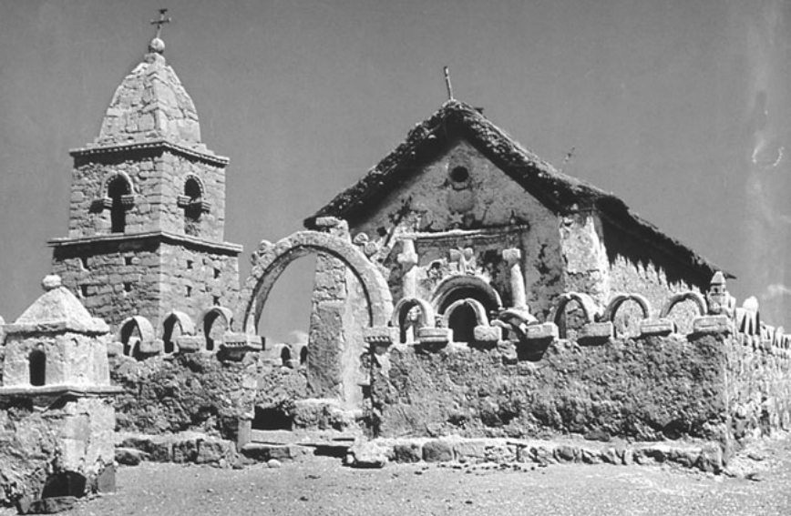

**图6　智利帕里纳科塔教堂。** 1789年建成，采用乡土材料与工艺，取得统一、趣味无可挑剔的整体效果。内部饰有质朴壁画。照片藏爱丁堡大学非西方世界基督教研究中心巴特勒收藏。

例如，哥伦比亚北部的瓜希罗人，以及玻利维亚的奇里瓜诺人，反复在传教聚居点刚建立时，将其摧毁，成功抵挡了传福音的努力。

另一些群体，接受传教站建立，或无法阻止，却遭受毁灭性后果。巴西亚马孙地区与加利福尼亚，尤其如此。在马拉尼昂和亚马孙领地，耶稣会不断为归信人口的自由，同殖民者斗争；尽管1680年代后期得到王室支持，却始终未能真正阻止传教区原住民被奴役。在这些地区，传教站的出现，导致本土文化消失。

耶稣会与方济各会，在加利福尼亚传教，也造成类似悲剧，但原因不同。在本章的解释中，这里的问题，不是剥削，而是误导的人道主义。1697年，下加利福尼亚开设传教站，王室同意授权耶稣会，禁止西班牙裔移民进入。耶稣会想证明，没有平信徒干预，也能和平地使一个地区，服从王权并<!-- PDF page 404; original page 389 -->基督教化。但传教事业最终失败，因为会士试图把原住民变成农民与工匠，按欧洲方式生活，环境却无法支持这种生活。在缺水的半岛上，建立农业共同体，几乎不可能。原住民被迫住在传教点，作物经常歉收，导致营养不良，人口几乎完全消失。

1767年以后，方济各会在上加利福尼亚建立传教站，犯下类似文化错误。这里还必须供养地区内的西班牙军队，使情况更加恶化。疾病、营养不良，以及强制居住和传统生活方式消失所造成的文化绝望，共同引发人口灾难。加利福尼亚人口锐减，西班牙人到来前繁荣的群体，陷入赤贫。

上下加利福尼亚与巴西亚马孙原住民，遭受的传教生活之恐怖，无可否认；但这些地区的经验，究竟多具代表性，并不清楚。例如墨西哥北部，采用西班牙农业和畜牧，改善了原住民营养，帮助他们在人口上存续，而非消亡。

此外，除上述地区，几乎各地的西班牙文化，都没有压倒原住民；发生的变化，往往是共同体自己理性决定的结果。例如，瓜拉尼人，似乎因为巴拉圭耶稣会集中传教村，可以提供抵抗强制文化丧失的庇护，才受到吸引。

他们承认，西班牙人不会离开，便判断，在传教环境中，可以学会生存所需的西班牙方式，同时保留珍视的传统。1770年代，查科的莫科维群体，也作出类似判断。他们请求传教士时，知道生活将改变；但在他们看来，传教文化，是获得知识、在其他竞争群体面前生存的办法。

由此，本章得出结论：十八世纪西属美洲，多数群体参与传教生活，基本出于自愿。传教点提供的好处，吸引人们前来；他们留下，是理性判断，认为其中生活优于外部。不过，传统生活方式，也必然改变。

<!-- PDF page 405; original page 390 -->

以莫科维人为例，要享受传教生活的益处，就必须接受传教士施加的新社会政治结构，以及弥撒、基督教节历、圣事等公共宗教形式。进入传教村后，他们很快采用基督教苦修虔敬模式，在传教士看来，甚至走向极端。

不过，虽然理解基督教的道德期望，他们仍忽略较抽象的罪与美德观念，因为这些观念，同传统文化冲突太深。他们对圣事的理解，也不符合欧洲神父的意图。修士到来十年后，洗礼与丧葬仪式，已获接受、理解；婚姻较少，告解与圣体圣事，最少。

这并不意味着，归信是肤浅的。随着时间推移，美洲各地传教村原住民，把传教结构内化为自己的结构，使基督教仪式与行为，成为公共共同体生活的中心。即使近来严厉批评传教制度的人，也承认，原住民共同体，最终接受了这种文化混合。几代以后，他们自视为基督徒。

传教士理解、接受这种演变过程。或许再过一段时间，殖民后期归信者，对欧洲宗教文化的理解，会接近十六、十七世纪归信的群体。不过，这个问题无法回答，因为过程被截断了。独立战争，将对帝国各地传教体系，造成致命破坏。

## 西属美洲的独立战争

波旁王朝建构国家的努力，切断了使新世界哈布斯堡帝国获得正当性，并维系其统一的纽带。巴洛克宗教仪式与节庆，联系精英和平民，表达共同信仰与象征体系，最终为国王本身提供思想支持。因此，对民众宗教实践的攻击，使社会领袖与殖民地大众，产生鸿沟。

但殖民后期，最让主教担忧的，是教区教士日益离心。整个哈布斯堡时期，教区圣职，既是一项职业，也是一种召命。波旁王朝，希望削减其职业性，重新点燃召命。在王室看来，<!-- PDF page 406; original page 391 -->没有职务的神父太多；吸引他们的，与其说是服务生活，不如说是圣职的地位与特权。王室确有道理。1790年，墨西哥城住着517名教区神父，却只有59个堂区服务职位。那些没有职位的人，可以说，缺少适当召命。

不过，无论召命状况如何，他们仍是重要社会群体。到十八世纪末，波旁王朝已经失去其忠诚。重定地方牧师角色、攻击司法豁免权，以及王室官员的轻蔑态度，威胁所有神父。1804年，王室实际没收追思弥撒基金，终于剥夺了许多人的主要收入来源。

1770年以后，王室又鼓励主教，考虑接纳印欧混血者与原住民进入圣职，冒犯了他们的种族秩序感。因此，革命危机开始时，许多克里奥尔神父，拒斥西班牙国家，认同自己是美洲人。教区神父，因而在新国家形成中，发挥重要作用。

波旁时期的累积影响，还有另一后果。独立后不久，修会与教区神父人数锐减，低于维持宗教礼仪所需的水平。人员不足，加上新国家平信徒领袖的敌意，以及人们对波旁主教的普遍怀疑——后者几乎全体支持君主制，直到最后——大大加强了十九世纪国家的世俗化趋势。

曾经组织、维持殖民文化的教会，如今衰落了。

**译校说明：** 原书将卡洛斯三世、四世政府时期合记为1755—1808年，正文保留；原PDF第394页又将葡萄牙驱逐耶稣会记为1759年1月，与第十六章所记同年9月不同，未自行统一。

## 注释

[^p389-1]: D. A. Brading, Church and state in Michoacán, 1749–1810 (Cambridge: Cambridge University Press, 1994), p. 167.

[^p395-2]: Erick Langer and Robert H. Jackson (eds.), The new Latin American mission history (Lincoln, NB: University of Nebraska Press, 1995), p. 28.

---

<!-- PDF page 407; original page 392 -->

# 第二十章　1765年以前的英属、法属北美

**马克·A.诺尔（Mark A. Noll）**

基督教向北美扩展，长期完全属于殖民事业。直到1754／1756—1763年的七年战争，即北美所谓法印战争以后，人们才开始设想，新世界殖民地，无论在宗教还是其他方面，可能不只是母国的延伸。[^p407-1]

例如，法国改革宗新教徒胡格诺派，之所以能参与魁北克与阿卡迪亚的早期定居，是因为曾信奉新教的法国国王亨利四世（1589—1610年在位），于1598年，通过《南特敕令》，扩大了他们的自由。但1627年以后，黎塞留枢机，不仅限制其国内自由，也成功把他们逐出新法兰西。

英格兰殖民地的名字，体现另一种旧世界存在。弗吉尼亚，是为纪念以新教“童贞女王”身份统治英格兰的伊丽莎白（1558—1603）；马里兰，则纪念查理一世（1625—1649）的天主教王后亨丽埃塔·玛丽亚。她也是黎塞留驱逐胡格诺派时，法国国王的妹妹。

尽管殖民者打算复制承继的思想、政治、社会与宗教模式，新环境，却始终迫使他们创新。

天主教徒与新教徒，都从旧世界带来对彼此的强烈怀疑。这种敌对，尤其因竞相同美洲原住民结盟而加剧，界定了整个时期，制度宗教的外部格局。

早期，它也偶尔带来难得的幽默。1604年，驶往阿卡迪亚的船上，一位天主教神父与一位胡格诺牧师，争论得声嘶力竭。两人同年去世，塞缪尔·德尚普兰的水手，便将他们合葬，让他们在永恒中继续争辩。

不过，天主教与新教争斗，通常被视为生死攸关的严肃问题。法印战争期间，弗吉尼亚一位讲道人警告：“我们的宗教、自由、财产、生命，以及一切神圣之物，都处于危险中。”尤其可能被“任意、绝对的君主”“奴役”，被迫遵从“罗马教会的<!-- PDF page 408; original page 393 -->迷信与偶像崇拜”。[^p408-2] 因此，殖民北美的基督教史，是旧世界宗教，在新世界的偶然条件中，获得自身生命的历史。

## 起步

法英在新世界的最初定居，远晚于西班牙。哥伦布于1492年，怀着使原住民归信的希望出海，已是一百多年前；巴托洛梅·德拉斯卡萨斯，为减轻基督徒对原住民的毁灭，开展基督教努力，也已有数十年。1560年代初，两批胡格诺派，曾试图在大西洋沿岸定居，却很快被来自佛罗里达圣奥古斯丁的西班牙军队消灭。

后来成为美国与加拿大的地区，直到十七世纪头十年，才出现永久定居点：1604年，法国人在阿卡迪亚，即今日加拿大大西洋诸省定居；1607年，英国人在弗吉尼亚詹姆斯敦建立殖民地；1608年，法国探险家塞缪尔·德尚普兰建立魁北克。

不久，方济各会的一个改革支派——静修方济各会，开始在法国定居点活动；1625年，耶稣会加入。阿卡迪亚与魁北克的早期宗教生活，一方面试图接触原住民，另一方面，则持续面对难以控制法国捕兽者与商人的困难。携家属移民的人数，仍然很少。

英国殖民地则相反：定居者挤走原住民，宗教生活以定居者为中心，成为常态。弗吉尼亚最初几年，困难重重，但总督仍成功植入英格兰教会，并提供少量教士。当地圣公会的国教地位，后来又在其他南方殖民地与西印度群岛复制。

托马斯·布雷曾短期在马里兰任牧师，并领导创办两个团体，终于加强新世界圣公会：1698年，基督教知识促进会成立，为殖民地牧师提供书籍；1701年，海外福音传播会成立，面向美洲原住民传教，后来却更多派遣传教士，前往马萨诸塞等英格兰教会薄弱的殖民地。

尽管这些团体工作可嘉，殖民地圣公会，始终未能完全克服一连串削弱其力量的障碍。堂区幅员巨大，造成英格兰教会生活经验，几乎无法指导的问题。北美南方，又由个人荣誉文化主导，包括决斗，以及过度抬高<!-- PDF page 409; original page 394 -->父权特权的观念，侵蚀基督教理想。被绑架的非洲人遭奴役，使一切人际关系，包括教会与民众关系，都更加复杂。帝国漠不关心，殖民地政治力量又加抵制，使当地始终无法拥有主教，因此，圣公会始终缺少传统教会生活的关键部分。

另一种新教国教，由严格的加尔文派，带入五个清教殖民地。这些人此前，未能在英格兰完成宗教改革。他们建立了普利茅斯（1620）与马萨诸塞湾（1630），两者于1691年合并为马萨诸塞邦；康涅狄格（1636）与纽黑文（1638），于1662年合为康涅狄格殖民地；以及1680年，从马萨诸塞分出、形成独立政府的新罕布什尔。由于新英格兰清教主义具有持久影响，下文将另行讨论。

新世界基督教，几乎立即呈现多样性，早期另外两个殖民地，也说明了这一点。1620年代中期，荷兰在哈得孙河口建立新阿姆斯特丹。几位荷兰改革宗牧师，在此服务，但始终受到荷兰移民不足，以及总督强横失政的限制。1664年，英格兰人接管，改名纽约。1693年起，新精英试图在纽约城，确立英格兰教会的国教地位；不过，那时殖民地的宗教群体，已经太多，国教制度无法有效运作。

从欧洲宗教光谱的另一端看，1634年建立的马里兰，是英格兰天主教徒的避难地。创办者乔治·卡尔弗特与儿子塞西尔，曾为詹姆斯一世效力，后来改宗天主教；詹姆斯及其子查理一世，出于感激，将殖民地授予他们。

新教徒，始终占马里兰定居者的大多数；天主教国王詹姆斯二世被废黜后，殖民地于1691年，转入圣公会统治。不过，在整个殖民时期，马里兰仍在极端敌视罗马教会的英属世界中，为天主教徒，提供了罕见庇护。

十七世纪后半叶，殖民扩张，制度化基督教，也较为稳固。值得注意的是，最强大的教会——清教公理宗、弗吉尼亚圣公会，以及新法兰西天主教——仍保留覆盖整个社会的欧洲国教会理想。它们全都寻求政府保护，<!-- PDF page 410; original page 395 -->认为自己有义务影响国家，把彼此的传教士视为公共秩序威胁，并反对其他基督徒进入自己的殖民地。

在圣劳伦斯河沿岸的魁北克省，法国定居，慢于英国。1659年，首位常驻主教弗朗索瓦—格扎维埃·德蒙莫朗西—拉瓦尔到来，标志着重点，从向原住民传教，转向在移民中建构文明。

拉瓦尔在法国招募神父与其他修会成员，扩展魁北克修院，使之积极培养教士，并使什一税制度化，最终定为农产品价值的二十六分之一，由此建立持久天主教文化的基础。

不过，他也同地方与法国修会领袖，以及平信徒总督争吵，开创了制度争斗的模式；继任者让—巴蒂斯特·德圣瓦利耶，又使争斗更加深入。

在灵修上，十七世纪后半叶，新法兰西，受到几位备受尊敬的女修会成员启发。玛丽·居亚尔丧夫后，加入乌尔苏拉会，取名玛丽·德兰卡尔纳西翁。1639年，她来到加拿大，立即通过为法国与原住民女孩办学，以及自身神秘主义虔敬，发挥影响。

玛格丽特·布尔茹瓦，于1653年来到蒙特利尔，不仅在这个边疆前哨组织第一所教堂，还创办圣母会；该会后来，长期在教学、医疗护理等方面，发挥重要作用。

尽管当时尚不明显，殖民帝国的潮流，正流向英国，主要因为英国吸引的移民，多于法国或西班牙。其中一个主要原因，是宗教少数在英国殖民地，找到了空间。

十七世纪结束以前，公谊会，即贵格会，已来到北美许多地方。他们很快摆脱英国内战创立初期的激进主义，在乔治·福克斯（1624—1691）领导下，迅速巩固。福克斯于1672至1673年访问殖民地，除了有力教导基督的内在之光，以及基督教和平主义的美德，还向贵格会一位重要归信者，提供了有用的北美信息。

此人，是著名英国海军将领之子威廉·佩恩（1644—1718）。1681年，他在新世界取得大片土地；1682年，规划费城，为贵格会进一步迁移，创造条件。

贵格会迁往宾夕法尼亚时，纽约的荷兰改革宗会众，正在繁荣发展，这是此前荷兰官员压迫性干预下，无法实现的。第一批来自苏格兰，<!-- PDF page 411; original page 396 -->或经爱尔兰而来的苏格兰移民，在宾夕法尼亚、新泽西与长岛，创办长老宗教会。弗朗西斯·马凯米，出生于爱尔兰，在苏格兰受教育，在北爱尔兰获委派，到北美传教。他于1706年，将这些教会联合为美洲第一个长老区会。

大约同一时期，多种浸礼派教会，也在新英格兰、纽约和更南地区扎根。1707年成立的正规浸礼派费城协会，是后来许多重要美国浸礼派组织中的第一个。

十七世纪最后三分之一，在欧洲形成的敬虔主义运动，也通过世纪末起的德意志移民，在美洲立足。此后一百年，来到北美的12万德语移民，包括一些门诺派、摩拉维亚弟兄会与弟兄派，但多数，同路德宗和改革宗国教会相连。

1742年，亨利·梅尔希奥·米伦贝格，从敬虔主义中心哈勒来到宾夕法尼亚，随后，路德宗教会组织，迅速发展。

十八世纪中叶，更多新教徒出现在美洲海岸，包括桑德曼派、震颤派、自由意志浸礼派与普救派等。尤其在纽约、新泽西、宾夕法尼亚、特拉华等中部殖民地，形成一种欧洲没有准确对应物、能够实际运作的宗教多元格局。

1687年，纽约总督托马斯·唐根，对纽约城所作观察，很快也适用于其他地方：“这里英格兰教会的人不多，罗马天主教徒很少；贵格会传道人很多，男女都有，女的尤其多；唱歌的贵格会、狂呼的贵格会；守安息日者、反对守安息日者；一些重洗派，一些独立派，一些犹太人。总之，各种意见都有人持有，而大多数人，什么也不信。”[^p411-3] 尽管几乎无人赞成宗教多元本身，欧洲统一基督教世界的理想，仍在瓦解。

走出那个基督教世界的空间，促使新世界定居者，重新思考宽容问题。罗杰·威廉斯，是一位加尔文宗分离派，他不断挑战马萨诸塞清教体制，直至1635年被驱逐。此后，他以政府不应强制宗教实践或信仰为原则，建立罗得岛殖民地。

清教徒反抗查理一世的早期，威廉斯访问英格兰，于1644年出版名著《论因良心而迫害的血腥信条：真理与和平的对话》。其论点，远超当时：“上帝不要求，任何世俗国家，制定并强制宗教统一；这种被强迫的统一，迟早会成为<!-- PDF page 412; original page 397 -->内战、凌辱良心、在基督仆人身上迫害基督，以及使数百万灵魂陷于虚伪与毁灭的最大原因。”[^p412-4]

推动另外两项类似实验的，是殖民条件，而非抽象原则。议会与清教主义力量，在英国内战中占上风后，马里兰天主教领袖，于1649年通过《宽容法》，希望保留实践自身信仰的空间。法案虽很快废除，马里兰的宣告，仍标志着公共和平观念的新阶段。

在宾夕法尼亚，威廉·佩恩，从贵格会信念，推出惊人结论。他在《良心自由的大案》（1670）等著作中，把贵格会关于个人宗教能力的认识，发展为反对国家强制宗教的论证。将这些原则用于新泽西，尤其宾夕法尼亚时，他建立了罗得岛之后，基督教世界最宽容的世俗政府。

十七世纪欧洲殖民地中的宽容，大多还是实验。不过，同新世界实践基督教的其他领域一样，实验，也是未来的先声。

## 清教徒

新英格兰清教徒，试图创造一种比英格兰更纯洁的基督教文明，构成北美最全面、影响最大的宗教实验。英格兰清教徒，在母国试图改革个人生活、国教会实践与社会结构，先受王室反对，后来又因自己在内战中的短暂成功，带有种种暧昧，而受挫。在新世界，清教殖民者却能真正实施，长期为之奋斗的原则。

他们的领袖，包括非凡干练的牧师神学家：马萨诸塞的约翰·科顿（1594—1652）与托马斯·谢泼德（1605—1649）、康涅狄格的托马斯·胡克（1586—1647）、纽黑文的约翰·达文波特（1597—1670）；也有平信徒，例如普利茅斯总督威廉·布拉德福德（1589？—1657），以及马萨诸塞总督约翰·温思罗普（1588—1649）。

“清教道路”成为一座实验室，检验他们的基督教观念，在外部敌人消除的环境，是否能够繁荣。疾病已使美洲原住民人口大减，新英格兰自然资源又太少，不足以吸引欧洲其他商业强国干预。

布拉德福德，严峻描述1620年秋，普利茅斯朝圣者面对的挑战：“如今，他们没有朋友欢迎，没有客店<!-- PDF page 413; original page 398 -->接待、使饱经风雨的身体恢复精力；没有房屋，更没有城镇，可以前往求助……除了上帝的灵与恩典，还有什么能支撑他们？”[^p413-5]

十年以后，温思罗普带着更多殖民者、更雄厚资金到来，能够怀抱一种梦想：新英格兰，既已公开宣布，要追随上帝，寻求“一处共同居住、彼此结伴之地，服从适当的民政与教会治理形式”，清教徒便将“像山巅之城，全世界的眼睛，都注视着我们”。[^p413-6] 这些忧惧与梦想，通过围绕《圣经》圣约主题组织社会，获得具体形态。

这种欧洲加尔文主义认为，个人得救的基础，是上帝立约的应许：祂将救赎信靠基督的人。清教徒解释，这项应许，是三一上帝内部所立之约的实行：父选择得救者，子成就救赎，圣灵使救赎生效。

英格兰清教徒，对圣约之于有形教会的意义，存在内部分歧，促成其崩解；新英格兰人，却同意以地方会众，作为教会秩序的基础。彻底改革的教会，不需要主教在场，也不需要长老区会行动，只需要地方会众，对上帝、对彼此作出承诺。相应地，清教徒相信，社会健全的基础，是上帝对全体立约子民的应许。

建立清教社会秩序的关键，是把个人信仰、教会纯洁与敬虔社会，结合为相互联结的圣约体系。在新世界，宗教敌人稀少，教会团契的标准，便从愿意承受外部反对，转为内在灵性现实。

新英格兰人，要求想加入教会者，在集会的会众面前，见证自己经历了上帝恩典所带来的得救体验。这样的信仰告白，使男子有资格成为殖民地自由民，即选民，同时成为教会成员。它也使无投票权的妇女，可能获得非同寻常的灵性影响；十七世纪马萨诸塞一位总督的妻子安·布拉德斯特里特，写出广受注意的诗篇，就是例子。

只要自由民选择敬虔统治者，制定尊重上帝成文圣言的法律，新英格兰公共生活，就能履行同上帝的社会圣约。

在这一整体体制下，清教徒克服了许多实际与思想障碍。罗杰·威廉斯等特立独行者，提出抗议，追问《圣经》何处允许，清教体系所要求的<!-- PDF page 414; original page 399 -->强制良心。安·哈钦森（1591—1642）也提出异议，认为强调可见的信仰告白，会助长虚伪，削弱对神圣恩典的信赖。

由于英格兰很少关心新英格兰，清教领袖，可以自行处理异议：威廉斯与哈钦森被驱逐，少数浸礼派被罚款或鞭打；英格兰清教统治，在动荡中临近结束时，马萨诸塞当局，还于1659至1661年，绞死四名不肯屈服的贵格会信徒。

普通新英格兰人，从未全都完全认同这一体制。不过，总体而言，在主要地方官与牧师引导下，实验运作良好。新英格兰经常和平，虔诚信徒，享受持续而精心准备的圣经讲道；政治秩序，尽管偶有冲突，仍运作高效，比十七世纪任何欧洲政权，都获得更多公众支持。

必要的思想基础设施，也很早建立：1636年创办的哈佛学院，为未来牧师和地方官，提供基督教博雅教育；同在剑桥的印刷所，则提供讲道、论著及各种学术读物，成为整项事业的命脉。

唯一无法回避的困难，是时间流逝。第一代定居者的子女，越来越多人没有归信体验；第二代申请加入教会者，因此越来越少。人们日益害怕，相互联结的清教圣约，将逐渐解体：没有新归信者，就没有立约教会；没有立约教会，就没有敬虔社会。

面对危机，马萨诸塞领袖，提出巧妙的权宜办法。1662年，牧师召开宗教会议，建立后来历史学家所谓“半途之约”：已受洗、行为良好的人，可以为子女申请洗礼；不过，他们本人及子女，若不亲自作信仰告白，便不能领圣餐。

制定者希望，既保留地方会众作为选民聚集的完整性，又让尽可能多人，继续参与清教体制。他们至少部分成功，但时间仍不断带来损耗。在英格兰宗教斗争熔炉中形成的神学，必须修改，才能在变化巨大的美洲环境中生存。

新环境，包括世纪末的一连串震荡：1675至1676年，与原住民的战争，使十二座城镇夷平，两千定居者丧生，也摧毁了原住民，作为地区力量的存在；1690年代初，对巫术的歇斯底里，最终导致塞勒姆村二十人被处决；1695年，马萨诸塞被强加一份<!-- PDF page 415; original page 400 -->新特许状，削弱教会的法律地位；十八世纪初，奢华增长，尤其波士顿，兴起模仿英格兰上层生活的新欲望。

尽管人们忧虑衰退，以热情讲道，呼吁整个殖民地悔罪，马萨诸塞与同样清教化的康涅狄格，仍是新世界最团结、宗教上最有自信的殖民地。

正式神学，对清教徒也很重要，而且数量很多。它既来自早期移民牧师神学家，也来自完全在美洲受训的后期牧者。例如，波士顿牧师塞缪尔·威拉德，在1670、1680年代，就《威斯敏斯特信仰告白》，撰写庞大系列讲义，1726年以《完整神学体系》出版。不过，使美国清教主义发挥作用的关键，是行动中的神学，而不只是书本神学。

## 与美洲原住民的相遇

几乎全部欧洲殖民事业，都宣告有意向原住民传福音。没有一项成功，至少没有达到人们轻易预期的成功。世界观的巨大差异、欧洲疾病在大体无意间毁灭原住民人口、几乎普遍认定基督教必须伴随欧洲文明形式，以及无法将无私传教，同贪求土地分开，都使原住民基督教化的努力，注定受挫。

在阿卡迪亚，最早的耶稣会传教士，于1611年开始认真研究米克马克语，开创北美先例。后来，另一个经过更新的方济各会支派嘉布遣会，接手当地传教；但世纪中叶，同新英格兰人的武装冲突，摧毁了这项事业。

沿圣劳伦斯河，耶稣会在阿尔冈昆语部落中领先，于魁北克附近的西耶里，为归信原住民建立聚居点。后来，类似努力，也包括圣叙尔皮斯会，在今日蒙特利尔皇家山，组织的重要定居点。不过，整个北美最重要的早期传教，是耶稣会，远赴西方乔治亚湾，在讲易洛魁语的休伦人中开展的工作。

耶稣会士让·德布雷伯夫，于1626年，首次进入休伦地区，停留三年，学习语言和文化。与英格兰冲突，造成一段中断；1634年，他重开传教。1647年，有十九名会士工作，归信者以千计。相对成功，部分来自<!-- PDF page 416; original page 401 -->本会在中国，尤其利玛窦，以及印度，尤其罗伯托·德诺比里，传教经验中，艰难学到的教训：非西方宗教，可能包含积极基础，供基督教在其上建构。

因此，加拿大耶稣会士，在休伦人重视个人关系、信任异象，以及熟悉迁徙——可类比朝圣——等方面，找到一些共同点。布雷伯夫把圣经与礼仪材料，译成休伦语，并很可能，至少写过一首圣诞颂歌。不过，该歌后来的译文，使用了阿尔冈昆神祇的名字：“那是冬日的月亮，鸟儿全已飞走；强大的吉奇·马尼图，便遣来天使歌班。”[^p416-7]

尽管耶稣会文化上相对灵活，外部因素，对休伦人归信，或许更加重要。接触法国人，带来毁灭性的麻疹与流感；同时，休伦人受到南方易洛魁五族联盟的强大压力。换言之，耶稣会到来，恰逢个人与共同体创伤。

布雷伯夫及同僚，热心加强美洲荒野中的基督教前哨。但1648、1649年，五族联盟的最后进攻，不仅摧毁休伦传教事业，也摧毁休伦地区本身。在灾难中，许多会士至死忠诚，包括1649年去世的布雷伯夫。

按原住民既有习俗，他作为受尊重的敌方领袖，遭受极其残酷的酷刑，却表现得如此坚忍，以致死后，俘虏他的战士，出于敬意，食其心、饮其血。

归信者，包括休伦人约瑟夫·奇瓦滕哈；他同会士一起，实行依纳爵神操。世纪后期，阿尔冈昆—易洛魁混血的卡特里·特卡奎瑟（Kateri Tekakwitha），以极度虔敬的自我苦修，在1680年早逝以前，就已令许多人敬佩。

不过，圣叙尔皮斯会虽最终接收少数原住民修女，整个十七世纪，却没有原住民神父被按立，说明传教成果，仍相对表面。

英国殖民地的传教，开始更晚，成效更少。偶尔出现的归信者，可供自我庆贺。例如，阿尔冈昆酋长波瓦坦之女波卡洪塔斯，于1614年，在詹姆斯敦接受基督教。不过，她的基督徒生活短暂；英国丈夫约翰·罗尔夫，将她带往英格兰，三年后，她在那里去世。

在弗吉尼亚和新英格兰，更常见的早期英人—原住民关系，是怀疑、冲突，甚至屠杀。例外，包括同<!-- PDF page 417; original page 402 -->纳拉甘西特人，同情交往的罗杰·威廉斯，以及耶稣会士安德鲁·怀特。后者在马里兰皮斯卡塔韦人中工作，1645年，却被英国当局逐出殖民地，事业中断。

清教徒最广泛的传教努力，来自两位马萨诸塞牧师：罗克斯伯勒的约翰·艾略特（1604—1690），以及马撒葡萄园岛的小托马斯·梅休（1621—1657）。

艾略特，将许多归信原住民，聚集于按《旧约》模式组织的“祈祷城镇”。他的阿尔冈昆语译本，是英国殖民地印行的第一部完整《圣经》。不过，菲利普王战争（1675—1676）期间，恐惧的清教徒，把归信原住民隔离在波士顿港鹿岛，卫生条件恶劣，几乎摧毁了艾略特的工作。

梅休、其父及其他家人，取得较持久成功，因为马撒葡萄园岛相对孤立，保护归信原住民，免遭战争蹂躏，以及贪求土地的欧洲人侵夺。

新教最有效的原住民传教，直到十八世纪深入以后才开始。承担者，是摩拉维亚弟兄会；他们也是有效接触非洲奴隶的新教先驱。

1732年，现代摩拉维亚教会复兴后不过几年，领袖路德维希·尼古拉斯·冯·亲岑多夫伯爵，就把莱昂哈德·多贝尔和戴维·尼奇曼，从萨克森赫恩胡特，派往维尔京群岛圣托马斯岛。

摩拉维亚人，对土地或统治权没有既得利益，实行敬虔主义的心灵宗教，在这项事业中，取得相当成功，继而在牙买加（1754）、安提瓜（1756）与巴巴多斯（1765）的黑人中，开展卓有成效的事工。

同样的传教精神，使克里斯蒂安·劳赫和戈特洛布·比特纳，于1742年，在马萨诸塞—纽约边界附近的谢科梅科，向马希坎人工作。归信者中，有几位妇女，其信仰表达，说明摩拉维亚虔敬，已相当程度本地化。

其中，原名旺帕诺什的拉结，于1743年12月，留下参加弟兄会圣餐的体验。按比特纳记录，她把摩拉维亚关于基督宝血与伤口的神学，同自身对原住民仪式性酷刑的理解结合：“她眼睛什么也没有看见，但心中信靠救主，仿佛亲眼见过。她的感受如此强烈，以致认为，即使有人将肉从骨头上撕下，她仍将与祂同在。她说：‘我相信，我甚至不会感觉到，因为我的全身与心灵，都从祂的伤口和宝血，感受到力量。’”[^p417-8]<!-- PDF page 418; original page 403 -->再过几年，弟兄会成功建立第二处传教事业，由戴维·蔡斯贝格，在宾夕法尼亚特拉华人中主持。但法印战争，严重损害谢科梅科与特拉华传教：原住民，只因是原住民而遭怀疑；弟兄会，则经常被指为“教皇派”。

蔡斯贝格最终，在萨斯奎哈纳河畔的弗里登斯许滕，为归信者找到暂时庇护；地名意为“受和平庇护”。但宾夕法尼亚白人的敌意，很快又把会士与归信者，赶入西部荒野。经历更多创伤后，他们最终，在今日安大略，建立安全定居点。

美洲原住民文化，所遵循的原则，同欧洲文化极不相同，无论人与神的关系，还是人与土地的关系，无论与敌人和解，还是与上帝和解。或许，值得惊讶的，不是欧洲人向原住民传教如此困难，而是竟有少数原住民，接受基督教信息，作为自己的信仰。

## 复兴与战争

十八世纪最初几十年，欧洲列强，对殖民地采取善意忽视。对教会而言，结果并非漂流无依，而是移民信仰，逐渐适应新世界条件。

新法兰西的耶稣会，卷入母国政治角力，工作受到干扰。不过，同静修方济各会、嘉布遣会和圣叙尔皮斯会一起，会士们，仍坚持在原住民中，开展重要却日渐缩小的工作，宗教重心，则越来越转向欧洲定居点。

主教与各修会领袖，争吵不休，说明灵性上，明显远离前一世纪的英雄气概；尽管如此，有机天主教社会的结构，仍得到加强。

1713年《乌得勒支和约》，使阿卡迪亚转入英国统治。当地天主教徒，忐忑维持，直到1754年，帝国战争爆发。期间，耶稣会士塞巴斯蒂安·拉勒，与巴黎圣神修院的皮埃尔·马亚尔，开展重要传教，使与英国的关系更加复杂：这些神父，在照顾狭义宗教事务之外，也招募原住民战士，袭扰新英格兰定居点。

法印战争开始时，英国采取严酷措施，将法裔阿卡迪亚人，驱逐往路易斯安那及其他地区。

<!-- PDF page 419; original page 404 -->

直到1750年代中期这场动荡，加拿大，才开始一段连续的新教史：英国当局，招募新英格兰人，以及欧洲各地新教徒，填补腾空的阿卡迪亚土地。

魁北克教会，也遭遇类似创伤。1759年，英军在魁北克获胜；1760年，又占领蒙特利尔。伦敦统治者，希望迅速根除圣劳伦斯河沿岸的法国与天主教存在，当地领袖，却更现实。

总督詹姆斯·默里，无视排除罗马对魁北克管辖的指令；不过，1763年《巴黎和约》，确实允许实践天主教。让—奥利维耶·布里昂，以熟练外交，配合默里的策略。他向默里与英国人，保证魁北克居民忠诚，随后，按原书记载，于1764年祝圣为新主教。

通过两人的谨慎谈判，英国最终为英属北美天主教会，提供资金与其他支持；这比它在本土，承认天主教徒完整公民权利，早六十多年。1760年，约180名神父、190名修女，在魁北克约七万居民中工作。

南方十三个殖民地，每名牧者服务的人口，多得多。不过，教堂建设、牧师聘任与基督教实践的鼓励，大体跟上迅速增长的人口。

世纪中叶，十三殖民地白人，总计约一百万。新英格兰，每六百人约有一所教会，居民大多住在界限清楚的城镇及附近农场；中部殖民地，每四百七十人约一所，大多住乡村，费城与纽约，则为新兴城市中心；南方，每一千零五十名白人约一所，人口主要沿水道分散。[^p419-9]

旧世界国教模式，仍极具影响。1740年，全部教会半数以上，具有国教地位，或属公理宗，423所，或属圣公会，246所。当时，弗吉尼亚没有非圣公会教堂，领袖也打算维持这种局面。新英格兰，已勉强容忍少数非公理宗信徒。在南方与新英格兰，政府控制宗教，仍比英格兰严格。

相反，中部殖民地，宗派多元，已成为生活事实。1740年，十三殖民地的大部分非国教教会，集中这里：长老宗160所，德意志与荷兰改革宗129所，浸礼派96所，路德宗95所，贵格会约50所，门诺派、摩拉维亚弟兄会与弟兄派合计约30所，天主教27所。

早在世纪中叶动荡，彻底改变宗教面貌之前，渐进发展，就已带来演变。所谓“不流血<!-- PDF page 420; original page 405 -->革命”，即1688年革命，以及新君主威廉与玛丽，卷入欧洲事务，使新英格兰人走出清教外壳，也使所有殖民地新教徒，更自觉注意同罗马教会的争论；这种争论，与对法国的冲突，密不可分。

1698年，一位公理宗牧师，发表题为《新英格兰的义务与利益》的讲道，清楚表现这种意识。他说，新英格兰的利益，在于同“德意志、波希米亚、匈牙利、法国、皮埃蒙特山谷，以及欧洲许多其他地方的新教人民，与〔上帝的〕见证人”站在一起：“他们为了祂的名与福音，终日被杀。”[^p420-10]

著名新教领袖的生涯，也说明时代气氛。科顿·马瑟（1663—1728），长期同父亲英克里斯，一起在波士顿第二教会任牧师。他以异常忙碌著称，却也博学、尽责，虔敬得令人感动。

《基督在美洲的伟大作为》（1702），是他以孝敬先辈的精神，赞颂新英格兰创立者独特美德的作品。不过，他也同哈勒敬虔派奥古斯特·赫尔曼·弗兰克通信，推动宗教体验的规范，趋近十八世纪新的情感哲学，最后欢迎非公理宗教会进入波士顿，虽然不包括圣公会。

他鼓励接种天花，并撰写一部重要自然神学著作《基督教哲学家》（1721），表现启蒙对自然的浓厚兴趣。

1699年，本杰明·科尔曼，获聘为波士顿新建布拉特尔街教会牧师时，马瑟把他视为神学上的趋时人物。在那所教会，新式英格兰建筑、礼仪与感受方式，似乎正在取代新英格兰历史上的清教独特性。

不过，曾在伦敦生活的科尔曼，与其说是自由派，不如说是具有国际视野的福音派。他重视同欧洲不同新教徒，更加紧密的联系。1730年代，他将乔纳森·爱德华兹，同英国重要异议派联系起来，也代表波士顿，正式欢迎乔治·怀特菲尔德。

马瑟与科尔曼，共同反映变化的宗教格局：两人都参与时代的印刷出版爆发，都更强烈地感到，天主教构成全球性威胁；其会众，则由日益扩大的跨大西洋贸易，提供经济支持。

这些深层变化，为复兴爆发铺路。新英格兰，早已有反复出现的地方复兴。例如，所罗门·斯托达德（1643—1729），在马萨诸塞北安普敦教会，见证过几次“收获”；他主导康涅狄格河谷宗教生活，逾半世纪。到1720年代中期，类似地方事件，也在<!-- PDF page 421; original page 406 -->新泽西荷兰人中出现。西奥多·弗雷林豪森，倡导欧洲敬虔主义的典型重点：个人悔罪、以基督为中心的信仰，以及对继承而来的教会权威的怀疑。

来自阿尔斯特的长老宗移民，比来自苏格兰的同宗，更容易接受这些重点。1740年代初，吉尔伯特·坦嫩特率领的苏格兰—爱尔兰派，同乔纳森·迪金森率领、从新英格兰迁来的群体联合，形成充满活力的新派长老宗复兴。坦嫩特，正是由弗雷林豪森，引向敬虔主义关切。

运动最终，培养了一批热心青年传道人；其中最有效的，是塞缪尔·戴维斯（1723—1761）。1748年，他永久定居弗吉尼亚，耐心争取当地承认长老宗教会：先援引英国1689年《宽容法》，后来，又在与法国战争期间，发表强烈爱国的讲道。

等到戴维斯离开弗吉尼亚，前往普林斯顿，担任新泽西学院院长时，一种既尊重苏格兰信条传统，又具有敬虔主义紧迫感的长老宗，已在几个中部、南方殖民地迅速传播。

不过，新宗教力量最醒目的表现，来自马萨诸塞的一场地方复兴，以及一位圣公会巡回传道人的努力。1734年末，斯托达德的外孙兼继任者乔纳森·爱德华兹（1703—1758），向北安普敦会众，发表一组简短的因信称义讲道。

镇中反应，像电流激荡。爱德华兹最初报告：“最倾向轻视活泼而有体验的宗教者，最自恃理性者，镇中最高门第，年纪最大者，以及许多小孩，都受到显著影响。我所知道的，没有一个家庭，几乎没有一个人，完全未受触动。”[^p421-11]

北安普敦的特殊历史，以及爱德华兹，持续讲道反对自己眼中的阿明尼乌主义倾向，有助于解释复兴；正如其舅父约瑟夫·霍利，于1735年5月自杀，有助于解释复兴冷却。

不过，地方条件，解释不了他的《忠实记述上帝在北安普敦及邻近城镇村庄数百灵魂归信中的惊人作为》，于1737年，在艾萨克·瓦茨支持下，于伦敦出版时，引起的轰动。

爱德华兹严峻描写，人类罪恶招致定罪的可怖，也同样有力地描述，得救可切身感受的喜悦。这在波士顿、其他殖民地、苏格兰、英格兰、威尔士，乃至欧洲大陆，都激起共鸣。

此后，他同北安普敦会众的关系，起伏不定。1750年，他试图改变从斯托达德继承的圣礼实践，遭会众<!-- PDF page 422; original page 407 -->驱逐。不过，他对1735年复兴的叙述，受到的欢迎，已经说明：更重情感、更重归信、较少依靠传统与等级的新教时代，已经来临。

乔治·怀特菲尔德的工作，更广泛地表现这个新时代。他于1738年，首次来到美洲。这位年轻人，讲传统加尔文主义；身为按立的圣公会教士，却通过露天讲道，或在任何能聚集群众的地方讲道，打破教会惯例。

他倡导较早的清教灵修，却利用最新营销与传播策略；他真诚虔敬、自我谦抑，却成为时代最著名的人物之一。他表面上，来管理佐治亚一所以哈勒敬虔派机构为范例的孤儿院，真正的事业，却是讲道。

1740年4月3日至6月5日，在费城及周边的巡回，尤其难忘；连持世俗立场的本杰明·富兰克林，也为他着迷。同年9月14日至10月13日，在新英格兰巡回时，他同爱德华兹，发现彼此深刻的灵性亲近。

这些活动，使怀特菲尔德成为后来组成美国的全部殖民地中，第一个广为人知的人。更重要的是，他的讲道，直接、个人化、即兴、戏剧化、通俗而动人，指向一种变化：宗教从继承的生活框架，转为个人选择的结果。

他启发许多模仿者，也招来许多敌人；不过，从长远看，更重要的是，他开创一种新的宗教方式，在北美，其繁盛程度，超过世界其他任何地方。关键，是一种接受传统基督教许多内容，却以较现代的个人主义形式，由个人领受的信仰。

复兴既是根本变化的标志，也是促成变化的力量。它使新英格兰清教主义，分裂为竞争派别。查尔斯·昌西、乔纳森·梅休等自由派，受到复兴热狂刺激，更加倡导理性道德主义。

康涅狄格北黑文的艾萨克·斯泰尔斯等保守旧光派，努力维持传统国教形式的加尔文主义；新光派，则追随爱德华兹，想用复兴的新酒，重振覆盖全社会的清教会众。

分离派认为，爱德华兹与怀特菲尔德所讲的体验式加尔文主义，要求真正信徒的会众，离开令人窒息的国教会。

在新英格兰，同其他殖民地一样，复兴也推动精力充沛的浸礼派工作。例如，神学与政治上都敏锐的艾萨克·巴克斯，<!-- PDF page 423; original page 408 -->同爱德华兹一起，提倡发自内心的加尔文主义，却反对一切国教制度，认为它侵犯良心权利。圣公会，也从复兴获益，因为它似乎提供了避开复兴热狂的平静庇护。

世纪中叶的觉醒，极大刺激神学。马萨诸塞欣厄姆的埃比尼泽·盖伊等反对复兴的教士，以十八世纪新的理性与常识标准，检验承继的信仰，迈出走向一位论的第一步。

不过，觉醒最伟大的神学丰碑，来自乔纳森·爱德华兹。他试图为时代新的道德哲学施洗，以复兴加尔文宗虔敬。在一系列辨析越来越精细的作品中，最后达到《宗教情感论》（1746），他努力说明，哪些是上帝真正工作可靠的标志，哪些不是。

在《自由意志论》（1754）中，他运用最新的决疑式辨析，反对迅速兴起、把人的自由理解为自我决定的观念。身后出版的《二论：论上帝创造世界的目的；论真正美德的本性》（1765），则论证：圣经推理与当代情感心理学，都把真正的善，界定为因上帝自身完美的圣洁，而爱上帝。

爱德华兹认为，教会本质上由得救者组成，救恩则完全依靠上帝恩典。讽刺的是，这种态度，削弱了神学继承者，投入严密思考的承诺。他自己的工作，却日益被视为，这个时代思想与神学的顶点。

觉醒，也让妇女，获得非同寻常的声音。例如，罗得岛纽波特的苏珊娜·安东尼，1742年，在一篇依据《希伯来书》七章二十五节的讲道后，加入当地教会。经文说：“靠祂进到上帝面前的人，祂都能拯救到底。”讲道使她，强烈体验到上帝的灵：“基督竟如此、如此无限可爱地，显现在我面前。”[^p423-12]

像许多受到复兴触动的妇女一样，她后来领导一个妇女团体，每周聚会，持续数十年。较少见的是，她还在聘请爱德华兹学生塞缪尔·霍普金斯，到纽波特教会任牧师一事中，发挥重要作用。

以斯帖·爱德华兹·伯尔（1732—1758），是这位杰出神学家的女儿，也是普林斯顿学院院长亚伦·伯尔的妻子。通过复兴传道人极力宣讲的同类恩典体验，她获得了相当自信。

一次，一位学院助教，当着她的面，贬低妇女建立友谊，以及通过理性实现个人发展的能力。她以充分论辩回应，“说得他全然无言”。[^p423-13] 在<!-- PDF page 424; original page 409 -->浸礼派与分离派——即脱离国教体制、自组教会的公理宗信徒——之中，复兴最初几年，觉醒妇女，获得空前机会，进行劝勉，并充分参与会众议事。

对世界基督教史，更为重要的，是复兴激励人们，向非裔美国人传播福音。殖民时期，反对奴隶制的声音，偶尔出现：十七世纪末，宾夕法尼亚门诺派与贵格会；1700年，清教法官塞缪尔·休厄尔；以及贵格会信徒约翰·伍尔曼（1720—1772），整个成年时期的抗议。

不过，向奴隶与自由黑人传福音，几乎从未成功。1740年代，较少关注教会秩序、更加重视体验式宗教的复兴讲道与实践，开始取得突破。怀特菲尔德与戴维斯，恰好都拥有奴隶，却是向非裔美国人传教，最有效的讲道人；许多其他人，也加入他们。

出生于非洲、后来被波士顿主人释放的奴隶菲莉丝·惠特利，于1770年怀特菲尔德去世时，发表悼诗，纪念这项传教。她亲自听过他的讲道，尤其记下他对奴隶所说的话：

> 非洲人，接受祂吧，祂渴望你们；
> 公正无偏的救主，是祂应得的称号。
> 如果愿意行在恩典的道路，
> 你们将成为上帝的儿子、君王与祭司。[^p424-14]

这种以极少操控加以传达的信息，代表欧洲扩张带来的，最出人意料、又最重要的创新之一。向非裔美国人传教，使基督教，在一个没有社会地位、没有继承的基督教传统、不涉国教利益，也没有欧洲基督教世界历史的群体中扎根。以当时无人能够预见的方式，这成为了未来的配方。

复兴以后，人们能清楚看见的，是帝国战争再起，以及殖民地巨变开始。1763年《巴黎和约》，最终确认英国战胜法国，起初似乎简化殖民生活。许多感恩讲道，宣告英国新教自由，在同法国天主教专制的斗争中，获得证明。

但英国试图通过税收、驻军与更严格行政，规范扩大后的帝国时，殖民者很快，就反过来斥责乔治三世与议会，是专制者。教会将全面卷入这一意外发展；<!-- PDF page 425; original page 410 -->其中，还会出现北美殖民基督教经验所播种子，结出的更多意外果实。

**译校说明：** 原书PDF第423页将以斯帖·伯尔写作亚伦·伯尔的“husband”，与本段女性身份、人物关系不符，译为“妻子”；第410页记玛丽·德兰卡尔纳西翁1639年来加拿大，与第九章的1637年不同；第419页布里昂祝圣年份1764，也依原书保留。

## 注释

[^p407-1]: 殖民地人所谓法印战争，1754年开始，比欧洲七年战争早两年。

[^p408-2]: Samuel Davies, ‘God the sovereign of all nations’, in S. Davies, Sermons on important subjects, 4th edn, 3 vols. (New York: J. and J. Harper, 1828), vol. 3, p.173.

[^p411-3]: J. Butler, ‘Protestant pluralism’, Encyclopedia of the North American colonies, ed. Jacob Ernest Cooke, 3 vols. (New York: Charles Scribner’s Sons, 1993), vol. 3, p.609.

[^p412-4]: R. Williams, The complete writings of Roger Williams, 7 vols. (New York: Russell & Russell, 1963), vol. 3, pp.3–4.

[^p413-5]: William Bradford, Of Plymouth Plantation, ed. S. E. Morison (New York: Knopf, 1959), pp. 61, 62–3.

[^p413-6]: Edmund S. Morgan (ed.), Puritan political ideas (Indianapolis: Bobbs-Merrill, 1965), pp. 90, 93.

[^p416-7]: 关于译本，参见 John Webster Grant, Moon of wintertime: Missionaries and the Indians of Canada in encounter since 1534 (Toronto: University of Toronto Press, 1984), p. vii。

[^p417-8]: 见 Rachel Wheeler, “Women and Christian practice in a Mahican Village”, Religion and American culture, 13 (Winter 2003), p. 36。

[^p419-9]: Patricia U. Bonomi and Peter R. Eisenstadt, “Church adherence in the eighteenth-century British American colonies”, William and Mary quarterly, 39 (1982), p. 273。教堂数字取自 Edwin S. Gaustad and Philip L. Barlow, New historical atlas of religion in America (New York: Oxford University Press, 2000)。

[^p420-10]: Thomas S. Kidd, ‘“Let hell and Rome do their worst”: world news and anti-Catholicism, and international Protestantism in early-eighteenth-century Boston’, New England quarterly, 86 (2003), p. 270.

[^p421-11]: J. Edwards, “Letter of May 30, 1735”, in The works of Jonathan Edwards, vol. 4: The Great Awakening, ed. C. C. Goen (New Haven: Yale University Press, 1972), p. 101。

[^p423-12]: Samuel Hopkins, The life and character of Miss Susanna Anthony (Hartford, CT: Hudson and Goodwin, 1799), pp. 30–1.

[^p423-13]: E. E. Burr, The journal of Esther Edwards Burr, 1754–1757, ed. Carol F. Karlsen and Laurie Crumpacker (New Haven: Yale University Press, 1984), p. 257.

[^p424-14]: P. Wheatley, The poems of Phillis Wheatley, ed. Julian D. Mason, Jr. (Chapel Hill: University of North Carolina Press, 1966), p. 68.

---

<!-- PDF page 426; original page 411 -->

# 第二十一章　非洲的基督教

**拉敏·桑内（Lamin Sanneh）**

从十五世纪末开始，天主教国家西班牙和葡萄牙率先掀起海上探险的热潮，随后新教国家英格兰和尼德兰也加入其中，推动了权力基础由陆地向海洋的转移。在1498年瓦斯科·达伽马绕过好望角以前，世界上的主导强权都以陆地为基础。1500年以后，占据主导地位的则是那些对海上航道拥有无可挑战的控制权的国家。这些航道从里斯本和热那亚，或者普利茅斯和鹿特丹，一直延伸到果阿和广州。海上权力使一个新的商人阶层登上舞台，他们的进取精神驱使他们前往那些此前不为人知或尚未开发的土地，寻求财富和利润。正如其中一位冒险家所说，他们漂洋过海，是为了“侍奉上帝和国王陛下，给身处黑暗的人带去光明”，但也格外强调，要“像所有人所希望的那样，发财致富”。[^p426-1] 哥伦布则这样说：“黄金，多么出色的产物！财富来自黄金。拥有黄金的人，在这个世界上可以随心所欲。有了黄金，甚至能把灵魂送进天堂。”[^p426-2] 对这些经营冒险事业的人来说，传教不但有必要，而且有利可图。

## 西非与东非的天主教传教

第一个在非洲开展大规模殖民活动的欧洲海上强国是葡萄牙。这个小小的君主国，是在十二世纪伊比利亚半岛上基督徒对摩尔人的十字军战争中兴起的。十五世纪的葡萄牙国王为寻找黄金和奴隶，也可能是为寻找传说中约翰长老的基督教王国，接连派遣探险队，沿非洲西海岸不断向南航行。神父们随这些海上探险队同行，有些人把探索活动视为基督教十字军事业的一部分。1480年代初，葡萄牙探险队抵达扎伊尔河沿岸的刚果王国，这是一个具有成熟组织的非洲国家。1491年，传教士来到这里，受到热情欢迎，并为国王<!-- PDF page 427; original page 412 -->和数百名臣民施洗。被称为“刚果使徒”的阿丰索，已经皈依基督教，于1506年登上刚果王位，在位直到1543年。他建立基督教君主政体，学习葡萄牙语，修建教堂，推动传教，甚至把儿子恩里克送往葡萄牙接受教育和圣秩，以便回刚果从事传教服务。耶稣会士在十六世纪中叶来到这里，建立了基督徒村庄。1596年，教皇为刚果王国及其邻近的安哥拉地区设立圣萨尔瓦多教区。1624年，耶稣会在圣萨尔瓦多建立学院；首任院长卡尔多萨神父将葡萄牙通行的《要理问答》译为当地的刚果语（Kikongo），分发了数百册。被称为传道员（maestri）的平信徒教理教师使用这些刚果语要理问答，在乡村世代传授教义，而且大部分时间都没有教士在场。

1645年，嘉布遣会开始在刚果王国传教，参加者包括意大利和西班牙修士。这是传信部一项更大计划的组成部分，目的是推动由罗马直接指导的西非传教活动。由此开始，嘉布遣会在刚果开展了将近两个世纪的工作。他们在圣萨尔瓦多和索约设立学校，学习刚果语，并有系统地到农村地区传教。他们还在非洲人中建立善会，其中包括1658年在罗安达成立的玫瑰圣母善会，后来成为推动非洲人权利的一个活动场所。1672至1700年间，三十七位嘉布遣会神父共记录了34.1万次洗礼。这个修会还于1644年在几内亚海岸和塞拉利昂、1647年在贝宁、1650年代在瓦里小邦设立了其他传教据点。安哥拉东部马坦巴的女王恩津加，受一位被俘嘉布遣会神父的影响，于1656年接受基督教，并试图建立一个基督教国家。她亲自搬运石料，修建马坦巴圣母堂。这座教堂于1665年竣工，原书也把这一年记为她去世的年份。

葡萄牙人绕过好望角以后，在东非建立殖民据点，其中包括沿海的设防贸易城市。莫桑比克岛城成为葡属东非主要的行政中心，据估计，到1586年，城里已有两千名基督徒。十七世纪，津巴布韦的穆塔帕帝国受到道明会影响，历代国王接受了洗礼。在赞比西河谷，葡萄牙王室把大片土地授予移民，称为普拉佐领地（prazos）。葡萄牙的耶稣会士和道明会士随殖民者而来，有些神父自己也持有这样的领地。据一位葡萄牙耶稣会士在1667年报告，赞比西河下游有十六处从事传教的礼拜场所，其中六处由耶稣会管理，<!-- PDF page 428; original page 413 --><!-- PDF page 429; original page 414 -->九处由道明会管理，一处由教区神父负责。1697年，耶稣会在塞纳建立一所学院，同时招收葡萄牙人和非洲精英的子女。在十七世纪早期至中叶的一段时期，天主教确实曾有在非洲广泛传播的前景。它得到非洲国王及其统治精英所组成的网络支持，又有多位杰出的神父和修士推动。许多非洲人接受基督教，可能是为了讨好葡萄牙宗主，但也有证据表明，其中存在真正的信仰和献身。例如，1631年蒙巴萨城一度落入穆斯林军队手中时，七十二名非洲男女宁愿与欧洲基督徒同伴一道赴死，也不肯否认基督信仰。他们被称为“蒙巴萨殉道者”。

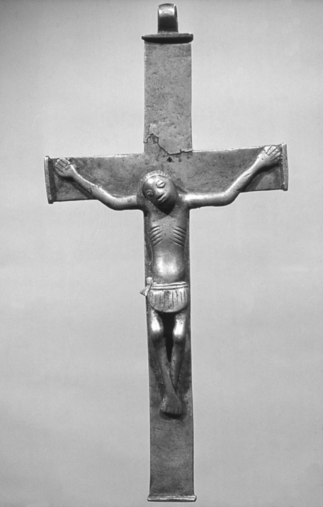

**图7　非洲西南部刚果基督教王国的苦像，十七世纪。** 这是受难基督形象非洲化的一个早期例子。照片藏于爱丁堡大学非西方世界基督教研究中心的巴特勒收藏。

然而，到十八世纪初，非洲基督教的前景已经大为黯淡。信奉基督教的刚果王国被内战摧毁，国王的权力与权威受到严重限制。1678年，首都圣萨尔瓦多遭到一个交战派系洗劫，此后荒废了四分之一个世纪。十八世纪初重新有人居住时，城中的十二座教堂都已成为废墟，只剩下一位神父埃斯塔沃·博特略；而他却是一个与姬妾同居的奴隶贩子。在王国的几个省中，只有沿海的索约省还保有相当数量的基督徒。刚果的嘉布遣会传教团减少到两三位修士。到1750年，更只剩下一位出色的传教士凯鲁比纳·达萨沃纳神父。他勇敢地继续走遍全国，直到1777年；在这二十七年孤独的传教中，原书记载他为大约70万人施了洗。后来虽有其他嘉布遣会士试图继续这项事业，但最后一位常驻会士还是于1795年撤离了。

某些乡村里的平信徒传道员仍然传授基督教教义，村民继续遵守基督教礼仪、吟唱圣歌。1773年，法国传教士在扎伊尔河以北发现了这样一个村庄，一座大十字架昭示着村庄的身份。不过，没有获得授权施洗的常驻神父，这些社群最终逐渐失去了基督信仰。尽管瓦里和西非其他国家不时出现短暂的传教活动，基督教仍然难以维持。在东非，修会与教区神父的服务对象越来越限于葡萄牙统治阶层。到1712年，只有赞比西亚还保留着面向非洲人的传教工作，而这些活动不久也消失了。各地的基督教正在变成殖民据点的附属物，教士主要充当殖民者的随牧，以及殖民政府的支持者。

天主教传教的衰落有多方面原因。葡萄牙力量的削弱，降低了它招募和维持传教士的能力，<!-- PDF page 430; original page 415 -->同时也使它对其他国籍的传教士更加猜疑。此外，十八世纪罗马对世界传教运动的兴趣减弱，传教士的供应逐渐减少。非洲传教区始终缺乏足够的神父。许多传教神父的虔诚与献身堪为表率，另外一些人的表现却令人失望。他们往往处境孤立，得不到主教经常性的督导或鼓励，有些人因而灰心丧气，纳妾或从事贩奴，使教会及其圣职蒙受丑闻和耻辱。许多传教士死于非洲的气候与热病。在1645至1835年间于刚果传教的438位有名可查的嘉布遣会神父中，有229人在传教区工作几年后就去世了，另一些人则因健康恶化而返乡。葡萄牙于1759年决定把耶稣会逐出殖民领地，又进一步减少了传教士人数，赞比西亚尤其如此。虽然有人努力招募并培养非洲本土神父，但这些努力还不够，非洲神父的数量始终不足。嘉布遣会神父还对平信徒传道员抱有疑虑，往往不愿给他们必要的支持。

不过，世界其他地区的天主教传教也面临类似困难，却没有发生撒哈拉以南非洲那样的崩溃。非洲的特殊之处，在于奴隶贸易给社会造成的破坏。过去，奴隶制和奴隶贸易也曾与基督教并存，但非洲奴隶贸易的庞大规模却前所未有。从十七世纪中叶起，每年有数以万计的非洲人被运往美洲的种植园。葡萄牙的非洲帝国主要变成了奴隶的来源地。为满足不断增长的劳动力需求，奴隶贩子开始掳掠整个村庄，毁坏整片地区，把那里的人口一扫而空。这又加剧了内战和社会瓦解。据估计，横渡大西洋的奴隶总数中，有40%来自刚果—安哥拉地区。这个比例远高于该地区人口所占的份额，也是信奉基督教的刚果王国瓦解的主要原因之一。

必须指出，非洲有些教士自己拥有奴隶，或者参与奴隶贸易。例如，1710至1754年间居住在赞比西河畔宗博的佩德罗·德圣三一神父，拥有1600名奴隶，还经营一座金矿。几乎所有教士都通过奴隶贸易获得经济支持。不过，仍有许多教士愿意公开反对奴隶制和奴隶贸易。1686年，嘉布遣会士提出呼吁，一位自称拥有刚果王室血统的非裔巴西前奴隶洛伦索·达席尔瓦也组织请愿。作为回应，<!-- PDF page 431; original page 416 -->罗马圣职部谴责了大西洋奴隶贸易。尽管如此，贸易仍在继续，直到十九世纪初期还在对天主教传教造成毁灭性的影响。1854年，著名的苏格兰传教士戴维·利文斯通横穿非洲，抵达安哥拉，只发现耶稣会和嘉布遣会教堂的废墟，基督教也已经沦为一种民间记忆。天主教传教事业后来得以恢复，但那已经超出了本卷的时间范围。

## 新的开端：西非的新教传教

罗马长期发出的反奴隶制声音，虽然收效甚微，后来却成为世界传教运动复兴的主调。这个复兴发生在新教基督教内部，而新教在此前大多把传教视为罗马天主教的专有领域，因而予以排斥。第一个这样的新教组织，是1698年在伦敦成立的基督教知识促进会（SPCK）。它宣称自己的宗旨是“在海外种植殖民地促进宗教与学问，并在国内传播基督教知识”。该会决定允许成立一个作为附属事业的传教机构，即海外福音传播会（SPG），负责派遣和供养传教士。1701年，一份王室特许状据此正式设立了海外福音传播会。然而，即使有了这些早期迹象，新教徒对传教的投入仍然主要是临时性和有条件的，而且往往承接他人已经开展的工作。

不过，基督教知识促进会的教育与出版活动，对英国国内以及其他人在传教区所做的工作，都产生了显著影响。特别是到1720年，已经有一项广泛的《圣经》翻译计划。届时，该会已出版一万册阿拉伯语《新约》、六千册《诗篇》和五千册《要理教导》，服务对象是奥斯曼领土以及俄国、波斯和印度境内的社群。该会还于1765年开始在锡利群岛开展传教，持续到1841年。

海外福音传播会直接参与非洲事务，是英国贸易机构的需要所促成的。因此，1752至1824年间，该会应皇家非洲公司的请求，向当时黄金海岸的海岸角派遣英格兰教士，任命他们为随牧。其中一位教士托马斯·汤普森在那里服务了五年，把自己的印象记入《两次传教航行记》，于1758年出版。他的看法反映了皇家非洲公司的主流意见：奴隶制并不是一种罪恶；他还在书中赞许<!-- PDF page 432; original page 417 -->奴隶贸易。不过，汤普森重视非洲语言在传教中的价值，无意间标志着一个重要的转变：把非洲文化材料视为传播基督教的适当框架。他强调开展芳蒂语教育的重要性，并相应地安排三个芳蒂男孩随他到英格兰接受教育。其中两人去世，第三人菲利普·夸克在圣公会接受按立，于1765年回到海岸角，担任教师、教理传道员和传教士，一直到1816年在这些岗位上去世。

丹麦人也参与了阿克拉克里斯蒂安堡的活动。这个由丹麦控制的驻军要塞管理着邻近地区的贸易。来到黄金海岸的随牧，严格说来并不是传教士，但值得注意的是，其中有些人对非洲人的生活与宗教十分关切。例如，1662至1670年在海岸角附近腓特烈堡任随牧的威廉·约翰·米勒，主张向当地居民传教，并要求把《圣经》译成当地语言。他身体力行，收集了大约八百个实用词语和短语。他还表现出对当地宗教习俗的了解，这是一个外来者所做的首次此类理解尝试。

另外两位驻在克里斯蒂安堡的随牧，觉得要塞生活的狭小范围过于拘束，便走向更广阔的地方。一位是1709至1712年任职的约翰·拉斯克，另一位是1805至1809年任职的H.S.蒙拉德。他们都谴责奴隶制及助长奴隶制的贸易，也都提出了一个经典疑问：在欧洲商业据点所投下的妥协阴影中，究竟能否在非洲建立教会？由于没有传教组织在背后支持，他们转而采取次一等的办法，鼓励非洲学生进入堡内学校学习。

被这所学校吸引来的杰出人才，包括阿克西姆的威廉·阿莫，他后来在维滕贝格大学获得博士学位；雅各布·卡皮泰因，他毕业于尼德兰的莱顿大学，颇具讽刺意味的是，其毕业论文论证奴隶贸易与基督教教义并不矛盾；还有哥本哈根大学毕业的弗雷德里克·斯瓦讷，以及雅各布·普罗滕。这些早期传教工作，是后来传播到非洲的福音觉醒最初绽放的花朵。斯瓦讷属于加族，带着丹麦妻子回到克里斯蒂安堡，短暂担任教理传道员与教师，然后于1746年返回丹麦。

雅各布·普罗滕也回到了黄金海岸，却又消失在邻近的多哥地区，后来一度在遥远的德国重新出现。他于1756至1761年间待在克里斯蒂安堡，1765年再次来到这里，一直到<!-- PDF page 433; original page 418 -->1769年去世。这些生涯带有很大的偶然性，恰好见证了几个世纪以来，人们坚持不懈地试图把基督教带到阿拉伯地理学家所称的“比拉德·苏丹”（Bilád al-Súdán），也就是“黑人的土地”——撒哈拉以南非洲。到美国革命发生的1776年，非洲各地的传教事业已在全球奴隶贸易的压力下衰弱，处于边缘地位。拯救灵魂的事业让位给了买卖灵魂。

## 基督教反奴隶制运动与前奴隶返回非洲

尽管如此，变化已经开始。这在很大程度上归功于美国革命所产生的、既出人意料又影响深远的后果。要讲述近代非洲的基督教历史，就必须指出：后来成为美国的这片土地，拥有非洲以外最多的非洲人口。其中绝大多数是奴隶；到1790年，奴隶约有70万人，此外还有5.9万名自由的非洲人。在大西洋沿岸十三殖民地的反殖民政治背景下，反奴隶制情绪变得更加迫切。许多主张脱离英国独立的主要人物，也同样反对奴隶制继续存在于美洲土地上。1775年，第一个反奴隶制协会在费城成立；1785年，本杰明·富兰克林成为该会主席。他把解放奴隶与争取国家政治独立的事业联系起来，例如发誓抵制糖，因为糖沾染着奴隶劳动者的鲜血。这类抵制思想无疑也有一个相关动机：打击种植园制度的经济利益，而英国的殖民权力正以这种制度为基础。

反奴隶制活动的政治与经济基础，又与第二次大觉醒联系起来。1790年代以来，这场大觉醒席卷美洲殖民地，吸引了大批非洲人归信。这种结合产生了重大事件，对非洲基督教历史的进程具有长远影响。福音觉醒在基督教内部引发了一场非洲人的群众运动，这是非欧洲人口中第一次出现此类运动。就规模和成效而言，它超越了此前或此后影响非洲的任何同类运动。

早在美国革命以前，新英格兰的清教徒中就出现过压制奴隶贸易的运动。1640年，在清教徒的马萨诸塞殖民地，一名贩奴船船长被捕，船上被作为货物的奴隶遭到没收，并奉命由殖民地出资送回非洲。后来，奴隶贸易得到了足以抗拒清教徒禁令的支持，但它的辩护理由是经济上的权宜之计，而不是宗教。[^p433-3] 1773年，<!-- PDF page 434; original page 419 -->罗得岛的塞缪尔·霍普金斯——第一次大觉醒领袖乔纳森·爱德华兹（1703—1758）的门徒——与另一位教士、后来担任耶鲁大学校长的埃兹拉·斯泰尔斯商议，组织一批黑人信徒返回非洲，作为使非洲大陆基督教化的先遣力量。1775年，霍普金斯向后来的美国总统约翰·亚当斯（1735—1826）求助，希望他为基督教殖民事业捐款。到1776年战争爆发时，私人捐款已经超过500美元，但战争中断了计划。还没有等到1783年战争正式结束，霍普金斯就重新提出了这一构想。后来，1794年，詹姆斯·麦肯齐在普罗维登斯非洲协会的支持下，被派往西非海岸，为建立殖民地寻找地点。

第一次大觉醒激起的归信浪潮，已经影响了许多美洲黑人。他们随后卷入美国革命，经历了改变和磨炼，战后便跨越大西洋返回非洲，成为新一批福音使者。战争结束时，效忠英国的黑人部队在英军指挥下复员，于1783年被送到加拿大。后来，这些黑人对加拿大生活感到失望，近1200人于1792年1月组成一支自由船队，从新斯科舍出发。同年3月，他们抵达塞拉利昂的弗里敦，开始了非洲尝试基督教与摆脱奴隶制的新阶段。

1787年，一批伦敦自由黑人曾在这个“自由省”建立最初的殖民地，但由于多种原因，殖民地已经瓦解到无法挽救的地步，在非洲开展新基督教实验的事业几乎彻底失败。就在这个时候，新大陆送来了新的推动力。英国议会慷慨支持这项事业，承担了9600英镑的全部归返费用。乔治·华盛顿有理由怀疑，这或许只是英国以一种带有讽刺意味的方式，回敬美国人的不忠。

无论如何，他们终于回来了。这些黑人当初被从家园中连根拔起，戴上镣铐，挤进贩奴船，被拖过大洋；如今，他们从受奴役和种族羞辱的恐怖经历中归来，回到自身苦难的源头。他们带来了一种新的、不同的讯息：让被俘者得解放，让囚徒获自由，让被遗弃者迎来蒙恩的时刻，向贫穷者传递好消息。

旧大陆的传教工作，把国王、酋长、王子以及社会上其他显要人物当作主要的归信对象。但这些国王、酋长和身边的官员，即使一度接受基督教，迟早也会抛弃它，重新走向旧政治的剥削方式，而旧政治认可奴隶制与奴隶贸易。如今，新大陆的<!-- PDF page 435; original page 420 -->自由思想，与复兴运动所宣讲的救赎和个人应许结合起来，向被排斥者、受压迫者以及被捆绑、被剥夺声音的人宣布赦免。前奴隶、曾经的俘虏、遭受伤害的人口和社会边缘群体，成了这项呼召首先面向的对象。这一局面公开而有力地否定了古老且备受尊崇的原则：政治血统与社会特权，以及把公共习俗视为不可改变的法律。这种讯息点燃了当地原本潜伏着的不满与离心力量。

## 十八世纪的非洲基督徒领袖

简要介绍其中几位十八世纪人物的经历，可以把我们的叙述继续向前推进。奥劳达·埃奎亚诺便是其中之一。这位不知疲倦的反奴隶制活动家，在大西洋两岸奔走，动员进步舆论，争取废除奴隶贸易，并促进非洲经济发展。诚然，埃奎亚诺的非洲出身存在争议：有些迹象显示，他可能实际出生于美国南方，而不是他自己所说的尼日利亚。不过，无论他的出生问题如何，埃奎亚诺对本章主题的重要性都不受影响。按照传统说法，他出身伊博人，名叫“埃克乌诺”（Ekwuno）。他本人说，1757年自己作为奴隶，被送到弗吉尼亚的一座种植园。此后，他经历了一连串非凡的冒险，并在一处叙述了自己在加的斯一艘船上的归信体验。

1789年，也就是法国革命发生的那一年，埃奎亚诺在英国开展活动。他把奴隶制界定为人权问题，坚持认为，奴隶制延续既阻碍人类进步，也妨碍非洲的经济发展。他主张，应该把自身利益的动机，与正义和人道的动机结合起来，决不对奴隶贸易和奴隶制让步。

埃奎亚诺很早就试图在反奴隶制运动中发挥领导作用。他的自传《奥劳达·埃奎亚诺的一生》，敏锐分析了奴隶制对非洲大陆社会以及欧洲人与非洲人关系的影响。他回忆，1779年自己请求接受按立，以便到非洲传教，却遭伦敦主教拒绝。1783年，他在伦敦拜访反奴隶制的人道主义者格兰维尔·夏普，向夏普讲述了130名非洲人被从贩奴船上扔进海里的遭遇：船主以此欺诈性地索取保险赔偿。这一揭露立即对夏普和议会产生了深刻影响。埃奎亚诺还与另一位前奴隶、芳蒂人奥托巴·库戈阿诺携手。库戈阿诺于1787年写成《关于奴隶制罪恶的思想与感想》，埃奎亚诺可能参与了写作。这部著作<!-- PDF page 436; original page 421 -->严厉控诉奴隶贸易，以及那些打着基督教名义推动奴隶贸易的欧洲人。1788年，该书出版法语译本。库戈阿诺在书中把奴隶制称为伤害和抢劫，认为其中找不到丝毫理性、正义、仁爱或文明的痕迹。他说，苏格兰人和荷兰人自称信奉新教，却属于最恶劣的“鞭打者和驱使黑奴者”之列。

埃奎亚诺希望领导前往非洲的反奴隶制传教事业，但在伦敦遭到拒绝。此后，把反奴隶制与基督教这双重使命带到新大陆以外的任务，落到了美国独立战争的黑人老兵肩上。托马斯·彼得斯就是其中一位。他大约于1740年出生在尼日利亚，父母属于约鲁巴人的埃格巴族。1760年，他遭绑架，被卖到法国贩奴船亨利四世号上，最终抵达法属路易斯安那。在那里，他的法国主人又把他卖给一个英国人。到1770年，他再度被出售，这次的买主是北卡罗来纳威尔明顿的苏格兰人威廉·坎贝尔。彼得斯在那里学会了磨坊机械工的手艺。1776年战争爆发、城镇撤离时，他为了争取自由，加入英国一方。按原书的叙述，1777年末英国失去对费城的控制后，已经来到费城的彼得斯，随一批复员军人离开，前往新斯科舍。他在战斗中两度受伤，仍然活过了战争，并与妻子一同在新斯科舍定居。

彼得斯组织新斯科舍黑人提出请愿，说明尽管官员作出相反保证，他们的生活条件依然恶劣。1791年，他把请愿书带到伦敦，呈交外交部的威廉·格兰维尔。请愿立即发生了作用。新近成立的塞拉利昂公司董事表示，他们“同意向国王陛下的大臣们申请，由政府出资为〔黑人〕提供航程。申请获得有利答复后，他们随即接受〔约翰·〕克拉克森中尉的服务。这位中尉非常慷慨地自愿前往新斯科舍，提出必要建议，并监督愿意移民塞拉利昂的自由黑人的集合和运送”。

彼得斯随后回到新斯科舍，协助组织归返队伍。黑人中有许多疑虑，白人也反对，因为他们担心黑人劳动力流失。尽管困难重重，归返运动还是启动了，彼得斯也正式报名参加。他们成功开辟了一条横跨大西洋的道路，后来有许多人沿着它前行，而且并不只有黑人。

戴维·乔治的经历，是这项归返事业恰当的见证。他大约于1742年生于弗吉尼亚的奴隶家庭，后来在<!-- PDF page 437; original page 422 -->席卷新大陆黑人的福音运动中归信。他在南方开展传教，成功地在佐治亚建立了浸礼派教会。革命爆发时，乔治已经是一位颇有成就的宗教开拓者。他在1782年被撤往新斯科舍后，这一点表现得尤为明显。在那里，他恢复讲道活动，搭起一座他称为“聚会所”的建筑，举行复兴聚会。约翰·克拉克森是托马斯·克拉克森的弟弟，在托马斯·彼得斯赴伦敦交涉后抵达新斯科舍。他参加了一次乔治主持的复兴聚会，见证了乔治在这一圣职上的天赋。克拉克森说：“我不记得自己这辈子曾听过唱得如此动听的《诗篇》。”没有任何事务、障碍，或者取悦他人的念头，能够阻止乔治“向他的创造者献上赞美”。1792年，克拉克森像一个出人意料的“花衣吹笛人”，领着新斯科舍黑人“越过海洋，前往非洲海岸”，乔治自然也在其中。新大陆的反奴隶制情绪横渡大西洋来到非洲大陆，产生了决定性的影响，既有积极的一面，也有消极的一面。

在弗里敦，乔治扩大了自己的工作范围。他当然继续承担讲道职责，但也越来越多地担任社群领袖，以及不取报酬的移民申诉代言人。当局试图强加一种官方基督教，以防范那些可能煽动叛乱的黑人传道人；乔治则维护他所称的新斯科舍移民的“宗教权利”。作为美国革命的主要当事国，英国还在恢复元气，依然对宗教与政治上的共和思想十分敏感，也依然提防殖民地中“开放家庭”宗教的蔓延——也就是把家庭同时用作礼拜场所。然而，移民们不肯退让。乔治代表他们提出，黑人在上帝面前的地位不带污名，也不应受到偏见，这一点应当体现在他们在国家与社会中的自由和平等上，无论这种主张听上去多么令人反感地带有共和色彩。

官员谴责这类观点属于反律法主义，并建立殖民地随牧制度来加以遏制。他们拒绝承认——或者说，他们恰恰感到恐惧——移民宣讲的并不是无政府状态或退回个人内心，而是一种出自他们自身经验的社会行动主义。反律法主义的指控建立在神学误解之上：当局错误地认为，移民援引“在洁净的人，凡物都洁净”这一教义，因而已经得救的人便自认无需承担道德和政治责任。然而，移民的实际情况远非如此。例如，1793年乔治访问伦敦时，敦促人们投身废奴和非洲传教事业，恳求英国朋友在本国也为同样目标行动起来。在那次访问中，乔治见到了约翰·牛顿；他是流行赞美诗<!-- PDF page 438; original page 423 -->《奇异恩典》的共同作者，曾在非洲西海岸贩奴，后来才归信福音主义。应当记得，在1793年，英国各教会还远未想到海外传教服务，尽管卫斯理复兴运动已唤起社会对国内事务承担更广泛责任的意识。威廉·克理则把这种产生于本土的推动力带往海外，原书记他在1792年启程赴印度。在这种情况下，乔治的呼吁是一项重要行动，使非洲直接置于反奴隶制运动，以及与之相联的传教觉醒的中心。此后，日益高涨的废奴情绪在议会占据上风，只是时间问题。威廉·威尔伯福斯在那里领导了1807年废除奴隶贸易的努力。

新英格兰的非裔美国人保罗·卡菲，以自己的经历有力驳斥了反律法主义异端的指控。他是十八、十九世纪最富有、最具影响力的黑人之一。卡菲于1759年生于马萨诸塞的达特茅斯，在贵格会斯洛克姆家族的奴隶家庭中长大，后来归信贵格会。他于1778年采用“卡菲”这个姓，拼作Cuffee或Cuffe，来自“Kofi”，暗示父系出身于加纳的阿散蒂人。原书记述，他的贵格会主人受良心谴责，将他释放。十六岁时，他进入捕鲸业，最终积累了巨额财富。他成为一位黑人船主，这在当时非同寻常。1800年，他订造了一艘162吨的英雄号，该船的一次航行曾绕过好望角。1806年，他又装备了两艘更大的船。其中一艘是268吨的阿尔法号，从威明顿和萨凡纳驶往瑞典哥德堡，最后返回费城。

另一艘船名叫旅行者号，卡菲拥有四分之三的股份。他乘坐这艘船，进行了一次对命运具有重大影响的西非航行。1810年12月，他离开费城，途经英格兰，于1811年初抵达当时重要的贩奴港利物浦。他向根据1807年废除奴隶贸易法案设立的海军部委员会提出请愿，使一个名叫阿伦·理查兹的奴隶获释。卡菲广泛咨询反奴隶制与福音运动的领袖，其中包括威廉·威尔伯福斯——恰巧与卡菲同年出生——以及已经卸任塞拉利昂总督的扎卡里·麦考莱。他是著名历史学家托马斯·巴宾顿·麦考莱的父亲。卡菲还见到非洲促进会（African Institution）会长格洛斯特公爵。这个组织积极从事反奴隶制和人道主义活动，影响很大，董事包括威尔伯福斯，以及著名贵格会领袖威廉·艾伦；艾伦以同情俄国南部门诺派的事业著称。1811年9月，卡菲继续前往西非，同年11月抵达弗里敦。

<!-- PDF page 439; original page 424 -->

他免费搭载了一位英国卫理公会传教士和三位教师。这再次证明，即使在欧洲，传教推动力的实现也有赖于黑人的主动行动。海外传教区的实际工作更是如此，尽管传教学者往往轻易忽略这个事实。

直接推动卡菲这次西非远行的，是1807年废除英国奴隶贸易的法案。而这项法案本身，又在很大程度上受到新斯科舍美洲黑人成功定居西非的启发。他的目标是在奴隶贸易的源头建立正当贸易的基地，借此打击当地的人口贩运。他还希望创造另一种连接非洲、新大陆和欧洲的三角贸易，非裔美国人将成为其中不可缺少的一环。通过科学农业生产的热带作物，由黑人拥有的船只运往美洲；所得利润再用来购置机器和货物，进而建立经济基础设施，使更多自由而能从事生产的美洲黑人到西非定居。卡菲认为，他们的榜样会在非洲人中产生感染力。正如贵格会慈善家威廉·桑顿在1785年也曾提出的，正当贸易与利润将锻造一条道德锁链，扼杀邪恶的奴隶贸易，使长期受苦的非洲人自己直接获益。

然而，前方存在巨大的障碍。其中尤其严重的是欧洲商人的控制，他们使非洲贸易伙伴背上难以承受的债务。卡菲估计，在如此不利的条件下，很难培育一个非洲企业家阶层。因此，他坦言，自己清楚地认识到，必须在殖民地的非洲人中奠立新的经济基础：“我必须鼓励他们为了自己的利益而努力，成为自己的船运商和进口商，使他们能够雇用自己的同胞。因为现在这个殖民地正在失去自己的年轻人：他们一离开学校，就找不到可以从事的行业，只得上外国人的船工作。因此，殖民地不断丧失她的〔人口〕。”[^p439-4]

酋长们也阻挡着这种进步。卡菲认为，无论他们怎样许诺合作，其内心都不支持废奴，实际上也不支持具有自由经营文化的正当贸易。“我还可以补充一点：与非洲酋长交谈时，他们极不情愿放弃奴隶贸易，说这使他们变穷，也不能再像过去贩卖奴隶时那样，得到想要的东西。”[^p439-5] 在奴隶贸易的旧秩序中，当地统治者和王公与贩奴船船长利益一致；奴隶贸易的利润又有助于加强本土的<!-- PDF page 440; original page 425 -->政治制度。但是，奴役邻人也会让自己面临同样命运的危险。把先发制人的袭击当作战略和威慑，只会使报复更不可避免。从长远看，掳奴袭击对谁都没有好处；但从短期看，谁也承担不起放弃它的代价。正是这种短期现实，使卡菲及其他人，尤其英国议会，所提出的改善计划陷入困境。

为推进自己的经济构想，卡菲在贵格会思想启发下，成立塞拉利昂友好协会。后来，他写信给协会秘书、非裔美国人詹姆斯·怀斯：“我嘱咐你努力，使她——友好协会——不要放弃商业活动，因为这是她的民族进步最重要的出路。我预见，这将成为改善你们的国家和民族的办法。”[^p440-6] 卡菲于1813年4月4日离开弗里敦，经过五十四天航行，返回美国。

剑桥的反奴隶制活动家托马斯·克拉克森，在1814年1月24日的一份公告中，提醒公众关注卡菲的友好协会。他说，该会的目的是“设法以最有利的条件出售〔移民的〕产品，并相互培养勤勉的习惯”。他同时告诫说：“这个协会仍在继续活动，但如果没有英格兰的援助，就无法实施它有益的计划。”[^p440-7] 威廉·艾伦也表达了与克拉克森相似的忧虑，转而支持卡菲的事业；当时，塞拉利昂殖民地的白人商业利益集团正在攻击这项事业。

1814年稍后，有人代表卡菲向美国国会呈交请愿书。众议院议长将其转交商业与制造业委员会。参议院随后提出决议，授权总统允许卡菲装载一船货物启程前往西非。但当时英美正在交战，这项措施遭到否决，理由是它会使英国货物逃过国会施加的封锁。有人又代表卡菲向英国议会提出类似请求，同样遭到拒绝。当局认为，在现行航海法的情况下，这样做风险太大；1812年英美战争以及仍在继续的拿破仑战争造成了损害，因此航海法尤其需要得到维护。

这些挫折远没有让卡菲灰心，他毫不畏缩地继续努力。在韦斯特波特的贵格会朋友帮助下，他再次装备旅行者号，于1815年11月出航。船上装满烟草、肥皂、蜡烛、船用物资、面粉、修建锯木厂所需的铁料、一辆货车、磨石、钉子、玻璃和一张犁。乘客共三十八人，包括十八名家长和二十个孩子，其中有准备从事耕作的普通劳动者。

<!-- PDF page 441; original page 426 -->

旅行者号上的一位乘客，是取得讲道许可的卫理公会传道人佩里·洛克。卡菲委婉地评论，他“作为一个传道人，声音有些粗硬”。〔在弗里敦，卡菲提醒洛克：他在美国曾抱怨自己被剥夺自由，如今被要求担任陪审员，却又发起牢骚。“去坐上你的位置，尽力做好。”卡菲这样告诉他。[^p441-8]〕另一位乘客安东尼·瑟万斯，是塞内加尔人。他曾被卖给圣多明各的法国人，在革命期间逃到费城。他学会读写，并学习航海知识。虽然对这项职业感兴趣，但由于容易晕船，海上生活并不适合他。卡菲私下认为，瑟万斯不会成为一个好水手。瑟万斯自费参加这次航行，希望最终能回到塞内加尔的家乡。

1816年2月3日，船只在弗里敦抛锚。卡菲不知道的是，弗里敦当权阶层对他的态度已经变得更加强硬，他因此在登陆时遇到重重困难。他的货物被征收高额关税，使他经营这项事业并获利的希望更加渺茫。作为安慰，总督和首席法官接见了他。弗里敦的商人与商业利益集团合谋将卡菲拒之门外，决心阻止任何美国势力进入西非市场。在塞拉利昂受阻之后，卡菲返回美洲，继续反奴隶制与传教活动。原书记他于1817年7月在那里去世。

1807年奴隶贸易废除以后，来自非洲的“获救奴隶”（recaptives）进入塞拉利昂，给这项“基督教实验”带来了根本而持久的改变。英国海军分舰队沿漫长的西非海岸巡逻，截获准备运往新大陆的奴隶，把他们送到弗里敦。他们被安置在围绕教堂、学校和农场组织起来的堂区社群中。这些获救者来自非洲大陆各地，逐渐成为殖民聚落的中坚。其人数远远超过最初的新斯科舍移民，并接手了教育、社群治理与传福音工作中的很大部分。他们中间出现了一个流动性很强的新中产阶层，其影响远远超出自身人数。颇具讽刺意味的是，这个中产阶层后来将成为殖民主义以及许多其他事物的克星。

保罗·卡菲在美洲留下了持久的影响，并直接促成利比里亚的建立，使之成为美国南方获释奴隶的定居地。来自新泽西的长老会牧师、后来担任佐治亚大学校长的罗伯特·S.芬利，一直争取在非洲建立一个供获释奴隶定居的地方。他与卡菲取得联系，<!-- PDF page 442; original page 427 -->在信中说：“所有深切关心此事的人，都有一个强烈愿望：让自由的有色人种有机会提升到他们应有的地位，同时提供一种强有力的办法，终止奴隶贸易，并把文明与基督教带到非洲。”[^p442-9] 芬利后来成为利比里亚殖民计划的设计者之一。

1816年12月，美国殖民协会（ACS）终于在美国众议院的一间大厅里成立。卡菲的建议和榜样，是成立协会的灵感来源；塞拉利昂则是人们心目中的范例。协会理事会在一份纪念文字中极力称颂卡菲，赞扬他清晰而坚定的判断、见多识广的意见、毫不动摇的承诺和不遗余力的奉献。尤其重要的是，他对西非生活具有亲身经验，能够抵消无根据的偏见。颂词最后指出，今后任何对非洲的参与，都必须建立在一种不同寻常的伙伴关系之上：事实与知识应取代偏见和诋毁，评价这种关系的标准，必须是它“对非洲本土人民及其在本国的后裔是否有用”。[^p442-10] 随着反奴隶制事业在西非展开，基督教中的非洲主题获得了横跨大西洋的范围。

## 南非的新教传教与非洲人的权利

正如前文所见，十八世纪新教福音运动推动了传教兴趣的普遍复兴。1795年，伦敦会（LMS）成立；随后出现的相关机构，还有1797年在鹿特丹成立的尼德兰传教会、弟兄会牧师约翰·耶尼克于1800年在柏林创办的传教学校，以及1815年在巴塞尔建立、为英国传教机构提供人员的学校。约翰·西奥多·范德坎普前往南非传教时，尼德兰传教会接续了摩拉维亚弟兄会在1740年代建立的非洲联系。信奉新教的荷兰人自1652年起在好望角地区殖民。荷兰移民，也就是布尔人，为寻找土地而向内陆扩张，自视为与上帝立约的人民，侵占当地非洲人的土地。1795年，英国占领好望角，当时它正与尼德兰交战；1806年以后，这种占领成为永久性的。

范德坎普于1799年抵达好望角，在开普敦以东400英里的阿尔戈阿湾贝瑟尔斯多普，向处境艰难的科伊人传教。他以一种引人注目的方式，介入了奴隶贸易的政治问题：

<!-- PDF page 443; original page 428 -->

他出资赎出一位十七岁的少女，随后娶她为妻。这位少女的非洲母亲来自马达加斯加。范德坎普以自身行为，展现了一种激进、在政治上毫不妥协的福音信仰，公开支持社会与政治平等的原则。他的榜样影响了许多后来从事传教服务的人。

一到南非，范德坎普就立刻遭遇语言问题。与祖鲁人不同，好望角殖民地的科伊人略懂荷兰语，因此能在传教士与当地人之间充当中介。在这个岗位上，科伊人还可以担任教师和教理传道员，从而成为面向自己族人的第二层传教士。这种作用有助于加快基督教在非洲扎根的过程。眼光更敏锐的欧洲传教士认识到，非洲人这样的主动参与，必然意味着角色的重大逆转：非洲基督徒将成为基督教化的主要推动者，并为传教设定议程。此外，非洲人自己开展工作的成果，有可能长期保持，而外国人的工作显然不具有同样前景。

这个想法及其成本效益方面的含义，在很大程度上符合基督教在当地被接受和调整的逻辑，而不符合传教士关于单向传播、把本土文化连根拔起的观念。传教区其他地方恰恰发生过这种传播上的挫折，促使亨利·文恩（卒于1872年）这样的传教领袖提出“传教团的安乐死”理论。其他传教士很快把范德坎普的见解当作明智政策加以采用。不过，他所服务的南非科伊人略懂荷兰语，确实为这些想法的实行提供了有利条件。

然而，殖民地白人社会正在不断向非洲人的土地扩张，而范德坎普在其边缘地带与非洲人共同生活。艰苦的边疆环境严重损害了他的健康，原书称他于1811年相对较早地去世。苏格兰阿伯丁的约翰·菲利普，于1820年获任伦敦会在南非的主要负责人，并成为其工作的首要设计者。他热情而雄辩地捍卫非洲人的权利，反对南非白人的侵害，把反奴隶制的旗帜带进了反对者的堡垒。

范德坎普去世后，菲利普被任命参加一个调查传教事业状况的委员会。他发现，殖民政府似乎不满传教士的工作，起初对此感到困惑。但在进一步调查、了解这种不满的性质以后，他悲哀地认识到，双方几乎没有和解的可能。殖民当局极其愤怒，<!-- PDF page 444; original page 429 -->因为传教机构维护非洲人的利益，反对白人的侵害。在调查中，菲利普发现，贝瑟尔斯多普的传教站实际上已经变成他所称的“奴隶营舍”。那里的非洲人被征发到劳动营做工，承担繁重劳役，却只得到一点点工资，或者根本没有报酬；妇女和儿童则无人照管。他从未见过如此茫然无助、孤苦无依的人群。传教士勇敢辛劳、努力建立和推动的一切，都被冷酷的殖民政府摧毁了。

非洲人的发展进步，成为传教事业的决定性问题，而政府恰恰选择在这件事上发起挑战。传教机构并非自愿，却不得不背负种族问题这一沉重负担。范德坎普与他当之无愧的继承者菲利普，不肯在挑战面前退缩，这是值得肯定的。可以预料，种族问题此后在整个十九、二十世纪，始终主导南非的宗教与政治局面。菲利普的《南非研究》，有力捍卫了他的福音主义和人道主义观点。

## 截至1815年的塞拉利昂实验

在西非，福音事业由1799年成立的英格兰教会传教协会（CMS）代表。不过，很能说明问题的是，该会最早招募的人员，是德国福音派人士梅尔希奥·伦纳和彼得·哈特维希。他们于1804年抵达塞拉利昂。福音主义宗教似乎带有难以驾驭的热狂倾向，大概多数圣公会信徒都对此怀有疑虑；教会人士觉得传教服务的想法陌生而无法接受。因此，形势迫使教会传教协会成为一个跨教派、跨国界的传教组织。

即使如此，该会的起步仍然坎坷。哈特维希放弃了传教生活，很快消失在苏苏人的地区；他不是去使非洲人归信，而是去当了奴隶贩子。协会并未气馁，又派出第二批传教士，全是德国人，于1806年抵达：利奥波德·布彻尔、约翰·普拉塞和古斯塔夫斯·尼兰德。尼兰德后来成为该会在塞拉利昂的开拓者，并以塞拉利昂公司代理人的身份留在弗里敦。〔1807年以后，塞拉利昂成为英国王室领地。〕他身兼数职：作为随牧，他照顾一群参加礼拜的欧洲人；在家里，他则是一位新斯科舍女子的丈夫。热带生活剥去了欧洲教友残存的宗教习惯，他们不再到礼拜堂，把尼兰德变成了一个无羊可牧的牧者。礼拜堂<!-- PDF page 445; original page 430 -->年久失修，最后被弃置，其功能也归并到尼兰德的其他家庭责任之中。

只有在尼兰德把目光转向弗里敦半岛以外的地区以后，他的传教才开始取得进展。1818年，他在布洛姆海岸开展语言工作，而这种工作后来成为基督教传教及其与近代非洲相遇的重要特色。他编写布洛姆语语法与词汇集，并把《马太福音》译成布洛姆语。这是塞拉利昂的第一部《圣经》译作。不过，传教士亨利·布伦顿在非洲传教一段时间、返回苏格兰以后，已经于1801年出版过苏苏语语法和一些要理问答。

在尼兰德另外两位传教同伴的工作中，也能看出类似模式。约翰·普拉塞与布彻尔、梅尔希奥·伦纳一同前往蓬加斯河地区，在苏苏人中工作。他们遵循教会传教协会的新方针：城市化的弗里敦不是有利于传教的环境，因此应将重点转向内陆的本土人口。这项政策改变，平静却意义重大地否定了“基督教与文明是一对同卵双生子”的观念，也与移民中流行的看法相抵触——后者认为，所谓未开化的“部落”无可救赎。1814年，布彻尔终于回到弗里敦，主持莱斯特的一处新获救奴隶定居点。

与苏苏人共同生活的经验，使布彻尔对奴隶贸易给沿海以外社会造成的深刻影响，以及殖民保护所能发挥的促进作用和局限，形成了一些敏锐见解。例如，他的论述呼应了古罗马北非的一些思想，同时又在相当程度上超越了自己的时代。直到1837年，托马斯·福韦尔·巴克斯顿（1786—1845）出版备受赞誉的《奴隶贸易及其补救办法》时，人们才姗姗来迟地注意到布彻尔早在1812年就已描述的问题。

根据自身经验，布彻尔指出，奴隶贸易是内陆社会最重要的收入来源，新近的废奴措施已经威胁到这些社会经济生存的根基。英国政府的政策是在公海截获奴隶，但这并没有触及奴役现象的根源。布彻尔认为，真正需要的是一种出口商品，能够有效而有利可图地取代作为商品的奴隶。因此，传教机构和政府都应把为非洲社会开发替代财富来源，作为最迫切的首要目标。布彻尔相应地着手争取政府当局的支持与合作，提出传教机构和政府之间牢固的伙伴关系。在这种关系中，<!-- PDF page 446; original page 431 -->国旗跟在《圣经》后面，而不是像后来那样，《圣经》跟在国旗后面。

正是在布彻尔的计划下，麦克斯韦总督（1811—1815年任职）组织了一套行政方案，重新安置越来越多进入殖民地的获救奴隶。1807年，弗里敦人口为1871人，其中包括95名军人。1811年4月的人口调查显示，由于获救奴隶涌入，人数已增至大约3500人。1814年7月，获救奴隶人数又大幅增至5520人。一份1818年12月31日的报告，将其人数记为6406人。1816年，包括移民在内的总人口约为1.73万人。

这些数字迅速增长，即使部分原因在于英国海军分舰队截获贩奴船的效率提高，也绝非仅仅如此。更令人不安的事实是，奴隶贸易在法律禁止以后，不但没有停止，反而加快了步伐，因此可供截获的贩奴船也更多。例如，据估计，仅1810年，就有约8万名奴隶被非法运过大西洋，主要送往巴西、古巴和美国南方的市场。麦克斯韦总督受命应对的，正是弗里敦半岛承受的这种人口压力。但任务最终落到继任者查尔斯·麦卡锡爵士肩上。他为此设计了一套受到监督的村庄定居网络，称为“堂区计划”。不过，这套计划是否适合它所要安置的、从海上涌入的本土人口，仍然值得怀疑。

具有罗马天主教背景的麦卡锡，精力充沛而富有想象力地承担了任务，回应布彻尔的呼吁，让传教机构与政府为非洲人的重新安顿建立真正的伙伴关系。获救奴隶被分配到半岛上新建的村庄，每村由一位教士主持。村内设有礼拜堂，居民必须参加礼拜；平日，礼拜堂又兼作学校。1815年以前，已有三个这样的村庄：1809年建立的莱斯特、1810年建立的威尔伯福斯〔原名卡本达〕，以及1812年建立的里金特〔原名霍格布鲁克〕。1815至1820年间，又新建十个村庄，以容纳新来的人，其中包括1816年的基西和格洛斯特，1817年的夏洛特与利奥波德〔后者改名巴瑟斯特〕，以及1819年的惠灵顿、黑斯廷斯和滑铁卢。1819年皇家非洲军团解散后，复员军人被安置在直布罗陀镇；这个名称恰如其分地纪念了他们曾在直布罗陀服役。

这些堂区式村庄，把弗里敦变成黑人离散社群的聚居地。它成为非洲土地上一处具有加勒比风格的文化聚落，也是本土与西方思想一个富有前景的交汇点。非洲获救奴隶<!-- PDF page 447; original page 432 -->来自大陆许多不同地区，有的远至刚果和莫桑比克。他们与来自尼日利亚的人混居，共同怀有被迫离乡、失去根基的感受，也共同发现，在弗里敦可以加入以信仰为基础的基督教社群。本土社群的神祠与祭坛，随着获救奴隶一道进入定居地，与基督教仪式相当和睦地共存。例如，获救的约鲁巴占卜师欢迎传教士的挑战，表示乐于把基督教的神加入约鲁巴诸神体系，因为其中早就有一个位置可供安排。

这表明，在奴隶贸易所造成的流离失所、迁移与重新定居的条件下，基督教被视为非洲人重建自身生活的一种途径，因而受到欢迎。基督教的传播与本土的发现和认识过程相接合，在塞拉利昂以及更广阔的地区，开启了一场长期的跨文化归信与重新调适。

### 译校说明

本章正文的克拉克森公告日期为1814年1月24日，注7所列档案日期为1月28日，均依原版保留。恩津加卒年1665年、凯鲁比纳神父二十七年施洗约70万人、卡菲卒于1817年7月等日期与数字，也按原书保留，未以未经核定的替代资料改写。

## 注释

[^p426-1]: J. H. Parry,The age of reconnaissance (New York: Mentor Books, 1964), p. 33.

[^p426-2]: 转引自 Jean Comby, How to understand the history of Christian mission (London: SCM Press, 1996), p. 60.

[^p433-3]: W. E. B. DuBois, The suppression of the African slave trade to the United States of America: 1638–1870 (1898, repr. New York: Russell & Russell, 1965), pp. 30–1.

[^p439-4]: Captain Paul Cuffe’s logs and letters, 1808–1817: A black Quaker’s ‘Voice from within the veil’, ed. Rosalind Cobb Wiggins (Washington, DC: Howard University Press, 1996), p. 341.

[^p439-5]: 同上，p. 342。

[^p440-6]: Henry Noble Sherwood, ‘Paul Cuffe’, Journal of Negro history, 8 (April 1923), p. 204.

[^p440-7]: Thomas Clarkson, ‘Society for the Purpose of Encouraging the Black Settlers at Sierra Leone, and the Natives of Africa Generally, in the Cultivation of their soil, and by the sale of their produce’, 28 January 1814, Public Record Office, London, CO 267/41.

[^p441-8]: Cuffe’s logs and letters, ed. Wiggins, p. 434.

[^p442-9]: Sherwood, ‘Paul Cuffe’, p. 213.

[^p442-10]: First Annual Report of the American Colonization Society, p. 5；转引自 Sherwood, ‘Paul Cuffe’, p. 220。

---

<!-- PDF page 448; original page 433 -->

# 第二十二章　南亚与东南亚的基督教

**查尔斯·J.博尔热斯（Charles J. Borges）**

本章考察十六世纪至十九世纪初，基督教在尚未分治的印度各地的传播，并较简略地介绍南亚和东南亚其他一些地区的情况。我们先从印度开始。印度历史可追溯到约五千年前的印度河流域文明，哈拉帕和摩亨佐—达罗城遗址显示，这一文明已有成熟的城市文化。印度—雅利安文明大概在公元前1500年左右从中亚进入印度，形成了印度许多延续至今的传统，以及令人瞩目的宗教体系。印度文化始终像一幅丰富的镶嵌画，把新元素和外来影响融入古老的根基。

其中最古老的宗教传统是印度教。在印度教这个宽泛的名称下，信仰与实践具有极大的流动性，又在与印度其他宗教的互动中不断演变。印度教是一种生活方式，没有唯一的经典、神祇或先知，每个村庄都可以有自己的神。它既包含深刻的哲学与形而上学，也与各种仪式典礼并存，标记着日常生活、四季和人生大事。诸神有的遥远，有的亲近，是每个家庭和宗族生活的一部分。人们通过静默冥想、集体歌唱或欢乐节庆来敬拜。与这个宗教体系紧密相连的，是一套社会制度。社会逐渐分为四个种姓：婆罗门〔负责仪式和诵唱的祭司阶层〕、刹帝利〔武士〕、吠舍〔商人〕和首陀罗〔从事卑微劳动者〕。

除了印度教，印度在历代还产生了另外三个重要宗教：耆那教与佛教，分别由大雄〔意为“伟大的英雄”〕和乔达摩佛陀〔意为“觉悟者”〕创立于公元前六世纪；以及那纳克上师于十六世纪创立的锡克教。其他主要宗教则从外部传来。如下文所见，基督教可能早在一、二世纪就已出现；琐罗亚斯德教在九世纪传入，其信徒为躲避波斯的迫害而到印度避难。伊斯兰教最初在十世纪通过对次大陆的一系列

<!-- PDF page 449; original page 434 -->

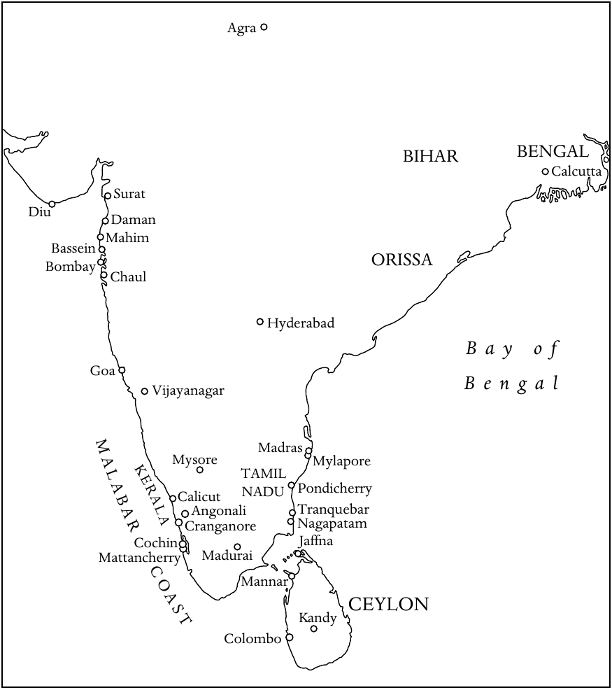

**地图3　约1800年的印度传教活动**

图中地名对照：

| 原图标注 | 中文 |
| --- | --- |
| Agra | 阿格拉 |
| BIHAR | 比哈尔 |
| BENGAL | 孟加拉 |
| Calcutta | 加尔各答 |
| Surat | 苏拉特 |
| Diu | 第乌 |
| Daman | 达曼 |
| Mahim | 马希姆 |
| Bassein | 巴塞因 |
| ORISSA | 奥里萨 |
| Bombay | 孟买 |
| Chaul | 乔尔 |
| Hyderabad | 海得拉巴 |
| Bay of Bengal | 孟加拉湾 |
| Goa | 果阿 |
| Vijayanagar | 毗奢耶那伽罗 |
| Madras | 马德拉斯 |
| Mysore | 迈索尔 |
| Mylapore | 迈拉普尔 |
| TAMIL NADU | 泰米尔纳德 |
| KERALA | 喀拉拉 |
| MALABAR COAST | 马拉巴尔海岸 |
| Calicut | 卡利卡特 |
| Pondicherry | 本地治里 |
| Angonali | 安加马利〔正文拼作Ankamali〕 |
| Tranquebar | 特兰奎巴 |
| Cranganore | 克兰加诺尔 |
| Nagapatam | 纳加帕塔姆 |
| Cochin | 科钦 |
| Jaffna | 贾夫纳 |
| Mattancherry | 马坦切里 |
| Madurai | 马杜赖 |
| Mannar | 马纳尔 |
| CEYLON | 锡兰 |
| Kandy | 康提 |
| Colombo | 科伦坡 |

袭击进入印度，但直到1206年才建立起一个持久的王朝。巴布尔于1526年建立的莫卧儿王朝，统治印度三百多年。莫卧儿君主赞助艺术，使伊斯兰教、印度教与基督教传统中的精华相互融合。这在很大程度上得益于王国内苏菲派传道者和耶稣会神父的活动。然而，到十七世纪末，宗教战争与西北方向的入侵相互作用，莫卧儿王朝已逐渐衰弱。其政治上的软弱，使欧洲各国得以在印度次大陆建立商业与领土控制。

<!-- PDF page 450; original page 435 -->

最早来到印度的欧洲人是葡萄牙人。1498年5月27日，瓦斯科·达伽马与船员抵达印度西海岸的卡利卡特。此后数年，葡萄牙取得大量领土，并于1510年夺取果阿。葡萄牙在十六世纪虽是强国，但到下个世纪，除果阿、达曼和第乌以外，大部分领土都被荷兰人与英格兰人夺走。同一时期，法国与丹麦商人也来到次大陆沿海。到十八世纪，荷兰人又在很大程度上被英格兰人排挤出去。

英格兰东印度公司，后来成为不列颠东印度公司，于1600年12月凭王室特许状成立，获得英格兰与整个亚洲及太平洋地区贸易的垄断权。公司在印度沿海设立贸易据点，也称商馆，最早是1608年在西海岸建立的苏拉特商馆。1650年代，公司开始在孟加拉贸易；1702年，在胡格利河畔建成威廉堡，保护当地贸易利益。加尔各答城围绕威廉堡发展起来，到十八世纪后期，已成为英国在印度的权力中心。与此同时，法国于1674年设立法国东印度公司〔Compagnie des Indies，年份和法文名称依原书〕，到十八世纪初，将东海岸的本地治里建成法国势力的基地。

十八世纪，英法在印度发生重大对抗，1740至1763年间进行了三场战争。普拉西战役〔1757年〕以后，英国东印度公司在印度东部的孟加拉、比哈尔和奥里萨建立统治（Raj）。自1773年起，英国议会开始对公司的事务实行全面控制；沃伦·黑斯廷斯于1772年先任首位总督，两年后又成为首位总督长官。绝嗣兼并原则（Doctrine of Lapse）规定，印度统治者若去世而没有直系王位继承人，其领土就归英国所有。这使英国控制的领土不断扩大。1793年，康沃利斯勋爵的法典为十九世纪英国统治印度奠定了坚实基础，规定了行政服务、法院和税收征集的标准。

## 多马派基督徒

按照传统说法，基督教由圣多马最早带到印度。据说，他约于公元52年来到喀拉拉西海岸。他所归信的信徒将其使徒事工的记忆传给后代，使之在印度延续。这个基督徒社群与叙利亚东方教会保持共融，该教会的都主教最初住在塞琉西亚—泰西封，八世纪迁往巴格达。

<!-- PDF page 451; original page 436 -->

多马派基督徒大多属于上层阶级。他们保留印度教文化，同时实践基督信仰，其礼仪与崇拜深受叙利亚传统影响。在亚洲许多其他地区的基督徒消失很久以后，他们仍在南印度兴盛发展。

葡萄牙人在喀拉拉海岸的克兰加诺尔首次接触多马派基督徒以后，便致力于使这些社群更加符合罗马教会和拉丁传统。多马派基督徒起初愿意接受罗马宗座的首席地位，并在1599年的迪安佩尔宗教会议上正式予以承认。然而，对方不断试图改变他们的礼仪，从教会生活中消除其他东方传统，很快引发了强烈紧张。按照葡萄牙人的说法，只能有一种法，即基督之法，不能有两种法，一种属于圣多马，另一种属于圣伯多禄。多马派神父〔称为kattanars〕大多被这些压力逼得忍无可忍，于1653年1月3日聚集在马坦切里古老的库南十字架前，宣誓永不接受克兰加诺尔总主教的权威。这位总主教是喀拉拉罗马天主教会的首席主教。这些事件促成了一个新的基督教共融团体——马兰卡拉叙利亚正教会。它有时被称为“雅各派”（Jacobites），但其成员拒绝接受这个名称。

罗马迅速采取行动，应对这场危机。传信部派加尔默罗会神父前往印度，试图处理局面。传信部不得不这样做，是因为多马派基督徒拒绝再与此前一直打交道的耶稣会发生任何关系。加尔默罗会虽然常常态度专横，还是使许多多马派基督徒恢复了和解，因此到1662年，大多数人重新与罗马共融。传信部于1661年为喀拉拉任命一位宗座代牧，极大帮助了这项进展：与罗马共融、被称为叙利亚—马拉巴尔天主教徒的多马派信徒，从而事实上拥有了自己的主教。

当时，分离出去的马兰卡拉教会试图重新联系东叙利亚宗主教区〔有时也称加色丁教会〕，但未能成功。最后，驻大马士革的西叙利亚宗主教与他们取得联系。他们在习俗上作了一些名义上的改变，从东叙利亚传统转向西叙利亚传统，随后成为叙利亚宗主教区内的一个自治教会。

与此同时，叙利亚—马拉巴尔天主教徒不断向罗马抱怨加尔默罗会，一再请求教廷任命一位印度主教，取代外来的传教士宗座代牧。1780年，他们派出一个代表团，<!-- PDF page 452; original page 437 -->由约瑟夫·卡里亚蒂尔神父率领，亲赴罗马，请求为他们的教会任命印度主教。不过，这个代表团在罗马似乎没有受到认真对待。然而，当代表们来到里斯本、准备踏上归程时，命运出现了戏剧性的转折。葡萄牙女王依据保教权，任命卡里亚蒂尔为克兰加诺尔总主教。他在果阿登陆时，多马派基督徒的兴奋达到顶点；但令他们绝望的是，他还没有离开果阿，就患病去世，原书记这一年为1783年。有人推测，如果他活下来，与叙利亚教会共融和与罗马教会共融的两部分多马派基督徒，或许能够重新联合。

在这个关键时刻，果阿总主教任命卡里亚蒂尔的同伴托马斯·帕雷亚马卡尔神父，担任宗座代牧区署理。但民众并不满意，因为他们普遍相信卡里亚蒂尔是遭毒害而死。广泛的抗议由此发生。1787年，与罗马共融的多马派基督徒领袖在安加马利举行会议，宣誓只承认帕雷亚马卡尔为主教，不承认其他人。总教区当局拒绝接受这一主张。过了一段时间，抗议逐渐平息。结果，多马派基督徒不得不等到1887年，才拥有出自自己社群的主教。

## 印度的天主教传教

葡萄牙总督阿丰索·德阿尔布克尔克于1510年夺取西海岸城市果阿。它很快成为葡萄牙在整个东方的领地首府。这些领地被称为“葡属印度国”（Estado da India），从波斯湾口的霍尔木兹，一直延伸到马六甲和印度尼西亚的香料群岛。在果阿境内，葡萄牙积极努力，使民众皈依基督信仰。每年都有一批批修会神父、修士和教区神父，与葡萄牙政府官员、商人和士兵一道，从葡萄牙来到果阿。果阿也成为重要的教育中心，神父和教理传道员在这里接受训练，然后前往印度其他地区乃至更远地方的传教区。

1534年，果阿升格为教区，1557年又升为总教区。方济各会早在1510年抵达，耶稣会于1542年、道明会于1548年、奥思定会于1572年、加尔默罗会于1607年来到这里。果阿著名的教育机构包括道明会的圣阿奎那学院、方济各会的圣文德学院、奥思定会的波普洛学院，以及耶稣会的圣保禄学院和圣罗克学院。果阿的许多教堂

<!-- PDF page 453; original page 438 -->

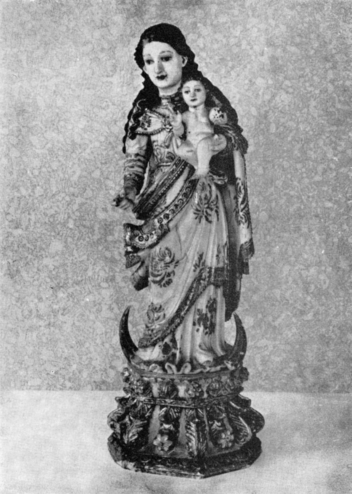

**图8　《圣母子》，印度果阿制作，约1700年。** 象牙小像，高约23厘米，头发和袍服边缘施彩并饰金。这是常见的巴洛克形象，但其面貌与服饰显然已经适应印度风格。照片藏于爱丁堡大学非西方世界基督教研究中心的巴特勒收藏。

<!-- PDF page 454; original page 439 -->

〔例如仁慈耶稣堂、塞主教座堂、阿西西圣方济各堂、马尔高圣神堂〕，至今仍充分展现着当时建筑、雕塑、绘画和木雕风格的丰富面貌。

十六世纪，无论在葡萄牙控制的领土内，还是在各个葡萄牙贸易中心，基督教的归信人数都取得了显著增长。不过，传教士与印度教上层阶级之间并没有密切接触。圣方济各·沙勿略为向印度民众传福音作出了巨大贡献。他于1542年5月6日抵达果阿，在向葡萄牙移民讲道、向当地人教授教理的同时，积极从事慈善工作。不到五个月，他就离开果阿，前往印度东海岸；到1549年8月，他已经来到日本。

意大利耶稣会士范礼安（Alessandro Valignano，1539—1606）在沙勿略奠定的基础上继续工作，被视为当时印度传教事业最重要的组织者。他强调必须学习当地语言，并为此设立学校。他长期为马拉巴尔教会的问题操劳，思考如何才能使他们完全回到天主教会。

1581年，范礼安担任耶稣会果阿会省会长期间，开明的莫卧儿皇帝贾拉勒丁·穆罕默德·阿克巴，邀请耶稣会士来到印度北部的宫廷。阿克巴希望聚集不同信仰的宗教人士，帮助他创建一种新宗教——“神圣宗教”（Din-i-Ilahi）。鲁道夫·阿夸维瓦神父等耶稣会士，在随后一百年间，先后参加了三批前往莫卧儿宫廷的耶稣会传教团。虽然这些传教团没有使历代莫卧儿皇帝归信，却促进了伊斯兰教与基督教之间的相互理解。他们与皇室宫廷建立了富有成效的联系，因而能够在这个穆斯林帝国各地，甚至尼泊尔和西藏，开设传教站。

阿克巴的继承者是贾汉吉尔〔他帮助英国人尝试在印度贸易〕，随后是建造泰姬陵的沙贾汗，最后是冷酷的奥朗则布。他于1707年去世，标志着莫卧儿帝国实际上走向终结，尽管它以缩小的形式一直延续到1858年巴哈杜尔·沙皇帝统治结束。

除了莫卧儿宫廷，耶稣会士在不同时期，也在南方的毗奢耶那伽罗、贡吉（Gunji）、马杜赖和坦贾武尔诸王国的宫廷中占有重要位置。耶稣会的上级与会士定期致信罗马，详述传教工作、成败和需要。修会创始人圣依纳爵设计了这套定期通信制度，目的是加强成员之间的团结联系，并便利良好管理。这批称为 Litterae Indicae 的信件，即<!-- PDF page 455; original page 440 -->“印度书信”，很快成为在欧洲宣传海外传教的有效工具。

这些通信展示了意大利杰出耶稣会传教士罗伯托·德诺比里在南印度的创新与独创精神。1606年，他在泰米尔文化的古老中心之一马杜赖，开始传教工作。为获得广泛接纳，他宣称自己属于意大利贵族和王者（raja）阶层，是一位“再生”的罗马婆罗门。他穿上婆罗门出家人的服装，佩戴圣线，蓄留顶髻（kudumi），脚穿木屐。他学习泰米尔语、泰卢固语和梵语，开始用印度宗教文明的概念与思维方式，重新表述基督教。他最终使三万多人归信；他去世一个世纪以后，由他建立的传教区已经有二十多万名基督徒。他的宗教格言恰如其分，是“Aperire portam”——打开大门。

德诺比里才智卓越，善于吸收自己所选择定居之地的学问，并将其传达给别人。虽然有人指责他一味关注高种姓，但他的视野超越了种姓和习俗。他具有令人钦佩的补赎精神，大家都称他为“塔图瓦·波达加尔”（Tattuva Podagar，原书释作“婆罗门托钵者”）。不过，他受到印度教徒的反对，而某些传教同伴和教会领袖的反对更为强烈。罗马的耶稣会士，乃至教皇额我略十五世，起初都支持他的创新；但最终，罗马还是禁止了他为新信徒提出的许多习俗。他始终试图从内部理解印度教，目的并不只是使高种姓婆罗门归信，而是通过他们，把整个印度带到基督面前。

德诺比里的传教方法，在整个十七、十八世纪始终存在争议。1703年，夏尔·马亚尔·德图尔农，即铎罗，作为教皇代表被派往中国，随后前往印度，处理“中国礼仪”与“马拉巴尔礼仪”问题。他裁定，此事不容妥协，两种礼仪都必须拒绝。1739年，教皇克勉十二世要求所有传教士为此签署誓言。本笃十四世又以1744年9月12日的《一切关怀》（Omnium Sollicitudinum）训令，规定所有天主教徒，无论属于哪个种姓，都应在同一座教堂、同一时间参与弥撒并领圣体。耶稣会士遵守了裁定，但为低种姓信徒另设进入共同教堂的入口，并在堂内装上小隔断，把低种姓与高种姓分开。

葡萄牙耶稣会士圣若昂·德布里托，虽然不具有德诺比里那样的学术才华，却同样对印度教抱有同情理解。他身穿<!-- PDF page 456; original page 441 -->印度教出家托钵者的服装，专门在南印度低种姓人群中工作。他因直言不讳而遭受酷刑，随后于1693年2月，在泰米尔纳德的奥里尤尔被斩首。他的传记作者写道：“他是普通队伍中的一员。他或许具有方济各·沙勿略的热忱和热情，却从未被召唤到整个东方施展，因为他的工作实际上局限于泰米尔纳德。他也没有像罗伯托·德诺比里那样，肩负开创传教新方法的使命。他来到一片已经成熟、可以收割的田地，不去四处寻找新工具或新办法，而是拿起旧镰刀，加入收割者的行列。”[^p456-1]

耶稣会在马杜赖、卡纳拉和迈索尔传教事业的创始人，是莱奥纳尔多·钦纳米神父。他逐渐认识到，自己最初四年的传教没有结果，主要因为人们把他视为葡萄牙神父。到1649年，他开始穿出家人服装，穿耳孔，在头部与颈部涂抹灰烬。除了卓越的传教工作，他还留下几部用当地卡纳达语写成的虔修作品，其中最著名的是《卡纳拉史》（Istoria del Canara，1648）。

十七、十八世纪印度教会成长中，引人注目的一点，是众多神父和平信徒创作了重要的文学与宗教著作。可以想到的十六世纪作品，包括弗朗西斯科·加西亚·门德斯总主教的《具有三十二种完美的人》（Homem das Trinta e duas perfeições）、埃斯特旺·达克鲁斯的《论使徒圣伯多禄生平》（Discursos sobre a vida do apóstolo Sam Pedro），以及加西亚·达奥尔塔的《药材与药物对话录》（Colóquios dos simples e drogas medicináis）。十七世纪的作品则有迪奥戈·贡萨尔维斯的《马拉巴尔史》（História do Malavar）、让·弗南斯·布歇关于印度教的论著，以及卡雷尔·普日克里尔的孔卡尼语语法。

意大利耶稣会士科斯坦佐·朱塞佩·贝斯基（Constanzo Guiseppe Beschi，1680—1747），为印度教徒与基督徒写下古典史诗、哲学论著、评注、词典、语法、译作和小册子。他的史诗《永不凋谢的花环》（Tembavani），以及他与印度教学者举行的公开辩论，为他赢得很高声誉，确立了他作为梵语和泰米尔文学学者的持久地位。

其他同样以写作闻名的人物，包括用拉丁语撰写梵语语法的海因里希·罗特（1620—1668）；约翰·欧内斯特·汉克斯莱登（1681—1732），他著有《弥赛亚颂歌》（Mishiada Pana，1728）、一部梵语—马拉雅拉姆语—葡萄牙语词典，以及用葡萄牙语撰写的马拉雅拉姆语语法。加斯东·克尔杜（1691—1777）曾在本地治里、卡纳拉和特兰奎巴服务。他精通梵语和泰卢固语，编写了一部泰卢固语—梵语—法语词典，并首次指出梵语与拉丁语、希腊语、德语和俄语之间的语言联系。让·卡尔梅特（1693—1739）在卡纳拉的泰米尔传教区工作，是第一位获得<!-- PDF page 457; original page 442 -->印度教全部四部《吠陀》抄本的欧洲人。弗朗西斯·庞斯（1698—1752）则兼为天文学家、地理学家、教会法学家与梵语学者，并撰写了一部梵语语法。

耶稣会以外的其他修会和修会团体，也做了值得称赞的工作，但由于人数有限、资金匮乏，规模要小得多。十七、十八世纪，方济各会的活动主要致力于巩固，而非扩张。到1629年，他们在印度有两个会省，约六百名修士。他们在果阿和巴塞因都设有会院，十八世纪时，这些会院遭到马拉塔人攻击。1766年，他们不得不撤出自己在果阿巴尔德兹地区掌管的堂区，将其交给当地果阿教区神父。当时，本土神父已经相当众多，也迫切希望管理堂区。

道明会于1548年抵达果阿以后，还在巴塞因、马希姆、塔拉普尔、乔尔、达曼、第乌、科钦、纳加帕塔南和迈拉普尔设立会院；这些都是印度西海岸或东海岸的城镇。后来，他们得以将传教活动扩展到莫桑比克、马六甲，以及印度尼西亚的帝汶岛和索洛岛。奥思定会抵达果阿较晚，于1572年9月以后建立恩宠圣母学院。1599年起，他们扩展到孟加拉，并把那里视为自己最成功的传教地区。他们也在波斯和非洲东海岸工作。

其他修会，包括加尔默罗会、嘉布遣会与戴蒂尼会，都在十七世纪陆续来到。他们直接受传信部监督，因此与葡萄牙方面发生管辖权纠纷。加尔默罗会负责马拉巴尔和大莫卧儿的宗座代牧区；嘉布遣会在苏拉特、马德拉斯和本地治里工作；戴蒂尼会则在戈尔孔达服务。果阿的保教权体制下，既有葡萄牙神父，也有果阿神父。罗马传信部的体系，则在孟买、喀拉拉、本地治里和西藏设有宗座代牧。意大利加尔默罗会士在孟买和喀拉拉服务；法国嘉布遣会士与巴黎外方传教会的教区神父在泰米尔纳德工作；法国嘉布遣会士在马德拉斯，意大利嘉布遣会士则在北印度。

戴蒂尼会，即圣嘉耶当神意律修司铎会，也在果阿活动，但与其他修会相比，缺乏资金和人员。不过，1682年在果阿仿照圣斐理伯·内里祈祷会建立的显灵圣十字祈祷会，发展成为很有影响力的团体，尤其因为它是第一个完全由本土出身教士组成的修会团体。所有这些修会与团体虽然都从事<!-- PDF page 458; original page 443 -->基督教化这一共同目标，彼此之间却存在相当严重的嫉妒与排他情绪。

1703年，传信部设立西藏—印度斯坦宗座监牧区，交由嘉布遣会负责。他们从1707年起，能够一直留在拉萨，直到1745年因宗教迫害而退往尼泊尔的加德满都；该会自1715年起已在那里立足。但到1769年，政治动荡终于迫使他们离开这个王国，迁回印度。与此同时，1745年已有许多尼泊尔基督徒和慕道者迁到比哈尔的贝蒂亚。1812年，西藏—印度斯坦宗座监牧区升格为宗座代牧区。

耶稣会更早就已进入西藏，曾在札布让设立传教站，直到1641年结束。1713年，两位耶稣会士伊波利托·德西德里和马诺埃尔·弗雷雷，再次开始这项事业，尽管嘉布遣会认为西藏属于自己的传教区，不准其他任何修会进入。很快，西藏就只剩下德西德里一人。嘉布遣会强烈反对他的存在，他因而于1719年奉命离开拉萨。他是一位杰出的地理学家，所写的传教记述非常可靠，显示出对西藏社会和文学的深刻理解。

东方第一座女子修院——圣莫尼加修院——于1606年在果阿成立，主要得益于阿莱希奥·德梅内塞斯总主教的努力。这所修院主要为葡萄牙士兵的遗孀而设。虽然院内两个派别之间的紧张关系延续了几年，修女们仍继续履行正常宗教职责，在文学和音乐创作上表现出色，也以美术才能和烹饪创新闻名。

1759年标志着葡萄牙与印度的耶稣会进入困难时期。这一年，葡萄牙实际掌权者蓬巴尔侯爵成功取缔了耶稣会。该会在果阿的大片地产与会院被没收。1760年，在印度各地工作的127名耶稣会士遭逮捕，从果阿被押运回欧洲。取缔之后，蓬巴尔在殖民地推行了多项受到欢迎的改革。他于1774年解散宗教裁判所；该所在果阿设立以来，已经举行过七十多次公开宣判仪式〔autos-da-fé，原书解释为“审问会议”〕。他改造教育制度，并努力改善本土教士的处境。神父开始按照学识与品德，而非种族，获得堂区职位。

果阿的动乱仍在继续。葡萄牙的统治并非无人挑战，民众多次起义。例如，1654年，马蒂亚斯·德卡斯特罗因未能得到果阿的一项主教<!-- PDF page 459; original page 444 -->职位而不满，联合比贾普尔统治者阿迪尔·沙，企图推翻葡萄牙人，但未成功。1787年，坎多林的平托家族密谋，使三位果阿神父——卡埃塔诺·弗朗西斯科·德科托、若泽·安东尼奥·贡萨尔维斯和卡埃塔诺·维克托里诺·德法里亚——走到前台。他们先前未能说服教廷，让印度人出任果阿保教权体系中空缺的主教职位，于是制定了推翻果阿葡萄牙统治的计划，同样没有成功。

## 印度的新教传教

十七世纪，荷兰、英国和丹麦商人在印度沿海建立贸易站，也就是商馆，并带来各自的随牧。十八世纪初，路德宗在南印度东海岸的特兰奎巴建立传教区，挑战了罗马天主教会此前在传教领域的垄断地位。1706年至十九世纪初，路德宗差会总共供养了五十六位在印度工作的传教士。

传教的成功，要归功于两位从丹麦前来的先驱：巴尔托洛梅乌斯·齐根巴尔格和海因里希·普吕乔。丹麦人自1620年起就在特兰奎巴活动，当时坦贾武尔的王公允许他们租用该地区。十七世纪后期，那里已有两座教堂，一座是锡安堂，另一座是罗马天主教堂。但1706年7月6日，两位二十多岁的传教士齐根巴尔格和普吕乔抵达，改变了局面。

两位丹麦差会传教士从一开始就把重点放在教育上。他们合办了一所名为慈善学校的学校。据记载，1708年，齐根巴尔格曾奉丹麦指挥官之命被短暂监禁。到1709年，我们又见到他表达对印度人的赞赏，认为他们是文明的人民，具有深刻的道德见解。1711年以前，他已将《圣经》译为当地泰米尔语；1713年，他出版了马拉巴尔诸神的谱系。

齐根巴尔格以自己属于高教会派路德宗为荣，对传教使命具有强烈的召命意识。他急切希望传教成功，因而提出多种独创方法。他在教会礼拜中使用泰米尔语和印度音乐，总体上希望传教工作由印度本地，而不是欧洲，来指导。面对种姓制度，他认为虽然不可能将其彻底废除，但必须削弱它在教会内部的影响。他所归信的信徒主要是<!-- PDF page 460; original page 445 -->首陀罗或达利特人，教堂的大部分空间为他们保留，只有一处较小的横翼，单独留给其他各个种姓的信徒。1714年，齐根巴尔格访问欧洲，处理有关传教的一些问题；两年后，他带着已婚身份返回印度。然而，他未能长久享受新生活。在与同事共同管理传教事业时，他经历了许多困难，健康因此受损，于1719年2月23日去世。

特兰奎巴另一位著名传教士，是本杰明·舒尔策。他在1720至1740年间断续于传教区服务，获得基督教知识促进会的支持。他为本地教会所作的努力，使三位印度教理传道员获按立为牧师。约翰·菲利普·法布里修斯于1740年抵达印度，也在特兰奎巴待过两年。此后，他迁往马德拉斯，加入当地的英国差会，但始终与丹麦差会保持联系。到1750年，他已把《新约》译成泰米尔语，并用英语写出一部简明泰米尔语语法。1791年去世时，他在印度服务已超过五十年。

特兰奎巴所有传教士中最杰出的是克里斯蒂安·弗里德里希·施瓦茨。他于1750年7月30日抵达，当时二十四岁。他学会了泰米尔语、泰卢固语、马拉地语、波斯语和梵语，也掌握多种欧洲现代与古典语言。他以圣洁纯正著称，兼为传道人、教师、外交家与政治活动家。他深受士兵敬重，英国各团的官兵都乐于与他交往。

施瓦茨后来从马德拉斯迁往坦贾武尔，在那里被当作王室神职人员，能够对王公及其政治事务施加巨大影响。他还与迈索尔的穆斯林统治者海德尔·阿里（1722—1782）保持良好关系。1759年耶稣会退出印度后，他照管了南印度原先由耶稣会工作的地区，帮助在马德拉斯、特兰奎巴、蒂鲁吉拉帕利、坦贾武尔和帕拉扬科泰形成大规模基督徒会众。1798年去世时，他已经在印度度过四十八年。

齐根巴尔格、舒尔策和施瓦茨这样的传教士，其突出之处在于，他们大量使用本地语言传教，推动平信徒广泛参与，并把传教机构的实际管理大部分交到印度人手中。从一开始，特兰奎巴传教事业就得到一批欧洲传教士的服务，他们在奥古斯特·赫尔曼·弗兰克于十七世纪末创办的德国哈勒学院接受训练。弗兰克是教育先驱，将真正的神学界定为活生生的宗教。

<!-- PDF page 461; original page 446 -->

他的教育体系强调主动学习和经验学习，包括在自然科学中实际接触研究对象，以及接受实用技术训练。

再来看英国对传教的贡献。东印度公司的政策，总体上敌视公司领土内的基督教传教活动，认为它会造成干扰，使公司与当地居民之间关系紧张。然而，自1792年起，福音派舆论对英国议会施加压力，迫使公司允许兼任传教士的随牧进入东印度公司，在印度服务。

英国新教近代传教运动之父，是福音派人士威廉·克理。他十分推崇德国福音派在印度的工作。原书记他于1792年抵达印度，但遭英国东印度公司多方刁难，最初被禁止进入加尔各答。克理与浸礼派的约书亚·马士曼、威廉·沃德一道，在加尔各答附近丹麦的殖民飞地塞兰坡建立传教区。除了基督教传教，克理与同伴还为翻译《圣经》而推动语言研究，并创办西式学校和印刷所。他后来得以进入加尔各答，也只是因为能够在威廉堡学院教授印度语言。克理在孟加拉的活动，不仅推进了基督教传教，也增进了印度与西方的文化互动。

1813年，英国议会通过延长东印度公司特许权的法案，赋予基督教传教士进入英国印度领土的权利。同时，议会在印度建立由公司收入供养的圣公会体制：加尔各答主教对英国领土行使教区权力，加尔各答、马德拉斯和孟买的会吏长协助其工作。首任加尔各答主教，是温和高教会派人士托马斯·F.米德尔顿。他于1814年5月在伦敦祝圣，同年11月抵达加尔各答。这个圣公会体制，以及各宗派传教士人数的增加，促使传教学校、学院和医院数量稳步增长。不过，英国官员主要追求稳定，英国传教士则致力于社会改革和使人归信；两者之间的紧张关系，在整个十九世纪持续困扰着英国对印度的统治。

英语教育的影响，对在印度的英国帝国同样有利有弊。威廉·琼斯是一位不拘泥于教条、始终尊重印度各宗教的基督徒。他于1784年在加尔各答创立孟加拉亚洲学会，以推动印度文化与宗教研究。继<!-- PDF page 462; original page 447 -->1813年《特许状法》之后，传教士的工作、贸易的影响，以及西方教育的引入，推动孟加拉不断壮大的知识阶层出现文化复兴。1814年以后，博学的婆罗门拉姆·莫汉·罗伊（1772—1833），开始在加尔各答崭露头角，成为这场印度教复兴之父。他精通英语和西方古典著作，也深谙本身的印度教文化，激发印度人重新欣赏《奥义书》及其他印度教经典。

总体来说，新教对印度传教事业的影响，直到十八世纪初才开始显现。1815年以前，印度新教传教的先驱，主要是特兰奎巴差会，以及威廉·克理和同伴的塞兰坡差会。这两场传教运动都把《圣经》置于首位，努力将其译成多种本地语言；其中，塞兰坡差会尤其强调教育与新闻出版。

## 印度以外的南亚与东南亚

这里没有足够篇幅考察整个南亚和东南亚的基督教传教历程。因此，我们将重点放在三个传教地区：斯里兰卡、帝汶及部分邻近岛屿，以及越南。

1505年，葡萄牙人抵达今天斯里兰卡的加勒和科伦坡。他们将这个国家称为塔普罗巴纳或锡兰。当时，锡兰的贾夫纳半岛由印度教统治者治理，臣民也信奉印度教；岛上其他地区则信奉佛教。1543年，一批方济各会士抵达，开始天主教传教。康提的佛教国王维克拉马·巴胡，在1540年代皈依基督教，以换取葡萄牙援助。许多其他人也为得到葡萄牙人的物质好处而归信。到1560年，原书所称岛屿东侧的马纳尔，已经有一个兴盛的基督徒社群。

多个受葡萄牙保教权支持的天主教修会在锡兰传教，其中包括1602年起的耶稣会，以及后来的奥思定会、道明会。然而，他们没有鼓励当地居民进入神职。1658年，荷兰占领该岛，迫使葡萄牙神父撤离，并规定任何窝藏罗马天主教神父的人都处以死刑。许多天主教堂被改作新教礼拜之用，锡兰天主教徒发现自己失去了牧者。1686年，果阿祈祷会神父真福若泽·瓦斯（1651—1711）来到锡兰，在贫困与危险中工作二十四年，直到去世。他想出巧妙办法，使天主教信仰在岛上延续，包括依靠本土传教士和<!-- PDF page 463; original page 448 -->教理传道员。由于他的努力，到十八世纪末，经过荷兰官方长达140年的压制以后，岛上仍估计有6.7万名罗马天主教徒。

荷兰东印度公司在1623年续订的特许状中，规定了促进新教信仰的事项，并在莱顿设立神学院，训练前往荷兰东方领地服务的传教士。占领锡兰以后，他们建立新教教会体制，把所有公职限于新教徒，在某些情况下，还没收拒绝接受新教洗礼者的财产。据说，1722年锡兰有近42.5万名新教基督徒，但大多只是名义上的信徒。事实上，他们也很难不是如此，因为1747年全岛只有五位新教牧师。1796年，英国从荷兰手中夺取锡兰沿海，1815年正式吞并全岛。英国占领之后，英国主要传教团体的代表相继来到：1804年的伦敦会、1812年的浸礼会差会、1814年的卫斯理宗卫理公会，以及1817年的英格兰教会传教协会。

东印度群岛帝汶岛的基督教传教，始于十六世纪中叶。帝汶人一向信奉万物有灵论，同时具有一种模糊的一神信念。方济各会士安东尼奥·塔韦拉于1556年抵达，开始讲道传教。道明会于1562年来到，并主导全岛的福音传播。他们集中使当地统治者归信，后者随后成为葡萄牙的藩属。到1577年，归信者估计已有五万人。道明会实际上统治该岛超过一个世纪，没有受到民政或军事当局干涉。

1590年，道明会在梅纳修建第一座教堂，后来又在邻近的萨武岛、阿杜纳拉岛和弗洛勒斯岛建立教堂。随着信仰在帝汶发展，当地教会在管辖事务上，同时与道明会驻果阿的总代理和马六甲主教相联系。十八世纪最初四分之一个世纪，道明会在帝汶与索洛两岛的主导地位，首次遇到严重挑战。葡萄牙于1722年3月25日颁布王令，宣布隶属果阿、中国和澳门会省的耶稣会士，也可在帝汶工作。1723年3月10日的另一道命令，建议允许果阿显灵圣十字祈祷会进入帝汶。1738年10月8日，一所由祈祷会负责的神学院在帝汶成立，训练当地准备进入神职的人。然而，直到1812年，道明会在帝汶的世俗权力才开始衰落。1834年，<!-- PDF page 464; original page 449 -->葡萄牙及其海外各省的所有修会遭到取缔，终于使帝汶的道明会传教事业终结。

在摩鹿加群岛和东弗洛勒斯，基督信仰最初于十六世纪，通过葡萄牙传教士的努力传播。他们与寻找香料和檀香木的葡萄牙商人一同来到这里。经历将近一个世纪的葡萄牙主导后，安汶于1605年落入荷兰东印度公司之手；随后是1619年的巴达维亚、1641年的马六甲、1646年的索洛、1667年的望加锡和1683年的特尔纳特。荷兰东印度公司促进改革宗新教信仰传播，并禁止天主教会在其领土内活动，东弗洛勒斯、索洛和帝汶除外。直到1644年，耶稣会的马拉巴尔会省与日本会省，还照管着这些岛屿的罗马天主教教务需要。然而，在一个多世纪里，印度尼西亚的天主教大体上与天主教世界其他部分隔绝。

与此同时，荷兰东印度公司支持新教传教士，坚持所有雇员必须属于官方认可的改革宗教会。但新教归信人数增长缓慢。1799年，荷兰东印度公司解散，改革宗对该地区的主导地位随之终结，印度尼西亚重新向多种传教活动开放。

越南最早的基督教活动记录，出现在1533年。当时，黎庄宗颁布王令，禁止传播“耶稣”（Gia-To）的教义。传播者被用一个通常意为欧洲人的越南语词来称呼。十六世纪后期，一些道明会士进入越南，但广泛的福音传播，直到1615年耶稣会传教士抵达后才开始。其中最著名的亚历山大·德罗德，于1625年来到这里。他最终被驱逐，但在此以前，为越南基督教的形成作出了两项重大贡献。

首先，他领导一组传教士，创制用拉丁字母转写越南语的国语字（Quoc-Ngu）体系，另加五个声调符号来标调。此后，越南人一直使用这一体系。其次，德罗德编写了一部越南语《要理问答》，对越南天主教产生了持久影响。

德罗德向教廷游说后，教皇亚历山大七世于1660年，任命两位传教士担任越南南北两个新教区的宗座代牧。当时，越南北部与南部分别被称为东京（Tonkin）和交趾支那（Cochin China）。这时接手越南传教工作的，是巴黎外方传教会。他们在<!-- PDF page 465; original page 450 -->随后几十年间，非常努力地培养本土神父。与此同时，东京和交趾支那的教会，都遭到时断时续、有时相当严厉的迫害。

十八世纪，南北两地的中央权威瓦解，民众遭受一系列内战之苦，战争演变为阮氏与郑氏诸王公之间的竞争。百多禄神父（Pierre-Joseph Pigneaux）在法国宫廷与阮氏一方之间，谈成一项条约，以商业让步换取法国军事援助。这对国家和教会来说，都是一个决定性时刻。来自本地治里的法国军队于1788年抵达，帮助阮氏取得胜利。阮氏领袖成为嘉隆皇帝。虽然他始终信奉佛教，却优待基督徒社群。1802年，该社群划分为三个教区，各由一位传教士宗座代牧主持。当时有121名越南神父、55名外来传教神父，以及32万名领圣体信徒。这一发展，也开启了基督教会与法国殖民主义之间的危险联系，成为此后越南教会继续间歇遭受严厉迫害的原因之一。

1660至1815年，对于印度以及南亚、东南亚部分地区，是政治、文化、经济和宗教上的动荡时期。在这些年里，印度境内既见证了西方强国控制的巩固，也见证了基督信仰的稳步发展、伊斯兰艺术与文化的传播，以及印度教各种哲学思想和虔敬传统的繁荣。印度也成为更多传教运动前往亚洲各地的出发点和资金来源。

### 译校说明

原文将马纳尔称为锡兰岛东侧的城镇，而本章地图3标注在岛的西北侧，译文保留并标明正文说法。法国东印度公司成立年、卡里亚蒂尔卒年、克理抵印年等日期，均依原版保留，未据其他资料擅改。真福若泽·瓦斯的称号依2006年原书，不作今日称号的更新。

## 注释

[^p456-1]: A. Sauliere, Red sand: A life of St. John de Brito, S. J. Martyr of the Madurai Mission (Mathura: De Nobili Press, 1947), p. 487.

---

<!-- PDF page 466; original page 451 -->

# 第二十三章　东亚的基督教

**狄德满（R. G. Tiedemann）**

总体来说，十七世纪中叶并不是东亚基督教的有利时期。中国正在缓慢地从内部叛乱，以及外来的满洲人征服所造成的动荡中恢复。在德川时代的日本，基督教几乎已经被消灭；在朝鲜，它实际上仍鲜为人知。只有在菲律宾，天主教会才建立了相对稳定的存在。

## 菲律宾：东亚的天主教飞地

菲律宾的归信，构成东亚基督教历史中非同寻常的一章。到十七世纪中叶，距离西班牙征服仅两三代人，除了穆斯林控制的棉兰老地区和吕宋北部山地外，群岛的大部分主要岛屿，已经持久地成为基督教地区。因此，在亚洲更广大的非基督教世界中，菲律宾很早就形成了一个天主教飞地。

对菲律宾的精神征服，关键在于那些与早期西班牙殖民者一同到来的托钵修会传教士。除了托钵会士，耶稣会也参与了菲律宾的迅速归信。应当指出，菲律宾各修会团体的人员，几乎全部来自西班牙，另有较少部分来自墨西哥。随着时间推移，各修会都建立起菲律宾会省，由驻在马尼拉的会省长主持。托钵修会的菲律宾会省，不仅包括他们在群岛上负责的地区，也包括各会在亚洲大陆的传教区。

除了修会会省，征服之后的几十年中，也建立了教区教士体系。1595年，教皇克勉八世将马尼拉教区升为总教区，并设立三个新教区：新卡塞雷斯〔今纳加市〕、新塞哥维亚<!-- PDF page 467; original page 452 -->〔十八世纪中叶迁往维甘〕和宿务。这个结构在1660至1815年间始终保持不变。然而，西班牙殖民早期，菲律宾严重缺乏教区神父；那些在西班牙由各自修会训练、准备从事传教服务的修会教士，往往被派为堂区神父。这种情况不时导致修会与教会圣统制之间发生严重的管辖权冲突。

十七世纪最后几十年，西班牙哈布斯堡国王仍然认真看待自己在殖民领地推广天主教信仰的职责，并期望西班牙教士，尤其托钵会士，也发挥自己的作用。“作为传教士，托钵会士在西班牙殖民政策的框架内工作。他们既是国家的代理人，也是教会的仆人。”[^p467-1] 从一开始，托钵修会就深度参与了委托监护制（encomienda）的平定与殖民计划。这套制度包括西班牙国王为酬报殖民者的服务，而委托其持有的封建领地。它以保护被征服的原住民为交换，从他们那里征取产品与劳役。早期托钵会士通过这套制度，在已经平定并安居的本地群体中，开展大规模福音传播。[^p467-2] 在整个西班牙统治时期，修会教士始终是菲律宾教会的一支强大力量。

由于早期传教士的热忱与细致工作，西班牙人抵达之后仅两三代，菲律宾低地就建立起基督徒社群。托钵会士和耶稣会士都坚持，新信徒必须背诵整部《基督教教义》（Doctrina Cristiana）——一部汇编天主教常用祷文与宗教实践的纲要——以及基本教义原则。这样，新的实践〔圣事、告解、补赎〕和新的观念〔原罪观念、救恩观念〕进入菲律宾世界。同时，归信者必须遵从新的天主教道德，包括放弃一夫多妻、仪式性饮酒、把奴隶视为动产的制度，以及高利贷。

虽然修会教士在塑造新信徒信仰方面具有重要作用，但还有其他因素，促成菲律宾低地福音传播的成功。查尔斯·麦克唐纳提醒我们注意，“旧有宗教仪式与今日天主教之间转化中的延续性”。这种延续，是通过“在新框架内运用相同信仰结构，或者仅仅把既有结构转换成新的表达方式”实现的。麦克唐纳认为，后来的一些西班牙托钵会士“大概只是朴实的农民”，带来了“他们自己那种民间基督教，包括<!-- PDF page 468; original page 453 -->圣徒敬礼，以及许多‘迷信’〔相信鬼魂、邪灵等等〕。传教士的民间信仰，大概与某些本地信仰相契合，使两个宗教世界更加接近”。因此，许多民间信仰“能够在教士的祝福下兴盛，同时保留其多神结构，满足基督教传入以前的宗教需要”。[^p468-3]

## 女子宗教团体

虽然在西班牙人到来之前的菲律宾社会中，女性曾以女祭司身份发挥重要作用，但她们进入基督教制度生活的转变却十分困难。一方面，天主教修道价值，如个人圣化与完善、离开自己的家庭、服从、贫穷和独身，对本土女性来说是陌生的观念。另一方面，西班牙教会与民政当局都反对修会接纳本土女性。因此，1621年在马尼拉成立、属于方济各第二会的贫穷嘉勒会圣母无原罪皇家修院（Real Monasterio de Sta. Clara），专门接收纯西班牙血统的女子，无论她们出生于西班牙还是殖民地。直到二十世纪，这始终是菲律宾唯一的正式修女团体。

直到十七世纪末，为追求灵性生活完善的本土及混血女子而设的首批准修会团体，才开始出现。这些虔诚女子中，许多人已经被某个托钵修会接纳为第三会会员，此前独居，或者与家人同住。她们选择严格补赎与默观的生活，被称为虔修女子（beatas，意为“蒙福的女子”），同时帮助穷人与病人，教育女孩，并为教会承担各种卑微杂务。最终，她们获准穿修会服装，发下实际上属于私人性质的贞洁、贫穷与服从愿。这些被称为虔修院（beaterios）的团体，并未在教会法下获承认为修会团体，而只是被视为“虔诚善会”，也就是“为促进某项虔敬或慈善工作而成立的信友协会”。[^p468-4]

菲律宾永久性虔修院的试探性开端，可以追溯到1680年代初。当时，两位没有子女的年轻寡妇——有姻亲关系的安东尼娅·埃斯格拉〔西蒙·德富恩特斯上尉的遗孀〕与弗朗西斯卡·德富恩特斯——在领受道明第三会会服以后，开始在马尼拉的埃斯格拉家中，与其他西班牙、克里奥尔及本土女子聚会。作为虔修女子，她们从事慈善，并邀请其他虔诚女性加入自己的灵性追求，其中包括<!-- PDF page 469; original page 454 -->神秘主义者、出身本土旧贵族的塞巴斯蒂亚娜·萨尔塞多。1686年，这个团体请求道明会修院院长，在会省会议许可下，准她们共同生活。虽然这可以视为其宗教团体的起点，但锡耶纳圣加大利纳虔修院，直到1696年才正式成立，首任院长为弗朗西斯卡·德尔埃斯皮里图桑托。本土女性只能作为“服从修女”（hermanas de la obediencia）加入，没有投票权。

第二所此类机构，是华裔混血女子依纳西亚·德埃斯皮里图桑托，在耶稣会神父保罗·克莱因帮助下，创立的耶稣会虔修院（Beaterio de la Compañía de Jesús）。从1730年代起，女孩可以进入该院，先接受两年初学期训练，随后起初获准发为期七年的简式暂愿；期满以后，才能以虔修院成员身份，发贞洁与服从的终身愿。除了教育工作，虔修院还为本土、混血及西班牙平信徒女性组织避静。“所有这些不同种族的女子聚为一体，在每次八天避静期间共同生活，一同在虔修院内行神操，‘不仅她们自己获益良多，她们所来自的社群也大受裨益’。”[^p469-5]

1719年，来自布拉干卡伦皮特的本土亲姐妹迪奥尼西亚·米塔斯·塔朗帕斯与塞西莉亚·罗莎·塔朗帕斯，创立了菲律宾第三个主要女子宗教团体。1725年，她们领受奥思定静修会第三会的会服，并获得马尼拉的一所小屋。这实际上就是卡伦庞圣塞巴斯蒂安虔修院的开端。

由于地位含糊，虔修女子无法避免卷入管辖权斗争。卢西亚诺·圣地亚哥恰当地指出：

> 虔修女子必须应付三个名义上团结、实际上彼此极力保持独立的权力主体，它们对虔修院的性质往往意见相左：作为国王代表、有权决定是否实施王令的总督；教区主教；以及负责监督虔修女子团体的修会会省长。[^p469-6]

尽管官方怀有很强敌意，这三个主要女子团体仍设法存续到二十世纪，最终获授正式修会团体地位。

## 殖民教会中的争论

到十七世纪中叶，托钵会士、教会和国家的合力，已在菲律宾低地的<!-- PDF page 470; original page 455 -->定居地区，建立起一个相对稳定、已经基督教化的社会。然而，在随后几十年里，殖民合作关系开始破裂，紧张关系发展为王室行政官员、教区圣统制与托钵修会之间复杂的三方争斗。

主教与殖民官员的许多争执，涉及委托监护制所带来的弊端。新卡塞雷斯的道明会主教安德烈斯·贡萨雷斯，在1687年指出，这套制度下的征取已经变得压迫而不公，因为无论监护领地持有人（encomenderos），还是王室官员，都没有公平对待本土居民。虽然委托监护制在十八世纪初正式废除，殖民官员却继续利用维持这套制度的机构结构，谋取个人利益。1754年起担任新卡塞雷斯主教的方济各会士曼努埃尔·马托斯，尤其直言批评虐待民众的监护领地持有人与殖民官员剥削本土劳动力、不公平贸易〔例如强制向被统治者征取产品，而且往往不付款〕、任意征税，以及压制基本权利。

菲律宾殖民政府对纠正弊端毫无兴趣，本土居民唯一的求助途径，便是寻求“教士，尤其主教们的父爱式保护”。不过，达尼洛·赫罗纳指出，认真关注殖民弊端的主教很少；即使关注，他们也不反对殖民制度本身。其干预只是为了减轻压迫。教会自身作为殖民机构，同样并非没有腐败。有些托钵会士被指控，靠牺牲菲律宾原住民的利益过着“王侯般的生活”；日益敌视修会的殖民官员，很快就抓住这一点加以指摘。主教们则“显然认为，面对殖民当局不断造成的侵害，以及他们对圣统制持续提出的挑战，有必要巩固自身权力”。[^p470-7]

西班牙早期统治中，一场深刻影响菲律宾历史进程的争论，是主教与托钵会士关于教会法巡视权的争执。愿意来菲律宾的西班牙教区神父很少，因此，在教区建立以前已经到来的修会教士，被征调担任堂区神父。他们的双重身份造成特殊情况：作为托钵会士，他们服从各自会省长的权威；作为堂区神父，又受主教管辖。托钵会士声称，自己应该豁免于主教巡视，因为他们来到菲律宾，<!-- PDF page 471; original page 456 -->是为了向异教徒传福音，而不是管理堂区。但主教们坚持，要巡视由修会堂区神父管理的堂区。[^p471-8]

1697至1705年间，管辖权冲突在卡马乔总主教领导下尤其激烈。他决心使托钵修会接受自己的巡视。1699年2月13日，会士驻马德里的代表向西班牙国王呈交备忘录，抗议卡马乔的行动。他们暗示，如果强迫托钵会士接受巡视，会士就会退出堂区，甚至完全离开菲律宾。然而，国王支持卡马乔，指示马尼拉的王室官员协助总主教行使巡视权。教皇克勉十一世于1705年1月30日颁布简函，进一步支持卡马乔的立场，指出“巡视堂区修会教士的权利，属于上述总主教及其他主教”。

修会教士没有被王室和教皇的命令吓退，继续反对总主教。卡马乔调任墨西哥瓜达拉哈拉主教时，争执仍未解决。1707年，他的继任者弗朗西斯科·德拉奎斯塔，再次与修会教士交锋，试图同时落实教皇简函和王令。修会教士则要求，在西班牙方面对其上诉作出裁决之前，暂缓实施教皇简函。菲律宾持续的争执使国王感到不安，他命令总主教暂停推行巡视，等待进一步通知。[^p471-9] 不过，本笃十四世后来又于1744年11月6日和1745年2月24日颁布两道诏书，命令修会堂区神父接受主教巡视。两道诏书都得到费尔南多四世国王〔原书如此〕的支持。

## 菲律宾教会的衰落

1770年以后，是菲律宾天主教会的衰落时期。约翰·舒马赫认为，这一衰落由欧洲事件所促发。十八世纪后期，作为“开明专制君主”的波旁国王，越来越“主要把教会看作王室的工具，用来使臣民保持忠诚，并按照王室目标指导他们的活动”。尤其卡洛斯三世，采取了一些旨在“把教会降为国家仆役”的措施，“这些措施在菲律宾将产生特别灾难性的后果”。舒马赫认为，尤其重要的是：第一，驱逐西班牙领地内的耶稣会。命令于1767年在马德里颁布，但直到1768至1769年才在菲律宾执行；第二，使托钵会士受王室与主教<!-- PDF page 472; original page 457 -->控制；第三，马尼拉总主教决定任命大批菲律宾本土教区神父。[^p472-10]

七年战争期间，英国于1762至1764年占领马尼拉，是教会衰落的另一个因素。组织抵抗英国的，是西班牙各修会；其中，战斗性强的奥思定会，尤其成功地动员菲律宾人对抗“异端”。不过，这种抵抗并非发生在所有地方。英国占领同时，邦阿西楠、卡加延和伊罗戈各省爆发了反对殖民行政弊端的起义，占领本身实际上也刺激了起义。尤其伊罗戈的迭戈·西朗起义，同时挑战西班牙的民政和教会权威，迫使维甘主教与奥思定会募集大军加以对抗。

1760年代末，当局又试图依照本笃十四世1744与1745年的诏书，解决巡视问题。1767年，宫廷高级教士巴西利奥·桑乔抵任马尼拉新总主教，立即命令堂区托钵会士接受巡视。1770年7月，抵抗英国占领马尼拉的西班牙英雄西蒙·德安达，回到菲律宾担任总督，紧张进一步加剧。他以敌视托钵修会著称，也要求会士服从王室保教权（patronato real）制度的规定。1771年，第一次马尼拉会议召开，实施改革，包括使修会堂区神父服从主教管辖。同年10月，邦板牙省奥思定会士未遵守总主教与总督命令，安达派军队逮捕不肯服从的会士，他们“被驱赶到马尼拉，然后装船送往西班牙”。[^p472-11]

主教与托钵会士之间棘手的管辖权争执，与修会教士和教区教士争夺堂区的问题密切相关。前面已经指出，教区教士人数始终不多。无论如何，教会区域大多已经划归各修会，留给教区教士的空间很小。此外，多数教区教士更喜欢马尼拉主教座堂的圣俸席位与有俸教职，而不是到偏远内地从事堂区工作。费尔南多四世国王在1752和1757年的两道命令，要求在现任托钵会士去世后，逐渐由教区教士接管堂区。然而，由于耶稣会和部分奥思定会士被驱逐，1770年代初，大量堂区突然出现空缺。

<!-- PDF page 473; original page 458 -->

桑乔总主教决心削弱各修会，于是在神学院只提供初步训练后，就匆忙按立大批菲律宾本土教区神父，派他们接管空缺堂区。然而，训练不足的本土神父，尚未准备好突然承担本地教会的全部责任。结果，西班牙国王收到大量针对他们的投诉，连安达总督本人也提出投诉，于1776年12月11日暂停将堂区移交菲律宾教士。

按照王令，负责堂区的托钵会士应接受教会法巡视，但只能由自己的上级巡视；总主教只保留巡视教区教士所管堂区的权利。这样，西班牙托钵会士巩固了自己在菲律宾社会的权力与影响，菲律宾本土教区神父却得不到西班牙托钵会士享有的权利和特权。两者的对立在十九世纪进一步加深，演变为民族与种族敌意。

1760年代和1770年代初的事件，显著促成了菲律宾教会的衰落。更糟糕的是，欧洲革命战争和拿破仑战争造成混乱，使托钵修会更难从西班牙招募新人。因此，虽然天主教信仰在菲律宾低地仍然稳固，山地却因缺乏训练适当的神父，以及随之而来的传教热忱下降，而受到忽视。这种宗教身份上的地区二分，一直延续到原书写作的当代。

## 中国：宽容、压制与存续

满洲军队虽然于1644年攻占北京，使清朝顺治皇帝入主紫禁城，但整个中华帝国直到1680年代初才恢复和平。尤其在南方，由于满洲人的军事控制尚不完整，又存在忠于明朝的抵抗运动，政治局势始终不稳定。中国的基督徒社群，特别是福建和四川的社群，受到这些内部冲突的严重影响。

### 十七世纪后期中国的天主教传教事业

这些年里，基督教本已处境不稳，传教士之间不断加剧的竞争，又使情况恶化。十七世纪最初几十年，<!-- PDF page 474; original page 459 -->耶稣会在日本和中国享有独家传播福音的权利。凭借这种独立地位，他们设计了一套适应政策，调适中国文化，以及儒家士大夫精英的生活方式和礼仪。他们面向有文化的精英，采取“自上而下”的传教方式。此外，他们借助欧洲科学与技术吸引中国知识人的注意，把受过良好训练的科学家、天文学家和艺术家派往宫廷，为皇帝服务。自1644年起，他们垄断重要机构钦天监的领导职位，使这些宫廷耶稣会士能够影响皇帝，或者至少影响某些宫廷官员。意义更普遍的是，他们对祭祖、尊孔等某些中国礼仪采取宽容态度，宣称这些属于“世俗礼仪”。

然而，1630年代，从菲律宾来到中国的西班牙托钵会士，挑战了耶稣会的独占地位：道明会进入福建，赤足方济各会进入山东。1680年代，西班牙奥思定会也开始以较小规模开展活动。更重要的是，宗座代牧制度被引入东方传教区，使教皇能够直接干预中国事务。首批直接隶属传信部的宗座代牧获任，与1659年巴黎外方传教会的成立密切相关。这个新的教区神父团体，派来了一批不太愿意采取适应政策的传教士。1680年代，传信部又将意大利的改革支系方济各会士派往中国。

新形势要求在中国建立明确的教会结构。葡萄牙保教权自1576年起，负责位于葡萄牙据点澳门的一个教区，但该教区的范围从未明确界定。因此，首批宗座代牧获任之际，保教权体系与传信部之间出现持久的教会内部冲突，并不令人意外。由此产生的管辖权问题，最终由教皇英诺森十二世于1696年解决。

中国被划为三个范围有限、属于保教权体系的教区：北京教区包括直隶、山东，以及满洲的辽东地区；南京教区包括安徽、江苏和河南；澳门教区包括广东、广西和海南岛。其余各省分别成为宗座代牧区：福建、江西、湖广〔后来分为湖南与湖北〕、四川、贵州、山西、陕西、云南和浙江。[^p474-12]

<!-- PDF page 475; original page 460 -->

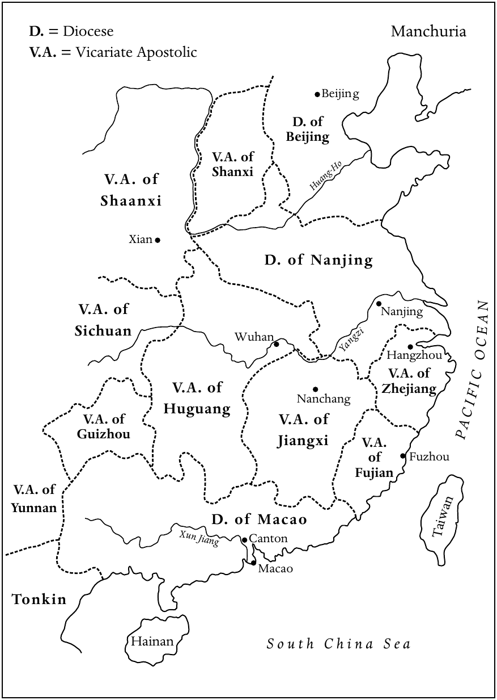

**地图4　约1696年的中国**

图例：D.〔Diocese〕表示教区；V.A.〔Vicariate Apostolic〕表示宗座代牧区；N表示北方。

| 原图标注 | 中文 |
| --- | --- |
| Manchuria | 满洲 |
| Beijing / D. of Beijing | 北京／北京教区 |
| V.A. of Shanxi | 山西宗座代牧区 |
| Huang-Ho | 黄河 |
| V.A. of Shaanxi | 陕西宗座代牧区 |
| Xian | 西安 |
| Nanjing / D. of Nanjing | 南京／南京教区 |
| V.A. of Sichuan | 四川宗座代牧区 |
| Wuhan | 武汉 |
| Yangzi | 长江 |
| Hangzhou | 杭州 |
| V.A. of Zhejiang | 浙江宗座代牧区 |
| Nanchang | 南昌 |
| V.A. of Huguang | 湖广宗座代牧区 |
| V.A. of Jiangxi | 江西宗座代牧区 |
| V.A. of Guizhou | 贵州宗座代牧区 |
| V.A. of Fujian | 福建宗座代牧区 |
| Fuzhou | 福州 |
| V.A. of Yunnan | 云南宗座代牧区 |
| D. of Macao | 澳门教区 |
| Xun Jiang | 浔江 |
| Canton | 广州 |
| Taiwan | 台湾 |
| Macao | 澳门 |
| Tonkin | 东京〔越南北部〕 |
| Hainan | 海南 |
| South China Sea | 南海 |
| PACIFIC OCEAN | 太平洋 |

<!-- PDF page 476; original page 461 -->

至于在华耶稣会士，他们远非一个同质群体。宫廷耶稣会士与在各省活动的会士之间，早就存在区别。首批法国耶稣会士抵达北京后，情况更加复杂。路易十四为把自己的影响扩展到东亚，于1687年派六位法国耶稣会士来到中国。他们都受过良好科学训练，拥有“王室数学家”（Mathématiciens du Roy）的头衔。他们成功地向康熙皇帝展示技艺，因此获赐皇城内的一块土地，后来著名的北堂就建在这里。[^p476-13]

然而，法国会士与受葡萄牙支持、在钦天监工作的耶稣会士之间，很快发生冲突。这既是国家利益的冲突，也是争夺科学影响力的竞争。[^p476-14] 这场冲突导致法国耶稣会传教团，于1700年11月脱离葡萄牙耶稣会副省。

### 迫害与恢复的时期

1645年，顺治皇帝任命耶稣会士汤若望为钦天监负责人，似乎表明新政权已经接纳传教士和基督教。一段时期内，宫廷耶稣会士的地位所带来的声望，为神父与归信者提供了一定保护。然而，杨光先发动所谓“历狱”，结束了这段相对平顺的时期。他曾多次企图罢免掌管钦天监的外国人，此后同时攻击基督教与西学。1664年9月，他的奏报使年幼康熙皇帝的辅政大臣相信，汤若望不仅犯下多项天文错误，耶稣会传教士还在策划叛乱，以错误观念蛊惑民众。

经过长期调查，汤若望与钦天监七位官员被判死刑，其中五位官员是基督徒。汤若望虽获赦免，基督徒官员却于1665年被处决。多数传教士被囚禁在广州，各省教堂被关闭。

历狱由多种因素造成，其中一些在杨光先发起攻击以前，就已暗中积累。例如，耶稣会士之间的个人竞争、宫廷亲基督教与反基督教派别之间的紧张，以及被汤若望取代的穆斯林天文学家的怨恨。这一事件标志着对西学的第一次全面攻击。判决之后，1669年又首次禁止在汉人臣民中传播<!-- PDF page 477; original page 462 -->基督教。1671年，对天主教传教的压制部分解除，但附加条件是，传教士不得发展新信徒或修建新教堂。康熙皇帝再次赐予宫廷传教士个人恩惠，包括一块题有“敬天”二字、可在所有教堂悬挂的匾额。一方面似乎受到皇帝保护，另一方面又被禁止进一步传播，这使1671至1691年的局面变得含糊。杜鼎克将之称为“默许”。[^p477-15]

所谓1692年《容教诏令》，同样具有这种含糊性。传教士因铸造火炮，并在与俄国的谈判〔1689年《尼布楚条约》〕中提供帮助，获得这道诏令作为奖赏。诏令确认，基督教没有表现出煽动叛乱的性质，因此不必禁止。基督徒与获准拥有寺观、焚香礼拜的佛教徒和道教徒，被置于同等地位。只要基督徒服从儒家的国家正统，不制造事端，就应允许他们在礼拜场所举行自己的仪式。

然而，诏令并未提到进一步传播基督教，或修建新教堂。联系随后发生的事件来看，《容教诏令》只是“转瞬即逝的一刻……一种理想，立即被争议、不断的失望、主张与反主张所包围”。[^p477-16]

### 礼仪之争加剧

《容教诏令》带来的不确定性，恰与欧洲传教士之间影响深远的礼仪之争达到高潮相重合。这场争论始于利玛窦的适应政策，主要涉及耶稣会与托钵修会，但绝不局限于两者，包含三个不同问题。第一，是所谓“译名问题”，也就是如何用中文表达上帝之名及其他重要概念。第二，是应否禁止基督徒参加尊孔与祭祖仪式。最后，是应否允许基督徒参与那些包括敬奉非基督教神灵的社群活动。

法国教区神父、福建宗座代牧颜珰，以1693年的训令攻击耶稣会对中国礼仪的立场，使两个阵营的冲突加剧。训令谴责耶稣会的做法，<!-- PDF page 478; original page 463 -->拒绝用“上帝”〔意为“在上之主”〕和“天”来称呼基督教的神。罗马经过长期商议，教皇于1704年11月20日颁布反礼仪敕令《Cum Deus optimus》，禁止使用“天”和“上帝”，批准使用“天主”〔意为“天之主”〕。同时，基督徒被禁止参加祭孔与祭祖。教皇特使铎罗（Charles Thomas Maillard de Tournon）把罗马的决定带到中国。然而，1706年7月他觐见康熙皇帝的情况很不顺利。恼怒的康熙随即命令，所有传教士若要获得留华的皇帝许可“票”，都必须声明遵守“利玛窦的规矩”。铎罗则针锋相对，制定一套规则，精确规定传教士应如何回答皇帝问题，威胁对不服从者施以绝罚，不给任何解释余地。最后，1715年的宗座宪章《Ex illa die》，重申了1704年教皇诏书的规定。

1721年，教皇特使嘉乐（Carlo Ambrogio Mezzabarba），批准了反对教皇敕令者所提出的八项“让步”，使冲突更加复杂。但罗马后来撤销了这些让步。1742年的宗座宪章《Ex quo Singulari》，以制裁强化教皇敕令，并要求所有赴华神父，必须宣誓遵守。宪章最终裁定反对中国礼仪，实际上结束了争论。由于这一决定从根本上挑战中国人的信念，并被视为对中国社会秩序的威胁，它常被看作基督教在中国“失败”的主要原因之一。克勉十四世于1773年解散耶稣会，这一决定于1775年在中国公布，可以视为这场漫长争端的尾声。

孟德卫指出：“对礼仪之争的解释，可以放在两个极端之间的光谱上。一个极端将礼仪之争视为近代早期中西文化关系史的分水岭；另一个极端则把它视为纯粹的欧洲事务，在试图从中国人的视角理解中国基督教历史时，可以轻易略去。”[^p478-17] 从传教士角度出发，焦点集中在所谓“耶稣会”与“道明会”立场的鲜明分界，中国归信者的作用却在很大程度上被忽略了。“他们通过书籍、小册子、抗议信等等参与争论，显示他们确实深深扎根于一个礼仪占据重要地位的中国社会。”[^p478-18]

<!-- PDF page 479; original page 464 -->

### 1724—1815年基督教的压制与存续

从十八世纪初开始，中国对基督教的宽容日益受到质疑。事实上，1721年1月，康熙皇帝就表示希望禁止这种麻烦的信仰。然而，真正的禁教诏令，直到雍正皇帝即位后不久的1724年1月才颁布。除了在宫廷工作，或设法藏匿于各省的人员以外，外国传教士都被驱逐到广州，后来又被赶往澳门。城市教堂逐渐关闭，改作庙宇、粮仓、学校或其他公共设施。

最初，并没有对中国基督徒或在各省秘密工作的传教士展开大规模迫害，甚至不时仍有新传教士设法进入中国。第一次地方性迫害，似乎发生于1733年末的福建。十八世纪余下的时间里，地方迫害时有发生，但“通常随后会有一段相对平静的时期，使人有机会恢复”。[^p479-19] 只有1740年代末和1780年代中期的迫害，可以称为大规模反基督教行动。不过，敌对氛围从长远上，还是迫使天主教逐渐退入中国偏远农村。

关于外国传教士在满洲人统治的帝国中所做的工作，已有大量著述，本土基督徒的贡献却往往只被顺带提及。然而，仔细考察中国传教史就会发现，从一开始，中国基督徒对于基督教在本国的引入、保存和后来的扩展，都至关重要。欧洲传教士极其稀少，中国幅员广大，外国神父又面临许多社会和语言问题，罗马因而很快认识到培养本土教士的重要性。早在1659年，传信部就指示新任宗座代牧，培养能够诵读拉丁文的本土神父，即使他们并不理解其意义也可以。

1666年，巴黎外方传教会在暹罗首都阿瑜陀耶开设一所中央神学院，培养中国、越南及其他东亚地区的神职人员。1767年，缅甸人入侵暹罗首都，神学院先迁到越南河仙附近的洪达（Hon-dat），不久又迁至法属印度本地治里附近的维兰帕特南，直到1781年关闭。1807年，巴黎外方传教会又在马六甲海峡的槟榔屿设立新神学院；该地自1786年起属于英国。

<!-- PDF page 480; original page 465 -->

1724年以后，鉴于中国天主教会越来越不安全，神职训练继续主要在帝国之外进行，许多中国人被送往欧洲。传信部传教士马国贤，于1732年在那不勒斯创立耶稣基督圣家学院，以培养中国教区神父。耶稣会也把一些中国人送往欧洲，在罗马的耶稣会学院，或巴黎的路易大帝学院学习。其中一些人加入耶稣会，再以神父身份返回中国。此外，少数中国教士由西班牙王室出资，在马尼拉接受道明会训练。

然而，长期在欧洲，甚至在暹罗和澳门受训，造成文化上的失根，使这些新神父很难重新融入中国社会。他们逐渐失去说写中文的能力，与自己的文化产生疏离。十八世纪末，虽然形势不稳，人们仍开始试探在中国境内培养本土教士。不过，由于训练费用高昂，以及外国传教士对培养中国教士存在一定保留，本土神父的数量仍相对有限。例如，1740年代末，在广大的四川省，为众多基督徒社群服务的，只有出色的李安德（Andreas Ly）一位神父。事实上，正是他于1764年创立四川第一所本土神父神学院；这也是整个中国内地的第一所。

外国与本土教士都很稀少，传教事业于是逐渐依靠不同类型的中国平信徒人员，管理本地教会事务，保存并扩展信仰。可以区分三类平信徒领袖：男性巡回教理传道员、本地会众领袖〔会长〕，以及特别重要的一类独身平信徒女性，她们所构成的“贞女制度”。

“贞女制度”值得特别注意。传统中国社会严格的男女隔离习俗，使向女性传福音成为天主教传教士面临的特殊挑战。女性虽然常在整个家庭的归信中发挥关键作用，但中国礼俗使外国或中国神父，几乎都不可能与她们直接接触。十九世纪中叶中外条约签订以前，建立正规的天主教女子修院也不现实。因此，被称为“贞女”的本土平信徒女性，成为在中国妇女中传播与保存天主教信仰的关键力量。她们活动的最早证据，来自十七世纪的福建；西班牙道明会士在这里引入了菲律宾形成的虔修女子制度。在一定<!-- PDF page 481; original page 466 -->程度上受到福建经验影响，巴黎外方传教会神父，于1740年代在自己的传教区建立贞女制度。

在这套制度下，独身女子把一生奉献给上帝与传教事业。她们通常发私人贞洁愿，继续与家人同住，在家中教导妇女和儿童。在四川，她们也参与对外传福音和照顾被遗弃的女孩。有关这类女子培养品格、发展宗教生活及基督徒美德，尤其贞洁的规则，于1784年获传信部批准，并由1803年四川教区会议进一步完善。这些规则一直施行到二十世纪。因此，贞女对于使徒事业的重要价值，得到了承认。实际上，在迫害时期，她们成为广大亲族网络和本地基督徒社群中的信仰支柱。

### 中国的非天主教基督徒

虽然中国的基督教化主要由罗马天主教徒承担，但也必须简要提到，1660至1815年间相当边缘的俄罗斯东正教与新教活动。俄罗斯驻北京传教团成立于1727年，为来自雅克萨的俄罗斯战俘及其后代提供牧灵照顾。俄罗斯东正教会更重视政治外交、商业，以及后来的科学活动，而非传福音。此外，俄罗斯教士不像天主教神父那样终身留在中国，而是在十年后回国。他们的教会始终规模很小，只有少数俄罗斯成员。

这一时期的新教传教活动，几乎没有多少值得记述之处。在中国传播福音的第一次新教尝试，于1660年代结束：忠于明朝的郑成功将荷兰东印度公司逐出台湾。直到1807年，伦敦会的马礼逊来到广州，才开始较为持久的新教传教工作。

到十九世纪初，经过近一个世纪时断时续的迫害，基督教在中国已经降为边缘宗教。然而，1800年以后，中国政府再次努力根除这种仍被它视为危险的信仰。1805和1811年的迫害，不仅针对某些外国神父，也针对北京的基督徒社群，包括其中的满洲人。此前，由于为他们服务的西方人在<!-- PDF page 482; original page 467 -->宫廷任职，这个社群还享有一定自由。在其他地区，四川宗座代牧徐德新（Gabriel-Taurin Dufresse），于1815年被斩首。

不过，1800年前后基督教事业的艰难处境，并非仅由中国内部的发展造成。西班牙与葡萄牙国力衰落、1773年耶稣会解散，以及法国革命的影响等外部因素，都使天主教欧洲的传教精神减退，经济支持下降，显著削弱了在华传教事业。获指定接续被取缔耶稣会工作的遣使会〔也称文生会〕，虽然于1784年派出首批赴华传教士，但到1820年，总共只有二十八名遣使会神父来到中国。巴黎外方传教会的在华人员也在减少；没有理由相信，意大利方济各小兄弟会或西班牙道明会负责的宗座代牧区，会有不同情况。中国的基督教事业在1815年已经陷入低谷。

## 日本：“秘密”基督徒的存续

1600年关原之战以后，德川幕府的建立，很快结束了日本的“基督教世纪”。第三代将军〔军事统治者〕德川家光，彻底禁止基督教，推行锁国政策，以强化幕府体制。对外关闭国门，意在防止传教士偷渡入境，阻断任何来自海外的基督教影响，从而根除基督教。在基督教已经扎根的九州岛，1637至1638年岛原之乱以后，日本基督教遭受了最严重的打击。

起义过后，1640年，江户〔今东京〕设立了一个审查基督教事务的机构，由专任官员负责，任务是消灭所有残存基督徒，从全国清除这种外来信仰的最后痕迹。该机构设有一座监狱，称为“切支丹屋敷”（Kirishitan yashiki）。被捕的传教士和有影响力的基督徒，在这里受到审讯、酷刑，或被监禁直到死亡。这个审查机构一直不间断地运作到1792年。

大约十五万名日本归信者转入地下，以躲避严酷迫害。政府采用各种手段，摧毁这些<!-- PDF page 483; original page 468 -->“秘密基督徒”〔潜伏切支丹，senpuku Kirishitan〕。这些手段包括奖励告发基督徒者，并结合“五人组”（gonin-gumi）制度：每五户组成邻里小组，对成员的行为相互负责。审查机关还引入每年年初举行的“踏绘”（efumi）仪式，即踩踏代表基督或圣母玛利亚的图像，以此根除外来宗教。最后，监督宗教事务与调查颠覆性教派的责任，被交给佛教僧侣。每户都必须在佛寺登记，取得寺院证明。这些措施结合起来颇有成效，导致十七世纪中叶发生数次大规模逮捕和惩罚，被称为“崩”（kuzure，意为“崩塌”）。这些根除基督教的制度，一直保留到十九世纪后半叶幕府统治结束。

尽管政府严密调查，地下基督徒仍设法在少数地方存续，主要是长崎地区及附近一些小岛。在没有神父的情况下，外国神父于锁国以前，在本地归信者中建立的各种善会与兄弟会，如今“构成了社群的宗教核心”。[^p483-20] 基督徒社群无法公开使用自己的信仰图像，就采用佛教形象，例如怀抱婴儿的子安观音，或慈母观音，来代替玛利亚像〔玛利亚观音〕。这样，地下基督徒的信仰重心，逐渐从作为严父与审判者的上帝，转向充满无限温柔、宽恕子女的母亲玛利亚。

这一趋势，也见于地下基督徒自己编纂、唯一传世的教义文本《天地始之事》〔意为“关于天地创始之事”〕。它的主题包括天地创造、天使与人类堕落、玛利亚、基督生平和世界终结。这个文本“把基督教教理材料与祷文，同丰富的本土传统和信仰混合起来，是文化适应的典型例子：基督教讯息在日本扎根，开出了一朵异样的花”。[^p483-21]

1640年以后，确有少数外国传教士试图进入日本，但没有成功。1708年，意大利神父乔瓦尼·巴蒂斯塔·西多蒂，由一艘船送到九州近海的一座岛上，几乎立刻被捕，押往江户，囚禁于切支丹屋敷，并由著名儒学家新井白石审讯。新井在1710年1月8日的报告中指出：“当那些〔基督教〕<!-- PDF page 484; original page 469 --><!-- PDF page 485; original page 470 -->国家的人，把教义传播到别的土地时，这并不是侵略阴谋，这一点很清楚。然而，一旦这种教义开始兴盛，那个国家就会自然出现叛逆臣民；这也是不可避免的自然结果。”[^p485-22] 不过，锁国时期这位最后的传教士意外来到日本，重新激发了日本人对西方文明的兴趣。虽然基督教宗教与文明仍被谴责为邪恶而具有颠覆性，新井白石却认识到了西方科学的实用价值。实际上，他虽然拒绝基督教，却成为热心的西学倡导者。他关于西多蒂的报告，有助于幕府改变政策，允许进口耶稣会传教士用中文撰写的西方科学书籍。

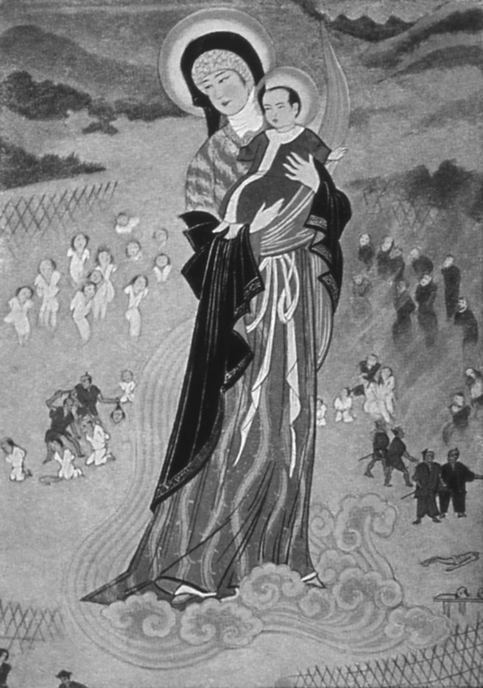

**图9　《日本殉道者的主保圣母》。** 这幅二十世纪早期日本画家长谷川路可（Lukas Hasegawa）所作的绢本画，反映了日本地下教会对圣母的重视。她的面貌与服饰在这里已经适应日本风格，背景景物中可以看见殉道的日本基督徒。照片藏于爱丁堡大学非西方世界基督教研究中心的巴特勒收藏。

1700年以后，反基督教迫害的强度虽然逐渐减弱，但日本基督徒仍不时被发现。迟至1790年代，长崎浦上仍发生一次“崩”；1805年，天草地区〔属肥后藩，今熊本县的一部分〕又发生一次，五千多名地下基督徒被捕。即使完全隔绝、备受迫害，信仰仍在九州偏远山村和渔村中世代相传，确实非同寻常。德川幕府末期，隐匿基督徒（Kakure Kirishitan）正是在这里重新出现。

## 朝鲜：自行传福音的教会形成

朝鲜天主教早期历史，是没有传教士介入而建立教会的独特例子。十六世纪末与十七世纪，虽有少数外国传教士试图进入朝鲜，包括1593至1595年以随牧身份伴随日军的西班牙神父格雷戈里奥·德塞斯佩德斯，但这些接触似乎没有产生后果。

更重要的是，十七世纪末和十八世纪，朝鲜儒家学者把天主教思想带了进来。朝鲜国王按惯例，每年派使团前往北京，向中国皇帝致意并呈献贡品。某些使团成员接触到耶稣会传教士；后者已经用中文写成解释西方科学与天主教宗教的著作。多年来，使团成员把许多此类作品带回朝鲜，包括利玛窦的《天主实义》与庞迪我的《七克》。到<!-- PDF page 486; original page 471 -->十八世纪初，朝鲜理学士人中形成的实学派成员，已经开始研究这些作品。尤其著名学者李瀷（1682—1763），从耶稣会出版物中，认识到一种可以与儒学相容的智慧与伦理体系。但他对传教士著作中明显的宗教成分持怀疑态度，他的一些门徒后来甚至要求采取行动，反对外来宗教。

虽然天主教总体上受到负面回应，但南人派精英中，仍有少数追随李瀷思想的人，更认真地对待这一信仰。他们精通儒家思想，深切信奉儒学，希望在天主教中找到办法，纠正停滞的朝鲜王朝日益加重的政治与社会腐败。这个群体包括权哲身、丁若镛、丁若铨、丁若钟三兄弟，以及权日身和李檗。李檗深受所读作品感动，便请1783年赴中国宫廷使团的成员、自己的姻亲李承薰，进一步了解基督教。李承薰拜访北京的外国神父时，接受天主教教导，并领受洗礼。

1784年春，李承薰带着书籍与宗教物品返回朝鲜，与其他热心“传福音者”一起，向亲友宣讲福音，使许多人归信。同年，李檗写成朝鲜基督教著作《圣教要旨》。

这些早期归信者，根据自己对中国教会的了解，于1784年建立第一个朝鲜天主教会。这个教会围绕“平信徒司祭”制度组织起来，尊重传统家长制家庭体系与祭祖，因而使早期朝鲜教会形成一种以家庭为基础的运动。唐纳德·贝克近来提出，最初的归信者“利用共同的哲学关切，以及与其他南人派成员之间的政治和婚姻关系，传播自己的宗教”。多数归信者，是“被自己信任的某位亲属或朋友，说服相信天主教教义与伦理实践的优越性”。[^p486-23]

对于早期朝鲜天主教徒而言，儒家价值与思维方式，在解释某些基督教教义时具有关键作用。例如，信徒复活与永生等基督教教义，与儒家有关祖先的信念和实践相呼应。实际上，对于早期朝鲜天主教徒，为亡故父母举行的基督教追思礼，与祭祖有关的仪式实践相似。

<!-- PDF page 487; original page 472 -->

李檗周围的亲友圈，虽然能够调和儒家与天主教的信仰和实践，但绝大多数朝鲜士人始终坚决反对天主教。北京主教汤士选（Alexandre de Gouvea，1751—1808）传来指示，禁止朝鲜教会任命“平信徒司祭”，也禁止天主教徒参加祭祖仪式，使局势进一步恶化。这产生了悲剧性后果。尹持忠〔保禄〕按照汤士选的指示，焚毁母亲的神主牌位，因违背儒家传统，于1791年12月8日被处决。一些重要归信者随即退出教会；然而，朝鲜正祖总体上实行宽容政策，信徒总数仍继续增长。到十八世纪末，朝鲜归信者已超过一万人。

不过，正祖于1800年突然去世，他的宽容政策也随之结束。国王的正式服丧期一结束，1801年辛酉教难就开始了。在迫害中，可能有多达三百名天主教徒死于正式处决，或因酷刑伤势而死。中国神父周文谟〔圣名雅各伯〕于1794年秘密进入朝鲜，承担朝鲜基督徒的领导，于1801年被处决。李承薰虽然多年前已经公开放弃信仰，仍被斩首。

其他遇害的重要基督徒中，还有黄嗣永。迫害开始时，他藏身乡间，写信给北京的汤士选主教。在这封著名的“帛书”中，他详细叙述迫害，请求西方军事援助，以拯救身陷重围的天主教徒，并迫使朝鲜政府准予宗教自由。这封信被截获，导致朝鲜政府对天主教徒的官方政策发生变化。此前，当局主要把天主教看作思想与道德威胁，力图加以压制；1801年以后，他们开始将之视为对朝鲜政治独立更加严重的威胁。然而，面对十九世纪最初几十年猛烈的反基督教运动，这个自行传福音的朝鲜教会，不仅存续下来，而且继续发展。

### 译校说明

本章关于西班牙国王的几处叙述，将1744、1745年教皇诏书的支持者，以及1752、1757年王令的颁布者，写作“费尔南多四世”（Ferdinand IV），序号依原书保留。教廷礼仪敕令与宗座宪章保留拉丁文原名，以便检索。

<!-- PDF page 488; original page 473 -->

<!-- PDF page 489; original page 474 -->

## 注释

[^p467-1]: Arthur Leonard Tuggy, The Philippine Church: Growth in a changing society (Grand Rapids, MI: Eerdmans, 1971), p. 48.

[^p467-2]: 同上，pp. 50–1。

[^p468-3]: Charles J.-H. Macdonald, ‘Folk Catholicism and pre-Spanish religions in the Philippines’, Philippine studies, 52 (2004), pp. 83, 88, 89.

[^p468-4]: Reginald D. Cruz, ‘“Devotion and defiance”: Religious communities for women established in colonial Philippines prior to 1750’, in Anne C. Kwantes (ed.), Chapters in Philippine church history (Manila: OMF Literature, 2001), p. 36, note 3.

[^p469-5]: Nick Joaquin, ‘The Beatas of 17th-century Manila’, in Joaquin, Culture and history: Occasional notes on the process of Philippine becoming (Manila: Solar, 1988), p. 121.

[^p469-6]: Luciano P. R. Santiago, ‘The development of the religious congregations for women in the Philippines during the Spanish period (1565–1898)’, Journal of Sophia Asia studies, 12 (1994), p. 53.

[^p470-7]: 见 D. Gerona, ‘In defence of the natives: The church in the midst of colonial abuses (1600–1790)’, Ateneo de Naga University, 16 August 2003, http://www.adnu.edu.ph/MainWeb/research/art02.html。

[^p471-8]: 关于巡视权争论，参见 Horacio de la Costa, ‘Episcopal jurisdiction in the Philippines during the Spanish regime’, in Gerald H. Anderson (ed.), Studies in Philippine church history (Ithaca: Cornell University Press, 1969), pp. 44–64。

[^p471-9]: Pablo Fernandez, History of the church in the Philippines (1521–1898) (Manila: National Book Store, 1979), pp. 112–13.

[^p472-10]: John N. Schumacher, ‘Syncretism in Philippine Catholicism: Its historical causes’, Philippine studies, 32 (1984), p. 257.

[^p472-11]: Salvador P. Escoto, ‘The ecclesiastical controversy of 1767–1776: A catalyst of Philippine nationalism’, Journal of Asian history, 10 (1976), p. 105.

[^p474-12]: 参见 Joseph de Moidrey, La hiérarchie catholique en Chine, en Corée et au Japon (1307–1914) (Shanghai: T’ou-sè-wè, 1914) 中相关地图。

[^p476-13]: Claudia von Collani, P. Joachim Bouvet S. J. Sein Leben und sein Werk (Nettetal: Steyler Verlag, 1985), pp. 11–17.

[^p476-14]: Catherine Jami, ‘For whose greater glory? Jesuit strategies and science during the Kangxi Reign (1662–1722)’, in Wu Xiaoxin (ed.), Encounters and dialogues: Changing perspectives on Chinese–Western exchanges from the sixteenth to eighteenth centuries (Nettetal: Steyler Verlag, 2005).

[^p477-15]: Ad Dudink, in Nicolas Standaert (ed.), Handbook of Christianity in China, vol. 1: 635–1800 (Leiden: Brill, 2001), p. 515.

[^p477-16]: Jonathan D. Spence, ‘Claims and counter-claims: The Kangxi emperor and the Europeans (1661–1722)’, in D. E. Mungello (ed.), The Chinese Rites Controversy: Its history and meaning (Nettetal: Steyler Verlag, 1994), p. 15.

[^p478-17]: D. E. Mungello, ‘An introduction to the Chinese Rites Controversy’, in Mungello (ed.), Rites Controversy, pp. 4–5.

[^p478-18]: Nicolas Standaert, ‘Rites Controversy’, in Standaert (ed.), Handbook of Christianity in China, p.685.

[^p479-19]: Kenneth Scott Latourette, A history of Christian missions in China (London: SPCK, 1929), p. 156.

[^p483-20]: Christal Whelan, ‘Introduction’, in Whelan (trans.), The beginning of heaven and earth: The sacred book of Japan’s hidden Christians (Honolulu: University of Hawaii Press, 1996), pp. 9–10.

[^p483-21]: Stephen Turnbull, ‘Acculturation among the Kakure Kirishitan: Some conclusions from the Tenchi Hajimari no Koto’, in John Breen and Mark Williams (eds.), Japan and Christianity: Impact and responses (Basingstoke: Macmillan, 1996), pp. 63–74.

[^p485-22]: 转引自 George Elison, Deus destroyed: The image of Christianity in early modern Japan (Cambridge, MA: Council on East Asian Studies, Harvard University, 1988), pp. 237–8。

[^p486-23]: Don Baker, ‘A Confucian confronts Catholicism: Truth collides with morality in eighteenth century Korea’, Korean studies forum, 6 (1979–80), p. 6.

---

<!-- PDF page 490; original page 475 -->

# 第二十四章　基督教与其他世界宗教的相遇

**安德鲁·C.罗斯（Andrew C. Ross）**

随着西班牙和葡萄牙海外帝国的开辟而开始的大规模基督教传教事业，到1660年已进入全盛阶段。这项事业由各修会承担，早期尤其是道明会和方济各会。由于传教活动与伊比利亚帝国扩张紧密相连，也由于这两个帝国的“收复失地运动”传统，基督教与其他宗教的相遇，被理解为一种征服。有些参与传教的人很快认识到这是一个问题，少数人努力使基督教摆脱作为基督教世界扩张之精神翼的角色，但成效有限。

原书记为1542年创立的耶稣会，为这一局面带来一个充满活力的新因素。耶稣会以惊人的速度成为领先的传教团体，到1600年，其一千名成员中，已有一半在欧洲以外工作。

1622年，教皇设立传信部，进一步支持耶稣会将传教与西班牙、葡萄牙扩张相分离的努力。这个新部门的目的，是监督罗马天主教会的传教活动，使之不受葡萄牙和西班牙王室保教权〔分别称Padroado Real与Patronato Real〕的限制。这些与教廷达成的协定，赋予葡萄牙和西班牙王室对欧洲以外教会的广泛控制权。在这一时期的天主教传教中，王室与教皇争夺教会全球传教权威的冲突，始终存在，并构成阻碍。尽管有这些问题，1500至1740年间，天主教仍在欧洲以外大规模扩展。

这一扩展带来了与其他宗教的冲突，但也使基督教与另外两个宗教传统——印度教和儒家——开展富有成效的互动。基督教与儒家的关系，促使某些历史学家认为，这场传教努力的最高点，是1692年3月：那时，中国清朝最伟大的皇帝康熙，<!-- PDF page 491; original page 476 -->在北京颁布有关基督教的诏令。实际上，这道诏令给予基督教的帝国承认，与数百年前佛教所获承认相同；受到承认的，是依照耶稣会先驱利玛窦亲儒传统实践的基督教。同一时期，在南印度，耶稣会也领导着基督教与印度教之间类似而富有成效的互动。

我们稍后会回到这些地区，并讨论其意义。1660年，与儒家、印度教和佛教的相遇，对西方基督徒而言，都是比较新的经验。但伊斯兰教并非如此。除犹太教外，伊斯兰教是与基督教互动历史最长的宗教传统，因此值得首先考察。

## 基督教与伊斯兰教

1660年，自格拉纳达陷落以后，西欧境内已没有穆斯林政治势力。在西欧人看来，伊斯兰教主要意味着强大的奥斯曼帝国对自身安全构成的威胁。1683年，奥斯曼军队兵临维也纳城下，证实了威胁确实存在。不过，这场戏剧性事件之后不久，奥斯曼力量进入衰退期，信奉天主教的奥地利和信奉东正教的俄罗斯，都开始在军事上对土耳其人取得重大进展。这些冲突塑造了十八世纪基督徒与穆斯林的关系。因此，应把这种关系理解为两个敌对强权之间的关系，而不是一种宗教与另一种宗教的关系。在欧洲天主教与新教社群的民众想象中，穆斯林通常以巴巴里海盗或奥斯曼禁卫军士兵的面貌出现。

不过，在十六世纪和十七世纪初，拉丁基督教与伊斯兰教之间，确实曾有过真正而有限的宗教接触。耶稣会作为全球传教工作的一部分，在波斯沙阿的宫廷和德里莫卧儿皇帝的宫廷设立传教团。通过这些接触，一些西方基督徒成为阿拉伯语与波斯语专家，尝试与穆斯林知识人开展某种对话，并撰写面向穆斯林读者的著作。然而，到1660年，这种对话式接触已经结束。最后一部用阿拉伯语或波斯语、认真向穆斯林解释基督信仰的著作，是艾梅·谢索神父于1656年所写的。不过，这项传教努力还是留下了一份重要遗产：人们如今同意，十字军战争与强迫归信的时代已经过去。

<!-- PDF page 492; original page 477 -->

这场与伊斯兰教接触却没有结果的传教经历，暴露了基督徒新做法中的两个主要缺陷。〔应当指出，在整个这一时期，伊斯兰思想家对基督教极为冷淡，所有接触都是由基督徒主动发起。〕第一个缺陷，是没有承认伊斯兰教本身就是一种独立宗教。整个时期，天主教作者和传教士，即使精通阿拉伯语与波斯语，也始终把伊斯兰教看作基督教异端，或对犹太教与基督教的混乱误解。如下文所见，这种认识也主导了新教思想。按照这种理解，伊斯兰教中好的东西，都是基督教的残余；坏的东西，则总是“骗子穆罕默德”的作为——这些作者通常这样称呼先知。

第二个缺陷，是对话一经开始，就始终采取知识论战的形式。人们鼓励穆斯林陈述对基督教的反对意见，然后逐一答复，证明伊斯兰教的虚假，并从穆斯林自身著作中揭示穆罕默德的罪过。这种方法，由十六世纪欧洲天主教与新教的交锋塑造；它既是不适当的模式，也忽视了圣托马斯·阿奎那早已强烈反对以论战方式对待伊斯兰教。[^p492-1]

到1650年代，当伊斯法罕和德里的传教努力似乎都已失败时，天主教会进入了一个在神学上漠视伊斯兰教的时期。这种天主教的冷漠，恰与伊斯兰教自身的思想停滞期重合，穆斯林学者称之为“停滞”（gumud）。[^p492-2] 因而，十八世纪两种宗教传统之间，没有重要交流。即使整个世纪都有相当多拉丁天主教神父住在穆斯林地区，也没有产生真正互动。

他们的任务限于照顾这些地区的基督徒奴隶、开设施药诊所，以及在有人询问时，只通过安静交谈，消除穆斯林询问者对基督信仰可能持有的误解。直到约1825至1850年间，天主教的传教关切和活动复兴，这一局面才开始改变。

奥斯曼帝国境内有许多非西方基督教会：希腊东正教、亚美尼亚教会、亚述教会、科普特教会和一性论派。然而，这些教会的存在，并未在这一时期促成基督教与伊斯兰教之间富有成效的相遇。奥斯曼帝国的内部政策，是让一切维持原状。在它统治下，每个基督教社群，即米勒特（melet），都由兼任世俗与<!-- PDF page 493; original page 478 -->宗教领袖的宗主教或总主教领导，专注于自身事务。可以理解，各米勒特领袖首先关心的是自己社群的生存，以及尽可能与奥斯曼当局保持良好关系。只要没有人试图改变现状，当局对古老基督徒社群的宽容程度，就非同寻常。到访奥斯曼帝国的西方基督教作者，无论天主教徒还是新教徒，都曾注意到这种宽容。伏尔泰等怀疑主义与自然神论作者，也对此给予好评，借以强调基督教的不宽容。这些后一类作者对伊斯兰教的赞许，有时被视为积极回应伊斯兰教的一部分；但对伏尔泰和多数其他人来说，事实并非如此。[^p493-3]

新教的传教关切，从十八世纪初的微小开端，发展为该世纪最后几十年和十九世纪最初几十年的重要运动，却没有产生与伊斯兰教之间任何重要或富有创造性的相遇。新教基督教与伊斯兰教很少直接接触。已有的接触，也多来自旅行者或外交官，而不是受过神学训练的人。

这一时期，讨论伊斯兰教的重要新教神学作者，是荷兰神学家与文人雨果·格劳秀斯。他的《论基督教的真实性》（De veritate religionis Christianae），拉丁文初版于1627年问世。由于作者声望很高、传播很广，这部书十分重要。它被译成英语与法语，十八世纪两种译本都多次重印。然而，格劳秀斯既不懂阿拉伯语，也从未直接接触伊斯兰教，却为新教公众塑造了一幅严重失真的伊斯兰教形象。他宣称，穆斯林“平信徒”不被允许阅读其圣书；伊斯兰教是暴力宗教，只通过战争扩展。此外，他像当时天主教作者一样，贬损先知的私人和公共生活。

另一部由新教徒撰写、讨论伊斯兰教且影响广泛的著作，是詹姆斯·波特于1768年出版的《土耳其人的宗教、法律、政府与风俗观察》。波特曾任英国驻君士坦丁堡大使，是一位杰出语言学家。他对伊斯兰民法的研究既准确，对西方理解伊斯兰教这一方面也具有开创性。然而，他的著述没有为基督教与伊斯兰教的宗教相遇，作出任何有意义的贡献。他断言《古兰经》对宗教无所助益，只是犹太教与基督教观念毫无意义的混杂，还把先知描绘为放荡的骗子。波特与当时少数确实<!-- PDF page 494; original page 479 -->接触过伊斯兰教的其他新教作者的作品中，可以看到对某些伊斯兰实践的赞许；这些作者都不是传教士，也不是教士。不过，仔细考察这些赞许，就会发现，它们只是批评罗马天主教某些虔敬与实践的概念工具，因为新教徒认为那些实践带有迷信或偶像崇拜性质。[^p494-4]

## 基督教与印度教

西方基督教首次接触后来被称为“印度教”的传统，是在十六世纪第一个十年，葡萄牙在印度沿海建立若干据点之时。基督教与印度教其实早在基督教历史最初几个世纪就已相遇，南印度的圣多马基督徒，也称叙利亚基督徒，正是见证。不过，这场相遇对西方基督教几乎没有影响。

葡萄牙人到来时，叙利亚基督徒社群已成为印度社会可以接受的一部分，并不试图向社群之外的人传教。实际上，他们就是一个种姓，遵循种姓内部通婚、接触低种姓成员后进行仪式性洁净等种姓规则。事实上，在大多数成员居住的喀拉拉，这个基督徒社群被当作最高种姓之一，地位仅次于婆罗门。[^p494-5]

随葡萄牙征服者到来的教士，最初把印度人看成两类：不是“穆斯林”〔他们的宿敌〕，就是“异教徒”。他们没有尝试研究或理解这种“异教信仰”采取什么形式。在葡萄牙几个小飞地内，许多非穆斯林印度人成为基督徒的方式，也意味着他们成为葡萄牙人。著名天主教历史学家亨利·贝尔纳—梅特，将这一过程称为“葡萄牙化”。[^p494-6]

真正开启西方基督教与印度教相遇的，是耶稣会传教士。西方后来所称的印度教，是一个由哲学，以及宗教、经济和社会实践组成的复杂体系，对它的理解发展缓慢。例如，东方耶稣会传教事业的奠基人方济各·沙勿略，在印度停留期间，并未直接接触印度教。果阿不过是东方的葡萄牙；后来，他在南方帕拉瓦人中工作，仍未直接接触印度教，因为在那里，他试图提高一个已经基督教化的社群的基督徒生活水平。

<!-- PDF page 495; original page 480 -->

耶稣会神父和其他传教士真正接触印度教时，感到深深困惑，因为此前没有任何可供借鉴、足以帮助他们理解它的知识经验。他们尝试运用希腊、罗马宗教知识，作为理解印度教的途径，但总体上没有成功。例如，种姓在宗教、社会与经济体系中的整体性作用，他们花了一段时间才开始意识到，更不用说理解。Hinduism〔印度教〕这个词，直到1830年代才普遍使用。印度教过去是、现在仍是一种社会制度、一种经济制度，也是复杂而多面的宗教体系；它所包含的实践与神学，从一神论延伸到相信几乎数不尽的众神，也包含多种显著不同的哲学学派。

十八世纪，“印度教”的思想与实践细节，在印度次大陆各地差别很大。出身贵族的意大利耶稣会士罗伯托·诺比里，开启了基督教与南印度泰米尔语地区印度教之间富有成效的相遇。[^p495-7] 1606年抵达印度时，他发现，印度基督徒被视为“帕朗吉”（parangi），也就是葡萄牙人或欧洲人；在葡萄牙控制区以外，成为基督徒，意味着与构成正常生活的一切断绝关系。在极为严肃的意义上，归信者不再是印度人。

例外是两个种姓之外的社群——帕拉瓦人和马库阿人。他们通过集体归信成为基督徒。这样，个别帕拉瓦人或马库阿人并未成为孤立个体，而是继续在家庭和社群中，过着可以接受的生活，尽管对其他印度人来说，这两个群体都已经成了帕朗吉。

诺比里前往马杜赖定居。那里是南方重要的印度教朝圣中心，也是泰米尔印度教文学和哲学活动中心。他不仅与葡萄牙人分开，也与马库阿及帕拉瓦基督徒分开，开始过出家苦修者（sannyassi）的生活，即高种姓、弃绝尘世的苦修者。他强调自己不是葡萄牙人，而是贵族出身，“一位罗马王公”。凭借这样的苦修者身份，他逐渐被接纳，成为婆罗门与其他高种姓印度人可以交往的对象。

他熟练掌握泰米尔语，也学习了梵语，即印度教基本经典所用的古典语言。教他梵语的婆罗门成为他的朋友。通过长期交谈，诺比里认识到，有些对理解印度教至关重要的书，自己此前一无所知。他说服朋友，让自己接触这些圣典。对这位婆罗门来说，这是危险的事，<!-- PDF page 496; original page 481 -->因为这些书不仅禁止外人阅读，也禁止所有不属于再生种姓的男子，以及所有女性阅读。泄露经典，可能受到严厉惩罚。如今，我们不知道诺比里具体读到了哪些文本，但他是第一个接触印度教核心部分梵文经典的欧洲人。这样，他便充分具备了条件，可以与婆罗门和其他高种姓者，开展真正的哲学与宗教讨论。

他确实慢慢使一些高种姓者归信。在克兰加诺尔主教同意下，他准许这些人继续佩戴种姓标志、遵守种姓习俗，继续参加许多家庭与种姓节庆，虽然不是全部。其他印度人认为，这些基督徒并未失去种姓身份，因此他们仍是印度社会的一部分。

随后，诺比里把目光转向南方印度教社会的其他部分。他通过一类新的宗教团体——潘达拉斯瓦米（pandaraswami）——接触占有种姓身份印度人大多数的这些人。其成员是耶稣会士，接受追求圣洁的苦修生活，同时遵从某类圣者的规矩。这类圣者能够与印度教社会其余部分交往，甚至在某些严格限制下，与种姓之外的人交往。同样，他们所带领归信的人，也获准保留足够多的本种姓习俗，使之不被看作帕朗吉。

葡萄牙当局不满这场运动明确与葡萄牙划清界限，其他修会的传教士则认为整个运动背叛了信仰。虽然耶稣会政策受到猛烈谴责，争端最终仍以有利于耶稣会的方式解决：额我略十五世在1623年的宗座宪章《Romanae sedis antistes》中，裁定诺比里的做法可以接受。有了这项支持，基督教与印度教之间真正的相遇继续发展，虽然地理范围有限。

到这一时期杰出的耶稣会潘达拉斯瓦米若昂·德布里托神父于1693年殉道时，南印度马杜赖、坦贾武尔、金吉和韦洛尔诸王国中，印度教化的基督徒，或基督教化的印度教徒社群，已占当地总人口的1%至2%。[^p496-8] 然而，一切即将改变。

诺比里最初为自己的立场辩护时，不仅援引自己认为可从教父神学中得到的支持，也提及同时代中国正在进行、由耶稣会同伴利玛窦启发的工作。到1700年，利玛窦使基督教融入儒家世界的政策，已经在罗马受到一段时间的猛烈攻击。[^p496-9] 就在此时，罗马收到一封来自印度科罗曼德尔海岸法国据点本地治里的正式申诉信。法国嘉布遣会士在信中提出三十六项指控，反对那些<!-- PDF page 497; original page 482 -->遵循诺比里传统的教会的实践。罗马此前已经决定，派拥有特别权力的特使铎罗前往中国，解决耶稣会对儒家政策的争议。实际上，他接到的指示，是通过谴责通常称为“儒家礼仪”（Mandarin Rites）的实践，并使之终止，来解决争议。嘉布遣会的申诉抵达罗马后，铎罗又奉命前往本地治里，同时处理这场印度争端。

铎罗在本地治里停留八个月，1704年7月才启程前往中国。他询问了大量证人，但对问题究竟理解多少，仍值得怀疑，因为他不懂任何印度语言，而且大部分时间卧病。1704年6月23日，他发布裁决，谴责罗伯托·诺比里开启的适应结构。而恰在同一时刻，殉道耶稣会潘达拉斯瓦米若昂·德布里托的列真福程序已经启动，使天主教会许多人认为，这套结构正在获得圣洁性的认可。

马杜赖传教区代理弗朗西斯科·莱内斯，曾以严密的学术论证捍卫诺比里立场，短暂带来获得宽免的希望，但宽免并未到来。圣职部认可了铎罗的决定。这个被不完全恰当地称为“马拉巴尔礼仪”的体系，又在1734年8月《Compertum》和1739年5月《Concredita nobis》两份教皇简函中，遭到正式谴责，任何不服从者都受到严惩的威胁。实际上，教廷正式把印度教降到一种地位，此后整个十八世纪，多数欧洲观察者，无论天主教还是新教，都持这种看法：印度教是偶像崇拜与堕落迷信的混合物。

就在危机发展之际，首批赴印度的新教传教士，来到南印度科罗曼德尔海岸的丹麦商馆特兰奎巴。虔诚的丹麦国王腓特烈四世，派遣海因里希·普吕乔与巴尔托洛梅乌斯·齐根巴尔格来此。齐根巴尔格立即投入泰米尔语学习，但似乎不知道已有大量这种语言的天主教书籍，直到在收集泰米尔语贝叶书时，才发现其中一些是基督教著作。

他的学习进展迅速，这位虔诚而正统的路德宗信徒，成为南印度印度教的权威。1713年，他写成研究扎实的《马拉巴尔诸神谱系》，寄往自己曾经求学的德国传教训练中心哈勒，希望在欧洲出版，帮助基督徒理解印度教。然而，哈勒负责人A.H.弗兰克的回应，却是把它放上图书馆书架，直到1860年代才重新被发现。弗兰克评论说，派遣传教士，<!-- PDF page 498; original page 483 -->是为了根除异教信仰，不是为了把他所称的“异教胡言”传播到欧洲。[^p498-10]

尽管哈勒的弗兰克持这种态度，南印度路德宗教会仍对印度文化抱有显著的同情理解，并且缓慢发展。通过丹麦和英国王室的影响，差会从基督教知识促进会获得重要经济援助。随着新路德宗社群成长，它在种姓问题上，对基督徒归信者作出重大让步。在礼拜与聚会中，教会作出安排，使占多数的首陀罗基督徒，尽管与相当数量的种姓外成员同属一个教会，仍能保持自己的种姓地位。

泰米尔文化也广泛融入教会生活。例如，圣诗采用不同形式的泰米尔诗歌与音乐。1809年，印度诗人韦达纳亚卡·沙斯特里，因用古典泰米尔“库拉万吉”（kuravanci）诗体，写成大量基督教主题诗歌而广受赞誉。这类诗歌在音乐伴奏下公开朗诵，泰米尔文学史家承认，它们对库拉万吉诗体作出显著贡献。同样重要的是，许多基督徒原本属于当地占主导地位的湿婆派印度教传统。每个湿婆派别，都有供公开朗诵和歌唱的特有主叙事诗，即“往世书”（purana）。沙斯特里的作品，在新的印度基督徒社群中承担了这一作用。[^p498-11]

无论如何界定这个新社群，它都具有明确可称为印度教的特征，其成员也肯定不是帕朗吉。同耶稣会传教一样，我们再次看到一种富有成效与创造力的基督教—印度教相遇，而不只是消极敌对关系。

南印度路德宗的发展，与新教基督教和印度教相遇的主要方式形成鲜明对照。后者主要发生于十九世纪，但其基础与风格，到1815年已经确定。然而，在有组织的新教与印度教大规模接触以前，一批用英语写作的学者，已经留下有关印度教的著述。他们名义上都是新教基督徒，多数是英国东印度公司的雇员。有一个重要例外，是杰出学者、苏格兰教会领袖、爱丁堡大学校长威廉·罗伯逊。

这些作者向西方基督教读者展现了印度教富有吸引力的一面。纳撒尼尔·哈尔赫德1776年的《印度教徒法典》，是这些以真实印度教文本为基础的英语著作中的第一部。十年以后，查尔斯·威尔金斯的《薄伽梵歌》英译本问世，这是第一部以欧洲<!-- PDF page 499; original page 484 -->语言出版的古典梵文经典。对印度文化兴趣的发展，促使一批具有学术修养的东印度公司文官，于1784年成立研究印度文化的团体——孟加拉亚洲学会。在该会期刊《亚洲研究》（Asiatik Researches）1789与1790年的前两卷中，琼斯爵士〔原书此处作Sir James Jones〕发表三篇同情理解印度教的开创性文章。不仅英国，西欧也有广大读者。

罗伯逊校长的《古人对印度认识的历史考察》（1791），到1804年已出四版，补足了这批同情印度的主要著作。罗伯逊与琼斯等人一样，赞赏印度社会和文化的许多方面，尤其其与过去之间长期延续、连穆斯林或欧洲征服者都无法打断的联系。罗伯逊从未到过印度，却为种姓辩护，描绘得仿佛是一种福利国家，至少也是一种使所有人获得社会稳定与相对繁荣的安排。讨论种姓时，他坚持认为：

> 民政制度的安排，不是为异常情况，而是为通常情况；不是为少数，而是为多数。印度最初立法者的目标，是采取最有效办法，保障他们所治理社群中全体成员的生计、安全和幸福。[^p499-12]

然而，琼斯、罗伯逊以及其他向西方描绘印度教社会正面形象的人，都一致厌恶许多印度教“宗教”，或有人所称的“民间印度教”。多数人坚持，某些实践可怕得无法叙述。在作这种区分时，他们与某些二十一世纪学者所做的相同：写作时仿佛可以把印度教“宗教”，与印度教社会关系和哲学，整齐而清楚地分开。但多数现代印度教学者，无论印度人还是欧洲人，都认为这种整齐划分难以维持。[^p499-13]

正如五十年前，自然神论者与反基督教知识人，利用耶稣会对儒家的热情，挑战《圣经》权威和基督教独特性；十八世纪最后四分之一个世纪，类似知识人也利用这些印度教哲学与社会赞赏者的著述，达到同样目的。不言而喻，这些作品并没有鼓励新一波福音派新教活动家，对印度教抱有同情理解，无论他们是否正式具有传教士身份。

为新教对待印度教的新方式定下基调的，是孟加拉塞兰坡浸礼派差会〔成立于1793年〕的威廉·沃德。应当指出，同差会其他成员一样，<!-- PDF page 500; original page 485 -->沃德鼓励归信者保留印度服装、饮食，甚至印度教名字。但在种姓问题上，塞兰坡传教士坚持，凡寻求洗礼者，都必须彻底放弃种姓。因此，他们拒绝了南印度路德宗的妥协。塞兰坡对种姓的态度，成为后来印度新教差会的标准立场；与此同时，这些后来的差会，总体上却不赞同塞兰坡热心支持归信者保留印度服装、饮食和名字的做法。

塞兰坡差会对新教基督教与印度教相遇的最重要影响，来自沃德的两部书：1811年出版的《印度教徒著述、宗教与风俗记》，以及原书记于1823年出版的《重返孟加拉时致英美几位友人的告别信》。两书多次重印，为新教与印度教的相遇定下总体基调。

沃德对当时孟加拉印度教实践与信仰的描述，并非不准确；但他不了解印度其他地区的印度教，而那些地方与他笔下的孟加拉差异很大。此外，他几乎不懂印度教哲学。根本问题是，沃德在印度教的任何方面，都找不到丝毫有价值之处。这与此前天主教和路德宗的基督徒形成鲜明对照。那些前辈至少能够像其中一人所说，在印度教中发现“一条散布于河床泥沙中的金粒痕迹”。面对认为印度教仍有某些善处的人，沃德反问：

> 一个民族，若其诸神都是恶行的怪物，其祭司是犯罪的首领，其经典鼓励骄傲、淫秽、虚假、复仇和谋杀，其礼拜与无法形容的可憎行径相连，其天堂就是妓院，又怎么可能有道德？[^p500-14]

不过，需要注意的是，对琼斯与罗伯逊大体肯定印度人、印度和印度教的态度，这时也出现了强烈反弹，来自一些可以称为世俗的作者。其中最重要的查尔斯·格兰特与詹姆斯·密尔，专门写作，反驳琼斯和罗伯逊作品中对印度教徒与印度教的正面看法。人们常指出，格兰特是一位热心的福音派基督徒；但就他有关印度的著述而言，重要之处在于，它属于反印度教反应的一部分，而这种反应，既源于福音派新教，也同样源于启蒙运动的“进步”观念。

密尔与格兰特对印度教的态度，代表了一种看待欧洲以外文化和宗教的新方式：按照这些现象在多大程度上促进或阻碍人民<!-- PDF page 501; original page 486 -->“进步”的尺度，来评价它们。格兰特认为，如果消除印度教，人民就能重新运用理性，在他所谓的“人类等级”中上升。詹姆斯·密尔是不知疲倦的功利主义福音倡导者；他既关心使英国人摆脱玷污英国社会的腐败，也关心使印度人摆脱在他看来，由婆罗门权威与权力所延续的无知。

这一时期支持传教和废奴的福音派新教，在思想上深受启蒙运动影响，尽管它也试图否定欧洲思想这一发展中的某些方面。启蒙影响之深，使多数新教徒，无论是否属于福音派，都逐渐共享一种历史与文化观。黑格尔所提出的，当时的欧洲代表历史的终点，概括了这种看法。在这种观点中，历史的开端与童年在亚洲，在西方才达到成熟；西方文化注定成为世界文化。[^p501-15] 到1815年，新教对印度教的态度，同时受到启蒙思想与福音派个人主义塑造，已经走上碰撞的道路，导向双方的反感与不信任。[^p501-16]

## 基督教与佛教

一部二十世纪末广泛使用的佛教教科书，宣称“佛教是在十九世纪上半叶，于西方被‘发现’的”。[^p501-17] 作者接着说明，当然，过去西方人与后来被西方称为佛教的传统，也有过接触。不过，这些“西方与东方模糊面貌相遇的零散记述”，只有在“佛教”被“建构”以后，才回头被认作与佛教有关。这对整个西方知识世界或许成立，但基督教与佛教真正的相遇，在十六、十七、十八世纪就已发生，主要在日本、中国和印度支那，后来也在泰国、锡兰及缅甸。

基督教与佛教接触时间最长的，是天主教传教团与日本、中国、印度支那佛教之间的关系。这始于方济各·沙勿略到达日本，以及当地天主教传教事业的建立。耶稣会逐渐形成一幅认识：一种来自印度的宗教传统，已经在中国、日本和印度支那扎根。他们没有全面勾画它在亚洲传播的范围，也不了解<!-- PDF page 502; original page 487 -->它的详细历史。不过，他们知道，这是一种在亚洲广大地区具有重要地位的主要宗教传统，而且起源于印度。

从十七世纪中叶起，耶稣会来自东方的通信，在西欧得到广泛阅读，新教徒与天主教徒都在读，但这些报告几乎没有增进西方对佛教的理解。部分原因是，在中国，耶稣会集中关注儒家；在日本，叙述的重点则是残酷镇压与英勇殉道。

然而，西方知识世界虽然花了很久，才认识到佛教究竟是什么，天主教传教士却肯定已经在日本、中国、印度支那和暹罗，认出它不是“东方模糊面貌”，而是一种强大、连贯的宗教传统。沙勿略在日本初次接触这一传统时，就准确描述了日本众多佛教宗派，并清楚理解：虽然它们的教导互相矛盾、实践与神学互有冲突，却属于同一宗教，其共同起源在其他地方。[^p502-18]

三十年后，耶稣会东方巡察使范礼安（1539—1606），按照禅宗修院的等级制度、饮食规则和礼貌方式，组织耶稣会在日本的成员与辅助人员。[^p502-19] 日本佛教僧侣的声望，使他印象极深。因此，在罗明坚和利玛窦开始在中国工作时，他鼓励两人穿近似佛教僧侣的服装。这样，他们既能表明自己是宗教教师，又能在服饰、饮食和举止上，放弃欧洲标准，遵从中国规范。

传教士是在中国，才认识到自己后来所称的“偶像崇拜者的宗教”起源于印度。尽管西方基督教已经在印度活动一百多年，天主教传教士除了在锡兰短暂接触外，并未在那里遇到佛教，他们仍然认识到了这一点。

天主教与日本佛教在外在形式上有许多相似之处，因此在沙勿略时代，两种信仰的追随者之间，曾发生过一些彼此同情理解的接触。然而，真正差异显现以后，最初的同情与表面一致，反而使双方更深地幻灭。再考虑到基督教传教的早期庇护者、独裁统治者织田信长（1533—1582），对佛教寺院团体怀有仇恨，就不难理解，为什么日本两种信仰的关系，会发展成不断争论和冲突的状态。在中国，双方关系也迅速<!-- PDF page 503; original page 488 -->变得完全消极。利玛窦理解中国社会的性质以后，先成为儒家经典的赞赏者，继而成为研究者，把中国基督教的未来，寄托于与儒家的互动。1595年起，在华耶稣会士放弃佛教式袍服，改穿帝国文人或学者官员的服装。这一强大阶层的多数成员，把佛教轻蔑地视为偶像崇拜式迷信，强烈影响了利玛窦与耶稣会传教团对佛教的态度。此外，至少在这个问题上，后来进入中国的所有其他天主教修会，也都同意耶稣会的立场。

基督教与佛教之间的这种对立，也出现在印度支那。那里与中国一样，基督教会对儒家更具同情理解，因为儒家是知识与政治精英的信仰或哲学。因此，虽然日本与佛教的相遇包含一些富有创造性的因素，整个十八世纪，基督教与佛教的关系仍然完全消极。新教传教事业的兴起，在1815年以前并未改变这一局面。

天主教传教士唯一积极的评价，是赞赏许多佛教平信徒的虔敬与热忱。这直接关联到一个有些人可能觉得不协调的现象：不少在印度支那和日本工作的传教士报告说，许多最热心的新基督徒，以前是虔诚佛教徒。原因可能在于，中国、日本和印度支那北部的各种佛教宗派，出自大乘传统，已经发展为个人救赎宗教的不同形式；其中最明显的，是非常流行的禅宗〔日本称Zen〕与净土宗。

因此，基督徒所遇到的佛教形式，在理解人类处境方面，比上座部佛教更接近基督教。后者在这里被作者视为较古老、原初的佛教传统，天主教传教士只在锡兰短暂接触过，后来才在十八世纪的缅甸与暹罗遇到。

## 基督教与儒家

前文已经提到，中国耶稣会传教事业始于1582年罗明坚与巴范济到来，随后很快由利玛窦（1552—1610）主导，开启了与儒家富有成效的相遇。虽然九、十世纪中国已有景教传教事业，中世纪也有方济各会士与马可·波罗来到中国，但西方基督教世界似乎一直不知道，中文所谓“儒家”或“儒教”，即“士人学派”，究竟是什么，直到<!-- PDF page 504; original page 489 -->罗明坚和利玛窦充满热情地开始介绍它。利玛窦通过翻译中国所称的经典，并把这一传统的核心教师孔夫子〔公元前551—前479〕的名字，拉丁化为Confucius，将孔子介绍给西方。

那么，“士人学派”是什么？有一种定义认为，它是一个思想传统，以持续解释普遍被认可为“经典”的中国著作为基础。几个世纪以来，人们不断讨论它究竟是宗教还是哲学；但也许最好先指出，早在中文出现“宗教”或“哲学”这些词以前，儒家就已被界定。

利玛窦相信，他所称的“原始儒学”，具有明确的一神论核心；但他也承认，自己所称的“新儒学”——由宋代注疏家界定、后来成为官方国家儒学的传统——从根本上是无神论的。无论当时还是后来，持这种看法的都不只有他一人。重要的是，在利玛窦看来，儒家道德无论古代还是当代形式，都与基督信仰的道德关切相容。他甚至坚持，相较于基督教已经吸收大量成分的西方古典文化，儒家道德更容易与之相容。

正因如此，他能够在《天主实义》中，运用儒家经典，帮助解释并论证基督教思想。这部重要著作，不仅参与奠定中国基督教的基础，也对朝鲜基督教的建立发挥了作用。

利玛窦最初是在范礼安坚持之下研究经典。通过这些研究，两人都同意，所有新来的欧洲耶稣会士，都应通过研读中国经典，学习中国的文学和行政语言〔原文称Mandarin，并以Classical Chinese，即文言文，解释〕。这样，他们不仅学习一种语言，也进入士人的思想世界。士人是凭学识选拔的精英阶层，在截至1900年的一千年间，实际上管理着中国。因此，传教士就能继续发展儒家与基督教的对话。到1660年，这种对话已经在中国产生了一种符合许多儒家规范的天主教。

中国的这一发展，与耶稣会同样率先推动的对日本文化的适应，存在显著差别。在日本，传教士在服装、饮食、礼貌、行为方式，乃至建筑上，遵从日本规范。利玛窦开启并从根本上塑造的中国基督教与儒家关系，却达到更深层次。基督教在思想表述与实践中吸收儒家成分，类似早期教会与<!-- PDF page 505; original page 490 -->希腊思想的互动。许多二十世纪后期的学者，更愿把这种互动称为“本地化”，而不只是“适应”。

方济各会与道明会神父最初来到中国时，对这一发展感到震惊，向罗马提出抗议。1645年，教皇因而发布一份似乎谴责利玛窦立场的训令。然而，在华耶稣会派代表团到罗马，对1645年训令提出申诉。亚历山大七世回应代表团，于1656年颁布敕令，准许中国的实验继续。需要注意的是，到1680年代，在中国长期服务的其他修会传教士，多数已经大体赞同利玛窦的立场。

究竟是什么，使最初的方济各会和道明会先驱如此震惊？许多中国人，包括皇室，把利玛窦既看作基督教神父，也看作儒家知识人。或许这一点，就概括了他们的震惊所在。他为中国教会具体体现了一种可能：一个人可以同时是儒者与基督徒。这种立场，使北京翰林院学者、后来担任内阁大学士的徐光启等显要士大夫，能够成为基督徒和教会领袖。另一位重要基督徒士大夫李应试，对基督教讯息的评语，概括了这一立场：“它摒除偶像，成全儒者之法。”[^p505-20]

按照利玛窦的看法，中国经典不但包含基督教可以接受的道德，他所称的“原始”儒学，还包含与基督教教导相容的宇宙论和宗教观念。这一立场对中国基督徒生活有什么实际后果？它意味着，他们可以继续参加家庭与宗族的祖先礼仪；如果他们具有科举功名，也可以参加尊孔仪式。这些事情都是中国文化的根本部分。

基督徒之所以可以参加，是因为这些礼仪本质上属于社会与公民活动，而不是宗教活动，尽管没有受教育的人赋予了它们迷信与宗教含义。利玛窦坚持，民间迷信问题，应留待未来本土圣统制形成以后，由其处理。

相关的另一个问题，是哪些中文词可以用来翻译God。对此，作出决定相当困难。利玛窦的某些继承者认为，“上帝”〔在上之主〕和“天”等词，在经典写成时虽具有超越性含义，但宋代以来的新儒学，已经剥夺了这些含义。

<!-- PDF page 506; original page 491 -->

甚至最后选定、出自经典的“天主”〔天之主〕，也被某些人认为可疑，但最终，各修会传教士都接受了它。

在华传教士普遍接纳利玛窦传统，使被某些人视为清朝最伟大皇帝的康熙，能够于1692年3月22日颁布有关基督教的诏令。实际上，这道诏令承认，依照利玛窦所建立的儒家模式来理解与实践的基督教，是帝国内合法的宗教。皇帝还特别把基督教的新地位，与佛教作了比较：佛教同样起源于外国，如今却已获得帝国当局的合法承认。

与此同时，欧洲再次出现对“儒家礼仪”的攻击。有些人眼中基督教与儒家富有创造性的相遇，在许多人看来，最坏是背叛基督教，最好也不过给儒家涂上一层肤浅的基督教外衣。与十七世纪中叶的冲突不同，到十八世纪初，为所谓“儒家基督教”辩护的领军教士，已不再只有耶稣会士。其中有道明会士罗文藻，即首位获祝圣为罗马天主教主教的中国人，以及奥思定会士、广西宗座代牧阿尔瓦罗·贝内文特〔辖区依原书〕。

在华耶稣会士试图一劳永逸地解决问题，请这些事务的官方权威——皇帝——确认，他们对家庭礼仪、尊孔礼仪性质的解释，以及对儒教的总体理解，都是准确的。他们向康熙请求，皇帝于1700年11月30日颁布谕旨，明确支持利玛窦对这一传统的理解。

然而，结果与在华传教士的期待恰好相反。不仅罗马，整个欧洲基督教世界，无论天主教还是新教，都把传教士的行动，解释为诉诸异教统治者，裁决教会争议。事实上，这完全歪曲了他们所做的事：他们只是向一种非基督教传统的官方权威，请求就该传统作出说明，以帮助教会判断，基督教与它应保持什么关系。在当时氛围中，这种曲解尚可理解；令人困惑的是，二十世纪竟有如此多历史学家，仍以同样方式歪曲这件事。

前文讨论印度教时已经提到，克勉十一世任命铎罗为教皇特使，前往印度和中国，处理马拉巴尔<!-- PDF page 507; original page 492 -->礼仪与儒家礼仪争论所带来的问题。1705年4月抵达中国后，铎罗选择巴黎外方传教会的颜珰担任顾问。正是颜珰在1693年，禁止自己管辖下的基督徒参加家庭礼仪，重新引发儒家基督教问题。此举在中国受到除巴黎外方传教会同伴以外所有人的谴责后，他又向索邦神学院请求支持，在欧洲重启争论。

与此同时，康熙皇帝对教皇特使始终礼貌而耐心。但当他意识到，特使不是前来讨论，而是要终结“利玛窦的规矩”时，耐心便耗尽了。皇帝发现，特使顾问颜珰不能流畅阅读中文，既未读过经典，甚至没有读过利玛窦《天主实义》，因而大为愤怒。他驱逐颜珰，并让葡萄牙人把铎罗囚禁于澳门。[^p507-21] 随后，皇帝于1706年命令，只有承诺遵循利玛窦规矩的传教士，才能取得御票；没有御票，就不能留在中国。

克勉十一世1715年的《Ex illa die》诏书，使所有外国与本土神父都陷入不可能的处境。诏书详细谴责儒家礼仪，并附上一份措辞强硬的誓言，要求所有在华天主教教士宣誓拒绝利玛窦传统；拒绝宣誓者，受到绝罚威胁。申诉一直持续，直到本笃十四世1742年颁布《Ex quo singulari》诏书，才告终结。儒家基督教的发展结束了。

某些二十世纪学者质疑，利玛窦是否理解儒家；但十八世纪儒家学者肯定相信他理解。当儒家体制内的学者奉皇帝之命，编纂庞大的官方书目汇编《四库全书》时，他们竟把利玛窦的《天主实义》也列入其中！

1815年以前，两位新教传教士马礼逊（1782—1834）与米怜（1785—1822），开始在中国工作。两人虽认真而献身，却没有为基督教与儒家的相遇作出任何积极贡献。米怜的一段话，似乎准确表达了他们完全否定的态度：“因此，在这个民族能够真正有德而幸福以前，绝对有必要摧毁，或至少大大削弱他们对古代名号的尊崇。”[^p507-22]

回顾1660至1815年基督教与其他世界宗教的相遇，与伊斯兰教的关系最容易概括：没有宗教性的相遇，而是基督教世界与伊斯兰世界两个权力集团的政治接触，双方彼此看待的方式，<!-- PDF page 508; original page 493 -->有些像二十世纪冷战期间的苏联与美国。基督教与佛教的相遇，主要发生在中国和日本，更接近真正的宗教相遇。然而，虽然起初出现过彼此同情理解的讨论，关系很快转向消极，主要因为传教士最有权势的归信者，以及本地最重要的同情者，本来就反对佛教。

与儒家和印度教的关系，则至少在一段时间内截然不同。耶稣会开启并维持了与两种传统富有创造性的对话，直到1742年教皇《Ex quo singulari》诏书，最终结束这一发展。此后，相遇的关系压倒性地转为消极。尽管南印度曾有一段短暂而富有创造性的路德宗—印度教接触，迅速扩展的新教传教事业，其影响同样消极。

结果，到1815年，在其他方面彼此如此敌视的新教与罗马天主教，在谴责世界其他重要宗教传统这一点上，却联合在一起：最好的评价，是它们错误；最坏的评价，则是它们属于魔鬼。

### 译校说明

开篇康熙所属朝代，原文拼作Qin，本稿依人物所指译为“清朝”。本章第484页称Sir James Jones，而第二十二章称相关学者为William Jones；正文保留姓氏，并列出原书此处名字，以显明异文。沃德《告别信》的出版年，正文记1823年，注14却记第二版1821年，均依原版保留。教廷文件无统一中译名者，保留拉丁文原名。

“适应”（accommodation）与“本地化”（inculturation／本章正文亦作enculturation），在本章依作者的比较作区分。对中文历史人物言论的引文，依英文版回译，未作为中文原典的校录。

<!-- PDF page 509; original page 494 -->

## 注释

[^p492-1]: Jean-Marie Gaudel, Encounters and clashes: Islam and Christianity in history (Rome: Pontificio Instituto di Studi Arabi e Islamici, 1990), vol. 1, pp.232–5.

[^p492-2]: 同上，p. 186。

[^p493-3]: Ahmad Gunny, Images of Islam in eighteenth-century writings (London, Grey Seal, 1996).

[^p494-4]: Gunny, Images of Islam, p.194.

[^p494-5]: Duncan Forrester, Caste and Christianity: Attitudes and policy on caste of Anglo-Saxon Missions in India (London: Curzon Press, 1980), chap. 5.

[^p494-6]: S. Delacroix (ed.), Histoire universelle des missions Catholiques, 4 vols. (Paris: Grund, 1956), vol. 2, p.43.

[^p495-7]: 许多书称他为“de Nobili”，但维基神父指出，他以意大利语或葡萄牙语写作时，始终署名“Nobili”。见 J. W. Wicki, Neue Zeitschrift fur Missionwissenschaft, 33 (1977), p. 136。

[^p496-8]: S. Neill, A history of Christianity in India: From the beginning to 1707 (Cambridge: Cambridge University Press, 1984), p. 309.

[^p496-9]: “适应”（accommodation）与“本地化”（inculturation）有何区别，以及何者更适合称呼耶稣会在马杜赖与中国的政策，下文将进一步讨论。

[^p498-10]: 转引自 S. Neill, A history of Christianity in India, vol. 1, p. 33。

[^p498-11]: Indira Viswanathan, ‘The Bethlehem Kuravanci of Vedanayaka Sastri’, in Brown and Frykenberg (eds.), Christians, cultural interactions, and India’s religious tradition (Grand Rapids, MI: Eerdmans, 2002).

[^p499-12]: 转引自 Geoffrey Carnall, ‘Robertson and contemporary images of India’, in S. J. Brown (ed.), William Robertson and the expansion of empire (Cambridge: Cambridge University Press, 1997), p. 215。

[^p499-13]: Forrester, Caste and Christianity, chap. I.

[^p500-14]: William Ward, Farewell letters to a few friends in Britain and America, 2nd edn (London, 1821), p. 57.

[^p501-15]: David Bosch, Transforming Mission (New York: Orbis Books, 1991), chap. 6.

[^p501-16]: Brian Stanley (ed.), Christian Missions and the Enlightenment (Grand Rapids, MI: Eerdmans, 2001)。特别参见 Ian D. Maxwell, ‘Civilisation or Christianity: The Scottish debate on Mission methods, 1750–1835’。

[^p501-17]: Philip C. Almond, The British discovery of Buddhism (Cambridge: Cambridge University Press, 1988), p. 7.

[^p502-18]: Georg Schurhammer, Francis Xavier: His life, his times, 4 vols. (Rome: Jesuit Historical Institute, 1982), vol. 4, pp.442–5.

[^p502-19]: J. F. Schutte, Valignano’s Mission principles for Japan, 1 vol., 2 parts (St Louis: Institute for Jesuit Sources, 1985), part 2, pp.126–89.

[^p505-20]: Louis J. Gallagher, China in the sixteenth century: The journals of Matteo Ricci (New York: Random House, 1953), p. 448.

[^p507-21]: Andrew C. Ross, A vision betrayed: The Jesuits in Japan and China, 1542–1742 (Maryknoll, NY: Orbis Books, 1994), pp. 190–9.

[^p507-22]: 转引自 Robert Philip, The life and opinions of the Reverend Dr. William Milne (London: John Snow, 1840), p. 256。

---

<!-- PDF page 510; original page 495 -->

# 第五编　革命与基督教世界

<!-- PDF page 511; original page 496 -->

（原书此页空白。）

---

<!-- PDF page 512; original page 497 -->

# 第二十五章　美国革命与宗教：1765—1815

**马丁·E.马蒂（Martin E. Marty）**

北美英属殖民地对抗英国政府的独立战争〔1776—1783〕，是1765至1815年美国宗教史上最主要，却绝非唯一具有界定意义的事件。在这一时期，殖民地居民也继续依靠第一次大觉醒积累的精神资本；那场觉醒在1740年代达到高潮。随后，公民又经历了许多历史学家所称的第二次大觉醒，约始于十九世纪之交。

此外，战后殖民地居民联合起来，建立一个新国家。建国的核心行动，是起草并接受1787年《美国宪法》，以及处理宗教问题的1789年《权利法案》。[^p512-1] 《权利法案》中的宗教自由新宪章，是推动宗派组织与实践发展的许多刺激因素之一。美国公民如此迅速而热情地接受这些组织与实践，使它们此后始终为美国大部分宗教生活提供框架。

整个时期，基督教占有压倒性地位；在基督徒中，新教几乎垄断；在新教徒中，英语新教徒又占多数。他们在革命和塑造国家生活方面，发挥了最显著的作用。至于其他人：1787年建国时，人口估计为250万至300万；非裔美国奴隶由于权利遭剥夺，在公共生活中几乎没有影响。人口学家估计，殖民地约有三万名罗马天主教徒，多数住在马里兰和宾夕法尼亚。天主教徒与极少数犹太人，虽然在革命中发挥了作用，但要在全国具有强大影响，还得等到1815年之后几十年，同信者大量移民而来。

以教会为基础的正统新教，并非唯一可供选择的形式。这一时期中段，许多美国精英开始赞同与欧洲启蒙运动相连的信念和<!-- PDF page 513; original page 498 -->思想，同时赋予它们有利于新教的色彩。革命领袖与宪法起草者，如乔治·华盛顿、约翰·亚当斯、托马斯·杰斐逊、詹姆斯·麦迪逊，以及许多其他有影响的人物，一方面仍是北方公理会、南方圣公会〔后来的美国圣公会〕中负责任的成员，另一方面，也呼吸着这种启蒙思想的精神。[^p513-2]

他们如此强烈地依附其广泛原则，又如此善于表达，使历史学家克兰·布林顿指出，已经出现一种他称为“明显的新宗教”的东西；他给它的名称，“就叫‘启蒙’，Enlightenment，首字母E大写”。[^p513-3] 把宗教阵营的分歧看成两面，虽然过于简化，却不算严重失真：一面是“心灵的宗教”，大觉醒强调基督教情感和经验的特征；另一面是“头脑的宗教”，美国启蒙领袖认为自己首先献身于理性。信徒和其他公民有许多理由预料，两者将发生冲突。然而，奇妙的是，新国家生活中的宗教公共表达，后来融合了两者的许多主题与方法。[^p513-4]

考察美国宗教的人，也关注两种信仰形式：一种体现在后来被称为宗派的正式宗教机构中，如公理会、美国圣公会、长老会等等，力量强大，关注范围却较窄；另一种则是较普遍的公民与公共信仰。社会学家彼得·伯格，把后一类称为覆盖传统宗教形式之上的“神圣帷幕”，因为它涵盖教会宗教、公共祈祷，以及军事和建国事务中对神的召请。[^p513-5]

使用这两组术语，意味着对宗教本身有所定义或描述。首先，宗教关注人们终极关切的对象。当时，这一点既表现于教会内部有关个人归信与道德的激烈争论，也表现于对国家与民族的宗教性献身。其次，人们以宗教之名组成社群。现代宗派正是在这种背景下诞生：“宗派”成为适用于所有信仰的中性称呼。曾经的国教会失去法律特权以后，各信仰如今处于平等竞争地位。

此外，宗教人士倾向于运用神话、象征、仪式与典礼。整个时期，基督教礼拜中的讲道、祈祷和圣礼生活，都显示了这一点。但革命同样推动并启发领袖，在战争中运用神话性与<!-- PDF page 514; original page 499 -->象征性形象。[^p514-6] 他们谈到把自己的“神圣荣誉”献给独立斗争；在招募军队、派军作战，或主持葬礼时，召请普遍意义上的上帝。

美国革命的宗教，同其他宗教一样，隐含一种可以称为形而上学背景的东西：一种感觉或主张，认为国家生活普通表象背后，存在更宏大的叙事，以及一整套意义与期待。因此，托马斯·杰斐逊与同伴在《独立宣言》中，提出权利“由造物主赋予”的宗教主张。乔治·华盛顿及其他军事和宪法领袖，也同杰斐逊一样，谈论不受某一套特定经典限制的“自然之神”。他们祈求“天意”与“上天”，在战场和起草新国家文件时指引自己。[^p514-7]

最后，宗教群体预期，上述承诺会产生特定行为后果。因此，殖民地居民判定并宣称，英国在影响所有人的政策中剥夺其代表权，就是在奴役他们；反抗这种奴役，是他们的神圣义务。正如他们要求公民在战争中冒生命危险，也同样强调美德与道德的必要，而这些通常以宗教为基础，或与宗教相关。华盛顿在重要演说中如此表达，国会也在1787年的《西北条例》中如此宣告；这份条例为远离东部海岸的西北领地，设想公民生活的条件。[^p514-8]

## 大觉醒

在越来越多历史学家看来，逐渐展开的革命故事，其宗教起点在于大觉醒。大觉醒被视为第一个真正跨越殖民地的思想与精神事件，以及相关现象的整体。复兴者或觉醒者讯息的核心，当然是个人需要离开邪恶道路，让耶稣基督之父上帝，把自己吸引到祂面前。但问题并不只有个人得救。福音传道人开始使用千禧年语言，宣讲公民必须共同归信、共同成为有道德的人，使世界成为适于迎接耶稣基督再临的地方。

这项呼召，也要求各殖民地作为殖民地，后来新国家作为国家，都应表明认识自身缺点，并已准备好，让上帝为其共同目标与共同利益工作。研究当时报纸如何称呼殖民地的历史学家，<!-- PDF page 515; original page 500 -->能够追踪一种说法的兴起：人们不再谈这个或那个殖民地，也不再只是“陛下的殖民地”，而是第一次广泛谈论“美洲殖民地”或这个国家。在那里，公民共同相信、共同努力，期待并欢迎再临的耶稣，引导并成全他们的命运。[^p515-9]

如果如当时许多人所相信的，随着大觉醒逐渐消退，复兴之火被压住或减弱，这也并不意味着人们抛弃教会。确实，一种新热情出现，把某些原本投向教会的精力，转向国家。一些殖民地居民子弟的才干，也从宗教圣职转向政治与治国。曾经用来吸引人进入上帝之国的语言，如今转化为要求忠诚、敦促自由的语言。

教会并没有因为战争的挑战和建国的吸引而变得空无一人，但许多学者认为，战时教会生活降到了此前最低点。第二次大觉醒及后续复兴，则在整个十九世纪吸引了越来越多的归信者和追随者。战争期间，多数人除了专心听讲道和私下祈祷以外，还有别的事牵挂。

1815年，美国第二任总统约翰·亚当斯，在致托马斯·杰斐逊的信中，阐明自己记忆里的革命。他认为，战争并不是革命的一部分，而是革命的效果与后果。“革命发生在人们的头脑中；这一转变，从1760至1775年，在列克星敦流下第一滴血以前的十五年间，就已完成。”[^p515-10] 新的宗教力量正在登场，影响着革命及其后果。

## 国教制度与异议

十三个殖民地中，有九个继承了某种形式的国教制度。这意味着，居民通过税收供养享有特权的教会，无论自己是否信奉该信仰，或者属于获得资助的那个团体，都要缴纳。这样的官方教会，提供在禁食日、选举日等公共场合祈祷或讲道的牧师。异议者则受到各种限制，往往必须取得许可，才能讲道或在特定地点聚会。到1765年，许多国教体制已相当宽松，政治领袖也觉得，不宜轻率惩罚异议者。但年轻的詹姆斯·麦迪逊，仍在1774年写信告诉朋友，自己对于那种<!-- PDF page 516; original page 501 -->“恶魔般、在地狱孕育的迫害原则”感到愤怒。正是这种原则，使一些福音牧师因未获许可、在不合法的情况下讲道，而被关进监狱。[^p516-11]

在北方殖民地，公理会是国教，罗得岛除外。罗得岛由异议者，尤其浸礼派创立，也为贵格会提供了受到欢迎的家园。公理会人士是新英格兰清教徒的后裔，其中许多人受到大觉醒复兴者和讲道者激励，开始用宗教语言反对英国。乔纳森·梅休等人，是神学上的自由派，正从严格加尔文主义转向阿民念主义。后一种新教形式强调上帝的仁慈与人的责任。梅休早在1750年就说，其中一项责任，是摆脱英国强加的奴役之轭；他所指的是英国税收政策。[^p516-12]

梅休与其他阿民念派，是十九世纪一位论宗派的先驱。他们占据时髦讲坛，发表学识丰富的自由论述；在他们的教堂尖塔阴影下，或偏远林区中，一些声望较低、教育往往较少、却几乎总是更加热切的牧师，也投身自由事业。

引起许多人不满的事情之一，是英格兰圣公会国教体制，努力在新英格兰取得立足点。马萨诸塞和康涅狄格的某些显要居民，已经率先改宗圣公会。但在公理会看来，更不祥的是，圣公会人士通过海外福音传播会（SPG），不仅试图实现宣称的目标，使美洲原住民归信，也试图推进由主教治理的宗教体制。革命时，749个公理会教会的成员，都厌恶主教，因为在他们看来，主教象征压迫。[^p516-13] 浸礼派艾萨克·巴克斯，于1784年的一部历史著作中，将主教制的侵入列为革命最重要的单一原因，颇具代表性。抵抗海外福音传播会的介入和主教的威胁，使许多思想独立的公理会人士，反对一切英国事物，并越来越多地呼吁独立。

在南方殖民地，圣公会，也称主教制教会，处处都是国教。革命时，这些殖民地共有406个这样的堂区教会。虽然大觉醒最有成效的复兴者乔治·怀特菲尔德，本身是圣公会人士，但卷入复兴的圣公会信徒很少，他们往往轻视情感性的宗教表达。多数学者同意，殖民地国教会中的圣公会力量，相对薄弱。

<!-- PDF page 517; original page 502 -->

独立战争迫近时，圣公会面临一个众所周知的难题：美洲虽然没有常驻主教，其教士却全部在英格兰受按立，并在按立时向英国王室宣誓效忠。如果认真遵守誓言，他们就必须成为反对革命的效忠派。1775年战争到来，许多人逃往加拿大，一些人返回英格兰，留任者多数至多只能对自己的忠诚保持沉默。与此同时，许多显要信徒不再听从教士的训诫，成为爱国派领袖。后来担任总统的乔治·华盛顿将军，就是其中最重要的人物。

在具有北方和南方国教制度的九个殖民地之间，是中部殖民地，尤其宾夕法尼亚、纽约与新泽西。公理会和圣公会在这些殖民地的分布较少，人口组合也不同，包括不说英语的移民：路德宗、改革宗，以及更激进、通常主张和平主义的教会成员，如门诺派、敦克派〔“弟兄会”〕，以及其他源于十六世纪新教初兴时期重洗派和类似激进运动的后继者。

在宾夕法尼亚，他们在贵格会奠立的自由基础上继续建设；这个基础最初由殖民地业主与创始人威廉·佩恩领导建立。贵格会逐渐把宾夕法尼亚精英中的权力，让给圣公会人士，其中一些原是贵格会信徒。同时，新移民教会的普通成员，在人数上也逐渐超过贵格会。贵格会与这些移民“和平教会”的信徒，都是和平主义者。也就是说，战争开始时，他们拒绝持械，许多人甚至不愿参加“替代服务”；而不少怀有爱国情绪的人，乐于通过这种服务参加救济、照顾战场伤员。

中部殖民地的另一支力量，是长老会，其中一些具有新英格兰公理会根源。长老会通过教会法庭、长老区会与宗教会议所构成的明确层级进行自治，这与各会众独立的公理会不同。长老会的组织赋予他们凝聚力和超出人数比例的影响，也使他们能够传播复兴运动与支持政治独立的讯息，并扩大其效果。

长老会不仅有一部分出自公理会传统，苏格兰—爱尔兰裔移民也扩大并丰富了其成员。其中一些是坚定的加尔文宗信徒，逐渐相信，掌管万事的上帝，已经呼召他们投身独立与自由事业。他们有些人如此<!-- PDF page 518; original page 503 -->热烈，使英国人和某些殖民地效忠派，偶尔讥讽革命不过是一场长老会战争。

另一些苏格兰—爱尔兰裔，则受到所谓苏格兰启蒙运动这一特定潮流的影响。它为殖民地输送教师与导师，其中一些教导过詹姆斯·麦迪逊这样的建国之父，也培养潜在领袖，使他们能够进入后来成为普林斯顿大学的新泽西学院，并表现出色。

这些领袖中，最有影响的是约翰·威瑟斯庞。他成功地把坚定的加尔文宗信仰，与苏格兰启蒙背景带来的、对理性和科学的新信念融合起来。他与同事帮助提供论据，反对王室，在象征意义上废黜国王，并建立宪政共和国。威瑟斯庞本人，也成为1776年《独立宣言》的签署者。

随着大觉醒，以及艾萨克·巴克斯等有影响力的浸礼派领袖领导下，新英格兰异议力量的发展，批评国教会的人使一个又一个会众发生分裂。巴克斯质问，公理会人士怎么能抱怨英国议会实行“无代表不纳税”，却看不到，自己对拒税的浸礼派及其他异议者，也强加同样政策？

许多异议者为把立场落实于行动，拒绝纳税，巴克斯本人就曾因此入狱。他们也拒绝给婴儿施洗，而要等孩子足够成熟、能够自行宣认信仰之后，才接受洗礼。这种实践，使他们不受已经定型的公理会新英格兰欢迎，也促使许多人迁往弗吉尼亚及南方其他地区。在那里，他们使许多邻居归入浸礼派，同时传播反国教制度的异议。因此，正统浸礼派长老约翰·利兰，一面带领灵魂归信，一面与托马斯·杰斐逊并肩争取新法律，后来促成弗吉尼亚废除圣公会国教地位，并保障宗教自由。

卫理公会是1765至1815年间出现的另一支新力量，对革命的支持并不明确一致。他们原本是英格兰圣公会内部，在约翰·卫斯理与同伴领导下重新充满活力的群体，后来才分道而行。由于具有强烈福音派信仰，他们感到受召，使殖民地居民归入卫理公会，但战争爆发时，才刚刚取得一点立足之地。

许多人效忠王室，与主流圣公会人士一样感到不安。一些人返回英格兰，另一些直到战后，作为教会运动都几乎不为人所见。然而，他们于1784年在巴尔的摩组织成团体以后，在精力充沛的传教士与行政组织者弗朗西斯·<!-- PDF page 519; original page 504 -->阿斯伯里的领导下，传播自己的讯息，同时成为福音与共和国的推动者。他们的增长与浸礼会相匹敌，双方也常明确竞争。到1815年，浸礼会与卫理公会在人数上，已经取代殖民时代公理会、圣公会和长老会这“三巨头”；在某些地区与方面，取代尤其明显，特别是南方，以及新世纪初西部开放后的整个西部。

## 效忠派与各教会

效忠派的历史最难重建。对其人数的估计不一，但许多学者认为，至少三分之一人口，更愿意继续做大不列颠的臣民。其中许多人有宗教上的理由。例如，殖民地最著名的路德宗教士亨利·梅尔希奥·米伦贝格，也是华盛顿麾下著名将领约翰·彼得·加布里埃尔·米伦贝格的父亲，至少直到1776年，仍以相当简单、却又虔诚的《圣经》依据，效忠乔治三世。

路德宗信徒所学，而且往往仍在殖民地教授的，是这个问题上首要的经文为《罗马书》第十三章。使徒保罗在其中写道，“在上掌权的”由上帝设立；在这里，就是国王。每一个基督徒都应服从这种权力，反抗者将遭定罪。对于加入爱国事业而言，这实在是相当严厉的惩罚。然而，《独立宣言》发表、新殖民地权威建立以后，米伦贝格与多数此前犹疑的路德宗信徒，逐渐转向，甚至投入爱国事业。如今，他们可以支持华盛顿和其他建国者，因为这些人是新的“在上掌权的”，同样由上帝设立，值得服从。

圣公会人士与少数卫理公会人士，却无法转变得如此灵巧。他们的誓言与本能，不会因为某些美国激进分子扛着火枪、敲鼓举旗，前来鼓动反对国王，继而着手废黜国王，就可以撤销或改变。对他们而言，誓言就是誓言，具有永久约束力。习惯使他们真诚忠于英国悠久传统和英格兰自由。他们试图说明，英格兰法律总体上属于当时保护最充分、最宽厚的法律之列。

如果议会和王室一时迟钝、不够体察，竟向殖民地居民征税，而这些税款往往特别用于支付殖民地自身治安，以及殖民地地位给整个英格兰造成的开支，那么这些效忠派，更同情大西洋彼岸那些劝人耐心、努力推动改变的议员。

<!-- PDF page 520; original page 505 -->

在他们眼中，1765年《印花税法》确实是一项带来收入的不便与负担，殖民地居民，包括宗教领袖，因怨愤而视之为魔鬼的作为；但这些不满，肯定可以通过子弹与火把以外的方式解决。1770年，英国士兵开枪打死几名反抗的殖民地居民，发生“波士顿惨案”，也不足以使效忠派呼吁战争和独立。

英格兰对输入殖民地的茶叶征税，促使某些革命支持者发动著名的倾茶事件，把整船茶叶倒入波士顿港。效忠派再次把这看作应该通过政治处理的烦扰，而不是诉诸纵火式行动。1774年，英国议会通过《魁北克法》，意在把加拿大留在大英帝国内，反天主教的美国爱国派因而找到新的不安与警惕理由。英国舆论认为，法案为留住十万名主要信奉天主教的居民提供了办法，是合理的。

但对美国人而言，给予加拿大天主教徒宗教自由是一回事；给予这个拥有天主教徒的加拿大，对后来美国旧西北大片地区的权利，则是另一回事，可以理解地引起强烈反弹。不过，战争仍未到来。

## 宗教与美国身份

许多效忠派离开殖民地，另一些看清形势，变得退缩而闷闷不乐；殖民地居民更旺盛的精力，则投向独立与殖民地自由事业。围绕《印花税法》的抗争和倾茶事件，已在殖民地、尤其新英格兰的讲坛上得到辩护，英国政策被形容为暴政。

重要讲坛上较为稳重的传道人，论证哲学家约翰·洛克、希伯来经典中的先知，以及作为自由宣讲者、而非盲目服从宣讲者的使徒保罗，都会支持殖民地起义。与此同时，一些骑马的福音传道人，也在边疆村落和森林中，为类似讯息找到《圣经》依据。他们积累了一笔精神资本，供殖民地居民汲取。

他们喜爱的经文之一出自《旧约》：米罗斯城因为不来帮助主，而遭到咒诅。同样，任何此时不为主作战、不承认美国人正义事业出自神的村庄、教会和个人，都将受到咒诅。[^p520-14]

人们很容易过分强调宗教在触发和维持革命中的作用，正如几十年前，历史学家往往忽略它。促使人们走向战争的<!-- PDF page 521; original page 506 -->激情，总是来自多种动机的混合。有些关乎市场、预算和简单的经济私利，有些关乎塑造恶魔般敌人的形象，以动员漠不关心者，还有些来自战斗声所点燃、具有感染力的精神。这些因素当时都存在。

但如此多信徒宣称，掌管万事的上帝将赐福其努力，使牺牲变得崇高，祝福他们作为新国家的开端，从而把“自由的神圣事业”变成自己的事业，这至少没有坏处，最终更带来巨大帮助。原书记，1776年，一枚国家印章包含拉丁格言“Annuit Cœptis”，意即神“祝福了我们的开端”。这种情感自然产生。

## 启蒙的宗教

谈到自然产生的事物，就引向另一种宗教力量：克兰·布林顿所称、首字母E大写的启蒙宗教。各教会成员虽然能够并肩作战，把国王与英国人妖魔化，却没有足够共同前提，制定建国所必需的一套共同目标。恰在此时，无论是偶然还是天意，这种新的启蒙哲学，在阐述愿景、制定法律的领袖中，拥有足够影响，使他们能够超越宗派边界。

约1758年殖民战争期间，在一些受过教育的英国军人中，最早听到一种谈论“自然之神”或“理性之神”的新语言。说这种语言的倡导者，从未吸引会众或大批追随者。其成员多为律师与商人，其中许多人，毕业于北方的哈佛、耶鲁，中部殖民地的普林斯顿，以及南方的威廉与玛丽学院。另一些人部分在英格兰受教育，在那里吸收这种宗教的微妙差别与主张，开始应用于美洲殖民地。

在圣公会中，某些趋向自由的观点，被称为阿民念派，强调上帝的仁慈。正如前文所述，上帝温厚而慷慨地对待致力于美德的人。在教会以外，通常在具有宗教关怀的哲学家圈子里，有些人自称自然神论者。托马斯·杰斐逊可以归入自然神论者；费城爱国者和建国人物本杰明·富兰克林，是印刷商与科学家，名义上虽属长老会，却很少关注加尔文宗信条；即使关注，也持批评态度。

不过，应当指出，作为美德的推动者，富兰克林能够支持<!-- PDF page 522; original page 507 -->乔治·怀特菲尔德等复兴者的工作，却不支持其讯息。虽然各“宗派”围绕他认为无关紧要的信条互相争论，他仍赞赏它们对认真道德生活的贡献。[^p522-15]

富兰克林概述过自己的信条，与自然神论者相合。他并非没有宗教信仰，更谈不上是世俗主义者。他不需要《圣经》或其他启示宗教经典，也愿意推动道德。对他而言，存在一位理性与法则的上帝，要求人承担责任。人可以行善或作恶，将在今生或来世获得奖赏或惩罚。

他认为，教会有权存在，也能成为那些不接受其教义的善意之人的盟友。但教义本身无关紧要，除非它能启发并激励人行善。在他看来，耶稣的追随者有好有坏；不相信耶稣具有神性的人，也有好有坏。因此，他推论，相信耶稣的神性，或其他任何基督教教义，都不可能成为良好公民的标志。[^p522-16]

富兰克林这样的人，与怀特菲尔德及其他教士并肩工作，努力避免引起敌意。来自英格兰、在美洲停留数年的爱国者托马斯·潘恩，则是更加好斗的自然神论者。他仿照欧洲大陆更激进的启蒙倡导者，把教会宗教视为使人偏离自由事业的东西，甚至可能是障碍。潘恩确实鼓舞了一些教会人士支持自由，当然，他们并不接受他对教会的攻击。但对多数本土美国人而言，他太过激进。

托马斯·杰斐逊的立场，大致处于富兰克林与潘恩之间。他也批评加尔文主义、“教士操弄”、教条，以及许多在他看来与理性宗教不相容的教会实践。他可以同潘恩一样说，自己的头脑就是自己的教会。然而，他也能与公开信奉宗教的人物，尤其反对国教制度的异议者联合，在战争中激励革命者，战后激励争取宗教自由的人。[^p522-17]

## 宗教与革命

战争期间，不是这两类宗教力量公开而激烈地互相反对的时候。新国家成立以后，1790年代初重新高涨的复兴运动，才有机会斥责、嘲讽杰斐逊这样的人，特别是在他于1800年竞选总统时。复兴者和其他教士，尤其同时属于联邦党者，对法国革命者的反宗教立场感到厌恶，便把杰斐逊说成头号不信者。在新英格兰，一些人直到1815年以后，仍试图在康涅狄格，最后在马萨诸塞，保留国教制度。他们憎恶杰斐逊与其支持者建立<!-- PDF page 523; original page 508 -->“政教分离之墙”的努力。[^p523-18]

对财政政策的严重不满，或者相信一位掌管万事、仁慈的上帝，都是革命的必要基础，却并不充分。革命者进一步声称，君主制本身，至少英国式君主制，违反上帝意志。浸礼派谈论灵魂自由，这个主题，可能让稳重国教体制中的保守者恼怒；但他们能够同具有启蒙思想的政治家联合，以多种理由呼吁扩大人的自由。

这些教会人士主张，人按神的形象受造，只有除去专断权威，才能实现其效果；乔治三世及其代表的一切，正属于这种权威。不过，浸礼派与其他加尔文宗信徒加入爱国阵营，往往或多或少出于本能，而非意识形态。

反抗教义同时带来一种已经显露的积极肯定：个人能够根据知情的良心，对自己的政治作出决定。实际上，各自的信仰如今要求他们这样做。他们开始主张，自己这一形式的基督教，支持革命性的个人主义，并表达自由。

政治哲学家汉娜·阿伦特注意到，所有人都开始这样宣称，但她有充分理由追问，为什么以《圣经》支持共和〔与民主〕自由，要等这么久才出现？从基督教初兴直到当时，1776年这类基督徒倡导者在哪里？她并非要贬低他们的动力与主张，也不否认自由的神圣事业，潜藏于《圣经》和其他宗教文本中。但她指出，在提出这种主张以前，他们至少应该承认现代性提供了论据与推动力——用本章作者的话说，他们至少应该象征性地给现代性，也就是启蒙运动，寄一张感谢卡。[^p523-19]

最终采取的较激进步骤之一，是明确呼吁独立。摆脱殖民强权之轭，此前并无先例。本杰明·富兰克林在这一时期很长时间住在英格兰，对英格兰总是心存温情，也有坚实理据，因此最初不愿呼吁决裂。奇妙的是，最早预见独立的人之一，并非新教徒。马里兰卡罗尔顿富裕的天主教徒查尔斯·卡罗尔，属于一个拥有地产的天主教家族。1763年在英格兰求学时，他已认识到独立的逻辑，预见美洲“将会、而且必须独立”。他后来成为《独立宣言》唯一的天主教签署者。此外，他的远亲、美国首位天主教主教约翰·卡罗尔，也是<!-- PDF page 524; original page 509 -->国会派往加拿大，试图争取加拿大结盟反英的小型代表团成员。[^p524-20]

其他非新教徒也参与其中。来自波兰的犹太移民海姆·所罗门，投向激进的“自由之子”组织，后来被称为“自由的金融家”。当时，殖民地犹太人没有拉比，只能自行维持少数几所会堂。所罗门于1783年帮助在费城建立一所。据我们所知，犹太人汲取犹太先知传统，呼吁自由与独立。

有三类人在革命舞台上并不显著，至少不以公开发言者的身份显著；在制宪时期，也没有得到适当解放。第一类，是占人口一半的女性。她们没有选举权，在男性主导的国教会和多数异议教会中，也没有神职上的发言权。她们中仍有显要个体，尤其值得注意的是律师、后来的美国第二任总统约翰·亚当斯之妻阿比盖尔·亚当斯。她始终支持独立和建国事业。

某些日记和其他人的观察显示，许多妇女通过支持战斗者、照顾伤员、为革命军供给食物，以及以祈祷支持他们，参与了革命。但还要再过一个半世纪，她们才能通过走进投票站，表达自己的解放。

第二类，是美洲原住民，即印第安人。其中许多人，在不久前的殖民战争中站在法国一方。一百多年来，他们被东海岸移民排挤，在与白人的战争中大量死亡，遭移民带来的疾病摧残，又被迫迁往边疆，而白人也正在这一时期移向那些边疆。建国者起草宪法时，将原住民分为一组外国权力。这不是他们的战争、胜利或国家，他们也无法得到这个国家本可提供的利益。

1787年《西北条例》的作者规定：“对印第安人，应当始终保持最大的诚信；未经他们同意，绝不得夺取其土地与财产；他们的财产、权利和自由，绝不应受到侵犯或扰乱，除非在国会授权的正义而合法的战争中。”这个国家没有遵守任何一部分这样的“最大诚信”。[^p524-21]

第三类人，美洲的非洲黑人，同样没有因革命和宪法制定而获得自由。南方殖民地居民为了取得权力，希望在代表权分配中夸示人口众多，因此将非洲人计入人口。但是，计数时，每名黑人只算五分之三个人；坦率地说，在<!-- PDF page 525; original page 510 -->奴役状态下，他们受到的对待，通常还远不如五分之三个人。近一百年以后，他们才获得解放。购买自由或逃亡获自由者，则遭到隔离。

理查德·艾伦与阿布萨洛姆·琼斯回忆，正是在起草宪法的1787年，他们被费城一座教会从正厅座位赶到楼廊。这件事，促使他们建立自己的宗派。黑人可以成立自己的教会，多数属于浸礼会和卫理公会，却不能宣讲自由，也不能享有自由。

## 新国家中的宗教

如此一来，独立殖民地生活应该是什么样，便由白人男性决定。大觉醒中形成的共同宗教精神，以及战争中十三殖民地居民在冒死、捐躯时必须团结起来，从而产生的更强烈共同感，使人们能够想象，这十三个彼此分立的殖民地，实际上已经准备好，建立一种互动更紧密的新政体。

他们最初通过脆弱而无效的《邦联条例》尝试，后来不得不让位给联邦联盟；其标志，是1787年起草、到1789年获批准的宪法。支持联邦联盟的大量论述，来自多数殖民地的教士。不过，随着联邦党与共和党形成，他们在共和国生活的重要细节上，彼此对立。教士再次成为这些政党的意识形态阐释者和发言人，往往努力从《圣经》中，为各自对待新国家的方式寻找依据。

1787年5至9月，五十五位起草者聚集于费城独立厅，写作宪法时与宗教保持距离。但显然，许多人都认识到，必须处理宗教局面。他们不能把启蒙宗教立为国教。这种宗教的制度化程度不高，它的圣所在哪里，教士又是谁？而且，任何把它立为国教的尝试，都会遭各教会激烈反对。然而，也不能设想，各教会会突然达成一致，克服历史分歧，宽宏大量地彼此退让，停止竞争。起草者应当怎么办？

有人说，制宪者通过不解决宗教问题，解决了宗教问题。[^p525-22] 也就是说，他们保持沉默，让宗教与宪法保持距离。宪法中的一项条款，原书标为第四条，鲜明坚持：“不得要求任何宗教考核，作为在美利坚合众国担任任何官职<!-- PDF page 526; original page 511 -->或公职的资格。”除此之外，宪法不提上帝，除非把末行的“我主一千七百八十七年”也算进去。批准宪法，同样有自己的难题：如何在仍有公理会国教制度的康涅狄格、马萨诸塞等地，说服人们接受宪法？如何保障全国少数群体的权利？某些建国者主张，在这个国家，犹太人、土耳其人和不信者，也应拥有与最热忱、最有国教地位的信徒相同的权利。[^p526-23]

教会史家菲利普·沙夫，对联合起来组成邦联的殖民地之新国会，在解决革命的宗教问题时必须采取的路线，留下了经典描述。他认为，各宗派不可能联合起来，为共和国提供基础，因为它们在太多方面互相竞争、珍惜自身权利，又没有单一的政府哲学。因此，国会“别无选择”，只能走这条路。[^p526-24] 这意味着，谨慎对待各州处理宗教的方式，同时至少在联邦层面保障自由。

宪法起草者没有充分处理这个主题。国会受请帮助保障自由，于是制定《权利法案》，构成宪法的前十条修正案。主要起草者詹姆斯·麦迪逊，并非唯一把宗教自由称为“第一自由”的人。保障这一自由，大多数其他自由，如言论自由、出版自由等等，也就能得到保护。

产生第一修正案的辩论，提出并保障了真正革命性的主张，其前奏是十三殖民地的一系列斗争。罗得岛、宾夕法尼亚等州没有困难，因为那里早已实现废除国教制度与宗教自由。康涅狄格和马萨诸塞仍在挣扎。南方各州中，弗吉尼亚最具决定性。华盛顿、杰斐逊、麦迪逊、另一位爱国者帕特里克·亨利，以及许多其他人，都来自这个州。亨利以演说“不自由，毋宁死”的高潮，在战争中鼓舞殖民地居民。

其中多数人是圣公会堂区议事会和堂区委员会成员，但很少像信奉长老会的亨利那样，热心于自身信仰的具体内容。弗吉尼亚人思考，应该怎样处理本州宗教自由。1779年，托马斯·杰斐逊起草《弗吉尼亚宗教自由法案》。他为此如此自豪，希望将这一事实刻在墓碑上。当时，他主张：“真理伟大，只要不加干涉，就会获胜。”但在对弗吉尼亚州宪法提出大胆建议以后，他于1784年离开，出任驻法国大使。詹姆斯·麦迪逊继续工作。华盛顿与亨利，则属于支持所谓<!-- PDF page 527; original page 512 -->“多重国教制度”的人：由州资助宗教机构，但所有机构都能得到资助，资金按规模分配。

麦迪逊在《反对宗教征税的陈情与抗议书》中，清楚表达自己的立场。他坚持，宗教是见解问题，政府不应强制人表示赞同；在他看来，弗吉尼亚正在这样做。亨利是麦迪逊废除所有教会国教地位建议的主要反对者。麦迪逊是一位熟练政治家，帮助促成亨利当选州长，从而使州议会失去他的声音。随后，麦迪逊与同伴在全州争取支持。1786年，杰斐逊法案以76票对20票通过。[^p527-25]

几年以后，麦迪逊又忙于说服各州接受宪法，因为需要由各州议会批准。他为《联邦党人文集》撰稿，指出：“公民权利的保障，必须与宗教权利的保障相同；前者在于利益的多样，后者在于宗派的多样。”[^p527-26]

1789年，宪法获批准并生效，弗吉尼亚曾经出现的争论，如今来到所有州的代表面前。经过艰难辩论，制定者提出两项条款，英文合计十六词：“国会不得制定有关确立国教，或禁止宗教自由实践的法律。”他们只能接受把第一个词写成“国会”。他们不敢直接干预各州珍视的政策，却开启了一种理解力量，最终在联邦法院中占据主导。

与此同时，人们从一开始就看到，两项条款有时会发生冲突：削弱国教地位，可能意味着某些宗教团体原本认为可以自由进入的场所，如今不再对它们开放。这看上去并不像“自由实践”。

那么，这条修正案有什么如此革命性？从长时段历史来看，答案是很多，多到具有革命性。自罗马帝国君士坦丁时代以来的一千四百年，只要基督徒势力强大，就赞同并常常依靠合作的政府，享有垄断，至少享有特权地位。于是，基督徒可以对别人施行罗马人曾经对他们所做的事：试图强迫服从，继而剥夺非基督徒的权利、公民资格，甚至生存。第一修正案结束了这一时期与方式。

弗吉尼亚亨利这样的反对者，以及许多新英格兰人，担心废除国教制度会使道德与美德衰退，更不用说教会发展——谁来为宗教供给经费，又如何供给？他们因而抗议，或者闷闷不乐，不肯合作。然而，第一修正案通过<!-- PDF page 528; original page 513 -->以后的经验，令人惊讶。复兴者进入南方和西部，几乎不靠州政府的法律帮助，教会成员人数仍显著增长。

从耶鲁学院，一直到开拓中的肯塔基山脊与谷地，各地传来新的复兴消息，其效果常带有悖论。一方面，它们是民主的，具有拉平等级的力量。厚重的圣统等级、官僚机构之手，以及许多先例的束缚，都消失了。人们可以平等地接近上帝、经历归信；归信以后，至少理论上，在上帝面前也具有平等地位。未受教育的居民，也能感受圣灵，起身讲道，进而走遍各地，建立新社群、新教会。复兴的情绪高潮过去以后，他们又带来秩序与稳定。

但悖论的另一面是，复兴显然也成为社会控制的工具。不久，边疆城镇的新机构，已经成为公理会、长老会和圣公会据点的竞争者，争夺宗教市场份额，并取得相应手段。卫理公会建立复杂网络，授权并监督“巡回传道人”和传教士，其组织方式几乎不允许偏离上级制定的规范。浸礼会则更加自由：其中任何基督徒，都可以自行成为传教士或牧师，许多人也确实如此，尤其在整个南方传播他们的教会。

革命后的教会，形成了一种被称为“自愿结社”的风格〔作者采用voluntaryistic，而特意区别于voluntaristic〕。这意味着，教会被视为依赖其成员意愿和决定的机构。它们较少依赖教会本体论，较少相信教会具有不依个人意愿而存在的“给定性”；相反，更相信一种看似明显的事实：人民，当然是“在上帝之下”的人民，才是教会的创造者与决定者。他们可以自由竞争，也确实展开竞争。

本来可能出现混乱，却并不总是如此。自愿教会付诸行动最显著的例子，是历史学家查尔斯·福斯特所称的“仁爱使命”。[^p528-27] 这是一套机构网络，旨在推动立法、保障教育、发展慈善与促进道德。在许多情况下，它复制了大不列颠的对应机构，并与之保持联系。这些工作往往由来自不同宗派的平信徒领袖主持。他们反对饮酒、反对决斗，有时也反对奴隶制，推动对国家及其象征的爱国支持，促进主日学等基督教教育，以及各种实现正义的事业。

<!-- PDF page 529; original page 514 -->

继承革命，以及宪法所划宗教与民政当局界线〔麦迪逊用来表达“政教分离”的说法〕的各教会，还有最后一项功能：提供士气、共同语言与国家精神。殖民地在数十年前的独立战争中曾一度团结，此后这种精神已经减弱。但许多曾用经文论证独立的教士，如今又找到其他经文，帮助自己把整个国家看作上帝的葡萄园、新锡安，以及开展蒙上帝悦纳之活动的场域。他们常受千禧年热情推动，继续憧憬不断改善的世界，使之适于迎接基督再临。

新国家远非乌托邦，常充斥违法与暴力，正如独立战争以前，尤其边疆的情况一样。当南北在奴隶制问题上走向不同道路时，共同国族意识形态很早就受到考验。北方曾有许多蓄奴者，但奴隶制不像在南方各州的农业种植园世界中那样，显得经济上必需或可行。到新世纪第二个十年，尤其一些北方人，开始设想解决奴隶制所带道德困境的办法。有人主张出资为奴隶赎身，再让他们移民回非洲；极少数人则致力于废奴，而不计经济后果。

在南方，奴隶制被视为理所当然，其经济必要性被默认，也受到辩护。当这种制度遭到挑战时，在意识形态和实际层面为奴隶制辩护的群体中，没有哪个比教士更强硬、更有效。他们同前辈和其他地方的同类一样，运用大量《圣经》经文，证明奴役他人的正当性。因此，如果革命意味着争取并实现基本人类自由，那么革命至多只完成了一半。

许多人把独立战争及其后果，看作美国律师、地主和商人的保守革命，使他们自己获得英格兰同类阶层早已享有的经济自由。然而，以法律保障宗教自由，以及自愿教会兴起，却构成一场更激进的革命。就这一程度而言，昔日英国殖民地居民，已经满意地开启了其国家格言中另一句拉丁语所凯旋宣告的东西：novus ordo seclorum，时代的新秩序。

### 译校说明

本章引用不得以宗教考核作为联邦公职资格的条款，原版明确印作宪法第四条（Article IV），并非文字提取错误。该条款实际在第六条第三款。参见[美国国家档案馆宪法全文](https://www.archives.gov/founding-docs/constitution-transcript)。

文中1789年的《权利法案》，应与最终批准时间区别：国会于1789年9月25日提出十二项修正案，其中十项于1791年12月15日获批准，构成《权利法案》。参见[美国国家档案馆《权利法案》说明与原文](https://www.archives.gov/founding-docs/bill-of-rights-transcript)。

原书把Annuit Cœptis格言与1776年国家印章相连。美国国务院的大印史说明，1776年开始设计，最终方案于1782年6月20日采用，Annuit Coeptis与Novus Ordo Seclorum出现在1782年方案中。参见[美国国务院《美国大印》](https://diplomacy.state.gov/wp-content/uploads/2022/10/Great-Seal-PDF.pdf)。正文保留原书年份并作标明。

本章的“共和党”，指当时的共和派政党，不是十九世纪中叶成立的同名政党。原书开篇将独立战争记为1776—1783年，后文又提1775年开战，本稿均依原文保留。

<!-- PDF page 530; original page 515 -->

<!-- PDF page 531; original page 516 -->

## 注释

[^p512-1]: B. Preiss and D. Osterlund, The Constitution of the United States (New York: Bantam, 1987), pp. 19–47, 51–83.

[^p513-2]: H. F. May,The Enlightenment in America (New York: Oxford University Press, 1976).

[^p513-3]: C. Brinton, ‘Many mansions’, American historical review, 49 (1964), p. 315.

[^p513-4]: M. Noll, America’s God: From Jonathan Edwards to Abraham Lincoln (New York: Oxford University Press, 2002) pp.53–157.

[^p513-5]: P. Berger, The Sacred canopy: Elements of a sociological theory of religion (Garden City, NY: Doubleday, 1967).

[^p514-6]: C. Albanese, Sons of the fathers: The civil religion of the American Revolution (Philadelphia: Temple University Press, 1976).

[^p514-7]: P. F. Boller Jr., George Washington and religion (Dallas: Southern Methodist University Press, 1963).

[^p514-8]: E. S. Gaustad, Faith of our fathers: Religion and the new nation (San Francisco: Harper and Row, 1987), pp. 151–6.

[^p515-9]: R. L. Merritt, Symbols of American community 1735–1775 (New Haven: Yale University Press, 1966), pp. 130–3.

[^p515-10]: B. Bailyn, The ideological origins of the American Revolution (Cambridge, MA: Harvard University Press, 1967), p. 1.

[^p516-11]: W. R. Hutchison and W. M. E. Rachel (eds.), The papers of James Madison, 6 vols. (Chicago: University of Chicago Press, 1962), vol. 1, p.106.

[^p516-12]: C. W. Akers, Called unto liberty: A life of Jonathan Mayhew, 1720–1766 (Cambridge, MA: Harvard University Press, 1964).

[^p516-13]: C. Bridenbaugh, Mitre and sceptre: Transatlantic faiths, ideas, personalities and politics, 1689–1775 (New York: Oxford University Press, 1962).

[^p520-14]: A. Heimert, Religion and the American mind: From the Great Awakening to the Revolution (Cambridge, MA: Harvard University Press, 1966).

[^p522-15]: D. F. Hawke, Franklin (New York: Harper and Row, 1976), pp. 56–7, 86, 93.

[^p522-16]: S. E. Mead, The lively experiment: The shaping of Christianity in America (New York: Harper and Row, 1963), pp. 39–45.

[^p522-17]: 同上，pp. 45–8, 57–9。

[^p523-18]: P. Hamburger, Separation of church and state (Cambridge, MA: Harvard University Press, 2002), pp. 1–9.

[^p523-19]: H. Arendt, On revolution (New York: Viking, 1963), pp. 18–19.

[^p524-20]: T. O. Hanley, The American Revolution and religion (Washington, DC: Catholic University Press, 1971).

[^p524-21]: P. B. Kurland and R. Lerner (eds.), The Founders’ Constitution, 5 vols. (Chicago: University of Chicago Press, 1987), vol. 1, pp.27–9.

[^p525-22]: W. Berns, The First Amendment and the future of American democracy (New York: Basic, 1976).

[^p526-23]: M. Borden, Jews, Turks, and infidels (Chapel Hill, NC: University of North Carolina Press, 1984).

[^p526-24]: P. Schaff, Church and state in the United States or the American idea of religious liberty and its practical effects (New York: G. P. Putnam’s Sons, 1888), p. 23.

[^p527-25]: D. Peterson and R. C. Vaughan (eds.), The Virginia Statute for Religious Freedom: Its evolution and consequences in American history (New York: Cambridge University Press, 1988).

[^p527-26]: A. Hamilton, J. Jay, and J. Madison, The Federalist (Washington: Robert B. Luce, 1976), pp. 53–62 and 335–41.

[^p528-27]: C. Foster, An errand of mercy: The Evangelical United Front, 1790–1837 (Chapel Hill, NC: University of North Carolina Press, 1960).

---

<!-- PDF page 532; original page 517 -->

# 第二十六章　基督教与反对奴隶制、奴隶贸易的运动

**克里斯托弗·莱斯利·布朗（Christopher Leslie Brown）**

英国废奴主义者托马斯·克拉克森，写下第一部英美反奴隶制运动史，把反对奴隶贸易的公共运动，归因于宗教进步的影响。在他看来，1807年美国与英国废除奴隶贸易，代表基督教教导的实现，也是对信仰的证明。克拉克森承认，在其他文化和其他时代，宗教领袖也曾鼓励、协助人们善待弱者与贫困者。然而，只有基督教，使人们能够承担更宏大的承诺：从整个社会中，清除那些长期被接受、却贬损人类的习俗与实践。

基督信仰，尤其新教，为行善的冲动注入新活力，并把它的影响扩展到最广泛的领域。克拉克森坚持：“唯独基督教，使我们得以看到这一崭新而崇高的景象：男男女女超越个人彼此帮助的纽带，联合起来，根除私人和公共苦难；他们作为团结的弟兄群体，把仁爱带往遥远的土地。”[^p532-1]

然而，正如克拉克森所知道的，在此前四个世纪里，恰恰是基督教欧洲，设计并经营了庞大的跨大西洋贩运体系。到1808年，这个体系已经把八百多万非洲男子、妇女和儿童运往美洲，并在非洲与美洲，造成另外数百万人死亡或沦为奴隶。从魁北克到基多，在新美洲各个定居点，公开自称基督徒的人，都出售、购买、役使非洲奴隶。实际上，奴隶制度帮助基督教世界扩展到美洲，并遍及美洲。没有非洲奴隶的劳动，欧洲人要建立殖民社会、发展具有生产能力的跨大西洋经济，会极为困难。

最虔诚者与最不虔诚者一样，都在人身奴役中取得利益。各个新教宗派与各个天主教修会的宗教领袖，都把弟兄们蓄奴，视为寻常而无可指责的事。

<!-- PDF page 533; original page 518 -->

只举教会投资非自由劳动最突出的例子：到1760年，耶稣会在巴西、巴拉圭、智利、秘鲁、基多和新格拉纳达的地产上，拥有一万七千多名男女奴隶，是南美洲最大的蓄奴者。[^p533-2]

此外，教士还为奴隶制度提供关键的意识形态支持。十八世纪奴隶制捍卫者动员的亲奴思想，来自可追溯至基督教创立时期的传统。基督徒奴隶主援引保罗，及其要求奴隶与主人各尽相互责任的教导。圣奥古斯丁又教导，奴隶制只是人类罪恶处境的众多后果之一，正是原罪，使服从既有权威成为必要。阿奎那进一步认为，道德与精神上软弱的人，可以从强者的监督与权威中获益。

这套文化传统，为希望证明美洲非洲奴隶制正当的欧洲人，提供了有用资源。虽然中世纪晚期和近代早期，西欧奴隶制已经衰退，它仍帮助人们把奴隶制描绘为神圣秩序的一部分。前几个世纪与伊斯兰教的对抗，促成一种倾向：把信奉基督教，视为具有独特性的身份标志，既带来责任，也带来特权。基督徒可以俘获异教徒，却不应奴役其他基督徒。

这种对信仰内外差异的强调，帮助神学家认定，非洲人承受“含的诅咒”，即含的儿子迦南的后代，将世世代代沦为奴隶。这是美洲奴隶制辩护者经常回到的观点。一些蓄奴者主张，对于这些被他们视为蒙昧的非洲子民，大西洋奴隶贸易，甚至可以被看作从异教之地的拯救。这些论点，不仅由教友提出，也由教会人士提出。从新英格兰到新西班牙，欧洲与美洲最显要、最有影响的神学家，也在奴隶制捍卫者之列。[^p533-3]

因此，基督教对于奴隶制在美洲的扩张，与对于其消亡，同样重要。在关键方面，十八世纪末反奴隶制运动，具有“世俗”起源。这些运动是多种变化的后果之一：印刷文化的出现与扩展、礼貌和感受力的风气、经济行为新理论与经济利益的新界定、对因袭权威日益增长的怀疑，以及或许最重要的，<!-- PDF page 534; original page 519 -->1775至1815年“革命时代”，殖民地与帝国强权之间一系列影响深远的冲突。

不过，如果没有十八世纪后半叶某些新教社群中，更广泛的精神复兴运动相伴，这些背景和趋势，对反奴隶制历史所产生的后果，会截然不同。福音复兴使某些个人与群体，承诺在这个世界寻求宗教纯洁，积极反对尘世罪恶。它把行动倾向，带给那些长期存在却无所作为的反奴隶制冲动。

在基督教历史的背景下，英美废奴主义，可以理解为福音复兴期间更广泛努力的一部分：使宗教对公共与私人生活，都具有更强支配力。与此同时，废奴主义者为了扩展基督教影响，往往在无意间，也促成非洲人及其后裔，对《圣经》作出激进的重新解释。他们将在基督教传统中，发现昔日导师惧怕或未能看见的解放讯息。

美洲殖民奴隶制建立、大西洋奴隶贸易开启以后不久，就出现了反对人身奴役的道德意见。多数情况下，谴责来自已经在殖民地生活多年、服务于被迫离乡非洲人的天主教神父。他们通常针对大西洋奴隶贸易，而不是蓄奴本身。受到习俗和《圣经》认可的基督教式服役理想，可以保护奴隶制度免受攻击。

相比之下，绑架非洲人，就更难辩护。用《圣经》的说法，这是“拐带人口”；教士知道，正是这种行为，为横渡大西洋的中间航程提供俘虏。早在1555年，葡萄牙道明会士费尔南多·奥利韦拉，就把大西洋奴隶贸易称为海盗行为和罪。这也是西班牙道明会士托马斯·梅尔卡多的看法。十四年后，他出版一部论述，思考新大陆财富如何腐蚀欧洲商人的道德；奴隶贸易鼓励在非洲发动战争和袭击，掳获无辜者，只是其中最恶劣的例子。

在巴西服务的西班牙耶稣会士米格尔·加西亚，于1583年因拒绝让葡萄牙奴隶主领圣体，丢掉教学职位。他坚持，这些奴隶主全都生活在罪中，因为他们参与了奴隶贸易的不义。卡塔赫纳耶稣会士阿隆索·德桑多瓦尔，没有谴责整个大西洋奴隶体系。但在花费半个世纪，照顾被送到这个南美港口的非自愿移民以后，他于1647年出版文字，生动描述横渡大西洋的恐怖，清楚表明自己对奴隶贸易的鄙视。[^p534-4]

<!-- PDF page 535; original page 520 -->

十七世纪末与十八世纪初，人们一再提出对非法奴役的抗议。一场特别激烈的冲突，发生在哈瓦那。1681年，古巴主教的代理人，绝罚了两位嘉布遣会传教士。这两人开始敦促奴隶主释放奴隶，并拒绝赦免不肯释放者的罪。1686年，他们对奴隶制的意见，引起教廷注意；恰在这时，教廷也在考虑殖民巴西一场极罕见的反奴隶制动员。

伊比利亚和巴西黑人与黑白混血基督徒兄弟会的混血代理人洛伦索·达席尔瓦·德门东萨，受其他有色自由基督徒委托，前往罗马，希望终止对已经领洗非洲人的奴役。嘉布遣会士与非洲基督徒的呼吁，共同促成传信部枢机们持续调查。历史学家理查德·格雷称，这是“罗马教廷内部，关于大西洋奴隶贸易之不义，曾举行过的最重要辩论”。

结果，圣职部于1686年发表正式声明，认可被绝罚嘉布遣会传教士提出的每一项反奴隶制主张。但只要西班牙和葡萄牙王室，对美洲殖民地行使最终权威，这项裁决，就不可能使奴隶贸易或奴隶制的运作发生重大改变。此后一个半世纪，罗马没有再发表反奴隶制声明。[^p535-5]

在十七世纪建立的北美和加勒比英国殖民地，反奴隶制意见，传播范围稍广，因为这些社群为表达异议、探索非正统观点，保留了较多空间。在英格兰，十八世纪初及此前偶尔出现的殖民奴隶制批评，通常形成于以原始纯真与欧洲奢华之间的紧张为主题的文学创作。相比之下，美洲的反奴隶制情绪，产生于更具体的社会冲突：追求宗教纯洁，与更普遍地致力于积累财富之间的冲突。

这种分歧，在公谊会内部发展得最持续、后果也最重大。相信启示继续发生、倾向于挑战对尘世目标与制度的妥协，以及属灵长老影响相对有限，这几项因素结合，鼓励会内异议者公开挑战从奴隶劳动获利的贵格会多数。类似地，对蓄奴会如何伤害奴隶主精神与道德的忧虑，也促使1730、1740年代一些圣公会慈善家，支持新建<!-- PDF page 536; original page 521 -->佐治亚殖民地短暂实行的禁蓄奴政策。这项禁令，旨在防止形成一个一心攫取巨额财富的种植园主阶层。英国殖民地的反奴隶制冲动，往往源自对奴隶主精神健康的忧虑。[^p536-6]

那些关心被俘非洲人福祉的人，通常主张使奴隶归信基督教。1760年以前，人道主义冲动被引向传教工作。新建的英属、法属美洲殖民地如此，已经建立的西班牙和葡萄牙殖民地也如此。巴西耶稣会士安东尼奥·维埃拉、巴巴多斯贵格会领袖乔治·福克斯，以及马萨诸塞清教徒科顿·马瑟，这些差异很大的宗教领袖，都以使奴隶制基督教化为目标。

教士依靠平信徒赞助，即使有意，也很少能在奴隶制问题上独立行动。蓄奴精英惯于骚扰或赶走那些过分批评既有秩序的牧师。相比之下，设法使奴隶制文明化，使蓄奴符合基督教式服役理想，让制度更人道、更公正，使“仆人”与主人都认识并履行相互责任和义务，似乎更实际，也更有用。所有人都明白，攻击奴隶制，也意味着攻击私人财产与社会秩序。相反，推广基督教似乎是最有希望的办法：在不引发革命性改变的情况下，使人身奴役获得神圣性，并约束最严重的弊端。

这些推动力，得到拥有海外殖民地的欧洲各国首都的官方支持，尤其是在十七世纪末和十八世纪初。1701年，葡萄牙国王佩德罗二世，命令糖厂主人允许奴隶在星期六耕种自己的口粮地，使他们星期日能够自由参加宗教礼拜。同年，英格兰教会为回应英国奴隶贸易的迅速增长，设立传教机构海外福音传播会，负责在英国殖民地推动归信圣公会。

这类对传教的认可，意在提醒主人，他们也必须服从更高的世俗与神圣权威。这种取向，最明显地体现于1685年颁布的《黑奴法典》（Code Noir）。法典为法属加勒比殖民地奴隶制提供法律框架，几乎涉及种植园生活的每个方面：司法方式、惩罚形式、劳动制度，以及主人与奴隶各自的权利。最初十四条规定，天主教会应通过各种方式，塑造加勒比奴隶制的道德<!-- PDF page 537; original page 522 -->性质，包括要求领洗、鼓励奴隶结婚，以及坚持遵守安息日。[^p537-7]

除了国家支持向奴隶传教，十八世纪在美洲争夺影响力的各修会与团体，也组织活动。1660年以前，道明会、耶稣会和嘉布遣会，已在南美、加勒比和新西班牙活动；随后一个世纪，多种新教传教事业也逐渐发展。

在西印度群岛与新英格兰殖民初期，清教徒与贵格会，都对使男女奴隶归信基督教表现出一定兴趣。英国慈善团体“布雷博士协会”，于1723年成立，主要使命是向奴隶教授基督教。该协会和海外福音传播会，都在新近移居北美的胡格诺派中，找到特别有活力的工作人员，因为他们自己也经历过流亡与迫害。

不过，这些由英格兰教会支持的最初尝试，其影响与1740年代开始、并断续爆发直到十九世纪的福音复兴相比，显得微小。十八世纪中叶后的二十五年间，卫理公会、摩拉维亚弟兄会、浸礼会和新光派长老会，在整个北美的非洲奴隶中传教，尤其在切萨皮克与卡罗来纳地区。美国独立后的二十年，这项传教事业更猛烈地复兴，数以万计的非裔男女，开始接受基督教。

美国革命以前，福音运动对英属西印度群岛的影响极其有限；但此后产生了深远作用。黑人与白人的卫理公会、浸礼会传道人，在英国糖业殖民地不懈工作，成功吸引新信徒。[^p537-8]

这些面向奴隶的传教，旨在改善奴隶制，而不是推翻它。在关键方面，它们希望把殖民奴隶制，放在更稳固的道德基础上。教士告诉受奴役者，救恩在于基督，不在于尘世解放；他们解释，服从家庭与种植园的既有权威，是上帝意志。在这种思想中，渴望自由，可以被描绘为一种恶行。

十七世纪末和十八世纪初，美洲各地政治精英立法或作出裁决，切断基督教与自由之间习惯上的联系。例如，法国政府命令加勒比天主教神父，以犯罪者将遭永罚相威胁，阻止奴隶作恶。如果过去基督徒不能<!-- PDF page 538; original page 523 -->奴役其他基督徒，那么，这项规则如今不再适用于非洲血统的基督徒。这些裁决，帮助在种植园工作的教士论证，归信基督教会促进，而非颠覆奴隶主的利益。十七世纪末，一些耶稣会神父正是这样劝说巴西不肯配合的种植园主。这也成为十八世纪海外福音传播会出版或散发的每篇讲道与小册子的首要主题。[^p538-9]

尽管如此，传教推动力的成效参差不齐。总体上，天主教神父比新教牧师更成功，部分由于国家支持较强，部分由于他们更愿容忍混合其他信仰成分、甚至可能属于异端的信仰形式。按比例计算，教士在殖民城市和城镇中赢得的归信者，多于种植园。在奴隶劳动不占主导地位的定居点，也就是拥有奴隶的社会，而非奴隶社会，工作也稍微容易一些。

即使如此，在美洲多数殖民地，教士都遭到某种程度的反对，只有西班牙殖民地似乎是例外。反对源于多种顾虑。一些主人担心，接纳奴隶进入基督徒共同体，会模糊维持奴隶制所必需的社会边界。一些人认为，过度关注宗教，会分散劳动者注意，损害利润。多数人不喜欢牧师干预种植园生活的前景。还有些人害怕，基督教会鼓励通常具有不同族群背景的非洲奴隶，把自己视为信徒社群，甚至与奴役自己的人平等。

因此，主人们通常骚扰热心使奴隶归信的人，尤其在奴隶劳动创造巨额财富的殖民地。有些奴隶主或许容忍奴隶受洗，但多数种植园主，都更不赞成让男女奴隶经常接触基督教的指导者。[^p538-10]

正如奴隶主所担心的，经常在受奴役者中工作的牧师，往往对他们的需要、利益和看法，产生同情理解。传教士可能成为自己星期日讲道对象的代言人。十八世纪法属加勒比，这种关系似乎特别常见。一些耶稣会士，像此前的嘉布遣会士一样，与受奴役社群建立密切联系。圣克里斯托弗的神父让·莫然，特别认真负责，在十七世纪末，为遭残暴奴隶主侵害的非洲奴隶充当律师。他在法庭上代理一位遭<!-- PDF page 539; original page 524 -->监工强奸的妇女，并对一名杀害自己奴隶的女奴隶主提起控告。从奴隶主角度看，这种庇护，只是向奴隶传教所构成的普遍威胁的一个例子。耶稣会把男女奴隶视为信仰成员，培养黑人教理传道员，举行单独礼拜，允许黑人宗教领袖发展，似乎正在破坏奴隶制赖以延续的社会距离与种族差异。[^p539-11]

十八世纪中叶开始的福音复兴中，切萨皮克地主也产生类似焦虑，因为黑人男女与白人共同参加露天聚会，分享把寻求救恩的信徒社群团结起来的爱筵与祈祷。[^p539-12]

对受奴役者逐渐产生的同情，以及种植园主持续阻挠，促使一些传教士公开批评蓄奴精英。这些怀疑者认定，真正基督徒不会强迫劳动者在安息日工作，也不会阻挠使种植园生活更接近基督教式服役理想的努力。按照这些批评者的看法，奴隶主占据了本应属于上帝的位置。他们要求的，不是服从主，而是服从庄园之主。

此外，实际中的奴隶制，太经常使被俘者无法选择美德而非恶行，无法过免于罪的生活。他们往往既没有指引，也没有自由，以基督徒的方式生活和死亡。在许多殖民社会，奴隶不许结婚。奴隶主的漠视，使他们留在精神黑暗中，却准许甚至鼓励他们违反安息日。这样，奴隶制度即使本身不是罪，也已经成为恶行之源。

它似乎也腐蚀奴隶主本人，鼓励傲慢、骄矜与残酷，并创造对女奴进行性剥削的条件。在美洲每个种植园殖民地，都不乏传教士认定，奴隶主比奴隶更加异教化。这些掌握他人命运的主人，往往蔑视宗教，把非洲奴隶当作役畜。葡萄牙批评者马诺埃尔·里贝罗·罗沙，在1758年写道，这种“乡野神学”，正是“基督教神学的反面”。[^p539-13]

对利润的痴迷，取代了真正基督徒实践仁爱、谦卑、正义与虔诚的义务。如此一来，从关切种植园社会中基督教的命运出发，产生了对人身奴役的批评。

少数人得出结论，解决办法在于改革，让殖民地奴隶制得到改善。从关键方面看，这些早在十七世纪末出现、到十八世纪<!-- PDF page 540; original page 525 -->中叶后的二十五年间更为常见的改善建议，代表了最初的人道主义干预尝试。使奴隶归信基督教，只是方案的一部分。改革者还希望鼓励奴隶结婚，消除或减少使奴隶制格外不人道的残酷行为。为此，他们主张执行现有法律，也要求制定新法，保护奴隶免遭最严重的侵害。同时，他们希望引起殖民地和帝国行政官员的兴趣，对美洲主奴关系实行更持续的监督。

这种改革精神，似乎对某些个人奴隶主产生了影响，尤其在英国和葡萄牙殖民地。自认为虔诚或开明者，设法实践“温和”的奴隶制。然而，全面改革的政治与制度障碍，也可能显示，有必要采用更激进的办法。詹姆斯·拉姆齐牧师，是1780年代英国早期反奴隶制运动中的重要人物；他在圣基茨堂区花费二十年，始终未能说服种植园主支持奴隶归信，之后才转而主张废除奴隶贸易。[^p540-14]

改革前景，很大程度上取决于表达异议的机会。西班牙与葡萄牙官员，不准奴隶制批评者做得更多，只能呼吁人道待遇与基督教教导。十八世纪，这也是天主教会愿意走到的最远程度。[^p540-15] 英格兰教会在奴隶制问题上，也不更愿接受创新。但生活在宽容得多的英国国家之下的新教异议者，有自由就人身奴役的惯常宗教辩护，自行作出判断。

因此，尤其英国种植园殖民地的奴隶主，在阻止使奴隶制符合基督教式服役理想的努力时，令自己格外容易受到攻击。他们抵制归信，使某些不肯妥协的道德纯洁追求者认定，奴隶制不仅令人不快〔因而或许尚可按实际利益辩护〕，而且是一种罪，违反神的律法。

这样，蓄奴就能被列入真正基督徒能够、也应该放弃的诸多恶习之中，如赌博、咒骂、酗酒和亵渎安息日。奴隶制度不必再被视为人类罪恶处境的不可避免后果，而可以看作罪人自愿作出的不幸选择。

十八世纪后半叶，在北美某些宗教社群中，愿意放弃蓄奴，成为道德纯洁的检验。

<!-- PDF page 541; original page 526 -->

十八世纪初，几位特立独行的贵格会人士，就已作出这一判断。他们敦促贵格会长老，使公谊会摆脱蓄奴之罪。但直到七年战争的创伤，使宾夕法尼亚贵格会精英清楚看到，世俗妥协与宗教责任之间必须二选一，这些劝告才产生显著作用。

公谊会内部的灵性改革者，说服有影响力的费城年会，于1761年禁止会员购买奴隶，后来又于1774年，开除仍然蓄奴的会员。公谊会的这场道德更新，本身也受到乔治·怀特菲尔德与大觉醒影响，转而影响了美国革命时期，某些浸礼会和卫理公会信徒对奴隶制度的看法。

那些获得新生命的人，经历了悔罪、救赎、重生与成圣，寻找超越自我的表现方式。有些选择释放奴隶，作为自己重生的标志。诚然，在北美以外、没有福音主义影响的地方，作为虔敬行为的释奴，也经常发生。然而，只有新美国的新教复兴者，效仿贵格会榜样，虽然时间短暂，劝告信徒让自己不再蓄奴，并推动废除奴隶制。也只有在新的美利坚共和国，个人释奴行为，才像美国中部和北部那样，最终发展为渐进却全面的废奴。[^p541-16]

1780年代，某些新教宗派采取更积极的反奴隶制立场，很大程度上受到美国革命影响。如果没有革命，贵格会与福音派对奴隶制的不安，或许只会止于自己宗教社群内部的改革尝试，成为个人与宗派追求纯洁的运动，而不是试图通过政府行动改变社会。

然而，美国革命的政治，首次使殖民奴隶制和大西洋奴隶贸易，在大西洋世界任何地方，都成为持续不断的争论主题。英国和北美的对立者，把参与奴隶体系视为道德腐败的证据，使之政治化。英美文化中长期潜伏的反奴隶制冲动，在一阵指责、反责与辩护中迸发。双方为了使自己的事业显得崇高，都坚持认为，对方应为非人道剥削非洲人承担主要责任。

把问题重新定义为集体与公共问题，而非个人与私人问题，意味着改变的着力点，可能在国家本身。危机感既促使人寻找别人的过错，也促成自我反省。

<!-- PDF page 542; original page 527 -->

大西洋两岸的男女，都在寻找理由，解释大英帝国内部为何发生内战。

热心宗教者抓住了机会。对倾向于把集体灾难解释为天意的人来说，似乎是上帝在为大英帝国的罪惩罚它。不少评论者指出奴役非洲人的罪，这种看法在新英格兰新神学派加尔文宗神学家中，尤其普遍。他们宣称，爱国派只有禁止向美洲贩运奴隶，并释放受奴役者，才能期待逃过上帝审判，实现独立。

这些观点在英格兰也变得重要。极其虔诚的反奴隶制先驱格兰维尔·夏普，把帝国内战解释为上帝同时不满英国民族与美洲殖民地的证明。1780年代，英国一些人逐渐同意他，认为失去十三殖民地，是买卖非洲男女与儿童所遭的神罚。吉尔伯特·韦克菲尔德牧师于1784年宣称，唯有“仁爱与正义的行动”，才能把英国从“我们逐渐沉入的毁灭深渊”中救出。[^p542-17]

如果1770年代，依赖奴隶制正成为集体恶行的标志，那么如今有组织地攻击奴隶制，就能解释为集体美德的证明。一些美国爱国派，把逐渐形成的反奴隶制议程，描述为使殖民地独立事业神圣化的一种方式。夏普回应说，唯一能重新获得叛乱爱国派的好感，并恢复大英帝国道德权威的办法，是使帝国实践符合神的律法，而这一工程，可以从废除大西洋奴隶贸易开始。

1787年开始的英国废奴运动，其紧迫感，很大程度上来自国家救赎的愿望。纠正羞耻历史这一目标，也包含一种希望，尤其在英国福音派中：通过废奴行动，恢复国家形象，提升基督教声誉，为其前进清除道路。

英国废奴主义者尤其热切憧憬，废除奴隶贸易以后，基督教传教士就能在西非海岸定居，以爱、友谊与宽容的福音，取代战争与贪欲。十八世纪末和十九世纪初的反奴隶制运动，激发了首次持续努力，在上几内亚海岸、英国新设塞拉利昂省，建立传播信仰的桥头堡。[^p542-18]

<!-- PDF page 543; original page 528 -->

一些英国废奴主义者，希望通过反对大西洋奴隶贸易的运动，让英国人成为更好的基督徒。1780年代聚集于肯特郡特斯顿巴勒姆庄园，后来聚集于伦敦以南克拉彭公地的圣公会福音派，最早预见了这种可能。

英格兰教会内部的这些福音派，包括汉娜·莫尔、威廉·威尔伯福斯、詹姆斯·拉姆齐，以及查尔斯与玛格丽特·米德尔顿。他们对礼貌而时髦社会中某些群体，厌恶认真基督徒生活的态度，日益感到不安。像许多同时代人，他们深受美国战争屈辱结局的影响；但不同于同辈，他们的回应，是设法增强宗教在私人和公共生活中的作用。

对这些目标而言，废奴似乎是一项理想事业。它不会惊扰通常怀疑道德改革运动的人，因为反奴隶贸易也可以被理解为争取自由、人道主义感受力的胜利，以及对陈旧传统的打击。这些虔诚而地位优越的男女，确实把奴隶贸易看成罪，也希望逐渐废除奴隶制。然而，反奴隶制运动对他们具有特殊重要性，是因为它提供了把基督教带入政治的机会。

1807年，在压倒性公共支持下实现、但由克拉彭派领导安排的奴隶贸易废除，提供了具体证明：英国人民已经在形式和实质上，接受对实践性基督教的献身。十九世纪初，福音派改革英国风俗与道德的运动，将受益于克拉彭派在反奴隶贸易运动中，最初积累的道德资本。

反奴隶制承诺，往往在宗教团契中形成。公谊会提供了最好、也最重要的例子。贵格会在十八世纪中叶后的二十五年间，放弃参与奴隶制，不仅树立基督徒见证的榜样，也设计了迫使帝国和殖民政府，把奴隶制当作政府政策问题处理的策略。

十八世纪最后四分之一世纪，反奴隶制小册子激增，相当依赖贵格会的努力。最著名的卫理公会领袖约翰·卫斯理等反奴隶制人士，受到安东尼·贝内泽及其他贵格会成员作品的启发。后者在1760、1770年代，已经提出反对大西洋奴隶贸易的详细论证。贵格会帮助反奴隶制小册子印行，往往资助出版与散发。或许最重要的是，他们组织了最早的反奴隶制协会，不仅在英国，也遍及新美国，从<!-- PDF page 544; original page 529 -->北卡罗来纳到罗得岛。贵格会网络便利了信息、思想与人员交流，也帮助形成一种印象：有时彼此分散的行动，实际上构成了一场运动。

1780年代，英格兰贵格会成为废奴事业最早的请愿者与筹款者。他们的榜样，引导英国其他宗派，尤其卫理公会和分离派浸礼会，把支持反奴隶制，作为信仰承诺的一项尺度。公谊会内部，这种结合如此完整，到十八世纪最后二十年，成为贵格会成员，就意味着成为废奴主义者。相比之下，卫理公会与浸礼会，希望使蓄奴的美国南方，后来还有英属西印度殖民地归信，发现要求成员接受废奴原则，困难得多。在这些地区，反奴隶制威胁着教会分裂。

教会也提供了一种环境，使受奴役者能够自行寻求自由。正如奴隶主所担心的，使男女奴隶归信基督教，意外地开辟了追求自由的新途径。归信者有时利用自己被接纳进入基督徒共同体的身份，主张同信者享有的自由也应属于自己，尽管教士和蓄奴精英无一例外，都否认归信会带来这种利益。

对社会地位提升的期待，可能引发动乱。例如，1730年，弗吉尼亚黑人领圣餐者听说，英国要求释放已信基督教的黑人奴隶的指令，被人压下，便发动反抗。出生于受葡萄牙控制的刚果王国的非洲天主教奴隶，也从美洲英国和荷兰殖民地，逃往西班牙领土，既寻求宗教自由，也寻求人身自由。

十八世纪后半叶，北美卫理公会和浸礼会传道人，比圣公会前辈吸引更多黑人归信，部分因为摆脱罪的应许，似乎最终也提供摆脱奴役的前景。福音派给予黑人抵抗奴役的新工具，推动奴隶识字。一些人不仅学会阅读，也学会写作。这样，反奴隶制抗议，就能以统治社会的文化语言传播，超越自己周围的直接环境。

第一代黑人废奴主义者，包括菲莉丝·惠特利、利缪尔·海恩斯、奥托巴·库戈阿诺、奥劳达·埃奎亚诺等，都深受加尔文宗神学浸润。这些作者惯于以个人得救的叙述，指出整个社会也有悔罪与洁净的可能。他们在信仰内部的地位，使他们能够追问，<!-- PDF page 545; original page 530 -->蓄奴的基督徒，究竟还算不算基督徒。这些新近研究《圣经》的人，没有在经文中找到奴隶制，尤其奴役非洲人的正当理由。混血教士利缪尔·海恩斯，以及住在伦敦、出生于非洲的奥托巴·库戈阿诺，都否认黑人带有该隐的印记，或承受含的诅咒。〔库戈阿诺甚至认为，迦南人或许是以西印度奴隶主的身份，来到美洲定居的。〕

这些作者反而要求，在界定基督教伦理时转换重点。他们在《圣经》中看到正义与仁爱的原则，而不是服役与压迫的神圣基础；看到的是一位使强者降卑、使卑微者升高的伸冤之神。黑人卫理公会传道人理查德·艾伦与阿布萨洛姆·琼斯，在1794年写道：“奴隶制在上帝眼中，多么可憎！祂曾因压迫奴隶，毁灭国王与王公。”第一代黑人废奴主义者，追随贵格会和新神学派加尔文宗神学家的指引，坚持宗教纯洁与神的律法，必须优先于人的法律。[^p545-19]

美国革命以后，中部和北部各州废除奴隶制，使最初的独立黑人教会得以建立。阿布萨洛姆·琼斯与理查德·艾伦的工作，促成1816年费城非洲卫理公会（African Methodist Episcopal Church）的创立，这是美洲第一个独立黑人教会。他们工作的同时，整个英语世界的黑人浸礼派会众，也出现惊人增长：新斯科舍、切萨皮克、佐治亚、卡罗来纳，以及牙买加，都有发展。

这些新会众由黑人传道人领导，把福音复兴带给数以万计的黑人男女，无论他们自由还是为奴。他们推动社群与文化自主。在美国中部和北部，他们也成为推动废奴主义的机构基础。教会宗教领袖逐渐构成一个初生的领导阶层，能够代表许多没有公共声音的黑人，也能够向他们讲话。

历史学家理查德·纽曼认为，1790至1830年，在美国主张立即解放的立场，是在黑人教会中得到维持的。革命时代过去以后，废奴热情衰退；1807年美国奴隶贸易废除以后，热情也随之下降。而这一决定，更取决于对社会与经济利益的集体判断，不是对革命原则或宗教理想的承诺。[^p545-20]

作为社群生活中心，教会也帮助新获自由的奴隶，形成一种国族意识，帮助黑人男女，<!-- PDF page 546; original page 531 -->在神圣历史背景下理解个人与集体历史。福音主义强调精神上的死亡、洁净与重生，似乎特别适合描述非洲人在美洲的痛苦历程：被奴役、暴力横渡大洋、遭囚禁，以及可能的解放。这种经历表明，上帝对美洲黑人有特殊目的。

全美黑人传道人，把非裔美国人描述为上帝的选民。正如菲莉丝·惠特利著名的说法，他们现在承受“我们这时代的埃及人”的奴役，却注定通过上帝拯救的恩典，获得救赎、救恩与自由。与清教徒移民不同，黑人不能把自己想象为进入一个新伊甸园。相反，他们像拉撒路一样，从匮乏与绝望中起来，重新取得自己应有的产业。

在这个解释框架中，非裔男女前方的道路，是新的出埃及，是逃离奴役，是纠正一切不义的禧年之日。黑人作为后世的希伯来人，将享有神的保护。这正是英美奴隶贸易最后年代，黑人牧师从讲坛唤起的激进潜能。同样一些传道人，把新锡安看在西非，也不罕见；非洲异教徒的后裔——美洲黑人——将回到那里，带去文明与福音。[^p546-21]

天主教的非洲化，也参与了海地革命，这是十八世纪末和十九世纪初最激进的反奴隶制运动。在圣多明各，与法属加勒比其他地方一样，耶稣会传教士在使非洲奴隶归信基督教方面，取得一定成功，但始终受到种植园主阶层严密注视。就此而言，圣多明各基督教史，与西印度或南美其他种植园殖民地相差不大。

不过，1763年耶稣会被逐出圣多明各，似乎加速了一种高度非正统天主教形式的发展。它深受非洲仪式、信仰和宇宙观影响，为男女奴隶提供共同框架，以理解自身及其处境。天主教圣像体系被吸收到伏都教仪式中，或许解释了，为什么起义领袖运用并操控基督教象征，打动和激励追随者。

只举一个例子：叛乱领袖罗曼·里维埃，于1791年夏自称先知，在一座废弃教堂建立营地，宣称能够“直接与圣母玛利亚沟通”。通过这种方式，黑人政治领袖调用并占用天主教圣徒的精神与道德权威，增强叛乱和革命的正当性。在整个圣多明各，<!-- PDF page 547; original page 532 -->起义者在最初几年，都把自己描绘为教会与国王的捍卫者。他们后来与革命法国的雅各宾政府结盟，后者于1794年批准全面解放法国殖民地奴隶，但这对民众天主教影响不大；后者仍是革命的一种活跃动力。海地于1804年独立及此后，建国者刻意对比：这个美洲第二个自由共和国拥抱天主教，而拿破仑的法国却在1802年恢复奴隶制与大西洋奴隶贸易，被他们视为无神。[^p547-22]

把虔诚的反奴隶制行动，与不虔诚的奴隶制辩护相对照，标志着基督徒对人身奴役的态度，发生深刻转变。革命时代，基督教世界某些最富活力的宗教运动，开始把基督教思想中受尊崇的亲奴传统，视为尴尬，视为对真正信仰的冒犯。新观点的倡导者，谴责那些援引《圣经》证明非人道正当的人。

十八世纪末，英美新教倾向于与启蒙运动的道德进步信念相协调，却又把有益变化重新解释为神意的工作。拿破仑法国于1802年恢复奴隶制的决定，似乎显示，过分尊重功利与理性的指令，会产生怎样的后果。

历史学家戴维·布里昂·戴维斯写道：“至少对英国人来说，与‘不信的法国’长期斗争，强化了一种信念：基督教只要纯正，并与自由制度结合，就必然促进每一种族的道德与物质进步。”[^p547-23] 启示宗教，能够为人类实现新兴“人的科学”所做不到的事；后者一心关注人类差异，前者则能使个人与集体，都致力于人类的救恩与尊严。

多数方面，英国对天主教强国的批评是正确的。漫长十八世纪中，西班牙与葡萄牙帝国，没有发展出反奴隶制运动。法国较普遍的反奴隶制情绪，也只产生短暂的运动，而且仅出现在那些明显同情英国运动、并怀疑天主教会宗教权威的资产阶级改革者中。

始终反对奴隶制与种族偏见的亨利·格雷瓜尔神父，是一个反衬通例的例外。他希望海地独立，促进教会的精神再生，赋予其新的目标意识；期待形成本土教士群体，在海地和更远地区推广基督教。不过，格雷瓜尔是一个独特人物，他在政权内部的稳固地位，<!-- PDF page 548; original page 533 -->使他暂时逃过拿破仑法国1802年以后，对反奴隶制出版物的官方压制。无论在当时、此前还是此后，废奴主义都无法在专制国家统治的社会中兴盛。

然而，在关键方面，英美新教的成就，恰恰是其失败的产物。没有哪一组殖民定居点，比大英帝国的种植园社会，更拒绝让非洲奴隶归信基督教。其他地方对奴隶的关注，即历史学家弗兰克·坦嫩鲍姆曾称的奴隶之“道德人格”，无论多么不完善、不充分，都帮助维持一种看法：人身奴役可以与基督教式服役的理想相协调。[^p548-24]

英国殖民地居民，直到十八世纪末，几乎完全忽视受奴役者的“道德人格”。他们很少努力，把奴隶制描绘成与基督教实践相符。这种选择，使他们面对呼吁恢复认真实践的基督教、推动道德纯洁的福音派时，格外容易受到攻击。

<!-- PDF page 549; original page 534 -->

<!-- PDF page 550; original page 535 -->

## 注释

[^p532-1]: Thomas Clarkson, The history of the rise, progress and accomplishment of abolition of the African slave trade by the British Parliament, 2 vols. (London: Longmans, 1808), vol. 2, pp. 8, 11.

[^p533-2]: Dauril Alden, The making of an enterprise: The Society of Jesus in Portugal, its empire, and beyond, 1540–1770 (Palo Alto, CA: Standford University Press, 1996), p. 525.

[^p533-3]: David Brion Davis, The problem of slavery in western culture (New York: Oxford University Press, 1988), pp. 62–121; Robin Blackburn, The making of New World slavery: From the Baroque to the modern, 1492–1800 (London: Verso, 1997), pp. 42–4, 64–76; Larry E. Tise, Proslavery: A history of the defense of slavery in America (Athens, GA: University of Georgia Press, 1987).

[^p534-4]: Davis, Problem of slavery in western culture, pp.187–92; Boxer, The church militant and Iberian expansion, 1440–1770 (Baltimore: The Johns Hopkins University Press, 1978), pp. 32–4; Blackburn, The making of New World slavery, pp.120–1, 150–6.

[^p535-5]: Richard Gray, ‘The papacy and the Atlantic slave trade: Lourenco da Silva, the Capuchins and the decisions of the Holy Office’, Past and present, 115 (1987), p. 58.

[^p536-6]: Davis, Problem of slavery in western culture, pp.144–50, 291–348, 472–82; Wylie Sypher, Guinea’s captive kings: British anti-slavery literature of the XVIIIth century (Chapel Hill: University of North Carolina Press, 1942); Thomas E. Drake, Quakers and slavery in America (New Haven: Yale University Press, 1950).

[^p537-7]: Robert Edgar Conrad, Children of God’s fire: A documentary history of black slavery in Brazil (Princeton: Princeton University Press, 1983), p. 60; Sylvia Frey and Betty Wood, Come shouting to Zion: African American Protestantism in the American south and British Caribbean to 1830 (Chapel Hill: University of North Carolina Press, 1998), pp. 63–79; Sue Peabody, ‘“A dangerous zeal”: Catholic missions to slaves in the French Antilles, 1635–1800’, French historical studies, 25 (2002), pp. 69–70.

[^p537-8]: Frey and Wood, Come shouting to Zion, pp.80–148.

[^p538-9]: Carolyn Fick, The making of Haiti: The Saint Domingue revolution from below (Knoxville: University of Tennessee Press, 1990), p. 65; Davis, Problem of slavery in western culture, pp. 203–11; Conrad, Children of God’s fire, pp.163–74.

[^p538-10]: James H. Sweet, Recreating Africa: Culture, kinship, and religion in the African-Portuguese world, 1441–1770 (Chapel Hill: University of North Carolina Press, 2003), pp. 200–01; Laennec Hurbon, ‘The church and slavery in eighteenth-century Saint Domingue’, in Marcel Dorigny (ed.), The abolitions of slavery from L. F. Sonthonax to Victor Schoelcher, 1793, 1794, 1848 (New York: Berghahn Books, 2003), pp. 58–61; Thomas Ingersoll, Mammon and Manon in early New Orleans: The first slave society in the Deep South, 1718–1819 (Knoxville: University of Tennessee Press, 1999), pp. 111–12; Marcus Jernegan, ‘Slavery and conversion in the American colonies’, American historical review, 21 (1916), pp. 504–27.

[^p539-11]: Peabody, ‘A dangerous zeal’, pp. 67, 81–2.

[^p539-12]: Frey and Wood, Come shouting to Zion, pp.80–117.

[^p539-13]: Conrad, Children of God’s fire, p. 294.

[^p540-14]: Christopher L. Brown, ‘Empire without slaves: British concepts of emancipation in the age of the American Revolution’, William and Mary quarterly, 3rd ser., 56 (1999), pp. 298–303.

[^p540-15]: J. M. Lenhart, ‘Capuchin champions of Negro emancipation in Cuba, 1681–1685’, Franciscan studies, 6 (1946), pp. 209–10; Eugene Genovese, Roll Jordan roll: The world the slaves made (New York: Vintage, 1976), pp. 177–9; Colin M. Maclachlan, ‘Slavery, ideology, and institutional change: The impact of the Enlightenment on slavery in late eighteenth-century Maranhao’, Journal of Latin American studies, 11 (1979), pp. 14–15.

[^p541-16]: Sydney V. James, A people among peoples: Quaker benevolence in eighteenth-century America (Cambridge, MA: Harvard University Press, 1963); James D. Essig, The bonds of wickedness: American Evangelicals against slavery, 1770–1808 (Philadelphia: Temple University Press, 1982).

[^p542-17]: David Brion Davis, The problem of slavery in the age of revolution, 1770–1823 (Ithaca: Cornell University Press, 1975), pp. 285–99, 392–8; Gilbert Wakefield, A sermon preached at Richmond in Surry on July 29th, 1784, the day appointed for a general thanksgiving on account of the peace (London, 1784), p. 16.

[^p542-18]: Linda Colley, Britons: Forging the nation, 1707–1837 (London: Pimlico, 1992), pp. 350–60; Stiv Jakobbson, Am I not a man and a brother? British missions and the abolition of the slave trade and slavery in West Africa and the West Indies, 1786–1838 (Lund: Gleerup, 1972).

[^p545-19]: Davis, Problem of slavery in the age of revolution, pp.196–8, 213–32; Judith Jennings, The business of abolishing the slave trade, 1783–1807 (London: Frank Cass, 1997).

[^p545-20]: Anthony Parent, Foul means: The formation of a slave society in Virginia, 1660–1740 (Chapel Hill: University of North Carolina Press, 2003), pp. 259–60; John K. Thornton, ‘African dimensions of the Stono rebellion’, American historical review, 96 (1991), pp. 1103, 1107–1108; Armando Lampe, ‘Christianity and slavery in the Dutch Caribbean’, in Lampe (ed.), Christianity in the Caribbean: Essays on church history (Barbardos: University of the West Indies Press, 2001), p. 142.

[^p546-21]: Adam Potkay and Sandra Burr (eds.), Black Atlantic writers of the 18th century (Basingstoke: Macmillan, 1995), pp. 3–16; John Saillant, ‘Slavery and Divine Providence in New England Calvinism: The New Divinity and black protest’, New England quarterly, 8 (1995)〔卷号依原书〕, pp. 584–608; Keith A. Sandiford, Measuring the moment: Strategies of protest in eighteenth-century Afro-English writing (Selinsgrove: Susquehanna University Press, 1988), pp. 100–01; Absalom Jones与Richard Allen的引文，转引自 Richard S. Newman, The transformation of American abolitionism: Fighting slavery in the early republic (Chapel Hill: University of North Carolina Press, 2002), p. 95。

[^p547-22]: Peabody, ‘A dangerous zeal’, pp. 85–7; John K. Thornton, ‘“I serve the King of Congo”: African political ideology and the Haitian revolution’, Journal of world history, 4 (1993), pp. 187–99; Hein Vanhee, ‘Central African popular Christianity and the making of the Haitian Vodou religion’, 与Terry Rey, ‘Kongolese Catholic influences on Haitian popular Catholicism: A sociohistorical explanation’，两文均收入 Linda Heywood (ed.), Central Africans and cultural transformations in the African diaspora (Cambridge: Cambridge University Press, 2002), pp. 243–64, 265–85。

[^p547-23]: David Brion Davis, Slavery and human progress (New York: Oxford University Press, 1984), p. 133.

[^p548-24]: Frank Tannenbaum, Slave and citizen: The Negro in the Americas (New York: Vintage Books, 1946) p.98.

---

<!-- PDF page 551; original page 536 -->

# 第二十七章　1794年以前的法国革命与宗教

**蒂莫西·塔克特（Timothy Tackett）**

从对法国和欧洲的影响来看，法国革命，是近代基督教历史的关键时刻之一。它不仅造成天主教会内部长达十年的分裂，也一度导致国家支持下对基督教本身的攻击，其程度在欧洲自早期罗马帝国以来未曾有过。革命后期，又产生了近代第一次全面的政教分离。虽然某些冲突在拿破仑政权下得到缓和，革命记忆仍在十九、二十世纪，对反教权与反宗教运动，以及教会本身，持续发挥强大影响。

## 革命前夕法国的宗教

革命前夕，法国宗教与教会究竟多么强大，专家一直争论不休。在米歇尔·沃韦尔及一些法国历史学家看来，旧制度末期，天主教会已经全面衰落，可以用“去基督教化”来描述平信徒中的某些趋势。相反，约翰·麦克曼纳斯认为，这一时期构成“法国教会的黄金时代”。他主张：“从未……有如此多平信徒，过着充分了解自身信仰、虔诚实践的生活。”[^p551-1] 实际上，正如本章将要论证的，两种解释都有真实成分，取决于考察的时期、地区与社会群体。

1789年，法国约2800万人口中，压倒性多数都在罗马天主教会领洗。天主教虽在宗教战争中受到严重挑战，却在十七世纪显著复兴。到旧制度末期，它已完全支配法国宗教景观，数以万计的教堂、小堂、男女修院、学校和医院，<!-- PDF page 552; original page 537 -->分布在王国各个角落。只有三个少数宗教群体，在某些省份保持显著存在。

约五十万加尔文宗信徒，即“胡格诺派”，主要集中于中央高原南缘一弯新月形地区。1685年《南特敕令》废除以后，他们一直努力维持信仰与身份。王室政府虽然已经停止积极镇压，1787年敕令也正式承认他们的出生与婚姻，但法律仍禁止他们实践宗教，或担任大多数政治、社会重要职位。

相比之下，二十万法国路德宗信徒，几乎全都住在阿尔萨斯，受到《威斯特伐利亚和约》保护，免遭大多数歧视。他们在当地维持重要影响，尤其在斯特拉斯堡。除新教徒外，法国还有大约五万人的小型犹太人口。多数是阿什肯纳兹犹太人，主要居住于阿尔萨斯和洛林农村，在甚至不准他们拥有土地的制度下，顽强保留传统习俗与服饰。其余是塞法迪犹太人，来自西班牙和葡萄牙难民的后裔，生活在波尔多、巴约讷和阿维尼翁，已相当融入当地城市社群。

与加尔文宗牧师、犹太拉比的边缘处境相比，法国天主教教士，是王国最强大的法人团体之一。1789年，教士群体包括修会与教区、男性与女性，约十七万人，略高于总人口的0.5%。但其人数与经济力量，在不同地区差异很大。

总体上，城市教士明显多于农村；不过，在法国北部、东北部和西部大片地区，农村也有显著教士存在。堂区神父（curé）可能与一位助理神父（vicaire）同住，附近还有各种修会或教区教士团体。相反，在巴黎盆地，以及法国中部、南部的许多地方，孤身一人的堂区神父，通常就是居民日常生活中唯一遇到的神父。

教会来自地产、什一税权和领主规费的财富，同样因地区而异。在法国北部大部分地区，尤其巴黎至奥属尼德兰之间，教士土地可能占地区面积的20%至40%。虽然其中多数财富由修会、主教和座堂教士控制，仍有相当部分分给堂区教士，使许多本堂神父像当地乡绅一样生活，拥有气派的神父住宅和教职田产。然而，在南部，尤其东南部大部分地区，少得多的教产，被高级与修会<!-- PDF page 553; original page 538 -->教士垄断，多数堂区神父只有一笔固定俸给，即所谓“最低俸”（portion congrue）。十八世纪后半叶的通货膨胀，严重侵蚀了这笔收入。

除经济与社会影响，法国教士仍掌握重要政治权力。甚至在旧制度末期和革命初期，个别主教仍在王室政府中，担任重要大臣职位。此外，自十六世纪以来，高卢教会已形成国内最强大的官僚机构之一。教士总会议定期召开，表决向王室缴纳的“自愿献金”；两位“总代表”及常设助理人员，则竭力维护教士税收特权和其他权利。通过威胁减少或撤回捐献，教士能够显著影响王室的某些具体决定。

直到革命前夕，无论教士还是平信徒中的天主教，都仍充满活力。甚至可以认为，长期受战争和财务问题阻碍的天主教改革，到十八世纪中叶，才在法国达到成功顶点。该世纪最初几十年，各法国教区都已指定一所神学院，通常就在本教区内，训练堂区教士。这些机构培养的神父，可以说比以往任何时候，都受过更好教育，也更适于牧灵照顾。

定期教士会议和避静，以及主教或其代表的周期性牧灵巡视，强化了知识与道德标准。主教本人大多是负责的管理者，道德生活也可以接受。然而，1789年所有主教，无一例外，都是贵族。许多人与平民出身的堂区教士之间，在社会与牧灵上保持很大距离，尤其与十七世纪的主教前辈相比。他们最大的缺点，或许是不驻任：许多人长期住在巴黎或家族地产，通过副主教管理教区。

至于平信徒，普通阶层的压倒性多数，仍强烈认同天主教。它继续为人们生活与劳动的重要时刻，提供框架。超过80%人口居住在农村；在那里，参加教理学习，以及四旬期告解与领圣体的“复活期本分”，几乎普遍。直到旧制度结束，各类宗教书籍的庞大出版量，也同样令人印象深刻，尤其在巴黎以外的印刷中心。

无论世俗书籍在法国首都有多重要，就全国而言，这个时代真正的畅销书，无疑是廉价圣徒传、<!-- PDF page 554; original page 539 -->时祷书、虔修著作和简单灵修指南，由南锡、鲁昂、卡昂和图卢兹等出版中心生产。至少到1750年，将儿女送入教士群体的家庭仍很多；当时总招募量，可能为十六世纪以来所未有。在王国某些地区，尤其布列塔尼与普瓦图等西部省份，天主教复兴布道似乎受到格外热烈的欢迎。我们也知道，阿尔萨斯与洛林的圣母及其他虔敬善会，直到革命前夕，仍然活跃而有生命力。

然而，无论农村大众的信仰和实践如何延续，世纪中叶以后，许多城市精英的宗教文化，似乎发生了明确转变。从1750或1760年代起，教区与修会的教士招募量，急剧下降，主要影响城市显要家庭。法国某些地区，遗嘱的“世俗化”，也显示出惊人相似的时间进程。尤其男性，减少或取消遗嘱中的宗教祈请，也大幅减少为亡者弥撒和教会慈善捐款。

几乎同一时期，许多精英家庭的藏书显示，阅读兴趣发生重大转移：从宗教与神学，转向广泛世俗主题，其中一些作品，出自当时最著名的反教权作者。最后，也不能忽略世纪后半叶，共济会新分会的爆炸性增长。多数会员大概并非公开反教权者或自然神论者，多数声称忠于基督教，甚至为分会聘请随牧；但共济会经验，仍有助于强化更世俗的文化和伦理思考方式。

历史学家对这种宗教感受力明显转变的意义与起源，争论很多。例如，有些作者主张，遗嘱语言的改变，反映信仰性质，而非强度的变化，显示宗教信仰趋向内在化或私人化。[^p554-2] 但如此多彼此独立的指标同时出现，强烈表明一种更根本的文化演变，尤其在城市专业阶层中。虽然“去基督教化”这个词，或许太强，但精英中的反教权主义和宗教实践松弛，很可能都在增加，甚至可能影响到巴黎工人阶层的某些部分。

实际上，世纪中叶以后，对天主教教士日益猛烈的攻击，至少有四个主要来源：两个主要来自教会之外，两个主要来自内部。其中最显眼的<!-- PDF page 555; original page 540 -->攻击，至少在后人看来，来自法国启蒙哲人的著述。法国启蒙运动许多最重要、最有影响的作品，恰好出现于1750、1760年代这一关键时期，也就是教士招募和遗嘱中的宗教表述急剧减少之时，这似乎不只是巧合。这些作品对各种问题的立场，复杂而往往矛盾；但攻击教士与启示宗教，很可能是最重要的共同点之一，而且其强度，远超欧洲其他地区。

然而，历史学家较少注意到，几乎同一时期，法国各高等法院，即最高级法院的法官，也广泛攻击教士的权利与特权。王室法官深受“高等法院高卢主义”影响，主张法院对教会事务拥有广泛权力，因而很容易干预各种问题：圣俸教职、教会土地、什一税权、教士俸给，甚至圣事施行。

这样，法院强烈鼓励王国许多地区农村居民，展开真正的“反什一税起义”，也在把耶稣会逐出法国的行动中，发挥核心作用。法官许多判决中的反教权立场，通过称为“诉讼陈述书”（mémoires judiciaires）的公开文书广泛传播，影响更大。

十八世纪末，对某些教士的另外两个攻击来源，基本产生于教会内部。首先，这一时期，长期的詹森主义者与耶稣会之争，进入格外激烈的阶段。其作者写下的反教皇、反教权论述，至少不亚于启蒙运动。1760年代中叶，耶稣会失败并最终遭取缔，是国际性攻击的一部分。在法国，主导者是詹森主义团体，受到高卢主义高等法院大力支持。

耶稣会被摧毁，为全面调查和重组法国所有修会教士，开创了先例。王室修会委员会自1768年起负责这项工作。这也导致此前由耶稣会主导的法国中等教育，发生重大重组，或许降低了宗教教育在课程中的重要性。

其次，许多法国堂区神父，与高级及修会教士之间，因教会财富分配不公，敌意日益加深。某些积极活动的本堂神父，借用法国式“基督教启蒙运动”的思想，强调自己不仅关心教友救恩，也在促进其“幸福”与经济改善方面，具有“实用价值”。他们谴责那些“无用”、不驻任却享有什一税的<!-- PDF page 556; original page 541 -->教士，包括座堂教士、修士和其他教士，认为他们寄生于堂区资源。革命前夕，许多本堂神父出版小册子，把自己反对贵族高级教士、争取正义的斗争，与法国一般平民的斗争相联系。

然而，并非所有法国精英，都被这些反教权攻击说服。不能低估旧制度最后几十年，活跃的法国天主教“反启蒙运动”的重要性。它在构想上，明确支持教士。[^p556-3] 斯坦尼斯拉斯·弗雷龙、前耶稣会士巴吕埃尔神父等作者，通过大量书籍、评论、小册子与文章，论证当时的“无神哲学”，对宗教、道德和君主制具有危险。

许多人相信，启蒙运动与新教徒之间，存在一个企图摧毁天主教会的恶毒阴谋，因此对1787年《宽容敕令》格外愤怒。这些革命以前的“反革命者”，提倡以等级、权威和传统，而不是理性与功用，为基础组织教会和社会。

## 革命初期的宗教变化：1789—1791

这里无法讨论法国革命起源这一复杂问题。戴尔·范克莱提出有说服力的论证，认为宗教争论本身，尤其詹森主义者的著述，对于使君主制“去神圣化”，从而削弱旧制度合法性，具有核心重要性。其他历史学家则认为，这种去神圣化的影响，远没有范克莱所说那么深；即使确实存在，也是一个更长期的现象，绝非十八世纪末所独有。[^p556-4]

无论如何，使法国国家濒临破产的1780年代严重财政危机〔很大程度上由法国参与美国革命造成〕，以及路易十六领导的失败，对于引发1789年事件，大概比宗教或意识形态的影响重要得多。

这一年5月，三级会议代表奉国王召唤，到凡尔赛为危机提供建议，几乎没有人预见到，法国教士即将遭遇的全面变革。诚然，根据革命前著作与私人通信，一些“第三等级”平民代表，似乎持强烈反教权情绪，个人信仰接近自然神论。但同许多十八世纪哲学<!-- PDF page 557; original page 542 -->作者一样，这些代表对宗教显然持双重标准：无论个人怎样看待基督信仰，他们都相信，宗教对于大众的社会凝聚与稳定是“有用的”。

此外，他们带到凡尔赛的陈情书（cahiers de doléances），大多由与自己类似的城市精英起草，一般只要求温和改革教会弊端，没有显示出，希望大规模改造与取缔教士群体。代表的宗教观点，始终受到詹森主义、高卢主义与启蒙运动影响；但实际政策，主要出自革命过程本身未曾预料的情势，经过数月、数年，逐步演变。

革命最初阶段，两百多位堂区教士代表，在事件中发挥关键作用。6月中旬，多数本堂神父决定与主教分开，同平民代表共同开会、共同表决，对于三级会议转变为国民议会，具有根本重要性。但对于教士未来，与旧制度大多数机构一样，关键转折点，是1789年8月4日夜通过的非同寻常的一系列法令。

恐惧、利他主义与群体心理奇异地混合，使少数人取消某些领主权利的计划，引发了全面谴责革命前法国大部分政治与社会结构的浪潮。8月4日的成果，比其他任何单一事件更强烈地促成一种认识：几乎一切都有可能；由此开启一个过程，几乎所有此前接受的制度与价值，都被置于质疑之下。

8月4日之夜，对教士尤其重要，因为它彻底取消了教会掌握的什一税和领主权利。两天后，一位代表建议，国家也接管教会地产，即教会收入的第三大来源。但多数人起初反对；直到11月初，革命面对曾摧毁旧制度的同样迫近破产，多数温和派才被说服，把教会财产置于“国民支配之下”。又过了五个月，议会才同意，几乎全部教士地产都应没收出售，使国家受益。毫无疑问，使议会多数同意国有化教产的，是迫近的财政灾难，而不是敌视宗教。

<!-- PDF page 558; original page 543 -->

修会教士的取缔，也在大致相同的时期分阶段进行。修道会长期在公众舆论中形象不佳，但此时的取缔，部分也是为便利迅速接收修院财产。1789年10月末，修会发愿被暂停；次年2月，大多数修会解散，直接从事教育或各类社会服务的团体除外。

虽然当局为希望终身保持修院生活的人作了安排，仍有许多男性修会成员离开修院，女性则少得多。有些返回家庭，有些转入教区教士群体。

议会成立第一年，与教会有关、争议最大的事情，或许是新教徒与犹太人的地位。1789年8月末，将宗教自由写入“人和公民的权利”的建议，在保守者中引起激烈抗议。妥协措辞是：“任何人不应因其意见，甚至宗教意见而受到干扰，只要这些意见的表达不扰乱公共秩序。”这个说法没有让任何一方满意，似乎仍为行政或司法限制宗教自由，留下可能。

直到1789年圣诞前夕，经过议会自由派“左翼”数周细心准备与劝说，新教徒才获得完整政治和公民权利。一个月后，塞法迪犹太人也获得类似权利；通常更少融入法国社会的阿什肯纳兹犹太人，则到1791年9月，议会解散前不久才获得。

虽然天主教会理论上仍保有国教地位直到1795年，是唯一获革命国家资助的教会，如今所有职业和政治参与，都向新教徒与犹太人开放。这些法令，因而成为法国与欧洲宽容史的重要时刻。

但这些规定，使议会保守者对天主教会在新革命政权中的地位，感到前所未有的恐惧。三次连续提出，宣布天主教为正式“国家宗教”的动议，都被否决。第三次，是嘉尔笃会修士热尔勒于1790年4月12日提出，或许引发了革命开始以来，最激烈、最具分裂性的单次辩论。

动议最终以极接近的票数被否决后，一整部分代表相信，左翼正在企图“摧毁宗教”。“右翼”随即在全国发起反对议会宗教政策的运动，成为有组织反革命发展中最早的步骤之一。

<!-- PDF page 559; original page 544 -->

无论如何，宣布宽容，并给予新教徒和犹太人公民权利，并不必然意味着普通民众接受这些原则。整个革命时期，阿尔萨斯与洛林都经历了一波波民众反犹行动，有时受到部分精英鼓励。热尔勒事件以后，南方的蒙托邦与尼姆，发生宗派暴力，造成数百人死亡。两起事件，都因天主教工人与富裕加尔文宗商人、制造业者之间的社会紧张而加剧。在法国南部大片地区，天主教民众如今开始把革命，看作对自己信仰的“新教攻击”。

与此同时，多种情势结合，推动国民议会多数，走向远比一年前多数成员所能想象更彻底的天主教教士重组。教会失去独立财源的三根支柱——地产、什一税和领主规费——国家又承诺负担教士经费，使教士变成一个“公务员”群体，其地位部分受高效预算管理逻辑支配。

但议会多数的看法，也受到政治敌意影响，因为主教与保守天主教徒日益结盟，越来越与反对整个革命相连。1790年7月12日，多数代表正是在对这种反对感到愤怒、挫败，同时希望约束财政的情绪中，通过《教士公民组织法》。

由教会委员会内少数高卢主义律师和詹森主义同情者，汇集而成的一套立法改革，按几乎任何标准，都极其激进。为实行更合理的行政，旧制度法国的135个教区，被减为83个，与新的民政“省”界重合。主教座堂及其他设有教士团的教堂中的教士职位、随牧职位，以及几乎所有不负牧灵职责的教职，都被取消。数千名任职教士领取微薄退休金，加入修会教士和失去教区主教的行列。

主教收入大幅减少，堂区神父收入则被标准化，视旧制度下原收入而定，有人增加，有人减少。此外，未来所有新主教与堂区神父，都将由选择<!-- PDF page 560; original page 545 -->地方行政官员的同一批平信徒选举会议选出。只要愿意参加选举前的弥撒，这些会议甚至可以包括新教徒或自由思想者。新主教不再请求教皇确认，只需以“信仰合一”之名，把选举结果通知罗马。

1790年11月，旧制度主教中的绝大多数，接受艾克斯总主教起草的《原则说明》。该文件反对《教士公民组织法》的许多内容，但同意暂时合作，等候教皇决定。不过，个别主教远不这么愿意妥协，发表声明，反对出售教产或取消自己的教区。

11月27日，在越来越不耐烦的气氛中，国民议会迈出影响深远的一步，要求教士宣誓效忠新宪制。在代表心目中，誓言主要针对被视为反对派主要来源的主教；几乎像事后才想到，要求也扩及堂区教士，以及从事教学的教会人士。任何拒绝宣誓者，都将被剥夺职位。

12月底，国王经过深刻内心挣扎，正式批准宣誓立法。随后三个月，王国各地数以万计的神父，在主教座堂或堂区教堂，被要求于主日弥撒后站在会众面前，按议会规定的准确措辞，以庄严、宗教性的方式，确认接受宪制。

几乎所有主教拒绝服从，并不令人意外。正式须宣誓的八十三位主教中，最终只有四位教区主教，另加两位助理主教接受。远比这更出人意料、令人不安的，是堂区教士的结果。其压倒性多数，大概急于表明自己总体上接受革命，几乎所有人也都愿意发某种形式的誓言。但五万一千名本堂及助理神父中，约48%坚持添加各种限制，通常明确，效忠国家不能涉及精神事务。依修订后的宣誓法，这些限制不被接受，相关神父将被迫离职。

宣誓比例，在地区之间差异极大，个别区从100%服从，到完全拒绝不等。造成差异的原因很复杂。在某些强烈“立宪派”的地区，如多菲内、普罗旺斯和比利牛斯部分地区，堂区教士尤其被排斥于旧制度教会财富之外。围绕经济和教会观问题，长期组织起来反对主教的传统，使1791年的决裂<!-- PDF page 561; original page 546 -->相对容易。多数宣誓比例最高的地带，包括扩大意义上的巴黎盆地、法国中部大部分地区，以及前述地区，也都是教士相对稀少的地方。独居本堂神父与教会社会联系有限，往往更充分认同自己生活于其中的平信徒社会。

多数以“拒誓派”为主的地区，教会人士密度高得多；这一事实，也可能解释多数大城市的高拒绝率。某些拒誓地区，如弗朗什—孔泰、鲁西永，以及与奥属尼德兰接壤的省份，都是较晚进入法国版图的边疆。它们在西班牙哈布斯堡长期统治下，保留了更强的教皇至上传统。在朗格多克，如前所见，大量新教徒的存在，使许多人把《教士公民组织法》本身，等同于新教和对天主教信仰的攻击。

法国西部许多拒誓地区，如布列塔尼、安茹和普瓦图部分地区，在十八世纪曾有格外有力而成功的传教活动。这些工作，可能使教士与平信徒趋向更传统、强调教士权威和教皇至上的天主教观。实际上，几乎各地都有平信徒，向教士施压，要求接受或拒绝誓言。宣誓仪式，因而成为对革命整体宗教与世俗政策，一场事实上的公民表决。

然而，保留下来的个人宣誓讲话，也清楚显示，宣誓者与拒誓者，倾向于两种截然不同的神职形象。许多立宪派强调“公民神父”，是本地社会的服务者，特别负有文化中介，以及社群经济、政治生活导师的责任。他们认为，改革完全没有触及宗教根本的神学与精神层面，只是纠正教会组织弊端，回到早期教会传统。

相反，拒誓派认为，国民议会未经教会同意，就规定由平信徒选举主教、重组教区，是越界干预精神事务，而国家对此没有权力。他们更倾向于传统的特利腾式观念：神父首先是天主的人，与罗马教会内部的圣统和权威体系紧密相连。

直到1791年4、5月，在教士已经被迫表态以后，庇护六世的意见，才终于在法国公开。教皇部分受到法国驻罗马大使影响；这位大使是<!-- PDF page 562; original page 547 -->旧制度留任、一直未被更换的人物。教皇发布两份简函，谴责革命改造教会的几乎所有方面，称之为“异端而分裂”，可与威克里夫和路德的做法相比。同时，他也攻击革命本身的许多根本原则，尤其自由、平等与人权观念。他认为，这些原则“亵圣”，只企图推翻天主教。[^p562-5]

甚至法国主教中的某些人，也对教皇谴责之不妥协感到惊讶，少数人费力辩护，解释自己此前为何接受1789年在世俗领域的成果。但主教们如今再无退让或妥协空间，几个月内，几乎全部流亡。

最终，庇护六世的声明，对法国局势的即时影响相对有限。几乎所有堂区教士，已经决定支持或反对《教士公民组织法》，只有少部分宣誓者撤回誓言。两份简函最重要的作用，是进一步使王国两极分化。革命反对者找到额外理由，谴责宪制不仅敌视旧制度权利与特权，而且“无神”。相反，巴黎爱国派热烈嘲讽简函，在巴黎王宫焚烧教皇模拟像。

面对教皇立场，革命政府认为，除断绝与罗马的一切外交关系，别无选择。由此产生的十年分裂，造成强烈宗教怨恨：双方谴责对手，宣布对方的圣事不具效力。它也使终结革命、稳定国家的政治任务，困难得多。

## 法国的宗教分裂：1791—1793

随着《教士公民组织法》和教会宣誓的危机，法国出现三方对峙。教士与多数平信徒，很快选择支持“立宪派”教会，或“罗马派”“拒誓派”教会。但随后三年，一个人数较少的反教权自然神论者群体，以及少数公开自称无神论的人，对整个天主教和基督教越来越不耐烦，影响日增。

分裂开始后一年多，正统罗马天主教会在法国仍合法存在，至少在巴黎立法者眼中如此。依照宗教宽容逻辑，尽管<!-- PDF page 563; original page 548 -->起草《教士公民组织法》的高卢主义—詹森主义派强烈反对，巴黎代表们仍于1791年5月，通过“宽容法令”。法令允许拒誓者继续举行弥撒，甚至与宣誓者共用堂区教堂，只要他们不制造骚乱、不攻击革命及其政策。法律还规定，在找到替代者之前，不得罢免拒誓者。

在大量拒誓的地区，往往不可能找到足够替代者，地方当局不得不让拒誓者留任，有时一直到1792年相当晚的时候。

某教区罗马派教会的力量，不仅取决于拒誓者人数与平信徒支持，也取决于旧制度主教的活力与组织能力。到1792年夏，除极少数外，主教都已安全移居法国境外，只能依靠留在本地的副主教，或其他指定代表提供领导。多数情况下，这种领导首先致力于谴责革命教会，传播相关教皇声明。由于最初危机恰巧几乎与四旬期重合，许多被替代的本堂神父，充分利用复活期告解，攻击派来接替自己的“侵入者”。

在宣誓派力量强大的地区，拒誓神父可能遭遇强烈民众敌意，甚至暴力。教士拒绝接受宪制，被视为其反对革命、可能参与阴谋的证据。但几乎各地，都能看到某种程度的平信徒支持拒誓者。多数地区，女性在捍卫传统教会方面，发挥了特别积极的作用，尽管另一些妇女热情支持革命。

广泛同情拒誓者的女子修会，经常提供小堂，供拒誓神父举行弥撒。平信徒妇女群体，有时通过旧制度善会组织起来，通常站在反对宣誓者的最前线，甚至对他们施以身体暴力，或发动骚乱。

面对这种反对，许多地方革命官员，对上级强加的宽容政策感到失望。尤其路易十六企图逃离法国失败，于1791年6月21日在瓦雷讷被捕以后，多个省份官员，开始非法镇压拒誓者，强迫他们离开原堂区，有时监禁，或将其逐出教区。

<!-- PDF page 564; original page 549 -->

无论如何，1792年夏“第二次法国革命”、君主制被推翻以后，拒誓派教会失去了一切表面上的官方保护。1792年8月26日法律，命令所有未满六十岁的拒誓者，立即离开法国；年老或残疾者，则遭拘禁。此后数年，这个持异议的教会，只能通过少数秘密神父，以及平信徒独立组织，在法国存续。此类教士若被革命者捕获，不会受到温和对待。革命期间，多达三千名神父，死于司法处决或就地处决，压倒性多数是拒誓者。

与此同时，立宪派教会，以相当精力与决心，着手建立自身组织。首要任务，是选举并祝圣一批主教，主持新划定的教区，其中只有三个教区，原有旧制度主教同意继续服务。塔列朗主教，实际上已经辞去欧坦教座，却同意为首批由平信徒选举的主教祝圣，从而维持教会法上的权威传承。

八十位新教区领袖中，有五十五位选自本堂神父，许多人曾参加革命前教会改革运动。除极少数外，他们都是称职而尽责的人，迅速组织神学院、主教咨议会，并发表正式牧函，指引平信徒。

许多立宪派堂区教士，无论旧制度留任者，还是新当选本堂神父，也都认真履行牧灵职责，同时欣然承担“公民神父”角色，与革命行政官员和国民自卫军密切合作。然而，许多前修会成员，为寻找新职业而当选堂区职位，确实没有为牧灵职责作好准备。在需要大量替代者的教区，许多来自外教区、动机带有机会主义、圣召不明确的教士到来，无疑损害了立宪派教会声誉。

革命最初几年，教士与平信徒中相当一部分人，相信革命是上帝亲自做成的事，《教士公民组织法》则奠立了深刻精神复兴的基础。许多人受初期教会启发，认为有些人如今喜欢称呼的“公民耶稣”，肯定会拥护革命。他们深信，并在大量书籍与小册子中阐述，基督会赞成<!-- PDF page 565; original page 550 -->出售教产，并清除几个世纪以来，人为施加于教会的弊端和“无用”部分。

在压倒性多数教士已经宣誓的城镇与农村，转向革命教会，可能相对平静。有些证据表明，由于宗教参与与爱国主义相联系，参加弥撒的人数甚至增加。多数重大政治事件与革命庆典，如纪念攻占巴士底狱周年的联盟节，仍以宗教典礼构成框架。

至少直到1793年夏，巴黎与外省，都还广泛庆祝传统天主教节日和游行。实际上，在此以前，某些激进派试图停止巴黎宗教游行，遭到民众本身坚决反对。

但这一时期，也出现了好斗的反教权，甚至反宗教运动，最终同时针对两个教会。宪法完成、新“立法议会”于1791年10月出现后，政府层面的语调明显改变。首届国民议会所有成员都不得连任，新代表中只有约二十位教士，而前一届接近三百人。此外，绝大多数代表，曾担任地方革命行政官员，亲身经历了长期而令人挫败的教士相关法律执行斗争。

立法者最先处理的主要问题之一，就是镇压拒誓神父。激进“吉伦特派”对所有拒誓者的言论，特别具有攻击性，不论他们是否真的违法。辩论中，少数代表甚至建议，新政权应与教会完全分离，遭立宪派主教强烈反对。

最终，议会通过法令，认定所有拒誓者都是民族敌人，要求立即流放。路易十六虽然否决，一些地方行政官仍单方面实施部分条文，延续自国王逃往瓦雷讷之时，就已开始的非法镇压策略。

1792年4月，法国与奥地利、普鲁士开战以后，对拒誓者的敌意升至新程度。许多革命者相信，拒誓神父很可能与外国敌人勾结。这年夏天，君主制被推翻，临时政府恢复此前被路易十六否决的驱逐法。估计约3.5万教会人士，包括修会与教区、男性与女性，离开法国，流亡西班牙、英格兰、瑞士，以及各个<!-- PDF page 566; original page 551 -->德意志和意大利邦国。但掌权激进派，也采取措施，限制那些长期支持革命的神父。他们推动法令，剥夺本堂神父登记堂区出生、婚姻与死亡的职责，限制公开穿教士服装的权利，解散仍在学校和医院服务的修会。

另一项法律，又规定一种效忠政府的新誓言，即所谓“自由与平等誓言”，如今要求所有修会和教区教士，而不只是负有牧灵职责者宣誓。9月初，在恐惧与无政府状态的氛围中，入侵军队逼近首都，关于反革命囚犯企图越狱、攻击毫无防护巴黎人的谣言，疯狂传播。当地民众闯入监狱，杀害数百人，包括恰好囚禁于此的三位主教，以及约220名其他拒誓教士。几个外省城镇，也发生类似杀戮。

此后，政府与教士的关系，继续恶化。法国西部的布列塔尼、曼恩、诺曼底和“旺代”，以及新教南方的部分地区，爆发大规模民众起义。它们都部分受到革命宗教政策驱动，由拒誓教士中的一些人领导，或被认为由他们领导。1793年夏，抗议巴黎激进派控制革命的“联邦派”起义，也有几位立宪派教会领袖参加。

许多反教权激进派，原本支持立宪派教会，正因为相信它能够促进社会稳定。但当少数立宪派似乎追随拒誓派，支持叛乱时，许多革命者对教士和宗教，都彻底失去了耐心。

## 去基督教化

近两个世纪，历史学家一直争论“去基督教化”运动的起源与意义。它通常被定于1793年秋至1794年夏。对基督教的攻击，在多大程度上，是少数革命狂热者从上面强制推动？在多大程度上，又代表更广泛民众的价值观发生剧烈转变？原书写作前三十年的研究，显著照亮了这个问题，但各种去基督教化潮流，复杂而时有矛盾，仍存在许多不确定。[^p566-6]

显然，必须把运动放在与它紧密重合的“恐怖统治”的政治背景下。这一时期，法国<!-- PDF page 567; original page 552 -->不仅受到外国入侵与惨烈内战困扰，也经历不同激进派之间，争夺政府控制权的深刻内部斗争。在这些压力之中，对阴谋的痴迷，达到前所未有程度，广泛怀疑旧制度特权阶层，包括贵族与教士。

然而，仅靠战争和内部动乱，不能解释从反教权到反宗教的转变，也不能解释，为什么某些法国地区，比其他地区更容易接受这场运动。实际上，这一时期也对应革命最激进的阶段，一整套政治、社会和文化价值，都被质疑或推翻。

在一种近乎千禧年的背景下，十八世纪哲学家边缘群体，以及革命早期极少数巴黎知识人，曾倡导的某些激烈反宗教或无神论立场，一度获得多得多的追随者。对于某些城市精英，旧制度最后几十年，对基督教会的承诺已被削弱，如今去基督教化成为具有吸引力的选择。但部分城市工人阶层，也接受了这种选择，尤其在“无套裤汉”圈子中，即高度政治化的巴黎手工业者、店主与小官员群体。

各种小册子、演说与行政指令，宣扬基督教是一种幻觉，由教士为维持权力而强加于人民，是妨碍革命思想传播的实质恶物。按照这种论述，革命已经使西方文化进入新阶段，人们应该完全抛弃宗教“迷信”，或者发展一种新的爱国崇拜，接近让—雅克·卢梭在《社会契约论》中提倡的“公民宗教”。

不过，显然，强制与恐惧，也在发动去基督教化中发挥重大作用。在全国多数地区，运动直接由来自巴黎的外部力量激起：或者是国民公会的特派代表，或者是为推进恐怖统治，而在农村活动的民众“革命军”队伍。

首次系统行动，似乎发生于1793年9、10月，由皮卡第和法国中部的特派代表推动。11月，巴黎本身也开展类似运动，随后数月，扩展至全国大部分地区。毫无疑问，多数民众敌视这些运动；恐怖结束后，许多人很快恢复传统基督教实践。然而，没有本地领袖与激进<!-- PDF page 568; original page 553 -->国民自卫军人员的某种合作，这些行动也无法发动和执行。有证据显示，一些城镇和地区，比其他地方更接受去基督教化目标。它最不成功的，或许恰好是法国西部、东北部等地方：在革命前夕，天主教在那里似乎格外充满活力。

许多历史学家指出，去基督教化，既包含破坏既有宗教象征与实践，也包含各种发展新“革命宗教”的努力。1793年10月，国民公会十个月前委托编制的革命历，首次正式采用。它以十日为一周，不再提基督教安息日，以法兰西共和国建立，而非基督诞生，标记新纪元的开始。

几乎同一时期，数以千计的城镇、街道与商号改名，消除对圣徒或圣母，以及国王、王后和贵族的一切暗示。但对基督教不可或缺的物件，也遭到更直接攻击。数百口教堂钟被拆下熔化，声称是为铸造保卫国家的火炮。宗教雕像被砸毁、损伤。有时，去基督教化者甚至对教会祭服、圣器和圣书，举行仿佛宗教裁判般的公开焚烧。

几乎各地，都试图完全关闭教堂，有时将之改为工厂、马厩，或举行革命典礼的反基督教庙宇。主要目标虽然是天主教建筑，但几乎所有新教教堂与犹太会堂，也都关闭。

不过，过程中的核心象征事件，是攻击宗教领袖：立宪派教士与新教牧师。整个法国，神父与牧师被迫辞职，停止举行神圣礼仪。在全国大片地区，革命领袖更进一步，迫使天主教教士完全放弃神职，并尽可能结婚。未服从者，有时遭到监禁。

无论出于恐惧还是确信，一定数量的神父，热烈谴责自己先前的司祭职务。但远多于此的人，只是安静退休；他们对自己多数长期支持、如今却转而攻击自己的革命过程，感到深刻幻灭。

同一时期，许多官员积极尝试建立新的革命崇拜，取代基督教。第一波“理性崇拜”，在思想上自觉采取无神论，包含各种纪念理性或自然的仪式，通常以雕像或<!-- PDF page 569; original page 554 -->真人，表现相应的“女神”。但与之竞争、倾向自然神论的最高主宰崇拜，逐渐更加流行，尤其在马克西米连·罗伯斯庇尔及其最亲近同伴，动员影响力支持以后。

直到1794年夏恐怖结束，全国几乎每个省的大、小社群，都举行过这种崇拜，总计数百次。各城镇典礼细节差异很大，却通常紧密改编天主教实践，包括讲道、圣歌、祭坛、游行，以及革命“殉道者”或“圣徒”的表述。多数去基督教化者，对基督教神学不屑一顾，或明确敌视，但通常赞同从基督教导调整而来的伦理，并总把基督描绘为一位早期革命者。极左去基督教化者雅克·埃贝尔，热烈赞美“拿撒勒的无套裤汉”，并不是孤例。

1794年7月，罗伯斯庇尔倒台、恐怖结束以后，多数对基督教的攻击停止，尽管此后五年，国家反教权主义仍不时再起。总体上，革命崇拜在大城市以外，几乎没有激起支持。但到世纪末，相当部分天主教与新教教士，已经分散、被囚或流亡，其教堂被废弃或摧毁。公开宗教实践，在数月、有时数年间，完全消失。与此同时，革命军队，也把对教士与教会的类似攻击，带到欧洲许多其他地区。

正如下章将讨论的，随后几年，法国教士与平信徒，将成功重建天主教与新教教会。实际上，十九世纪初将见证显著宗教复兴，在很大程度上，是对革命事件的反应。然而，革命十年的创伤经验，已经动摇教会根基。它留下天主教会与进步政治之间、教权主义与反教权主义之间的分裂和敌意，持续影响法国与欧洲，直到二十世纪。

<!-- PDF page 570; original page 555 -->

## 注释

[^p551-1]: John McManners, Church and society in eighteenth-century France. Vol. 1: The clerical establishment and its social ramifications (Oxford: Oxford University Press, 1998), p. 3。比较 Michel Vovelle, Piété baroque et déchristianisation en Provence au XVIIIe siècle (Paris: Editions du Seuil, 1978)。

[^p554-2]: Philippe Ariès, L’homme devant la mort (Paris, Editions du Seuil, 1977), pp. 317–22; John McManners, Death and the Enlightenment: Changing attitudes to death among Christians and unbelievers in eighteenth century France (Oxford: Oxford University Press, 1981)。比较 Vovelle, Piété baroque, pp. 265–300。

[^p556-3]: Darrin M. McMahon, Enemies of the Enlightenment: The French counter-Enlightenment and the making of modernity (Oxford: Oxford University Press, 2001)，尤其第1章。

[^p556-4]: 尤其参见 Dale Van Kley, The religious origins of the French Revolution: From Calvin to the Civil Constitution: 1560–1791 (New Haven: Yale University Press, 1996)，特别第4章。比较 Roger Chartier, The cultural origins of the French Revolution (Durham, NC: Duke University Press, 1991)，第6章；以及 Timothy Tackett, Becoming a revolutionary: The deputies of the French National Assembly and the emergence of a revolutionary culture (1789–1790) (Princeton: Princeton University Press, 1996), pp. 102, 304。

[^p562-5]: 见 Albert Mathiez, Rome et le clergé français sous la Constituante (Paris: Armand Colin, 1911), pp. 490–3, 510。

[^p566-6]: 例如，比较 Michel Vovelle, Religion et révolution: La déchristianisation de l’An II (Paris: Hachette, 1976)，尤其pp. 285–300；Nigel Aston, Religion and revolution in France, 1780–1804 (Washington, DC: Catholic University of America Press, 2000), pp. 260–1；以及 Dale Van Kley, ‘Christianity as casualty and chrysallis of modernity: The problem of dechristianization in the French Revolution’, American historical review, 108 (2003), pp. 1081–1104。

---

<!-- PDF page 571; original page 556 -->

# 第二十八章　法国革命与宗教：1795—1815

**苏珊娜·德桑（Suzanne Desan）**

1795至1815年，法国经历惊人的政治变化：革命让位于帝国建设，随后是军事崩溃和君主制复辟。革命与拿破仑时代的政治实验，促成重大宗教转变。到1794年，激进革命者已经通过关闭教堂、迫使神父辞职或流亡，以及发明新的共和国崇拜取代基督教，切实试图使法国“去基督教化”。

随后二十年，天主教徒努力恢复宗教实践，法国领袖则着手界定国家与宗教的新关系。革命后期，督政府〔1795—1799〕试验政教分离，却仍把基督教视为潜在颠覆力量，继续推行反教权或去基督教化政策。拿破仑掌权后，通过谈判达成新安排，重新确立天主教为“法国多数人的宗教”，并试图使其依赖国家。

这个时代，也要求全国约65万新教徒与五万犹太人灵活应变。他们欢迎革命带来的权利在法律上得到承认，同时努力适应变动政治：革命对宗教实践的攻击，先让位于断续宽容，继而是国家新的监督。始终雄心勃勃的拿破仑，在建立帝国时，也输出了一套具有争议的宗教政策，如占有教产、简化崇拜、加强国家对宗教的监视，以及确立宗教宽容。本章主要先关注法国，再关注帝国，考察教士与平信徒，如何创造性地适应这一政治动荡时代。

<!-- PDF page 572; original page 557 -->

## 恢复宗教的斗争：革命后期的法国，1795—1799

1794年7月罗伯斯庇尔倒台，使信徒广泛希望恢复公开宗教实践。正如第二十七章所述，革命初年造成深刻破坏。1790年代初，革命最初建立国家教会的尝试，逐渐让位于不断升级的反教权主义，以及对宗教崇拜与机构的攻击。

1790至1791年，国民议会开始出售教产、废除修会，并要求神父宣誓效忠新国家和重组后的教会体制，即《教士公民组织法》。该法把宣誓的“立宪派”教士，与拒绝宣誓的“拒誓派”神父分开，在教士及其教友之间，造成深刻分裂。此外，1793至1794年的去基督教化运动，又关闭了公开实践天主教的空间。

因此，1794至1795年，天主教徒面对混乱而不确定的局面。许多地区的本地革命者，继续庆祝共和国节日；教士稀缺，拒誓派与立宪派仍深刻分裂。他们的法律地位，常常变动或含糊，1790年代后期，又面对政府不断更新的宣誓要求。

此外，在热月到拿破仑1801年与教皇签订政教协定之间，国家领袖始终未能制定连贯一致的宗教政策。多数共和国领袖，仍怀疑天主教：最坏把它看作王党或反革命盟友，最好也视作使人堕落的狂热。热月派和督政府试图平衡左右两边的要求，全国政治表现出反复无常。

随着全国政治转折，政府在两种做法间摇摆：有时容忍有限公开实践，有时加强警察监督，或直接镇压崇拜。不过，大体而言，宗教政策可以分为两个明显阶段：首先，从1795年2月至1797年秋，逐渐恢复部分崇拜自由；其次，从1797年9月左翼政变，到拿破仑政变〔原书记1799年12月〕，重新实行了两年去基督教化。

1795年2月，热月派国民公会，开启一项引人注目的新政策。为平息反革命旺代及其他地方的宗教反抗，立法机关切实把教会与国家分开：国家不再承认或资助任何宗教，却允许在私人场所举行宗教<!-- PDF page 573; original page 558 -->聚会。1795年的后续法律，准许公民在严格规定下重开教堂，宣誓效忠国家的教士，也能重新工作。但督政府仍提倡共和国节日与历法，限制、监察天主教实践。尤其是拒誓神父、宗教游行、会服、宗教铭文、鸣钟和宗教基金，仍被禁止。

1797年秋，革命领导层明显左转，督政府进一步发动“第二次去基督教化运动”，有力恢复1793至1794年的许多目标。督政官们试图以一套共和国节日循环，即每逢革命历第十天庆祝的“旬日崇拜”（culte décadaire），取代星期日礼拜。

这些全国节庆，意在灌输道德价值与爱国主义，主题从青年、婚姻、农业，到更明确的政治节日，如共和国成立日或热月九日。在督政官拉雷韦利埃—莱波建议下，政府还推广一种新崇拜，称为“敬神爱人教”（Theophilanthropy）。它起源于国立研究院的一次征文比赛，基本上试图把自然神论转化为一种可以实践的宗教。

其信徒相信唯一的神和灵魂不朽；仪式试图用简朴的庄严，取代天主教繁复礼仪，并折衷综合孔子、加尔文等多种来源的道德教导。除少数例外，旬日节庆与敬神爱人教，都没有取得持续成功，农村追随者尤其薄弱。但官方强制执行共和国历法及节日，仍给天主教徒制造困难。

形成悖论的是，1790年代后期的障碍与挑战，反而为平信徒和教士的宗教创造力铺路，促使他们重新发明宗教实践方式。在复杂法律与政治背景下，这几年见证了一场真正的宗教复兴。教友与本堂神父，运用多种政治与宗教手段，重新争取实践权利，或者创造新的宗教表达。

教士短缺、平信徒公开实践受限，使秘密或家庭仪式与祈祷，必然对培育宗教复兴发挥关键作用。十九世纪回忆录中，充满1790年代后期家庭虔敬的图景：父亲讲述或朗读圣徒生平，孩子在母亲膝边学习教理，信徒在炉边或集体纺纱时诵念玫瑰经。奥尔温·赫夫顿指出，玫瑰经对女性可能具有特殊意义，因为她们从以圣母为重心的信仰，以及在全女性夜聚中，共同诵念<!-- PDF page 574; original page 559 -->玫瑰经，获得安慰。只要可能，教友就在家宅、谷仓或林间空地聚集，参加神父秘密举行的弥撒。这些隐秘仪式，可以吸引人数众多、意志坚定的会众。

上莱茵省一个村庄，警方试图逮捕一位在干草阁楼，为两百人举行非法弥撒的拒誓神父，却得不到市镇官员帮助。官员之妻还警告宪兵：“是的，我们要弥撒，而且一定要有……你们自己小心，因为人人都讨厌你们。”[^p574-1]

这个例子提醒我们，天主教始终从公共、集体的信仰表达中，汲取力量并形成自身特征。1790年代中后期的宗教复兴，首先是一场恢复公开实践的尝试：收回村庄教堂，再次自由鸣钟，参加朝圣或户外圣徒庆典，或使本地神父能够公开举行弥撒。1795年，许多法国村民，都认同一位旺代神父的感受：“他们对宗教的许诺一文不值，因为不会有庄严而公开的崇拜，没有钟声，没有游行，甚至不能在教堂外穿宗教服装。”[^p574-2]

天主教徒采取多种办法，收回教堂与宗教象征，重建公开仪式。教友不断向地方当局和遥远的立法机关请愿，恳求归还教堂、教钟，或释放被囚神父。尤其在总体支持革命的地区，一些天主教徒宣称，同时忠于宗教与共和国，并运用革命意识形态，把宗教自由作为革命新赢得的天然“权利”提出。

一份又一份请愿书，要求使用本地堂区教堂，提醒当局，支持宗教是主权人民的“公意”，“共和国宪法保障宗教自由”。这些天主教徒，常试图把依法重建宗教，与恢复和平的共和政治相联系。例如，康塔尔省拉罗克布龙的五十六位请愿者，向督政官保证：“我们决心流尽最后一滴血，维护宗教和统一不可分的共和国：这就是我们的愿望。共和国万岁！自由万岁！”[^p574-3]

虽然部分天主教徒支持共和国，天主教更经常与反革命情绪结合，许多教友转而用暴力，重新争取信仰。尤其是在旺代、布列塔尼、安茹与诺曼底广大地区从事游击的反革命叛乱者，有许多彼此交织的理由，憎恨共和国，争取恢复社群自治。天主教徒对去基督教化政策的不满，是推动持续抵抗的重要因素。在小得多的规模上，其他地方教友<!-- PDF page 575; original page 560 -->则在法国各地，采取更地方性的宗教骚乱：直接闯进教堂，取回圣物，未经正式许可，就开始举行公开仪式。地方官员对非法聚会的态度，差别很大，但各地都感受到教友的压力；他们毫不犹豫地自行运用民政与宗教权威。

萨尔特省多隆的妇女，迫使市长重新安置基督像，继而强迫市长儿子，在苦像前亲吻地面。随后，她们又逼一位名叫沃莱的公民，归还革命早期买下的祭坛。日复一日，地方行政官向这些妇女作出更多让步。

法国各地，正如1790年代初曾带头反对宣誓者一样，妇女在收回神圣空间、维持公私崇拜，以及庇护神父免遭逮捕方面，发挥了格外核心的作用。这种女性行动，既来自、也推动着法国宗教逐渐女性化的过程。

教士领导，对各种恢复公开仪式的尝试，至关重要。立宪派与拒誓派主教、神父，虽然仍警惕不要过于直接冒犯共和国当局，却都努力恢复牧灵照顾，重建教会机构。当这两类教士走出藏身处，或秘密潜回法国，重新加入社群时，面对复杂条件与艰难决定。

国家政府每次要求新的教士誓言，都迫使本堂神父与良心角力。许多人痛苦思量，是否该宣誓效忠共和国，以便合法使用村庄教堂。地方官员态度，对重新出现的神父尤其重要，因为他们的法律地位仍危险。某些地区，拒誓与立宪神父，还争夺平信徒教友的忠诚。但更常见的问题，是教士缺乏，因为其队伍已遭严重削减。

如果说拒誓者中，流亡或监禁的人数更多，那么立宪派则因放弃神职，损失格外惨重。2.8万名宣誓者中，约2.2万人辞职或放弃神职；许多其他人结婚、死亡，或撤回誓言，转向拒誓派。1792年的八十三位主教，到1795年，仅二十五位仍为立宪派教会服务。

尽管此前具有官方地位，这个教会却得不到督政官支持；不过，和平地区的地方当局，往往更喜欢宣誓者，期望他们较少煽动政治反对。虽然失去政权支持，教会领袖仍努力重组，<!-- PDF page 576; original page 561 -->建立全国性教会。亨利·格雷瓜尔主教，不知疲倦地致力于使天主教与共和主义相容，将高卢主义主教同伴组织为“联合主教团”，创办全国刊物《宗教纪事》（Les Annales de la religion），力图使拒誓派与立宪派教会和解。主教们于1797、1801年举行两次全国教会会议，协调礼仪与政治决定，清除已婚神父，并努力填补空缺堂区和主教职位。

地方上，立宪派教士因时应变，尽量利用变化的环境，希望不要有太多同伴，响应拒誓者要求撤回原誓言的呼吁。两个教会之间的敌意，通常很深。图卢兹立宪派主教塞尔梅担心，拒誓派日益强大，吸引许多宣誓者转变忠诚。1797年，他在致格雷瓜尔一封措辞强烈的信中说：“我预料，这场流行病将会增长，席卷整个地区。”[^p576-4]

然而，平信徒教友，也可能强烈忠于在激进革命黑暗年代，始终陪伴他们的宣誓神父。北部省弗雷坦的妇女，用尖叫与威胁，赶走与本地立宪派神父竞争的拒誓派传教士，维护前者举行弥撒的权利。立宪派教士尤其能够重建会众的地方，是1790至1791年宣誓率高，而普通民众王党倾向弱的地区。

罗伯斯庇尔一倒台，最初的拒誓者，就开始从莱茵地区、瑞士、西班牙和英格兰，秘密回到法国。边境地区首先受益，但拒誓派很快在法国多个地区建立网络。在北方、里昂地区、上诺曼底、曼恩、莫尔旺，以及奥弗涅和阿尔卑斯部分地区，流亡主教派副主教回国，建立秘密教士传教网络。

里昂的兰索拉斯神父、图卢兹的迪布尔神父等无畏领袖，组织拒誓同伴，重新洁净遭亵渎的教堂，举行弥撒。他们也培养由平信徒堂区负责人和虔诚妇女组成的网络，传播拒誓神父即将到来的消息，必要时帮助藏匿，并在没有神父时，主持私人祈祷。

为了恢复追随者的圣事生活，拒誓者也秘密举行洗礼、婚礼、葬礼，甚至初领圣体礼〔在地方官员视而不见时〕。这些仪式，也常用来彰显罗马派教会，相对于立宪派教会或共和国文化的正当性。例如，1796年，<!-- PDF page 577; original page 562 -->阿维尼翁教区拒誓神父迪朗松，为三个月大的“让—巴蒂斯特·穆基乌斯—斯凯沃拉”重新施洗，改用简单的圣徒名字“皮埃尔”〔伯多禄〕。

一些拒誓派领袖，尤其巴黎圣叙尔皮斯会前负责人埃默里神父，劝告神父与政权和解，作出1795年的服从承诺，重新取得公开使用教堂与举行崇拜的机会。许多与王党相连的拒誓者，则反对与共和国进行任何合作。

1797年秋左翼政变以后，督政府要求所有神父宣发“憎恨王权”的誓言，这个问题达到高潮。1791年的拒誓者中，只有约五分之一接受；其余面临驱逐或流亡危险。法国军队新占领地区，对这项反教权政策执行格外严厉：一万名被判驱逐的神父中，有八千名比利时人。

法国和比利时的地方反对，使多数判决未能执行。不过，仍有数千名神父被囚，256人被流放法属圭亚那。

没有教士时，平信徒仍坚持集体、公开仪式。法国各地教友互相带领唱圣歌、祈祷，某些地区的平信徒领袖，往往是教师，甚至在没有神父情况下，主持“白弥撒”（white Masses）。很少有平信徒主持者，敢祝圣圣体饼，但他们模仿弥撒的其余部分，包括祭服、神职手势与拉丁吟唱。

有些人分发“祝福过的面包”，举行葬礼和祝祷，或唱晚祷、晨祷。这类平信徒崇拜，存在于旺代、普瓦图、布列塔尼、里昂地区和弗朗什—孔泰部分地方，却似乎在后来以虔敬薄弱、政教协定以后仍缺乏教士著称的地区，更普遍、更持久，往往在协定以后仍继续，例如巴黎盆地和法国中北部其他地区。

没有教士监督，许多平信徒恢复、改变旧制度的民众文化实践。有时，他们融合宗教与政治表达。例如，在西部，本地居民自行把内战的一些遇害者封为圣徒，不论“蓝派”〔亲革命〕，还是“白派”〔王党或反革命〕。

1796年春，一伙反革命舒昂党人，杀害了共和国支持者家庭十九岁的女儿佩琳·迪盖。马耶讷邻近地区亲革命的天主教徒，宣布她是殉道者和圣徒，纷纷前往其坟墓。这里成为传有奇迹治愈、吸引数百信徒朝圣的地方。其他类似地方崇拜，也相继兴起并延续，尽管共和国和教士当局，都试图压制。这些新圣徒崇拜<!-- PDF page 578; original page 563 -->自发出现，几乎总在新近神圣化的户外地点举行。它们显著融合宗教与政治殉难，见证信徒的创造力与韧性，也见证民众文化表达的丰富。

实际上，革命在某些方面，强化了民众文化实践在天主教徒生活中的核心地位。督政府时期，教友越来越多地参加户外朝圣、圣祠或户外十字架前的虔敬仪式，尤其庆祝古老圣徒节日，伴随非法游行、典礼与舞蹈。

在这个过程中，信徒不仅公开违抗共和国历法，也恢复了旧制度期间，天主教改革教士经常试图压制和取代的习俗。约讷省特龙舒瓦的本堂神父，向埃皮讷伊行政官为自己辩护时说：“居民仍然依恋这些节日，我难道不是被迫顺从他们的愿望，*庆祝那些许多年前已经取消的节日*吗？”[^p578-5]

这种从基层重建天主教的斗争，在新教恢复仪式与教士网络的尝试中，也有某些平行之处。耐人寻味的是，1795年政教分离法令，首次把天主教与新教置于同一法律类别：两者都不获国家承认或资助，也都受同样限制和管理公开礼拜的法律管辖。

法国47万加尔文宗和二十万路德宗信徒，不仅与天主教徒分享这种法律地位〔或无地位〕，也面对某些同样困难。但对人数更少、革命前官方地位才刚开始正常化的信仰而言，这些艰难又被放大。尽管新教处于边缘，其教士同样受到去基督教化与普遍放弃神职的严重打击。除阿尔萨斯外，全法国1790年代中期，只有约120位牧师返回主持礼拜，而1793年活跃牧师可能约210位。

此外，革命摧毁了新教组织网络。根据留存记录，督政府时期，只召开过一次新教宗教会议，是1796年上朗格多克的一次小型聚会。

恐怖以后的新教复兴，在会众层面展开，不同新教重镇间差别很大。阿尔萨斯农村，以及南方许多传统力量集中的地方，教友与牧师，在1795至1798年间，设法恢复集体实践。他们或者提出共用教堂的声明，或者仿照旧制度“旷野教会”，恢复户外礼拜。达尼埃尔·罗贝尔认为，农村宗教实践恢复快于城市，因为城市中产阶级新教显要，似乎更迟疑于<!-- PDF page 579; original page 564 -->重新接受旧日信仰，也往往更深地经历了革命的政治分裂。这些分裂，阻碍马赛、蒙托邦、卡昂、波尔多及周边地区恢复礼拜。马赛到1801年，才重新开始规律实践，图卢兹则迟至1805年。

拿破仑通过雾月十八日政变〔1799年11月9日〕，推翻督政府时，法国宗教局面仍深有问题。尽管天主教徒、新教徒、平信徒与教士，都在恢复信仰中显示出毅力和想象力，多数信徒，仍渴望恢复正常：既希望公开实践正常，也希望本宗教具有明确法律地位。

## 拿破仑时代：政教协定及其影响

执政府早期，拿破仑努力巩固权力，认识到迫切需要达成新的宗教安排。持异议的教士继续回国，一向难以平息的旺代，武装抵抗仍在。第一执政希望消除天主教与王党之间强大的联系，也更广泛地希望，通过使宗教局面正常化，赢得民众支持。

拿破仑虽然不具灵性倾向，却相信宗教有助于灌输道德行为、维持社会稳定。他始终是实用主义者，后来声称，自己的目标是“按照多数人希望被治理的方式治理。我相信，这是承认人民主权的最佳方式。通过成为天主教徒，我结束了旺代战争；通过成为穆斯林，我在埃及立足……如果我统治的是犹太人，我就会重建所罗门圣殿”。[^p579-6]

波拿巴知道，与罗马达成协议，会便利自己整合比利时或意大利北部等新征服的天主教地区。最后，他也希望把教会置于国家控制下。拿破仑有充分理由，解决法国宗教困局；新教皇庇护七世，也急于结束法国教会分裂，恢复公开崇拜。

然而，教皇与第一执政代表之间，协议并不容易达成。1800至1801年，经历八个月讨论、二十一份草案，才出现艰难取得的妥协。

这项协议，于1802年复活主日，在法国各教堂公布，称为《政教协定》。它给予天主教徒完整的公开崇拜自由，结束督政府的政教分离实验。但协定没有重建旧制度的宗派国家。在这个给予新教徒和犹太人法律地位的革命后法国，<!-- PDF page 580; original page 565 -->天主教被承认为“法国多数人的宗教”。为解决革命的另一遗产，拿破仑说服教皇，永久认可1790年代教产〔国有财产，biens nationaux〕的出售与转移。

协定，以及拿破仑加在原协议上的《组织条款》，建立一种新的高卢主义，沿袭《教士公民组织法》的某些做法，却缓和另一些。同1790年一样，教区教士与主教，将成为领国家薪俸的雇员，也不打算恢复旧制度庞大的修会教士体系。

为避免1790至1791年宣誓的灾难，拿破仑规定，教士必须声明忠于政府，却不要求对协定的具体内容宣誓，也不再选举本堂神父或主教。主教任命本堂神父；拿破仑本人提名所有主教，再由教皇授予圣职。教区数目再次减少：1792年以前法国疆界内，只任命五十位主教；包括比利时与莱茵地区，则为六十位。

尽管庇护七世犹疑、遗憾，最终协定仍规定，所有现任主教，无论宣誓与否，都必须辞职。实际上，这使拿破仑有机会，清除最反对自己的高卢主义和罗马派主教，指定忠于并依赖自己的新教士领袖。

协定在主教团中造成深刻分裂。旧制度九十三位仍在世主教中，三十八位拒绝接受，有些成为建立地方抵抗的重要人物，形成所谓“小教会”（Petite Eglise）。此外，波拿巴与教皇，很快为主教人选发生争斗。短期内，拿破仑设法压过教皇对十二位立宪派主教的拒绝；但几年后，教皇被皇帝囚禁，便直接拒绝为俘虏自己的统治者所提名主教授职。

协定公布前不久，拿破仑未经教皇使节知悉或同意，单方面附加一套《组织条款》。七十三条条文，明确国家对圣统制的监督，以具体规定限制教士独立。未经国家批准，不得公布教皇诏书；主教离开教区、建立教士团或神学院，都须政府许可；国家保留罢免多数本堂神父的权利。

此外，条款设立新的宗教事务部，监督教会并与其交涉。首任部长让—埃蒂安—玛丽·波塔利斯，与拿破仑一样，抱有务实愿望，希望缓和教士内部旧分裂。

<!-- PDF page 581; original page 566 -->

总体上，他赞成恢复崇拜，也证明自己善于监督这种新政教关系。他敦促地方当局和其他政府部门，减少干预堂区事务，容许在职教士对国家保持某种有限独立。例如，教士可以在认为必要时拒绝施行圣事，也可以拒绝让离婚者再婚。该部还管理不断增长的教士薪俸预算，资助神学生奖学金，以及日益发展的女子修会初学生津贴，帮助天主教徒。

概括来说，协定促进了从1790年代宗教冲突中恢复，开启政教关系新时代。在革命产生的世俗国家中，教士成为领薪公务员，不再像旧制度时那样，拥有享有特权的法人地位，以及自己受赠的地产。

拿破仑希望从天主教取得社会与典礼上的支持。1804年，他成功迫使庇护七世，参加巴黎圣母院举行的盛大加冕典礼。然而，虽然波拿巴努力建立新式高卢主义，以及皇权与祭坛的帝国联盟，从长远看，协定与其宗教运作，却帮助推动法国天主教会的教皇至上主义。

《组织条款》也使新教徒地位正常化，给予占主导的路德宗与加尔文宗〔改革宗教会〕，前所未有的官方承认。门诺派、卫理公会等较小新教宗派，未获承认，却得到非正式容忍。国家支付并监督路德宗与改革宗牧师。

路德宗社群主要集中于法国东部与莱茵地区。宗教事务部为其宗教治理制定等级结构：斯特拉斯堡一个中央“宗教事务总委员会”，主持地方堂区，其中包括几名第一执政任命者。

加尔文宗分布更广，主要沿一弯新月形地带，从夏朗德向南，穿过法国南部，再向北延至德龙。条款剥夺改革宗金字塔式宗教会议与地方自治体系。拿破仑不信任加尔文宗社群自治传统，试图建立合理化的教会边界与机构，对应行政省结构，强化社会等级。

宗教会议召开，必须获宗教事务部许可。以社会稳定为名，条款规定，由六至八名具有一定地位的显要，与牧师共同组成宗教事务委员会。每个委员会管理六千或更多信徒，监督各堂区<!-- PDF page 582; original page 567 -->牧师的任命，不再由各会众自行招请。

法国加尔文宗努力适应新组织结构时，仍缺乏牧师，需要向流动的外国教士求助，他们往往来自瑞士。拿破仑准许加尔文宗，于1809年在蒙托邦开设神学院，并允许他们取得法国各地约七十五座建筑，主要是原属天主教的教堂。出于传统与实际需要，某些地区也继续户外礼拜。

法国国家虽然努力使新教徒地位正常化，本地新教与天主教之间的旧敌意，仍然持续。尤其1815年，加尔省王党团伙，向新教徒报复，甚至杀害某些被污蔑为昔日革命者，或曾在百日王朝担任政府官员的人。

犹太人虽然在法律上获准存在，却没有被纳入1802年的安排。但在1806至1809年间，拿破仑设立多个机构，把犹太人纳入国家监督，并便利宗教事务部与犹太领袖交涉。这些由犹太显要组成的机构，如负责治理的中央宗教事务委员会和各省委员会，使犹太教与国家联系更紧密，也往往在习惯本地决策的犹太社群中，引发紧张。

不过，犹太人没有放弃对社群实践的权威。拉比与显要，努力和拿破仑保持良好关系，同时锻造独特犹太身份。弗雷德里克·科普尔·贾赫指出：“宗教事务委员会面向两边，一边奉政府之命监督犹太人，一边保护社群免遭官方与非官方迫害，并鼓励凝聚。”[^p582-7]

多数天主教徒欢迎政教协定，但分离的“小教会”成员，把反对拿破仑的王党立场，与对协定的不满结合。主流教会逐渐削弱西部、诺曼底与里昂地区，这些顽强的秘密实践和抵抗据点。

就整个法国而言，天主教徒面临两个更迫切、更广泛的问题。教会必须克服革命十年中，财产与人员的巨大损失。除了大规模出售教产，个别堂区，还努力修复受损教堂，补回遗失的圣器、雕像、教钟与十字架。

1808年，从1790年代留存的六万名教区及修会教士中，只有55%仍行使司祭职。25%已经结婚或彻底放弃神职，另20%仍以教士身份生活，却不<!-- PDF page 583; original page 568 -->承担牧灵职责。此外，新神父祝圣数量，仍远低于旧制度水平。出现了一项明显转变：十九世纪新教士，来自农村的比例特别高；某些地区，尤其巴黎盆地，教士短缺成为长期问题。

招募教士的差异，显示政教协定后教会的第二个深刻问题。重新燃起的宗教热情旁边，十九世纪初，也出现宗教实践衰退。对某些人，革命反教权主义的影响持久；对另一些人，革命加剧了旧制度时已开始的、远离每周礼拜的趋势。

天主教内部出现分化：一边是规律实践信仰的人，一边仍是天主教徒，却很少走进教堂。1813年，苏瓦松教区一位副主教哀叹：“信仰正在丧失……法国正在自行去天主教化。”[^p583-8]

衡量宗教虔敬程度极其困难，但显然，十九世纪初，地区与性别之间的实践差异，出现并扩大。蒂莫西·塔克特认为，1791年宣誓造成的分裂经验，是影响地区宗教文化的关键因素之一：拒誓地区，与直到现代仍强烈忠于天主教的地区，惊人地吻合。

中央高原大部分地区、阿尔萨斯—洛林和西部，尤其布列塔尼，以宗教热忱著称；利穆赞、法国东南部部分地区、卢瓦尔河谷和巴黎盆地，则经历实践衰退。

同样，宗教女性化的运动，已始于旧制度，革命与帝国的环境，又强化这一趋势。拿破仑只为男孩提供世俗中等教育，军队又使大批年轻男性接触反教权主义。相反，多数女孩的全部学校教育，来自帝国时期新创或复兴的女子修会。

克洛德·朗格卢瓦指出，拿破仑时代确立了一种在十九世纪不断加强的模式：女子修会以惊人速度成长，1808年有1.23万名成员，1815年1.5万名，1861年达10.4万名。革命激发许多天主教妇女的热情与勇气，包括平信徒和修会成员。

例如，1790年代神父稀缺时，安娜—玛丽·里维耶，在村中实际上承担了本堂神父角色，带领礼拜、开设学校。后来，她创立圣母奉献修女会（Présentation de Marie），到帝国末年，成为法国东南部最大的教学修会。对于无数较不知名的女性，教会成为社交与社会行动的核心场域，与逐渐形成的家庭生活规范，相当契合。

<!-- PDF page 584; original page 569 -->

帝国时期，各种疏离宗教的模式越来越明显，但政教协定，仍为公开而有组织的宗教虔敬之活跃复兴，铺平道路。奈杰尔·阿斯顿简要指出：“显然，十九世纪初，大多数平信徒天主教徒，希望恢复传统、本地化的宗教生活。”[^p584-9]

朝圣兴盛，平信徒涌向圣母圣祠，或具有治愈声望的地方圣徒圣祠，如摩泽尔的圣芭芭拉、圣布莱斯与圣布里吉特。1790年代转入地下的善会，重新出现，成为推动复兴的关键团体，尤其在东南部。拿破仑越来越警惕其集体力量，以至帝国晚期将之禁止。

神父团队希望，既利用新宗教活力，又重新激励不实践信仰的天主教徒，于是组织国内布道，吸引数千人参加弥撒或户外拜苦路。到1810年代，尽管部分法国人在实践上冷淡，或在政治上反对教会，天主教已再次成为法国生活中，显著的公共力量。

## 帝国中的宗教政策与实践

拿破仑扩大法国边界时，也试图把宗教政策，输出到兼并领土、附属共和国，最终整个帝国。此前的革命者，已经试图用共和国崇拜取代基督教，并在新取得的法国各省，给予宗教少数群体权利。拿破仑吸收、调整这些目标，使之符合自己的国家建设观，以及宗教社会功用观。

同法国国内一样，他寻求确立国家对宗教的权威，为社会稳定实行宗教宽容，并建立由宗教精英治理、合理而统一的机制。他把1801至1802年协定，应用于比利时、莱茵和皮埃蒙特各省。1803至1804年间，又艰难地为意大利共和国，谈成一项协定，不过对他没有法国版本那么有利。

最终，即使在不受这些协定管辖的帝国其他地区，他也发起大量具有争议的宗教改革，如教产国有化、废除修院，以及部分实行宗教宽容。

拿破仑的协定与宗教行动，在法国和被征服地区，产生截然不同的效果。在法国，这项安排在许多方面，逆转激进革命的去基督教化举措，成功缓和并削弱反革命情绪。

<!-- PDF page 585; original page 570 -->

相反，除比利时外，欧洲其他地方，并未经历革命激烈去基督教化运动的全部力量。在欧洲各地，拿破仑宗教政策，严重扰乱本地实践，在城市与乡村、各个阶层中，引发强烈抵抗。

一些新教与天主教精英，对革命、战争及启蒙未实现的许诺感到幻灭，拒绝拿破仑，接受诺瓦利斯、夏多布里昂等流行作者点燃的新基督教浪漫主义。更广泛的，是从西班牙到意大利、蒂罗尔的农民基层抵抗。他们感到，拿破仑文化改革，威胁自己整个生活方式。皇帝宗教政策，激起广泛怨愤，在动员反对中发挥关键作用，也促成其最终倒台。

十九世纪初，拿破仑预期，加强国家控制教会、简化宗教实践的目标，会获得世俗君主与改革官员支持。在神圣罗马帝国，宗教改革政治，与旧帝国逐步拆解时，如何重划领土边界的复杂问题，纠缠在一起。根据1801年《吕内维尔条约》，主教公国被分配于拿破仑和德意志诸侯之间。

某些领土统治者，欢迎借机占有修院土地，扩大国家边界。巴伐利亚选侯马克斯—约瑟夫，已经推行受奥地利约瑟夫二世启发的改革议程。他与受启蒙思想影响的大臣马克西米利安·冯蒙特格拉斯，欣然吞并班贝格、纽伦堡、奥格斯堡、弗赖辛、帕绍等较小邦国，以及蒂罗尔。

巴伐利亚的蒙特格拉斯、米兰的梅尔齐·德埃里尔，成为急于推进世俗化、重组教会生活的大臣典型；但从符腾堡到那不勒斯，也有许多行政官，追求类似目标。

对普通居民，拿破仑宗教改革，深入触及民众习俗与本地社会组织。宗教生活的纹理，从多方面改变。天主教生活如今应被精简，以堂区教堂和本地神父为中心。当局经常减少堂区数目，关闭教士团、善会小堂和男女修院。例如，意大利博洛尼亚堂区，从五十三个减为十八个，里米尼则从十八个减为六个。

解散大修院、会院和女子修院，使国家行政官能够没收艺术品与土地，将整座图书馆迁往世俗场所，出售贵重财产。生活受到破坏的男女修会成员，被要求回到<!-- PDF page 586; original page 571 -->原来的家庭。由于经济出路很少，尤其修女，往往继续共同生活，甚至重建秘密修院。平信徒感受到，那些曾提供慈善与医疗援助的修院消失所带来的损失。意大利善会，常与修会相连，如今可能成为抵抗法国整合的中心。例如，在都灵，贵族性的圣保禄善会，与更具平民色彩的圣方济各善会，成为反对新省长的据点，基督徒友谊协会，则散发反对政教协定的匿名小册子。

与此同时，某些世俗当局，镇压一切被认为迷信或扰乱秩序的民众宗教实践。拿破仑于1811年召开全国教会会议，其正式文件《关于组织天主教崇拜的意见》，概括官方态度：教会有责任，“协助根除迷信实践，那些中世纪野蛮的可耻残余”。

拿破仑自己的态度务实：他轻视民众宗教，却更关心维持社会与宗教秩序，而非压制具体信仰。然而，许多行政官仍努力根除地方节庆、压制朝圣、减少圣徒节日，并关闭善会。记得法国1790年代分裂的当局，行动较谨慎。例如，莱茵地区法国行政官，选择本地宗教节日，庆祝新的革命节日。

但某些策略，公然缺乏体察。一位法国官员担心，罗马副官长带着“二十四名龙骑兵，纵马穿过某些新圣徒的封圣典礼”，造成了不必要的冒犯。[^p586-10] 拿破仑政策，促成人们以不服从的姿态，捍卫户外游行、治愈仪式、秘密善会、圣母敬礼和圣徒崇拜。

拿破仑实行宗教宽容的尝试，也极具争议。某些群体，如荷兰天主教徒、原德意志主教领地的新教少数群体，以及许多地方的犹太人，都可能从创新获益。然而，有两个因素，使过程尤其难以落实。

首先，地方宗派敌意很深。新教与天主教内部各群体，常互相深刻怀疑；尤其解放犹太人，在整个帝国引起不满与抵制。只有威斯特伐利亚，尝试全面解放。其次，拿破仑议程，把法律宽容，与宗教组织合理化、法律统一化的努力相结合。斯图尔特·伍尔夫认为，这个过程，粗暴践踏了各宗派内部与彼此之间复杂的社会<!-- PDF page 587; original page 572 -->关系。例如，在荷兰，拿破仑想用一种精简制度，把较小宗派合并为三个官方宗教，取代“实际宽容中的无政府状态”。其代表夏尔·勒布伦，试图缓和拿破仑体制，承认各种分歧与差异，如重洗派与加尔文宗、新旧路德宗、塞法迪与阿什肯纳兹犹太人之间的区别。[^p587-11]

神父对拿破仑宗教政策，反应不一。行政官将他们纳为公务员，尽可能使之成为农村秩序的代理人。有些改革教士，赞同压制“迷信”，或运用影响支持帝国；但要使他们接受整个拿破仑愿景，并不总是容易。

意大利、西班牙与德意志某些神父，受到詹森主义或民主化思想启发，本可能成为盟友。然而，对于他们，同对于法国格雷瓜尔及许多立宪派教士一样，十九世纪初的协定与政策，标志着幻灭，也错失了教士民主化和教会内部改革的机会。

许多其他神父，尤其比利时或那不勒斯等地，同情教皇至上主义者，对教会改革只作口头服从。迈克尔·布罗尔斯在意大利，找到无数神父运用礼仪作为政治武器的例子，公然拒绝按要求，为皇帝及其胜利举行《谢恩赞》或公共祈祷。最著名的是，1811年到了该“在罗马王‘自己的城市’庆祝其出生”之时，罗马教士离开圣伯多禄堂的座席。[^p587-12]

没有哪个地方，教士在煽动反拿破仑抵抗中，发挥的作用大于西班牙。尤其1808年，拿破仑任命兄长约瑟夫，取代西班牙波旁王朝以后，从加利西亚到安达卢西亚，教士都推动了一场真正的游击十字军战争，对抗“敌基督”拿破仑及其反教权军队。

拿破仑破坏与庇护七世的外交关系，也没有改善局面。两人虽从未意见一致，但至少十九世纪初，已经谈成两项政教协定，教皇也虽不情愿，仍参加拿破仑皇帝加冕。然而，皇帝继续扩张帝国，教皇则努力维持政治独立，面对一再威胁，仍安静地拒绝越来越多要求。

1806年，庇护七世拒绝承认拿破仑兄长约瑟夫·波拿巴，作为新任那不勒斯国王。他虽同意与拿破仑开始谈判，为德意志各邦制定新政教协定，却在1807年，不肯加入反英联盟，也不肯让法国使用其港口。拿破仑<!-- PDF page 588; original page 573 -->在致意大利总督欧仁·德博阿尔内的信中怒斥：“庇护七世想做什么……对我的王权施加禁令，把我绝罚吗？……他以为我们的世纪，又回到了九世纪的蒙昧与野蛮吗？教皇为什么不愿把凯撒的归给凯撒？”[^p588-13]

数月内，帝国军队占领罗马，使庇护七世成为梵蒂冈内的囚徒。〔后来，他们把他迁往利古里亚，最终于1812年移到枫丹白露。〕1809年，拿破仑兼并教皇国，设为两个法国新省。教皇平静而不肯服从，拒绝为新主教授职，也拒绝祝福拿破仑与奥地利玛丽—路易丝的新婚。因此，在教会眼中，两人的儿子——挑衅性地称为“罗马王”——是非婚生子。

拿破仑原先与教会达成的协定，实际上已经崩溃；庇护的声望却急剧上升，其遭受虐待，也使欧洲天主教徒，对拿破仑更加怨恨。波拿巴迫使教皇，签署一份更倾向高卢主义的新协议，即《枫丹白露政教协定》，但尚未落实，帝国就已崩溃。1814年，拿破仑终于把庇护送回意大利。

拿破仑与教廷、天主教会关系的灾难性破裂，在某些方面，与其统治的总体轨迹平行。到1813年，他的地缘政治扩张，远超实际掌控能力；宗教政策同样受挫，因为他高估了自己的力量，以及促成深远改变的能力。

他远远超出1802年成功安抚法国宗教局面的范围，反而过于充分地证明了自己的一项洞见：政治和平，要求欧洲内部具有稳固的宗教安排。欧洲人欢庆拿破仑倒台时，许多法国天主教徒，欢迎与教会紧密结盟的波旁君主制归来。

无论波旁王朝多么梦想恢复旧制度，革命与拿破仑时代，都已从根本上改变天主教。直到1905年政教分离，1801至1802年的协定，一直构成新世俗国家与天主教会之间复杂关系的框架。教会已经失去旧制度下的支配地位，却仍被稳固承认为“法国多数人的宗教”。

此外，1790年代充满分裂的宗教政治，继续存活于法国人的记忆。天主教通常与右翼相连，始终深深卷入左右政治斗争。最后，同样重要的是，在法国与帝国各地，革命和拿破仑时代，同时促进了世俗化与宗教热忱：整个十九世纪，宗教实践衰退，将与深刻虔敬的潮流并存。

### 译校说明

本章前文〔原PDF第572页，印刷第557页〕将拿破仑政变月份写作1799年12月，后文〔原PDF第579页，印刷第564页〕却明确写为雾月十八日，即1799年11月9日。本稿在前处注明原书写法，保留并显示这一内部异文。

<!-- PDF page 589; original page 574 -->

## 注释

[^p574-1]: 转引自 Nigel Aston, Religion and revolution in France, 1780–1804 (Washington, DC: Catholic University of America Press, 2000), p. 288。

[^p574-2]: 转引自 Claude Langlois and Timothy Tackett, ‘A l’épreuve de la Révolution (1770–1830)’, in François Lebrun (ed.), Histoire des Catholiques en France du XVe siècle à nos jours (Toulouse: Privat, 1980), p. 265。

[^p574-3]: 引文见 Suzanne Desan, Reclaiming the sacred: Lay religion and popular politics in revolutionary France (Ithaca: Cornell University Press, 1990)，第4章；以及 André Latreille, L’Eglise catholique et la Révolution française, 2 vols. (Paris: Hachette, 1946–50), vol. 1, p. 224。

[^p576-4]: 转引自 Jean-Claude Meyer, ‘Les réactions populaires à la lutte antireligieuse menée en Haute-Garonne’, in Bernard Plongeron (ed.), Pratiques religieuses dans l’Europe révolutionnaire (1770–1820). Actes du colloque à Chantilly, 27–29 novembre 1986 (Paris: Brepols, 1988), p. 341。

[^p578-5]: 着重为本章作者所加。Archives nationales, F7 7424，特龙舒瓦本堂神父致埃皮讷伊区行政机关信，共和六年风月二十日〔1798年3月10日〕。

[^p579-6]: 转引自 Ralph Gibson, A social history of French Catholicism, 1789–1914 (London: Routledge, 1989), p. 47；以及 Martin Lyons, Napoleon Bonaparte and the legacy of the French Revolution (New York: St Martin’s Press, 1994), p. 83。

[^p582-7]: Frederic Cople Jaher, The Jews and the nation: Revolution, emancipation, state formation, and the liberal paradigm in America and France (Princeton: Princeton University Press, 2002), p. 121。另见 Ronald Schechter, Obstinate Hebrews: Representations of Jews in France, 1715–1815 (Berkeley: University of California Press, 2003)，第6章。

[^p583-8]: 转引自 Jacques-Olivier Boudon, Napoléon et les cultes. Les religions en Europe à l’aube du XIXe siècle, 1800–1815 (Paris: Fayard, 2002), p. 100。

[^p584-9]: Aston, Religion and revolution, p.345.

[^p586-10]: 引文见 Nigel Aston, Christianity and revolutionary Europe, c. 1750–1830 (Cambridge: Cambridge University Press, 2002), pp. 282–3；Stuart Woolf, Napoleon’s integration of Europe (London: Routledge, 1991), pp. 206–7。

[^p587-11]: Woolf, Napoleon’s integration of Europe, pp.210–11.

[^p587-12]: Michael Broers, The politics of religion in Napoleonic Italy: The war against God, 1801–1814 (London: Routledge, 2002), p. 80.

[^p588-13]: 转引自 Boudon, Napoléon et les cultes, pp. 241–2。

---

<!-- PDF page 590; original page 575 -->

# 第二十九章　革命时代欧洲的基督教复兴运动：1790—1815

**斯图尔特·J.布朗（Stewart J. Brown）**

1815年9月10日，俄罗斯沙皇亚历山大一世阅兵，庆祝盟军最终战胜拿破仑法国。十五万多士兵，集结在巴黎以东约八十英里的韦尔蒂平原。这里是一个辽阔的天然圆形剧场。在灿烂的夏末天气中，部队进行精心安排的演练，间以540门大炮的轰鸣；沙皇及其君主同伴，奥地利皇帝与普鲁士国王，在场观看。

沙皇附近的一辆宫廷敞篷马车上，坐着身穿蓝色哔叽裙、头戴草帽的朱莉·德克吕德纳男爵夫人。她是沙皇的非正式灵性顾问，自称女先知。法国新教作家斯塔尔夫人称她为，“一个正为人类揭晓的伟大宗教时代的先驱”。[^p590-1]

第二天，圣亚历山大·涅夫斯基庆日，十五万士兵在平原举行弥撒，组成七个方阵，面对七座祭坛。克吕德纳夫人描述这一事件时，欣喜若狂。她谈到沙皇时说：“我在军队最前方，看见那位负有伟大命运的人，那在万世之前、也为万世预备的人。永恒者召唤亚历山大，亚历山大顺服地回应了永恒者的召唤。”[^p590-2]

十五天后，俄罗斯、奥地利和普鲁士君主，签署一份主要由亚历山大起草、后来称为“神圣同盟”的文件。他们庄严承诺，按照“我们救主的神圣宗教所教导的崇高真理”，治理领土、处理相互关系。随后数月，欧洲大多数国家加入。战胜拿破仑法国，似乎注定开启欧洲基督教世界的复兴。

韦尔蒂平原的盛事，反映欧洲许多人共享的信念：战胜拿破仑，实现了上帝计划，也是基督教复兴的果实。由法国革命与拿破仑帝国主导的二十五年，是毁灭性战争、经济困苦和社会失序的时期，也是一段<!-- PDF page 591; original page 576 -->欧洲各教会遭遇深刻挑战的时期，或许是宗教改革以来，基督教面临的最大挑战。攻击基督教信念与实践、洗劫欧洲大陆教堂、没收教产，以及冲击传统社会秩序，使有组织的基督教能否生存，成为问题。

但这二十五年战争与动荡，也见证了欧洲各地的基督教复兴。在风暴和压力中，许多人开始拒绝启蒙晚期理性主义，以及革命所许诺的新秩序，重新接受基督教对人性与人类命运的解释。男女转向基督教，寻求理解剧烈改变欧洲文明之力量背后的意义，为战争损失获得安慰，在时代失序中找到情感稳定。他们期待基督教使个人与民族重生。1815年，许多人相信，他们的忠诚得到回报。

## 革命与复兴

1789年法国革命初起时，法国以外，并未普遍把它视为对基督教的挑战。某些保守者，最著名的是爱尔兰政治家与哲学家埃德蒙·伯克，确实预言革命会亵渎一切神圣事物；但许多欧洲基督徒，对革命早期阶段抱有好感。

他们相信，革命将使法国教会，摆脱对王室专制和贵族庇护的屈从。教会不再是富裕而享有特权的法人团体，不再从社会攫取过多什一税、租金和规费，压迫穷人。教士将学会更节制地生活，真正牧养人民。

在德意志莱茵地区，天主教平信徒大概多数，都赞成法国国民议会于1789至1791年，施加于法国天主教会的改革，尤其减少什一税、地产与封建特权。英国新教异议者，指出法国国民议会赋予法国新教徒的新公民权，主张革命最终会促进宗教自由与基督教道德。

1789年11月，一位论传道人理查德·普赖斯，在《论爱国》演说中，描绘革命注定使各民族，联合于“对自由的热情”。他宣告：“教士的统治，正在让位于理性与良心的统治。”[^p591-3] 这种新秩序注定超越法国，削弱欧洲各地旧有的政教联盟，<!-- PDF page 592; original page 577 -->带来宗教自由。在普鲁士，年轻的改革宗教士弗里德里希·施莱尔马赫，迟至1793年2月，仍向父亲坦言：“总体上，我由衷同情法国革命。”[^p592-4]

不过，随着革命越来越暴力，大批教士逃离法国，带来令人惊骇的暴行故事，这种早期支持逐渐消退。法国恐怖统治与去基督教化运动的报道传开，革命正成为欧洲基督教前所未有挑战，日益清楚。

法国革命激起的恐惧与动荡，也促成宗教渴望。许多欧洲人回应政治紧张，接受一种福音，既许诺来世救恩，也给予今生个人尊严与价值感。在英国，1790年代，新教异议派，尤其卫斯理宗卫理公会，出现新的宗教热情；最初兴起于1730年代的福音运动，也重新高涨。

当然，这场复兴不只是对革命的回应。除了政治骚动，英国大部分地区，也在经历工业化早期的社会失序。机械化生产扩散，造成大规模人口流动，威胁生计和生活方式，把许多人推入赤贫。

在这种社会动荡中，巡回福音传道人越来越多，许多是识字不多、未在任何教会接受按立的劳动者。有些由异议会众或自愿宗教团体支持，有些自己劳动谋生，或依靠本地人的善意。他们走遍乡村，在谷仓、农舍、路边或田野讲道，也进入英格兰北部与中部，以及苏格兰中部低地迅速兴起的工业村落。

这些地方往往粗野而暴力，其发展大体处于国教会牧灵照顾之外。传道人向居民带来简单的福音：人的罪与堕落、通过基督赎罪牺牲得救，以及在圣灵影响下成圣。他们使用直接、朴实的语言，适合劳动者理解。

聚会常喧闹而不守秩序，间以自发祈祷、歌唱、喊叫，以及罪人在痛苦中的剧烈抽搐。这些聚会，也提供社群归属感。巡回传道人走向下个村庄时，留下的归信者，往往自行组成会众，在农舍、谷仓或租来的房间聚会。这些会众，又经常派出平信徒传道人，前往邻村。除了<!-- PDF page 593; original page 578 -->男性劳动者，巡回者还包括有力的女性传道人，如“祈祷的南妮”安·卡特勒、玛丽·巴里特，或伊丽莎白·汤姆林森。

1790至1815年，英国福音派异议宗教，取得前所未有的增长，数以万计的人经历归信。法律要求异议会众，向本地治安法官登记。1781至1790年，英格兰登记1405个新异议会众；1791至1800年，增至4245个；1801至1810年，又增至5434个。

英格兰卫理公会人数，从1786年约4.7万，增至1816年19万。[^p593-5] 爱尔兰卫理公会人数，则从1791年约1.4万，增至1815年2.9万，多数增长发生在阿尔斯特亚麻织工中。[^p593-6]

苏格兰1798年成立的国内福音传播会，积极传福音，到1815年，形成数十个独立派，后来还有浸礼派会众。他们也与大西洋彼岸、新美利坚共和国正在兴起的复兴运动，即第二次大觉醒，建立联系。

1805年起，美国巡回传道人开始来到英国与爱尔兰，如留着族长般长胡须、双眼狂野的“狂人”洛伦佐·道。他们带来美国边疆复兴方法，包括持续数日、规模庞大的户外“营会”。1807年5月，卫理公会在斯塔福德郡莫科普，举行英格兰第一次营会。

传福音活动，也伴随通过主日学运动，使社会下层掌握基本读写能力的努力。主日学大多不具特定宗派性质，既教阅读，也教基督教教义，主要由劳动阶层平信徒基督徒组织并授课。1788年，英格兰主日学约有六万名学生；1795年，超过9.4万，1801年20.6万，1811年41.5万。[^p593-7]

在英国与爱尔兰国教会内部，也有越来越多人，加入基督教复兴运动。一个富裕而投入的福音派圈子，主要属于英格兰国教会，以伦敦克拉彭一带为中心，1790年代开始培养严格的个人与家庭虔敬，并组织国内和海外传教。

圈子包括反奴隶制的威廉·威尔伯福斯，其《自称基督徒者流行宗教体系的实践考察》，于1797年出版，对在社会上层传播福音派基督教，产生巨大影响。还包括主日学支持者汉娜·莫尔，她的“廉价文库小册子”，<!-- PDF page 594; original page 579 -->于1790年代出版，旨在向劳动阶层灌输基督徒美德，发行量极大。苏格兰与爱尔兰国教会内，福音派自1790年代起，影响日增。托马斯·查默斯于1811年归信，为苏格兰教会带来一位热情而极有影响的福音传道人。

1790年代，也见证英国近代海外传教运动开端：1792年浸礼会差会成立，1795年伦敦会成立，1799年英格兰教会传教协会成立。浸礼派鞋匠和传道人威廉·克理，于1792年宣告，基督徒有义务，立即把福音带给整个世界，包括陷于“最可悲异教黑暗”的遥远土地。[^p594-8] 不到一年，他便以传教士身份启程赴印度。

欧洲其他地方，新教福音活动也增强。同英国一样，许多由平信徒推动，发生于国教会之外。在新教德意志，敬虔主义社群，把法国革命视为启蒙错误哲学的果实、上帝对腐败社会与宗教秩序的审判，以及要求社会重生的神圣呼召。

十八世纪大部分时间，敬虔主义局限于贵族和上层资产阶级，保守而内向的群体，即“国中的安静者”。1790年代，它变得更积极，更愿意挑战教会和国家既有秩序，在手工业者与农民中传福音。

符腾堡出身农家的禁欲平信徒传道人约翰·米夏埃尔·哈恩，于1790年代聚集大批追随者，主要是农民，开始在国教会之外，以会众方式组织归信者。同一时期，克里斯蒂安·戈特洛布·普雷吉策的讲道，也使热烈歌唱圣诗的信徒组成聚会，被称为“欢呼派基督徒”，主要在黑森林地区。到1800年，符腾堡已成立五十多个自愿基督教团体。

1780年在巴塞尔成立、旨在行善并支持传福音的基督教协会（Christentumgesellschaft），也推动敬虔派向外传教。1790年代，它在瑞士与德意志城镇设立分会，积极散发基督教小册子。

在柏林，圣洁的摩拉维亚弟兄会传道人约翰内斯·耶尼克，以简单、谦卑、充满感情的讲道，聚集相当多追随者，尤其虔诚贵族。1800年，他在柏林创办传教士训练学校。

复兴运动也受敬虔派平信徒约翰·海因里希·容—施蒂林，温暖而富感情的著述激励。他兼为基督教神秘主义者、医生、经济学教授和巴登大公<!-- PDF page 595; original page 580 -->顾问。1794年出版的小说《乡愁》（Heimweh），把人生理解为朝圣，影响深远。复兴也得到瑞士基督教教育家约翰·海因里希·裴斯泰洛齐著述的支持。他热切相信，所有儿童，无论社会背景，都应平等享有教育机会。

福音活动，传播到斯堪的纳维亚路德宗中。1790年代，丹麦东部与挪威西部，开始出现带有敬虔主义性质的农村平信徒福音运动。农家之子汉斯·尼尔森·豪格，于1796年归信，开始巡回平信徒传道生涯。此后六年，他走过约一万英里，几乎每天讲道，批评自己眼中国教会僵死的正统。

1804至1814年间，他因违反禁止平信徒讲道的法律，被民政当局数度监禁。但他仍在农村组织庞大民众运动，训练追随者成为平信徒传道人，建立磨坊与工场，提供就业。1801年，丹麦福音协会成立。

约1800年，瑞典出现一场与“新读经者”相连的复兴运动。这些平信徒在分散的农庄中，为各家庭阅读并解释《圣经》。1808年，斯德哥尔摩在摩拉维亚弟兄会影响下，成立福音协会。约1810年起，瑞典西南部也出现觉醒，与雅各布·奥托·霍夫热情的讲道相连。

约1800年起，芬兰发生扎根于敬虔主义的复兴；重要人物，是1796年归信的农民与平信徒传道人帕沃·鲁奥察莱宁。1800年以后，波罗的海的爱沙尼亚、拉脱维亚地区，也出现更多复兴，主要由摩拉维亚弟兄会工作激发。

天主教地区，1790年代出现新的民众虔敬运动。在蒂罗尔山区，对法国革命者反天主教运动，以及哈布斯堡国家强加于天主教会的改革，所产生的双重反感，推动了1790年代初的民众虔敬运动。尽管帝国政府起初反对，这个受耶稣圣心崇拜启发的运动，仍吸引大量追随者，举行游行、节庆、受难剧，也有圣徒与圣母显现的异象。

意大利北部和中部，也进一步复兴民众圣母敬礼。1796年一个六个月时期，教皇国报告114起圣母像转动眼睛的事件，其中二十四起，被当局判断为奇迹。[^p595-9] 1801至1802年，前耶稣会士路易吉·莫齐神父，在特雷维索教区主持一系列民众布道，传播圣母敬礼与拜苦路。

<!-- PDF page 596; original page 581 -->

1790年代，欧洲各地出现的民众复兴运动，有某些共同特征。它们反对启蒙晚期流行的怀疑主义和唯物主义，也反对弥漫国教会的理性主义与温和主义。它们把法国革命视为神的临在与惩戒，期待通过基督教复兴，避免或减轻上帝审判。

但这些复兴不只是反革命的反应，也分享革命某些理想，包括强调提升普通人处境。传福音工作，主要面向中下社会阶层，强调每个人在上帝面前具有同等价值。在动荡时代，它传播上帝站在普通人一边的讯息，也包含扩大民众教育的努力。

复兴运动，也大多由中下阶层的平信徒积极分子推动。他们作为领袖，更以热情和投入为特征，而非社会地位、教育、按立或教士职业经历。运动大体在国教会之外，实际上经常受到教会和国家当局反对。在一定程度上，它们使普通人获得力量。对受其影响的人，上帝救赎个人，无论其社会地位如何；神的灵进入得救者，使他们能够在世上实践祂的旨意。

## 千禧年主义与浪漫主义

1790年代，法兰西共和国军队越过国境，进入莱茵地区、尼德兰和意大利，也带来革命政权反基督教的态度与政策。1790年代后期，在比利时，法国共和派清洗天主教会，取缔修院、出售修院土地，把近八千名神父列为驱逐对象，并实际驱逐近两千名。[^p596-10]

莱茵地区，法国军队与本地共和派支持者，废除什一税，禁止鸣教钟，以及教堂以外的宗教典礼、游行和象征，强制民事婚姻，并实施选举堂区神父的制度。法国士兵有时以粗鄙方式亵渎，损伤雕像、在祭坛生火、向圣体柜便溺，并戏仿基督教礼拜。[^p596-11]

意大利，入侵法军洗劫教堂，解散男女修院和托钵修会会院。1798年2月，法军占领罗马，建立罗马共和国。虚弱的庇护六世，被押离罗马，死于<!-- PDF page 597; original page 582 -->法国南部瓦朗斯，时为1799年8月。几个月混乱以后，枢机团在威尼斯潟湖地区，召开教皇选举会议，于1800年选出伊莫拉主教路易吉·基亚拉蒙蒂。他被广泛认为同情革命。信奉天主教的奥地利帝国反对这次选举；取名庇护七世的基亚拉蒙蒂，能否得到整个教会承认，远不明确。对某些批评者，教皇制度似乎摇摇欲坠。

1799年，拿破仑·波拿巴在法国夺权，开启欧洲暴力动荡的新阶段。他通过1801年政教协定，恢复法国天主教会，并将其扩展到比利时与莱茵地区；1803至1804年，又为意大利天主教会谈判另一协定。然而，这些协定，赋予政权对天主教会的广泛控制。

1804年，拿破仑获教皇认可，登上皇位。同时，他在德意志的胜利，导致根本领土调整，包括废除教会邦国、重划政治边界，而不顾居民宗派身份。旧有“教随国定”（cuius regio eius religio）原则，不再具有意义；1648年《威斯特伐利亚和约》以来的政教秩序结束。1806年，神圣罗马帝国废除，为欧洲一千年历史，画上句号。

面对前所未有的基督教受攻击，以及空前社会政治动荡，许多欧洲人，转向《圣经》，尤其预言，寻求事件背后的意义。有些人把法军胜利、教皇制度衰弱，以及一个科西嘉冒险者登上皇位，看作经文所说的征兆与奇事，预示基督荣耀再临，以及圣徒统治的千禧年开始。

新的先知声音出现。革命以前，法国已有千禧年潮流，与詹森主义运动中，具有灵恩性质的痉挛派小组相连。这些人安静聚会，祈祷、虔修，研究尚未实现的《圣经》预言。其影响扩展到法国以外。1780年代与1790年代初，其中一个阿维尼翁协会，吸引全欧洲热心者，研究圣经预言。

1780年代后期起，英格兰，尤其伦敦，也出现预言与千禧年运动。某些异象者，包括曾与阿维尼翁协会共同生活数月的两位伦敦手工业者，接受了1772年死于伦敦的瑞典自然哲学家伊曼纽尔·斯威登堡的神秘著述。受其教导启发的新耶路撒冷教会，于1787年在伦敦建立，<!-- PDF page 598; original page 583 -->1790年代初，扩展到其他英格兰城市。诗人兼插画家威廉·布莱克，也受到斯威登堡派关于新耶路撒冷将临之信念吸引。一些异象者，恢复十七世纪一个不知名教派——马格尔顿派——的教导。对他们而言，圣灵时代已经开始，圣徒统治即将到来。

另一些人，则接受扎根于《但以理书》与《启示录》末世论主张的信念：基督再临以前，犹太人将首先返回圣地。理性派异议者约瑟夫·普里斯特利，也开始相信，犹太人复归迫在眉睫。1793年，他在讲道中宣称，《圣经》三大预言——教皇敌基督倒台、奥斯曼帝国崩溃，以及犹太人回到圣地——正在实现。他相信，自己会亲眼见证基督荣耀再临。

1790年代中期，退役海军军官理查德·布拉泽斯，宣称自己是上帝的侄子、希伯来人的王，并预言伦敦将被地震摧毁。他承诺聚集所有犹太人，包括那些融入外邦社会、失去身份的“隐藏犹太人”，带领他们回到圣地，预备迎接千禧年。他的先知主张，吸引了一批追随者。

诗人罗伯特·骚塞于1807年观察：“英格兰所有疯子与热狂者，都与这位希伯来人的王，结成共同事业。”骚塞继续写道：

> 一个疯子印行自己的梦，另一个印行白日异象；有人看见天使手执出鞘利剑，从太阳中出来，另一个看见空中的火龙，以及列阵作战的大队天使。这些征兆与记号，被刻成粗糙版画。下层民众……开始相信，七印即将揭开，《启示录》的奇事将要显现。[^p598-12]

1795年，布拉泽斯被判定精神失常，安置于私人收容院，直到1806年。那时，他的影响，已被一位新女先知盖过：来自德文郡的劳动妇女乔安娜·索思科特。她于1792年开始传递神的信息，1802年来到伦敦。自称《启示录》第十二章所说“身披太阳的妇人”，她又坚持，圣灵呼召自己，在迅速逼近的最后审判以前，为信徒“加印”。

对她而言，法国革命是上帝的临在与惩戒，是对世界最后的离罪呼召。到1814年，约两万人接受她的印记，主要来自伦敦手工业阶层。索思科特承诺，生下“示罗”，一位<!-- PDF page 599; original page 584 -->模糊的弥赛亚人物，却于1814年，在假孕之后去世。追随者说服自己，示罗已经在精神意义上诞生，继续信奉她的教导。

预言热情，传播于英国社会。英格兰教会罗切斯特主教塞缪尔·霍斯利，以启示录式语言解释法国革命。1800年，他在“无政府与不信宗教的狂暴大海”中，认出“可怕的启示录之兽……以其古老形态”出现。

到1806年，他确信，拿破仑会把多数犹太人送回巴勒斯坦，自称弥赛亚，然后才暴露为敌基督。[^p599-13] 1809年至1812年遇刺期间任首相的斯宾塞·珀西瓦尔，仔细研读《圣经》预言，试图理解正在展开的世界事件。

千禧年信念，也浸透塞缪尔·弗雷的工作。这位出生于德意志的犹太归信者，曾在耶尼克柏林传教学校学习，1801年移居伦敦，1809年成立伦敦犹太人基督教传播会。1790年代中期，爱尔兰“预言人”，在阿尔斯特与康诺特传播千禧年异象；同一时期，都柏林三一学院，也成为通过分析圣经年代，推测预言的中心。

德意志，敬虔主义社群在革命与入侵动荡中，接受预言教导。许多人相信，启蒙代表敌基督的虚假教训，革命与拿破仑军队的胜利，标志撒但在世上肆虐，是基督归来、千禧年降临的前奏。历史学家哈特穆特·莱曼认为，十八世纪末，符腾堡四分之一新教徒，相信某种形式的千禧年主义。[^p599-14]

1800年，符腾堡新教教士约翰·雅各布·弗里德里希，出版一部预言著作，宣称上帝已经召唤世上贫苦与受压迫者，前往圣地，在锡安山建造一座美丽得无法想象的圣殿。泉水将从圣殿流出，医治一切疾病、灌溉土地，使巴勒斯坦化为花园。

住在圣地者，将安全躲过敌基督最后的肆虐，欢迎基督荣耀归来。在呼召信徒前往锡安山时，上帝也许诺以神圣保护，守护朝圣者，包括盲人、跛足者、老人，以及即将临产的妇女。[^p599-15]

响应这项呼召的人中，有敬虔派平信徒传道人之女玛丽·库默。1801年，她加入三十人的朝圣队，前往锡安山。朝圣者走到维也纳，便被<!-- PDF page 600; original page 585 -->奥地利当局遣返。回去以后，库默继续以千禧年女先知身份活动。受到这类末世异象影响，其他人也展开不同形式的朝圣。

符腾堡敬虔派织工约翰·格奥尔格·拉普，相信自己能活着见到基督再临，于1803至1804年，带约1600名追随者移民北美。他们在那里成立名为“新和谐村”（New Harmony）的社群，希望在千禧年来临前，魔鬼肆虐之时，得到庇护。还有其他千禧年敬虔派，退入德意志的小聚会，等候世界末日。

预言运动或许最著名的人物，是朱莉·德克吕德纳男爵夫人（1764—1824），一位来自波罗的海地区的德意志贵族。她与外交官丈夫分居，富裕、做作、迷人而喜爱调情，一生大部分时间，在欧洲旅行寻欢。1803年出版的感伤小说《瓦莱丽》，曾在时髦圈子中获赞。

随后，1805至1807年战争，以及奥地利、普鲁士和俄罗斯惨败期间，朱莉受到千禧年圈子吸引，结识敬虔派神秘主义者容—施蒂林。后者正在预言，千禧年将于1818或1819年开始。

1807年，她成为普鲁士路易丝王后的知己。这位著名美人，在国家遭受毁灭性失败时，接受了禁欲式基督教虔敬。到1808年，朱莉加入巴登一个极端的神秘主义敬虔派圈子，由弗雷德里克·丰泰讷领导，玛丽·库默也在其中。他们向普通民众讲道、预言，被紧张的当局，从一个地方赶往另一个地方，直到团体被解散。

但朱莉继续以自称的基督再临女先知身份传教。到1814年，她已经消瘦、未老先衰，稀疏头发严整中分，衣着朴素，举止严厉。她开始把俄罗斯沙皇亚历山大一世，视为上帝的选民，将从北方而来，带领欧洲各民族，进入新的基督教时代。

在欧洲知识人中，朱莉·德克吕德纳，并非唯一走向个人基督信仰，或在基督教中寻求和平统一之世界新秩序的人。从约1800年起，对革命方向感到幻灭的一些浪漫主义诗人、作家和艺术家，也走向基督教。浪漫主义赞美主观情感、直觉洞见，以及不受惯例束缚的自由。

具有敬虔主义根源的新教牧师弗里德里希·施莱尔马赫，属于围绕作家弗里德里希·施莱格尔形成的耶拿青年浪漫派圈子。朋友们说服他，写一部为基督教辩护的著作，面向拒绝宗教的知识人。他的《论宗教：致蔑视宗教的有教养者的演讲》，<!-- PDF page 601; original page 586 -->于1799年问世，立刻获得赞誉。他把宗教界定为“对无限的感觉与品味”，认为宗教动机，根植于一种原初感情，即对完全他者“绝对依赖”的直觉。

几年以后，弗朗索瓦—勒内·德夏多布里昂，于1802年出版《基督教真谛》，赞扬基督教富于创造性与审美意味的精神。受这类宗教情感颂扬影响，志同道合者，开始同在艺术中一样，在宗教中寻求个人自我发现。

弗里德里希·施莱格尔与才华出众的妻子多萝特娅·门德尔松，于1808年改宗天主教。唯心主义哲学家弗里德里希·谢林，从约1806年起，走近天主教基督信仰。汉堡青年犹太人戴维·门德尔，部分因施莱尔马赫《论宗教》而归信。他于1806年受洗时，取名“尼安德尔”，1813年起，在柏林大学，以诗一般的热情讲授教会史。英格兰浪漫主义诗人罗伯特·骚塞，于1810年接受高教会派圣公会信仰。

一些浪漫派，在政治动荡中，渴望家庭与共同体的秩序，因而受到基督教，尤其中古基督教吸引。以诺瓦利斯为笔名的浪漫主义诗人弗里德里希·冯·哈登贝格，在年轻未婚妻去世以后，从基督信仰获得安慰。

他于1799年写成的文章《基督教世界或欧洲》，以欣喜若狂的神秘语言，赞颂基督教世界秩序的和谐，呼吁各民族回归这种统一。宗教改革以来，宗派与民族分裂，只带来战争；必须回到中古共同的基督信仰。他预言，“鲜血将流遍欧洲”，

> 直到各民族意识到，驱使自己兜圈的可怕疯狂；直到他们为神圣音乐所感动、抚慰，结成多彩的一群，走近从前的祭坛，着手和平事业……只有宗教，能够再次唤醒欧洲，使各民族安定。[^p601-16]

这篇文章，被认为过于争议，不宜刊于耶拿圈子的刊物《雅典娜神殿》（Athenäum），却以手稿广泛流传，大大促进人们重新关心中古天主教。

保守政治哲学家亚当·米勒，也受到中古制度与共同体宗教基础的吸引，于1805年改宗罗马天主教。他的《治国术原理》（1808），倡导植根基督教教导的有机民族统一。

几位德意志画家，包括约翰·弗里德里希·奥韦尔贝克、弗兰茨·普福尔，以及彼得·冯·科尔内留斯，也接受这种对中古信仰的崇敬。他们被称为拿撒勒派，<!-- PDF page 602; original page 587 -->1811年在罗马建立一个社群，试图恢复中古基督教世界的风格与技法。

十九世纪前几十年，席卷欧洲的圣经公会运动，既可见热切期待基督再临的千禧年因素，也可见浪漫派对基督教世界统一的渴望。英国及海外圣经公会，于1804年在伦敦成立。其目标，以简单与雄心，令人惊叹：联合所有宗派基督徒，使世上每个居民，都能得到一部以自己母语印行、不附注释或评论的《圣经》。

按照这一设想，当《圣经》的影响，进入每个家庭与心灵，就会使全世界人口，归信纯洁、以圣经为根据的基督教，使所有民族以共同信仰联合，终结战争、压迫和不义。世界将由此预备迎接基督再临。

伦敦母会推动建立遍及不列颠与欧洲的分会网络。欧洲大陆第一个分会——德意志圣经公会——于1804年5月在纽伦堡成立。1806年，总部迁往巴塞尔，该市成为中欧印行、分发《圣经》的主要中心。

在普鲁士腓特烈·威廉三世赞助下，1805年，普鲁士圣经公会在柏林成立。它熬过1806至1807年普鲁士战败与被占领，积极在波兰、波希米亚分发《圣经》。主要通过苏格兰代理人、公理会信徒约翰·帕特森努力，圣经公会运动自1807年起，传播于斯堪的纳维亚。

1812年夏，拿破仑大军入侵的大变局中，帕特森来到俄国，在莫斯科落入法军手中前几天，访问该市。他得到公共礼拜事务大臣、神秘主义敬虔派亚历山大·戈利岑亲王支持，说服沙皇亚历山大，于1813年1月批准成立俄罗斯圣经公会。公会很快在俄罗斯、波兰设立分会，成为此后十年，俄国出版与民众教育最有影响的力量之一。

## 宗教、抵抗与民族认同

1790年代，革命军队越过法国边界，起初受到许多被占领地区居民欢迎。他们把法国人，视为从压迫政权与过时社会结构中解放自己的力量，视为启蒙思想与革命理想的代表。

然而，还有许多人憎恨法国侵略者。他们愤恨<!-- PDF page 603; original page 588 -->法国人轻视自己的传统，害怕被征入法军，被占领者索取的钱财压得喘不过气，并厌恶他们的傲慢。反对法国侵略者的人中，教士相当突出。如前所述，教会在法国占领下受苦。对教士，占领不仅意味着收入减少，也意味着在新社会政治秩序中边缘化。

为此，教士经常在讲坛上，谴责革命及其作为。他们拒绝向法国强加的政府宣誓效忠，不遵守自己认为反基督教的法律。某些教士更进一步，加入抵抗运动，使之具有宗教十字军、为上帝而战的性质。

1790年代后期，出现若干得到教士支持、运用基督教意象的民众反革命抵抗运动。1796至1797年，蒂罗尔民众抵抗法军入侵时，天主教神父与圣心意象，发挥重要作用。法国旺代反抗革命的民众抵抗，也有同样情况；该斗争在1796至1797年仍激烈进行。

1798年，瑞士和比利时，农民反法起义中，天主教神父相当突出，因此，法国报复重重落在教会身上。1799年，意大利北部起义，农民队伍打着绘有圣母像的旗帜，与法军作战。

在意大利南部，1799年1月，法国支持在那不勒斯建立帕尔特诺佩共和国；民众反抗该共和国的起义中，宗教也是关键因素。枢机法布里齐奥·鲁福，召集、率领一支农民军，即“圣信军”（Santafede），又称“至虔的圣信仰基督教大军”。

圣信军人数很快达到一万七千，在英国海军支持下，于1799年6月推翻帕尔特诺佩共和国。这是欧洲第一次成功的反革命起义。具有宗教认可的战争，极为残酷；圣信军胜利后，共和派被描绘成上帝的敌人，遭到屠杀。

意大利民众反革命暴力，也指向犹太人。他们被认为，是法国强加的世俗化秩序的受益者。1798年2月“罗马晚祷起义”期间，罗马醉酒人群，杀害遇到的任何犹太人和法国人。1799年，反革命农民军夺取锡耶纳后，爆发反犹屠杀，包括把十三名犹太人，在“自由树”上活活烧死。[^p603-17]

随着1804年法兰西帝国建立，以及拿破仑帝国统治在欧洲扩张，民众抵抗运动，越来越具有民族性质。它们运用民族解放与民族命运的语言，把民族理解为人民的整体，<!-- PDF page 604; original page 589 -->包括其历史、文化和宗教。在这些运动中，基督教与新兴民族主义热情相连。1808年5月，在马德里开始、迅速传遍西班牙的反法统治民众起义，运用十字军意象；支持者将其比作中古时代，从摩尔人手中解放基督教西班牙的斗争。

教士，尤其托钵修士和其他修士，积极参战；某些营，甚至完全由修士组成。赫罗纳围城期间，方济各会士英勇保卫一座关键堡垒，也指挥山中游击队。西班牙主教，主持许多为协调抵抗而设的地方委员会。

神父们以《旧约》语言，把拿破仑描绘为上帝“惩罚的鞭子”，意在召唤西班牙民族走向正义，使悔改的西班牙，能够实现自己作为基督教时代上帝选民的命运。1809年，塞尔韦拉为起义死难者举行纪念礼拜，一位神父在讲道中，向会众保证，眼前“可怕的动荡之中，将诞生繁荣与伟大的黄金世纪”。他又说：“愿上帝完成这伟业。”[^p604-18]

1808年12月，拿破仑把西班牙起义称为“修士的叛乱”；法军对西班牙教士，施以杀戮式报复，制造殉道者，强化民众对教会的忠诚。1809年夏，蒂罗尔农民反抗法国控制时，天主教同样是重要因素。领袖安德烈亚斯·霍费尔，宣称这是为“上帝、皇帝与祖国”而战；嘉布遣会修士约阿希姆·哈斯普林格，指挥其农民军一部。

1809年，教皇以绝罚诏书，反对教皇国并入法兰西帝国，因此遭捕，最终被押往法国。他勇敢拒绝屈从拿破仑要求，提升了教皇制度，在天主教欧洲各地的民众形象。

1812年6月，拿破仑大军入侵俄国，沙皇宣布，这是“一场为祖国而战的民族圣战”；侵略者破坏教堂和圣像，引发民众愤怒，助长抵抗。[^p604-19]

博罗季诺战役前一天，俄军在莫斯科城外，与拿破仑军队对峙。由神父与咏唱者组成的庄严行列，沿俄军战线前进，以白色亚麻布带，抬着一幅已有数百年历史、从斯摩棱斯克毁城中抢救出来的圣母像。队伍经过时，士兵们，包括俄军统帅库图佐夫元帅，都跪倒在地。

这些痛苦月份中，成长于启蒙晚期流行的怀疑主义与反教士主义中的沙皇亚历山大，经历了某种近乎<!-- PDF page 605; original page 590 -->宗教归信的体验。他后来声称，吞噬莫斯科的大火，“照亮了他的灵魂”。[^p605-20] 拿破仑大军撤离莫斯科途中覆灭，在许多欧洲人看来，是上帝的作为。1814年，一位英格兰教士，在讲道中谈及拿破仑在俄国遭到的报应：

> 俄国人的勇气与坚忍，发挥了很大作用，但自然力量的作用更大。上帝派出自己的军队来对付他：雪、霜、刺骨严寒，再加上疾病与饥荒。这些无法抵挡的敌人，在几天之内，便使他骄傲的军团，几乎全军覆没。[^p605-21]

拿破仑军队在俄国毁灭，为1813年初普鲁士民族起义，提供契机；这场起义，也具有基督教觉醒的性质。许多普鲁士人相信，1806至1807年战争中，普鲁士战败、被肢解，是民族罪恶的苦果；唯有通过基督信仰，民族才能重生。

1807年后，包括弗里德里希·施莱尔马赫、戈特弗里德·汉施泰因、H.T.里贝克，以及路德维希·博罗夫斯基在内的一批普鲁士教士，以讲道为民众准备民族更新与解放战争。1808年，施莱尔马赫向朋友保证，普鲁士是“上帝选中的工具与人民”，注定“满有荣光”地再次兴起。[^p605-22]

1813年，普鲁士向拿破仑法国宣战，国王呼吁整个德意志，“加入我们的解放使命”；新教牧师从讲坛上，把战争描绘为神圣十字军，用殉道、救赎与复活的语言，激发爱国热情。

对某些教士，战争是加强普鲁士传统王座与祭坛联盟的机会，可使教会，再次成为王室专制的主要堡垒。对另一些人，尤其施莱尔马赫，战争可望使教士，与民众和自由事业结合。在民族斗争中，尽自己一份力量，教士就能主张，自己应担当人民代言人的角色。

许多德意志人，以天意解释1813年10月莱比锡“民族会战”，以及随后拿破仑法国垮台。普鲁士教会事务主管、敬虔派路德维希·尼科洛维乌斯，便持此看法。1814年春，他致信路易丝·施托尔贝格伯爵夫人：“我们正在见证上帝的奇迹。这是……一个新耶路撒冷的开端，其中，上帝自己，将成为一切的中心与源泉。”[^p605-23]

天意正在引导各民族的信念，也掌握了沙皇亚历山大的心。他备受灵魂折磨，因自己参与谋害父亲而深感内疚；正是这场谋杀，使他于1801年登基。1812年，国家遭蹂躏之际，在戈利岑亲王及宫廷中其他神秘主义共济会成员影响下，沙皇开始潜心研读《圣经》。

<!-- PDF page 606; original page 591 -->

1814年7月，他会见敬虔派神秘主义者容—施蒂林；后者敦促他，承担拯救欧洲的事业。随后，1815年6月4日，盟军在滑铁卢最终击败拿破仑法国前两周，沙皇在海尔布隆，以奇特方式，会见德克吕德纳男爵夫人。

他正独自读《圣经》，忽然想起，曾听过关于这位女先知的传闻。就在这时，他突然被告知，她已来到屋内求见。沙皇相信，她的到来是上帝的信息，便与她密谈三小时，专注聆听她的保证：上帝已选中他，带领欧洲各民族，进入新的基督教时代。

男爵夫人随后追随他，前往海德堡与巴黎。两人经常会面，通常在夜间秘密相聚，祈祷、研究预言。在她影响下，亚历山大，重新拾起1804年首次提出的欧洲国家联盟构想。如今，他把联盟，与基督教世界复兴的愿景结合，形成神圣同盟的理念。

1815年9月以后，以俄罗斯、奥地利与普鲁士为首的多数欧洲国家，“奉至圣而不可分的三位一体之名”，签署这份三条款条约，承诺依“基督教原则”治理，以基督徒之爱的精神，处理彼此关系，并在各自人民中，推广基督教教导。

## 基督教与复辟

拿破仑战争结束，欧洲各地，开始加强教会与国家、王座与祭坛的联盟。拿破仑垮台，伴随恢复“合法”统治者王位，以及恢复社会等级的努力。

着手恢复旧秩序的政治领袖，指望教会谴责“1789年原则”，教导普通民众，耐心接受自己在社会等级中的位置，并通过慈善、照顾战争遗孀和孤儿，缓和社会紧张。教会应教导，世间权威并非来自人民，而是来自上帝，通过神所命定的统治者，自上而下传达。

教会给复辟欧洲的讯息，较少强调赋予民众力量与解放，而更多强调人的罪性和秩序的必要。诚然，对某些政治人物，这种诉诸基督教情感，是为恢复财富与权力等级，精心盘算的手段。但在沙皇亚历山大、普鲁士腓特烈·威廉三世，以及奥地利弗朗茨一世等统治者中，也存在相当真诚的信仰。

教会方面，则期望复辟的欧洲统治者，<!-- PDF page 607; original page 592 -->支持重新觉醒的基督教。它们呼吁统治者，帮助重建堂区教堂、主教座堂、各类男女修院，并在可能情况下，恢复教会土地和收入。它们期待社会精英，在公私虔敬上，以身作则。某些人指望神圣同盟，以共同基督教价值，联合欧洲各国，保护欧洲，免遭他们视为双重邪恶的无神论与革命。

1790年代后期曾极为衰弱的罗马天主教会，如今进入权力与影响的新时代。1814年，庇护七世结束法国囚禁，回到罗马，受到民众热烈拥戴。在维也纳会晤的列强代表，同意把原教皇领土大部，恢复于其世俗统治之下。庇护于1814年，重建耶稣会，带着新信心，重建饱受战争破坏的欧洲教会结构。

值得注意，他并未加入神圣同盟，因为教皇不能与新教、东正教分裂派，共同重建基督教世界；在他看来，那是唯一真教会的责任。在法国，波旁王朝复辟，使天主教会影响增加。包括博纳尔子爵、约瑟夫·德迈斯特，以及年轻的费利西泰·德拉梅内在内的保守思想家，使许多人相信，唯有强大的天主教会，才能约束堕落人类反叛的心灵思想，从而保护社会秩序，免遭革命再起。

西班牙教会高层，恢复宗教裁判所，压制教士中支持君主立宪的自由改革派。在哈布斯堡领土，得胜姿态的天主教会，得到梅特涅亲王的政治支持，也得到亚当·米勒、弗里德里希·施莱格尔等天主教浪漫派的思想支持；两人都赞颂中古基督教世界。

欧洲新教，也进入自信与向外传教的新时代。联合王国政府，自1809年起，开始改革英格兰、爱尔兰与苏格兰的新教国教会，并大规模投入公款，加强面向大众的牧灵照料与宗教教育。

1818年，议会一笔巨额拨款，帮助英格兰城市地区，建造数百座新教堂。这些所谓“滑铁卢教堂”，既要成为战胜拿破仑法国的国家纪念物，也要抵御革命，在城市与工业工人中的传染。传教活动同样增加：1813年，英国政府正式开放印度属地，允许传教活动，<!-- PDF page 608; original page 593 -->并在印度设立圣公会国教体制，于加尔各答设主教区。英国传教士与圣经公会代理人，也活跃于欧洲大陆。

圣公会高教会派，为德意志战后救济筹款；苏格兰福音传道人罗伯特·霍尔丹，在1816年后席卷瑞士与法国法语新教社群的复兴中，发挥领导作用；英国福音派，于1818年成立欧洲大陆协会，协调传教活动。

普鲁士新教觉醒，在1815年后继续。乡村地区，贵族家庭推动复兴，因为福音派新教，能增强他们的地方影响。城镇中，慈善与教育团体推动觉醒，把传福音与实际慈善结合；其初始动力，很大程度上，来自战争遗孀与孤儿的需要。斯堪的纳维亚复兴活动，持续到1840年代；俄罗斯圣经公会，则一直具有影响，直到1820年代。

1815年的欧洲，基督教再次成为强大力量。对有产者，它提供消解社会怨恨的解药，因为怨恨会导致革命暴力；对许多艺术家与作家，它提供肯定人生的信仰，以反对启蒙晚期干枯的唯物主义与怀疑主义。

社会下层加入教会，可以获得相互支持与共同体归属；西欧经历工业化和迅速城市化的新动荡时，这日益重要。对教士，1815年后，职业使命感增强，社会地位改善；许多人视他们为信仰守护者、社会秩序的真正保卫者。

战后岁月，王座与祭坛联盟，会变得反动；神圣同盟，也会从欧洲基督教与道德新秩序的先声，变成压迫象征。德克吕德纳男爵夫人，于1824年12月在克里米亚去世；沙皇亚历山大，一年后也在克里米亚去世。那时，他们的千禧年希望，以及基督教各国协和的愿景，都已消退。

此外，随着对复辟日益幻灭，本卷讨论的那些基督教面临的深刻挑战，重新出现。十九世纪，确实会再有政治革命；革命者，会谴责基督教，阻碍人类进步与改革。启蒙晚期对基督教的挑战，也会重现；科学唯物主义，日益质疑对上帝与天意的信仰。

然而，基督教仍将是欧洲生机勃勃的存在，是获得广泛民众支持的信仰体系，并且证明自己，<!-- PDF page 609; original page 594 -->能够适应变化的社会政治环境。尽管十八世纪后期，出现空前强大的反基督教力量，十九世纪，仍将成为基督教在全世界扩张、多样化的“伟大世纪”，也是消除奴隶制这一道德污点之运动的伟大世纪。

1790至1815年的基督教觉醒，相信上帝介入人间事务，强调个人信仰与虔敬，呼吁社会行动。这些觉醒，不仅为欧洲基督教，抵御法国革命前所未有的冲击，作出很大贡献，也增强了基督教，迎接十九世纪挑战与机会的力量。

<!-- PDF page 610; original page 595 -->

## 注释

[^p590-1]: J. C. Herold, Mistress to an age: A life of Madame de Stäel (London, 1959), p. 451.

[^p590-2]: H. Troyat, Alexander of Russia: Napoleon’s conqueror, trans. J. Pinkham (New York: E. P. Dutton, 1982), p. 232.

[^p591-3]: R. Price, A discourse on the love of our country (London, 1790), pp. 40–1.

[^p592-4]: F. Schleiermacher, The life of Schleiermacher, as unfolded in his autobiography and letters, trans. F. Rowan, 2 vols. (London: Smith, Elder & Co., 1860), vol. 1, p.109.

[^p593-5]: A. D. Gilbert, Religion and society in industrial England: Church, chapel and social change 1740–1914 (London: Longman, 1976), pp. 34, 31.

[^p593-6]: G. M. Ditchfield, The evangelical revival (London: UCL Press, 1998), p. 92.

[^p593-7]: T. W. Laquer, Religion and respectability: Sunday schools and working class culture 1780–1850 (New Haven: Yale University Press, 1976), p. 44.

[^p594-8]: W. Carey, An enquiry into the obligations of Christians to use means for the conversion of heathens (Leicester: Ann Ireland, 1792), p. 62.

[^p595-9]: M. Broers, The politics of religion in Napoleonic Italy: The war against God, 1801–1814 (New York: Routledge, 2002), p. 55.

[^p596-10]: D. Beales, Prosperity and plunder: European Catholic monasteries in the age of revolution (Cambridge: Cambridge University Press, 2003), pp. 272–4.

[^p596-11]: T. C. W. Blanning, The French Revolution in Germany: Occupation and resistance in the Rhineland, 1792–1802 (Oxford: Oxford University Press, 1983), pp. 220–5; Beales, Prosperity and plunder, pp.282–6.

[^p598-12]: R. Southey, Letters from England (1807), ed. J. Simmons (London: Cresset, 1951), p. 431.

[^p599-13]: R. A. Soloway, Prelates and people: Ecclesiastical social thought in England 1783–1852 (London: Routledge & Kegan Paul, 1969), pp. 39–40.

[^p599-14]: H. Lehmann, ‘Pietistic millenarianism in late eighteenth-century Germany’, in E. Hellmuth (ed.), The transformation of political culture: England and Germany in the late eighteenth century (Oxford: Oxford University Press, 1990), p. 333.

[^p599-15]: 同上， pp.327–30.

[^p601-16]: [F. von Hardenberg], Novalis: Philosophical writings, trans. and ed. M. Mahony Stoljar (Albany, NY: State University of New York Press, 1997), p. 150.

[^p603-17]: N. Aston, Christianity and revolutionary Europe c.1750–1830 (Cambridge: Cambridge University Press, 2002), pp. 230–1.

[^p604-18]: W. J. Callahan, Church, politics, and society in Spain, 1750–1874 (Cambridge, MA: Harvard University Press, 1984), p. 91.

[^p604-19]: A. Palmer, Alexander I: Tsar of war and peace (London: Weidenfeld and Nicolson, 1974), p. 236.

[^p605-20]: Troyat, Alexander of Russia, p.241.

[^p605-21]: G. Young, The downfall of Napoleon and the deliverance of Europe (Whitby: R. Rodgers, 1814), pp. 18–19.

[^p605-22]: K. S. Pinson, Pietism as a factor in the rise of German nationalism (New York: Columbia University Press, 1934), p. 195.

[^p605-23]: R. M. Bigler, The politics of German Protestantism (Berkeley: University of California Press, 1972), p. 30.

---

# 大事年表

原书为四个地区并排的时间图，以五年为刻度，并未逐条印出事件的确切年份。这里按每页、每个地区原有的先后顺序转排，列出原图年代刻度；不根据图中文字位置，另行推定确年。事件中直接写出的年份予以保留。各地区清单的第几项，不表示彼此发生在同一年。原表的地区归类、简略表述和年代疑点照录，便于对照原PDF。

<!-- PDF page 611; original page 596 -->

## 原表第1页

年代刻度：1640、1645、1650、1655、1660。

### 欧洲大陆

- 科内利乌斯·詹森的《奥古斯丁》。
- 《威斯特伐利亚和约》。
- 反对詹森派的《适逢其会》诏书。
- 巴黎外方传教会成立。
- 路易十四开始亲政。
- 法国成立印度公司。

### 大不列颠与爱尔兰

- 英国内战开始。
- 起草《威斯敏斯特信仰告白》。
- 查理一世被处决。
- 奥利弗·克伦威尔去世。
- 斯图亚特王朝复辟。
- 英格兰《市镇法》。
- 英格兰《礼拜统一法》。

### 美洲

- 马里兰《宽容法》。
- 首位常驻主教抵达魁北克。
- 马萨诸塞的“半途之约”。
- 卡罗来纳殖民地建立。

### 亚洲与非洲

- 日本审讯、迫害基督徒。
- 清朝在北京取得政权。
- 耶稣会士汤若望任职中国天文机构。
- 南非开普殖民地建立。
- 罗伯托·德诺比里在印度去世。
- 亚历山大·德罗德去世。
- 多马派基督徒与罗马教会建立联系。

<!-- PDF page 612; original page 597 -->

## 原表第2页

年代刻度：1665、1670、1675、1680、1685、1690。

### 欧洲大陆

- 葡萄牙独立。
- 斯宾诺莎的《神学政治论》。
- 施本尔《敬虔愿望》出版。
- 阿尔杜安—芒萨尔开始营建巴黎荣军院。
- 弗兰克在莱比锡开办圣经协会。
- 法国《高卢四条款》。
- 土耳其人围攻维也纳。
- 撤销《南特敕令》。
- 凯斯奈尔的《道德反思》。

### 大不列颠与爱尔兰

- 苏格兰圣约派的彭特兰起义。
- 佩恩的《良心自由的大案》。
- 英格兰《宣誓法》。
- 雷恩开始营建圣保罗座堂。
- 排斥危机，1679—1681年。
- 苏格兰反圣约派的“杀戮时代”。
- 牛顿的《原理》。
- 英格兰光荣革命。
- 英格兰《宽容法》。
- 苏格兰重新确立长老宗体制。
- 伦敦圣保罗座堂。

### 美洲

- 威廉·佩恩建立费城。
- 美洲第一个长老区会。
- 塞勒姆女巫审判。

### 亚洲与非洲

- 中国开始迫害基督徒。
- 阿瑜陀耶设立培养亚洲神父的修院。
- 中国首位宗座代牧。
- 法国针对奴隶的《黑奴法典》。
- 菲律宾首个女子虔修院。
- 加尔各答建立。
- 中国颁布承认基督教的敕令。

<!-- PDF page 613; original page 598 -->

## 原表第3页

年代刻度：1695、1700、1705、1710。

### 欧洲大陆

- 波旁王朝登上西班牙王位。
- 西班牙王位继承战争，1701—1714年。
- 《阿尔特兰施泰特和约》。
- 巴黎附近的波尔—罗亚尔修院遭摧毁。
- 莱布尼茨的《神义论》。
- 反对詹森派的《独生子》诏书。

### 大不列颠与爱尔兰

- 洛克的《基督教的合理性》。
- 托兰德的《基督教并不神秘》。
- 基督教知识促进会。
- 海外福音传播会。
- 爱尔兰《宣誓法》。
- 英格兰与苏格兰议会合并。
- 英格兰教会的萨切弗雷尔事件。
- 英格兰《偶尔遵奉法》。
- 苏格兰《宽容法》与《教职荐举权法》。
- 乔治一世即位；《分裂法》。

### 美洲

- 正规浸礼派费城协会成立。

### 亚洲与非洲

- 中国划分为教区与宗座代牧区。
- 耶稣会在赞比西亚塞纳创办学院。
- 首批新教传教士抵达印度。
- 西藏—印度斯坦宗座监牧区设立。
- 马拉巴尔礼仪受到谴责。
- 中国礼仪受到谴责。

<!-- PDF page 614; original page 599 -->

## 原表第4页

年代刻度：1715、1720、1725、1730、1735。

### 欧洲大陆

- 《帕萨罗维茨和约》。
- 亲岑多夫的摩拉维亚弟兄会，赫恩胡特。
- 犹太人在波尔多获承认。
- 新教徒被逐出萨尔茨堡。
- 伏尔泰的《英国书简》。
- 亲岑多夫被逐出萨克森。

### 大不列颠与爱尔兰

- 詹姆斯党起义。
- 圣公会教省教士会议停止活动。
- 爱尔兰《宽容法》；废除《分裂法》。
- 爱尔兰安特里姆不签署信条长老区会。
- 新教异议派代表团成立。
- 厄斯金兄弟脱离苏格兰教会。
- 沃伯顿的《教会与国家的联盟》。
- 约翰·卫斯理开始巡回讲道。

### 美洲

- 佐治亚殖民地建立。
- 马萨诸塞北安普敦复兴，1734—1735年。
- 约翰·卫斯理在佐治亚，1735—1737年。
- 乔治·怀特菲尔德首次访问美洲。

### 亚洲与非洲

- 要求宣誓反对儒家礼仪。
- 中国皇帝颁布反基督教敕令。
- 罗马谴责印度马拉巴尔礼仪。

<!-- PDF page 615; original page 600 -->

## 原表第5页

年代刻度：1740、1745、1750、1755、1760、1765。

### 欧洲大陆

- 奥地利王位继承战争，1740—1748年。
- 与撒丁签订政教协定。
- 与那不勒斯王国签订政教协定。
- 《百科全书》第一卷。
- 与西班牙签订政教协定。
- 耶稣会被逐出葡萄牙。
- 七年战争，1756—1763年。
- 爱尔维修的《论精神》。
- 卢梭的《萨伏依副本堂神父的信仰告白》。
- 费布罗尼乌斯的《论教会的状况》。
- 耶稣会被逐出法国。
- 耶稣会被逐出西班牙和那不勒斯。
- 法国修会委员会。

### 大不列颠与爱尔兰

- 苏格兰坎布斯兰复兴，1741—1742年。
- 詹姆斯党起义。
- 乔治三世即位。
- 苏格兰救济教会成立。

### 美洲

- 第一次大觉醒。
- 费城宗教会议分裂。
- 修会教士被排除于西属美洲堂区之外。
- 乔纳森·爱德华兹在北安普敦被解职。
- 乔纳森·爱德华兹去世。
- 美洲殖民地召开印花税大会。

### 亚洲与非洲

- 教皇命令印度所有种姓，共同举行一台弥撒。
- C.F.施瓦茨抵达特兰奎巴。
- 蓬巴尔禁止传教士前往刚果。

<!-- PDF page 616; original page 601 -->

## 原表第6页

年代刻度：1770、1775、1780、1785、1790。

### 欧洲大陆

- 斯威登堡的《真正的基督教》。
- 第一次瓜分波兰。
- 教皇解散耶稣会。
- 美国革命战争，1775—1783年。
- 奥地利削减修会。
- 奥地利《宽容敕令》。
- 奥地利国立修院。
- 保障阿尔萨斯犹太人权利的敕书。
- 托斯卡纳皮斯托亚宗教会议。
- 法国《宽容敕令》。
- 法国革命：《人权与公民权宣言》。
- 法国《教士公民组织法》。
- 法国宗教分裂开始。
- 法国革命战争开始，1792—1799年。
- 法国去基督教化，1793—1794年。
- 容—施蒂林的《乡愁》。

### 大不列颠与爱尔兰

- 乔治·怀特菲尔德去世。
- 英格兰羽毛酒馆请愿。
- 英格兰与爱尔兰《天主教救济法》。
- 伦敦反天主教的戈登暴动。
- 威廉·佩利《论国教制度》。
- 约翰·卫斯理去世。
- 英国浸礼会差会成立。

### 美洲

- 《魁北克法》。
- 美国《独立宣言》。
- 马萨诸塞奴隶制被认定非法。
- 弗吉尼亚宗教自由法令。
- 起草美国宪法。
- 美国批准《权利法案》。

### 亚洲与非洲

- 蓬巴尔撤销果阿宗教裁判所。
- 孟加拉亚洲学会成立。
- C.威尔金斯的《薄伽梵歌》英译本。
- W.罗伯逊的《印度》。
- 浸礼派威廉·克理抵达印度。
- 印度《康沃利斯法典》。

<!-- PDF page 617; original page 602 -->

## 原表第7页

年代刻度：1795、1800、1805、1810、1815。

### 欧洲大陆

- 法国首次实行政教分离。
- 法军占领罗马。
- 拿破仑在法国掌权。
- 拿破仑战争，1800—1815年。
- 丹麦福音协会。
- 法国与教皇的政教协定实施。
- 神圣罗马帝国终结。
- 拿破仑关于犹太人的法令。
- 拿破仑入侵俄国。
- 俄罗斯圣经公会。
- 教皇恢复耶稣会。
- 神圣同盟提出。

### 大不列颠与爱尔兰

- 伦敦会成立。
- 威尔伯福斯的《实践考察》。
- 爱尔兰联合会起义。
- 英格兰教会传教协会成立。
- 不列颠与爱尔兰议会合并。
- 威廉·佩利的《自然神学》。
- 英国及海外圣经公会成立。
- 议会废除英国奴隶贸易。
- 乔安娜·索思科特去世。

### 美洲

- 西属美洲教会资产收归合并偿债体系（Consolidación）。

### 亚洲与非洲

- 朝鲜开始迫害基督徒。
- 英属印度向传教士开放。
- 加尔各答首位圣公会主教。
- 欧洲列强废除奴隶贸易。

---

# 参考书目

文献作者名、原文题名、刊名及出版定位保留原文，便于检索；分章标题、资料分类与解释文字译为中文。按原书排列，保留同一作者后续条目的省略署名。换行处拆开的词与年份恢复连续书写；原书的文献事实和缺项不据外部资料补写。

<!-- PDF page 618; original page 603 -->

## 综合书目

Aston, Nigel, Christianity and revolutionary Europe, 1750–1830, Cambridge: Cambridge University Press, 2002.

Boxer, Charles R., The Church militant and Iberian expansion, 1440–1770, Baltimore: The Johns Hopkins University Press, 1978.

Bradley, James E. and Dale K. Van Kley (eds.), Religion and politics in Enlightenment Europe, Notre Dame, IN: University of Notre Dame Press, 2001.

Callahan, William J., Church, politics and society in Spain, 1750–1874, Cambridge, MA: Harvard University Press, 1984.

Callahan, William J. and David Higgs (eds.), Church and society in Catholic Europe of the eighteenth century, Cambridge: Cambridge University Press, 1979.

Chadwick, Owen, The popes and European revolution, Oxford: Clarendon Press, 1990.

Châtellier, Louis, The Europe of the devout: The Catholic reformation and the formation of a new society, Cambridge: Cambridge University Press, 1990.

Clark, J. C. D., English society 1660–1832: Religion, ideology and politics during the ancien régime, Cambridge: Cambridge University Press, 2000.

Farriss, Nancy, Crown and clergy in colonial Mexico, 1759–1821, London: Athlone Press, 1968.

Fulbrook, Mary, Piety and politics: Religion and the rise of absolutism in England, Württemberg and Prussia, Cambridge: Cambridge University Press, 1983.

Gernet, Jacques, China and the Christian impact: A conflict of cultures, Cambridge: Cambridge University Press, 1985.

Hastings, Adrian, The church in Africa, 1450–1950, Oxford: Clarendon Press, 1994.

Hope, Nicholas, German and Scandinavian Protestantism: 1700 to 1918, Oxford: Oxford University Press, 1999.

Hsia, Ronnie Po-Chia, The world of Catholic renewal, 1540–1770, Cambridge: Cambridge University Press, 1998.

Marty, Martin, Religion, awakening and revolution, New York: Consortium, 1977.

McMahon, Darrin, Enemies of the Enlightenment, Oxford: Oxford University Press, 2001.

McManners, John, Church and society in eighteenth-century France, 2 vols., Oxford: Oxford University Press, 1998.

Neill, Stephen, A history of Christianity in India 1707–1858, Cambridge: Cambridge University Press, 1985.

<!-- PDF page 619; original page 604 -->

Noll, Mark A., A history of Christianity in the United States and Canada, Grand Rapids, MI: Eerdmans, 1992.

Palmer, Robert R., Catholics and unbelievers in eighteenth-century France, New York: Cooper Square, 1961.

Van Kley, Dale K., The religious origins of the French Revolution: From Calvin to the civil constitution, 1560–1791, New Haven: Yale University Press, 1996.

Walsh, John, Colin Haydon, and Stephen Taylor (eds.), The Church of England c. 1689 – c.1833 : From toleration to tractarianism, Cambridge: Cambridge University Press, 1993.

Ward, W. R.,Christianity under the ancien r égime, 1648–1789, Cambridge: Cambridge University Press, 1999.

The Protestant evangelical awakening, Cambridge: Cambridge University Press, 1992.

Wiesner-Hanks, Merry E., Christianity and sexuality in the early modern world: Regulating desire, reforming practice, London: Routledge, 2000.

## 第1章 欧洲大陆的天主教

Beales, Derek, Joseph II, vol. 1: In the shadow of Maria Theresa, Cambridge: Cambridge University Press, 1987.

Bergin, Joseph, The French episcopate in the reign of Louis XIV 1661–1715 , New Haven: Yale University Press, 2004.

Blanning, T. C. W., Reform and revolution in Mainz 1743–1803, Cambridge: Cambridge University Press, 1974.

Chittolini, Giorgio, and Giovanni Miccoli (eds.), La chiesa e il potere politico dal medioevo all’eta contemporanea, Turin: G. Einaudi, 1986.

Collins, Jeffrey, Papacy and politics in eighteenth-century Rome: Pius VI and the arts, Cambridge: Cambridge University Press, 2004.

Dickson, P. G. M., ‘Joseph II’s reshaping of the Austrian church’, Historical journal, 36 (1993), pp. 89–114.

Duffy, Eamon, Saints and sinners: A history of the popes, New Haven: Yale University Press, 1987.

Eyck, Frank, Religion and politics in German history: From the beginnings to the French Revolution, Basingstoke: Macmillan, 1997.

Garcia Villoslada, Ricardo (ed.), Historia de la iglesia en España, vols. 4 and 5, Madrid: Ed. catolica, 1978–80.

Gross, Hanns, Rome in the age of the Enlightenment: The post-Tridentine syndrome and the ancien régime, Cambridge: Cambridge University Press, 1990.

Guimera, Agustin (ed.), El reformismo borbońıco, Madrid: CSIC Alianza ed., 1996.

Carlos III y la Illustracion, 2 vols., Madrid: Ministerio de cultura, 1988–90.

Hermann, Christian, L’Eglise d’Espagne sous le patronage royal, 1476–1834, Madrid: Casa de Valazquez, 1988.

Jacob, Margaret C., Living the Enlightenment: Freemasonry and politics in eighteenth-century Europe, Oxford: Oxford University Press, 1991.

Johns, Christopher M. S., Papal art and cultural politics in the age of Clement XI, Cambridge: Cambridge University Press, 1993.

<!-- PDF page 620; original page 605 -->

Jonard, Norbert, L’Italie des Lumières: Histoire, société et culture du XVIIIe siècle italien, Paris: Champion, 1996.

Milan au siècle des Lumières, Dijon: University of Dijon, 1974.

Joutard, Philippe (ed.), Histoire de la France religieuse, vol. 3: Du roi Très Chrétien à la lâıcité républicaine, XVIIIe–XIXe siècle, Paris: Seuil, 1991.

Kovacs, Elisabeth (ed.), Katholische Aufklärung und Josephinismus, Munich: R. Oldenbourg, 1979.

UltramontanismusundStaatskirchentumimTheresianisch-JosephischenStaat, Vienna: Wiener Dom-Verlag, 1975.

Lebrun, François (ed.), Histoire des Catholiques en France, 2nd edn Paris: Hachette, 1985.

Levillain, Philippe (ed.), Dictionnaire historique de la papauté, Paris: Fayard, 1994.

Maxwell, Kenneth, Pombal: Paradox of the Enlightenment, Cambridge: Cambridge University Press 1995.

O’Brien, C. H., ‘Ideas of religious toleration at the time of Joseph II: A study of the Enlightenment among Catholics in Austria’, Transactions of the American Philosophical Society, 59 (part 7), Philadelphia: American Philosophical Society, 1969.

Olaechea, Rafael, Las Relaciones hispano-romans en la Segunda mitad del XVIII: La agencia de preces, 2 vols., Zaragoza: Universidad de Zaragosa, 1965.

Porter, Roy, and O. Grell (eds.), The rise of toleration, Cambridge: Cambridge University Press, 2000.

Reb, Sylvaine, L’Aufklärung catholique à Salzburg: L’œuvre réformatrice (1772–1803) de Hieronymas von Colloredo, Berne: P. Lang, 1995.

Rosa, Mario, Settecento religioso: Politica della ragione e religione del cuore, Venice: Marsilio, 1999.

Schnurer, Gustav, Katholische Kirche und Kultur im 18. Jahrhundert, Paderborn: Ferdinand Schöningh, 1941.

Valensise, M., ‘Le sacre du roi: stratégie symbolique et doctrine politique de la monarchie française’, Annales Economies, Sociétés, Civilisations, 41 (1986), pp. 543–77.

Van Kley, Dale K., The Damiens affair, New Haven: Yale University Press, 1984.

The Jansenists and the expulsion of the Jesuits from France, 1757–65 , New Haven: Yale University Press, 1975.

Venturi, Franco, ‘Church reform in Enlightenment Italy: The sixties of the eighteenth century’, Journal of modern history, 48 (1976), pp. 215–32.

Vanysacker, Dries, Cardinal Giuseppe Garampi (1725 –92), an Enlightened Ultramontane, Brussels: Brepols, 1995.

Wagner, H., ‘Die Idee der Toleranz in Ö sterreich’, in Religion und Kirche in Ö sterreich, Vienna: Hirt, 1972, pp.11–128.

Wright, Anthony David, The early modern papacy: From the Council of Trent to the French Revolution, 1564–1789, Harlow: Longman, 2000.

## 第2章 欧洲大陆的新教

Albrecht-Birkner, Veronika, Reformation des Lebens: Die Reformen Herzog Ernst des Frommen von Sachsen-Gotha und ihre Auswirkungen auf Frömmigkeit, Schule und Alltag im ländlichen Raum (1640–1675 ), Leipzig: Evangelische Verlags-Anstalt, 2002.

<!-- PDF page 621; original page 606 -->

Aner, Karl, Die Theologie der Lessingzeit, Nachdruck der Ausgabe, Halle: Niemeyer, 1929; repr. Hildesheim: Olms, 1964.

Barnett, S. J., The Enlightenment and religion: The myths of modernity, Manchester: Manchester University Press, 2003.

Brecht, Martin (ed.), Geschichte des Pietismus, Band I: Der Pietismus vom siebzehnten bis zum frühen achtzehnten Jahrhundert, Göttingen: Vandenhoeck & Ruprecht, 1993.

Brecht, Martin and Klaus Deppermann (eds.), Geschichte des Pietismus, Band II: Der Pietismus im achtzehnten Jahrhundert, Göttingen: Vandenhoeck & Ruprecht, 1995.

Dantine, Johannes (ed.), Protestantische Mentalitäten, Vienna: Passagen-Verlag, 1999.

Deppermann, Andreas, Johann Jakob Schütz und die Anfänge des Pietismus, Tübingen: Mohr, 2002.

Deppermann, Klaus, Der hallesche Pietismus und der preußische Staat unter Friedrich III, Göttingen: Vandenhoeck & Ruprecht, 1961.

Dissertori, Alois, Auswanderung der Defregger Protestanten 1666–1725 , Innsbruck: Wagner, 2001.

Feiereis, Konrad, Die Umprägung der natürlichen Theologie in Religionsphilosophie: ein Beitrag zur deutschen Geistesgeschichte des 18. Jahrhunderts, Leipzig: St Benno-Verlag, 1965.

Fischbeck, Hans-Jürgen (ed.), Der Protestantismus und die (Erneuerung der) Aufklärung, Mülheim/R.: Evangelische Akademie, 2001.

Gestrich, Andreas and Rainer Lächele (eds.), Johann Jacob Moser. Politiker, Pietist, Publizist, Karlsruhe: Braun, 2002.

Geyer-Kordesch, Johanna, Pietismus, Medizin und Aufklärung in Preußen im 18. Jahrhundert. Das Leben und Werk Georg Ernst Stahls, Tübingen: Niemeyer, 2000.

Greyerz, Kaspar von, Religion und Kultur in Europa 1500–1800, Göttingen: Vandenhoeck & Ruprecht, 2000.

Gründer, Karlfried and Karl Heinrich Rengstorf, Religionskritik und Religiosität in der deutschen Aufklärung, Heidelberg: Schneider, 1989.

Haakonssen, Knud (ed.), Enlightenment and religion: Rational dissent in eighteenth-century Britain, Cambridge: Cambridge University Press, 1996.

Hammann, Konrad, Universitätsgottesdienst und Aufklärungspredigt. Die Göttinger Universitätskirche im 18. Jahrhundert und ihr Ort in der Geschichte des Universitätsgottesdienstes im deutschen Protestantismus, Tübingen: Mohr, 2000.

Harrison, Peter, ‘Religion’ and the religions in the English Enlightenment, Cambridge: Cambridge University Press, 1990.

Hinrichs, Carl, Preußen und Pietismus. Der Pietismus in Brandenburg-Preußen als religiös- soziale Reformbewegung, Göttingen: Vandenhoeck & Ruprecht, 1971.

Ingen, Ferdinand van (ed.), Gebetsliteratur der Frühen Neuzeit als Hausfrömmigkeit. Funktionen und Formen in Deutschland und den Niederlanden, Wiesbaden: Harrassowitz, 2001.

Jung, Martin H. (ed.), ‘Mein Herz brannte richtig in der Liebe Jesu’. Autobiographien frommer Frauen aus Pietismus und Erweckungsbewegung. Eine Quellensammlung, Aachen: Shaker, 1999.

Kang, Chi-Won, Frömmigkeit und Gelehrsamkeit. Die Reform des Theologiestudiums im lutherischen Pietismus des 17. und des frühen 18. Jahrhunderts, Gießen: Brunnen-Verlag, 2001.

Kemper, Hans-Georg and Hans Schneider-Halle (eds.), Goethe und der Pietismus, Tübingen: Niemeyer, 2001.

<!-- PDF page 622; original page 607 -->

Kraft, Thomas, Pietismus und Methodismus. Sozialethik und Reformprogramme von August Hermann Francke (1663–1727) und Wesley (1703–1791) im Vergleich, Stuttgart: Medienwerk der Evangelisch-Methodistischen Kirche, 2001.

Lächele, Rainer (ed.), Das Echo Halles. Kulturelle Wirkungen des Pietismus, Tübingen: Bibliotheca Academica Verlag, 2001.

Landes, Wallace B. (ed.), Radical Pietism in contemporary perspective, Richmond, IN: Bethany Theological Seminary, 1998.

Lehmann, Hartmut, Heinz Schilling and Hans-Jürgen Schrader (eds.), Jansenismus, Quietismus, Pietismus, Göttingen: Vandenhoeck & Ruprecht, 2002.

Lehmann, Hartmut, Pietismus und weltliche Ordnung in Württemberg. Vom 17. bis zum 20. Jahrhundert, Stuttgart: Kohlhammer, 1969.

Löffler, Ulrich, Lissabons Fall – Europas Schrecken. Die Deutung des Erdbebens von Lissabon im deutschsprachigen Protestantismus des 18. Jahrhunderts, Berlin: de Gruyter, 1999.

Meyer, Dietrich, Zinzendorf und die Herrnhuter Brüdergemeine. 1700–2000, Göttingen: Vandenhoeck & Ruprecht, 2000.

Miersemann, Wolfgang (ed.), Pietismus und Liedkultur, Tübingen: Niemeyer, 2002.

Mondot, Jean (ed.), Les Lumières et les leur combat. La critique de la religion et des Eglises a l’époque des Lumières, Berlin: Berliner Wissenschafts-Verlag, 2004.

Müller-Bahlke, Thomas (ed.), Gott zur Ehr und zu des Landes Besten. Die Franckeschen Stiftungen in Preußen. Aspekte einer alten Allianz, Halle: Verlag der Franckeschen Stiftungen zu Halle, 2001.

Neumann, Josef N. (ed.), Das Kind in Pietismus und Aufklärung, Tübingen: Niemeyer, 2000.

Obst, Helmut, August Hermann Francke und die Franckeschen Stiftungen in Halle, Göttingen: Vandenhoeck & Ruprecht, 2002.

Peters, Christian and Martin Brecht (eds.), Zwischen Spener und Volkening. Pietismus in Minden- Ravensberg im 18. und frühen 19. Jahrhundert, Bielefeld: Luther-Verlag, 2002.

Ruppel, Karl August, Theologie und Wirtschaft. Konzepte protestantischer Wirtschaftsethik zwischen Aufklärung und Industrialisierung, Hildesheim: Georg Olms, 1999.

Schicketanz, Peter, Der Pietismus von 1675 bis 1800, Leipzig: Evangelische Verlags-Anstalt, 2001.

Schilling, Heinz, Die neue Zeit. Vom Christenheitseuropa zum Europa der Staaten, 1250–1750, Berlin: Siedler, 1999.

Seidel, Johannes Jürgen, Die Anfänge des Pietismus in Graubünden, Zurich: Chronos Verlag, 2001.

Sparn, Walter, Vernünftiges Christentum. Ü ber die geschichtliche Aufgabe der theologischen Aufklärung im 18. Jahrhundert in Deutschland, in: Rudolf Vierhaus, Wissenschaften im Zeitalter der Aufklarung, Göttingen: Vandenhoeck & Ruprecht, 1985, S.18–57.

Sträter, Udo (ed.), Waisenhäuser in der Frühen Neuzeit, Tübingen: Niemeyer, 2003.

Temme, Willi, Krise der Leiblichkeit. Die Sozietät der Mutter Eva (Buttlarsche Rotte) und der radikale Pietismus um 1700, Göttingen: Vandenhoeck & Ruprecht, 1998.

Walker, Mack, The Salzburg transaction: Expulsion and redemption in eighteenth-century Germany, Ithaca: Cornell University Press, 1992.

Wallmann, Johannes (ed.), Halle und Osteuropa. Zur europäischen Ausstrahlung des hallischen Pietismus, Tübingen: Niemeyer, 1998.

Philipp Jakob Spener und die Anfänge des Pietismus, Tübingen: Mohr, 1986.

<!-- PDF page 623; original page 608 -->

Walter, Peter (ed.), Theologen des 17. und 18. Jahrhunderts. Konfessionelles Zeitalter, Pietismus, Aufklärung, Darmstadt: Wissenschaftliche Buchgesellschaft, 2003.

## 第3章 大不列颠与爱尔兰

Best, G. F. A., Temporal pillars: Queen Anne’s bounty, the ecclesiastical commissioners, and the Church of England, Cambridge: Cambridge University Press, 1964.

Bolton, F. R., The Caroline tradition of the Church of Ireland, London: SPCK, 1958.

Brooke, Peter, Ulster Presbyterianism: The historical perspective 1610–1970, 2nd edn, Belfast: Athol Books, 1994.

Buckroyd, Julia, Church and state in Scotland, Edinburgh: John Donald, 1980.

Chart, D. A., ‘The close alliance of church and state’, in Walter Allison Phillips (ed.), History of the Church of Ireland from the earliest times to the present day, Oxford: Oxford University Press, 1933, vol. 2, pp.175–241.

Clark, J. C. D., The language of liberty 1660–1832: Political discourse and social dynamics in the Anglo-American world, Cambridge: Cambridge University Press, 1994.

Connolly, S. J., Religion, law and power: The making of Protestant Ireland, 1660–1760, Oxford: Clarendon Press, 1992.

Cornwall, Robert D., Visible and apostolic: The constitution of the church in High Church Anglican and non-juror thought, Newark: University of Delaware Press, 1993.

Drummond, Andrew L., and James Bulloch, The Scottish church 1688–1843: The age of the moderates, Edinburgh: The Saint Andrew Press, 1973.

Dunlop, A. Ian, William Carstares and the kirk by law established, Edinburgh: Saint Andrew Press, 1967.

Eccleshall, Robert, ‘Richard Hooker and the peculiarities of the English: The reception of the ecclesiastical polity in the seventeenth and eighteenth centuries’, History of political thought, 2 (1981), pp. 63–117.

Ford, Alan, James McGuire and Kenneth Milne (eds.), As by law established: The Church of Ireland since the Reformation, Dublin: Lilliput Press, 1995.

Foster, Walter Rowland, Bishop and presbytery: The Church of Scotland, 1661–1688, London: SPCK, 1958.

Gascoigne, John, ‘The unity of church and state challenged: Responses to Hooker from the Restoration to the nineteenth-century age of reform’, Journal of religious history, 21 (1997), pp. 60–79.

Gibson, William, Enlightenment prelate: Benjamin Hoadly, 1676–1761, Cambridge: James Clarke, 2004.

Goldie, Mark, ‘The theory of religious intolerance in Restoration England’, in Ole Peter Grell, Jonathan I. Israel and Nicholas Tyacke (eds.), From persecution to toleration, Oxford, 1991, pp.331–68.

Greaves, R. W., ‘The working of the alliance: A comment on Warburton’, in G. V. Bennett and J. D. Walsh (eds.), Essays in modern English church history: In memory of Norman Sykes, London: Adam and Charles Black, 1966, pp.163–80.

Green, I. M., The re-establishment of the Church of England, 1660–1663, Oxford: Oxford University Press, 1978.

Herron, Andrew, Kirk by divine right: Church and state: A peaceful co-existence, Edinburgh: Saint Andrew Press, 1985.

<!-- PDF page 624; original page 609 -->

Lathbury, Thomas, A history of the convocation of the Church of England, 2nd edn, London: J. Leslie, 1853.

Mant, Richard, History of the Church of Ireland, from the revolution to the union of the churches of England and Ireland, January 1, 1801, London: Parker, 1840.

Marshall, J., ‘The ecclesiology of the latitude-men 1660–1689: Stillingfleet, Tillotson and “Hobbism”’, Journal of ecclesiastical history, 36 (1985), pp. 407–27.

Mather, F. C., High Church prophet: Bishop Samuel Horsley (1733–1806) and the Caroline tradition in the later Georgian church, Oxford: Clarendon Press, 1992.

Nockles, Peter, The Oxford movement in context: Anglican High Churchmanship 1760–1857, Cambridge: Cambridge University Press, 1994.

‘Church or Protestant sect? The Church of Ireland, High Churchmanship and the Oxford Movement, 1822–1869’, Historical journal, 41 (1998), pp. 457–93.

Schochet, Gordon, ‘Between Lambeth and Leviathan: Samuel Parker on the Church of England and political order’, in Nicholas Phillipson and Quentin Skinner (eds.), Political discourse in early modern Britain, Cambridge: Cambridge University Press, 1993, pp. 189–208.

Spellman, W. M., The Latitudinarians and the Church of England, 1660–1700, Athens, GA: University of Georgia Press, 1993.

Spurr, John, The Restoration Church of England, 1646–1689, New Haven: Yale University Press, 1991.

Sykes, Norman, Church and state in England in the XVIIIth century, Cambridge: Cambridge University Press, 1934.

From Sheldon to Secker: Aspects of English church history, 1660–1768, Cambridge: Cambridge University Press, 1959.

Taylor, Stephen, ‘William Warburton and the alliance of church and state’, Journal of ecclesiastical history, 43 (1992), pp. 271–86.

‘“Dr. Codex” and the Whig “Pope”: Edmund Gibson, Bishop of Lincoln and London, 1716–1748’, in R. W. Davis (ed.), Lords of Parliament: Studies, 1714–1914, Stanford: Stanford University Press, 1995, pp.9–28.

Wall, Maureen, The penal laws, 1691–1760: Church and state from the treaty of Limerick to the accession of George III, 2nd edn, Dundalk: Dundalgan Press, 1967.

Waterman, A. M. C., ‘The nexus between theology and political doctrine in church and dissent’, in Knud Haakonssen (ed.), Enlightenment and religion: Rational dissent in eighteenthcentury Britain, Cambridge: Cambridge University Press, 1996, pp.193–218.

## 第4章 经济与社会中的教会

Anstey, Roger, The Atlantic slave trade and British abolition, 1760–1810, London: Macmillan, 1975.

Aretin, Karl Otmar Freiherr von, Vom Deutschen Reich zum Deutschen Bund, Deutsche Geschichte, ed. Joachim Leuschner, Göttingen: Vandenhoeck & Ruprecht, 1980.

Beales, Derek, Prosperity and plunder: European Catholic monasteries in the age of revolution, 1650–1815, Cambridge: Cambridge University Press, 2003.

Bercé, Yves-Marie, Fête et révolte: Des mentalités populaires du XVIe au XVIIIe siècle, Paris: Hachette, 1976.

<!-- PDF page 625; original page 610 -->

Benedict, Philip, ‘Faith, fortune and social structure in seventeenth-century Montpellier’, Past and present, 152 (1996), pp. 46–78.

The faith and fortunes of France’s Huguenots, 1600–85 , Aldershot: Ashgate, 2001.

Bergin, Joseph, Cardinal Richelieu: Power and the pursuit of wealth, New Haven: Yale University Press, 1985.

The making of the French episcopate, 1589–1661, New Haven and London: Yale University Press, 1996.

Bodinier, Bernard, ‘La dimension foncière de la question agraire: La vente des biens nationaux: Essai de synthèse’, Annales historiques de la Révolution française, 71 (1999), pp. 7–19.

Bossy, John, Christianity in the west: 1400–1700, Oxford: Oxford University Press, 1985.

Brown, Richard, Church and state in modern Britain, 1700–1850, London: Routledge, 1991.

Chamberlain, Jeffrey S., AccommodatingHighChurchmen:TheclergyofSussex,1700–45 , Urbana: University of Illinois Press, 1997.

Clark, Gregory and Ysbrand Van Der Werf, ‘Work in progress? The industrious revolution’, Journal of economic history, 58 (1998), pp. 840–43.

De Vries, Jan, ‘Between purchasing power and the world of goods: Understanding the household economy in early modern Europe’, in Roy Porter and John Brewer (eds.), Consumption and the world of goods, London: Routledge, 1993, pp.85– 132.

‘The industrial revolution and the industrious revolution’, Journal of economic history, 54 (1994), pp. 249–70.

Dinet, Dominique, ‘Les grands domaines des réguliers en France (1560–1790): Une stabilité apparente?’ in Proceedings of the twelfth international economic history congress, Rimini: Guaraldi, 1988, pp.233–52.

Guiso, Luigi, Paola Sapienza, and Luigi Zingales, ‘People’s opium? Religion and economic attitudes’, Journal of monetary economics, 50 (2003), pp. 225–82.

Gutton, Jean-Pierre, La société et les pauvres; l’exemple de la généralité de Lyon, 1534–1789, Paris: Les Belles Lettres, 1971.

Hoffman, Philip T., Growth in a traditional society: The French countryside, 1450–1815 , Princeton: Princeton University Press, 1996.

Church and community in the diocese of Lyon, 1500–1789, New Haven: Yale University Press, 1984.

Hickey, Daniel, Local hospitals in ancien régime France: Rationalization, resistance, renewal, 1530–1789, Montreal: McGill–Queen’s University Press, 1997.

Jacob, Margaret C., Scientific culture and the making of the industrial west, Oxford: Oxford University Press, 1997.

Jacob, Margaret C. and Matthew Kadane, ‘Missing, now found in the eighteenth century: Weber’s Protestant capitalist’, American historical review, 108 (2003), pp. 20–49.

Kellenbenz, Hermann and Paolo Prodi (eds.), Fiskus, Kirche und Staat im konfessionellen Zeitalter, Berlin: Duncker und Humblot, 1994.

Landes, David S., The wealth and poverty of nations: Why some are so rich and some so poor, New York: Norton, 1998.

Landi, Fiorenzo (ed.), ‘Accumulation and dissolution of large estates of the regular clergy in early modern Europe’, in Proceedings of the twelfth international economic history congress, Rimini: Guaraldi, 1988.

<!-- PDF page 626; original page 611 -->

‘Introduction’, in Accumulation and dissolution of large estates of the regular clergy in early modern europe, inProceedings of the twelfth international economic history congress, Rimini: Guaraldi, 1988, pp.5–14.

La Vopa, Anthony J., Grace, talent, and merit: Poor students, clerical careers, and professional ideology in eighteenth-century Germany, Cambridge: Cambridge University Press, 1988.

Lebrun, François et al., Histoire des catholiques en France, Paris: Privat, 1980.

Lindert, Peter H., Growing public: Social spending and economic growth since the eighteenth century, 2 vols., Cambridge: Cambridge University Press, 2004.

Maurer, Michael, Kirche, Staat und Gesellschaft im 17. und 18. Jahrhundert, Munich: R. Olderbourg, 1999.

McManners, John, French ecclesiastical society under the ancien régime: A study of Angers in the eighteenth century, Manchester: Manchester University Press, 1960.

Michaud, Claude, L’Eglise et l’argent sous l’ancien régime: les receveurs généraux du clergé de France aux XVIe et XVIIe siècles, Paris: Fayard, 1991.

Mitzman, Arthur, The iron cage: An historical interpretation of Max Weber, New York: Knopf, 1970.

Mokyr, Joel, The lever of riches: Technological creativity and economic progress, Oxford: Oxford University Press, 1990.

The gifts of Athena: Historical origins of the knowledge economy, Princeton: Princeton University Press, 2002.

Norberg, Kathryn, Rich and poor in Grenoble, 1600–1814, Berkeley: University of California Press, 1985.

Raab, Heribert, Reich und Kirche in der frühen Neuzeit, Freiburg: Freiburg University Press, 1988.

Reinhardt, Rudolf, ‘Die hochadeligen Dynastien in der Reichskirche des 17 und 18 Jahrhunderts’, Römische Quartalschrift, 83 (1988), pp. 213–55.

Reinhard, Wolfgang, ‘Papstfinanz, Benefizienwesen und Staatsfinanz im konfessionellen Zeitalter’, in Hermann Kellenbenz and Paolo Prodi (eds.), Fiskus, Kirche und Staat im konfessionellen Zeitalter, Berlin: Duncker und Humblot, 1994, pp.337–72.

Stroup, John, Thestruggleforidentityintheclericalestate:NorthwestGermanProtestantopposition to absolutist policy in the eighteenth century, Leiden: E. J. Brill, 1984.

Sutherland, D. M. G., The French Revolution and empire: The quest for a civic order, Malden: Blackwell, 2003.

Tackett, Timothy, Priest and parish in eighteenth-century France: A social and political study of the curés in a diocese in Dauphiné, 1750–1791, Princeton: Princeton University Press, 1977.

Toscani, Xenio, Il clero lombardo dall’ancien régime alla restaurazione, Bologna: Il Mulino, 1979.

Vierhaus, Rudolf, Deutschland im Zeitalter des Absolutismus, in Joachim Leuschner (ed.), Deutsche Geschichte, Göttingen: Vandenhoeck & Ruprecht, 1984.

Wangermann, Ernst, The Austrian achievement: 1700–1800, London: Thames and Hudson, 1973.

Weber, Christoph, Familienkanonikate und Patronatsbistümer: Ein Beitrag zur Geschichte von Adel und Klerus im neuzeitlichen Italien, Berlin: Duncker & Humblot, 1988.

Weber, Max, Die Wirtschaftsethik der Weltreligionen, ed. Helwig Schmidt-Glintzer and Petra Kolonko, in Horst Baier et al. (eds.), Gesamtausgabe, Series 1, vol. 19, Tübingen: J. C. B. Mohr, 1989.

<!-- PDF page 627; original page 612 -->

The Protestant ethic and the spirit of capitalism, ed. Talcott Parsons, New York: Charles Scribner’s Sons, 1930.

## 第5章 欧洲的天主教教士

Châtellier, Louis, Le catholicisme en France, vol. 2: Le XVIIe siècle, 1600–1650, Paris: SEDES, 1995.

Chittolini, Giorgio and Giovanni Miccoli (eds.), Storia d’Italia, Annali 9, La Chiesa e il potere politico dal Medioevo all’età contemporanea, Turini Einaudi, 1986. (In particular, the essay by Claudio Donati, ‘La Chiesa di Roma tra antico regime e riforme settecentesche (1675–1760)’, pp. 721–66.)

Citterio, Ferdinando and Luciano Vaccaro, Storia religiosa dell’Austria, Milan: Centro ambrosiano, 1997.

Greco, Gaetano, La Chiesa in Italia nell’età moderna, Rome and Bari: Laterza, 1999.

História religiosa de Portugal, vol. 2: Humanismos e reformas, Lisbon: Ćırculo de Leitores, 2000.

Kloczowski, Jerzy, A history of Polish Christianity, Cambridge: Cambridge University Press, 2000.

Ortiz, Antonio Doḿınguez, Las clases privilegiadas en la España del Antiguo Reǵımen, 3rd edn, Madrid: Ediciones ISTMO, 1973.

Plongeron, Bernard, La vie quotidienne du clergé français au XVIIIe siècle, Paris: Hachette, 1974.

Rosa, Mario (ed.), Clero e società nell’Italia moderna, Rome and Bari: Laterza, 1992.

Tackett, Timothy, Priest and parish in eighteenth-century France, Princeton: Princeton University Press, 1977.

Taveneaux, René, La vie quotidienne des jansénistes aux XVIIe et XVIIIe siècles, Paris: Hachett, 1973.

Le catholicisme dans la France classique, 1610–1715 , 2 vols., Paris: SEDES, 1980.

## 第6章 欧洲世界的新教教士群体

Akenson, D. H., The Church of Ireland: Ecclesiastical reform and revolution, 1800–1885 , New Haven: Yale University Press, 1971.

Aston, Nigel and Nigel Cragoe (eds.), Anticlericalism in Britain c. 1500–1914, Stroud: Sutton Publishing, 2000.

Baker, Frank, ‘The people called Methodists 3. Polity’, in Rupert Davies, A. R. George and Gordon Rupp (eds.), A history of the Methodist Church in Great Britain, 4 vols., London: Epworth Press, 1965–88, vol. 1, pp.211–55.

Barkley, J. M., ‘The Presbyterian minister in eighteenth-century Ireland’, in J. L. M. Haire, et al., Challenge and conflict: Essays in Irish Presbyterian history and doctrine, Belfast: W&G Baird, 1981, pp.46–71.

Barnard, Toby, A new anatomy of Ireland: The Irish protestants, 1649–1770, New Haven: Yale University Press, 2003.

‘Improving clergymen, 1660–1760’, in Irish Protestant ascents and descents, 1641–1770 , Dublin: Four Courts Press, 2004, pp.306–29.

Beckett, J. C., Protestant dissent in Ireland, 1687–1780, London: Faber & Faber, 1948.

<!-- PDF page 628; original page 613 -->

Benedict, Philip, Christ’s churches purely reformed: A social history of Calvinism, New Haven: Yale University Press, 2002.

Dixon, C. Scott and Luise Schorn-Schütte (eds.), The Protestant clergy of early modern Europe, Basingstoke: Palgrave Macmillan, 2003.

Drummond, A. L., German Protestantism since Luther, London: Epworth Press, 1951.

Greaves, R. L., God’s other children: Protestant Nonconformists and the emergence of denominational churches in Ireland, 1660–1700, Stanford: Stanford University Press, 1997.

Green, Ian, ‘“Reformed pastors” and bons curés: The changing role of the parish clergy in early modern Europe’, in W. J. Sheils and Diana Wood (eds.), The ministry: Clerical and lay, Studies in Church History, 26, Oxford, 1989, pp.249–86.

Gregory, Jeremy, Restoration, reformation and reform, 1660–1828: Archbishops of Canterbury and their diocese, Oxford: Oxford University Press, 2000.

Gugerli, David, ‘Protestant pastors in late eighteenth-century Zürich: Their families and society’, Journal of interdisciplinary history, 22 (1992), pp. 369–85.

Harding, Alan, The Countess of Huntingdon’s connexion: A sect in action in eighteenth-century England, Oxford: Oxford University Press, 2003.

Hempton, David, ‘A tale of preachers and beggars: Methodism and money in the great age of transatlantic expansion, 1780–1830’, in M. A. Noll (ed.), God and mammon: Protestants, money, and the market, New York: Oxford University Press, 2002, pp.123–46.

Hsia, R. Po-Chia, Social discipline in the Reformation: Central Europe 1550–1750, London and New York: Routledge, 1989.

Israel, Jonathan, The Dutch republic: Its rise, greatness, and fall, 1477–1806, Oxford: Clarendon Press, 1995.

Jacob, W. M., Lay people and religion in the early eighteenth century, Cambridge: Cambridge University Press, 1996.

Mechie, Stewart, ‘Education for the ministry in Scotland since the Reformation’, Records of the Scottish Church History Society, 14 (1961–2), pp. 115–33, 161–78; 15 (1963), pp. 1–20.

O’Day, Rosemary, The professions in early modern England, 1450–1800, Harlow: Longmans, 2000.

Révész, Imre, History of the Hungarian Reformed Church, trans. G. A. F. Knight, Washington: Hungarian Reformed Federation of America, 1956.

Révész, Emeric, J. S. Kováts, and Ladislaus Ravasz, Hungarian Protestantism: Its past, present and future, Budapest: n.p., 1927.

Schorn-Schütte, Luise, ‘Priest, preacher, pastor: Research on clerical office in early modern Europe’, Central European history, 33 (2000), pp. 1–39.

Selles, O. H. ‘A case of hidden identity: Antoine Court, Bénédict Picet, and Geneva’s aid to France’s Desert Churches’, in J. B. Roney and M. I. Klauber (eds.), The identity of Geneva: The Christian commonwealth 1564–1864, Westport, CT: Greenwood Press, 1998, pp. 93–109.

Sher, Richard and Alexander Murdoch, ‘Patronage and party in the Church of Scotland’, in Norman MacDougall (ed.), Church, politics and society: Scotland 1408–1929, Edinburgh: John Donald, 1983, pp.197–220.

Smiles, Samuel, The Huguenots in France after the revocations of the Edict of Nantes, London: George Routledge and Sons, 1893.

Virgin, Peter, The church in an age of negligence: Ecclesiastical structure and problems of church reform, 1700–1840, Cambridge: James Clarke & Co., 1989.

<!-- PDF page 629; original page 614 -->

Watts, M. R., The dissenters: From the Reformation to the French Revolution, Oxford: Oxford University Press, 1985.

Wykes, D. L., ‘The contribution of the Dissenting academies to the emergence of rational Dissent’, in Knud Haakonssen (ed.), Enlightenment and religion: Rational dissent in eighteenth-century Britain, Cambridge: Cambridge University Press, 1996, pp.99–139.

## 第7章 面向听众：欧洲的讲道与演说

Beutel, Albrecht, ‘Evangelische Predigt vom 16. bis 18. Jahrhundert’, Theologische Realenzyklopädie, 27 (1997), pp. 296–311.

Bitter, Gottfried, ‘Katholische Predigt der Neuzeit’, Theologische Realenzyklopädie, 27 (1997), pp. 262–96.

Boge, Birgit and Ralf Georg Bogner (eds.), Oratio Funebris. Die katholische Leichenpredigt der frühen Neuzeit. Zwölf Studien, Amsterdam: Rodopi, 1999.

Bosch, Gerrit Vanden, Hemel, hel en vagevuur. Preken over het hiernamaals in de Zuidelijke Nederlanden tijdens de 17de en 18de eeuw, Leuven: Davidfonds, 1991.

Bosma, Jelle, Woordenvaneengezondverstand.DeinvloedvandeVerlichtingopdeinhetNederlands uitgegeven preken van 1750 tot 1800. Monografie & bibliografie, Nieuwkoop: De Graaf, 1997.

Boucher, Edouard, L’Eloquence de la chaire. Histoire littéraire de la prédication, Lille: 1894.

Bowman, Frank Paul, Le discours sur l’éloquence sacrée à l’époque romantique. Rhétorique, apologétique, herméneutique (1777–1851), Geneva: Librairie Droz, 1980.

Dargan, Edwin Charles, A history of preaching, 2 vols. (1905–1912), repr. Grand Rapids, MI: Baker Book House, 1954.

Downey, James, The eighteenth-century pulpit: A study of the sermons of Butler, Berkeley, Secker, Sterne, Whitefield and Wesley, Oxford: Oxford University Press, 1969.

Dreesman, Ulrich, ‘Erbauliche Aufklärung. Zur Predigttheorie Johann Lorenz von Mosheims’, in Christian Albrecht and Martin Weeber (eds.), Klassiker der protestantischen Predigtlehre. Ein führungen in homiletische Theorieentwürfe von Luther bis Lange, Tübingen: Mohr Siebeck, 2002, pp.74–92.

Edwards, O. C., A history of preaching, Nashville, TN: Abingdon Press, 2004.

Eybl, Franz M., Abraham a Sancta Clara. Vom Prediger zum Schrifsteller, Tübingen: Niemeyer, 1992.

Feugère, Anatole, Bourdaloue. Sa prédication et son temps, 5th edn, Paris: Poitiers, 1889.

Goyet, Thérèse and Jean-Pierre Collinet, Journées Bossuet. La prédication au XVIIe siècle, Paris: Librairie A.-G. Nizet, 1980.

Herzog, Urs, Geistliche Wohlredenheit. Die katholische Barockpredigt, Munich: Verlag C. H. Beck, 1991.

Holtz, Sabine, Theologie und Alltag. Lehre und Leben in den Predigten der Tübinger Theologen 1550–1750, Tübingen: J. C. B. Mohr (P. Siebeck), 1993.

Ihalainen, Pasi, Protestant nations redefined: changing perceptions of national identity in the rhetoric of the English, Dutch and Swedish public churches, 1685–1772, Leiden: Brill, 2005.

Kastl, Maria, Das Schriftwort in Leopoldspredigten des 17. und 18. Jahrhunderts. Untersuchungen zur Heiligenpredigt als lobender und beratschlagender Rede, Vienna: Braumüller, 1988.

<!-- PDF page 630; original page 615 -->

Krause, Reinhard, Die Predigt der späten deutschen Aufklärung (1770–1805 ), Stuttgart: Calwer Verlag, 1965.

Lambert, Frank, George Whitefield and the transatlantic revivals, 1737–1770, Princeton: Princeton University Press, 1994.

Lebrun, François, ‘La prédication au XVIIIe siècle’, in Jean Delumeau (ed.), Histoire vécue du peuple chrétien, 2 vols., Toulouse: Privat, 1979, vol. 2, pp.43–66.

Lenz, Rudolf, De mortuis nil nisi bene? Leichenpredigten als multidisziplinäre Quelle unter besonderer Berücksichtigung der Historischen Familienforschung, der Bildungsgeschichte und der Literaturgeschichte, Sigmaringen: Thorbecke, 1990.

Lessenich, Rolf P., Elements of pulpit oratory in eighteenth-century England (1660–1800), Cologne and Vienna: Böhlau, 1972.

Lyons, [Abbé], Les trois génies de la chaire: Bossuet, Bourdaloue, Massillon ou leurs œuvres oratoires en tebleaux synoptiques, Nice, 1896.

Matheson, Ann, Theories of rhetoric in the eighteenth-century Scottish sermon, Lewiston, NY: Edwin Mellen, 1995.

Mitchell, W. F., English pulpit oratory from Andrewes to Tillotson, 2nd edn, New York: Russell & Russell, 1962.

Nye, Robert (ed.), The English sermon. Volume III: 1750–1850, Cheadle: Carcanet Press, 1976.

Saugnieux, Joël, Les jansénistes et le renouveau de la prédication dans l’Espagne de la seconde moitié du XVIIIe siècle, Lyon: Presses Universitaires de Lyon, [1976].

Saul, Nicholas, ‘Prediger aus der neuen romantischen Clique’: Zur Interaktion von Romantik und Homiletik um 1800, Würzburg: Königshausen & Neumann, 1999.

Schneyer, Johann Baptist, Geschichte der katholischen Predigt, Freiburg: Seelsorge Verlag, 1968.

Schütz, Werner, Geschichte der christlichen Predigt, Berlin: de Gruyter, 1972.

Sisson, C. H. (ed.), The English sermon. Volume II: 1650–1750. Cheadle: Carcanet Press, 1976.

Storme, H. ‘Gedrukte preekboeken: een verwaarloosde bron voor de geschiedenis van godsdienst, mentaliteit en dagelijks leven’, in M. Cloet and F. Daelemans (eds.), Religion, mentalité et vie quotidienne. Histoire religieuse en Belgique depuis 1970, Brussels: Archiefen Bibliotheekwezen in België, 1988, pp.89–109.

Taylor, Larissa (ed.), Preachers and people in the Reformation and early modern period, Leiden: Brill, 2001.

Truchet, Jacques, La prédication de Bossuet: Etude des thèmes, 2 vols., Paris: Editions du Cerf, 1960.

Welzig, Werner (ed.), Predigt und soziale Wirklichkeit. Beiträge zur Erforschung der Predigtliteratur, Amsterdam: Rodopi, 1981.

Predigten der Barockzeit. Texte und Kommentar. In zusammenarbeit mit Heinrich Kabas und Roswitha Woytek herausgegeben und durch Zeugnisse zur Predigt in der deutschen Literatur vom 18. zum 20. Jahrhundert ergänzt, Vienna: Verlag der Ö sterreichischen Akademie der Wissenschaften, 1995.

## 第8章 基督教教育

Brizzi, Gian Paolo, La formazione della classe dirigente nel Sei-Settecento, Bologna: Il Mulino, 1976.

Caspard, Pierre, ‘Pourquoi on a envie d’apprendre. L’autodidaxie ordinaire à Neuchâtel (XVIIIe siècle)’, Histoire de l’éducation, 70 (May 1996), pp. 65–110.

<!-- PDF page 631; original page 616 -->

‘Examen de soi-même, examen public, examen Etat de l’admission à la Sainte-Cène aux certificats de fin d’études, XVIe–XIXe siècle’, Histoire de l’éducation, 94 (May 2002), pp. 17–74.

Chisick, Harvey, The limits of reform in the Enlightenment: Attitudes towards the education of the lower classes in eighteenth-century France, Princeton: Princeton University Press, 1981.

Delgado Criado, Buenaventura (ed.), Historia de la educación en España y América, vol. 2: La educación en la España moderna (Siglos XVI–XVIII), Madrid: Fundación Santa Maria, 1993.

Engelbrecht, Helmut, Geschichte des östereichischen Bildungswesens. Erziehung und Unterricht auf dem Boden Ö sterreichs, vol. 2: Das 16. und 17. Jahrhundert; vol. 3: Von der frühen Aufklärung bis zum Vormärz, Vienna: Osterreichischer Bundesverlag, 1983–84.

Eygun, Jean, Au risque de Babel. Le texte religieux occitan de 1600 à 1850, Bordeaux: Association d’étude du texte occitan, 2002.

Frijhoff, Wilhelmus Theodorus Maria, La société néerlandaise et ses gradués 1575 –1814, Amsterdam: Holland University Press, 1981.

Graff, Harvey J. (ed.), Literacy and social development in the West: A reader, Cambridge: Cambrige University Press, 1981.

The legacies of literacy: Continuities and contradictions in western culture and society, Bloomington: Indiana University Press, 1991.

François, Etienne, ‘Die Volksbildung im ausgehenden 18 Jahrhundert. Eine Untersuchung über dem vermeintlichen “Bildungsrückstand” der katholischen Bevölkerung Deutschlands im Ancien Régime’, Jahrbuch für westdeutsche Landesgeschiechte, 3 (1977), pp. 277–304.

Hammerstein, Notker (ed.), Handbuch der deutschen Bildungsgeschichte, vol. 1: 15 . bis 17. Jahrhundert. Von der Renaissance und der Reformation bis zum Ende der Glaubenskämpfe, Munich: C. H. Beck, 1996.

Universitäten und Aufklärung, Göttingen: Wallstein, 1995.

Hans, Nicholas, New trends in education in the eighteenth century, London: Routledge and Kegan Paul, 1951.

Houston, R. A., Literacy in early modern Europe: Culture and education, 1500–1800, London and New York: Longman, 1988.

Kistenich, Johannes, Bettelmönche im öffentlichen Schulwesen. Ein Handbuch für die Erzdiözese Köln, 1600 bis 1850, 2 vols., Cologne: Böhlau Verl, 2001.

Konrads, Nobert, Ritterakademien der frühen Neuzeit. Bildung als Standesprivilag im 16 und 17 Jahrhundert, Göttingen: Vandenhoeck and Ruprecht, 1982.

Lawson, John and H. Silver, A social history of education in England, London: Methuen, 1973.

Motley, Mark, Becoming a French aristocrat: The education of the court nobility 1580–1715 , Princeton: Princeton University Press, 1990.

Neugebauer, Wolfgang, Absolutischer Staat und Schulwirklichkeit in Brandeburg-Preussen, Berlin: W. de Gruyter, 1985.

Norden, N., ‘Die Alphabetisierung der oldenburgischen Küstenmarsch im 17 und 18 Jahrhundert’, in Ernst Hinrichs and Wilhelm Norden (eds.), Regionalgeschichte.Probleme und Beispiele, Hildesheim: Lax, 1980.

Paulsen, Friedrich, GeschichtedesgelehrtenUnterrichtsindendeutschenSchulenundUniversitäten vom Ausgang des Mittelalters bis zur Gegenwart, 2nd edn, 2 vols., Leipzig: Veit, 1896.

<!-- PDF page 632; original page 617 -->

Roggero, Marina, Scuola e riforme nello stato sabaudo, Turin: Diputazione subalpina di storia patria, 1981.

Il sapere e la virtù. Stato, Università e professioni nel Piemonte tra Settecento e Ottocento, Turin: Diputazione subalpina di storia patria, 1987.

Rüegg, Walter, A history of the university in Europe, vol. 2: Universities in early modern Europe (1500–1800), ed. H. De Ridder-Symoens, Cambridge: Cambridge University Press, 1996.

Schindling, Anton, ‘Die protestantischen Universitäten im Heiligen Römischen Reich deutscher Nation im Zeitalter der Aufklärung’, in Notker Hammerstein (ed.), Universitäten und Aufklärung, Göttingen: Wallstein, 1995.

Schmale, Wolfgang and Nan L. Dodde, Revolution des Wissens Europa und seine Schulen (1750– 1825 ): Ein Handbuch zur europäischen Schulgeschichte, Bochum: Verlag Dieter Winkler, 1991.

Stone, Lawrence (ed.), The university in society, vol. 1: Oxford and Cambridge from the fourteenth to the early nineteenth century; vol. 2: Europe, Scotland, and the United States from the sixteenth in the twentieth century, Princeton: Princeton University Press, 1974.

Schooling and society: Studies in the history of education, Baltimore: The Johns Hopkins University Press, 1976.

Viñao Frago, Antonio, ‘Aprender a leer en el Antiguo Regimen: cartillas, silabarios y catones’, in Agust́ın Escolaño Benito (ed.), Historia ilustrada del libro escolar en España. Del Antiguo Regimen a la Segunda Republica, Madrid: Ed. Pirámide, 1997, pp.148–91.

## 第9章 基督教与性别

### 一手资料

Arenal, Electa and Stacey Schlau (eds.), Untold sisters: Hispanic nuns in their own works, Albuquerque: University of New Mexico Press, 1989.

Arnold, Gottfried, Unpartheiische Kirchen und Ketzerhistorie vom Anfang des Neuen Testaments bis auf das Jahr Christi 1688, Frankfurt: Thomas Fritschens sel. Erben, 1729.

Humez, Jean M. (ed.), Mother’s first-born daughters: Early Shaker writings on women and religion, Bloomington: Indiana University Press, 1993.

Lierheimer, Linda, Spiritual autobiography and the construction of self: The mémoires of Antoinette Micolon, Milwaukee: Marquette University Press, 2004.

Pascal, Jacqueline, A rule for children and other writings, ed. and trans. John Conley, S. J., Chicago: University of Chicago Press, 2003.

Petersen von Merlau, Eleonora, Pietism and women’s autobiography, ed. and trans. Barbara Becker-Cantarino, Chicago: University of Chicago Press, 2005.

San José, Maŕıa de, Word from New Spain: The spiritual autobiography of Madre Maŕıa de San José (1656–1719), ed. and trans. Kathleen Ann Myers, Liverpool: Liverpool University Press, 1993.

### 研究文献

Andaya, Barbara Watson, ‘The changing religious role of women in pre-modern Southeast Asia’, Southeast Asian research, 2 (1994), pp. 99–116.

<!-- PDF page 633; original page 618 -->

Atwood, Craig D., ‘Sleeping in the arms of Christ: Sanctifying sexuality in the eighteenth-century Moravian church’, Journal of the history of sexuality, 8 (1997), pp. 25–47.

‘The mother of God’s people: The adoration of the Holy Spirit in the eighteenth-century Brüdergemeinde’, Church history, 68 (1999), pp. 886–909.

Bilinkoff, Jodi, Related lives: confessors and their female penitents, 1450–1750, Ithaca: Cornell University Press, 2005.

Blussé, Leonard, Strange company: Chinese settlers, mestizo women and the Dutch in VOC Batavia, Dordrecht: Foris, 1986.

Boxer, C. R., Mary and misogyny: Women in Iberian expansion overseas 1415 –1815 , New York: Oxford University Press, 1975.

Boyer, Richard E., Lives of the bigamists: Marriage, family, and community in colonial Mexico, Albuquerque: University of New Mexico Press, 1995.

Brewer, Carolyn, Shamanism, Catholicism, and gender relations in Colonial Philippines, 1521– 1695 , London: Ashgate, 2004.

Carr, Thomas M. Jr., ‘Les Abbesses et la Parole au dix-septième siècle: les discours monastiques à la lumière des interdictions pauliniennes’, Rhétorica, 21, 1 (Winter 2003), pp. 1–23.

Chilcote, Paul Wesley, John Wesley and the women preachers of early Methodism, Metuchen, NJ: Scarecrow Press, 1991.

SheofferedthemChrist:ThelegacyofwomenpreachersinearlyMethodism, Nashville: Abingdon Press, 1993.

Choquette, Leslie, ‘“Ces amazons du Grand Dieu”: Women and missions in seventeenthcentury Canada’, French historical studies, 17 (1992), pp. 626–55.

Conley, John J., The suspicion of virtue: Women philosophers in neoclassical France, Ithaca: Cornell University Press, 2002.

Conrad, Anne, Zwischen Closter und Welt: Ursulinen und Jesuitinnen in der Katholischen Reformbewegung des 16./17. Jahrhunderts, Mainz: Zabern, 1991.

Cope, Esther S., Handmaid of the Holy Spirit: Dame Eleanor Davies, never so mad a ladie, Ann Arbor: University of Michigan Press, 1993.

Crawford, Patricia, Women and religion in England, 1500–1750, London: Routledge, 1993.

Dailey, Barbara Ritter, ‘The visitation of Sarah Wight: Holy Carnival and the revolution of the saints in civil war London’, Church history, 55 (1986), pp. 438–55.

Davis, Natalie Zemon, Women on the margins: Three seventeenth-century lives, Cambridge, MA: Harvard University Press, 1995.

Diefendorf, Barbara, From penitence to charity: Pious women and the Catholic Reformation in Paris, Oxford: Oxford University Press, 2004.

Dinan, Susan E. and Debra Meters (eds.), Women and religion in old and new worlds, London: Routledge, 2001.

Gutiérrez, Ramón A., When Jesus came, the corn mothers went away: Marriage, sexuality, and power in New Mexico 1500–1846, Stanford: Stanford University Press, 1988.

Hambrick-Stowe, Charles, ‘The spiritual pilgrimage of Sarah Osborne (1714–1796)’, Church history, 61 (1992), pp. 408–21.

Hernández, Maŕıa Leticia Sánchez, Patronato, regio y órdenes religiosas femeninas en el Madrid de los Austrias, Madrid: Fundación Universitaria Española, 1997.

<!-- PDF page 634; original page 619 -->

Hoffman, Barbara, Radikalpietismus um 1700: Der Streit um das Recht auf eine neue Gesellschaft, Frankfurt: Campus, 1996.

‘“Daß es süße Träume und Versuchungen seyen”: Geschriebene und gelebte Utopien im Radikalen Pietismus’, in Hartmut Lehmann and Anne-Charlott Trepp (eds.), Im Zeichen der Krise: Religiosität im Europa des 17. Jahrhunderts, Göttingen: Vandenhoek & Ruprecht, 1999, pp.101–28.

Irwin, Joyce, ‘Anna Maria von Schurman and Antoinette Bourignon: Contrasting examples of seventeenth-century Pietism’, Church history, 60 (1991), pp. 301–35.

Juster, Susan, Disorderly women: Sexual politics and evangelicalism in revolutionary New England, Ithaca: Cornell University Press, 1994.

Kostroun, Daniella, ‘A formula for disobedience: Jansenism, gender, and the feminist paradox’, Journal of modern history, 75 (2003), pp. 483–522.

Kunze, Bonnelyn Young, Margaret Fell and the rise of Quakerism, Stanford: Stanford University Press, 1994.

Mack, Phyllis, Visionary women: Ecstatic prophecy in seventeenth-century England, Berkeley: University of California Press, 1992.

‘Die Prophetin als Mutter: Antoinette Bourignon’, in Hartmut Lehmann and Anne- Charlott Trepp (eds.), Im Zeichen der Krise: Religiosität im Europa des 17. Jahrhunderts, Göttingen: Vandenhoek & Ruprecht, 1999, pp.79–101.

Medioli, Francesca, ‘The dimensions of the cloister: Enclosure, constraint, and protection in seventeenth-century Italy’, in Anne Jacobson Schutte, Thomas Kuehn, and Silvana Seidel Menchi (eds.), Time, space and women’s lives in early modern Europe, Kirksville, Miss.: Sixteenth Century Journal Publishers, 2001, pp.165–80.

Procter-Smith, Marjorie, Women in Shaker community and worship: A feminist analysis of the uses of religious symbolism, Lewiston, NY: E. Mellen, 1985.

Rapley, Elizabeth, The Dévotes: Women and church in seventeenth-century France, Montreal: McGill-Queens University Press, 1990.

The social history of the cloister: Daily life in the teaching monasteries of the old regime, Montreal: McGill-Queens University Press, 2002.

Schutte, Anne Jacobson, Aspiring saints: Pretense of holiness, Inquisition, and gender in the Republic of Venice, 1618–1750, Baltimore: The Johns Hopkins University Press, 2001.

Shell, Robert C.-H., Children of bondage: A social history of the slave society at the Cape of Good Hope, 1652–1838, Hanover: Wesleyan University Press, 1994.

Smith, Hilda, Reason’s disciples: Seventeenth-century English feminists, Urbana: University of Illinois Press, 1982.

Smith, Merril D. (ed.), Sex and sexuality in early America, New York: New York University Press, 1998.

Ullbrich, Claudia, Shulamith and Margarete: power, gender, and religion in a rural society in eighteenth-century Europe, trans. Thomas Dunlap, Leiden: Brill, 2005.

Van Deusen, Nancy, ‘Defining the sacred and the worldly: Beatas and recogidas in late seventeenth-century Lima’, Colonial Latin American historical review, 6 (1997), pp. 456–83.

Walker, Claire, Gender and politics in early modern Europe: English convents in France and the Low Countries, London: Palgrave-Macmillan, 2003.

<!-- PDF page 635; original page 620 -->

Wallace, Jr., Charles, ‘“Some stated employment of your mind”: Reading, writing, and religion in the life of Susanna Wesley’, Church history, 58 (1989), pp. 354–66.

Ward, Patricia A., ‘Madam Guyon and experiential theology in America’, Church history, 67 (1998), pp. 484–98.

Watt, Diane, Sectaries of God: Women prophets in late medieval and early modern England, Rochester, NY: Boydell & Brewer, 1997.

Weaver, F. Ellen, La contre-réforme et les constitutions de Port-Royal, Paris: Cerf, 2002.

‘Erudition, spirituality, and women: The Jansenist contribution’, in Sherrin Marshall (ed.), Women in Reformation and Counter-reformation Europe: Public and private worlds, Bloomington: Indiana University Press, 1989, pp.189–206.

Weaver, Elissa B., Convent theatre in early modern Italy: Spiritual fun and learning for women, Cambridge: Cambridge University Press, 2002.

Wilcox, Catherine M., Theology and women’s ministry in seventeenth-century English Quakerism: Handmaids of the Lord, London: E. Mellen, 1995.

Willen, Diane, ‘Godly women in early modern England: Puritanism and gender’, Journal of ecclesiastical history, 43 (1992), pp. 561–80.

Witt, Ulrike, Bekehrung, Bildung und Biographie: Frauen im Umkries des Halleschen Pietismus, Halle: M. Niemeyer, 1996.

Zarri, Gabriella, Recinti: Donne, clausura, e matrimonio nella prima età moderna, Bologna: Il mulino, 2000.

## 第10章 民众宗教

Behringer, Wolfgang, Witches and witch-hunts: A global history, Cambridge: Polity Press, 2004.

Bell, Catherine, Ritual theory, ritual practice, Oxford and New York: Oxford University Press, 1992.

Bercé, Yves-Marie, Fête et révolte. Des mentalités populaires du XVIe au XVIIIe siècle. Essai, Paris: Hachette, 1976.

Beyer, Jürgen, Albrecht Burkardt, Fred van Lieburg, and Marc Wingens (eds.), Confessional sanctity (c. 1500–c. 1800), Mayence: Verlag Philipp von Zabern, 2003.

Bloch, Marc, The royal touch: Sacred monarchy and scrofula in England and France, trans. J. E. Anderson, London: Routeledge and K. Paul, 1973.

Boutry, Philippe, Pierre-Antoine Fabre, and Dominique Julia (eds.), Rendre ses vœux: Les identités pèlerines dans l’Europe moderne (XVIe–XVIIIe siècle), Paris: Ecole des hautes études en sciences sociales, 2000.

Boutry, Philippe, and Dominique Julia (eds.), Pèlerins et pèlerinages dans l’Europe moderne, Rome: Ecole française de Rome, 2000.

Briggs, Robin, Witches and neighbors: The social and cultural context of European witchcraft, Harmondsworth: Viking, 1996.

Brückner, Wolfgang, Gottfried Korff, and Martin Scharfe, Volksfrömmigkeitsforschung, Würzburg and Munich: Bayerisches Nationalmuseum, 1986.

Burkardt, Albrecht, Les clients des saints. Maladie et quête du miracle à travers les procès de canonisation de la première moitié du XVIIe siècle en France, Rome: Ecole française de Rome, 2004.

<!-- PDF page 636; original page 621 -->

Burke, Peter, Popular culture in early modern Europe, London: Temple Smith, 1978.

Certeau, Michel de, La possession de Loudun, Paris: Gallimard, 1970.

Châtellier, Louis, La religion des pauvres: Les missions rurales en Europe et la formation du catholicisme moderne, XVIe–XIXe siècle, Paris: Aubier, 1993.

The Europe of the devout: The Catholic Reformation and the formation of a new society, Cambridge: Cambridge University Press, 1989.

Christian Jr., William A., Local religion in sixteenth-century Spain, Princeton: Princeton University Press, 1981.

Clark, Stuart, Thinking with demons: The idea of witchcraft in early modern Europe, Oxford: Clarendon Press, 1997.

Cunningham, Andrew, and Ole Peter Grell, The four horsemen of the Apocalypse: Religion, war, famine and death in Reformation Europe, Cambridge: Cambridge University Press, 2000.

Daston, Lorraine J., and Katherine Park, Wonders and the order of nature, 1150–1750, New York: Zone Books, 1998.

Davis, Natalie Zemon, ‘From “popular religion” to “religious culture”’, in Steven Ozment (ed.), Reformation Europe: A guide to research, St Louis: Center for Reformation Research, 1982, pp.321–41.

Delumeau, Jean, Catholicism between Luther and Voltaire: A new view of the Counter-Reformation, trans. Jeremy Moiser, London: Burns & Oates, 1977.

Sin and fear: The emergence of a western guilt culture, 13th–18th centuries, New York: St Martin’s Press, 1990.

Devlin, Judith, The superstitious mind: French peasants and the supernatural in the nineteenth century, New Haven: Yale University Press, 1987.

Ferber, Sarah, Demonic possession and exorcism in early modern France, London and New York: Routledge, 2004.

Frijhoff, Willem, Embodied belief: Ten essays on religious culture in Dutch history, Hilversum: Verloren, 2002.

Garrett, Clark, Spirit possession and popular religion: From the Camisards to the Shakers, Baltimore: The Johns Hopkins University Press, 1987.

Ginzburg, Carlo, Ecstasies: Deciphering the witches’ sabbath, trans. Raymond Rosenthal, ed. Gregory Elliott, London: Hutchinson Radius, 1991.

The night battles: Witchcraft and agrarian cults in the sixteenth and seventeenth centuries, London: Routledge & Kegan Paul, 1983.

Israel, Jonathan I., Radical Enlightenment: Philosophy and the making of modernity, Oxford: Oxford University Press, 2001.

Karant-Nunn, Susan C., The reformation of ritual: An interpretation of early modern Germany, London & New York: Routledge, 1997.

Klaniczay, Gábor, The uses of supernatural power: The transformation of popular religion in medieval and early modern Europe, Cambridge: Polity Press, 1991.

McManners, John, Church and society in eighteenth-century France, vol. 2: The religion of the people and the politics of religion, Oxford: Clarendon Press, 1998.

Monter, William E., Ritual, myth and magic in early modern Europe, Athens, OH: Ohio University Press, 1984.

Muchembled, Robert, Popular culture and elite culture in France, 1400 to 1750, trans. Lydia Cochrane, Baton Rouge: Louisiana State University Press, 1985.

<!-- PDF page 637; original page 622 -->

A history of the devil from the Middle Ages to the present, trans. Jean Birrell, Cambridge: Polity Press, 2003.

Parish, Helen, and William G. Naphy (eds.), Religion and superstition in Reformation Europe, Manchester and New York: Manchester University Press, 2002.

Po-chia Hsia, Ronnie, and Robert W. Scribner (eds.), Problems in the historical anthropology of early modern Europe, Wiesbaden: Harrassowitz, 1997.

Po-chia Hsia, Ronnie, Social discipline in the Reformation: Central Europe, 1550–1750, London and New York: Routledge, 1989.

The world of Catholic renewal, 1540–1770, Cambridge: Cambridge University Press, 1998.

Reinhard, Wolfgang, and Heinz Schilling (eds.), Die katholische Konfessionaliserung, Gütersloh: Gütersloher Verlagshaus, 1993.

Roper, Lyndal, Oedipus and the devil: Witchcraft, sexuality and religion in early modern Europe, London and New York: Routledge, 1994.

Sabean, David Warren, Power in the blood: Popular culture and village discourse in early modern Germany, Cambridge: Cambridge University Press, 1984.

Schilling, Heinz, ‘Confessional Europe’, in Thomas A. Brady Jr., Heiko A. Oberman, and James D. Tracy (eds.), Handbook of European history, 1400–1600: Late Middle Ages, Renaissance and Reformation, vol. 2: Visions, programs and outcomes, Leiden: Brill, 1995, pp.641– 82.

Scribner, Bob, and Trevor Johnson (eds.), Popular religion in Germany and Central Europe, 1400–1800, Basingstoke: Macmillan, 1996.

Scribner, R. W., For the sake of the simple folk: Popular propaganda for the German Reformation, Cambridge: Cambridge University Press, 1981.

Popular culture and popular movements in Reformation Germany, London and Ronceverte: The Hambledon Press, 1987.

Religion and culture in Germany (1400–1800), ed. Lyndal Roper, Leiden: Brill, 2001.

Thomas, Keith, Religion and the decline of magic: Studies in popular beliefs in sixteenth-and seventeenth-century England, London: Weidenfeld and Nicolson, 1971.

Tracy, James D., and Marguerite Ragnow (eds.), Religion and the early modern state: Views from China, Russia, and the West, Cambridge: Cambridge University Press, 2005.

Vrijhof, Pieter H., and Jacques Waardenburg (eds.), Official and popular religion: Analysis of a theme for religious studies, The Hague: Mouton, 1979.

Walsham, Alexandra, Providence in early modern England, Oxford: Oxford University Press, 1999.

## 第11章 犹太教与基督教的关系

### 一手资料

Autobiographyofaseventeenth-centuryVenetianRabbi, ed. and trans. Mark R. Cohen, Princeton: Princeton University Press, 1988.

Memoirs of Glückel of Hameln, trans. Marvin Lowenthal, New York: Schocken Books, 1977.

Mendelssohn, Moses, Schreiben an den Herrn Diaconus Lavatter zu Zürich, Berlin & Stettin, 1770.

Mendes-Flohr, Paul, and Jehuda Reinharz (eds.), The Jew in the modern world, Oxford: Oxford University Press, 1995.

<!-- PDF page 638; original page 623 -->

### 研究文献

Cohen, Mark R., ‘Leone da Modena’s Riti: A seventeenth-century plea for social toleration of Jews’, Jewish social studies, 24 (1972), pp. 297–319.

Endelman, Todd, The Jews of Georgian England, 1714–1830, Ann Arbor: University of Michigan Press, 1991.

Hertzberg, Arthur, The French Enlightenment and the Jews, New York: Columbia University Press, 1968.

Israel, Jonathan, EuropeanJewryintheageofmercantilism,1550–1750, 3rd edn, London: Littman Library, 1998.

Kahn, Léon, Les Juifs de Paris, Paris, 1895.

Katz, Jacob, Tradition and crisis: Jewish society at the end of the Middle Ages, trans. Bernard Dov Cooperman, New York: New York University Press, 1993.

Malino, Frances, The Sephardic Jews of Bordeaux, University, AL: University of Alabama Press, 1978.

A Jew in the French Revolution: The life of Zalkind Hourwitz, Oxford: Basil Blackwell, 1996.

Meyer, Michael, The origins of the modern Jew, Detroit: Wayne State University Press, 1967.

Mortier, Roland, ‘Les “philosophes” français du 18e siècle devant le judäısme et la judéité’, in Bernhard Blumenkranz (ed.), Juifs en France au XVIIIe siècle, Paris: Commission française des archives juives, 1994.

Ruderman, David, Jewish Enlightenment in an English key, Princeton: Princeton University Press, 2000.

Schechter, Ronald, Obstinate Hebrews: representations of Jews in France, 1715 –1815 , Berkeley, CA: University of California Press, 2003.

Schwarzfuchs, Simon, Napoleon, the Jews and the Sanhedrin, London: Routledge and Kegan Paul, 1979.

Shohat, Azriel, Im Hilufei Tekufot: Reshit ha-Haskalah be-Yahadut Germanya, Jerusalem: Mosad Bialiik, 1960.

Sorkin, David, The Berlin Haskalah and German religious thought, London: Valentine Mitchell, 2000.

Stern, Selma, The court Jew, trans. Ralph Weiman, New Brunswick: Transaction Books, 1985.

## 第12章 建筑与基督教

Arminjon, Catherine and Denis Lavalle (eds.), 20 siècles en cathédrales, Paris: Editions du patrimoine, 2001.

Bazin, Germain, L’Architecture religieuse baroque au Brésil, Sao Paulo: Museu de Arte, 1956–58.

Bouchon, Chantal, Catherine Brisac, Nadine-Josette Chaline, and Jean-Michel Leniaud, Ces églises du dix-neuvième siècle, Amiens: Encrage, 1993.

Du Colombier, Pierre, L’Architecture française en Allemagne au XVIIIe siècle, Paris: PUF, 1956.

Hitchcock, Henry Russell, Rococo architecture in southern Germany, London: Phaidon, 1968.

Leniaud, Jean-Michel, Les cathédrales au XIXe siècle, Paris: Economica, 1993.

Lours, Mathieu, ‘L’éclaircissement des églises parisiennes au XVIIIe siècle. Gestion et spiritualité’, Mémoires publiés par la fédération des sociétés historiques et archéologiques de Paris et de l’Île-de-France (2001), pp. 139–98.

<!-- PDF page 639; original page 624 -->

Middleton, Robin, and David Watkin, Neoclassical and nineteenth-century architecture, New York: Electa-Rizzoli, 1987.

Norberg-Schultz, Christian, Architecture baroque, Paris: Gallimard/Electa, 1992.

Architecture baroque tardive et rococo, Paris, Gallimard/Electa, 1989.

Pérouse de Montclos, Jean-Marie, Histoire de l’architecture français. De la Renaissance à la Révolution, Paris: Mengès, 1989.

Selbach, Vanessa, ‘Représentation et interprétations des antiquités hébräıques dans les bibles du XVIe au XVIIIe siècle’, in Jean-Michel Leniaud and Béatrice Bouvier (eds.), Le livre d’architecture. XVe–XXe siècle, édition, représentations et bibliothèques, Paris: Ecole des chartes, 2002, pp.125–38.

Summerson, John Newenham, Georgian London, 2nd edn, London: Pimlico, 1988.

## 第13章 基督教与科学的兴起：1660—1815

Blunt, W., The complete naturalist: A life of Linnaeus, London: G. Rainbird, 1971.

Châtellier, Louis, Les espaces infinis et le silence de Dieu. Science et religion, XVIe–XIXe siècle, Paris: Aubier-Flammarion, 2003.

Cohen, I. Bernard, Introduction to Newton’s ‘Principia’, Cambridge, MA: Harvard University Press, 1971.

Cohn, J., Histoire de l’infini. Le problème de l’infini dans la pensée occidentale jusqu’à Kant, trans. J. Seidengart, Paris: Editions du Cerf, 1994.

Coleman, William R., Georges Cuvier zoologist: A study in the history of evolution theory, Cambridge, MA: Harvard University Press, 1964.

Davillé, L., Leibniz historien, Paris, 1909.

Frängsmyr, Tore (ed.), Linnaeus: The man and his work, Berkeley: University of California Press, 1984.

Gillispie, Charles Coulston, Genesis and geology: A study in the relations of scientific thought, natural theology and social opinion in Great Britain, Cambridge, MA: Harvard University Press, 1996.

Gillispie, Charles Coulston, Robert Fox, and Ivor Grattan-Guinness, Pierre-Simon Laplace (1749–1827): A life in exact science, Princeton: Princeton University Press, 1997.

Gohau, G., Les Sciences de la Terre aux XVIIe et XVIIIe siècles: naissance de la géologie, Paris: Albin Michel, 1990.

Golinski, Jan, Science as public culture: Chemistry and Enlightenment in Britain, 1760–1820, Cambridge: Cambridge University Press, 1992.

Gusdorf, Georges, La révolution galiléenne, vol. 1, Paris: Payot, 1969.

Hahn, Roger, The anatomy of a scientific institution: The Paris Academy of Science, 1666–1803, Berkeley: University of California Press, 1971.

Hall, A. Rupert, Philosophers at war, Cambridge: Cambridge University Press, 1980.

Isaac Newton, adventurer in thought, new edn, Cambridge: Cambridge University Press, 1996.

Hofmann, James R., André-Marie Ampère: Enlightenment and electrodynamics, Cambridge: Cambridge University Press, 1995.

Larson, James L., Reason and experience: The representation of natural order in the work of Carl von Linné, Berkeley: University of California Press, 1971.

<!-- PDF page 640; original page 625 -->

Laudan, R., FromMineralogytogeology:Thefoundationofascience,1650–1830, Chicago: Chicago University Press, 1987.

Laurent, G. (dir.), Jean-Baptiste Lamarck, 1744–1829, Paris: Editions du CTHS, 1997.

Mancosu, P., Philosophy of mathematics and mathematical practice in the seventeenth century, Oxford: Oxford University Press, 1996.

Manuel, Frank E., Isaac Newton, historian, Cambridge: Cambridge University Press, 1963.

The religion of Isaac Newton, Oxford: Oxford University Press, 1974.

Metzger, Hélène, Newton, Stahl, Boerhaave et la doctrine chimique, Paris: Alcan, 1930.

Monnoyeur, F. (ed), Infini des mathématiciens, infini des philosophes, Paris: Belin, 1992.

Neveu, Bernard, Erudition et religion aux XVIIe et XVIIIe siècles, Paris: Albin Michel, 1994.

Pomeau, René, La religion de Voltaire, new edn, Paris: Nizet, 1969.

Proust, Jacques, Diderot et l’Encyclopédie, Paris: Armand Colin, 1962.

Redondi, Pietro, Galileo eretico, Turin: Einaudi, 1988.

Rodis-Lewis, Geneviève, Descartes: Biographie, Paris: Calmann-Lévy, 1995.

Roger, Jacques, Les sciences de la vie dans la pensée française du XVIIIe siècle, Paris: Armand Colin, 1964.

Romano, Antonella, La Contre-Réforme mathématique. Constitution et diffusion d’une culture mathématique jésuite à la Rénaissance, Rome: Ecole française de Rome, 1999.

Stafleu, Frans Antonie, Linnaeus and the Linnaeans: The spreading of their ideas in systematic botany: 1735 –1789, Utrecht: A. Oosthoek’s Uitgeversmaatschappij, 1971.

Taton, René and Curtis Wilson (eds.), Planetary astronomy from the renaissance to the rise of astrophysics. Part. B: The eighteenth and nineteenth centuries, Cambridge: Cambridge University Press, 1995.

Westfall, Richard S., Never at rest: A biography of Isaac Newton, Cambridge: Cambridge University Press, 1980.

## 第14章 启蒙运动对基督教的批判

Berti, Sylvia,‘The religious sources of unbelief’, Journal of the history of ideas, 56 (1995), pp. 555–75.

Champion, Justin, Republican learning, Manchester: Manchester University Press, 2003.

Goldgar, Anne, Impolite learning: Conduct and community in the republic of letters, 1680–1750, New Haven: Yale University Press, 1995.

Jacob, Margaret C., The Newtonians and the English revolution, 1689–1720, Ithaca: Cornell University Press, 1976.

The Enlightenment: a brief history with documents, Boston, MA: Bedford, 2001.

The radical Enlightenment: Pantheists, freemasons and republicans, 2nd edn, Morristown, NJ: Temple Publishers, 2003.

Jacob, Margaret C. and James R. Jacob (eds.), The origins of Anglo-American radicalism, Amherst: Humanity Books, 1991.

Klein, Lawrence E., Shaftesbury and the culture of politeness: Moral discourse and cultural politics in early eighteenth-century England, Cambridge: Cambridge University Press, 1994.

Lund, Roger (ed.), The margins of orthodoxy: Heterodox writing and cultural response, 1660–1750, Cambridge: Cambridge University Press, 1995.

Miller, Peter N., ‘“Freethinking” and “freedom of thought” in eighteenth-century Britain’, The historical journal, 36 (1993), pp. 599–671.

<!-- PDF page 641; original page 626 -->

O’Higgins, J., S. J., Anthony Collins, The Hague: Nijhoff, 1970.

Page, Anthony, John Jebb and the Enlightenment: Origins of British radicalism, Westport, CT Praeger, 2003.

Porter, Roy, ‘Mixed feelings: The Enlightenment and sexuality in eighteenth-century Britain’, in Paul-Gabriel Broucé (ed.), Sensuality in eighteenth-century Britain, Manchester: Manchester University Press, 1982.

Robinson, Eric, ‘The Derby philosophical society’, Annals of science, 9 (1953), pp. 359–67.

Roche, Daniel, France in the Enlightenment, trans. Arthur Goldhammer, Cambridge, MA: Harvard University Press, 1998.

Rousseau, G. S., ‘In the House of Madam Van der Tasse, on the long bridge: A homosexual university club in early modern Europe’, in Kent Gerard and Gert Hekma (eds.), The pursuit of sodomy: Male homosexuality in Renaissance and Enlightenment Europe, New York: Harrington Park Press, 1989, pp.311–48.

Rousseau, G. S. and Roy Porter (eds.), Sexual underworlds of the Enlightenment, Chapel Hill: University of North Carolina Press, 1988.

## 第15章 基督教启蒙运动

Benin, Stephen, The footprints of God: Divine accommodation in Jewish and Christian thought, Albany, NY: State University of New York Press, 1993.

Bernard, A., Le sermon au XVIIIe siècle. Etude historique et critique sur la prédication en France, de 1715 à 1789, Paris: Thrin et fils, 1901.

Blanning, T. C. W., ‘The Enlightenment in Catholic Germany’, in Roy Porter and Mikulas Teich (eds.), The Enlightenment in national context, Cambridge: Cambridge University Press, 1981.

Brown, Stewart J., ‘William Robertson (1721–1793) and the Scottish Enlightenment’, in Stewart J. Brown (ed.), William Robertson and the expansion of empire, Cambridge: Cambridge University Press, 1997.

Cottret, Bernard, Le Christ des Lumières. Jésus de Newton à Voltaire (1680–1760), Paris: Les Editions du Cerf, 1990.

Cottret, Monique, Jansénismes et Lumières. Pour un autre XVIIIe siècle, Paris: Albin Michel, 1998.

Dickey, Laurence, Hegel: Religion, economics and the politics of spirit, 1770–1807, Cambridge: Cambridge University Press, 1986.

Elwell, Clarence, The influence of the Enlightenment on the Catholic theory of religious education in France, New York: Russell & Russell, 1942.

Everdell, William, Christian apologetics in France, 1730–1790: The roots of romantic religion, Lewiston, NY: Edwin Mellen, 1987.

Gargett, Graham, Jacob Vernet, Geneva, and the philosophes, Oxford: The Voltaire Foundation, 1994.

Gascoigne, John, Cambridge in the age of Enlightenment, Cambridge: Cambridge University Press, 1989.

Heyd, Michael, ‘Be sober and reasonable’: The critique of enthusiasm in the seventeenth and early eighteenth centuries, Leiden: E. J. Brill, 1995.

Hunter, Ian, Rival Enlightenments: Civil and metaphysical philosophy in early modern Germany, New York: Cambridge University Press, 2001.

<!-- PDF page 642; original page 627 -->

Israel, Jonathan, The radical Enlightenment: Philosophy and the making of modernity, Oxford: Oxford University Press, 2001.

Masseau, Didier, Les ennemis des philosophes. L’antiphilosophie au temps des Lumieres, Paris: Albin Michel, 2000.

Maza, Sarah, Private lives and public affairs: The causes célèbres of prerevolutionary France, Berkeley: University of California Press, 1993.

Menozzi, Daniele, Les interprétations politiques de Jésus de l’ancien régime à la Révolution, Paris: Les Editions du Cerf, 1983.

Mossner, Ernest Campbell, Bishop Butler and the age of reason, New York: The Macmillan Company, 1936.

Northeast, Catherine, The Parisian Jesuits and the Enlightenment 1700–1762, Oxford: The Voltaire Foundation, 1991.

Phillipson, Nicholas, ‘The Scottish Enlightenment’, in Roy Porter and Mikulas Teich (eds.), The Enlightenment in national context, Cambridge: Cambridge University Press, 1981, pp. 19–40.

‘Providence and progress: An introduction to the historical thought of William Robertson’, in Stewart J. Brown (ed.), William Robertson and the expansion of empire, Cambridge: Cambridge University Press, 1997.

Pitassi, Maria-Cristina, De l’orthodoxie aux Lumières: Genève 1670–1737, Geneva: Labor et Fides, 1992.

Le Christ entre orthodoxie et Lumières. Actes du colloque tenu à Genève en aout 1993, Geneva: Droz, 1994.

EdifierouInstruire?LesavatarsdelaliturgieréforméeduXVIeauXVIIIesiècle, Paris, Champion, 2000.

Apologétique 1680–1740: sauvetage ou naufrage de la théologie? Geneva: Labor et Fides, 1991.

Plongeron, Bernard, ‘Recherches sur l’ “Aufklärung” catholique en Europe occidental, 1770–1830’, Revue d’histoire moderne et contemporaine, 16 (1969), pp. 555–605.

Théologie et politique au siècle des Lumières, 1770–1820, Geneva: Droz, 1973.

Pocock, J. G. A., Barbarism and religion, 2 vols., Cambridge: Cambridge University Press, 1999.

‘Clergy and commerce: The conservative Enlightenment in England’, in L’Eta dei Lumi: Studi Storici sul Settecento Europeo in Onore di Franco Venturi, 2 vols., Naples, 1985, vol. 1, pp. 523–61.

‘Post-Puritan England and the problem of the Enlightenment’, in P. Zagorin (ed.), Culture and politics from puritanism to the Enlightenment, Berkeley, 1980, pp.91–111.

‘Enthusiasm: The antiself of Enlightenment’, in Lawrence E. Klein and Anthony J. La Vopa (eds.), Enthusiasm and Enlightenment in Europe, 1650–1850, San Marino, CA: Huntington Library, 1998, pp.7–28.

Porter, Roy, The creation of the modern world: The untold story of the British Enlightenment, New York: W. W. Norton, 2000.

Porter, Roy and Mikulas Teich, (eds.), The Enlightenment in national context, Cambridge: Cambridge University Press, 1981.

Reddy, William, The navigation of feeling: A framework for the history of emotions, Cambridge: Cambridge University Press, 2001.

Reill, Peter, The German Enlightenment and the rise of historicism, Berkeley: University of California Press, 1975.

<!-- PDF page 643; original page 628 -->

Rivers, Isabel, Reason, grace and sentiment: A study of the language of religion and ethics in England, 1660–1780, 2 vols., Cambridge: Cambridge University Press, 2000.

Rosa, Susan, ‘“Il était possible aussi que cette conversion fut sincère”: Turenne’s conversion in context’, French historical studies, 18 (Spring 1994), pp. 632–66.

‘Seventeenth-century Catholic polemic and the rise of cultural rationalism: An example from the empire’, Journal of the history of ideas, (1996), pp. 87–107.

Sell, Alan, John Locke and the eighteenth-century divines, Cardiff: University of Wales Press, 1997.

Sher, Richard, Church and university in the Scottish Enlightenment: The moderate literati of Edinburgh, Princeton: Princeton University Press, 1985.

Sorkin, David, ‘“A wise, enlightened and reliable piety”: The religious Enlightenment in central and western Europe, 1689–1789’, Parkes Institute Pamphlet 1, University of Southampton, 2002.

‘Reclaiming theology for the Enlightenment: The case of Siegmund Jacob Baumgarten (1706–1757)’, Central European history, 36 (2003), pp. 503–30.

‘William Warburton: The middle way of “heroic moderation”’, Dutch review of Church history, 82, 2 (July 2002), pp. 1–39.

Tackett, Timothy, Priest and parish in eighteenth-century France: A social and political study of the curés in a diocese of Dauphiné, 1750–1791, Princeton: Princeton University Press, 1977.

Whelan, Ruth, ‘Between two worlds: The political theory of Jacques Abbadie’, Lias, 14 (1987), pp. 101–117, 143–57.

‘From Christian apologetics to Enlightened deism: The case of Jacques Abbadie (1656– 1727)’, Modern language review, 87 (1992), pp. 32–40.

Yolton, John, John Locke and the way of ideas, London: Oxford University Press, 1956.

Young, B. W., Religion and Enlightenment in eighteenth-century England: Theological debate from Locke to Burke, Oxford: Clarendon Press, 1998.

## 第16章 詹森主义与耶稣会在各国遭到取缔

Appolis, Emile, Les jansénistes espagnols, Bordeaux: Société bordelaise de diffusion de travaux des lettres et sciences humaines, 1966.

Caeiro, José, Historia da Expulsas de Companhia de Jesus de Provincia de Portugal, Lisbon: Ed. Varbo, 1991.

Cottret, Monique, Jansénismes et lumières: pour un autre XVIIIe siècle, Paris: Albin Michel, 1998.

Crétineau-Joly, Jacques, Histoirereligieuse,politiqueetlittérairedelaCompagniedeJésuscomposée sur les documents inédits et authentiques, 6 vols., Paris: Mellier Frères, 1846.

Delattre, Pierre, Les établissements des jésuites en France depuis quatre siècles: Répertoire topobibliographique, 5 vols., Enghien, Belgium: Institut supérieu de théologie, 1949– 57.

Egido López, Teófanes and Isidoro Pinedo, Las causas ‘grav́ısimas’ y secretas de la expulsión de los jesuitas por Carlos III, Madrid: Fundación Universitaria Española, 1994.

Egret, Jean, ‘Le procès des jésuites devant les parlements de France, 1760–1774’, Revue historique, 204, (July-Dec. 1950), pp. 1–27.

<!-- PDF page 644; original page 629 -->

Ferrer Benimelli, José A., ‘Carlos III y la extinción de los jesuitas’, in Actas del Congreso Internacional sobre ‘Carlos III y la Ilustración’, 2 vols., Madrid: Ministerio de cultura, 1989, vol. 1, pp.239–59.

‘El mot́ın de Esquilache y sus consecuencias según la correspondencia diplomática francesca. Primera fase de la expulsión y de la extinción de los jesuitas’, Archivum historicum Societatis Jesu, 53, 105 (1984), pp. 193–219.

Giménez López, Enrique (ed.), Expulsiónyexiliodelosjesuitasespañoles, Alicante: Universidad de Alicante, 1997.

Lafage, Franck, L’Espagne de la Contre-révolution: développement et déclin, XVIIIème XXème siècles, Paris: Edinons Harmattan, 1993.

Lynch, John, Bourbon Spain, 1700–1808, Oxford and London: Basil Blackwell, 1989.

Michel, Marie-Jose, Jansénisme et Paris, 1640–1730, Paris: Klincksieck, 2000.

Miller, Samuel J., Portugal and Rome, c.1748–1830: An aspect of the Catholic Enlightenment, Rome: Università Gregorianna Editrice, 1978.

Mischaud, Claude, ‘Un anti-jésuite au service de Pombal: l’abbé Platel’, in Maria Helena Carvalho dos Santos (ed.), Pombal revisitado: communicações ao colóquio internacional organizado pela Commissão do 2.◦ centenario da morte do marquês de Pombal, 2 vols., Lisbon: Imprensa Universitaria no. 34, Edital Estampa, 1984, vol. 1, pp.389–401.

Northeast, Catherine, The Parisian Jesuits and the Enlightenment, 1700–62, Geneva: Voltaire Foundation, 1991.

Pastor, Ludwid Freiherr von, The history of the popes from the close of the Middle Ages, 40 vols., London: Routledge and Kegan Paul, 1938–68.

Plongeron, Bernard, et al., Histoire du christianisme des origines à nos jours, vol. 10: Les défis de la modernité, 1750–1840, ed. Jean-Marie Mayer, Charles and Luce Pietri, André Vauchez, Marc Venard, Paris: Desclée, 1997.

Ravignan, Gustave-Xavier de La Croix de, Clément XIII et Clément XIV, 2 vols., Paris: Julien, Lanier et Cie, 1854.

Rodŕıguez, Laura, ‘The Spanish riots of 1766’, Past and present, 59 (May 1973), pp. 117–46.

‘The riots of 1766 in Madrid’, European studies review, 3 (1973), pp. 223–42.

Rodŕıguez Casado, Vicente, La poĺıtica y los polit́ıcos en el reinado de Carlos III, Madrid: Ediciones Riap, 1962.

Saugnieux, Joël, Le jansénisme espagnol du XVIIIe siècle: Ses composants et ses sources, Oveido: Universidad Cátedra Feijoo, 1975.

Scott, H. M., ‘Religion and real politik: The doc de Choiseul, the Bourbon family compact and the Society of Jesus, 1758–1773’, International history review, 25 (2003), pp. 37–62.

Stein, Stanley J. and Barbara H. Stein, Apogee of empire: Spain and New Spain in the age of Charles III, 1759–1789, Baltimore: The Johns Hopkins University Press, 2003.

Tallon, Alain, Le concile de Trente, Paris: Editions du Cerf, 2000.

Thompson, Dorothy Gillian, ‘French Jesuit leaders and the destruction of the Jesuit Order, 1756–1762’, French history, 2 (1988), pp. 237–63.

‘General Ricci and the suppression of the Jesuit order in France, 1760–1764’, Journal of ecclesiastical history, 37 (July 1986), pp. 426–41.

‘The persecution of the Jesuits by the parlement of Paris, 1761–1771’, Studies in church history, 21 (1984), pp. 289–301.

Tietz, Manfred (ed.), Los jesuitas españoles expulsos. Su imagen y su contribición al saber sobre el mundo hispánico en la Europa del siglo XVIII. Actas del coloquio internacional de Berlin<!-- PDF page 645; original page 630 -->(7–10 de abril de 1999), Madrid and Frankfurt am Main: Iberoamericana and Vervuert, 2001.

Van Kley, Dale K., The Jansenists and the expulsion of the Jesuits from France, 1757–1765 , New Haven: Yale University Press, 1975.

Vogel, Christine, ‘Der Untergang des Gesellschaft Jesu als europäisches Edienereignis’ Inaugural-Dissertation zur Erlangung des Doktorgrades des Philosophie des Fachbereiches 04 der Justus-Liebig-Universität Giessen, 2003.

## 第17章 北大西洋世界的福音复兴

Beyreuther, Erich, Der junge Zinzendorf, 2nd edn, Marburg an der Land: Verlag der Francke Buchhandlung, 1957.

Zinzendorf und die Christenheit, Marburg an der Land: Verlag der Francke Buchhandlung, 1961.

Zinzendorf und die sich allhier beisammen finden, Marburg an der Land: Verlag der Francke Buchhandlung, 1959.

Brecht, M. et al., Geschichte des Pietismus, 4 vols., Göttingen: Vandenhoeck & Ruprecht, 1993–2004.

Dellsperger, Rudolph, Die Anfänge des Pietismus in Bern, Göttingen: Vandenhoeck & Ruprecht, 1984.

Deppermann, Andreas, Johann Jakob Schütz und die Anfänge des Pietismus, Tübingen: J. C. B. Mohr (Paul Siebeck), 2002.

Fawcett, Arthur, The Cambuslang revival of the eighteenth century, London: Banner of Truth, 1971.

Hempton, David, Methodism: Empire of the spirit, New Haven: Yale University Press, 2005.

Hinrichs, Carl, Preussentum und Pietismus, Göttingen: Vanderhoeck & Reprecht, 1971.

MacInnes, J., TheevangelicalrevivalinthehighlandsofScotland, Aberdeen: Aberdeen University Press, 1951.

Noll, Mark, The rise of evangelicalism: The age of Edwards, Whitefield and the Wesleys, Leicester: Apollos, 2004.

Podmore, C. J., The Moravian church in England, 1728–1760, Oxford: Oxford University Press, 1998.

Rack, Henry D., Reasonable enthusiast: John Wesley and the rise of Methodism, 3rd edn, Peterborough: Epworth Press, 2002.

Richey, Russell E., Early American Methodism, Bloomington: Indiana University Press, 1991.

Schlenther, Boyd S., Queen of the Methodists: The Countess of Huntingdon and the eighteenthcentury crisis of faith, Bishop Auckland: Durham Academic Press, 1997.

Stead, G. and M. Stead, The exotic plant: A history of the Moravian Church in Great Britain 1742–2000, Peterborough: Epworth Press, 2003.

Stoeffler, F. E., German Pietism during the eighteenth century, Lieden: E. J. Brill, 1973.

The Rise of evangelical Pietism, Leiden: E. J. Brill, 1971.

Strieff, Patrick, Reluctant saint? A theological biography of Fletcher of Madeley, Peterborough: Epworth Press, 2001.

<!-- PDF page 646; original page 631 -->

Tudur, Geraint, Howell Harris: From conversion to separation, 1735 –1750, Cardiff: University of Wales Press, 2000.

Wallmann, Johannes, Phillip Jakob Spener und die Anfänge des Pietismus, Tübingen: J. C. B. Mohr (Paul Siebeck), 1970.

Wernle, Paul, Der Schweizerische Protestantismus im 18. Jahrhundert, vols. 1–3, Tübingen: J. C. B. Mohr (Paul Siebeck), 1923–25.

Westerkamp, Marilyn J., Triumph of the laity: Scots-Irish piety and the Great Awakening, 1625 – 1760, New York: Oxford University Press, 1988.

Uttendörfer, Otto, Zinzendorf und die Mystik, Berlin: Christlicher Zeitschrifts Verlag, 1950.

## 第18章 宗教宽容与基督徒再合一运动：1660—1789

### 一手资料

Abernethy, John, Religious obedience founded on personal persuasion, Belfast, 1720.

Blackburne, Francis, The confessional, London, 1766.

Calamy, Edmund, A defence of moderate Non-Conformity, 3 vols., London, 1703–05.

Hoadly, Benjamin, The nature of the kingdom, or church of Christ, London, 1717.

Kippis, Andrew, A vindication of the Protestant Dissenting ministers, with regard to their late application to Parliament, 2nd edn, London, 1773.

Locke, John, A letter concerning toleration (1689), ed. James H. Tully, Indianapolis: Hackett Publishing, 1983.

Montesquieu, The spirit of the laws, trans. and ed. Anne M. Cohler, Basia Carolyn Miller and Harold Samuel Stone, Cambridge: Cambridge University Press, 1989.

Nevin, Thomas, The trial of Thomas Nevin. M. A. pastor of a church, of the Presbyterian denomination, Belfast, 1725.

Palmer, Samuel, The Protestant-Dissenter’s catechism, 3rd edn, London, 1774.

Priestley, Joseph, An essay on the first principles of government, London, 1768.

Voltaire, Treatise on tolerance and other writings, ed. Samuel Harvey, Cambridge: Cambridge University Press, 2000.

### 研究文献

Barlow, Richard Burgess, Citizenship and conscience: A study in the theory and practice of religious toleration in England during the eighteenth century, Philadelphia: University of Pennsylvania Press, 1962.

Berkvens-Stevelinck, C., J. Israel, and G. H. M. Posthumus Meyjes (eds.), The emergence of tolerance in the Dutch Republic, Leiden: Brill, 1997.

Coffey, John, Persecution and toleration in Protestant England, 1558–1689, Harlow: Longman, 2000

Ditchfield, G. M., ‘The parliamentary struggle over the repeal of the Test and Corporation Acts, 1787–1790’, English historical review, 89 (1974), pp. 551–77.

Flaningam, John, ‘The occasional conformity controversy: Ideology and party politics, 1697–1711’, Journal of British studies, 17 (1977), pp. 38–62.

<!-- PDF page 647; original page 632 -->

Gibson, William, Enlightenment prelate: Benjamin Hoadly, 1676–1761, Cambridge: James Clarke & Co., 2003.

Grell, Ole Peter, and Roy Porter (eds.), Toleration in Enlightenment Europe, Cambridge: Cambridge University Press, 2000.

Grell, Ole Peter, Jonathan I. Israel, and Nicholas Tyacke (eds.), From persecution to toleration: The Glorious Revolution and religion in England, Oxford: Clarendon Press, 1991.

Haakonssen, Knud (ed.), Enlightenment and religion: Rational Dissent in eighteenth-century Britain, Cambridge: Cambridge University Press, 1996.

Haydon, Colin, Anti-Catholicism in eighteenth-century England: A political and social study, Manchester: Manchester University Press, 1993.

Hoak, Dale, and Mordechai Feingold (eds.), The world of William and Mary: Anglo-Dutch perspectives on the revolution of 1688–89, Stanford: Stanford University Press, 1996.

Hsia, R. Po-Chia, and H. F. K. van Nierop (eds.), Calvinism and religious toleration in the Dutch Golden Age, Cambridge: Cambridge University Press, 2003.

Hunt, N. C., Two early political associations: The Quakers and the Dissenting deputies in the age of Sir Robert Walpole, Oxford: Clarendon Press, 1961.

Israel, Jonathan I. (ed.), The Anglo-Dutch moment: Essays on the Glorious Revolution and its world impact, Cambridge: Cambridge University Press, 1991.

Lacey, Douglas R., Dissent and parliamentary politics in England, 1661–1689, New Brunswick: Rutgers University Press, 1969.

Laursen, John Christian, and Cary J. Nederman, (eds.), Beyond the persecuting society: Religious toleration before the Enlightenment, Philadelphia: University of Pennsylvania Press, 1998.

Murphy, Andrew R., Conscience and community: Revisiting toleration and religious Dissent in early modern England and America, University Park: Pennsylvania State University Press, 2001.

Nuttall, Geoffrey F., and Owen Chadwick (eds.), From uniformity to unity, 1662–1962, London: SPCK, 1962.

Poland, Burdette C., French Protestantism and the French Revolution: A study in church and state, thought and religion, 1685 –1815 , Princeton: Princeton University Press, 1957.

Rouse, Ruth, and Stephen C. Neill (eds.), A history of the ecumenical movement 1517–1948, Philadelphia: Westminster, 1954.

Sheils, W. J. (ed.), Persecution and toleration, vol. 21 of Studies in Church History, Oxford: Basil Blackwell, 1984.

Sher, Richard B., Church and university in the Scottish Enlightenment: The moderate literati of Edinburgh, Princeton: Princeton University Press, 1985.

Sykes, Norman, William Wake, Archbishop of Canterbury 1657–1737, 2 vols., Cambridge: Cambridge University Press, 1957.

Taylor, Stephen, ‘Sir Robert Walpole, the Church of England and the Quakers Tithe Bill of 1736’, Historical journal, 28 (1985), pp. 51–77.

Van Eijnatten, Joris, Mutua Christianorum tolerantia: Irenicism and toleration in the Netherlands: The Stinstra Affair 1740–1745 , Florence: Leo S. Olschki, 1998.

Watts, Michael R., The Dissenters from the Reformation to the French Revolution, Oxford: Clarendon Press, 1978.

Wykes, David L., ‘Quaker schoolmasters, toleration and the law, 1689–1714’, Journal of religious history, 21 (1997), pp. 186–7.

<!-- PDF page 648; original page 633 -->

Young, B. W., Religion and Enlightenment in eighteenth-century England: Theological debate from Locke to Burke, Oxford: Clarendon Press, 1998.

Zagorin, Perez, How the idea of religious toleration came to the West, Princeton: Princeton University Press, 2003.

## 第19章 伊比利亚美洲的基督教

Alden, Dauril, The making of an enterprise: The Society of Jesus in Portugal, its empire, and beyond, 1540–1750, Stanford: Stanford University Press, 1996.

Block, David, Mission culture on the upper Amazon: Native tradition, Jesuit enterprise and secular policy in Moxos, 1600–1880, Lincoln, NB: University of Nebraska Press, 1994.

Brading, D. A., Church and state in Michoacán, 1749–1810, Cambridge: Cambridge University Press, 1994.

Mexican Phoenix: Our Lady of Guadalupe: Image and tradition across five centuries, Cambridge: Cambridge University Press, 2001.

Burns, Kathryn, Colonial habits: Convents and the spiritual economy of Cuzco, Peru, Durham, NC: Duke University Press, 1999.

Cahill, David, ‘Popular religion and appropriation: The example of Corpus Christi in eighteenth-century Cuzco’, Latin American research review, 31 (1996), pp. 67–110.

Celestino, Olinda and Albert Meyers (eds.), Las cofradias en el Peru: region central, Frankfurt: K. D. Vervuert, 1981.

Cervantes, Fernando, The devil in the new world: The impact of diabolism in New Spain, New Haven: Yale University Press, 1994.

Cervantes, Fernando and Nicolas Griffiths (eds.), Spiritual encounters: Interactions between Christianity and native religions in colonial America, Lincoln, NB: University of Nebraska Press, 1999.

Chowning, Margaret, ‘The consolidación de vales reales in the bishopric of Michoacán’, Hispanic American historical review, 69 (1989), pp. 451–78.

Crosby, Harry W., Antigua California: Mission and colony on the peninsular frontier, 1697–1768, Albuquerque: University of New Mexico Press, 1994.

Curcio-Nagy, Linda A., ‘Native icon to city protectress to royal patroness: Ritual political symbolism and the Virgin of Remedies’, The Americas, 52 (1996), pp. 367–93.

‘Giants and gypsies: Corpus Christi in colonial Mexico City’, in William H. Beezley, Cheryl English Martin and William E. French (eds.), Rituals of rule, rituals of resistance: PubliccelebrationsandpopularcultureinMexico, Wilmington: Scholarly Resources Books, 1994, pp.1–26.

‘Rosa de Escalante’s private party: Popular female religiosity in colonial Mexico City’, in Mary E. Giles (ed.), Women in the Inquisition: Spain and the New World, Baltimore: The Johns Hopkins University Press, 1999, pp.254–69.

Dean, Carolyn, Inka bodies and the Body of Christ: Corpus Christi in colonial Cuzco, Peru, Durham, NC: Duke University Press, 1999.

Egaña, Antonio de, S. J., Historia de la iglesia en la América Española, vol. 2: Hemispherio sur, Madrid: Editorial catolica, 1966.

Farriss, Nancy, Maya society under colonial rule: The collective enterprise of survival, Princeton: Princeton University Press, 1984.

<!-- PDF page 649; original page 634 -->

Foz y Foz, Pilar, La revolución pedagógica en Nueva España, 1754–1820, Madrid: Instituto de estudios americanos, 1981.

Gallagher, Ann M., ‘The Indian nuns of Mexico City: Monasterio of Corpus Christi, 1724– 1821’, in Asunción Lavrin (ed.), Latin American women: Historical perspectives, Westport, CT: Greenwood Press, 1978, pp.150–72.

Garćıa Añoveros, Jesús Maŕıa, La monarqúıa y la Iglesia en America, Valencia: Asociación Francisco López de Gómara, 1991.

Griffiths, Nicolas, The cross and the serpent: Religious repression and resurgence in colonial Peru, Norman, OK: University of Oklahoma Press, 1996.

Harrington, Raymond P., ‘The secular clergy in the diocese of Mérida de Yucatán, 1780–1850: Their origins, careers, wealth and activities’, Ph.D. thesis, The Catholic University of America (1982).

Iwasaki Cauti, Fernando, ‘Mujeres al borde de la perfección: Rosa de Santa Maria y las alumbradas de Lima’, Hispanic American historical review, 73 (1993), pp. 581–613.

Karasch, Mary, Slave life in Rio de Janeiro, 1808–1850, Princeton: Princeton University Press, 1987.

Klaiber, Jeffrey, ‘Religion y justicia en Túpac Amaru’, Alpachis (Cuzco, Peru), 16 (1982), pp. 173–86.

Langer, Erick and Robert H. Jackson (eds.), The new Latin American mission history, Lincoln, NB: University of Nebraska Press, 1995.

Lavalle, Bernard, ‘Las doctrinas de indigenas como núcleos de explotación colonial, siglos XVI–XVII’, Alpachis (Cuzco, Peru), 16 (1982), pp. 151–71.

Lavrin, Asunción, ‘El capital eclesiástico y las elites sociales en Nueva España a fines del siglo XVIII’, Estudios Mexicanos/Mexican Studies, 1 (1985), pp. 1–28.

Lea, Henry Charles, The Inquisition in the Spanish dependencies, New York, 1908.

Levaggi, Abelardo (ed.), La Inquisicion en Hispanoamerica, Buenos Aires: Universidad del Museo social argentino, 1997.

Lipsett-Rivera, Sonya, ‘“Mira lo que hace el diablo”: The devil in Mexican popular culture, 1750–1856’, The Americas, 59 (2002), pp. 201–20.

Lockhart, James, The Nahuas after the conquest: A social and cultural history of the Indians of central Mexico, sixteenth through eighteenth centuries, Stanford: Stanford University Press, 1992.

Lópetegui, Leon and Félix Zubillaga, Historia de la iglesia en la América Española, vol. 1: México y las Antillas, Madrid: Editorial catolica, 1966.

López, Celia, Con la cruz y con el dinero: Los Jesuitas del San Juan colonial, San Juan, Argentina: Editorial Fundación Universidad Nacional de San Juan, 2001.

López, Rosalva Loreto, ‘The devil, women and the body in seventeenth-century Puebla convents’, The Americas, 59 (2002), pp. 181–200.

López Sarrelangue, Delfina, ‘Mestizaje y Catolicismo en la Nueva España’, Historia Mexicana, 23 (1973), pp. 1–42.

Los Dominicos y el Nuevo Mundo. Siglos XVIII y XIX. Actas del IV Congreso Internacional, 1993, Salamanca: Ed. San Estaban, 1995.

Marsilli, Maria, ‘God and evil in the gardens of the Andean south: Mid-colonial rural religion in the diocese of Arequipa’, Ph.D. thesis, Emory University, 2002.

Mazin Gómez, Oscar, Entre dos majestades: el obispo y la iglesia del gran michoacán ante las reformas borbónicas, 1758–1772, Zamora, Mexico: El Colegio de Michoacán, 1987.

<!-- PDF page 650; original page 635 -->

Meyers, Albert and D. E. Hopkins (eds.), Manipulating the saints, Hamburg: Wayasbah, 1988.

Mills, Kenneth, Idolatry and its enemies: Colonial Andean religion and extirpation, 1640–1750, Princeton: Princeton University Press, 1997.

Morgan, Ronald J., Spanish American saints and the rhetoric of identity, 1600–1810, Tucson: University of Arizona Press, 2002.

Myers, Kathleen, ‘Testimony for canonization or proof of blasphemy? The new Spanish Inquisition and the hagiographic biography of Catarina de San Juan’, in Mary E. Giles (ed.), Women in the Inquisition: Spain and the New World, Baltimore: The Johns Hopkins University Press, 1999, pp.270–95.

Poole, Deborah, ‘Los santuarios religiosos en la econoḿıa regional andina (Cuzco)’, Alpachis (Cuzco, Peru), 16 (1982), pp. 79–116.

Poole, Stafford, C. M., Our Lady of Guadalupe: The origins and sources of a Mexican national symbol, 1531–1797 , Tucson: University of Arizona Press, 1996.

Saeger, James Schofield, The Chaco mission frontier: The Guaycuruan experience, Tucson: University of Arizona Press, 2000.

Taylor, William B., Magistrates of the sacred: Priests and parishioners in eighteenth-century Mexico, Stanford: Stanford University Press, 1996.

Thornton, John, Africa and Africans in the making of the Atlantic world, 1400–1680, Cambridge: Cambridge University Press, 1992.

Van Deusen, Nancy E., Between the sacred and the worldly: The institutional and cultural practice of recogimiento in colonial Lima, Stanford: Stanford University Press, 2001.

Van Oss, Adriaan C., Catholic colonialism: A parish history of Guatemala, 1524–1821, Cambridge Latin American Studies 57, Cambridge: Cambridge University Press, 1986.

Vargas Ugarte, Ruben, S. J., Concilios limenses, 1551–1772, vol. 3: Historia, Lima, 1954.

Voekel, Pamela, Alone before God: The religious origins of modernity in Mexico, Durham, NC: Duke University Press, 2002.

Wobeser, Gisela von, ‘La inquisición como institución credit́ıcia en el siglo XVIII’, Historia Mexicana, 39 (1990), pp. 849–79.

Vida eternal y preocupaciones terrenales: las capellańıas de Misas en la Nueva España, 1700– 1821, Serie historia novohispana 64, Mexico City: Universidad Autónoma de México, 1999.

## 第20章 1765年以前的英属、法属北美

### 一手资料

Bradford, William, Of Plymouth Plantation, ed. S. E. Morison, New York: Knopf, 1959.

Burr, Esther Edwards, The journal of Esther Edwards Burr, 1754–1757, ed. Carol F. Karlsen and Laurie Crumpacker, New Haven: Yale University Press, 1984.

Edwards, Jonathan, The works of Jonathan Edwards, vol. 4: The Great Awakening, ed. C. C. Goen, New Haven: Yale University Press, 1972.

Hopkins, Samuel. The life and character of Miss Susanna Anthony, Hartford, CT: Hudson and Goodwin, 1799.

Wheatley, Phillis, The poems of Phillis Wheatley, ed. Julian D. Mason, Jr., Chapel Hill: University of North Carolina Press, 1966.

<!-- PDF page 651; original page 636 -->

### 研究文献：综合

Butler, Jon, Awashinaseaoffaith:ChristianizingtheAmericanpeople, Cambridge, MA: Harvard University Press, 1990.

‘Protestant pluralism’, in Encyclopedia of the North American colonies, ed. Jacob Ernest Cooke, 3 vols., New York: Charles Scribner’s Sons, 1993, vol. 3: pp.609–31.

Gaustad, Edwin S., and Philip L. Barlow, New historical atlas of religion in America, New York: Oxford University Press, 2000.

Hamm, Thomas, Quakers in America, New York: Columbia University Press, 2003.

Miller, Perry, Errand into the wilderness, Cambridge, MA: Harvard University Press, 1956.

Stout, Harry S., The New England soul: Preaching and religious culture in colonial New England, New York: Oxford University Press, 1986.

Taylor, Alan, American colonies: The settling of North America, New York: Penguin, 2001.

Westerkamp, Marilyn J., Women and religion in early America, 1600–1850, New York: Routledge, 1999.

### 研究文献：十七世纪英属北美

Bremer, Francis J., John Winthrop: America’s forgotten founding father, New York: Oxford University Press, 2003.

Cohen, Charles I., God’s caress: The psychology of Puritan religious experience, New York: Oxford University Press, 1986.

Foster, Stephen, The long argument: English Puritanism and the shaping of New England culture, 1570–1700, Chapel Hill: University of North Carolina Press, 1991.

Gaustad, E. S., Liberty of conscience: Roger Williams in America, Grand Rapids, MI: Eerdmans, 1991.

Hall, David D., Worlds of wonder, days of judgment: Popular religious belief in early New England, New York: Knopf, 1989.

Hambrick-Stowe, Charles, The practice of piety: Puritan devotional disciplines in seventeenthcentury New England, Chapel Hill: University of North Carolina Press, 1982.

Heimert, Alan, and Andrew Delbanco (eds.), The Puritans in America: A narrative anthology, Cambridge, MA: Harvard University Press, 1985.

Middlekauf, Robert, The Mathers: Three generations of Puritan intellectuals, 1596–1728, New York: Oxford University Press, 1971.

Morgan, E. S. (ed.), Puritan political ideas, Indianapolis: Bobbs-Merrill, 1965.

The Puritan dilemma: The story of John Winthrop, Boston: Little, Brown, 1958.

Visible saints: The history of a Puritan idea, New York: New York University Press, 1963.

Pope, Robert G., The Half-Way Covenant: Church membership in Puritan New England, Princeton: Princeton University Press, 1969.

Winship, Michael P., Making heretics: Militant Protestantism and free grace in Massachusetts, 1636–1641, Princeton: Princeton University Press, 2002.

### 研究文献：十八世纪英属北美

Anderson, Fred, Crucible of war: The Seven Years’ War and the fate of empire in British North America, 1754–1766, New York: Knopf, 2000.

<!-- PDF page 652; original page 637 -->

Bonomi, Patricia U., and Peter R. Eisenstadt, ‘Church Adherence in the eighteenth-century British American colonies’, William and Mary Quarterly, 39 (1982), pp. 245–86.

Cogley, Richard W., John Eliot’s mission to the Indians before King Philip’s War, Cambridge, MA: Harvard University Press, 1999.

Fiering, Norman, Jonathan Edwards’s moral thought and its British context, Chapel Hill: University of North Carolina Press, 1981.

Frey, Sylvia R., and Betty Wood, Come shouting to Zion: African American Protestantism in the American South and British Caribbean to 1830, Chapel Hill: University of North Carolina Press, 1998.

Guelzo, Allen C., ‘God’s designs: The literature of the colonial revivals of religion, 1725– 1760’, in Harry S. Stout and D. G. Hart (eds.), New directions in American intellectual history, New York: Oxford University Press, 1997.

Heimert, A., and Perry Miller (eds.), The Great Awakening, Indianapolis: Bobbs-Merrill, 1967.

Juster, Susan, Disorderly women: Sexual politics and evangelicalism in revolutionary New England, Ithaca: Cornell University Press, 1994.

Kidd, Thomas S., ‘“Let hell and Rome do their worst”: World news and anti-Catholicism, and international Protestantism in early-eighteenth-century Boston’, New England quarterly, 86 (2003), pp. 265–90.

McLoughlin, William G., New England dissent: The Baptists and the separation of church and state, 2 vols., Cambridge, MA: Harvard University Press, 1971.

Marsden, George, Jonathan Edwards: A life, New Haven: Yale University Press, 2003.

Murrin, John M., ‘Religion and politics in America from the first settlements to the Civil War’, in Mark A. Noll (ed.), Religion and American politics, New York: Oxford University Press, 1990.

Noll, Mark A., The rise of Evangelicalism, Leicester: Apollos, 2004.

Pointer, Richard W., Protestant pluralism and the New York experience: A study of eighteenthcentury religious diversity, Bloomington: Indiana University Press, 1988.

Roeber, A. G., Palatines, liberty, and property: German Lutherans in colonial British America, Baltimore: The Johns Hopkins University Press, 1993.

Stout, Harry S. The divine dramatist: George Whitefield and the rise of modern evangelicalism, Grand Rapids, MI: Eerdmans, 1991.

Wheeler, Rachel, ‘Women and Christian practice in a Mahican village’, ReligionandAmerican culture, 13 (Winter 2003), pp. 27–68.

### 研究文献：法属加拿大

Blackburn, Carole, Harvest of souls: The Jesuit missions and colonialism in North America, 1632–1650, Montreal: McGill-Queen’s University Press, 2000.

Choquette, Robert, ‘French Catholicism comes to the Americas’, in C. H. Lippy, R. Choquette, and S. Poole (eds.), Christianity comes to the Americas, New York: Paragon, 1992.

Grant, John Webster, Moon of wintertime: Missionaries and the Indians of Canada in encounter since 1534, Toronto: University of Toronto Press, 1984.

Greer, Allan, Mohawk Saint: Catherine Tekakwitha and the Jesuits, New York: Oxford University Press, 2004.

Murphy, Terrence, and Roberto Perin (eds.), A concise history of Christianity in Canada, Toronto: Oxford University Press, 1996.

<!-- PDF page 653; original page 638 -->

Thwaites, R. G. (ed.), Jesuit relations and allied documents, Cleveland: Burrows Brothers, 1896–1901.

## 第21章 非洲的基督教

Anstey, Roger, The Atlantic slave trade and British abolition: 1760–1810, London: Macmillan, 1975.

Baur, John, 2000 years of Christianity in Africa: An African history 62–1992, Nairobi: Paulines, 1994.

Cuffee, Paul, Paul Cuffe’s logs and letters: 1808–1817: A Black Quaker’s ‘Voice from Within the Veil’, ed. Rosalind Cobb Wiggins, Washington, DC: Howard University Press, 1996.

DuBois, W. E. B., The suppression of the African slave trade to the United States of America: 1638–1870 (1898), repr. New York: Russell & Russell, 1965.

Du Plessis, J., A History of Christian missions in South Africa, London: Longmans, Green and Co., 1911, repr. Cape Town: C. Struik, 1965.

Fiddles, Edward, ‘Lord Mansfield and the Sommersett Case’, Law quarterly review, 200 (October 1934).

Flint, John E. (ed.), Cambridge history of Africa, vol. 5: c.1790–c.1870, Cambridge: Cambridge University Press, 1976.

Fyfe, Christopher, A history of Sierra Leone, London: Oxford University Press, 1962.

George, David, ‘An account of the life of Mr. David George, from Sierra Leone in Africa, given by himself in a conversation with Brother Rippon of London, and Brother Pearce of Birmingham’, The annual Baptist register (1790, 1791, 1792 and 1793).

Goodell, William, Slavery and anti-slavery: A history of the great struggle in both hemispheres, with a view of the slavery question in the United States, New York: William Harned, 1852.

Hancock, David Leslie, Citizens of the world: London merchants and the integration of the British Atlantic community: 1735 –1785 , Cambridge: Cambridge University Press, 1995.

Latourette, Kenneth Scott, The history of the expansion of Christianity, vol. 5: The Great century in the Americas, Australasia, and Africa, 1800–1914, and vol. 6: The great century in northern Africa and Asia, 1800–1914, Grand Rapids, MI: Zondervan Publishing House, 1970.

Sanneh, Lamin, Abolitionists abroad: American Blacks and the making of modern West Africa, Cambridge, MA: Harvard University Press, 1999.

Sherwood, Henry Noble, ‘Paul Cuffe’, Journal of Negro history, 8 (April 1923).

Sundkler, Bengt, and Christopher Steed, A history of the church in Africa, Cambridge: Cambridge University Press, 2000.

Wadström, Carl B., Essay on colonization, particularly applied to the Western Coast of Africa, with some free thoughts on cultivation and commerce; also brief descriptions of the colonies already formed, or attempted, in Africa, including those of Sierra Leone and Bulama, 2 vols., London: Darton & Harvey, 1794.

## 第22章 南亚与东南亚的基督教

Ballhatchet, Kenneth, Caste, class and Catholicism in India, 1789–1914, Surrey: Curzon Press, 1998.

<!-- PDF page 654; original page 639 -->

Borges, Charles, The economics of the Goa Jesuits, 1542–1759: An explanation of their rise and fall, New Delhi: Concept, 1994.

Borges, Charles, Hannes Stubbe, and Oscar Pereira (eds.), Goa and Portugal: History and development, New Delhi: Concept, 2000.

Boxer, Charles R., The Portuguese seaborne empire 1415 –1825 , Harmondsworth: Penguin Books, 1973.

Portuguese India in the mid-seventeenth century, New Delhi: Oxford University Press, 1980.

Coelho, Victor, ‘Music in Portuguese India and Renaissance music histories’, in Teotónio R. de Souza and José Manuel Garcia (eds.), Vasco da Gama e a I’India, 3 vols., Lisbon: Fundação Calouste Gulbenkian, 1999, vol. 1, pp.185–94.

Correia-Afonso, John, The Jesuits in India, 1542–1773, Anand: Gujarat Sahitya Prakash, 1997.

Cronin, V., A Pearl to India: The life of Roberto de Nobili, London: Rupert Hart-Davis, 1959.

Daniélou, Alain, A brief history of India, Vermont: Inner Traditions India, 2003.

D’Costa, Anthony, The Christianization of the Goa Islands, Bombay: Heras Institute, 1965.

Fenning, Hugh, ‘Records of the Dominicans of Goa, 1700–1835’, in Archivum Fratrum Praedicatorum, vol. 1, Rome, 1980.

‘Dominican mission reports in Goa 1686–1832’, in Archivum Fratrum Praedicatorum, vol. 52, Rome, 1982.

Ferroli, Domenico, The Jesuits in Malabar, vol. 1, Bangalore: Bangalore Press, 1939.

The Jesuits in Malabar, vol. 2, Bangalore: King and Co., 1951.

The Jesuits in Mysore, Kozhikode: Xavier Press, 1955.

Frykenberg, Robert E. (ed.), Christians and missionaries in India: Cross-cultural communication since 1500, London: Routledge and Curzon, 2003.

Hartmann, Arnaulf (ed.), ‘The Augustinians in golden Goa: A manuscript of Felix of Jesus, O.S.A.’, Analecta Augustiniana, 30, Rome, 1967.

Houtart, F., Religion and ideology in Sri Lanka, Bangalore: TPI, 1974.

Hull, Ernest R., Bombay mission history with a special study of the Padroado question, vol. 1, Bombay: Examiner Press, 1927.

Jackson, Kenneth D., A hidden presence: 5 00 years of Portuguese culture in India and Sri Lanka, Macau: Fundação Macau, 1995.

Maclagan, Edward, The Jesuits and the Great Moghul, London: Burns Oates & Washbourne, 1932.

Meersman, Achilles, The Friars Minor or Franciscans in India, 1291–1942 , Karachi: Rotti Press, 1943.

Melo, Carlos M. de, The recruitment and formation of the native clergy in India, 16th–19th century: A historico-canonical study, Lisbon: Agencia Geral do Ultramar, 1955.

Mundadan, Mathias A., History of Christianity in India, vol. 1: From the beginning up to the middle of the sixteenth century, Bangalore: Theological Publications in India, 1984.

Nevett, Albert M., John de Britto and his times, Anand: Gujarat Sahitya Prakash, 1980.

Perniola, V., The Catholic Church in Sri Lanka (the Dutch period 1658–1795 ), Dehiwala, Sri Lanka: Tisara Prakasakayo, 1983–85.

The Catholic Church in Sri Lanka (the Portuguese period 1505 –1658), 3 vols. Dehiwala, Sri Lanka: Tisara Prakasakayo, 1989–2003.

Perumalil, H. C., and E. R. Hambye (eds.), Christianity in India: A history in ecumenical perspective, Alleppey: Prakasam Publications, 1972.

<!-- PDF page 655; original page 640 -->

Phan, Peter C., Mission and catechesis: Alexandre de Rhodes and inculturation in seventeenthcentury Vietnam, New York: Orbis Books, 1998.

Sauliere, A, Red sand: A life of St. John de Brito, S. J., martyr of the Madura mission, Mathura: De Nobili Press, 1947.

Souza, George Bryan, The Survival of Empire: Portuguese trade and society in China and the South China Seas, 1630–1754, Cambridge: Cambridge University Press, 1986.

Souza, Francisco de, Oriente Conquistado a Jesus Cristo pelos padres da Companhia de Jesus da Provincia de Goa, repr., Porto: Lello & Irmão, 1979.

Souza, Teotónio R. de, Medieval Goa: A socio-economic history, New Delhi: Concept, 1979.

Souza, Teotónio R. de, and Charles J. Borges (eds.), Jesuits in India: In historical perspective, Macau: ICM, 1992.

Thekedathu, Joseph, History of Christianity in India: From the middle of the sixteenth century to the end of the seventeenth century, vol. 2, Bangalore: Theological Publications of India, 1982.

Trindade, Paulo da, Conquista Espiritual do Oriente, 3 vols., Lisbon: Centro de Estudos Históricos Ultramarinos, 1962.

Wolpert, Stanley, A new history of India, New York: Oxford University Press, 2004.

Wessels, Cornelius, Early Jesuit travellers in Central Asia, 1603–1721, The Hague: Martinus Nijhoff, 1924.

Wicki, J. (ed.), História do Malavar 1615 by Fr. Diogo Gonçalves, S. J., Munster: Aschendorffsche Verlagsbuchhandlung, 1955.

## 第23章 东亚的基督教

### 菲律宾

De la Costa, Horacio, ‘The development of the native clergy in the Philippines’, in Horacio de la Costa and John N. Schumacher (eds.), The Filipino clergy: Historical studies and future perspectives, Manila: Loyola Papers Board of Editors, Loyola School of Theology, Ateneo de Manila University, 1980, pp.58–9.

The Jesuits in the Philippines, Cambridge, MA: Harvard University Press, 1961.

Escoto, Salvador P., ‘The ecclesiastical controversy of 1767–1776: A catalyst of Philippine nationalism’, Journal of Asian history, 10 (1976), pp. 97–133.

Fernandez, Pablo, Dominicos donde nace el sol. Historia de la Provincia del Sant́ısimo Rosario de Filipinas de la Orden de Predicadores, 2nd edn, Barcelona: Yuste, 1958.

History of the church in the Philippines (1521–1898 ), Manila: National Book Store, 1979.

Kwantes, Anne C. (ed.), Chapters in Philippine church history, Manila: OMF Literature, 2001.

Macdonald, Charles J.-H., ‘Folk Catholicism and pre-Spanish religions in the Philippines’, Philippine studies, 52 (2004), pp. 78–93.

Palanco, Fernando, ‘Diego Silang’s revolt: A new approach’, Philippine studies, 50 (2002), pp. 512–37.

Santiago, Luciano P. R., ‘The development of the religious congregations for women in the Philippines during the Spanish period (1565–1898)’, Journal of Sophia Asia, 12 (1994), pp. 49–71.

Schumacher, John N., ‘The early Filipino clergy: 1698–1762’, Philippine studies, 51 (2003), pp. 7–62.

<!-- PDF page 656; original page 641 -->

‘Syncretism in Philippine Catholicism: Its historical causes’, Philippine studies, 32 (1984), pp. 251–72.

Tuggy, Arthur Leonard, The Philippine church: Growth in a changing society, Grand Rapids, MI: Eerdmans, 1971.

### 中国

Collani, Claudia von, P. Joachim Bouvet S. J. Sein Leben und sein Werk, Nettetal: Steyler Verlag, 1985.

Duteil, Jean-Pierre, Le mandat du ciel: Le rôle des jésuites en Chine, Paris: Arguments, 1994.

Entenmann, Robert E., ‘Christian virgins in eighteenth-century Sichuan’, in Daniel H. Bays (ed.), Christianity in China: From the eighteenth century to the present, Stanford: Stanford University Press, 1996, pp.180–93.

Latourette, Kenneth Scott, A history of Christian missions in China, London: Society for Promoting Christian Knowledge, 1929.

Malek, Roman (ed.), Western learning and Christianity in China: The contribution and impact of Johann Adam Schall von Bell, S. J. (1592–1666), Nettetal: Steyler Verlag, 1998.

Menegon, Eugenio, ‘Ancestors, virgins, and friars: The localization of Christianity in late imperial Mindong (Fujian, China), 1632–1863’, 未刊博士论文, University of California, Berkeley, 2002.

Mungello, D. E. (ed.), The Chinese Rites Controversy: Its history and meaning, Nettetal: Steyler Verlag, 1994.

Ronan, Charles E., and Bonnie B. C. Oh (eds.), East meets West: The Jesuits in China, 1582–1773, Chicago: Loyola University Press, 1988.

Rosso, Antonio Sixto, Apostolic legations to China of the eighteenth century, Pasadena: Perkins, 1948.

Serruys, Henri, ‘Andrew Li, Chinese priest 1692 (1693?)–1774’, Neue Zeitschrift für Missionswissenschaft, 32 (1976), pp. 39–55, 130–44.

Standaert, Nicolas (ed.), Handbook of Christianity in China, vol. 1: 635–1800, Leiden: Brill, 2001.

Uhalley, Stephen, Jr., and Xiaoxin Wu (eds.), China and Christianity: Burdened past, hopeful future, Armonk, NY: M. E. Sharpe, 2001.

Widmer, Eric, The Russian ecclesiastical mission in Peking during the eighteenth century, Cambridge, MA: Harvard University Press, 1976.

Willeke, Bernward H., Imperial government and Catholic missions in China during the years 1784–1785 , New York: Bonaventura, 1948.

Witek, John W. (ed.), Ferdinand Verbiest (1623–1688): Jesuit missionary, scientist, engineer and diplomat, Nettetal: Steyler Verlag, 1994.

### 日本

Breen, John, and Mark Williams (eds.), Japan and Christianity: Impact and responses, Basingstoke: Macmillan, 1996.

Elison, George, Deus destroyed: The image of Christianity in early modern Japan, Cambridge, MA: Council on East Asian Studies, Harvard University, 1988.

<!-- PDF page 657; original page 642 -->

Jennes, Joseph, A history of the Catholic Church in Japan: From its beginnings to the early Meiji era (1549–1873), rev. edn, Tokyo: Oriens Institute for Religious Research, 1973.

Mullins, Mark R. (ed.), Handbook of Christianity in Japan, Leiden: Brill, 2003.

Voss, Gustav, and Hubert Cieslik (trans.), Kirishito-ki und Sayo-yoroku: japanische Dokumente zur Missionsgeschichte des 17. Jahrhunderts, Tokyo: Sophia University, 1940.

Whelan, Christal (trans.), The beginning of heaven and earth: The sacred book of Japan’s hidden Christians, Honolulu: University of Hawaii Press, 1996.

### 朝鲜

Baker, Don, ‘A Confucian confronts Catholicism: Truth collides with morality in eighteenth-century Korea’, Korean studies forum, 6 (1979–80), pp. 1–44.

Choi, André, L’érection du premier Vicariat Apostolique et les origines du catholicisme en Corée, 1592–1837, Immensee: Neue Zeitschrift für Missionswissenschaft, 1961.

Chung, Chai-sik, ‘Christianity as a heterodoxy: An aspect of general cultural orientation in traditional Korea’, in Yung-hwan Jo (ed.), Korea’s response to the West, Kalamazoo, MI: Korea Research and Publications, 1971, pp.57–86.

Dallet, Charles, Histoire de l’Eglise de Corée, vol. 1, Paris: Victor Palmé, 1874.

Diaz, Hector, A Korean theology: Chu-Gyo Yo-Ji: Essentials of the Lord’s teaching by Cho˘ng Yak-jong Augustine (1760–1801), Immensee: Neue Zeitschrift für Missionswissenschaft, 1986.

Ruiz de Medina, Juan, The Catholic Church in Korea: Its origins, 1566–1784, Seoul: Royal Asiatic Society, 1991.

## 第24章 基督教与其他世界宗教的相遇

Almond, Philip E., The British discovery of Buddhism, Cambridge: Cambridge University Press, 1988.

Arkiasamy, Soosai, Dharma, Hindu and Christian according to Roberto de Nobili, Rome: Pontificia Universita Gregoriana, 1986.

Arthur, Mildred, Early views of India, London: Thames and Hudson, 1980.

Bosch, David, Transforming mission: Paradigm shifts in the theology of missions, New York: Orbis Books, 1991.

Carnall, Geoffrey, ‘Robertson and contemporary images of India’, in S. J. Brown (ed.), William Robertson and the expansion of empire, Cambridge: Cambridge University Press, 1997.

Da Trinadade, Paulo, Chapters on the introduction of Christianity to Ceylon, Chilaw: Edmund Peiris, 1972.

Delacroix, S. (ed.), Histoire universelle des missions Catholiques, 4 vols., Paris: Grund, 1956.

Du Bois, J. A., Description of the character and manners etc. of the peoples of India, London: Longman, Hurst, Bees, Orme and Brown, 1817.

Du Jarric, Pierre, Akbar and the Jesuits, London: George Routledge and Sons, 1926.

Forrester, Duncan, Caste and Christianity in India: Attitudes and policy on caste of Anglo-Saxon missions in India, London: Curzon Press, 1980.

Gaudel, Jean-Marie, Encounters and clashes: Islam and Christianity in history, Rome: Pontificia Instituto di Studi Arabici e Islamici, 1990.

<!-- PDF page 658; original page 643 -->

Goddard, Hugh, History of Christian–Muslim relations, Edinburgh: Edinburgh University Press, 2000.

Gunny, Ahmad, Images of Islam in eighteenth-century writings, London: Grey Seal, 1996.

Hudson, D. D., Protestant origins in India, Richmond: Curzon, 2000.

Koilpillai, Victor, SPCK in India, Delhi: SPCK, 1985.

Launay, Adrien, Histoire de la mission de Cochinchine (1658–1823). Documents historique, Paris: P. Téqui, 1920.

Marshall, P. J., The British discovery of Hinduism in the eighteenth century, Cambridge: Cambridge University Press, 1970.

Mungello, D. E. (ed.), The Chinese Rites Controversy: Its history and meaning, Chicago: Loyola Press, 1995.

Curious land: Jesuit accommodation and the origins of Sinology, Stuttgart: F. Steyner Verlag, 1985.

The Forgotten Christians of Hangzhou, Honolulu: University of Hawaii Press, 1984.

The spirit and the flesh in Shangdong 1650–1785 , Oxford: Rowman and Littlefield, 1999.

Neill, Stephen, A history of Christianity in India: From the beginning to 1707, Cambridge: Cambridge University Press, 1984.

Ross, Andrew C., A vision betrayed: The Jesuits in Japan and China, 1542–1742, New York: Orbis Books, 1994.

Stanley, Brian (ed.), Christian missions and the Enlightenment, Grand Rapids, MI: Eerdmans, 2001.

Teltscher, Kate, India inscribed: European and British writing on India, Oxford: Oxford University Press, 1995.

Wellesz, Emmy, Akbar’s religious thought, London: Allen and Unwin, 1952.

Witek, J. W. (ed.), Ferdinand Verbeist (1623–1688): Jesuit missionary, scientist, engineer and diplomat, Nettetal: Steyler Verlag, 1994.

Wright, A. D., The Counter-Reformation: Catholic Europe and the non-Christian world, London: Weidenfeld and Nicolson, 1982.

Zupanov, Ines G., Disputed mission: Jesuit experiments and Brahmanical knowledge, Oxford: Oxford University Press, 2001.

## 第25章 美国革命与宗教：1765—1815

Akers, C. W., Called unto liberty: A life of Jonathan Mayhew, 1720–1766, Cambridge, MA: Harvard University Press, 1964.

Albanese, C., Sons of the fathers: The civil religion of the American Revolution, Philadelphia: Temple University Press, 1976.

Andrews, D. E., The Methodists and revolutionary America, 1760–1800: The shaping of an evangelical culture, Princeton: Princeton University Press, 2000.

Bailyn, B., The ideological origins of the American Revolution, Cambridge, MA: Harvard University Press, 1967.

Berger, P., The Sacred canopy: Elements of a sociological theory of religion, Garden City, NY: Doubleday, 1967.

Berns, W., The First Amendment and the future of American democracy, New York: Basic, 1976.

<!-- PDF page 659; original page 644 -->

Boller, P. F. Jr., George Washington and religion, Dallas: Southern Methodist University Press, 1963.

Borden, M., Jews, Turks, and infidels, Chapel Hill: University of North Carolina Press, 1984.

Bridenbaugh, C., Mitre and sceptre: Transatlantic faiths, ideas, personalities and politics, 1689– 1776, New York: Oxford University Press, 1962.

Brinton, C., ‘Many mansions’, American historical review, 49 (1964).

Davis, H. D., Religion and the continental congress 1774–1789: Contributions to original intent, New York: Oxford University Press, 2000.

Foster, C., An errand of mercy: The evangelical United Front, 1790–1827, Chapel Hill: University of North Carolina Press, 1960.

Gaustad, E. S., Faith of our fathers: Religion and the new nation, San Francisco: Harper and Row, 1987.

Hamburger, P., Separation of church and state, Cambridge, MA: Harvard University Press, 2002.

Hamilton, A., J. Jay, and J. Madison, The Federalist, Washington: Robert B. Luce, 1976.

Hanley, T. O., The American Revolution and religion, Washington, DC: Catholic University Press, 1971.

Hawke, D. F., Franklin, New York: Harper and Row, 1976.

Heimert, A., Religion and the American mind: From the Great Awakening to the Revolution, Cambridge, MA: Harvard University Press, 1966.

Kurland, P. B., and Lerner, R. (eds.), The founders’ constitution, 5 vols., Chicago: University of Chicago Press, 1987.

McGarvie, M. D., One nation under law: America’s early national struggles to separate church and state, DeKalb: Northern Illinois University Press, 2004.

May, H. F., The Enlightenment in America, New York: Oxford University Press, 1976.

Mead, S. E., The lively experiment: The shaping of Christianity in America, New York: Harper and Row, 1963.

Merritt, R. L., Symbols of American community in America, New Haven: Yale University Press, 1966.

Meyer, D. H., Democratic Enlightenment, New York: Putnam’s, 1976.

Noll, M., America’s God: From Jonathan Edwards to Abraham Lincoln, New York: Oxford University Press, 2002.

Peterson, D. and Vaughan, R. C. (eds.), The Virginia statute for religious freedom: Its evolution and consequences in American history, New York: Cambridge University Press, 1988.

Preiss, B., and Osterlund, D., The constitution of the United States, New York: Bantam, 1987.

Schaff, P., Church and state in the United States, or the American idea of religious liberty and its practical effects, New York: G. P. Putnam’s Sons, 1888.

Shaw, P., American patriots and the rituals of revolution, Cambridge, MA: Harvard University Press, 1981.

## 第26章 基督教与反对奴隶制、奴隶贸易的运动

Alden, Dauril, The making of an enterprise: The Society of Jesus in Portugal, its empire, and beyond, 1540–1750, Palo Alto, CA: Stanford University Press, 1996.

<!-- PDF page 660; original page 645 -->

Anstey, Roger, The Atlantic slave trade and British abolition, 1760–1810, London: Macmillan, 1975.

Basker, James (ed.), Amazing Grace: An anthology of poems about slavery, 1660–1830, New Haven: Yale University Press, 2002.

Bennett, J. H., Bondsmen and bishops: Slavery and apprenticeship on the Codrington plantations of Barbados, 1710–1838, Berkeley: University of California Press, 1958.

Blackburn, Robin, The making of New World slavery: From the Baroque to the modern, 1492–1800, London: Verso, 1997.

Brooks, Joanna, American Lazarus: Religion and the rise of African-American and Native American literatures, Oxford: Oxford University Press, 2003.

Brooks, Joanna, and John Saillant, John (eds.), ‘Face Zion forward’: First writers of the black Atlantic, Boston: Northeastern University Press, 2002.

Brown, Christopher L., ‘Empire without slaves: British concepts of emancipation in the age of the American Revolution’, William and Mary quarterly, 3rd Ser., 56 (1999), pp. 273–306.

Clarkson, Thomas, The history of the rise, progress and accomplishment of the abolition of the African slave trade by the British parliament, 2 vols., London: Longman, 1808.

Colley, Linda, Britons: Forging the nation, 1707–1837, London: Pimlico, 1992.

Conrad, Robert Edgar, Children of God’s fire: A documentary history of black slavery in Brazil, Princeton: Princeton University Press, 1983.

Davis, David Brion, The problem of slavery in western culture, New York: Oxford University Press, 1988.

The problem of slavery in the age of revolution, 1770–1823, Ithaca: Cornell University Press, 1975.

Slavery and human progress, New York: Oxford University Press, 1984.

Dayan, Joan, Haiti, history, and the gods, Berkeley: University of California Press, 1995.

Dayfoot, Arthur Charles, The shaping of the West Indian church, 1492–1962, Gainesville: University Press of Florida, 1998.

Drake, Thomas, Quakers and slavery in America, New Haven: Yale University Press, 1950.

Essig, James D., The bonds of wickedness: American evangelicals against slavery, 1770–1808, Philadelphia: Temple University Press, 1982.

Ferguson, Moira, British women writers and colonial slavery, 1670–1834, London: Routledge, 1992.

Fick, Carolyn, The making of Haiti: The Saint Domingue revolution from below, Knoxville: University of Tennessee Press, 1990.

Frey, Sylvia and Betty Wood, Come shouting to Zion: African American Protestantism in the American South and British Caribbean to 1830, Chapel Hill: University of North Carolina Press, 1998.

Genovese, Eugene, Roll Jordan roll: The world the slaves made, New York: Vintage Books, 1976.

Gray, Richard, ‘The papacy and the Atlantic slave trade: Lourenco da Silva, the Capuchins and the decisions of the Holy Office’, Past and present, 115 (1987), pp. 52–68.

Heywood, Linda (ed.), Central Africans and cultural transformations in the African diaspora, Cambridge: Cambridge University Press, 2002.

Hurbon, Laennec, ‘The church and slavery in eighteenth-century Saint Domingue’, in Marcel Dorigny (ed.), The abolitions of slavery from L. F. Sonthonax to Victor Schoelcher, 1793, 1794, 1848, New York: Berghahn Books, 2003.

<!-- PDF page 661; original page 646 -->

Ingersoll, Thomas, Mammon and Manon in early New Orleans: The first slave society in the deep South, 1718–1819, Knoxville: University of Tennessee Press, 1999.

Jakobbson, Stiv, Am I not a man and a brother? British missions and the abolition of the slave trade and slavery in West Africa and the West Indies, 1786–1838, Lund: Gleerup, 1972.

James, Sydney V., A People among peoples: Quaker benevolence in eighteenth-century America, Cambridge, MA: Harvard University Press, 1963.

Jenergan, Marcus, ‘Slavery and conversion in the American colonies’, American historical review, 21 (1916), pp. 504–27.

Lampe, Armando, Christianity in the Caribbean: Essays on church history, Barbardos: University of the West Indies Press, 2001.

Lenhart, J. M., ‘Capuchin champions of Negro emancipation in Cuba, 1681–1685’, Franciscan studies, 6 (1946), pp. 195–217.

Maclachlan, Colin M., ‘Slavery, ideology, and institutional change: The impact of the Enlightenment on slavery in late eighteenth-century Marahnao’, Journal of Latin American studies, 11 (1979), pp. 1–17.

Mathews, Donald G., Slavery and Methodism: A chapter in American morality, Princeton: Princeton University Press, 1965.

Maxwell, John F., Slavery and the Catholic Church: The history of Catholic teaching concerning the moral legitimacy of the institution of slavery, Chichester: Anti-Slavery Society for the Protection of Human Rights, 1975.

Newman, Richard S., The transformation of American abolitionism: Fighting slavery in the early republic, Chapel Hill: University of North Carolina Press, 2002.

Parent, Anthony, Foul means: The formation of a slave society in Virginia, 1660–1740, Chapel Hill: University of North Carolina Press, 2003.

Peabody, Sue, ‘“A dangerous zeal”: Catholic missions to slaves in the French Antilles, 1635– 1800’, French historical studies, 25 (2002).

Potkay, Adam and Sandra Burr (eds.), Black Atlantic writers of the eighteenth century, Basingstoke: Macmillan, 1995.

Raboteau, Albert J., Slave religion: The ‘invisible institution’ in the Antebellum South, New York, Oxford University Press, 1978.

Russell-Wood, A. J. R., ‘Iberian expansion and the issue of Black slavery: Changing Portuguese attitudes, 1440–1770’, American historical review, 83 (1978), pp. 16–42.

Saillant, John, ‘Slavery and divine providence in New England Calvinism: the new divinity and black protest’, New England quarterly, 8 (1995), pp. 584–608.

Sandiford, Keith A., Measuring the moment: Strategies of protest in eighteenth-century Afro-English writing, Selinsgrove: Susquehanna University Press, 1988.

Schwartz, Stuart, ‘The plantations of St. Benedict: The Benedictine sugar mills of colonial Brazil’, The Americas, 39 (1982), pp. 1–22.

Soderlund, Jean R., Quakers and slavery: A divided spirit, Princeton: Princeton University Press, 1985.

Sweet, David G., ‘“Black robes and Black destiny”: Jesuit views of African slavery in seventeenth-century Latin America’, Revista de historia de America, 86 (1978), pp. 87– 133.

Sweet, James H., Recreating Africa: Culture, kinship, and religion in the African-Portuguese world, 1441–1770, Chapel Hill: University of North Carolina Press, 2003.

<!-- PDF page 662; original page 647 -->

Sypher, Wylie, Guinea’scaptivekings:Britishanti-slaveryliteratureintheXVIIIthcentury, Chapel Hill: University of North Carolina Press, 1942.

Tannenbaum, Frank, Slave and citizen: The Negro in the Americas, New York: Vintage Books, 1946.

Thornton, John K., ‘African dimensions of the Stono rebellion’, American historical review, 96 (1991).

‘“I serve the King of Congo”: African political ideology and the Haitian revolution’, Journal of world history, 4 (1993), pp. 187–99.

Tise, Larry E., Proslavery: A history of the defense of slavery in America, 1701–1840 , Athens, GA: University of Georgia Press, 1987.

## 第27—28章 法国革命与宗教

### 一手资料

Tackett, Timothy (ed.), The French Revolution research collection. Section 8. Religion, Oxford: Pergamon Press, 1990.

### 研究文献

Ariès, Philippe, L’homme devant la mort, Paris: Editions du Seuil, 1977

Aston, Nigel, The end of an ‘élite’: The French bishops and the coming of the Revolution, 1786–1790, Oxford: Clarendon Press, 1992.

Religion and revolution in France, 1780–1804, Washington, DC: The Catholic University of America Press, 2000.

Aulard, François-Alphonse, Le culte de la raison et le culte de l’être suprême (1793–1794), Paris: Alcan, 1892.

Le christianisme et la Révolution française, Paris: Rieder, 1925.

Boudon, Jacques-Olivier, Jean-Claude Caron, and Jean-Claude Yon, Religion et culture en Europe au 19e siècle, Paris: Armand-Colin, 2001.

Boudon, Jacques-Olivier, Napoléon et les cultes. Les religions en Europe à l’aube du XIXe siècle, 1800–1815 , Paris: Fayard, 2002.

Broers, Michael, Europe under Napoleon, 1799–1815 , London: Arnold Press, 1996.

The politics of religion in Napoleonic Italy: The war against God, 1801–1814, London: Routledge, 2002.

Chartier, Roger, The cultural origins of the French Revolution, Durham, NC: Duke University Press, 1991.

Cholvy, Gérard, Histoire religieuse de la France contemporaine. 1800/1880, Toulouse: Privat, 1985.

Cousin, Bernard, Monique Cubells, and René Moulinas, La pique et la croix. Histoire religieuse de la Révolution française, Paris: Centurion, 1989.

Desan, Suzanne, Reclaiming the sacred: Lay religion and popular politics in revolutionary France, Ithaca: Cornell University Press, 1990.

Encrevé, André, Les Protestants en France. De 1800 à nos jours, Paris: Stock, 1985.

Gibson, Ralph, A social history of French Catholicism, 1789–1914, London: Routledge, 1989.

<!-- PDF page 663; original page 648 -->

Godechot, Jacques, ‘La Révolution française et les Juifs’, in Bernhard Blumenkranz and Albert Soboul (eds.), Les Juifs et la Révolution française, Paris: Commission française des archives juives, 1976, pp.47–70.

Godel, Jean, La réconstruction concordataire dans le diocèse de Grenoble après la Révolution (1802–1809), Grenoble: La Tronche, 1968.

Histoire des Protestants en France, Toulouse: Privat, 1977.

Hufton, Olwen, ‘The reconstruction of a church, 1796–1801’, in Gwynne Lewis and Colin Lucas (eds.), Beyond the Terror: Essays in French regional history, 1794–1815 , Cambridge: Cambridge University Press, 1983, pp.21–52.

Women and the limits of citizenship in the French Revolution, Toronto: University of Toronto Press, 1992.

Jacob, Margaret C., Living the Enlightenment: Freemasonry and politics in eighteenth-century Europe, Oxford: Oxford University Press, 1991.

Jaher, Frederic Cople, The Jews and the nation: Revolution, emancipation, state formation, and the liberal paradigm in America and France, Princeton: Princeton University Press, 2002.

Joutard, Philippe (ed.), Histoire de la France religieuse, vol. 3. Du roi Très Chrétien à la laicité républicaine, Paris: Editions du Seuil, 1991.

Lagrée, Michel, ‘Piété populaire et Révolution en Bretagne: l’exemple de canonisations spontanées (1793–1815)’, in Voies nouvelles pour l’histoire de la Révolution française. Colloque Albert Mathiez/Georges Lefebvre, 30 novembre-16 décembre, 1974, Paris: Bibliothèque nationale, 1978, pp.265–79.

Langlois, Claude, Un diocèse breton au début du dix-neuvième siècle, Paris: Klincksieck, 1974.

Le catholicisme au féminin: Les congrégations françaises à supérieure générale au XIXe siècle, Paris: Les éditions du Cerf, 1984.

‘La rupture entre l’église catholique et la Révolution’, in François Furet and Mona Ozouf (eds.), The French Revolution and the creation of modern political culture, vol. 3: The transformation of political culture, 1789–1848, Oxford: Pergamon Press, 1989, pp.375– 90.

Langlois, Claude, and T. J. A. Le Goff, ‘Pour une sociologie des prêtres mariés’, in Voies nouvelles pour l’histoire de la Révolution française. Colloque Albert Mathiez/Georges Lefebvre, 30 novembre–16 décembre, 1974, Paris: Bibliothèque nationale, 1978, pp.281–312.

Langlois, Claude, and Timothy Tackett, ‘A l’épreuve de la Révolution (1770–1830)’, in François Lebrun (ed.), HistoiredesCatholiquesenFranceduXVesiècleà nosjours, Toulouse: Privat, 1980, pp.215–89.

‘Ecclesiastical structures and clerical geography on the eve of the French Revolution’, French historical studies, 11 (1980), pp, 352–70.

Langlois, Claude, Timothy Tackett and Michel Vovelle, Atlas de la Révolution française, vol. 9: Religion, Paris: Editions de l’EHESS, 1996.

Latreille, André, L’Eglise catholique et la Révolution française, 2 vols., Paris: Hachette, 1946–50.

Leflon, Jean, La crise révolutionnaire, 1789–1846, Paris: Bloud et Gay, 1949.

Lewis, Gwynne, The second Vendée: The continuity of counter-revolution in the department of the Gard, 1789–1815 , Oxford: Clarendon Press, 1978.

Lyons, Martin, France under the Directory, Cambridge: Cambridge University Press, 1975.

Napoleon Bonaparte and the legacy of the French Revolution, New York: Saint Martin’s Press, 1994.

<!-- PDF page 664; original page 649 -->

Martin, Jean-Clément (ed.), Religion et Révolution. Colloque de Saint-Florent-le-Vieil 13-14-15 mai 1993, Paris: Anthropos, 1994.

Mathiez, Albert, Les origines des cultes révolutionnaires, 1789–1792, Paris: Bellais, 1904.

Contributions à l’histoire religieuse de la Révolution française, Paris: Alcan, 1907.

La Révolution et l’église, Paris: A. Colin, 1910.

Romeetleclergé françaissouslaConstituante.LaConstitutioncivileduclergé.L’affaired’Avignon, Paris: Armand Collin, 1911.

Mazoyer, Louis, ‘La question protestante dans les cahiers des Etats généraux’, Bulletin de la société de l’histoire du Protestantisme français, 80 (1931), pp. 41–73.

McManners, John, The French Revolution and the church, London: SPCK, 1969.

Menozzi, Daniele, Les interprétations politiques de Jésus de l’Ancien régime à la Révolution, Paris: Editions du Cerf, 1983.

Pisani, Paul, Répertoire biographique de l’épiscopat constitutionnel (1791–1802), Paris: Picard, 1907.

Plongeron, Bernard, Conscience religieuse en Révolution, Paris: Picard, 1969.

‘Recherches sur l’Aufklärung catholique en Europe occidentale (1770–1830)’, Revue d’histoire moderne et contemporaine, 16 (1969), pp. 555–605.

Plongeron, Bernard (ed.), Pratiques religieuses dans l’Europe révolutionnaire (1770–1820). Actes du colloque à Chantilly 27–29 novembre 1986, Paris: Brepols, 1988.

Poland, Burdette C., French Protestantism and the French Revolution: A study in church and state, thought and religion, 1685 –1815 , Princeton: Princeton University Press, 1957.

Ravitch, Norman, Sword and mitre: Government and episcopate in France and England in the age of aristocracy, Paris: Mouton, 1966.

Reinhard, Marcel, et al., ‘Les prêtres abdicataires pendant la Révolution’, in Actes du 89e congrès national des sociétés savantes, Lyon, 1964, Paris: Imprimerie nationale, 1965, pp.27– 228.

Reuss, Rudolphe, Les églises protestantes en Alsace pendant la Révolution (1789–1802), Paris: Fishbacher, 1906.

Robert, Daniel, Les eglises réformées en France, 1800–1830, Paris: Presses universitaires de France, 1961.

Roche, Daniel, Le siècle des Lumières en province: académies et académiciens provinciaux, 1680– 1789, 2 vols., Paris: Mouton, 1978.

Schechter, Ronald, Obstinate Hebrews: Representations of Jews in France, 1715 –1815 , Berkeley: University of California Press, 2003.

Scheidhauer, Marcel, Les églises luthériennes en France, 1800–1815 , Strasbourg: Oberlin, 1975.

Sepinwall, Alyssa Goldstein, Regenerating the world: The Abbé Grégoire, the French Revolution, and the making of modern universalism, Berkeley: University of California Press, 2005.

Sicard, Augustin, Le clergé de France pendant la Révolution, 2 vols., Paris: Picard, 1912–27.

Soboul, Albert, ‘Sentiment religieux et cultes populaires pendant la Révolution: saintes patriotes et martyrs de la liberté’, Archives de sociologie des religions, 2 (1956), pp. 73–87.

Sottocasa, Valérie, Mémoires affrontées. Protestants et Catholiques face à la Révolution dans les montagnes du Languedoc, Rennes: Presses universitaires de Rennes, 2004.

Sutherland, D. M. G., France 1789–1815 : Revolution and counterrevolution, New York: Oxford University Press, 1986.

<!-- PDF page 665; original page 650 -->

Tackett, Timothy, Priest and parish in eighteenth-century France: A social and political study of the curés in a diocese of Dauphiné, Princeton: Princeton University Press, 1977.

‘The west in France in 1789: The religious factor in the origins of the counterrevolution’, The journal of modern history, 54 (1982), pp. 715–45.

‘The social history of the diocesan clergy in eighteenth-century France’, in Richard Golden (ed.), Church and society in early-modern France, Lawrence: Kansas University Press, 1982, pp.327–79.

Religion, revolution, and regional culture in eighteenth-century France, Princeton: Princeton University Press, 1986.

Becoming a revolutionary: The deputies of the French National Assembly and the emergence of a revolutionary culture (1789–1790), Princeton: Princeton University Press, 1996.

Van Kley, Dale, ‘The Jansenist constitutional legacy in the French Revolution’, in The French Revolution and the creation of modern political culture, vol. 1. The political culture of the Old Regime, ed. Keith Michael Baker, Oxford: Pergamon Press, 1987, pp.169–202.

‘Christianity as casualty and chrysallis of modernity: The problem of dechristianization in the French Revolution’, American historical review, 108 (2003), pp. 1081–1104.

Vovelle, Michel, Piété baroque et déchristianisation en Provence au XVIIIe siècle, Paris: Plon, 1973.

Religion et révolution: La déchristianisation de l’an II, Paris: Hachette, 1976.

The revolution against the church: From reason to the Supreme Being, trans. Alan José, Cambridge: Polity Press, 1991.

Woolf, Stuart, Napoleon’s integration of Europe, London: Routledge, 1991.

## 第29章 革命时代欧洲的基督教复兴运动：1790—1815

Batalden, Stephen K., ‘Printing the Bible in the reign of Alexander I’, in G. A. Hosking (ed.), Church, nation and state in Russia and the Ukraine, London: Macmillan, 1991, pp. 65–78.

Bigler, Robert M., The politics of German Protestantism: The rise of the Protestant Church elite in Prussia, 1815 –1848, Berkeley: University of California Press, 1972.

Blanning, T. C. W., TheFrenchRevolutioninGermany:OccupationandresistanceintheRhineland, 1792–1802, Oxford: Oxford University Press, 1983.

‘The role of religion in European counter-revolution, 1789–1815’, in D. Beales and G. Best (eds.), History, society and the churches, Cambridge: Cambridge University Press, 1985, pp. 195–214.

Broers, Michael, The politics of religion in Napoleonic Italy: The war against God, 1801–1814, London: Routledge, 2002.

Brown, Stewart J., The national churches of England, Ireland and Scotland 1801–46 , Oxford: Oxford University Press, 2001.

Canton, William, A history of the British and foreign Bible society, 5 vols., London: John Murray, 1904.

Clark, Christopher M, ‘The politics of revival: Pietists, aristocrats, and the state church in early nineteenth-century Prussia’, in Larry E. Jones and James Retallack (eds.), Between reform, reaction and resistance: Studies in the history of German conservatism from 1789 to 1945 , Providence, Rhode Island: Berg, 1993, pp.31–60.

<!-- PDF page 666; original page 651 -->

Cole, Lawrence, ‘Nation, anti-enlightenment, and religious revival in Austria: Tyrol in the 1790s’, Historical journal, 43 (2000), pp. 475–97.

Davis, John A., ‘The “Santafede” and the crisis of the “ancien régime” in southern Italy’, in John A. Davis and Paul Ginsborg (eds.), Society and politics in the age of the Risorgimento, Cambridge: Cambridge University Press, 1991, pp.1–25.

Forstman, Jack, A Romantic triangle: Schleiermacher and early German Romanticism, Missoula, MT: Scholar’s Press, 1977.

Garrett, Clarke, Respectable folly: Millenarians and the French Revolution in France and England, Baltimore: The Johns Hopkins University Press, 1975.

Geiger, Max, ‘Politik und Religion nach dem Programm der Heiligen Allianz’, Theologische Zeitschrift, 15 (1959), pp. 107–25.

Harrison, J. F. C., The Second Coming: Popular millenarianism, 1780–1850, London: Routledge & Kegan Paul, 1979.

Knapton, John Ernest, The lady of the holy alliance: The life of Julie de Krüdener, New York: Columbia University Press, 1939.

Latourette, Kenneth Scott, Christianity in a revolutionary age, 5 vols., London: Eyre and Spottiswoode, 1959–63.

Lehmann, Hartmut, Pietismus und weltliche Ordnung in Württemberg, Stuttgart: W. Kohlhammer, 1969.

‘Pietistic millenarianism in late eighteenth-century Germany’, in Eckhart Hellmuth (ed.), The transformation of political culture: England and Germany in the late eighteenth century, Oxford: Oxford University Press, 1990, pp.327–38.

Lovegrove, Deryck W., Established church, sectarian people: Itinerancy and the transformation of English dissent, 1780–1830, Cambridge: Cambridge University Press, 1988.

McCalman, Iain, ‘New Jerusalems: Prophecy, dissent and radical culture in England, 1785– 1830’, in Knud Haakonssen (ed.), Enlightenment and religion: Rational dissent in eighteenthcentury Britain, Cambridge: Cambridge University Press, pp. 312–35.

Nichols, Robert L., ‘Orthodoxy and Russia’s Enlightenment, 1762–1825’, in R. L. Nichols and T. G. Stavrou (eds.), Russian Orthodoxy under the old regime, Minneapolis: University of Minnesota Press, 1978, pp.65–89.

Palmer, Alan, Alexander I: Tsar of war and peace, London: Weidenfeld and Nicolson, 1974.

Pinson, Koppel S., Pietism as a factor in the rise of German nationalism, New York: Columbia University Press, 1934.

Raack, R. C., ‘Schleiermacher’s political thought and activity, 1806–1813’, Church history, 28 (1959), pp. 374–90.

Thompson, E. P., Witness against the beast: William Blake and the moral law, Cambridge: Cambridge University Press, 1993.

Troyat, Henri, Alexander of Russia, trans. Joan Pinkham, New York: E. P. Dutton, 1982.

Valence, Deborah M., Prophetic sons and daughters: Female preaching and popular religion in industrial England, Princeton: Princeton University Press, 1985.

---

# 索引

保留原索引英文字母顺序、主项与分项层级以及全部定位页码。主题词和解释文字译为中文；多数人名保留原文，中文主项附原词，方便检索。斜体页码表示插图，粗体页码表示地图。所有定位页码均指英文原书印刷页码，并非中文PDF重新排版的页码。原索引的纪年、拼写及同正文不一致之处，依原载保留。

<!-- PDF page 667; original page 652 -->

- 专制主义：在不列颠（absolutism: in Britain），265
  - 在教会中，17, 28
  - 在法国，265, 298, 532–3
  - 在德意志，40
  - 在哈布斯堡帝国，6, 350–2
  - 在普鲁士，6, 17
  - 在西班牙，6, 267, 376
  - 在国家中，44, 47, 265–8, 269, 304, 307–8, 576
- 异议派与福音派学院（academies, Dissenting and evangelical），114, 117
- 阿卡迪亚与罗马天主教（Acadia, and Roman Catholicism），392, 393, 400
- 迁就说；传教适应（accommodation），288, 291
  - 与传教，459, 462, 482, 490
  - 另参见本地化
- 文化涵化与民众宗教（acculturation, and popular religion），186–7, 195, 199–201
- ACS，参见美国殖民协会（ACS see American Colonization Society）
- 《礼拜统一法》（1662）（Act of Uniformity (1662)），354
- 《联合法》（1707）（Act of Union (1707)），68, 344, 359
- 《大不列颠与爱尔兰联合法》（1800）（Act of Union of Great Britain and Ireland (1800)），124
- Adams, John，419, 498, 500
- 非洲（Africa），411–32
  - 与反奴隶制运动，422
  - 本地基督教领袖，420–7
  - 与传教，3, 411–18, 427–9
  - 非裔美国人返回非洲，419–20, 421, 422
  - 与奴隶贸易，415–16, 420, 424, 430–1
- 非裔美国人：与美国独立（African Americans: and American independence），509–10
  - 与反奴隶制运动，418
  - 返回非洲运动，419–20, 421, 422
  - 与复兴主义，409, 418, 419, 422
- 非洲卫理公会（African Methodist Episcopal Church），530
- 农业：与教会财产（agriculture: and church property），76–7, 85
  - 农业改良，50–1
  - 与传教，389
- Akhbar, Jalal-ud-Din Muhammad，439
- Alembert, Jean le Rond de，161, 251, 259, 292, 303
- 俄国亚历山大一世（Alexander I of Russia），575, 585, 587, 589, 590–1, 593
- 教皇亚历山大七世：与中国（Alexander VII, Pope: and China），490
  - 与教会和国家，20
  - 与法国，21, 308
  - 与奥斯曼土耳其人，20
  - 与越南，449
- Allen, Richard，510, 530
- Allen, William，423, 425
- 祭坛与祭坛画（altars and altarpieces），239–40, 247
- 美洲，参见中美洲；拉丁美洲；北美洲（America see Central America; Latin America; North America）
- 美国殖民协会（ACS）（American Colonization Society (ACS)），427
- 美洲印第安人，参见美洲原住民（American Indians see Native Americans）
- 美国革命（American Revolution），8–9, 65, 367–8
  - 与反奴隶制运动，418, 421, 526–8
  - 与异议派，502–4
  - 与启蒙运动，506–7
  - 与主教制，501
  - 与大觉醒，499
  - 与宗教，497–506, 507–10, 514
  - 与国教制度，500–2, 507
  - 与复兴主义，507–8
  - 与独立战争，497, 500
  - 另参见美国
- Ampère, André-Marie，261
- 重洗派（Anabaptists），502
- 祖先崇拜（ancestor cults），381, 386, 462, 471, 490
- 圣公会：在印度（Anglicanism: in India），446, 593
  - 在北美洲，498
    - 与反奴隶制运动，520, 521, 522

<!-- PDF page 668; original page 653 -->

    - 取消国教地位，503
    - 与国教地位，340, 394, 501–2
    - 在马里兰，353, 394
    - 与复兴主义，408, 501, 522
    - 与革命，367–8, 501–2, 504
    - 在弗吉尼亚，354, 393–4, 404, 503
  - 另参见英格兰教会
- 英格兰—苏格兰联合（1707）（Anglo-Scottish Union (1707)），68, 118, 344, 359
- 年鉴学派（Annales school），185, 186
- Anne, Queen，358, 362
- Anthony, Susanna，408
- 人类学（anthropology），204
- 反教士主义：在不列颠（anticlericalism: in Britain），126
  - 与启蒙运动，268, 289
  - 在法国，7, 9, 23, 325, 536, 539–41
  - 与法国革命，550, 554, 556, 557, 562, 568
- 反律法主义（antinomianism），422–3
- 反宗教与法国革命（antireligion, and French Revolution），551–4
- 反奴隶制运动（antislavery movement），517–32, 533, 594
  - 非洲基督徒领袖，420–7
  - 与美国革命，418, 421, 526–8
  - 在不列颠，80, 423, 424, 517, 520
  - 各次革命的影响，9
  - 在北部各州，514
  - 与新教，8, 409, 416, 417, 522, 525–6, 533
  - 与贵格会，170, 520, 522, 526
  - 与返回非洲运动，418–20
  - 与复兴主义，10, 519, 524, 526
  - 与罗马天主教，415, 519–20, 525
  - 世俗起源，518–19
- Aranda, Pedro Pablo Abarca y Bolea, conde d’，320, 321
- Archer, Thomas，231
- 建筑（architecture），226–47
  - 巴洛克式，94, 227, 236
  - 在不列颠，227, 228, 230–1
  - 古典式，230–1, 232
  - 风格多样性，228–31
  - 在法国，227, 232–5, 236–8, 239–40, 243
  - 家具与陈设，239–40
  - 哥特式，232, 236, 238
  - 内部空间，242–5
  - 在意大利，228–30, 239
  - 新哥特式，242, 247
  - 新古典式，230, 236–8
  - 洛可可式，227, 235–6, 243
  - 罗曼式，232
  - 与城市空间，241–2
- Arendt, Hannah，508
- 阿里乌主义（Arianism），340, 364
- 贵族：与主教群体（aristocracy: and episcopate），73–4, 90, 91, 92, 95, 538
  - 与福音主义，593
- 阿明尼乌主义（Arminianism），136, 285, 354, 357, 406, 501, 506
- Arnauld, Angélique，177, 178
- Arnauld, Antoine，178, 255, 306, 309
- Arndt, Johann，33, 36, 191, 330, 331, 333
- Arnold, Gottfried，166, 173, 332
- 视觉艺术（arts, visual），240–5, *413*, *438*
- 拉丁美洲的禁欲主义（asceticism, in Latin America），382, 384, 390
- 阿什肯纳兹犹太人（Ashkenazi Jews），210, 537, 543
- 亚洲（Asia），433–47
  - 与传教，3
  - 宗教艺术，*438*, 439, *469*
  - 另参见东亚；东南亚
- Assembly of the Clergy, France，22, 24, 91
- 布雷博士协会（Associates of Dr Bray），522
- Aston, Nigel，111, 116, 569
- 无神论（atheism），276, 292, 342, 354
  - 与法国革命，547, 552, 553
- Atterbury, Francis，61
- 希波的圣奥古斯丁（Augustine of Hippo, St），191, 251, 257, 305–6, 307
- 奥思定会（Augustinians），101, 102, 159
  - 在中国，491
  - 在印度，437, 442
  - 与詹森主义，312, 317, 318, 321, 324
  - 在日本，459
  - 在拉丁美洲，376, 378
  - 在菲律宾，457
  - 在斯里兰卡，447
- 波兰奥古斯特二世（Augustus II of Poland），96
- 波兰奥古斯特三世（Augustus III of Poland），96
- 奥地利，参见哈布斯堡帝国（Austria see Habsburg Empire）
- Backus, Isaac，407, 501, 503
- 巴伊乌斯（德巴耶），米歇尔（Baius (de Baye), Michel），305, 306
- Baker, Donald，471
- Bakhtin, Mikhail，186
- 班戈争论（Bangorian Controversy），60
- 成人洗礼（baptism, of adults），42
- 浸礼会差会（Baptist Missionary Society），448, 579
- 浸礼派：与反奴隶制运动（Baptists: and antislavery movement），67, 526, 529
  - 在印度，484–5
  - 在北美洲，396, 404, 501
    - 与美国革命，508, 513
    - 黑人教会，422, 530
    - 与复兴主义，367–8, 407, 409, 503
  - 在苏格兰，578
- 巴巴多斯（Barbados），402, 521
- Barnard, Toby，109
- 巴洛克与讲道，138–41；另参见建筑；罗马天主教（Baroque, and sermons 138–41; see also architecture; Roman Catholicism）

<!-- PDF page 669; original page 654 -->

- Barruel, Augustin，303, 541
- Baumgarten, Siegmund Jacob，287, 288
- Baxter, Richard，330, 346
- Bayle, Pierre，48, 203, 257, 294, 353, 357
- 虔修女子与虔修男子（beatas and beatos），382, 453–4, 465
- 虔修院（beaterios），101, 383–4, 453–4
- Bekker, Balthasar，201, 203
- 比利时与法国革命（Belgium, and French Revolution），562, 564, 569, 572, 581, 582, 588
- 贝尔格莱德从土耳其人手中解放（Belgrade, liberation from Turks），20
- Benedict, Philip，83
- 教皇本笃十三世与教会、国家（Benedict XIII, Pope, and church and state），21
- 教皇本笃十四世（Benedict XIV, Pope），16
  - 与教会和国家，21, 26, 31, 93
  - 《Ex quo singulari》诏书，463, 492, 493
  - 与印度传教，440
  - 与詹森主义，317
  - 与奥斯曼土耳其人，20
  - 与修会教士，456, 457
- 本笃会（Benedictines），100, 102, 379
- Bengel, Johann Albrecht，40, 330, 334
- Bentley, Richard，273, 276
- Berger, Peter，498
- 贝尔吉耶，尼古拉—西尔韦斯特神父（Bergier, Abbé Nicolas-Silvestre），290, 291, 296, 298
- Berkeley, George，254, 255
- Bernard-Maitre, Henri，479
- Bernini, Giovanni Lorenzo，230, 240, 241, 243
- 德贝尔尼斯神父（Bernis, Abbé de），312
- Bernouilli, Jean，253
- 《圣经》：与反奴隶制运动（Bible: and antislavery movement），530
  - 与创世，258–60, 266
  - 在教育中，157, 158
  - 历史批判理论，288
  - 诠释，288
  - 与识字，148, 153
  - 与文学批评，49
  - 在讲道中，132–3, 134, 135, 139, 140, 144
  - 与预言运动，582–5
  - 与宗教自由，357
  - 与科学，251, 253, 256–7
  - 研究，246, 253
  - 翻译，402, 416, 417, 430, 444, 446, 447
- 圣经公会（Bible societies），53, 587
- 圣经批判（biblical criticism），48, 49
- 圣经占卜（bibliomantics），191
- 《权利法案》（美国）（Bill of Rights (US)），368, 497, 511
- 生育控制（birth control），80
- 主教：与贵族（bishops: and aristocracy），73–4, 90, 91, 92, 95, 538
  - 与教会和国家，18, 44, 73, 94, 373
  - 在东亚，455–6
  - 在英格兰，119–20, 131
  - 在法国，18, 22, 73–4, 91–2, 317, 318, 325, 326, 538
  - 与法国革命，544–7, 548, 549, 560, 561, 565
  - 在德意志，93–4
  - 在哈布斯堡帝国，29, 30, 94–5
  - 在爱尔兰，120
  - 在意大利，92–3
  - 在波兰，95–6
  - 在西班牙与葡萄牙，18, 24, 25, 73, 89–90, 589
  - 与巡视，195, 455–6, 457, 458
  - 另参见主教制
- Black, Jeremy，30
- Blackstone, William，63
- Blair, Hugh，132, 135, 136
- 《亵渎法》（1698）（Blasphemy Act (1698)），359, 365
- 波希米亚：与教会和国家（Bohemia: and church and state），29, 46
  - 与教士，100, 106
  - 与新教，336, 351
- Böhme, Jakob，334
- 玻利维亚与民众宗教（Bolivia, and popular religion），381
- 波拿巴，约瑟夫：任那不勒斯国王（Bonaparte, Joseph: as King of Naples），572
  - 任西班牙国王，572
- 书籍、教科书（books, schoolbooks），156
- 圣嘉禄·鲍荣茂（Borromeo, St Charles），91, 241, 246
- Borromini, Francesco，227, 228, 238, 241
- Bossuet, Jacques-Bénigne，22, 178
  - 与基督徒再合一，361
  - 与讲道，131, 132, 136, 142
- Bottari, Giovanni，311, 312, 317, 318, 319, 322–4
- Boullée, Etienne-Louis，244, 245, 247
- 波旁王朝：在法国（Bourbon dynasty: in France），7, 17, 232, 235, 302, 308, 573, 592
  - 在那不勒斯，27, 99, 106, 302, 319
  - 在西班牙，18, 24–5, 302, 319, 373, 379, 390, 456, 572
- Bourdaloue, Louis，129, 142
- Bourignon, Antoinette，171, 333
- Boyle, Robert，253, 254
- Bradford, William，397–8
- Bray, Thomas，393
- 巴西：与黑人宗教生活（Brazil: and black religiosity），386–7
  - 与教会和国家，378–9
  - 与十八世纪传教，388
  - 与奴隶制，520, 521, 523
- Briand, Jean-Olivier，404
- 布里埃纳，埃蒂安—夏尔·洛梅尼·德枢机（Brienne, Cardinal Etienne-Charles Loménie de），18, 24
- Brinton, Crane，498, 506
- 不列颠：与废除奴隶制（Britain: and abolition of slavery），80, 423, 424, 517, 520

<!-- PDF page 670; original page 655 -->

  - 与专制主义，265
  - 与反教士主义，126
  - 与建筑，227, 228, 230–1
  - 与教会和国家，54–64, 227
  - 与启蒙思想，48
  - 与印度，435
  - 与工业革命，81–2, 83
  - 与传教，416–17, 429–30, 579, 592
  - 与北美殖民地，8–9, 525
  - 与革命后的复辟，592–3
  - 新教复兴，7, 577–9
  - 与世俗主义，279
  - 与讲道，141
- 英国东印度公司（British East India Company），182, 435, 446–7, 483
- 英国及海外圣经公会（British and Foreign Bible Society），587, 593
- 圣若昂·德布里托（Brito, St John），440, 481, 482
- Broers, Michael，572
- Brosse, Salomon de，232, 235
- Brothers, Richard，583
- Brown, Callum，126
- Bruno, Giordano，255–6
- 佛教（Buddhism），433, 486–8, 493
- Buffon, Georges-Louis de，258–9
- 丧葬仪式（burial rituals），387
- Burke, Peter，203
- Burn, Richard，59
- 吉尔伯特·伯内特（Burnet, Gilbert），56, 141
- Butler, Joseph，129, 293, 297
- Butscher, Leopold，429–30, 431
- 皇帝教皇主义（Caesaropapism），27
- Calamy, Edmund, Jr.，358, 364
- 历狱（中国）（Calendar Case (China)），461–2
- 加利福尼亚地区与传教（Californias, and missions），388–9
- Calvert, George, 1st Lord Baltimore，353, 394
- Calvin, Jean，156, 191, 305
- 加尔文主义：与基督教启蒙运动（Calvinism: and Christian Enlightenment），286–7
  - 与教会和国家，43–8, 69
  - 与教士，113
  - 与教育，151, 156
  - 在法国，91, 92, 349–50, 537, 563, 566–7
  - 与卫理宗，344
  - 在北美洲，502, 527
  - 与正统和异议派，41–3
  - 与复兴，407
  - 与因信得救，306, 307
  - 在苏格兰，67, 69, 340
  - 与情感，293, 294
  - 与讲道，132, 134–5, 136, 139, 141
  - 与迷信，189, 191
  - 与工作伦理，82, 84
  - 另参见长老宗；清教主义；改革宗教会
- 剑桥柏拉图主义（Cambridge Platonism），285, 357
- 营地聚会（camp meetings），335, 578
- Campomanes, Pedro Rodŕıguez，320, 321
- 加拿大：法国统治（Canada: French control），393, 395
  - 与胡格诺派定居，392
  - 与新教，404
  - 与罗马天主教，180, 403–4, 505
- 死刑（capital punishment），50
- 资本主义与新教（capitalism, and Protestantism），81, 82–5
- 嘉布遣会：在非洲（Capuchins: in Africa），412, 414, 415
  - 在哈布斯堡帝国，99, 106
  - 在印度，442, 443, 481
  - 在拉丁美洲，384, 520, 522–4
  - 与传教，3, 103
  - 在北美洲，400, 403
  - 在波兰，107
  - 与讲道，133
  - 在西班牙，100
- Carey, William，423, 446, 579
- 加勒比地区与传教（Caribbean, and mission），3, 522, 523, 531
- 加尔默罗会（Carmelites），101, 103, 159
  - 教堂建筑，232
  - 在印度，436, 437, 442
  - 在拉丁美洲
- 卡瓦略，塞巴斯蒂昂·德，参见蓬巴尔，塞巴斯蒂昂·德卡瓦略—梅洛（Carvalho, Sebastiao de see Pombal, Sebastiao de Carvalho e Melo de）
- 种族身份类别（castas）（castas），184
- 印度的种姓（caste, in India），433, 440–1, 444, 479, 480–1, 483, 484, 485
- 教理问答（catechism），149, 157, 343
  - 詹森派的，318, 319
  - 与路德，147–8
- 俄国叶卡捷琳娜二世（Catherine II of Russia），20
- 《天主教救济法》（1778、1782）（Catholic Relief Acts (1778, 1782)），65, 366
- 中美洲与传教（Central America, and mission），3, 4
- 中欧（Central Europe），**34**
- 锡兰（斯里兰卡）与传教（Ceylon (Sri Lanka), and mission），3
- Chalgrin, Jean-François，238
- Chalmers, Thomas，579
- Champlain, Samuel de，392, 393
- 慈善（charity），79–80, 170, 175–7, 571, 593
- 大不列颠查理二世（Charles II of Great Britain），270, 354, 355
- 西班牙卡洛斯三世（Charles III of Spain），6, 19, 25
  - 与教会和国家，456
  - 与耶稣会，302, 319, 320–1, 323, 324
  - 与改革，90, 96, 373
- 西班牙卡洛斯四世与教会、国家（Charles IV of Spain, and church and state），373
- 奥地利查理六世与教会、国家（Charles VI of Austria, and church and state），28, 29, 351
- 瑞典卡尔十一世（Charles XI of Sweden），124
- 瑞典卡尔十二世（Charles XII of Sweden），46, 335

<!-- PDF page 671; original page 656 -->

- Chateaubriand, François-René de，570, 586
- 儿童：混血儿童（children: mixed-race），183
  - 与复兴主义，335, 341
- 智利：帕林科塔教堂（Chile: Church of Parincota），*388*
  - 与耶稣会，385
- 中国（China），**460**, 458–67
  - 与历狱，461–2
  - 与儒家礼仪，462–3, 482, 491–2
  - 与传教，4, 458–61, 488
  - 非天主教基督徒，466–7
  - 与迫害，4, 461–2
  - 基督教的受压制与存续，464–6
  - 另参见佛教；儒学
- Choiseul, Etienne-François de，314, 316, 318, 322–4
- 基督教世界的地理分布（Christendom, geography），**2**, 1–4
- 基督教协会（Christentumsgesellschaft）（Christentumsgesellschaft），52–3
- 基督教学校修士会与教育（Christian Brothers, and education），104, 153, 154–5, 161
- 基督教启蒙运动（Christian Enlightenment），283–99
  - 政治含义，297–9
  - 与合理性，284–8
  - 与情感，292–7, 298–9
- 基督教：与经济（Christianity: and the economy），72
  - 与性别，166–84
  - 与犹太人，208–23
  - 中古时期的，586–7, 592
  - 私人化，539
  - 与科学，251–61
- 基督教协会（Christianity Society），579
- 英格兰教会：与反奴隶制运动（Church of England: and antislavery movement），525, 528
  - 主教，119–20, 131, 340
  - 与教会财产，74
  - 教士，112, 114, 116, 119–20, 122–3
  - 教省教士会议，59, 61
  - 与路德宗，362
  - 与卫理宗，345–7
  - 与传教，429–30
  - 性质，56–64
  - 在北美洲，340, 367
  - 与教职荐举权，118
  - 与复兴主义，340, 343, 346
  - 与国家—教会理想，54–6, 359, 362
  - 与宗教宽容，354–5, 358
  - 另参见圣公会；高教会派；宽教派
- 爱尔兰教会（Church of Ireland），356
  - 主教
  - 与教士，109, 112, 114, 120, 122
  - 作为国教会，55, 64–5, 360
- 英格兰教会传教协会（CMS）（Church Missionary Society (CMS)），429–30, 448, 579
- 苏格兰教会：分裂（Church of Scotland: fragmentation），69, 345, 360
  - 与启蒙运动，6
  - 与教职荐举权，68–9, 344, 345, 360
  - 与复兴主义，342, 344, 579
  - 作为国教会，55, 67–70
- 教会与社会（church and society），72–85
- 教会和国家（church and state），265–8, 348, 591–2, 593
  - 在不列颠，54–64
  - 在天主教欧洲，15–32, 247, 592
  - 与教堂建设，226
  - 与教育，162–4
  - 与开明专制主义，52–3
  - 在法国，17, 18, 22–4, 31, 73–4, 98, 137, 180, 226–7
    - 与法国革命，325–6, 536, 550, 556, 557, 563, 576
    - 拿破仑时代，564–9
  - 在德意志，16, 27–8, 94
  - 在哈布斯堡帝国，16, 19, 28–30, 75, 95, 323
  - 在爱尔兰，64–7
  - 在意大利，18, 20, 26–7, 92, 93
  - 在拉丁美洲，373
  - 与道德，174
  - 在尼德兰，137, 363
  - 在北美洲，394, 404, 500–4, 507, 514
  - 与教皇制度，15, 18, 19–21, 31, 308, 475
  - 与教士薪俸，121–3
  - 在菲律宾，452, 454–6
  - 在波兰，18
  - 在葡萄牙，17, 18, 26, 315, 373
  - 在新教欧洲，15, 41–8, 124–7, 592–3
  - 在苏格兰，55, 67–70
  - 与社会纪律，199–201
  - 在西班牙，18, 20, 24–5, 319, 373, 592
  - 与取缔耶稣会，304
  - 与宗教宽容，348–9
- 教会：独立黑人教会（churches: independent black），530–1
  - 作为圣殿，245–7
  - 另参见建筑
- Civil War, English，1, 54, 167–9, 397
- 克拉彭派（Clapham Sect），528, 578
- Clarke, Samuel，251, 254, 257, 367
- Clarkson, Thomas，425, 517
- Cleland, John, Fanny Hill，274, 275
- 教皇克勉十世（Clement X, Pope），20
- 教皇克勉十一世：与法国（Clement XI, Pope: and France），23
  - 与奥斯曼土耳其人，20
  - 与菲律宾，456
  - 与礼仪之争，491, 492

<!-- PDF page 672; original page 657 -->

- 教皇克勉十二世（Clement XII, Pope），440
- 教皇克勉十三世（Clement XIII, Pope），17, 451
  - 与教会和国家，21, 29
  - 与詹森主义，312
  - 与耶稣会，314, 316, 317–18, 320, 321–2, 323
- 教皇克勉十四世与取缔耶稣会（Clement XIV, Pope, and suppression of the Jesuits），19, 302, 323, 324, 325, 463
- 克莱芒·德费耶神父（Clément de Feillet, Abbé），312, 313, 317, 321, 322–4, 325, 326
- 教士：独身（clergy: celibacy），180
  - 与教会财产，75
  - 与教会和国家，18–19, 42, 70, 373, 514
  - 新入教士人数减少，4, 98, 279, 539, 568
  - 与经济，77–8
  - 教育，19, 25, 30, 91, 161–2, 538
  - 欧洲天主教教士，89–108
  - 在哈布斯堡帝国，105
  - 本地教士，383, 415, 417, 447, 448, 450, 458, 464–5, 532
  - 拉丁美洲教士，373, 374, 383
  - 新教，109–27, 563
    - 职业模式，117–20
    - 教育，43, 113–17
    - 收入，121–4
    - 职业化，111, 120, 126–7
    - 社会背景，111–13
  - 修会教士，89
    - 在东亚，451, 452–3, 455–6, 457–8, 462
    - 在法国，102–4, 540, 543, 550–1, 557, 565, 567
    - 在哈布斯堡帝国，106–7
    - 在意大利，104
    - 在拉丁美洲，375–8
    - 在波兰，107–8
    - 在西班牙与葡萄牙，100–2
  - 与抵抗运动，588, 589
  - 教区教士，29, 89, 451–2
    - 在中欧和东欧，99–100
    - 在东亚，457–8
    - 在法国，97–8, 309, 325, 544–6, 549, 550–1, 553, 557, 560–2, 565, 567
    - 在哈布斯堡帝国，99–100
    - 在意大利，98–9
    - 在拉丁美洲，390–1
    - 在西班牙与葡萄牙，96–7
  - 与奴隶制，409, 415, 514, 518, 521, 522–4, 529
  - 地位，124–7, 593
  - 在美国，510, 514
  - 另参见主教；托钵修会；修会
- CMS，参见英格兰教会传教协会（CMS see Church Missionary Society）
- 《黑奴法典》与奴隶制（Code Noir, and slavery），521
- Colbert, Jean-Baptiste，78
- Collins, Anthony，48, 275
- Colman, Benjamin，405
- 科隆主教区（Cologne, bishopric），23, 27–8
- 殖民：与传教（colonization: and mission），3–4, 180–2, 411–12, 454–6
  - 与革命，8–9
  - 与妇女的作用，180–4
  - 与奴隶制，517, 525
  - 另参见北美洲
- 耶稣会（Company of Jesus），参见耶稣会（Jesuits）（Company of Jesus see Jesuits）
- 1753年政教协定（Concordat of 1753），24
- 1801年政教协定（Concordat of 1801），227, 239, 557, 564–9, 573, 582
- 《博洛尼亚政教协定》（1516）（Concordat of Bologna (1516)），22
- 政教协定（concordats），18, 24, 572
- 告解：耳语告解（confession: auricular），130, 158, 179, 194, 200, 240, 538
  - 共住，136
  - 与耶稣会，307, 315, 319
- 宗派主义（confessionalism），44–5, 116, 192, 199
  - 与宗派间关系，16, 28, 192, 348–9
  - 与传教竞争，458
  - 在北美洲，392–3
- 偶尔遵奉（conformity, occasional），358, 359
- 善会（confraternities），95, 194, 279, 412, 468, 539, 569, 571
  - 女性的，176, 181
- 儒学：与朝鲜基督教（Confucianism: and Korean Christianity），470–2, 489
  - 与新教，492
  - 与罗马天主教，475, 482, 487, 488–92, 493
- 公理宗（Congregationalism），367, 498
  - 作为国教，354, 367, 368, 394, 404, 501, 511
  - 与分离派，409
- 康涅狄格：与清教主义（Connecticut: and Puritanism），394, 400, 511
  - 与宗教自由，511
- 王室债券整顿（Consolidación de Vales Reales），375
- 小聚会：敬虔派的（conventicles: Pietist），7, 33–5, 36–7, 42, 128, 171, 579
  - 清教徒的，169
- 归信：与天主教更新（conversion: and Catholic renewal），7
  - 在拉丁美洲，387–90
  - 在北美洲，399, 400–3
  - 与讲道，136, 144, 342
  - 与新教复兴，7, 167–8, 172, 341, 342, 343, 578
  - 奴隶的归信，4, 39, 521, 523, 529, 531
- 归信叙事（conversion narratives），168
- 教省教士会议：英格兰教会的（Convocation: of Church of England），59, 61
  - 爱尔兰教会的，64
- 痉挛派（Convulsionaries），7, 582
- Copernicus, Nicolas，252, 266

<!-- PDF page 673; original page 658 -->

- Cornelius, Peter von，586
- 《市镇法》与《宣誓法》（Corporation and Test Acts），62, 63, 64, 66, 68, 355, 358
  - 废除，363, 364, 365
- 圣体节庆典（Corpus Christi, celebration），158, 382
- 对应论（correspondences, doctrine of）
- Cortona, Pietro da，230, 243
- Cotton, John，397
- 反宗教改革：与慈善（Counter-Reformation: and charity），79
  - 与教会财产，74
  - 在哈布斯堡帝国，46–7
  - 与敬虔主义，330
  - 与民众宗教，193–5, 198
  - 与修会，104
  - 与科学，255–6
  - 与工作伦理，82
- 亨廷登伯爵夫人教会联会（Countess of Huntingdon’s Connexion），117, 343, 346
- 宫廷讲道（court sermons），129, 141
- 教会法庭（courts, church），174, 375
- Covenanters, Scotland，67, 69
- 创世与科学（creation, and science），258–60, 271
- 克里奥尔人：与独立战争（Creoles: and independence wars），391
  - 与耶稣会，376
  - 与民众宗教，382
  - 与修会，383
- Cuffee, Paul，423–7
- Cugoano, Ottobah，420, 529
- “教随国定”原则（cuius regio eius religio principle），45, 582
- 《适逢其会》（教皇诏书）（Cum occasione (papal bull)），308, 309
- 中等教育课程（curriculum, secondary），160–1, 164
- Cuvier, Georges，260
- Darwin, Charles，280
- Darwin, Erasmus，275, 279
- Daubeny, Charles，63, 66
- 仁爱女儿会（后称仁爱修女会）（Daughters (later Sisters) of Charity），176–9, 181
- Davies, Samuel，406, 409
- Davis, David Brion，532
- 去基督教化：与法国革命（de-Christianization: and French Revolution），551–4, 556, 557, 559, 563, 577
  - 与拿破仑，569
- 美国《独立宣言》（Declaration of Independence, American），8, 368, 499, 503, 508
- 自然神论（deism），6, 8, 269, 286
  - 在不列颠，48
  - 在法国，292, 541, 547, 554, 558
  - 在北美洲，506–7
  - 科学的，257
  - 与宗教宽容，357
- Delumeau, Jean，187, 201, 202
- 丹麦：与路德宗（Denmark: and Lutheranism），47, 580
  - 与传教，417–18, 444–5, 482
- 宗派体制：与教会统一（denominationalism: and church unity），366–7
  - 在英格兰，55, 57
  - 在北美洲，498
- 笛卡尔，勒内（Descartes, René），252, 265, 277
- 专制主义：开明专制（despotism: enlightened），6, 17, 28, 105
  - 作为世俗化，52–3, 304
- 魔鬼与恶魔学（devil and demonology），189, 191, 203
- 民众虔敬（devotion, popular），194, 373, 580
  - 女性的，177, 181
  - 对圣母玛利亚的敬礼，158, 188, 198, 200
  - 玫瑰经，176, 181
- Diderot, Denis，6, 259, 274, 277, 292
- Dienzenhofer, Kilian Ignac，236, 243
- 社会纪律（discipline, social），199–201
- 取消国教地位（disestablishment），64, 503, 512–13
- 异议派（Dissent），2, 42–3
  - 与教育，359
  - 在英格兰，55, 57–8, 63, 114, 123, 125, 354–5, 356, 358–9
  - 在爱尔兰，65–6, 125
  - 在尼德兰，196, 367
  - 在北美洲，502–4
  - 与更新，577–8
  - 与宗教宽容，348–9, 576
- 异议派代表团（Dissenting Deputies），363, 364
- 离婚（divorce），174
- Doddridge, Philip，132, 342, 345, 346, 362, 367
- 道明会：在非洲（Dominicans: in Africa），412
  - 在东亚，459, 465, 490, 491
  - 与教育，159
  - 在印度，437, 442
  - 在拉丁美洲，376, 378, 379, 383, 387, 522–4
  - 与传教，103, 475
  - 在波兰，107
  - 在南亚与东南亚，447, 448, 449
  - 在西班牙，89, 101
- 《吾主及救赎者》（教皇诏书）（Dominus ac Redemptor (papal bull)），302, 324
- Donati, Claudio，92
- Du Tillot, Guillaume，304, 322
- Dudink, Ad，462
- 敦克派（弟兄会）（Dunkers (Church of the Brethren)），502
- 荷兰东印度公司（Dutch East India Company），182, 183, 448, 449, 466
- 荷兰改革宗教会（Dutch Reformed Church），338, 354, 394, 395, 404
- 圣西朗修院长（Du Vergier de Saint-Hauranne）（Du Vergier de Saint-Hauranne, Abbé de Saint-Cyran），306, 309
- East Africa, Roman Catholic missions，412–14
- 东亚与教会、国家，454–6；另参见中国；日本；朝鲜；菲律宾（East Asia, and church and state 454–6; see also China; Japan; Korea; Philippines）
- 东弗洛勒斯与基督教传教（East Flores, and Christian missions），449

<!-- PDF page 674; original page 659 -->

- 东印度公司（英国）（East India Company (British)），182, 435, 446–7, 483
- 东正教会：在中国（Eastern Orthodox Churches: in China），466
  - 与基督徒再合一运动，361
  - 宗派地理分布，3
  - 在波兰，95
  - 与东仪天主教会，20
- 教会论：与英格兰教会（ecclesiology: and Church of England），56–64
  - 与爱尔兰教会，66
  - 与宗派体制，55
- 经济：与农业（economy: and agriculture），76–7
  - 与教会，72, 374–5
  - 与劳动力市场，77–81
  - 与有息借贷，81
  - 与婚姻和家庭，80–1
  - 与工作时间，78–9, 81
  - 另参见财产
- 合一思想与亲岑多夫（ecumenism, and Zinzendorf），39
- 《容教诏令》（中国；1692）（Edict on Christianity (China; 1692)），462, 475, 491
- 教育（education），147–64
  - 在非洲，417
  - 与课程，160–1, 164
  - 与异议派信徒，359
  - 与启蒙思想，49–50, 155
  - 女性的，177, 384, 395, 568
  - 与工业革命，84
  - 与识字，147–51
  - 在北美洲，399
  - 初等教育，152–5
  - 与宗教教育，156–8
  - 与修会，103, 104, 105, 176
  - 中等教育，156–62
  - 与国家，162–4
  - 另参见教士；大学
- 爱德华兹，乔纳森：与美洲印第安人（Edwards, Jonathan: and American Indians），331
  - 与英国异议派，405
  - 与千禧年主义，332
  - 与神秘主义，333, 334
  - 与复兴主义，341, 342, 346, 406–7, 419
  - 与神学，408
- Edwards, Thomas，166, 169, 184
- 艾因西德伦修道院（瑞士）（Einsiedeln Abbey (Switzerland)），236, *237*
- 电学（electricity），260–1
- Eliot, John，402
- 情感：在拉丁美洲（emotion: in Latin America），374
  - 与讲道，135, 136, 141, 143, 295
  - 与复兴主义，339, 342, 501
  - 与感受力，293–7
  - 与视觉艺术，240–5
- 委托监护制（encomienda system），452, 455
- 本地化，481、490；另参见传教适应（enculturation 481, 490; see also accommodation）
- 《百科全书》（Encyclopédie），161, 251, 259, 277, 292
- 英格兰：与基督徒再合一运动（England: and Christian reunion movements），362–3, 366–7
  - 与教士，112, 113, 114, 117, 119–20, 122–3, 125
  - 与教育，160, 161, 162
  - 与国教会，54–64, 359, 362, 364–5
  - 与识字，150
  - 与印度传教，446–7
  - 与不从国教派，358–9
  - 与新教启蒙运动，284–5, 297
  - 与复兴主义，342–3, 345–7
  - 与妇女的作用，167–70
  - 与罗马天主教，55, 58, 356, 359
  - 与科学，253–4
  - 与讲道，141
  - 与宗教宽容，354–5, 356, 364–5
  - 另参见英格兰教会；北美洲；清教主义
- 启蒙运动（Enlightenment），6, 265–80
  - 新教启蒙运动（Aufklärung），143, 287–8, 297
  - 与专制主义和国教制度，265–8
  - 与美国革命，498, 506–7, 508
  - 基督教的，283–99, 506–7
  - 与基督教更新，8, 41, 272–3
  - 与犹太人，215, 217, 221
  - 与唯物主义，274–7, 593
  - 与千禧年主义，584
  - 与新教，42, 48–52, 109, 268–71, 284–8, 485–6
  - 激进启蒙运动，271–2
  - 与革命，8
  - 与妇女的作用，179
  - 与罗马天主教，31, 92, 94, 96, 99, 288–91
  - 与世俗化，277–80
  - 与迷信，190, 203
  - 与取缔耶稣会，304
  - 与宗教宽容，5, 6, 49, 51
  - 另参见苏格兰启蒙运动
- 热狂：与基督教启蒙运动（enthusiasm: and Christian Enlightenment），285, 286, 287, 288, 297
  - 与传教，429
  - 与复兴主义，340
- 主教制：在英格兰（episcopacy: in England），55, 56, 57, 63
  - 在北美洲，340, 367, 501
  - 在苏格兰，67, 68, 115, 355, 356
  - 另参见主教
- 美国圣公会，参见圣公会（Episcopal Church of America see Anglicanism）
- Equiano, Olaudah，296, 420–1
- 伊拉斯谟，德西德里乌斯（Erasmus, Desiderius），305
- 埃拉斯都主义（Erastianism），15, 18, 27, 30, 60, 64, 357

<!-- PDF page 675; original page 660 -->

- 厄斯金兄弟，拉尔夫与埃比尼泽（Erskine, Ralph and Ebenezer），132, 345, 365
- 末世论：路德宗的（eschatology: Lutheran），331–2
  - 敬虔派的，35, 40, 49, 330–1, 334
  - 与新教分离派，42
- Espen, Zeger-Bernard van，18
- 国教制度：在英格兰（establishment: in England），54–64, 359, 362, 364–5
  - 在法国，543
  - 在爱尔兰，55, 64–5, 360
  - 在北美洲，500–4, 507
  - 在苏格兰，55, 67–70
  - 在威尔士，55
- 民族学与启蒙运动（ethnology, and Enlightenment），51
- 圣餐（Eucharist），158, 239, 246
  - 与讲道，132
  - 与真实临在，244, 245, 246
- 欧洲：与天主教教士（Europe: and Catholic clergy），89–108
  - 与基督教觉醒，575–94
  - 宗派地理分布，**2**, 1–4
  - 新教，33–53, 170–3
  - 罗马天主教的，15–32, 175–80
  - 与宗教宽容，349–56
  - 另参见各国名下条目
- 福音主义（evangelicalism），329–47
  - 与反奴隶制运动，528, 529, 531, 533
  - 与教士，114, 117, 126
  - 与启蒙运动，8
  - 与女性传道人，128
  - 与传教，427
  - 与神秘主义，332–4, 338
  - 与复兴主义，335, 577–80, 581
  - 与讲道，132, 136–7, 142
  - 另参见敬虔主义；复兴主义
- 《Ex quo singulari》（教皇诏书；1742）（Ex quo singulari (papal bull; 1742)），463, 492, 493
- 圣皮埃尔·福里耶（原索引作Faurier）（Faurier, St Pierre），102, 103
- 庆节（feast days），72, 78–9, 85, 381–2, 550, 563, 571
  - 共和派的，550, 558
- 费布罗尼乌斯主义（Febronianism），16, 28, 29, 30
- Febronius, Justinus, De statu Ecclesiae，94
- Felbiger, Ignaz von，155
- Feller, François-Xavier，303, 324
- 基督教女性化（feminization of Christianity），167, 177, 560, 568
- Fénélon, François de Salignac de la Mothe，135, 136, 177, 333
- Ferdinand, Duke of Parma，322
- 那不勒斯费尔迪南多一世（Ferdinand I of Naples），27
- 那不勒斯费尔迪南多四世（Ferdinand IV of Naples），319
- 西班牙费尔南多四世（Ferdinand IV of Spain），456, 457–8
- 西班牙费尔南多六世（Ferdinand VI of Spain），25, 319
- 共和派节庆（festivals, republican），550, 558, 569, 571
- Feustking, Johann，166, 184
- 芬兰：与教士（Finland: and clergy），122
  - 与教职荐举权
  - 与新教复兴，580
- Fischer, Johann Mikael，227, 236
- Fischer von Erlach, Johann Bernard，236, 246
- 弗勒里枢机（André-Hercule de Fleury）（Fleury, Cardinal André-Hercule de），18, 23
- Fontenelle, Bernard le Bovier de，252–3
- 非婚性行为（fornication），174, 180
- Foster, Charles，513
- Fox, George，170, 395, 521
- Fox, Margaret Fell，170
- 法国：与专制主义（France: and absolutism），265, 298
  - 与美国革命，541
  - 建筑，227, 232–5, 236–8, 239–40, 243
  - 主教，18, 22, 73–4, 91–2
  - 与天主教教士
    - 人数，78, 537–8, 539, 540, 560
    - 修会教士，102–4, 540, 543
    - 教区教士，97–8, 309, 325
  - 与天主教启蒙运动，289–91, 292, 295–7, 298
  - 与中国，465–6
  - 与教会财产，73
  - 与教会和国家，17, 18, 22–4, 31, 98, 137, 180, 226–7, 310–11, 325–6
  - 与教育，147, 149–50, 152–3, 159, 160, 540
  - 与印度，435, 481
  - 与犹太人，210–11, 212–13, 214–15, 217–23, 349, 537, 543–4, 556, 567
  - 与千禧年主义，582
  - 与教皇制度，21
  - 与新教，16, 17, 22, 91, 142, 265–6, 349–50, 537, 566–7
    - 教士，114, 123, 125, 567
  - 革命前夕的宗教，536–41
  - 与教会恢复，592
  - 与妇女的作用，171, 175
  - 与世俗主义，279
  - 与讲道，141–2, 143
  - 与奴隶制，521, 522, 523, 531, 532–3
  - 与越南，450
  - 另参见法国革命；高卢主义；詹森主义；耶稣会；拿破仑·波拿巴；北美洲
- 奥地利弗朗茨一世（Francis I of Austria），591
- 方济各会：在东亚（Franciscans: in East Asia），459, 490
  - 在法国，104
  - 在哈布斯堡帝国，106
  - 在印度，437, 442
  - 在意大利，105, 106
  - 在拉丁美洲，376, 378, 385–6, 387, 389
  - 与传教，475

<!-- PDF page 676; original page 661 -->

  - 在波兰，107
  - 在南亚与东南亚，447, 448
  - 在西班牙，89, 101, 589
- Francke, August Hermann，171, 331, 335
  - 与教育，37, 41, 49, 154, 445
  - 与“恩典教堂”，335
  - 在哈勒，37–8, 39, 153, 332, 482
  - 与神秘主义，332–4
  - 与北美洲，339, 405
  - 讲道，130
- Franklin, Benjamin，136, 407, 418, 506–7, 508
- 勃兰登堡—普鲁士腓特烈一世（Frederick I of Brandenburg-Prussia），361–2
- 普鲁士腓特烈二世“大王”（Frederick II ‘the Great’ of Prussia），28, 46
  - 与教会和国家，6
  - 与启蒙思想，40, 48, 51
  - 与耶稣会，303
  - 与宗教宽容，352
- 霍亨索伦的腓特烈三世（Frederick III of Hohenzollern），163
- 丹麦腓特烈四世（Frederick IV of Denmark），482
- Frederick, Prince of Wales，343, 344, 346
- 普鲁士腓特烈·威廉一世（Frederick William I of Prussia），38, 41, 118, 134, 352
- 普鲁士腓特烈·威廉三世（Frederick William III of Prussia），587, 591
- 勃兰登堡腓特烈·威廉（“大选帝侯”）（Frederick William (‘the Great Elector’) of Brandenburg），352
- 宗教自由（freedom of religion），348–9, 364
  - 在法国，543–4, 557, 559, 576
  - 在哈布斯堡帝国，351
  - 在北美殖民地，355, 367–8
  - 在美国，497, 511
  - 另参见宗教宽容
- 共济会与启蒙思想（freemasonry, and Enlightenment thought），272, 274, 276, 277, 279, 539
- 自由思想（freethinking），272, 274, 275–7, 278
- Frelinghuysen, Theodorus Jacobus，338, 340, 341, 406
- 法国东印度公司（French East India Company），435
- 法兰西帝国的宗教政策与实践（French Empire, religious policies and practices），569–73, 588
- 法国与印第安人战争，参见七年战争（French and Indian War see Seven Years’ War）
- 法国革命（French Revolution），8–9, 27, 536–54, 556–73
  - 与教会财产，75, 84, 280, 542, 549, 557, 565, 567, 576
  - 与教会和国家，325–6, 536, 550, 556, 557, 563, 576
  - 与《教士公民组织法》，325–6, 544–7, 549, 557, 565
  - 立宪教士与拒誓教士，547–51, 553, 557, 558, 560–2
  - 与去基督教化，551–4, 556, 557, 559, 563, 569, 577
  - 《人权宣言》，220, 221
  - 对传教的影响，467
  - 与启蒙思想，51, 587
  - 与末世论，40
  - 与犹太人，220–2, 543–4, 553, 556
  - 起源，541
  - 与堂区教士，176, 558, 588
  - 与新教，543–4, 553, 556, 563–4
  - 与修会，104, 315, 325, 550–1, 557
  - 与宗教宽容，9, 543–4, 548, 557, 576
  - 宗教转变，541–7, 556
  - 与宗教复兴，554, 557–64
  - 与取缔耶稣会，303, 304
- 托钵修士，参见托钵修会（friars see mendicants）
- Friederich, Johann Jakob，584
- Friedrich Karl Josef von Erthal, Archbishop of Mainz，28
- 伽利略·伽利莱（Galileo Galilei），251–2, 265, 266
- 高卢主义（Gallicanism），97
  - 与大公会议至上论，23
  - 与法国革命，544, 548, 561
  - 与教士总会议，22, 91, 538
  - 与詹森主义，304, 309–10, 325
  - 与耶稣会，314, 317
  - 与拿破仑，566, 573
  - 与高等法院，540
  - 在西班牙，24
- 加兰皮，朱塞佩枢机（Garampi, Cardinal Giuseppe），21
- Gay, Peter，283
- 性别（gender），166–84
  - 与新教，167–75
- 日内瓦：与新教启蒙运动（Geneva: and Protestant Enlightenment），285–7, 292, 294
  - 改革宗教士，121
- 宗派地理分布（geography, confessional），**2**, 1–4
- George, David，421–3
- 热拉尔，菲利普—路易神父（Gérard, Abbé Philippe-Louis），290–1, 296, 297, 298
- 德意志：主教（Germany: bishops），93–4
  - 与天主教，82–3
  - 与教堂建筑，94
  - 与教会财产，73, 76
  - 与教会和国家，16, 27–8, 52–3
  - 与教育，153, 155, 157, 159, 162
  - 与启蒙运动，48–51, 283, 287–8, 297, 584
  - 与犹太人，215–16, 222
  - 与识字，150–1
  - 与千禧年主义，584–5
  - 与拿破仑，582

<!-- PDF page 677; original page 662 -->

  - 与新教，28, 33–41, 352–3
    - 教士，78, 111, 113, 115, 116, 120, 121, 122
    - 复兴，579–80
  - 与讲道，134, 142, 144
  - 另参见敬虔主义
- Gerona, Danilo，455
- Gibbs, James，230
- Gibson, Edmund，59, 60, 61
- 卡洛·金茨堡（Ginzburg, Carlo），186
- 格拉斯派（苏格兰）（Glassites (Scotland)），69
- 果阿（Goa），435, 442–3
  - 葡萄牙人定居，3, 437–9, 443–4, 479
  - 宗教意象，*438*, 439
- Gouvea, Alexandre de，472
- 恩典与救赎（grace, and salvation），7, 305, 307, 398, 408
- “恩典教堂”（‘Grace’ churches），335
- Grant, Charles，485–6
- Gray, Richard，520
- 大觉醒（Great Awakening），7, 497, 499–500
  - 与非裔美国人，419
  - 与美国认同，9, 499
  - 与圣公会，340, 367
  - 另参见爱德华兹，乔纳森
- 格雷瓜尔，亨利神父（Grégoire, Abbé Henri），216, 218, 220, 221, 532, 561, 572
- 教皇额我略十五世（Gregory XV, Pope），440, 481
- Gross, Hanns，19
- Grotius, Hugo，139, 357, 361, 478
- 经济增长（growth, economic），72, 81–5
- Guarini, Guarino，230, 232, 241, 243
- Guyon, Jeanne-Marie Bouvier de la Mothe，177, 333
- 哈布斯堡帝国：主教（Habsburg Empire: bishops），29, 30, 94–5
  - 与教会和国家，16, 27, 28–30, 323
  - 与反宗教改革，46–7
  - 与教育，155, 212
  - 与新教徒，29, 46–7, 94, 329, 337, 350–2
  - 与修会教士，105, 106–7, 351
  - 与宗教改革措施，19, 28, 29, 30, 75, 95, 99, 164
  - 教区教士，99–100
  - 与讲道，136
- Hahn, Johann Michael，579
- 海地与独立（Haiti, and independence），531–2
- 哈勒：与犹太人归信（Halle: and conversion of Jews），332
  - 与北美传教，338, 339
  - 与敬虔主义，37–8, 39–40, 41, 153, 154, 343, 345
  - 大学，37, 49, 117, 163, 352, 362
- 哈登贝格，弗里德里希·利奥波德·冯，参见诺瓦利斯（Hardenberg, Friedrich Leopold von see Novalis）
- Hardouin-Mansart, Jules，232, *234*, 235, 243
- Harris, Howel，344, 345, 346, 347
- Hartwig, Peter，429
- 帽子与斗篷暴动（西班牙）（Hat and Cloak Riots (Spain)），319, 320
- Hauge, Hans Nielsen，128, 580
- Hawksmoor, Nicholas，230
- Haynes, Lemuel，529–31
- Hazard, Paul，283
- Hecker, Johann Julius，154, 155
- Hegel, G. W. F.，486
- Heinke, Franz Joseph，29
- Helvétius, Claude，274, 276–7
- Hempton, David，124
- Henry, Patrick，511–12
- Herder, Johann Gottfried，51, 144, 203
- 异端与妇女（heresy, and women），166
- 兄弟会（hermandades，平信徒团体）（hermandades (lay brotherhoods)），387
- 赫恩胡特与敬虔主义（Herrnhut, and Pietism），39, 171–2, 173, 336, 353
- 赫恩胡特派，参见摩拉维亚弟兄会（Herrnhutter see Moravians）
- 非正统思想：与自由思想（heterodoxy: and free-thinking），274–7
  - 与放纵主义，278–9
  - 与新教正统，268–71
- 隐匿基督徒（日本）（Hidden Christians (Japan)），467–70
- 高教会派：与教会、国家（High Churchmen: and church and state），56, 57, 59, 61, 64
  - 教会论，56, 57, 58–9, 60, 63, 66
  - 与不从国教派，358–9
- 印度教（Hinduism），433, 440, 475, 479
  - 与耶稣会，479–82, 493
  - 与新教，482, 493
- 历史与性别（history, and gender），166
- Hoadly, Benjamin，60–1, 63, 359, 361, 362, 364, 367
- Hobbes, Thomas，48, 265, 273
- 霍亨索伦王朝与新教（Hohenzollern dynasty, and Protestantism），37–8
- Holbach, Paul Heinrich Dietrich, Baron d’，6, 259, 275, 277–8
- 神圣同盟（Holy Alliance），575, 591, 592, 593
- 神圣同盟（1684）（Holy League (1684)），20
- 神圣罗马帝国：与教会财产（Holy Roman Empire: and church property），74
  - 与宗派均衡，43–8
  - 与拿破仑，570, 582
  - 另参见德意志
- Hooker, Richard，57, 58, 61
- Hope, Nicholas，112, 116, 126
- Hopkins, Samuel，408, 419
- Horsley, Samuel，63, 584
- Hourwitz, Zalkind，218, 220
- 瓦卡（祖先神灵）（huacas (ancestor spirits)），381

<!-- PDF page 678; original page 663 -->

- Hufton, Olwen，558
- 胡格诺派（Huguenots），22, 142, 537
  - 移民国外，44, 45, 342
  - 在北美洲，338, 392, 393, 522
  - 与使用本国语言，149
- 人文主义（humanism），305–6
  - 与圣经研究，246
  - 与教育，156, 161
- Hume, David，6, 48
- 匈牙利：主教（Hungary: bishops），95
  - 与教士，100, 106–7
  - 与教会和国家，29, 44
  - 从土耳其人统治下解放，20
  - 与新教，46, 114, 125, 337, 351
- Hutcheson, Francis，293, 294
- Hutchinson, Anne，399
- Huygens, Christiaan，252, 254
- 黄嗣永（Hwang Sa-yong），472
- 罗马天主教宗教图像（iconography, Roman Catholic），228, 239, 240, 244, 246
- 民族认同：与美国独立（identity, national: and American independence），505–6
  - 与大觉醒，9, 499
  - 与宗教，587–91
- 依纳爵·罗耀拉，参见罗耀拉，圣依纳爵（Ignatius Loyola see Loyola, St Ignatius）
- 不死派（Immortalists），167, 174
- 帝国主义与传教（imperialism, and mission），4
- 独立：在拉丁美洲（independence: in Latin America），390–1
  - 在北美洲，508–9
- 独立派（Independents），346, 578
- 印度（India），433–47
  - 英国统治，435
  - 与教育，446
  - 文学与宗教著作，441–2, 482, 483–6
  - 与马拉巴尔礼仪，482, 491–2
  - 与传教，3, 181, **434**, 437–47, 593
  - 与东方学，5
  - 与新教，444–7, 482
  - 宗教意象，*438*, 439
  - 与罗马天主教，436–44, 479–82
  - 与多马派基督徒，435–7
  - 另参见印度教
- 个人主义（individualism），373, 407, 508
- 印度支那（Indo-China），4
- 印度尼西亚（Indonesia），4, 449
- 工业革命（Industrial Revolution），79, 81–2, 83–5
- 工业化与福音派更新（industrialization, and evangelical renewal），577, 593
- 杀婴（infanticide），50
- 无限（infinity），255–8
  - 与莱布尼茨，254–5, 257
  - 与牛顿，254, 255, 256–7
  - 与伏尔泰，256–7
- 教皇英诺森十世（Innocent X, Pope），20
- 教皇英诺森十一世（Innocent XI, Pope），20, 23, 93
- 教皇英诺森十二世（Innocent XII, Pope），105, 459
- 宗教裁判：在日本（Inquisition: in Japan），467–8
  - 在拉丁美洲，378, 382
  - 在葡萄牙，17, 26, 90, 378, 443
  - 在西班牙，25, 90, 141, 319, 592
- 信仰内在化（internalization of faith），133, 142, 194, 201
- 爱尔兰：与教会、国家（Ireland: and church and state），64–7, 360
  - 与教士，109, 112, 114, 120, 122, 123
  - 与千禧年主义，584
  - 刑罚法，65
  - 新教统治地位，67
  - 与新教，64, 65–6, 355, 360, 578
  - 与复兴，578, 579
  - 与罗马天主教，64, 65, 67, 355, 356, 360, 366
  - 与什一税，122
  - 与宗教宽容，366
  - 另参见阿尔斯特
- 爱尔兰《宽容法》（1719）（Irish Toleration Act (1719)），66
- 伊斯兰教（Islam），476–9, 492
  - 在印度，433, 439
  - 在菲律宾，451
  - 与新教，478–9
  - 与罗马天主教，477
- Israel, Jonathan，203
- 意大利：与建筑（Italy: and architecture），228–30, 236, 239
  - 与主教，92–3
  - 与教会财产，74
  - 与教会和国家，18, 20, 26–7, 92–3
  - 与教士，77, 98–9, 104
  - 与教育，155, 159, 163
  - 拿破仑的政策，570–1, 572, 581, 588
- Jaher, Frederic Cople，567
- 耆那教（Jainism），433
- 牙买加（Jamaica），402
- 大不列颠詹姆斯二世：与新教（James II of Great Britain: and Protestantism），270
  - 与罗马天主教，58, 265, 355, 356
- James, John，231
- Jänicke, Johann，427, 579, 584
- Jansen, Cornelius，178, 306
- 詹森主义（Jansenism），7, 91, 98, 246
  - 与教会和国家，18, 22, 23, 28, 30, 350
  - 与痉挛派，7, 582
  - 与法国革命，325, 544, 548
  - 影响，289
  - 在意大利，324
  - 与耶稣会，304, 305–17, 318, 325, 540

<!-- PDF page 679; original page 664 -->

  - 与教皇制度，308, 309, 312, 318, 324, 333
  - 与革命，9
  - 与妇女的作用，167, 178–9
  - 与科学，8, 256
  - 讲道，142
  - 与性，179
  - 在西班牙，319, 321
- 日本：与传教（Japan: and mission），4, 486, 489
  - 与迫害，4
  - 宗教艺术，*469*
  - 秘密基督徒，467–70
- Jefferson, Thomas，368, 499
  - 与自然神论，506–7
  - 与启蒙思想，280, 498
  - 与宗教自由，368, 511–12
- Jerusalem, Johann Friedrich Wilhelm，49, 144
- 耶稣会：在非洲（Jesuits: in Africa），412
  - 与佛教，486–8
  - 在中国，459–61, 462, 463, 465, 470, 488
  - 教堂建筑，232
  - 在东亚，451, 452, 457, 459–61
  - 与教育，156, 157–8, 159, 251, 315
  - 在法国，24, 103, 164, 302, 303, 308, 312–15, 322, 540
  - 在哈布斯堡帝国，29, 75, 99, 106, 303
  - 与印度教，479–82, 493
  - 在印度，434, 436, 437, 439–41, 443, 445, 479–82
  - 与伊斯兰教，476
  - 在意大利，93, 164, 302, 304, 321–2
  - 与詹森主义，304, 305–18, 322, 540
  - 与平信徒，385
  - 在拉丁美洲，376, 378–9, 388, 518, 522–4
  - 与传教，3, 4, 101, 103, 180, 181, 313, 315, 388–9, 475
  - 在北美洲，393, 400–1, 403
  - 在波兰，96, 107, 108
  - 与民众虔敬，194
  - 在葡萄牙，18, 26, 90, 164, 307, 315–17, 415, 443
  - 与讲道，133
  - 集中传教村，315, 389
  - 恢复，592
  - 与科学，251, 254, 459, 461
  - 与奴隶制，518, 522–4, 531
  - 在南亚与东南亚，447, 448, 449
  - 在西班牙，25, 90, 100, 101, 164, 302, 319, 376
  - 取缔，4, 19, 31, 90, 164, 302, 540
  - 作为辱骂称谓，195
  - 在西藏，443
  - 与世界宗教，476
  - 另参见教皇制度
- 基督教启蒙思想中的耶稣基督（Jesus Christ, in Christian Enlightenment thought），287, 295
- 犹太人（Jews），171
  - 与基督教，208–23, 348
  - 归信，331–2
  - 解放与融入，220–3
  - 在英格兰，359, 364
  - 与启蒙运动，215, 217, 221
  - 在法国，210–11, 212–13, 214–15, 217–20, 222–3, 349, 537
    - 与拿破仑改革，567, 571
    - 与革命，220–2, 543–4, 553, 556
  - 在德意志，215, 222, 352
  - 在哈布斯堡帝国，29, 212, 213, 215, 222, 351
  - 在意大利，588
  - 与千禧年主义，583
  - 在尼德兰，354
  - 在北美洲，353, 367, 497, 509
  - 与重生，217–20
  - 作为外来者，208–11
  - 宗教宽容，51, 211–15
- 十字若望（John of the Cross, St），101, 103, 200
- 葡萄牙若昂四世（John IV of Portugal），20
- 葡萄牙若昂五世（John V of Portugal），17, 26, 90
- Johnson, Samuel，55
- Jones, Absalom，510, 530
- Jones, Griffith，343
- Jones, Inigo，228
- Jones, Sir James，484–6
- 奥地利约瑟夫一世（Joseph I of Austria），46
- 奥地利约瑟夫二世（Joseph II of Austria），6, 27, 106
  - 与教会和国家，28, 95, 137, 324
  - 与宗教改革措施，19, 29, 30, 75, 99, 100, 106–7, 164, 570
  - 与宗教宽容，30, 31, 46, 212, 213, 337, 347, 351–2
- 葡萄牙若泽一世（Joseph／José）（Joseph (José) I of Portugal），302, 315, 316, 373, 378
- 约瑟夫主义，参见奥地利约瑟夫二世（Josephism see Joseph II of Austria）
- Jung-Stilling, Johann Heinrich，579, 585, 591
- 称义：在新教中（justification: in Protestantism），305, 406
  - 在罗马天主教中，305
- 卡巴拉（Kabbala），331, 334
- Kant, Immanuel，49
- Kaunitz, Wenzel Anton, Fürst von，29
- 刚果与葡萄牙传教（Kongo, and Portuguese mission），411–12, *413*, 414, 415, 529
- 朝鲜：与儒学（Korea: and Confucianism），470–2, 489
  - 与迫害，4
  - 与自行传福音建立的教会，470–2

<!-- PDF page 680; original page 665 -->

- Krüdener, Julie, Baroness de，575, 585, 591, 593
- Kummer, Marie，584, 585
- La Mettrie, Julien，274, 275
- La Salle, Jean-Baptiste de，104, 153, 154, 200
- 劳动力市场（labour markets），77–81
  - 与废除奴隶贸易，80, 85
  - 与慈善，79–80
  - 与教士，77–8
  - 与工作时间，78–9, 85
- Laget, Guillaume，294, 298
- 平信徒（laity），126
  - 佛教的，488
  - 在中国，465–6
  - 在英格兰，59–60, 63, 118, 125
  - 在法国，98, 110, 125, 154, 538–9, 569
  - 在法国革命中，546, 549, 558–60, 561, 562–3
  - 在哈布斯堡帝国，29, 110, 125
  - 与詹森主义，7, 179, 308
  - 在拉丁美洲，383–4, 385–6
  - 与敬虔主义，110–11, 171
  - 与新教复兴，579, 581
  - 另参见民众宗教
- Lamennais, Félicité de，261, 592
- Langlois, Claude，568
- Laplace, Pierre-Simon de，260, 280
- 拉丁文：在教育中（Latin: in education），154, 158
  - 与讲道，139, 141
  - 与教士训练，115
- 拉丁美洲（Latin America），373–91
  - 与建筑，236, *388*
  - 与黑人宗教生活，386–7
  - 与天主教传教，3, 4, 181
  - 与教会和国家，373, 374–8
  - 与教区教士，390–1
  - 与教会经济地位，374–5
  - 十八世纪传教，387–90
  - 与混血儿童（castas），184
  - 与民众宗教，379–86, 390
  - 与修会，375–8, 383
  - 与宗教改革措施，378–9
  - 独立战争，390–1
- 宽教派（Latitudinarianism），62–3, 64, 285, 286
  - 与教会统一运动，367
  - 与宗教宽容，357, 358, 359
- Lavater, Johann Caspar，143, 216, 334–5
- 法律：与英格兰教会（law: and Church of England），59–60
  - 与启蒙运动，50
- Law, William，61, 334
- 遣使会（Lazarists），97, 104, 107, 133, 162, 467
- Le Brébeuf, Jen，400, 401
- Le Clerc, Jean，257, 357
- Le Mercier, Jacques，232, *233*
- Le Paige, Louis-Adrien，313, 314
- Lead, Jane，171
- Lee, Ann，173
- Lehmann, Hartmut，584
- Leibniz, Gottfried Wilhelm，48, 251, 254
  - 与基督徒再合一，361
  - 与创造，258
  - 与无限，254–5, 257
- 奥地利利奥波德一世（Leopold I of Austria），23, 28
- 奥地利利奥波德二世，参见彼得·利奥波德（Leopold II of Austria, see Peter Leopold）
- Lessing, Gotthold Ephraim，48, 49, 51, 288, 352
- 敕书（Lettres Patentes，1784）（Lettres Patentes (1784)），212–13
- 平等派（Levellers），167, 169
- 神学自由主义（liberalism, theological），364
- 利比里亚与获释奴隶重新安置（Liberia, and resettlement of slaves），426
- 圣阿方索·利古里（Liguori, St Alphonsus），179–80, 200
- Limborch, Philip van，357, 366, 368
- 血统纯洁（limpieza de sangre）（limpieza de sangre），90, 101
- 林奈（卡尔·冯·林奈）（Linnaeus (Carl von Linné)），260
- 识字（literacy），147–51, 179, 343, 529
- 文学批评（literary criticism），49
- 文学与启蒙运动（literature, and Enlightenment），50
- 礼仪：与建筑（liturgy: and architecture），226, 240, 245
  - 与音乐，245
  - 与讲道，130, 139, 140
  - 新教，52, 56, 130, 189, 226
  - 罗马天主教的，149, 194, 240, 245
- Livingstone, David，416
- Lloyd, William，56
- LMS，参见伦敦会（LMS see London Missionary Society）
- 约翰·洛克（Locke, John），48, 257, 269, 368
  - 与基督教启蒙运动，276, 285, 286, 289, 290
  - 与教会统一运动，366
  - 与自由，50
  - 与宗教宽容，357–8, 359
- 伦巴第：与教士（Lombardy: and clergy），92, 93, 99, 105
  - 与教育，155
- 伦敦圣保罗座堂（London, St Paul’s Cathedral），230, *231*
- 伦敦会（LMS）（London Missionary Society (LMS)），328, 427, 448, 466, 579
- 伦敦犹太人基督教传播会（London Society for Promoting Christianity Amongst Jews），584
- Longhena, Baldassare，228, 241
- 洛雷托圣所（Loreto, shrine），188, 200
- 法国路易十四：与中国（Louis XIV of France: and China），461
  - 与教会和国家，22–3, 28, 141, 270
  - 与詹森主义，178, 311, 333
  - 与教皇制度，23, 308
  - 与新教，16, 17, 22, 265, 266–8, 270, 349–50

<!-- PDF page 681; original page 666 -->

- 法国路易十五：与教会、国家（Louis XV of France: and church and state），23, 25
  - 与詹森主义，309, 312–13
  - 与耶稣会，302, 314, 317, 322, 323
- 法国路易十六（Louis XVI of France），24, 548
  - 与教会和国家，227, 550
  - 与法国革命，541
  - 与1784年敕书，212
- 低教会派（Low Churchmen），56, 60, 64
- 效忠王室派与美国独立战争（Loyalism, and American Independence War），502, 504–5
- 圣依纳爵·罗耀拉（Loyola, St Ignatius），194, 302, 319, 384, 401, 439
- 马丁·路德（Luther, Martin），147, 305
- 路德宗：与教会、国家（Lutheranism: and church and state），43–8, 74, 124
  - 与教士，78, 111–12, 116–17, 121, 122, 124, 125
  - 与教育，148, 150–1, 153, 156–62, 163
  - 与末世论，331
  - 在法国，537, 563, 566–7
  - 在德意志，352
  - 在哈布斯堡帝国，351
  - 在印度，444–6, 482–3, 493
  - 在尼德兰，354
  - 在北美洲，338, 396, 404, 504
  - 与正统和异议派，15, 329
  - 与敬虔主义，36–8, 41–3, 47, 110, 172, 329
  - 与改革宗教会，361–2
  - 与复兴主义，329, 580
  - 在斯堪的纳维亚，580
  - 经院路德宗，116, 117
  - 与讲道，134, 139, 140, 142
  - 与大学，113
- MacCarthy, Sir Charles，431
- MacDonald, Charles J.-H.，452
- McMahon, Darrin，289
- McManners, John，536
- Maderno, Carlo，228, *229*
- Madison, James，368, 498, 500, 503, 511
- Madrid, Treaty of (1750)，315, 319, 379
- 平信徒教理讲授员（Maestri）（Maestri (lay catechists)），412, 414, 415
- 法术（magic），188, 190, 191, 201–2
- Maigrot, Charles，462, 492
- 美因茨公国（Mainz, principality），27–8
- 马兰卡拉叙利亚正教会（Malankara Syrian Orthodox Church），436, 439
- Malesherbes, Chrétien-Guillaume de Lamoignon de，211, 218–20
- Mandrou, Robert，185
- Mansart, François，232, *233*
- Marchetti, Giovanni，304, 307
- 葡萄牙玛丽亚一世（Maria I of Portugal），26
- 奥地利玛丽亚·特蕾西亚（Maria Theresa of Austria），10, 21, 28–9
  - 与新教，46, 351
  - 与罗马天主教，75, 95
- 玛丽·德兰卡尔纳西翁（Marie de l’Incarnation），181, 200
- Marillac, Louise de，103, 176
- 婚姻：与特伦托会议（marriage: and Council of Trent），180
  - 与离婚，174
  - 与经济，80–1
  - 跨种族婚姻，182–4
  - 作为精神结合，173–4
- 马特朗日，埃蒂安神父（Martellange, Abbé Etienne），232
- Martino, Ernesto de，187
- Mary, Blessed Virgin，158, 412, 580
  - 在亚洲艺术中，*438*, 468, *469*
  - 科帕卡巴纳圣母，381
  - 圣所，188, 198, 200, 569
  - 瓜达卢佩圣母，380
- 马里兰（Maryland），392
  - 与宗教自由，353, 394, 397, 497
- 犹太启蒙人士（maskilim）（maskilim），216
- 马萨诸塞：与圣公会（Massachusetts: and Anglicanism），393
  - 与反奴隶制运动，418, 521
  - 与公理宗，354, 511
  - 与半途之约，341, 399
  - 与清教徒，394, 399
  - 与宗教自由，511
  - 与复兴主义，405, 406–7
- Massillon, Jean-Baptiste，141, 142
- 唯物主义：与启蒙运动（materialism: and Enlightenment），273, 274–7, 278, 279, 286, 593
  - 与色情文学，274–5
- 数学（mathematics），251
  - 与无限，255–8
- Mather, Cotton，331, 405, 521
- Mather, Increase，405
- Maury, Jean-Siffrein，135, 221
- Max-Joseph, Elector of Bavaria，570
- Maxwell, Governor of Sierra Leone，431
- Mayhew, Jonathan，407, 501
- Maza, Sarah，298
- 马扎然，朱尔枢机（Mazarin, Cardinal Jules），15, 18, 21, 232
- 默想与敬虔主义（meditation, and pietism），330
- Mendelssohn, Moses，49, 215–16
- 托钵修会（mendicants），89, 100–1, 103, 107
  - 管辖权争议，455–6
  - 生活方式，455
  - 与传教，3, 451, 452–3, 459, 462
- 门诺派（Mennonites），269, 352, 354, 363
  - 在法国，566
  - 在北美洲，396, 404, 502
- 赎虏会（Mercedarians），101, 376, 379, 387
- Mercier, Louis-Sébastien，244
- Mésenguy, François-Philippe，318, 319

<!-- PDF page 682; original page 667 -->

- 卫理宗：与反奴隶制运动（Methodism: and antislavery movement），522, 526, 529
  - 班会，7, 172
  - 教士，124
  - 与热狂，297
  - 与国教会，345–7
  - 在法国，566
  - 增长，578
  - 在爱尔兰，578
  - 在北美洲，342, 346, 503–4, 513, 529
  - 与敬虔主义，111, 172
  - 与讲道，128
  - 与更新，577–8
  - 与妇女的作用，167, 172–3, 181
- 梅斯与犹太社群（Metz, and Jewish community），214–15, 217–18
- 墨西哥：与教会、国家（Mexico: and church and state），375
  - 与女修院，181, 383, 384
  - 与耶稣会，385
  - 与传教，3, 389
  - 与民众宗教，380–1
  - 与修会，378, 385
- Michaelis, Johann David，217, 220
- 中间阶层与新教教士（middle classes, and Protestant clergy），109, 111, 112, 125
- Mill, James，485–6
- 千禧年主义（millennialism），330, 581–5
  - 在英格兰，582–4
  - 在法国，217, 582
  - 与法国革命，10, 581, 583
  - 在爱尔兰，584
  - 与犹太人，332
  - 与民族认同，499
  - 在北美洲，514
  - 与敬虔主义，7, 584–5
  - 与预言运动，582–5, 593
  - 在苏格兰，69
- Millin, Michel de，232, 244
- Milne, William，492
- 奇迹（miracles），188, 191, 194
- 传教：在非洲（mission: in Africa），411–18, 427–9
  - 与殖民，3–4, 180–2, 411–12, 454–6
  - 与帝国主义，4
  - 在印度，3, 181, 437–44
  - 与本地人的主动作用，428, 445, 448, 464–6
  - 在拉丁美洲，387–90
  - 在北美洲，3, 4, 400–3
  - 堂区布道，385–6
  - 与敬虔主义，4, 7, 37, 39, 181
  - 与复兴，10, 332, 579
  - 与修会，103, 133, 180–1
  - 与竞争，458
  - 与妇女的作用，170, 180–2
  - 向奴隶传教，402, 409, 522
  - 与贸易，416, 417, 444, 446–7, 449
  - 与世界宗教，475–93
- 传教协会（missionary societies），52
- 巴黎外方传教会（Missions Etrangères de Paris），449, 459, 464, 466, 467, 492
- Modena, Leone da，209
- 温和主义（moderatism），5
- Molina, Luis，305, 307
- 米格尔·德·莫利诺斯（Molinos, Miguel de），332, 333
- 摩鹿加群岛与基督教传教（Moluccas, and Christian missions），449
- 君主制：与美国革命（monarchy: and American Revolution），508
  - 复合君主国，54, 55
  - 君主立宪，592
  - 君权神授理论，58, 63, 307–8
  - 与法国革命，549, 550
- Monter, William，201
- Montesquieu, Charles-Louis de Secondat de，271, 350
- 摩拉维亚弟兄会（Moravians），7, 39, 111, 129, 352
  - 与传教，181, 402–3, 427
  - 在北美洲，339, 343, 396, 402–3, 404, 522
  - 与复兴主义，337, 344, 345, 346, 580
  - 与妇女的作用，167, 171–2, 181
  - 与性，173
- More, Hannah，528, 578
- Morrison, Robert，466, 492
- Mosheim, Johann Lorenz von，48, 135, 144
- Mouchon, Pierre，294
- 马格尔顿派（Muggletonians），583
- 莫卧儿帝国（Mughal Empire），434, 439
- Mühlenberg, Henry Melchior，339, 396, 504
- Müller, Adam，586, 592
- Mungello, David E.，463
- Muratori, Ludovico Antonio，28, 93
- Murray, James，404
- Murray, Margaret，185
- 音乐（music），94, 245
- 欧洲的穆斯林，3、171；另参见伊斯兰教（Muslims, in Europe 3, 171; see also Islam）
- 神秘主义：福音派的（mysticism: evangelical），332–4, 338
  - 女性的，171, 173, 177, 333, 382, 395
- 《南特敕令》（Nantes, Edict of），91, 227
  - 撤销（1685），5, 16, 17, 22, 46, 92, 235, 265, 349
- 那不勒斯王国：与建筑（Naples, Kingdom of: and architecture），236
  - 与教会和国家，27, 93, 99, 106, 164
  - 与耶稣会，302, 321, 323
- 拿破仑·波拿巴：与教会、国家（Napoleon Bonaparte: and church and state），556, 564–9, 582
  - 与教士，326, 572
  - 与神圣同盟，575–94
  - 与犹太人，222–3, 567

<!-- PDF page 683; original page 668 -->

  - 与教皇制度，326, 564–6, 572–3
  - 与新教，566–7
  - 宗教政策与实践，569–73
  - 与抵抗运动，588–91
- 美洲原住民：与美国独立（Native Americans: and American independence），509
  - 与宗派竞争，392
  - 作为以色列失落支派，331
  - 与传教，387–90, 393, 400–3, 501
  - 与民众宗教，379–86
  - 与清教徒，399, 402
  - 与修会，377, 383, 403
- 启蒙自然主义（naturalism, Enlightenment），276
- 自然：科学认识（nature: scientific understanding），258–61, 266, 271
  - 与超自然，187–9
- 尼安德尔（门德尔），戴维（Neander (Mendel), David），586
- Necker, Jacques，298–9
- 新古典主义与讲道（neo-Classicism, and sermons），138–41
- 尼泊尔与罗马天主教（Nepal, and Roman Catholicism），443
- 圣斐理伯·内里（Neri, St Philip），97, 385
- 尼德兰：与基督徒再合一运动（Netherlands: and Christian reunion movements），362, 366–7
  - 与教会和国家，18, 19, 137, 363
  - 与教士，113, 118, 121
  - 与教育，155, 159
  - 与启蒙思想，48
  - 与传教，427
  - 与拿破仑政策，572
  - 与民众宗教，196–8
  - 与新教，47
  - 与复兴主义，337–8
  - 与世俗主义，279–80
  - 与宗教宽容，171, 192, 353–4, 357, 363–4, 572
- 尼德兰传教协会（Netherlands Missionary Society），427
- 新英格兰：与圣公会（New England: and Anglicanism），501
  - 与反奴隶制运动，418
  - 与公理宗，354, 367, 368, 403
  - 与异议派，503
  - 与清教主义，168, 175, 394, 397–400, 405
  - 与复兴主义，340–2, 405
- 新法兰西，参见加拿大；魁北克（New France see Canada; Quebec）
- 新和谐村（New Harmony），585
- 纽约：与圣公会（New York: and Anglicanism），394
  - 与荷兰改革宗教会，394, 395
  - 与新教，502
- Newman, Richard，530
- 牛顿，艾萨克（Newton, Isaac），254, 272, 285, 289
  - 与微积分，254
  - 与无限，254, 255, 256–7
  - 《原理》，251, 254, 256, 258, 266
- Newton, John，134, 422
- Nieuwentyt, Bernard，273
- 《奈梅亨和约》（1679）（Nijmegen, Peace of (1679)），22
- Nobili, Robert de，401, 440, 480–1, 482
- 不从国教派：分裂（Nonconformity: fragmentation），367
  - 与再合一运动，362–3, 367
  - 与宗教宽容，355, 358–9
  - 另参见异议派；敬虔主义
- 拒誓派：在英格兰（Nonjurors: in England），60, 61, 361
  - 在法国，546–51, 557, 558, 560–2
- 北美洲（North America），392–410
  - 法国人与英国人的早期定居，393–7
  - 与启蒙思想，498
  - 与国教制度、异议派，500–4
  - 与传教，3, 4, 400–3
  - 与复兴，7, 10, 338–42, 347, 403–10
  - 与革命，8–9
  - 与罗马天主教，180, 392, 393, 395, 403–4, 497, 508
  - 与宗教宽容，353, 367–8, 394, 395, 396–7
  - 另参见圣公会；浸礼派；加拿大；公理宗；马萨诸塞；新英格兰；宾夕法尼亚；长老宗；美国
- 诺瓦利斯（弗里德里希·利奥波德·冯·哈登贝格）（Novalis (Friedrich Leopold von Hardenberg)），570, 586
- 小说与情感（novels, and sentiment），293, 294, 296, 585
- 教皇使节（nuncios, papal），21, 28
- Nylander, Gustavus，429
- 《偶尔遵奉法》（1711）（Occasional Conformity Act (1711)），359
- Oetinger, Friedrich Christoph，260, 334
- 上帝的全能（omnipotence, divine），189
- 祈祷会：教堂建筑（Oratorians: church buildings），232, 241
  - 在法国，97, 103, 159
  - 在意大利，104
  - 在拉丁美洲，385
  - 在南亚与东南亚，447, 448
- 讲坛演说（oratory, pulpit），128–44
- 修会（orders, religious），89
  - 在殖民地，180–1
  - 与反宗教改革，194
  - 赤足修会，101, 103, 459
  - 在东亚，451, 457–8, 459
  - 与教育，103, 104, 105, 154, 158–9, 164, 176
  - 在法国，102–4, 315, 325, 543, 548, 550–1, 557
  - 在哈布斯堡帝国，99–100, 106–7, 351
  - 在印度，442–3
  - 在意大利，104, 164
  - 在拉丁美洲，375–9, 383
  - 与传教，103, 133, 475
  - 在拿破仑帝国，570–1

<!-- PDF page 684; original page 669 -->

  - 在北美洲，395, 403–4
  - 在菲律宾，453–4
  - 在葡萄牙，97
  - 与奴隶制，522
  - 在西班牙，25, 100–2
  - 女子修会，175–6
    - 在法国，104, 548, 568
    - 在印度，443
    - 在意大利，105
    - 在拉丁美洲，383, 384
    - 在菲律宾，453–4
    - 在波兰，108
    - 在西班牙，101–2
  - 另参见各修会
- 教堂管风琴（organs, church），240
- 东方主义（Orientalism），5
- 新教正统（orthodoxy, Protestant），41–3, 110
- 奥斯曼二世（原索引作Othman II）（Othman II），20
- 奥斯曼帝国（Ottoman Empire），3, 16, 20, 94, 476, 477–8
- 科帕卡巴纳圣母（Our Lady of Copacabana），381
- Overbeck, Johann Friedrich，586
- 和平主义（pacifism），354, 395, 502
- 王室保教权（葡萄牙Padroado Real）（Padroado Real），315, 437, 444, 459, 475
- Paine, Thomas，507
- 巴勒斯坦与犹太人（Palestine, and the Jews），40, 583, 584
- Paley, William，55, 62–3, 67
- Palmer, Robert R.，290
- 妇女撰写的小册子（pamphlets, by women），168, 169, 170
- 耶稣会士的潘达拉斯瓦米身份（pandaraswami, Jesuit），481, 482
- 泛神论（pantheism），269, 271, 275, 279
- 教皇制度：与行政管理（papacy: and administration），21
  - 与教会财产，74
  - 与教会和国家，15, 18, 19–21, 31, 308, 475
  - 与教皇选举，21
  - 与法国革命，546–7, 582, 589
  - 与意大利教会，92–3
  - 与詹森主义，308, 309, 312, 318, 324, 333
  - 与耶稣会，302–4, 307, 312, 314, 316, 317–18, 320, 592
    - 取缔，4, 19, 31, 90, 164, 302, 322–5
  - 与教皇使节制度，21, 28
  - 与奥斯曼土耳其人，20
  - 与东仪天主教会，20–1
- 教皇国（Papal State），20, 26, 93, 104, 573, 589
- 帕拉塞尔苏斯及其思想（Paracelsus/Paracelsianism），331, 334
- 巴黎：教堂建筑（Paris: church buildings）
    - 玛德莱娜教堂，238
    - 荣军院，232, *234*, 235, 241, 244
    - 巴黎圣母院，239, 244
    - 圣叙尔皮斯教堂，238, 245
    - 恩宠谷教堂，232, *233*, 235, 240, 243
  - 高等法院，310, 311–14, 317, 322
  - 大学，156
- Paris, Treaty (1763)，404, 409
- 堂区布道（parish missions），385–6
- 堂区制度（parish system），110, 341, 431
- Parker, Samuel，57–8
- 法国高等法院（parlements, French），310, 311–14, 317, 322, 540
- 英格兰议会与教省教士会议（Parliament, English, and Convocation），59, 61
- 帕尔马：与耶稣会（Parma: and Jesuits），302, 304, 321–2
  - 与教皇制度，26, 93
- Pascal, Blaise，8, 255, 306, 309, 311, 314
- 帕西奥内伊枢机（Passionei, Cardinal），311, 317, 318
- 《帕萨罗维茨和约》（1718；原索引拼作Passowitz）（Passowitz, Peace of (1718)），20
- Paterson, John，587
- Patrick, Simon，57
- 赞助：艺术赞助（patronage: of the arts），94
  - 在天主教欧洲，18, 20, 23, 24, 29, 73, 76, 98, 100
  - 在英格兰，118
  - 在芬兰，118
  - 在德意志，118
  - 在爱尔兰，64
  - 在尼德兰，118
  - 在苏格兰，68–9, 344, 345, 360, 365–6
  - 在瑞典，117–19
- 王室保教权（西班牙patronato real）（patronato real），457, 475
- 教皇保禄四世（Paul IV, Pope），306
- 教皇保禄五世（Paul V, Pope），306
- 圣文生·德保禄（Paul, St Vincent de），91, 97, 103, 176
- 近代教育学（pedagogy, modern），153–4
- 伯拉纠及伯拉纠主义（Pelagius/Pelagianism），305, 306, 307
- Penn, William，355, 395, 397, 502
- 宾夕法尼亚：与新教（Pennsylvania: and Protestantism），35, 41, 43, 502
  - 与贵格会，395, 502, 526
  - 与复兴主义，339–40
  - 与宗教宽容，355, 367–8, 397, 497, 511
- Péréfix, Archbishop，178
- 期刊（periodicals），143, 324, 364
- Perrault, Claude，235, 238
- 迫害：在中国（persecution: in China），461–2, 464, 466
  - 在英格兰，270, 354–5
  - 在法国，9, 110, 123, 266–8, 270, 349
  - 在日本，4, 467–8, 470
  - 在朝鲜，472
  - 对敬虔派，37
  - 对贵格会，170, 355
  - 对震颤派，173
  - 在东南亚，4, 450
- 秘鲁：与虔修院（Peru: and beaterios），383–4
  - 与修会，378, 385
- Pestalozzi, Johann Heinrich，580
- 葡萄牙佩德罗二世（Peter II of Portugal），521

<!-- PDF page 685; original page 670 -->

- Peter Leopold, Duke of Tuscany，27, 93, 99, 105, 324
- Peters, Thomas，421
- Petersen, Johanna Eleanora，171, 172, 173
- 小教会（法国）（Petite Eglise (France)），565, 567
- Pforr, Franz，586
- 非拉铁非协会（Philadelphian Society），171
- 西班牙腓力三世（Philip III of Spain），101
- 西班牙腓力四世（Philip IV of Spain），24, 101
- 西班牙腓力五世与教皇制度（Philip V of Spain, and papacy），20
- Philip, John，428–9
- 菲律宾：与教会、国家（Philippines: and church and state），454–6
  - 教会衰落，456–8
  - 与女修院，181, 453–4
  - 与罗马天主教，4, 451–3
- 启蒙哲人（philosophes），24, 75, 276, 289, 292, 350, 540
- 物理神学（physico-theology），273, 285, 290
- 虔修会（Piarists），96, 100, 106, 154
- 敬虔主义（Pietism），33–41, 42, 47, 110–11, 329–31
  - 与教士，116, 117, 126
  - 小聚会，7, 33–5, 36–7, 42, 128
  - 衰落，40–1
  - 与教育，153, 154, 163
  - 与启蒙思想，49
  - 逐出萨尔茨堡，5, 17
  - 与传教，4, 7, 37, 39, 181
  - 与复兴主义，579–80
  - 与妇女的作用，128, 167, 171–3, 181
  - 与科学、学术，8
  - 与讲道，128, 142
  - 在西里西亚，335–6
  - 另参见热狂；更新
- 敬虔主义运动（Pietism (movement)），329, 335, 367, 396
- 朝圣（pilgrimage），95, 188, 196, 200, 563, 569, 571
- 教皇庇护五世（Pius V, Pope），104
- 教皇庇护六世（Pius VI, Pope），19, 21
  - 与奥地利，30
  - 与法国，325, 546–7, 581
  - 与詹森主义，324
  - 与那不勒斯，27
  - 与葡萄牙，26
- 教皇庇护七世：与耶稣会（Pius VII, Pope: and Jesuits），323, 592
  - 与拿破仑，326, 564–6, 572–3, 582
  - 返回罗马，592
- 普吕什，诺埃尔—安托万神父（Pluche, Abbé Noel-Antoine），273, 290
- 多元主义（pluralism），64, 122, 347, 364, 396, 404
- Plutschau, Heinrich，444, 482
- 波兰的反犹屠杀（pogroms, in Poland），331
- Poiret, Pierre，333, 338
- 波兰：建筑（Poland: architecture），236
  - 主教，95–6
  - 教士，100, 107–8
  - 与教会和国家，18
  - 与犹太人，331
  - 瓜分，20, 96, 107
- 政治：与反奴隶制运动（politics: and antislavery movement），528
  - 与基督教启蒙运动，284, 287, 297–9
  - 与法国革命，557
  - 与詹森主义，310
  - 与民众宗教，382
  - 与讲道，138–41
  - 与妇女的作用，169–71
  - 另参见教会与国家；共和主义
- Pombal, Sebastiao de Carvalho e Melo de，97, 102, 373
  - 与巴西教会，378–9
  - 与驱逐耶稣会，18, 26, 90, 315–17, 323, 443
- 贫穷嘉勒会（Poor Clares），384, 453
- 民众派（苏格兰）（Popular Party (Scotland)），366
- 色情文学与唯物主义（pornography, and materialism），274–5
- 波尔—罗亚尔女修院（Port-Royal convent），177, 308, 309
- Porter, James，478–9
- Porter, Roy，276
- 葡萄牙：非洲殖民地（Portugal: African colonies），411–16
  - 与建筑，236
  - 主教，90
  - 与中国，459
  - 与教会和国家，17, 18, 20, 26, 315, 373
  - 教士，97, 102
  - 与印度，435, 436, 437, 443–4, 479–80
  - 与耶稣会，18, 26, 90, 164, 307, 378–9, 415, 443
  - 与传教，3–4, 475
  - 与奴隶制，521, 525
  - 与南亚、东南亚，447–9
  - 另参见巴西
- Potter, John，58–9
- 贫困与教育（poverty, and education），152–4
- Prasse, Johann，429–30
- 祈祷与妇女（prayer, and women），168, 169, 171
- 祈祷城镇（praying towns），402
- 讲道（preaching），110, 128–44
  - 目标，132–8
  - 外观，128–32
  - 内容的变化，141–4
  - 在殖民地，183, 399
  - 宗派性与文雅性，138–41
  - 宫廷讲道，129, 141
  - 甄别式讲道，338, 341
  - 葬礼讲道，122, 131, 132, 137
  - 巡回的，577–8, 580
  - 篇幅，130, 143
  - 听众，129, 135

<!-- PDF page 686; original page 671 -->

  - 传教讲道，129, 132, 133
  - 特定场合讲道，129–30, 136
  - 文雅的，138–41, 290
  - 与政治，138–41
  - 刊印的，130–2, 137
  - 与讲坛演说，128–37, 144
  - 与情感，294, 295
  - 妇女讲道，128, 168–9, 170, 172, 173, 181, 578
- 预定论：与加尔文主义（predestination: and Calvinism），82, 307
  - 与路德宗，305
  - 与罗马天主教，7, 305
- Pregizer, Christian Gottlob，579
- 长老宗（Presbyterianism），502–3
  - 教士，115, 118, 123
  - 在英格兰，119
  - 新派（New Side），340, 406
  - 在北美洲，339–40, 341, 367–8, 396, 404, 406, 498
  - 旧光派／新光派，65, 367, 407, 522
  - 在苏格兰，67–70, 356, 359
  - 在阿尔斯特，65, 112, 113, 115, 119, 123, 125, 339–40, 360, 366, 367
- 圣母奉献修女会（Présentation de Marie），176
- 报刊与期刊（press and periodicals），143, 311, 313, 316, 324, 364
- Priestley, Joseph，260, 279, 364, 365, 583
- 职业化：教士的（professionalization: of clergy），111, 120, 126–7
  - 教师的，154
- 传信部：与传教（Propaganda Fide:and missions），378, 385, 412, 436, 442–3, 459, 464, 466, 475
  - 与奴隶制，520
- 教会财产：与农业（property, church: and agriculture），76–7
  - 在奥地利，75
  - 与天主教会，72, 73–7, 84–5
  - 在法国，75, 280, 537–8, 542, 549, 557, 565, 567, 576
  - 在德意志，73, 76
  - 在拉丁美洲，375, 391
  - 与新教各教会，73
- 预言运动（prophetic movement），582–5
  - 与妇女的关系，168, 583–4, 585
- 卖淫（prostitution），180, 183
- 新教异议派代表团（Protestant Dissenting Deputies），363, 364
- 新教：非洲化（Protestantism: Africanization），530–1
  - 与基督徒再合一运动，361
  - 与教堂建筑，235, 239
  - 与教会财产，73
  - 与教会和国家，15, 41–3, 52–3
  - 与宗派地理分布，2–3
  - 与儒学，492
  - 新教国家的巩固，43–8
  - 与异议派，55, 57–8
  - 与教育，153–5, 156–2
  - 与启蒙运动，42, 48–2, 109, 268–71, 283–8, 297, 485–6
  - 与法国革命，543–4, 553, 556, 563–4
  - 与印度教，482
  - 与伊斯兰教，478–9
  - 与传教，4, 10, 181–2, 416–18, 427–9, 444–7, 592
  - 与自然和神圣，188–9
  - 正统与不从国教，41–3, 110
  - 与民众宗教，189–95, 199
  - 与革命后复辟，592–3
  - 与激进主义，42–3
  - 更新，6–7, 329–47, 577–9
  - 与妇女的作用，167–75
  - 与科学，252, 253–4, 255, 256
  - 与讲道，130, 133–4, 135, 136–7, 139–40, 142
  - 与性，174–5, 182–4
  - 与奴隶制，522
  - 与工作伦理，82–5
  - 另参见加尔文主义；教士；宗派主义；公理宗；路德宗；卫理宗；敬虔主义；清教主义；改革宗教会，以及各国名下条目
- 上帝的天意（Providence, divine），189, 258, 273, 499, 502, 508
- 普鲁士：与基督徒再合一运动（Prussia: and Christian reunion movements），361–2
  - 与教育，159, 162
  - 与耶稣会，303
  - 与犹太人，222
  - 与敬虔主义，37–8, 40
  - 与新教，47, 336, 337, 352–3, 593
  - 与抵抗拿破仑，590
- Pufendorf, Samuel，48, 352
- 讲坛（pulpits），240
- 清教主义（Puritanism），47
  - 与美洲印第安人，399, 402
  - 与反奴隶制运动，418, 522
  - 与半途之约，341, 399
  - 与识字，150
  - 在北美洲，168, 175, 394, 397–400, 405, 407
  - 与新教工作伦理，82
  - 与妇女的作用，167–8, 169, 398
  - 与讲道，141
  - 与性，175
  - 宗教宽容，354

<!-- PDF page 687; original page 672 -->

- 贵格会：与反奴隶制运动（Quakers: and antislavery movement），170, 520, 522, 526, 528–9
  - 与启蒙运动，269
  - 与识字，150
  - 与婚姻，173
  - 与传教，181
  - 在北美洲，395, 404, 501, 502
  - 迫害，170, 171, 355
  - 与妇女的作用，128, 167, 169–70
- 魁北克与罗马天主教（Quebec, and Roman Catholicism），392, 393, 395, 404
- 安妮女王恩赐基金（Queen Anne’s Bounty），122
- Quesnel, Pasquier，308
- 寂静主义（quietism），177, 332–4
- Raab, Heribert，28
- 激进主义：政治的（radicalism: political），364
  - 新教，42–3, 502
- Ramsay, James，525, 528
- Rapp, Johann George，585
- 王室保教权（Real Padroado）（Real Padroado），315
- 理性：与基督教启蒙运动（reason: and Christian Enlightenment），284–8, 290–1, 292, 294–5, 296
  - 与启蒙运动，268, 269, 498, 507
  - 与法国革命，553
  - 与启示，5, 6, 49
  - 与复兴主义，408, 581
  - 与妇女的关系，171, 178, 179
- 复兴，参见敬虔主义；更新；复兴主义（reawakening see Pietism; renewal; revivalism）
- 加拿大的静修方济各会（Récollets, in Canada），393, 403
- Reddy, William，298
- 宗教改革与教堂营建（Reformation, and church building），226
- 改革宗教会：建筑（Reformed Church: architecture），235
  - 教士，121
  - 在法国，349–50, 566–7
  - 在德意志，352, 353
  - 在哈布斯堡帝国，351
  - 与路德宗，361–2
  - 在尼德兰，196–8, 337–8
  - 在北美洲，338–9, 394, 396, 404
  - 正统与复兴主义，338, 340, 344
  - 与讲道，133
  - 另参见加尔文主义
- 王权至上主义：在法国（regalism: in France），22, 310
  - 在意大利，27, 304
  - 在西班牙，24–5, 319
- 文化相对主义（relativism, cultural），5
- 圣髑（relics），158
- 救济教会（苏格兰）（Relief Church (Scotland)），69
- 城市公民宗教（religion, civic），498–9, 552
- 自然宗教（religion, natural），6, 216, 295
- 民众宗教（religion, popular），47, 94, 185–204
  - 与文化涵化，186–7, 195
  - 研究方法，185–7
  - 各宗派对其态度，192, 196
  - 在东亚，452
  - 与法国革命，562–3, 569
  - 在拉丁美洲，379–86, 390
  - 在现代争论中，201–4
  - 自然与超自然，187–9
  - 改革，193–5, 571
  - 与社会纪律，199–201
  - 另参见迷信
- 抗辩派（Remonstrants），354, 363
- 基督教更新（renewal, Christian），6–8, 10, 591–4
  - 与启蒙运动，8, 41, 272–3, 283–99
  - 与法国革命，554, 557–64, 576–81
  - 与千禧年主义，581–5
  - 与民族认同，587–91
  - 与预言运动，582–5
  - 新教，329–47
  - 与科学，8, 272–3, 289
  - 另参见敬虔主义；复兴主义
- Renner, Melchio，429, 430–1
- 共和主义：在法国（republicanism: in France），298
  - 与自由思想，278–9
  - 在爱尔兰，65, 125
  - 在北美洲，508
  - 与新教，17, 18, 22
  - 与返回非洲的非裔美国人，422
- 抵抗运动（resistance movements），588–91
- 避静（retreats），162, 385, 454
- 基督徒再合一（reunion, Christian），361–3
- 启示：渐进启示（revelation: progressive），288
  - 与理性，5, 6, 49, 291, 295
- 复兴主义（revivalism），110–11
  - 在非洲，417
  - 与非裔美国人，409, 418, 419, 422
  - 与美国革命，507–8, 513
  - 与反奴隶制运动，519, 522, 524, 526
  - 在波希米亚，336
  - 与儿童，335, 341
  - 在英格兰，342–3, 345–7
  - 与福音主义，128, 335
  - 在匈牙利，337
  - 与路德宗正统，329
  - 在尼德兰，337–8
  - 在北美洲，7, 10, 338–42, 347, 403–10, 501
  - 与萨尔茨堡新教徒，336–7, 351
  - 在苏格兰，339, 342, 344–5
  - 在西里西亚，335–6
  - 在威尔士，343–4, 346, 347
- 革命，8；另参见美国革命；法国革命（revolution 8; see also American Revolution; French Revolution）

<!-- PDF page 688; original page 673 -->

- 修辞学与讲道（rhetoric, and preaching），134, 135, 141, 144
- 罗得岛与宗教宽容（Rhode Island, and religious toleration），353, 367, 396, 501, 511
- Rhodes, Alexandre de，181, 449
- Ricci, Matteo，470
  - 与适应，462, 463, 476, 481
  - 与佛教，487
  - 与儒学，488–9, 492
  - 影响，401
- Ricci, Scipione de’，27, 93
- 共有圣俸教士团制度（意大利ricettizio）（ricettizio system (Italy)），98–9
- Richardson, Samuel，293, 294
- 黎塞留枢机（Richelieu, Cardinal），15, 18, 74, 392
- Riegger, Paul Joseph Ritter von，29
- 礼仪之争：中国（Rites Controversy: China），462–3, 482, 491–2
  - 印度，482, 491–2
- Rivier, Anne Marie，176, 568
- Robert, Daniel，563
- Roberts, Michael，124
- Robertson, William，5, 283, 483–4, 485
- Robespierre, Maximilien，554, 557
- Rochemont, Daniel de，294, 295
- Rock, Johann Friedrich，43
- Roda y Arrieta, Manuel de，320, 321
- Roederer, Pierre-Louis，214, 217, 219
- Roger, Jacques，264
- 罗哈斯—斯皮诺拉主教（Rojas y Spinola, Bishop），16
- 罗马天主教：非洲化（Roman Catholicism: Africanization），531–2
  - 与建筑，227, 228–30, 232–5, 236–8, 239
  - 巴洛克式，7, 94, 136, 139, 196, 289, 373, 374, 376, 390
  - 与佛教，486–8
  - 与教会财产，73–7, 84–5
  - 与欧洲的教会、国家，15–32
  - 与宗派地理分布，1–3
  - 与儒学，488–92
  - 与经济增长，83–5
  - 与教育，149, 150–1, 153–5, 156–62, 163–4
  - 与启蒙运动，31, 92, 94, 96, 99, 284, 288–91
  - 与法国革命，9, 541, 547–51
  - 与印度教，479–82
  - 与伊斯兰教，477
  - 与传教，3, 10, 411–16, 437–44
  - 与民众宗教，189, 190–5, 196, 200
  - 与革命后的复辟，592
  - 与新教，361
  - 与宗教实践，568
  - 与更新，7, 246, 539, 580
  - 与妇女的作用，175–81
  - 与科学，251–3, 255–6
  - 与讲道，130, 132, 133–4, 135–6, 139–41, 194
  - 与性，179–80, 184
  - 与普遍主义，89
  - 与工作伦理，174
  - 另参见教士；宗派主义；反宗教改革；修会；教皇制度；特伦托会议，以及各国名下条目
- 浪漫主义（Romanticism），570, 585–7
  - 与中古主义，586–7, 592
- 罗马：法国占领（Rome: French occupation），31, 573, 581
  - 耶稣教堂，232, 241, 243
  - 圣伯多禄大殿，228, *229*, *231*, 235, 240
  - 山谷圣安德肋教堂，243
  - 和平圣母教堂，230
- 利马的圣罗撒（Rosa de Lima, St），200, 382, 383
- Rosa, Gabriele de，187
- 玫瑰经（rosary），200
  - 与女性虔敬，176, 181, 558
- 葡萄牙与罗马的断交（Rotura）（Rotura），90
- 让—雅克·卢梭（Rousseau, Jean-Jacques），179, 217, 220
  - 与公民宗教，552
  - 与情感，293, 294, 296
- Rowland, Daniel，344, 346, 347
- Roy, Ram Mohan，447
- 皇家学会（英格兰）（Royal Society (England)），253–4, 281
- 法国保王主义与教会（royalism, French, and the church），557, 561, 562, 564, 567
- Ruggieri, Michele，487, 488–9
- 俄国：建筑（Russia: architecture），236
  - 与圣经公会运动，587, 593
  - 与神圣同盟，575
  - 与耶稣会，326
  - 与拿破仑，589–91
- 中国的俄罗斯东正教会（Russian Orthodox Church, in China），466
- 圣事／圣礼：婚姻（sacraments: marriage），173
  - 按立／授圣秩，109
  - 在新教中，147, 173, 239
  - 在罗马天主教中，139, 158, 171, 175, 200, 390
  - 另参见圣餐
- 神圣传信部，参见传信部（Sacred Congregation for the Propagation of the Faith see Propaganda Fide）
- 耶稣圣心与民众虔敬（Sacred Heart, and popular devotion），580, 588
- 圣西朗修院长（Du Vergier de Saint-Hauranne）（Saint-Cyran, Du Vergier de Saint-Hauranne, Abbé de），306, 309
- 圣徒：与反宗教改革（saints: and Counter-Reformation），194, 200
  - 与法国革命，562, 569, 571
  - 在西属美洲，380–1, 387
  - 与民众宗教，188, 373, 452
  - 与新教，192

<!-- PDF page 689; original page 674 -->

- 圣方济各·沙雷氏（Sales, St Francis de），91, 97, 175, 177, 200
- 救赎：因信／因行为（salvation: by faith/by works），305–7, 361, 406, 408
  - 与神秘主义，334
  - 社会的救赎，529
- 萨尔茨堡：驱逐新教徒（Salzburg: expulsion of Protestants），5, 17, 45, 48, 352
  - 与复兴主义，336–7, 351
- Sancroft, William，55, 56
- Sandeman, Robert，69
- Santiago, Luciano P. R.，454
- Sapienza, Sant’ Ivo della，230, 241
- Sastri, Vedenayaka，483
- 斯堪的纳维亚：与教士（Scandinavia: and clergy），116, 120
  - 与复兴，580, 593
  - 与大学，114
  - 另参见丹麦；瑞典
- 激进怀疑主义（scepticism, radical），6, 8, 289
- Schaff, Philip，511
- Schall von Bell, Adam，461
- Schama, Simon，28
- Schelling, Friedrich，586
- 《分裂法》（1714）（Schism Act (1714)），359
- Schlegel, Friedrich，585–6, 592
- Schleiermacher, Friedrich，577, 585–6, 590
- 路德宗经院主义（scholasticism, Lutheran），116, 117
- 教科书（schoolbooks），156
- 学校：寄宿学校（schools: boarding），160
  - 预备学校，161
  - 初等教育，152–5
  - 中等教育，156–62
- Schultze, Benjamin，445
- Schumacher, John N.
- Schütz, Johann Jakob，35
- Schwartz, Christian Friedrich，445
- 科学：与基督教更新（science: and Christian renewal），8, 272–3, 289
  - 与基督教，5, 251–61
  - 与创造，258–60
  - 与电学，260–1
  - 与启蒙运动，265, 271, 290
  - 与无限，255–8
  - 与耶稣会，251, 254, 459, 461
  - 与民众宗教，187, 191, 201
  - 与大学，162
- 苏格兰：与教会、国家（Scotland: and church and state），67, 115, 359
  - 教士，115, 118–19, 126
  - 主教制教会，67, 356, 360
  - 与识字，149
  - 与复兴主义，339, 342, 344–5, 578, 579
  - 与讲道，132, 136
  - 与国教会，55, 67–70
  - 与宗教宽容，355, 356, 365–6
- 北美的苏格兰—爱尔兰人，339–40、396、406、502；另参见阿尔斯特（Scots-Irish, in North America 339–40, 396, 406, 502; see also Ulster）
- 苏格兰启蒙运动（Scottish Enlightenment），283, 503
- 脱离派教会（苏格兰）（Secession Church (Scotland)），69, 345, 365
- 第二次大觉醒（Second Great Awakening），10, 53, 418, 497, 500, 578
- 教皇国务卿（secretary of state, papal），21
- 世俗化（secularization），6, 94, 570
  - 与开明专制主义，52–3
  - 与启蒙运动，277–80
  - 在法国，539, 573
  - 在拉丁美洲，375
- Semler, Johann Salomo，49, 288
- 感受力与启蒙运动（sensibility, and Enlightenment），292–7, 518
- 情感与启蒙运动（sentiment, and Enlightenment），292–7, 298–9, 585
- 分离主义，参见异议派（separatism see Dissent）
- 塞法迪犹太人（Sephardic Jews），210, 222, 537, 543
- 讲道，见讲道（preaching）（sermons see preaching）
- 七年战争（Seven Years’ War），16, 312, 313, 346, 457
  - 在北美洲，392, 403, 526
- 性：与启蒙运动（sexuality: and Enlightenment），271, 274–5, 276, 278–9
  - 在新教中，173–5, 182–4
  - 在罗马天主教中，179–80
  - 另参见婚姻
- Shaftesbury, Anthony Ashley Cooper, 3rd Earl，282, 293, 297
- 震颤派（Shakers），173
- Sharp, Granville，420, 527
- Sheldon, Gilbert，57–8
- Sherlock, Thomas，62, 66
- 圣所（shrines），188, 196, 198, 563, 569
- 暹罗与迫害（Siam, and persecution），4
- Sidotti, Giovanni Battista，468–70
- 塞拉利昂（Sierra Leone），429–32
  - 与传教，429–32, 527
  - 与新斯科舍移民，419, 421, 422
  - 重新安置的奴隶人数，431
  - 与贸易，425, 426
- 锡克教（Sikhism），433
- 西里西亚与新教（Silesia, and Protestantism），29, 46–7, 329, 335–6, 351
- 西里西亚战争（Silesian Wars），41
- 教皇西斯笃五世（Sixtus V, Pope），93, 104
- 奴隶贸易：与殖民（slave trade: and colonization），517
  - 在非洲的影响，415–16, 420, 424, 430–1
  - 与欧洲基督徒，517–18
  - 反对，519, 527, 528
- 奴隶制：与《黑奴法典》（slavery: and Code Noir），521
  - 为奴隶制辩护，517–18
  - 在拉丁美洲，518, 522–4

<!-- PDF page 690; original page 675 -->

  - 改革，524–5
  - 支持奴隶制，416
  - 另参见反奴隶制运动
- 奴隶：与黑人宗教生活（slaves: and black religiosity）
  - 归信基督教，4, 39, 521, 529, 531
  - 向奴隶传教，402, 409, 522
  - 在国家生活中，497
- Sobieski, John，20, 96
- 社会改革与启蒙思想（social reform: and Enlightenment thought），49–50
  - 与敬虔主义，35, 36, 37, 38
- 外方传教会（Société des Missions Etrangères），449, 459, 464, 466, 467, 492
- 宗教团体（societies, religious），345, 393
- 社会与教会（society, and the church），72–85
- 真正基督教保卫者协会（Society of Defenders of True Christianity），52–3
- 公谊会，参见贵格会（Society of Friends see Quakers）
- 耶稣会（Society of Jesus），参见耶稣会（Jesuits）（Society of Jesus see Jesuits）
- 基督教知识促进会（SPCK）（Society for Promoting Christian Knowledge (SPCK)），343, 362, 393, 416, 445, 483
- 国内福音传播会（Society for Propagating the Gospel at Home），578
- 海外福音传播会（Society for the Propagation of the Gospel），38, 416–17
  - 与美洲原住民，393, 501
  - 与奴隶制，521, 522, 523
- 索齐尼主义（Socinianism），354, 359, 363
- 鸡奸（sodomy），174, 180
- Soufflot, Jacques-Germain，232, 238, 244
- 南非：与非洲人权利（South Africa: and African rights），428–9
  - 与新教传教，427–9
- 南美洲，参见拉丁美洲（South America, see Latin America）
- 东南亚，447–50；另参见斯里兰卡；帝汶；越南（South-east Asia 447–50; see also Sri Lanka; Timor; Vietnam）
- Southcott, Joanna，583–4
- Southey, Robert，583, 586
- 西班牙：与专制主义（Spain: and absolutism），6, 267, 376
  - 与建筑，236
  - 主教，19, 24, 25, 73, 89–90
  - 与教会和国家，18, 20, 24–5, 319, 373, 374–8, 456, 592
  - 教士，96, 100–2, 572
  - 与教育，152
  - 与詹森主义，319
  - 与耶稣会，25, 90, 100, 101, 164, 302, 319, 376
  - 与拉丁美洲教会，374–8
  - 与传教，3–4, 475
  - 与菲律宾，452, 456
  - 与抵抗法兰西帝国，589
  - 与讲道，140–1, 142
- Spalding, Johannes Joachim，48, 143
- SPCK，参见基督教知识促进会（SPCK see Society for Promoting Christian Knowledge）
- Spener, Philip Jakob，33–7, 38, 171, 329, 331
  - 班会，33, 330, 332
  - 与末世论，35, 330–1
  - 与犹太人，331–2
  - 与牧师，110, 125
  - 与神秘主义，332
  - 《敬虔愿望》，33–5, 330, 332
  - 与讲道，134
- SPG，参见海外福音传播会（SPG see Society for the Propagation of the Gospel）
- Spinoza, Baruch，48, 265, 271–2, 273
- 敬虔派灵性（spirituality, Pietist），36
- 斯里兰卡：与新教（Sri Lanka: and Protestantism），447–8
  - 与罗马天主教，447–8
- 国家与教会，参见教会与国家（state: and the church see church and state）
  - 与教育，162–4
- 国教会：在英格兰（State church: in England），54–6, 359, 362
  - 在爱尔兰，55, 64–5, 360
  - 在苏格兰，55, 67–70
  - 另参见国教制度
- Steinmetz, Johann Adam，335, 341, 342
- Sterne, Laurence，293
- Stinstra, Johannes，363
- Stoddard, Solomon，341, 405, 406, 407
- Stukeley, William，276
- 圣叙尔皮斯会（Sulpicians），97, 162
  - 在北美洲，401, 403
- 主日学运动（Sunday school movement），578
- 民众宗教中的超自然（supernatural, in popular religion），187–9
- 迷信（superstition），50, 189–93, 201
  - 与启蒙运动，190, 203
  - 在拉丁美洲，381, 382
  - 与新教，189–93
  - 与罗马天主教，78, 94, 189, 190–3, 202–3, 228, 246, 453
- Sutherland, Donald，80
- 瑞典：与教会、国家（Sweden: and church and state），44, 124
  - 与教士，112, 114, 122, 124, 125
  - 与教育，148
  - 与路德宗，47
  - 与教职荐举权，117
  - 与新教复兴，580
- Swedenborg, Emanuel，334, 582
- Swift, Jonathan，65, 66
- 瑞士：艾因西德伦修道院（Switzerland: Einsiedeln Abbey），236, *237*, 240
  - 与新教，44, 47
  - 与复兴（réveil），53
  - 与复兴主义，337
  - 另参见日内瓦

<!-- PDF page 691; original page 676 -->

- 混融（syncretism），386–7, 523, 563
- 叙利亚—马拉巴尔天主教徒，参见多马派基督徒（Syro-Malabar Catholic Christians see Thomas Christians）
- 圣体柜（tabernacles），239, 246
- Tackett, Timothy，568
- Tannenbaum, Frank，533
- Tanucci, Bernardo，319, 320
- 北美殖民地的税收（taxation, in North American colonies），9, 409, 501, 502, 503, 504–5
- 对教会征税（taxation of the church），18, 74
  - 在奥地利，29, 74
  - 在英格兰，61
  - 在法国，22, 23, 74
  - 在意大利，27
  - 在拉丁美洲，375
  - 在西班牙，74
- 教师：职业化（teachers: professionalization），154
  - 训练，154, 155, 164
- 苏格兰什一税（teinds）（teinds (tithes), in Scotland），68, 121
- 作为圣殿的教堂（temple, church as），245–7
- 《天地始之事》（Tenchi Hajimari no Koto），468
- Tennent, Gilbert，340, 341, 406
- 阿维拉的圣德兰（Teresa of Avila, St），101, 103, 168, 178, 200, 384
- Tersteegen, Gerhard，333, 338, 343
- 《宣誓法》与《市镇法》（Test and Corporation Acts），62, 63, 64, 66, 68, 355, 358
  - 废除，363, 364, 365, 366
- 戴蒂尼会：教堂建筑（Theatine Order: church buildings），230, 232
  - 在印度，442
  - 在意大利，92
- 神学：自由主义的（theology: liberal），364
  - 自然神学，289, 405
  - 在北美洲，408
  - 牧灵神学，116
  - 清教徒的，400
  - 在大学中，163
- 敬神爱人教（Theophilanthropy），558
- Thiers, Jean-Baptiste，202, 244
- 蒂埃里（Thiery）（Thiery），218, 221
- 《三十九条信纲》（Thirty-Nine Articles），54
  - 异议派对其签署认可，356, 360, 364–5
- 三十年战争的影响（Thirty Years’ War, effects），1, 4, 7, 15
- Thomas, Keith，201
- 多马派基督徒（Thomas Christians），435–7, 479
- Thomasius, Christian，48, 49
- 西藏与罗马天主教（Tibet, and Roman Catholicism），443
- Tillotson, John，132, 141, 143
- 帝汶与基督教传教（Timor, and Christian missions），448–9
- 什一税（tithes），72, 73, 84, 121
  - 在英格兰，56, 74, 364
  - 在法国，75, 540, 576
  - 在爱尔兰，112
  - 在拉丁美洲，375, 542
  - 在北美洲，395
  - 在苏格兰，68, 121
- Toland, John，6, 48, 269, 271, 273, 275, 279
- 宗教宽容：与宗派国家（toleration: and confessional states），348, 349–56
- 《宽容敕令》（奥地利；1782）（Toleration Edict of (Austria; 1782)），30, 31, 46, 212, 213, 351
- 《宽容敕令》（法国；1787）（Toleration Edict of (France; 1787)），350, 537, 541
  - 在英格兰，354–5, 356, 364–5
  - 与启蒙运动，5, 6, 49, 51, 269, 284, 288, 290
  - 在法国，22, 24, 349–50
  - 在法兰西帝国，569, 571–2
  - 与法国革命，9, 543–4, 548, 557, 576
  - 在德意志，352–3
  - 在哈布斯堡帝国，30, 31, 45, 212, 337, 347, 350–2
  - 与犹太人，51, 211–15
  - 在尼德兰，171, 192, 353–4, 357, 363–4
  - 在北美洲，353, 367–8, 394, 395, 396
  - 与再合一，361
  - 与罗马天主教，16–17, 356
  - 在苏格兰，355, 356, 365–6
  - 在理论与实践中，357
- 《宽容法》（1689）（Toleration Act (1689)），356, 358, 362, 363, 406
- 《宽容法》（1719）（Toleration Act (1719)），366
- 《宽容法》（1780）（Toleration Act (1780)），366
- 托利党与宗教宽容（Tories, and toleration），359, 360
- 托里贾尼（Torrigiani）（Torrigiani），317–18
- Tournon, Charles-Thomas Maillard de，440, 463, 482
- 贸易：与非裔美国人（trade: and African Americans），424–6
  - 与传教，416, 417, 444, 446–7, 449
- 游记文学（travel literature），270–1
- 特伦托会议（Trent, Council），19, 31, 116
  - 与主教，92, 94, 96, 98–9
  - 与女修院，101, 105, 175, 181
  - 与图像，244
  - 与耶稣会—詹森派争论，305
  - 与婚姻，180
  - 与堂区教士，25, 193, 309
  - 与讲道，130, 133
- 特雷韦卡学院（威尔士）（Trevecca College (Wales)），117
- 特里尔公国（Trier, principality），27–8
- 错视画（trompe l’œil painting），243
- 图宾根大学（Tübingen University），113, 116
- Turgot, Anne Robert Jacques，75, 79, 291
- 土耳其，参见奥斯曼帝国（Turkey see Ottoman Empire）
- Turrettini, Jean-Alphonse，285–6, 291, 295
- Tuscany, Grand Duchy，27, 324
  - 与教士，92, 93, 99, 105

<!-- PDF page 692; original page 677 -->

- 阿尔斯特：与卫理宗（Ulster: and Methodism），578
  - 与长老宗，65, 112, 113, 115, 119, 123, 125, 360, 367
  - 与复兴主义，339–40
- 教皇至上主义：法国的（ultramontanism: French），318, 546, 566, 572
  - 德意志的，31
  - 与耶稣会，318, 324, 325
  - 反对，28
- 东仪天主教会：与教皇制度（Uniate churches: and papacy），20–1
  - 在波兰，95, 100, 107
- 《独生子》（教皇诏书，1713）（Unigenitus (papal bull, 1713)），98, 162, 308, 317, 326, 350
  - 反对此诏书的上诉，309
  - 与路易十四，22, 23
  - 与路易十五，312–13
- 一位论派（Unitarianism），364, 365, 408, 501
- 联省共和国，参见尼德兰（United Provinces see Netherlands）
- 美国：与教会、国家（United States: and church and state），514
  - 宪法，367, 368, 497, 498, 509, 510–12
  - 与新教，497–8, 578
  - 与宗教，510–14
  - 与罗马天主教，497
  - 与奴隶制，514, 526
  - 另参见《独立宣言》
- 普遍主义与犹太人（universalism, and Jews），215
- 大学（universities），162
  - 天主教，76, 159, 315
  - 与教士教育，113–14, 115, 116
  - 与启蒙运动，50
  - 在德意志，163
  - 在北美洲，399
  - 新教，36, 37, 41, 113–14, 163
- 乌尔苏拉会（Ursulines），175, 176, 181, 395
- 基督教的有用性（usefulness of Christianity），284–8, 290, 295, 296, 542, 564, 569
- 高利贷（usury），81
- Utrecht, Treaty (1713)，24, 403
- Valignano, Alessandro，439, 487, 489
- Van Kley, Dale，541
- Vanderkemp, John Theodore，427–8, 429
- Venn, Henry，334, 428
- Vernes, Jacob，294–5
- Vernet, Jacob，285, 286–7, 291, 293–4
- Versailles, Royal Chapel，235, 239
- 皮埃蒙特维托里奥·阿梅代奥二世（Victor-Amedeus II of Piedmont），163
- 维也纳围城（1683）（Vienna, siege (1683)），20, 23, 95, 476
- 越南与传教（Vietnam, and mission），181, 449–50
- 瓜达卢佩圣母（Virgin of Guadaloupe），379
- Virgin, Peter，120
- 弗吉尼亚（Virginia），392
  - 与美洲印第安人，401
  - 与圣公会，354, 393–4, 404, 503
  - 早期定居，393
  - 与宗教宽容，367–8, 511
- 中国的“贞女”（‘virgins’, in China），465–6
- 主教巡视（visitation, episcopal），195, 455–6, 457, 458
- 沃埃蒂乌斯主义（Voetianism），338
- 伏尔泰（弗朗索瓦—玛丽·阿鲁埃）：与反教士主义（Voltaire (François-Marie Arouet): and anticlericalism），289
  - 与自然神论，6
  - 与伊斯兰教，478
  - 与犹太人，217
  - 与牛顿，256–7
  - 与讲道，141
  - 与宗教宽容，223, 272
  - 与乌托邦游记文学，271
- 自愿主义：在苏格兰（voluntaryism: in Scotland），69
  - 在美国，513
- Vovelle, Michel，185, 186, 536
- Wake, William，61, 361
- 瓦尔多派（Waldensians），44
- 威尔士：与教士（Wales: and clergy），113, 117
  - 与国教会，55
  - 新教复兴，7, 343–4, 346, 347
- Walpole, Sir Robert，60, 345
- 美国独立战争（War of American Independence），497, 500
  - 与效忠王室派，502, 504–5
- Warburton, William，54, 61–3, 66–7, 285, 291, 297
- Ward, Mary，175–6
- Ward, W. R.，114
- Ward, William，446, 484–5
- Washington, George，419, 498, 499, 502, 511–12
- Watts, Isaac，346, 367, 406
- 教会财富，参见财产（wealth, Church see property）
- Weber, Max，72, 82–5, 203
- Wesley, John，7, 124, 334
  - 与反奴隶制运动，528
  - 与国教会，345, 503
  - 与传教，332
  - 与神秘主义，333, 334
  - 与讲道，128
  - 与复兴主义，342–3, 344, 346
  - 与妇女的作用，172
  - 与科学，8
- Wesley, Susannah，172, 173
- 卫斯理宗差会（Wesleyan Methodist Missionary Society），448
- Wessely, Naphthali Herz，213–14, 216
- 西非：新教传教（West Africa: Protestant missions），416–18, 429–32, 527
  - 与昔日奴隶返回非洲，531
  - 罗马天主教传教，411–12, 414
  - 另参见利比里亚；塞拉利昂

<!-- PDF page 693; original page 678 -->

- 《威斯敏斯特信仰告白》（Westminster Confession of Faith），65, 67, 340, 360, 400
- 《威斯特伐利亚和约》（1648）：与教会、国家（Westphalia, Peace of (1648): and church and state），6, 16, 27, 94
  - 与教皇制度，19, 94
  - 与新教，6, 43, 329, 348, 537
- Wheatley, Phillis，409, 529–31
- 辉格党：与英格兰教会（Whigs: and Church of England），58–9, 60–1, 63
  - 与爱尔兰教会，64
  - 与卫理宗，343, 345
  - 与不从国教派，356, 359, 364
- Whiston, William，48, 256
- Whitefield, George，342
  - 与非裔美国人，409
  - 与英格兰教会，345, 346
  - 在北美洲，340, 341–2, 405, 407, 501, 507
  - 与讲道，7, 129, 136
  - 与复兴主义，339, 340, 341–2, 343, 344, 345, 346, 407, 526
- Wight, Sarah，168
- Wilberforce, William，80, 423, 528, 578
- Wilkes, John，277–8, 279
- 不列颠威廉三世：与教会联合运动（William III of Britain: and church union movements），366
  - 与教省教士会议争论，61
  - 与爱尔兰，65, 356, 360
  - 与苏格兰，67
- William IV, Stadholder of the Netherlands，274
- Williams, Roger，353, 398, 401, 448
- Winthrop, John，397–8
- 巫术（witchcraft），186, 189, 191, 201, 382, 399
  - 与启蒙运动，50
- Witherspoon, John，503
- Wolff, Christian，41, 48, 134, 287, 289
- Wollstonecraft, Mary，279
- 妇女（women），166–84
  - 与美国独立，509
  - 归信叙事，168
  - 与虔敬生活，177, 181, 402
  - 与启蒙思想，179
  - 与法国革命，548, 560, 561, 568
  - 与婚姻，173–4
  - 与传教，170, 180–2, 465–6
  - 在敬虔主义运动中，36–7, 128, 181
  - 政治行动，169–71
  - 与讲道，128, 168–9, 170, 172, 173, 181, 578
  - 与私人领域，179
  - 与预言运动，168, 583–4, 585
  - 在新教中，168, 181–2
  - 与清教主义，167–8, 169, 398
  - 作为宗教思想家，170–3, 408–9
  - 在罗马天主教中，175–80
  - 与性，173–5, 179–80, 182–4
  - 与社会行动，170, 175–7
  - 作为作家，168, 169, 170, 171, 177
  - 另参见修会
- Wood, Thomas，59–60
- Woodward, Richard，67
- Woolf, Stuart
- 工作伦理与新教（work ethic, and Protestantism），82–5
- 济贫工场（workhouses），152
- 工作时间（working hours），78–9, 81
- 世界宗教与基督教传教，475–93；另参见佛教；儒学；印度教；伊斯兰教；犹太人；锡克教（world religions, and Christian mission 475–93; see also Buddhism; Confucianism; Hinduism; Islam; Jews; Sikhism）
- Wren, Christopher，230, *231*, 241, 242
- 符腾堡（Württemberg）
  - 与教士，111, 117, 121, 122, 125
  - 与路德宗，45
  - 与敬虔主义，40
- 圣方济各·沙勿略（Xavier, St Francis），194, 200, 439, 479, 486–7
- 李瀷（Yi Ik），471
- 李檗（Yi Pyok／Lee Pyuk）（Yi Pyok (Lee Pyuk)），471
- 李承薰（Yi Sung-hun），471, 472
- Ziegenbalg, Bartholomaus，444–5, 482
- Zinzendorf, Erdmuthe von，171–2, 173
- Zinzendorf, Ludwig Nikolaus Graf von，39–40, 130, 336
  - 与犹太人归信，331, 332
  - 在英格兰，345
  - 与传教，332, 402
  - 在北美洲，339, 340
  - 与宗教宽容，353
  - 与妇女的作用，172, 173
- 琐罗亚斯德教（Zoroastrianism），433
- 苏黎世与新教教士（Zurich, and Protestant clergy），109

<!-- PDF page 694; original page unnumbered -->

原书制版标记：REVELATION。

<!-- PDF page 695; original page unnumbered -->

（原书此页空白。）
