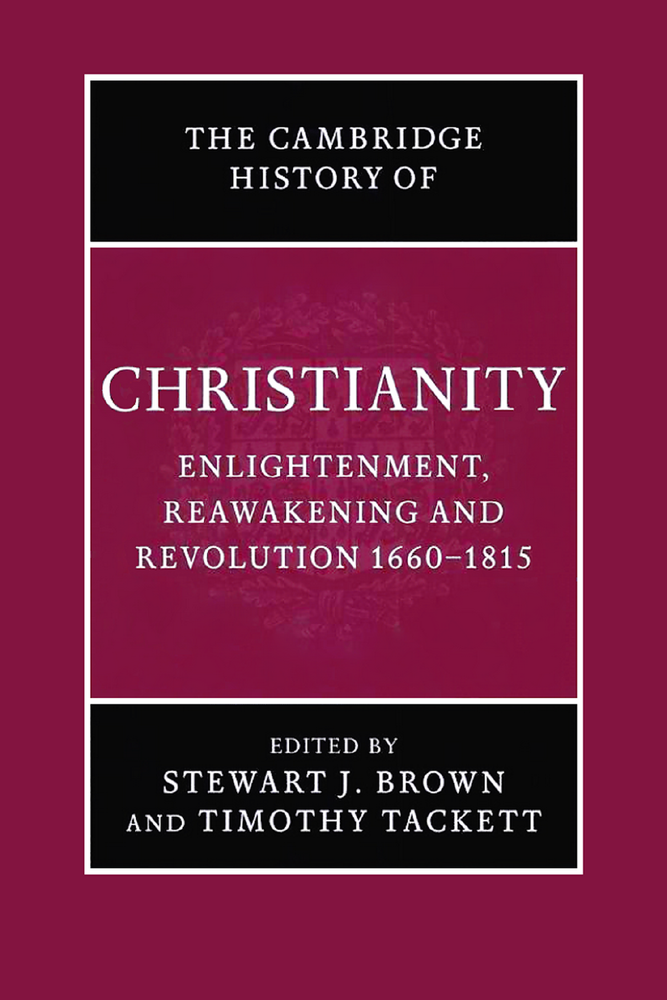

# 卷首资料

<!-- PDF page 1; original page unnumbered -->

## 原书封面

《剑桥基督教史》第七卷：**启蒙、复兴与革命：1660—1815**。斯图尔特·J.布朗、蒂莫西·塔克特主编。

<!-- PDF page 2; original page unnumbered -->

## 本卷简介

在1660至1815年这段动荡的世界历史时期，三个复杂的运动交织在一起，使欧洲和北美发生了根本的文化转向，并最终影响了更广阔的世界。启蒙运动改变了人们对于自然、以及人类掌握自然的能力的看法。宗教复兴运动使一种发自内心、注重亲身体验的基督教信仰重新焕发生机。最后，十八世纪末、十九世纪初的政治与社会剧变，即革命，对君权神授的君主制和被认为出于神意的社会等级秩序提出了挑战，推动了更民主的政府、人权观念和宗教宽容的发展。一种新的宗教氛围由此形成：人们越来越倾向于从自身的感受和经验中寻找信仰的根据。在同一时期，基督教也随着殖民活动和传教而广泛传播到世界各地，并以多种方式回应它与其他文化及宗教传统的相遇。

**斯图尔特·J.布朗（Stewart J. Brown）**为爱丁堡大学教会史教授。著作包括 *William Robertson and the Expansion of Empire*（1997）和 *The National Churches of England, Ireland and Scotland 1801–1846*（2001）。

**蒂莫西·塔克特（Timothy Tackett）**为加利福尼亚大学尔湾分校历史学教授。著作包括 *Priest and Parish in Eighteenth-century France*（1977）和 *Religion, Revolution, and Regional Culture*（1986）。

<!-- PDF page 3; original page unnumbered -->

## 丛书说明

《剑桥基督教史》按时间顺序，全面叙述基督教从起源至今在各方面的发展，包括神学、思想、社会、政治、区域和全球层面。每一卷都独立地为相应时期的学术研究作出重要贡献；全套丛书则构成一部大型学术参考著作。本书旨在提供全球视野，其内容远不局限于西欧基督教及其向外的延伸。从早期开始，东方基督教和科普特基督教就受到充分关注；在较晚的历史时期，非洲、远东、新大陆、南亚及其他非欧洲地区的基督教发展也得到适当的篇幅。各卷讨论民众虔敬以及基督教信仰的非正式表现形式，并把基督徒的培育、礼拜与灵修放在广阔的文化背景中，考察其社会学层面。基督教同其他主要宗教之间的关系，也始终贯穿全书。这套丛书将为学者和学生提供极有价值的资料。

### 分卷目录

| 卷次与题名 | 主编 |
| --- | --- |
| 第一卷　从起源到君士坦丁 | 玛格丽特·M.米切尔、弗朗西丝·M.扬 |
| 第二卷　从君士坦丁到约600年 | 奥古斯丁·卡西代、弗雷德里克·W.诺里斯 |
| 第三卷　中世纪早期基督教：约600—约1100 | 托马斯·诺布尔、朱莉娅·史密斯 |
| 第四卷　西欧基督教：约1100—约1500 | 米里·鲁宾、沃尔特·西蒙斯 |
| 第五卷　东方基督教 | 迈克尔·安戈尔德 |
| 第六卷　改革与扩张：1500—1660 | 夏伯嘉 |
| 第七卷　启蒙、复兴与革命：1660—1815 | 斯图尔特·J.布朗、蒂莫西·塔克特 |
| 第八卷　世界基督教：约1815—1914 | 布赖恩·斯坦利、谢里登·吉利 |
| 第九卷　世界基督教：约1914—约2000 | 休·麦克劳德 |

<!-- PDF page 4; original page unnumbered -->

## 书名页

**剑桥基督教史**

**第七卷**

**启蒙、复兴与革命：1660—1815**

主编：**斯图尔特·J.布朗、蒂莫西·塔克特**

原文题名：*The Cambridge History of Christianity, Volume VII: Enlightenment, Reawakening and Revolution 1660–1815*。

<!-- PDF page 5; original page unnumbered -->

## 原书出版与版权资料

剑桥大学出版社

剑桥、纽约、墨尔本、马德里、开普敦、新加坡、圣保罗

Cambridge University Press, The Edinburgh Building, Cambridge CB2 2RU, UK

美国版由剑桥大学出版社纽约分社出版。

出版社网站：www.cambridge.org

本书资料页：www.cambridge.org/9780521816052

© 剑桥大学出版社，2006年。

本出版物受版权保护。除法律规定的例外以及有关集体许可协议所允许的情形外，未经剑桥大学出版社书面许可，不得复制本书的任何部分。

2006年首次出版。

英国印制，承印者：剑桥大学印刷厂。

英国图书馆备有本书的编目记录。

ISBN-13：978-0-521-81605-2，精装本。

ISBN-10：0-521-81605-X，精装本。

剑桥大学出版社不对本书所引用的外部或第三方网站网址的持续有效性及准确性承担责任，也不保证这些网站的任何内容现在或今后仍然准确、适当。

<!-- PDF page 6; original page v -->

## 原书目录

以下数字均为英文原书的印刷页码。

| 篇目 | 作者 | 原页码 |
| --- | --- | --- |
| 插图与地图目录 |  | ix |
| 撰稿人名单 |  | x |
| 致谢 |  | xiv |
| 导论 | 斯图尔特·J.布朗、蒂莫西·塔克特 | 1 |

### 第一编　欧洲世界的教会、国家与社会：1660—1780

| 章次与题名 | 作者 | 原页码 |
| --- | --- | --- |
| 1　欧洲大陆的天主教 | 奈杰尔·阿斯顿 | 15 |
| 2　欧洲大陆的新教 | 哈特穆特·莱曼 | 33 |
| 3　大不列颠与爱尔兰 | J.C.D.克拉克 | 54 |
| 4　经济与社会中的教会 | 菲利普·T.霍夫曼 | 72 |

<!-- PDF page 7; original page vi -->

### 第二编　欧洲世界的基督徒生活：1660—1780

| 章次与题名 | 作者 | 原页码 |
| --- | --- | --- |
| 5　欧洲的天主教教士 | 马里奥·罗萨 | 89 |
| 6　欧洲世界的新教教士群体 | 安德鲁·R.霍姆斯 | 109 |
| 7　面向听众：欧洲的讲道与演说 | 约里斯·范艾纳滕 | 128 |
| 8　基督教教育 | 多米尼克·朱利亚 | 147 |
| 9　基督教与性别 | 梅里·威斯纳—汉克斯 | 166 |
| 10　民众宗教 | 威廉·弗赖霍夫 | 185 |
| 11　犹太教与基督教的关系 | 弗朗西丝·马利诺 | 208 |
| 12　建筑与基督教 | 让—米歇尔·勒尼奥 | 226 |

### 第三编　运动与挑战

| 章次与题名 | 作者 | 原页码 |
| --- | --- | --- |
| 13　基督教与科学的兴起：1660—1815 | 路易·沙特利耶 | 251 |
| 14　启蒙运动对基督教的批判 | 玛格丽特·C.雅各布 | 265 |

<!-- PDF page 8; original page vii -->

| 章次与题名 | 作者 | 原页码 |
| --- | --- | --- |
| 15　基督教启蒙运动 | 海伦娜·罗森布拉特 | 283 |
| 16　詹森主义与耶稣会在各国遭到取缔 | 戴尔·K.范克雷 | 302 |
| 17　北大西洋世界的福音复兴 | W.R.沃德 | 329 |
| 18　宗教宽容与基督徒再合一运动：1660—1789 | 詹姆斯·E.布拉德利 | 348 |

### 第四编　非欧洲世界的基督教发展

| 章次与题名 | 作者 | 原页码 |
| --- | --- | --- |
| 19　伊比利亚美洲的基督教 | 詹姆斯·D.赖利 | 373 |
| 20　1765年以前的英属、法属北美 | 马克·A.诺尔 | 392 |
| 21　非洲的基督教 | 拉明·萨内 | 411 |
| 22　南亚与东南亚的基督教 | 查尔斯·J.博尔热斯 | 433 |
| 23　东亚的基督教 | 狄德满 | 451 |
| 24　基督教与其他世界宗教的相遇 | 安德鲁·C.罗斯 | 475 |

<!-- PDF page 9; original page viii -->

### 第五编　革命与基督教世界

| 章次与题名 | 作者 | 原页码 |
| --- | --- | --- |
| 25　美国革命与宗教：1765—1815 | 马丁·E.马蒂 | 497 |
| 26　基督教与反对奴隶制、奴隶贸易的运动 | 克里斯托弗·莱斯利·布朗 | 517 |
| 27　1794年以前的法国革命与宗教 | 蒂莫西·塔克特 | 536 |
| 28　法国革命与宗教：1795—1815 | 苏珊娜·德桑 | 556 |
| 29　革命时代欧洲的基督教复兴运动：1790—1815 | 斯图尔特·J.布朗 | 575 |
| 大事年表 |  | 596 |
| 参考书目 |  | 603 |
| 索引 |  | 652 |

<!-- PDF page 10; original page ix -->

## 插图与地图目录

### 插图

| 图号与说明 | 原页码 |
| --- | --- |
| 1　罗马圣彼得大教堂：正立面 | 229 |
| 2　伦敦圣保罗大教堂：正立面 | 231 |
| 3　巴黎圣宠谷教堂 | 233 |
| 4　巴黎荣军院教堂：内部 | 234 |
| 5　瑞士艾因西德伦本笃会修道院：内部 | 237 |
| 6　智利帕里纳科塔教堂 | 388 |
| 7　非洲西南部基督教刚果王国的苦像 | 413 |
| 8　约1700年印度果阿制作的“圣母子”象牙雕像 | 438 |
| 9　“作为日本殉道者主保的圣母玛利亚”：绢画 | 469 |

### 地图

| 图号与说明 | 原页码 |
| --- | --- |
| 1　约1700年的欧洲宗派分布图 | 2 |
| 2　1660年的中欧 | 34 |
| 3　约1800年的印度传教区 | 434 |
| 4　约1696年的中国 | 460 |

<!-- PDF page 11; original page x -->

## 撰稿人

**奈杰尔·阿斯顿（Nigel Aston）**为莱斯特大学欧洲近代早期史副教授（Reader）。著作包括 *Religion and revolution in France* 和 *Christianity and revolutionary Europe c.1750–1830*。

**查尔斯·J.博尔热斯神父（Charles J. Borges，耶稣会）**于1981至2000年在果阿沙勿略历史研究中心工作，曾任中心主任六年。本书撰写时，他为马里兰州洛约拉学院历史学助理教授。著有 *The economics of the Goa Jesuits 1542–1759: An explanation of their rise and fall*，并主编了八卷印度—葡萄牙史著作。

**詹姆斯·E.布拉德利（James E. Bradley）**为加利福尼亚州帕萨迪纳富勒神学院杰弗里·W.布罗米利教会史讲席教授。著作包括 *Religion, revolution, and English radicalism: Non-conformity in eighteenth-century politics and society*，以及与戴尔·K.范克雷合编的 *Religion and politics in Enlightenment Europe*。

**克里斯托弗·莱斯利·布朗（Christopher Leslie Brown）**为罗格斯大学历史学副教授。著作包括 *Moral capital: Foundations of British abolitionism*，以及与菲利普·摩根合编的 *Arming slaves: Classical times to the modern age*。

**斯图尔特·J.布朗（Stewart J. Brown）**为爱丁堡大学教会史教授。著作包括 *Thomas Chalmers and the godly commonwealth in Scotland* 和 *The national churches of England, Ireland and Scotland 1801–1846*。

**路易·沙特利耶（Louis Châtellier）**为巴黎高等研究实践学院宗教学部研究指导教授。著作包括 *Les espaces infinis et le silence de Dieu: science et religion, XVIe–XIXe siècle*、*The Europe of the devout: The Catholic reformation and the formation of a new society*，以及 *The religion of the poor: Rural missions in Europe and the formation of modern Catholicism, c.1500–c.1800*。

**J.C.D.克拉克（J. C. D. Clark）**为堪萨斯大学霍尔英国史杰出教授。著作包括 *English society 1660–1832: Revolution and Rebellion* 和 *The language of liberty 1660–1832*。

<!-- PDF page 12; original page xi -->

**苏珊娜·德桑（Suzanne Desan）**为威斯康星大学麦迪逊分校历史学教授，著有 *Reclaiming the sacred: Lay religion and popular politics in revolutionary France* 和 *The family on trial in revolutionary France*。

**约里斯·范艾纳滕（Joris van Eijnatten）**任职于阿姆斯特丹自由大学历史系。著作包括 *‘God, Nederland en Oranje’: Dutch Calvinism and the search for the social centre* 和 *Liberty and concord in the United Provinces: Religious toleration and the public in the eighteenth-century Netherlands*。

**威廉·弗赖霍夫（Willem Frijhoff）**为阿姆斯特丹自由大学历史学教授，出版过多部荷兰史、法国史及欧洲史著作，包括 *Embodied belief: Ten essays on religious culture in Dutch history*、*Dutch culture in a European perspective*，以及与罗贝尔·米尚布莱、玛丽—西尔维·迪蓬—布沙合著的 *Prophètes et sorciers dans les Pays-Bas, XVIe–XVIIIe siècle*。

**菲利普·T.霍夫曼（Philip T. Hoffman）**为加州理工学院理查德与芭芭拉·罗森伯格历史与社会科学讲席教授。著作包括 *Church and community in the diocese of Lyon, 1500–1789* 和 *Growth in a traditional society: The French countryside, 1450–1815*。

**安德鲁·R.霍姆斯（Andrew R. Holmes）**为贝尔法斯特女王大学爱尔兰研究所研究员，著有 *The shaping of Ulster Presbyterianism belief and practice 1770–1840: Tradition, reform and revival*，并发表过多篇爱尔兰新教史论文。

**玛格丽特·C.雅各布（Margaret C. Jacob）**为加利福尼亚大学洛杉矶分校历史学教授。著作包括 *The Newtonians and the English Revolution, 1689–1720*、*The Radical Enlightenment: Pantheists, freemasons and republicans*、*The cultural meaning of the scientific revolution* 和 *Living the Enlightenment: Freemasonry and politics in eighteenth-century Europe*。

**多米尼克·朱利亚（Dominique Julia）**为巴黎社会科学高等研究院欧洲宗教人类学研究中心主任，兼任法国国家科学研究中心研究主任。著作包括 *Les trois couleurs du tableau noir: la Révolution*，与罗杰·夏蒂埃、玛丽—马德莱娜·孔佩尔合著的 *L’éducation en France du XVIe au XVIIIe siècle*，以及与菲利普·布特里合著的 *Pèlerins et pèlerinages dans l’Europe moderne*。

**哈特穆特·莱曼（Hartmut Lehmann）**为哥廷根马克斯·普朗克历史研究所所长，兼任哥廷根大学与基尔大学名誉教授。著作包括 *Jansenismus, Quietismus, Pietismus* 和 *Pietismus und weltliche Ordnung in Württemberg. Vom 17. bis zum 20. Jahrhundert*（与海因茨·席林、汉斯—于尔根·施拉德合作）。

**让—米歇尔·勒尼奥（Jean-Michel Leniaud）**为巴黎高等研究实践学院历史与语文学部研究指导教授。著作包括 *L’administration des cultes pendant la période concordataire*、*Viollet-le-Duc, ou, Les délires du système* 和 *Jean-Baptiste Lassus, 1807–1857, ou, Le temps retrouvé des cathédrales*。

<!-- PDF page 13; original page xii -->

**弗朗西丝·马利诺（Frances Malino）**为韦尔斯利学院索菲娅·摩西·罗宾逊犹太研究与历史讲席教授。著作包括 *The Sephardic Jews of Bordeaux: Assimilation and emancipation in revolutionary and Napoleonic France* 和 *A Jew in the French Revolution: The life of Zalkind Hourwitz*。

**马丁·E.马蒂（Martin E. Marty）**为芝加哥大学费尔法克斯·M.科恩现代基督教史荣休杰出服务教授，著有五十余部书，包括 *Religion, awakening and revolution* 和三卷本 *Modern American religion*。

**马克·A.诺尔（Mark A. Noll）**为圣母大学麦卡纳尼历史学讲席教授，著述或主编三十余部书，包括 *A history of Christianity in the United States and Canada* 和 *America’s God: From Jonathan Edwards to Abraham Lincoln*。

**詹姆斯·D.赖利（James D. Riley）**为美国天主教大学历史学副教授。著作包括 *Hacendados Jesuitas en Mexico: La Administracion de los Bines Inmuebles del Colegio Maximo de San Pedro y San Pablo de la Ciudad de Mexico, 1687–1767* 和 *Landholding and provincial society: The Labradores of Tlaxcala, 1640–1730*。

**马里奥·罗萨（Mario Rosa）**为比萨高等师范学校近代史教授。著作包括 *Settecento religioso: politica della ragione e religione del cuore*、*Politica e religione nel ‘700 europeo* 和 *Religione e società nel Mezzogiorno tra Cinque e Seicento*。

**海伦娜·罗森布拉特（Helena Rosenblatt）**为纽约市亨特学院副教授，著有 *Rousseau and Geneva: From the First Discourse to the social contract, 1749–1762*。

**安德鲁·C.罗斯（Andrew C. Ross）**曾任传教史与传教学高级讲师，本书撰写时为爱丁堡大学神学院名誉研究员。著作包括 *A vision betrayed: The Jesuits in Japan and China 1542–1742* 和 *David Livingstone: Mission and empire*。

**拉明·萨内（Lamin Sanneh）**为耶鲁大学D.威利斯·詹姆斯传教学与世界基督教讲席教授。著作包括 *Encountering the West: Christianity and the global cultural process: The African dimension* 和 *Abolitionists abroad: American blacks and the making of modern West Africa*。

**蒂莫西·塔克特（Timothy Tackett）**为加利福尼亚大学尔湾分校历史学教授。宗教史著作包括 *Priest and parish in eighteenth-century France*、*Religion, revolution, and regional culture in eighteenth-century France*，以及与克洛德·朗格卢瓦、米歇尔·伏维尔合编的 *Atlas de la Révolution française* 第九卷 *Religion*。

**狄德满（R. G. Tiedemann）**在本书撰写时为伦敦大学亚非学院历史学讲师，即将前往旧金山大学利玛窦中西文化历史研究所任研究职。他主持编纂并主要撰写了<!-- PDF page 14; original page xiii -->*The handbook of Christianity in China* 第二卷 *1800 to the present*，还发表过多篇东亚基督教研究论文。

**戴尔·K.范克雷（Dale K. Van Kley）**为俄亥俄州立大学历史学教授。他出版的三部主要专著为 *The Jansenists and the expulsion of the Jesuits from France*（1975）、*The Damiens affair and the unraveling of the ancien régime, 1750–1770* 和 *The religious origins of the French Revolution*，并发表了大量有关法国旧制度下政教关系、以及詹森主义对法国文化与政治影响的论文。

**W.R.沃德（W. R. Ward）**为杜伦大学近代史荣休教授。著作包括 *The Protestant Evangelical awakening* 和 *Christianity under the ancien régime 1648–1789*。

**梅里·威斯纳—汉克斯（Merry Wiesner-Hanks）**为威斯康星大学密尔沃基分校历史学教授，著述、主编或合编十余部书，包括 *Christianity and sexuality in the early modern world: Regulating desire, reforming practice* 和 *Gender, church, and state in early modern Germany*。
