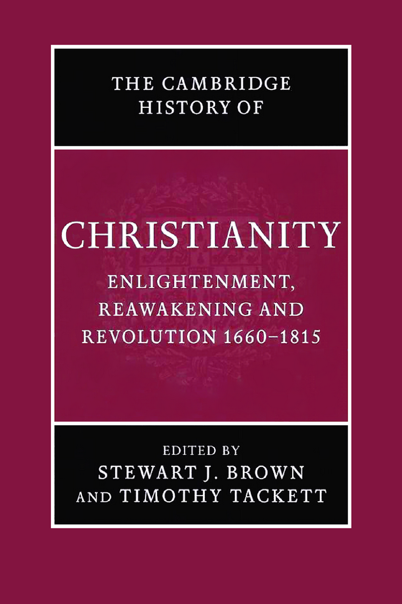
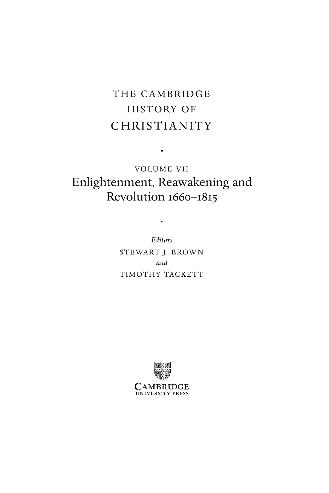

# 卷首资料：英文转换底稿

<!-- PDF page 1; original page unnumbered -->

<!-- PDF page 2; original page unnumbered -->

the cambridge history of

C H R I S T I A N I T Y

During the tumultuous period of world history from 1660 to 1815,

three complex movements combined to bring a fundamental cul-

tural reorientation to Europe and North America, and ultimately

to the wider world. The Enlightenment transformed views of

nature and of the human capacity to master nature. The religious

reawakenings brought a revival of heart-felt, experiential Christian-

ity. Finally revolution, the political and social upheavals of the late

eighteenth and early nineteenth centuries, challenged established

ideas of divine-right monarchies and divinely ordained social hier-

archies, and promoted more democratic government, notions of

human rights, and religious toleration. A new religious climate

emerged, in which people were more likely to look to their own

feelings and experiences for the basis of their faith. During this

same period, Christianity spread widely around the world as a

result of colonialism and missions, and responded in diverse ways

to its encounters with other cultures and religious traditions.

Stewart J. Brown is Professor of Ecclesiastical History at the

University of Edinburgh. His publications include William Robert-

son and the Expansion of Empire (1997) and The National Churches of

England, Ireland and Scotland 1801–1846 (2001).

Timothy Tackett is Professor of History at the University

of California, Irvine. His publications include Priest and Parish

in Eighteenth-century France (1977); and Religion, Revolution, and

Regional Culture (1986).

<!-- PDF page 3; original page unnumbered -->

the cambridge history of

C H R I S T I A N I T Y

The Cambridge History of Christianity offers a comprehensive

chronological account of the development of Christianity in all its

aspects – theological, intellectual, social, political, regional, global –

from its beginnings to the present day. Each volume makes a sub-

stantial contribution in its own right to the scholarship of its period

and the complete History constitutes a major work of academic

reference. Far from being merely a history of Western European

Christianity and its offshoots, the History aims to provide a global

perspective. Eastern and Coptic Christianity are given full consider-

ation from the early period onwards, and later, African, Far Eastern,

New World, South Asian and other non-European developments

in Christianity receive proper coverage. The volumes cover popu-

lar piety and non-formal expressions of Christian faith and treat the

sociology of Christian formation, worship and devotion in a broad

cultural context. The question of relations between Christianity

and other major faiths is also kept in sight throughout. The History

will provide an invaluable resource for scholars and students alike.

List of volumes:

Origins to Constantine

edited by margaret m. mitchell and fr ances

m. young

Constantine to c. 600

edited by augustine casiday and frederick

w. norris

Early Medieval Christianity c. 600–c. 1100

edited by thomas noble and julia smith

Christianity in Western Europe c. 1100–c. 15 00

edited by miri rubin and walter simon

Eastern Christianity

edited by michael angold

Reform and Expansion 15 00–1660

edited by ronnie po-chia hsia

Enlightenment, Reawakening and Revolution 1660–1815

edited by stewart j. brown and timothy tackett

World Christianities c. 1815 –1914

edited by brian stanley and sheridan gilley

World Christianities c. 1914 to c. 2000

edited by hugh m leod

<!-- PDF page 4; original page unnumbered -->

T H E C A M B R I D G E

H I S T O RY O F

C H R I S T I A N I T Y

*

VO LU M E V I I

Enlightenment, Reawakening and

1660 1815

Revolution –

*

Editors

S T E WA RT J. B R OW N

and

T I M O T H Y TAC K E T T

<!-- PDF page 5; original page unnumbered -->

cambridge university press

Cambridge, New York, Melbourne, Madrid, Cape Town, Singapore, São Paulo

Cambridge University Press

The Edinburgh Building, Cambridge cb2 2ru, UK

Published in the United States of America by Cambridge University Press, New York

www.cambridge.org

Information on this title: www.cambridge.org/9780521816052

(cid:2)C Cambridge University Press 2006

This publication is in copyright. Subject to statutory exception

and to the provisions of relevant collective licensing agreements,

no reproduction of any part may take place without

the written permission of Cambridge University Press.

First published 2006

Printed in the United Kingdom at the University Press, Cambridge

A catalogue record for this publication is available from the British Library

isbn-13 978-0-521-81605-2 hardback

isbn-10 0-521-81605-X hardback

Cambridge University Press has no responsibility for the persistence or accuracy of URLs for external

or third-party internet websites referred to in this publication, and does not guarantee that any

content on such websites is, or will remain, accurate or appropriate.

<!-- PDF page 6; original page v -->

Contents

List of illustrations and maps ix

List of contributors x

Acknowledgements xiv

Introduction 1

st e wa rt j. b ro w n a n d t i m ot h y tac k ett

pa rt i

C H U R C H , S TAT E , A N D S O C I E T Y I N T H E

E U R O P E A N WO R L D, 1 6 6 0– 1 7 8 0

1 · Continental Catholic Europe 1 5

n i g e l aston

2 · Continental Protestant Europe 33

h a rt m ut l e h m a n n

3 · Great Britain and Ireland 5 4

j. c. d. c la r k

4 · The church in economy and society 72

ph i l i p t. h o f f m a n

<!-- PDF page 7; original page vi -->

Contents

pa rt i i

C H R I S T I A N L I F E I N T H E E U R O P E A N WO R L D,

1 6 6 0– 1 7 8 0

5 · The Catholic clergy in Europe 89

m a r i o ro s a

6 · The Protestant clergies in the European world 1 09

a n d r e w r . h o l m e s

7 · Reaching audiences: Sermons and oratory in Europe 1 28

j o r i s va n e i j natt e n

8 · Christian education 1 47

d o m i n i qu e j u l i a

9 · Christianity and gender 1 66

m e r ry w i e s n e r - h a n k s

10 · Popular religion 1 85

w i l l e m f r i j h o f f

11 · Jewish–Christian relations 208

f r a n c e s m a l i n o

12 · Architecture and Christianity 226

j e a n - m i c h e l l e n i au d

pa rt i i i

M OV E M E N T S A N D C H A L L E N G E S

13 · Christianity and the rise of science, 1660–1815 25 1

lo u i s c h â t e l l i e r

14 · The Enlightenment critique of Christianity 265

m a rga r et c. jaco b

<!-- PDF page 8; original page vii -->

Contents

15 · The Christian Enlightenment 283

h e l e na ro s e n b latt

16 · Jansenism and the international suppression of

the Jesuits 302

da l e k . va n k l ey

17 · Evangelical awakenings in the North Atlantic world 329

w. r . wa r d

18 · Toleration and movements of Christian reunion,

1660–1789 348

ja m e s e. b r a d l ey

pa rt i v

C H R I S T I A N D E V E LO P M E N T S I N T H E

N O N - E U R O P E A N WO R L D

19 · Christianity in Iberian America 373

ja m e s d. r i l ey

20 · British and French North America to 1765 392

m a r k a . n o l l

21 · Christianity in Africa 41 1

la m i n s a n n e h

22 · Christianity in south and south-east Asia 433

c h a r l e s j. b o rg e s

23 · Christianity in East Asia 45 1

r . g. t i e d e m a n n

24 · Christian encounters with other world religions 475

a n d r e w c. ro s s

<!-- PDF page 9; original page viii -->

Contents

pa rt v

R E VO LU T I O N A N D T H E C H R I S T I A N WO R L D

25 · The American Revolution and religion, 1765–1815 497

m a rt i n e. m a rty

26 · Christianity and the campaign against slavery and the slave trade 5 1 7

c h r i sto ph e r l e s l i e b ro w n

27 · The French Revolution and religion to 1794 5 36

t i m ot h y tac k ett

28 · The French Revolution and religion, 1795–1815 5 5 6

s u za n n e d e s a n

29 · Movements of Christian awakening in revolutionary Europe,

1790–1815 5 75

st e wa rt j. b ro w n

Chronology 5 96

Bibliography 603

Index 65 2

<!-- PDF page 10; original page ix -->

Illustrations

1 St Peter’s Basilica, Rome: the façade page 229

2 St Paul’s Cathedral, London: frontis 231

3 Val-de-Grâce, Paris 233

4 Church of the Invalides, Paris, interior 234

5 Einsiedeln Abbey (Benedictine), Switzerland, interior 237

6 Church of Parinacota, Chile 388

7 Crucifix from the Christian Kongolese Kingdom, south-western Africa 413

8 ‘Virgin and Child’, fashioned in Goa, India, c. 1700: ivory statuette 438

9 ‘Mary as patroness of the Japanese martyrs’: silk painting 469

Maps

1 Confessional map of Europe c. 1700 page 2

2 Central Europe in 1660 34

3 Missions in India c. 1800 434

4 China c. 1696 460

<!-- PDF page 11; original page x -->

Contributors

Nigel Aston is Reader in Early Modern European History at the University of Leicester.

His books include Religion and revolution in France and Christianity and revolutionary Europe

c.175 0–1830.

Fr Charles J. Borges S. J. was a member of the Xavier Centre of Historical Research

in Goa between 1981 and 2000, and served as director of the Centre for six years. He is

currently Assistant Professor of History at Loyola College in Maryland. His books include

The economics of the Goa Jesuits 15 42–175 9: An explanation of their rise and fall and eight edited

volumes on Indo-Portuguese history.

James E. Br adley is the Geoffrey W. Bromiley Professor of Church History at Fuller

Seminary in Pasadena California. His books include Religion, revolution, and English

radicalism: Non-conformity in eighteenth-century politics and society and Religion and politics

in Enlightenment Europe (with Dale K. Van Kley).

Christopher Leslie Brown is Associate Professor of History at Rutgers University.

His books include Moral capital: Foundations of British abolitionism, and Arming slaves: Classical

times to the modern age (with Philip Morgan).

Stewart J. Brown is Professor of Ecclesiastical History at the University of Edinburgh.

His books include Thomas Chalmers and the godly commonwealth in Scotland and The national

churches of England, Ireland and Scotland 1801–1846 .

Louis Châ tellier is Directeur d’étude at the Ecole pratique des hautes études (Paris),

Section des sciences religieuses. Among his books are Les espaces infinis et le silence de Dieu:

science et religion, XVIe–XIXe siècle; The Europe of the devout: The Catholic reformation and the

formation of a new society; and The religion of the poor: Rural missions in Europe and the formation

of modern Catholicism, c.15 00-c.1800.

J. C. D. Clark is Hall Distinguished Professor of British History at the University of

Kansas. His books include English society 1660–1832: Revolution and Rebellion and The language

of liberty 1660–1832.

<!-- PDF page 12; original page xi -->

List of contributors

Suzanne Desan, Professor of History at the University of Wisconsin-Madison, has pub-

lished books on Reclaiming the sacred: Lay religion and popular politics in revolutionary France;

and The family on trial in revolutionary France.

Joris van Eijnatten is a member of the Department of History at the Free University

of Amsterdam. His books include ‘God, Nederland en Oranje’: Dutch Calvinism and the search

for the social centre and Liberty and concord in the United Provinces: Religious toleration and the

public in the eighteenth-century Netherlands.

Willem Frijhoff is Professor of History at the Free University of Amsterdam. He has

published numerous books on Dutch, French, and European history, including Embodied

belief: Ten essays on religious culture in Dutch history; Dutch culture in a European perspective;

and Prophètes et sorciers dans les Pays-Bas, XVIe–XVIIIe siècle (with Robert Muchembled and

Marie-Sylvie Dupont-Bouchat).

Philip T. Hoffman holds the Richard and Barbara Rosenberg chair in History and

Social Science at the California Institute of Technology. His books include Church and

community in the diocese of Lyon, 15 00–1789; and Growth in a traditional society: The French

countryside, 145 0–1815 .

Andrew R. Holmes is a Research Fellow at the Institute of Irish Studies, Queen’s Uni-

versity, Belfast. He is the author of The shaping of Ulster Presbyterianism belief and practice

1770–1840: Tradition, reform and revival and of several articles on Irish Protestant history.

Margaret C. Jacob is Professor of History at the University of California, Los Ange-

les. Among her books are The Newtonians and the English Revolution, 1689–1720; The Radi-

cal Enlightenment: Pantheists, freemasons and republicans; The cultural meaning of the scientific

revolution; and Living the Enlightenment: Freemasonry and politics in eighteenth-century Europe.

Dominique Julia is Director of the Centre d’anthropologie religieuse européenne at

the Ecole des hautes études en sciences sociales (Paris) and Directeur de recherche with the

Centre national de recherches scientifiques. Among his publications are Les trois couleurs

du tableau noir: la Révolution; L’éducation en France du XVIe au XVIIIe siècle (with Roger

Chartier and Marie-Madeleine Compère); and Pèlerins et pèlerinages dans l’Europe moderne

(with Philippe Boutry).

Hartmut Lehmann is Director of the Max-Planck Institute for History at Göttingen

and Honorary Professor at the Universities of Göttingen and Kiel. His books include

Jansenismus,Quietismus, Pietismus and Pietismus und weltliche Ordnung in Württemberg. Vom

17. bis zum 20. Jahrhundert (with Heinz Schilling and Hans-Jürgen Schrader).

Jean-Michel Leniaud is Directeur d’étude at the Ecole pratique des hautes études

(Paris), Section des sciences historiques et philologiques. His books include L’administration

des cultes pendant la période concordataire; Viollet-le-Duc, ou, Les délires du système; and Jean-

Baptiste Lassus, 1807–185 7, ou, Le temps retrouvé des cathédrales.

<!-- PDF page 13; original page xii -->

List of contributors

Fr ances Malino is Sophia Moses Robison Professor of Jewish Studies and History at

Wellesley College. Among her books are The Sephardic Jews of Bordeaux: Assimilation and

emancipation in revolutionary and Napoleonic France; and A Jew in the French Revolution: The life

of Zalkind Hourwitz.

Martin E. Marty is the Fairfax M. Cone Distinguished Service Professor Emeritus

of the History of Modern Christianity at the University of Chicago. He is the author of

over fifty books, including Religion, awakening and revolution and the three-volume Modern

American religion.

Mark A. Noll is the McAnaney Professor of History at the University of Notre Dame.

He is the author or editor of over thirty books, including A history of Christianity in the United

States and Canada and America’s God: From Jonathan Edwards to Abraham Lincoln.

James D. Riley is Associate Professor of History at the Catholic University of America.

His works include Hacendados Jesuitas en Mexico: La Administracion de los Bines Inmuebles del

Colegio Maximo de San Pedro y San Pablo de la Ciudad de Mexico, 1687–1767; and Landholding

and provincial society: The Labradores of Tlaxcala, 1640–1730.

Mario Rosa is Professor of Modern History at the Scuola Normale Superiore in Pisa.

Among his books are Settecento religioso: politica della ragione e religione del cuore; Politica e

religione nel ‘700 europeo; and Religione e società nel Mezzogiorno tra Cinque e Seicento.

Helena Rosenblatt is Associate Professor at Hunter College in New York City. She

has published Rousseau and Geneva: From the First Discourse to the social contract, 1749–1762.

Andrew C. Ross, a former Senior Lecturer in the History and Theology of Missions, is

currently an Honorary Fellow in the School of Divinity at the University of Edinburgh. His

books include A vision betrayed: The Jesuits in Japan and China 15 42–1742 and David Livingstone:

Mission and empire.

Lamin Sanneh is the D. Willis James Professor of Missions and World Christianity at

Yale University. His books include Encountering the West: Christianity and the global cultural

process: The African dimension, and Abolitionists abroad: American blacks and the making of

modern West Africa

Timothy Tackett is Professor of History at the University of California, Irvine. Among

his books in religious history are Priest and parish in eighteenth-century France; Religion,

revolution, and regional culture in eighteenth-century France; and Atlas de la Révolution française,

vol. 9: Religion (with Claude Langlois and Michel Vovelle).

R. G. Tiedemann is currently a Lecturer in History at the School of Oriental and African

Studies at the University of London, and is soon to take up a research position at the Ricci

Institute for Chinese-Western Cultural History at the University of San Francisco. He is the

<!-- PDF page 14; original page xiii -->

List of contributors

editor of and principal contributor to The handbook of Christianity in China, vol. 2: 1800 to the

present and the author of a number of scholarly articles on Christianity in East Asia.

Dale K. Van Kley is Professor of History at Ohio State University. He has published

three major monographs on The Jansenists and the expulsion of the Jesuits from France (1975),

The Damiens affair and the unraveling of the ancien régime, 175 0–1770, and The religious origins of

the French Revolution; as well as numerous articles on church–state relations in ancien régime

France and the impact of Jansenism on French culture and politics.

W. R. Ward is Professor Emeritus of Modern History at the University of Durham.

Among his books are The Protestant Evangelical awakening and Christianity under the ancien

régime 1648–1789.

Merry Wiesner-Hanks is Professor of History at the University of Wisconsin-

Milwaukee. She is author, editor, or co-editor of over a dozen books, including Christianity

and sexuality in the early modern world: Regulating desire, reforming practice and Gender, church,

and state in early modern Germany.
