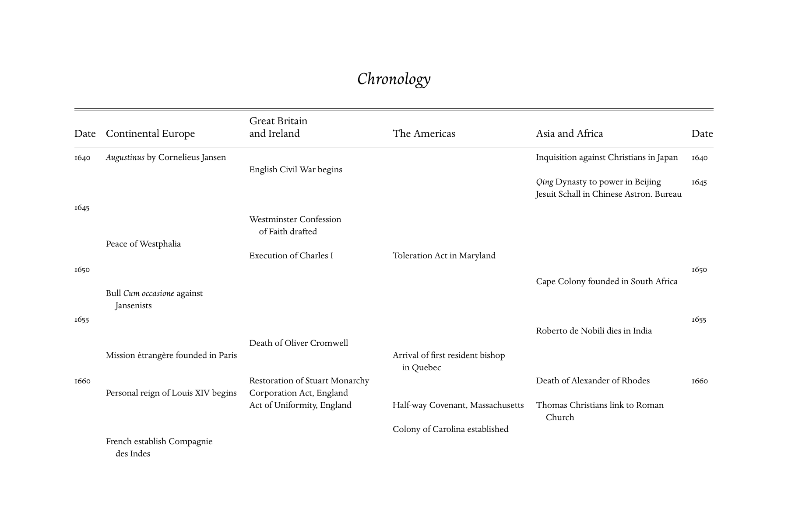
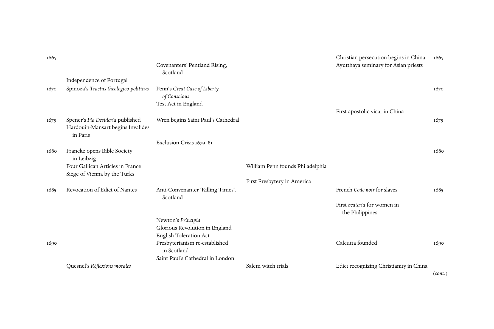
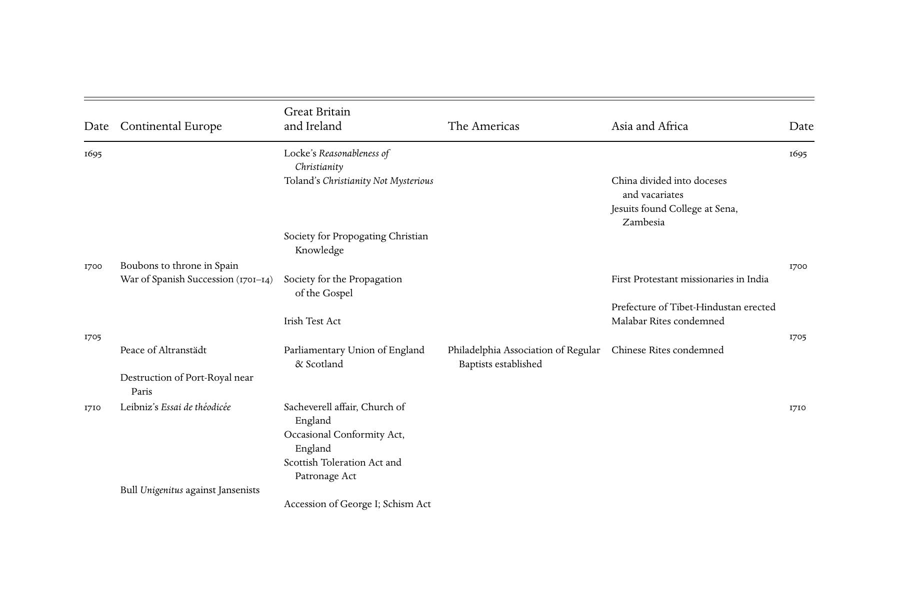
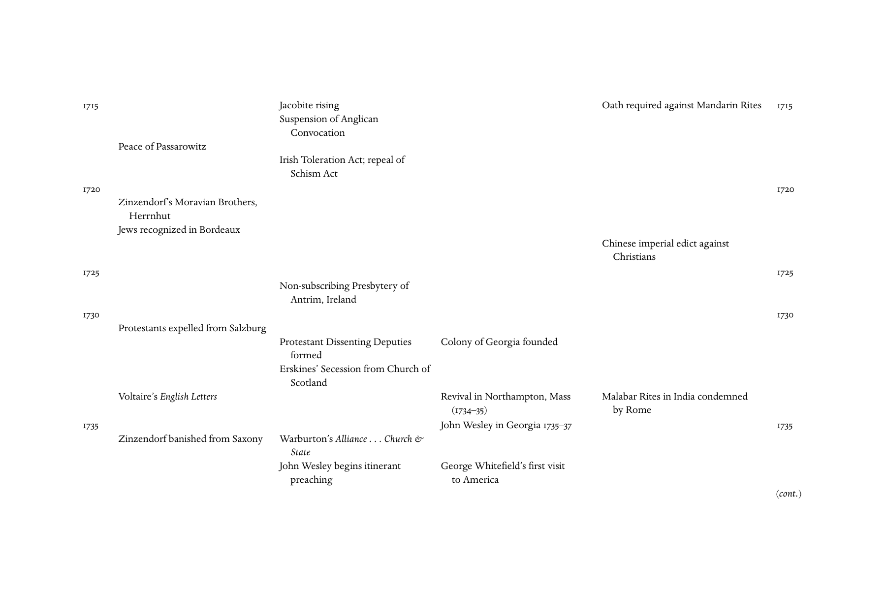
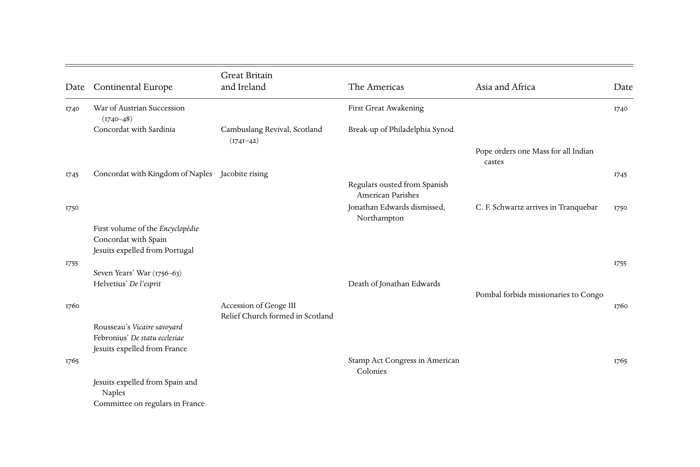
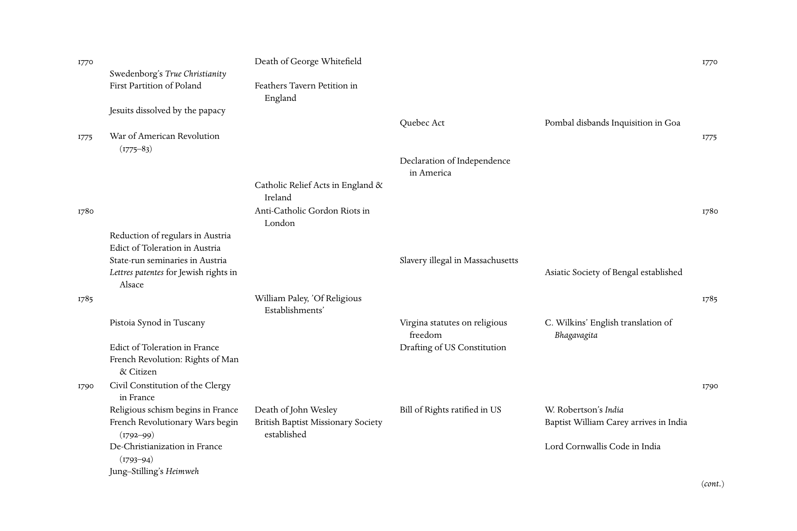
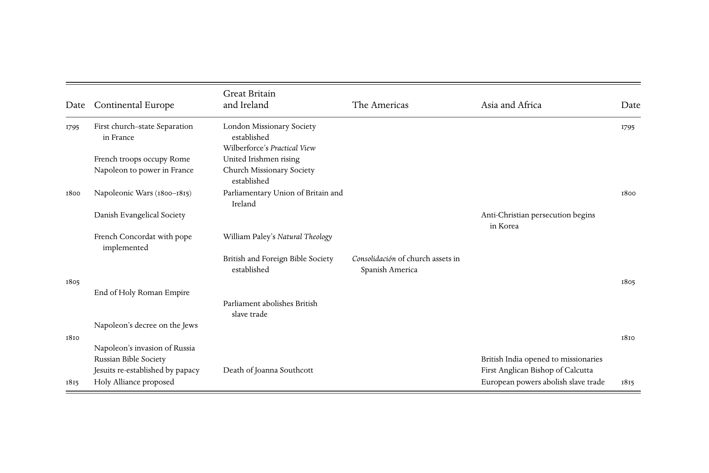

# 大事年表：英文转换底稿

<!-- PDF page 611; original page 596 -->

Chronology

Great Britain

Date Continental Europe and Ireland The Americas Asia and Africa Date

1640 Augustinus by Cornelieus Jansen Inquisition against Christians in Japan 1640

English Civil War begins

Qing Dynasty to power in Beijing 1645

Jesuit Schall in Chinese Astron. Bureau

1645

Westminster Confession

of Faith drafted

Peace of Westphalia

Execution of Charles I Toleration Act in Maryland

1650 1650

Cape Colony founded in South Africa

Bull Cum occasione against

Jansenists

1655 1655

Roberto de Nobili dies in India

Death of Oliver Cromwell

Mission e´trange`re founded in Paris Arrival of first resident bishop

in Quebec

1660 Restoration of Stuart Monarchy Death of Alexander of Rhodes 1660

Personal reign of Louis XIV begins Corporation Act, England

Act of Uniformity, England Half-way Covenant, Massachusetts Thomas Christians link to Roman

Church

Colony of Carolina established

French establish Compagnie

des Indes

<!-- PDF page 612; original page 597 -->

1665 Christian persecution begins in China 1665

Covenanters’ Pentland Rising, Ayutthaya seminary for Asian priests

Scotland

Independence of Portugal

1670 Spinoza’s Tractus theologico-politicus Penn’s Great Case of Liberty 1670

of Conscious

Test Act in England

First apostolic vicar in China

1675 Spener’s Pia Desideria published Wren begins Saint Paul’s Cathedral 1675

Hardouin-Mansart begins Invalides

in Paris

Exclusion Crisis 1679–81

1680 Francke opens Bible Society 1680

in Leibzig

Four Gallican Articles in France William Penn founds Philadelphia

Siege of Vienna by the Turks

First Presbytery in America

1685 Revocation of Edict of Nantes Anti-Convenanter ‘Killing Times’, French Code noir for slaves 1685

Scotland

First beateria for women in

the Philippines

Newton’s Principia

Glorious Revolution in England

English Toleration Act

1690 Presbyterianism re-established Calcutta founded 1690

in Scotland

Saint Paul’s Cathedral in London

Quesnel’s Re´flexions morales Salem witch trials Edict recognizing Christianity in China

(cont.)

<!-- PDF page 613; original page 598 -->

Great Britain

Date Continental Europe and Ireland The Americas Asia and Africa Date

1695 Locke’s Reasonableness of 1695

Christianity

Toland’s Christianity Not Mysterious China divided into doceses

and vacariates

Jesuits found College at Sena,

Zambesia

Society for Propogating Christian

Knowledge

1700 Boubons to throne in Spain 1700

War of Spanish Succession (1701–14) Society for the Propagation First Protestant missionaries in India

of the Gospel

Prefecture of Tibet-Hindustan erected

Irish Test Act Malabar Rites condemned

1705 1705

Peace of Altransta¨dt Parliamentary Union of England Philadelphia Association of Regular Chinese Rites condemned

& Scotland Baptists established

Destruction of Port-Royal near

Paris

1710 Leibniz’s Essai de the´odice´e Sacheverell affair, Church of 1710

England

Occasional Conformity Act,

England

Scottish Toleration Act and

Patronage Act

Bull Unigenitus against Jansenists

Accession of George I; Schism Act

<!-- PDF page 614; original page 599 -->

1715 Jacobite rising Oath required against Mandarin Rites 1715

Suspension of Anglican

Convocation

Peace of Passarowitz

Irish Toleration Act; repeal of

Schism Act

1720 1720

Zinzendorf’s Moravian Brothers,

Herrnhut

Jews recognized in Bordeaux

Chinese imperial edict against

Christians

1725 1725

Non-subscribing Presbytery of

Antrim, Ireland

1730 1730

Protestants expelled from Salzburg

Protestant Dissenting Deputies Colony of Georgia founded

formed

Erskines’ Secession from Church of

Scotland

Voltaire’s English Letters Revival in Northampton, Mass Malabar Rites in India condemned

(1734–35) by Rome

1735 John Wesley in Georgia 1735–37 1735

Zinzendorf banished from Saxony Warburton’s Alliance . . .Church &

State

John Wesley begins itinerant George Whitefield’s first visit

preaching to America

(cont.)

<!-- PDF page 615; original page 600 -->

Great Britain

Date Continental Europe and Ireland The Americas Asia and Africa Date

1740 War of Austrian Succession First Great Awakening 1740

(1740–48)

Concordat with Sardinia Cambuslang Revival, Scotland Break-up of Philadelphia Synod

(1741–42)

Pope orders one Mass for all Indian

castes

1745 Concordat with Kingdom of Naples Jacobite rising 1745

Regulars ousted from Spanish

American Parishes

1750 Jonathan Edwards dismissed, C. F. Schwartz arrives in Tranquebar 1750

Northampton

First volume of the Encyclope´die

Concordat with Spain

Jesuits expelled from Portugal

1755 1755

Seven Years’ War (1756–63)

Helvetius’ De l’esprit Death of Jonathan Edwards

Pombal forbids missionaries to Congo

1760 Accession of Geoge III 1760

Relief Church formed in Scotland

Rousseau’s Vicaire savoyard

Febronius’ De statu ecclesiae

Jesuits expelled from France

1765 Stamp Act Congress in American 1765

Colonies

Jesuits expelled from Spain and

Naples

Committee on regulars in France

<!-- PDF page 616; original page 601 -->

1770 Death of George Whitefield 1770

Swedenborg’s True Christianity

First Partition of Poland Feathers Tavern Petition in

England

Jesuits dissolved by the papacy

Quebec Act Pombal disbands Inquisition in Goa

1775 War of American Revolution 1775

(1775–83)

Declaration of Independence

in America

Catholic Relief Acts in England &

Ireland

1780 Anti-Catholic Gordon Riots in 1780

London

Reduction of regulars in Austria

Edict of Toleration in Austria

State-run seminaries in Austria Slavery illegal in Massachusetts

Lettres patentes for Jewish rights in Asiatic Society of Bengal established

Alsace

1785 William Paley, ’Of Religious 1785

Establishments’

Pistoia Synod in Tuscany Virgina statutes on religious C. Wilkins’ English translation of

freedom Bhagavagita

Edict of Toleration in France Drafting of US Constitution

French Revolution: Rights of Man

& Citizen

1790 Civil Constitution of the Clergy 1790

in France

Religious schism begins in France Death of John Wesley Bill of Rights ratified in US W. Robertson’s India

French Revolutionary Wars begin British Baptist Missionary Society Baptist William Carey arrives in India

(1792–99) established

De-Christianization in France Lord Cornwallis Code in India

(1793–94)

Jung–Stilling’s Heimweh

(cont.)

<!-- PDF page 617; original page 602 -->

Great Britain

Date Continental Europe and Ireland The Americas Asia and Africa Date

1795 First church–state Separation London Missionary Society 1795

in France established

Wilberforce’s Practical View

French troops occupy Rome United Irishmen rising

Napoleon to power in France Church Missionary Society

established

1800 Napoleonic Wars (1800–1815) Parliamentary Union of Britain and 1800

Ireland

Danish Evangelical Society Anti-Christian persecution begins

in Korea

French Concordat with pope William Paley’s Natural Theology

implemented

British and Foreign Bible Society Consolidacio´n of church assets in

established Spanish America

1805 1805

End of Holy Roman Empire

Parliament abolishes British

slave trade

Napoleon’s decree on the Jews

1810 1810

Napoleon’s invasion of Russia

Russian Bible Society British India opened to missionaries

Jesuits re-established by papacy Death of Joanna Southcott First Anglican Bishop of Calcutta

1815 Holy Alliance proposed European powers abolish slave trade 1815

