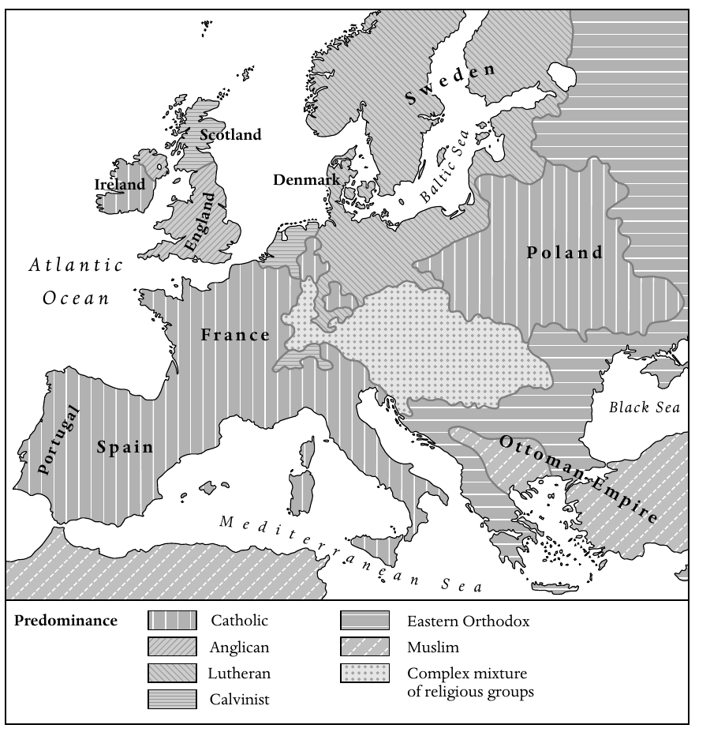

<!-- PDF page 16; original page 1 -->

# 导论

**斯图尔特·J.布朗、蒂莫西·塔克特**

每一个历史时代都是转型的时代。不过，显而易见，从十七世纪中叶到十九世纪初，也就是本卷所讨论的时期，基督教世界经历了一系列格外艰难的转变和挑战。到这一时期结束时，思想上与政治上的反对力量已经兴起；它们提出质疑的，不仅像新教宗教改革时期那样，是基督教教义的性质和教会的权威，而且还包括基督教这一宗教本身的真实性。然而，同一时期也出现了许多推动宗教重振与更新的运动，其活力和影响引人瞩目，并在各国国教会内部引发了重大争论。作为这一时期结束标志的革命浪潮，则进一步强化了宗教对抗与宗教更新这两股潮流。

在这里，两位编者将简要指出这部集体研究中浮现的几个主要主题。首先概述近代早期基督教世界的地理格局，随后分别讨论构成本卷三大概念支柱的主题：启蒙、复兴与革命。我们认为，这些主题并不是彼此独立、各自分离的历史线索，而是在整个时代中紧密交织，相互回应，相互作用。

## 近代早期基督教世界的地理格局

十七世纪中叶前后，欧洲刚刚走出基督徒之间长期而残酷的宗教战争。到三十年战争及不列颠群岛内战结束时逐渐定型的宗派地理格局，此后只有少量变化，一直延续到二十世纪。罗马天主教信仰此时已经<!-- PDF page 17; original page 2 -->在欧洲南部和地中海西部的广大地区占据压倒性优势，其中包括葡萄牙、西班牙、法国和意大利半岛；在爱尔兰大部分地区、奥属低地、巴伐利亚、波兰和立陶宛，也同样如此。另一方面，新教各宗派则在欧洲北部和中北部牢牢扎根：从大不列颠和爱尔兰北部，一直延伸到被称为“路德宗之海”的波罗的海地区，包括北德意志大多数邦国、普鲁士、斯堪的纳维亚、芬兰、爱沙尼亚和拉脱维亚。再往南一些，在西里西亚、德意志西南部以及瑞士高原，也能见到稳固的新教据点。

*地图1　约1700年的欧洲宗派分布。图中表示各地区占优势的宗教或宗派；原图英文标签的中文对照如下。*

| 图例英文 | 中文 |
| --- | --- |
| Catholic | 天主教 |
| Anglican | 圣公会 |
| Lutheran | 路德宗 |
| Calvinist | 加尔文宗 |
| Eastern Orthodox | 东正教 |
| Muslim | 伊斯兰教 |
| Complex mixture of religious groups | 多种宗教群体复杂混居 |

图中地名：Sweden，瑞典；Scotland，苏格兰；Ireland，爱尔兰；Denmark，丹麦；England，英格兰；Poland，波兰；France，法国；Portugal，葡萄牙；Spain，西班牙；Ottoman Empire，奥斯曼帝国。海域名称：Baltic Sea，波罗的海；Black Sea，黑海；Mediterranean Sea，地中海；Atlantic Ocean，大西洋。

当然，几乎所有地方都有持不同信仰的少数群体，在国家支持的正统宗教所形成的汪洋中艰难生存。不过，宗派分布的<!-- PDF page 18; original page 3 -->复杂混杂，在欧洲中部一条地带上尤为突出：它从西面的联省共和国出发，横贯德意志中南部、奥地利、波希米亚、匈牙利和特兰西瓦尼亚。在这里，天主教徒、路德宗信徒、加尔文宗信徒、各种新教少数派以及犹太人，以复杂的相邻与混居方式彼此竞争，仿佛处于一场持续不断的宗教冷战之中。再往东、往南，天主教和新教人口分布逐渐与东正教会的势力范围交错；东正教在俄罗斯帝国和巴尔干半岛占据主要地位。不过，巴尔干还存在人数可观的穆斯林少数群体，他们是长期处于奥斯曼土耳其统治之下而改宗的欧洲人。事实上，1648年以后，欧洲只有这一地区仍发生大规模宗教战争；基督徒与土耳其人的斗争时断时续，延续到十八世纪末。

尽管欧洲仍是基督教世界的核心地带，聚集了远多于其他地区的基督徒，但在此前的时期，欧洲人已经以前所未有的规模扩展到地球的广大区域。到十七世纪中叶，基督教传教士与移民已经接触到世界上所有主要文明；他们有时跟随战士和探险家的足迹，有时则独自向前推进。

在墨西哥、加勒比海地区以及中南美洲的广大区域，西班牙和葡萄牙的托钵修会会士与耶稣会士，使原住民持久地皈依了基督教。基督教也已经影响到墨西哥湾以北的北美广大地区。不过，在十七世纪中叶，这里的欧洲移民点仍然相对稀少，只是顽强地依附于海岸和河谷。与西班牙人和葡萄牙人的工作相比，这些地区的欧洲人在使原住民改宗方面，远没有取得同样的成功。

撒哈拉以南非洲的广大地域，情况大体相似。欧洲人的存在主要表现为沿海贸易站，以及刚刚在好望角建立的一个小型荷兰殖民地。然而，在两个区域，即刚果和安哥拉沿海，以及赞比西河下游和莫桑比克沿海，来自葡萄牙和其他国家的修会会士成功建立了一些根基脆弱的基督徒社群，它们一直存续到十九世纪。

在亚洲，葡萄牙在印度次大陆西岸占有的小小果阿省，成为向印度南部和锡兰，即斯里兰卡，开展重要传教活动的桥头堡。少数无畏的耶稣会士和嘉布遣会士向北深入莫卧儿帝国的腹地，甚至进一步进入尼泊尔和西藏。再往东，基督教传教的前景似乎更有希望。西班牙人在<!-- PDF page 19; original page 4 -->菲律宾取得了惊人的成功，在三代人的时间里，使相当大一部分人口持久地改宗。葡萄牙人和来自其他几个国家的修会会士，也在中国、印度支那、印度尼西亚和日本，为相当数量的人施行了洗礼。不过，到1650年前后，随着德川幕府发动大规模迫害基督徒的运动，日本先前取得的许多成果已经开始瓦解。

在十七世纪晚期和十八世纪，基督教在世界某些地区继续扩展。西班牙与葡萄牙在美洲继续推动改宗，进入上、下加利福尼亚，以及亚马孙和巴塔哥尼亚的部分地区。在英属和法属北美，改宗人数仍然相对有限，不过这一时期却有大量信奉不同基督教宗派与教派的欧洲人迁入，并永久定居。十八世纪还出现了最早有系统的新教传教活动，尤其是在敬虔派的影响下，他们资助了北美、非洲和印度的传教工作。但最引人注目的新增信徒，也许是美洲和加勒比海各地种植园中的非洲黑人奴隶。来自初生的美国的自由黑人，本身也将在西非若干地区的传教活动中发挥重要作用。

然而，在其他地方，基督教传教却遭遇重大失望和挫折。十八世纪，国家对基督教教士和平信徒的打击，从日本扩展到中国、印度支那、暹罗和朝鲜。此外，到十八世纪下半叶，几乎世界各地的传教士人数都急剧减少，整体活力也普遍衰退。这在一定程度上是因为非西方国家越来越把基督教视为欧洲政治与文化帝国主义的一部分。但这种衰退，也部分地与欧洲内部的发展有关：欧洲国家争夺帝国势力的竞争日益激烈；教皇否定了耶稣会试图使基督教礼仪适应非欧洲文化的努力；几个欧洲政权广泛打击修会教士，并最终取缔耶稣会；修会教士和教区教士的新成员数量也都大幅下降。

## 启蒙

欧洲内部的这些发展，许多都可以同十七世纪末兴起的一系列思想潮流联系起来，这些潮流通常被称为“启蒙运动”。这场广泛的思想运动有多种根源。从某种意义上说，它是对宗教<!-- PDF page 20; original page 5 -->战争的反应；这种战争直到十七世纪中叶还在蹂躏欧洲，而新教和天主教国家的不宽容政策，又有使战争重新爆发的危险。例如，1685年法国撤销《南特敕令》，1730年萨尔茨堡驱逐新教徒，以及十八世纪大不列颠和爱尔兰针对天主教徒的惩罚性法律，都是这样的例子。有些人开始主张，显然已经到了应当设想另一种社会组织形式的时候：这种形式不再要求强行实现宗教一致。欧洲人通过日益发展的全球贸易和交流网络，越来越多地接触到世界其他宗教与文化，这也影响了新的思想潮流。这种接触使一些欧洲思想家对研究其他宗教产生浓厚兴趣，例如，印度的所谓英国“东方学家”就协助搜集和出版了印度教的古代经典。这类研究使某些欧洲思想家产生新的文化相对主义意识，并相信各种宗教体系，甚至基督教，也在很大程度上是人的建构。不过，也许最重要的因素还是科学的兴起：它提供了一种不依赖宗教权威、而用来理解自然与人类的途径。人们相信，细致观察、数学分析和逻辑推算，也就是理性的力量，将揭示支配自然世界和社会世界的规律。实验方法所采用的实验，可以由各地的人重复进行；它由此证明的可靠真理，是一切有理性的男女都能够接受的。科学将指明改善物质生活的实际途径，也将以社会的自然法则和人的自然权利为基础，指明新的社会组织形式。

“科学革命”的早期倡导者确信，科学的学说为基督教上帝的存在提供了更有力的证明，甚至可能有助于恢复基督教世界的统一。他们相信，科学所揭示的内容印证了《圣经》的启示，同时又以普遍的自然法则为基础，使基督教获得更合乎理性的根据。这反过来将减少宗派分裂和冲突。他们坚持，自然法则和《圣经》的伦理教诲出自同一个源头，即一位仁慈的上帝；他创造了和谐的宇宙，并希望人类在仁爱和相互尊重之中共同生活。接受启蒙理想的人，大多数仍然留在基督教传统之内：他们把人的理性与自然法则视为上帝创造秩序的一部分，并寻求使基督教获得一种更温和、更重伦理的精神。长老宗教士、著名历史学家威廉·罗伯逊，就是这种基督教温和主义的代表。他于1762至1793年担任爱丁堡大学校长，也是公认的<!-- PDF page 21; original page 6 -->苏格兰教会领袖。他力图使这个教会摆脱十七世纪激烈的加尔文主义，转向一种重视实际道德与宽容的理性基督教。这些倾向也深刻影响了一代欧洲君主；他们以启蒙原则为理由，加强对领地内各教会的控制。普鲁士的腓特烈二世、西班牙的卡洛斯三世，尤其是奥地利的约瑟夫二世等“开明专制君主”，颁布了一系列影响广泛的敕令：从强制实行宗教宽容，到重组教会，乃至没收部分教会土地和取缔某些修会。

虽然大多数启蒙运动倡导者仍处于广义的基督教正统范围内，但许多人逐渐摆脱对《圣经》启示的严格依赖，转而接受一种自然宗教，认为仅凭理性就足以引导人走向真理。他们问：如果理性和自然法则已经揭示了造物主的心意，为什么还需要《圣经》的启示？这条道路使一些人走向自然神论，即相信存在一个第一因、一位神圣的创造者；他把关于自身属性和伦理生活基本原则的知识，天赋地赋予了人类。在约翰·托兰或伏尔泰这样的自然神论者看来，人类天赋的神性知识构成世界各大宗教的基础，而具有启蒙思想的男女，如今能够剥除历代积累的附加物和腐败成分，接受上帝存在及其道德要求这些根本真理。然而，另一些启蒙思想家超越了自然神论，对上帝的存在、或者任何由神规定的道德，抱持激进的怀疑态度。诚然，这类思想家是少数，但其中包括德尼·狄德罗、霍尔巴赫男爵，以及可能也应列入的大卫·休谟等有影响的人物。就其较极端的表现而言，晚期启蒙运动可以被理解为从根本上反对基督教，并成为一种完全世俗的世界秩序的先驱。

## 复兴

十七世纪晚期，新教和天主教会内部都出现了基督教更新与复兴的运动。新教的复兴，最初发生在三十年战争的破坏之后、中欧某些流离失所并丧失财产的新教社群之中。有些新教群体对《威斯特伐利亚和约》在各邦强加的宗教安排感到疏离；他们在依据世俗法律确立的教会中找不到精神家园，并且觉得自己随时可能受到迫害。作为回应，<!-- PDF page 22; original page 7 -->他们在既有的教会和国家秩序之外，发展出自己的宗教表达形式，强调个人归信、经常研读《圣经》、组织祈祷和灵修的小型聚会、严格而有规律的生活方式，以及慈善实践。有些人相信千禧年即将来临，并热切期待基督再临。这些新教群体被称为敬虔派。印刷术、书信联系网络、欧洲人向新大陆的迁移，以及其中一个群体的传教热忱，共同推动了这场运动的传播。这个群体是一小群来自波希米亚的新教难民，他们定居于萨克森的亲岑多夫伯爵庄园，其成员后来被称为摩拉维亚弟兄会。十八世纪三十年代，新教复兴传到不列颠，最初是在威尔士，并在很大程度上处于国教会之外的劳动男女中获得支持。约翰·卫斯理和乔治·怀特菲尔德情感充沛的巡回讲道，吸引了大批群众，常常形成规模庞大的露天集会；卫斯理则以欧洲大陆敬虔派为榜样，把归信者组织为卫理宗的班会。大约在同一时期，一系列宗教奋兴席卷北美的英国殖民地，改变并更新了当地宗教生活，这就是后来所称的“大觉醒”。

受到这种发自内心、重视亲身体验的信仰影响的，并不只有新教教会。从十七世纪中叶开始，法国罗马天主教会也经历了一场被称为詹森主义的灵性更新运动，它与新教复兴有一些相似之处。詹森主义在很大程度上，是对天主教改革中那种充满胜利自信的“巴洛克式”正统的反应，尤其是对耶稣会所推崇的形式的反应。深受圣奥古斯丁著作影响的詹森主义者，力图重新强调预定论，以及个人通过上帝恩典而归信的重要性，并培养富有情感的虔敬生活。他们建立信徒社群，实践严格的道德，提升平信徒的作用，并从事慈善活动。詹森主义的某些支流，尤其是十八世纪初更具民众色彩的“痉挛派”，相信神迹医治，并认为自己受到圣灵感动而说出预言。当天主教当权者和波旁王朝的国王企图压制这场运动时，詹森主义者日益政治化，反教权言辞和对绝对君主制的反对，都随之加强。十八世纪，尽管教皇谴责了詹森主义的某些方面，这场运动仍在尼德兰、德意志、西班牙和意大利北部的天主教徒中传播。

<!-- PDF page 23; original page 8 -->

这些基督教复兴运动，最初并不反对当时的科学探索和启蒙运动。事实上，许多怀抱新宗教热忱的人，也分享着科学和理性所激发的、对于社会改善的热切希望。敬虔派大力支持普及教育和高等教育；由敬虔派主导的哈勒大学推动科学研究，尤其重视科学知识的实际应用，同时也研究世界各地的文化。在不列颠，约翰·卫斯理热心研习科学与哲学，还写过学术性的认识论论著。詹森主义者中有法国杰出科学家布莱兹·帕斯卡；他把科学知识和宗教知识都建立在自己的亲身体验之上。受启蒙运动影响的人与受复兴运动影响的人，可以联合批评既有的教会和国家秩序，并共同推动扩大教育的计划。此外，新教不从国教者与哲学家也携手合作，最早有组织地抨击奴隶贸易和奴役非洲黑人的制度。然而，福音派基督徒强烈反对晚期启蒙运动中日渐流行的自然神论和怀疑主义；对于启蒙哲人提倡温和、理性而重伦理的基督教，并因而淡化人类罪性、永罚和基督十字架赎罪等教义的倾向，他们也越来越深恶痛绝。到十九世纪初，这种不信任已经发展为根本性的对立。

## 革命

十八世纪后期席卷大西洋世界的革命浪潮，其起源主要在本卷讨论范围之外。从长期发展来看，这些革命可以同争夺帝国和海上贸易利润的地缘政治竞争联系起来，尤其是大不列颠与法国之间的斗争。英国在七年战争中获胜后，英国议会试图加强对其扩张后的陆上帝国的财政与政治控制，北美英语殖民地对此进行了激烈抵抗。在1775至1783年间，这种抵抗导致独立宣言、漫长战争以及一个新共和国的形成。1789年法国革命爆发，其直接原因是君主政权试图避免财政崩溃，而这种危机源自一个世纪的帝国冲突，其中也包括法国对美国战争的军事干预。不过，这并不是说，启蒙运动和基督教复兴运动没有在革命中发挥重要作用。许多<!-- PDF page 24; original page 9 -->启蒙哲人持续猛烈抨击某些政治制度，因为这些制度被认为不符合造物主赋予人类、并由理性揭示的自然法则和“不可剥夺的权利”。这样的“腐败”制度，包括遥远的英国君主政权和在殖民地没有适当代表的情况下向其征税的帝国议会，也包括把财政特权给予某些社会等级或法人团体的法国君权神授君主制。此外，十八世纪三四十年代的大觉醒，在塑造美国人的身份认同，以及在天意之下共享命运的意识方面，发挥了重要作用。在法国，整个十八世纪詹森主义者对教会和国家的批评，也促成了一种革命话语的形成。

革命一旦爆发，就使基督徒发生分裂。对一些基督徒而言，革命是反叛神所规定的秩序，是出于罪而对“在上有权柄者”，也就是上帝所设立的世俗权威的反抗。然而，对另一些人而言，革命属于上帝为人类安排的天意计划，是一场有望清除腐败、使教会和国家恢复较纯洁形式的运动；它将结束教士特权，扩大宗教宽容，并提升人类的追求。美、法两国革命都为反奴隶制运动激起了强大支持，这使许多支持革命的基督徒感到欣慰。

美国革命确实以自由之名，激发了对确立国教会这一原则的攻击，但它并未造成与基督教的决裂。在法国，革命最终却走得远得多。最初，革命支持在宗教宽容的制度下改革天主教会；然而，这些改革却导致了与罗马的分裂。到了1793年，法国最激进的革命者转而反对基督教本身，把它描绘为旧秩序的思想支柱和反动势力的集结中心，因此必须加以扫除。诚然，即使最激进的去基督教化者，通常也仍然依恋耶稣的伦理教导；耶稣有时甚至被描绘成一位“无套裤汉革命者”。然而，在“恐怖统治”的高峰期，他们仍以残酷而坚决的方式，攻击一切天主教和新教教士，以及教会的物质设施。尽管去基督教化运动到十八世纪九十年代末有所缓和，各教会仍遭受革命官员程度不一的骚扰和迫害。此外，随着革命军和拿破仑的军队越出法国边界，他们又把革命的反教权、甚至反基督教政策传播到欧洲许多其他地区。因此，法国革命的宗教政策成为基督教历史上的一个重要转折点。

<!-- PDF page 25; original page 10 -->

对基督教的猛烈攻击，也使欧洲的新教和天主教地区进一步出现基督教复兴运动。其中有千禧年运动，因为许多人日益相信，政治剧变预示着重大的灵性事件，甚至可能预示基督第二次降临。还有一些基督徒的民众抵抗运动，发生在意大利、西班牙、俄罗斯和德意志，反对被视为“无神”的法国革命政权及拿破仑的统治。此外，许多艺术家和知识分子赞美一种重感情的宗教，渴望恢复基督教世界。在北美，与此相关的复兴活动被称为“第二次大觉醒”。这些复兴运动促使人们再次猛烈抨击奴隶制的罪恶，并推动各大国于1815年就终止奴隶贸易达成协议。它们还激发了新教海外传教活动的大幅增长和天主教海外传教的复苏，为“大传教世纪”及基督教再度向更广阔世界传播奠定了基础。

## 本卷的安排

读者将会看到，本卷各篇文章分为五编。第一编的四章考察十七、十八世纪欧洲的教会、国家与社会问题，旨在广泛概述这一时期基督徒生活经验的政治与社会背景。第二编讨论法国革命以前、主要发生在欧洲的基督徒生活的各种问题：从天主教和新教教士群体的性质与出身，到基督教教育、讲道与演说、宗教建筑、基督教与性别，以及基督教与犹太人。第三编尤其关注影响基督教世界的变化来源，包括科学革命、启蒙运动，以及新教福音派和天主教詹森主义的各类运动。这一编的最后一章，探讨十八世纪法国革命之前兴起的宽容与基督徒再合一的潮流。第四编叙述非欧洲世界的基督教，考察基督徒移民和传教士在世界五个主要地区的推进，也讨论基督教同世界其他主要宗教之间关系的一般问题。最后一编接续讨论“革命时代”的三个中心课题：基督教与美国革命、法国革命和反奴隶制运动的关系。末章论述1790至1815年间的基督教复兴，概述<!-- PDF page 26; original page 11 -->本卷所讨论时期结束时欧洲基督教的状况。

任何一部这样的集体著作，都不可能期待包罗万象。读者在这里很少会读到澳大利亚、新西兰和大洋洲这些广大区域，因为最早的基督徒移民和传教士，在本卷时期的末尾才刚刚抵达那里。本卷也未讨论处于东方正教会传统范围之内、却与罗马教皇保持共融的各类群体，包括东欧所谓“合一派”，以及中东的马龙派、亚美尼亚教会和科普特教会中的某些群体。同样，本卷没有讨论宗教和教士在十九世纪初伊比利亚美洲各国独立运动中的作用。不过，其中一些主题，将在讨论十九世纪基督教的下一卷中处理。

<!-- PDF page 27; original page 12 -->

（原书此页空白。）
