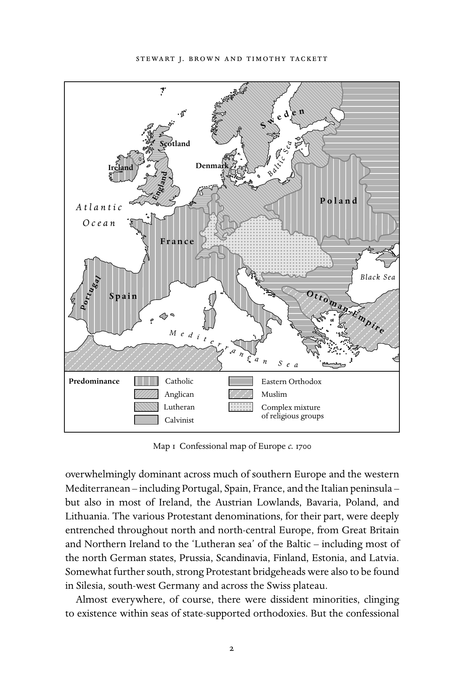

# 导论：英文转换底稿

<!-- PDF page 16; original page 1 -->

## Introduction

### s t e wa rt j. b r o w n a n d t i m ot h y tac k et t

Every historical age is an age of transition. But it is clear that from the mid- seventeenth century to the early nineteenth century – the period covered in the present volume – the Christian world would confront a series of exceptionally difficult transformations and challenges. By the end of this period, forces of intellectual and political opposition had arisen that put into question not only the nature of Christian doctrine and the authority of the church – as in the age of the Protestant Reformation – but also the authenticity of the Christian religion itself. Yet the same period also gave birth to a number of movements for religious revitalization and renewal, remarkable for their energy and impact, movements that would arouse major controversies within the established churches. The great wave of revolutions that marked the end of the period would serve to intensify the currents of both religious confrontation and religious renewal.

Here the editors will briefly underline some of the major motifs which emerge from this collective study. After a rapid survey of the geography of Christendom during the early modern period, we will touch on each of the three central themes that serve as the conceptual troika for this volume – Enlightenment, Reawakening, and Revolution. We will argue that those themes did not exist as independent and separate historical strands, but were inextricably interwoven, reacting and interacting with one another throughout the age.

### The geography of early modern Christendom

Towards the middle of the seventeenth century, Europe was just emerging from a long series of brutal inter-Christian wars of religion. The basic con- fessional geography that crystallized by the end of the Thirty Years’ War and the civil wars fought in the British Isles persisted with only minor mod- ifications into the twentieth century. The Roman Catholic faith was now

<!-- PDF page 17; original page 2 -->

overwhelmingly dominant across much of southern Europe and the western Mediterranean – including Portugal, Spain, France, and the Italian peninsula – but also in most of Ireland, the Austrian Lowlands, Bavaria, Poland, and Lithuania. The various Protestant denominations, for their part, were deeply entrenched throughout north and north-central Europe, from Great Britain and Northern Ireland to the ‘Lutheran sea’ of the Baltic – including most of the north German states, Prussia, Scandinavia, Finland, Estonia, and Latvia. Somewhat further south, strong Protestant bridgeheads were also to be found in Silesia, south-west Germany and across the Swiss plateau.

Almost everywhere, of course, there were dissident minorities, clinging to existence within seas of state-supported orthodoxies. But the confessional

<!-- PDF page 18; original page 3 -->

jumble was particularly complex in a central band of territories extending from the United Provinces in the west, across south-central Germany, Austria, Bohemia, Hungary, and Transylvania. Here intricate juxtapositions and inter- mixtures of Catholics, Lutherans, Calvinists, various Protestant minorities, and Jews, jostled each other in a kind of continuing religious cold war. Further east and south the Catholic and Protestant populations blended into the sphere of the Eastern Orthodox churches, largely dominant in the Russian Empire and the Balkans. But the latter also contained a sizable Muslim minority of Europeans converted during the long occupation by the Ottoman Turks. This was in fact the one area of major religious warfare in Europe after 1648, with Christians and Turks locked in a struggle that continued intermittently to the end of the eighteenth century.

Although Europe remained the heartland of Christendom, home to by far the largest concentration of Christians, the previous period had also seen an unprecedented expansion of Europeans across much of the planet. By the mid- dle of the seventeenth century, Christian missionaries and settlers – sometimes following in the train of warriors and explorers, sometimes advancing on their own – had made contact with all of the major world civilizations.

Throughout large areas of Mexico, the Caribbean, and Central and South America, Spanish and Portuguese mendicants and Jesuits had permanently converted the indigenous populations to the faith. Christianity had also touched wide areas of North America above the Gulf of Mexico. But here in the mid-seventeenth century, European settlements were still relatively sparse, tenaciously clinging to coastlines and river valleys. Compared to the efforts of the Spanish and Portuguese, the Europeans in these areas had been far less successful in converting native peoples.

Much the same could be said for the great expanses of Sub-Saharan Africa. For the most part the European presence consisted of coastal trading stations and a small Dutch colony only just established at the Cape of Good Hope. Yet in two zones – the coasts of Congo and Angola and the lower Zambezi and coastal Mozambique – regulars from Portugal and other nations had succeeded in establishing tenuous Christian communities that survived into the nineteenth century.

In Asia, the small Portuguese province of Goa on the west coast of the Indian subcontinent served as a bridgehead for significant missionary activities throughout south India and Ceylon (Sri Lanka), with a few intrepid Jesuits and Capuchins pushing north to the heart of the Mughal Empire and beyond into Nepal and Tibet. Further east, the situation appeared even more hopeful for the Christian mission. The Spanish had won spectacular success in the

<!-- PDF page 19; original page 4 -->

Philippines, permanently converting much of the population within three generations. The Portuguese and the regulars of several other nations had also achieved substantial numbers of baptisms in China, Indochina, Indonesia, and Japan – although much of the progress achieved in the latter region was beginning to crumble by 1650 as the Tokugawa Shogunate launched a broad movement of Christian persecution.

The late seventeenth and eighteenth centuries were to witness a continuing expansion of Christianity in certain areas of the world. Spain and Portugal pur- sued their conversions in the Americas, moving into the Californias and parts of Amazonia and Patagonia. In British and French North America, conversions remained relatively limited, although the period saw a huge influx of perma- nent European settlers, professing a wide variety of Christian denominations and sects. The eighteenth century also marked the advent of the first systematic Protestant missions activity, especially under the influence of the Pietists, who sponsored missionary efforts in North America, Africa, and India. But perhaps the most spectacular new conversions occurred among black African slaves on plantations across the Americas and the Caribbean. Free blacks from the nascent United States would themselves play an important role in proselytizing certain regions of West Africa.

Elsewhere, however, Christian missions experienced major disappointments and setbacks. In the eighteenth century, state-sponsored attacks on the Chris- tian clergy and laity spread from Japan to China, Indochina, Siam, and Korea. Moreover, by the second half of the eighteenth century almost all areas of the world saw a sharp decline in the numbers of missionaries and a general flagging of energy. In part, it was a question of non-western nations com- ing increasingly to identify Christianity with European political and cultural imperialism. But in part the decline was also related to developments occurring within Europe itself: to the increasing rivalries for empire between European nations; to the pope’s rejection of Jesuit efforts to adapt Christian rites to non-European cultures; to the broad attacks on the regular clergy by several European regimes, culminating in the suppression of the Society of Jesus; and to a sharp decrease in recruitment among both regular and secular clergies.

### Enlightenment

Many of these developments occurring within Europe can be linked to an array of intellectual trends emerging near the end of the seventeenth century and commonly described as ‘the Enlightenment’. This sweeping intellectual movement had varied roots. It was in one sense a reaction to the religious

<!-- PDF page 20; original page 5 -->

warfare that had so devastated Europe up through the mid-seventeenth cen- tury and to the politics of intolerance by both Protestant and Catholic states that threatened to revive such warfare: for example, the Revocation of the Edict of Nantes in France in 1685, or the expulsion of the Protestants from Salzburg in 1730, or the anti-Catholic penal laws in eighteenth-century Britain and Ireland. Surely, some began arguing, it was time to envisage forms of social organi- zation that did not require efforts to impose religious uniformity. The new intellectual trends were also influenced by the growing European exposure to other world religions and cultures through the developing networks of global trade and communication. This exposure promoted among some European thinkers an intense interest in studying other religions – thus, for instance, the so-called British ‘Orientalists’ in India, who helped to gather and publish the ancient texts of Hinduism. Such studies would lead some European thinkers to a new sense of cultural relativism and a belief that religious systems, even Chris- tianity, were largely human constructs. Perhaps most important, however, was the rise of science, which promoted an alternative means, apart from religious authority, for understanding nature and humanity. Careful observation, math- ematical analysis, and logical calculation – the power of reason – would, it was believed, reveal the laws which governed the natural and the social worlds. The experimental method, with experiments that could be repeated by people everywhere, demonstrated sound truths which all rational men and women could accept. Science would show the way to practical improvements in mate- rial life, and also to new forms of social organization, based on the natural laws of society and the natural rights of man.

The early proponents of the ‘Scientific Revolution’ were convinced that its teachings provided more potent proofs of the existence of the Christian God and might even help restore the unity of Christendom. The revelations of sci- ence, they believed, confirmed the revelations of Scripture, while at the same time ensuring a more rational grounding for the Christian religion, based on the universal laws of nature. This in turn would diminish confessional divi- sions and strife. The laws of nature and the ethical precepts of Scripture, they insisted, came from the same source – that is, a benevolent God, the creator of a harmonious universe, who intended humankind to live together in charity and mutual respect. Most of those who embraced the ideals of the Enlight- enment remained within the Christian tradition, viewing human reason and natural laws as aspects of God’s created order, and seeking to bring a more moderate and ethical spirit to Christianity. An example of this Christian moder- atism was William Robertson, Presbyterian clergyman, celebrated historian, Principal of the University of Edinburgh from 1762 to 1793, and acknowledged

<!-- PDF page 21; original page 6 -->

leader of the Church of Scotland, who endeavoured to move that church away from the fierce Calvinism of the seventeenth century towards a rational Christianity emphasizing practical morality and toleration. Such tendencies also had a powerful influence on a generation of European monarchs, who used Enlightened precepts as justifications for exercising an increased control over the churches within their domains. ‘Enlightened despots’, among them Frederick II of Prussia, Charles III of Spain, and above all Joseph II of Austria, issued sweeping edicts ranging from the imposition of toleration to the reor- ganization of churches and even the seizure of some ecclesiastical lands and the suppression of certain clerical orders.

While most proponents of the Enlightenment remained within a broadly defined Christian orthodoxy, many were drawn away from a strict dependence upon scriptural revelation to embrace a natural religion, which viewed reason as a sufficient guide to truth. What was the need for scriptural revelation, they asked, if reason and the natural laws revealed the mind of the Creator? Such a path led some to deism, or the belief in a first cause, a divine Creator, who had instilled in humans an innate knowledge of his attributes and the fundamentals of the ethical life. For deists, like John Toland or Voltaire, this innate human knowledge of the godhead lay at the foundation of all the great world religions, and Enlightened men and women could now strip away the accretions and corruptions of the centuries, and embrace the essential truths of God’s existence and his moral imperatives. Other Enlightened thinkers, however, went beyond deism to a radical scepticism about the existence of God or of any divinely ordained morality. Such thinkers, to be sure, were a minority, but they included such influential figures as Denis Diderot, the baron d’Holbach and possibly David Hume. In its more extreme expressions the later Enlightenment could be conceived as fundamentally opposed to Christianity and as a precursor of a purely secular world-order.

### Reawakening

The late seventeenth century also witnessed the emergence of movements of Christian renewal and reawakening within both the Protestant and Catholic churches. The Protestant reawakening first emerged among certain displaced and dispossessed Protestant communities in central Europe following the devastation of the Thirty Years’ War. Some Protestant groups had felt alien- ated from the religious settlement imposed within their state by the Peace of Westphalia; they found no spiritual home within the church as it was estab- lished under the civil law and they felt vulnerable to persecution. In response,

<!-- PDF page 22; original page 7 -->

they developed their own forms of religious expression outside the estab- lished order in church and state, emphasizing personal conversion, regular Bible study, the formation of conventicles for prayer and devotion, a strict methodical manner of living, and the practice of charity. Some believed that the millennium was imminent, and they lived in the fervent expectation of Christ’s return. These Protestant groups became known as Pietists, and their movement spread, assisted by the printing press, networks of correspondence, the migration of Europeans to the New World, and the missionary zeal of one of their groups, the small colony of Protestant Bohemian refugees that had settled on the Saxon estate of Count Zinzendorf and whose members became known as the Moravian brethren. The Protestant awakening reached Britain, initially Wales, in the 1730s, finding support among labouring men and women who were largely outside the established churches. The emotional itinerant preaching of John Wesley and George Whitefield attracted vast crowds, often in great outdoor meetings, while Wesley organized his converts on the model of continental Pietists into Methodist class meetings. At about the same time, a series of revivals swept through the British colonies in North America, trans- forming and renewing the religious life in what became known as the Great Awakening.

It was not only the Protestant churches that were affected by a heart-felt and experiential faith. Beginning in the mid-seventeenth century, the Roman Catholic Church in France also experienced a movement of spiritual renewal known as Jansenism that had some similarities to the Protestant awakenings. Jansenism emerged largely as a reaction against the triumphalist ‘Baroque’ orthodoxy of the Catholic Reformation – especially as promoted by the Society of Jesus. Profoundly influenced by the writings of St. Augustine, Jansenists sought to revive an emphasis on predestination and individual conversion through the grace of God, and to cultivate an emotional devo- tional life. They formed communities of the faithful, practised a rigorous morality, elevated the role of the laity, and engaged in acts of charity. Some strands of Jansenism, especially the more popular ‘Convulsionaries’ of the early eighteenth century, believed in miraculous healings and felt moved by the Holy Spirit to prophesize. When the Catholic establishment and the Bour- bon kings sought to repress the movement, Jansenists became increasingly politicized, intensifying both their anticlerical rhetoric and their opposition to the absolute monarchy. In the course of the eighteenth century, despite the condemnation of some aspects of Jansenism by the papacy, the movement spread among Catholics in the Netherlands, Germany, Spain, and the north of Italy.

<!-- PDF page 23; original page 8 -->

The Christian awakenings were not initially opposed to the contemporary movements of scientific investigation and the Enlightenment, and indeed many of those embracing the new religious zeal also shared in the fervent hopes of social improvement raised by science and reason. The Pietists were strong advocates of both popular and higher education, and the Pietist-dominated University of Halle promoted the study of science, especially the practical applications of scientific learning, and of world cultures. In Britain, John Wes- ley was a keen student of science and philosophy, and wrote learned treatises on epistemology. The Jansenists included among their number Blaise Pascal, a leading French scientist, who grounded both his scientific and his religious knowledge upon his personal experience. Those influenced by the Enlight- enment and those influenced by the Awakening could unite in criticizing the established order in church and state, and in promoting programmes aimed at the extension of education. Protestant Dissenters and philosophers joined forces, moreover, in the first concerted attacks upon the slave trade and the slav- ery of black Africans. Nonetheless, evangelical Christians strenuously opposed the deism and scepticism that became prevalent in the later Enlightenment, and they grew to abhor the tendency of Enlightened philosophers to promote a moderate, rational, and ethical Christianity, which downplayed the doctrines of human sinfulness, eternal damnation, and Christ’s atonement on the cross. By the beginning of the nineteenth century, this distrust had evolved into fundamental opposition.

### Revolution

The wave of revolutions that swept across the Atlantic world in the later eighteenth century originated in developments that are largely outside the concern of this volume. In their long-term development, the revolutions can be linked to geopolitical competition for empire and the profits of maritime trade, especially the struggle between Great Britain and France. In the after- math of Britain’s victory in the Seven Years’ War, the English-speaking colonies in North America violently resisted efforts by the British parliament to impose greater fiscal and political control over its expanded land empire, and this resis- tance led between 1775 and 1783 to a declaration of independence, a prolonged war, and the formation of a new republic. The French Revolution began in 1789 as a direct result of the monarchy’s efforts to stave off fiscal collapse resulting from a century of imperial conflict, including France’s military intervention in the American war. This is not to say, however, that the Enlightenment and Christian Awakenings did not play significant roles in the revolutions. Many

<!-- PDF page 24; original page 9 -->

Enlightened philosophers directed a relentless assault on political institutions that were seen as not reflecting the natural laws and ‘inalienable rights’ of man, as endowed by the Creator and revealed through reason. Such ‘corrupt’ political institutions included a distant British monarchy and an imperial par- liament imposing taxation on its colonies without due representation, or a divine-right French monarchy granting fiscal privileges to certain social orders or corporate bodies. Moreover, the Great Awakening of the 1730s and 1740s had played an important role in shaping an American identity and a sense of shared destiny under Providence. In France, the Jansenist criticisms of church and state throughout the eighteenth century contributed to the formation of a revolutionary discourse.

Once the revolutions began, they divided Christians. For some Christians, revolution was a rebellion against the divinely ordained order, a revolt, born of sin, against the ‘powers that be’, the worldly authority provided by God. For others, however, revolution was part of the providential plan for humankind, a movement that promised to strip away corruption and restore both church and state to purer forms; it would end clerical privilege, extend religious toleration, and elevate human aspirations. Many of these Christian supporters welcomed the way in which both the American and French revolutions aroused powerful support to the anti-slavery movement.

While the American Revolution did inspire, in the name of freedom, attacks upon the principle of established churches, it did not bring a break with Chris- tianity. In France, however, the revolution ultimately went much further. After an initial period of support for a reformed Catholic Church within a regime of religious toleration – reforms that led, however, to a schism with Rome – the most radical French revolutionaries turned in 1793 against Christianity itself, portraying it as the ideological prop of the old order and a rallying cen- tre for reaction, which would have to be swept away. To be sure, even the most radical de-Christianizers commonly maintained an attachment to the ethical teachings of Jesus, sometimes portrayed as a ‘sans-culottes revolutionary’. Yet at the height of the ‘Reign of Terror’ they pursued their attacks on all clergy – Catholic and Protestant – and on the physical infrastructure of the church with brutal determination. While the de-Christianization campaign eased in the late 1790s, the churches remained subject to varying degrees of harassment and persecution by revolutionary officials. As the revolutionary and Napoleonic armies advanced beyond the borders of France, moreover, they spread the revolution’s anticlerical and even anti-Christian policies to many other parts of Europe. The religious policies of the French Revolution thus stand as a landmark in the history of Christianity.

<!-- PDF page 25; original page 10 -->

The onslaught on Christianity also led to further movements of Christian reawakening in both Protestant and Catholic Europe. These included mil- lenarian movements, as many grew convinced that the political convulsions presaged profound spiritual events, perhaps even the Second Coming of Christ. They also included popular Christian movements of resistance – in Italy, Spain, Russia, and Germany – to what was viewed as a ‘godless’ French Revolutionary and Napoleonic domination. Among many artists and intellectuals, moreover, there was a celebration of a religion of feeling and a yearning for a restored Christendom. In North America there was a related revival activity known as the Second Great Awakening. The Awakenings contributed to a renewed onslaught on the iniquities of slavery, and to an agreement among the great powers in 1815 to end the slave trade. They also inspired a major increase in Protestant overseas missions activity and a renewal in Catholic overseas missions, laying the foundations for the ‘great missionary century’ and the renewed spread of Christianity to the wider world.

### The plan of the volume

As the reader will discover, the essays in this volume have been divided into five parts. Four chapters in the first part examine the problems of church, state, and society in seventeenth- and eighteenth-century Europe. They are conceived to provide a broad overview of the political and social context of the Christian experience during the period. Part II then examines a variety of issues related to Christian life, primarily in Europe, prior to the French Revolution: from the nature and origins of the Catholic and Protestant clergies, to Christian edu- cation, sermons and oratory, religious architecture, Christianity and gender, and Christianity and the Jews. In Part III, particular emphasis is placed on the sources of change affecting the Christian world, including both the Scientific Revolution and the Enlightenment and the various movements of Protestant evangelicalism and Catholic Jansenism. A final chapter in this section explores the currents of toleration and Christian reunion that arose in the eighteenth century before the French Revolution. Part IV takes up the story of Christian- ity in the non-European world, exploring the advance of Christian settlers and missionaries in five major areas of the planet as well as the general problem of the relations of Christianity with the other major world religions. The final section of the book then picks up three central topics in the ‘Age of Revolution’: Christianity as it was involved in the American Revolution, the French Rev- olution, and the movement of opposition to slavery. The ultimate chapter, on Christian reawakenings between 1790 and 1815, provides an overview of

<!-- PDF page 26; original page 11 -->

Christianity in Europe at the end of the period under consideration in this volume.

No collective work of this kind can hope to be entirely inclusive. The reader will find very little here on the immense areas of Australia, New Zealand, and Oceania, where the first Christian settlers and missionaries were only just arriving at the end of our period. Our volume has also not included the various groups within the sphere of the Eastern Orthodox churches which were in communion with the pope in Rome – the so-called ‘Uniates’ of eastern Europe, and the Maronites and certain elements of the Armenian and Coptic churches in the Middle East. Nor is there a treatment of the role of religion and the clergy in the early nineteenth-century movements of national independence in Iberian America. However, some of these topics will be taken up in the volume on Christianity in the nineteenth century.

<!-- PDF page 27; original page 12 -->

