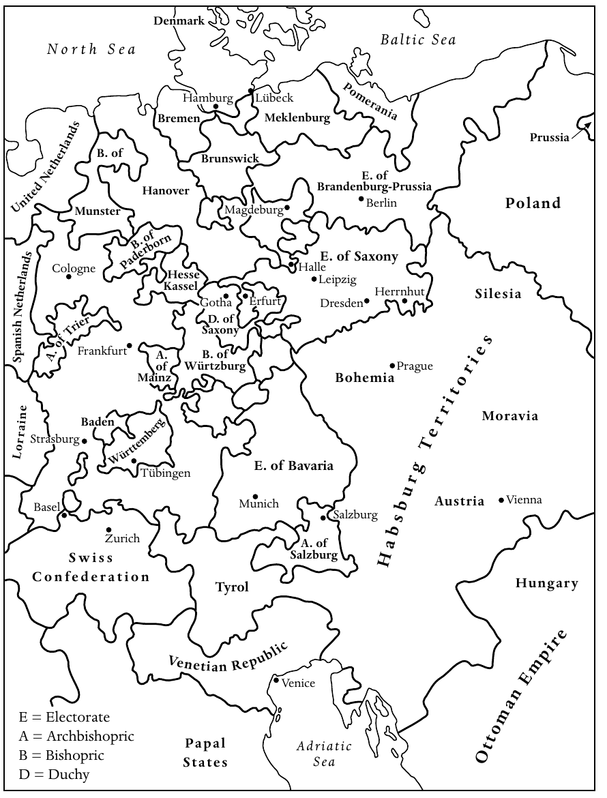

<!-- PDF page 48; original page 33 -->

# 第二章　欧洲大陆的新教

**哈特穆特·莱曼（Hartmut Lehmann）**

## 敬虔主义的兴起与衰落

在三十年战争结束至法国革命时代之间，没有哪场宗教运动，比敬虔主义更深刻地改变了欧洲大陆新教的面貌。这场宗教复兴很快被称为敬虔主义；它的追随者为所有新教徒开辟了社会、文化和政治活动的新中心。不过，也许更重要的是，受到敬虔主义思想激励的新教徒，表现出一种新的自我价值感。他们似乎相信，自己正在完成路德宗教改革尚未完成的事业。简言之，他们认为自己是更出色的新教徒。

菲利普·雅各布·施本尔（Philipp Jakob Spener）是第一代敬虔派公认的领袖。他生于1635年，在斯特拉斯堡接受神学训练，到十七世纪六十年代已出任法兰克福新教教会的首席牧师。在这个繁荣的国际贸易中心，他深切关心托付给自己的信众是否真诚信仰，因此于1670年决定，召集会众中一些最虔诚的成员，举行特别聚会。在施本尔看来，法兰克福最初的这个小型聚会，即“教会中的小教会”（ecclesiola in ecclesia），是建立某种基督徒精英群体的尝试。他希望这个群体反过来能够改善整个会众的状况，甚至有助于改革整个教会。几年后，1675年，施本尔为约翰·阿恩特一部著作的新版作序，较详细地阐述了自己的想法。这篇序言不久便以《敬虔愿望》（Pia Desideria）为题独立出版，可视为敬虔主义的奠基文献；它成为此后历代敬虔派最有影响的指南。施本尔在书中特别强调三点。首先，真诚的基督徒应当经常聚会，在灵性上相互扶持。其次，他坚持认为，协助教会改革是所有虔诚基督徒的义务。

<!-- PDF page 49; original page 34 -->

*地图2　1660年的中欧。原图保留英文地名，中文对照如下。*

图例：E（Electorate），选侯国；A（Archbishopric），总主教领地；B（Bishopric），主教领地；D（Duchy），公国。

国家与地区：Denmark，丹麦；United Netherlands，联省尼德兰；Spanish Netherlands，西属尼德兰；Mecklenburg，梅克伦堡；Pomerania，波美拉尼亚；Prussia，普鲁士；Brandenburg-Prussia，勃兰登堡—普鲁士；Poland，波兰；Silesia，西里西亚；Saxony，萨克森；Hesse-Kassel，黑森—卡塞尔；Bavaria，巴伐利亚；Bohemia，波希米亚；Moravia，摩拉维亚；Austria，奥地利；Hungary，匈牙利；Habsburg Territories，哈布斯堡领地；Lorraine，洛林；Baden，巴登；Württemberg，符腾堡；Swiss Confederation，瑞士邦联；Tyrol，蒂罗尔；Venetian Republic，威尼斯共和国；Papal States，教皇国；Ottoman Empire，奥斯曼帝国。

城市与以城市命名的领地：Bremen，不来梅；Hamburg，汉堡；Lübeck，吕贝克；Brunswick，不伦瑞克；Hanover，汉诺威；Münster，明斯特；Paderborn，帕德博恩；Magdeburg，马格德堡；Berlin，柏林；Cologne，科隆；Trier，特里尔；Frankfurt，法兰克福；Mainz，美因茨；Würzburg，维尔茨堡；Gotha，哥达；Erfurt，埃尔福特；Halle，哈勒；Leipzig，莱比锡；Dresden，德累斯顿；Herrnhut，赫恩胡特；Prague，布拉格；Strasburg，斯特拉斯堡；Tübingen，蒂宾根；Basel，巴塞尔；Zurich，苏黎世；Munich，慕尼黑；Salzburg，萨尔茨堡；Vienna，维也纳；Venice，威尼斯。海域：North Sea，北海；Baltic Sea，波罗的海；Adriatic Sea，亚得里亚海。

<!-- PDF page 50; original page 35 -->

他们不应与教会分离，而应努力建设一个更好的教会。第三，施本尔认为，尽管当时的一切征兆都表明救恩史已经向前推进，上帝仍应许他的儿女：在基督再临以前，会有一段漫长时期，他们能够、也应当在这段时期建设上帝的国。这种所谓“对更好时代的盼望”，是对新教末世论十分惊人且富有创新的解释。这一神学观念意味着，凡效法施本尔的人，都应极其积极地参与世间事务，在上帝赐福之下，成功奠定他的国度的基础。基督徒不应因担心最后审判之日迫在眉睫而一味预备迎接它，而应认识到，上帝要求人们承担社会责任，并在处理自身事务时遵循高标准。施本尔由此重新引导了新教徒的活动方向，尤其是那些害怕自己不能获得永生的人。他主张，他们不应恐惧地观察时代的征兆，而应发起并承担有利于教会、乃至一切盼望得救的基督徒共同体的改革计划。

施本尔在法兰克福的各项举措，很快引起注意。有些同僚牧师赞赏他的做法，并试图仿效；另一些人则严厉批评。他们认为，施本尔把一部分会众召集起来举行特别聚会，实际上将使教会分裂为两派：一派被引导得相信自己已经重生，其余人则是所谓“属世之子”（Weltkinder），据说注定灭亡。不足为奇，法兰克福小聚会内部也很快出现紧张。施本尔力求确保小聚会的活力有助于改革教会，但他最重要的合作者、法兰克福律师约翰·雅各布·许茨，却认为教会已经无可挽救，朝这个方向所作的一切努力都徒劳无功。在许茨看来，救恩史已经迅速推进，如今在小聚会中相聚的人，才是末世真正的教会。

经过长久讨论，以及无疑十分痛苦的过程，法兰克福小聚会分裂为二。许茨的追随者另行聚会，数年之后决定迁往宾夕法尼亚，希望在末日将临之际找到避难之地。与此同时，施本尔在法兰克福继续工作了一段时间，但于1686年决定接受德累斯顿宫廷讲道师的职位。尽管这个职位被视为新教德意志、乃至整个路德宗最有声望的职位，施本尔却很快发现，自己无法推行<!-- PDF page 51; original page 36 -->任何拟议的改革：周围是奢华的巴洛克宫廷，而君主对歌剧、烟火和狩猎的兴趣，远胜于社会改革。因此，1692年，仅仅过了几年，施本尔便离开德累斯顿，迁往柏林。职位略低了一些，但这里的宫廷愿意接受他的思想。施本尔一直留在柏林，直到1705年去世。

在柏林，施本尔成为可以称为敬虔主义运动宗师的人物。这座城市的社会构成十分多样，他支持帮助乞丐与赤贫者的计划，积极参与社会制度改革；他也运用自己在宫廷及普鲁士高级军官阶层中的影响，保护在其他领地受迫害的敬虔派。不过，最重要的还是，他为确实数以百计向他求助的人提供辅导，既帮助处理实际事务，也给予灵性建议。施本尔以详尽的长信答复所有请求；这些信在他生前便以《神学思考》（Theologische Bedenken）之名出版。对于敬虔主义史研究者而言，这些书信是信息极为丰富的资料。施本尔希望通过答复来建立一个远超柏林、甚至超越神圣罗马帝国的网络。到晚年，他已经发展出敬虔派交流并取得影响力的两个最重要手段：小聚会和书信。不久，其他宗教社会化方式也得到有效运用：那些彼此视为重生者共同体中弟兄姊妹的人经常互访，志同道合者举行聚会，并建立敬虔派的教育与社会机构。此外，敬虔派很快为教化性小册子和赞美诗贡献大量作品，借此表达自己的灵修精神。到十八世纪初，这场新运动在整个中欧赢得许多追随者，而且，也许更重要的是，它有了鲜明而不可混淆的面貌。换言之，一种新传统已经开始。要被视为敬虔派，就必须把施本尔和约翰·阿恩特的影响，与马丁·路德的影响并列。

早在十七世纪八十年代，虔诚的新教徒就在埃尔福特、马格德堡、吕贝克、奎德林堡等城市，以及许多其他地方，定期举行小聚会。妇女很早便积极参与其中许多聚会，而牧师往往只发挥边缘作用。这表明，施本尔的早期门徒对德意志大学神学院所教授的路德宗正统教义抱持怀疑。与此同时，他们愿意聆听自己认为来自直接感动与启示的内容；在他们看来，这种直接启示可以赐给妇女，也同样<!-- PDF page 52; original page 37 -->可以赐给男子。他们不再服从男性牧师群体的权威，而是依靠灵性的联结、即兴祈祷，以及上帝会直接教导他们如何理解《圣经》某些段落的盼望。正如可以预料的，教会当局很快便介入。凡发现由平信徒主持的小聚会，就加以禁止和解散。在神圣罗马帝国许多路德宗领地，地方当局颁布并执行禁止敬虔派小聚会的敕令，有时还动用不必要的武力。然而，这些措施无法阻止那些确信施本尔思想、并认为自己参与了一场由上帝亲自引导和感动的国际宗教复兴的人。他们相信，受到官方教会迫害，正是自己为上帝所拣选儿女的确切标志。在他们看来，悔罪带来重生，重生带来成圣的任务，成圣则带来得救的确信。

奥古斯特·赫尔曼·弗兰克（August Hermann Francke）比施本尔年轻一代，是他的早期追随者，也是十七世纪八十年代宗教复兴的积极参与者。教会当局解散他曾参与的奎德林堡小聚会之后，弗兰克迁往哈勒，很快便在那里取得惊人成就。他是一位精通各种古典语言、才华出众的学者，获任新成立的哈勒大学教授。此外，他也十分积极地投入社会工作。他创办孤儿院，又把它扩展成小学，继而增设中学和教师培训中心。但这些事业并没有用尽弗兰克非凡的组织才能。短短几年间，除了学校，他还创办药房和印刷所，印制教化性小册子及《圣经》，分发给穷人。不久，许多普鲁士贵族把孩子送往哈勒。弗兰克庞大教育事业的毕业生，在欧洲各地担任教师。早在1706年，其中一些人便前往印度传教，而这只是广泛国际交往网络的开端。

倘若没有柏林的施本尔从旁指导，尤其没有霍亨索伦宫廷给予的特殊特权与保护，弗兰克不可能成功。霍亨索伦王朝在十七世纪初改宗加尔文宗，如今统治的国家，却有强大的路德宗多数群体，并且与地方等级会议关系密切。在十七世纪最后几十年，霍亨索伦家族同许多其他领地的诸侯一样，试图限制<!-- PDF page 53; original page 38 -->本国等级会议的影响。路德宗支持等级会议，而敬虔派希望在霍亨索伦领地立足，恰好适逢其时。普鲁士君主支持施本尔在柏林的社会活动，尤其是给予哈勒的弗兰克特殊特权，便能够削弱路德宗既有教会势力的影响；君主知道，这反过来有助于削弱等级会议的政治作用。因此，霍亨索伦家族决定支持哈勒敬虔派，并不是出于对敬虔主义的喜爱，而是利用他们实现自己的政治目的。

事实证明，在与普鲁士君主打交道时，弗兰克不但不落下风，甚至更胜一筹。他致力于建设自己的王国；或者更准确地说，他确信自己是上帝拣选、用来建设上帝国度的工具。1713年腓特烈·威廉一世成为普鲁士国王后，向弗兰克发出最后通牒，要求他停止参与遍布世界的计划，转而集中力量，改善普鲁士国内的社会与教育。弗兰克知道自己必须让步，至少必须让国王觉得他同意。实际上，他采取了一种可以称为双重策略的做法。一方面，他派遣一些毕业生前往柏林军事孤儿院任教，也向普鲁士军队提供随军牧师，并通过这些及其他方式，试图向国王表明，哈勒只服务于国王的政策，没有其他目的。另一方面，弗兰克不仅继续与许多其他国家的敬虔派联系，还积极扩大哈勒的影响范围。正如近期研究清楚表明的，他与中东欧，尤其是匈牙利和波希米亚，以及北欧，尤其是拉脱维亚、立陶宛和俄罗斯，志同道合的基督徒保持通信。他甚至向西伯利亚派出考察队。弗兰克也与哥本哈根宫廷、英国的福音传播会，以及许多迁居北美英国殖民地的德意志社群，建立密切联系，并向他们供应《圣经》和药品，特别是essentia dulcis药剂。结果，从施本尔于1705年去世到弗兰克于1727年去世之间，哈勒不仅成为普鲁士最重要的敬虔主义中心，以至一些历史学家认为，若不考虑敬虔主义的影响，就无法理解普鲁士的崛起及其独特价值观；它同时也是全世界最活跃的敬虔主义中心。在宗教改革之后两个世纪，经历德意志路德宗长时间自我封闭之后，哈勒敬虔派成为最早走出德意志、<!-- PDF page 54; original page 39 -->并为基督教发展为世界宗教作出重要贡献的德语基督徒。

第三代敬虔派最活跃、也许最有影响力的代表，是生于1700年、曾在哈勒弗兰克教育机构就读的路德维希·尼古劳斯·亲岑多夫伯爵。从十八世纪二十年代起，亲岑多夫便在自己的赫恩胡特庄园聚集虔诚的新教徒，其中有许多来自摩拉维亚和波希米亚的难民，把自己的信仰追溯到约翰·胡斯。1727年，令所有参与者惊喜的是，赫恩胡特发生了一场可以称为集体复兴的事件。这使亲岑多夫确信，上帝赋予了他十分特殊的使命。十八世纪三十年代，亲岑多夫的追随者迅速增加，来自德意志各地的敬虔派加入他的事业。赫恩胡特很快变得太小，亲岑多夫立即采取行动。在随后几年，他在其他地方，甚至其他国家建立新社群，例如尼德兰的宰斯特和莱茵地区的诺伊维德。他也经常旅行。历史学家称他为跨越一切界限的伯爵，这一说法有多重含义。他不仅不止一次前往北美，那里赫恩胡特弟兄会，也就是英语世界所称的摩拉维亚弟兄会，建立了伯利恒社群；他还与那些最忠诚的普通追随者保持密切灵性联系。他的第二位妻子就来自非贵族家庭。

早在十八世纪三十年代，亲岑多夫便派传教士前往遥远地方。其中最著名的，是摩拉维亚弟兄会向西印度群岛糖种植园的非洲奴隶，以及格陵兰的爱斯基摩人传教。亲岑多夫的传教士通常是熟练工匠，最好是木匠，尽管在格陵兰，这种手艺后来证明几乎无用，因为那里找不到可供建房的树木。赫恩胡特传教士成功的秘诀，无疑是始终把《圣经》教导同实际帮助结合起来。亲岑多夫的神学，最适合被描述为早期形式的普世合一思想。他不看重宗派差别，而是试图建立一支由坚定信仰、已经重生的基督徒组成的国际大军，由自己担任无可争议的领袖。在赫恩胡特内部，他按照性别、婚姻状况与年龄，把人们编为所谓“诗班”。十八世纪四十年代末，另一轮灵性亢奋席卷赫恩胡特及其他摩拉维亚社群。这件事广为传播，使传统新教徒、乃至哈勒的敬虔派，都认定亲岑多夫不值得信任。1760年亲岑多夫去世时，他留下的遗产既丰富，又充满问题。到去世时，他已经<!-- PDF page 55; original page 40 -->积欠巨额债务。但他的遗产仍然鼓舞人心，因为他成功创立了第一场真正具有国际性的传教运动，在各大洲都设有据点。

符腾堡敬虔派对亲岑多夫的态度，即使不能说不友善、有时甚至敌对，也至少是最为保留的一批。他们始终与本地等级会议关系密切，整个十八世纪都保持如此。实际上，可以说，符腾堡敬虔派所主张的严格禁欲主义，构成了等级会议政治反对立场的基础。他们反对的君主，同当时多数德意志诸侯一样，企图实行绝对主义统治，并模仿凡尔赛宫廷的生活。同时，符腾堡敬虔派在社会工作方面并不十分活跃。他们专注于灵性造就和个人成圣，加强家庭联系和地方网络，但主要目标并非创建新机构或派遣传教士。那些希望成为传教士的符腾堡青年，便前往赫恩胡特。

符腾堡敬虔派的特殊之处，在于对末世论和末日启示抱有浓厚兴趣。在这方面，最有影响力、也最有学术威望的人，是约翰·阿尔布雷希特·本格尔。他仔细汇集《旧约》和《新约》，尤其是《约翰启示录》中能找到的所有数字，又以自认为有意义的方式把数字组合起来，以揭示救恩史隐藏的时间次序，最终断定基督第二次降临的确切时间是1836年6月，地点当然是耶路撒冷。本格尔确信，上帝把这种认识启示给自己，是为了让他劝告最忠诚的儿女，为这个最关键的事件作好准备。本格尔于1752年去世。失去灵性领袖以后，符腾堡敬虔派仍未忘记：他们所生活、又给他们带来如此多艰难的世界秩序，将在不太遥远的未来彻底改变。十八世纪九十年代，法国革命引发的一连串动荡展开时，符腾堡敬虔派确信，这是基督再临前魔鬼最后肆虐的开端。正如本卷末章将会说明的，他们中有些人决定迁往巴勒斯坦，希望在那里找到安全的避难所，等待1836年和基督第二次降临。

在评估敬虔主义对欧洲大陆新教的影响时，1740年构成一个分水岭。在此之前，运动一直增长，尤其得益于哈勒受到普鲁士国王的优待，以及亲岑多夫各项事业的吸引力。1740年腓特烈大帝在柏林<!-- PDF page 56; original page 41 -->掌权后，局势发生剧变。新普鲁士国王热烈信奉启蒙思想。他鄙视哈勒所宣传的那种虔敬，也毫不犹豫地表明自己的看法。1723年，在弗兰克的压力下，腓特烈·威廉一世决定把启蒙哲学家克里斯蒂安·沃尔夫逐出哈勒大学。1740年，他的儿子腓特烈大帝上台后，最早采取的行动之一，就是恢复沃尔夫在哈勒的教席。对于哈勒乃至其他地方的敬虔派而言，这是一个明确无误的信号：他们享受柏林宫廷保护的时代结束了。

第一次西里西亚战争的爆发，也影响了亲岑多夫的运动。也许并非纯属臆测的是，亲岑多夫在十八世纪四十年代对宾夕法尼亚抱有强烈兴趣，是因为他觉得，腓特烈大帝登位以后，中欧已经不再适合真正信仰的追随者；上帝剩下的儿女需要另一个生活与劳作之地，以等待基督归来。也许，至少部分哈勒敬虔派也抱有同样看法。这就能够解释，为什么十八世纪四五十年代，哈勒和赫恩胡特的追随者在宾夕法尼亚激烈对抗，各自试图取得影响和控制权。

## 正统与不从国教之间的十八世纪欧洲大陆新教

尽管敬虔主义在十八世纪上半叶的欧洲大陆新教中十分重要，若使人以为敬虔派完全主导了这一时期的新教教会生活，仍然会造成误导。前文已经提到对敬虔主义的抵抗，而这种抵抗大多由其他新教徒提出并付诸行动，既包括正统路德宗，也包括传统加尔文宗。进入十八世纪相当长时间之后，新教正统仍然拥有并保持三个主要影响领域：第一，主要大学的神学院；第二，包括大多数教会领袖在内的庞大教士群体；第三，大多数邦国政府和地方行政机构成员。换言之，到十八世纪相当长一段时间内，多数新教领地中，邦国君主统治教会的体制，即“领邦君主教会治理制”（Landesherrliche Kirchenregiment），仍然完整而有效地运作。大学既被要求为政府提供忠诚的法律专家，也有义务培养忠于政府的牧师。各大学都积累了大量正统神学文献，可以用于未来牧师的学术训练。

<!-- PDF page 57; original page 42 -->

相应地，新教教士应在地方层面代表教会与国家。牧师负责妥善办理婚姻、洗礼、葬礼，当然还有主日礼拜。不过，在这些工作之外，他们还必须确保地方秩序不受扰乱，使那些无论在工作日还是主日滋扰他人的人，受到法律制裁。在许多地方，牧师兼任教师；有些提供医疗建议，需要时也提供医疗帮助。在各地，牧师的职责都远不止宣讲纯正信仰。实际上，可以说，主日礼拜是他们职责和职能中最不重要的一项。如果平信徒未经牧师同意和认可便组织小聚会，牧师有义务干预。如果村庄或城市出现激进异议群体，牧师便应采取行动。简言之，牧师是邦国政府伸向地方的手臂。正如大多数邦国政府成员坚持传统正统信仰一样，许多牧师也如此。当然，也有许多牧师不满足于固守传统正统，或仅仅充任政府办事员。正如前文所见，有些转向敬虔主义，另一些则受到早期启蒙思想吸引。事实上，到十八世纪三十年代，尤其到四十年代，接受启蒙思想的牧师人数，已经超过支持敬虔主义者，也超过仍然坚持正统教义者。

此外，在某些地区，延续激进宗教改革传统的新教激进主义，其作用远大于敬虔主义或正统派。典型地区是由一些较小诸侯以家长式方式统治的领地，即普法尔茨、黑森、图林根的部分地方，以及莱茵河下游某些区域。多数情况下，这些激进派受到末世论激励。他们的领袖宣称，末日已经临近，剩余真正的上帝儿女必须与官方国教会分离，因为这些教会在他们看来已经落入魔鬼之手。这些激进派尽可能另行举行礼拜，不经地方牧师协助便举行圣餐。他们沿袭十六世纪重洗派的传统，常常坚持成人洗礼。平信徒讲道十分普遍；人们也普遍相信，未被学术神学败坏的人，最能理解《圣经》中的上帝之言。从十七世纪晚期开始，直到十八世纪相当长一段时间，自行受命的巡回讲道者穿行德意志乡村。他们常遭迫害，被逐出所到的村镇。但他们所受的羞辱越多，在寻求神圣真理的人眼中就越有权威。例如，曾经做过<!-- PDF page 58; original page 43 -->制革工的约翰·腓特烈·罗克，数十年间游走于德意志南部，新教异议者把他尊为先知和圣徒。

几乎所有地方政府，都认为新教分离派是严重的政治危险。这类群体的领袖被投入监狱，当局动用一切手段，拆散区域性的分离派网络，并打消这些不从国教信徒的信心。从十七世纪八十年代起，尤其在1700至1730年间，后来又在十八世纪五十年代，许多新教异议群体面对猜忌与压迫，决定离开德意志。一些迁往特兰西瓦尼亚，但多数前往北美的英国殖民地，尤其是宾夕法尼亚。在这件事情上，德意志的损失是否成为美洲的收获，取决于人们如何看待教会的作用，以及宗教生活应当如何发展。如果相信任何情况下都应服从教会规章，任何异议都只会妨碍会众的灵性成长，就能够赞成那些不容许异议的牧师的行动。然而，如果承认每个人的个人良心的重要性，并认为宗教自由是建设上帝国度的必要成分，就必须相信，新教国家官员和新教牧师在压制不从国教者、驱逐异议者时，违背了自己的基督徒召命。无论如何，通过排除分离派和异议者，德意志新教，无论路德宗还是加尔文宗，都失去了一种富有活力的宗教因素。这种因素本可能带来另一种局面：宗教之所以繁荣，恰恰因为它不再首先被要求服务于政治目的。

## 1648年以后中欧新教国家的巩固

1648年的《威斯特伐利亚和约》确认了1555年的《奥格斯堡和约》，同时作出一些重要修改。除了由天主教诸侯或主教亲王统治的领地，以及路德宗诸侯的领地之外，加尔文宗诸侯如今也在神圣罗马帝国的法律框架内，得到平等地位。路德宗和加尔文宗诸侯也都是本国教会的正式首脑。在帝国内多数路德宗和加尔文宗领地，教会治理交由宗教事务委员会负责。教区监督负责监督区长，区长又有义务管理村镇中直至堂区层面的教会生活。宗教事务委员会还组织未来牧师的教育，监督在职牧师履行职责，并负责<!-- PDF page 59; original page 44 -->管理教会财政与财产。简言之，它们不仅代表作为教会首脑的君主，还获授权执行君主希望实施的、有关教义和教会生活的敕令。在某些路德宗国家，教会事务由主教主持，例如瑞典，教会由乌普萨拉总主教领导。不论在教会生活的实际事务上，还是在维护与捍卫路德宗或加尔文宗教义方面，由主教领导的新教教会与由宗教事务委员会治理的教会，差别都很小。在两种情况下，诸侯都试图把教会纳入绝对主义统治正在形成的官僚体制，并取得程度不一的成功。在中欧，只有少数新教国家的等级会议，仍能在教会事务上行使一些权力。帝国内的梅克伦堡诸公国和符腾堡公国，就是这种情况。帝国以外，匈牙利某些加尔文宗省份，以及瑞士邦联的新教各州，也是如此；下文将会说明，前者一直承受天主教的压力。

中欧新教国家的国教会，最主要的支撑首先来自统治诸侯，其次，尤其在城市中，来自受过良好教育的中产阶级家庭。相比之下，贵族家庭往往以法律上的自主权和社会地位的独特性为荣，并珍视自身宗派传统，即使它可能不同于国家确立的传统。此外，1648年以后的数十年间，还经过很长时间，宗派教义灌输才对下层阶级产生显著影响。作为工匠或农民的雇工，下层民众通常遵循雇主所信奉的宗教。如果有机会为了更好的生活迁往其他地区，或被迫迁移，他们常常并不表现出强烈的宗派忠诚。甚至在工匠中，也有多次改变宗派归属的例子。

不过，也有宗派忠诚的突出事例。1685年，那些宁愿离开法国，也不愿改宗天主教的胡格诺派，在接纳他们避难的国家中，形成紧密的宗派社群和会众。他们由改革宗牧师领导，而牧师又得到大量受过良好教育的商人和工匠支持。在移入社会中，他们成功建立了坚持改革宗信仰的社群，直到十九世纪相当长时间以后，仍忠于英勇祖先的宗教传统。在胡格诺派之后仅几年便被迫迁移的瓦勒度派，也表现出<!-- PDF page 60; original page 45 -->对自身独特传统的非凡宗教忠诚。他们也在获准建立新居的地方，继续保存瓦勒度派信仰。甚至十八世纪三十年代初，被一位毫不妥协的天主教总主教驱逐、不得不离开阿尔卑斯故乡山谷的萨尔茨堡人，也把宗派身份保持了好几代。他们迁往遥远地方，有些去东普鲁士，有些远至新成立的英国殖民地佐治亚，一路受到新教同道的赞颂，被视为真正新教信仰的英雄。在能够定居的领地，他们多数获得特殊特权，包括实践自身信仰的权利，因而得以纪念自己独特的宗教命运。

然而，不能把接纳国的诸侯给予胡格诺派、瓦勒度派和萨尔茨堡人的特权，视为宗教宽容的表现。例如，胡格诺派以极有才能、生产能力很强的工匠著称；路德宗诸侯允许他们定居本国并保留改革宗传统，是在追求自身经济利益。诸侯的立场表现为重商主义理论所要求的经济实用主义，而非有意识的宽容政策。给予萨尔茨堡人避难所的诸侯，也并非受到启蒙运动宗教宽容思想的激励。他们向这些人在穿越帝国的旅程中获得的声誉致敬，同时试图把自己塑造成真正新教信仰的捍卫者。即使在普鲁士，宗教宽容政策也是后来才出现的。

1555年首次宣布、1648年再次确认的“教随国定”（cuius regio ejus religio）原则，在十七世纪末和十八世纪初受到严峻考验，因为几位新教诸侯决定改宗天主教。最突出的事例发生于1697年：萨克森选侯有机会成为波兰国王，条件是改宗天主教，而他确实这样做了。此外还有类似情况。例如，1733年，一位天主教诸侯继承了路德宗的符腾堡公国。自十六世纪宗教改革初期以来，萨克森和符腾堡始终是路德宗最重要的捍卫者。如果君主成为天主教徒，萨克森和符腾堡应如何维护这一传统？当重要诸侯转向另一个宗派阵营时，神圣罗马帝国内的宗派力量平衡又如何维持？在这两个事例中，等级会议都成功主张由自己保护路德宗，并负责教会治理。这种妥协使帝国内新教和天主教势力之间的微妙关系，得以保持。

<!-- PDF page 61; original page 46 -->

不过，也有一些政治事件威胁欧洲列强格局中的宗派平衡。1648年以后的数十年间，1685年撤销《南特敕令》严重损害了新教在西欧的地位。同样，哈布斯堡王朝也着手加强天主教在中东欧的力量。他们巩固天主教会在波希米亚的统治以后，逐步使阿尔卑斯各省重新归于天主教。到1700年前后，随着土耳其人被击败、巴尔干大片地区向哈布斯堡的影响敞开，王朝的主要目标，变为支持匈牙利王国的反宗教改革。匈牙利加尔文宗的领袖再次决意抵抗。早在十七世纪初，加博尔·拜特伦伯爵和乔治·拉科齐公爵就曾率领许多信奉加尔文宗的同胞，起义反抗哈布斯堡的反宗教改革政策，尽管未能成功；1703年，弗朗西斯·拉科齐公爵也采取了同样行动。到1711年，维也纳成功镇压反对势力，匈牙利新教徒继续陷于苦难。三十年后，他们的处境有所改善，因为女皇玛丽亚·特蕾西亚对匈牙利新教徒表现出一定尊重。但直到1782年，也就是她去世两年以后，她的儿子、皇帝约瑟夫二世才颁布著名《宽容敕令》，给予哈布斯堡帝国内部宗派自主权，其中也包括匈牙利新教徒的宗派自主权。

哈布斯堡王朝在西里西亚的反宗教改革，同样具有侵略性。1648年以后，除了两个小公国和布雷斯劳城，西里西亚路德宗信徒不再享有宗教自由。虽有三座所谓“和平教堂”（Friedenskirchen）交给他们，但总计一千二百多座新教教堂，却被收回改作天主教礼拜场所，并编入天主教会众。此后数十年，约二十万西里西亚路德宗信徒决定外迁。另有许多人留下，参加森林中的秘密路德宗礼拜，即所谓“林中教会”（Buschkirchen）；有些人则经常长途跋涉，到邻近路德宗领地的边界另一侧参加礼拜。援助来得很晚，而且出乎意料，来自一个此前就曾拯救中欧新教的强国。1707年，瑞典国王卡尔十二世凭借强大军队，迫使皇帝约瑟夫一世签订《阿尔特兰施泰特协定》。协定保证，把西里西亚一百三十座遭没收的原新教教堂归还路德宗，另准增建六座所谓“恩典教堂”（Gnadenkirchen），并重新开放新教学校。这些措施挽救了西里西亚的新教，比腓特烈大帝于1740年吞并西里西亚，早了数十年。同样必须注意，哈布斯堡王朝的<!-- PDF page 62; original page 47 -->反宗教改革，不仅在西里西亚造成大规模迁移和普遍绝望，也在与天主教维也纳的对抗中，促成了一种极为丰富的西里西亚文学文化。在1740年以前的许多西里西亚诗人中，也许最有才华的是安德烈亚斯·格吕菲乌斯。

这些事例表明，即使《威斯特伐利亚和约》已经签订，接连不断的反宗教改革尝试，仍然挑战中欧新教的巩固。但同时，也应注意，在欧洲某些国家，新教蓬勃发展，并各以不同方式，对该地区的宗派事务产生强大影响。在绝对主义支持下，瑞典和丹麦的路德宗都发展出强有力的传统；即使敬虔主义取代路德宗正统，这一传统也没有削弱。不过，也存在其他影响中欧新教的途径。在尼德兰，新教与等级会议、而非绝对主义诸侯紧密结合，成为强大力量。另一方面，瑞士的新教各州却必须经过几场战斗，才能维护其宗派自主权。也许，没有什么比清教在英格兰的成功，更能鼓舞欧洲大陆的新教徒。英国清教提供了丰富的教化文献，多数经由尼德兰传入中欧。清教也提供了一个范例：新教能够在强权政治的舞台上得到成功捍卫。

因此，1648年以后欧洲新教国家的巩固，应被视为发生于两个层面的过程：欧洲政治层面和民众宗教层面。首先，在欧洲政治层面，新教强国的兴起，有助于稳定新教整体的地位。1648年以后，瑞典和丹麦继续以直接、间接方式保护中欧新教；尼德兰也如此，不过主要凭借其经济力量与文化中心地位。1689年以后，大不列颠成为欧洲首要的新教强国；数十年后，新成立的普鲁士王国也加入其列。因此，到1700年，尤其到1740年，我们能够看到欧洲形成某种双重宗派均势：首先，也最显著地，存在于神圣罗马帝国内部；同时，也存在于欧洲主要列强之间，而后者的影响又有助于加强前者。其次，在新教强国保护下、不再受到反宗教改革力量威胁时，新教在民众宗教层面得到巩固。十八世纪上半叶，新教在中欧许多地区，成为不容置疑的生活方式。其程度之深，以至于当萨尔茨堡<!-- PDF page 63; original page 48 -->总主教在十八世纪三十年代初决定驱逐领地内的新教徒时，多数欧洲人都认为，这种行为已经不合时宜。

## 启蒙运动的目标与吸引力

启蒙运动的新思想，最先吸引了欧洲西北部，也就是大不列颠和尼德兰的新教徒。英国和荷兰思想家大胆迈向新的世界观，而德意志新教中的同道在表达新思想时，通常即使算不上胆怯，也更为谨慎。德意志新教徒塞缪尔·普芬多夫的政治著作，以及同胞克里斯蒂安·托马修斯的哲学论著，就是如此。他们都缺乏大卫·休谟、托马斯·霍布斯或约翰·洛克等苏格兰或英格兰作者的眼界与决心。十八世纪初德意志新教神学家约翰·弗朗茨·布德乌斯、约翰·洛伦茨·冯莫斯海姆、约翰·格奥尔格·瓦尔希、克里斯托夫·马特乌斯·普法夫和约翰·奥古斯特·厄内斯蒂的著作，也同样如此。与安东尼·柯林斯、约翰·托兰、威廉·惠斯顿、托马斯·伍尔斯顿或马修·廷德尔等英国和爱尔兰作者讨论自然神论的作品相比，他们的著作仿佛只是对新思想所作的谨慎调整。在尼德兰写作的巴鲁赫·斯宾诺莎，生前对德意志没有影响。直到他于1677年去世将近一百年以后，其思想才被讨论或受到高度重视。皮埃尔·贝尔和克里斯蒂安·沃尔夫的书，对德意志思想生活的影响稍早一些，但也没有早于十八世纪中叶。甚至著名的德意志哲学家戈特弗里德·威廉·莱布尼茨，在同时代人中受到的注意也很少。只是后世回顾时，他的哲学思考的价值，以及为启蒙神学话语开路的贡献，才获得应有的关注与赞誉。

必须再次强调，1740年这一分界十分重要。在腓特烈大帝成为国王之前，启蒙运动对新教德意志的影响很小。此后，从1740年到七年战争于1763年结束，启蒙运动获得发展动力。在1763年至法国革命爆发之间，包括德意志大学神学院在内的公共领域，逐渐由启蒙运动的核心议题主导。正是在这一时期，莱辛发表了赫尔曼·塞缪尔·赖马鲁斯所写的部分《圣经》批判文本；约翰内斯·约阿希姆·施帕尔丁在著作中阐释启蒙思想原则；奥古斯特·弗里德里希·威廉·萨克和<!-- PDF page 64; original page 49 -->约翰·弗里德里希·威廉·耶鲁萨莱姆，开始以批判方式讨论基督教神学的核心问题；克里斯托夫·弗里德里希·尼古拉伊，则把文学批评运用于《圣经》文本。就在巴士底狱陷落前的二十年间，约翰·萨洛莫·塞姆勒、戈特霍尔德·埃弗莱姆·莱辛和伊曼努尔·康德，在著作中讨论并充分展开启蒙纲领。他们坚持，宗教和神学传统必须经得起理性（Vernunft）的检验；而且，基督教必须遵循宽容原则。对莱辛来说，摩西·门德尔松的思想，比新教传统更重要、更富启发性。对康德而言，以理性为基础的批判，重于教条。

诚然，启蒙纲领具有两个面向。一个面向，是运用理性主义和批判的原则；另一个面向，则是在生活的诸多领域推行实际改革。甚至可以说，尽管《圣经》批判在德意志新教内部的影响，始终局限于相对少数的大学神学家，却正是这些实际改革，从根本上改变了德意志新教，并帮助造就新一代教士，使他们以新方式理解自身任务。至少最初，敬虔派全心支持许多启蒙改革。例如在哈勒，克里斯蒂安·托马修斯支持奥古斯特·赫尔曼·弗兰克的教育事业。不过，敬虔派与启蒙圈子虽然能在实际改革上合作，到了末世论和基督论问题上，便分道扬镳；当启蒙思想家提出《圣经》批判问题时，就更是如此。然而，在许多地方，这种分裂往往直到十八世纪中叶才出现。至少在若干十年间，我们能够观察到，两场改革运动的个别成员，在地方组成联盟，以推动具体计划。

启蒙改革主要涉及德意志生活的六个领域。第一，不论是早期启蒙运动，还是十八世纪下半叶的启蒙运动，改善教育都是核心目标。教育意味着，儿童应定期上学，学习读写；也意味着，人们应学习个人卫生的基本知识，患病时应请医生诊治，使用适当药物。简言之，人们要为自己的生活负责，并运用上帝托付给他们的智力，改善自身、家庭及所在社群的状况。不言而喻，中等学校的课程，以及大学的<!-- PDF page 65; original page 50 -->教学，也应改进。新的大学相继建立，完全致力于启蒙纲领，哥廷根大学就是一例。

第二，对启蒙运动而言，有用知识不再只存在于传统宗教文本或教化文献中。启蒙运动支持者创作并传播大量新的、专业化程度很高的文献，其中许多具有实际用途，讨论医疗问题、农业事务、法律改革等。此外，启蒙思想家认为，受过教育的人应关心诗歌、小说和戏剧。直到十八世纪初，新教德意志出版的大多数文本仍围绕宗教和神学主题；但到1750年，这类主题已占全部出版物不到百分之二十。

第三，对许多人而言，启蒙作者要求的法律改革，比任何其他改革更重要。除了运用正当法律程序，这些改革还讨论死刑、应如何处理杀婴等重大问题。德意志法律专家追随意大利伟大改革者切萨雷·贝卡里亚，要求废除酷刑，也废除死刑。在此以前，被认定犯杀婴罪的妇女，无法期待任何宽恕；现在，讨论却转向那些诱惑年轻女子的男子所应承担的罪责，同时向这些妇女提供建议、辅导与实际帮助。此外，在其激进形式中，启蒙运动不容忍任何迷信。十七世纪的巫术审判，受到鄙弃，令人惊骇。因此，甚至在1789年以前，许多民间神话与传说已经被祛魅。所以，在十八世纪末，尤其在新教德意志，我们能够看到一种引人入胜的愿景：通过合乎理性地运用法律，建立公正而宽容的社会。

第四，启蒙作者坚持，改革纲领还应包括农业、制造业和商业。在这些领域，启蒙运动使人们重视发明，以及新技术的实际应用。一个有力例子，是连续两年歉收造成的1770至1772年严重饥荒。此前发生严重短缺的年份，例如十六世纪七十年代、十七世纪九十年代，所有评论者都恳求同胞停止犯罪、悔改，重新过上良好基督徒的生活，好使上帝停止惩罚，施以怜悯。相比之下，1770至1772年，大多数讨论危机的作者却要求同时代人，比过去更有效地运用<!-- PDF page 66; original page 51 -->上帝赋予的理性能力。他们应实行轮作，建造更好的粮食储存设施，使用肥料和更优良的种子。简言之，他们相信，如果有关改善农业的启蒙纲领得到实施，这场危机原本可以避免。

第五，受启蒙运动激励的人，对欧洲以外的文化产生新的兴趣。敬虔派派传教士前往异域，而启蒙科学家则试图探索并描述亚洲与非洲的社会，尤其是伊朗、印度、中国和日本等非基督教国家。他们不像传教士那样，把这些文化看作异教徒的文化，仿佛除了福音之光以外一无所需，而是以民族学家的眼光加以观察。他们相信，正如约翰·戈特弗里德·赫尔德所阐释的，一切文化和一切民族都是平等的，因此试图向它们学习。欧洲的帝国主义和殖民主义是后来的事。

第六，也是最后一点，热心的启蒙精英特别关心宽容犹太人的问题。直到十八世纪相当长时间之后，德意志犹太人仍只是勉强得到容忍。他们必须额外缴费，才能确保居留，却始终无法作为公民得到接纳。正是在这样的情况下，启蒙精英开始要求，一切宗教的一切成员，包括犹太人，都应完全平等。奥地利皇帝约瑟夫二世最先在这方面迈出重要步骤；其他君主，包括腓特烈大帝，也追随其榜样。法国革命爆发时，许多城镇的犹太居民已经获得较稳固的地位，但民众的敌意，不论在德意志的天主教地区还是新教地区，都继续存在。许多新教徒，尤其是关心传教事业的人，宣传这样一种观念：使所有犹太人改宗基督教，即“对犹传教”（Judenmission），就能解决问题。要实现一个多信仰德意志的愿景，让各类新教徒、天主教徒和犹太人都包含在内，仍有漫长的道路。到1789年，莱辛在《智者纳坦》（Nathan der Weise）中如此雄辩而动人地阐述的宗教宽容纲领，距离被接受为一种生活方式，还相当遥远。

可以想象，启蒙运动代表人物提出的这套全面而富有挑战的纲领，要得到实施，即使只是部分实施，也需要巨大努力。当法国革命彻底改变欧洲局势时，许多工作尚未完成。由于许多法国事件的观察者逐渐相信，应由激进启蒙运动为旧秩序的突然剧变负责，1789年以后，按照启蒙思想<!-- PDF page 67; original page 52 -->推行改革，就困难得多。启蒙攻势还没有成功，反扑就已经开始。

## 作为一种世俗化形式的开明专制

十八世纪下半叶，统治中欧各新教国家的开明专制君主，在最好的情况下会倡导宗教宽容；但更常见的是，除了在某些节日和特殊场合遵循传统礼仪，他们对宗教并无兴趣。例如，开明专制君主以卫生为由，下令关闭此前通常设于城镇中心教堂院落内的墓地，并在城镇、村庄外开辟新墓地。圣地对他们并不重要，圣物也只是作为艺术形式而受到重视。正如当时许多天主教统治者，解散那些未向社会提供有用服务的修会的修道院一样，在许多新教统治者看来，牧师只有在劝人有序生活、勤奋工作、服从当局时，才有用且必要。开明专制君主往往缺乏对宗教的尊重，也缺乏与宗教的深厚情感联系。因此，把新教开明专制君主的统治视为世俗化的重要一步，并没有错。如果这些统治者为国家与教会逐渐分离打开道路，并给予宗教少数群体有效的政治支持，那么，结合启蒙见识的绝对主义统治，至少暂时可能发挥有用作用。然而，他们既坚持政治事务上的绝对服从，又坚持把权威强加于教会生活，从而以违背其启蒙原则的方式，挑战个人良心的神圣性，最终造成无法长期维持的政权。

在新的政治统治形式尚未建立以前，反对开明专制君主教会政策的力量就开始增长，尤其在德意志新教地区。早在1780年，便成立了“维护真正基督教协会”（Christentumsgesellschaft）。不到十年，中欧许多地方出现分会。最初，协会成员出版小册子，反驳启蒙神学观点。几年以后，尤其从十八世纪九十年代初开始，他们积极反对启蒙教会政策。例如，新教宗教事务委员会引进遵循启蒙原则的新赞美诗集或新礼仪时，协会便组织地方抵抗。此外，当巴塞尔成立传教会，<!-- PDF page 68; original page 53 -->以及几年后德意志若干城市创设《圣经》公会时，他们也提供支持。这两类事业的重要外援，都来自大不列颠的新教反革命圈子。“基督教协会”的成员认为，自己正为共同事业而战，也自认属于敬虔主义传统。可以肯定，这些反对开明专制的群体，代表了欧洲大陆新教宗教复兴的开端。这场复兴一直延续到十九世纪相当长时间之后，并体现为“复兴运动”（Erweckungsbewegung），也就是与北美第二次大觉醒、或瑞士法语新教地区的复兴（Réveil）相对应的德意志新教运动。拿破仑战争结束后，在德意志多数新教领地，必须在启蒙思想仍存的代表人物、敬虔主义的新追随者，以及那些在时代动荡中对新教正统产生意外兴趣的圈子之间，达成妥协。在十九世纪中，这种妥协受到自由主义、社会主义，尤其是德意志民族主义的挑战；后者于1813年反抗拿破仑的斗争中，首次以意想不到的方式爆发。
