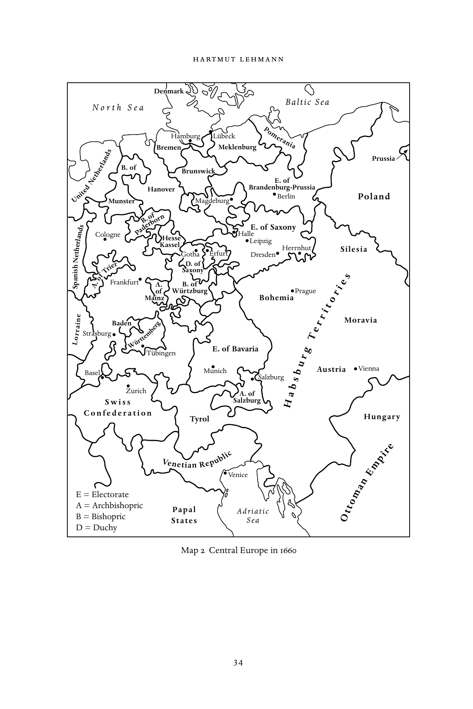

# 欧洲大陆的新教：英文转换底稿

<!-- PDF page 48; original page 33 -->

### 2

## Continental Protestant Europe

### h a rt m ut l e h m a n n

### The rise and decline of Pietism

In the period between the end of the Thirty Year’s War and the era of the French Revolution, no religious movement changed the face of continental Protestantism more than Pietism. The followers of Pietism, as this religious revival soon came to be called, developed new centres of social, cultural, and political activity for all Protestants. But more importantly, perhaps, those Protestants who were inspired by the ideas of Pietism exhibited a new kind of self-esteem. They believed, it seems, that they were completing whatever had remained unfinished in Luther’s Reformation. In short, they saw themselves as a better kind of Protestant.

Philipp Jakob Spener was the undisputed leader of the first generation of Pietists. Born in 1635, Spener received theological training at Strasbourg and rose to the leading position of pastor to the Protestant Church in Frankfurt by the 1660s. Deeply concerned about the sincerity of the members of the flock who were entrusted to him in this thriving centre of international trade, he decided in 1670 to assemble some of the most devout members of his congre- gation in special meetings. In Spener’s view, this first Frankfurt conventicle (or ‘ecclesiola in ecclesia’) was an attempt to form a kind of Christian elite that in turn would, he hoped, help to better the condition of his congregation and even contribute to reforming the church as a whole. A few years later, in 1675, Spener explained his ideas in some detail in a preface to the new publication of one of the works of Johann Arndt. This preface, soon to be published as a separate tract under the title Pia Desideria, that is, ‘pious wishes’, can be considered the founding document of Pietism. It served as the most influ- ential guide for future generations of Pietists. Spener stressed three points in particular in the Pia Desideria. First, he argued, sincere Christians should assemble regularly and support one another spiritually. Second, he insisted that it was the obligation of all devout Christians to help reform the church.

<!-- PDF page 49; original page 34 -->

Denmark Baltic Sea N o r t h S e a Brem H e a n mburg Meklenburg Pomerania Prussia B. of Brunswick E. of Hanover Brandenburg-Prussia Berlin Poland E. of Saxony Cologne K H a e ss s e se l Leipzig Herrnhut Silesia Gotha Dresden Frankfurt A. B. of of Würtzburg Prague Mainz Bohemia Moravia

Strasburg E. of Bavaria

Basel Munich Austria Vienna Zurich A. of S w i s s Salzburg

C o n f e d e r a t i o n Tyrol Hungary Venice E = Electorate A = Archbishopric Papal Adriatic B = Bishopric States Sea D = Duchy sinapS Lübeck nds

Netherla United Munster Magdeburg n ds Pa B de . r o b f orn Halle h Net herla Trier S D ax . o o n f y Erfurt A. of i e s r o t i e r L orr ai n Bade W n ürttemberg T e r g Tübingen r u b Salzburg s b a H

> e

Venetian Republic

### m

pi r E

> n

a

### m

o t t O Map 2 Central Europe in 1660

<!-- PDF page 50; original page 35 -->

They should not separate themselves from the church, but try to build a better church. Third, Spener argued, although salvation history had progressed, as all the signs of his time indicated, God had promised to His children before Christ’s return a prolonged period in which they could and should build God’s kingdom. This hope for better times, as it was called, was a most startling and innovative interpretation of Protestant eschatology. This theological notion meant that all of those who followed the example of Spener were expected to labour most actively in the affairs of this world so that they would, with God’s blessing, successfully lay the foundations for His kingdom. Rather than prepare themselves for the Day of the Last Judgement in the fear that this day was imminent, Christians should recognize that God demanded social responsibility and a high standard in the conduct of one’s affairs. Through this, Spener redirected the activity particularly of those Protestants who were afraid that they would not gain eternal life. Instead of fearfully observing the signs of the times, he argued, they should initiate and shoulder reform projects that served the good of the church, and indeed the community of all Christians hoping for salvation.

Spener’s various initiatives at Frankfurt soon attracted attention. While some of his fellow-pastors applauded what he had done and attempted to proceed in the same manner, others criticized him severely. They argued that by assembling a part of his congregation in a special meeting, Spener was about to divide the church effectively into two camps, those who were brought to believe that they were reborn, and the rest, the so-called children of the world (‘Weltkinder’), who were supposedly doomed. Not surprisingly, there were soon also tensions right in the midst of the Frankfurt conventicle. While Spener tried to ensure that the energy of his conventicles would help reform the church, his most important collaborator, the Frankfurt lawyer Johann Jakob Schütz, believed that the church could not be saved and that any efforts in that direction were futile. For Schütz, as salvation history had progressed rapidly, the assembly of those who now met in conventicles was the true church of the end-time.

After long discussions and what was certainly a most painful process, the Frankfurt conventicle split in two. The followers of Schütz met separately, and after some years they decided to migrate to Pennsylvania where they hoped to find a place of refuge as the apocalypse approached. Spener, meanwhile, continued his work for some time in Frankfurt, but in 1686 he decided to accept the position of court preacher in Dresden. Although the Dresden post was considered to be the most prestigious position in Protestant Germany and within Lutheranism, Spener soon found out that he was unable to implement

<!-- PDF page 51; original page 36 -->

any of his proposed reforms in surroundings defined by the luxury of a Baroque court and a prince more interested in operas, fireworks, and hunting than in social reform. Thus in 1692, after only a few years, Spener left Dresden and moved to Berlin, to a somewhat inferior position, but to a court that was open to his ideas. Spener stayed in Berlin until his death in 1705.

In Berlin, Spener became what can be called the patriarch of the Pietist movement. He took an active part in reforming the social system of this socially very diverse city by supporting plans that helped beggars and the very poor, and he used his influence at court and among the high Prussian mili- tary officer class to protect Pietists who were persecuted in other territories. Most importantly, however, he counselled literally hundreds of persons who turned to him for help in practical matters and for spiritual advice. Spener answered all of the requests in long and detailed letters that were published even before his death as ‘Theologische Bedenken’, which means theological considerations or reflections. For historians of Pietism, these ‘Theologische Bedenken’ form a most informative source. Through his answers, Spener was keen to build a network that reached far beyond Berlin and even beyond the Holy Roman Empire. By the end of his life, Spener had developed the two most important means through which Pietists were able to communicate and gain influence: conventicles and letters. Other means of religious social- ization, which were soon being exercised effectively, were regular visits of those who considered one another as brothers and sisters in the community of the reborn, meetings of the like-minded, and the establishment of Pietist educational and social institutions. Furthermore, Pietists soon made substan- tial contributions to the body of edifying tracts and hymns through which they expressed Pietist spirituality. By the beginning of the eighteenth cen- tury, the new movement had gained many followers all over central Europe and, what was perhaps even more important, an unmistakable profile. In other words, a new tradition had begun. To be considered a Pietist, one had to place the influence of Spener and Johann Arndt next to that of Martin Luther.

Already in the 1680s, pious Protestants met regularly in conventicles in cities like Erfurt, Magdeburg, Lübeck, and Quedlinburg as well as in many other places. Very early on, women participated actively in many of these meetings, while pastors often played only a marginal role. This indicates that these early disciples of Spener were suspicious of the teachings of Lutheran orthodoxy as taught in theological faculties at German universities. At the same time, they were prepared to listen to what they considered direct inspiration and revela- tion, and such direct revelation could be given, as they believed, to women as

<!-- PDF page 52; original page 37 -->

well as to men. Rather than defer to the authority of the corps of male pastors, they relied on spiritual bonding, on improvised prayers, and on the hope that they would receive direct instruction from God on how to understand certain passages in the Scripture. As might be expected, the ecclesiastical authorities did not take long before they intervened. Wherever conventicles led by lay persons were detected, they were forbidden and dissolved. In many of the Lutheran territories within the Holy Roman Empire, edicts banning Pietist conventicles were passed and executed, sometimes with unnecessary force, by local authorities. But such measures could not stop those who were convinced of Spener’s ideas and who felt that they were part of an international religious revival directly guided and inspired by God. That they were persecuted by the official church was, they believed, a sure sign that they were God’s elected children. To them, out of repentance for their sins followed rebirth, and out of rebirth the task of sanctification, and out of sanctification the certainty of salvation.

One of Spener’s early followers and an active participant in the religious revival of the 1680s was August Hermann Francke, who was a generation younger than Spener. When the church authorities disbanded the conventicles in which he had taken part at Quedlinburg, Francke moved to the city of Halle where he soon made a spectacular career. In his capacity as a talented scholar who was well versed in all of the classical languages, Francke was appointed to a professorship at the newly founded University of Halle. In addition, he became very active in the social field. He founded an orphanage which he expanded into a primary school, to which he added a secondary school, and then a training centre for teachers. But this did not exhaust Francke’s remarkable capacities as an organizer. Within only a few years, he founded, in addition to his schools, a pharmacy and also a print-shop in which he printed edifying tracts and bibles which he distributed to the poor. Soon many members of the Prussian aristocracy sent their children to Halle. Alumni of Francke’s educational empire found posts as teachers across Europe. As early as 1706, some went as missionaries to India, and this was just the beginning of a wide network of international contacts and connections.

Francke’s success would not have been possible without the guiding hand of Spener in Berlin, and certainly not without the special privileges and the protection that he received from the Hohenzollern court. The Hohenzollern dynasty had converted to Calvinism in the early seventeenth century, and they were now ruling a state with a strong Lutheran majority that had close ties to the local estates. In the last decades of the seventeenth century the Hohenzollerns, like the princes of many other territories, attempted to curb

<!-- PDF page 53; original page 38 -->

the influence of the estates in their realm. As the Lutherans supported the estates, the Pietists’ wish to establish themselves in the Hohenzollern lands came just at the right time. By helping Spener in his social activities in Berlin, but above all by granting special privileges to Francke at Halle, the Prussian sovereign was able to curtail the influence of the Lutheran establishment and this, as he knew, in turn served to weaken the political role of the estates. It was not love for Pietism that led the Hohenzollerns in their decision to support Halle Pietism; rather, they used the Pietists at Halle for their own political ends.

Francke proved to be more than an equal in dealing with Prussian sovereigns. Francke was committed to building a kingdom of his own, or, rather, one should say, he was convinced that he was the instrument chosen by God to build His kingdom. When Frederick William I became King of Prussia in 1713, he sent an ultimatum to Francke, demanding that he stop his involvement in worldwide projects. Instead, he should concentrate his efforts on helping to improve society and educational provision within Prussia. Francke knew that he had to give in, or at least to give the king the impression that he agreed. In truth, Francke pursued what can be called a double strategy. On the one hand, he sent some of his alumni to teach at the military orphanage in Berlin and he also supplied the Prussian army with military chaplains. Through this and other means he attempted to demonstrate to the king that Halle served the king’s policies and nothing else. On the other hand, Francke not only continued to keep contact with Pietists in many other countries, but he actively expanded Halle’s sphere of influence. As recent research has clearly shown, Francke corresponded with like-minded Christians in east- central Europe, especially Hungary and Bohemia, and in northern Europe, most notably in Latvia, Lithuania, and Russia. He even sent an expedition to Siberia. Francke also developed close ties to the court in Copenhagen, to the Society for the Propagation of the Gospel in England and to many of the German communities which had migrated to the British colonies in North America. He also supplied them with bibles and with pharmaceutical products, most notably the essentia dulcis. As a result, between the time of Spener’s death in 1705 and Francke’s death in 1727, Halle not only was the most important centre of Pietism within Prussia – such that some historians argue that the rise of Prussia and the very special Prussian values can only be understood if one takes into account the influence of Pietism – but also the most active centre of Pietism worldwide. Two centuries after the Reformation, and after a long period of German Lutheran self-centeredness, the Halle Pietists were the first German-speaking Christians to become active outside of Germany

<!-- PDF page 54; original page 39 -->

and contribute significantly to the development of Christianity as a world religion.

The most active and perhaps even the most influential representative of a third generation of Pietists was Ludwig Nikolaus Graf Zinzendorf, born in 1700 and an alumnus of Francke’s foundations at Halle. Since the 1720s, Zinzendorf had assembled pious Protestants on his estate at Herrnhut, among them many refugees from Moravia and Bohemia who traced their religious faith back to Johann Hus. In 1727, to the surprise and joy of all who were involved, some- thing that can be called a collective revival occurred at Herrnhut. This event convinced Zinzendorf that God had entrusted to him a very special mission. In the 1730s, the number of Zinzendorf ’s followers grew rapidly. Pietists from various German regions joined his cause. Soon Herrnhut became too small. Zinzendorf did not hesitate to act. Within the following years, he established new communities in other places, even in other countries, as for example Zeist in the Netherlands, and Neuwied in the Rhineland. Zinzendorf also travelled a great deal. Historians have called him the count who crossed all borders, a characterization that has multiple meanings. Not only did Zinzendorf travel, more than once, to North America where the Herrnhuter, or Moravians as they were called in the English-speaking world, had founded the community of Bethlehem; Zinzendorf also had a close spiritual relationship with common people who counted as his most loyal supporters. For his second marriage he chose a partner from a non-noble family.

As early as the 1730s, Zinzendorf sent missionaries to faraway places. Best known are the missionary endeavours of the Moravians among African slaves on sugar plantations in the West Indies and among the Eskimos in Greenland. As a rule, Zinzendorf ’s missionaries were skilled artisans, preferably carpen- ters (although this turned out to be quite useless in Greenland where no trees for building houses could be found). Most certainly, the secret of the success of the missionaries sent from Herrnhut was that they always combined biblical teaching with practical help. Zinzendorf ’s theology can best be described as an early form of ecumenism. He thought little of confessional differences. Rather, what he attempted to create was an international army of commit- ted reborn Christians of which he would be the undisputed leader. Within Herrnhut, Zinzendorf divided people according to gender, family status and age by forming so-called choirs. In the late 1740s, another wave of spiritual excitement swept through Herrnhut and other Moravian communities. This widely publicized event convinced traditional Protestants and also the Pietists at Halle that Zinzendorf could not be trusted. When Zinzendorf died in 1760, his heritage was as rich as it was problematic. By the time of his death he had

<!-- PDF page 55; original page 40 -->

compiled a huge financial debt. But his legacy was inspiring because he had managed to found the first truly international missionary movement, with outposts on all continents.

The Pietists of Württemberg were among those who had been most reserved, if not unfriendly and at times even hostile, towards Zinzendorf. They had always been closely associated with the estates in their territory, and they remained so throughout the eighteenth century. In fact, one can say that the strict asceticism that Württemberg Pietists espoused formed the basis of the political opposition of the Württemberg estates in their struggle with the prince who strove, like most other German princes of the time, to rule in an absolutist manner and to imitate the life of the court at Versailles. At the same time, Württemberg Pietists were not very active in the social field. While they concentrated on spiritual edification and personal sanctification, and while they strengthened family ties and local networks, their primary aim was not to create new institutions or to send out missionaries. Those young men from Württemberg who wanted to become missionaries went to Herrnhut.

What made Württemberg Pietists special was their strong interest in escha- tology and in the apocalypse, and the person who gained most influence and scholarly authority in this respect was Johann Albrecht Bengel. By carefully assembling all numbers that he could find in the Old and New Testaments and in particular in the Revelation of St John, and by combining these num- bers in what he believed to be a meaningful way so that they would disclose the hidden chronology of salvation history, Bengel concluded that the exact date of the Second Coming would be June 1836, and the place, of course, Jerusalem. Bengel was convinced that God had revealed this insight to him so that he could admonish His most loyal children to prepare themselves for this most crucial event. Bengel died in 1752. Even after they had lost their spiritual leader, the Pietists of Württemberg never forgot that the world-order in which they lived and which presented them with so many hardships would be totally transformed in the not too distant future. In the 1790s, as the sequence of upheavals caused by the French Revolution unfolded, Württemberg Pietists were convinced that this was the beginning of the final raging of the devil that preceded Christ’s return. As we will see in the final chapter of this volume, some of them decided to migrate to Palestine where they hoped to find a safe place of refuge until 1836 and the Second Coming.

In assessing the impact of Pietism on continental Protestantism, the year 1740 formed a watershed. Before 1740, the movement was growing, especially due to the favours that Halle received from the Prussian king and also because of the attraction of Zinzendorf’s initiatives. When Frederick the Great assumed

<!-- PDF page 56; original page 41 -->

power in Berlin in 1740, things changed drastically. The new King of Prussia was a fervent believer in the ideas of the Enlightenment. He despised the kind of piety that Halle propagated and did not hesitate to make his thoughts on the matter clear. In 1723, due to pressure from Francke, Frederick William I had decided to ban the Enlightened philosopher Christian Wolff from Halle University. In 1740, one of the first actions of his son, Frederick the Great, was to reinstall Wolff in his chair at Halle. To Halle Pietists and beyond, this was an unmistakable signal that the time in which they had enjoyed the protection of the Berlin court was over.

Zinzendorf’s movement was also affected by the beginning of the first of the Silesian Wars. Perhaps it is not sheer speculation to assume that Zinzendorf’s strong interest in Pennsylvania in the 1740s was due to his impression that with Frederick the Great’s assumption of the throne, central Europe was lost to the followers of true faith and that God’s remaining children needed an alternative place to live and labour until Christ returned. Perhaps, at least in part, the same conviction can also be found among Halle Pietists. This would explain why the followers of Halle and Herrnhut bitterly confronted each other in Pennsylvania in the 1740s and in the 1750s, as each group attempted to gain influence and control.

### Eighteenth-century continental Protestantism

### between orthodoxy and nonconformity

Important as Pietism was within continental Protestantism in the first half of the eighteenth century, it would be misleading to create the impression that Pietists completely dominated Protestant church life during this period. Resistance to Pietism has been mentioned, and most of this resistance was formulated and pursued by other Protestants, orthodox Lutherans and tradi- tional Calvinists alike. Protestant orthodoxy possessed and maintained three main spheres of influence well into the eighteenth century: first, theologi- cal faculties at leading universities; second, the large body of clergy including most church leaders; third, most members of territorial governments and local administrations. In other words, in most Protestant territories well into the eighteenth century the rule of territorial princes over the church (the ‘Landes- herrliche Kirchenregiment’) was intact and functioning effectively. Just as they were expected to provide loyal legal experts for the government, universities had the obligation to educate pastors who would be loyal to the government. In all universities an impressive body of orthodox theological literature was available that could be put to use in the academic training of future pastors.

<!-- PDF page 57; original page 42 -->

Protestant clergymen, in turn, were expected to represent church and state on the local level. Pastors were responsible for the proper administration of marriages, baptisms, funerals, and, of course, Sunday services. But above and beyond this they had to see that the local order was not interrupted and that those who disturbed others, on workdays as well as Sundays, were brought to justice. In many places pastors served also as teachers; some gave medical advice and, when needed, also medical help. Everywhere, the duties of pastors were far more extensive than preaching the pure faith. In fact, one can say that Sunday services were the least important of their duties and functions. When lay people formed conventicles without the consent and approval of the pastor, he had the duty to interfere. When groups of radical dissenters appeared in villages or cities, the pastors were expected to act. In short, pastors were the extended arm of territorial governments, and just as most members of terri- torial governments clung to traditional orthodox belief, so did many pastors. There were, of course, many pastors who were not content to hold to tradi- tional orthodoxy or to act as government functionaries. Some of these pastors, as we have seen, were drawn to Pietism. Others, however, were attracted by the ideas of the early Enlightenment. Indeed, by the 1730s and certainly by the 1740s, the number of pastors who embraced Enlightenment thought was larger than the number of those who favoured Pietism or the number of those who still clung to orthodox doctrine.

Further, in certain regions Protestant radicalism in the tradition of the radical reformation played a much greater role than either Pietism or orthodoxy. Typically, these were regions in which some of the lesser princes reigned in a patriarchal manner, that is, in parts of the Palatinate, of Hesse, of Thuringia, and in some areas on the lower Rhine. In most instances, these radicals were inspired by eschatology. As the apocalypse was near, their leaders proclaimed, the remaining true children of God had to separate from the official and established churches that had fallen, as they thought, into the hands of the devil. These radicals held, wherever possible, separate services and practised communion without the assistance of the local pastor. In the tradition of sixteenth-century Anabaptists they often insisted upon adult baptism. Lay preaching was the rule as was the belief that God’s word in the Bible could best be understood by those who were not corrupted by learned theology. From the late seventeenth century and well into the eighteenth century, self- appointed itinerant preachers travelled over the German countryside. Often they were persecuted and driven out of the villages and towns that they visited. But to the degree they suffered humiliation, they gained authority in the eyes of people in search of the divine truth. For many decades, for example, the

<!-- PDF page 58; original page 43 -->

former tanner Johann Friedrich Rock travelled through southern Germany. Protestant dissenters venerated him as a prophet and saint.

Almost all local governments considered Protestant separatists a serious political danger. Leaders of such groups were put into prison, and all means available were used to break up regional networks of separatists and to dis- courage these nonconformist faithful. From the 1680s onwards, and especially between 1700 and 1730, but again also in the 1750s, as they were confronted with mistrust and repression, many groups of Protestant dissenters decided to leave Germany. While some migrated to Transylvania, most went to the British colonies in North America, and especially to Pennsylvania. Whether Germany’s loss was America’s gain in this matter depends on one’s view of the role of the church and on how religious life should develop. If one believes that church ordinances should be obeyed under all circumstances and that any kind of dissent only serves to disrupt the spiritual growth of congregations, one can approve the actions of those pastors who did not tolerate dissent. However, if one acknowledges the importance of every person’s individual conscience and concludes that religious liberty is an essential ingredient for the building of God’s kingdom, then he or she must believe that the Protestant state officials and Protestant pastors failed in their Christian vocation when they suppressed nonconformists and expelled dissenters. In any event, by get- ting rid of separatists and dissenters, German Protestantism, both Lutheran and Calvinist, lost a vital religious element that might have led to a situation in which religion could prosper exactly because it was no longer expected first and foremost to serve political ends.

### The consolidation of Protestant states in post-1648

### central Europe

The Peace of Westphalia in 1648 confirmed the Treaty of Augsburg of 1555, with some important modifications. In addition to territories ruled by Catholic princes or prince-bishops, and territories ruled by Lutheran princes, Calvinist princes were now also accepted as equals within the legal framework of the Holy Roman Empire. The Lutheran and Calvinist princes were also the official heads of the churches in their states. In most Lutheran and Calvinist territories within the empire, church government was entrusted to consistories. Super- intendents were in charge of supervising deans who in turn were obliged to control church life down to the parish level in villages and towns. The consisto- ries were also in charge of organizing the education of future pastors; they had to control the way active pastors fulfilled their duties; they were responsible

<!-- PDF page 59; original page 44 -->

for administering church finances and church property. In short, they were not only representatives of the prince in his position as the head of the church, but they were also empowered to enforce the edicts concerning church doctrine and church life that the prince wanted to put into effect. In some Lutheran states church affairs were run by bishops, as for example in Sweden, where the church was headed by the Archbishop of Uppsala. In regard to practical matters of church life as well as the preservation and defence of Lutheran or Calvinist doctrine, only small differences existed between Protestant churches under the leadership of bishops and those run by consistories. In both cases, the princes attempted to incorporate the churches into the emerging bureaucracy of their absolutist rule and, to varying degrees, were successful in doing so. Only in a small number of Protestant states in central Europe did estates continue to exert some power in church matters. Within the empire, the Mecklenburg duchies and the Duchy of Württemberg were such cases. Outside the empire, this was true of some Calvinist provinces of Hungary that were, as we shall see, under continued Catholic pressure, as well as the Protestant cantons of the Swiss federation.

Within the Protestant states of central Europe, the backbone of the estab- lished churches was the support first by the ruling princes and then, especially in towns, by the families that belonged to the well-educated middle classes. By contrast, noble families very often took pride in their legal autonomy as well as in their social distinction and cherished their own confessional tradition, which might be different from the established tradition within the state. In the decades after 1648, moreover, it took a long time before confessional indoc- trination made any significant impact among members of the lower classes. As servants of artisans or farmers the lower classes adhered, as a rule, to the faith practised by their masters. When they had the opportunity to migrate to other regions in search of a better life, or when they were forced to migrate, they often showed little confessional loyalty. Even among artisans there are examples of people who changed their confessional affiliation several times.

But there were also spectacular examples of confessional loyalty. The Huguenots who decided to leave France in 1685 rather than convert to Catholi- cism formed close confessional communities and congregations in the states that offered them places of refuge. They were led by Reformed pastors who in turn were supported by a large number of well-educated merchants and artisans. In their host societies they managed to create communities adhering to the Reformed faith which remained loyal to the religious tradition of their heroic forefathers well into the nineteenth century. The Waldensians who were forced to emigrate only a few years after the Huguenots also showed

<!-- PDF page 60; original page 45 -->

a remarkable degree of religious loyalty to their special tradition. They, too, continued to preserve their Waldensian faith in the places that were offered to them as new settlements. Even the Salzburgers who were expelled by an intransigent Catholic archbishop in the early 1730s and had to leave their native Alpine valleys retained their confessional identity for several generations. As they migrated to faraway places, some to East Prussia, others as far as the new British colony of Georgia, they were praised by their fellow Protestants as heroes of true Protestant faith. In the territories in which they were able to settle they received, in most cases, special privileges, including the right to practise their faith. As a result, they were able to celebrate the memory of their special religious destiny.

The privileges granted to Huguenots, Waldensians, and Salzburgers should not be considered an expression of religious tolerance on the part of the host princes, however. The Huguenots, for example, were famous as extremely talented and productive artisans, and the Lutheran princes were pursuing their own economic interests when they permitted the Huguenots to settle in their territories and retain their own Reformed traditions. The princes’ position was marked by economic pragmatism, as dictated by the theories of mercantilism, not by a deliberate policy of toleration. Nor were those princes who granted refuge to the Salzburgers inspired by Enlightened ideas of religious toleration. As they paid tribute to the fame the Salzburgers had gained on their journey through the empire, they attempted to stylize themselves as champions of true Protestant faith. Even in Prussia, a policy of religious toleration came later.

The principle of ‘cuius regio ejus religio’, first proclaimed in 1555 and con- firmed in 1648, was put to a severe test in the late seventeenth and early eighteenth centuries when several Protestant princes decided to convert to Catholicism. The most spectacular case occurred in 1697 when the Elector of Saxony had the opportunity to become King of Poland on condition that he convert to Catholicism, which he did. And there were also other, similar cases. In 1733, for example, a Catholic prince inherited the Lutheran Duchy of Württemberg. Since the early Reformation of the sixteenth century, both Saxony and Württemberg had been first among the defenders of Lutheran faith. What could be done in Saxony and Württemberg to honour this tra- dition if their prince was a Catholic? How could the confessional balance of power in the Holy Roman Empire be preserved if leading princes changed confessional sides? In both cases the estates successfully claimed the right to protect Lutheranism and to be responsible for the course of church govern- ment. Through this compromise, the delicate relationship between Protestant and Catholic powers within the empire could be maintained.

<!-- PDF page 61; original page 46 -->

But there were also political events that threatened the confessional bal- ance within the European concert of powers. In the decades after 1648, the revocation of the Edict of Nantes in 1685 had severely hurt the position of Protestantism in western Europe. In a similar manner, the Habsburgs set out to strengthen Catholicism in east-central Europe. After they had consolidated the rule of the Catholic Church in Bohemia, they reclaimed, step by step, the Alpine provinces for the Catholic religion. By 1700, after the Turks had been defeated and large parts of the Balkans were opened to Habsburg influ- ence, the Habsburgs’ main aim was to support the Counter-Reformation in the Kingdom of Hungary. Once again, the leaders of Hungarian Calvinism were determined to resist. In the early seventeenth century, Count Gabor Bethlen and Duke George Rákóczi had led, though unsuccessfully, many of their Calvinist countrymen in an uprising against the Habsburg policy of Counter-Reformation, and now, in 1703, so did Duke Francis Rákóczi. By 1711, Vienna had succeeded in suppressing the opposition, bringing continued mis- ery to the Protestants in Hungary. Their situation improved somewhat three decades later as Empress Maria Theresa showed a certain degree of respect for Hungarian Protestants. But it was not until 1782, that is two years after she had passed away, that her son, Emperor Joseph II pronounced his famous Toleration Edict that provided for confessional autonomy within the Habsburg Empire, including confessional autonomy for Hungarian Protestants.

The Habsburg Counter-Reformation was no less aggressive in Silesia. After 1648, with the exception of two small duchies and the city of Breslau, free- dom of religion was no longer granted to Silesian Lutherans. While three so-called peace churches (Friedenskirchen) were entrusted to them, a total of over 1,200 Protestant churches were reclaimed for Catholic worship and incor- porated into Catholic congregations. In the following decades, some 200,000 Silesian Lutherans decided to emigrate. Many others remained and attended secret Lutheran services in the woods (Buschkirchen), and some Lutherans regularly travelled long distances to attend services across the border in a neighbouring Lutheran territory. Help came late, and unexpectedly, from a power that had rescued Protestantism in central Europe before. In 1707, the Swedish king Charles XII, backed by a strong army, forced Emperor Joseph I to sign the convention of Altranstädt. This treaty guaranteed the return to Lutherans of 130 formerly Protestant churches that had been expropriated in Silesia and the establishment of an additional six new churches (so-called Gnadenkirchen). Also, schools for Protestants were reopened. Through these measures, Protestantism in Silesia was saved several decades before Frederick the Great annexed Silesia in 1740. It is also important to note that the Habsburg

<!-- PDF page 62; original page 47 -->

Counter-Reformation not only produced mass emigration and widespread despair in Silesia but, in opposition to Catholic Vienna, also an impressively rich Silesian literary culture. Of the many Silesian poets of the pre-1740 era, perhaps Andreas Gryphius was the most talented.

As these examples demonstrate, the consolidation of Protestantism in cen- tral Europe was challenged by a series of attempts to continue the Counter- Reformation even after the peace treaty of Westphalia. At the same time, however, we should note that Protestantism blossomed in some states of Europe that had, each in a different manner, a strong influence on confes- sional matters in the region. With the support of absolutism, Lutheranism in both Sweden and Denmark developed a strong tradition that was not weak- ened as Pietism replaced Lutheran orthodoxy. But there were also other ways of influencing Protestantism in central Europe. In close relation, not to abso- lutist princes, but to the estates, Protestantism became a strong force in the Netherlands. On the other hand, the Protestant cantons of Switzerland had to fight several battles before they were able to defend their confessional autonomy. Perhaps nothing inspired Protestants on the European continent more than the success of Puritanism in England. English Puritanism pro- vided a rich source of edifying literature. In most cases, these books were brought to central Europe via the Netherlands. Puritanism also served as an example that Protestantism could be successfully defended in the arena of power-politics.

The consolidation of Protestant states in post-1648 Europe should be seen, therefore, as a process that occurred on two levels – the level of European politics and the level of popular religion. First, at the level of European pol- itics, the rise of the Protestant powers helped to stabilize Protestantism as a whole. In direct and indirect ways, both Sweden and Denmark continued after 1648 to provide protection to Protestantism in central Europe, and so did the Netherlands, though mainly as an economic power and as a centre of culture. After 1689, Great Britain became the premier Protestant power in Europe, joined, a few decades later, by the new Kingdom of Prussia. By 1700, and certainly by 1740, we can therefore observe a kind of double confessional balance of power in Europe: first, and most notably, within the Holy Roman Empire; but also among the leading powers of Europe, whose influence helped to reinforce the first. Second, under the protection of the Protestant powers and when no longer threatened by the forces of the Counter-Reformation, Protestantism was consolidated at the level of popular religion. During the first half of the eighteenth century, Protestantism became an undisputed way of life for people in many parts of central Europe. So much so, that when the

<!-- PDF page 63; original page 48 -->

Archbishop of Salzburg decided to expel the Protestants from his territory in the early 1730s, most Europeans considered such behaviour to be anachronistic.

### The aims and the attraction of the Enlightenment

The new ideas of the Enlightenment first captured the minds of Protestants in the north west of Europe, in Great Britain and the Netherlands. While British and Dutch thinkers made bold moves towards a new world-view, their counterparts in German Protestantism were, as a rule, more cautious, if not timid when it came to expressing new ideas. This was true, for example, of the political writings of the German Protestant, Samuel Pufendorf, as well as of the philosophical treatises of his fellow German, Christian Thomasius. Both lacked the vision and the determination of such Scottish or English authors as David Hume, Thomas Hobbes, or John Locke. And the same was equally true of the writings of such early eighteenth-century German Protestant theolo- gians as Johann Franz Buddeus, Johann Lorenz von Mosheim, Johann Georg Walch, Christoph Matthaeus Pfaff, and Johann August Ernesti. Their writings appear like cautious adjustments to new ideas when compared to the works on Deism by British and Irish authors like Anthony Collins, John Toland, William Whiston, Thomas Woolston, or Matthew Tindal. During his lifetime, Baruch Spinoza, writing in the Netherlands, had no influence in Germany. Not until almost a hundred years after his death in 1677 were his ideas discussed or greatly appreciated. The books of Pierre Bayle and of Christian Wolff had an impact on German intellectual life somewhat earlier, but not before the middle of the eighteenth century. Even the celebrated German philosopher Gottfried Wilhelm Leibniz received little attention from his contemporaries. Only in retrospect have the quality of his philosophical reflections and his contribution to paving the way towards an Enlightened theological discourse found the necessary attention and received their due praise.

What has to be stressed once again is the importance of the caesura of 1740. The Enlightenment had little impact in Protestant Germany before Frederick the Great became king. The Enlightenment then gained momentum between 1740 and the end of the Seven Years’ War in 1763. In the years between 1763 and the beginning of the French Revolution, the public sphere, including the theological faculties of the German universities, became dominated by the themes that were central to the Enlightenment. It was in this period that Lessing published some of the texts on biblical criticism written by Hermann Samuel Reimarus, that Johannes Joachim Spalding explained the principles of Enlightened thought in his writings, that August Friedrich Wilhelm Sack and

<!-- PDF page 64; original page 49 -->

Johann Friedrich Wilhelm Jerusalem began to discuss central topics of Chris- tian theology in a critical manner, and that Christoph Friedrich Nicolai applied literary criticism to biblical texts. It was in the two decades before the fall of the Bastille that Johann Salomo Semler, Gotthold Ephraim Lessing, and Immanuel Kant in their writings discussed and fully developed the programme of the Enlightenment. Religious and theological tradition, these writers insisted, had to stand the test of reason (‘Vernunft’); further, Christianity had to adhere to the principle of tolerance. For Lessing, the ideas of Moses Mendelssohn were more important and inspiring than Protestant tradition. For Kant, criticism based on reason outweighed dogma.

To be sure, the programme of Enlightenment had two faces. One face was characterized by the application of the principles of rationalism and criticism. The other face was determined by the implementation of practical reforms in many spheres of life. One can even say that while the impact of biblical criticism within German Protestantism always remained limited to a relatively small circle of university theologians, it was these practical reforms which changed German Protestantism fundamentally and which helped to create and shape a new generation of Protestant clergy who understood their task in a new way. At least in the beginning, Pietists supported many of the Enlightened reforms wholeheartedly. In Halle, for example, Christian Thomasius stood behind the educational initiatives of August Hermann Francke. But while Pietists and Enlightened circles could co-operate in carrying through practical reforms, they parted ways when it came to matters of eschatology and Christology, and most certainly when Enlightened thinkers addressed questions of biblical criticism. Very often, and in many places, however, this was not the case before the middle of the eighteenth century. What we can observe, at least for some decades, are local coalitions between single members of both reform movements that were designed to carry through specific projects.

Enlightenment reforms mainly addressed six different spheres of German life. First, for the early Enlightenment as well as for the Enlightenment in the second half of the eighteenth century, the improvement of education was a central goal. Education meant that children should attend school regularly and learn how to write and read. Education also meant that people should learn the fundamentals of personal hygiene, that if illness occurred, they should consult a doctor and apply the right kind of medicine. In short, people were themselves responsible for their lives and should use the intellectual capabilities entrusted to them by God in order to improve their personal condition as well as the condition of their families and the communities in which they lived. It went without saying that curricula in secondary schools as well as academic

<!-- PDF page 65; original page 50 -->

teaching should be improved. New universities were established which were completely devoted to the programme of the Enlightenment, such as the University of Göttingen.

Second, for the Enlightenment, useful knowledge was no longer found only in traditional religious texts or in edifying literature. Rather, supporters of the Enlightenment produced and propagated an impressive amount of new and highly specialized literature. Many of these texts possessed a practical dimen- sion. Such literature could address medical problems, matters of agriculture, legal reform and the like. Besides, Enlightened thinkers thought that educated people should take an interest in poetry, novels, and the theatre. While up until the early eighteenth century most texts published in Protestant Germany had been devoted to religious and theological themes, by 1750 such matters were discussed in less than 20 per cent of all publications.

Third, for many people, the legal reforms that were demanded by Enlight- ened writers were of more importance than anything else. In addition to the application of due legal procedures these legal reforms addressed major ques- tions such as capital punishment or how one should deal with infanticide. Following the great Italian reformer Cesare Beccaria, German legal experts also demanded the abolition of torture as well as the abolition of capital pun- ishment. While up until then women who had been found guilty of infanticide could not expect any mercy, the discussion now turned to the question of the guilt of those men who had seduced young women, while these women were given advice, counselling, and practical help. Furthermore, in its extreme form, the Enlightenment did not tolerate any kind of superstition. The witchcraft trials of the seventeenth century were looked upon with contempt and horror. Hence, even before 1789 many popular myths and legends were demystified. What we find particularly in Protestant Germany towards the end of the eigh- teenth century, therefore, is a fascinating vision of a just and tolerant society based on the rational application of law.

Fourth, Enlightened writers insisted that the reform programme should also include agriculture, manufacturing, and commerce. In these areas the Enlightenment introduced an interest in inventions and the practical applica- tion of new techniques. A telling example in this respect was the severe hunger crisis of 1770–72 caused by harvest failure in two consecutive years. In previous years of severe shortage, for example in the 1570s and in the 1690s, all com- mentators had implored their fellow-citizens to stop sinning, to repent and live once again the lives of good Christians so that God would cease punish- ing them and show mercy. In 1770–72, by contrast, the majority of those who wrote about the crisis demanded that their contemporaries use the power of

<!-- PDF page 66; original page 51 -->

reason given to them by God more effectively than in the past. They should introduce crop rotations, build better storage facilities for food, use fertilizer and better seeds. In short, the crisis, they believed, could have been avoided if the Enlightened programme for improvements in the field of agriculture had been implemented.

Fifth, those inspired by the Enlightenment took a new interest in the cul- tures outside of Europe. While the Pietists sent missionaries to foreign lands, Enlightened scientists attempted to explore and describe societies in Asia and Africa, particularly in non-Christian countries like Iran, India, China, and Japan. They looked at these cultures not as the missionaries did, that is as heathens who needed nothing more than the light of the gospel, but with the eyes of eth- nologists. In the belief that all cultures and all peoples were equal, as explained by Johann Gottfried Herder, they tried to learn. European imperialism and colonialism came later.

Sixth and finally, a special concern of committed members of the Enlightened elite was the toleration of Jews. Well into the eighteenth century Jews in Germany were barely tolerated. In order to secure residence, they had to pay extra fees, without ever reaching a state of civil acceptance. This was so when the Enlightened elite began to demand the complete equality of all members of all religions, including the Jews. Major steps in this direction were first made by Emperor Joseph II of Austria. Other sovereigns, including Frederick the Great, followed his example. At the time of the outbreak of the French Revolution, Jewish citizens of many towns had been given a more secure status, but popular hostility, both in the Catholic as well as in the Protestant parts of Germany, persisted. Many Protestants, and especially those who felt attached to the cause of mission, propagated the idea that the conversion of all Jews to Christianity (the ‘Judenmission’) would be the solution to the problem. It was still a long way before the vision of a multi-faith Germany that would include all the various forms of Protestants, Catholics, and Jews would be realized. By 1789, the programme of religious tolerance so eloquently and impressively spelled out by Lessing in his Nathan der Weise was far from being accepted as a way of life.

As can be imagined, it took an enormous effort before such a comprehensive and challenging agenda as the one proposed by the representatives of the Enlightenment could be implemented, even if only in part. When the French Revolution totally changed European affairs, much had not been completed. As many observers of the events in France came to believe that the radical Enlightenment was to blame for the sudden upheaval of the old order, it became much harder to carry through reforms based on Enlightened ideas

<!-- PDF page 67; original page 52 -->

after 1789. The backlash began even before the Enlightened offensive had been successful.

### Enlightened despotism as a form of secularization

At best, Enlightened despots ruling in the various Protestant states of cen- tral Europe in the second half of the eighteenth century advocated religious tolerance; very often, however, they had no interest in religion other than as a matter of traditional decorum on certain holidays and on special occasions. For example, Enlightened despots ordered that burial grounds which up until then had often been placed in churchyards located in town centres should be closed for hygienic reasons, and that new cemeteries should be opened outside of towns and villages. Sacred ground mattered little to them. Sacred objects they valued as art forms. Just as many Catholic rulers of the time dissolved the monasteries of those orders that did not provide useful services to society, for many Protestant rulers pastors were only helpful and necessary as long as they told people to live an orderly life, to work hard, and to obey the authorities. More often than not the Enlightened despots lacked respect for religion, or any substantial emotional tie to religion. It is not wrong, therefore, to view the rule of the Protestant Enlightened despots as a major step towards secular- ization. Had these rulers opened the door for a gradual separation of state and church, and had they extended effective political support to religious minori- ties, absolute rule combined with Enlightened insight might have served, at least temporarily, a useful function. But as these rulers insisted both on abso- lute obedience in political matters and on imposing their authority over church life, their regimes challenged the sanctity of individual conscience in a manner that contradicted their Enlightened precepts, and that resulted in regimes that could not be upheld for very long.

Before new forms of political rule had been established, opposition, partic- ularly in Protestant regions of Germany, against the church policy of Enlight- ened despots began to grow. As early as 1780 a Society of Defenders of True Christianity (the ‘Christentumsgesellschaft’) was founded. Within a decade, branch societies had sprung up in many parts of central Europe. At first, the members of these societies published tracts in which they disputed Enlight- ened views on theology. After a few years, however, and especially from the early 1790s, they actively opposed Enlightened church policies. For example, when Protestant consistories introduced new hymnals or new liturgies that followed Enlightenment principles, the societies organized local resistance. Furthermore, they provided support when a missionary society was founded

<!-- PDF page 68; original page 53 -->

in Basel and when, a few years later, Bible societies were created in a number of German cities. In both of these cases, important outside support had come from anti-revolutionary Protestant circles in Great Britain. The members of the ‘Christentumsgesellschaft’ saw themselves as fighting for a common cause, and also to be within the tradition of Pietism. Most certainly, these groups oppos- ing Enlightened despotism represented the beginning of a religious revival within continental Protestantism that lasted well into the nineteenth century and which embodied the ‘Erweckungsbewegung’, that is, the German Protes- tant equivalent to the Second Great Awakening in North America or the Reveil in Protestant French-speaking Switzerland. After the Napoleonic Wars were over, in most Protestant territories of Germany a compromise had to be found between the remaining representatives of the Enlightenment, the new followers of Pietism, and some circles for whom, in the turmoil of the times, Protestant orthodoxy had assumed an unexpected attraction. In the course of the nineteenth century, this compromise was challenged by liberalism and socialism and, above all, by German nationalism which had erupted in unexpected ways for the first time in the fight against Napoleon in 1813.
