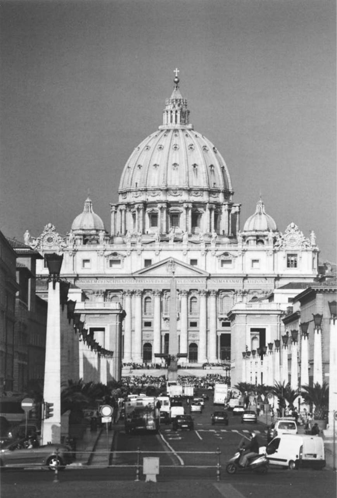
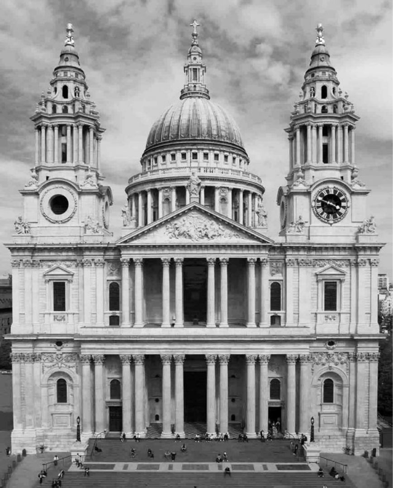
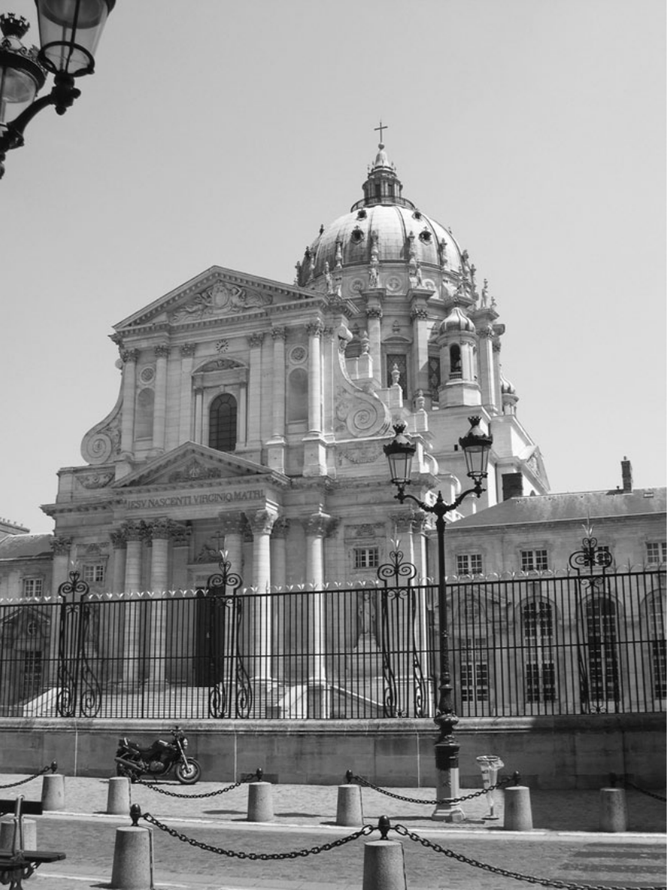
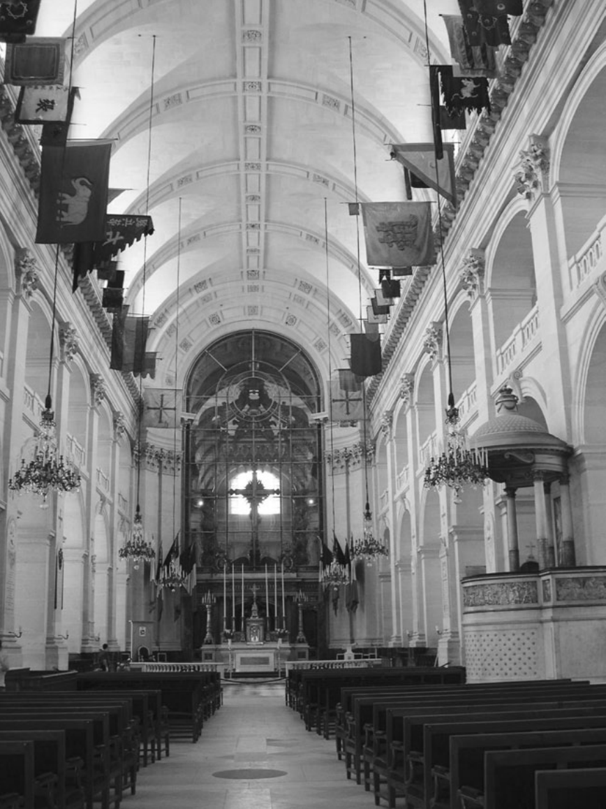
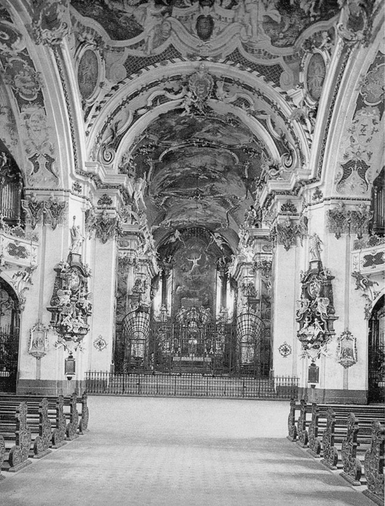

<!-- PDF page 241; original page 226 -->

# 第十二章　建筑与基督教

**让—米歇尔·勒尼奥（Jean-Michel Leniaud）**

## 一批鲜为人知的建筑：概览

艺术史家研究近代早期建筑时，并未十分关注数量问题。但显然，十六世纪中叶以后，欧洲兴建的宗教建筑数量相当可观；除城乡住宅外，可能没有任何建筑活动领域，比兴建礼拜场所，更为活跃。这一时期很长时间，欧洲仿佛一座巨大教堂工地。然而，扩张不能仅以人口增长、迁移，早先暴力毁坏教堂，甚至既有中世纪教堂年久失修解释；更应归于宗教改革后出现的宗教状况。一方面，新宗派有特殊礼仪要求，不再满足于改造中世纪教堂，必须兴建新堂。另一方面，天主教改革吸收人文主义、新教改革因素，重新评估礼仪、建筑、装饰需要。此外，天主教复兴带来新灵修、牧灵活动，继而创立众多修会，都必须为自己的共同体，兴建小堂。

除建筑量显著增长外，这一时期教堂兴建，也以政治权威前所未有的介入为特征。原因在于，当时欧洲国家与本国教会之间，发展出强有力的新关系：国家借此重建、现代化，本国教会获保护。某种程度上，世俗行政机关接过教会当局权力，至少介入其事务。例如法国，王室参与<!-- PDF page 242; original page 227 -->重建被新教徒摧毁的主教座堂，如1601年奥尔良、1604年瓦朗斯。介入，也不限于财政。多种力量，迫使国家、地方市议会，干预教会当局，控制建设，以致任命建筑师，成为王室行政特权。世俗权力，侵入天主教主教的领域，与王权控制新教徒，同步发生。1598年《南特敕令》规定新教教堂位置、数量，1685年废令又命令拆毁。路易十六末年，国家控制减弱；但拿破仑1801年《政教协定》及后续文本，又给世俗当局相当权力，控制天主教、新教教堂及犹太会堂的建设批准、建筑形制。英国也有类似国家控制。1711年法案设税，为伦敦、威斯敏斯特两城及郊镇五十座新教堂筹资。一世纪后，1818年《教堂建筑法》，呼应“五十座新教堂法”；但规定的不再是数量，而是拨款：一百万英镑。经验教人，不宜陷入财务超支。

能否再进一步，通过礼拜场所不同设计、装饰特征，判断兴建时宗教情感性质？一些作者，毫不迟疑地作此推论。例如据说，1818年法案后建教堂的“冷漠”，表明宗教感情，在多大程度上，已被社会惯例的规定取代。同时代人，有时也建立类似联系。十七世纪法国，耶稣会敌人毫不犹豫，把本会建筑中虽有限的意大利影响，与他们认定本会缺乏道德严谨相连。显然，必须极其谨慎，因为我们远未掌握，解释建筑形式的钥匙。但也不应接受陈词滥调，如断言旧制度法国人总警惕巴洛克、洛可可自发奔放，无论博罗米尼的罗马教堂，还是约翰·米夏埃尔·菲舍尔1748—1753年建的奥托博伊伦大修院。艺术史家可更进一步，向宗教史家提出：内部装饰从多彩逐渐变纯白无彩，同样，<!-- PDF page 243; original page 228 -->圣像图像，逐渐稀少、抽象，可能表达了以新的思想方式，理解信仰奥迹，也表达对十八世纪末，所谓“迷信”的谴责。

一般观察最后可归于一点：由上述建筑部门活力、世俗与教会当局参与、宗教情感旺盛可知，如中世纪、文艺复兴一样，教堂建设仍是建筑创造的优先领域。时代重要建筑师，无一不同程度关心。尽管史学传统论证制度、社会、文化日益世俗化，却不可能说，存在一个世俗艺术领域，另有独立神圣领域。近代早期，若有一处地方，汇聚全社会，毫无疑问，就是教堂；同样，除宫殿、剧院、歌剧院外，若有一个艺术项目，汇集大量艺术家，也无疑是教堂。由此，可以理解，礼拜场所为何如此吸引当时的建筑师，其风格、设计，又为何如此多样。

## 风格的繁盛

十七世纪最初数十年，人们极度不信任，源于米开朗基罗风格的繁复，对装饰形式，严格选择，趣味上，强调简洁的体量。某些国家，包括英国，未经历矫饰主义。伊尼戈·琼斯使英国习惯帕拉第奥艺术的欧几里得几何形式：考文特花园圣保罗教堂（1631—1633），展示巨大的科林斯式门廊、托斯卡纳神庙风格的三角山花。但帕拉第奥影响在威尼斯最显著，巴尔达萨雷·隆盖纳在大运河入口建的安康圣母教堂（1631—1651），其穹顶、立面即例。在罗马，卡洛·马代尔诺续建圣伯多禄大殿，1607—1612年完成中殿、立面，大体古典风格，略带矫饰主义细节。

相比之下，弗朗切斯科·博罗米尼，兼受米开朗基罗遗产、独创精神启发。1638—1642年，为圣斐理伯·内里祈祷会建会堂，采用独特设计：立面不取直线，而呈曲线，在凹凸之间起伏。

<!-- PDF page 244; original page 229 -->

**图1　罗马圣伯多禄大殿。** 立面由卡洛·马代尔诺设计，1607—1612年完成，具有戏剧性的古典风格与矫饰主义细节，对教堂建筑产生深远影响。摄影：格雷厄姆·阿斯特尔斯。

<!-- PDF page 245; original page 230 -->

山花又兼有拱形、三角形山花面。同样，圣伊沃·德拉萨皮恩扎教堂（1643—1650），展示蜂房形六角结构、贝壳式三重螺旋等独创形式。数位建筑师，走上相似道路。1656年，彼得罗·达科尔托纳，在罗马和平圣母教堂立面，结合半球、平行六面体形式，用壁柱、圆柱，创造新效果。卡洛·赖纳尔迪在卡皮泰利圣母教堂（1663—1667），设置两组柱式，一组在前，一组深嵌墙中。但最具博罗米尼风格者，可能是瓜里诺·瓜里尼；身为戴蒂尼会神父、数学学者，他创造起伏立面、集中式顶盖，其结构由复杂叠层组成。因此，都灵圣殓布小堂，圆鼓座上逐层错叠数层六角形，各构件不是弓形弧段，而是拱形。这类结构，较晚的回响，见于瓜里尼弟子B.维托内1744年所建尼斯戴蒂尼会圣加埃塔诺教堂。

但大胆的个人创造，并不符合时代的总体趣味。贝尔尼尼本人，在奎里纳莱圣安德烈教堂（1658—1670），也表现克制，采用椭圆柱形鼓座，两侧小堂，半圆门廊。1660—1670年，古典主义反动更明显：罗马维亚拉塔圣母教堂立面（1658—1662），彼得罗·达科尔托纳放弃前些年曲线，改为两层门廊相叠，几无凸出。1662年，卡洛·赖纳尔迪在人民广场设计近乎孪生的两座教堂，前设古式门廊。卡洛·丰塔纳的科尔索圣马尔切洛教堂（1682），也走类似方向。

宏伟古典风格在英国的胜利，由克里斯托弗·雷恩确立。他视1666年伦敦大火为机会，最终促成重建五十二座教堂的决定。1670—1671年，最早二十座教堂的重建，就实现了他的思想。伦敦沃尔布鲁克圣斯蒂芬教堂（1670），外部平行六面体、上覆穹顶，整体集中式平面。他在重建伦敦圣保罗大教堂中继续探索，以罗马圣伯多禄大殿为灵感。若干年后，负责实施1711年托利党法案的建筑师，仍忠于他的城市纪念性建筑实验：包括合作者范布勒；霍克斯穆尔，其斯皮塔尔菲尔兹基督教堂（1714—1720）为巴西利卡平面，伍尔诺斯圣玛利亚教堂（1716—1724）纳入正方形，东区圣乔治教堂几近新古典线脚；以及詹姆斯·吉布斯等人。

<!-- PDF page 246; original page 231 -->

**图2　伦敦圣保罗大教堂正立面。** 1666年大火后重建，1708年竣工。建筑师克里斯托弗·雷恩爵士，以罗马圣伯多禄大殿为灵感。摄影：萨姆·劳埃德。

吉布斯的斯特兰德圣玛利亚教堂（1714—1717），其半圆柱门廊、高耸尖塔，在路口，犹如城市灯塔；田野圣马丁教堂（1722—1725），有门廊、半嵌柱、钟塔。另有约翰·詹姆斯的圣乔治教堂（1720—1725），托马斯·阿彻的史密斯广场圣约翰教堂。

<!-- PDF page 247; original page 232 -->

## 法国的情形

法国出于民族自豪，拒绝意大利影响，受到建筑创新吸引，却又不弃哥特传统，尤其迷恋统一、平衡。其宗教建筑，在数量、多样性两方面，都有成就。因此，为回应宗教战争中新教毁坏，瓦朗斯、奥尔良主教座堂，分别依原设计，以罗曼式、哥特式重建，奥尔良重建一直延至旧制度末。确实，从马尔泰朗热神父到苏夫洛，许多法国建筑师的作品，显示某种哥特趣味；偏爱宽大厅堂式教堂的普雷蒙特雷会建筑，也如此。表达这一趣味的，还有安德烈·费利比安（1699）、米歇尔·德米兰（1702）、让—路易·德科德穆瓦（1706）、洛吉耶神父（1753）等理论家。

萨洛蒙·德布罗斯设计的圣热尔韦立面（1616），显示明显转变：巨大哥特中殿前，建三层柱式叠置屏面。评论者，一开始就将其，推崇为国家典范。穹顶教堂中，最具雄心的作品之一，无疑是瓦尔—德格拉斯教堂。1645年弗朗索瓦·芒萨尔奉奥地利的安娜之请开建，由索邦小堂穹顶（1635）设计者勒梅西耶续建。芒萨尔此前已建圣安托万街圣母往见会小堂穹顶（1632—1633），1665年，又向路易十四，提出波旁家族陵寝小堂的宏大方案，结合集中式平面、穹顶，拟建于圣但尼大修院教堂的东端后殿。他1666年去世，未能实施；但以低矮开口内穹顶纳入外圆顶、产生间接日光的创新，被侄朱尔·阿杜安—芒萨尔用于荣军院教堂（1676）。

数个不同宗教共同体的教堂，都可见意大利影响。很好的例子，包括巴黎加尔默罗会、祈祷会教堂，稍晚法国耶稣会中央建筑圣保罗—圣路易教堂。后者，受到1584年竣工的罗马耶稣堂平面启发，依艾蒂安·马尔泰朗热设计建造（1627—1641）。1662年，轮到应马扎然之请来法国的戴蒂尼会。其小堂依瓜里诺·瓜里尼设计，结合椭圆空间、凹凸曲线，以对角线组织构图，体现“奇异奔放”趣味；这种趣味，反而强化法国对古典主义的坚持。

<!-- PDF page 248; original page 233 -->

**图3　巴黎瓦尔—德格拉斯教堂。** 1645—1667年兴建，建筑师弗朗索瓦·芒萨尔开工，雅克·勒梅西耶完成。穹顶由皮埃尔·米尼亚尔设计。摄影：海伦·谢尼。

<!-- PDF page 249; original page 234 -->

**图4　巴黎荣军院教堂内部。** 1676年，由瓦尔—德格拉斯建筑师弗朗索瓦·芒萨尔之侄朱尔·阿杜安—芒萨尔开建。外圆顶内嵌低矮、开口的内穹顶，使柔和、间接日光充满内部。摄影：海伦·谢尼。

<!-- PDF page 250; original page 235 -->

1676年，阿杜安—芒萨尔开始建荣军院教堂，采用极富独创性的方法，建造前后相接的两座小堂：一座供士兵使用，另一座的用途，仍是谜，或许拟作路易十四陵寝。立面前，还规划以两道门廊划界的半圆广场。总体设计，表达取自罗马圣伯多禄、法国瓦尔—德格拉斯的多种观念；后者结合集中式唱诗席、延长中殿；据说也取自圣但尼波旁陵寝圆堂方案。

凡尔赛皇家小堂，由阿杜安—芒萨尔，于1698年开建，罗贝尔·德科特，于1710年完成。有趣的是，建筑师有意选择古式平面。芒萨尔最初，提出集中式平面，后来决定，取法中世纪圣礼拜堂、宫廷小堂。设计力求，以规模、同宫殿本身的联系，显得突出：中殿修长，立面分两层，作为全堂点睛之笔的上层，专供国王。此外，内部有明显新的高层构件：上层小堂高度，以方墩代替支檐圆柱，承低拱廊，形成受克洛德·佩罗卢浮宫西立面启发的柱廊。这种教堂建筑观念，1697年前即出现于同样归佩罗的方案：檐部下设柱廊的古式巴西利卡。灵感来自维特鲁威法诺巴西利卡，佩罗曾为维特鲁威译本作图再现。

维特鲁威的观念，与更早的类似实验，即萨洛蒙·德布罗斯设计的沙朗通新教教堂，若有联系，无疑也是偶然。无论如何，维特鲁威影响，证明长方形设计吸引力。改革宗教堂，从最初就有集中式例子，如安特卫普圆形、拉罗谢尔八角形；但《南特敕令》废除，导致法国许多新教堂被毁后，沙朗通将成为整个北欧典范。

## 中欧与东欧的洛可可

来自伦巴第、米兰的流动石匠、装饰师团队，四处寻找工地，使意大利纪念性建筑传统，在中欧向北传播。在致力恢复天主教信仰的国家，艺术，尤其<!-- PDF page 251; original page 236 -->建筑，在传教护教中格外活跃。数国参与巴洛克实验，旨在先通过感官，再通过言辞，争取归信者：波希米亚，基利安·伊格纳茨·丁岑霍费尔的布拉格小城区圣尼古拉教堂；匈牙利，普兰陶尔的梅尔克修院（1709—1711）；维也纳，菲舍尔·冯埃尔拉赫的圣嘉禄·鲍荣茂教堂（1715—1723）。

源于法国的洛可可，嫁接到意大利式主干，产生了格外流畅、乐观、明亮的艺术。修院建筑最美例子，有巴尔塔萨·诺伊曼的内雷斯海姆（1745—1798）、十四圣人朝圣堂（1745—1772）；多米尼库斯·齐默尔曼的维斯圣所（1745—1750）；阿萨姆家族在慕尼黑、雷根斯堡、弗赖辛的作品；约翰·米夏埃尔·菲舍尔的奥托博伊伦（1748—1753）；彼得·图姆的瑞士圣加仑；以及同在瑞士、匿名建筑者的艾因西德伦修院。这些建筑师，偏爱曲线，将椭圆中殿，与矩形唱诗席并置，如维斯教堂；发展两侧塔楼的宽阔立面，保留厅堂式教堂传统的宽大开间，使光线充沛。

类似形式，适应地方背景，传到德累斯顿。原书称其为“强者”奥古斯特统治期间天主教波兰的首都，宫廷教堂，就是例子。它们又通过多梅尼科·特雷齐尼的彼得保罗大教堂（1712—1723），以及巴尔托洛梅奥·拉斯特雷利的斯莫尔尼女修院，传入俄罗斯，尤其圣彼得堡；还传罗马、那不勒斯、西西里。西班牙、葡萄牙也独自适应洛可可，或聘外国建筑师，如在瓦伦西亚工作的康拉德·鲁道夫、在穆尔西亚工作的海梅·博尔特，以及约翰·弗里德里希·路德维希；或用地方大师，如安达卢西亚菲格罗亚家族、萨拉曼卡丘里格拉家族。此后，结合巴洛克、洛可可、原住民特色的建筑，传遍拉美地区，如墨西哥奥科特兰圣所，约1745年，或巴西孔戈尼亚斯教堂。

## 法国：走向新古典的简洁

除一两例外，如重建奥尔良哥特主教座堂，或受阿尔卑斯欧洲风格影响的阿尔萨斯埃贝尔斯明斯特大修院，法国拒绝把洛可可用于自身

<!-- PDF page 252; original page 237 -->

**图5　瑞士艾因西德伦修院，本笃会。** 华丽洛可可内部，在横翼两臂各有一台管风琴。修院1719—1735年兴建。照片由美国历史档案馆提供。

<!-- PDF page 253; original page 238 -->

宗教建筑。1726年，朱斯特—奥雷尔·梅索尼耶，为原由克里斯托夫·加马尔1643年设计的圣叙尔皮斯教堂，提受博罗米尼影响的立面方案，被拒。1732年，让—尼古拉·塞尔万多尼，赢得教堂最后这一部分的设计竞赛，标志圆柱、水平檐部的胜利。让—弗朗索瓦·沙尔格兰1770年后介入上部栏杆建设，虽塔楼上段有博罗米尼式曲线，仍巩固直线支配。此前，苏夫洛1764年，为圣热纳维耶芙教堂——很快改称先贤祠——所作方案，已确认这一趋势。他旨在调和，法国以佩罗柱廊为代表的希腊柱式，与自己钦佩的哥特建筑的科学、轻盈。结果，产生高度理性化、没有诱人巧饰的建筑，完全由精密计算的直线、曲线、平行六面体、球体组成，特点是几乎完美对称、网格组织。

另一同时代方案，也重申了明显的抽象倾向。同在1764年，让—弗朗索瓦·沙尔格兰受命建鲁勒圣斐理伯教堂，外用托斯卡纳门廊，侧廊、半圆唱诗席用爱奥尼亚柱廊，配格间拱顶，重新运用古代巴西利卡形式，迅速成为此后数十年宗教建筑典范。类似布局，见路易—弗朗索瓦·特鲁阿尔在凡尔赛建的蒙特勒伊圣桑福里安（1764—1770）；尼古拉·波坦同在1764年开建的圣日耳曼昂莱圣路易。波坦也用此风格于雷恩主教座堂，方案1764年批准，1786年才开工。革命后，几乎法国所有教堂，都遵循源自鲁勒圣斐理伯的风格，采用巴西利卡平面，加上入口门廊。唯一例外是玛德莱娜，拿破仑一世，亲自审慎选择其设计；与其说，它是天主教礼拜教堂，不如说，是献给法国荣光的神庙。在巴黎，这种基本设计，可见于伊波利特·戈德的格罗卡尤圣伯多禄、圣体圣但尼，莫利诺的巴蒂尼奥勒圣玛利亚，以及伊波利特·勒巴的洛雷托圣母。此风格延至十九世纪四十年代，才受到新哥特的激烈挑战，例如高在巴黎建造的圣克洛蒂尔德，以及让—巴蒂斯特·拉叙斯，在南特建造的圣尼古拉。

<!-- PDF page 254; original page 239 -->

## 家具与内部设施

宗教改革断裂，使人对教堂及其家具、设施的宗教功能，产生不同观念。一些礼拜场所，如今排除一切圣礼功能，选择作为读经、释经、祈祷的聚会处。另一些，则重申自己，是神临在的特殊领域，或举行圣体及其他圣事奥迹的圣地。宗教改革后新教教堂，大部分地面、墙面，被接纳会众的长凳、座席、楼廊占据，圣餐桌、讲道坛，有时管风琴，置于前方。天主教则试图划分空间，一侧为圣所与神父，另一侧为会众。礼仪家具，必须占有相当空间。法国教堂长凳，直到1801年《政教协定》后礼拜恢复，才广泛出现。

家具核心，是祭台、祭台背屏。祭台背屏，这项中世纪遗产，经过许多改动，成为天主教改革的主要家具。此后，它的首要目的，是辅助存放圣体的圣体龛；此前，圣体存于悬器、柜橱、圣体塔。特伦托法令后的图像实践中，多数历史场景渐消失，祭台画题材限于正式规范主题。无论是否结合此类祭台画，新的、更抽象的图像体系出现，由阐释三位一体的象征组成：圣体龛各处安小天使，其上是天军荣光象征、圣灵鸽、四字圣名；整组上方置华盖，表达主权。在这一基本模式之内，多数背屏，尺寸甚大；后来，一场反向运动，渐使它们消失。到十八世纪末、尤其十九世纪初，祭台配件仅剩圣体龛、烛台支架、小天使。

法国祭台本身，几乎总背靠唱诗席尽头，如凡尔赛小堂、巴黎圣母院。罗马则创新，把大桌形式祭台移向中殿。

<!-- PDF page 255; original page 240 -->

1624—1633年，贝尔尼尼在圣伯多禄大殿，装华盖形式巨大祭台顶棚。这种呈现弥撒祭献、真实临在的方法，复兴了早期基督教的祭台华盖传统，立即引起法国效仿，尤其瓦尔—德格拉斯（1665）。但直到下世纪中叶，法国才充分发展“罗马式”祭台、桌式“墓形祭台”，如瓦朗斯主教座堂。即使如此，也有争议：1753年，努瓦永主教座堂教士团，因安装此类祭台，激烈分裂，便把决定权，交给国王御前会议；后者支持创新者。

兼作堂区教堂的修院、协同教士团教堂，重新组织唱诗席。中世纪旧唱诗席隔屏（jubé），原本不透明，如今通过铁艺，变得轻盈、通透；唱诗席入口的一处柱脚旁，增设小祭台，用于举行堂区弥撒。改造旨在使信徒更近礼仪行动，尤其祝圣。

其他家具也获新意义。讲道坛置中殿中央，便神父联系会众，体量巨大，设反音罩改善声学，形成特色图像，如四福音作者，或啄食自身内脏哺育幼鸟、象征基督的鹈鹕。个别耳语告解，随传教、讲道而发展，因而设计新家具，按堂区神父人数安装。约此时，布拉格主教座堂重振圣若望·内波穆克敬礼，他因拒泄告解秘密殉道。最后，管风琴常巨大，以前数件不同乐器，合入同一立面、多个琴箱，包括小风琴、主风琴、唱诗部、回声部。管风琴的位置，可以不同：新教教堂，常置于讲道坛上方；法国天主教堂，通常置于中殿后方。有时两台，横翼两臂各一，如艾因西德伦。大教堂又在唱诗席、围隔上加乐器，伴协同教士团或修院礼拜。

## 视觉艺术与情感唤起

建筑设计演变、教堂家具发展，本身都不足解释天主教、新教宗教改革时代<!-- PDF page 256; original page 241 -->礼拜建筑独创性。建筑师与教士，无论神父、牧师，共同致力于荣耀教会。中世纪，城市教堂常不显眼，空间不足、邻近建筑混乱，妨碍突出。近代初城市版画显示，教堂尖塔之高，更多因设计惯例，而非为标示城中位置。圣嘉禄·鲍荣茂，似乎是最早认真注意到，礼拜场所须与邻近建筑分开的人之一，见1577年《教堂建筑及教会器用指导》两卷。他兼顾财务安全，以及敬拜神的地方，应与世俗生活分开的权利。因此，他提议，让城市街道网，围绕建筑东端、两侧，正立面则朝向公共空间。但建筑、城市规划不能限于功能。礼拜场所兴建，是更大目标的一部分，古罗马人称城市“装饰”。立面，成为城市视觉整体的组成部分，耶稣堂甚至取凯旋门形式。例如，卡洛·赖蒙迪为此建罗马人民广场孪生教堂。同样，雷恩建议，教堂塔楼应高耸、美丽，使建筑师无须过度花费，就能把礼拜场所，同周围密集建筑区别开来，美化城市整体。那时，城市规划，被视为一种政策：兴建公共建筑，使住宅区逐渐围绕它发展，如巴黎荣军院，新教堂在城市设计中地位重要。

在重新界定的城市空间，礼拜建筑外观，获新象征话语力量。例如1631年，隆盖纳确认，威尼斯安康圣母教堂，选择集中式平面，是为了给圣母玛利亚，设计一顶冠冕。博罗米尼解释，圣斐理伯·内里祈祷会立面，曲面而中央凸出，其形象，是奥秘的教会张开双臂，欢迎信徒进入怀抱（1638—1642）。贝尔尼尼为圣伯多禄广场采用同一隐喻；至于圣伊沃·德拉萨皮恩扎（1643—1650），层叠穹顶、三重螺旋尖塔，则与教皇三重冠的形象相类比。类似地，瓜里诺·瓜里尼设计圣殓布小堂，<!-- PDF page 257; original page 242 -->即1667—1690年，都灵的这座小堂，采用三分方案，表达三位一体奥迹。

内部空间组织，以使会众看见、听见的功能为导向。宗教改革产生的教派显然如此，天主教也如此，尽管雷恩试明确区分圣公会与罗马宗教。他写：“罗马天主教徒能建更大教堂，因为只须听弥撒低诵、见举扬圣体；我们的教堂，却须为听众设计。”此观点导致拆除封隔座堂教士唱诗席的屏障；但直到1801年《政教协定》，确认主教座堂除教士团职能，也具堂区职能，最后隔屏才拆，如罗德兹1823年后、利摩日1888年。

同样出于对视听的关注，建筑师扩大中殿，将侧廊限于通行，并提出中殿与唱诗席的不同关系，通常抬高后者。例如莱比锡圣尼古拉，原哥特结构，十八世纪内造椭圆会众空间。也可以问，十八世纪中叶，建筑缩小、采用巴西利卡平面的倾向，是否同样与视听有关。英国音乐厅的实验，证明长方形平面，延伸为半圆形廊，并把开窗移至承檐沟的墙体上部，在这方面，具有优势。不过，十九世纪四十年代新哥特反动兴起时，中世纪风格支持者，如夏尔·德蒙塔朗贝尔、阿道夫—拿破仑·迪德龙，恰以巴西利卡像世俗音乐厅而反对。但尽管批评，多数新哥特堂仍保前代建筑体量统一。总之，无论是否巴西利卡，长方形显然因声学而获偏爱。然而，十九世纪最初二十年，仍建一定数量罗马万神庙式圆形建筑，如都灵圣母教堂，或安东尼奥·卡诺瓦设计的波萨尼奥教堂。

但空间研究，不能只限功能。建筑师也发明扩展内部空间、减弱有限感的办法。穹顶<!-- PDF page 258; original page 243 -->可达此效果，尤其绘错视画时。罗马谷地圣安德烈教堂穹顶（1625—1627），开启长期壁画创作，借学术透视研究，利用表面连续曲线，造升天幻觉。法国最重要例，是米尼亚尔绘瓦尔—德格拉斯穹顶（1663—1666）。中殿等修长空间，更难达到同样效果，因为画家必须，让升天幻景，与入堂者的斜向视角调和。彼得罗·达科尔托纳，瓦利切拉圣母教堂（1647—1651），乔瓦尼·巴蒂斯塔·高利，又名巴奇恰，耶稣堂（1672—1679），创造了最早传达这类效果的杰作。错视画，在建成空间中央造想象空间，使信徒感天地边界消失。十八世纪，阿尔卑斯、中欧、伊比利亚、拉美洛可可建筑装饰，走相似道路。

通过建筑、绘画，扩展内部空间的同时，人们也细致、复杂地研究用光，旨在隐藏光源位置，对观者产生情感效果，加强神秘、不真实之感。贝尔尼尼在胜利圣母教堂科尔纳罗小堂《圣德兰的神魂超拔》（1647—1652），欲达此效：天使以云托圣女，向神光升去；环境光经隐藏圆孔，反射金色光芒，暗示神不可企及。瓜里尼尤其擅长，以直、间接光，赋空间超越、无限。他在数学科学上，最伟大的杰作，是都灵圣殓布小堂。其穹顶上，重叠八角结构，设计使观者，看不见采光口。来源神秘的光线，滤过黑色大理石内部，仿佛染上暗色，产生幽暗之光、黑光，即tenebrosa luc。信徒来敬拜基督殓布，基督教世界最著名圣髑之一，由此理解自己身处复活日基督墓穴图景的核心。另一以光线动人的例子，是丁岑霍费尔的布拉格小城区圣尼古拉，穹顶如灯亭，亮度随外光变化。同样，阿杜安—芒萨尔以光，在巴黎荣军院<!-- PDF page 259; original page 244 -->小堂中，创造惊人效果：用内穹壳，遮住穹顶开窗，穹壳中央的圆孔，则使光，洒遍建筑。

从苏夫洛的圣热纳维耶芙，到布莱革命时期的都会教堂方案，这一代建筑师，放弃以惊奇激起的激情，转向明暗空间连续交替，产生的更简单、鲜明的对比。路易—塞巴斯蒂安·梅西耶小说《2440年：前所未有的梦》（1770—1787），表达想象未来的宗教、美学目标，也可能就是旧制度末期目标。他献给略带泛神论色彩的最高主宰崇拜的神殿，是一座穹顶圆堂，由单圈立柱支撑，四座大门敞开，光线滤过穹顶顶端的透明彩窗。他写，天顶光，使内部与天界、自然元素、季节相接。

法国美学偏爱充沛光线，同时渐减对建筑多彩的兴趣。十八世纪中叶至十九世纪二十年代，如洛雷托圣母堂，即使考古发现希腊神庙彩饰，使色彩兴趣复苏，礼拜场所仍坚守白色。巴黎圣塞韦兰自1699、圣梅里自1751，拆中世纪彩窗，换白玻璃。但趣味转变并非无争论。1754年，反对唱诗席现代化的努瓦永座堂教士，沿袭让—巴蒂斯特·蒂耶尔1688年的思想，认为想看别人、被别人看见，违背虔敬，幽暗更符合神圣奥迹。御前会议不支持；但十八世纪八十年代初，巴黎圣礼拜堂教士，成功阻止王室行政机关，以白玻璃，替换圣路易十三世纪彩窗的方案。同样，内部刷白可引争论。塞巴斯蒂安·梅西耶《巴黎景象》，反对以如此明显世俗的气氛，取代古老神秘阴影，如巴黎圣母院1753年。革命后1806年，米兰呼应其思。

这些争论，使我们看见论据复杂交织。特伦托教规颁后，加强控制圣像敬礼，导致图像主题、历史场景稀少，从而<!-- PDF page 260; original page 245 -->减少用色。此外，礼仪的功能性、理性特征，使人拒绝十七世纪意大利式的强烈效果，创造组织更简单的白色空间。但1750年后，出现更简单、自然、基于明暗对比的感动力。1774年，德瓦伊封闭圣叙尔皮斯圣母小堂的窗；布莱此前，在圣罗克加尔瓦略小堂，已这样做过。革命初期，卡特梅尔·德坎西，也将下令，遮住先贤祠中殿的窗。

若在声音领域作类似研究，将很有趣。近代内部建筑的简化，为音乐新的空间化，也许更为不同作曲风格，铺平道路。继中世纪单声部之后的复调，预设一个相对有限、声学可靠的空间。两唱诗班对答，有时两管风琴，发展为利用新空间立体声效，如艾因西德伦修院堂横翼两台、唱诗席第三台。音乐在礼拜、一般宗教生活中重要地位，无论由风琴师、唱诗班、礼拜堂乐团，或圣读及圣咏诵唱使用的其他声源演出，尚待探索。建筑、音乐之间，研究甚少、却无疑非常重要的互动，必须与建筑、声音的一般关系，共同考察。“声音”还须包括，礼仪、圣文阅读要求的许多不同情境中，讲道者言语、主持教士与辅祭者祈祷。

## 新的神殿

并非只有宗教改革产生的教派，用“神殿”（temple）称礼拜处。十七、十八世纪天主教徒也用，虽有保留，像早期基督徒欲区别异教。神学家坚持，无限的上帝，不能被局限于人造居所的尺寸；教堂首先是ecclesia，即信徒会众所在地。但圣体圣事、真实临在的重要性，使建筑被界定为“上帝之家”（Domus Dei）、“天国之门”（Janua Cœli）。由此形成的隐喻话语，根植<!-- PDF page 261; original page 246 -->教父、中世纪神学家的注释，提供一种意义表达，把经天主教改革净化的基督教，锚定在《圣经》古老、诗性、神圣的世界。此外，近代早期，基督教人文主义推动圣经学复兴，天主教、新教释经者思想竞争，以及神学严谨主义加强的詹森主义影响，都强化此话语。人们希望，以从以色列宗教，到罗马教会的直接、正统传承，回应宗教改革，要求回归最初基督徒的原始主义话语。因此，教堂成“神殿”，唱诗席称“至圣所”，存圣体容器成“会幕”、即圣体龛；两侧蒙脸革鲁宾，如曾在至圣所约柜旁。同样，圣体光座中的圣体，以燃烧的荆棘表示；第一位格，以等边三角形中希伯来四字圣名表示，如维也纳卡尔教堂祭台背屏，教堂也献圣嘉禄·鲍荣茂；第二位格，以IHS字母表示。神父称“献祭者”，祭披取“献祭者围裙”形式，辅祭称“利未人”，有时“祭司支派”。知识人，细致研究《圣经》、弗拉维乌斯·约瑟夫斯的《犹太古史》，从胡安·包蒂斯塔·比利亚尔潘多、特鲁瓦座堂教士路易·马耶，到卡尔梅修士、约翰·伯恩哈德·菲舍尔·冯埃尔拉赫（1721），创造了诸多圣殿、器物的复原图式。博学图像体系展示《旧约》中圣体、祭献台、向神圣临在空宝座献饼之祭台的预表，如阿列省苏维尼圣伯多禄与圣保禄隐修院祭衣间护壁板。总之，似可结论：近代早期，罗马天主教经历首次“复兴”，一次《圣经》复兴，早于十九世纪三十年代起偏爱中世纪的复兴。

以《旧约》预表解释真实临在，旨在调和近代早期天主教特有的超越、理性双重要求。它倾向淡化基督人性，突出IHS、羔羊等象征，也忽视教会史，尤其圣人叙事。这表明，一种宗教，意在压制迷信，走向抽象。这几乎与另一努力同时，虽地方差异大，法国尤其如此，即从礼拜处清除一切悦<!-- PDF page 262; original page 247 -->感官的巧饰：图画、人物、雕饰线脚、色彩、历史化表现，使之专奉圣名。若说十八世纪末方案、成就，反映功用主义宗教观，一种泛化约瑟夫主义、国家把宗教列为“公共服务”，就不正确。这是把仔细研究后，可见的纯然抽象热情，误认作宗教冷漠。布莱的革命时期都会教堂内部方案，可提醒我们，激发宗教想象的激情何其有力：三折楼梯自幽暗中殿末端升起，在横翼交叉处顶端，巨穹光线突然落下；凯旋门标出的阴暗后殿开口前，巨大台座上，祭台耸立。罗马式祭台桌旁，献祭者在香云围绕中，举行最高主宰崇拜。祭司逆光呈剪影，人群沿中殿台阶俯伏，气氛庄严。无疑，这与“伊西斯奥秘”、《魔笛》、共济会装束、革命仪式不远。但这个介于理性、激情之间的宏伟思想剧场，完全有资格，与贝尔尼尼、博罗米尼、瓜里尼，同列一章。

同样，回望中世纪的新哥特复兴，将把福音宣讲者耶稣的人性，以及作为浪漫主义社会话语先驱的耶稣，连同中世纪圣人的黄金传说、多彩、幽暗、建筑形式的如画意境，带入圣所。启蒙宗教，毋宁说，它以《圣经》为本、抽象、严谨主义的观念，有些仍将留在十九世纪；但1830年后，建筑形式迅速更新，将以无言方式，表达新宗教感受的要求。

**（英文版译者：简·约曼。）**

**译校说明：** 原书PDF第251页，将梅尔克修院列于“匈牙利”，并称德累斯顿为“天主教波兰的首都”；两项地理表述存疑，译文保留原书说法，便于对照。

<!-- PDF page 263; original page 248 -->

（原书此页空白。）
