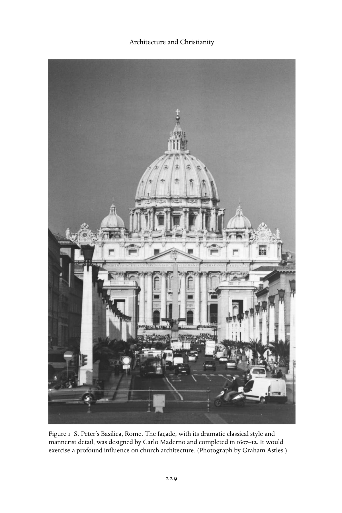
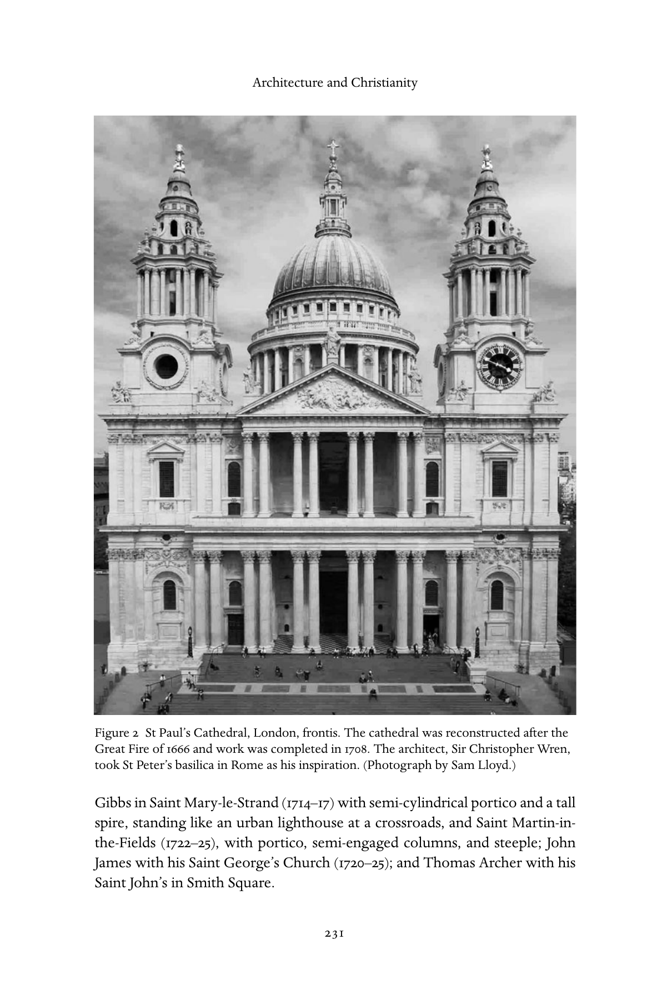
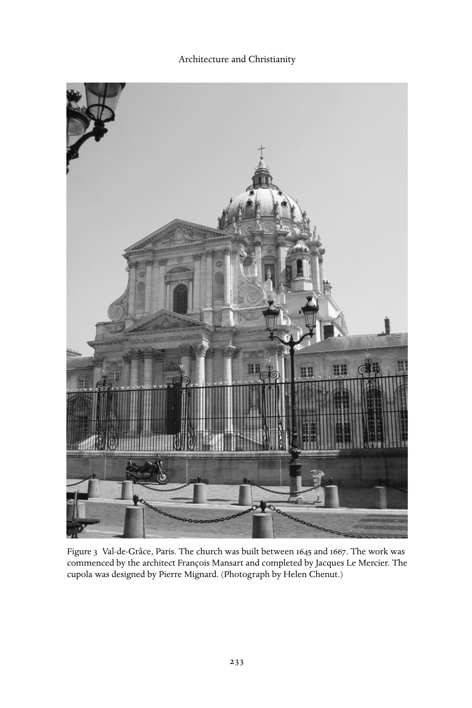
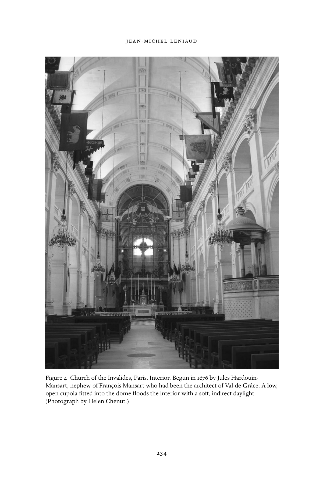
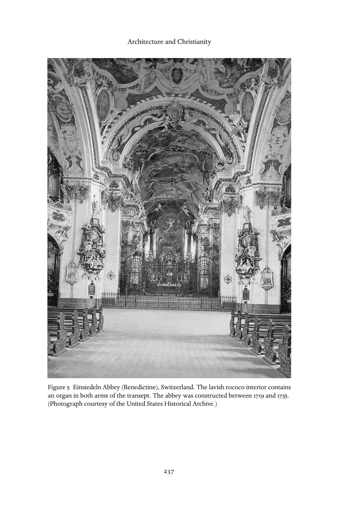

# 建筑与基督教：英文转换底稿

<!-- PDF page 241; original page 226 -->

### 12

## Architecture and Christianity

### j e a n - m i c h e l l e n i au d

### A little-known body of architecture: an overview

In their studies of early modern architecture, art historians have not been unduly concerned with questions of quantity. Yet it is clear that the shear number of religious constructions built in Europe after the middle of the six- teenth century was considerable, and that with the exception of urban and rural housing, there was probably no area of architectural activity more dynamic than the construction of places of worship. During much of this period Europe came to resemble one immense church construction site. Yet this expansion cannot be explained solely by the growth or mobility of the population, nor by the earlier destruction of churches through acts of violence, nor even by the deterioration of the stock of existing medieval churches. It was due rather to the state of religion which emerged from the Reformation. On the one hand, new denominations had particular liturgical requirements that meant they were no longer content to adapt the churches of the Middle Ages: they had to build new ones. And on the other, the Catholic Reformation’s assimilation of elements of both humanism and the Protestant Reformation led to a re- appraisal of needs for liturgy, architecture, and decor. Moreover, Catholic renewal led to new forms of spirituality and pastoral activities and subse- quently to the founding of numerous religious orders, all of which required the construction of chapels for their communities.

In addition to the significant quantitative increase in construction, church building in this period was marked by an unprecedented involvement of politi- cal authority. This was a result of the strong new relationship which developed in Europe of the period between states and national churches – a relationship that entailed both restoration and modernization for the states and protec- tion for the national churches. To a certain degree, the civil administrations came to assume the powers of the ecclesiastical authorities, or at least to inter- vene in their affairs. Thus, for example, in France the crown involved itself

<!-- PDF page 242; original page 227 -->

in the reconstruction of cathedrals destroyed by the Protestants (e.g., Orléans in 1601; Valence in 1604). And this was not simply a financial involvement: mul- tiple forces compelled both the state and the local town councils to intervene with the ecclesiastic authorities and take control of construction, so that the appointment of architects became the prerogative of the royal administration. This intrusion of the civil into the realm of the Catholic bishops went hand in hand with the use of royal power over the Protestants. Thus, the Edict of Nantes of 1598 dictated the sites and the numbers of Protestant churches to be established, while the Revocation of that edict in 1685 proceeded to order their destruction. State control over church construction became less forceful at the end of Louis XVI’s reign, but the Napoleonic Concordat of 1801 and subsequent texts accorded the civil authorities considerable control over both the authorization of construction and the architectural definition of Catholic and Protestant churches as well as synagogues. A similar phenomenon of state control occurred in Great Britain. The Act of 1711 instituted a tax to finance fifty new churches to be built in the cities of London and Westminster and in suburban towns. The ‘Act for Fifty New Churches’ was echoed a century later by the Church Building Act of 1818. But in the latter case it was not the number of churches that was stipulated, but the grant to be made – a million pounds. Experience had taught it was not wise to become involved in financial over-expenditure.

Can one go a step further and use the characteristics of the various forms of architectural design and decoration observed in places of worship to ascertain something of the nature of religious sentiment at the time of construction? Some authors do not hesitate to do so. Thus, the ‘coldness’ of churches con- structed after the 1818 Church Building Act is said to demonstrate the degree to which religious feeling had been replaced by the prescriptions of social con- vention. Contemporaries themselves sometimes tried to make similar links. In seventeenth-century France, enemies of the Jesuits did not hesitate to connect the Italian influences on Jesuit architecture – modest though they were – with what they judged to be the order’s lack of moral rigour. Clearly, such links should only be made with great caution, for we are far from possessing the keys to the interpretation of architectural forms. And yet neither should we accept common place generalizations. Such is the assertion that the French of the ancien régime were always wary of the spontaneity of the Baroque and the Rococo – whether in Borromini’s Roman churches or in the great abbey of Ottobeuren by Johann Mikael Fischer (1748–53). The historian of art can go further than this and suggest to the historian of religion that the gradual shift from a polychromatic interior decor to a white achromatism (and similarly,

<!-- PDF page 243; original page 228 -->

the increasing scarcity and abstraction of iconography) may have expressed a new intellectualization of the mysteries of faith, along with a denunciation of what the late eighteenth century called ‘superstition’.

One can conclude these general remarks with a final observation. From all that precedes – the dynamism of this specific building sector, the involvement of both civil and ecclesiastical authorities, the vitality of religious feeling – it follows that church construction remained, just as it had been in the Middle Ages and the Renaissance, one of the privileged areas of architectural creativity. No important architect of the age was uninterested in such construction to one degree or another. Despite the historiographical tradition that argues for a progressive secularization of institutions, societies, and cultures, it is impossible to maintain that there was one sphere of secular art and another separate sphere for the sacred. If there was one place during the early modern period where the whole of society assembled, it was undoubtedly in the church; and, by the same token, if there was one artistic project which brought together artists in substantial numbers (aside from the construction of palaces, theatres, and opera houses), then without a doubt it was also the church. Bearing this in mind, one can understand why the construction of places of worship so appealed to architects of the period; and by corollary, one can also comprehend the enormous diversity of stylistic designs.

### The flowering of styles

The first decades of the seventeenth century were characterized by an extreme distrust of the exuberance that derived from the style of Michelangelo, a strict selection from among the various ornamental forms, and an assertion of a taste for simple volumes. Certain countries, including Great Britain, had never experienced Mannerism. Inigo Jones acclimatized Britain to the Euclidean forms of Palladio’s art: Saint Paul’s Church in Covent Garden (1631–33) displays a vast Corinthian portico with a triangular tympanum in the style of a Tuscan temple. But Palladio’s influence was most significant in Venice, as shown in the dome and façades of Santa Maria della Salute, built by Baldassare Longhena at the entrance to the Grand Canal (1631–51). In Rome, Carlo Maderno continued the construction of Saint Peter’s, and produced the nave and façade (1607–12) in largely classical style with touches of Mannerist detail.

By contrast, Francesco Borromini was inspired both by Michelangelo’s her- itage and the spirit of originality. In 1638–42, he built the Oratory for the congregation of Saint Philip Neri according to an original plan with a curved rather than a rectilinear façade that undulated between the concave and the

<!-- PDF page 244; original page 229 -->

Figure 1 St Peter’s Basilica, Rome. The façade, with its dramatic classical style and mannerist detail, was designed by Carlo Maderno and completed in 1607–12. It would exercise a profound influence on church architecture. (Photograph by Graham Astles.)

<!-- PDF page 245; original page 230 -->

convex, and a pediment with both arched and triangular tympana. Similarly, Sant’ Ivo della Sapienza (1643–50) displayed original forms such as the hexagon in the shape of an alveolus and a shell-like triple spiral. Several architects followed comparable paths. Pietro da Cortona combined hemispherical and parallelepiped forms in the façade of Santa Maria della Pace (Rome, 1656) and created new effects with pilasters and columns. At Santa Maria in Capitelli (1663–67), Carlo Rinaldi produced two orders of columns, one in the front, the other deep-set in the wall. But the most Borrominian of them all was probably Guarino Guarini. A Theatine priest and scholar of mathematics, he created undulating façades and centred covers, their structures formed of complex stacks. Thus, in the Chapel of the Sindona in Turin, a staggered superposition of several levels of hexagons rose above a circular drum, each element not segmental but arched. A late echo of this type of structure is seen in San Gaetano, the Nice Theatines’ Church, built in 1744 by B. Vittone, himself a disciple of Guarini.

Nevertheless, such bold individual creations did not correspond with the overall taste of the period. Bernini himself showed restraint in Sant’ Andrea al Quirinale (1658–70) with an oval cylindrical drum flanked by small chapels, and a semi-circular portico. Between 1660 and 1670, the classical reaction became more pronounced, as shown in the façade of Santa Maria in Via Lata (Rome, 1658–62) where Pietro da Cortona renounced the curved lines he had employed in preceding years in favour of a superposition of two por- ticos with almost no projections. In 1662 in the Piazza del Popolo, Carlo Rainaldi designed two nearly twin churches, fronted by antique-style porti- cos. Carlo Fontana moved in a similar direction with San Marcello al Corso (1682).

The triumph of the grand classical style was ensured in Great Britain by Christopher Wren, who saw in the Great Fire of London (1666) an opportunity that finally led to the decision to rebuild fifty-two churches. His ideas were realized in the rebuilding of the first twenty churches, carried out as early as 1670–71. Saint Stephen in Walbrook (London, 1670) consists of an outside structure in parallelepiped form with a dome, the whole according to a central plan. Wren pursued his thinking in the reconstruction of Saint Paul’s Cathedral in London, where he took Saint Peter’s in Rome as inspiration. Some years later, architects in charge of implementing the 1711 Tory Act remained faithful to Wren’s experiments in urban monumentalism. They included his collaborator, Vanbrugh; Hawksmoor, with his basilica plan at Christchurch, Spitalfields (1714–20), his design of Saint Mary’s Woolnoth, inscribed in a square (1716–24), and Saint George-in-the-East, with almost neo-classical modenature; James

<!-- PDF page 246; original page 231 -->

Figure 2 St Paul’s Cathedral, London, frontis. The cathedral was reconstructed after the Great Fire of 1666 and work was completed in 1708. The architect, Sir Christopher Wren, took St Peter’s basilica in Rome as his inspiration. (Photograph by Sam Lloyd.) Gibbs in Saint Mary-le-Strand (1714–17) with semi-cylindrical portico and a tall spire, standing like an urban lighthouse at a crossroads, and Saint Martin-in- the-Fields (1722–25), with portico, semi-engaged columns, and steeple; John James with his Saint George’s Church (1720–25); and Thomas Archer with his Saint John’s in Smith Square.

<!-- PDF page 247; original page 232 -->

### The situation in France

Rejecting Italian influence because of national pride, attracted by architec- tural innovation yet not renouncing its Gothic tradition, fascinated above all by unity and balance: France presented the dual achievement of both quantity and diversity. Thus, in response to Protestant vandalism during the Wars of Religion, the cathedrals of Valence and Orléans were reconstructed respec- tively in Romanesque and Gothic style, following their original designs – with the rebuilding in Orléans continuing until the end of the ancien régime. Indeed, a certain taste for the Gothic was visible in the works of a number of French architects from abbé Martellange through Soufflot, and including the architec- ture of the Prémontré Order – with its preference for large church halls – and such theoreticians as André Félibien (1699), Michel de Millin (1702), Jean-Louis de Cordemoy (1706), and abbé Laugier (1753).

A clear transformation appeared with the façade of Saint-Gervais (1616), designed by Salomon de Brosse, where a screen with three superimposed orders was built in front of a vast Gothic nave. From the outset, critics elevated the work to the level of a national model. Among the domed churches, no doubt one of the most ambitious was the Val-de-Grâce, begun in 1645 by François Mansart at the request of Anne of Austria and continued by Le Mercier, the designer of the dome of the Sorbonne Chapel (1635). Mansart, who had already built the dome of the Chapel of the Visitation, rue Saint-Antoine (1632–33), suggested an ambitious plan to Louis XIV for a funeral chapel for the Bourbon family that combined a central plan with a cupola (1665). The chapel would have been erected in the chevet of the great abbey church of Saint-Denis. Although Mansart died in 1666 without being able to execute his project, his innovative idea of a low, open cupola, fitted into a dome to produce indirect daylight, was taken up by his nephew Jules Hardouin-Mansart in the church of the Invalides (1676).

An Italian influence is to be seen in a number of churches from different religious communities. One finds good examples in the Carmelite and Oratory churches in Paris and, slightly later, the church of Saint-Paul-Saint-Louis, the central edifice of the Jesuits in France. Inspired by the plan for Gesù in Rome (finished in 1584), the latter was constructed according to plans by Etienne Martellange (1627–41). In 1662, it was the turn of the Theatines, an order brought to France at Mazarin’s request. Their chapel was erected according to Guarino Guarini’s plans and combined elliptical spaces and convex and concave curves: compositions based on the diagonal with the taste for ‘extravagance’ that served to strengthen France’s assertion of Classicism.

<!-- PDF page 248; original page 233 -->

Figure 3 Val-de-Grâce, Paris. The church was built between 1645 and 1667. The work was commenced by the architect François Mansart and completed by Jacques Le Mercier. The cupola was designed by Pierre Mignard. (Photograph by Helen Chenut.)

<!-- PDF page 249; original page 234 -->

Figure 4 Church of the Invalides, Paris. Interior. Begun in 1676 by Jules Hardouin- Mansart, nephew of François Mansart who had been the architect of Val-de-Grâce. A low, open cupola fitted into the dome floods the interior with a soft, indirect daylight. (Photograph by Helen Chenut.)

<!-- PDF page 250; original page 235 -->

In 1676, Hardouin-Mansart undertook construction of the Invalides church. He employed a highly original approach and produced two successive chapels: one was for soldiers, while the purpose of the other remains a mystery, but was perhaps intended to be Louis XIV’s burial-place. In front of the church façade, Mansart also had planned for a semi-circular area, marked off by two porticos. Overall, the plan expressed various ideas taken from Saint Peter’s in Rome and, in France, from the Val-de-Grâce, which combined a centrally planned choir with a lengthened nave, and (so it was said) from the plan for the Bourbon funerary rotunda at Saint-Denis.

The Royal Chapel at Versailles, begun in 1698 by Hardouin-Mansart and completed in 1710 by Robert de Cotte, is interesting for the architect’s choice of a deliberately archaic plan. Mansart initially proposed a central plan, but decided in favour of designs inspired by the Sainte Chapelle and the Palatine chapels of the Middle Ages. His plan aimed for distinction through its size and its links to the chateau itself, with its elongated nave and two-level elevation, and with its upper level, the crowning glory, reserved for the king. Moreover, the interior contained a markedly new, raised element: at the level of the upper chapel, the entablature-supporting columns were replaced by square piers that carried low-level arcades and formed a colonnade inspired by Claude Perrault’s west façade of the Louvre. This idea for church architecture first appeared prior to 1697, in a project also attributed to Claude Perrault: an antique-styled basilica, with a colonnade beneath the entablature. The design was inspired by Vitruvius in his Fano basilica, a work reproduced by Perrault in an illustration for his translation of Vitruvius.

Any connection between Vitruvius’s conception and an analogous earlier experiment – the Protestant Temple at Charenton, designed by Salomon de Brosse – is no doubt fortuitous. In any case, the impact of Vitruvius’s work confirms the attraction of the oblong design. In Reformed churches examples of the central plan are found from the outset, whether circular as in Antwerp, or octagonal as in La Rochelle; but after the Revocation of the Edict of Nantes, which led to the destruction of so many Protestant churches in France, Char- enton would serve as a model throughout northern Europe.

### The Rococo in central and oriental Europe

The Italian monumental tradition spread northwards in central Europe due to the movements of itinerant teams of stone-masons and decorators from Lombardy and Milan, in search of new building sites. In countries where efforts were being made to restore the Catholic faith, the arts, and particularly

<!-- PDF page 251; original page 236 -->

architecture, assumed an especially dynamic role in missionary apologetics. A number of countries participated in this Baroque experimentation, con- ceived to win over converts through the senses before doing so through discourse: thus in Bohemia (Kilian Ignac Diezenhofer with Saint Nicholas de Mala Strana in Prague), in Hungary (Prandtauer in Melk Abbey, 1709–11), and in Vienna (Fischer von Erlach with the church of Saint-Charles-Borromeo, 1715–23).

Originating in France, the Rococo influence grafted itself onto the Ital- ianate trunk to produce an art that was particularly voluble, optimistic, and luminous. In terms of monastic architecture, the finest examples were pro- vided by Balthasar Neumann in Neresheim (1745–98) and Vierzehnheiligen (1745–72); by Dominikus Zimmermann in the Wies sanctuary (1745–50); by the Asams in Munich, Ratisbonne, and Freising; by Johann Mikael Fischer in Ottobeuren (1748–53); by Peter Thum in Saint-Gall in Switzerland; and indeed by the anonymous builder of Einsiedeln Abbey, also in Switzerland. Buildings by these architects privileged the curved line and juxtaposed the oval for the nave and the rectangle for the choir – as in the Wies church; they developed wide façades flanked by towers and preserved the use of generous bays from the hall church tradition to produce a profusion of light.

Forms of a similar kind, adapted to local contexts, spread to Dresden, the capital of Catholic Poland during the reign of Augustus the Strong (the court church); and to Russia, particularly Saint Petersburg, through Dominico Trezzini (the Peter and Paul Basilica, 1712–23) and Bartolomeo Rastrelli (the Smolny Convent); as well as to Rome, Naples, and Sicily. In their own partic- ular manner, Spain and Portugal also adapted the Rococo, whether through the designs of foreign architects, such as Konrad Rudolf (Valencia), Jaime Bort (Murcia), or Johann Friedrich Ludwig; or of local masters like the Figueroas in Andalusia and the Churrigueras in Salamanca. In the following years, archi- tecture that combined Baroque and Rococo with indigenous traits spread throughout Latin American regions (as in the Ocotlan sanctuary in Mexico, c. 1745; or the Congonhas church in Brazil).

### France: the move towards neo-classic simplicity

With one or two exceptions, such as the reconstruction of the Gothic cathedral of Orléans or the great abbey of Ebersmunster in Alsace – influenced by the style of Alpine Europe – France refused to adapt the Rococo to her own

<!-- PDF page 252; original page 237 -->

Figure 5 Einsiedeln Abbey (Benedictine), Switzerland. The lavish rococo interior contains an organ in both arms of the transept. The abbey was constructed between 1719 and 1735. (Photograph courtesy of the United States Historical Archive.)

<!-- PDF page 253; original page 238 -->

religious architecture. In 1726, Juste-Aurèle Meissonnier proposed a façade for Saint-Sulpice (originally designed by Christophe Gamard in 1643) that was marked by Borromini’s influence. But the plan was rejected. In 1732, the competition for this final portion of the church was won by Jean-Nicolas Servandoni, a decision that marked the triumph of columns and horizontal entablatures. Despite the Borrominian curves employed in the upper parts of the towers, Jean-François Chalgrin’s intervention into the construction of the upper balustrade after 1770 consolidated the dominance of the straight line. This tendency was confirmed in the meantime with Soufflot’s 1764 project for Sainte-Geneviève (soon renamed as the Pantheon). Here the architect’s aim was to reconcile the Greek order, exemplified in France by Perrault’s colonnade, with the science and lightness of Gothic construction that he so admired. A highly intellectualized design resulted, presenting no seductive arti- fice but consisting of a wholly calculated layout of straight lines and curves, parallelepipeds, and spheres. The plan was distinguished by an almost perfect symmetry and gridded organization.

The pronounced tendency towards abstraction was reaffirmed in another contemporary project. In the same year, 1764, Jean-François Chalgrin was charged with the construction of Saint-Philippe du Roule. Employing an exte- rior Tuscan porch, Ionic colonnades in both the aisle and the semi-circular choir, and a coffered vault, Chalgrin readapted the form of the ancient basil- ica, which quickly became the model for many subsequent decades of reli- gious architecture. Similar layouts may be seen in the Saint-Symphorien de Montreuil, built by Louis-François Trouard in Versailles (1764–70); and in the Saint-Louis in Saint-Germain-en-Laye, begun by Nicolas Potain, once again in 1764. Potain used the same style in Rennes Cathedral, for which the plan was approved in1764, although the construction began only in 1786. After the Revolution, virtually all French churches would conform to the style derived from Saint-Philippe de Roule, adapted to the basilica plan and with the addi- tion of an entrance porch. (The sole exception was the Madeleine, whose design was carefully chosen by Napoleon I, more as a temple dedicated to the Glory of France than as a church for Catholic worship.) In Paris, this basic design could be seen in churches by Hippolyte Godde (Saint-Pierre du Gros Caillou, Saint-Denis du Saint-Sacrement), by Molinos (Sainte-Marie des Batignoles), and by Hippolyte Lebas (Notre-Dame de Lorette). The style was retained until the 1840s when the neo-Gothic arrived to challenge aggressively the pre-eminence of neo-classicism (in Paris, Gau’s Sainte-Clotilde; in Nantes, Jean-Baptiste Lassus’s Saint-Nicolas).

<!-- PDF page 254; original page 239 -->

### Furniture and fittings

The rupture of the Reformation led to different conceptions of the religious function not only of the church, but of its furniture and fittings as well. Some places of worship now excluded all sacramental functions, electing to serve as meeting-places for Scripture readings, commentaries, or prayer. Others reaffirmed their status as privileged areas of the divine presence, or sacred places for the mystery of the Eucharist and the other sacraments. As it emerged from the Reformation, the Protestant Church found the greater part of its surface area and walls taken up by pews, stalls, and galleries for the reception of the community. The table, pulpit, and occasionally the organ were situated in front. The Catholic Church, by contrast, attempted to par- tition a given space between the sanctuary and the priests, on the one hand, and the congregation, on the other. Significant room had necessarily to be accorded to liturgical furniture. In France, pews were not widespread in churches until after the return of religious service following the Concordat of 1801.

Central elements in the furnishings were the altar and the altarpiece. With much modification the altarpiece, a medieval inheritance, was transformed into the Catholic Reformation’s principal piece of furniture. Thereafter, its main purpose was to act as adjunct to the tabernacle where the Eucharist was held – until then kept in the suspensions, wardrobes, or eucharistic towers. Iconographic practice ensuing from the Tridentine decrees saw the gradual disappearance of most historical scenes and the subjects of altar-paintings restricted to duly codified themes. Whether or not in conjunction with this type of altar-painting, a new and more abstract iconography now emerged, consisting of symbols devoted to commentary on the Trinity. Cherubs were placed here and there on the tabernacle, and above them the glorious symbol of the celestial host, the dove of the Holy Spirit, and the tetragram. As an expression of sovereignty, a canopy was positioned over the entire structure. Within the parameters of this basic schema, the majority of altarpieces attained very considerable dimensions, until a counter-movement gradually led to their suppression. By the end of the eighteenth century and especially by the beginning of the nineteenth, elements accompanying the altar were limited to the tabernacle, candelabra supports, and cherubs.

In France, the altar itself almost always backed onto the end of the choir (e.g., in the Versailles Chapel and Notre Dame in Paris). Rome innovated in this area by transporting the altar, consisting of a large table, towards the nave.

<!-- PDF page 255; original page 240 -->

Between 1624 and 1633, Bernini installed in Saint Peter’s a monumental dais in the shape of a baldaccino. Such a staging of the sacrifice of the Mass and the real presence, renewing the Paleo-Christian tradition of the ciborium, immediately prompted imitators in France, notably in the Val-de-Grâce (1665). But it was not until the middle of the next century that altars in the ‘Roman style’ and ‘tomb altars’ in the shape of a table were fully developed in France (e.g., in Valence Cathedral). Even then there were problems: in 1753, the chapter of Noyon Cathedral was bitterly divided over the question of the installation of such an altar, and decided to place the affair before the king’s counsel – who came down in favour of those who supported innovation.

In monastic and collegiate churches that functioned as parishes, choirs were reorganized. The opaque barrier of the older medieval jube now became lighter and more transparent through the use of iron-work, and a small altar was attached to the bottom of one of the pillars at the choir entrance for cele- bration of the parish Mass. Such modifications were made with the intention of bringing the faithful closer to the liturgical act, particularly the consecration.

Other church furnishings also acquired new significance. The pulpit was placed in the middle of the nave to facilitate contact between the priest and his congregation. It took on monumental proportions, was provided with a sound- break to improve the acoustics, and acquired a characteristic iconography (e.g., the four evangelists, or the pelican devouring its entrails to nourish its children, as a symbol of Christ). The practice of auricular confession developed alongside missions and sermons, and a new piece of furniture was designed and installed in proportion to the number of priests serving the parish. (About this time Prague Cathedral brought back devotion to Saint Jean Népomucène, martyred for having refused to divulge a confessional secret.) Finally, organs frequently came to attain monumental proportions, with several different instruments now merged into a single panel containing several cases – the positive organ, the great organ, the choir, and the echo. The instrument’s location within the church might vary. In Protestant churches it was often placed above the pulpit, but it was usually set at the back of the nave in French Catholic churches. There might even be two organs, one in each arm of the transept (as in Einsiedeln). And in large churches, an additional instrument was placed in the choir or on the enclosure to accompany collegiate or monastic services.

### The visual arts and emotional arousal

Neither the evolution of architectural design nor the development of church furnishings can explain, in and by themselves, the originality of buildings of

<!-- PDF page 256; original page 241 -->

worship at the time of the Catholic and Protestant Reformations. The architect and the clergyman, whether priest or pastor, worked together towards the common goal of glorifying the church. In the medieval period, the urban church often appeared somewhat inconspicuous, prevented from standing out among its surroundings by a lack of space and the chaotic character of the neighbouring structures. Engravings of cities at the beginning of the modern period suggest that the height lent to church flèches was due more to design conventions than a desire to signal the church’s location within the urban area. Saint Charles Borromeo appears to be one of the first seriously concerned with the need to separate the place of worship from its neighbouring buildings (Instructiones fabricae ecclesiasticae et supellectilis ecclesiasticae libri duo, 1577). Here he took into account both questions of financial security, and the right of a place of divine worship to be set apart from secular life. Accordingly, he put forward the idea that the network of urban streets should surround the building at the chevet and sides, but that the main façade should open onto a public space. Yet the architectural and urban project could not be restricted to such functional purposes. The construction of places of worship was part of a larger objective, of what the ancient Romans called the ‘ornamentation’ of the city. The façade now appeared as a constituent element of the urban visual complex (in the Gesù it even took the form of a triumphal arch). It was to this end that Carlo Raimondi built the twin churches in the Piazza del Popolo in Rome, for example. Similarly, Christopher Wren recommended that church towers be built tall and beautiful, so that without excessive expenditure, the architect might distinguish the place of worship from its built-up surroundings, and embellish the overall appearance of a city. In a period when urban planning was seen as a policy to construct public buildings around which residential areas might progressively develop (the Invalides in Paris, for example), the building of new churches held an important position in city design.

Within this redefined urban space, the external aspects of buildings of wor- ship accrued the powers of a new symbolic discourse. In 1631, for example, Baldassare Longhena confirmed that his choice of a central plan for the Salute in Venice was based on the desire to design a crown for the Virgin Mary. Bor- romini explained that the façade of the Congregation of the Oratory of Saint Philip Neri, curved but convex in the centre, offered the image of the mystical church opening its arms to welcome believers into its heart (1638–42). Bernini adopted the same metaphorical language for Saint Peter’s Square. And for Sant’ Ivo delle Sapienza (1643–50), he suggested an analogy between the motif of the tiered dome with its triple-spiralled steeple and the image of the papal tiara. In a similar manner, Guarino Guarini designed the chapel of the Sindona

<!-- PDF page 257; original page 242 -->

in Turin (1667–90) according to a tripartite scheme, conceived to express the mystery of the Trinity.

In the interior, spatiality was guided by the functional goal of enabling the congregation to see and to hear. This was clearly the case for denominations that had grown out of the Reformation, but it was also so with Catholicism – despite the fact that Christopher Wren attempted clearly to distinguish Angli- canism from the Roman religion. ‘Roman Catholics’, he wrote, ‘are able to build larger churches, because they need to hear the murmur of the mass and see the elevation of the host, but our churches must be designed for the audience’. This was the point of view that led to the elimination of the rood screens that enclosed the canons’ choir in cathedrals, but it was only after the 1801 Concordat’s confirmation of the cathedral’s parish function – in addition to its capitular role – that the last screens were removed (as in the Cathedral of Rodez after 1823 and of Limoges in 1888).

A similar preoccupation with sight and sound led architects to widen naves and limit the function of aisles to circulation only, and to propose different relationships between the nave and choir, usually in order to elevate the choir. In Leipzig, for example, the church of Saint-Nicolas was a Gothic structure in which a space for the congregation in the shape of an ellipse was created during the eighteenth century. One may also wonder whether the mid-eighteenth- century tendency to build smaller-scale edifices and to adopt the basilica plan were not linked to similar requirements of sight and sound. Experiments conducted in concert halls in Great Britain confirm the superiority on this score of an oblong plan extended in a hemispherical gallery, with the moving of bays to the upper part of the gutter-carrying walls. Nevertheless, it remains the case that in the 1840s, when a counter-movement emerged in favour of the neo- Gothic, proponents of the medieval style (such as Charles de Montalembert and Adolphe-Napoléon Didron) opposed the basilica style precisely because of its supposed resemblance to worldly and secular concert halls. Yet despite such criticisms, the majority of neo-Gothic churches retained a volumetric unity characteristic of buildings in the preceding generation. In sum, the oblong plan, whether or not in the form of a basilica, seems clearly to have been pre- ferred because of its acoustic qualities. However, a certain number of buildings with a circular plan on the model of the Pantheon in Rome (e.g., the Madre in Turin; or Possagno church, designed by Antonio Canova) continued to be constructed during the first two decades of the nineteenth century.

Research into questions of spatiality should not be restricted, however, to matters of function alone. Architects also invented ways to expand internal space in order to reduce any impression of the finite. The use of a dome

<!-- PDF page 258; original page 243 -->

permitted such an effect, particularly when painted with a trompe l’œil. In Rome, the dome of Sant’ Andrea della Valle (1625–27) initiated a long run of fresco painting, which with the aid of academic studies on perspective, exploited a surface’s continuous curve in order to produce the illusory effect of ascent to heaven. In France, the most significant such example is found in the dome of the Val-de-Grâce, painted by Pierre Mignard (1663–66). Similar effects in long spatial areas such as naves are more difficult to achieve, because the painter must reconcile his plan of an illusory ascent with the oblique viewpoint of a person entering the church. Pietro da Cortona (in Santa Maria in Vallicella, 1647–51) and Giovanni Battista Gaulli, known as Baciccio (in the Gesù, 1672– 79), produced the first masterpieces conveying this type of effect. The trompe l’œil enabled the creation of an imaginary space at the centre of a constructed space, which gave the believer the sense that the boundary between heaven and earth had been removed. In the eighteenth century, Rococo architecture and decoration followed a similar path in Alpine and central Europe, as well as on the Iberian peninsula and in Latin America.

The expansion of internal space through architecture and painting was accompanied by subtle and complex research into the use of light. The aim was to create an emotional effect on the spectator by dissimulating the position of the light source, and so to accentuate the effects of mystery and unreality. This is what Bernini aimed to produce with his Saint Theresa in Ecstasy (1647–52) in the Cornaro Chapel of Santa Maria della Vittorio. An angel transports the saint towards the divine light on a cloud, the unattainable nature of the divine being suggested by atmospherical light reflected onto golden rays through an invisible oculus. Guarino Guarini made a speciality of creating direct or indirect light which would confer qualities of transcendence and infinitude onto an interior space. His greatest masterpiece of mathematical science was the Sindona in Turin, where he covered the dome with a superposition of octagonal structures, conceived in such a way that openings allowing light into the building remained invisible to the viewer. A light of mysterious ori- gin, filtering through the black marble interior, seemed tinged with darkness, producing an obscure or black light – a tenebrosa luc. The believer who came to the Sindona to worship Christ’s shroud, one of the most famous relics in Christendom, was thus led to understand that he found himself at the very core of a picture of Christ’s tomb on Resurrection Day. Another fine example of this type of lighting pathos may be seen in Prague at Saint-Nicholas de Mala Strana (by Dienzenhofer) where the dome, designed as a lantern, produced a luminosity that changed in relation to the outside light. So too Hardouin- Mansart was able to create surprising effects through the use of light in the

<!-- PDF page 259; original page 244 -->

chapel of the Invalides in Paris. He dissimulated openings in the dome with an internal calotte in the centre of which an oculus spread light throughout the building

The generation from Soufflot (Sainte-Geneviève) to Boullée (the design of a revolutionary metropole) renounced the pathos of surprise in favour of the simpler and more contrasting effects produced by successions of dark and well-lit spaces. In his fictional work, L’An 2440, rêve s’il en fût jamais (1770–87), Louis-Sébastien Mercier articulated the religious and aesthetic objectives of an imaginary future, which might have been those of the end of the ancien régime. In his temple devoted to a somewhat pantheistic worship of the Supreme Being a dome-crowned rotunda was supported by a single line of columns and opened by four large portals; the light filtered in through transparent stained- glass windows set into the dome’s summit. This lighting descended from the zenith, Mercier wrote, put the interior in contact with heaven, the elements, and the seasons.

The taste for abundant light characteristic of the French aesthetic went hand in hand with a gradually diminishing interest in architectural polychromy. In the period from the middle of the eighteenth century through the 1820s (e.g., in Notre Dame de Lorette), even while interest in colour was reviving following archaeological discoveries of painted decorations on Greek temples, places of worship remained committed to white. In Paris at Saint-Séverin from 1699, and at Saint-Merry from 1751, medieval stained-glass windows were removed and replaced with white glass. Nevertheless, these transformations in taste did not take place without discussion. In 1754, those canons of Noyon who rejected the modernization of the choir attempted to argue (in line with the thinking of Jean-Baptiste Thiers, 1688) that a desire to see and be seen was contrary to piety, and that obscurity was more appropriate for the celebration of the sacred mysteries. The king’s counsel did not uphold the argument, but in the early 1780s the canons of the Sainte Chapelle in Paris successfully blocked the plans of the royal administration to replace the thirteenth-century stained- glass windows of Saint Louis with white glass. Similarly, the white-washing of interior walls could trigger debate. In the Tableaux de Paris, Sébastien Mercier argued against the practice of replacing age-old mysterious shadow with an atmosphere so obviously profane (as in Notre Dame in Paris, 1753). In 1806, following the Revolution, Millin would echo Mercier’s thoughts.

Debates such as these allow us to perceive the complex interweaving of arguments. An increased control over the cult of images after the promulga- tion of the canons of the Council of Trent had led to a growing scarcity of iconographic subjects and historical scenes and, by consequence, to a decline

<!-- PDF page 260; original page 245 -->

in the use of colour. In addition, the functional and rational characteristics of the liturgy led to a rejection of the powerful effects of the seventeenth-century Italianate style, and to the production of more simply articulated white spaces. But after 1750, there emerged a simpler and more natural sense of pathos which built on the contrasts of light and shadow. In 1774, Wailly blocked up the win- dows of the chapel of the Virgin in Saint-Sulpice, as Boullée had done earlier in the Calvary chapel in Saint-Roch, and indeed as Quatremère de Quincy was to do at the start of the Revolution when he ordered the covering of nave windows in the Panthéon.

It would be interesting to undertake comparable studies in the area of sound. By its simplification of interior architecture, the modern period opened the way to a new spatialization of music, and perhaps even more, to a different style of composition. The polyphony which succeeded medieval monody presumed a relatively restricted and acoustically reliable space. The use of two choirs in dialogue with each other, and sometimes the use of two organs, developed to advantage the stereophonic qualities of the new spaces (as in the abbey church of Einsiedeln with two organs in the transept and a third in the choir). The significant place occupied by music during the service and in religious life generally – whether performed by the organist, the choir, the chapel, or other sources used in the lectio divina and its psalmody – remains to be explored. The poorly known, but no doubt considerable interaction between architecture and music needs to be examined, along with the relationship between architecture and sound more generally – where ‘sound’ should also include the preacher’s words and the prayers of the minister and his acolytes in the many different contexts required by the liturgy and the reading of holy texts.

### The new temple

The denominations that came out of the Reformation were not alone in introducing the term ‘temple’ to designate a place of worship. Not without reservations – similar to those of the early Christians who wanted to distin- guish themselves from pagan religions – Catholics in the seventeenth and eighteenth centuries also used this term. Theologians were insistent that the Infinite Divinity could not be restricted to the dimensions of a dwelling-place made by man, and stressed that the church was above all the place of the ecclesia, the congregation of the faithful. However, the significance placed on the Holy Sacrament and the Real Presence led to the definition of the building in question as the Domus Dei, the Janua Cœli. On this foundation there emerged a metaphorical discourse rooted in the commentaries of the

<!-- PDF page 261; original page 246 -->

Fathers and theologians of the Middle Ages which offered a sort of semantic representation and anchored Christianity, as purified by the Catholic Reforma- tion, in the poetical and sacred world of biblical antiquity. This discourse was reinforced, moreover, during the early modern period through the revival of biblical studies prompted by Christian humanism, through the climate of intel- lectual competition between Catholic and Protestant exegetes, and through the influence of Jansenism accentuated by theological rigourism. It was hoped thus to respond to the primitivist discourse of the Reformation, which aimed at returning to the first Christians, by claiming a direct line of legitimacy from the religion of Israel to the Roman Church. Thus, the church became the ‘temple’, the choir was referred to as the ‘Holy of Holies’, and the container of the Eucharist became the ‘tabernacle’, framed by two cherubs with veiled faces, as they had flanked the Ark in the Holy of Holies. In a similar manner, the Eucharist in the monstrance came to be represented by the Burning Bush; the First Person, by the Hebrew tetragram in an equilateral triangle (as in the altarpiece at Karlskirche in Vienna – dedicated, moreover, to Saint Charles Borromeo); the Second Person by the letters IHS. The priest became known as the ‘sacrificer’; the chasuble took the form of the ‘sacrificer’s apron’; and the priest’s acolytes were designated ‘Levites’, sometimes referred to as ‘the sacerdotal tribe’. Intellectuals pored over biblical texts and the Antiquities of the Jews of Flavius Josephus, and produced numerous recreations of temples and their contents – from Juan Bautista Villalpando and Louis Maillet, canon of Troyes, to Dom Calmet and Johann Bernard Fischer von Erlach (1721). A schol- arly iconography displayed Old Testament prefigurations of the Eucharist, of the sacrificial altar, and of the altar for the bread offering to the empty throne of the Divine Presence (as in the sacristy panelling of the priory of Saints- Pierre-et-Paul in Souvigny, Allier). In sum, one is led to conclude that Roman Catholicism saw the first of its ‘revivals’ during the early modern period – a biblical ‘revival’ in advance of that which occurred from the 1830s in favour of the Middle Ages.

This interpretation of the Real Presence through Old Testament pre- figurations was intended to reconcile the twin demands of transcendence and reason characteristic of Catholicism during the early modern period. It tended to de-emphasize Christ’s human nature, while symbols like IHS and the lamb were given special prominence; the narrative of church history, and particularly of the saints, was also neglected. It testified to a religion that tended towards abstraction in its desire to suppress superstition. It was closely contemporary to the effort (though with considerable local variation, par- ticularly in France) to purge places of worship of all artifice pleasing to the

<!-- PDF page 262; original page 247 -->

senses – pictures, figures, sculptural mouldings, colours, historicized repre- sentations – in order to dedicate them to the Holy Name. It is incorrect to suggest that the plans and achievements at the end of the eighteenth century were the reflection of a utilitarian conception of religion, a kind of generalized Josephinism in which the state classified religion as one of its ‘public services’. This would be to see religious indifference in what, if studied carefully, was nothing other than a passion for abstraction. Boullée’s plan for the interior of a revolutionary metropole can remind us of the power of the pathos that stimulates the religious imagination: at the top of a three-flight staircase that emerges from the end of a dark nave, at the transept crossing, lit suddenly by rays falling from a gigantic dome, and in front of the opening to a shadowy apse marked by a triumphal arch, rises an altar, placed on a pedestal of extraordinary size. On this Roman-style altar-table, a sacrificateur celebrates the cult of the Supreme Being, surrounded by a cloud of incense. With the priest silhouetted against the light and the crowd bowed along the length of the nave steps, the atmosphere is imposing. One is surely not far from the ‘mysteries of Isis’ and The Magic Flute, or from masonic costume and revolutionary ceremonies. Yet this magnificent intellectual theatricality, lying as it does somewhere between reason and pathos, is not unworthy of taking its place in a chapter on Bernini, Borromini, and Guarini.

In a similar manner, the Neo-Gothic Renaissance, in its retrospective regard towards the Middle Ages, would bring to the sanctuary the humanity of Jesus the evangelist, Jesus the romantic harbinger of a social discourse, along with the golden legends of medieval saints, polychromy, penumbra, and a sense of the pittoresque in architectural forms. Something of the Enlightenment’s religion – or rather of the biblical, abstract, and rigorist conception of that religion – would remain in the nineteenth century, but the rapid renewal of architectural forms after 1830 would express without words the exigencies of a new religious sensibility. (Translation by Jane Yeoman)

<!-- PDF page 263; original page 248 -->

