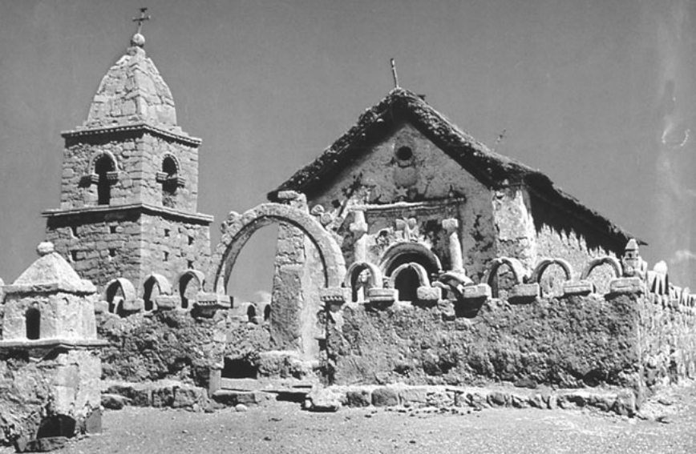

<!-- PDF page 388; original page 373 -->

# 第十九章　伊比利亚美洲的基督教

**詹姆斯·D.赖利（James D. Riley）**

十七世纪后半叶，伊比利亚新世界的殖民天主教走向成熟。在西班牙与葡萄牙领地的城镇中，华丽的教堂成为醒目的物质标志；绚烂的宗教节庆、游行，以及精心安排的宗教戏剧展演，则成为文化标志。同欧洲许多地方一样，虔敬与民众灵修，围绕圣人敬礼、显灵图像，以及严格的悔罪实践展开。

两个帝国的政教关系，也稳定下来。神父与主教发挥王室官僚的作用，其特权、薪资、晋升制度和职责，都由法律规定。冲突固然存在：西班牙帝国十六世纪修会与主教之间的斗争，从未消失。但总体而言，教士生活在一个受到社会尊重、具有安全保障、日常秩序恒常不变的世界。

十八世纪的新思想，在思想与政治上挑战了这些巴洛克结构。理性个人主义，反对强调奥秘与共同体；重农主义者，则质疑政教伙伴关系的效用。西班牙卡洛斯三世、四世的政府——原书合记为1755—1808年——把这些思想转化为政策，试图将哈布斯堡帝国改造成波旁国家。

他们采取许多措施，重塑教会行政，并在官方层面抑制巴洛克灵修。葡萄牙若泽一世（1750—1777）及其首相蓬巴尔侯爵，也推行类似措施。然而，这些君主在殖民地行政上，究竟取得多大成就？官方态度，对宗教在殖民文化中的角色，以及传教边疆持续开展的福音工作，又有何影响？本章将考察这些问题。

<!-- PDF page 389; original page 374 -->

## 西班牙国家与新世界教会

关于新世界教会的报告，以及波旁大臣的分析，不断敌视、批评殖民宗教经验的身体性与情绪性、修院生活的道德状况，以及教区神父人数过多、训练不足的问题。

更早的官方态度中，固然已可见这些成分；波旁时期的独特之处，在于1750年代，王室支持充分转向，使官员得以影响宗教与教会政策。借用一位历史学家简练的说法，改革大臣获准把西属美洲，变成自由主义社会改革的实验室。[^p389-1]

官员试图以较为安静的宗教仪式，替代巴洛克庆典；在个人信仰中，以更合理、更私人的宗教基础，替代改革者眼中的虔敬胡话。为提高效率，他们还想减少教士人数，终结教士不受国家直接控制的独立性，把他们从王室行政的合作者，变成领取薪俸的灵性顾问。

这一时期的讽刺，不在于西班牙改革者取得太多成就，而在于持久成就太少。压制巴洛克实践的尝试，只造成敌意气氛，在受教育精英与大多数人口的文化之间，划出鸿沟；这有助于酿成十九世纪的重大困难。

在教会制度生活中，王室政策只有两方面产生深远后果：教会与平信徒的经济关系，以及修会在教会生活中的角色。波旁政策，也深刻影响教区神父的地位；尽管制度变化有限，却疏远了这一极重要的王权支柱。

最重要的结构变化，是波旁政策对教会经济地位的影响。由于社会普遍虔敬，十六至十八世纪，支持慈善与宗教礼仪的虔敬遗赠和捐助，不断积累，使教会机构拥有可观基金。

不过，与西班牙不同，其中大部分并未用于购买土地，而是形成城乡不动产上的抵押债权，因为没有固定清偿期限，被称为censos perpétuos；或者，成为通过depósitos irregulares，即“不规则寄存”机制，贷出收息的现金。这些流动资本的收益，加上什一税、堂区收费，以及<!-- PDF page 390; original page 375 -->其他经常性收入，使教会机构在财政上，相当独立于王室，也为慈善提供了厚实的资金基础。

改革者却不相信，教会控制这些资产，能发挥有生产性的经济作用。他们确信，什一税和其他税收，以及教会法庭对相关诉讼的独占管辖，限制了企业活动。因此，1750年代至1800年间，波旁大臣采取多项措施：将教产纳入常规税收，使向教会机构索取国家贷款和“捐赠”，成为惯常做法，并严格限制教会法庭，审理涉及教会控制资产的经济诉讼。

这些法律与财政措施虽然重要，却仅为针对教会资源的最大攻击，铺好了道路。1804年，王室颁令，要求几乎全部教会机构资产变现，移交国家，投资于年息4.5%的王室债券。这项《王室债券整顿令》（Consolidación de Vales Reales），要求被抵押财产的业主，在短期内赎回债权，其他债务人，也须在贷款到期时清偿。

尽管地方强烈抗议、抵制，据估计，1804至1809年间，王室官员仅从墨西哥，就成功收取1050万比索。

这种资本征收的即时经济冲击，似乎没有当时人所说的那么严重；私人资本，很快在信贷市场中取代教会资本。不过，对宗教职能的影响，却极为巨大。短期内，墨西哥教会机构收入减少10%；1811年以后，这些收益完全丧失。

长远后果更具破坏性。王室没收这些基金，使虔敬遗赠大幅减少，切断了整个殖民时期，将政治经济精英与教会相连的经济纽带。因此，波旁措施为十九世纪墨西哥社会日益世俗化，以及困扰国家的政教冲突，铺平道路。

《整顿令》是否对拉丁美洲其他地区产生相同影响，仍有待验证。但已有足够证据表明，西班牙帝国许多其他地方，经历了类似变化。

王室政策对教会制度生活产生重大影响的第二个方面，是修会在新世界角色的变化。哈布斯堡时期，方济各会、道明会、<!-- PDF page 391; original page 376 -->奥思定会、耶稣会和赎虏会，在扩展基督教、维持宗教与文化生活方面，发挥了根本作用。直到十八世纪中叶，修会仍控制新世界约三分之一的堂区，大多在乡村；它们主导正规教育机构，并通过在传教领地工作，成为君主政权扩张帝国的重要盟友。

然而，尽管修会与哈布斯堡体制紧密相连，民众却不把它们视为国家的代理人。地方共同体，经常把主教和教区教士视为外人，却不这样看待修会神父。主要原因在于，会士鼓励巴洛克民众宗教，支撑了地方认同。因此，即使共同体抱怨个别修士的行为，修会本身，仍受欢迎。

耶稣会，尤其受到克里奥尔精英尊敬，因为它们培养了许多本地出生的克里奥尔教区神父。这些神父在各种争议中，都成为精英最热心的支持者。

在王室大臣看来，修会有一个根本缺陷：其上级不受西班牙君主控制。哈布斯堡王朝愿意容忍这种情况，波旁王朝却不愿意。修会的制度独立性，与波旁专制政策不相容；其对巴洛克宗教的支持，在思想上冒犯开明精英；对教育的控制，以及同原住民的家长式关系，则被视为现代化计划的重大障碍。

此外，广受宣传的修会道德与宗教纪律衰退问题，又给这种思想分析，增添了强烈情绪。大臣认为，这种衰退威胁社会的良好秩序。

王室攻击修会的举措中，历史学家研究最多的是1767年驱逐耶稣会的决定。不过，驱逐虽震惊当地民众，极不受欢迎，对宗教实践的影响，却更多在心理上，而非实际运作中。方济各会、道明会接管耶稣会传教区，并未造成重大中断；许多不同团体，也在教育和文化机构中填补其位置。

更严重的后果，来自更早的1749年敕令：它要求，把全部修会管理的堂区，转交教区教士。这道敕令，源于首席大臣于1748年仓促组织的一项调查，调查所针对的指控是，管理原住民共同体的<!-- PDF page 392; original page 377 -->修会神父虐待信徒，而且修会道德松弛。十七、十八世纪，这类指控很常见，国王此前却从未正式理会。似乎使国王改变主意的，是墨西哥与秘鲁两位总督，同时报告事态已成危机。调查委员会赞同这一判断，国王便采取行动。

1749年10月，他命令所有修会教士，立即把堂区交给教区教士，并关闭全部乡村小修院；无论如何，后者本来就是非法的。

修会代表立即抗议，认为敕令将造成灾难：城市修院没有地方容纳被撤回的修士，也没有供养办法。教区神父中，懂原住民语言的人太少，原住民必将得不到妥善照顾。随后争论，使执行推迟，以便考虑实际困难。

不过，这项措施从未撤回。1757年，大臣又增加规定：修会在没有足够资源供养以前，不得再接收新初学生。尽管执行缓慢，一直延续至殖民时期结束，修会教士此后在堂区任职，却取决于主教的安排，而非本会上级控制；他们在传教区之外的原住民宗教生活中，发挥作用的范围，也受到严格限制。

受损最严重的，或许是乡村共同体。主教不断抱怨，找不到足够神父，为绝大多数人口提供普通礼仪。最偏远地区的神父人数减少；被派往这些贫困地区的教区神父，处境极为恶劣，因为共同体无力供养他们。神父士气低落，共同体与牧者关系敌对，经常导致冲突。

另一方面，也有迹象显示，由于迫切需要懂本地语言的教士，原住民与印欧混血出身的神父人数，反而增加。

历史学家通常认为，堂区移交以后，修会本身走向不可逆的衰退。收入下降与士气危机，无疑存在。失去堂区和小修院，使会士退出了自十六世纪以来，就与之密切相连、拥有强大支持的乡村地区。有证据表明，召命因此减少。数字虽不十分可靠，修会神父总数，可能已从<!-- PDF page 393; original page 378 -->十八世纪前半叶的大约1.5万人，降至独立时期的大约1.2万人。

不过，各修会遭受的损失，并不相同。道明会、被逐以前的耶稣会，以及奥思定会，拥有雄厚基金，转而集中精力办教育，在本来就强大的城市地区，继续发挥影响。方济各会却没有基金，缓冲财政打击。1786年，本会总巡视员访问墨西哥各会省，报告城市修院中的修士，无事可做，生活条件粗陋。他指出，低落士气导致召命衰退。

即使方济各会各会省，衰退程度也不一样。研究显示，到独立时，方济各会在秘鲁几乎消失，墨西哥中部的召命也急剧下降。但墨西哥西部哈利斯科、米却肯等地，设有传信学院，会士人数恢复，并在十八世纪末，开办新的城市小修院。因此，直到殖民时期的最后阶段，方济各会总人数，才显著下降。

## 巴西的蓬巴尔改革

葡萄牙教会的运作，虽与西班牙相似，巴西的经验，却同西属殖民地存在根本差异。最重要的是，巴西教会保持传教型教会性质的时间，要长得多。

当地召命较少，使教区教会依赖葡萄牙神父；主教也从葡萄牙任命，加上城市定居点相对稀少，使教区结构发展不足。例如，殖民地从未设立宗教裁判所；十七世纪初至1763年，也没有葡萄牙派出的裁判官，前来调查宗教状况。

在这种环境中，修会，尤其耶稣会，主导了传教地区与巴西城市的宗教文化。因此，当改革精神影响葡萄牙君主的大臣时，几乎全部针对修会，尤其耶稣会。这场改革，与若泽一世（1750—1777）及其首相蓬巴尔侯爵的统治相重合。

蓬巴尔把耶稣会对王室政策的抵抗，尤其对1750年《马德里<!-- PDF page 394; original page 379 -->条约》的公开敌视，视为对国家权力的挑战。他还对耶稣会告解神父与讲道者，在塑造国王良心方面的控制，作了恶意解释，并相信，耶稣会在巴西藏有大量不为王室所知财富的传闻。

因此，他决心摧毁耶稣会，并在1757年至1759年初的两年间，取得成功。在葡萄牙主教团支持、教皇默许下，会士被控参与反王室政治活动。1757年，他们首先被逐离国王身边；1758年，被撤销在葡萄牙讲道与听告解的许可；最后，按原书所记，于1759年1月，被逐出葡萄牙领地。

巴西宗教生活，受到毁灭性打击。面向原住民的传教事业崩溃，城市中的耶稣会教育机构关闭。1760年代后期，王室又实际没收道明会、本笃会、赎虏会等其他修会的经济资产，进一步侵蚀其文化影响。

由于王室没有加强教区结构，净效果，是教会显著边缘化。因此，蓬巴尔在波旁王朝失败之处取得成功；其政策，有助于形成一个更加世俗的社会。

## 民众宗教性

阅读殖民后期主教与教区神父的报告，不难发现，他们普遍不看重信徒的宗教信念与实践。极少有官员赞扬普通信众的虔敬或正统，较常见的描述，是“无知”“迷信”“堕落”。不过，绝大多数观察者，并未使用“偶像崇拜”一词。他们仍把羊群视为基督徒，虽然是糟糕的基督徒。

因此，这些报告，也突出了民众宗教的一项重要特征：它不符合启蒙对于适当宗教行为的看法，但传教工作，大体已经成功引入基督教世界观。

诚然，一些孤立群体，完全拒绝基督教；另一些文化，例如尤卡坦的玛雅人，继续以基督教外衣，掩护旧传统的延续。但对多数文化群体而言，问题从来不是简单的接受或拒绝。他们思考新的宗教观念，将新旧文化原则结合，形成混合体系，用一种令自己满意的方式，<!-- PDF page 395; original page 380 -->有效解释宇宙，并决定怎样应对它。借用一位近来历史学家的说法，十六至十八世纪，本堂神父与传教士，无论自己是否知道，实际从事的都是对话，而非单向使人改宗；这一说法强烈暗示，他们自己知道。[^p395-2] 这种对话并未随洗礼结束，而是持续了整个殖民时期。

瓜达卢佩圣母敬礼的发展，说明了这个过程。1555年，墨西哥城方济各会省会长，攻击这种敬礼，认为它是对人造图像的偶像崇拜。但到十七世纪中叶，显现故事被写成纳瓦特尔语《尼坎·莫波瓦》（Nican Mopohua）时，圣母故事及其图像，已与西班牙圣母显现叙述，十分接近。

与此同时，瓜达卢佩圣母的流行，跨越了文化边界。1648年以后，敬礼在克里奥尔人中传播最快，墨西哥谷之外的原住民共同体，却并不理会。到十八世纪中叶，它已在整个新西班牙的各族共同体中，牢固扎根。

瓜达卢佩圣母的演变过程，是墨西哥中部各种圣人敬礼的典型。十六世纪末，原住民或许仍借中古基督教关于圣人代祷的观念，掩护纳瓦人的传统理解：人必须安抚众神，并向家神及更高的灵界力量，寻求保护。

不过，到十八世纪，人们已经失去对传统神祇及其特征的知识。像十六世纪西班牙乡村信众一样，墨西哥中部的人，如今把基督教魔鬼及其爪牙，视为厄运来源，虽然世界最终仍由上帝控制。他们相信，圣人代祷的力量，来自同上帝的关系，而非任何独立权威。

新西班牙总督区的某些波旁时期主教与神父，仍怀疑乡村强调圣人敬礼，暗藏秘密异教实践。不过，他们的忧虑，很大程度上，似乎出于语言障碍：很少教区神父，没有任何主教，能熟练使用本地语言，以理解虔敬实践的内容，或同信徒讨论这些问题。

平信徒控制地方敬礼，无疑也使教士不满。神父发现，自己的角色受到严格限制；而其报酬，又依赖平信徒对服务的慷慨，这使处境更加严重。另一条文化分野，来自<!-- PDF page 396; original page 381 -->十八世纪欧洲上帝形象的转变：祂更慈悲、更易亲近，而且可直接接触。乡村居民却不觉得，这种形象有说服力。他们生活在充满危险的世界，认为庇护者不可缺少。因此，无论个人还是共同体，获得圣人代祷的力量，都极为重要。

安第斯高地，圣人敬礼也很兴盛；玻利维亚科帕卡巴纳圣母的流行，与瓜达卢佩圣母相仿。不过，这里似乎保留了更多征服以前的宗教传统。教会当局深切忧虑，对“瓦卡”（huacas）的敬礼持续存在；瓦卡，是对共同体生活至关重要的祖先神灵。

一场广受宣传的根除运动，在十七世纪第三个四分之一达到高潮。此后，根除努力显著减少，却有充分理由相信，引发这些行动的实践，并未相应减少。1671年以后，主流倾向是，把本土宗教实践的延续，界定为无知所致的迷信，而非背教。

1767年，库斯科附近村庄为地方圣人举行节庆的一份记述，说明解释原住民宗教行为的困难。本堂神父报告，节庆像其他节庆一样，以堂区教堂的弥撒开始。弥撒后，他把圣像移到门口，由村民敬奉。人们请求圣人帮助解决问题，并献上物品、牲畜和钱财。

献礼结束后，神父祝福供物，村民开始庆典；圣像仍留在教堂门口，“观看”节庆。到一天结束，神父把供物收归自己。

这份向村庄圣人祈祷、献礼的描述，呼应了根除运动高潮时，巡察者认定为偶像崇拜的瓦卡实践。诚然，如今仪式前有弥撒，图像有圣人名字，神父也通过祝福圣像，深度参与。但这些变化，是否足以使人们，自视为正统天主教徒，并使实践被视为“天主教”的？共同体成员本身，没有给我们留下评论。

同样清楚的是，到十八世纪，宗教实践的差异，更多沿城乡界线划分，而非沿原住民与西班牙人的界线。如启蒙以前的欧洲一样，在大节庆或危难时，展示圣像的游行与宗教戏剧，既是<!-- PDF page 397; original page 382 -->城市，也是乡村生活的关键部分，兼具团体与个人目的。例如，十七、十八世纪，库斯科和墨西哥城的圣体节庆典，使各族群为共同体的共同目标，积极合作，并从宗教上，确认各族内部，以及整个殖民社会的等级秩序。

城市庆典，同乡村一样多彩、多面。主要区别，是神父与教会机构，对城市宗教生活控制更多。讽刺的是，十八世纪后期，波旁官僚试图压制城市庆典，却从不称它们为“异教酒神狂欢”；这个词，却常用于乡村类似活动。无疑，因为西班牙裔精英，在城市庆典中占据显著位置。

官员转而强调，庆典造成混乱，使穷人把本可更好用于养家的钱，花在无益之处。不过，对城市游行与节庆的攻击，引起意外回应。殖民时期的最后阶段，克里奥尔宗教与社会精英，把捍卫游行和共同体宗教，变成政治抵抗形式。

原住民政治运动，同样诉诸天主教情感，动员支持。库拉卡首领何塞·加夫列尔·图帕克·阿马鲁，在秘鲁中部反抗西班牙统治的起义（1780—1782），被认为是殖民后期最严重的动荡之一。他运用基督教正义观念，试图联合克里奥尔与原住民精英，支持自己的事业，并将运动比作以色列人反抗埃及人。

他对教会的态度如此恭敬，以致起义镇压后，王室因怀疑合作，把克里奥尔出身的库斯科主教，流放到西班牙。

在其他个人与团体虔敬领域，也看不到清楚的种族或文化分界。宗教裁判档案显示，同样是hechicería，即一种哥伦布抵达前的疗病实践，涉及乡村居民时，被称为“巫术”；涉及城市西班牙裔精英时，则称“迷信”。

事实上，城市化的原住民与印欧混血者，接受欧洲灵修模式与制度的方式，同克里奥尔精英差别不大。例如，克里奥尔神秘家利马的圣罗撒，启发了利马及其他地区，各种族的许多男女。通过严格苦修追求神秘体验，使克里奥尔官僚的妻子，以及不识字的原住民虔修女子，都受到宗教裁判所注意。

即使这些实践，不再得到开明行政官员与教会<!-- PDF page 398; original page 383 -->领袖赞同，到十八世纪末，在克里奥尔人与原住民群体中，仍然流行。对地方虔修男子的敬礼，也继续兴盛，例如利马黑白混血者马丁·德波雷斯；他把严格苦修与慈善结合，在十九世纪获宣真福。这令墨西哥的弗朗西斯科·德洛伦萨纳等，来自伊比利亚半岛的总主教，颇为失望。

即使对官方认可的圣罗撒等圣洁人物，民众圣徒传记，也继续强调通过否定身体，与基督神秘合一。

不过，非西班牙裔追求西班牙式完美典范时，遇到许多障碍。西班牙裔价值观强调，宗教召命较深者，适当道路是：男子进入教区圣职或修会，女子进入正式组织的封闭女修院。主教与宗教裁判所，极其怀疑在这些团体结构之外，追求圣洁的虔修男女。

种族与社会偏见，又排除了非西班牙裔，全面参与教会机构的机会。直到1769年，王室才正式鼓励非西班牙裔男子，进入教区圣职或修会；这尤其受到修会强烈反对。最终，除了完全接受西班牙文化的原住民酋长之子，很少原住民男子，能利用新开放政策。

同样，高额嫁资与种族偏见，使正式拥有基金、遵循既定欧洲会规的“大修院”（conventos grandes），只有克里奥尔精英女子，才能全面加入。原住民女子可以住在其中，却只能作仆役，永远不能同克里奥尔修女平等。十八世纪，墨西哥虽建立少数由原住民女子控制的修院，对整体格局，几乎没有改变。

男女既然不能全面进入最重要的机构，便寻找替代办法。善会（cofradías）等平信徒共同体组织，为原住民与印欧混血男子，提供了选择。各族贫穷及中等阶层女子，则可在“虔修院”（beaterios）中，追求封闭生活的苦修理想。

仅利马一地，1669至1704年，富裕平信徒就为十所此类机构提供基金。其中一所，由道明会于1669年，为纪念新近封圣的圣罗撒而创办，面向西班牙裔女子。另外两所著名机构，都创于1677年，却服务其他群体。

库拉卡首领，为女儿们资助科帕卡巴纳圣母虔修院；原住民虔修男子、可敬者尼古拉斯·德阿利翁，与印欧混血妻子玛丽亚·哈辛塔·德蒙托亚，则为非西班牙裔女子，创办耶稣、玛利亚与若瑟虔修院。这两所<!-- PDF page 399; original page 384 -->机构，在殖民时期余下岁月，始终是利马的重要灵性中心。

耶稣、玛利亚与若瑟虔修院，既说明创办它的灵修观念，也说明非西班牙裔接受这类生活的广泛程度。1672年，玛丽亚·哈辛塔与尼古拉斯，将七位未婚女子聚集在一所住宅。她们遵循阿维拉圣德兰与圣依纳爵的苦修典范，同时在仁爱医院义务护理，并从事其他慈善。

她们圣洁的名声渐长。1685年，在总督庇护下，利马总主教，将其提升为正式认可的封闭虔修院。利马富裕居民的施舍，使这对夫妇，能够为封闭团体建造新楼。

虔修院的封闭生活模式，类似正式女修院，却有重要区别。首先，虔修院直接受主教管辖，创办时基金很少；主教派神父，严密监督。其次，它们依靠施舍或劳动报酬自给，贫穷与会规，都不允许接收仆役。

成员自己完成全部劳动，较少照顾默观生活或礼仪；而腾出时间从事这些活动，正是正式女修院雇用仆役的理由之一。没有仆役，尤其使虔修院不受精英欢迎。尽管许多虔修院，后来获得基金，某些甚至升格为正式女修院，大多数仍默默无闻，主要对其服务的地方共同体，具有重要意义。

许多迹象显示，十八世纪，虔敬与宗教热情复兴。尽管波旁行政官员，在言辞上普遍鄙视修院生活，地方精英，仍支持共同体创办新修院。墨西哥建立许多嘉布遣会、贫穷嘉勒会与赤足加尔默罗会女修院，说明无论开明精英怎么看，外省共同体，仍重视个人苦修与最严格的封闭生活。

目标不同的新女子机构，也得到支持，包括1752年在墨西哥成立的“教育院”（Institute de la Enseñanza）。它旨在办学，为妇女提供严格学术训练，直到殖民时期结束，仍不断扩展。

<!-- PDF page 400; original page 385 -->

祈祷会运动，同样重要，旨在训练、支持希望过共同生活的教区神父。遵循圣斐理伯·内里的会规，第一批机构，于1670年代在秘鲁开办。1734年，墨西哥圣米格尔—德阿连德镇创立的圣米迦勒祈祷会，说明了它们的影响：该会成为受欢迎的平信徒避静中心，并于1743年，衍生圣方济各·沙雷氏学校；后者成为十八世纪后半叶的教育创新中心。

宗教复兴的另一个方面，是推广避静与堂区复兴，重新向平信徒传福音。许多团体参与平信徒避静运动，包括祈祷会；但宣传最广的倡导者，无疑是耶稣会。

十八世纪初，耶稣会以改造过的依纳爵神操为基础，开创平信徒避静。活动极受欢迎，使墨西哥会省，于1727年在普埃布拉、1750年在墨西哥城，开设有专门基金、完全用于避静的机构。1767年耶稣会被逐时，米却肯莫雷利亚与危地马拉，也即将开办同类机构。

耶稣会避静，似乎是遍及帝国的现象。1757年，智利会省的财务代理报告，因为活动影响家庭生活，他把它视为本会工作最重要的部分之一。1756年，阿根廷门多萨省圣胡安这个很小的共同体，就有120名女子参加避静。

耶稣会被逐后，镇民请求主教，让活动继续；1775年，改由教区神父恢复时，有103名男子、115名女子参加。

我们所知较少的另一发展，是面向整个堂区的布道运动。它尤其同1683年，首先在墨西哥创设的方济各会传信学院相连，类似二十世纪美国帐篷复兴会，旨在促进平信徒道德改革。

1739年，库斯科的一份报告，显示这类活动的风貌。活动由方济各会主持，历时三周，每日有教理课、以上帝审判与个人悔罪为主题的讲道，以及唱诗、鸣钟。地震之主的圣像，在库斯科街头游行，大批鞭笞者相随。

据说，一位讲道人在讲道时点燃手臂，吓住挤满教堂的群众；另一位则以铁链自鞭，作为讲道的一部分；<!-- PDF page 401; original page 386 -->第三位修士，则用骷髅作道具，预言如果人们不悔罪，上帝将在下个复活节前，降下一场大瘟疫。

这类灵性活动，几乎未获研究。不过，我们知道，殖民后期，北半球各地方济各会修院，依靠堂区布道自养。这些复兴活动在乡村很受欢迎，使墨西哥西部一位本堂神父，于1797年获得主教许可，建造接待所，作为巡回方济各会讲道人的基地。

另一位热心神父，为强调活动的影响，报告说：传教士有力的讲道与严苦的榜样，使那些生活在堂区控制之外、轻视圣事的山中原住民，也下山恢复了信仰实践。

## 巴西黑人的宗教生活

除欧洲人与原住民以外，美洲第三个族裔文化群体，是从非洲输入的奴隶的后代。在西属美洲，非洲人人数较少，加上普遍的同化过程，使黑人宗教生活，在文化上，难以同周围原住民及西班牙化人口的实践区分。

不过，巴西发展出一种独特的黑人宗教，延续至原书写作时。这种混融传统，将基督教启示、机构与象征，同非洲关于通过灵媒、接触祖先而不断获得启示的信仰结合。它似乎由长期接触基督教传教士的中非奴隶，带入巴西。

葡萄牙法律，要求主人在奴隶进入巴西后，立即为他们施洗。但乡村缺少有力的教会存在；葡萄牙奴隶主，除了满足法律最低要求，几乎无意继续传福音或教育，也助长了这种虽属非法，却不断繁盛的混融传统。

主人似乎请获自由的黑人，把直接来自非洲、尚未接受当地文化的“新到奴隶”（bozales），引入既有共同体。这些自由黑人，也把新来者纳入已有宗教组织。洗礼，是这种混融传统的重要部分，因为教父母关系，建立了非血缘的亲属纽带，替代无法重建的血缘家庭。

这种传统，大体遵循中非宇宙观结构，却没有会引起当局注意的<!-- PDF page 402; original page 387 -->教条原则。黑人宗教生活，围绕符咒与护身符展开。它们被认为能带来好运、驱除邪恶，使奴隶在一定程度上，掌握日常生活的急难。

例如，十字架是奴隶中流行的宗教象征，因为它既体现基督教图像，也表现一种中非宇宙观，使信徒获得灵界力量。奴隶也把圣人像，同护符与灵力联系起来。旅行者记述，是这些实践的主要资料来源，反复提到圣人敬礼的重要。

不过，与西属美洲原住民的圣人敬礼不同，这里的圣人，被纳入非洲传统。巴西由于缺少神父，平信徒主持的基督教兄弟会（hermandades），本已是宗教生活的重要部分；奴隶因而能够，通过自己的兄弟会，公开表达宗教，同时避开当局怀疑。

黑人宗教的另一个重点，是丧葬仪式。非洲传统，非常重视这些仪式，以防离体的灵魂，在生者间游荡、为害。天主教机构，再一次为奴隶提供掩护及一套仪式，满足其传统关切。

黑人兄弟会，主要发挥丧葬互助会的作用，保证奴隶葬于祝圣土地，并举行有助灵魂进入灵界的仪式。

## 十八世纪的传教事业

定居地区的努力，集中于重新传福音；十七世纪末、十八世纪，传教士也继续接触新群体。即使1767年以后，方济各会、道明会与赎虏会，在承担耶稣会旧传教区的压力下，仍开设新的传教站。

这些新站，分布于上加利福尼亚、得克萨斯、智利南部、厄瓜多尔、秘鲁与哥伦比亚的亚马孙地区、哥伦比亚北部、玻利维亚与阿根廷北部的查科地区，以及巴塔哥尼亚。

工作本身，也变得极其困难。所接触的群体，通常并非拥有复杂社会政治结构的定居农民。因此，原住民与传教士的文化距离，比早期传教时大得多，公开敌意也更常见。有些群体，能够有效抵抗。

<!-- PDF page 403; original page 388 -->

**图6　智利帕里纳科塔教堂。** 1789年建成，采用乡土材料与工艺，取得统一、趣味无可挑剔的整体效果。内部饰有质朴壁画。照片藏爱丁堡大学非西方世界基督教研究中心巴特勒收藏。

例如，哥伦比亚北部的瓜希罗人，以及玻利维亚的奇里瓜诺人，反复在传教聚居点刚建立时，将其摧毁，成功抵挡了传福音的努力。

另一些群体，接受传教站建立，或无法阻止，却遭受毁灭性后果。巴西亚马孙地区与加利福尼亚，尤其如此。在马拉尼昂和亚马孙领地，耶稣会不断为归信人口的自由，同殖民者斗争；尽管1680年代后期得到王室支持，却始终未能真正阻止传教区原住民被奴役。在这些地区，传教站的出现，导致本土文化消失。

耶稣会与方济各会，在加利福尼亚传教，也造成类似悲剧，但原因不同。在本章的解释中，这里的问题，不是剥削，而是误导的人道主义。1697年，下加利福尼亚开设传教站，王室同意授权耶稣会，禁止西班牙裔移民进入。耶稣会想证明，没有平信徒干预，也能和平地使一个地区，服从王权并<!-- PDF page 404; original page 389 -->基督教化。但传教事业最终失败，因为会士试图把原住民变成农民与工匠，按欧洲方式生活，环境却无法支持这种生活。在缺水的半岛上，建立农业共同体，几乎不可能。原住民被迫住在传教点，作物经常歉收，导致营养不良，人口几乎完全消失。

1767年以后，方济各会在上加利福尼亚建立传教站，犯下类似文化错误。这里还必须供养地区内的西班牙军队，使情况更加恶化。疾病、营养不良，以及强制居住和传统生活方式消失所造成的文化绝望，共同引发人口灾难。加利福尼亚人口锐减，西班牙人到来前繁荣的群体，陷入赤贫。

上下加利福尼亚与巴西亚马孙原住民，遭受的传教生活之恐怖，无可否认；但这些地区的经验，究竟多具代表性，并不清楚。例如墨西哥北部，采用西班牙农业和畜牧，改善了原住民营养，帮助他们在人口上存续，而非消亡。

此外，除上述地区，几乎各地的西班牙文化，都没有压倒原住民；发生的变化，往往是共同体自己理性决定的结果。例如，瓜拉尼人，似乎因为巴拉圭耶稣会集中传教村，可以提供抵抗强制文化丧失的庇护，才受到吸引。

他们承认，西班牙人不会离开，便判断，在传教环境中，可以学会生存所需的西班牙方式，同时保留珍视的传统。1770年代，查科的莫科维群体，也作出类似判断。他们请求传教士时，知道生活将改变；但在他们看来，传教文化，是获得知识、在其他竞争群体面前生存的办法。

由此，本章得出结论：十八世纪西属美洲，多数群体参与传教生活，基本出于自愿。传教点提供的好处，吸引人们前来；他们留下，是理性判断，认为其中生活优于外部。不过，传统生活方式，也必然改变。

<!-- PDF page 405; original page 390 -->

以莫科维人为例，要享受传教生活的益处，就必须接受传教士施加的新社会政治结构，以及弥撒、基督教节历、圣事等公共宗教形式。进入传教村后，他们很快采用基督教苦修虔敬模式，在传教士看来，甚至走向极端。

不过，虽然理解基督教的道德期望，他们仍忽略较抽象的罪与美德观念，因为这些观念，同传统文化冲突太深。他们对圣事的理解，也不符合欧洲神父的意图。修士到来十年后，洗礼与丧葬仪式，已获接受、理解；婚姻较少，告解与圣体圣事，最少。

这并不意味着，归信是肤浅的。随着时间推移，美洲各地传教村原住民，把传教结构内化为自己的结构，使基督教仪式与行为，成为公共共同体生活的中心。即使近来严厉批评传教制度的人，也承认，原住民共同体，最终接受了这种文化混合。几代以后，他们自视为基督徒。

传教士理解、接受这种演变过程。或许再过一段时间，殖民后期归信者，对欧洲宗教文化的理解，会接近十六、十七世纪归信的群体。不过，这个问题无法回答，因为过程被截断了。独立战争，将对帝国各地传教体系，造成致命破坏。

## 西属美洲的独立战争

波旁王朝建构国家的努力，切断了使新世界哈布斯堡帝国获得正当性，并维系其统一的纽带。巴洛克宗教仪式与节庆，联系精英和平民，表达共同信仰与象征体系，最终为国王本身提供思想支持。因此，对民众宗教实践的攻击，使社会领袖与殖民地大众，产生鸿沟。

但殖民后期，最让主教担忧的，是教区教士日益离心。整个哈布斯堡时期，教区圣职，既是一项职业，也是一种召命。波旁王朝，希望削减其职业性，重新点燃召命。在王室看来，<!-- PDF page 406; original page 391 -->没有职务的神父太多；吸引他们的，与其说是服务生活，不如说是圣职的地位与特权。王室确有道理。1790年，墨西哥城住着517名教区神父，却只有59个堂区服务职位。那些没有职位的人，可以说，缺少适当召命。

不过，无论召命状况如何，他们仍是重要社会群体。到十八世纪末，波旁王朝已经失去其忠诚。重定地方牧师角色、攻击司法豁免权，以及王室官员的轻蔑态度，威胁所有神父。1804年，王室实际没收追思弥撒基金，终于剥夺了许多人的主要收入来源。

1770年以后，王室又鼓励主教，考虑接纳印欧混血者与原住民进入圣职，冒犯了他们的种族秩序感。因此，革命危机开始时，许多克里奥尔神父，拒斥西班牙国家，认同自己是美洲人。教区神父，因而在新国家形成中，发挥重要作用。

波旁时期的累积影响，还有另一后果。独立后不久，修会与教区神父人数锐减，低于维持宗教礼仪所需的水平。人员不足，加上新国家平信徒领袖的敌意，以及人们对波旁主教的普遍怀疑——后者几乎全体支持君主制，直到最后——大大加强了十九世纪国家的世俗化趋势。

曾经组织、维持殖民文化的教会，如今衰落了。

**译校说明：** 原书将卡洛斯三世、四世政府时期合记为1755—1808年，正文保留；原PDF第394页又将葡萄牙驱逐耶稣会记为1759年1月，与第十六章所记同年9月不同，未自行统一。

## 注释

[^p389-1]: D. A. Brading, Church and state in Michoacán, 1749–1810 (Cambridge: Cambridge University Press, 1994), p. 167.

[^p395-2]: Erick Langer and Robert H. Jackson (eds.), The new Latin American mission history (Lincoln, NB: University of Nebraska Press, 1995), p. 28.
