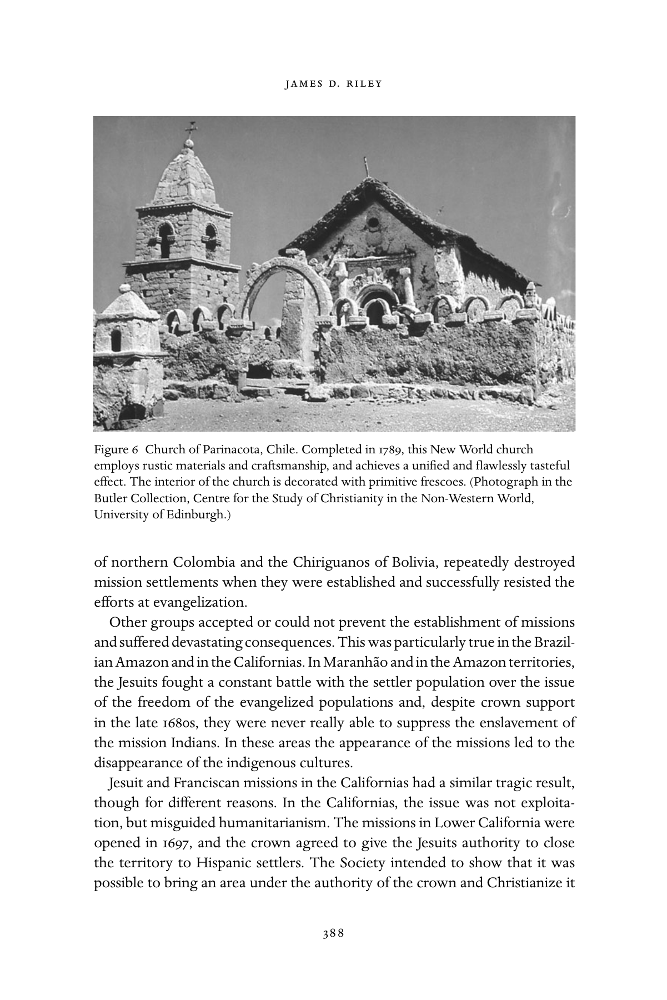

# 伊比利亚美洲的基督教：英文转换底稿

<!-- PDF page 388; original page 373 -->

### 19

## Christianity in Iberian America

### ja m e s d. r i l e y

In the second half of the seventeenth century, colonial Catholicism came of age in the Iberian New World. Magnificently ornate churches physically marked cities and towns in both the Spanish and Portuguese dominions, while flam- boyant religious festivals, processions, and elaborately constructed displays of religious drama marked them culturally. As in much of Europe, piety and pop- ular devotion were centred on the cult of the saints, devotions to miraculous images, and displays of penitential rigour.

Relations between church and state had stabilized, as well, in both empires. Priests and bishops functioned as royal bureaucrats, with privileges, salaries, systems of promotion, and responsibilities defined in law. While there were conflicts – the sixteenth-century struggles in the Spanish Empire between the religious orders and the episcopacy never went away – clergy, in gen- eral, lived in a universe marked by social respect, security and unwavering routine.

The new ideas of the eighteenth century challenged these Baroque struc- tures intellectually and politically. Rational individualism attacked the empha- sis on mystery and community, and physiocrats attacked the utility of the political partnership. The governments of Charles III and Charles IV (1755– 1808) of Spain translated these ideas into policy in an effort to transform the Habsburg Empire into a Bourbon state. They took numerous steps to reshape the administration of the church and officially discouraged Baroque spiritu- ality. In Portugal, as well, the government of Joseph I (1750–77) and his chief minister, the Marqués de Pombal, pursued similar measures. But how much did these monarchs achieve administratively in the colonies? And what effect did official attitudes have on the role of religion in colonial culture, as well as on the continuing process of evangelization on the mission frontiers? Those are the issues that this chapter will examine.

<!-- PDF page 389; original page 374 -->

### The Spanish state and the church in the New World

The reports on the church in the New World and the analysis of Bourbon ministers provide us with an unremittingly hostile critique of the physicality and emotionalism of the colonial religious experience, of the morality of conventual life, and of the excessive numbers and weak preparation of diocesan priests. While one can find these elements in official attitudes much earlier, what makes the Bourbon period distinctive is that in the 1750s royal support shifted sufficiently to permit officials to influence policy towards religion and the church. To paraphrase the pithy comment of one historian, reforming ministers were given leave to make the Indies a laboratory for liberal social reform.[^p389-1] As part of this effort, officials attempted to replace Baroque religious ceremonies with a more sedate set of religious performances and substitute a more rational and private religious foundation for what reformers considered pious nonsense in individual beliefs. In the interest of efficiency, the reformers also sought to reduce the number of clergy, end their independence from the direct control of the state, and change their role from that of collaborators in royal administration to that of salaried spiritual advisors.

The irony of the period is not that the Spanish reformers accomplished so much, but that they accomplished so little that was permanent. The only result of their attempts to suppress Baroque practices was to create a climate of hostility and a gulf between the culture of the educated elites and the mass of the population that would help bring about major difficulties in the nineteenth century. With regard to the institutional life of the church, in only two areas did crown policy have profound consequences: in the economic relationship between the church and the laity, and in the role of the regular orders in the life of the church. Bourbon policy also deeply affected the status of diocesan priests and, although the institutional changes were minimal, alienated this very important support of the crown.

The most important structural change resulting from Bourbon policy was its impact on the economic position of the church. Because of the prevailing piety, pious bequests and donations to support charitable activities and religious services had accumulated between the sixteenth and eighteenth centuries, allowing church institutions to amass substantial endowments. Unlike the situation in Spain, however, the mass of these funds had not been used to purchase land but consisted rather of liens on urban and rural property (called censos perpétuos because they had no fixed term for repayment) and cash that was loaned at interest (through a mechanism called depósitos irregulares). When the income from this liquid capital was combined with the regular revenues

<!-- PDF page 390; original page 375 -->

generated by the tithe, parish fees and other sources, it gave church institutions considerable financial independence from the crown and a substantial base of funds to support charitable activity.

Reformers, however, did not believe that the church’s control of these assets served any productive economic purpose and were convinced that the tithe and other taxes, as well as the church courts’ absolute control over litigation arising out of these matters, limited entrepreneurial activity. Thus, between the 1750s and 1800, Bourbon ministers took a number of steps to deal with these issues. They subjected church property to regular taxes, made the solicitation of loans and ‘gifts’ to the state from church institutions a routine practice, and severely limited the ability of ecclesiastical courts to handle economic litigation involving church-controlled assets.

As important as these legal and fiscal measures were, however, they merely set the stage for the most important assault on church resources. In 1804, the crown issued a decree requiring that practically all assets belonging to eccle- siastical institutions be liquidated and transferred to the state to be invested in royal bonds paying 4.5 per cent interest. This measure, the Consolidación de Vales Reales, required that owners of property subject to liens redeem them within a brief period of time, and that all debtors repay their loans when they came due. Despite enormous local protest and resistance, it is estimated that between 1804 and 1809, royal officials successfully collected 10.5 million pesos from Mexico alone.

It appears that the immediate economic impact of this appropriation of capital was not as severe as contemporaries argued. Private capital quickly took the place of ecclesiastical capital in the credit markets. But its impact on religious functions was enormous. In the short term, ecclesiastical orga- nizations in Mexico saw their income reduced by 10 per cent, and after 1811 they lost their incomes entirely. The long-term consequences were even more devastating. The crown seizure of such funds greatly reduced the practice of pious bequests and severed the economic ties that had bound political and economic elites to the church throughout the Colonial period. Thus, the Bour- bon measures prepared the way for the increasing secularization of society in nineteenth-century Mexico and the church–state conflicts that plagued the country. Whether or not the Consolidación had the same impact on the rest of Latin America remains to be tested, but enough evidence exists to suggest that many other parts of the Spanish Empire had a similar experience.

A second area where Bourbon policy had a major impact on the institutional life of the church concerned the changing role given to the religious orders in the New World. During the Habsburg era, the Franciscans, Dominicans,

<!-- PDF page 391; original page 376 -->

Augustinians, Jesuits and Mercedarians played a fundamental part in the expan- sion of Christianity and in the maintenance of religious and cultural life. As late as the middle of the eighteenth century, regular orders controlled approx- imately one-third of the parishes in the New World – mostly in rural commu- nities – dominated formal educational institutions, and were important allies of the monarchy in the expansion of the empire through their work in mission territories.

Yet while they were intimately connected to the Habsburg system, the regular orders were not seen as agents of the state in the popular mind. Local communities did not perceive religious priests as outsiders – as they did often view bishops and diocesan clergy – primarily because the regulars encouraged the Baroque popular religiosity that provided an underpinning to local identity. Thus, the orders themselves remained popular, even when local communities complained about the conduct of individual friars. The Jesuits, moreover, were held in special esteem among Creole elites because they trained many of the Creole diocesan priests, priests who became the elites’ most ardent supporters in any controversy.

In the minds of the king’s ministers the regular orders had a fundamental flaw: their superiors were beyond the control of the Spanish monarch. While the Habsburgs had been disposed to live with this situation, the Bourbons were not. The institutional independence of the regular orders was at odds with Bourbon absolutist policies, their support of Baroque religiosity was intellectually offensive to Enlightened elites, and their control of education and their paternalistic relationship with indigenous populations were viewed as a major obstacle to programmes of modernization. To add passion to this intellectual analysis, there was also the well-publicized issue of the decline in morality and religious observance of the orders, a decline that, in the ministers’ view, threatened the good order of society.

The aspect of the crown’s assault on the regulars most studied by historians was the decision to expel the Jesuits in 1767. But while that expulsion shocked local populations and was very unpopular, its consequence for religious prac- tice was more psychological than physical. Franciscans and Dominicans took over the Jesuit mission territories without major disruption and a number of different groups came forward to replace them in educational and cultural structures. Far more serious consequences ensued from an earlier decree of 1749 that ordered the secularization of all parishes controlled by religious orders.

This decree resulted from a hasty investigation organized by the king’s first ministers in 1748 concerning charges that the religious priests administering

<!-- PDF page 392; original page 377 -->

Indian communities had abused their parishioners and that the regular orders were morally lax. Accusations of this sort were quite common throughout the seventeenth and eighteenth centuries, but until this point the king had never taken official note of them. What seems to have changed the king’s mind were the simultaneous reports, received from the viceroys of both Mexico and Peru, that portrayed the situation as a crisis. When the investigating committee concurred, the king acted. In October 1749, he issued an order requiring all regular clergy to transfer their parishes immediately to diocesan clergy and to close all rural priories – which were in any case illegal.

Representatives of the regulars immediately protested that the decree would be disastrous, since there would be no room in urban priories for the displaced friars and no way to support them. They also argued that the Indians would be ill served because of the lack of diocesan priests who knew the Indian languages. The subsequent debate delayed implementation of the decree in order to take account of practical difficulties. But the measure was never withdrawn and the king’s ministers added a further amendment in 1757 requiring the orders to cease accepting new novices until they had the resources to support them. Although the implementation process moved slowly and continued through the end of the colonial period, regular clergy now served in parishes at the convenience of bishops, not under the control of their own superiors, and their role in religious life among the indigenous communities outside of mission territories was severely circumscribed.

The rural communities themselves probably received the most damage from the measure. Bishops constantly complained about their inability to find enough priests to provide ordinary services for the vast majority of the population. The number of priests serving the most isolated areas declined and conditions for diocesan priests assigned to these poverty-stricken regions were abysmal because the communities could not support them. The low morale of the priests and the hostile relationship between the communities and their pastors frequently led to conflicts. On the other hand, there are indications that the number of priests from indigenous and mestizo backgrounds increased because of the desperate need for clergymen who knew the native languages.

Historians generally suggest that the orders themselves suffered from an inexorable decline after secularization. No doubt they did suffer from reduced revenues and a crisis of morale, since the loss of their parishes and priories pushed the regulars out of the rural areas with which they had been identified since the sixteenth century and in which they had powerful support. There is evidence that vocations declined as a result. Although figures are some- what unreliable, the total number of religious priests may have fallen from

<!-- PDF page 393; original page 378 -->

approximately 15,000 in the first half of the eighteenth century to approxi- mately 12,000 at the time of independence.

But despite these losses, not all of the orders suffered equally. Those with substantial endowments, such as the Dominicans, the Jesuits (until their expul- sion) and the Augustinians refocused their efforts on education and continued to be a force in urban areas where they had always been strong. The Francis- cans, on the other hand, lacked any endowments to cushion the financial blow. In 1786, the Commissary General of the Order, visiting the Mexican provinces, reported that friars in the urban convents had little to occupy their time and lived in barbarous conditions. Low morale, he noted, had led to a decline of vocations.

Yet not even all Franciscan provinces declined equally. While research demonstrates that the Franciscan order in Peru had almost disappeared by the time of independence and that vocations declined precipitously in Central Mexico, the western Mexican provinces of Jalisco and Michoacán, where the colegios of Propaganda Fide were located, recovered their numbers and were opening new urban priories by the end of the eighteenth century. As a result the total number of Franciscans did not decline dramatically until the very end of the colonial period.

### The Pombaline reforms in Brazil

Although the church functioned in Portugal much like its counterpart in Spain, the Portuguese experience in Brazil differed in fundamental ways from the Spanish experience. The most important distinction was that the church remained a missionary church in Brazil for much longer than it did in Spain’s colonies. A combination of low numbers of local vocations that kept the dioce- san church dependent on priests from Portugal, the appointment of bishops from Portugal, and a relative lack of urban settlement, kept diocesan structures poorly developed. The Inquisition, for example, was never established in the colony and no inquisitors sent from Portugal investigated religious conditions between the early seventeenth century and 1763.

In this environment the religious orders, particularly the Jesuits, dominated both the mission fields and the religious culture of urban Brazil. Thus, when the spirit of reform touched the ministers of the Portuguese monarchs, it was directed almost entirely at the regular orders, with a particular focus on the Jesuits themselves. This reform movement coincided with the reign of Joseph I (1750–77) and his chief minister, the Marqués de Pombal. Pombal saw Jesuit resistance to royal policy, particularly their overt hostility to the Treaty of

<!-- PDF page 394; original page 379 -->

Madrid in 1750, as a challenge to the power of the state. He also gave a sinister interpretation to the control exercised by Jesuit confessors and preachers over the formation of the king’s conscience, and considered as credible the rumours of vast Jesuit wealth in Brazil hidden from the crown.

For these reasons, he made it his goal to crush the Society. He succeeded during a two-year period between 1757 and early 1759. With the support of the Portuguese episcopacy and the tacit consent of the papacy, the Jesuits were charged with complicity in political movements against the crown. They were first exiled from the royal presence in 1757, then deprived of their licenses to preach and confess in Portugal in 1758, and finally, in January 1759, expelled from the Portuguese dominions.

The results for religious life in Brazil were devastating. The missionary efforts among the indigenous populations collapsed, and Jesuit educational facilities in the cities were closed. Later in the 1760s, the crown also effectively confiscated the economic assets of other religious orders such as the Domini- cans, Benedictines, and Mercedarians, and the cultural influence of these orders was further eroded. Since the crown made no effort to strengthen diocesan structures, the net result was a substantial marginalization of the church. Thus, Pombal succeeded where the Bourbons had failed, with policies that helped produce a much more secular society.

### Popular religiosity

One does not have to look very far into the reports of bishops and diocesan priests in the late colonial period to realize their generally low opinion for the religious beliefs and practices of their communicants. It was a rare official who commented favourably on the piety and orthodoxy of the ordinary faithful. ‘Ignorant’, ‘superstitious’, ‘debased’, were the more common descriptions. Yet the vast majority of observers did not use the term ‘idolatry’. They considered their flocks to be Christians, albeit poor Christians.

The reports thus highlight one important element of popular religiosity. It did not conform to Enlightened perspectives on proper religious behaviour, but for the most part evangelization had been successful in introducing a Christian world-view. To be sure, a few isolated groups did reject Christianity entirely, and some cultures such as the Maya of Yucatan continued to use a Christian veneer to conceal the perpetuation of older traditions. But for most cultural groups the question was never as simple as acceptance or rejection. Rather, they pondered the new religious ideas and created an amalgam that combined the old and new cultural principles in a way that provided a satisfying

<!-- PDF page 395; original page 380 -->

and effective explanation of the universe and how to deal with it. To paraphrase one recent historian, whether they knew it or not (the strong inference is that they knew it), parish priests and missionaries from the sixteenth through to the eighteenth centuries were engaged in conversation, not conversion.[^p395-2] But it was not a conversation that ended with Baptism. The dialogue continued throughout the colonial period.

The development of the cult of the Virgin of Guadalupe illustrates this process. In 1555, the Franciscan provincial of Mexico City attacked the cult as the idolatrous worship of a man-made image. But by the mid-seventeenth century, when the apparition had been recorded in a written Nahuatl version (the Nican Mopohua), the story and the iconography of the Virgin had come closely to parallel accounts of Spanish Marian apparitions. At the same time, the popularity of the Virgin of Guadalupe crossed cultural boundaries. After 1648, the cult spread most quickly among Creoles, while indigenous communities outside of the Valley of Mexico ignored it. But by the middle of the eighteenth century, it was firmly grounded in all ethnic communities throughout New Spain.

The evolutionary process involving the Virgin of Guadalupe was typical of all manifestations of the cult of the saints in Central Mexico. At the end of the sixteenth century indigenous peoples may still have used medieval Christian conceptions of the intercessory roles of the saints to mask traditional Nahua understandings of the need to appease the gods and seek protection from a pantheon of household deities and higher spiritual powers. By the eighteenth century, however, knowledge of the traditional deities and their traditional characteristics had been lost. Like rural believers in sixteenth-century Spain, those in Central Mexico now saw the Christian devil and his minions as the source of ill fortune, even though the world was ultimately under God’s con- trol. They believed that the intercessory powers of the Christian saints derived from the saints’ relationship with God, not from any independent authority.

Some Bourbon bishops and priests in the vice-royalty of New Spain remained suspicious that the emphasis on the cult of saints in rural communities hid crypto-pagan practices. But it would seem that, in large part, their concerns were due to the fact that few diocesan priests (and no bishops) could speak local languages well enough to understand the content of religious devotions or to speak with their parishioners about them. The clergy was also no doubt unhappy with the control exercised by the laity over such local devotions. Priests thus found their own role severely circumscribed – a situation that was all the more serious in that their own remuneration depended on lay generosity for their services. There was also a cultural divide occasioned by

<!-- PDF page 396; original page 381 -->

the eighteenth-century shift in Europe to the image of a more compassionate and accessible God who could be approached directly. Rural villagers found such an image unpersuasive. They lived in a world fraught with perils and in which patrons were deemed necessary. Access to the intercessory powers of the saints, then, was extremely important both at an individual and a community level.

The cult of the saints was also strong in the Andean highlands, and the popularity of Our Lady of Copacabana in Bolivia paralleled that of the Virgin of Guadalupe. But here much more of the pre-conquest religious traditions seem to have been retained. Ecclesiastical authorities were deeply concerned with the perpetuation of the cult of the huacas (ancestor spirits who were critical to communal life), and a much publicized campaign to extirpate them peaked in the third quarter of the seventeenth century. Although these efforts declined significantly thereafter, there is good reason to believe that the prac- tices that occasioned them did not. After 1671, the prevailing tendency was to define the persistence of native religious practices as superstition resulting from ignorance rather than apostasy.

An account of a festival honouring a local saint in a village near Cuzco in 1767 provides an example of the problems of interpreting indigenous religious behaviour. The pastor reported that the festival began (as all did) with a Mass in the parish church. After Mass, the priest moved the image of the saint to the door of the church where villagers venerated it. The people also asked the saint’s help in dealing with problems and left offerings of goods, animals, and money. When they had finished, the priest blessed the offerings and the villagers began a village festival, observed by the saint’s image which stayed at the door of the church. At the end of the day, the priest took the offerings for himself.

This description of prayers and offerings to a village saint echoed descriptions of indigenous practices involving huacas that inspectors defined as idolatrous during the heyday of the extirpation movement. To be sure, the ceremony was now preceded by a Mass, the image had been given a saint’s name, and the priest was intimately involved through his blessing of the image. But were such changes sufficient for the people to see themselves as orthodox Catholics and for the practices to be considered ‘Catholic’? Members of the community themselves have left us no commentaries.

It is also clear that by the eighteenth century religious practice divided more along rural–urban lines than along an indigenous–Spanish continuum. As in pre-Enlightenment Europe, processions displaying saints’ images and religious dramas celebrated on the great feast days and in times of trouble were critical

<!-- PDF page 397; original page 382 -->

components of urban life as well as rural life, serving both corporate and private purposes. Seventeenth- and eighteenth-century celebrations of Corpus Christi in Cuzco and Mexico City, for example, joined all ethnic elements in active collaboration for the common communal purpose and gave religious affirmation to the hierarchies of both the individual ethnic orders and colonial society as a whole.

Celebrations were just as colourful and multifaceted in the towns as they were in rural areas. The main difference was that priests and ecclesiastical institutions had greater control over urban religiosity. Ironically, when Bour- bon bureaucrats attempted to suppress these urban celebrations in the later eighteenth century, they never described them as ‘pagan Bacchanalia’ – a term commonly used for the rural equivalent – no doubt because Hispanic elites were prominent participants in the towns. Rather, they emphasized the disor- ders they caused and the unproductive expenditure of money by the poor that could be better spent on feeding families. The attacks on urban processions and festivals, however, led to an unexpected response. In the very late colonial period, Creole religious and social elites turned the defence of processions and communal religiosity into a form of political resistance.

Indigenous political movements, likewise, mobilized support with appeals to Catholic religious sentiments. The Kuraka leader, José Gabriel Tupac Amaru, whose revolt against Spanish rule in Central Peru (1780–82) has been considered one of the most serious upheavals of the late colonial period, used Christian concepts of justice in an attempt to unite Creole and indigenous elites behind his cause. He also compared his movement to the revolt of the Israelites against the Egyptians. His conduct towards the church, moreover, was so deferential that after the revolt was suppressed, the crown exiled the Creole Bishop of Cuzco to Spain because of suspicions of collaboration.

The lack of a racial or cultural divide in religious practice and belief is also apparent in other areas of individual and corporate piety. Inquisition archives provide examples in which hechiceŕıa (a pre-columbian healing practice) was described as ‘witchcraft’ when it involved rural villagers, and as ‘superstition’ when urban Hispanic elites were the object of investigation. In fact, urbanized Indians and mestizos accepted European spiritual models and institutions in a manner little different from that of the Creole elites. The Creole mystic, Saint Rose of Lima, for example, inspired a whole range of men and women from all ethic groups in Lima and elsewhere. The pursuit of ascetic rigour as an avenue to mystical experience drew Inquisition attention both to the wives of Creole bureaucrats and to illiterate indigenous beatas (holy women). Even after these practices fell out of favour with Enlightened administrators and ecclesiastical

<!-- PDF page 398; original page 383 -->

leaders, they remained popular with Creoles and indigenous groups alike into the late eighteenth century. The cults of local beatos (holy men), such as the Lima mulatto Mart́ın de Porres (beatified in the nineteenth century) who combined ascetic rigour and charitable activity, continued to flourish much to the dismay of peninsular archbishops such as Francisco de Lorenzana of Mexico. Even the popular hagiography surrounding officially accepted holy people such as Saint Rose of Lima continued to stress the mystical union with Christ through the denial of the body.

In their pursuit of Spanish models of perfection, however, non-Hispanics encountered many roadblocks. Hispanic values emphasized that the proper avenue for those with deeper religious callings was entry into the secular priest- hood and religious orders for men, and into formally organized cloistered convents for women. Bishops and the Inquisition looked with great suspicion on beatos and beatas who pursued sanctity outside these corporate structures. And racial and social prejudices excluded non-Hispanics from full participa- tion in ecclesiastical institutions. Not until 1769 did the crown give official encouragement to non-Hispanic men to enter the diocesan priesthood or the regular clergy, and the move was opposed vigorously by the religious orders, in particular. In the end, few indigenous men, other than the totally accultur- ated sons of Indian caciques, were able to take advantage of the new official policy of openness. High dowries and racial prejudice likewise restricted full participation in the conventos grandes (the formally endowed convents follow- ing an established European rule) to elite Creole women. Indigenous women were allowed to live in these convents, but only as servants, never as the equals of the Creole nuns. The eighteenth-century establishment of a few convents controlled by indigenous women in Mexico did very little to change the overall picture.

Blocked from full access to the most important institutions, both men and women found alternatives. Lay communal organizations such as Cofradias provided alternatives for indigenous and mestizo men. Poor and middling women of all ethnic groups could pursue the ascetic ideals of cloistered life through institutions known as beaterios. In Lima alone, between 1669 and 1704, wealthy laymen provided endowments for ten such houses. One of these, founded by the Dominicans in 1669 to honour the newly canonized Saint Rose, was intended for Hispanic women. Two other very prominent houses, however, both founded in 1677, catered to women of other groups. Kurakas endowed the beaterio of Nuestra Señora of Copacabana for their daughters, and the Indian beato, Venerable Nicolas de Allyón, and his mestiza wife, Maria Jacinta de Montoya, founded Jesús, Maŕıa y José for non-Hispanic women. Both

<!-- PDF page 399; original page 384 -->

institutions remained important spiritual centres in Lima for the remainder of the colonial period.

The beaterio of Jesús y Maŕıa y José illustrates the spirituality involved in its creation, as well as the breadth of its acceptance by non-Hispanics. In 1672 Maŕıa Jacinta and Nicolas gathered seven unmarried women in a residence where they lived according to the ascetic models of Saint Teresa of Avila and Saint Ignatius, while working as volunteer nurses in the Hospital of La Caridad and performing other charity. Their reputation for sanctity grew and in 1685, as a result of patronage from the viceroy, the Archbishop of Lima raised the house to the status of an officially approved cloistered beaterio. Alms from wealthy residents of Lima allowed Maria Jacinta and Nicolas to construct a new building for their cloister.

Their model for cloistered life in the beaterios was similar to that pursued by nuns in the regular convents, but it also differed in significant ways. First, beaterios were subject to direct episcopal authority and established with little endowment. The bishop assigned priests to supervise them closely. Moreover, these institutions supported themselves with alms or fees for work performed, and both their poverty and their rules prevented them from taking in servants. The members performed all labour for themselves and gave little attention to the contemplative life or to the liturgy (one of the rationale for having servants in the regular convents). This lack of servants made them particularly unattractive to the elites. Although many beaterios acquired endowments over time, and although some were even raised to the status of convents, most remained obscure, important primarily to the local communities in which they served.

A number of indications suggest a resurgence of piety and religious zeal in the course of the eighteenth century. Despite the rhetoric of the Bour- bon administrators and their general disdain for conventual life, local elites supported the foundation of a number of new convents in their communi- ties. In Mexico, numerous houses of Capuchins, Poor Clares, and Discalced Carmelites were established. These foundations suggest that personal asceti- cism and the most rigorous form of cloistered life were considered impor- tant to provincial communities, whatever the views of the Enlightened elites. There was also support for new female establishments with different objec- tives, including the Institute de la Enseñanza founded in Mexico in 1752. Its purpose was to establish schools to provide rigorous academic train- ing for women and it continued to expand until the end of the colonial period.

<!-- PDF page 400; original page 385 -->

Also of importance was the Oratorian movement, intended to train and support diocesan priests who wished to practise the communal life. Following the rule of the Institutes of Saint Philip Neri, the first of these establishments opened in Peru in the 1670s. The oratory of Saint Michael founded in the Mexican town of San Miguel de Allende in 1734 provides us with an example of their impact. It became a popular centre for lay retreats and in 1743, spawned the school of Saint Francis de Sales which became a centre for educational innovation in the latter eighteenth century.

Another aspect of the eighteenth-century religious resurgence was the pro- motion of retreats and parish revivals intended to re-evangelize the laity. Many groups participated in the lay retreat movement, including the Oratorians, but the most publicized promoters were undoubtedly the Jesuits. At the beginning of the eighteenth century, the Society of Jesus introduced lay retreats based on a modified version of the Ignatian spiritual exercises. The retreats proved so popular that the Jesuit province in Mexico opened endowed houses devoted entirely to them in Puebla in 1727 and in Mexico City in 1750. Others were about to open in Morelia, Michoacán and in Guatemala at the time of the Order’s expulsion in 1767. Indeed, it appears that the Jesuit retreats were an empire-wide phenomenon. In 1757, the Jesuit procurator of the province of Chile reported that he considered this activity to be one of the most important elements of the Society’s work because of its impact on family life. In fact, in 1756, 120 women participated in retreats in the very small community of San Juan in the province of Mendoza, Argentina. After the Jesuit expulsion, townspeople lobbied the bishop to have the retreats continued, and when they were restarted using secular priests in 1775, 103 men and 115 women took part.

A development about which we know little is the movement for parish-wide missions. Particularly identified with the Franciscan colegios de Propaganda Fide first established in Mexico in 1683, these missions resembled the tent revivals of the twentieth-century United States and were intended to promote moral reform among the laity. A report of one such event in Cuzco in 1739 suggests their flavour. It described a three-week event conducted by Franciscans, filled with daily catechism lessons, preaching on the themes of divine judgement and the need for personal repentance, singing, bells, and public processions of the image of the Señor de los Temblores through the streets of Cuzco, accompanied by large numbers of flagellants. One preacher was reported to have set fire to his arm during his sermon in order to terrorize the packed church; another flagellated himself with an iron chain as part of his sermon;

<!-- PDF page 401; original page 386 -->

and a third friar used a skull as a prop and prophesied that God would send a great plague by the following Easter if the people did not repent their sins.

Although this type of spiritual activity has been barely studied, we know that Franciscan convents throughout the northern hemisphere used parish missions to support themselves in the later colonial period. The popularity of these revivals in rural areas led one pastor in western Mexico to obtain permission from the bishop in 1797 to build a hospice as a base for travelling Franciscan preachers. To emphasize the impact of these events, another enthu- siastic pastor reported that the powerful preaching and austere example of the missionaries brought down from the hills Indians living completely outside of parish control and disdainful of the sacraments and returned them to the practice of their faith.

### Black religiosity in Brazil

The third ethnic and cultural group in the Americas, after the Europeans and the indigenous Indians, were the descendants of the slaves imported from Africa. In Spanish America, the small numbers of Africans and a general process of assimilation made black religiosity culturally indistinguishable from the practices of the surrounding indigenous and hispanicized populations. But in Brazil, a distinct black religiosity developed which has persisted to the present day. This syncretic tradition combined Christian revelation and the use of Christian institutions and symbols with African beliefs in continuous revelation via the use of mediums and contacts with ancestors. It seems to have been imported into Brazil by slaves from Central Africa who had had long exposure to Christian missionaries. Portuguese law required that owners baptize all slaves immediately after they entered Brazil. But in the absence of a significant church presence in rural areas, and abetted by Portuguese slave owners who had little interest in evangelization or continuing education beyond the minimum requirements of the law, this syncretic tradition – though illegal – flourished. Indeed, it seems that masters turned to black freedmen to initiate the newly arrived bozales – unacculturated slaves brought directly from Africa – into the existing community and that these freedmen also incorporated the newly arrived blacks into the existing religious organizations. Baptism was an important element in this syncretic tradition because God-parentage created bonds of fictive kinship that substituted for the biological family that could not be re-created.

The tradition generally followed Central African cosmological structures but lacked any dogmatic principles that would have brought it to the attention

<!-- PDF page 402; original page 387 -->

of the authorities. Black religiosity revolved around the use of charms and amulets thought to bring good fortune and ward off evil and thus to give the slaves some control over the exigencies of their everyday life. The cross, for example, was a popular religious symbol among slaves because it reflected both a Christian iconography and was a representation of a central African view of the cosmos that gave believers access to spiritual power. The slaves also associated charms and spiritual power with the images of the saints. Travellers’ accounts, which provide our main source of information regarding these practices, continually noted the importance of the devotion to saints. But in this case, unlike the saints’ cults practised by indigenous populations in Spanish America, the saints were incorporated into the African traditions. Since lay-run Christian brotherhoods (hermandades) were already a very important aspect of religiosity in Brazil because of the lack of priests, slaves found it possible to publicly manifest their religiosity through their own brotherhoods while avoiding the suspicions of authority.

Another important element of black religiosity was the emphasis on burial rituals. African tradition placed great stress on the use of such rituals to keep separated souls from wandering among the living and plaguing them. Here again, Catholic institutions provided the slaves with a cover, as well as with a set of rituals, to meet their traditional concerns. Black hermandades functioned primarily as burial societies and guaranteed that slaves would be interred in consecrated ground and with rituals that would facilitate the soul’s movement into the spiritual world.

### The eighteenth-century missions

While efforts in the settled areas focused on re-evangelization, missionaries were also proselytizing among new groups during the late seventeenth and eighteenth centuries. Even after 1767, despite the stress of having to assume territories that had been under Jesuit supervision, Franciscan, Dominican and Mercedarian friars opened new missions in upper California, Texas, southern Chile, the Amazonian regions of Ecuador, Peru and Colombia, northern Colombia, the Chaco regions of Bolivia and northern Argentina, and Patagonia.

The work itself also grew exponentially more difficult. The groups encoun- tered generally were not sedentary farmers with sophisticated social or politi- cal structures. Thus, the cultural distance between the indigenous populations and the missionaries was much greater than in the period of early evangeliza- tion, and overt hostility was more common. Some groups, such as the Guajiros

<!-- PDF page 403; original page 388 -->

Figure 6 Church of Parinacota, Chile. Completed in 1789, this New World church employs rustic materials and craftsmanship, and achieves a unified and flawlessly tasteful effect. The interior of the church is decorated with primitive frescoes. (Photograph in the Butler Collection, Centre for the Study of Christianity in the Non-Western World, University of Edinburgh.) of northern Colombia and the Chiriguanos of Bolivia, repeatedly destroyed mission settlements when they were established and successfully resisted the efforts at evangelization.

Other groups accepted or could not prevent the establishment of missions and suffered devastating consequences. This was particularly true in the Brazil- ian Amazon and in the Californias. In Maranhão and in the Amazon territories, the Jesuits fought a constant battle with the settler population over the issue of the freedom of the evangelized populations and, despite crown support in the late 1680s, they were never really able to suppress the enslavement of the mission Indians. In these areas the appearance of the missions led to the disappearance of the indigenous cultures.

Jesuit and Franciscan missions in the Californias had a similar tragic result, though for different reasons. In the Californias, the issue was not exploita- tion, but misguided humanitarianism. The missions in Lower California were opened in 1697, and the crown agreed to give the Jesuits authority to close the territory to Hispanic settlers. The Society intended to show that it was possible to bring an area under the authority of the crown and Christianize it

<!-- PDF page 404; original page 389 -->

peacefully, without lay interference. But the missions ultimately failed because the Jesuits tried to make the indigenous inhabitants farmers and artisans living according to a European lifestyle in an environment that could not sustain it. Agricultural communities proved almost impossible to establish in the water- less expanse of the peninsula. Forced to live in the missions and confronted with frequent crop failures that led to malnutrition, the native population almost totally disappeared.

The Franciscans who established the missions in upper California after 1767 made similar cultural blunders, and the situation was exacerbated here because the missions were required to support a Spanish military presence in the region. Disease, malnutrition and cultural despair occasioned by forced residence in the missions and the disappearance of traditional life styles, all combined to produce a demographic catastrophe that severely reduced the populations of California and reduced to destitution groups that had prospered before the Spanish arrival.

While the horrors of mission life were undeniable for indigenous popula- tions in lower and upper California and in the Brazilian Amazon, it is unclear to what extent the experience of these regions was typical. In northern Mex- ico, for instance, the adoption of Spanish agriculture and livestock herding improved the nutritional intake of native peoples and contributed to their demographic survival rather than to their demise. Moreover, in almost all areas other than those previously mentioned, Spanish culture did not over- whelm the indigenous populations and those changes that did occur were commonly the result of rational decisions made by the indigenous communi- ties themselves. It seems, for example, that the Guarani were attracted to the Jesuit reductions in Paraguay because they could serve as a refuge where the indigenous groups could resist the forced loss of their culture. Acknowledging that the Spanish were never going to leave, they concluded that the mission environment would enable them to learn the Spanish ways they needed to survive without losing those elements of their traditional culture that they prized. Mocob́ı groups in the Chaco made similar judgements in the 1770s. In making the decision to request missionaries, the Mocob́ı clans understood that their life would change. But for them mission culture was a means of gaining knowledge that they could use to survive against other competing groups.

It can be concluded then that for most groups in eighteenth-century Span- ish America, participation in mission life was essentially voluntary. Missions attracted people because of the advantages they offered and these people remained because of a rational decision that life in the mission was better than life away from it. But changes in traditional lifestyles had to occur. In

<!-- PDF page 405; original page 390 -->

the case of the Mocob́ı, receiving the benefits of mission life required them to accept the new social and political structures imposed by the missionaries, along with the public aspects of Christianity such as the Mass, the Christian calendar of feast days, and the sacraments. After they became mission Indians, they readily adopted Christian models of ascetic piety (in missionary eyes they went to extremes), but while they understood Christian moral expectations, they ignored the more abstract ideas of sin and virtue because they clashed too heavily with their traditional cultural conceptions. Their understanding of the sacraments, likewise, was not as the European priests intended it. A decade after the coming of the friars, baptism and burial rites were accepted and understood, marriage less so, and confession and the Eucharist, least of all.

This is not to say, however, that their conversion was superficial. Over time, mission Indians throughout the Americas internalized the mission structures as their own and made Christian rituals and behaviour the centrepiece of their public communal existence. Even harsh recent critics of the mission system acknowledge that indigenous communities ultimately accepted the resulting cultural amalgam. After a few generations, the Indians considered themselves Christians.

Missionaries understood this evolutionary process and accepted it. Perhaps, over time, the understanding of European religious culture by the peoples con- verted in the late colonial period would have come to resemble that of groups evangelized in the sixteenth and seventeenth centuries. But the question is unanswerable, because the process was cut short. The wars of independence would fatally damage the mission system in all parts of the empire.

### The wars of independence in Spanish America

In their efforts to build a state, the Bourbons severed the bonds that had justified and held together the Habsburg Empire in the New World. Baroque religious ceremonies and festivals linked elites and commoners and expressed a system of shared beliefs and symbols that ultimately provided ideological support for the king himself. The attacks on popular religious practices, then, created a gulf between the leaders of society and the mass of the colonial population.

But the issue that most concerned bishops at the end of the colonial period was the growing disaffection of the diocesan clergy. Throughout the Habsburg era, the diocesan priesthood had been both a profession and a vocation. The Bourbons set out to diminish the professional aspects of the sacerdotal state in hopes of rekindling the vocation. In the eyes of the crown there were

<!-- PDF page 406; original page 391 -->

too many unemployed priests who were attracted more to the status and privileges accorded to priests, than to a life of service. Certainly, they had a point. In 1790, in Mexico City there were only 59 positions in parish service while 517 secular priests lived in the city. Those without positions, it could be argued, lacked a proper vocation. But whatever the condition of their vocation, they were still an important social group and by the end of the eighteenth century the Bourbons had forfeited their loyalty. The redefinition of the role of pastors in local communities, the attacks on legal immunities, and the contemptuous behaviour of royal officials threatened all priests. The crown’s virtual expropriation of the endowments of their chantries in 1804 ultimately stripped many of a major source of income, and crown social policy after 1770, which encouraged bishops to consider mestizos and Indians for the priesthood, offended their sense of racial order. Many Creole priests, then, rejected the Spanish state and identified themselves as American when the crisis of the revolutions began. As a result, diocesan priests played an important role in the formation of the new nations.

But the cumulative effect of the Bourbon period had another consequence. Soon after independence, the number of regular clergy and diocesan priests declined sharply and fell below the level necessary to maintain the cult. The lack of personnel, combined with the hostility of the lay leadership of the new nations and the universal suspicion of the Bourbon bishops who almost to a man had supported the monarchy until the very end, greatly reinforced the secularizing tendencies of the nineteenth-century states. A church that had organized and sustained colonial culture was now brought low.

## Notes

[^p389-1]: D. A. Brading, Church and state in Michoacán, 1749–1810 (Cambridge: Cambridge Univer- sity Press, 1994), p. 167.

[^p395-2]: Erick Langer and Robert H. Jackson (eds.), ThenewLatinAmericanmissionhistory (Lincoln, NB: University of Nebraska Press, 1995), p. 28.
