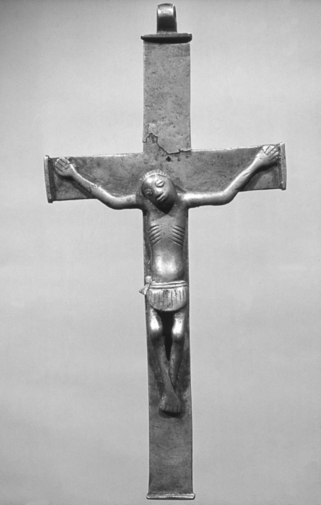

<!-- PDF page 426; original page 411 -->

# 第二十一章　非洲的基督教

**拉敏·桑内（Lamin Sanneh）**

从十五世纪末开始，天主教国家西班牙和葡萄牙率先掀起海上探险的热潮，随后新教国家英格兰和尼德兰也加入其中，推动了权力基础由陆地向海洋的转移。在1498年瓦斯科·达伽马绕过好望角以前，世界上的主导强权都以陆地为基础。1500年以后，占据主导地位的则是那些对海上航道拥有无可挑战的控制权的国家。这些航道从里斯本和热那亚，或者普利茅斯和鹿特丹，一直延伸到果阿和广州。海上权力使一个新的商人阶层登上舞台，他们的进取精神驱使他们前往那些此前不为人知或尚未开发的土地，寻求财富和利润。正如其中一位冒险家所说，他们漂洋过海，是为了“侍奉上帝和国王陛下，给身处黑暗的人带去光明”，但也格外强调，要“像所有人所希望的那样，发财致富”。[^p426-1] 哥伦布则这样说：“黄金，多么出色的产物！财富来自黄金。拥有黄金的人，在这个世界上可以随心所欲。有了黄金，甚至能把灵魂送进天堂。”[^p426-2] 对这些经营冒险事业的人来说，传教不但有必要，而且有利可图。

## 西非与东非的天主教传教

第一个在非洲开展大规模殖民活动的欧洲海上强国是葡萄牙。这个小小的君主国，是在十二世纪伊比利亚半岛上基督徒对摩尔人的十字军战争中兴起的。十五世纪的葡萄牙国王为寻找黄金和奴隶，也可能是为寻找传说中约翰长老的基督教王国，接连派遣探险队，沿非洲西海岸不断向南航行。神父们随这些海上探险队同行，有些人把探索活动视为基督教十字军事业的一部分。1480年代初，葡萄牙探险队抵达扎伊尔河沿岸的刚果王国，这是一个具有成熟组织的非洲国家。1491年，传教士来到这里，受到热情欢迎，并为国王<!-- PDF page 427; original page 412 -->和数百名臣民施洗。被称为“刚果使徒”的阿丰索，已经皈依基督教，于1506年登上刚果王位，在位直到1543年。他建立基督教君主政体，学习葡萄牙语，修建教堂，推动传教，甚至把儿子恩里克送往葡萄牙接受教育和圣秩，以便回刚果从事传教服务。耶稣会士在十六世纪中叶来到这里，建立了基督徒村庄。1596年，教皇为刚果王国及其邻近的安哥拉地区设立圣萨尔瓦多教区。1624年，耶稣会在圣萨尔瓦多建立学院；首任院长卡尔多萨神父将葡萄牙通行的《要理问答》译为当地的刚果语（Kikongo），分发了数百册。被称为传道员（maestri）的平信徒教理教师使用这些刚果语要理问答，在乡村世代传授教义，而且大部分时间都没有教士在场。

1645年，嘉布遣会开始在刚果王国传教，参加者包括意大利和西班牙修士。这是传信部一项更大计划的组成部分，目的是推动由罗马直接指导的西非传教活动。由此开始，嘉布遣会在刚果开展了将近两个世纪的工作。他们在圣萨尔瓦多和索约设立学校，学习刚果语，并有系统地到农村地区传教。他们还在非洲人中建立善会，其中包括1658年在罗安达成立的玫瑰圣母善会，后来成为推动非洲人权利的一个活动场所。1672至1700年间，三十七位嘉布遣会神父共记录了34.1万次洗礼。这个修会还于1644年在几内亚海岸和塞拉利昂、1647年在贝宁、1650年代在瓦里小邦设立了其他传教据点。安哥拉东部马坦巴的女王恩津加，受一位被俘嘉布遣会神父的影响，于1656年接受基督教，并试图建立一个基督教国家。她亲自搬运石料，修建马坦巴圣母堂。这座教堂于1665年竣工，原书也把这一年记为她去世的年份。

葡萄牙人绕过好望角以后，在东非建立殖民据点，其中包括沿海的设防贸易城市。莫桑比克岛城成为葡属东非主要的行政中心，据估计，到1586年，城里已有两千名基督徒。十七世纪，津巴布韦的穆塔帕帝国受到道明会影响，历代国王接受了洗礼。在赞比西河谷，葡萄牙王室把大片土地授予移民，称为普拉佐领地（prazos）。葡萄牙的耶稣会士和道明会士随殖民者而来，有些神父自己也持有这样的领地。据一位葡萄牙耶稣会士在1667年报告，赞比西河下游有十六处从事传教的礼拜场所，其中六处由耶稣会管理，<!-- PDF page 428; original page 413 --><!-- PDF page 429; original page 414 -->九处由道明会管理，一处由教区神父负责。1697年，耶稣会在塞纳建立一所学院，同时招收葡萄牙人和非洲精英的子女。在十七世纪早期至中叶的一段时期，天主教确实曾有在非洲广泛传播的前景。它得到非洲国王及其统治精英所组成的网络支持，又有多位杰出的神父和修士推动。许多非洲人接受基督教，可能是为了讨好葡萄牙宗主，但也有证据表明，其中存在真正的信仰和献身。例如，1631年蒙巴萨城一度落入穆斯林军队手中时，七十二名非洲男女宁愿与欧洲基督徒同伴一道赴死，也不肯否认基督信仰。他们被称为“蒙巴萨殉道者”。

**图7　非洲西南部刚果基督教王国的苦像，十七世纪。** 这是受难基督形象非洲化的一个早期例子。照片藏于爱丁堡大学非西方世界基督教研究中心的巴特勒收藏。

然而，到十八世纪初，非洲基督教的前景已经大为黯淡。信奉基督教的刚果王国被内战摧毁，国王的权力与权威受到严重限制。1678年，首都圣萨尔瓦多遭到一个交战派系洗劫，此后荒废了四分之一个世纪。十八世纪初重新有人居住时，城中的十二座教堂都已成为废墟，只剩下一位神父埃斯塔沃·博特略；而他却是一个与姬妾同居的奴隶贩子。在王国的几个省中，只有沿海的索约省还保有相当数量的基督徒。刚果的嘉布遣会传教团减少到两三位修士。到1750年，更只剩下一位出色的传教士凯鲁比纳·达萨沃纳神父。他勇敢地继续走遍全国，直到1777年；在这二十七年孤独的传教中，原书记载他为大约70万人施了洗。后来虽有其他嘉布遣会士试图继续这项事业，但最后一位常驻会士还是于1795年撤离了。

某些乡村里的平信徒传道员仍然传授基督教教义，村民继续遵守基督教礼仪、吟唱圣歌。1773年，法国传教士在扎伊尔河以北发现了这样一个村庄，一座大十字架昭示着村庄的身份。不过，没有获得授权施洗的常驻神父，这些社群最终逐渐失去了基督信仰。尽管瓦里和西非其他国家不时出现短暂的传教活动，基督教仍然难以维持。在东非，修会与教区神父的服务对象越来越限于葡萄牙统治阶层。到1712年，只有赞比西亚还保留着面向非洲人的传教工作，而这些活动不久也消失了。各地的基督教正在变成殖民据点的附属物，教士主要充当殖民者的随牧，以及殖民政府的支持者。

天主教传教的衰落有多方面原因。葡萄牙力量的削弱，降低了它招募和维持传教士的能力，<!-- PDF page 430; original page 415 -->同时也使它对其他国籍的传教士更加猜疑。此外，十八世纪罗马对世界传教运动的兴趣减弱，传教士的供应逐渐减少。非洲传教区始终缺乏足够的神父。许多传教神父的虔诚与献身堪为表率，另外一些人的表现却令人失望。他们往往处境孤立，得不到主教经常性的督导或鼓励，有些人因而灰心丧气，纳妾或从事贩奴，使教会及其圣职蒙受丑闻和耻辱。许多传教士死于非洲的气候与热病。在1645至1835年间于刚果传教的438位有名可查的嘉布遣会神父中，有229人在传教区工作几年后就去世了，另一些人则因健康恶化而返乡。葡萄牙于1759年决定把耶稣会逐出殖民领地，又进一步减少了传教士人数，赞比西亚尤其如此。虽然有人努力招募并培养非洲本土神父，但这些努力还不够，非洲神父的数量始终不足。嘉布遣会神父还对平信徒传道员抱有疑虑，往往不愿给他们必要的支持。

不过，世界其他地区的天主教传教也面临类似困难，却没有发生撒哈拉以南非洲那样的崩溃。非洲的特殊之处，在于奴隶贸易给社会造成的破坏。过去，奴隶制和奴隶贸易也曾与基督教并存，但非洲奴隶贸易的庞大规模却前所未有。从十七世纪中叶起，每年有数以万计的非洲人被运往美洲的种植园。葡萄牙的非洲帝国主要变成了奴隶的来源地。为满足不断增长的劳动力需求，奴隶贩子开始掳掠整个村庄，毁坏整片地区，把那里的人口一扫而空。这又加剧了内战和社会瓦解。据估计，横渡大西洋的奴隶总数中，有40%来自刚果—安哥拉地区。这个比例远高于该地区人口所占的份额，也是信奉基督教的刚果王国瓦解的主要原因之一。

必须指出，非洲有些教士自己拥有奴隶，或者参与奴隶贸易。例如，1710至1754年间居住在赞比西河畔宗博的佩德罗·德圣三一神父，拥有1600名奴隶，还经营一座金矿。几乎所有教士都通过奴隶贸易获得经济支持。不过，仍有许多教士愿意公开反对奴隶制和奴隶贸易。1686年，嘉布遣会士提出呼吁，一位自称拥有刚果王室血统的非裔巴西前奴隶洛伦索·达席尔瓦也组织请愿。作为回应，<!-- PDF page 431; original page 416 -->罗马圣职部谴责了大西洋奴隶贸易。尽管如此，贸易仍在继续，直到十九世纪初期还在对天主教传教造成毁灭性的影响。1854年，著名的苏格兰传教士戴维·利文斯通横穿非洲，抵达安哥拉，只发现耶稣会和嘉布遣会教堂的废墟，基督教也已经沦为一种民间记忆。天主教传教事业后来得以恢复，但那已经超出了本卷的时间范围。

## 新的开端：西非的新教传教

罗马长期发出的反奴隶制声音，虽然收效甚微，后来却成为世界传教运动复兴的主调。这个复兴发生在新教基督教内部，而新教在此前大多把传教视为罗马天主教的专有领域，因而予以排斥。第一个这样的新教组织，是1698年在伦敦成立的基督教知识促进会（SPCK）。它宣称自己的宗旨是“在海外种植殖民地促进宗教与学问，并在国内传播基督教知识”。该会决定允许成立一个作为附属事业的传教机构，即海外福音传播会（SPG），负责派遣和供养传教士。1701年，一份王室特许状据此正式设立了海外福音传播会。然而，即使有了这些早期迹象，新教徒对传教的投入仍然主要是临时性和有条件的，而且往往承接他人已经开展的工作。

不过，基督教知识促进会的教育与出版活动，对英国国内以及其他人在传教区所做的工作，都产生了显著影响。特别是到1720年，已经有一项广泛的《圣经》翻译计划。届时，该会已出版一万册阿拉伯语《新约》、六千册《诗篇》和五千册《要理教导》，服务对象是奥斯曼领土以及俄国、波斯和印度境内的社群。该会还于1765年开始在锡利群岛开展传教，持续到1841年。

海外福音传播会直接参与非洲事务，是英国贸易机构的需要所促成的。因此，1752至1824年间，该会应皇家非洲公司的请求，向当时黄金海岸的海岸角派遣英格兰教士，任命他们为随牧。其中一位教士托马斯·汤普森在那里服务了五年，把自己的印象记入《两次传教航行记》，于1758年出版。他的看法反映了皇家非洲公司的主流意见：奴隶制并不是一种罪恶；他还在书中赞许<!-- PDF page 432; original page 417 -->奴隶贸易。不过，汤普森重视非洲语言在传教中的价值，无意间标志着一个重要的转变：把非洲文化材料视为传播基督教的适当框架。他强调开展芳蒂语教育的重要性，并相应地安排三个芳蒂男孩随他到英格兰接受教育。其中两人去世，第三人菲利普·夸克在圣公会接受按立，于1765年回到海岸角，担任教师、教理传道员和传教士，一直到1816年在这些岗位上去世。

丹麦人也参与了阿克拉克里斯蒂安堡的活动。这个由丹麦控制的驻军要塞管理着邻近地区的贸易。来到黄金海岸的随牧，严格说来并不是传教士，但值得注意的是，其中有些人对非洲人的生活与宗教十分关切。例如，1662至1670年在海岸角附近腓特烈堡任随牧的威廉·约翰·米勒，主张向当地居民传教，并要求把《圣经》译成当地语言。他身体力行，收集了大约八百个实用词语和短语。他还表现出对当地宗教习俗的了解，这是一个外来者所做的首次此类理解尝试。

另外两位驻在克里斯蒂安堡的随牧，觉得要塞生活的狭小范围过于拘束，便走向更广阔的地方。一位是1709至1712年任职的约翰·拉斯克，另一位是1805至1809年任职的H.S.蒙拉德。他们都谴责奴隶制及助长奴隶制的贸易，也都提出了一个经典疑问：在欧洲商业据点所投下的妥协阴影中，究竟能否在非洲建立教会？由于没有传教组织在背后支持，他们转而采取次一等的办法，鼓励非洲学生进入堡内学校学习。

被这所学校吸引来的杰出人才，包括阿克西姆的威廉·阿莫，他后来在维滕贝格大学获得博士学位；雅各布·卡皮泰因，他毕业于尼德兰的莱顿大学，颇具讽刺意味的是，其毕业论文论证奴隶贸易与基督教教义并不矛盾；还有哥本哈根大学毕业的弗雷德里克·斯瓦讷，以及雅各布·普罗滕。这些早期传教工作，是后来传播到非洲的福音觉醒最初绽放的花朵。斯瓦讷属于加族，带着丹麦妻子回到克里斯蒂安堡，短暂担任教理传道员与教师，然后于1746年返回丹麦。

雅各布·普罗滕也回到了黄金海岸，却又消失在邻近的多哥地区，后来一度在遥远的德国重新出现。他于1756至1761年间待在克里斯蒂安堡，1765年再次来到这里，一直到<!-- PDF page 433; original page 418 -->1769年去世。这些生涯带有很大的偶然性，恰好见证了几个世纪以来，人们坚持不懈地试图把基督教带到阿拉伯地理学家所称的“比拉德·苏丹”（Bilád al-Súdán），也就是“黑人的土地”——撒哈拉以南非洲。到美国革命发生的1776年，非洲各地的传教事业已在全球奴隶贸易的压力下衰弱，处于边缘地位。拯救灵魂的事业让位给了买卖灵魂。

## 基督教反奴隶制运动与前奴隶返回非洲

尽管如此，变化已经开始。这在很大程度上归功于美国革命所产生的、既出人意料又影响深远的后果。要讲述近代非洲的基督教历史，就必须指出：后来成为美国的这片土地，拥有非洲以外最多的非洲人口。其中绝大多数是奴隶；到1790年，奴隶约有70万人，此外还有5.9万名自由的非洲人。在大西洋沿岸十三殖民地的反殖民政治背景下，反奴隶制情绪变得更加迫切。许多主张脱离英国独立的主要人物，也同样反对奴隶制继续存在于美洲土地上。1775年，第一个反奴隶制协会在费城成立；1785年，本杰明·富兰克林成为该会主席。他把解放奴隶与争取国家政治独立的事业联系起来，例如发誓抵制糖，因为糖沾染着奴隶劳动者的鲜血。这类抵制思想无疑也有一个相关动机：打击种植园制度的经济利益，而英国的殖民权力正以这种制度为基础。

反奴隶制活动的政治与经济基础，又与第二次大觉醒联系起来。1790年代以来，这场大觉醒席卷美洲殖民地，吸引了大批非洲人归信。这种结合产生了重大事件，对非洲基督教历史的进程具有长远影响。福音觉醒在基督教内部引发了一场非洲人的群众运动，这是非欧洲人口中第一次出现此类运动。就规模和成效而言，它超越了此前或此后影响非洲的任何同类运动。

早在美国革命以前，新英格兰的清教徒中就出现过压制奴隶贸易的运动。1640年，在清教徒的马萨诸塞殖民地，一名贩奴船船长被捕，船上被作为货物的奴隶遭到没收，并奉命由殖民地出资送回非洲。后来，奴隶贸易得到了足以抗拒清教徒禁令的支持，但它的辩护理由是经济上的权宜之计，而不是宗教。[^p433-3] 1773年，<!-- PDF page 434; original page 419 -->罗得岛的塞缪尔·霍普金斯——第一次大觉醒领袖乔纳森·爱德华兹（1703—1758）的门徒——与另一位教士、后来担任耶鲁大学校长的埃兹拉·斯泰尔斯商议，组织一批黑人信徒返回非洲，作为使非洲大陆基督教化的先遣力量。1775年，霍普金斯向后来的美国总统约翰·亚当斯（1735—1826）求助，希望他为基督教殖民事业捐款。到1776年战争爆发时，私人捐款已经超过500美元，但战争中断了计划。还没有等到1783年战争正式结束，霍普金斯就重新提出了这一构想。后来，1794年，詹姆斯·麦肯齐在普罗维登斯非洲协会的支持下，被派往西非海岸，为建立殖民地寻找地点。

第一次大觉醒激起的归信浪潮，已经影响了许多美洲黑人。他们随后卷入美国革命，经历了改变和磨炼，战后便跨越大西洋返回非洲，成为新一批福音使者。战争结束时，效忠英国的黑人部队在英军指挥下复员，于1783年被送到加拿大。后来，这些黑人对加拿大生活感到失望，近1200人于1792年1月组成一支自由船队，从新斯科舍出发。同年3月，他们抵达塞拉利昂的弗里敦，开始了非洲尝试基督教与摆脱奴隶制的新阶段。

1787年，一批伦敦自由黑人曾在这个“自由省”建立最初的殖民地，但由于多种原因，殖民地已经瓦解到无法挽救的地步，在非洲开展新基督教实验的事业几乎彻底失败。就在这个时候，新大陆送来了新的推动力。英国议会慷慨支持这项事业，承担了9600英镑的全部归返费用。乔治·华盛顿有理由怀疑，这或许只是英国以一种带有讽刺意味的方式，回敬美国人的不忠。

无论如何，他们终于回来了。这些黑人当初被从家园中连根拔起，戴上镣铐，挤进贩奴船，被拖过大洋；如今，他们从受奴役和种族羞辱的恐怖经历中归来，回到自身苦难的源头。他们带来了一种新的、不同的讯息：让被俘者得解放，让囚徒获自由，让被遗弃者迎来蒙恩的时刻，向贫穷者传递好消息。

旧大陆的传教工作，把国王、酋长、王子以及社会上其他显要人物当作主要的归信对象。但这些国王、酋长和身边的官员，即使一度接受基督教，迟早也会抛弃它，重新走向旧政治的剥削方式，而旧政治认可奴隶制与奴隶贸易。如今，新大陆的<!-- PDF page 435; original page 420 -->自由思想，与复兴运动所宣讲的救赎和个人应许结合起来，向被排斥者、受压迫者以及被捆绑、被剥夺声音的人宣布赦免。前奴隶、曾经的俘虏、遭受伤害的人口和社会边缘群体，成了这项呼召首先面向的对象。这一局面公开而有力地否定了古老且备受尊崇的原则：政治血统与社会特权，以及把公共习俗视为不可改变的法律。这种讯息点燃了当地原本潜伏着的不满与离心力量。

## 十八世纪的非洲基督徒领袖

简要介绍其中几位十八世纪人物的经历，可以把我们的叙述继续向前推进。奥劳达·埃奎亚诺便是其中之一。这位不知疲倦的反奴隶制活动家，在大西洋两岸奔走，动员进步舆论，争取废除奴隶贸易，并促进非洲经济发展。诚然，埃奎亚诺的非洲出身存在争议：有些迹象显示，他可能实际出生于美国南方，而不是他自己所说的尼日利亚。不过，无论他的出生问题如何，埃奎亚诺对本章主题的重要性都不受影响。按照传统说法，他出身伊博人，名叫“埃克乌诺”（Ekwuno）。他本人说，1757年自己作为奴隶，被送到弗吉尼亚的一座种植园。此后，他经历了一连串非凡的冒险，并在一处叙述了自己在加的斯一艘船上的归信体验。

1789年，也就是法国革命发生的那一年，埃奎亚诺在英国开展活动。他把奴隶制界定为人权问题，坚持认为，奴隶制延续既阻碍人类进步，也妨碍非洲的经济发展。他主张，应该把自身利益的动机，与正义和人道的动机结合起来，决不对奴隶贸易和奴隶制让步。

埃奎亚诺很早就试图在反奴隶制运动中发挥领导作用。他的自传《奥劳达·埃奎亚诺的一生》，敏锐分析了奴隶制对非洲大陆社会以及欧洲人与非洲人关系的影响。他回忆，1779年自己请求接受按立，以便到非洲传教，却遭伦敦主教拒绝。1783年，他在伦敦拜访反奴隶制的人道主义者格兰维尔·夏普，向夏普讲述了130名非洲人被从贩奴船上扔进海里的遭遇：船主以此欺诈性地索取保险赔偿。这一揭露立即对夏普和议会产生了深刻影响。埃奎亚诺还与另一位前奴隶、芳蒂人奥托巴·库戈阿诺携手。库戈阿诺于1787年写成《关于奴隶制罪恶的思想与感想》，埃奎亚诺可能参与了写作。这部著作<!-- PDF page 436; original page 421 -->严厉控诉奴隶贸易，以及那些打着基督教名义推动奴隶贸易的欧洲人。1788年，该书出版法语译本。库戈阿诺在书中把奴隶制称为伤害和抢劫，认为其中找不到丝毫理性、正义、仁爱或文明的痕迹。他说，苏格兰人和荷兰人自称信奉新教，却属于最恶劣的“鞭打者和驱使黑奴者”之列。

埃奎亚诺希望领导前往非洲的反奴隶制传教事业，但在伦敦遭到拒绝。此后，把反奴隶制与基督教这双重使命带到新大陆以外的任务，落到了美国独立战争的黑人老兵肩上。托马斯·彼得斯就是其中一位。他大约于1740年出生在尼日利亚，父母属于约鲁巴人的埃格巴族。1760年，他遭绑架，被卖到法国贩奴船亨利四世号上，最终抵达法属路易斯安那。在那里，他的法国主人又把他卖给一个英国人。到1770年，他再度被出售，这次的买主是北卡罗来纳威尔明顿的苏格兰人威廉·坎贝尔。彼得斯在那里学会了磨坊机械工的手艺。1776年战争爆发、城镇撤离时，他为了争取自由，加入英国一方。按原书的叙述，1777年末英国失去对费城的控制后，已经来到费城的彼得斯，随一批复员军人离开，前往新斯科舍。他在战斗中两度受伤，仍然活过了战争，并与妻子一同在新斯科舍定居。

彼得斯组织新斯科舍黑人提出请愿，说明尽管官员作出相反保证，他们的生活条件依然恶劣。1791年，他把请愿书带到伦敦，呈交外交部的威廉·格兰维尔。请愿立即发生了作用。新近成立的塞拉利昂公司董事表示，他们“同意向国王陛下的大臣们申请，由政府出资为〔黑人〕提供航程。申请获得有利答复后，他们随即接受〔约翰·〕克拉克森中尉的服务。这位中尉非常慷慨地自愿前往新斯科舍，提出必要建议，并监督愿意移民塞拉利昂的自由黑人的集合和运送”。

彼得斯随后回到新斯科舍，协助组织归返队伍。黑人中有许多疑虑，白人也反对，因为他们担心黑人劳动力流失。尽管困难重重，归返运动还是启动了，彼得斯也正式报名参加。他们成功开辟了一条横跨大西洋的道路，后来有许多人沿着它前行，而且并不只有黑人。

戴维·乔治的经历，是这项归返事业恰当的见证。他大约于1742年生于弗吉尼亚的奴隶家庭，后来在<!-- PDF page 437; original page 422 -->席卷新大陆黑人的福音运动中归信。他在南方开展传教，成功地在佐治亚建立了浸礼派教会。革命爆发时，乔治已经是一位颇有成就的宗教开拓者。他在1782年被撤往新斯科舍后，这一点表现得尤为明显。在那里，他恢复讲道活动，搭起一座他称为“聚会所”的建筑，举行复兴聚会。约翰·克拉克森是托马斯·克拉克森的弟弟，在托马斯·彼得斯赴伦敦交涉后抵达新斯科舍。他参加了一次乔治主持的复兴聚会，见证了乔治在这一圣职上的天赋。克拉克森说：“我不记得自己这辈子曾听过唱得如此动听的《诗篇》。”没有任何事务、障碍，或者取悦他人的念头，能够阻止乔治“向他的创造者献上赞美”。1792年，克拉克森像一个出人意料的“花衣吹笛人”，领着新斯科舍黑人“越过海洋，前往非洲海岸”，乔治自然也在其中。新大陆的反奴隶制情绪横渡大西洋来到非洲大陆，产生了决定性的影响，既有积极的一面，也有消极的一面。

在弗里敦，乔治扩大了自己的工作范围。他当然继续承担讲道职责，但也越来越多地担任社群领袖，以及不取报酬的移民申诉代言人。当局试图强加一种官方基督教，以防范那些可能煽动叛乱的黑人传道人；乔治则维护他所称的新斯科舍移民的“宗教权利”。作为美国革命的主要当事国，英国还在恢复元气，依然对宗教与政治上的共和思想十分敏感，也依然提防殖民地中“开放家庭”宗教的蔓延——也就是把家庭同时用作礼拜场所。然而，移民们不肯退让。乔治代表他们提出，黑人在上帝面前的地位不带污名，也不应受到偏见，这一点应当体现在他们在国家与社会中的自由和平等上，无论这种主张听上去多么令人反感地带有共和色彩。

官员谴责这类观点属于反律法主义，并建立殖民地随牧制度来加以遏制。他们拒绝承认——或者说，他们恰恰感到恐惧——移民宣讲的并不是无政府状态或退回个人内心，而是一种出自他们自身经验的社会行动主义。反律法主义的指控建立在神学误解之上：当局错误地认为，移民援引“在洁净的人，凡物都洁净”这一教义，因而已经得救的人便自认无需承担道德和政治责任。然而，移民的实际情况远非如此。例如，1793年乔治访问伦敦时，敦促人们投身废奴和非洲传教事业，恳求英国朋友在本国也为同样目标行动起来。在那次访问中，乔治见到了约翰·牛顿；他是流行赞美诗<!-- PDF page 438; original page 423 -->《奇异恩典》的共同作者，曾在非洲西海岸贩奴，后来才归信福音主义。应当记得，在1793年，英国各教会还远未想到海外传教服务，尽管卫斯理复兴运动已唤起社会对国内事务承担更广泛责任的意识。威廉·克理则把这种产生于本土的推动力带往海外，原书记他在1792年启程赴印度。在这种情况下，乔治的呼吁是一项重要行动，使非洲直接置于反奴隶制运动，以及与之相联的传教觉醒的中心。此后，日益高涨的废奴情绪在议会占据上风，只是时间问题。威廉·威尔伯福斯在那里领导了1807年废除奴隶贸易的努力。

新英格兰的非裔美国人保罗·卡菲，以自己的经历有力驳斥了反律法主义异端的指控。他是十八、十九世纪最富有、最具影响力的黑人之一。卡菲于1759年生于马萨诸塞的达特茅斯，在贵格会斯洛克姆家族的奴隶家庭中长大，后来归信贵格会。他于1778年采用“卡菲”这个姓，拼作Cuffee或Cuffe，来自“Kofi”，暗示父系出身于加纳的阿散蒂人。原书记述，他的贵格会主人受良心谴责，将他释放。十六岁时，他进入捕鲸业，最终积累了巨额财富。他成为一位黑人船主，这在当时非同寻常。1800年，他订造了一艘162吨的英雄号，该船的一次航行曾绕过好望角。1806年，他又装备了两艘更大的船。其中一艘是268吨的阿尔法号，从威明顿和萨凡纳驶往瑞典哥德堡，最后返回费城。

另一艘船名叫旅行者号，卡菲拥有四分之三的股份。他乘坐这艘船，进行了一次对命运具有重大影响的西非航行。1810年12月，他离开费城，途经英格兰，于1811年初抵达当时重要的贩奴港利物浦。他向根据1807年废除奴隶贸易法案设立的海军部委员会提出请愿，使一个名叫阿伦·理查兹的奴隶获释。卡菲广泛咨询反奴隶制与福音运动的领袖，其中包括威廉·威尔伯福斯——恰巧与卡菲同年出生——以及已经卸任塞拉利昂总督的扎卡里·麦考莱。他是著名历史学家托马斯·巴宾顿·麦考莱的父亲。卡菲还见到非洲促进会（African Institution）会长格洛斯特公爵。这个组织积极从事反奴隶制和人道主义活动，影响很大，董事包括威尔伯福斯，以及著名贵格会领袖威廉·艾伦；艾伦以同情俄国南部门诺派的事业著称。1811年9月，卡菲继续前往西非，同年11月抵达弗里敦。

<!-- PDF page 439; original page 424 -->

他免费搭载了一位英国卫理公会传教士和三位教师。这再次证明，即使在欧洲，传教推动力的实现也有赖于黑人的主动行动。海外传教区的实际工作更是如此，尽管传教学者往往轻易忽略这个事实。

直接推动卡菲这次西非远行的，是1807年废除英国奴隶贸易的法案。而这项法案本身，又在很大程度上受到新斯科舍美洲黑人成功定居西非的启发。他的目标是在奴隶贸易的源头建立正当贸易的基地，借此打击当地的人口贩运。他还希望创造另一种连接非洲、新大陆和欧洲的三角贸易，非裔美国人将成为其中不可缺少的一环。通过科学农业生产的热带作物，由黑人拥有的船只运往美洲；所得利润再用来购置机器和货物，进而建立经济基础设施，使更多自由而能从事生产的美洲黑人到西非定居。卡菲认为，他们的榜样会在非洲人中产生感染力。正如贵格会慈善家威廉·桑顿在1785年也曾提出的，正当贸易与利润将锻造一条道德锁链，扼杀邪恶的奴隶贸易，使长期受苦的非洲人自己直接获益。

然而，前方存在巨大的障碍。其中尤其严重的是欧洲商人的控制，他们使非洲贸易伙伴背上难以承受的债务。卡菲估计，在如此不利的条件下，很难培育一个非洲企业家阶层。因此，他坦言，自己清楚地认识到，必须在殖民地的非洲人中奠立新的经济基础：“我必须鼓励他们为了自己的利益而努力，成为自己的船运商和进口商，使他们能够雇用自己的同胞。因为现在这个殖民地正在失去自己的年轻人：他们一离开学校，就找不到可以从事的行业，只得上外国人的船工作。因此，殖民地不断丧失她的〔人口〕。”[^p439-4]

酋长们也阻挡着这种进步。卡菲认为，无论他们怎样许诺合作，其内心都不支持废奴，实际上也不支持具有自由经营文化的正当贸易。“我还可以补充一点：与非洲酋长交谈时，他们极不情愿放弃奴隶贸易，说这使他们变穷，也不能再像过去贩卖奴隶时那样，得到想要的东西。”[^p439-5] 在奴隶贸易的旧秩序中，当地统治者和王公与贩奴船船长利益一致；奴隶贸易的利润又有助于加强本土的<!-- PDF page 440; original page 425 -->政治制度。但是，奴役邻人也会让自己面临同样命运的危险。把先发制人的袭击当作战略和威慑，只会使报复更不可避免。从长远看，掳奴袭击对谁都没有好处；但从短期看，谁也承担不起放弃它的代价。正是这种短期现实，使卡菲及其他人，尤其英国议会，所提出的改善计划陷入困境。

为推进自己的经济构想，卡菲在贵格会思想启发下，成立塞拉利昂友好协会。后来，他写信给协会秘书、非裔美国人詹姆斯·怀斯：“我嘱咐你努力，使她——友好协会——不要放弃商业活动，因为这是她的民族进步最重要的出路。我预见，这将成为改善你们的国家和民族的办法。”[^p440-6] 卡菲于1813年4月4日离开弗里敦，经过五十四天航行，返回美国。

剑桥的反奴隶制活动家托马斯·克拉克森，在1814年1月24日的一份公告中，提醒公众关注卡菲的友好协会。他说，该会的目的是“设法以最有利的条件出售〔移民的〕产品，并相互培养勤勉的习惯”。他同时告诫说：“这个协会仍在继续活动，但如果没有英格兰的援助，就无法实施它有益的计划。”[^p440-7] 威廉·艾伦也表达了与克拉克森相似的忧虑，转而支持卡菲的事业；当时，塞拉利昂殖民地的白人商业利益集团正在攻击这项事业。

1814年稍后，有人代表卡菲向美国国会呈交请愿书。众议院议长将其转交商业与制造业委员会。参议院随后提出决议，授权总统允许卡菲装载一船货物启程前往西非。但当时英美正在交战，这项措施遭到否决，理由是它会使英国货物逃过国会施加的封锁。有人又代表卡菲向英国议会提出类似请求，同样遭到拒绝。当局认为，在现行航海法的情况下，这样做风险太大；1812年英美战争以及仍在继续的拿破仑战争造成了损害，因此航海法尤其需要得到维护。

这些挫折远没有让卡菲灰心，他毫不畏缩地继续努力。在韦斯特波特的贵格会朋友帮助下，他再次装备旅行者号，于1815年11月出航。船上装满烟草、肥皂、蜡烛、船用物资、面粉、修建锯木厂所需的铁料、一辆货车、磨石、钉子、玻璃和一张犁。乘客共三十八人，包括十八名家长和二十个孩子，其中有准备从事耕作的普通劳动者。

<!-- PDF page 441; original page 426 -->

旅行者号上的一位乘客，是取得讲道许可的卫理公会传道人佩里·洛克。卡菲委婉地评论，他“作为一个传道人，声音有些粗硬”。〔在弗里敦，卡菲提醒洛克：他在美国曾抱怨自己被剥夺自由，如今被要求担任陪审员，却又发起牢骚。“去坐上你的位置，尽力做好。”卡菲这样告诉他。[^p441-8]〕另一位乘客安东尼·瑟万斯，是塞内加尔人。他曾被卖给圣多明各的法国人，在革命期间逃到费城。他学会读写，并学习航海知识。虽然对这项职业感兴趣，但由于容易晕船，海上生活并不适合他。卡菲私下认为，瑟万斯不会成为一个好水手。瑟万斯自费参加这次航行，希望最终能回到塞内加尔的家乡。

1816年2月3日，船只在弗里敦抛锚。卡菲不知道的是，弗里敦当权阶层对他的态度已经变得更加强硬，他因此在登陆时遇到重重困难。他的货物被征收高额关税，使他经营这项事业并获利的希望更加渺茫。作为安慰，总督和首席法官接见了他。弗里敦的商人与商业利益集团合谋将卡菲拒之门外，决心阻止任何美国势力进入西非市场。在塞拉利昂受阻之后，卡菲返回美洲，继续反奴隶制与传教活动。原书记他于1817年7月在那里去世。

1807年奴隶贸易废除以后，来自非洲的“获救奴隶”（recaptives）进入塞拉利昂，给这项“基督教实验”带来了根本而持久的改变。英国海军分舰队沿漫长的西非海岸巡逻，截获准备运往新大陆的奴隶，把他们送到弗里敦。他们被安置在围绕教堂、学校和农场组织起来的堂区社群中。这些获救者来自非洲大陆各地，逐渐成为殖民聚落的中坚。其人数远远超过最初的新斯科舍移民，并接手了教育、社群治理与传福音工作中的很大部分。他们中间出现了一个流动性很强的新中产阶层，其影响远远超出自身人数。颇具讽刺意味的是，这个中产阶层后来将成为殖民主义以及许多其他事物的克星。

保罗·卡菲在美洲留下了持久的影响，并直接促成利比里亚的建立，使之成为美国南方获释奴隶的定居地。来自新泽西的长老会牧师、后来担任佐治亚大学校长的罗伯特·S.芬利，一直争取在非洲建立一个供获释奴隶定居的地方。他与卡菲取得联系，<!-- PDF page 442; original page 427 -->在信中说：“所有深切关心此事的人，都有一个强烈愿望：让自由的有色人种有机会提升到他们应有的地位，同时提供一种强有力的办法，终止奴隶贸易，并把文明与基督教带到非洲。”[^p442-9] 芬利后来成为利比里亚殖民计划的设计者之一。

1816年12月，美国殖民协会（ACS）终于在美国众议院的一间大厅里成立。卡菲的建议和榜样，是成立协会的灵感来源；塞拉利昂则是人们心目中的范例。协会理事会在一份纪念文字中极力称颂卡菲，赞扬他清晰而坚定的判断、见多识广的意见、毫不动摇的承诺和不遗余力的奉献。尤其重要的是，他对西非生活具有亲身经验，能够抵消无根据的偏见。颂词最后指出，今后任何对非洲的参与，都必须建立在一种不同寻常的伙伴关系之上：事实与知识应取代偏见和诋毁，评价这种关系的标准，必须是它“对非洲本土人民及其在本国的后裔是否有用”。[^p442-10] 随着反奴隶制事业在西非展开，基督教中的非洲主题获得了横跨大西洋的范围。

## 南非的新教传教与非洲人的权利

正如前文所见，十八世纪新教福音运动推动了传教兴趣的普遍复兴。1795年，伦敦会（LMS）成立；随后出现的相关机构，还有1797年在鹿特丹成立的尼德兰传教会、弟兄会牧师约翰·耶尼克于1800年在柏林创办的传教学校，以及1815年在巴塞尔建立、为英国传教机构提供人员的学校。约翰·西奥多·范德坎普前往南非传教时，尼德兰传教会接续了摩拉维亚弟兄会在1740年代建立的非洲联系。信奉新教的荷兰人自1652年起在好望角地区殖民。荷兰移民，也就是布尔人，为寻找土地而向内陆扩张，自视为与上帝立约的人民，侵占当地非洲人的土地。1795年，英国占领好望角，当时它正与尼德兰交战；1806年以后，这种占领成为永久性的。

范德坎普于1799年抵达好望角，在开普敦以东400英里的阿尔戈阿湾贝瑟尔斯多普，向处境艰难的科伊人传教。他以一种引人注目的方式，介入了奴隶贸易的政治问题：

<!-- PDF page 443; original page 428 -->

他出资赎出一位十七岁的少女，随后娶她为妻。这位少女的非洲母亲来自马达加斯加。范德坎普以自身行为，展现了一种激进、在政治上毫不妥协的福音信仰，公开支持社会与政治平等的原则。他的榜样影响了许多后来从事传教服务的人。

一到南非，范德坎普就立刻遭遇语言问题。与祖鲁人不同，好望角殖民地的科伊人略懂荷兰语，因此能在传教士与当地人之间充当中介。在这个岗位上，科伊人还可以担任教师和教理传道员，从而成为面向自己族人的第二层传教士。这种作用有助于加快基督教在非洲扎根的过程。眼光更敏锐的欧洲传教士认识到，非洲人这样的主动参与，必然意味着角色的重大逆转：非洲基督徒将成为基督教化的主要推动者，并为传教设定议程。此外，非洲人自己开展工作的成果，有可能长期保持，而外国人的工作显然不具有同样前景。

这个想法及其成本效益方面的含义，在很大程度上符合基督教在当地被接受和调整的逻辑，而不符合传教士关于单向传播、把本土文化连根拔起的观念。传教区其他地方恰恰发生过这种传播上的挫折，促使亨利·文恩（卒于1872年）这样的传教领袖提出“传教团的安乐死”理论。其他传教士很快把范德坎普的见解当作明智政策加以采用。不过，他所服务的南非科伊人略懂荷兰语，确实为这些想法的实行提供了有利条件。

然而，殖民地白人社会正在不断向非洲人的土地扩张，而范德坎普在其边缘地带与非洲人共同生活。艰苦的边疆环境严重损害了他的健康，原书称他于1811年相对较早地去世。苏格兰阿伯丁的约翰·菲利普，于1820年获任伦敦会在南非的主要负责人，并成为其工作的首要设计者。他热情而雄辩地捍卫非洲人的权利，反对南非白人的侵害，把反奴隶制的旗帜带进了反对者的堡垒。

范德坎普去世后，菲利普被任命参加一个调查传教事业状况的委员会。他发现，殖民政府似乎不满传教士的工作，起初对此感到困惑。但在进一步调查、了解这种不满的性质以后，他悲哀地认识到，双方几乎没有和解的可能。殖民当局极其愤怒，<!-- PDF page 444; original page 429 -->因为传教机构维护非洲人的利益，反对白人的侵害。在调查中，菲利普发现，贝瑟尔斯多普的传教站实际上已经变成他所称的“奴隶营舍”。那里的非洲人被征发到劳动营做工，承担繁重劳役，却只得到一点点工资，或者根本没有报酬；妇女和儿童则无人照管。他从未见过如此茫然无助、孤苦无依的人群。传教士勇敢辛劳、努力建立和推动的一切，都被冷酷的殖民政府摧毁了。

非洲人的发展进步，成为传教事业的决定性问题，而政府恰恰选择在这件事上发起挑战。传教机构并非自愿，却不得不背负种族问题这一沉重负担。范德坎普与他当之无愧的继承者菲利普，不肯在挑战面前退缩，这是值得肯定的。可以预料，种族问题此后在整个十九、二十世纪，始终主导南非的宗教与政治局面。菲利普的《南非研究》，有力捍卫了他的福音主义和人道主义观点。

## 截至1815年的塞拉利昂实验

在西非，福音事业由1799年成立的英格兰教会传教协会（CMS）代表。不过，很能说明问题的是，该会最早招募的人员，是德国福音派人士梅尔希奥·伦纳和彼得·哈特维希。他们于1804年抵达塞拉利昂。福音主义宗教似乎带有难以驾驭的热狂倾向，大概多数圣公会信徒都对此怀有疑虑；教会人士觉得传教服务的想法陌生而无法接受。因此，形势迫使教会传教协会成为一个跨教派、跨国界的传教组织。

即使如此，该会的起步仍然坎坷。哈特维希放弃了传教生活，很快消失在苏苏人的地区；他不是去使非洲人归信，而是去当了奴隶贩子。协会并未气馁，又派出第二批传教士，全是德国人，于1806年抵达：利奥波德·布彻尔、约翰·普拉塞和古斯塔夫斯·尼兰德。尼兰德后来成为该会在塞拉利昂的开拓者，并以塞拉利昂公司代理人的身份留在弗里敦。〔1807年以后，塞拉利昂成为英国王室领地。〕他身兼数职：作为随牧，他照顾一群参加礼拜的欧洲人；在家里，他则是一位新斯科舍女子的丈夫。热带生活剥去了欧洲教友残存的宗教习惯，他们不再到礼拜堂，把尼兰德变成了一个无羊可牧的牧者。礼拜堂<!-- PDF page 445; original page 430 -->年久失修，最后被弃置，其功能也归并到尼兰德的其他家庭责任之中。

只有在尼兰德把目光转向弗里敦半岛以外的地区以后，他的传教才开始取得进展。1818年，他在布洛姆海岸开展语言工作，而这种工作后来成为基督教传教及其与近代非洲相遇的重要特色。他编写布洛姆语语法与词汇集，并把《马太福音》译成布洛姆语。这是塞拉利昂的第一部《圣经》译作。不过，传教士亨利·布伦顿在非洲传教一段时间、返回苏格兰以后，已经于1801年出版过苏苏语语法和一些要理问答。

在尼兰德另外两位传教同伴的工作中，也能看出类似模式。约翰·普拉塞与布彻尔、梅尔希奥·伦纳一同前往蓬加斯河地区，在苏苏人中工作。他们遵循教会传教协会的新方针：城市化的弗里敦不是有利于传教的环境，因此应将重点转向内陆的本土人口。这项政策改变，平静却意义重大地否定了“基督教与文明是一对同卵双生子”的观念，也与移民中流行的看法相抵触——后者认为，所谓未开化的“部落”无可救赎。1814年，布彻尔终于回到弗里敦，主持莱斯特的一处新获救奴隶定居点。

与苏苏人共同生活的经验，使布彻尔对奴隶贸易给沿海以外社会造成的深刻影响，以及殖民保护所能发挥的促进作用和局限，形成了一些敏锐见解。例如，他的论述呼应了古罗马北非的一些思想，同时又在相当程度上超越了自己的时代。直到1837年，托马斯·福韦尔·巴克斯顿（1786—1845）出版备受赞誉的《奴隶贸易及其补救办法》时，人们才姗姗来迟地注意到布彻尔早在1812年就已描述的问题。

根据自身经验，布彻尔指出，奴隶贸易是内陆社会最重要的收入来源，新近的废奴措施已经威胁到这些社会经济生存的根基。英国政府的政策是在公海截获奴隶，但这并没有触及奴役现象的根源。布彻尔认为，真正需要的是一种出口商品，能够有效而有利可图地取代作为商品的奴隶。因此，传教机构和政府都应把为非洲社会开发替代财富来源，作为最迫切的首要目标。布彻尔相应地着手争取政府当局的支持与合作，提出传教机构和政府之间牢固的伙伴关系。在这种关系中，<!-- PDF page 446; original page 431 -->国旗跟在《圣经》后面，而不是像后来那样，《圣经》跟在国旗后面。

正是在布彻尔的计划下，麦克斯韦总督（1811—1815年任职）组织了一套行政方案，重新安置越来越多进入殖民地的获救奴隶。1807年，弗里敦人口为1871人，其中包括95名军人。1811年4月的人口调查显示，由于获救奴隶涌入，人数已增至大约3500人。1814年7月，获救奴隶人数又大幅增至5520人。一份1818年12月31日的报告，将其人数记为6406人。1816年，包括移民在内的总人口约为1.73万人。

这些数字迅速增长，即使部分原因在于英国海军分舰队截获贩奴船的效率提高，也绝非仅仅如此。更令人不安的事实是，奴隶贸易在法律禁止以后，不但没有停止，反而加快了步伐，因此可供截获的贩奴船也更多。例如，据估计，仅1810年，就有约8万名奴隶被非法运过大西洋，主要送往巴西、古巴和美国南方的市场。麦克斯韦总督受命应对的，正是弗里敦半岛承受的这种人口压力。但任务最终落到继任者查尔斯·麦卡锡爵士肩上。他为此设计了一套受到监督的村庄定居网络，称为“堂区计划”。不过，这套计划是否适合它所要安置的、从海上涌入的本土人口，仍然值得怀疑。

具有罗马天主教背景的麦卡锡，精力充沛而富有想象力地承担了任务，回应布彻尔的呼吁，让传教机构与政府为非洲人的重新安顿建立真正的伙伴关系。获救奴隶被分配到半岛上新建的村庄，每村由一位教士主持。村内设有礼拜堂，居民必须参加礼拜；平日，礼拜堂又兼作学校。1815年以前，已有三个这样的村庄：1809年建立的莱斯特、1810年建立的威尔伯福斯〔原名卡本达〕，以及1812年建立的里金特〔原名霍格布鲁克〕。1815至1820年间，又新建十个村庄，以容纳新来的人，其中包括1816年的基西和格洛斯特，1817年的夏洛特与利奥波德〔后者改名巴瑟斯特〕，以及1819年的惠灵顿、黑斯廷斯和滑铁卢。1819年皇家非洲军团解散后，复员军人被安置在直布罗陀镇；这个名称恰如其分地纪念了他们曾在直布罗陀服役。

这些堂区式村庄，把弗里敦变成黑人离散社群的聚居地。它成为非洲土地上一处具有加勒比风格的文化聚落，也是本土与西方思想一个富有前景的交汇点。非洲获救奴隶<!-- PDF page 447; original page 432 -->来自大陆许多不同地区，有的远至刚果和莫桑比克。他们与来自尼日利亚的人混居，共同怀有被迫离乡、失去根基的感受，也共同发现，在弗里敦可以加入以信仰为基础的基督教社群。本土社群的神祠与祭坛，随着获救奴隶一道进入定居地，与基督教仪式相当和睦地共存。例如，获救的约鲁巴占卜师欢迎传教士的挑战，表示乐于把基督教的神加入约鲁巴诸神体系，因为其中早就有一个位置可供安排。

这表明，在奴隶贸易所造成的流离失所、迁移与重新定居的条件下，基督教被视为非洲人重建自身生活的一种途径，因而受到欢迎。基督教的传播与本土的发现和认识过程相接合，在塞拉利昂以及更广阔的地区，开启了一场长期的跨文化归信与重新调适。

### 译校说明

本章正文的克拉克森公告日期为1814年1月24日，注7所列档案日期为1月28日，均依原版保留。恩津加卒年1665年、凯鲁比纳神父二十七年施洗约70万人、卡菲卒于1817年7月等日期与数字，也按原书保留，未以未经核定的替代资料改写。

## 注释

[^p426-1]: J. H. Parry,The age of reconnaissance (New York: Mentor Books, 1964), p. 33.

[^p426-2]: 转引自 Jean Comby, How to understand the history of Christian mission (London: SCM Press, 1996), p. 60.

[^p433-3]: W. E. B. DuBois, The suppression of the African slave trade to the United States of America: 1638–1870 (1898, repr. New York: Russell & Russell, 1965), pp. 30–1.

[^p439-4]: Captain Paul Cuffe’s logs and letters, 1808–1817: A black Quaker’s ‘Voice from within the veil’, ed. Rosalind Cobb Wiggins (Washington, DC: Howard University Press, 1996), p. 341.

[^p439-5]: 同上，p. 342。

[^p440-6]: Henry Noble Sherwood, ‘Paul Cuffe’, Journal of Negro history, 8 (April 1923), p. 204.

[^p440-7]: Thomas Clarkson, ‘Society for the Purpose of Encouraging the Black Settlers at Sierra Leone, and the Natives of Africa Generally, in the Cultivation of their soil, and by the sale of their produce’, 28 January 1814, Public Record Office, London, CO 267/41.

[^p441-8]: Cuffe’s logs and letters, ed. Wiggins, p. 434.

[^p442-9]: Sherwood, ‘Paul Cuffe’, p. 213.

[^p442-10]: First Annual Report of the American Colonization Society, p. 5；转引自 Sherwood, ‘Paul Cuffe’, p. 220。
