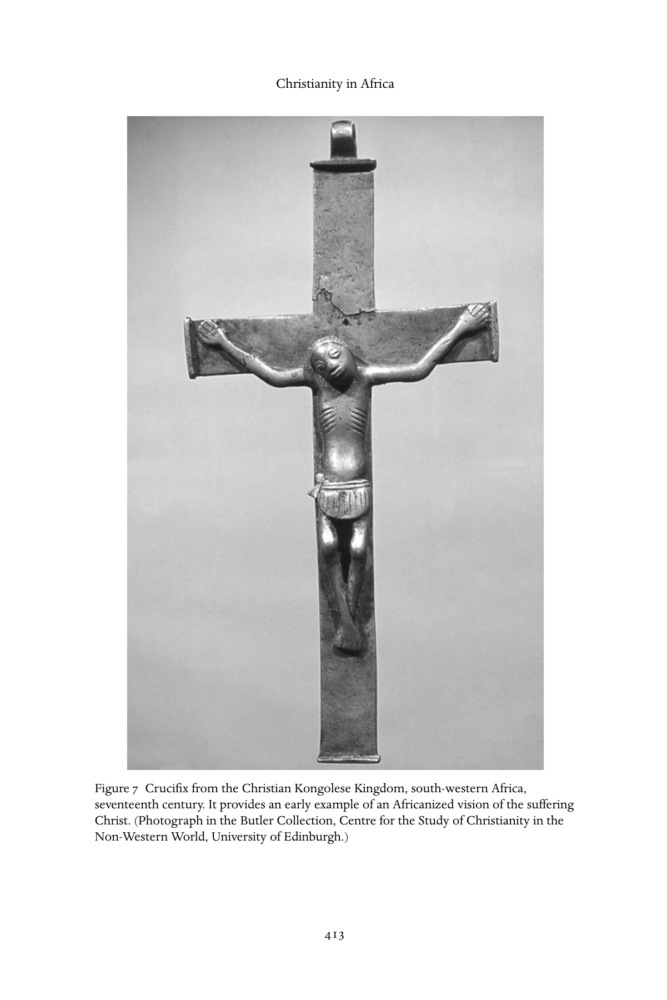

# 非洲的基督教：英文转换底稿

<!-- PDF page 426; original page 411 -->

### 21

## Christianity in Africa

### la m i n s a n n e h

Led by Catholic Spain and Portugal, and later joined by Protestant England and the Netherlands, the explosion of maritime exploration from the late fifteenth century made for a shift from land-based power to sea-based power. In the era before Vasco da Gama rounded the Cape in 1498, the dominant world powers had been land-based. After 1500, the dominant powers were those with unchallenged suzerainty over the sea lanes, from Lisbon and Genoa, or Plymouth and Rotterdam, to Goa and Canton. Sea-based power brought into play a new mercantile class whose entrepreneurial spirit sent them looking for wealth and profit in hitherto unknown or unexplored lands. As one such adventurer expressed it, they crossed the seas ‘to serve God and His majesty, to give light to those who were in darkness’, but also most emphatically ‘to grow rich, as all men desire to do’.[^p426-1] Or, as Columbus expressed it, ‘Gold, what an excellent product! It is from gold that riches come. He who has gold can do whatever he pleases in this world. With gold one can even bring souls into Paradise.’[^p426-2] For these entrepreneurs, mission was not just necessary, it was profitable.

### The Catholic missions in West and East Africa

The first European sea-based power to colonize extensively in Africa was Por- tugal, a small monarchy that had arisen amid the twelfth-century Christian crusade against the Moors in the Iberian peninsula. Seeking gold and slaves, and perhaps the fabled Christian kingdom of Prester John, fifteenth-century Portuguese kings sent expedition after expedition to sail ever further south- wards along the western African coast. These Portuguese maritime expedi- tions brought with them priests and some viewed the explorations as part of the Christian crusade. In the early 1480s, Portuguese expeditions reached the kingdom of the Kongo, a sophisticated African state along the River Zaire. Mis- sionaries arrived in 1491, receiving a warm welcome and baptizing the king

<!-- PDF page 427; original page 412 -->

and hundreds of his subjects. Afonso, the ‘apostle of the Kongo’, came to the Kongolese throne as a Christian convert in 1506, and reigned until 1543, establishing a Christian monarchy, learning Portuguese, building churches, promoting missions, and indeed sending his son, Henry, to Portugal to be edu- cated and ordained for missionary service in the Kongo. The Jesuits arrived in the mid-sixteenth century and formed Christian villages. In 1596, the papacy established the diocese of São Salvador for the Kongolese Kingdom and the neighbouring territory of Angola. The Jesuits established a college at São Sal- vador in 1624; the first rector, Fr Cardosa, translated the standard Portuguese catechism into the local Kikongo language, and distributed hundreds of copies. These Kikongo catechisms were used by lay catechists, the maestri, who handed on the teachings in the villages from generation to generation, much of the time without clerical presence.

In 1645 the Capuchins, including Italian and Spanish friars, began a mission in the Kongolese Kingdom, as part of a larger initiative of Propaganda Fide to promote mission activity directed from Rome in West Africa. In what marked the beginning of nearly two centuries of Capuchin involvement in the Kongo, the Capuchins established schools in São Salvador and Soyo, learned Kikongo, and began systematic evangelization in the rural districts. They established confraternities among the Africans, among them the Confraternity of Our Lady of the Rosary, which was formed in Luanda in 1658 and which became a forum for promoting African rights. Between 1672 and 1700, thirty-seven Capuchin fathers recorded a total of 341,000 baptisms. Other Capuchin mis- sions were established on the Guinea Coast and Sierra Leone in 1644, in Benin in 1647, and in the small state of Warri in the 1650s. Queen Nzinga of Matamba, in eastern Angola, embraced Christianity through the influence of a captured Capuchin father in 1656, and sought to create a Christian state, personally carrying stones for the building of the church of Our Lady of Matamba, which was completed in 1665, the year of her death.

After the Portuguese rounded the Cape, they set up colonies in East Africa, including fortified trading cities along the coasts. The island-city of Mozam- bique became the main administrative centre of Portuguese East Africa, and the city had an estimated 2,000 Christians by 1586. The Mutapa Empire in Zimbabwe came under Dominican influence in the seventeenth century, and its kings accepted baptism. In the Zambezi valley, the Portuguese crown made large grants of land (prazos) to settlers. Jesuits and Dominicans from Portu- gal accompanied the colonists, and in some cases the fathers held prazos. According to a Portuguese Jesuit in 1667, there were sixteen places of worship pursuing missionary work in the lower Zambezi valley – six conducted by

<!-- PDF page 428; original page 413 -->

Figure 7 Crucifix from the Christian Kongolese Kingdom, south-western Africa, seventeenth century. It provides an early example of an Africanized vision of the suffering Christ. (Photograph in the Butler Collection, Centre for the Study of Christianity in the Non-Western World, University of Edinburgh.)

<!-- PDF page 429; original page 414 -->

the Jesuits, nine by the Dominicans and one by a secular priest. In 1697, the Jesuits established a college at Sena, for the children of both the Portuguese and African elite. For a time in the early to mid-seventeenth century, there was a real prospect of the large-scale spread of Catholic Christianity in Africa, supported by a network of African kings and their ruling elite, and pushed forward by a number of remarkable priests and friars. While many Africans may have embraced Christianity in order to placate the Portuguese overlords, there is also evidence of real belief and commitment. When, for example, the city of Mombassa temporarily fell to a Muslim force in 1631, seventy-two African men and women – the ‘Martyrs of Mombassa’ – accepted death with their fellow European Christians rather than deny their Christian faith.

By the early eighteenth century, however, the prospects for African Chris- tianity had become greatly reduced. The Christian Kongolese Kingdom was shattered by civil warfare and the power and authority of the Kongolese king considerably restricted. The capital of São Salvador was sacked by a warring faction in 1678 and was then deserted for a quarter century. Reoccupied in the early eighteenth century, its twelve churches were in ruins, and only a single priest, Estavo Botelho, remained in the capital – and he was a slave- trader who lived with concubines. Of the several provinces of the kingdom, only the coastal province of Soyo retained a significant Christian population. The Capuchin mission in the Kongo was reduced to two or three friars. By 1750, this fell to one Capuchin missionary, the remarkable Fr Cherubina da Savona, who bravely carried on traversing the country until 1777 and baptiz- ing some 700,000 during his lonely mission of twenty-seven years. Although later Capuchins attempted to carry on the mission, the last regular Capuchin priest withdrew in 1795. In some rural villages, the maestri continued to convey Christian teachings, and the people observed Christian rituals and chanted canticles. French missionaries discovered one such village north of the River Zaire in 1773, its identity proclaimed by a great cross. However, without a reg- ular priesthood empowered to baptize, such communities in time lapsed from their Christian faith. Despite periodic but short-lived missions in Warri and other countries in West Africa, Christianity struggled to survive. In East Africa, the religious orders and secular priests increasingly restricted their ministry to the Portuguese ruling class, and by 1712, missions to Africans continued only in Zambesia. Soon these also died out. Everywhere, Christianity was becoming a mere appendage of the colonial settlements, with the clergy becoming largely chaplains to the colonizers and supporters of the colonial governments.

There were a number of reasons for this decline of the Catholic missions. The waning power of Portugal reduced its ability to recruit and maintain

<!-- PDF page 430; original page 415 -->

missionaries, while at the same time increasing its suspicion of missionaries of other nationalities. Rome, moreover, experienced a declining interest in the world mission movement during the eighteenth century, and the supply of missionaries gradually diminished. There were never enough priests for the African mission field, and while many of the missionary priests were exemplary in their piety and commitment, others proved disappointing. Often isolated and lacking regular episcopal supervision or encouragement, some grew discouraged, took concubines or became slavers, bringing scandal and disrepute to their church and their calling. Many missionaries succumbed to the African climate and fever. Of 438 known Capuchin fathers active in the mission to the Kongo between 1645 and 1835, 229 died after a few years in the mission field, while others returned home in poor health. Portugal’s decision in 1759 to expel the Jesuits from its colonial territories further reduced the numbers of missionaries, especially in Zambesia. While efforts were made to recruit and educate an African priesthood, these proved insufficient and there were never enough African priests. Capuchin fathers, moreover, were suspicious of the lay maestri and often declined to give them the necessary support.

Catholic missions in other parts of the world, however, confronted similar difficulties, without the collapse that was experienced in sub-Saharan Africa. What was distinctive about Africa was the social devastation caused by the slave trade. While slavery and the slave trade co-existed with Christianity in the past, in Africa the sheer scale of this trade was unprecedented. From the mid- seventeenth century, tens of thousands of Africans were shipped off each year to plantations in the Americas. Portugal’s African empire became primarily a source of slaves. In order to feed the burgeoning demand for human labour, the slavers began seizing whole villages and devastating and depopulating whole districts. This in turn contributed to civil warfare and social breakdown. It is estimated that 40 per cent of the total number of slaves crossing the Atlantic came from the Kongo-Angola area – a figure out of all proportion to the population of the region, and one of the main reasons for the disintegration of the Christian Kongolese Kingdom. Some of the clergy in Africa, it must be noted, owned slaves or engaged in the slave trade. For example, Fr Pedro de S. S. Trinidade, who lived at Zumbo on the Zambezi between 1710 and 1754, owned 1,600 slaves and worked a gold mine. Nearly all the clergy received financial support through the slave trade. Nonetheless, many of the clergy were prepared to speak out against slavery and the slave trade. In 1686, in response to appeals from the Capuchins and petitions orchestrated by a former Afro-Brazilian slave, Lourenço da Silva (who claimed to be of royal Kongolese

<!-- PDF page 431; original page 416 -->

blood), the Holy Office in Rome had condemned the Atlantic slave trade. Despite this condemnation, the trade continued, with ruinous effects for the Catholic missions until well into the early nineteenth century. When the famed Scottish missionary David Livingstone reached Angola in 1854 on his trek across the continent, he found only the ruins of Jesuit and Capuchin churches and Christianity reduced to a folk memory. The recovery of the Catholic missions would come, but only after the close of our period.

### A new beginning: The Protestant missions

### in West Africa

In time, the antislavery note that had been sounded for so long, and with so little effect, in Rome became a dominant theme in the renewal of the worldwide missionary movement in a Protestant Christianity that for the most part rejected mission as a Roman Catholic preserve. The first such Protestant organization, the Society for the Propagation of Christian Knowledge (SPCK), was founded in London in 1698. Its stated purpose was ‘to promote religion and learning in the Plantations abroad and to propagate Christian knowledge at home’, and it decided to allow, as a spin-off activity, the formation of a missionary arm called the Society for the Propagation of the Gospel in Foreign Parts (SPG) with the goal of sending out and maintaining missionaries. A Royal Charter in 1701 established the SPG on that basis. But even such early signs of commitment to mission among Protestants remained largely ad hoc and contingent, and often derivative from the work of others. The SPCK’s educational and publishing work, however, had a significant impact at home and on the work that others were doing in the mission field. In particular, by 1720 there was an extensive programme of Bible translation. The SPCK had by that date produced 10,000 Arabic New Testaments, 6,000 Psalters, and 5,000 Catechetical Instructions. The targets were communities in the Ottoman dominions, and in Russia, Persia and India. The SPCK began a mission to the Scilly Isles in 1765 that lasted until 1841.

Direct SPG involvement in Africa was prompted by the needs of British trading concerns. Accordingly, between 1752 and 1824 the SPG sent out at the request of the Royal African Company (RAC) English clergymen who were commissioned as chaplains at Cape Coast in the then Gold Coast. One of these clergymen, Thomas Thompson, served for five years and recorded his impressions in a journal entitled, An Account of Two Missionary Voyages, which he published in 1758. Reflecting the prevailing opinions of the RAC, Thomp- son took the view that slavery was not an evil, and he wrote approvingly of

<!-- PDF page 432; original page 417 -->

the slave trade. But in the attention he paid to the value of African languages in the work of missions, Thompson unwittingly signalled a crucial shift to African cultural materials as the appropriate framework for the transmission of Christianity. He stressed the importance of developing Fanti-language edu- cation, and, appropriately, arranged for three Fanti boys to accompany him to England for education. Two of them died, but the third, Philip Quaque, was ordained in the Anglican Church and in 1765 returned to Cape Coast where he served as schoolmaster, catechist, and missionary. He died in 1816 in those positions.

The Danes had also been involved at the fort of Christiansborg, Accra, a gar- rison fortress held by Denmark from which they regulated trade in the adjacent area. The chaplains who arrived in the Gold Coast were not strictly speaking missionaries, but, significantly enough, some took a close interest in African life and religion. For example, Wilhelm Johann Mueller, a chaplain between 1662 and 1670 at Fort Frederiksborg near Cape Coast, argued for missionary effort among the local population and asked for the Bible to be translated into the local languages. He followed his own advice when he collected some 800 practical words and phrases. He also demonstrated knowledge of local religious practices, the first such attempt at understanding by an outsider.

Two other chaplains based at Christiansborg found the restricted boundaries of fortress life too confining, and ventured further afield. One was Johann Rask, who served between 1709 and 1712, and the other was H. S. Monrad, who served between 1805 and 1809. Both condemned slavery and the trade that fostered it, and both expressed the classic doubt about the viability of establishing the church in Africa under the compromising shadow of European commercial enclaves. Without a missionary organization behind them, they did the next best thing and encouraged African pupils to enrol in the school at the castle.

Among the bright talents drawn to the school were William Amo of Axim who later obtained a doctorate degree at Wittenberg University, Jacob Capitein who graduated from the University of Leiden in the Netherlands (producing for his dissertation an ironic defence of the slave trade as not being inconsistent with Christian teaching), Frederck Svane who graduated from the University of Copenhagen, and Jacob Protten. Such early missionary work was the first bloom of the evangelical awakening that eventually spread to Africa. Svane belonged to the Ga tribe and returned with a Danish wife to serve briefly at Christiansborg as a catechist and teacher before returning to Denmark in 1746.

Jacob Protten also returned to the Gold Coast but disappeared into neigh- bouring Togoland, later to re-emerge for a brief spell in faraway Germany. He was then at Christiansborg between 1756 and 1761, and again from 1765 until

<!-- PDF page 433; original page 418 -->

his death in 1769. The haphazard nature of such careers was a fitting testament to the centuries of dogged effort to take Christianity into Bilád al-Súdán, ‘land of the blacks’, as Arab geographers called sub-Saharan Africa. By 1776, the year of the American Revolution, the missions across Africa had become marginal, weakened under the global strain of the slave trade. Saving souls had yielded to selling them.

### Christian antislavery movements and the return

### of former slaves to Africa

Nevertheless, change was afoot, thanks in large part to the unforeseen and far-reaching consequences of the American Revolution. It is relevant to the story of Christianity in modern Africa to point out that what became the United States contained the largest population of Africans anywhere outside Africa. The vast majority of these Africans were slaves, some 700,000 by 1790, with an additional 59,000 free Africans. Antislavery sentiments acquired a new urgency in the context of the anti-colonial politics of the Thirteen Colonies on the Atlantic seaboard. Many of the leading voices for independence from Britain expressed similar objections to the continuation of slavery on Ameri- can soil. The first antislavery society was founded in 1775 in Philadelphia, and in 1785 Benjamin Franklin became its president. Franklin joined the emanci- pation of slaves to the national cause of political independence, vowing, for example, to boycott sugar because it was dyed with the blood of slave labour. A related motive in such ideas of boycott was undoubtedly the attack on the economic interests of the plantation system on which Britain’s colonial power was based. The political and economic basis of antislavery agitation connected with the Second Great Awakening that from the 1790s swept the American colonies and drew in throngs of African converts. It was an eventful connection with long-range ramifications for the course of the history of Christianity in Africa. The evangelical awakening brought about an African mass movement in Christianity that was the first of any such movement among non-European populations, and in scale and effectiveness it went beyond anything that had impacted Africa, before or since.

Long before the American Revolution there had been a movement among New England puritans to suppress the slave trade. In 1640 in the Puritan colony of Massachusetts a slave captain had been arrested and his slave cargo confiscated and ordered to return to Africa at the colony’s expense. When later the slave trade gained enough support that it could defy Puritan strictures, it was justified on grounds of economic expedience, not on religion.[^p433-3] In 1773,

<!-- PDF page 434; original page 419 -->

Samuel Hopkins of Rhode Island and a disciple of the leader of the First Great Awakening, Jonathan Edwards (1703–58), approached a fellow clergyman and a future president of Yale University, Ezra Stiles, about organizing a batch of black converts for repatriation to Africa as the bridgehead of a Christianization errand into the continent. Hopkins in 1775 appealed to John Adams (1735–1826), the future president of the United States, for a contribution to the cause of Christian colonization. By the outbreak of the war in 1776 over $500 had been raised through private donations, but the war interrupted the plans. Hopkins returned to the idea even before the war was formally concluded in 1783, and later in 1794 under the aegis of the African Society of Providence James McKenzie was sent to the West African coast to prospect for a colony.

The wave of conversion spurred by the First Great Awakening had affected large numbers of American blacks who were subsequently caught up in the American Revolution, and afterwards these blacks, reformed and tempered, crossed the ocean back to Africa as new emissaries of the gospel. At the conclusion of the war, black loyalist troops were demobilized under British command and transported to Canada in 1783. Later, in January, 1792, a freedom Armada of just under 1,200 of these blacks, disillusioned with life in Canada, set sail from Nova Scotia. They arrived in Freetown, Sierra Leone, in March of the same year, to commence a new phase in Africa’s experiment with Christianity and with freedom from slavery. The original colony of free London blacks, settled in 1787 in this ‘Province of Freedom’, had from numerous causes disintegrated beyond being retrievable, and the cause of the new Christian experiment in Africa appeared to have all but foundered. At this point came the new impetus from the New World, with a gallant British parliament backing the enterprise by paying the full cost of repatriation to the tune of £9,600. Perhaps this was simply Britain’s ironic way of repaying the Americans for their disloyalty, as George Washington had reason to suspect.

At any rate, here they were, these blacks originally uprooted from their homes, bound in chains, crammed in slave ships and hauled across the ocean, returning from the horrors of enslavement and racial castigation to the source of their misfortune. They came with a new and different message: liberation for captives, release for prisoners, time of favour for outcasts, and good news for the poor.

Old World missions had targeted kings, chiefs, princes and the other emi- nences of the land as the principal candidates for conversion, but the kings and chiefs and their circle of officials had sooner or later repudiated Christianity, if they had adopted it, reverting instead to the exploitative ways of the old politics that sanctioned slavery and the slave trade. Now, New World ideas

<!-- PDF page 435; original page 420 -->

of freedom combined with the revival message of redemption and personal promise to declare reprieve for outcasts, the downtrodden, and the bound and gagged. Former slaves, ex-captives, victim populations and marginal social groups stood in the first line of appeal, a situation that represented a stun- ning public repudiation of the old venerable principle of political pedigree and social privilege and of public custom as immutable law. This message ignited the dormant forces of indigenous discontent and disaffection.

### Eighteenth-century African Christian leaders

A brief exposé of the careers of some of these eighteenth-century figures will carry our story forward. There is the biography of Olaudah Equiano, an inde- fatigable antislavery campaigner who worked on both sides of the Atlantic to mobilize progressive opinion to abolish the slave trade and advance Africa’s economic development. There is, to be sure, a question about Equiano’s African credentials, with some indication that he was in fact born in the Ameri- can South and not in Nigeria, as he himself claimed. Be that as it may, Equiano’s importance for our subject is independent of any questions about his birth. Tradition claims an Igbo origin for him as ‘Ekwuno’. He himself claimed that he arrived as a slave on a Virginia plantation in 1757. He went through a series of remarkable adventures, and in one place he recounted his conversion expe- rience on a ship in Cadiz. Campaigning in Britain in 1789 in the year of the French Revolution, Equiano described slavery as a human rights issue, and insisted that its perpetuation was an obstacle both to human progress and to Africa’s economic advancement. Motives of self-interest, he contended, should be joined to those of justice and humanity to give no quarter to the slave trade and slavery.

Equiano made an early bid for a leadership role in the antislavery movement. His autobiographical work, The Life of Olaudah Equiano, was an acute study of the social effects of slavery on the African continent and on Europeans’ relations with Africans. He recounts how in 1779 his request to be ordained for missionary service in Africa was turned down by the Bishop of London. In 1783 he was in London calling on Granville Sharp, the antislavery humanitarian, to bring to Sharp’s attention the fate of 130 Africans who were thrown into the sea from a slave ship to allow the owners fraudulently to claim insurance compen- sation, a revelation that had a profound and immediate effect on Sharp and on parliament. Equiano joined forces with another ex-slave, the Fanti, Ottobah Cugoano, who in 1787 had written a book, Thoughts and Sentiments on the Evils of the Slavery, possibly with the collaboration of Equiano. Cugoano’s work was

<!-- PDF page 436; original page 421 -->

a scathing indictment of the slave trade and of the Europeans who promoted it in the name of Christianity. The book appeared in a French translation in 1788. In it, Cugoano called slavery an injury and a robbery, saying there was not a trace in it of reason, justice, charity, or civilization. The Scots and the Dutch, he said, claimed to follow the Protestant religion and yet are among the worst specimens of ‘floggers and Negro-drivers’.

After Equiano’s bid to lead the antislavery mission to Africa was rebuffed in London, it fell to the black veterans of the American Revolutionary War to pur- sue beyond the New World that dual vocation of antislavery and Christianity. Thomas Peters was one of these. Peters had been born around 1740 in Nigeria of Yoruba Egba parents. Kidnapped in 1760, he was sold to the French slave ship, the Henri Quatre. He eventually arrived in French Louisiana where his French master sold him to an Englishman. By 1770 he had been sold yet again, this time to William Campbell, a Scotsman in Wilmington, North Carolina, where Peters learned his trade as a millwright. When the war broke out in 1776, the town was evacuated, whereupon Peters joined the British side in the hope of gaining his freedom. After the British lost control of Philadelphia at the end of 1777, Peters, who had gone there, left with a contingent of demobilized troops bound for Nova Scotia. Twice wounded in battle, he survived the war and went with his wife to settle in Nova Scotia.

Peters organized a petition among the blacks in Nova Scotia, describing the harsh living conditions there in spite of assurances to the contrary by officials. In 1791, he took the petition to London and presented it to William Granville of the Foreign Office. The petition had immediate effect, with the directors of the newly formed Sierra Leone Company saying they ‘concurred in applying to His Majesty’s Ministers for a passage for [the blacks] at the expense of government, and having obtained a favourable answer to their application, they immediately availed themselves of the services of Lieut. [John] Clarkson, who very handsomely offered to go to Nova Scotia in order to make the necessary proposals, and to superintend the collecting and bringing over such free blacks to Sierra Leone, as might be willing to emigrate.’

Peters then returned to Nova Scotia to assist in organizing a disembarkation party amidst much misapprehension among the blacks as well as opposition among whites who worried about the drain on black labour. But in spite of the odds, the repatriation drive got underway, with Peters duly signing up for it, and succeeded in laying a trans-Atlantic trail that numerous others, and not only blacks, would follow.

The story of David George is a fitting testament to that repatriation effort. Born in slavery in the state of Virginia in about 1742, George was later converted

<!-- PDF page 437; original page 422 -->

in the evangelical movement that swept through the ranks of New World blacks. He undertook missionary drives in the south where he succeeded in setting up Baptist churches in the state of Georgia. At the outbreak of the Revolution, George was already an accomplished religious pioneer, as became evident when he was evacuated to Nova Scotia, where he arrived in 1782. There he resumed his preaching activity, putting up what he called ‘a meeting house’ and holding revival sessions. John Clarkson, brother of Thomas Clarkson and who arrived in Nova Scotia after Thomas Peters’ intervention in London, went to one of George’s revival meetings and testified about George’s talent for the vocation. ‘I never remember’, said Clarkson, ‘to have heard the Psalms sung so charmingly in my life before’. No business, obstacle, or thought of favour was capable of deterring George ‘from offering up his praises to his Creator’. When in 1792 Clarkson as an ‘unlikely Pied Piper’ led the Nova Scotian blacks ‘across the sea to the coasts of Africa’, George, not surprisingly, was among their number. New World antislavery sentiments crossed the Atlantic to the African continent to decisive effect, for good and ill.

In Freetown, George expanded the scope of his work. He continued with his preaching duties, naturally, but he assumed an increasing role as community leader and unpaid ombudsman for the settlers. He defended what he called ‘the religious rights’ of the Nova Scotians against attempts by the authorities to impose an official Christianity as safeguard against seditiously inclined black preachers. Britain was a recovering protagonist of the American Revolution, still allergic to republican ideas in religion and politics, and still wary of the contagion in the colony of ‘open house’ religion, that is, with homes serving also as places of worship. But the settlers would not budge, with George making the argument on their behalf that the status of blacks before God as carrying no stigma or prejudice should be reflected in their freedom and equality in state and society, however objectionably republican that might sound.

Officials decried such views as antinomian and they instituted the Colony Chaplaincy as a deterrent, refusing to recognize, or perhaps fearing, that the settlers were not preaching anarchy or subjective retreat, but a social activism of their own vintage. The charge of antinomianism was based on a theological misunderstanding, namely, the erroneous view that the settlers were appealing to the doctrine which says that ‘to the pure all things are pure’, so that those who are saved consider themselves exempt from moral and political accountability. That was, however, far from the case with the settlers. On a visit to London in 1793, for example, George urged commitment to the cause of abolition and mission in Africa, pleading with his English friends to bestir themselves to a similar end in England. On that visit George met John Newton, co-author of the

<!-- PDF page 438; original page 423 -->

popular hymn, ‘Amazing Grace’, and a one-time slave trader on the west coast who had since converted to evangelical religion. In 1793, we may recall, the idea of overseas missionary service was far from the mind of churches in Britain, though the Wesleyan revival had awakened society to a larger responsibility at home, with William Carey taking such homebred impulses abroad when he set out for India in 1792. George’s appeal was, in the circumstances, a significant gesture that placed Africa right at the centre of the antislavery movement and of the missionary awakening allied to it. It was a matter of time before the growing sentiment for abolition would prevail in parliament where William Wilberforce led the drive to abolish the slave trade in 1807.

The charge of antinomian heresy met with a convincing refutation in the person of Paul Cuffee, an African American from New England, and one of the wealthiest and most influential blacks of the eighteenth and nineteenth centuries. Born in 1759 in Dartmouth, Massachusetts, Cuffee grew up in the slave household of the Slocum Quaker family, and later converted to that faith. The name Cuffee or Cuffe (‘Kofi’) was adopted in 1778, hinting at his paternal Ghanaian Ashanti origins. He was freed by his conscience-stricken Quaker master, and at age of sixteen, Cuffee entered the whaling trade in which he rose eventually to great wealth. He achieved the unusual distinction of being a black ship-owner, commissioning in 1800 the 162-ton vessel, the Hero, a ship that on one of its voyages rounded the Cape of Good Hope. In 1806, he fitted out two more and larger ships, one a 268-ton vessel, the Alpha, which travelled from Wilmington and Savannah to Gottenburg, Sweden, eventually returning to Philadelphia.

In the other ship, the Traveller, in which he owned three-quarters interest, Cuffee made a fateful voyage to West Africa. He left Philadelphia in December 1810, travelling via England where early in 1811 he arrived at Liverpool, then a significant slave port. There he obtained the release of a slave named Aaron Richards, having sent a petition on the matter to the Board of Admiralty set up under the terms of the 1807 act abolishing the slave trade. Cuffee consulted widely with leading figures of the antislavery and evangelical movements, including William Wilberforce – born, coincidentally, in the same year as Cuffee – and Zachary Macaulay, since retired as governor of Sierra Leone, and father of the celebrated historian, Thomas Babington Macaulay. Cuffee also met the Duke of Gloucester, president of the African Institution, an influential and active antislavery and humanitarian organization whose directors included Wilberforce and William Allen, the prominent Quaker leader with known sympathies for the Mennonite cause in southern Russia. In September 1811, Cuffee resumed his journey to West Africa, arriving in Freetown in November

<!-- PDF page 439; original page 424 -->

of that year. He gave free passage to a British Methodist missionary and three schoolteachers, proof here, too, that the missionary impetus even in Europe was enabled by black initiative. That was even more so in field practice abroad, though missiologists conveniently often ignored that fact.

The immediate impetus for Cuffee’s West African odyssey was the act of 1807 abolishing the British slave trade, an act that itself was inspired in large measure by the successful establishment of the American blacks from Nova Scotia in West Africa. His purpose was to establish a base for legitimate trade at the source of the slave trade in an attempt to discredit the human traffic there. He also wished to create a different triangular trade connecting Africa, the New World, and Europe – a trading pattern in which African Americans would form an indispensable link. Tropical produce grown by means of sci- entific agriculture would be carried to America in ships owned by blacks, and profits from that would be used to purchase machinery and goods, which would in turn create the economic infrastructure required for settling more free and productive American blacks in West Africa. Their example, Cuffee argued, would prove contagious among Africans. Legitimate trade and profit, as William Thornton, the Quaker philanthropist, had also argued in 1785, would forge a moral chain to strangle the vicious slave trade to the direct benefit of the long-suffering Africans themselves.

Yet formidable obstacles stood in the way, not least of which was the grip of European traders who reduced their African partners to crippling indebt- edness. It was difficult, Cuffee calculated, to raise an African entrepreneurial class against such odds. So he confessed that it appeared to him clearly that a new economic foundation had to be laid among the Africans in the colony. ‘I had to encourage them to exert themselves on their own behalf and become their own shippers and importers that they may be able to employ their own citizens for at present their colony is stript of their young men for as soon as they are discharged from school they have no business to go into and they enter on board foreigners so the Colony is Continually stript of her [population].’[^p439-4]

Chiefs also stood in the path of such progress, for whatever their promises of co-operation, Cuffee reckoned, their heart was not in abolition, or in legitimate trade, for that matter, with its free enterprise culture. ‘I May also add further that in conversing with the African chiefs that it was with great reluctance they gave up the slave trade saying that it made them poor and they Could not git things as they used to git when they traded in slaves.’[^p439-5] In the old order of the slave trade, local rulers and princes shared an identity of interest with the captains of slave ships, and slave profits helped to strengthen indigenous

<!-- PDF page 440; original page 425 -->

political institutions. But enslaving your neighbours risked a similar fate for yourself. Pre-emptive raids as a strategy and a deterrent increased the certainty of retaliation. Slave raids benefited no one in the long run, though in the short run no one could afford to do without them. It was that short-run reality that stumped the ameliorative plans of Cuffee and others, and particularly those of the British parliament.

To push forward his economic ideas, Cuffee founded the Quaker-inspired Friendly Society of Sierra Leone, and later wrote to its secretary, the African American, James Wise: ‘I instruct thee to endeavor that she, the Friendly Society, may not give up her commercial pursuits, for that is the greatest outlet to her national advancement. – I foresee this to be the means of improving both your country and nation.’[^p440-6] Cuffee returned to the United States, departing Freetown on 4 April 1813 and arriving after a fifty-four-day voyage.

Thomas Clarkson, the Cambridge anti-slavery campaigner, in a notice of 24 January 1814, drew the public’s attention to Cuffee’s Friendly Society, saying it existed ‘to devise means of disposing of [the settlers’] produce on the most advantageous terms, and of promoting habits of industry among each other. This association continues but’, he cautioned, ‘it cannot carry its useful plans into execution, without assistance from England’.[^p440-7] Clarkson’s apprehensions about the Friendly Society were echoed by William Allen who rallied to Cuf- fee’s cause, which was then under attack from white trading interests in the Sierra Leone colony.

Later in 1814, a petition was presented to the Congress of the United States on Cuffee’s behalf. The Speaker of the House remitted it to the Committee on Commerce and Manufacture. The Senate then tabled a resolution authorizing the President to allow Cuffee to leave for West Africa with a cargo of goods, but, as Britain and the United States were then at war, the measure was defeated on the grounds that it would let British goods elude the blockade imposed by Congress. A similar request to the British parliament on Cuffee’s behalf was turned down as too risky given the current state of navigation laws, which were deemed to need special support as a result of the damaging effects of the Anglo–American War of 1812 as well as the continuing Napoleonic Wars.

Far from being discouraged by such setbacks, an undaunted Cuffee persisted with his efforts. With the help of fellow Quakers in Westport, he fitted out the Traveller again and set sail in November 1815. TheTraveller was laden with a cargo of tobacco, soap, candles, naval stores, flour, iron to build a sawmill, a wagon, grindstones, nails, glass, and a plough. There were thirty- eight passengers, eighteen heads of family and twenty children, and common labourers who would till the soil.

<!-- PDF page 441; original page 426 -->

On board the Traveller was Perry Locke, a licensed Methodist preacher, ‘with a hard voice for a preacher’, Cuffee commented delicately. (Cuffee reminded Locke in Freetown that Locke had complained in America about being denied his liberties and was again murmuring because he was called upon to serve as a juror. ‘Go and fill thy seat and do as well as thou canst’, Cuffee told him.[^p441-8]) Another passenger, Anthony Survance, was a native of Senegal. He had been sold to the French in Saint Domingue and escaped to Philadelphia during the Revolution. He learned to read and write and studied navigation, though, in spite of professional interest, life at sea ill suited him because of his susceptibility to seasickness. Cuffee mused privately that Survance would not make a good mariner. Survance joined the voyage at his own expense, intending eventually to make it to his home in Senegal.

The party dropped anchor in Freetown on 3 February 1816. Unbeknownst to Cuffee, the attitude of the Freetown establishment towards him had meanwhile hardened, and he was beset with landing difficulties. He was subjected to heavy customs duties for his goods, diminishing any hope he entertained of making a profitable going of his venture. For consolation, the governor and chief justice granted Cuffee an audience. The Freetown traders and commercial interests who conspired to shut out Cuffee were determined to prevent any American penetration of the West African market. Thwarted in Sierra Leone, Cuffee returned to America to continue his antislavery and missionary campaign. He died there in July 1817.

Sierra Leone as a ‘Christian experiment’ was substantially changed for good with the introduction of African ‘recaptives’ following the abolition of the slave trade in 1807. The British Naval Squadron patrolled the extended West African coastline, impounding slaves bound for the New World and landing them in Freetown. They were resettled into parish communities organized around church, school, and farm. These recaptives hailed from all parts of the African continent and in time formed the backbone of the settlement. They swamped the original Nova Scotian settlers, and took over much of the work of education, community government, and evangelization. From their ranks emerged a new mobile middle class with an influence far beyond its size. That middle class would later become the ironic nemesis of colonialism, and of much else besides.

Paul Cuffee’s legacy in America was an enduring one, and it led directly to the establishment of Liberia as a settlement for freed slaves from the southern United States. Robert S. Finley, a Presbyterian minister from New Jersey and later president of the University of Georgia, had been campaigning for the creation of a settlement in Africa for freed slaves. He made contact with

<!-- PDF page 442; original page 427 -->

Cuffee and wrote to him saying, ‘The great desire of those whose minds are impressed with the subject is to give opportunity to the free people of color to rise to their proper level and at the same time to provide a powerful means of putting an end to the slave trade, and sending civilization and Christianity to Africa’.[^p442-9] Finley became an architect of the Liberian colonization scheme.

When eventually the American Colonization Society (ACS) was formed in December 1816 in a hall in the United States House of Representatives, Cuffee’s proposals and example were the inspiration, and Sierra Leone the model that people had in mind. The board of managers of the ACS paid fulsome tribute to Cuffee in a memorial note, praising him for his clear and unwavering judgement, his informed opinion, his unyielding commitment and unstinting devotion, and, above all, for his hands-on experience of life in West Africa, experience that counteracted the effects of unfounded prejudice. The tribute to him ended with the point that any future engagement with Africa would have to be based on partnership of an uncommon order, one in which fact and knowledge would replace prejudice and aspersion, an order that must be evaluated in terms of its ‘usefulness to the native Africans and their descendants in this country’.[^p442-10]  With the antislavery cause in West Africa, the African theme in Christianity acquired a trans-Atlantic range.

### Protestant missions and African rights

### in South Africa

The eighteenth-century Protestant evangelical movement, as we have seen, served to revive missionary interest in general. Thus was founded in 1795 the London Missionary Society (LMS), and other related bodies such as the Netherlands Missionary Society of Rotterdam (1797), the mission school in Berlin founded in 1800 by Pastor Johann Jänicke of the Brethren Church, and in 1815 the Basel school that supplied recruits for British missions. The Netherlands Missionary Society picked up the African connection established by the Moravians in the 1740s when John Theodore Vanderkemp went out as a missionary to South Africa. The Cape had been colonized by the Protestant Dutch from 1652, with the Dutch settlers, or Boers, pressing inland in search of land, viewing themselves as a people in covenant with God, and encroaching upon the local African populations. In 1795, the Cape had been occupied by Britain, then at war with the Netherlands; the occupation became permanent after 1806. Vanderkemp arrived at the Cape in 1799, establishing a mission to the hard-pressed Khoi at Bethelsdorp on Algoa Bay, 400 miles east of Cape Town. He made a dramatic entrance into the politics of the slave trade when

<!-- PDF page 443; original page 428 -->

he purchased from slavery a girl of seventeen whom he then married. The young girl’s African mother was from Madagascar. Vanderkemp’s personal example of a radical and politically uncompromising evangelical faith that openly endorsed the principle of social and political equality influenced many who followed him in missionary service.

Upon his arrival in South Africa, Vanderkemp was immediately stumped by the language question. Unlike the Zulus, the Khoi in Cape Colony had some knowledge of Dutch and so could act as intermediaries with the missionaries. In that role, the Khoi could also function as teachers and catechists and thus as second-tier missionaries to their own people, a role that would help accelerate the process of naturalizing Christianity in Africa. The more astute of the Euro- pean missionaries saw such African agency as implying inescapably a sharp role reversal, with Christian Africans becoming the chief agents of Christian- ization and setting the agenda for mission. Furthermore, the achievements of African agency had the prospects of permanency in a way that foreign agency manifestly did not.

Much in that idea and in its implications of cost-effectiveness resonates well with the logic of the local reception and adaptation of Christianity rather than with missionary notions of transmission and wholesale indige- nous uprooting. Those setbacks of transmission were precisely what occurred in other parts of the mission field, prompting the missionary statesman, Henry Venn (d. 1872), for example, to propound his theory about ‘the euthanasia of a mission’. Vanderkemp’s insights were promptly adopted as sound policy by other missionaries, though the fact that Vanderkemp was working with South African Khoi with some knowledge of Dutch gave an advantage to his ideas.

Yet the rigours of frontier life among Africans on the fringes of a colonial white society which was on the path of unrelenting expansion into native lands took a terrible toll on him, and he died relatively young in 1811. The leading agent of the London Missionary Society and chief architect of its work in South Africa was John Philip of Aberdeen, Scotland, who was appointed to that position in 1820. He was an eloquent and passionate defender of the rights of Africans against whites in South Africa, carrying the antislavery banner into opposition strongholds.

Appointed to a commission of enquiry into the state of the mission following Vanderkemp’s death, Philip found that the colonial government appeared unhappy with the work of missionaries, and that puzzled him at first. However, upon further enquiry, and given what he came to know of the nature of that unhappiness, sadly, he saw little chance of reconciliation. To the bitter dismay

<!-- PDF page 444; original page 429 -->

of the colonial authorities, the missions had championed the interests of the Africans against the whites. In the course of his investigations Philip found that the mission station at Bethelsdorp had been converted into what he called a virtual ‘slave lodge’, with the Africans there drafted as labourers at a work camp. For their back-breaking work, they were paid pittance or no wages at all, and the women and children were abandoned. A more bewildered and forlorn people he had not met. Everything the missionaries had laboured so valiantly to establish and to promote was torn down by a ruthless colonial government. The defining issue for the missions became African advancement, precisely the ground the government had chosen for throwing down the gauntlet. Without choosing it, missions had the race problem tied round their necks like an albatross, and it is a credit to Vanderkemp and to Philip, his worthy successor, that they refused to flinch from the challenge. Predictably, the race problem went on to dominate the religious and political landscape in South Africa throughout the nineteenth and twentieth centuries. Philip’s book, Researches in South Africa, contains a robust defence of his evangelical and humanitarian views.

### The Sierra Leone experiment to 1815

In West Africa the evangelical cause was represented by the Church Mis- sionary Society (CMS) of the Church of England, founded in 1799, although, instructively, the first CMS recruits were German evangelicals, Melchio Ren- ner and Peter Hartwig, who arrived in Sierra Leone in 1804. With its hints of unruly enthusiasm, evangelical religion was suspect among probably most Anglicans, and churchmen found the idea of missionary service unfamiliar and unacceptable. Consequently, the CMS became by force of circumstance an ecumenical and trans-national missionary organization. Even then, it was a rocky beginning for the CMS. Hartwig abandoned the missionary life, dis- appeared promptly into Susu country, not to convert Africans but to become a slave trader. Undaunted, the CMS dispatched a second batch of missionaries, all Germans, who arrived in 1806: Leopold Butscher, Johann Prasse and Gus- tavus Nÿ lander. Nÿ lander was to become the pioneer agent of the CMS in Sierra Leone, and he stayed in Freetown as agent of the Sierra Leone Company. (Sierra Leone became a British crown possession after 1807.) He was a man who wore many hats: as chaplain he ministered to a flock of European church- goers, and at home he played husband to a Nova Scotian. The tropics stripped whatever surviving religious habits his European parishioners retained, and they deserted the chapel, leaving Nÿlander with no flock to tend. The chapel

<!-- PDF page 445; original page 430 -->

fell into disrepair and was abandoned, its functions absorbed into Nÿlander’s other household responsibilities.

Nÿlander began to make headway with the mission only when he directed his attention to the country beyond the Freetown peninsula. On the Bulom Shore he commenced in 1818 the language work that was to distinguish Christianity’s mission and encounter with modern Africa. He compiled a Bulom grammar and vocabulary, and translated Saint Matthew’s Gospel into Bulom. It was the first Bible translation in Sierra Leone, although in 1801 the missionary Henry Brunton, then back in Scotland after a period of ser- vice in the African mission field, had published a Susu grammar and some catechisms.

With respect to the other two missionary companions of Nÿlander, a similar pattern can be discerned in their work. Johann Prasse went with Butscher and Melchio Renner to the Rio Pongas for work among the Susu, following the new CMS doctrine that metropolitan Freetown was an inauspicious environ- ment for mission, and accordingly shifting the focus to indigenous hinterland populations. It was a policy change representing a quiet but momentous repu- diation of Christianity and civilization as identical twins, and it ran counter to prevailing settler opinion about the irredeemability of uncivilized ‘tribes’ so- called. Butscher eventually returned in 1814 to Freetown to head a settlement of new re-captives in Leicester.

Butscher’s experiences from living among the Susus led him to formulate some sharp ideas about the deep impact of the slave trade on societies beyond the coast, and the facilitating but limited role of colonial guardianship. What he said on the subject had echoes, for example, of ideas in ancient Roman north Africa, and yet it was also in a significant measure in advance of his time. It was not till 1837, when Thomas Fowell Buxton (1786–1845) published his much acclaimed The slave trade and its remedy, that belated attention was drawn to what Butscher had described as far back as 1812. From his experience, Butscher said the slave trade was the most important source of income for inland soci- eties and that the recent abolition had threatened the very foundation of their economic survival. Seizing slaves on the high seas, as was the policy of the British government, did not strike at the root cause of enslavement; what was needed, Butscher said, was an export commodity that could profitably and effectively replace slaves as a commodity. It should therefore be the single most urgent objective of missions and governments alike to develop an alter- native source of wealth for African societies. Butscher, accordingly, set about seeking to secure the support and co-operation of government authorities, thus suggesting a strong partnership between mission and government, with

<!-- PDF page 446; original page 431 -->

the flag following the Bible rather than the Bible following the flag, as would happen later.

It was under Butscher’s plan that Governor Maxwell (1811–15) organized an administrative scheme for the resettling of re-captives who were arriving in the colony in increasing numbers. In 1807 Freetown’s population was 1,871, including ninety-five military personnel. In the census of April 1811, it had increased to around 3,500, thanks to an influx of re-captives. In July 1814 there was a further big jump to 5,520 re-captives. In a report drawn on 31 December 1818, the number of re-captives was put at 6,406. The total population, including settlers, was about 17,300 in 1816. The rapid rise in these figures is not due exclusively, if at all, to the British Naval Squadron becoming more effective at seizing slave ships, but, more ominously, to the uncomfortable fact that the pace of the slave trade had quickened since, and in spite of, the legal abolition of the trade, so that there were more slave ships to be seized. It is, for example, estimated that during 1810 alone some 80,000 slaves were illegally shipped across the Atlantic, mostly to markets in Brazil, Cuba, and the southern United States. It was this demographic pressure felt in the Freetown peninsula that Governor Maxwell was asked to address, though the task fell to his successor, Sir Charles MacCarthy, who for that purpose devised an effective network of supervised village settlements, called the Parish Scheme – though it is questionable if such a scheme was appropriate for the sea-borne indigenous influx it sought to channel.

With energy and imagination, MacCarthy, a Roman Catholic by back- ground, took up the task that fell to him, and responded to Butscher’s call for a genuine partnership between mission and government in the cause of African rehabilitation. The re-captives were farmed out to newly created vil- lages on the peninsula, each village directed by a clergyman. There was a chapel, with required attendance, which during the week would also serve as a school. Before 1815 there were three such villages: Leicester, founded in 1809; Wilberforce (formerly Cabenda), established in 1810; and Regent (formerly Hogbrook), founded in 1812. Between 1815 and 1820, ten more villages were created to absorb the newcomers, among them Kissy and Gloucester in 1816; Charlotte and Leopold (the latter renamed Bathurst) in 1817, and Wellington, Hastings, and Waterloo in 1819. After the disbanding of the Royal African Corps in 1819, the demobilized troops were resettled appropriately in Gibraltar Town in recognition of the servicemen who had served in Gibraltar.

These parish-style villages transformed Freetown into a black diaspora, and Freetown became a Caribbean-style cultural settlement on African soil, an auspicious crossroad of indigenous and western ideas. African re-captives

<!-- PDF page 447; original page 432 -->

who originated from many different parts of the continent, some from as far away as the Congo and Mozambique, intermingled with those from Nigeria to share in common a sense of native dispossession and in Freetown the availability of faith-based Christian communities. The shrines and altars of indigenous communities arrived in the settlement with the re-captives and co-existed quite amicably with Christian rituals. Re-captive Yoruba diviners, for example, welcomed the challenge of missionaries, saying they were happy to add the Christian divinity to the Yoruba pantheon because a place already existed for that. It showed how in the conditions of dislocation, mobility, and resettlement precipitated by the slave trade Christianity was welcomed as African restoration. The transmission of Christianity engaged the terms of indigenous discovery to commence a long-term intercultural process of conversion and readjustment in Sierra Leone and beyond.

## Notes

[^p426-1]: J. H. Parry,The age of reconnaissance (New York: Mentor Books, 1964), p. 33.

[^p426-2]: Cited in Jean Comby, How to understand the history of Christian mission (London: SCM Press, 1996), p. 60.

[^p433-3]: W. E. B. DuBois, The suppression of the African slave trade to the United States of America: 1638–1870 (1898, repr. New York: Russell & Russell, 1965), pp. 30–1.

[^p439-4]: Captain Paul Cuffe’s logs and letters, 1808–1817: A black Quaker’s ‘Voice from within the veil’, ed. Rosalind Cobb Wiggins (Washington, DC: Howard University Press, 1996), p. 341.

[^p439-5]: Ibid., p.342.

[^p440-6]: Henry Noble Sherwood, ‘Paul Cuffe’, Journal of Negro history, 8 (April 1923), p. 204.

[^p440-7]: Thomas Clarkson, ‘Society for the Purpose of Encouraging the Black Settlers at Sierra Leone, and the Natives of Africa Generally, in the Cultivation of their soil, and by the sale of their produce’, 28 January 1814, Public Record Office, London, CO 267/41.

[^p441-8]: Cuffe’s logs and letters, ed. Wiggins, p. 434.

[^p442-9]: Sherwood, ‘Paul Cuffe’, p. 213.

[^p442-10]: First Annual Report of the American Colonization Society, p.5, cited in Sherwood, ‘Paul Cuffe’, p. 220.
