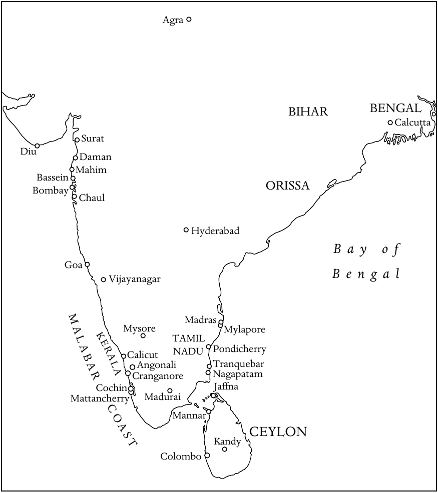
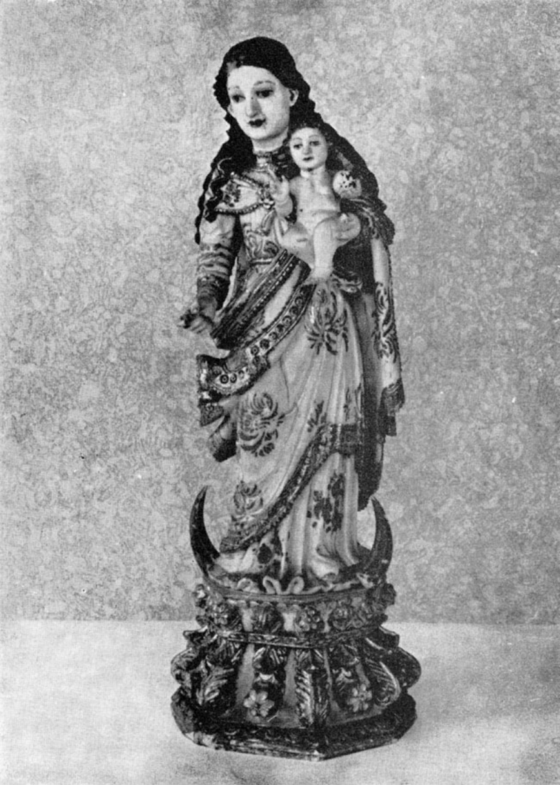

<!-- PDF page 448; original page 433 -->

# 第二十二章　南亚与东南亚的基督教

**查尔斯·J.博尔热斯（Charles J. Borges）**

本章考察十六世纪至十九世纪初，基督教在尚未分治的印度各地的传播，并较简略地介绍南亚和东南亚其他一些地区的情况。我们先从印度开始。印度历史可追溯到约五千年前的印度河流域文明，哈拉帕和摩亨佐—达罗城遗址显示，这一文明已有成熟的城市文化。印度—雅利安文明大概在公元前1500年左右从中亚进入印度，形成了印度许多延续至今的传统，以及令人瞩目的宗教体系。印度文化始终像一幅丰富的镶嵌画，把新元素和外来影响融入古老的根基。

其中最古老的宗教传统是印度教。在印度教这个宽泛的名称下，信仰与实践具有极大的流动性，又在与印度其他宗教的互动中不断演变。印度教是一种生活方式，没有唯一的经典、神祇或先知，每个村庄都可以有自己的神。它既包含深刻的哲学与形而上学，也与各种仪式典礼并存，标记着日常生活、四季和人生大事。诸神有的遥远，有的亲近，是每个家庭和宗族生活的一部分。人们通过静默冥想、集体歌唱或欢乐节庆来敬拜。与这个宗教体系紧密相连的，是一套社会制度。社会逐渐分为四个种姓：婆罗门〔负责仪式和诵唱的祭司阶层〕、刹帝利〔武士〕、吠舍〔商人〕和首陀罗〔从事卑微劳动者〕。

除了印度教，印度在历代还产生了另外三个重要宗教：耆那教与佛教，分别由大雄〔意为“伟大的英雄”〕和乔达摩佛陀〔意为“觉悟者”〕创立于公元前六世纪；以及那纳克上师于十六世纪创立的锡克教。其他主要宗教则从外部传来。如下文所见，基督教可能早在一、二世纪就已出现；琐罗亚斯德教在九世纪传入，其信徒为躲避波斯的迫害而到印度避难。伊斯兰教最初在十世纪通过对次大陆的一系列

<!-- PDF page 449; original page 434 -->

**地图3　约1800年的印度传教活动**

图中地名对照：

| 原图标注 | 中文 |
| --- | --- |
| Agra | 阿格拉 |
| BIHAR | 比哈尔 |
| BENGAL | 孟加拉 |
| Calcutta | 加尔各答 |
| Surat | 苏拉特 |
| Diu | 第乌 |
| Daman | 达曼 |
| Mahim | 马希姆 |
| Bassein | 巴塞因 |
| ORISSA | 奥里萨 |
| Bombay | 孟买 |
| Chaul | 乔尔 |
| Hyderabad | 海得拉巴 |
| Bay of Bengal | 孟加拉湾 |
| Goa | 果阿 |
| Vijayanagar | 毗奢耶那伽罗 |
| Madras | 马德拉斯 |
| Mysore | 迈索尔 |
| Mylapore | 迈拉普尔 |
| TAMIL NADU | 泰米尔纳德 |
| KERALA | 喀拉拉 |
| MALABAR COAST | 马拉巴尔海岸 |
| Calicut | 卡利卡特 |
| Pondicherry | 本地治里 |
| Angonali | 安加马利〔正文拼作Ankamali〕 |
| Tranquebar | 特兰奎巴 |
| Cranganore | 克兰加诺尔 |
| Nagapatam | 纳加帕塔姆 |
| Cochin | 科钦 |
| Jaffna | 贾夫纳 |
| Mattancherry | 马坦切里 |
| Madurai | 马杜赖 |
| Mannar | 马纳尔 |
| CEYLON | 锡兰 |
| Kandy | 康提 |
| Colombo | 科伦坡 |

袭击进入印度，但直到1206年才建立起一个持久的王朝。巴布尔于1526年建立的莫卧儿王朝，统治印度三百多年。莫卧儿君主赞助艺术，使伊斯兰教、印度教与基督教传统中的精华相互融合。这在很大程度上得益于王国内苏菲派传道者和耶稣会神父的活动。然而，到十七世纪末，宗教战争与西北方向的入侵相互作用，莫卧儿王朝已逐渐衰弱。其政治上的软弱，使欧洲各国得以在印度次大陆建立商业与领土控制。

<!-- PDF page 450; original page 435 -->

最早来到印度的欧洲人是葡萄牙人。1498年5月27日，瓦斯科·达伽马与船员抵达印度西海岸的卡利卡特。此后数年，葡萄牙取得大量领土，并于1510年夺取果阿。葡萄牙在十六世纪虽是强国，但到下个世纪，除果阿、达曼和第乌以外，大部分领土都被荷兰人与英格兰人夺走。同一时期，法国与丹麦商人也来到次大陆沿海。到十八世纪，荷兰人又在很大程度上被英格兰人排挤出去。

英格兰东印度公司，后来成为不列颠东印度公司，于1600年12月凭王室特许状成立，获得英格兰与整个亚洲及太平洋地区贸易的垄断权。公司在印度沿海设立贸易据点，也称商馆，最早是1608年在西海岸建立的苏拉特商馆。1650年代，公司开始在孟加拉贸易；1702年，在胡格利河畔建成威廉堡，保护当地贸易利益。加尔各答城围绕威廉堡发展起来，到十八世纪后期，已成为英国在印度的权力中心。与此同时，法国于1674年设立法国东印度公司〔Compagnie des Indies，年份和法文名称依原书〕，到十八世纪初，将东海岸的本地治里建成法国势力的基地。

十八世纪，英法在印度发生重大对抗，1740至1763年间进行了三场战争。普拉西战役〔1757年〕以后，英国东印度公司在印度东部的孟加拉、比哈尔和奥里萨建立统治（Raj）。自1773年起，英国议会开始对公司的事务实行全面控制；沃伦·黑斯廷斯于1772年先任首位总督，两年后又成为首位总督长官。绝嗣兼并原则（Doctrine of Lapse）规定，印度统治者若去世而没有直系王位继承人，其领土就归英国所有。这使英国控制的领土不断扩大。1793年，康沃利斯勋爵的法典为十九世纪英国统治印度奠定了坚实基础，规定了行政服务、法院和税收征集的标准。

## 多马派基督徒

按照传统说法，基督教由圣多马最早带到印度。据说，他约于公元52年来到喀拉拉西海岸。他所归信的信徒将其使徒事工的记忆传给后代，使之在印度延续。这个基督徒社群与叙利亚东方教会保持共融，该教会的都主教最初住在塞琉西亚—泰西封，八世纪迁往巴格达。

<!-- PDF page 451; original page 436 -->

多马派基督徒大多属于上层阶级。他们保留印度教文化，同时实践基督信仰，其礼仪与崇拜深受叙利亚传统影响。在亚洲许多其他地区的基督徒消失很久以后，他们仍在南印度兴盛发展。

葡萄牙人在喀拉拉海岸的克兰加诺尔首次接触多马派基督徒以后，便致力于使这些社群更加符合罗马教会和拉丁传统。多马派基督徒起初愿意接受罗马宗座的首席地位，并在1599年的迪安佩尔宗教会议上正式予以承认。然而，对方不断试图改变他们的礼仪，从教会生活中消除其他东方传统，很快引发了强烈紧张。按照葡萄牙人的说法，只能有一种法，即基督之法，不能有两种法，一种属于圣多马，另一种属于圣伯多禄。多马派神父〔称为kattanars〕大多被这些压力逼得忍无可忍，于1653年1月3日聚集在马坦切里古老的库南十字架前，宣誓永不接受克兰加诺尔总主教的权威。这位总主教是喀拉拉罗马天主教会的首席主教。这些事件促成了一个新的基督教共融团体——马兰卡拉叙利亚正教会。它有时被称为“雅各派”（Jacobites），但其成员拒绝接受这个名称。

罗马迅速采取行动，应对这场危机。传信部派加尔默罗会神父前往印度，试图处理局面。传信部不得不这样做，是因为多马派基督徒拒绝再与此前一直打交道的耶稣会发生任何关系。加尔默罗会虽然常常态度专横，还是使许多多马派基督徒恢复了和解，因此到1662年，大多数人重新与罗马共融。传信部于1661年为喀拉拉任命一位宗座代牧，极大帮助了这项进展：与罗马共融、被称为叙利亚—马拉巴尔天主教徒的多马派信徒，从而事实上拥有了自己的主教。

当时，分离出去的马兰卡拉教会试图重新联系东叙利亚宗主教区〔有时也称加色丁教会〕，但未能成功。最后，驻大马士革的西叙利亚宗主教与他们取得联系。他们在习俗上作了一些名义上的改变，从东叙利亚传统转向西叙利亚传统，随后成为叙利亚宗主教区内的一个自治教会。

与此同时，叙利亚—马拉巴尔天主教徒不断向罗马抱怨加尔默罗会，一再请求教廷任命一位印度主教，取代外来的传教士宗座代牧。1780年，他们派出一个代表团，<!-- PDF page 452; original page 437 -->由约瑟夫·卡里亚蒂尔神父率领，亲赴罗马，请求为他们的教会任命印度主教。不过，这个代表团在罗马似乎没有受到认真对待。然而，当代表们来到里斯本、准备踏上归程时，命运出现了戏剧性的转折。葡萄牙女王依据保教权，任命卡里亚蒂尔为克兰加诺尔总主教。他在果阿登陆时，多马派基督徒的兴奋达到顶点；但令他们绝望的是，他还没有离开果阿，就患病去世，原书记这一年为1783年。有人推测，如果他活下来，与叙利亚教会共融和与罗马教会共融的两部分多马派基督徒，或许能够重新联合。

在这个关键时刻，果阿总主教任命卡里亚蒂尔的同伴托马斯·帕雷亚马卡尔神父，担任宗座代牧区署理。但民众并不满意，因为他们普遍相信卡里亚蒂尔是遭毒害而死。广泛的抗议由此发生。1787年，与罗马共融的多马派基督徒领袖在安加马利举行会议，宣誓只承认帕雷亚马卡尔为主教，不承认其他人。总教区当局拒绝接受这一主张。过了一段时间，抗议逐渐平息。结果，多马派基督徒不得不等到1887年，才拥有出自自己社群的主教。

## 印度的天主教传教

葡萄牙总督阿丰索·德阿尔布克尔克于1510年夺取西海岸城市果阿。它很快成为葡萄牙在整个东方的领地首府。这些领地被称为“葡属印度国”（Estado da India），从波斯湾口的霍尔木兹，一直延伸到马六甲和印度尼西亚的香料群岛。在果阿境内，葡萄牙积极努力，使民众皈依基督信仰。每年都有一批批修会神父、修士和教区神父，与葡萄牙政府官员、商人和士兵一道，从葡萄牙来到果阿。果阿也成为重要的教育中心，神父和教理传道员在这里接受训练，然后前往印度其他地区乃至更远地方的传教区。

1534年，果阿升格为教区，1557年又升为总教区。方济各会早在1510年抵达，耶稣会于1542年、道明会于1548年、奥思定会于1572年、加尔默罗会于1607年来到这里。果阿著名的教育机构包括道明会的圣阿奎那学院、方济各会的圣文德学院、奥思定会的波普洛学院，以及耶稣会的圣保禄学院和圣罗克学院。果阿的许多教堂

<!-- PDF page 453; original page 438 -->

**图8　《圣母子》，印度果阿制作，约1700年。** 象牙小像，高约23厘米，头发和袍服边缘施彩并饰金。这是常见的巴洛克形象，但其面貌与服饰显然已经适应印度风格。照片藏于爱丁堡大学非西方世界基督教研究中心的巴特勒收藏。

<!-- PDF page 454; original page 439 -->

〔例如仁慈耶稣堂、塞主教座堂、阿西西圣方济各堂、马尔高圣神堂〕，至今仍充分展现着当时建筑、雕塑、绘画和木雕风格的丰富面貌。

十六世纪，无论在葡萄牙控制的领土内，还是在各个葡萄牙贸易中心，基督教的归信人数都取得了显著增长。不过，传教士与印度教上层阶级之间并没有密切接触。圣方济各·沙勿略为向印度民众传福音作出了巨大贡献。他于1542年5月6日抵达果阿，在向葡萄牙移民讲道、向当地人教授教理的同时，积极从事慈善工作。不到五个月，他就离开果阿，前往印度东海岸；到1549年8月，他已经来到日本。

意大利耶稣会士范礼安（Alessandro Valignano，1539—1606）在沙勿略奠定的基础上继续工作，被视为当时印度传教事业最重要的组织者。他强调必须学习当地语言，并为此设立学校。他长期为马拉巴尔教会的问题操劳，思考如何才能使他们完全回到天主教会。

1581年，范礼安担任耶稣会果阿会省会长期间，开明的莫卧儿皇帝贾拉勒丁·穆罕默德·阿克巴，邀请耶稣会士来到印度北部的宫廷。阿克巴希望聚集不同信仰的宗教人士，帮助他创建一种新宗教——“神圣宗教”（Din-i-Ilahi）。鲁道夫·阿夸维瓦神父等耶稣会士，在随后一百年间，先后参加了三批前往莫卧儿宫廷的耶稣会传教团。虽然这些传教团没有使历代莫卧儿皇帝归信，却促进了伊斯兰教与基督教之间的相互理解。他们与皇室宫廷建立了富有成效的联系，因而能够在这个穆斯林帝国各地，甚至尼泊尔和西藏，开设传教站。

阿克巴的继承者是贾汉吉尔〔他帮助英国人尝试在印度贸易〕，随后是建造泰姬陵的沙贾汗，最后是冷酷的奥朗则布。他于1707年去世，标志着莫卧儿帝国实际上走向终结，尽管它以缩小的形式一直延续到1858年巴哈杜尔·沙皇帝统治结束。

除了莫卧儿宫廷，耶稣会士在不同时期，也在南方的毗奢耶那伽罗、贡吉（Gunji）、马杜赖和坦贾武尔诸王国的宫廷中占有重要位置。耶稣会的上级与会士定期致信罗马，详述传教工作、成败和需要。修会创始人圣依纳爵设计了这套定期通信制度，目的是加强成员之间的团结联系，并便利良好管理。这批称为 Litterae Indicae 的信件，即<!-- PDF page 455; original page 440 -->“印度书信”，很快成为在欧洲宣传海外传教的有效工具。

这些通信展示了意大利杰出耶稣会传教士罗伯托·德诺比里在南印度的创新与独创精神。1606年，他在泰米尔文化的古老中心之一马杜赖，开始传教工作。为获得广泛接纳，他宣称自己属于意大利贵族和王者（raja）阶层，是一位“再生”的罗马婆罗门。他穿上婆罗门出家人的服装，佩戴圣线，蓄留顶髻（kudumi），脚穿木屐。他学习泰米尔语、泰卢固语和梵语，开始用印度宗教文明的概念与思维方式，重新表述基督教。他最终使三万多人归信；他去世一个世纪以后，由他建立的传教区已经有二十多万名基督徒。他的宗教格言恰如其分，是“Aperire portam”——打开大门。

德诺比里才智卓越，善于吸收自己所选择定居之地的学问，并将其传达给别人。虽然有人指责他一味关注高种姓，但他的视野超越了种姓和习俗。他具有令人钦佩的补赎精神，大家都称他为“塔图瓦·波达加尔”（Tattuva Podagar，原书释作“婆罗门托钵者”）。不过，他受到印度教徒的反对，而某些传教同伴和教会领袖的反对更为强烈。罗马的耶稣会士，乃至教皇额我略十五世，起初都支持他的创新；但最终，罗马还是禁止了他为新信徒提出的许多习俗。他始终试图从内部理解印度教，目的并不只是使高种姓婆罗门归信，而是通过他们，把整个印度带到基督面前。

德诺比里的传教方法，在整个十七、十八世纪始终存在争议。1703年，夏尔·马亚尔·德图尔农，即铎罗，作为教皇代表被派往中国，随后前往印度，处理“中国礼仪”与“马拉巴尔礼仪”问题。他裁定，此事不容妥协，两种礼仪都必须拒绝。1739年，教皇克勉十二世要求所有传教士为此签署誓言。本笃十四世又以1744年9月12日的《一切关怀》（Omnium Sollicitudinum）训令，规定所有天主教徒，无论属于哪个种姓，都应在同一座教堂、同一时间参与弥撒并领圣体。耶稣会士遵守了裁定，但为低种姓信徒另设进入共同教堂的入口，并在堂内装上小隔断，把低种姓与高种姓分开。

葡萄牙耶稣会士圣若昂·德布里托，虽然不具有德诺比里那样的学术才华，却同样对印度教抱有同情理解。他身穿<!-- PDF page 456; original page 441 -->印度教出家托钵者的服装，专门在南印度低种姓人群中工作。他因直言不讳而遭受酷刑，随后于1693年2月，在泰米尔纳德的奥里尤尔被斩首。他的传记作者写道：“他是普通队伍中的一员。他或许具有方济各·沙勿略的热忱和热情，却从未被召唤到整个东方施展，因为他的工作实际上局限于泰米尔纳德。他也没有像罗伯托·德诺比里那样，肩负开创传教新方法的使命。他来到一片已经成熟、可以收割的田地，不去四处寻找新工具或新办法，而是拿起旧镰刀，加入收割者的行列。”[^p456-1]

耶稣会在马杜赖、卡纳拉和迈索尔传教事业的创始人，是莱奥纳尔多·钦纳米神父。他逐渐认识到，自己最初四年的传教没有结果，主要因为人们把他视为葡萄牙神父。到1649年，他开始穿出家人服装，穿耳孔，在头部与颈部涂抹灰烬。除了卓越的传教工作，他还留下几部用当地卡纳达语写成的虔修作品，其中最著名的是《卡纳拉史》（Istoria del Canara，1648）。

十七、十八世纪印度教会成长中，引人注目的一点，是众多神父和平信徒创作了重要的文学与宗教著作。可以想到的十六世纪作品，包括弗朗西斯科·加西亚·门德斯总主教的《具有三十二种完美的人》（Homem das Trinta e duas perfeições）、埃斯特旺·达克鲁斯的《论使徒圣伯多禄生平》（Discursos sobre a vida do apóstolo Sam Pedro），以及加西亚·达奥尔塔的《药材与药物对话录》（Colóquios dos simples e drogas medicináis）。十七世纪的作品则有迪奥戈·贡萨尔维斯的《马拉巴尔史》（História do Malavar）、让·弗南斯·布歇关于印度教的论著，以及卡雷尔·普日克里尔的孔卡尼语语法。

意大利耶稣会士科斯坦佐·朱塞佩·贝斯基（Constanzo Guiseppe Beschi，1680—1747），为印度教徒与基督徒写下古典史诗、哲学论著、评注、词典、语法、译作和小册子。他的史诗《永不凋谢的花环》（Tembavani），以及他与印度教学者举行的公开辩论，为他赢得很高声誉，确立了他作为梵语和泰米尔文学学者的持久地位。

其他同样以写作闻名的人物，包括用拉丁语撰写梵语语法的海因里希·罗特（1620—1668）；约翰·欧内斯特·汉克斯莱登（1681—1732），他著有《弥赛亚颂歌》（Mishiada Pana，1728）、一部梵语—马拉雅拉姆语—葡萄牙语词典，以及用葡萄牙语撰写的马拉雅拉姆语语法。加斯东·克尔杜（1691—1777）曾在本地治里、卡纳拉和特兰奎巴服务。他精通梵语和泰卢固语，编写了一部泰卢固语—梵语—法语词典，并首次指出梵语与拉丁语、希腊语、德语和俄语之间的语言联系。让·卡尔梅特（1693—1739）在卡纳拉的泰米尔传教区工作，是第一位获得<!-- PDF page 457; original page 442 -->印度教全部四部《吠陀》抄本的欧洲人。弗朗西斯·庞斯（1698—1752）则兼为天文学家、地理学家、教会法学家与梵语学者，并撰写了一部梵语语法。

耶稣会以外的其他修会和修会团体，也做了值得称赞的工作，但由于人数有限、资金匮乏，规模要小得多。十七、十八世纪，方济各会的活动主要致力于巩固，而非扩张。到1629年，他们在印度有两个会省，约六百名修士。他们在果阿和巴塞因都设有会院，十八世纪时，这些会院遭到马拉塔人攻击。1766年，他们不得不撤出自己在果阿巴尔德兹地区掌管的堂区，将其交给当地果阿教区神父。当时，本土神父已经相当众多，也迫切希望管理堂区。

道明会于1548年抵达果阿以后，还在巴塞因、马希姆、塔拉普尔、乔尔、达曼、第乌、科钦、纳加帕塔南和迈拉普尔设立会院；这些都是印度西海岸或东海岸的城镇。后来，他们得以将传教活动扩展到莫桑比克、马六甲，以及印度尼西亚的帝汶岛和索洛岛。奥思定会抵达果阿较晚，于1572年9月以后建立恩宠圣母学院。1599年起，他们扩展到孟加拉，并把那里视为自己最成功的传教地区。他们也在波斯和非洲东海岸工作。

其他修会，包括加尔默罗会、嘉布遣会与戴蒂尼会，都在十七世纪陆续来到。他们直接受传信部监督，因此与葡萄牙方面发生管辖权纠纷。加尔默罗会负责马拉巴尔和大莫卧儿的宗座代牧区；嘉布遣会在苏拉特、马德拉斯和本地治里工作；戴蒂尼会则在戈尔孔达服务。果阿的保教权体制下，既有葡萄牙神父，也有果阿神父。罗马传信部的体系，则在孟买、喀拉拉、本地治里和西藏设有宗座代牧。意大利加尔默罗会士在孟买和喀拉拉服务；法国嘉布遣会士与巴黎外方传教会的教区神父在泰米尔纳德工作；法国嘉布遣会士在马德拉斯，意大利嘉布遣会士则在北印度。

戴蒂尼会，即圣嘉耶当神意律修司铎会，也在果阿活动，但与其他修会相比，缺乏资金和人员。不过，1682年在果阿仿照圣斐理伯·内里祈祷会建立的显灵圣十字祈祷会，发展成为很有影响力的团体，尤其因为它是第一个完全由本土出身教士组成的修会团体。所有这些修会与团体虽然都从事<!-- PDF page 458; original page 443 -->基督教化这一共同目标，彼此之间却存在相当严重的嫉妒与排他情绪。

1703年，传信部设立西藏—印度斯坦宗座监牧区，交由嘉布遣会负责。他们从1707年起，能够一直留在拉萨，直到1745年因宗教迫害而退往尼泊尔的加德满都；该会自1715年起已在那里立足。但到1769年，政治动荡终于迫使他们离开这个王国，迁回印度。与此同时，1745年已有许多尼泊尔基督徒和慕道者迁到比哈尔的贝蒂亚。1812年，西藏—印度斯坦宗座监牧区升格为宗座代牧区。

耶稣会更早就已进入西藏，曾在札布让设立传教站，直到1641年结束。1713年，两位耶稣会士伊波利托·德西德里和马诺埃尔·弗雷雷，再次开始这项事业，尽管嘉布遣会认为西藏属于自己的传教区，不准其他任何修会进入。很快，西藏就只剩下德西德里一人。嘉布遣会强烈反对他的存在，他因而于1719年奉命离开拉萨。他是一位杰出的地理学家，所写的传教记述非常可靠，显示出对西藏社会和文学的深刻理解。

东方第一座女子修院——圣莫尼加修院——于1606年在果阿成立，主要得益于阿莱希奥·德梅内塞斯总主教的努力。这所修院主要为葡萄牙士兵的遗孀而设。虽然院内两个派别之间的紧张关系延续了几年，修女们仍继续履行正常宗教职责，在文学和音乐创作上表现出色，也以美术才能和烹饪创新闻名。

1759年标志着葡萄牙与印度的耶稣会进入困难时期。这一年，葡萄牙实际掌权者蓬巴尔侯爵成功取缔了耶稣会。该会在果阿的大片地产与会院被没收。1760年，在印度各地工作的127名耶稣会士遭逮捕，从果阿被押运回欧洲。取缔之后，蓬巴尔在殖民地推行了多项受到欢迎的改革。他于1774年解散宗教裁判所；该所在果阿设立以来，已经举行过七十多次公开宣判仪式〔autos-da-fé，原书解释为“审问会议”〕。他改造教育制度，并努力改善本土教士的处境。神父开始按照学识与品德，而非种族，获得堂区职位。

果阿的动乱仍在继续。葡萄牙的统治并非无人挑战，民众多次起义。例如，1654年，马蒂亚斯·德卡斯特罗因未能得到果阿的一项主教<!-- PDF page 459; original page 444 -->职位而不满，联合比贾普尔统治者阿迪尔·沙，企图推翻葡萄牙人，但未成功。1787年，坎多林的平托家族密谋，使三位果阿神父——卡埃塔诺·弗朗西斯科·德科托、若泽·安东尼奥·贡萨尔维斯和卡埃塔诺·维克托里诺·德法里亚——走到前台。他们先前未能说服教廷，让印度人出任果阿保教权体系中空缺的主教职位，于是制定了推翻果阿葡萄牙统治的计划，同样没有成功。

## 印度的新教传教

十七世纪，荷兰、英国和丹麦商人在印度沿海建立贸易站，也就是商馆，并带来各自的随牧。十八世纪初，路德宗在南印度东海岸的特兰奎巴建立传教区，挑战了罗马天主教会此前在传教领域的垄断地位。1706年至十九世纪初，路德宗差会总共供养了五十六位在印度工作的传教士。

传教的成功，要归功于两位从丹麦前来的先驱：巴尔托洛梅乌斯·齐根巴尔格和海因里希·普吕乔。丹麦人自1620年起就在特兰奎巴活动，当时坦贾武尔的王公允许他们租用该地区。十七世纪后期，那里已有两座教堂，一座是锡安堂，另一座是罗马天主教堂。但1706年7月6日，两位二十多岁的传教士齐根巴尔格和普吕乔抵达，改变了局面。

两位丹麦差会传教士从一开始就把重点放在教育上。他们合办了一所名为慈善学校的学校。据记载，1708年，齐根巴尔格曾奉丹麦指挥官之命被短暂监禁。到1709年，我们又见到他表达对印度人的赞赏，认为他们是文明的人民，具有深刻的道德见解。1711年以前，他已将《圣经》译为当地泰米尔语；1713年，他出版了马拉巴尔诸神的谱系。

齐根巴尔格以自己属于高教会派路德宗为荣，对传教使命具有强烈的召命意识。他急切希望传教成功，因而提出多种独创方法。他在教会礼拜中使用泰米尔语和印度音乐，总体上希望传教工作由印度本地，而不是欧洲，来指导。面对种姓制度，他认为虽然不可能将其彻底废除，但必须削弱它在教会内部的影响。他所归信的信徒主要是<!-- PDF page 460; original page 445 -->首陀罗或达利特人，教堂的大部分空间为他们保留，只有一处较小的横翼，单独留给其他各个种姓的信徒。1714年，齐根巴尔格访问欧洲，处理有关传教的一些问题；两年后，他带着已婚身份返回印度。然而，他未能长久享受新生活。在与同事共同管理传教事业时，他经历了许多困难，健康因此受损，于1719年2月23日去世。

特兰奎巴另一位著名传教士，是本杰明·舒尔策。他在1720至1740年间断续于传教区服务，获得基督教知识促进会的支持。他为本地教会所作的努力，使三位印度教理传道员获按立为牧师。约翰·菲利普·法布里修斯于1740年抵达印度，也在特兰奎巴待过两年。此后，他迁往马德拉斯，加入当地的英国差会，但始终与丹麦差会保持联系。到1750年，他已把《新约》译成泰米尔语，并用英语写出一部简明泰米尔语语法。1791年去世时，他在印度服务已超过五十年。

特兰奎巴所有传教士中最杰出的是克里斯蒂安·弗里德里希·施瓦茨。他于1750年7月30日抵达，当时二十四岁。他学会了泰米尔语、泰卢固语、马拉地语、波斯语和梵语，也掌握多种欧洲现代与古典语言。他以圣洁纯正著称，兼为传道人、教师、外交家与政治活动家。他深受士兵敬重，英国各团的官兵都乐于与他交往。

施瓦茨后来从马德拉斯迁往坦贾武尔，在那里被当作王室神职人员，能够对王公及其政治事务施加巨大影响。他还与迈索尔的穆斯林统治者海德尔·阿里（1722—1782）保持良好关系。1759年耶稣会退出印度后，他照管了南印度原先由耶稣会工作的地区，帮助在马德拉斯、特兰奎巴、蒂鲁吉拉帕利、坦贾武尔和帕拉扬科泰形成大规模基督徒会众。1798年去世时，他已经在印度度过四十八年。

齐根巴尔格、舒尔策和施瓦茨这样的传教士，其突出之处在于，他们大量使用本地语言传教，推动平信徒广泛参与，并把传教机构的实际管理大部分交到印度人手中。从一开始，特兰奎巴传教事业就得到一批欧洲传教士的服务，他们在奥古斯特·赫尔曼·弗兰克于十七世纪末创办的德国哈勒学院接受训练。弗兰克是教育先驱，将真正的神学界定为活生生的宗教。

<!-- PDF page 461; original page 446 -->

他的教育体系强调主动学习和经验学习，包括在自然科学中实际接触研究对象，以及接受实用技术训练。

再来看英国对传教的贡献。东印度公司的政策，总体上敌视公司领土内的基督教传教活动，认为它会造成干扰，使公司与当地居民之间关系紧张。然而，自1792年起，福音派舆论对英国议会施加压力，迫使公司允许兼任传教士的随牧进入东印度公司，在印度服务。

英国新教近代传教运动之父，是福音派人士威廉·克理。他十分推崇德国福音派在印度的工作。原书记他于1792年抵达印度，但遭英国东印度公司多方刁难，最初被禁止进入加尔各答。克理与浸礼派的约书亚·马士曼、威廉·沃德一道，在加尔各答附近丹麦的殖民飞地塞兰坡建立传教区。除了基督教传教，克理与同伴还为翻译《圣经》而推动语言研究，并创办西式学校和印刷所。他后来得以进入加尔各答，也只是因为能够在威廉堡学院教授印度语言。克理在孟加拉的活动，不仅推进了基督教传教，也增进了印度与西方的文化互动。

1813年，英国议会通过延长东印度公司特许权的法案，赋予基督教传教士进入英国印度领土的权利。同时，议会在印度建立由公司收入供养的圣公会体制：加尔各答主教对英国领土行使教区权力，加尔各答、马德拉斯和孟买的会吏长协助其工作。首任加尔各答主教，是温和高教会派人士托马斯·F.米德尔顿。他于1814年5月在伦敦祝圣，同年11月抵达加尔各答。这个圣公会体制，以及各宗派传教士人数的增加，促使传教学校、学院和医院数量稳步增长。不过，英国官员主要追求稳定，英国传教士则致力于社会改革和使人归信；两者之间的紧张关系，在整个十九世纪持续困扰着英国对印度的统治。

英语教育的影响，对在印度的英国帝国同样有利有弊。威廉·琼斯是一位不拘泥于教条、始终尊重印度各宗教的基督徒。他于1784年在加尔各答创立孟加拉亚洲学会，以推动印度文化与宗教研究。继<!-- PDF page 462; original page 447 -->1813年《特许状法》之后，传教士的工作、贸易的影响，以及西方教育的引入，推动孟加拉不断壮大的知识阶层出现文化复兴。1814年以后，博学的婆罗门拉姆·莫汉·罗伊（1772—1833），开始在加尔各答崭露头角，成为这场印度教复兴之父。他精通英语和西方古典著作，也深谙本身的印度教文化，激发印度人重新欣赏《奥义书》及其他印度教经典。

总体来说，新教对印度传教事业的影响，直到十八世纪初才开始显现。1815年以前，印度新教传教的先驱，主要是特兰奎巴差会，以及威廉·克理和同伴的塞兰坡差会。这两场传教运动都把《圣经》置于首位，努力将其译成多种本地语言；其中，塞兰坡差会尤其强调教育与新闻出版。

## 印度以外的南亚与东南亚

这里没有足够篇幅考察整个南亚和东南亚的基督教传教历程。因此，我们将重点放在三个传教地区：斯里兰卡、帝汶及部分邻近岛屿，以及越南。

1505年，葡萄牙人抵达今天斯里兰卡的加勒和科伦坡。他们将这个国家称为塔普罗巴纳或锡兰。当时，锡兰的贾夫纳半岛由印度教统治者治理，臣民也信奉印度教；岛上其他地区则信奉佛教。1543年，一批方济各会士抵达，开始天主教传教。康提的佛教国王维克拉马·巴胡，在1540年代皈依基督教，以换取葡萄牙援助。许多其他人也为得到葡萄牙人的物质好处而归信。到1560年，原书所称岛屿东侧的马纳尔，已经有一个兴盛的基督徒社群。

多个受葡萄牙保教权支持的天主教修会在锡兰传教，其中包括1602年起的耶稣会，以及后来的奥思定会、道明会。然而，他们没有鼓励当地居民进入神职。1658年，荷兰占领该岛，迫使葡萄牙神父撤离，并规定任何窝藏罗马天主教神父的人都处以死刑。许多天主教堂被改作新教礼拜之用，锡兰天主教徒发现自己失去了牧者。1686年，果阿祈祷会神父真福若泽·瓦斯（1651—1711）来到锡兰，在贫困与危险中工作二十四年，直到去世。他想出巧妙办法，使天主教信仰在岛上延续，包括依靠本土传教士和<!-- PDF page 463; original page 448 -->教理传道员。由于他的努力，到十八世纪末，经过荷兰官方长达140年的压制以后，岛上仍估计有6.7万名罗马天主教徒。

荷兰东印度公司在1623年续订的特许状中，规定了促进新教信仰的事项，并在莱顿设立神学院，训练前往荷兰东方领地服务的传教士。占领锡兰以后，他们建立新教教会体制，把所有公职限于新教徒，在某些情况下，还没收拒绝接受新教洗礼者的财产。据说，1722年锡兰有近42.5万名新教基督徒，但大多只是名义上的信徒。事实上，他们也很难不是如此，因为1747年全岛只有五位新教牧师。1796年，英国从荷兰手中夺取锡兰沿海，1815年正式吞并全岛。英国占领之后，英国主要传教团体的代表相继来到：1804年的伦敦会、1812年的浸礼会差会、1814年的卫斯理宗卫理公会，以及1817年的英格兰教会传教协会。

东印度群岛帝汶岛的基督教传教，始于十六世纪中叶。帝汶人一向信奉万物有灵论，同时具有一种模糊的一神信念。方济各会士安东尼奥·塔韦拉于1556年抵达，开始讲道传教。道明会于1562年来到，并主导全岛的福音传播。他们集中使当地统治者归信，后者随后成为葡萄牙的藩属。到1577年，归信者估计已有五万人。道明会实际上统治该岛超过一个世纪，没有受到民政或军事当局干涉。

1590年，道明会在梅纳修建第一座教堂，后来又在邻近的萨武岛、阿杜纳拉岛和弗洛勒斯岛建立教堂。随着信仰在帝汶发展，当地教会在管辖事务上，同时与道明会驻果阿的总代理和马六甲主教相联系。十八世纪最初四分之一个世纪，道明会在帝汶与索洛两岛的主导地位，首次遇到严重挑战。葡萄牙于1722年3月25日颁布王令，宣布隶属果阿、中国和澳门会省的耶稣会士，也可在帝汶工作。1723年3月10日的另一道命令，建议允许果阿显灵圣十字祈祷会进入帝汶。1738年10月8日，一所由祈祷会负责的神学院在帝汶成立，训练当地准备进入神职的人。然而，直到1812年，道明会在帝汶的世俗权力才开始衰落。1834年，<!-- PDF page 464; original page 449 -->葡萄牙及其海外各省的所有修会遭到取缔，终于使帝汶的道明会传教事业终结。

在摩鹿加群岛和东弗洛勒斯，基督信仰最初于十六世纪，通过葡萄牙传教士的努力传播。他们与寻找香料和檀香木的葡萄牙商人一同来到这里。经历将近一个世纪的葡萄牙主导后，安汶于1605年落入荷兰东印度公司之手；随后是1619年的巴达维亚、1641年的马六甲、1646年的索洛、1667年的望加锡和1683年的特尔纳特。荷兰东印度公司促进改革宗新教信仰传播，并禁止天主教会在其领土内活动，东弗洛勒斯、索洛和帝汶除外。直到1644年，耶稣会的马拉巴尔会省与日本会省，还照管着这些岛屿的罗马天主教教务需要。然而，在一个多世纪里，印度尼西亚的天主教大体上与天主教世界其他部分隔绝。

与此同时，荷兰东印度公司支持新教传教士，坚持所有雇员必须属于官方认可的改革宗教会。但新教归信人数增长缓慢。1799年，荷兰东印度公司解散，改革宗对该地区的主导地位随之终结，印度尼西亚重新向多种传教活动开放。

越南最早的基督教活动记录，出现在1533年。当时，黎庄宗颁布王令，禁止传播“耶稣”（Gia-To）的教义。传播者被用一个通常意为欧洲人的越南语词来称呼。十六世纪后期，一些道明会士进入越南，但广泛的福音传播，直到1615年耶稣会传教士抵达后才开始。其中最著名的亚历山大·德罗德，于1625年来到这里。他最终被驱逐，但在此以前，为越南基督教的形成作出了两项重大贡献。

首先，他领导一组传教士，创制用拉丁字母转写越南语的国语字（Quoc-Ngu）体系，另加五个声调符号来标调。此后，越南人一直使用这一体系。其次，德罗德编写了一部越南语《要理问答》，对越南天主教产生了持久影响。

德罗德向教廷游说后，教皇亚历山大七世于1660年，任命两位传教士担任越南南北两个新教区的宗座代牧。当时，越南北部与南部分别被称为东京（Tonkin）和交趾支那（Cochin China）。这时接手越南传教工作的，是巴黎外方传教会。他们在<!-- PDF page 465; original page 450 -->随后几十年间，非常努力地培养本土神父。与此同时，东京和交趾支那的教会，都遭到时断时续、有时相当严厉的迫害。

十八世纪，南北两地的中央权威瓦解，民众遭受一系列内战之苦，战争演变为阮氏与郑氏诸王公之间的竞争。百多禄神父（Pierre-Joseph Pigneaux）在法国宫廷与阮氏一方之间，谈成一项条约，以商业让步换取法国军事援助。这对国家和教会来说，都是一个决定性时刻。来自本地治里的法国军队于1788年抵达，帮助阮氏取得胜利。阮氏领袖成为嘉隆皇帝。虽然他始终信奉佛教，却优待基督徒社群。1802年，该社群划分为三个教区，各由一位传教士宗座代牧主持。当时有121名越南神父、55名外来传教神父，以及32万名领圣体信徒。这一发展，也开启了基督教会与法国殖民主义之间的危险联系，成为此后越南教会继续间歇遭受严厉迫害的原因之一。

1660至1815年，对于印度以及南亚、东南亚部分地区，是政治、文化、经济和宗教上的动荡时期。在这些年里，印度境内既见证了西方强国控制的巩固，也见证了基督信仰的稳步发展、伊斯兰艺术与文化的传播，以及印度教各种哲学思想和虔敬传统的繁荣。印度也成为更多传教运动前往亚洲各地的出发点和资金来源。

### 译校说明

原文将马纳尔称为锡兰岛东侧的城镇，而本章地图3标注在岛的西北侧，译文保留并标明正文说法。法国东印度公司成立年、卡里亚蒂尔卒年、克理抵印年等日期，均依原版保留，未据其他资料擅改。真福若泽·瓦斯的称号依2006年原书，不作今日称号的更新。

## 注释

[^p456-1]: A. Sauliere, Red sand: A life of St. John de Brito, S. J. Martyr of the Madurai Mission (Mathura: De Nobili Press, 1947), p. 487.
