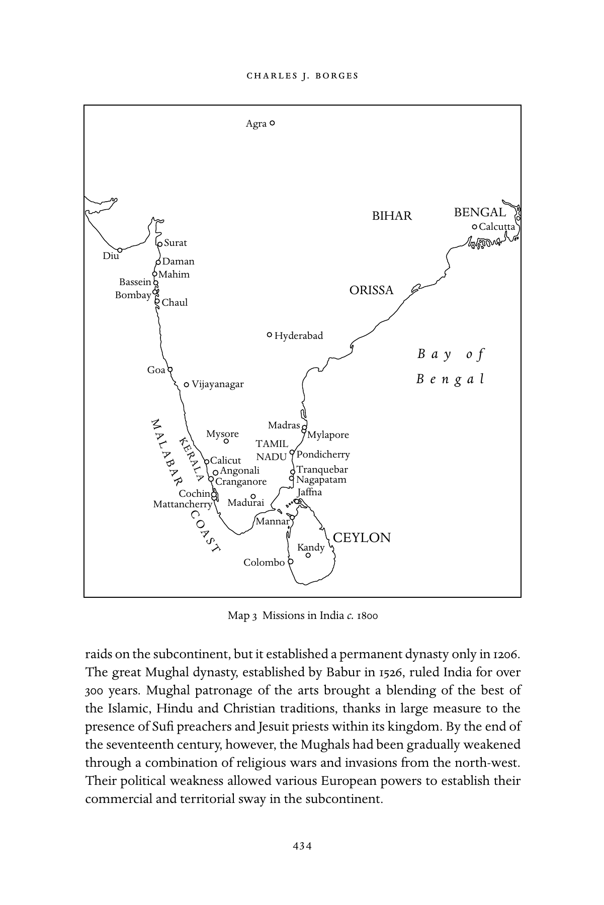
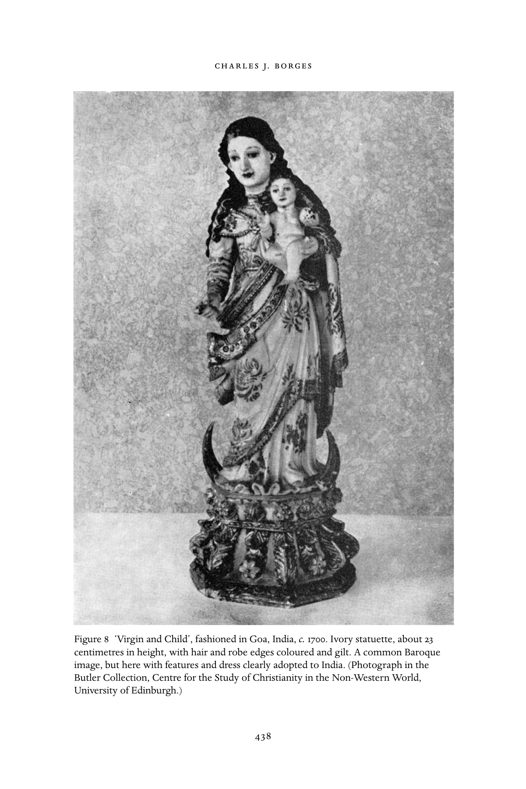

# 南亚与东南亚的基督教：英文转换底稿

<!-- PDF page 448; original page 433 -->

### 22

## Christianity in south and south-east Asia

### c h a r l e s j. b o r g e s

This chapter will explore the spread of Christianity from the sixteenth to the early nineteenth centuries within the various parts of undivided India and, more briefly, in some other areas of south and south-east Asia. We will begin with India. The history of India goes back some 5,000 years to the Indus Valley civilization with its sophisticated urban culture found in the cities of Harappa and Mohenjo-Daro. The Indo-Aryan civilization probably came to India from central Asia around 1500 BC and formed much of India’s living tradition and impressive religious system. Indian culture was always a rich mosaic of new elements and foreign influences merged into its ancient roots.

The oldest of its religious traditions was Hinduism. Under the broad rubric of Hinduism, there existed an enormous fluidity of beliefs and practices which in turn evolved by interacting with the other religions of India. Hinduism was a way of life. It had no single book or god or prophet and every village could have its own deity. It was a religion of deep philosophy and metaphysics, existing side by side with rituals and ceremonies that marked the days, seasons and events in life. Gods were either distant or near, and were part of every household and clan. One worshipped them through silent meditation, com- munal singing, or joyful festivity. Closely linked to this religious system was a social system. Society came to be divided into four castes, the Brahmans (priestly class in charge of the rituals and chants), the Kshatriyas (warriors), the Vaishyas (merchants), and the Shudras (menial workers).

Besides Hinduism, three other great religions were born in India over the centuries: Jainism and Buddhism, founded in the sixth century BCE, respec- tively by Mahavir (the Great Hero) and Gautama Buddha (the Enlightened One); and Sikhism, founded by Guru Nanak in the sixteenth century. But other major religions arrived from the outside. Christianity, as we will see below, may have appeared as early as the first or second centuries; and Zoroastrianism arrived in the ninth century, taking refuge in India after fleeing persecution in Persia. Islam first came to India in the tenth century through a series of

<!-- PDF page 449; original page 434 -->

Agra BIHAR BENGAL Calcutta Surat

Diu Daman Mahim Bassein ORISSA Bombay Chaul Hyderabad

### B a y o f

Goa

### B e n g a l

Vijayanagar M Madras A Mysore Mylapore L K E TAMIL A B R A Calicut NADU Pondicherry A L Angonali Tranquebar R A Cranganore Nagapatam Cochin Jaffna Mattancherry Madurai C O Mannar

### A CEYLON

S T Kandy Colombo Map 3 Missions in India c. 1800 raids on the subcontinent, but it established a permanent dynasty only in 1206. The great Mughal dynasty, established by Babur in 1526, ruled India for over 300 years. Mughal patronage of the arts brought a blending of the best of the Islamic, Hindu and Christian traditions, thanks in large measure to the presence of Sufi preachers and Jesuit priests within its kingdom. By the end of the seventeenth century, however, the Mughals had been gradually weakened through a combination of religious wars and invasions from the north-west. Their political weakness allowed various European powers to establish their commercial and territorial sway in the subcontinent.

<!-- PDF page 450; original page 435 -->

The first Europeans to come to India were the Portuguese, arriving in the persons of Vasco da Gama and his crew on 27 May 1498 at Calicut on the west coast. The Portuguese made substantial territorial gains in the following years, taking Goa in 1510. Though a strong power in the sixteenth century, they lost most of their territories, except for Goa, Daman and Diu, to the Dutch and the English in the following century, a period during which French and Danish traders also arrived on the coasts of the subcontinent. By the eighteenth century, the Dutch had been largely pushed out by the English.

The English, later the British, East India Company was created by royal charter in December 1600 and granted a monopoly of English trade with the whole of Asia and the Pacific basin. The Company established trading settlements, or factories, on the coasts of India, beginning with Surat on the western coast in 1608. The Company was trading in Bengal from the 1650s, and in 1702 they completed Fort William on the Hugli to protect their trading interests there. The city of Calcutta grew around Fort William, which by the later eighteenth century became the centre of British power in India. The French, meanwhile, had set up the French East India Company (Compagnie des Indies) in1674 and by the early eighteenth century had made Pondicherry on the east coast the base of French power. The eighteenth century saw a major confrontation between the English and the French, who fought three wars in India between 1740 and 1763. After the Battle of Plassey (1757) the British Company established its Raj (rule) over Bengal, Bihar and Orissa in eastern India. From 1773, the British parliament started to exercise complete control over the Company’s affairs, appointing Warren Hastings as the first Governor in 1772 and then as the first Governor General two years later. The Doctrine of Lapse ensured that lands belonging to any Indian ruler dying without a direct heir to the throne went into British hands, and this meant a steady expansion of British-held territory. In 1793, the Lord Cornwallis Code laid the firm foundations for British rule in nineteenth-century India, setting standards for service, law courts, and revenue collection.

### The Thomas Christians

According to tradition, Christianity first came to India in the person of Saint Thomas, who is said to have arrived on the western coast of Kerala about the year 52, and whose apostolate was preserved in the memory which his converts conveyed to later generations in India. This Christian community was in communion with the Syrian Church of the east whose metropolitan lived first in Seleucia-Ktesiphon and in the eighth century moved to Baghdad.

<!-- PDF page 451; original page 436 -->

The Thomas Christians were largely upper class, maintaining their Hindu culture while they practised the Christian faith with strong Syrian influences in their liturgy and worship. They continued to flourish in south India long after the disappearance of Christians from many other parts of Asia.

Following their first encounter with the Thomas Christians at Cranganore on the coast of Kerala, the Portuguese worked at bringing these communities more in line with the Roman Church and the Latin tradition. The Thomas Christians were initially willing to accept the primacy of the see of Rome, which they did formally at the Synod of Diamper in 1599, but great tension soon developed over the continuing attempts to alter their liturgy and remove other eastern traditions from their church life. According to the Portuguese, there could be only one law, that of Christ, and not two laws, one of St Thomas and the other of St Peter. Driven to distraction by these pressures, the majority of the Thomas priests (kattanars) met on 3 January 1653 at the ancient Coonan Cross of Mattancherry and there swore an oath never to accept the authority of the Archbishop of Cranganore, who was primate of the Roman Catholic Church in Kerala. These events led to the birth of a new Christian communion, the Malankara Syrian Orthodox Church, sometimes referred to as ‘Jacobites’, a nomenclature they reject.

Rome acted promptly in response to this crisis. The Congregation for the Propaganda of the Faith sent out Carmelite fathers to India to attempt to deal with the situation. This initiative was forced on the Propaganda since the Thomas Christians refused to have anything more to do with the Jesuits, with whom they had been dealing. Though often high-handed, the Carmelites were able to reconcile many of the Thomas Christians so that a majority returned to communion with Rome in 1662. This move had been greatly helped by Propaganda appointing in 1661 a vicar apostolic for Kerala, which gave the Thomas Christians in communion with Rome, known as the Syro-Malabar Catholic Christians, their own de facto bishop.

At that time the separatist Malankara Church attempted to re-establish its links with the East Syrian Patriarchate (sometimes referred to as the Chaldean Church) but these attempts failed. Eventually the West Syrian Patriarch, based in Damascus, made contact with them and they became an autonomous church within the Syrian Patriarchate, after having made some nominal changes in their customs to conform to the West Syrian as opposed to East Syrian traditions.

Meanwhile, the Syro-Malabar Catholics continued to complain to Rome about the Carmelites and bombarded the Holy See with requests for an Indian bishop to replace the missionary vicar apostolic. In 1780, they sent a delegation

<!-- PDF page 452; original page 437 -->

led by Fr Joseph Kariattil to Rome to petition personally for the appointment of an Indian bishop for their church, though in Rome this delegation was apparently not taken seriously. There was, however, a dramatic change in their fortunes when the delegates arrived in Lisbon to begin their journey home. Under the powers of the Padroado, the Queen of Portugal appointed Fr Kariattil as Archbishop of Cranganore. When he landed at Goa, the excitement of the Thomas Christians was at fever pitch but then, to their despair, he fell ill and died in 1783 before leaving Goa. Some have speculated that had he lived, the two communities of Thomas Christians, those in communion with the Syrian Church and those in communion with the Roman Church, might have come together again.

At this critical juncture, the Archbishop of Goa made Kariattil’s companion, Fr Thomas Parreamakal, administrator of the vicariate apostolic, but this did not satisfy the people, who widely believed that Kariattil had been poisoned. There was widespread agitation and at a meeting in 1787 at Ankamali the Thomas Christian leaders in communion with Rome vowed to recognize Parreamakal as their bishop and no other. The archdiocesan authorities refused to accept this, and after some time the agitation did subside. The result was that the Thomas Christians had to wait until 1887 to have bishops from their own communities.

### Catholic missions in India

The Portuguese governor, Afonso de Albuquerque, had taken over the west- ern coastal city of Goa in 1510 and it soon became the capital of the Portuguese possessions in the entire east, the Estado da India (as these possessions were called) spreading from Hormuz at the mouth of the Persian Gulf to Malacca and to the Indonesian Spice islands. Within Goa, the Portuguese made vig- orous efforts to convert the people to the Christian faith. Along with the Portuguese government officials, merchants and soldiers, groups of religious priests and brothers and secular priests came to Goa each year from Portugal. Goa also became an important educational centre, with priests and catechists receiving training there and then moving to missions in other parts of India and beyond. Goa was raised to the status of a diocese in 1534 and to that of an archdiocese in 1557. The Franciscans arrived there as early as 1510, the Jesuits in 1542, the Dominicans in 1548, the Augustinians in 1572, and the Carmelites in 1607. Among the well-known educational institutions located in Goa were the Colleges of St Aquinas (Dominicans), St Bonaventure (Franciscans), Populo (Augustinians), and St Paul’s and St Roque ( Jesuits). The many Goan churches

<!-- PDF page 453; original page 438 -->

Figure 8 ‘Virgin and Child’, fashioned in Goa, India, c. 1700. Ivory statuette, about 23 centimetres in height, with hair and robe edges coloured and gilt. A common Baroque image, but here with features and dress clearly adopted to India. (Photograph in the Butler Collection, Centre for the Study of Christianity in the Non-Western World, University of Edinburgh.)

<!-- PDF page 454; original page 439 -->

(for example, Bom Jesus, Se Cathedral, St Francis of Assisi, Holy Spirit of Margao) remain rich expressions of the architecture, sculpture, painting, and wood-carving styles of the time.

During the sixteenth century, Christianity made remarkable progress in the numbers of converts made both inside the Portuguese-held territories and in the various Portuguese trading centres. There were, however, no close con- tacts with the higher classes of the Hindus. Saint Francis Xavier contributed much to evangelizing the people of India. Arriving in Goa on 6 May 1542, he was active in charitable works while he preached to the Portuguese settlers and catechized among the local people. Within five months he had left Goa for the east coast of India, and by August 1549, he was in Japan. The Italian Jesuit, Fr Alessandro Valignano (1539–1606), built on the foundations laid by Xavier and came to be known as the foremost organizer of the Indian mis- sions of his day. He stressed the need to learn local languages and he set up schools for this purpose. He laboured long on the problem of the church in Malabar and pondered the best ways to bring them fully back to the Catholic Church.

It was in 1581, during Valignano’s tenure as Provincial of Goa, that the Enlightened Mughal emperor, Jalal-ud-din Muhammad Akbar, invited the Jesuits to his royal court in north India. Akbar hoped to gather religious men from different faiths to help him found a new religion, the Din-i-Ilahi. Jesuits like Fr Rudolf Acquaviva and others participated in three successive Jesuit mis- sions to the Mughal court over the next hundred years. Although these Jesuit missions failed to convert the various Mughal emperors, they did help bring about a better understanding between Islam and Christianity. They built up a fruitful connection with the imperial courts, a connection which enabled them to open mission stations in various parts of the Muslim Empire and even in Nepal and Tibet. Akbar was succeeded by Jahangir (who aided British attempts to trade in India), then by Shah Jahan (builder of the Taj Mahal), and finally by the ruthless Aurangzeb whose death in 1707 marked the effective end of the Mughal Empire, although it continued in a reduced form until the end of the rule of emperor Bahadur Shah in 1858.

Besides the Mughal court, Jesuits had an important presence at different times in the royal courts of the southern kingdoms of Vijayanagara, Gunji, Madurai, and Thanjavur. Jesuit superiors and subjects wrote regularly to Rome detailing their mission work, successes, failures, and needs. This system of regular correspondence within the Society of Jesus had been designed by Saint Ignatius, the founder of the order, as a way to strengthen the bonds of union among its members and facilitate good government. The Litterae Indicae, or

<!-- PDF page 455; original page 440 -->

Indian letters, soon became an effective instrument of propaganda in Europe for overseas missions.

The correspondence is revealing of the innovations and originality of the great Italian Jesuit missionary in south India, Fr Roberto de Nobili. He began his missionary work in 1606 at Madurai, one of the ancient centres of Tamil culture. In order to gain broad acceptance, he declared himself to be a member of the Italian nobility and of the raja (kingly) class, and a twice-born Roman Brahman. He dressed in the Brahman sanyasi mode, wore the sacred thread, the kudumi, and put on wooden sandals. He learnt Tamil, Telugu and Sanskrit and began reformulating Christianity in the terms and thought patterns of Indian reli- gious civilization. He eventually made over 30,000 converts and a century after his death, the mission he established could boast of over 200,000 Christians. His religious motto was, appropriately, ‘Aperire portam’ (to open the door).

De Nobili’s intellectual gifts, his capacity to absorb and communicate the learning that he found in the land of his adoption, were outstanding. Though accused of being fixated on high caste, his perspectives went beyond caste and custom. He possessed an impressive spirit of penance and was called ‘Tattuva Podagar’ (the Brahman mendicant) by all. However, he encountered opposi- tion from the Hindus, and even more from some of his fellow missionaries and church leaders. Although the Jesuits in Rome and even Pope Gregory XV initially supported his innovations, eventually many of the practices he pro- posed for his new converts were banned by Rome. He had continually sought to understand Hinduism from within; his aim had been not merely to convert the high-caste Brahmans, but through them to bring the whole of India to Christ.

The de Nobili method of mission remained a contentious issue through the seventeenth and eighteenth centuries. In 1703, Charles Maillard de Tournon was sent as papal delegate to China and then to India to settle matters of the ‘Chinese Rites’ and ‘Malabar Rites’. He ruled that there should be no compromise in the matter and that the two rites must be rejected. In 1739, Pope Clement XII required all missionaries to sign an oath to this effect. Pope Benedict XIV, by his instruction Omnium Sollicitudinum of 12 September 1744, ruled that all Catholics, whatever their caste, should hear Mass and receive communion in the same church and at the same time. The Jesuits adhered to the ruling, but they built separate entrances for believers from the low castes to enter the common churches and installed small divisions within the churches to separate the low from the high castes.

Not as intellectually gifted as de Nobili, yet equally sympathetic to Hinduism, was the Portuguese Jesuit, St João de Brito. He dressed in the garb

<!-- PDF page 456; original page 441 -->

of a Hindu sanyasi (mendicant) and worked exclusively with the low castes of south India. For his forthrightness he was tortured and then beheaded in February 1693 at Oriyur in Tamilnadu. According to his biographer, ‘he was a man of the rank and file. He may have had the zeal and enthusiasm of a Francis Xavier but he was never called upon to exercise them on the whole east, his labour being practically confined to Tamil Nadu. Nor was it his lot to inaugurate new missionary methods like Robert de Nobili. He came to a field ripe for the harvest and without casting about for new tools or new methods he seized the old sickle and joined the reapers.’[^p456-1]

The founder of the Madurai, Kanara and Mysore Jesuit missions was Fr Leonardo Cinnami. He came to recognize that his initial four years in the mis- sions had not borne fruit, mainly because he had been viewed as a Portuguese priest. By 1649 he began dressing as a sanyasi, had his ears pierced and his head and neck smeared with ashes. Besides his great mission work, he left several devotional works in the local Kanada language, the most notable being Istoria del Canara (1648).

What is striking about the growth of the church in seventeenth- and eighteenth-century India is the number of priests and laymen who produced important literary and religious works. One recalls such sixteenth-century works as Homem das Trinta e duas perfeiço¯es (Archbishop Francisco Garcia Mendes), Discursos sobre a vida do apóstolo Sam Pedro (Estevão da Cruz), Colóquios dos simples e drogas medicináis (Garcia da Orta); and such seventeenth-century works as História do Malavar (Diogo Gonçalves), and the treatises on Hinduism by Jean Venance Bouchet and a Konkani grammar by Karel Prikryl. The Ital- ian Jesuit Constanzo Guiseppe Beschi (1680–1747) wrote classical epics, philo- sophical treatises, commentaries, dictionaries, grammars, translations, and tracts for both Hindus and Christians. His epic poem Tembavani (‘Unfading Garland’) and his public disputations with Hindu scholars won him great renown, ensuring him a lasting legacy as a scholar of Sanskrit and Tamil literature.

Others who were equally well known as writers included Heinrich Roth (1620–68) who composed a Sanskrit grammar in Latin, and John Ernest Hanxle- den (1681–1732), author of Mishiada Pana (1728) and of a Sanskrit Malayalam Por- tuguese dictionary and a Malayalam grammar in Portuguese. Gaston Coeur- doux (1691–1777) had served in Pondicherry, Kanara, and Tranquebar. He was well versed in the Sanskrit and Telugu languages and wrote a Telugu–Sanskrit– French dictionary and was the first to show the linguistic connections of San- skrit with Latin, Greek, German, and Russian. Jean Calmette (1693–1739) served in the Tamil mission in Kanara and was the first European to get a copy of

<!-- PDF page 457; original page 442 -->

all the four Hindu Vedas while Francis Pons (1698–1752) was an astronomer, geographer, canonist, and a Sanskrit scholar who composed a Sanskrit gram- mar.

Non-Jesuit religious orders and congregations also did commendable work but on a much smaller scale, given their limited numbers and paucity of funds. The activities of the Franciscans during the seventeenth and eighteenth centuries were directed more towards consolidation than expansion. By 1629 they had two provinces in India, with about 600 friars. They had houses in Goa and also in Bassein, and their houses suffered under Maratha attacks in the eighteenth century. In 1766 they had to withdraw from the parishes they had held in the Bardez area of Goa, handing them over to local Goan secular priests who had become very numerous by that time and who were eager to run the parishes.

After their arrival in Goa in 1548 the Dominicans also set up houses at Bassein, Mahim, Tarapur, Chaul, Daman, Diu, Cochin, Nagapatanam, and Mylapore, all coastal towns on the west and east coasts of India. They were subsequently able to expand their missions to Mozambique and to Malacca, and to the islands of Timor and Solor in Indonesia. The Augustinians were the last to arrive in Goa, establishing the college of Our Lady of Grace after September 1572. From 1599 they expanded into Bengal, the region which they viewed as their most successful missionary field. They also worked in Persia and on the east coast of Africa.

Other religious orders, including the Carmelites, the Capuchins, and the Theatines, arrived in the course of the seventeenth century. They worked under the direct supervision of the Propaganda and had jurisdictional difficulties with the Portuguese. The Carmelites had charge of the vicariates of Malabar and the Great Mughal. The Capuchins worked in Surat, Madras and Pondicherry, and the Theatines served in Golconda. Under the Padroado regime of Goa, there were both Portuguese and Goan priests. Under the Roman Propaganda sys- tem, there were vicars apostolic in Bombay, Kerala, Pondicherry, and Tibet. Italian Carmelites served in Bombay and Kerala; French Capuchins and secular priests of the Société des Missions Estrangéres in Tamilnadu; French Capuchins in Madras and Italian Capuchins in north India. The Theatines (Clerics Reg- ular of Divine Providence of St Cajetan) were also present in Goa, although they lacked funds and personnel in comparison with other orders. However, the Oratory of the Holy Cross of Miracles, founded in Goa in 1682 and pat- terned on the Oratory of Saint Philip Neri, grew to be an influential body, especially as it was the first religious congregation made up of clerics of local origin. Though all of these orders and congregations were engaged in the

<!-- PDF page 458; original page 443 -->

same general purpose of Christianization, a considerable amount of jealousy and exclusiveness existed among them.

In 1703, the Propaganda erected the Prefecture of Tibet-Hindustan, entrust- ing it to the Capuchins. They were able to maintain a presence in Lhasa from 1707 to 1745, when religious persecution forced them to move back to Kathmandu in Nepal, where the order had been established since 1715. But ulti- mately, in 1769, political unrest forced them to leave this kingdom as well and to relocate in India. In the meantime, many Nepalese Christians and catechu- mens relocated to Bettiah, Bihar in 1745. The Prefecture of Tibet-Hindustan was elevated into a vicariate in 1812.

The Jesuits moved into Tibet even earlier, with a mission at Tsaparang which ended in 1641. In1713, a fresh start was made by two Jesuits, Ippolito Desideri and Manoel Freyre, even though the Capuchins considered Tibet part of their mission field and out of bounds to all other orders. Desideri was soon left alone in Tibet, and in the face of severe Capuchin opposition to his presence, he was ordered out of Lhasa in 1719. He was a great geographer, and his account of the mission was very reliable, revealing a deep understanding of Tibetan society and literature.

The first convent for women in the east, the convent of Santa Monica, was established in Goa in 1606, largely through the efforts of Archbishop Dom Aleixio de Menezes. It was intended mainly for the widows of Portuguese soldiers. Although tensions prevailed for some years between two factions within the cloister, the nuns continued to perform their regular religious duties, excelled in literary and musical works, and were also known for their skill in the fine arts and in culinary innovations.

The year 1759 marked the beginning of a difficult period for the Jesuits in both Portugal and in India. In that year, the Marquis of Pombal, virtual ruler of Portugal, managed to have the Society suppressed. The order’s extensive landed properties and their houses in Goa were confiscated. In 1760, 127 Jesuits, working in various parts of India, were arrested and shipped back to Europe from Goa. Following the suppression, Pombal pursued a number of popular reforms in the colony. He disbanded the Inquisition in 1774 (it had conducted over seventy autos-da-fé, or sessions of examination, since its beginnings in Goa). He revamped the educational system and worked to improve conditions for the local clergy. Priests came to be selected for parish posts on the basis of their learning and virtue rather than on their race.

Disturbances continued in Goa. The Portuguese presence there did not remain unchallenged and there were many popular revolts. In 1654, for exam- ple, Dom Mathias de Castro, unhappy over being bypassed for an episcopal

<!-- PDF page 459; original page 444 -->

post in Goa, joined with Adil Shah, ruler of Bijapur, in a failed attempt to overthrow the Portuguese. In 1787, the conspiracy of the Pintos of Candolim brought to the fore Caetano Francisco de Couto, José António Gonçalves, and Caetano Victorino de Faria – all Goan priests – who had developed an abortive plan to overthrow Portuguese rule in Goa, after they had failed to persuade the Holy See to fill vacant episcopal posts of the Padroado in Goa with Indian appointees.

### Protestant missions in India

The Dutch, British, and Danish merchants who set up trading stations, or factories, along the coasts of India in the seventeenth century brought along with them their own chaplains. With the founding of the Lutheran mission at Tranquebar on the east coast of south India in the early years of the eighteenth century, the monopoly which the Roman Catholic Church had till then held in the mission field was challenged. From 1706 till the beginning of the nineteenth century, the Lutheran Mission supported a total of fifty-six missionaries in India.

The mission owed its success to the efforts of two pioneering individuals from Denmark, Bartholomaus Ziegenbalg and Heinrich Plutschau. The Danes had been in Tranquebar since 1620, when the rajah of Thanjavur had allowed them to lease the area. Two churches existed there in the later seventeenth century, one, the Zion church, and the other, a Roman Catholic church. But the situation was transformed with the arrival of Ziegenbalg and Plutschau, both in their twenties, on 6 July 1706.

From the start the two Danish missionaries concentrated on education. Together, they established a school called the Charity School. In 1708, we learn of Ziegenbalg being imprisoned for a brief period on the orders of the Danish commandant. In 1709, we come across him expressing admiration for Indians as a civilized people, and for the depth of their moral insights. By 1711 he had translated the Bible into the local Tamil language, and in 1713, he published a genealogy of the Malabarian gods.

Ziegenbalg prided himself on being a High Church Lutheran and he had a strong sense of his calling to the mission. Anxious to make it a success, he developed a variety of original approaches. He used the Tamil language and Indian music in church services, and in general he sought to have the mission directed from India itself rather than from Europe. Confronted with the caste system, he believed that it had to be weakened within the church, even though it could never be totally abolished. His converts were mainly the

<!-- PDF page 460; original page 445 -->

Shudras or Dalits, and the larger part of his church was reserved for them. Only a smaller transept was kept separate for the believers of all other castes. In 1714, Ziegenbalg visited Europe to sort out certain problems concerning the mission, and he returned to India two years later as a married man. He was not, however, to enjoy his new condition for long and he died on 23 February 1719, his health weakened as a result of the many difficulties he experienced with his colleagues in running the mission.

Another well-known missionary at Tranquebar was Benjamin Schultze who served in the mission on and off from 1720 through to 1740, and who received support from the Society for the Propagation of Christian Knowledge. His efforts on behalf of the local church resulted in three Indian catechists being ordained pastors. John Philip Fabricius, who arrived in India in 1740, also spent two years at Tranquebar. Thereafter, he moved to Madras, joining the English mission there, though he always remained linked to the Danish mission. By 1750 he had translated the New Testament into Tamil and had composed a short Tamil grammar in English. When he died in 1791, he had served for over fifty years in India.

The greatest of all the Tranquebar missionaries was Christian Friedrich Schwartz, who arrived in Tranquebar, aged twenty-four, on 30 July 1750. He came to know and speak Tamil, Telugu, Marathi, Persian, and Sanskrit, as well as a number of European languages, modern and classical. Noted for his holiness and purity, he was a preacher, teacher, diplomat, and statesman. He was highly regarded by soldiers, and the men of the English regiments delighted in his company. Schwartz eventually moved from Madras to Thanjavur, where he came to be treated as the royal priest of the city – able to exercise immense influence over the rajah and his political affairs. He also managed to be on good terms with the Muslim ruler, Hyder Ali of Mysore (1722–82). After the exit of the Jesuits from India in 1759, he looked after the areas in south India where the Jesuits had worked. He helped to form large congregations of Christians in Madras, Tranquebar, Tiruchirapalli, Thanjavur, and Palayamkottai. At his death in 1798, he had spent forty-eight years in India.

What was remarkable about such missionaries as Ziegenbalg, Schultze, and Schwartz was that they conducted much of their mission work through the local languages, promoted extensive lay participation, and placed the practical management of their missions largely in Indian hands. From its inception, the Tranquebar mission benefited from the services of European missionaries who were trained at the college founded by August Hermann Francke at the end of the seventeenth century in the German city of Halle. Francke had been a pioneer in education and had defined true theology as living religion.

<!-- PDF page 461; original page 446 -->

His educational system stressed active, experiential learning, including the actual handling of objects in the natural sciences and practical training in technology.

Turning to the English contribution to missions, the policy of the East India Company had been largely hostile to Christian missions within Company territories, viewing the missions as a disruptive presence that would create tensions between the Company and local inhabitants. However, from 1792 pressures from evangelical public opinion upon the British parliament forced the Company to allow missionary chaplains to enter the East India Company’s service in India. The father of the modern missionary movement among the British Protestants was William Carey, an evangelical who greatly admired the work of the German Evangelicals in India. He arrived in India in 1792 but he encountered many difficulties at the hands of the British East India Company and he was initially banned from Calcutta. With the Baptists Joshua Marshman and William Ward, Carey established a mission at Serampore, a Danish colo- nial enclave near Calcutta. Along with the Christian mission, Carey and his associates promoted the study of languages in order to translate the Scriptures and they created both western-style schools and a printing press. He was later able to enter Calcutta, but only by virtue of his ability to teach Indian lan- guages at Fort William College. Carey’s presence in Bengal not only advanced the Christian mission, but also contributed to enhanced cultural interactions between India and the west. In 1813, by the act renewing the East India Com- pany Charter, the British parliament granted Christian missionaries the right to enter into British territories in India. At the same time, parliament created an Anglican establishment in India, endowed by Company revenues, with a Bishop of Calcutta exercising diocesan authority over the British territories, assisted by archdeacons in Calcutta, Madras, and Bombay. The first Bishop of Calcutta, the moderate High Churchman, Thomas F. Middleton, was con- secrated in London in May 1814, and arrived in Calcutta in November 1814. This Anglican establishment and the growing number of missionaries of all denominations led to a steady increase in the numbers of missionary schools, colleges, and hospitals. Nevertheless, the tension between British officials look- ing primarily for stability and British missionaries working for social reform and conversions would continue to trouble the Raj throughout the nineteenth century.

The impact of English education also proved a mixed blessing for the British Empire in India. William Jones, an undogmatic Christian with an abiding respect for the religions of India, founded the Asiatic Society of Bengal in Calcutta in 1784, to promote the study of Indian culture and religion. Following

<!-- PDF page 462; original page 447 -->

the Charter Act of 1813, the work of the missionaries, the influence of trade and the introduction of western education served to stimulate a cultural revival among Bengal’s growing intelligentsia. After 1814, the learned Brahman, Ram Mohan Roy (1772–1833) began making his mark in Calcutta as the father of this Hindu Renaissance. Well versed in English and the western classics, as well as his native Hindu culture, he inspired a movement among Indians for a fresh appreciation of the Upanishads and other Hindu texts.

As a whole, the Protestant impact on missions in India began to be felt only from the beginning of the eighteenth century. The pioneering Protestant missions in India before 1815 had been those of the Tranquebar mission and the Serampore mission of William Carey and his associates. Both missionary movements gave pride of place to the Bible and worked to translate it into several local languages, while the Serampore mission, in particular, stressed education and journalism.

### South and south-east Asia outside India

There is not room here to explore the course of Christian missions across the whole of south and south-east Asia. Instead, we will focus on three mission fields: Sri Lanka, Timor and some of the neighbouring islands, and Vietnam.

In 1505, the Portuguese had reached Galle and Colombo in present-day Sri Lanka; they called the country Taprobane or Ceylon. At that time, the Jaffna peninsula of Ceylon had Hindu rulers and Hindu subjects, but the rest of the island was Buddhist. The Catholic mission began with the arrival of a group of Franciscans in 1543. Vikrama Bahu, the Buddhist King of Kandy, converted to Christianity in the 1540s in return for Portuguese help. Many others converted for material advantages from the Portuguese, and by 1560 there was a flourishing Christian community in Mannar on the eastern side of the island. Various Catholic orders under Portuguese patronage, including the Jesuits from 1602 and later the Augustinians and Dominicans, conducted missions on Ceylon. However, they failed to encourage local inhabitants to enter the priesthood. When the Dutch overran the island in 1658, they forced the withdrawal of the Portuguese priests, decreeing the death penalty for anyone harbouring a Roman Catholic priest. Many Catholic churches were now used for Protestant worship and the Catholics of Ceylon found themselves deprived of their pastors. In 1686, the Goan Oratorian priest, Blessed José Vaz (1651–1711), arrived in Ceylon and worked there amid poverty and danger for twenty-four years until his death. He developed ingenious ways of keeping the Catholic faith alive on the island, including reliance on native missionaries and

<!-- PDF page 463; original page 448 -->

catechists. As a result of his efforts, by the end of the eighteenth century, after 140 years of official Dutch efforts to suppress Catholicism, there were still an estimated 67,000 Roman Catholics on the island.

The Dutch East India Company by its renewed charter of 1623 had made provision for the promotion of the Protestant faith, and the company set up a seminary in Leyden, which trained missionaries for service in the Dutch pos- sessions in the east. After their occupation of Ceylon, they set up a Protestant ecclesiastical structure, and restricted all official employment to Protestants, and in some cases confiscated the property of those refusing Protestant bap- tism. In 1722, there were said to be nearly 425,000 Protestant Christians in Ceylon, though most of these were nominal; indeed, they could hardly be other than nominal, as in 1747 there were only five Protestant ministers on the whole island. The British seized the coastline of Ceylon from the Netherlands in 1796, and formally annexed the island in 1815. The British occupation was followed by the arrival of representatives of the main British missionary soci- eties – the London Missionary Society in 1804, the Baptist Missionary Society in 1812, the Wesleyan Methodists in 1814, and the Church Missionary Society in 1817.

The Christian mission on the island of Timor in the East Indies began in the mid-sixteenth century. The Timorese had been always animists, with a vague monotheism. The Franciscan, António Taveira, arrived in 1556 and began a preaching mission. The Dominicans came in 1562, and took the lead in evangelizing the island, concentrating on converting local rulers, who then became vassals of Portugal. By 1577, there were an estimated 50,000 converts. The Dominicans effectively ruled the island for over a century, without inter- ference from civil or military authorities.

The Dominicans built their first church in 1590 at Mena and later they set up churches on the neighbouring islands of Sawu, Adunara, and Flores. As the faith advanced in Timor, it became linked in matters of jurisdiction both to the vicar-general of the Dominicans at Goa and to the Bishop of Malacca. In the first quarter of the eighteenth century, the Dominicans encountered the first serious challenge to their predominance on the islands of Timor and Solor. A Portuguese royal order of 25 March 1722 declared that Jesuits attached to the provinces of Goa, China and Macau would also be allowed to work in Timor. Another order of 10 March 1723 recommended that the Oratorians of the Miraculous Cross in Goa should be permitted in Timor. On 8 October 1738 a seminary was established under the Oratorians’ care in Timor for the training of local aspirants to the priesthood. Not until 1812, however, did the Dominicans’ temporal power in Timor begin to wane. In 1834 the suppression

<!-- PDF page 464; original page 449 -->

of all religious orders in Portugal and in its overseas provinces finally brought an end to the Dominican mission in Timor.

In the Moluccas and in East Flores, the Christian faith initially spread during the sixteenth century through the efforts of Portuguese missionaries. They had arrived along with Portuguese merchants, who were searching for spices and sandalwood. After nearly a century under Portuguese dominance, Amboina fell into the hands of the Dutch East India Company in 1605, Batavia in 1619, Malacca in 1641, Solor in 1646, Makassar in 1667, and Ternate in 1683. The Dutch East India Company promoted the spread of the Reformed Protestant faith and forbade the Catholic Church to operate within its territories, with the exception of East Flores, Solor and Timor. Until 1644 the Jesuit provinces of Malabar and Japan attended to the Roman Catholic ecclesiastical needs of the islands. However, for over a century, Catholicism in Indonesia was largely cut off from the rest of Catholic Christendom. The Dutch East India Company, meanwhile, supported Protestant missionaries and insisted that all its employees be members of the officially recognized Reformed Church. Growth in the numbers of Protestant converts, however, was slow. In 1799, the Dutch East India Company was dissolved and the Reformed dominance over the region brought to an end, opening Indonesia once again to a variety of missionary activities.

In Vietnam, the first record of Christian activity was in 1533 when a royal edict was issued by King Le Trang Tong forbidding the preaching of the doctrines of ‘Gia-To’ ( Jesus), which were being spread by a man described by a Vietnamese word that usually means European. Later in the sixteenth century, a number of Dominicans entered the country, but widespread evangelization began only in the seventeenth century, with the arrival in 1615 of the Jesuit missionaries. The most famous of these Jesuit missionaries, Alexandre de Rhodes, came in 1625. He was eventually expelled, but not before he made two massive contributions to the creation of a Vietnamese Christianity. First, he led a team of missionaries who produced the Quoc-Ngu system of transliterating the Vietnamese language using the Latin alphabet, with an additional five signs to indicate the five tones of Vietnamese. This has been used by the Vietnamese people ever since. Second, de Rhodes produced a Vietnamese Catechism which had a long-lasting influence on Vietnamese Catholicism.

As a result of the lobbying of the Holy See by de Rhodes, Pope Alexander VII, in 1660, appointed two missionaries as the vicars apostolic of the two new dioceses of north and south Vietnam, then called Tonkin and Cochin China respectively. At that time, the missionaries who took over the work in Vietnam were those of the Société des Missions Etrangères. This latter society worked very

<!-- PDF page 465; original page 450 -->

hard in the subsequent decades at the creation of a native priesthood while the church was undergoing intermittent, but at times severe, persecution both in Tonkin and Cochin China.

In the eighteenth century, there was a breakdown of central authority in the north and south, and the people suffered through a series of civil wars which developed into a rivalry between the princes of the Nguyen and Trin clans. A decisive moment came both for the nation and for the church when Fr Pierre- Joseph Pigneaux negotiated a treaty between the French court and the Nguyen party, which brought the latter French military help in return for commercial concessions. French troops from Pondicherry arrived in 1788 and helped to achieve a Nguyen victory. The leading Nguyen prince became the Emperor Gian Long. Although he was and remained a Buddhist, the emperor showed favour to the Christian community. In 1802 the community was divided into three dioceses, each headed by a missionary Vicar Apostolic. There were 121 Vietnamese priests, fifty-five missionary priests, and 320,000 communicants. This development was also the beginning of a dangerous connection between the Christian church and French colonialism, which contributed to continuing, intermittent periods of severe persecution of the church in Vietnam.

The period between 1660 and 1815 in India and parts of south Asia and south-east Asia marked a tempestuous time politically, culturally, economically, and religiously. During these years, India witnessed within its confines the consolidation of control by western powers, the steady growth of the Christian faith, the spread of Islamic art and culture, and the flowering of various strands of Hindu philosophical thought and devotion. India also became the starting point and the funding agency for further missionary movements to various parts of Asia.

## Notes

[^p456-1]: A. Sauliere, Red sand: A life of St. John de Brito, S. J. Martyr of the Madurai Mission (Mathura: De Nobili Press, 1947), p. 487.
