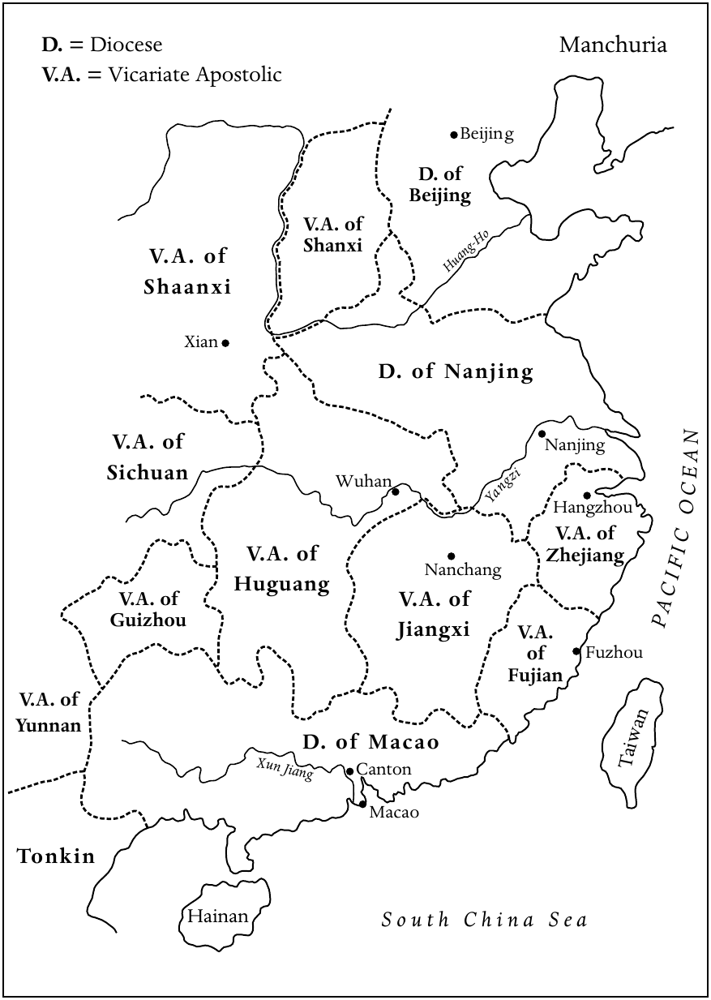
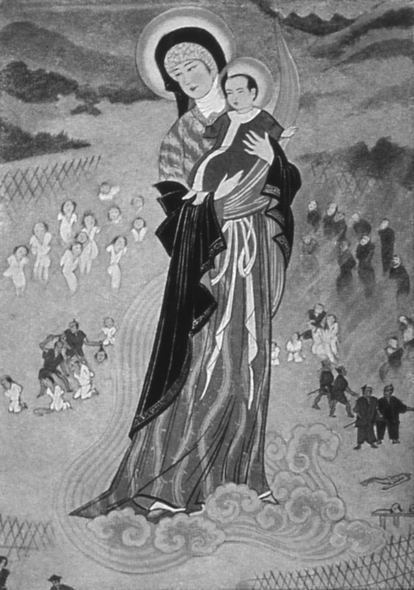

<!-- PDF page 466; original page 451 -->

# 第二十三章　东亚的基督教

**狄德满（R. G. Tiedemann）**

总体来说，十七世纪中叶并不是东亚基督教的有利时期。中国正在缓慢地从内部叛乱，以及外来的满洲人征服所造成的动荡中恢复。在德川时代的日本，基督教几乎已经被消灭；在朝鲜，它实际上仍鲜为人知。只有在菲律宾，天主教会才建立了相对稳定的存在。

## 菲律宾：东亚的天主教飞地

菲律宾的归信，构成东亚基督教历史中非同寻常的一章。到十七世纪中叶，距离西班牙征服仅两三代人，除了穆斯林控制的棉兰老地区和吕宋北部山地外，群岛的大部分主要岛屿，已经持久地成为基督教地区。因此，在亚洲更广大的非基督教世界中，菲律宾很早就形成了一个天主教飞地。

对菲律宾的精神征服，关键在于那些与早期西班牙殖民者一同到来的托钵修会传教士。除了托钵会士，耶稣会也参与了菲律宾的迅速归信。应当指出，菲律宾各修会团体的人员，几乎全部来自西班牙，另有较少部分来自墨西哥。随着时间推移，各修会都建立起菲律宾会省，由驻在马尼拉的会省长主持。托钵修会的菲律宾会省，不仅包括他们在群岛上负责的地区，也包括各会在亚洲大陆的传教区。

除了修会会省，征服之后的几十年中，也建立了教区教士体系。1595年，教皇克勉八世将马尼拉教区升为总教区，并设立三个新教区：新卡塞雷斯〔今纳加市〕、新塞哥维亚<!-- PDF page 467; original page 452 -->〔十八世纪中叶迁往维甘〕和宿务。这个结构在1660至1815年间始终保持不变。然而，西班牙殖民早期，菲律宾严重缺乏教区神父；那些在西班牙由各自修会训练、准备从事传教服务的修会教士，往往被派为堂区神父。这种情况不时导致修会与教会圣统制之间发生严重的管辖权冲突。

十七世纪最后几十年，西班牙哈布斯堡国王仍然认真看待自己在殖民领地推广天主教信仰的职责，并期望西班牙教士，尤其托钵会士，也发挥自己的作用。“作为传教士，托钵会士在西班牙殖民政策的框架内工作。他们既是国家的代理人，也是教会的仆人。”[^p467-1] 从一开始，托钵修会就深度参与了委托监护制（encomienda）的平定与殖民计划。这套制度包括西班牙国王为酬报殖民者的服务，而委托其持有的封建领地。它以保护被征服的原住民为交换，从他们那里征取产品与劳役。早期托钵会士通过这套制度，在已经平定并安居的本地群体中，开展大规模福音传播。[^p467-2] 在整个西班牙统治时期，修会教士始终是菲律宾教会的一支强大力量。

由于早期传教士的热忱与细致工作，西班牙人抵达之后仅两三代，菲律宾低地就建立起基督徒社群。托钵会士和耶稣会士都坚持，新信徒必须背诵整部《基督教教义》（Doctrina Cristiana）——一部汇编天主教常用祷文与宗教实践的纲要——以及基本教义原则。这样，新的实践〔圣事、告解、补赎〕和新的观念〔原罪观念、救恩观念〕进入菲律宾世界。同时，归信者必须遵从新的天主教道德，包括放弃一夫多妻、仪式性饮酒、把奴隶视为动产的制度，以及高利贷。

虽然修会教士在塑造新信徒信仰方面具有重要作用，但还有其他因素，促成菲律宾低地福音传播的成功。查尔斯·麦克唐纳提醒我们注意，“旧有宗教仪式与今日天主教之间转化中的延续性”。这种延续，是通过“在新框架内运用相同信仰结构，或者仅仅把既有结构转换成新的表达方式”实现的。麦克唐纳认为，后来的一些西班牙托钵会士“大概只是朴实的农民”，带来了“他们自己那种民间基督教，包括<!-- PDF page 468; original page 453 -->圣徒敬礼，以及许多‘迷信’〔相信鬼魂、邪灵等等〕。传教士的民间信仰，大概与某些本地信仰相契合，使两个宗教世界更加接近”。因此，许多民间信仰“能够在教士的祝福下兴盛，同时保留其多神结构，满足基督教传入以前的宗教需要”。[^p468-3]

## 女子宗教团体

虽然在西班牙人到来之前的菲律宾社会中，女性曾以女祭司身份发挥重要作用，但她们进入基督教制度生活的转变却十分困难。一方面，天主教修道价值，如个人圣化与完善、离开自己的家庭、服从、贫穷和独身，对本土女性来说是陌生的观念。另一方面，西班牙教会与民政当局都反对修会接纳本土女性。因此，1621年在马尼拉成立、属于方济各第二会的贫穷嘉勒会圣母无原罪皇家修院（Real Monasterio de Sta. Clara），专门接收纯西班牙血统的女子，无论她们出生于西班牙还是殖民地。直到二十世纪，这始终是菲律宾唯一的正式修女团体。

直到十七世纪末，为追求灵性生活完善的本土及混血女子而设的首批准修会团体，才开始出现。这些虔诚女子中，许多人已经被某个托钵修会接纳为第三会会员，此前独居，或者与家人同住。她们选择严格补赎与默观的生活，被称为虔修女子（beatas，意为“蒙福的女子”），同时帮助穷人与病人，教育女孩，并为教会承担各种卑微杂务。最终，她们获准穿修会服装，发下实际上属于私人性质的贞洁、贫穷与服从愿。这些被称为虔修院（beaterios）的团体，并未在教会法下获承认为修会团体，而只是被视为“虔诚善会”，也就是“为促进某项虔敬或慈善工作而成立的信友协会”。[^p468-4]

菲律宾永久性虔修院的试探性开端，可以追溯到1680年代初。当时，两位没有子女的年轻寡妇——有姻亲关系的安东尼娅·埃斯格拉〔西蒙·德富恩特斯上尉的遗孀〕与弗朗西斯卡·德富恩特斯——在领受道明第三会会服以后，开始在马尼拉的埃斯格拉家中，与其他西班牙、克里奥尔及本土女子聚会。作为虔修女子，她们从事慈善，并邀请其他虔诚女性加入自己的灵性追求，其中包括<!-- PDF page 469; original page 454 -->神秘主义者、出身本土旧贵族的塞巴斯蒂亚娜·萨尔塞多。1686年，这个团体请求道明会修院院长，在会省会议许可下，准她们共同生活。虽然这可以视为其宗教团体的起点，但锡耶纳圣加大利纳虔修院，直到1696年才正式成立，首任院长为弗朗西斯卡·德尔埃斯皮里图桑托。本土女性只能作为“服从修女”（hermanas de la obediencia）加入，没有投票权。

第二所此类机构，是华裔混血女子依纳西亚·德埃斯皮里图桑托，在耶稣会神父保罗·克莱因帮助下，创立的耶稣会虔修院（Beaterio de la Compañía de Jesús）。从1730年代起，女孩可以进入该院，先接受两年初学期训练，随后起初获准发为期七年的简式暂愿；期满以后，才能以虔修院成员身份，发贞洁与服从的终身愿。除了教育工作，虔修院还为本土、混血及西班牙平信徒女性组织避静。“所有这些不同种族的女子聚为一体，在每次八天避静期间共同生活，一同在虔修院内行神操，‘不仅她们自己获益良多，她们所来自的社群也大受裨益’。”[^p469-5]

1719年，来自布拉干卡伦皮特的本土亲姐妹迪奥尼西亚·米塔斯·塔朗帕斯与塞西莉亚·罗莎·塔朗帕斯，创立了菲律宾第三个主要女子宗教团体。1725年，她们领受奥思定静修会第三会的会服，并获得马尼拉的一所小屋。这实际上就是卡伦庞圣塞巴斯蒂安虔修院的开端。

由于地位含糊，虔修女子无法避免卷入管辖权斗争。卢西亚诺·圣地亚哥恰当地指出：

> 虔修女子必须应付三个名义上团结、实际上彼此极力保持独立的权力主体，它们对虔修院的性质往往意见相左：作为国王代表、有权决定是否实施王令的总督；教区主教；以及负责监督虔修女子团体的修会会省长。[^p469-6]

尽管官方怀有很强敌意，这三个主要女子团体仍设法存续到二十世纪，最终获授正式修会团体地位。

## 殖民教会中的争论

到十七世纪中叶，托钵会士、教会和国家的合力，已在菲律宾低地的<!-- PDF page 470; original page 455 -->定居地区，建立起一个相对稳定、已经基督教化的社会。然而，在随后几十年里，殖民合作关系开始破裂，紧张关系发展为王室行政官员、教区圣统制与托钵修会之间复杂的三方争斗。

主教与殖民官员的许多争执，涉及委托监护制所带来的弊端。新卡塞雷斯的道明会主教安德烈斯·贡萨雷斯，在1687年指出，这套制度下的征取已经变得压迫而不公，因为无论监护领地持有人（encomenderos），还是王室官员，都没有公平对待本土居民。虽然委托监护制在十八世纪初正式废除，殖民官员却继续利用维持这套制度的机构结构，谋取个人利益。1754年起担任新卡塞雷斯主教的方济各会士曼努埃尔·马托斯，尤其直言批评虐待民众的监护领地持有人与殖民官员剥削本土劳动力、不公平贸易〔例如强制向被统治者征取产品，而且往往不付款〕、任意征税，以及压制基本权利。

菲律宾殖民政府对纠正弊端毫无兴趣，本土居民唯一的求助途径，便是寻求“教士，尤其主教们的父爱式保护”。不过，达尼洛·赫罗纳指出，认真关注殖民弊端的主教很少；即使关注，他们也不反对殖民制度本身。其干预只是为了减轻压迫。教会自身作为殖民机构，同样并非没有腐败。有些托钵会士被指控，靠牺牲菲律宾原住民的利益过着“王侯般的生活”；日益敌视修会的殖民官员，很快就抓住这一点加以指摘。主教们则“显然认为，面对殖民当局不断造成的侵害，以及他们对圣统制持续提出的挑战，有必要巩固自身权力”。[^p470-7]

西班牙早期统治中，一场深刻影响菲律宾历史进程的争论，是主教与托钵会士关于教会法巡视权的争执。愿意来菲律宾的西班牙教区神父很少，因此，在教区建立以前已经到来的修会教士，被征调担任堂区神父。他们的双重身份造成特殊情况：作为托钵会士，他们服从各自会省长的权威；作为堂区神父，又受主教管辖。托钵会士声称，自己应该豁免于主教巡视，因为他们来到菲律宾，<!-- PDF page 471; original page 456 -->是为了向异教徒传福音，而不是管理堂区。但主教们坚持，要巡视由修会堂区神父管理的堂区。[^p471-8]

1697至1705年间，管辖权冲突在卡马乔总主教领导下尤其激烈。他决心使托钵修会接受自己的巡视。1699年2月13日，会士驻马德里的代表向西班牙国王呈交备忘录，抗议卡马乔的行动。他们暗示，如果强迫托钵会士接受巡视，会士就会退出堂区，甚至完全离开菲律宾。然而，国王支持卡马乔，指示马尼拉的王室官员协助总主教行使巡视权。教皇克勉十一世于1705年1月30日颁布简函，进一步支持卡马乔的立场，指出“巡视堂区修会教士的权利，属于上述总主教及其他主教”。

修会教士没有被王室和教皇的命令吓退，继续反对总主教。卡马乔调任墨西哥瓜达拉哈拉主教时，争执仍未解决。1707年，他的继任者弗朗西斯科·德拉奎斯塔，再次与修会教士交锋，试图同时落实教皇简函和王令。修会教士则要求，在西班牙方面对其上诉作出裁决之前，暂缓实施教皇简函。菲律宾持续的争执使国王感到不安，他命令总主教暂停推行巡视，等待进一步通知。[^p471-9] 不过，本笃十四世后来又于1744年11月6日和1745年2月24日颁布两道诏书，命令修会堂区神父接受主教巡视。两道诏书都得到费尔南多四世国王〔原书如此〕的支持。

## 菲律宾教会的衰落

1770年以后，是菲律宾天主教会的衰落时期。约翰·舒马赫认为，这一衰落由欧洲事件所促发。十八世纪后期，作为“开明专制君主”的波旁国王，越来越“主要把教会看作王室的工具，用来使臣民保持忠诚，并按照王室目标指导他们的活动”。尤其卡洛斯三世，采取了一些旨在“把教会降为国家仆役”的措施，“这些措施在菲律宾将产生特别灾难性的后果”。舒马赫认为，尤其重要的是：第一，驱逐西班牙领地内的耶稣会。命令于1767年在马德里颁布，但直到1768至1769年才在菲律宾执行；第二，使托钵会士受王室与主教<!-- PDF page 472; original page 457 -->控制；第三，马尼拉总主教决定任命大批菲律宾本土教区神父。[^p472-10]

七年战争期间，英国于1762至1764年占领马尼拉，是教会衰落的另一个因素。组织抵抗英国的，是西班牙各修会；其中，战斗性强的奥思定会，尤其成功地动员菲律宾人对抗“异端”。不过，这种抵抗并非发生在所有地方。英国占领同时，邦阿西楠、卡加延和伊罗戈各省爆发了反对殖民行政弊端的起义，占领本身实际上也刺激了起义。尤其伊罗戈的迭戈·西朗起义，同时挑战西班牙的民政和教会权威，迫使维甘主教与奥思定会募集大军加以对抗。

1760年代末，当局又试图依照本笃十四世1744与1745年的诏书，解决巡视问题。1767年，宫廷高级教士巴西利奥·桑乔抵任马尼拉新总主教，立即命令堂区托钵会士接受巡视。1770年7月，抵抗英国占领马尼拉的西班牙英雄西蒙·德安达，回到菲律宾担任总督，紧张进一步加剧。他以敌视托钵修会著称，也要求会士服从王室保教权（patronato real）制度的规定。1771年，第一次马尼拉会议召开，实施改革，包括使修会堂区神父服从主教管辖。同年10月，邦板牙省奥思定会士未遵守总主教与总督命令，安达派军队逮捕不肯服从的会士，他们“被驱赶到马尼拉，然后装船送往西班牙”。[^p472-11]

主教与托钵会士之间棘手的管辖权争执，与修会教士和教区教士争夺堂区的问题密切相关。前面已经指出，教区教士人数始终不多。无论如何，教会区域大多已经划归各修会，留给教区教士的空间很小。此外，多数教区教士更喜欢马尼拉主教座堂的圣俸席位与有俸教职，而不是到偏远内地从事堂区工作。费尔南多四世国王在1752和1757年的两道命令，要求在现任托钵会士去世后，逐渐由教区教士接管堂区。然而，由于耶稣会和部分奥思定会士被驱逐，1770年代初，大量堂区突然出现空缺。

<!-- PDF page 473; original page 458 -->

桑乔总主教决心削弱各修会，于是在神学院只提供初步训练后，就匆忙按立大批菲律宾本土教区神父，派他们接管空缺堂区。然而，训练不足的本土神父，尚未准备好突然承担本地教会的全部责任。结果，西班牙国王收到大量针对他们的投诉，连安达总督本人也提出投诉，于1776年12月11日暂停将堂区移交菲律宾教士。

按照王令，负责堂区的托钵会士应接受教会法巡视，但只能由自己的上级巡视；总主教只保留巡视教区教士所管堂区的权利。这样，西班牙托钵会士巩固了自己在菲律宾社会的权力与影响，菲律宾本土教区神父却得不到西班牙托钵会士享有的权利和特权。两者的对立在十九世纪进一步加深，演变为民族与种族敌意。

1760年代和1770年代初的事件，显著促成了菲律宾教会的衰落。更糟糕的是，欧洲革命战争和拿破仑战争造成混乱，使托钵修会更难从西班牙招募新人。因此，虽然天主教信仰在菲律宾低地仍然稳固，山地却因缺乏训练适当的神父，以及随之而来的传教热忱下降，而受到忽视。这种宗教身份上的地区二分，一直延续到原书写作的当代。

## 中国：宽容、压制与存续

满洲军队虽然于1644年攻占北京，使清朝顺治皇帝入主紫禁城，但整个中华帝国直到1680年代初才恢复和平。尤其在南方，由于满洲人的军事控制尚不完整，又存在忠于明朝的抵抗运动，政治局势始终不稳定。中国的基督徒社群，特别是福建和四川的社群，受到这些内部冲突的严重影响。

### 十七世纪后期中国的天主教传教事业

这些年里，基督教本已处境不稳，传教士之间不断加剧的竞争，又使情况恶化。十七世纪最初几十年，<!-- PDF page 474; original page 459 -->耶稣会在日本和中国享有独家传播福音的权利。凭借这种独立地位，他们设计了一套适应政策，调适中国文化，以及儒家士大夫精英的生活方式和礼仪。他们面向有文化的精英，采取“自上而下”的传教方式。此外，他们借助欧洲科学与技术吸引中国知识人的注意，把受过良好训练的科学家、天文学家和艺术家派往宫廷，为皇帝服务。自1644年起，他们垄断重要机构钦天监的领导职位，使这些宫廷耶稣会士能够影响皇帝，或者至少影响某些宫廷官员。意义更普遍的是，他们对祭祖、尊孔等某些中国礼仪采取宽容态度，宣称这些属于“世俗礼仪”。

然而，1630年代，从菲律宾来到中国的西班牙托钵会士，挑战了耶稣会的独占地位：道明会进入福建，赤足方济各会进入山东。1680年代，西班牙奥思定会也开始以较小规模开展活动。更重要的是，宗座代牧制度被引入东方传教区，使教皇能够直接干预中国事务。首批直接隶属传信部的宗座代牧获任，与1659年巴黎外方传教会的成立密切相关。这个新的教区神父团体，派来了一批不太愿意采取适应政策的传教士。1680年代，传信部又将意大利的改革支系方济各会士派往中国。

新形势要求在中国建立明确的教会结构。葡萄牙保教权自1576年起，负责位于葡萄牙据点澳门的一个教区，但该教区的范围从未明确界定。因此，首批宗座代牧获任之际，保教权体系与传信部之间出现持久的教会内部冲突，并不令人意外。由此产生的管辖权问题，最终由教皇英诺森十二世于1696年解决。

中国被划为三个范围有限、属于保教权体系的教区：北京教区包括直隶、山东，以及满洲的辽东地区；南京教区包括安徽、江苏和河南；澳门教区包括广东、广西和海南岛。其余各省分别成为宗座代牧区：福建、江西、湖广〔后来分为湖南与湖北〕、四川、贵州、山西、陕西、云南和浙江。[^p474-12]

<!-- PDF page 475; original page 460 -->

**地图4　约1696年的中国**

图例：D.〔Diocese〕表示教区；V.A.〔Vicariate Apostolic〕表示宗座代牧区；N表示北方。

| 原图标注 | 中文 |
| --- | --- |
| Manchuria | 满洲 |
| Beijing / D. of Beijing | 北京／北京教区 |
| V.A. of Shanxi | 山西宗座代牧区 |
| Huang-Ho | 黄河 |
| V.A. of Shaanxi | 陕西宗座代牧区 |
| Xian | 西安 |
| Nanjing / D. of Nanjing | 南京／南京教区 |
| V.A. of Sichuan | 四川宗座代牧区 |
| Wuhan | 武汉 |
| Yangzi | 长江 |
| Hangzhou | 杭州 |
| V.A. of Zhejiang | 浙江宗座代牧区 |
| Nanchang | 南昌 |
| V.A. of Huguang | 湖广宗座代牧区 |
| V.A. of Jiangxi | 江西宗座代牧区 |
| V.A. of Guizhou | 贵州宗座代牧区 |
| V.A. of Fujian | 福建宗座代牧区 |
| Fuzhou | 福州 |
| V.A. of Yunnan | 云南宗座代牧区 |
| D. of Macao | 澳门教区 |
| Xun Jiang | 浔江 |
| Canton | 广州 |
| Taiwan | 台湾 |
| Macao | 澳门 |
| Tonkin | 东京〔越南北部〕 |
| Hainan | 海南 |
| South China Sea | 南海 |
| PACIFIC OCEAN | 太平洋 |

<!-- PDF page 476; original page 461 -->

至于在华耶稣会士，他们远非一个同质群体。宫廷耶稣会士与在各省活动的会士之间，早就存在区别。首批法国耶稣会士抵达北京后，情况更加复杂。路易十四为把自己的影响扩展到东亚，于1687年派六位法国耶稣会士来到中国。他们都受过良好科学训练，拥有“王室数学家”（Mathématiciens du Roy）的头衔。他们成功地向康熙皇帝展示技艺，因此获赐皇城内的一块土地，后来著名的北堂就建在这里。[^p476-13]

然而，法国会士与受葡萄牙支持、在钦天监工作的耶稣会士之间，很快发生冲突。这既是国家利益的冲突，也是争夺科学影响力的竞争。[^p476-14] 这场冲突导致法国耶稣会传教团，于1700年11月脱离葡萄牙耶稣会副省。

### 迫害与恢复的时期

1645年，顺治皇帝任命耶稣会士汤若望为钦天监负责人，似乎表明新政权已经接纳传教士和基督教。一段时期内，宫廷耶稣会士的地位所带来的声望，为神父与归信者提供了一定保护。然而，杨光先发动所谓“历狱”，结束了这段相对平顺的时期。他曾多次企图罢免掌管钦天监的外国人，此后同时攻击基督教与西学。1664年9月，他的奏报使年幼康熙皇帝的辅政大臣相信，汤若望不仅犯下多项天文错误，耶稣会传教士还在策划叛乱，以错误观念蛊惑民众。

经过长期调查，汤若望与钦天监七位官员被判死刑，其中五位官员是基督徒。汤若望虽获赦免，基督徒官员却于1665年被处决。多数传教士被囚禁在广州，各省教堂被关闭。

历狱由多种因素造成，其中一些在杨光先发起攻击以前，就已暗中积累。例如，耶稣会士之间的个人竞争、宫廷亲基督教与反基督教派别之间的紧张，以及被汤若望取代的穆斯林天文学家的怨恨。这一事件标志着对西学的第一次全面攻击。判决之后，1669年又首次禁止在汉人臣民中传播<!-- PDF page 477; original page 462 -->基督教。1671年，对天主教传教的压制部分解除，但附加条件是，传教士不得发展新信徒或修建新教堂。康熙皇帝再次赐予宫廷传教士个人恩惠，包括一块题有“敬天”二字、可在所有教堂悬挂的匾额。一方面似乎受到皇帝保护，另一方面又被禁止进一步传播，这使1671至1691年的局面变得含糊。杜鼎克将之称为“默许”。[^p477-15]

所谓1692年《容教诏令》，同样具有这种含糊性。传教士因铸造火炮，并在与俄国的谈判〔1689年《尼布楚条约》〕中提供帮助，获得这道诏令作为奖赏。诏令确认，基督教没有表现出煽动叛乱的性质，因此不必禁止。基督徒与获准拥有寺观、焚香礼拜的佛教徒和道教徒，被置于同等地位。只要基督徒服从儒家的国家正统，不制造事端，就应允许他们在礼拜场所举行自己的仪式。

然而，诏令并未提到进一步传播基督教，或修建新教堂。联系随后发生的事件来看，《容教诏令》只是“转瞬即逝的一刻……一种理想，立即被争议、不断的失望、主张与反主张所包围”。[^p477-16]

### 礼仪之争加剧

《容教诏令》带来的不确定性，恰与欧洲传教士之间影响深远的礼仪之争达到高潮相重合。这场争论始于利玛窦的适应政策，主要涉及耶稣会与托钵修会，但绝不局限于两者，包含三个不同问题。第一，是所谓“译名问题”，也就是如何用中文表达上帝之名及其他重要概念。第二，是应否禁止基督徒参加尊孔与祭祖仪式。最后，是应否允许基督徒参与那些包括敬奉非基督教神灵的社群活动。

法国教区神父、福建宗座代牧颜珰，以1693年的训令攻击耶稣会对中国礼仪的立场，使两个阵营的冲突加剧。训令谴责耶稣会的做法，<!-- PDF page 478; original page 463 -->拒绝用“上帝”〔意为“在上之主”〕和“天”来称呼基督教的神。罗马经过长期商议，教皇于1704年11月20日颁布反礼仪敕令《Cum Deus optimus》，禁止使用“天”和“上帝”，批准使用“天主”〔意为“天之主”〕。同时，基督徒被禁止参加祭孔与祭祖。教皇特使铎罗（Charles Thomas Maillard de Tournon）把罗马的决定带到中国。然而，1706年7月他觐见康熙皇帝的情况很不顺利。恼怒的康熙随即命令，所有传教士若要获得留华的皇帝许可“票”，都必须声明遵守“利玛窦的规矩”。铎罗则针锋相对，制定一套规则，精确规定传教士应如何回答皇帝问题，威胁对不服从者施以绝罚，不给任何解释余地。最后，1715年的宗座宪章《Ex illa die》，重申了1704年教皇诏书的规定。

1721年，教皇特使嘉乐（Carlo Ambrogio Mezzabarba），批准了反对教皇敕令者所提出的八项“让步”，使冲突更加复杂。但罗马后来撤销了这些让步。1742年的宗座宪章《Ex quo Singulari》，以制裁强化教皇敕令，并要求所有赴华神父，必须宣誓遵守。宪章最终裁定反对中国礼仪，实际上结束了争论。由于这一决定从根本上挑战中国人的信念，并被视为对中国社会秩序的威胁，它常被看作基督教在中国“失败”的主要原因之一。克勉十四世于1773年解散耶稣会，这一决定于1775年在中国公布，可以视为这场漫长争端的尾声。

孟德卫指出：“对礼仪之争的解释，可以放在两个极端之间的光谱上。一个极端将礼仪之争视为近代早期中西文化关系史的分水岭；另一个极端则把它视为纯粹的欧洲事务，在试图从中国人的视角理解中国基督教历史时，可以轻易略去。”[^p478-17] 从传教士角度出发，焦点集中在所谓“耶稣会”与“道明会”立场的鲜明分界，中国归信者的作用却在很大程度上被忽略了。“他们通过书籍、小册子、抗议信等等参与争论，显示他们确实深深扎根于一个礼仪占据重要地位的中国社会。”[^p478-18]

<!-- PDF page 479; original page 464 -->

### 1724—1815年基督教的压制与存续

从十八世纪初开始，中国对基督教的宽容日益受到质疑。事实上，1721年1月，康熙皇帝就表示希望禁止这种麻烦的信仰。然而，真正的禁教诏令，直到雍正皇帝即位后不久的1724年1月才颁布。除了在宫廷工作，或设法藏匿于各省的人员以外，外国传教士都被驱逐到广州，后来又被赶往澳门。城市教堂逐渐关闭，改作庙宇、粮仓、学校或其他公共设施。

最初，并没有对中国基督徒或在各省秘密工作的传教士展开大规模迫害，甚至不时仍有新传教士设法进入中国。第一次地方性迫害，似乎发生于1733年末的福建。十八世纪余下的时间里，地方迫害时有发生，但“通常随后会有一段相对平静的时期，使人有机会恢复”。[^p479-19] 只有1740年代末和1780年代中期的迫害，可以称为大规模反基督教行动。不过，敌对氛围从长远上，还是迫使天主教逐渐退入中国偏远农村。

关于外国传教士在满洲人统治的帝国中所做的工作，已有大量著述，本土基督徒的贡献却往往只被顺带提及。然而，仔细考察中国传教史就会发现，从一开始，中国基督徒对于基督教在本国的引入、保存和后来的扩展，都至关重要。欧洲传教士极其稀少，中国幅员广大，外国神父又面临许多社会和语言问题，罗马因而很快认识到培养本土教士的重要性。早在1659年，传信部就指示新任宗座代牧，培养能够诵读拉丁文的本土神父，即使他们并不理解其意义也可以。

1666年，巴黎外方传教会在暹罗首都阿瑜陀耶开设一所中央神学院，培养中国、越南及其他东亚地区的神职人员。1767年，缅甸人入侵暹罗首都，神学院先迁到越南河仙附近的洪达（Hon-dat），不久又迁至法属印度本地治里附近的维兰帕特南，直到1781年关闭。1807年，巴黎外方传教会又在马六甲海峡的槟榔屿设立新神学院；该地自1786年起属于英国。

<!-- PDF page 480; original page 465 -->

1724年以后，鉴于中国天主教会越来越不安全，神职训练继续主要在帝国之外进行，许多中国人被送往欧洲。传信部传教士马国贤，于1732年在那不勒斯创立耶稣基督圣家学院，以培养中国教区神父。耶稣会也把一些中国人送往欧洲，在罗马的耶稣会学院，或巴黎的路易大帝学院学习。其中一些人加入耶稣会，再以神父身份返回中国。此外，少数中国教士由西班牙王室出资，在马尼拉接受道明会训练。

然而，长期在欧洲，甚至在暹罗和澳门受训，造成文化上的失根，使这些新神父很难重新融入中国社会。他们逐渐失去说写中文的能力，与自己的文化产生疏离。十八世纪末，虽然形势不稳，人们仍开始试探在中国境内培养本土教士。不过，由于训练费用高昂，以及外国传教士对培养中国教士存在一定保留，本土神父的数量仍相对有限。例如，1740年代末，在广大的四川省，为众多基督徒社群服务的，只有出色的李安德（Andreas Ly）一位神父。事实上，正是他于1764年创立四川第一所本土神父神学院；这也是整个中国内地的第一所。

外国与本土教士都很稀少，传教事业于是逐渐依靠不同类型的中国平信徒人员，管理本地教会事务，保存并扩展信仰。可以区分三类平信徒领袖：男性巡回教理传道员、本地会众领袖〔会长〕，以及特别重要的一类独身平信徒女性，她们所构成的“贞女制度”。

“贞女制度”值得特别注意。传统中国社会严格的男女隔离习俗，使向女性传福音成为天主教传教士面临的特殊挑战。女性虽然常在整个家庭的归信中发挥关键作用，但中国礼俗使外国或中国神父，几乎都不可能与她们直接接触。十九世纪中叶中外条约签订以前，建立正规的天主教女子修院也不现实。因此，被称为“贞女”的本土平信徒女性，成为在中国妇女中传播与保存天主教信仰的关键力量。她们活动的最早证据，来自十七世纪的福建；西班牙道明会士在这里引入了菲律宾形成的虔修女子制度。在一定<!-- PDF page 481; original page 466 -->程度上受到福建经验影响，巴黎外方传教会神父，于1740年代在自己的传教区建立贞女制度。

在这套制度下，独身女子把一生奉献给上帝与传教事业。她们通常发私人贞洁愿，继续与家人同住，在家中教导妇女和儿童。在四川，她们也参与对外传福音和照顾被遗弃的女孩。有关这类女子培养品格、发展宗教生活及基督徒美德，尤其贞洁的规则，于1784年获传信部批准，并由1803年四川教区会议进一步完善。这些规则一直施行到二十世纪。因此，贞女对于使徒事业的重要价值，得到了承认。实际上，在迫害时期，她们成为广大亲族网络和本地基督徒社群中的信仰支柱。

### 中国的非天主教基督徒

虽然中国的基督教化主要由罗马天主教徒承担，但也必须简要提到，1660至1815年间相当边缘的俄罗斯东正教与新教活动。俄罗斯驻北京传教团成立于1727年，为来自雅克萨的俄罗斯战俘及其后代提供牧灵照顾。俄罗斯东正教会更重视政治外交、商业，以及后来的科学活动，而非传福音。此外，俄罗斯教士不像天主教神父那样终身留在中国，而是在十年后回国。他们的教会始终规模很小，只有少数俄罗斯成员。

这一时期的新教传教活动，几乎没有多少值得记述之处。在中国传播福音的第一次新教尝试，于1660年代结束：忠于明朝的郑成功将荷兰东印度公司逐出台湾。直到1807年，伦敦会的马礼逊来到广州，才开始较为持久的新教传教工作。

到十九世纪初，经过近一个世纪时断时续的迫害，基督教在中国已经降为边缘宗教。然而，1800年以后，中国政府再次努力根除这种仍被它视为危险的信仰。1805和1811年的迫害，不仅针对某些外国神父，也针对北京的基督徒社群，包括其中的满洲人。此前，由于为他们服务的西方人在<!-- PDF page 482; original page 467 -->宫廷任职，这个社群还享有一定自由。在其他地区，四川宗座代牧徐德新（Gabriel-Taurin Dufresse），于1815年被斩首。

不过，1800年前后基督教事业的艰难处境，并非仅由中国内部的发展造成。西班牙与葡萄牙国力衰落、1773年耶稣会解散，以及法国革命的影响等外部因素，都使天主教欧洲的传教精神减退，经济支持下降，显著削弱了在华传教事业。获指定接续被取缔耶稣会工作的遣使会〔也称文生会〕，虽然于1784年派出首批赴华传教士，但到1820年，总共只有二十八名遣使会神父来到中国。巴黎外方传教会的在华人员也在减少；没有理由相信，意大利方济各小兄弟会或西班牙道明会负责的宗座代牧区，会有不同情况。中国的基督教事业在1815年已经陷入低谷。

## 日本：“秘密”基督徒的存续

1600年关原之战以后，德川幕府的建立，很快结束了日本的“基督教世纪”。第三代将军〔军事统治者〕德川家光，彻底禁止基督教，推行锁国政策，以强化幕府体制。对外关闭国门，意在防止传教士偷渡入境，阻断任何来自海外的基督教影响，从而根除基督教。在基督教已经扎根的九州岛，1637至1638年岛原之乱以后，日本基督教遭受了最严重的打击。

起义过后，1640年，江户〔今东京〕设立了一个审查基督教事务的机构，由专任官员负责，任务是消灭所有残存基督徒，从全国清除这种外来信仰的最后痕迹。该机构设有一座监狱，称为“切支丹屋敷”（Kirishitan yashiki）。被捕的传教士和有影响力的基督徒，在这里受到审讯、酷刑，或被监禁直到死亡。这个审查机构一直不间断地运作到1792年。

大约十五万名日本归信者转入地下，以躲避严酷迫害。政府采用各种手段，摧毁这些<!-- PDF page 483; original page 468 -->“秘密基督徒”〔潜伏切支丹，senpuku Kirishitan〕。这些手段包括奖励告发基督徒者，并结合“五人组”（gonin-gumi）制度：每五户组成邻里小组，对成员的行为相互负责。审查机关还引入每年年初举行的“踏绘”（efumi）仪式，即踩踏代表基督或圣母玛利亚的图像，以此根除外来宗教。最后，监督宗教事务与调查颠覆性教派的责任，被交给佛教僧侣。每户都必须在佛寺登记，取得寺院证明。这些措施结合起来颇有成效，导致十七世纪中叶发生数次大规模逮捕和惩罚，被称为“崩”（kuzure，意为“崩塌”）。这些根除基督教的制度，一直保留到十九世纪后半叶幕府统治结束。

尽管政府严密调查，地下基督徒仍设法在少数地方存续，主要是长崎地区及附近一些小岛。在没有神父的情况下，外国神父于锁国以前，在本地归信者中建立的各种善会与兄弟会，如今“构成了社群的宗教核心”。[^p483-20] 基督徒社群无法公开使用自己的信仰图像，就采用佛教形象，例如怀抱婴儿的子安观音，或慈母观音，来代替玛利亚像〔玛利亚观音〕。这样，地下基督徒的信仰重心，逐渐从作为严父与审判者的上帝，转向充满无限温柔、宽恕子女的母亲玛利亚。

这一趋势，也见于地下基督徒自己编纂、唯一传世的教义文本《天地始之事》〔意为“关于天地创始之事”〕。它的主题包括天地创造、天使与人类堕落、玛利亚、基督生平和世界终结。这个文本“把基督教教理材料与祷文，同丰富的本土传统和信仰混合起来，是文化适应的典型例子：基督教讯息在日本扎根，开出了一朵异样的花”。[^p483-21]

1640年以后，确有少数外国传教士试图进入日本，但没有成功。1708年，意大利神父乔瓦尼·巴蒂斯塔·西多蒂，由一艘船送到九州近海的一座岛上，几乎立刻被捕，押往江户，囚禁于切支丹屋敷，并由著名儒学家新井白石审讯。新井在1710年1月8日的报告中指出：“当那些〔基督教〕<!-- PDF page 484; original page 469 --><!-- PDF page 485; original page 470 -->国家的人，把教义传播到别的土地时，这并不是侵略阴谋，这一点很清楚。然而，一旦这种教义开始兴盛，那个国家就会自然出现叛逆臣民；这也是不可避免的自然结果。”[^p485-22] 不过，锁国时期这位最后的传教士意外来到日本，重新激发了日本人对西方文明的兴趣。虽然基督教宗教与文明仍被谴责为邪恶而具有颠覆性，新井白石却认识到了西方科学的实用价值。实际上，他虽然拒绝基督教，却成为热心的西学倡导者。他关于西多蒂的报告，有助于幕府改变政策，允许进口耶稣会传教士用中文撰写的西方科学书籍。

**图9　《日本殉道者的主保圣母》。** 这幅二十世纪早期日本画家长谷川路可（Lukas Hasegawa）所作的绢本画，反映了日本地下教会对圣母的重视。她的面貌与服饰在这里已经适应日本风格，背景景物中可以看见殉道的日本基督徒。照片藏于爱丁堡大学非西方世界基督教研究中心的巴特勒收藏。

1700年以后，反基督教迫害的强度虽然逐渐减弱，但日本基督徒仍不时被发现。迟至1790年代，长崎浦上仍发生一次“崩”；1805年，天草地区〔属肥后藩，今熊本县的一部分〕又发生一次，五千多名地下基督徒被捕。即使完全隔绝、备受迫害，信仰仍在九州偏远山村和渔村中世代相传，确实非同寻常。德川幕府末期，隐匿基督徒（Kakure Kirishitan）正是在这里重新出现。

## 朝鲜：自行传福音的教会形成

朝鲜天主教早期历史，是没有传教士介入而建立教会的独特例子。十六世纪末与十七世纪，虽有少数外国传教士试图进入朝鲜，包括1593至1595年以随牧身份伴随日军的西班牙神父格雷戈里奥·德塞斯佩德斯，但这些接触似乎没有产生后果。

更重要的是，十七世纪末和十八世纪，朝鲜儒家学者把天主教思想带了进来。朝鲜国王按惯例，每年派使团前往北京，向中国皇帝致意并呈献贡品。某些使团成员接触到耶稣会传教士；后者已经用中文写成解释西方科学与天主教宗教的著作。多年来，使团成员把许多此类作品带回朝鲜，包括利玛窦的《天主实义》与庞迪我的《七克》。到<!-- PDF page 486; original page 471 -->十八世纪初，朝鲜理学士人中形成的实学派成员，已经开始研究这些作品。尤其著名学者李瀷（1682—1763），从耶稣会出版物中，认识到一种可以与儒学相容的智慧与伦理体系。但他对传教士著作中明显的宗教成分持怀疑态度，他的一些门徒后来甚至要求采取行动，反对外来宗教。

虽然天主教总体上受到负面回应，但南人派精英中，仍有少数追随李瀷思想的人，更认真地对待这一信仰。他们精通儒家思想，深切信奉儒学，希望在天主教中找到办法，纠正停滞的朝鲜王朝日益加重的政治与社会腐败。这个群体包括权哲身、丁若镛、丁若铨、丁若钟三兄弟，以及权日身和李檗。李檗深受所读作品感动，便请1783年赴中国宫廷使团的成员、自己的姻亲李承薰，进一步了解基督教。李承薰拜访北京的外国神父时，接受天主教教导，并领受洗礼。

1784年春，李承薰带着书籍与宗教物品返回朝鲜，与其他热心“传福音者”一起，向亲友宣讲福音，使许多人归信。同年，李檗写成朝鲜基督教著作《圣教要旨》。

这些早期归信者，根据自己对中国教会的了解，于1784年建立第一个朝鲜天主教会。这个教会围绕“平信徒司祭”制度组织起来，尊重传统家长制家庭体系与祭祖，因而使早期朝鲜教会形成一种以家庭为基础的运动。唐纳德·贝克近来提出，最初的归信者“利用共同的哲学关切，以及与其他南人派成员之间的政治和婚姻关系，传播自己的宗教”。多数归信者，是“被自己信任的某位亲属或朋友，说服相信天主教教义与伦理实践的优越性”。[^p486-23]

对于早期朝鲜天主教徒而言，儒家价值与思维方式，在解释某些基督教教义时具有关键作用。例如，信徒复活与永生等基督教教义，与儒家有关祖先的信念和实践相呼应。实际上，对于早期朝鲜天主教徒，为亡故父母举行的基督教追思礼，与祭祖有关的仪式实践相似。

<!-- PDF page 487; original page 472 -->

李檗周围的亲友圈，虽然能够调和儒家与天主教的信仰和实践，但绝大多数朝鲜士人始终坚决反对天主教。北京主教汤士选（Alexandre de Gouvea，1751—1808）传来指示，禁止朝鲜教会任命“平信徒司祭”，也禁止天主教徒参加祭祖仪式，使局势进一步恶化。这产生了悲剧性后果。尹持忠〔保禄〕按照汤士选的指示，焚毁母亲的神主牌位，因违背儒家传统，于1791年12月8日被处决。一些重要归信者随即退出教会；然而，朝鲜正祖总体上实行宽容政策，信徒总数仍继续增长。到十八世纪末，朝鲜归信者已超过一万人。

不过，正祖于1800年突然去世，他的宽容政策也随之结束。国王的正式服丧期一结束，1801年辛酉教难就开始了。在迫害中，可能有多达三百名天主教徒死于正式处决，或因酷刑伤势而死。中国神父周文谟〔圣名雅各伯〕于1794年秘密进入朝鲜，承担朝鲜基督徒的领导，于1801年被处决。李承薰虽然多年前已经公开放弃信仰，仍被斩首。

其他遇害的重要基督徒中，还有黄嗣永。迫害开始时，他藏身乡间，写信给北京的汤士选主教。在这封著名的“帛书”中，他详细叙述迫害，请求西方军事援助，以拯救身陷重围的天主教徒，并迫使朝鲜政府准予宗教自由。这封信被截获，导致朝鲜政府对天主教徒的官方政策发生变化。此前，当局主要把天主教看作思想与道德威胁，力图加以压制；1801年以后，他们开始将之视为对朝鲜政治独立更加严重的威胁。然而，面对十九世纪最初几十年猛烈的反基督教运动，这个自行传福音的朝鲜教会，不仅存续下来，而且继续发展。

### 译校说明

本章关于西班牙国王的几处叙述，将1744、1745年教皇诏书的支持者，以及1752、1757年王令的颁布者，写作“费尔南多四世”（Ferdinand IV），序号依原书保留。教廷礼仪敕令与宗座宪章保留拉丁文原名，以便检索。

<!-- PDF page 488; original page 473 -->

<!-- PDF page 489; original page 474 -->

## 注释

[^p467-1]: Arthur Leonard Tuggy, The Philippine Church: Growth in a changing society (Grand Rapids, MI: Eerdmans, 1971), p. 48.

[^p467-2]: 同上，pp. 50–1。

[^p468-3]: Charles J.-H. Macdonald, ‘Folk Catholicism and pre-Spanish religions in the Philippines’, Philippine studies, 52 (2004), pp. 83, 88, 89.

[^p468-4]: Reginald D. Cruz, ‘“Devotion and defiance”: Religious communities for women established in colonial Philippines prior to 1750’, in Anne C. Kwantes (ed.), Chapters in Philippine church history (Manila: OMF Literature, 2001), p. 36, note 3.

[^p469-5]: Nick Joaquin, ‘The Beatas of 17th-century Manila’, in Joaquin, Culture and history: Occasional notes on the process of Philippine becoming (Manila: Solar, 1988), p. 121.

[^p469-6]: Luciano P. R. Santiago, ‘The development of the religious congregations for women in the Philippines during the Spanish period (1565–1898)’, Journal of Sophia Asia studies, 12 (1994), p. 53.

[^p470-7]: 见 D. Gerona, ‘In defence of the natives: The church in the midst of colonial abuses (1600–1790)’, Ateneo de Naga University, 16 August 2003, http://www.adnu.edu.ph/MainWeb/research/art02.html。

[^p471-8]: 关于巡视权争论，参见 Horacio de la Costa, ‘Episcopal jurisdiction in the Philippines during the Spanish regime’, in Gerald H. Anderson (ed.), Studies in Philippine church history (Ithaca: Cornell University Press, 1969), pp. 44–64。

[^p471-9]: Pablo Fernandez, History of the church in the Philippines (1521–1898) (Manila: National Book Store, 1979), pp. 112–13.

[^p472-10]: John N. Schumacher, ‘Syncretism in Philippine Catholicism: Its historical causes’, Philippine studies, 32 (1984), p. 257.

[^p472-11]: Salvador P. Escoto, ‘The ecclesiastical controversy of 1767–1776: A catalyst of Philippine nationalism’, Journal of Asian history, 10 (1976), p. 105.

[^p474-12]: 参见 Joseph de Moidrey, La hiérarchie catholique en Chine, en Corée et au Japon (1307–1914) (Shanghai: T’ou-sè-wè, 1914) 中相关地图。

[^p476-13]: Claudia von Collani, P. Joachim Bouvet S. J. Sein Leben und sein Werk (Nettetal: Steyler Verlag, 1985), pp. 11–17.

[^p476-14]: Catherine Jami, ‘For whose greater glory? Jesuit strategies and science during the Kangxi Reign (1662–1722)’, in Wu Xiaoxin (ed.), Encounters and dialogues: Changing perspectives on Chinese–Western exchanges from the sixteenth to eighteenth centuries (Nettetal: Steyler Verlag, 2005).

[^p477-15]: Ad Dudink, in Nicolas Standaert (ed.), Handbook of Christianity in China, vol. 1: 635–1800 (Leiden: Brill, 2001), p. 515.

[^p477-16]: Jonathan D. Spence, ‘Claims and counter-claims: The Kangxi emperor and the Europeans (1661–1722)’, in D. E. Mungello (ed.), The Chinese Rites Controversy: Its history and meaning (Nettetal: Steyler Verlag, 1994), p. 15.

[^p478-17]: D. E. Mungello, ‘An introduction to the Chinese Rites Controversy’, in Mungello (ed.), Rites Controversy, pp. 4–5.

[^p478-18]: Nicolas Standaert, ‘Rites Controversy’, in Standaert (ed.), Handbook of Christianity in China, p.685.

[^p479-19]: Kenneth Scott Latourette, A history of Christian missions in China (London: SPCK, 1929), p. 156.

[^p483-20]: Christal Whelan, ‘Introduction’, in Whelan (trans.), The beginning of heaven and earth: The sacred book of Japan’s hidden Christians (Honolulu: University of Hawaii Press, 1996), pp. 9–10.

[^p483-21]: Stephen Turnbull, ‘Acculturation among the Kakure Kirishitan: Some conclusions from the Tenchi Hajimari no Koto’, in John Breen and Mark Williams (eds.), Japan and Christianity: Impact and responses (Basingstoke: Macmillan, 1996), pp. 63–74.

[^p485-22]: 转引自 George Elison, Deus destroyed: The image of Christianity in early modern Japan (Cambridge, MA: Council on East Asian Studies, Harvard University, 1988), pp. 237–8。

[^p486-23]: Don Baker, ‘A Confucian confronts Catholicism: Truth collides with morality in eighteenth century Korea’, Korean studies forum, 6 (1979–80), p. 6.
