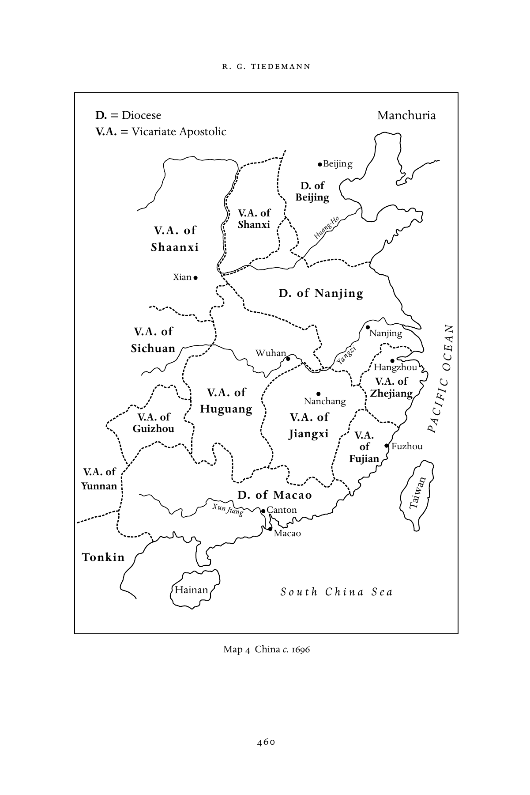
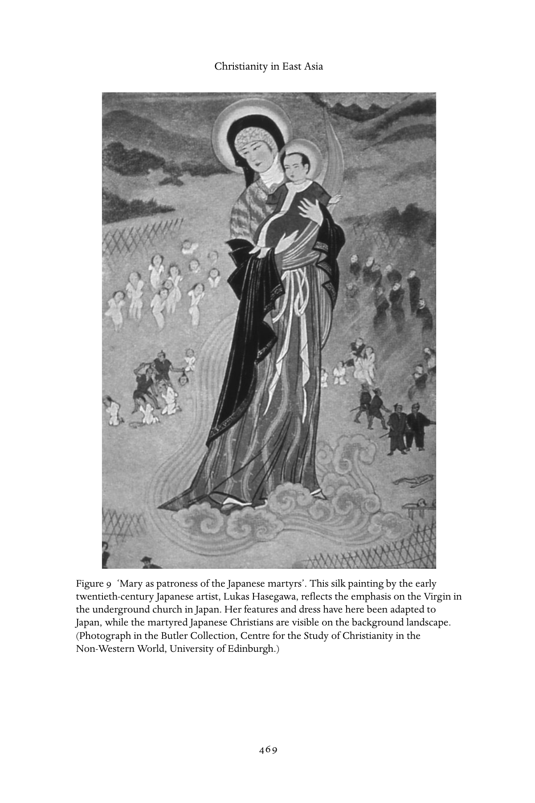

# 东亚的基督教：英文转换底稿

<!-- PDF page 466; original page 451 -->

### 23

## Christianity in East Asia

### r . g. t i e d e m a n n

The mid-seventeenth century was, generally speaking, not a good time for Christianity in East Asia. China was taking a long time to recover from the upheavals of internal rebellion and conquest by the alien Manchus. In Toku- gawa Japan, Christianity had been all but eliminated and in Korea it was still virtually unknown. Only in the Philippines had the Catholic Church estab- lished a relatively stable presence.

### The Philippines: A Catholic enclave in East Asia

The conversion of the Philippines constitutes a remarkable chapter in the his- tory of Christianity in East Asia. By the mid-seventeenth century, only two or three generations after the Spanish conquest, most of the principal islands in the archipelago, except for the Muslim-controlled regions of Mindanao and the uplands of northern Luzon, had become permanently Christian. The Philip- pines thus formed an early Catholic enclave within the larger non-Christian world of Asia.

Crucial to the spiritual conquest of the Philippines were the friar missionaries who had arrived with the early Spanish colonizers. In addition to the friars, the Jesuits also played a part in the rapid conversion of the Philippines. It should be noted that the religious institutes in the Philippines received their personnel almost entirely from Spain and to a lesser extent Mexico. In time each of the orders established a Philippine province under a provincial superior based in Manila. The Philippine provinces of the friars comprised not only the territories under their care in the archipelago but also their respective missions on the Asian mainland.

Besides the provinces of the religious orders, the secular clergy was also established in the decades after the conquest. In 1595 Pope Clement VIII had raised the diocese of Manila to the status of an archdiocese and created three new dioceses: Nueva Cáceres (now the city of Naga), Nueva Segovia

<!-- PDF page 467; original page 452 -->

(transferred to Vigan in the mid-eighteenth century), and Cebu. This struc- ture remained in place throughout the period 1660 to 1815. However, due to an acute shortage of secular priests in the Philippines during the early Spanish colonial period, regular clergy, trained in Spain by their respective orders for missionary service, often found themselves assigned as parish priests. Peri- odically this situation led to serious tensions over jurisdiction between the religious orders and the ecclesiastical hierarchy.

During the last decades of the seventeenth century, the Habsburg kings of Spain continued to take seriously their role as promoters of the Catholic faith in their colonial possessions, and they looked to the Spanish clergy, especially the friars, to play their part. ‘As missionaries, the friars worked within the context of the Spanish colonial policies. They were agents of the State as well as servants of the Church.’[^p467-1] From the start, the mendicant orders had been intimately involved in the encomienda programme of pacification and colonization. The encomienda system consisted of feudal holdings entrusted by the King of Spain to the colonizers as reward for their services. It was a means for extracting produce and labour services from the conquered indigenous populations in return for their protection. The early friars worked through this system to pursue mass evangelization among pacified and settled native groups.[^p467-2] The regulars remained a potent force in the Philippine church throughout the Spanish era.

Through the ardour and thoroughness of the early missionaries, Christian communities were established in the lowland Philippines within two or three generations after the Spanish arrival. Both the friars and the Jesuits insisted that neophytes memorize the entire Doctrina Cristiana – a compendium of common Catholic prayers and religious practices – together with the funda- mental doctrinal principles. Thus new practices (the sacraments, confessions, penance) and new concepts (the idea of original sin and the idea of salvation) entered the Philippine world. At the same time, converts had to conform to the new Catholic morality, which included the renunciation of polygamy, ritual drinking, chattel-slavery, and usury.

While the regular clergy played an important part in shaping the beliefs of the neophytes, other factors also contributed to the successful evangelization of the Philippine lowlands. Charles Macdonald has alerted us to the ‘transformative continuity between old religious rituals and present-day Catholicism’, which was achieved ‘by using the same belief structure within a new framework or by simply transposing a pre-existing structure into a new idiom’. Macdonald argues that some of the later Spanish friars were ‘probably simple peasants’, who brought with them ‘their own brand of folk Christianity, including the

<!-- PDF page 468; original page 453 -->

veneration of the saints, and a host of “superstitions” (belief in ghosts, evil spirits, and the like). The folk beliefs of missionaries probably matched some native beliefs, bringing the two religious worlds closer together.’ Thus, many folk beliefs ‘could prosper with the blessing of the clergy, while retaining their polytheistic structure and fulfilling pre-Christian religious needs’.[^p468-3]

### Religious communities for women

Although women had played important roles as priestesses in pre-Hispanic Filipino society, their transition into Christian institutional life proved difficult. On the one hand, Catholic monastic values such as personal sanctification and perfection, removal from one’s own family, obedience, poverty, and celibacy were alien concepts to indigenous women. On the other hand, the Spanish church and civil authorities resisted the acceptance of native women into religious orders. Thus the Royal Monastery of the Immaculate Conception of the Poor Clares (Real Monasterio de Sta. Clara), a community of the Second Order of St Francis established in Manila in 1621, was exclusively for women of pure Spanish heritage, whether born in Spain or in the colony. This remained the only community for nuns in the Philippines until the twentieth century.

It was only towards the end of the seventeenth century that the first quasi- religious communities came into being for indigenous women and women of mixed ethnicity (mestiza) who sought lives of spiritual perfection. These pious women, many of whom had been accepted as tertiaries by one of the mendicant orders, had hitherto lived in solitude or with their families. Opting for lives of rigorous penitence and contemplation, these women, known as beatas (‘blessed women’), also assisted with the poor and sick, with the instruction of girls and with various menial tasks for the church. Eventually, the beatas were permitted to wear a habit and profess what in effect were private vows of chastity, poverty, and obedience. These communities, known as beaterios, were never recognized as religious congregations under canon law but were simply considered as ‘pious unions’, that is, ‘associations of the faithful founded to further some work of piety or charity’.[^p468-4]

The tentative beginnings of a permanent beaterio in the Philippines can be traced to the early 1680s when two childless young widows, the sisters-in- law Antonia Esguerra, widow of Captain Simón de Fuentes, and Francisca de Fuentes, having received the tertiary habit of St Dominic, began to meet with other women – Spanish, creole, and native – in the Esguerra home in Manila. As beatas, they involved themselves in works of charity and invited other pious women to join them in their spiritual endeavours, including Sebastiana

<!-- PDF page 469; original page 454 -->

Salcedo, a mystic and member of the old native nobility. In 1686 the group asked the prior of the Dominican convent to be allowed to live in community with the permission of the Provincial Chapter. Although this date can be regarded as the beginning of their religious community, it was not until 1696 that the Beaterio of St Catherine of Siena was formally inaugurated, with Mother Francisca del Espiritu Santo as the first prioress. Native women were accepted only as ‘sisters of obedience’ (hermanas de la obediencia), without voting rights.

A second such institution, the Beaterio de la Compañ´ıa de Jesús, was founded by the Chinese mestiza Mother Ignacia de Espiritu Santo, with the help of the Jesuit priest Paul Klein. From the 1730s, it received girls who, after undergoing a two-year novitiate, were initially allowed to make simple, temporary vows, for a seven-year period, at the end of which they could make perpetual vows of chastity and obedience as members of the beaterio. In addition to engaging in education, it organized retreats for native, mestiza, and Spanish lay women. ‘All these women of diverse races gathered as one, lived in community during the eight days of each retreat, and together performed the spiritual exercises within the beaterio, “to the great benefit not only of themselves but of the communities they came from”’.[^p469-5] In 1719, two indigenous blood sisters, Dionisia Mitas Talangpaz and Cecilia Rosa Talangpaz of Calumpit, Bulacan, founded the third major Philippine religious community. In 1725 they received the habit of the Third Order of Augustinian Recollects as well as a small house in Manila. This was in effect the beginning of the Beaterio de San Sebastián de Calumpang.

Given the ambiguity of their status, the beatas could not avoid being drawn into jurisdictional struggles. As Luciano Santiago has aptly put it:

> The beatas had to contend with three entities, united nominally yet fiercely independent of each other, and often with conflicting views on the nature of the beaterios: the governor-general as the king’s representative who had the prerogative of whether or not to implement royal decrees; the bishop of the diocese; and the provincial of the religious order which supervised the beata’s community.[^p469-6]

Despite much official hostility, the three major sister communities managed to survive into the twentieth century, when they were finally given the status of regular religious congregations.

### Controversies in the colonial church

By the middle of the seventeenth century the combined force of the friars, the church and the state had created a relatively stable, Christianized society in the

<!-- PDF page 470; original page 455 -->

settled areas of the lowland Philippines. During the following decades, how- ever, the colonial partnership began to break down. Tensions developed into what became a complex three-cornered contest between royal administrators, the secular hierarchy, and the mendicant orders.

A number of the quarrels between bishops and colonial functionaries con- cerned abuses connected with the encomienda system. As the Dominican Bishop Andrés Gonzáles of Nueva Cáceres remarked in 1687, exactions under this system had become oppressive and unjust, as neither the feudal holders (or encomenderos) nor the royal officials had acted fairly towards the natives. Though the encomienda system was formally abolished at the beginning of the eighteenth century, colonial officials continued to enforce the institutional structures that had sustained it for their own private gain. The Franciscan Manuel Matos, since 1754 Bishop of Nueva Cáceres, became a particularly outspoken critic of exploitation of native labour by abusive encomenderos and colonial administrators, unfair commerce (for example, the compulsory exac- tion of produce from the subject people, often without payment), arbitrary taxation, and the suppression of basic rights.

Since the colonial government in the Philippines showed little interest in remedying the abuses, the only recourse for the indigenous people was to turn to the ‘paternal protection of the ecclesiastics, particularly their bishops’. But as Danilo Gerona has pointed out, few bishops paid serious attention to the colonial abuses, and those who did were not opposed to the colonial institutions as such. Their interventions were simply intended to mitigate the oppression. Nor was the church itself as a colonial institution free from cor- ruption. Some friars were accused of leading a ‘princely life’ at the expense of the indigenous Filipinos, something the increasingly hostile colonial offi- cials were quick to point out. The bishops, for their part, ‘apparently saw the need to consolidate their powers in view of the relentless abuses perpe- trated by colonial authorities and the constant challenge they posed to the hierarchy’.[^p470-7]

One of the controversies in the early Spanish regime that profoundly affected the course of Philippine history involved a dispute between the bishops and the friars over the issue of canonical visitation. Since few Spanish secular priests were attracted to the Philippines, the regular clergy, who had arrived prior to the creation of the dioceses, had been drafted to serve as parish priests. Their dual status created an unusual situation: as friars, they were subject to the authority of their respective provincials, but as parish priests, they were under the authority of the bishop. The friars claimed that they should be exempted from episcopal visitation because they had come to the Philippines

<!-- PDF page 471; original page 456 -->

to evangelize amongst the heathen, not to administer parishes. But the bishops insisted on visiting the parishes administered by friar-curates.[^p471-8]

The jurisdictional conflicts became particularly intense in 1697–1705 under Archbishop Camacho, who was determined to subject the mendicant orders to his visitation. The friars’ representatives in Madrid protested against Cama- cho’s actions, in a memorandum to the Spanish king dated 13 February 1699. They intimated that if visitations were forced upon the friars the latter would withdraw from the parishes or even leave the Philippines altogether. However, the king supported Camacho’s stand and directed royal officials in Manila to assist the archbishop in enforcing the right of visitation. Further support for Camacho’s stand came from Pope Clement XI’s brief of 30 January 1705, which stated that ‘the right of visiting the parochial regulars belonged to the said archbishop and other bishops’. Undeterred by the royal and papal injunctions, the regulars continued to oppose the archbishop, and the dispute remained unresolved when Camacho was transferred to the see of Guadalajara in Mex- ico. In 1707 Camacho’s successor, Francisco de la Cuesta, revived the fight against the regulars and attempted to enforce both the papal brief and the royal decree. The regulars, in turn, requested that the implementation of the papal brief be delayed, pending a decision on their appeal in Spain. Alarmed by the continuing dispute in the Philippines, the king ordered the archbishop to halt his attempts at implementing visitations until further notice.[^p471-9] However, Pope Benedict XIV later issued bulls on 6 November 1744 and 24 February 1745, both of them supported by King Ferdinand IV, ordering the friar-curates to submit to episcopal visitation.

### Decline of the Philippine church

The period after 1770 was one of decline for the Catholic Church in the Philip- pines. As John Schumacher has argued, this decline was precipitated by events in Europe. In the later eighteenth century, the Bourbon kings, as ‘Enlight- ened despots’, increasingly ‘saw the Church primarily as an instrument of the Crown to preserve its subjects in their loyalty and direct their activities in accord with royal purposes’. Charles III, in particular, introduced measures that were designed ‘to reduce the Church to the role of State servant which were to have especially disastrous consequences in the Philippines’. Particu- larly significant, according to Schumacher, were: (1) the expulsion of the Jesuits from the Spanish dominions, decreed in Madrid in 1767 but not executed in the Philippines until 1768–69; (2) the subjection of the friars to royal and episcopal

<!-- PDF page 472; original page 457 -->

control; and (3) the decision by the Archbishop of Manila to appoint large numbers of Filipino secular priests.[^p472-10]

The British occupation of Manila in 1762–64 during the Seven Years’ War was an additional factor behind the church’s decline. It was the Spanish reli- gious orders who organized the resistance against the British, with the mil- itant Augustinians particularly successful in mobilizing Filipinos against the ‘heretics’. However, these efforts at resistance did not occur everywhere, for the British occupation coincided with and indeed stimulated the outbreak of uprisings against abuses by the colonial administration in the provinces of Pangasinan, Cagayan, and Ilocos. Diego Silang’s insurrection in Ilocos, in particular, challenged both Spanish civil and ecclesiastical authority, and the Bishop of Vigan and the Augustinians felt compelled to raise a large army against him.

In the late 1760s, another attempt was made to settle the visitation problem in accordance with Pope Benedict XIV’s bulls of 1744 and 1745. When Basilio Sancho, a court prelate, arrived in 1767 as the new Archbishop of Manila, he immediately directed the friars in the parishes to submit to visitation. The tensions increased when Simón de Anda, the hero of Spanish resistance to the British occupation of Manila, returned to the Philippines as governor- general in July 1770. Known for his antagonism towards the mendicants, he also demanded that they submit to the requirements of the royal patronage (patronato real) system. The first Council of Manila was convened in 1771 to implement reforms, including the subordination of the friar-curates to epis- copal jurisdiction. In October 1771, after the Augustinians in the province of Pampanga failed to comply with orders from the archbishop and the governor- general, Anda sent troops to apprehend the recalcitrant friars who ‘were herded to Manila and then shipped to Spain’.[^p472-11]

The vexed jurisdictional dispute between bishops and friars was closely related to the controversy between the regular and the secular clergy for possession of the parishes. As has been indicated, the secular clergy were never very numerous. In any case, since the ecclesiastical territory had largely been divided amongst the religious orders, there was little scope for the seculars. Moreover, most of the latter preferred the prebendaries and benefices of the Manila cathedral rather than parish work in the isolated hinterlands. Two decrees of King Ferdinand IV in 1752 and 1757 required a gradual takeover of parishes by the secular clergy upon the death of the incumbent friars. However, as a result of the expulsion of the Jesuits as well as of some Augustinians, a considerable number of parishes suddenly became vacant in the early 1770s.

<!-- PDF page 473; original page 458 -->

Archbishop Sancho, determined to cripple the religious orders, hurriedly ordained a large number of Filipino seculars, after rudimentary training in the seminary, and assigned them to the vacant parishes. The poorly trained Filipino priests, however, were not ready for the sudden imposition of full responsibility in the local churches. Consequently, on 11 December 1776 the Spanish king, having received numerous complaints against the Filipino seculars, including one from Governor-General Anda himself, suspended the transfer of parishes to the Filipino clergy. According to the king’s decree the friars in charge of parishes would subject themselves to canonical visitation, but only by their own superiors, while the archbishop would retain the right only to visit parishes held by secular clergy. The Spanish friars thus consolidated their power and influence in Philippine society, while the Filipino secular priests were denied the rights and privileges granted to the Spanish mendicants. The antagonism between the two groups deepened in the course of the nineteenth century into national and racial enmity.

The events of the 1760s and early 1770s contributed significantly to the decline of the Philippine church. To make matters worse, the mendicant orders found it harder to attract new recruits from Spain, as a consequence of the disruptions during the Revolutionary and Napoleonic warfare in Europe. Thus, while the Catholic faith remained strong in the Philippine lowlands, the upland regions were neglected because of a lack of properly trained priests, and a consequent decline of missionary ardour. This regional dichotomy in religious identity would persist to the present day.

### China: Toleration, suppression and survival

Although the Manchu armies had taken Beijing and installed the Shunzhi Emperor of the Qing dynasty in the Forbidden City in 1644, it would be the early 1680s before peace was restored throughout the Chinese Empire. Especially in the south the political situation remained fluid, due to the incomplete military control of the Manchus and the existence of Ming loyalist resistance movements. The Chinese Christian communities, particularly in the provinces of Fujian and Sichuan, were seriously affected by these internal conflicts.

### The Catholic missionary enterprise in late

### seventeenth-century China

The precarious condition of Christianity during these years was not improved by the increasing rivalries among the missionaries. During the early decades of

<!-- PDF page 474; original page 459 -->

the seventeenth century, the Society of Jesus had enjoyed the exclusive right to propagate the gospel in Japan and China. From this position of independence the Jesuits had devised a policy of accommodation or adaptation to Chinese culture and to the life-style and etiquette of the Confucian scholar-elites. By addressing themselves to the literate elite, they engaged in evangelization ‘from the top down’. Moreover, they used European science and technology in order to attract the attention of the educated Chinese, sending well-trained scientists, astronomers and artists to the court to work for the emperor. Their monopoly of the directorship of the important Astronomical Bureau from 1644 gave these Court Jesuits influence with the emperor or at least with some court officials. Of more general significance is the fact that they adopted a tolerant attitude towards certain Chinese rites, like ancestral worship and the veneration of Confucius, which they declared to be ‘civil rites’.

However, the exclusive position of the Society of Jesus was challenged in the 1630s by the arrival of Spanish mendicants (Dominicans in Fujian and Dis- calced Franciscans in Shandong) from the Philippines. In the 1680s the Spanish Augustinians also became active in a somewhat more modest capacity. Of greater significance was the introduction of the vicariate system to the eastern missions which permitted direct papal action in China. The appointment of the first vicars apostolic under the direct authority of the Sacred Congregation for the Propagation of the Faith (or Propaganda Fide) was closely connected to the foundation of the Foreign Mission Society of Paris (Société des Missions Etrangères de Paris) in1659. This new society of secular priests sent to China missionaries who were less willing to practise accommodation. Propaganda Fide sent the first Reformed Franciscans from Italy to China in the 1680s.

The new situation demanded the establishment of a clear ecclesiastical structure in the Middle Kingdom. The Portuguese padroado had been in charge of one diocese in the Portuguese settlement of Macao since 1576; however, the extent of this diocese had never been clearly defined. Thus, the appointment of the first vicars apostolic was not surprisingly accompanied by protracted intra-church conflicts between the padroado and Propaganda Fide. The ensuing jurisdictional issues were finally settled by Pope Innocent XII in 1696. China was divided into three padroado dioceses with limited territory: the diocese of Beijing included the provinces of Zhili and Shandong as well as the territory of Liaodung in Manchuria; the diocese of Nanjing consisted of Anhui, Jiangsu, and Henan; and the diocese of Macao included Guangdong, Guangxi, and the island of Hainan. Each of the remaining provinces became vicariates apostolic: Fujian, Jiangxi, Huguang (later divided into Hunan and Hubei), Sichuan, Guizhou, Shanxi, Shaanxi, Yunnan, and Zhejiang.[^p474-12]

<!-- PDF page 475; original page 460 -->

### Manchuria

Beijing D. of Beijing V.A. of V.A. of Shanxi Huang-Ho Shaanxi Xian D. of Nanjing V.A. of Nanjing A Sichuan Wuhan Yangzi C E Hangzhou O V.A. of C V.A. of Zhejiang I Nanchang F V.A. of Huguang V.A. of A C I Guizhou Jiangxi V.A. P of Fuzhou Fujian V.A. of n Yunnan a D. of Macao w ai XunJiang Canton T Macao Tonkin Hainan S o u t h C h i n a S e a N

D. = Diocese

V.A. = Vicariate Apostolic Map 4 China c. 1696

<!-- PDF page 476; original page 461 -->

As for the Jesuits of China, they were by no means homogeneous as a group. A distinction had long existed between the court Jesuits and those based in the provinces. The situation was further complicated by the arrival of the first French Jesuits in Beijing. In an attempt to extend his influence to East Asia, King Louis XIV sent six French Jesuits to China in 1687, all of them well trained in science and with the title of ‘Mathématiciens du Roy’. They successfully demonstrated their skills to the Kangxi emperor and as a result were given a piece of land within the imperial precinct, where later the famous Northern Church (Beitang) was erected.[^p476-13]  However, a conflict soon developed between the French Jesuits and the Portuguese-sponsored Jesuits working at the Astronomical Bureau. It was both a clash of national interests and a competition for scientific influence.[^p476-14]  As a result of this conflict, the French Jesuit mission was separated from the Portuguese Jesuit vice-province in November 1700.

### A time of persecution and recovery

The appointment of the Jesuit Adam Schall von Bell as director of the Astro- nomical Bureau by the Shunzhi Emperor in 1645 suggested that the mission- aries and Christianity had been accepted by the new regime. For a while the prestige attached to the court Jesuits’ position afforded a degree of protection to priests and converts. However, this relatively trouble-free period came to an end as a result of the so-called ‘Calendar Case’ instigated by Yang Guang- xian. Having made several attempts to have the foreigners in charge of the Astronomical Bureau removed, Yang attacked both Christianity and western learning. His report of September 1664 convinced the regents of the young Kangxi emperor that Schall had not only made several astronomical errors but that the Jesuit missionaries were plotting rebellion and indoctrinating the people with false ideas. After lengthy investigation, Schall and seven officials in the Astronomical Bureau, including five Christians, were sentenced to death. Although Schall was pardoned, the Christian officials were executed in 1665, most of the missionaries were imprisoned in Guangzhou (Canton), and the churches in the provinces were closed.

The Calendar Case resulted from several factors, some of which had been smouldering before Yang launched his attack – such as personal rivalry among the Jesuits, tensions between pro- and anti-Christian factions at court, and bitterness among the Muslim astronomers whom Schall had displaced. This episode marked the first comprehensive attack on western learning, and the judgement was followed in 1669 with the first prohibition of the propagation

<!-- PDF page 477; original page 462 -->

of Christianity among Han subjects. In 1671, the suppression of the Catholic mission was partially lifted, but with the qualification that the missionaries could not make new converts or build new churches. The Kangxi emperor again bestowed personal favours on the court missionaries, including a tablet with the text Jingtian (Revere Heaven) to be distributed to all churches. This apparent imperial protection, on the one hand, and the prohibition of further propagation, on the other, led to an ambiguous situation between 1671 and 1691 which Ad Dudink has called ‘tacit toleration’.[^p477-15]

The same ambiguity characterized the so-called Edict of Toleration of 1692, which the missionaries obtained as a reward for their casting of cannon and their help in the negotiations with Russia (Treaty of Nerchinsk, 1689). The edict confirmed that the Christian religion had not proven to be seditious and therefore did not need to be proscribed. Christians were placed on the same level as Buddhists and Daoists who were allowed to have temples and offer incense. As long as Christians remained subordinated to Confucian state orthodoxy and did not create trouble, they were to be allowed to practise their rituals in their places of worship. However the edict did not mention further Christian religious propaganda or the building of new churches. In light of subsequent events, the Edict of Toleration was ‘a fleeting moment . . . , an ideal that was immediately surrounded with controversy and constant disappointment, claims and counter-claims’.[^p477-16]

### The Rites Controversy intensified

The uncertainties arising from the Edict of Toleration coincided with the cul- mination of the fateful Rites Controversy amongst the European missionaries, a controversy which had started with Matteo Ricci’s policy of accommodation. Essentially but by no means exclusively a contest between the Jesuits and the mendicants, it involved three distinct problems. The first was the so-called ‘Term question’, that is, how to express the name God and other important concepts in Chinese. The second was the question of whether or not Christians should be forbidden to take part in ceremonies honouring Confucius and the cult of ancestors. Finally, there was the question of whether Christians should be permitted to participate in community activities that involved honouring non-Christian divinities.

The conflict between the two camps intensified when the French secular priest Charles Maigrot, Vicar Apostolic of Fujian, attacked the Jesuit position on the Chinese rites in his Mandate of 1693. It condemned Jesuit practices

<!-- PDF page 478; original page 463 -->

and rejected the use of the Chinese terms shangdi (‘lord on high’) and tian (‘heaven’) for God. After lengthy deliberations in Rome, the pope issued the anti-rites decree Cum Deus optimus of 20 November 1704. It forbade the use of tian and shangdi, while approving tianzhu (‘Lord of Heaven’). At the same time, Christians were forbidden to take part in sacrifices to Confucius or to ancestors. Rome’s decisions were taken to China by the papal legate Charles Thomas Maillard de Tournon. However, his audience with the Kangxi emperor in July 1706 went rather badly, and in response, the irritated Kangxi emperor issued an order that all missionaries, in order to obtain an imperial permit (piao) to stay in China, would have to declare that they would follow ‘the rules of Matteo Ricci’. De Tournon, for his part, countered with a set of rules on precisely how the missionaries were to answer the emperor’s questions, threatening the disobedient with excommunication and leaving no room for interpretation. Finally, the apostolic constitution Ex illa die (1715) reiterated the papal pronouncements of the 1704 bull.

The conflict became more complicated when in 1721 the papal legate Carlo Ambrogio Mezzabarba approved eight ‘concessions’ proposed by those opposed to the papal decrees. These concessions were, however, later annulled by Rome. The apostolic constitution Ex quo Singulari (1742) reinforced the papal decrees with sanctions and included an obligatory oath of observance to be taken by all priests leaving for the China mission. This constitution ruled conclusively against the Chinese Rites and effectively closed the controversy. Because it fundamentally challenged Chinese beliefs and was perceived as a threat to the Chinese social order, this decision has often been considered as one of the main causes for the ‘failure’ of Christianity in China. The dissolution of the Society of Jesus by Pope Clement XIV in 1773, promulgated in China in 1775, can be seen as an epilogue to this long affair.

As David Mungello has remarked, ‘interpretations of the Rites Controversy can be placed on a spectrum between two extremes. One extreme regards the Rites Controversy as a watershed in the early modern history of Sino-western cultural relations while the other extreme views the Controversy as a purely European affair which can be easily omitted when attempting to understand the history of Christianity in China from a Chinese perspective.’[^p478-17]  Whereas from a missionary perspective the focus is on the sharp demarcation between the so-called ‘Jesuit’ and ‘Dominican’ positions, the role of the Chinese converts has been largely ignored. ‘Their involvement in the controversy through books, pamphlets, letters of protest etc. shows that they were truly imbedded in a Chinese society in which rites occupied an important place.’[^p478-18]

<!-- PDF page 479; original page 464 -->

### Suppression and survival of Christianity 1724–1815

From the early eighteenth century the toleration of Christianity in China was being increasingly questioned. Indeed, in January 1721 the Kangxi emperor indicated that he wished to proscribe this troublesome creed. It was, how- ever, not until January 1724, shortly after the accession of the Yongzheng emperor, that an edict proscribing Christianity was actually issued. The for- eign missionaries were deported to Canton and, later, to Macao (except those who worked at the court and those who had managed to hide in the provinces). Urban churches were gradually closed and converted into temples, granaries, schools, or other public facilities. Initially, there was no large-scale persecution of Chinese Christians or of missionaries working clan- destinely in the provinces. From time to time new missionaries even man- aged to enter China. The first local persecution seems to have occurred in Fujian in late 1733. For the remainder of the eighteenth century, there were periodic local persecutions, but these were ‘usually followed by a period of comparative quiet, with opportunity for recuperation’.[^p479-19]  Only the persecu- tions in the late 1740s and the mid-1780s can be described as anti-Christian agitation on a large scale. Nevertheless, in the long run the climate of hos- tility forced a gradual retreat of Catholicism into the remoter parts of rural China.

While much has been written about the work of foreign missionaries in the Manchu Empire, the contribution made by indigenous Christians is alluded to only in passing. Yet a careful examination of the history of the China mis- sions reveals that from the beginning, Chinese Christians were vital to the introduction, preservation and subsequent expansion of Christianity in the country. Given the extreme paucity of European missionaries, the vast size of China and the many social and linguistic problems that foreign priests had to face, Rome soon came to recognize the importance of training a native clergy. Indeed, as early as 1659 the newly appointed vicars apostolic were instructed by Propaganda Fide to train indigenous priests who could read Latin, even if they did not understand it. In 1666 the Missions Etrangères de Paris opened a central seminary in Ayutthaya, the capital of Siam, to prepare Chinese, Viet- namese and other East Asians for the priesthood. When the Burmese invaded the Siamese capital in 1767, the seminary was first moved to Hon-dat near Ha-tiên, Vietnam, and soon afterwards to Virampatnam near Pondicherry in French India – where it remained until its closure in 1781. In1807 a newMissions Etrangères de Paris seminary was established in Penang in the Strait of Malacca, a British possession since 1786.

<!-- PDF page 480; original page 465 -->

After 1724, in view of the growing insecurity of the Catholic Church in China, training for the priesthood continued primarily outside the empire, and many Chinese were sent to Europe. The ‘Propaganda’ missionary Matteo Ripa founded the College of the Holy Family of Jesus Christ in Naples in 1732 for the purpose of training Chinese secular priests. The Jesuits likewise sent some Chinese to study in Europe, at their college in Rome or at Louis-le-Grand College in Paris. There some joined the Society of Jesus, before returning to China as priests. In addition, a small number of Chinese clerics were trained by the Dominicans in Manila at the expense of the Spanish crown.

But deracinization during their prolonged formation in Europe (and even in Siam and Macao) made it difficult for the new priests to reintegrate into Chinese society. They gradually lost the ability to speak and write Chinese and were alienated from their own culture. Towards the end of the eighteenth century tentative beginnings were made, in spite of the precarious situation, to train the native clergy in China. Nevertheless, because of the high cost of such training as well as a certain reticence amongst the foreign missionaries to educate Chinese clerics, the number of indigenous priests remained relatively small. Thus, in the late 1740s the remarkable Li Ande (Andreas Ly) was the only priest ministering to many Christian communities in the large province of Sichuan. It was, in fact, he who founded the first seminary for native priests in that province (and indeed in all of inland China) in 1764.

Given the paucity of both foreign and indigenous clergy, the mission enter- prise came to rely on various kinds of Chinese lay personnel to manage local church affairs as well as to preserve and extend the faith. It is useful to dis- tinguish among three types of lay leadership: male itinerant catechists, local congregational leaders (huizhang), and – of particular importance – certain single laywomen known as the ‘institute of virgins’.

The ‘institute of virgins’ warrants particular attention. In consequence of the custom of strictly segregating the sexes in traditional Chinese society, the evangelization of women presented a particular challenge for Catholic mis- sionaries. Although women often played a pivotal role in the conversion of families, Chinese mores made it all but impossible for priests – foreign or Chinese – to establish direct contact with them. Since it was also imprac- tical to establish proper Catholic convents prior to the Sino-foreign treaties of the mid-nineteenth century, the indigenous laywomen known as ‘virgins’ became a vital element in the propagation and preservation of the Catholic faith amongst Chinese females. The earliest evidence of their activities comes from seventeenth-century Fujian province, where Spanish Dominican friars introduced the beata system which had developed in the Philippines. To some

<!-- PDF page 481; original page 466 -->

extent influenced by the Fujian experience, the Missions Etrangères de Paris priests established the institute of virgins in their mission in the 1740s. Under this system, single women consecrated their lives to the service of God and the mission. Usually bound by a private vow of chastity, they continued to live with their families, where they instructed the women and children. In Sichuan they were also involved in external evangelization and the care of abandoned girls. The rules for such women concerning the formation of character and the cultivation of a religious life and Christian virtues, especially chastity, were approved by Propaganda Fide in 1784 and further elaborated by the Sichuan Synod of 1803. These rules remained in force well into the twentieth cen- tury. Thus the essential value of the virgins to the apostolate was recognized. Indeed, in times of persecution they became pillars of the faith within extended kinship networks and local Christian communities.

### Non-Catholic Christians in China

Although the Christianizing of China was primarily undertaken by Roman Catholics, brief mention must be made of the rather marginal Russian Ortho- dox and Protestant efforts during the period 1660–1815. The Russian Ecclesi- astical Mission in Beijing was founded in 1727 to provide pastoral care for the Russian prisoners from Albazin and their descendants. The Russian Orthodox Church placed more emphasis on political-diplomatic, commercial, and later scientific activities, than on evangelization. Moreover, Russian clerics, unlike Catholic priests, did not stay for the rest of their lives in China, but returned to Russia after a decade. Theirs remained a small church with only a few Russian members.

Protestant missionary activities are hardly noteworthy during this period. The first Protestant attempt to propagate the gospel in the Middle Kingdom ended in the 1660s when the Dutch East India Company was expelled from Taiwan by the Ming loyalist Zheng Chenggong (Koxinga). It was not until 1807 that more lasting Protestant missionary work was initiated with the arrival in Guangzhou of Robert Morrison of the London Missionary Society.

At the beginning of the nineteenth century, after nearly a century of sporadic persecutions, Christianity had been reduced to a marginal religion in China. Nevertheless, after 1800 the Chinese state renewed its efforts to eradicate what it still perceived to be a dangerous creed. The persecutions of 1805 and 1811 targeted not only some foreign priests but also the Christian community at Beijing (including Manchus), a community that had thus far enjoyed a degree of freedom on account of their being served by the westerners who worked

<!-- PDF page 482; original page 467 -->

at the court. Further afield, the vicar apostolic of Sichuan, Gabriel-Taurin Dufresse, was beheaded in 1815.

But developments in China were not the only factors contributing to the precarious state of the Christian enterprise around 1800. External factors such as the declining power of Spain and Portugal, the dissolution of the Society of Jesus in 1773 and the impact of the French Revolution all contributed to a waning of the missionary spirit in Catholic Europe, bringing about declining financial support which considerably weakened the missionary endeavour in China. Although the Congregation of the Mission (Lazarists or Vincentians) – designated to continue the work of the suppressed Jesuit order – sent its first missionaries to China in 1784, by1820 only twenty-eight Lazarist priests had arrived in China. The Missions Etrangères de Paris also experienced a decline in personnel for the China mission field, and there is no reason to believe that the situation was different for the vicariates apostolic of the Italian Friars Minor or the Spanish Dominicans. The Christian endeavour in China had reached a low point in 1815.

### Japan: survival of the ‘secret’ Christians

The establishment of the Tokugawa bakufu government following the Battle of Sekigehara (1600) soon brought to a close the ‘Christian Century’ in Japan. The third sho¯gun (military ruler), Tokugawa Iemitsu, strengthened the bakufu regime by thoroughly prohibiting the Christian religion and promoting a pol- icy of national isolation (sakoku). The closure of the country to the outside world was intended as a means of extirpating Christianity, by preventing the smuggling of missionaries into the country and keeping any Christian influ- ences from filtering in from abroad. Japanese Christianity received its severest blow in the wake of the Shimabara Rebellion (1637–38) on the island of Kyushu, a place where Christianity had become well established. In the aftermath of the rebellion, an Office of Inquisition for Christian Affairs was established at Edo (modern Tokyo) in 1640. It was put under the direction of a special commissioner who was entrusted with the task of exterminating all surviving Christians and eliminating the last remnants of the alien creed from the coun- try. It maintained a prison (Kirishitan yashiki), where captured missionaries and influential Christians were examined, tortured, or imprisoned until their death. The Office of Inquisition remained in operation uninterruptedly until 1792.

Some 150,000 Japanese converts had gone underground to escape the severe persecutions, and the government employed various means to destroy these

<!-- PDF page 483; original page 468 -->

‘secret Christians’ (senpuku Kirishitan). They included the practice of rewarding those who denounced Christians, in conjunction with the gonin-gumi system, that is, the five-family neighbourhood groups who were mutually responsible for the behaviour of their members. The ceremony of efumi or ‘picture treading’ (stepping on images representing Christ or the Virgin Mary), held annually at the beginning of the year, was likewise introduced by the Inquisition as a method for eradicating the foreign religion. Finally, the supervision of religious matters and the investigation of subversive sects were entrusted to Buddhist monks. Every family had to register at a Buddhist temple and obtain a temple certificate. The combination of these measures proved effective, resulting in several wholesale arrests and punishment, called kuzure (‘crumblings’), in the mid-seventeenth century. These institutions to eradicate Christianity remained in place until the end of the bakufu government in the second half of the nineteenth century.

In spite of intense government investigations, underground Christians man- aged to survive in a few places, principally in the Nagasaki area and some nearby smaller islands. In the absence of priests, the various religious sodalities and confraternities that foreign priests had created amongst local converts before sakoku now ‘constituted the religious core of the community’.[^p483-20]  Since the Christian communities could not openly employ images of their faith, they adopted Buddhist images like that of a Goddess of Mercy holding a child in her arms (Koyasu Kannon) or of a Goddess of Motherly Love (Jibo Kannon) instead of an image of Mary (Mariya Kannon). Thus, gradually the faith of the under- ground Christians tended to move away from a God who was a strict father and judge, and focus on Mary as the forgiving mother of infinite tenderness.

This trend can also be observed in the only surviving doctrinal text compiled by the underground Christians themselves, namely the Tenchi Hajimari no Koto (‘Concerning the Creation of Heaven and Earth’), whose topics are the creation of heaven and earth, the angels and the fall of humankind, Mary, the life of Christ, and the end of the world. The text is ‘a blend of Christian catechetical materials and prayers with a rich mixture of native tradition and belief, and appears as a classic example of acculturation, whereby the Christian message has taken Japanese roots, and flowered as an exotic bloom’.[^p483-21]

A few foreign missionaries did attempt to enter Japan after 1640, but they were unsuccessful. When the Italian priest Giovanni Battista Sidotti was dropped by a ship on an island off Kyushu in 1708, he was almost immediately captured and transferred to Edo, where he was imprisoned in the Kirishitan yashiki and interrogated by the famous Confucian scholar Arai Hakuseki. In his report of 8 January 1710, Arai noted: ‘When the people of those [Christian]

<!-- PDF page 484; original page 469 -->

Figure 9 ‘Mary as patroness of the Japanese martyrs’. This silk painting by the early twentieth-century Japanese artist, Lukas Hasegawa, reflects the emphasis on the Virgin in the underground church in Japan. Her features and dress have here been adapted to Japan, while the martyred Japanese Christians are visible on the background landscape. (Photograph in the Butler Collection, Centre for the Study of Christianity in the Non-Western World, University of Edinburgh.)

<!-- PDF page 485; original page 470 -->

countries spread their doctrine to other lands, that is not a plot of aggression; this fact is clear. However, once that doctrine begins to flourish, rebellious sub- jects ipso facto arise in the land; that also is the inevitable natural consequence.’[^p485-22] Yet the unexpected arrival of this last missionary during the period of seclusion rekindled Japanese interest in western civilization. While the Christian religion and civilization were still condemned as evil and subversive, Arai Hakuseki became aware of the practical value of western sciences. Indeed, he became an ardent advocate of western learning, although he rejected Christianity. His report on Sidotti helped bring about a change of policy by the bakufu con- cerning the importation of Chinese books on western sciences written by the Jesuit missionaries.

Although the intensity of the anti-Christian persecution gradually abated after 1700, Japanese Christians were nevertheless discovered from time to time. Thus as late as the 1790s akuzure occurred at Urakami in Nagasaki and another in the Amakusa area (in Higo Domain, now a part of Kumamoto Prefecture) in 1805, when over 5,000 underground Kirishitan were apprehended. It is indeed remarkable that in spite of complete isolation and persecution, the faith was kept and transmitted from generation to generation in the remote villages and fishing hamlets of Kyushu. It was here that the Kakure Kirishitan (Hidden Christians) re-emerged at the end of the Tokugawa shogunate.

### Korea: The formation of a self-evangelized church

The early history of Catholicism in Korea is a unique example of church planting without missionary intervention. Although a few foreign missionaries had attempted to enter Korea in the late sixteenth and seventeenth centuries, including the Spanish priest Gregorio de Cespedes, who had accompanied the Japanese army as chaplain in 1593–95, these encounters do not seem to have had any consequence.

Of greater significance was the introduction of Catholic ideas through Korean Confucian scholars in the late seventeenth and eighteenth centuries. It was customary for the King of Korea to send annual tribute missions to Beijing to present compliments and gifts to the Emperor of China. Some members of these tribute missions came into contact with the Jesuit missionaries who had produced Chinese works explaining both western science and the Catholic religion. Over the years members of the tribute mission returned to Korea with many of these works, including Matteo Ricci’s Tianzhu shiyi (‘The True Lord of Heaven’) and Diego de Pantoja’s Qike (‘The Seven Victories’). By

<!-- PDF page 486; original page 471 -->

the early eighteenth century, members of the Sirhak-p’a (School of Practical Learning), which had developed among Korean neo-Confucian literati, were studying these works. The prominent scholar Yi Ik (1682–1763), in particular, recognized in the Jesuit publications a system of wisdom and ethics that was compatible with Confucianism. But he was sceptical of the overtly religious elements in the missionary writings, and some of his disciples subsequently called for action against the foreign religion.

In spite of a generally negative reception of Catholicism, a few followers of the philosophy of Yi Ik, from the Namin (southerner) elite, were nevertheless moved to take the faith more seriously. Well versed in Confucian thought and deeply committed to Confucianism, they sought in Catholicism a way to correct the growing political and social corruption of the stagnating Chosun Dynasty. The group consisted of Kwǒn Ch’ǒl-sin, the three brothers Chǒng Yag-yong, Chǒng Yak-chǒn, Chǒng Yak-chong, as well as Kwǒn Il-sin and Yi Pyǒk (Lee Pyuk). Deeply impressed with what he had read, Yi Pyǒk subse- quently asked his brother-in-law Yi Sǔng-hun, a member of the Korean tribute mission sent to the Chinese imperial court in 1783, to obtain more informa- tion on Christianity. While visiting the foreign priests in Beijing, Yi Sǔng-hun received instruction in Catholicism and was baptized. Returning to Korea with books and religious objects in the spring of 1784, he and other ardent ‘evange- lists’ began to preach the gospel to their friends and relatives, many of whom they converted. In the same year Yi Pyǒk wrote the Korean Christian book, Sung-gyo Yo-ji (‘Essentials of the Holy Teaching’).

These early converts established the first Korean Catholic Church in 1784, based upon what they knew of the church in China. Organized around a system of ‘lay priests’, it respected the traditional patriarchal family system and ancestor worship, helping to shape the early Korean Christian church as a family-based movement. Donald Baker has recently argued that the first converts ‘used their common philosophical concerns and their political and marriage ties with fellow Namin to propagate their religion’. Most converts ‘were persuaded of the superiority of Catholic doctrine and ethical practices by some relative or friend whom they trusted’.[^p486-23]  For early Korean Catholics, Confucian values and thought patterns played a vital role in interpreting some Christian doctrines. For example, such Christian doctrines as the resurrection of believers and eternal life resonated with Confucian beliefs and practices regarding the ancestors. Indeed, for the early Korean Catholics, the Christian memorial service for one’s deceased parents was similar to ritual practices relating to ancestor worship.

<!-- PDF page 487; original page 472 -->

While the circle of friends and relatives around Yi Pyǒk was able to reconcile Confucian and Catholic beliefs and practices, the vast majority of the Korean literati remained firmly opposed to Catholicism. The situation deteriorated further when instructions coming from Bishop Alexandre de Gouvea (1751– 1808) in Beijing forbade both the appointment of ‘lay priests’ in the Korean churches and Catholic participation in ancestral rituals. This had tragic con- sequences. When Paulus Yun Chi-ch’ung burnt his mother’s ancestral tablets, in accordance with de Gouvea’s instructions, he was executed on 8 December 1791 for his offence against Confucian tradition. Some prominent converts now withdrew from the church; however, the overall number of adherents continued to grow, aided by the general policy of toleration maintained by the Korean King Chǒngjo. By the end of the eighteenth century, the number of Korean converts had increased to over 10,000.

King Chǒngjo’s policy of toleration, however, came to an end with his sudden death in 1800. TheShinyu Persecution of 1801 began as soon as the formal mourning period for the king was over. In the course of the persecution, perhaps as many as 300 Catholics died as a result of either formal execution or from wounds suffered under torture. The Chinese priest, Jacobus Zhou Wenmo, who had secretly entered Korea in 1794 and assumed leadership of the Korean Christians, was executed in 1801. Yi Sǔng-hun was beheaded, even though he had publicly renounced his faith years earlier. Among other prominent Christians who perished was Hwang Sa-yǒng. At the start of the persecution, Hwang had gone into hiding in the countryside where he wrote a letter to Bishop de Gouvea in Beijing. In this famous ‘silk letter’, he described the persecution in detail and asked for western military assistance to rescue the beleaguered Catholics and compel the Korean government to grant religious freedom. The interception of Hwang’s letter led to a change in official Korean government policy towards Catholics. Until now, the Korean authorities had sought to suppress the Catholics primarily as an intellectual and moral threat. After 1801, however, they began to view Catholicism as a more serious threat to Korea’s political independence. Yet the self-evangelizing Korean church not only survived but continued to grow in the face of the ferocious anti-Christian campaigns during the early decades of the nineteenth century.

## Notes

[^p467-1]: Arthur Leonard Tuggy, The Philippine Church: Growth in a changing society (Grand Rapids, MI: Eerdmans, 1971), p. 48.

[^p467-2]: Ibid., pp.50–1.

<!-- PDF page 488; original page 473 -->

[^p468-3]: Charles J.-H. Macdonald, ‘Folk Catholicism and pre-Spanish religions in the Philippines’, Philippine studies, 52 (2004), pp. 83, 88, 89.

[^p468-4]: Reginald D. Cruz, ‘“Devotion and defiance”: Religious communities for women estab- lished in colonial Philippines prior to 1750’, in Anne C. Kwantes (ed.), Chapters in Philippine church history (Manila: OMF Literature, 2001), p. 36, note 3.

[^p469-5]: Nick Joaquin, ‘The Beatas of 17th-century Manila’, in Joaquin, Culture and history: Occasional notes on the process of Philippine becoming (Manila: Solar, 1988), p. 121.

[^p469-6]: Luciano P. R. Santiago, ‘The development of the religious congregations for women in the Philippines during the Spanish period (1565–1898)’, Journal of Sophia Asia studies, 12 (1994), p. 53.

[^p470-7]: See D. Gerona, ‘In defence of the natives: The church in the midst of colonial abuses (1600–1790)’, Ateneo de Naga University, 16 August 2003, http://www.adnu.edu.ph/ MainWeb/research/art02.html.

[^p471-8]: On the visitation controversy, see Horacio de la Costa, ‘Episcopal jurisdiction in the Philippines during the Spanish regime’, in Gerald H. Anderson (ed.), Studies in Philippine church history (Ithaca: Cornell University Press, 1969), pp. 44–64.

[^p471-9]: Pablo Fernandez, History of the church in the Philippines (15 21–1898 ) (Manila: National Book Store, 1979), pp. 112–13.

[^p472-10]: John N. Schumacher, ‘Syncretism in Philippine Catholicism: Its historical causes’, Philip- pine studies, 32 (1984), p. 257.

[^p472-11]: Salvador P. Escoto, ‘The ecclesiastical controversy of 1767–1776: A catalyst of Philippine nationalism’, Journal of Asian history, 10 (1976), p. 105.

[^p474-12]: See the relevant maps in Joseph de Moidrey, La hiérarchie catholique en Chine, en Corée et au Japon (1307–1914) (Shanghai: T’ou-sè-wè, 1914).

[^p476-13]: Claudia von Collani, P. Joachim Bouvet S. J. Sein Leben und sein Werk (Nettetal: Steyler Verlag, 1985), pp, 11–17.

[^p476-14]: Catherine Jami, ‘For whose greater glory? Jesuit strategies and science during the Kangxi Reign (1662–1722)’, in Wu Xiaoxin (ed.), Encounters and dialogues: Changing perspectives on Chinese–Western exchanges from the sixteenth to eighteenth centuries (Nettetal: Steyler Verlag, 2005).

[^p477-15]: Ad Dudink, in Nicolas Standaert (ed.), Handbook of Christianity in China, vol. 1: 635 –1800 (Leiden: Brill, 2001), p. 515.

[^p477-16]: Jonathan D. Spence, ‘Claims and counter-claims: The Kangxi emperor and the Euro- peans (1661–1722)’, in D. E. Mungello (ed.), The Chinese Rites Controversy: Its history and meaning (Nettetal: Steyler Verlag, 1994), p. 15.

[^p478-17]: D. E. Mungello, ‘An introduction to the Chinese Rites Controversy’, in Mungello (ed.), Rites Controversy, pp.4– 5.

[^p478-18]: Nicolas Standaert, ‘Rites Controversy’, in Standaert (ed.), Handbook of Christianity in China, p.685.

[^p479-19]: Kenneth Scott Latourette, A history of Christian missions in China (London: SPCK, 1929), p. 156.

[^p483-20]: Christal Whelan, ‘Introduction’, in Whelan (trans.), The beginning of heaven and earth: The sacred book of Japan’s hidden Christians (Honolulu: University of Hawaii Press, 1996), pp. 9–10.

<!-- PDF page 489; original page 474 -->

[^p483-21]: Stephen Turnbull, ‘Acculturation among the Kakure Kirishitan: Some conclusions from the Tenchi Hajimari no Koto’, in John Breen and Mark Williams (eds.), Japan and Christianity: Impact and responses (Basingstoke: Macmillan, 1996), pp. 63–74.

[^p485-22]: Cited in George Elison, Deus destroyed: The image of Christianity in early modern Japan (Cambridge, MA: Council on East Asian Studies, Harvard University, 1988), pp. 237–8.

[^p486-23]: Don Baker, ‘A Confucian confronts Catholicism: Truth collides with morality in eighteenth century Korea’, Korean studies forum, 6 (1979–80), p. 6.
