# 剑桥基督教史 第三卷：中世纪早期基督教诸形态（约600—约1100年）

编者：托马斯·F. X. 诺布尔（Thomas F. X. Noble）、朱莉娅·M. H. 史密斯（Julia M. H. Smith）

原书2008年出版。全卷已译完，包含引言、29章、结语、卷首卷末、2004条注释、书目及3580项索引。原书页码与PDF页码均保留，便于对照。

- [卷首资料](#pdf-001)
- [引言：约600年的基督教世界](#pdf-030)
- [第一编 基础：民族、地域与传统](#pdf-048)
- [罗马晚期的基督教诸形态](#pdf-050)
- [拜占庭正教的形成（600—1095年）](#pdf-075)
- [帝国之外之一：从波斯征服到突厥征服的东方基督教诸形态（604—1071年）](#pdf-094)
- [帝国之外之二：凯尔特诸民族的基督教诸形态](#pdf-115)
- [日耳曼的基督教诸形态](#pdf-136)
- [斯拉夫的基督教诸形态（800—1100年）](#pdf-159)
- [第二编 交锋中的基督教](#pdf-186)
- [基督徒与犹太人](#pdf-188)
- [地中海边疆：基督教与伊斯兰教的正面相遇，600—1050年](#pdf-207)
- [穆斯林统治下的基督徒](#pdf-226)
- [拉丁与希腊基督徒](#pdf-242)
- [北方边疆：基督教与异教的正面相遇](#pdf-259)
- [第三编 社会与政治秩序中的基督教](#pdf-276)
- [作为制度的基督教会](#pdf-278)
- [禁欲生活及其制度](#pdf-304)
- [法律及其运用](#pdf-328)
- [财产及其问题](#pdf-356)
- [改革：理念与实践](#pdf-374)
- [景观中的教堂](#pdf-392)
- [第四编 作为生活经验的基督教](#pdf-410)
- [出生与死亡](#pdf-412)
- [罪的补救](#pdf-428)
- [疾病与医治](#pdf-445)
- [性别与身体](#pdf-462)
- [拉丁基督教中的祭献、馈赠与祈祷](#pdf-482)
- [礼仪的施行](#pdf-501)
- [第五编 基督教：书籍与观念](#pdf-518)
- [上帝的异象](#pdf-519)
- [正统与偏离](#pdf-538)
- [理解《圣经》](#pdf-559)
- [中世纪拜占庭的基督教书籍](#pdf-582)
- [圣徒及其崇敬](#pdf-609)
- [末后之事](#pdf-634)
- [结语：约1100年的基督教世界](#pdf-653)
- [参考文献](#pdf-672)
- [索引](#pdf-831)
- [文件尾页](#pdf-875)

---

# 卷首资料

<!-- PDF page 1; original page unnumbered -->

## 原书封面

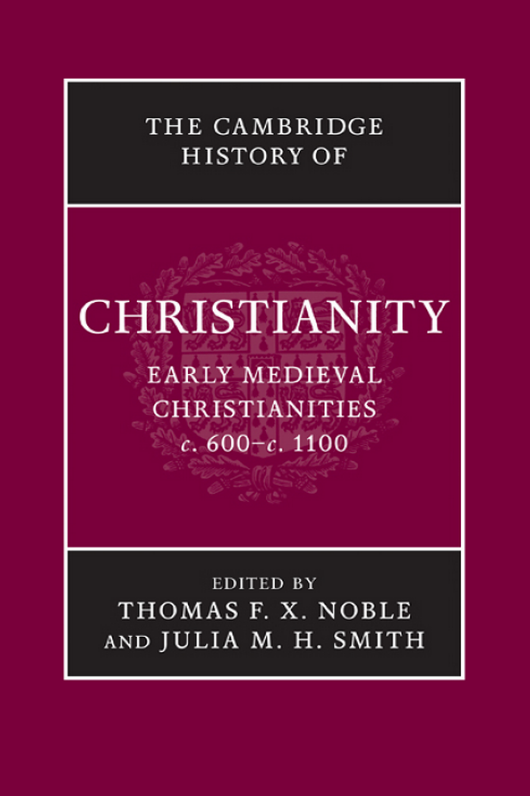

*《剑桥基督教史》第三卷：中世纪早期基督教诸形态，约600—约1100年。*

<!-- PDF page 2; original page unnumbered -->

## 本卷简介

本书关注的核心，是从古代晚期到第一次十字军东征期间，基督徒生活经验各个方面所呈现的活力与变化。它把制度史与教义史牢牢放入基督教的种种文化表现和实际生活经验之中，考察范围从阿富汗一直延伸到冰岛。因此，《剑桥基督教史》本卷强调，无论在地方还是世界层面，基督教的表现形式始终多种多样，而且不断变化。本卷运用社会性别研究、书籍形制学、考古学和人类学等多个学科的见解，提出新的解释，挑战人们对这一奠基时期习以为常的认识。全卷涉及东方、拜占庭和西方基督教，探讨基督徒与其他人群，尤其是犹太人、穆斯林及异教徒的接触；教会的制度生活，包括法律、改革与修道生活；敬拜、信仰和道德的牧灵与圣事背景；最后讨论其文化与神学意义，包括异端、圣徒崇敬和来世。

托马斯·F. X. 诺布尔（Thomas F. X. Noble）是圣母大学中世纪研究所罗伯特·M. 康韦所长及历史学教授。他曾任教于得克萨斯理工大学和弗吉尼亚大学，并曾在美国和欧洲获得多项享有声誉的研究奖助。他撰写或主编了六部著作，发表了三十余篇书籍章节或期刊论文。

朱莉娅·M. H. 史密斯（Julia M. H. Smith）是格拉斯哥大学爱德华兹中世纪史讲席教授、皇家历史学会会士，曾任教于康涅狄格州哈特福德的三一学院和圣安德鲁斯大学。她发表了多篇期刊论文，撰写或主编了四部著作，最近的一部是《罗马之后的欧洲：500—1000年的新文化史》（Europe after Rome: A New Cultural History 500–1000，2005）。

> 本卷的任职介绍与“最近”等相对时间，均依2008年原书。

<!-- PDF page 3; original page unnumbered -->

（原书空白页。）

<!-- PDF page 4; original page unnumbered -->

## 《剑桥基督教史》丛书

《剑桥基督教史》按年代顺序，全面叙述基督教从起源至今在神学、思想、社会、政治、地域及全球等各个方面的发展。每一卷本身都对相应时期的学术研究作出重要贡献，而整套《历史》则构成一部大型学术参考著作。

这套《历史》旨在提供全球视野，超出西欧基督教及其分支的范围。从早期开始，它就充分考察东方和科普特基督教；在较晚的时期，又适当覆盖非洲、远东、新大陆、南亚和其他非欧洲地区基督教的发展。各卷涉及民众虔敬及基督教信仰的非正式表达，并在广阔的文化背景中探讨基督徒养成、敬拜和敬虔的社会学问题。基督教与其他主要信仰之间的关系，也是贯穿全套著作的关注点。无论对学者还是学生，这套《历史》都将提供宝贵的参考资源。

各卷如下：

- 第一卷《起源至君士坦丁》：玛格丽特·M. 米切尔（Margaret M. Mitchell）、弗朗西丝·M. 扬（Frances M. Young）编。
- 第二卷《君士坦丁至约600年》：奥古斯丁·卡西代（Augustine Casiday）、弗雷德里克·W. 诺里斯（Frederick W. Norris）编。
- 第三卷《中世纪早期基督教诸形态：约600—约1100年》：托马斯·F. X. 诺布尔、朱莉娅·M. H. 史密斯编。
- 第四卷《西欧基督教：约1100—约1500年》：米里·鲁宾（Miri Rubin）、沃尔特·西蒙（Walter Simon）编。
- 第五卷《东方基督教》：迈克尔·安戈尔德（Michael Angold）编。

<!-- PDF page 5; original page unnumbered -->

- 第六卷《改革与扩张：1500—1660年》：夏伯嘉（Ronnie Po-chia Hsia）编。
- 第七卷《启蒙、复兴与革命：1660—1815年》：斯图尔特·J. 布朗（Stewart J. Brown）、蒂莫西·塔克特（Timothy Tackett）编。
- 第八卷《世界基督教诸形态：约1815—约1914年》：布赖恩·斯坦利（Brian Stanley）、谢里丹·吉利（Sheridan Gilley）编。
- 第九卷《世界基督教诸形态：约1914—约2000年》：休·麦克劳德（Hugh McLeod）编。

<!-- PDF page 6; original page unnumbered -->

## 书名页

《剑桥基督教史》第三卷

**中世纪早期基督教诸形态：约600—约1100年**

编者：托马斯·F. X. 诺布尔、朱莉娅·M. H. 史密斯

助理编辑：罗伯塔·A. 巴拉诺夫斯基（Roberta A. Baranowski）

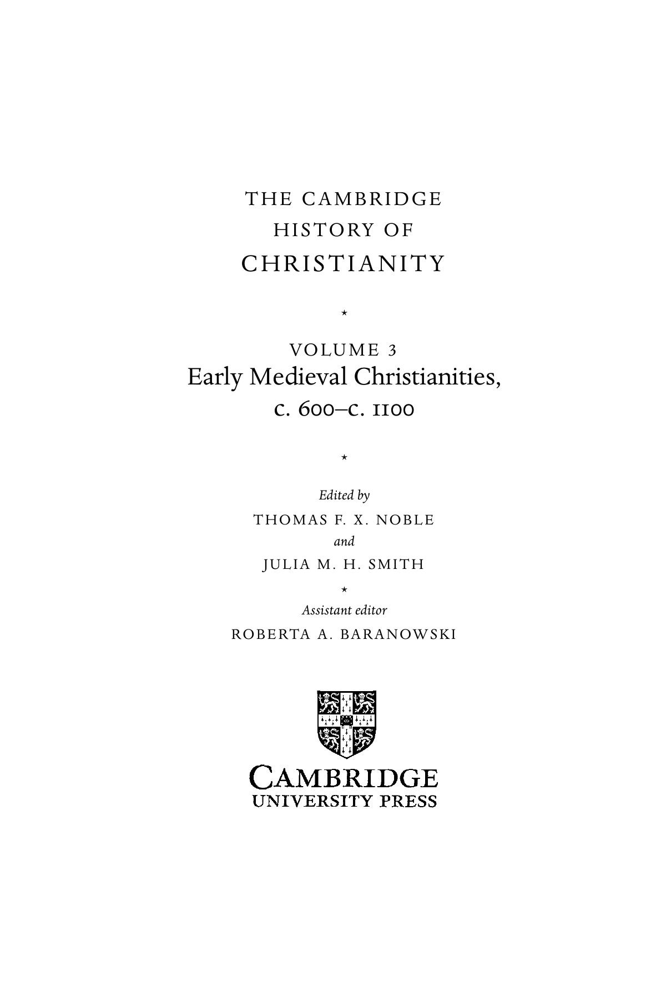

<!-- PDF page 7; original page unnumbered -->

## 版权与出版资料

剑桥大学出版社；剑桥、纽约、墨尔本、马德里、开普敦、新加坡、圣保罗、德里。

英国地址：Cambridge University Press, The Edinburgh Building, Cambridge CB2 8RU, UK。美国由剑桥大学出版社纽约分社出版。

出版社网站：www.cambridge.org。本书资料：www.cambridge.org/9780521817752。

© 剑桥大学出版社，2008年。本出版物受版权保护。除法律规定的例外及相关集体许可协议所允许的情形外，未经剑桥大学出版社书面许可，不得复制本书的任何部分。

2008年首次出版。英国剑桥大学印刷厂印制。

英国图书馆备有本书的编目记录。

美国国会图书馆在版编目资料：Early medieval Christianities, c. 600–c. 1100 / editors, Thomas F. X. Noble, Julia M. H. Smith; assistant editor, Roberta A. Baranowski. p. cm. – (The Cambridge history of Christianity; v. 3)。含参考文献与索引。ISBN 978-0-521-81775-2，精装。

主题：1. 教会史——中世纪，600—1500年。I. Noble, Thomas F. X. II. Smith, Julia M. H. III. Baranowski, Roberta A.

BR252.E27 2008；270.2 – dc22；2007050262。

剑桥大学出版社不负责本书所引外部或第三方网站网址的持续有效性或准确性，也不保证这些网站上的任何内容现在或将来准确、适宜。

<!-- PDF page 8; original page vii -->

## 原书目录

> 以下数字为原书印刷页码。

- 插图目录，xi
- 地图目录，xii
- 撰稿人，xiii
- 序言，xv
- 致谢，xix
- 缩写，xxi
- 引言：约600年的基督教世界，彼得·布朗，1

### 第一编 基础：民族、地域与传统

- 第1章 罗马晚期的基督教诸形态，菲利普·鲁索，21
- 第2章 拜占庭正教的形成（600—1095年），安德鲁·劳思，46
- 第3章 帝国之外之一：从波斯征服到突厥征服的东方基督教诸形态（604—1071年），伊戈尔·多尔夫曼—拉扎列夫，65
- 第4章 帝国之外之二：凯尔特诸民族的基督教诸形态，托马斯·M. 查尔斯—爱德华兹，86
- 第5章 日耳曼的基督教诸形态，莱斯利·艾布拉姆斯，107

<!-- PDF page 9; original page viii -->

- 第6章 斯拉夫的基督教诸形态（800—1100年），乔纳森·谢泼德，130

### 第二编 交锋中的基督教

- 第7章 基督徒与犹太人，巴特—舍瓦·阿尔伯特，159
- 第8章 地中海边疆：基督教与伊斯兰教的正面相遇，600—1050年，休·肯尼迪，178
- 第9章 穆斯林统治下的基督徒，西德尼·H. 格里菲斯，197
- 第10章 拉丁与希腊基督徒，蒂娅·M. 科尔巴巴，213
- 第11章 北方边疆：基督教与异教的正面相遇，伊恩·N. 伍德，230

### 第三编 社会与政治秩序中的基督教

- 第12章 作为制度的基督教会，托马斯·F. X. 诺布尔，249
- 第13章 禁欲生活及其制度，安娜—玛丽·埃尔维蒂乌斯、米歇尔·卡普兰，275
- 第14章 法律及其运用，珍妮特·L. 纳尔逊，299
- 第15章 财产及其问题，罗斯玛丽·莫里斯，327
- 第16章 改革：理念与实践，朱莉娅·巴罗，345

<!-- PDF page 10; original page ix -->

- 第17章 景观中的教堂，多米尼克·约尼亚—普拉，363

### 第四编 作为生活经验的基督教

- 第18章 出生与死亡，弗雷德里克·S. 帕克斯顿，383
- 第19章 罪的补救，罗布·梅恩斯，399
- 第20章 疾病与医治，佩里格林·霍登，416
- 第21章 性别与身体，琳达·L. 库恩，433
- 第22章 拉丁基督教中的祭献、馈赠与祈祷，阿诺尔德·安根嫩特，453
- 第23章 礼仪的施行，埃里克·帕拉佐，472

### 第五编 基督教：书籍与观念

- 第24章 上帝的异象，阿兰·布罗，491
- 第25章 正统与偏离，E. 安·马特，510
- 第26章 理解《圣经》，居伊·洛布里雄，531
- 第27章 中世纪拜占庭的基督教书籍，莱斯利·布鲁贝克、玛丽·B. 坎宁安，554

<!-- PDF page 11; original page x -->

- 第28章 圣徒及其崇敬，朱莉娅·M. H. 史密斯，581
- 第29章 末后之事，简·鲍恩，606
- 结语：约1100年的基督教世界，约翰·H. 范恩根，625
- 参考文献，644
- 索引，803

<!-- PDF page 12; original page xi -->

## 插图目录

- 图1 教士的品级，出自《马尔穆捷圣事礼书》：欧坦市立图书馆，手稿19 bis，叶1正面。原书480页。
- 图2 《逾越颂》卷轴：罗马，梵蒂冈宗座图书馆，手稿Barberini Lat. 592，叶1。原书484页。
- 图3 三贤士来朝；屠杀婴孩；基督献于圣殿：巴黎，法国国家图书馆，手稿Gr. 510，叶137正面。原书565页。
- 图4 纳齐安祖斯的格列高利手执笔，翻开书本至正文：巴黎，法国国家图书馆，手稿Gr. 923，叶255正面。原书566页。
- 图5 大卫、基督及井边的撒马利亚妇人：莫斯科历史博物馆，抄本129，叶33正面。原书567页。

<!-- PDF page 13; original page xii -->

## 地图目录

- 地图1 基督教的地中海世界，xxiii
- 地图2 基督教的东方，xxiv—xxv
- 地图3 西欧，xxvi—xxvii
- 地图4 斯拉夫世界，xxviii
- 地图5 不列颠群岛，xxix

<!-- PDF page 14; original page xiii -->

## 撰稿人

> 职务与任职机构依2008年原书。

- 莱斯利·艾布拉姆斯（Lesley Abrams）：牛津大学贝利奥尔学院研究员、历史学部讲师。
- 巴特—舍瓦·阿尔伯特（Bat-Sheva Albert）：巴伊兰大学通史系中世纪史教授。
- 阿诺尔德·安根嫩特（Arnold Angenendt）：明斯特威斯特法伦威廉大学荣休教授。
- 朱莉娅·巴罗（Julia Barrow）：诺丁汉大学历史学院中世纪教会史高级讲师。
- 简·鲍恩（Jane Baun）：牛津大学格雷弗里尔斯学堂及神学部。
- 阿兰·布罗（Alain Boureau）：巴黎社会科学高等研究院历史研究中心。
- 彼得·布朗（Peter Brown）：普林斯顿大学历史系罗林斯历史学讲席教授。
- 莱斯利·布鲁贝克（Leslie Brubaker）：伯明翰大学拜占庭艺术史教授，拜占庭、奥斯曼与现代希腊研究中心主任，考古与古代研究所副所长。
- 托马斯·M. 查尔斯－爱德华兹（Thomas M. Charles-Edwards）：牛津大学耶稣学院凯尔特研究讲席教授。
- 琳达·L. 库恩（Lynda L. Coon）：阿肯色大学历史系副教授。
- 玛丽·B. 坎宁安（Mary B. Cunningham）：诺丁汉大学神学系讲师；伯明翰大学人文与社会科学高等研究院荣誉研究员。
- 伊戈尔·多尔夫曼－拉扎列夫（Igor Dorfmann-Lazarev）：杜伦大学神学与宗教系希腊及东方教父学讲师。
- 西德尼·H. 格里菲斯（Sidney H. Griffith）：美国天主教大学闪米特与埃及语言文学系正教授，华盛顿特区。
- 安娜—玛丽·埃尔维蒂乌斯（Anne-Marie Helvétius）：巴黎第八大学（万塞讷－圣但尼）历史研究中心中世纪史教授。
- 佩里格林·霍登（Peregrine Horden）：伦敦大学皇家霍洛韦学院历史系中世纪史教授。
- 多米尼克·约尼亚－普拉（Dominique Iogna-Prat）：巴黎法国国家科学研究中心。
- 米歇尔·卡普兰（Michel Kaplan）：巴黎第一大学（先贤祠－索邦）历史教学研究单位拜占庭史教授。
- 休·肯尼迪（Hugh Kennedy）：伦敦亚非学院阿拉伯语教授。
- 蒂娅·M. 科尔巴巴（Tia M. Kolbaba）：罗格斯大学宗教系助理教授。
- 居伊·洛布里雄（Guy Lobrichon）：阿维尼翁大学中世纪史教授。

<!-- PDF page 15; original page xiv -->

- 安德鲁·劳思（Andrew Louth）：杜伦大学神学与宗教系教父学及拜占庭研究教授。
- E. 安·马特（E. Ann Matter）：宾夕法尼亚大学宗教学系小威廉·R. 凯南讲席教授。
- 罗布·梅恩斯（Rob Meens）：乌得勒支大学历史研究所讲师。
- 罗斯玛丽·莫里斯（Rosemary Morris）：约克大学历史系访问研究员。
- 珍妮特·L. 纳尔逊（Janet L. Nelson）：伦敦国王学院历史系荣休教授。
- 托马斯·F. X. 诺布尔（Thomas F. X. Noble）：圣母大学历史学教授、中世纪研究所罗伯特·M. 康韦所长。
- 埃里克·帕拉佐（Éric Palazzo）：普瓦捷大学中世纪艺术史教授、中世纪文明高等研究中心主任。
- 弗雷德里克·S. 帕克斯顿（Frederick S. Paxton）：康涅狄格学院历史系布里吉达·帕基亚尼·阿尔登吉历史学讲席教授。
- 菲利普·鲁索（Philip Rousseau）：美国天主教大学安德鲁·W. 梅隆早期基督教研究讲席教授、早期基督教研究中心主任，华盛顿特区。
- 乔纳森·谢泼德（Jonathan Shepard）：原剑桥大学历史学讲师。
- 朱莉娅·M. H. 史密斯（Julia M. H. Smith）：格拉斯哥大学历史系爱德华兹中世纪史讲席教授。
- 约翰·H. 范恩根（John H. Van Engen）：圣母大学历史系安德鲁·V. 塔克斯中世纪史讲席教授。
- 伊恩·N. 伍德（Ian N. Wood）：利兹大学历史学院中世纪早期史教授。

## 序言<!-- PDF page 16; original page xv -->在《剑桥基督教史》第一、二卷所涵盖的时期，基督教在古代世界兴起、传播，并强化了对人们生活的要求。第三卷讨论通常被称为“中世纪早期”的几个世纪，从约600年延伸到约1100年。在这段漫长、充满活力与创造性的时代，古代基督教的成就得到巩固，同时也出现了剧烈的新发展。

把握中世纪早期变化与延续的一种办法，是阅读本卷开头和结尾的两篇文章。开篇全景式地呈现约600年的基督教，其间偶尔回望过去，瞥见未来；结篇则以类似的全景视野观察约1100年的情形。600年时，基督教在根本上仍是一种地中海现象。几乎所有具有创造力的中心，以及重要的行政地点，都紧贴这片内海的海岸。当时绝大多数基督徒，都生活在距海两百英里以内。基督教在地中海盆地之外最引人瞩目的地域扩张，发生在东方和非洲。西欧只是在那时，才开始显现为可能成长和发展的地方。到1100年，基督教的创造核心，已经明确位于西欧。伊斯兰教迅速而持续的扩张，使基督教在欧洲和非洲的地中海地区，以及中亚和西亚的存在减弱。伊斯兰教也不断向拜占庭，因而向正教基督教，提出挑战。事实上，拜占庭的影响范围不仅在东地中海缩小，在北方也同样如此；阿瓦尔、保加尔和斯拉夫诸民族与国家，挑战着拜占庭历史上提出的权利主张。与此同时，除波罗的海东岸的某些地区外，基督教已经传播到欧洲本身的每个角落。如果说安提阿和亚历山大里亚曾是古代基督教的思想重镇，那么，在千年之交前后的几个世纪里，温彻斯特、科隆、巴黎和沙特尔等地，便占据了主导影响。

<!-- PDF page 17; original page xvi -->

在初启的二十一世纪，基督教已十分明确地是一种世界宗教：它在欧洲日益边缘化，在其他大陆却生机勃勃。中世纪早期的几个世纪，开启了一段漫长时期。在这期间，基督教似乎在根本上是一种欧洲现象；后来，它才逐步以天主教和新教两种形态，传播到世界其他大部分地区。今天，基督教诸形态巧妙地融合着不同民族、地方、语言、文化与历史经验。600年的基督教诸形态也是如此；到1100年仍然如此，尽管重心已向北、向西移动，促成同质化的力量也已变得明显。

本卷题为《中世纪早期基督教诸形态》。使用复数，并不是要否认所有基督徒都能把根源追溯到古代的地中海世界，也不是否认他们从同一套经典的不同版本获得灵感，以颇为相似的方式敬拜，或其教会共享许多法律与制度特征。相反，复数提示我们：对于一种不断变化、从爱尔兰延伸到阿富汗、从挪威延伸到努比亚的宗教，使用过度概括的语言是徒劳的。基督教改变了它接触的每个民族与文化，但它自身也受到民族、文化、先前历史，甚至地貌景观的改变。因此，复数所表示的，是丰富、创造力与复杂性，而非混乱、困惑或不统一。

此外，必须从多种相互补充的角度理解基督教。把这些角度合在一起，也再次要求我们使用复数来描述。基督教在各地都是一种教会现象，却发展出十分不同的教会类型，以及支持、解释这些教会的教会论观念。基督教也是一套教导，人们以不同程度，从思想、心灵与身体上接受它。这些立场必须得到界定、阐述与传递。在古代，它们往往引发激烈争斗。中世纪早期的教义争执较少，但也存在庞大的基督徒群体，他们并不在一切事情上信得相同，彼此往来也相对有限。基督教还伴随从出生到死亡的重大生命时刻；它是一种生活经验，至少与其作为一套教义表述同样重要，甚至更重要。古代基督教，在根本上是一种城市现象。城市并非中世纪早期欧洲的突出特征。然而，奇特的是，即使基督教扎根于基本属于乡村和农业的社会，它仍保留着本质上具有城市性质的结构、实践与视野。在这方面，适应和地方特殊性同样清楚可见。无论我们关注什么地点、时代，<!-- PDF page 18; original page xvii -->或题目，都无法有效地把基督教简化成一个单一现象。

意识到这些基本指导原则，有助于读者把握本卷的安排，看见连接其组织骨架的脉络。本卷第一编，从地理和历史角度巡视几个主要而可辨识的地区，基督教在其中或延续古代成就，或重新起步。本编第一章概览罗马晚期的情形，随后各章探讨拜占庭世界、东方基督教的多种形态，以及斯拉夫、日耳曼和凯尔特地区的基督教。下一编明确讨论基督教与犹太教的相遇；基督教沿着不断扩展的边疆，以及在哈里发国境内，与伊斯兰教的交锋；希腊基督徒与拉丁基督徒的接触；最后，是基督教与日耳曼、斯拉夫异教之间长期的交往与较量。这两编强调塑造中世纪早期基督教诸形态的、更广泛的政治、文化和宗教环境。

接下来的一组章节，处理可以广义地归为制度的问题：教会组织、修道生活与禁欲、法律的制定与实施、财产和物质事务、改革观念，以及崇拜场所。前两编的章节，往往集中于特定地区或文化接触事件；与之不同，第三编各章广泛考察本卷涵盖的一切基督教形态。它们在高度概括与足够具体的例证、个案研究之间取得平衡，使关键问题既清楚，又生动。

第四编把基督教视为一种生活经验，讨论其历史与实践中的重要主题，尤其关注教会及其基督徒团体的圣事生活。它的前提是：敬拜、仪式和祈祷的方式，能使我们深入了解人们相信什么，或者被期待相信什么。讨论从伴随出生与死亡的礼仪开始。在洗礼和临终傅油之后，是悔罪：既包括悔罪实践，也包括罪与救赎的观念。随后对疾病和医治的讨论，兼顾医学与属灵的补救方法。再下一章探讨性别、性与身体，使我们得以看见：作者们如何谈论那些真正构成中世纪早期基督徒的人，无论平信徒还是教士。本编最后，从两个方面讨论敬拜：圣餐礼仪庆典背后的神学——它在各地都是教会的核心敬拜行动——以及礼仪本身的施行，其中也涉及施行礼仪所需的书籍。

<!-- PDF page 19; original page xviii -->

第五编也是最后一编，处理思想与文化问题，它们既涉及正式学问，也涉及基督教的想象世界。开篇讨论中世纪早期人们思考、书写上帝的诸多方式中的若干种。下一章通过考察教义争执，直接讨论“谈论上帝”，即神学。这些争执在数量与激烈程度上，都少于古代；也许在大多数中世纪早期基督教形态的日常经验中，它们扎根得也没有那么深。《圣经》——在任何时间、任何地方，它都是基督教至关重要的一本书，或者一组书——将从其文本与诠释框架加以讨论。书籍作为实物，也获得深入探讨，尤其关注东方基督教传统的书籍。至于圣徒，即那些被认为过着典范生活的神圣男女，本编通过分析他们，了解教会精英与普通信徒的抱负和期待。最后，以“末后之事”收束全卷，恰如其分：基督徒怎样想象另一个世界，那个坟墓以外的世界？

整体而言，本卷向读者呈现二十一世纪学者想象中世纪早期基督教诸形态那个异样世界的主要方式。这里提出的解释，永远不可能是定论。以下许多篇章，都挑战并更新了长期深植于基督教史中的争论或假定。在重新评估它们时，本书把某些问题从注意力中心移开，代之以对于基督纪元第三个千年中迅速变化的世界而言，更合时宜的其他问题。我们希望，本书能像编写它的过程之于编者与撰稿人一样，也使读者受到挑战，获得新的认识。

托马斯·F. X. 诺布尔（Thomas F. X. Noble）

朱莉娅·M. H. 史密斯（Julia M. H. Smith）

<!-- PDF page 20; original page xix -->

## 致谢

本卷的编辑过程是一项协作事业，其程度远远超过书名页上两位编者的署名可能给人的印象。我们衷心感谢所有撰稿人在促成本书问世过程中发挥的作用。对于我们就各章内容与呈现方式提出的建议，大家都给予了友善的回应；许多人还就各种具体细节为我们提供了专业的意见与指导。编辑过程中出现了未曾预料而又不可避免的延误，大家也都体谅、耐心地承受了下来，两位编者为此深怀感激。

如果没有圣母大学在经费和实际工作方面极为慷慨的支持，这项计划就无法实现。圣母大学中世纪研究所与文理学术研究所共同承担了将三大洲撰稿人召集到一起的费用；麦肯纳中心则提供了理想的环境，让同仁们对彼此的章节初稿展开热烈而富有启发的批评。这次研讨会赋予本卷一种仅靠编辑指导无法达到的连贯性；本书以下各页，也表达了与会者对那三天的思想激励和友好氛围的珍视。从筹办会议到形成纸质及电子版的完善文稿，在本书准备工作的每个阶段，中世纪研究所助理所长罗伯塔·巴拉诺夫斯基都提供了宝贵的行政支持，并投入了大量文字编辑工作。我们很高兴能够在此公开承认自己对她的深深感激。

两位译者将语言敏感与相关领域的知识运用于各章作者的德文、法文原稿，译成英文。圣安德鲁斯大学罗娜·约翰斯顿·戈登博士把安根恩特教授的章节由德文译出。圣母大学的安德鲁·欧文则把布罗、埃尔韦修斯与卡普兰、约尼亚－普拉、洛布里雄及帕拉佐诸位教授的章节由法文译出。

<!-- PDF page 21; original page xx -->

我们同样感谢剑桥大学出版社所有参与本卷工作的人员：凯文·泰勒邀请我们承担此项工作；接替他负责宗教编辑业务的凯特·布雷特及其助理吉莉安·达德，始终给予我们充分的精神支持、实际帮助和耐心体谅；莉兹·戴维则极为高效地监督了制作过程。出版社还慷慨承担了索引的编制工作。

在制作的最后阶段，里奇斯编辑服务公司的克里斯托弗·里奇斯细致地协调校样订正工作，并在许多其他重要方面改进了本书。我们对他出色的专业精神深表谢忱。

托马斯·F. X. 诺布尔、朱莉娅·M. H. 史密斯

<!-- PDF page 22; original page xxi -->

## 缩写

> 文献全名及出版资料保留原文；Ed.为编订，trans.为翻译，vol./vols.为卷，pt.为部分。

- **AASS**：Acta sanctorum quotquot toto orbe coluntur. Ed. J. Bollandus et al. Antwerp and Brussels, 1634–.
- **Bede, HE**：Bede. Historia ecclesiastica gentis Anglorum. Ed. and trans. B. Colgrave and R. A. B. Mynors. Bede’s Ecclesiastical History of the English People. Oxford Medieval Texts. Oxford: Oxford University Press, 1969.
- **BMFD**：Byzantine Monastic Foundation Documents: A Complete Translation of the Surviving Founders’ Typika and Testaments. Ed. J. Thomas and A. C. Hero, with G. Constable. 5 vols. Washington, DC: Dumbarton Oaks, 2000.
- **CC**：Corpus christianorum。
- **CCCM**：Corpus christianorum continuatio mediaevalis。
- **CCSG**：Corpus christianorum series graeca。
- **CCSL**：Corpus christianorum series latina。
- **CSCO**：Corpus scriptorum christianorum orientalium。
- **CSEL**：Corpus scriptorum ecclesiasticorum latinorum。
- **DOP**：Dumbarton Oaks Papers。
- **EME**：Early Medieval Europe。
- **Haddan and Stubbs**：A. W. Haddan and W. Stubbs, eds. Councils and Ecclesiastical Documents Relating to Great Britain and Ireland. 3 vols. Oxford: Clarendon Press, 1869–78.
- **Histoire du christianisme 3**：Les églises d’orient et d’occident. Ed. L. Pietri, J.-M. Mayeur, and B. Beaujard. Vol. 3 in Histoire du christianisme des origines à nos jours. Paris: Desclée, 1998.
- **Histoire du christianisme 4**：Évêques, moines et empereurs (610–1054). Ed. G. Dagron, P. Riché, and A. Vauchez. Vol. 4 in Histoire du christianisme des origines à nos jours. Paris: Desclée, 1993.

<!-- PDF page 23; original page xxii -->

- **Histoire du christianisme 5**：Apogée de la papauté et expansion de la chrétienté (1054–1274). Ed. A. Vauchez and J. Kłoczowski. Vol. 5 in Histoire du christianisme des origines à nos jours. Paris: Desclée, 1993.
- **Mansi**：Mansi, G. D., ed., Sacrorum conciliorum nova et amplissima collectio. 31 vols. Florence, 1759–98; rev. ed. J.-B. Martin and L. Petit. 53 vols. in 60. Paris, 1899–27.（末一出版年代范围依原书。）
- **MGH**：Monumenta Germaniae Historica。
- **MGH SRG**：MGH scriptores rerum germanicarum。
- **MGH SRM**：MGH scriptores rerum merovingicarum。
- **NCMH 2**：The New Cambridge Medieval History. Vol. 2: c. 700–900. Ed. R. McKitterick. Cambridge: Cambridge University Press, 1995.
- **ODB**：Oxford Dictionary of Byzantium. Ed. A. Kazhdan. 3 vols. Oxford: Oxford University Press, 1991.
- **PO**：Patrologia orientalis。
- **PG**：Patrologia graeca = Patrologiae cursus completus. Series graeca. Comp. by J.-P. Migne. 161 vols. Paris, 1857–66.
- **PL**：Patrologia latina = Patrologiae cursus completus. Series secunda in qua prodeunt patres... ecclesiae latinae. Comp. by J.-P. Migne. 221 in 222 vols. Paris, 1844–64.
- **SC**：Sources chrétiennes。
- **SCH**：Studies in Church History。

### 关于脚注引证的说明

一般而言，本卷的脚注用以下方式标示章、页和卷：作者，著作题名，卷号（如有），著作内部的章、节，所用具体版本的页码。

例如：Anonymous, Historia 2, II.ii.3, 346–47。其意为：匿名作者《Historia》第2卷第2章第2节第3部分，在参考文献所列版本中见346—347页。

除非为避免歧义确有必要，脚注不列版本编者或译者姓名，只在参考文献中列出。例如：Anonymous, Historia 2, 25–37 (ed. Smith, 399–401)，其意为：匿名作者《Historia》第2卷第25—37节（如文献逐件编号，则指第25—37号文献），见史密斯编本399—401页。

<!-- PDF page 24; original page map -->

## 地图1 基督教的地中海世界

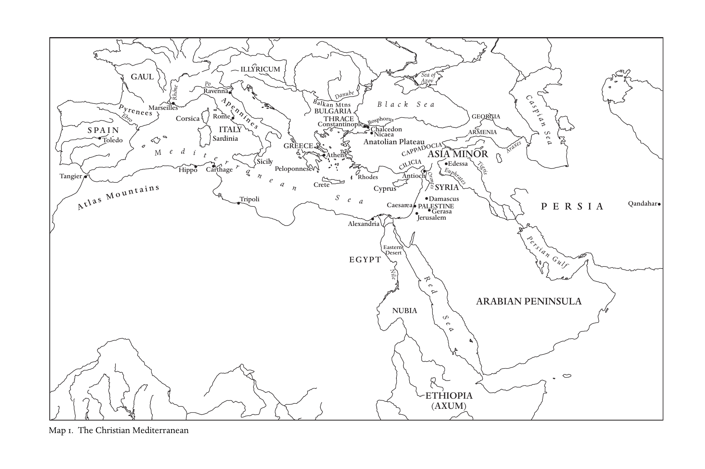

*地图1 基督教的地中海世界。原图内地名保留原文，下附中文对照。*

| 原图标记 | 中文 |
|---|---|
| Gaul | 高卢 |
| Illyricum | 伊利里库姆 |
| Spain | 西班牙 |
| Toledo | 托莱多 |
| Ebro | 埃布罗河 |
| Pyrenees | 比利牛斯山脉 |
| Rhône | 罗讷河 |
| Marseilles | 马赛 |
| Po | 波河 |
| Ravenna | 拉文纳 |
| Rome | 罗马 |
| Apennines | 亚平宁山脉 |
| Italy | 意大利 |
| Corsica | 科西嘉 |
| Sardinia | 撒丁岛 |
| Sicily | 西西里 |
| Tangier | 丹吉尔 |
| Atlas Mountains | 阿特拉斯山脉 |
| Hippo | 希波 |
| Carthage | 迦太基 |
| Tripoli | 的黎波里 |
| Mediterranean Sea | 地中海 |
| Greece | 希腊 |
| Athens | 雅典 |
| Peloponnese | 伯罗奔尼撒 |
| Crete | 克里特 |
| Danube | 多瑙河 |
| Balkan Mtns | 巴尔干山脉 |
| Bulgaria | 保加利亚 |
| Thrace | 色雷斯 |
| Constantinople | 君士坦丁堡 |
| Bosphorus | 博斯普鲁斯海峡 |
| Chalcedon | 迦克墩 |
| Nicaea | 尼西亚 |
| Anatolian Plateau | 安纳托利亚高原 |
| Cappadocia | 卡帕多西亚 |
| Asia Minor | 小亚细亚 |
| Cilicia | 奇里乞亚 |
| Rhodes | 罗得岛 |
| Cyprus | 塞浦路斯 |
| Antioch | 安提阿 |
| Orontes | 奥龙特斯河 |
| Edessa | 埃德萨 |
| Syria | 叙利亚 |
| Damascus | 大马士革 |
| Palestine | 巴勒斯坦 |
| Gerasa | 杰拉萨 |
| Caesarea | 凯撒里亚 |
| Jerusalem | 耶路撒冷 |
| Alexandria | 亚历山大里亚 |
| Egypt | 埃及 |
| Eastern Desert | 东部沙漠 |
| Nile | 尼罗河 |
| Nubia | 努比亚 |
| Ethiopia (Axum) | 埃塞俄比亚（阿克苏姆） |
| Red Sea | 红海 |
| Arabian Peninsula | 阿拉伯半岛 |
| Persian Gulf | 波斯湾 |
| Persia | 波斯 |
| Qandahar | 坎大哈 |
| Black Sea | 黑海 |
| Sea of Azov | 亚速海 |
| Georgia | 格鲁吉亚 |
| Armenia | 亚美尼亚 |
| Araxes | 阿拉克斯河 |
| Caspian Sea | 里海 |
| Tigris | 底格里斯河 |
| Euphrates | 幼发拉底河 |

<!-- PDF page 25; original page map -->

## 地图2 基督教的东方

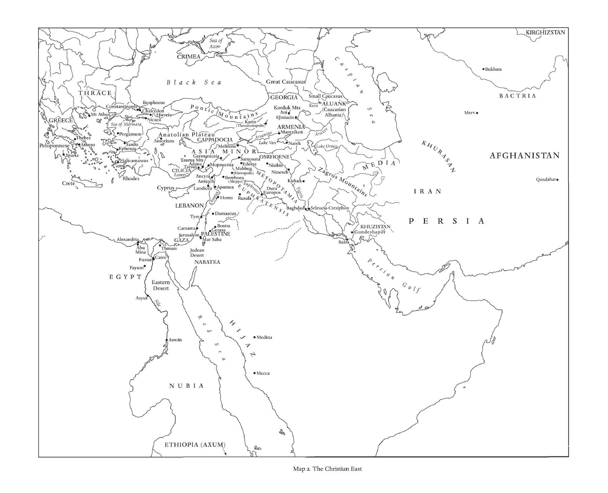

*地图2 基督教的东方。原图内地名保留原文，下附中文对照。*

| 原图标记 | 中文 |
|---|---|
| Sea of Azov | 亚速海 |
| Crimea | 克里米亚 |
| Black Sea | 黑海 |
| Great Caucasus | 大高加索山脉 |
| Small Caucasus | 小高加索山脉 |
| Georgia | 格鲁吉亚 |
| Korduk Mts | 科尔杜克山脉 |
| Ani | 阿尼 |
| Ejmiacin | 埃奇米阿津 |
| Kura | 库拉河 |
| Ałuankʿ (Caucasian Albania) | 阿卢安克（高加索阿尔巴尼亚） |
| Armenia | 亚美尼亚 |
| Mantzikert | 曼齐刻尔特 |
| Karin (Theodosiopolis) | 卡林（狄奥多西奥波利斯） |
| Arsanius | 阿尔萨尼乌斯河 |
| Araxes | 阿拉克斯河 |
| Lake Van | 凡湖 |
| Narek | 纳雷克 |
| Lake Urmia | 乌尔米耶湖 |
| Caspian Sea | 里海 |
| Kirghizstan | 吉尔吉斯斯坦 |
| Bukhara | 布哈拉 |
| Bactria | 巴克特里亚 |
| Merv | 木鹿 |
| Khurasan | 呼罗珊 |
| Afghanistan | 阿富汗 |
| Qandahar | 坎大哈 |
| Iran | 伊朗 |
| Persia | 波斯 |
| Media | 米底亚 |
| Zagros Mountains | 扎格罗斯山脉 |
| Khuzistan | 胡齐斯坦 |
| Gundeshāpūr | 贡德沙普尔 |
| Basra | 巴士拉 |
| Baghdad | 巴格达 |
| Seleucia-Ctesiphon | 塞琉西亚－泰西封 |
| Tigris | 底格里斯河 |
| Kirkuk | 基尔库克 |
| Nineveh | 尼尼微 |
| Nisibis | 尼西比斯 |
| Osrhoene | 奥斯若恩 |
| Mesopotamia | 美索不达米亚 |
| Euphratensis | 幼发拉底行省 |
| Euphrates | 幼发拉底河 |
| Dura Europos | 杜拉－欧罗波斯 |
| Edessa | 埃德萨 |
| Samosata | 萨莫萨塔 |
| Mabbug (Hieropolis) | 马布格（希耶罗波利斯） |
| Berrhoea (Aleppo) | 贝罗亚（阿勒颇） |
| Rusafa | 鲁萨法 |
| Homs | 霍姆斯 |
| Apamea | 阿帕米亚 |
| Laodicea | 劳迪基亚 |
| Antioch | 安提阿 |
| Ancyra | 安居拉 |
| Adana | 阿达纳 |
| Mopsuestia | 摩普绥斯提亚 |
| Tarsus | 塔尔苏斯 |
| Lamys | 拉米斯 |
| Cilicia | 奇里乞亚 |
| Taurus Mts | 托罗斯山脉 |
| Germaniceia | 日耳曼尼基亚 |
| Melitene | 梅利特内 |
| Cappadocia | 卡帕多西亚 |
| Asia Minor | 小亚细亚 |
| Anatolian Plateau | 安纳托利亚高原 |
| Amorium | 阿莫里翁 |
| Pontic Mountains | 本都山脉 |
| Pergamum | 佩加蒙 |
| Sardis | 撒狄 |
| Ephesus | 以弗所 |
| Halicarnassus | 哈利卡纳苏斯 |
| Rhodes | 罗得岛 |
| Cyprus | 塞浦路斯 |
| Crete | 克里特 |
| Greece | 希腊 |
| Sparta | 斯巴达 |
| Athens | 雅典 |
| Thebes | 底比斯 |
| Peloponnese | 伯罗奔尼撒 |
| Mt Athos | 阿索斯山 |
| Thrace | 色雷斯 |
| Constantinople | 君士坦丁堡 |
| Bosphorus | 博斯普鲁斯海峡 |
| Chalcedon | 迦克墩 |
| Hiereia | 希耶里亚 |
| Nicaea | 尼西亚 |
| Sea of Marmara | 马尔马拉海 |
| Lebanon | 黎巴嫩 |
| Orontes | 奥龙特斯河 |
| Damascus | 大马士革 |
| Tyre | 推罗 |
| Caesarea | 凯撒里亚 |
| Bostra | 博斯特拉 |
| Gerasa | 杰拉萨 |
| Palestine | 巴勒斯坦 |
| Jerusalem | 耶路撒冷 |
| Gaza | 加沙 |
| Mar Saba | 马尔萨巴 |
| Judean Desert | 犹太沙漠 |
| Nabatea | 纳巴泰 |
| Alexandria | 亚历山大里亚 |
| Abu Mina | 阿布米纳 |
| Thmuis | 特穆伊斯 |
| Cairo | 开罗 |
| Fustat | 福斯塔特 |
| Fayum | 法尤姆 |
| Asyut | 艾斯尤特 |
| Aswān | 阿斯旺 |
| Egypt | 埃及 |
| Eastern Desert | 东部沙漠 |
| Nile | 尼罗河 |
| Nubia | 努比亚 |
| Ethiopia (Axum) | 埃塞俄比亚（阿克苏姆） |
| Red Sea | 红海 |
| Hijaz | 希贾兹 |
| Medina | 麦地那 |
| Mecca | 麦加 |
| Persian Gulf | 波斯湾 |

<!-- PDF page 26; original page map -->

## 地图3 西欧（北部）

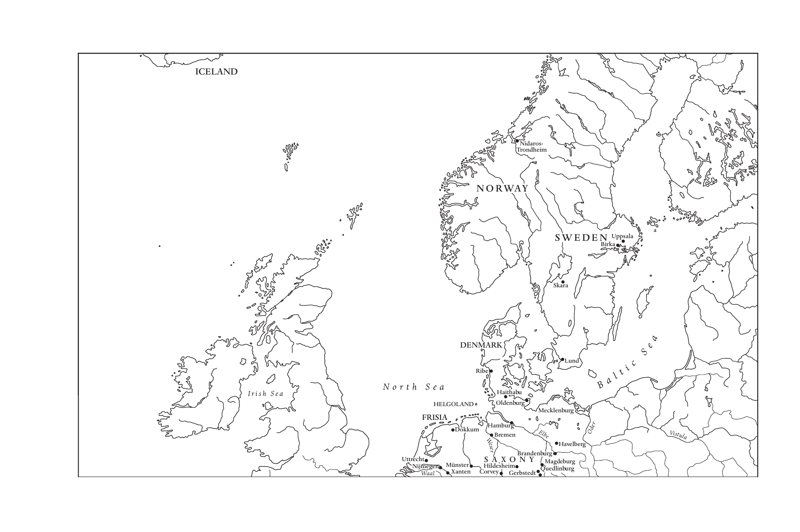

*地图3 西欧（北部）。原图内地名保留原文，下附中文对照。*

| 原图标记 | 中文 |
|---|---|
| Iceland | 冰岛 |
| Nidaros-Trondheim | 尼达罗斯－特隆赫姆 |
| Norway | 挪威 |
| Sweden | 瑞典 |
| Uppsala | 乌普萨拉 |
| Birka | 比尔卡 |
| Skara | 斯卡拉 |
| Denmark | 丹麦 |
| Lund | 隆德 |
| Ribe | 里伯 |
| Haithabu | 海塔布 |
| Oldenburg | 奥尔登堡 |
| Helgoland | 黑尔戈兰 |
| Frisia | 弗里西亚 |
| Dokkum | 多库姆 |
| Hamburg | 汉堡 |
| Bremen | 不来梅 |
| Mecklenburg | 梅克伦堡 |
| Brandenburg | 勃兰登堡 |
| Havelberg | 哈弗尔贝格 |
| Magdeburg | 马格德堡 |
| Quedlinburg | 奎德林堡 |
| Gerbstedt | 格尔布施泰特 |
| Hildesheim | 希尔德斯海姆 |
| Corvey | 科尔韦 |
| Münster | 明斯特 |
| Xanten | 克桑滕 |
| Utrecht | 乌得勒支 |
| Nijmegen | 奈梅亨 |
| Saxony | 萨克森 |
| Waal | 瓦尔河 |
| Weser | 威悉河 |
| Elbe | 易北河 |
| Oder | 奥得河 |
| Vistula | 维斯瓦河 |
| Baltic Sea | 波罗的海 |
| North Sea | 北海 |
| Irish Sea | 爱尔兰海 |

<!-- PDF page 27; original page map -->

## 地图3 西欧（南部）

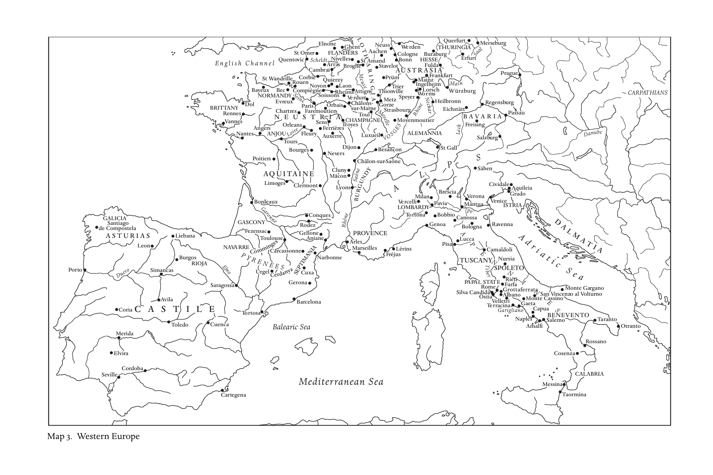

*地图3 西欧（南部）。原图内地名保留原文，下附中文对照。*

| 原图标记 | 中文 |
|---|---|
| English Channel | 英吉利海峡 |
| Quentovic | 康托维克 |
| St Omer | 圣奥梅尔 |
| Elnone | 埃尔农 |
| Ghent | 根特 |
| Flanders | 佛兰德斯 |
| Scheldt | 斯海尔德河 |
| Nivelles | 尼韦勒 |
| Arras | 阿拉斯 |
| Cambrai | 康布雷 |
| St Amand | 圣阿芒 |
| Brogne | 布罗涅 |
| Neuss | 诺伊斯 |
| Werden | 韦尔登 |
| Aachen | 亚琛 |
| Cologne | 科隆 |
| Bonn | 波恩 |
| Stavelot | 斯塔沃洛 |
| Lotharingia | 洛塔林吉亚 |
| Meuse | 默兹河 |
| Austrasia | 奥斯特拉西亚 |
| Prüm | 普吕姆 |
| Trier | 特里尔 |
| Thionville | 蒂永维尔 |
| Metz | 梅斯 |
| Gorze | 戈尔兹 |
| Verdun | 凡尔登 |
| Attigny | 阿蒂尼 |
| Reims | 兰斯 |
| Laon | 拉昂 |
| Quierzy | 基耶尔济 |
| Soissons | 苏瓦松 |
| Corbie | 科尔比 |
| Noyon | 努瓦永 |
| Compiègne | 贡比涅 |
| Rouen | 鲁昂 |
| St Wandrille | 圣旺德里耶 |
| Bec | 贝克 |
| Bayeux | 巴约 |
| Evreux | 埃夫勒 |
| Normandy | 诺曼底 |
| Seine | 塞纳河 |
| Paris | 巴黎 |
| Chartres | 沙特尔 |
| Faremoutiers | 法尔穆捷 |
| Orléans | 奥尔良 |
| Neustria | 纽斯特里亚 |
| Sens | 桑斯 |
| Ferrières | 费里耶尔 |
| Orbais | 奥尔贝 |
| Châlons-sur-Marne | 马恩河畔沙隆 |
| Champagne | 香槟 |
| Troyes | 特鲁瓦 |
| Toul | 图勒 |
| Strasbourg | 斯特拉斯堡 |
| Moselle | 摩泽尔河 |
| Vosges | 孚日山脉 |
| Moyenmoutier | 莫延穆捷 |
| Luxeuil | 吕克瑟伊 |
| Fleury | 弗勒里 |
| Auxerre | 欧塞尔 |
| Tours | 图尔 |
| Loire | 卢瓦尔河 |
| Angers | 昂热 |
| Anjou | 安茹 |
| Nantes | 南特 |
| Dol | 多尔 |
| Rennes | 雷恩 |
| Vannes | 瓦讷 |
| Brittany | 布列塔尼 |
| Poitiers | 普瓦捷 |
| Bourges | 布尔日 |
| Nevers | 讷韦尔 |
| Dijon | 第戎 |
| Besançon | 贝桑松 |
| Châlon-sur-Saône | 索恩河畔沙隆 |
| Cluny | 克吕尼 |
| Mâcon | 马孔 |
| Saône | 索恩河 |
| Lyons | 里昂 |
| Burgundy | 勃艮第 |
| Aquitaine | 阿基坦 |
| Limoges | 利摩日 |
| Clermont | 克莱蒙 |
| Bordeaux | 波尔多 |
| Garonne | 加龙河 |
| Gascony | 加斯科涅 |
| Fenzesac | 芬泽萨克 |
| Toulouse | 图卢兹 |
| Conques | 孔克 |
| Rodez | 罗德兹 |
| Gellone | 热洛讷 |
| Aniane | 阿尼亚讷 |
| Comminges | 科曼日 |
| Carcassonne | 卡尔卡松 |
| Narbonne | 纳博讷 |
| Septimania | 塞普提马尼亚 |
| Pyrenees | 比利牛斯山脉 |
| Navarre | 纳瓦拉 |
| Urgel | 乌赫尔 |
| Cerdany | 塞尔达尼亚 |
| Cuxa | 库克萨 |
| Gerona | 赫罗纳 |
| Barcelona | 巴塞罗那 |
| Tortosa | 托尔托萨 |
| Saragossa | 萨拉戈萨 |
| Ebro | 埃布罗河 |
| Rioja | 里奥哈 |
| Castile | 卡斯蒂利亚 |
| Burgos | 布尔戈斯 |
| Simancas | 西曼卡斯 |
| Liebana | 列瓦纳 |
| Leon | 莱昂 |
| Asturias | 阿斯图里亚斯 |
| Galicia | 加利西亚 |
| Santiago de Compostela | 圣地亚哥－德孔波斯特拉 |
| Porto | 波尔图 |
| Duero | 杜罗河 |
| Avila | 阿维拉 |
| Coria | 科里亚 |
| Toledo | 托莱多 |
| Cuenca | 昆卡 |
| Merida | 梅里达 |
| Elvira | 埃尔维拉 |
| Seville | 塞维利亚 |
| Cordoba | 科尔多瓦 |
| Cartegena | 卡塔赫纳 |
| Balearic Sea | 巴利阿里海 |
| Mediterranean Sea | 地中海 |
| Provence | 普罗旺斯 |
| Arles | 阿尔勒 |
| Marseilles | 马赛 |
| Fréjus | 弗雷瑞斯 |
| Lérins | 莱兰 |
| Rhône | 罗讷河 |
| Alps | 阿尔卑斯山脉 |
| Lombardy | 伦巴德 |
| Vercelli | 韦尔切利 |
| Milan | 米兰 |
| Pavia | 帕维亚 |
| Tortona | 托尔托纳 |
| Bobbio | 博比奥 |
| Genoa | 热那亚 |
| Brescia | 布雷西亚 |
| Canossa | 卡诺萨 |
| Mantua | 曼图亚 |
| Verona | 维罗纳 |
| Venice | 威尼斯 |
| Po | 波河 |
| Istria | 伊斯特里亚 |
| Grado | 格拉多 |
| Aquileia | 阿奎莱亚 |
| Cividale | 奇维达莱 |
| Säben | 塞本 |
| Alemannia | 阿勒曼尼亚 |
| St Gall | 圣加仑 |
| Swabia | 施瓦本 |
| Thuringia | 图林根 |
| Querfurt | 奎尔富特 |
| Merseburg | 梅泽堡 |
| Erfurt | 埃尔福特 |
| Saale | 萨勒河 |
| Hesse | 黑森 |
| Buraburg | 比拉堡 |
| Fulda | 富尔达 |
| Frankfurt | 法兰克福 |
| Mainz | 美因茨 |
| Ingelheim | 英格尔海姆 |
| Lorsch | 洛尔施 |
| Worms | 沃尔姆斯 |
| Speyer | 施派尔 |
| Rhein | 莱茵河 |
| Neckar | 内卡河 |
| Main | 美因河 |
| Würzburg | 维尔茨堡 |
| Heilbronn | 海尔布隆 |
| Eichstätt | 艾希施泰特 |
| Regensburg | 雷根斯堡 |
| Passau | 帕绍 |
| Freising | 弗赖辛 |
| Salzburg | 萨尔茨堡 |
| Lech | 莱希河 |
| Danube | 多瑙河 |
| Bavaria | 巴伐利亚 |
| Prague | 布拉格 |
| Carpathians | 喀尔巴阡山脉 |
| Dalmatia | 达尔马提亚 |
| Adriatic Sea | 亚得里亚海 |
| Ravenna | 拉文纳 |
| Bologna | 博洛尼亚 |
| Lucca | 卢卡 |
| Pisa | 比萨 |
| Tuscany | 托斯卡纳 |
| Camaldoli | 卡马尔多利 |
| Nursia | 努尔西亚 |
| Spoleto | 斯波莱托 |
| Tiber | 台伯河 |
| Papal State | 教宗国 |
| Rieti | 列蒂 |
| Farfa | 法尔法 |
| Rome | 罗马 |
| Silva Candida | 西尔瓦坎迪达 |
| Ostia | 奥斯提亚 |
| Grottaferrata | 格罗塔费拉塔 |
| Albano | 阿尔巴诺 |
| Velletri | 韦莱特里 |
| Terracina | 泰拉奇纳 |
| Gaeta | 加埃塔 |
| Garigliano | 加里利亚诺河 |
| Monte Cassino | 卡西诺山 |
| San Vincenzo al Volturno | 沃尔图尔诺河畔圣温琴佐 |
| Monte Gargano | 加尔加诺山 |
| Benevento | 贝内文托 |
| Capua | 卡普阿 |
| Naples | 那不勒斯 |
| Amalfi | 阿马尔菲 |
| Salerno | 萨莱诺 |
| Taranto | 塔兰托 |
| Otranto | 奥特朗托 |
| Rossano | 罗萨诺 |
| Cosenza | 科森扎 |
| Calabria | 卡拉布里亚 |
| Messina | 墨西拿 |
| Taormina | 陶尔米纳 |

<!-- PDF page 28; original page map -->

## 地图4 斯拉夫世界

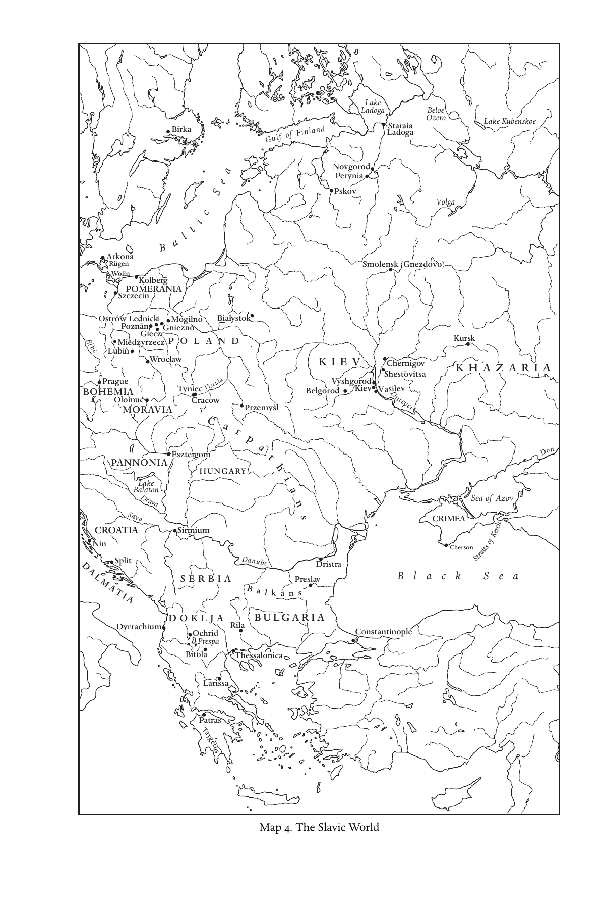

*地图4 斯拉夫世界。原图内地名保留原文，下附中文对照。*

| 原图标记 | 中文 |
|---|---|
| Birka | 比尔卡 |
| Gulf of Finland | 芬兰湾 |
| Lake Ladoga | 拉多加湖 |
| Staraia Ladoga | 旧拉多加 |
| Beloe Ozero | 白湖 |
| Lake Kubenskoe | 库边斯科耶湖 |
| Novgorod | 诺夫哥罗德 |
| Perynia | 佩伦尼亚 |
| Pskov | 普斯科夫 |
| Volga | 伏尔加河 |
| Baltic Sea | 波罗的海 |
| Arkona | 阿尔科纳 |
| Rügen | 吕根岛 |
| Wolin | 沃林 |
| Kolberg | 科尔贝格 |
| Szczecin | 什切青 |
| Pomerania | 波美拉尼亚 |
| Ostrów Lednicki | 莱德尼察岛 |
| Poznań | 波兹南 |
| Gniezno | 格涅兹诺 |
| Mogilno | 莫吉尔诺 |
| Giecz | 盖奇 |
| Białystok | 比亚韦斯托克 |
| Międzyrzecz | 缅济热奇 |
| Lubiń | 卢宾 |
| Wrocław | 弗罗茨瓦夫 |
| Poland | 波兰 |
| Elbe | 易北河 |
| Prague | 布拉格 |
| Bohemia | 波希米亚 |
| Olomuc | 奥洛穆茨 |
| Moravia | 摩拉维亚 |
| Tyniec | 蒂涅茨 |
| Cracow | 克拉科夫 |
| Vistula | 维斯瓦河 |
| Przemyśl | 普热梅希尔 |
| Carpathians | 喀尔巴阡山脉 |
| Smolensk (Gnezdovo) | 斯摩棱斯克（格涅兹多沃） |
| Kursk | 库尔斯克 |
| Kiev | 基辅 |
| Chernigov | 切尔尼戈夫 |
| Shestovitsa | 舍斯托维察 |
| Vyshgorod | 维什戈罗德 |
| Belgorod | 别尔哥罗德 |
| Vasilev | 瓦西列夫 |
| Dnieper | 第聂伯河 |
| Khazaria | 可萨地区 |
| Don | 顿河 |
| Sea of Azov | 亚速海 |
| Crimea | 克里米亚 |
| Straits of Kerch | 刻赤海峡 |
| Cherson | 赫尔松 |
| Black Sea | 黑海 |
| Pannonia | 潘诺尼亚 |
| Hungary | 匈牙利 |
| Esztergom | 埃斯泰尔戈姆 |
| Lake Balaton | 巴拉顿湖 |
| Drava | 德拉瓦河 |
| Sava | 萨瓦河 |
| Croatia | 克罗地亚 |
| Nin | 宁 |
| Split | 斯普利特 |
| Dalmatia | 达尔马提亚 |
| Sirmium | 锡尔米乌姆 |
| Serbia | 塞尔维亚 |
| Danube | 多瑙河 |
| Dristra | 德里斯特拉 |
| Preslav | 普雷斯拉夫 |
| Balkans | 巴尔干山脉 |
| Bulgaria | 保加利亚 |
| Doklja | 杜克利亚 |
| Dyrrachium | 都拉基翁 |
| Ochrid | 奥赫里德 |
| Prespa | 普雷斯帕 |
| Bitola | 比托拉 |
| Rila | 里拉 |
| Constantinople | 君士坦丁堡 |
| Thessalonica | 帖撒罗尼迦 |
| Larissa | 拉里萨 |
| Patras | 帕特拉 |
| Taygetus | 泰格特斯山 |

<!-- PDF page 29; original page map -->

## 地图5 不列颠群岛

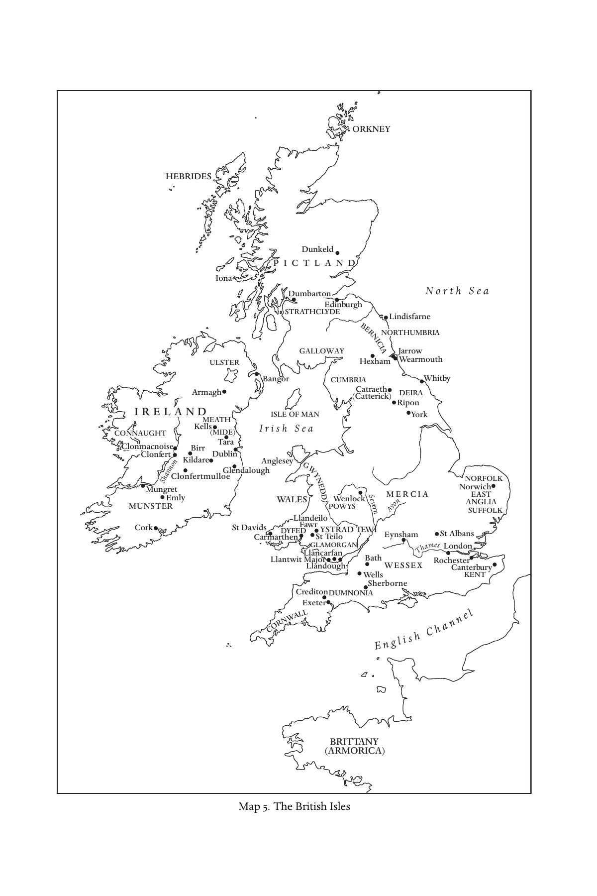

*地图5 不列颠群岛。原图内地名保留原文，下附中文对照。*

| 原图标记 | 中文 |
|---|---|
| Orkney | 奥克尼群岛 |
| Hebrides | 赫布里底群岛 |
| Dunkeld | 邓凯尔德 |
| Pictland | 皮克特地区 |
| Iona | 爱奥那 |
| Dumbarton | 邓巴顿 |
| Edinburgh | 爱丁堡 |
| Strathclyde | 斯特拉斯克莱德 |
| North Sea | 北海 |
| Lindisfarne | 林迪斯法恩 |
| Bernicia | 伯尼西亚 |
| Northumbria | 诺森布里亚 |
| Galloway | 加洛韦 |
| Hexham | 赫克瑟姆 |
| Jarrow | 贾罗 |
| Wearmouth | 威尔茅斯 |
| Cumbria | 坎布里亚 |
| Whitby | 惠特比 |
| Catraeth (Catterick) | 卡特赖斯（卡特里克） |
| Deira | 德伊勒 |
| Ripon | 里彭 |
| York | 约克 |
| Ulster | 阿尔斯特 |
| Bangor | 班戈 |
| Armagh | 阿马 |
| Ireland | 爱尔兰 |
| Connaught | 康诺特 |
| Meath (Mide) | 米斯（米德） |
| Kells | 凯尔斯 |
| Tara | 塔拉 |
| Clonmacnoise | 克朗马克诺伊斯 |
| Clonfert | 克朗弗特 |
| Birr | 比尔 |
| Kildare | 基尔代尔 |
| Dublin | 都柏林 |
| Glendalough | 格伦达洛 |
| Clonfertmulloe | 克朗弗特穆洛 |
| Shannon | 香农河 |
| Mungret | 芒格雷特 |
| Emly | 埃姆利 |
| Munster | 芒斯特 |
| Cork | 科克 |
| Isle of Man | 马恩岛 |
| Irish Sea | 爱尔兰海 |
| Anglesey | 安格尔西岛 |
| Gwynedd | 圭内斯 |
| Wales | 威尔士 |
| Wenlock | 温洛克 |
| Powys | 波伊斯 |
| Llandeilo Fawr | 兰代洛法乌尔 |
| St Davids | 圣戴维兹 |
| Carmarthen | 卡马森 |
| Dyfed | 迪费德 |
| St Teilo | 圣泰洛 |
| Ystrad Tewi | 伊斯特拉德泰维 |
| Glamorgan | 格拉摩根 |
| Llancar­fan | 兰卡凡 |
| Llantwit Major | 兰特威特马乔尔 |
| Llandough | 兰多 |
| Severn | 塞文河 |
| Avon | 埃文河 |
| Mercia | 麦西亚 |
| Norfolk | 诺福克 |
| Norwich | 诺里奇 |
| East Anglia | 东盎格利亚 |
| Suffolk | 萨福克 |
| Eynsham | 恩舍姆 |
| St Albans | 圣奥尔本斯 |
| Thames | 泰晤士河 |
| London | 伦敦 |
| Rochester | 罗切斯特 |
| Canterbury | 坎特伯雷 |
| Kent | 肯特 |
| Bath | 巴斯 |
| Wells | 韦尔斯 |
| Wessex | 威塞克斯 |
| Sherborne | 舍伯恩 |
| Crediton | 克雷迪顿 |
| Exeter | 埃克塞特 |
| Dumnonia | 杜姆诺尼亚 |
| Cornwall | 康沃尔 |
| English Channel | 英吉利海峡 |
| Brittany (Armorica) | 布列塔尼（阿摩里卡） |

---

# 引言：约600年的基督教世界

彼得·布朗（Peter Brown）

<!-- PDF page 30; original page 1 -->

## 国度与诸王国

公元680年后不久，西班牙西哥特王国首都托莱多的主教尤利安（Julian）面临一项挑战：回答犹太人不断向基督教提出的异议。他们认为，基督徒以为弥赛亚——也就是“基督”、受膏者——已经以拿撒勒人耶稣的身份降临，这是误入歧途。弥赛亚尚未到来。世界才存在五千年，弥赛亚将要降临的第六时代甚至还没有开始。最近这几个世纪没有意义，只是一片空白，是等待真正的基督、上帝的受膏者降临的时期。

在托莱多主教看来，他所设想的这些犹太对话者实在错得不能再错。历史早已充满令人振奋的意味。弥赛亚已经来了。基督在奥古斯都皇帝的时代诞生于伯利恒。他来到世间，留下了可以切实感受到的痕迹。因为，他的降临恰逢整个地中海世界一段几乎超乎自然的宁静时期，而这种宁静又与罗马帝国的建立联系在一起。内战止息，城市重享和平。平民不再受紧急军务的困扰，回到田间：“战争事务只交由罗马军团承担，由它们对蛮族各民族作战。”[^p030-1] 对尤利安而言，六百多年前奥古斯都时代罗马世界的和平，正是道成肉身的上帝留在时间中的足迹。罗马的和平本身并没有延续下去。在尤利安看来，他所处的是战争的时代。不过，历史运行中那段遥远而短暂的平静，足以向他证明犹太人错了。弥赛亚已经降临。他的到来，以时间中一抹微弱的和平为标志。从那时起，世界便进入了最后的第六时代。这个时代将在人们看不见的一个庞大帝国的荫庇下度过。如今，整个世界都属于基督的国度：

<!-- PDF page 31; original page 2 -->

> 耶和华在万国眼前露出圣臂；地极的人都要看见我们上帝的救恩。[^p031-2]

我们现代人有意含糊地称之为“基督教传播”的过程，在托莱多的尤利安看来，是大公教会——他不承认任何其他团体具有这种资格——宣告一个事实：基督的国度已经实现，而且人们可以“在万国眼前……〔直到〕地极”看见这一事实已经实现。[^p031-3]

这种主张很难说服稍有地理知识的同时代人。犹太人指出，许多“蛮族”民族显然还没有成为基督徒。尤利安对这些怀疑者的回答很能说明问题。他把世界分成两个区域。第一个区域完全是基督教的，而它之所以完全是基督教的，是因为它受基督徒统治者治理。“因为，某些地方虽然仍有不信者的族群，但他们同样无法逃脱基督的主权。他们受到统治者的压制，而众所周知，基督已经借着这些统治者对他的信仰，住在他们里面。”[^p031-4]

第二个区域构成第一个区域边缘一圈界限较为模糊的半影地带。尤利安接着说：“我也不认为，世上还有哪个族群不知道基督的名字。即使他们中间没有〔福音的〕传道者，也不能不从别的民族那里听说基督，因而知道他。”[^p031-5]

要叙述公元600年我们如今称为“基督教世界”的情形，必须从这个观念入手：在包罗全球的单一基督国度之内，存在两个这样的区域。

尤利安写作时，他的看法已经过时。读他的文字，人们根本猜不到：到680年，穆斯林军队已经进入北非，不久就要跨入西班牙。不过，他是一位饱读诗书的主教。680年时，他仍透过书本看世界。对这样的人来说，基督教依旧生活在帝国的荫庇之下。在两个大帝国的体制内，基督教最有自信，信徒也最为众多。至少直到不久之前，这两个帝国仍控制着从尤利安所在西班牙的大西洋海岸，到中亚和阿富汗边缘之间、西半球的大部分农业地区：罗马帝国和萨珊波斯帝国。同时代人在把宏伟的基督国度与“世上的诸王国”作对照时，首先想到的就是这两个帝国。

<!-- PDF page 32; original page 3 -->

六世纪的经历已经表明，帝国的时代远没有结束。在查士丁尼皇帝（527—565年在位）治下，以君士坦丁堡为统治中心的罗马帝国，再次确立了自己对西地中海大片地区的权利：意大利的大部分、北非，甚至西班牙的一部分。即使在帝国新近收复疆域的边界以外，在西哥特西班牙和法兰克诸王国，强大的王权仍带有一眼可辨的“罗马”面貌。而这种“罗马”面貌，又是从君士坦丁堡借来的。君士坦丁堡的人口超过五十万，已经以悬殊优势成为地中海与中东最大的城市。在高卢和西班牙，延续于君士坦丁堡的罗马帝国，仍是世俗权力最为旺盛、威严而敬畏上帝时的首要典范。[^p032-6]

在西亚，囊括伊拉克、伊朗和部分中亚地区的萨珊帝国，显示出与罗马帝国旗鼓相当的实力。在霍斯劳一世·阿努希尔万（Chosroes I Anoshirwan，530—579年）治下，以及此后“胜利者”霍斯劳二世·阿帕尔韦兹（Chosroes II Aparwez，590—628年）治下，萨珊帝国进入了与君士坦丁堡在军事、外交上对抗的时期。对抗横跨整个中东，从北高加索一直延伸到也门。其规模极为巨大，又深入中亚和内亚，以至于自马尔库斯·奥勒留（121—180年）的时代以来，中国朝廷第一次对遥远西方的事务产生了兴趣。[^p032-7]

这些“世上的诸王国”所覆盖的视野依旧如此辽阔，也使基督徒的信念具有一种浩瀚之感：一个更加广大的基督国度，仿佛正是西部欧亚历史背后无形的背景。同时代人关切的是，各个“世上的王国”究竟与基督的国度是什么关系。约550年，在地中海另一端、距托莱多两千多英里的地方，一位来自安提阿的商人兼业余神学家，也在思索尤利安主教所面对的同样问题。科斯马斯（Cosmas，后来人称“印度商人科斯马斯”）是一位经验丰富的旅行者。他住过亚历山大里亚，到过红海南端的阿克苏姆，即埃塞俄比亚，甚至曾在印度洋航行。作为罗马帝国的臣民，他在宗教上的立场颇不寻常。科斯马斯赞同波斯基督徒的观点，并且满怀敬意地谈论一位皈依基督教的伊朗人马尔·阿巴（Mar Aba）的教导。520年代，马尔·阿巴曾从美索不达米亚远赴亚历山大里亚和君士坦丁堡，<!-- PDF page 33; original page 4 -->随后返回今巴格达附近的泰西封，出任东方教会的领袖。[^p033-8]

科斯马斯对基督国度的看法并无特别之处。只有基督的国度，才是先知但以理所说的真正“永恒”的国度：“他的权柄是永远的，不能废去。”[^p033-9]

科斯马斯理所当然地认为，这种永恒在某种意义上，也给罗马帝国投下了一片荫庇。因为基督诞生在它的疆域之内，这个王国从上帝那里领受了特别的“恩典”。它虽然常因自己的罪遭到蛮族入侵的伤害，却会一直持续到时间的终点。科斯马斯亲身行走亚洲商路，知道君士坦丁堡统治者享有举世公认的声望。他自豪地报告，即使远在锡兰，罗马皇帝铸造的索利都斯金币，也被认为是世界上最好的货币。

这并不意味着，科斯马斯把自己时代的罗马帝国看作一个“普世”帝国：只有基督的国度才具有普世性。不过，罗马帝国是不可战胜的。它在各民族之间不可动摇的威望，保证了基督教信仰永远不会被“压缩”到仅仅一个地区之内。[^p033-10]

面对波斯帝国，科斯马斯提出了一种比君士坦丁堡流行观念更为“去中心化”的世界观。他在基督的国度里，也为波斯找到了位置。波斯并不只是传统上与基督教帝国相对立的蛮族一方。萨珊帝国虽不是基督教国家，在上帝的眷顾中却自有其作用。因为，博士曾从东方前来朝拜基督。他们向伯利恒初生的基督献礼，代表整个波斯，向真正的世界之帝表示敬意。这次朝拜赋予了萨珊帝国某些“恩典”。[^p033-11] 其境内的基督教会，在声望甚至人数上，都可以被视为与西方各教会平等。[^p033-12]

这种“去中心化”的世界观，使科斯马斯接近了他所处时代的现实。罗马帝国虽享有特殊地位，仍只是许多国家中的一个。西方法兰克与西哥特的王国，实际上已默默拒绝了它的普世主张。在东方，萨珊帝国也已经证明自己与罗马不相上下。“东方教会”之所以这样称呼，正因为它是波斯帝国——“东方崇高之地的帝国”——<!-- PDF page 34; original page 5 -->疆域内的基督教会。基督的国度，如今高踞于一个由众多王国组成的世界之上。

只要向东看一看马尔·阿巴西行归来后所置身的萨珊帝国境内基督徒团体，我们就能体会：这个时代各地的基督徒，在多大程度上依然认为自己生活在帝国的荫庇之下。万王之王及其贵族忠于传统的琐罗亚斯德教。但他们长期以来对非伊朗臣民宗教信仰所持的宽容，远远超过君士坦丁堡对宗教异议者表现出的任何宽容。[^p034-13] 因此，萨珊帝国覆在东方基督教之上，仿佛天空一般，虽遥远，却是理所当然的存在。544年，马尔·阿巴召集主教会议，为东方教会整饬秩序。会议在帝国首都泰西封举行，并且直接奉霍斯劳一世之命召开：“在仁厚、慈悲、施恩的万王之王霍斯劳获胜之年……蒙这位超越诸王的新居鲁士垂顾……基督感动他，叫他不断向自己的教会厚赐礼物。”[^p034-14]

尽管当时东方教会主要集中于伊拉克北部的城镇与乡村、扎格罗斯山麓，以及波斯湾各商站，它也分享着萨珊帝国的辽阔视野。[^p034-15] 马尔·阿巴的属灵帝国一直伸展到今阿富汗境内的泽朗和坎大哈，距伊拉克向东一千多英里。在与当地诸主教交涉时，他得到“来自贝特·加尔迈〔伊拉克北部〕、掌管王后骆驼的苏伦”的善意帮助。萨珊帝国最东部边疆的大绿洲城市木鹿，也有一位基督教主教。

所以，“东方教会”——我们后来所称的涅斯托里乌斯派教会——进入中亚世界时，是一种受到“东方崇高之地”的波斯帝国体制保护的宗教。600年后一代人的时间里，世界帝国的格局本身发生了变化。伊斯兰教骤然兴起，木鹿至中国之间的地区随之重新组合。“涅斯托里乌斯派”教会于是进一步东进，在中国立足。它与波斯的上层流亡者、外交官和职业将领一道来到这里。635年，基督教修士和教士进入西安〔唐代长安〕，与其说是作为“传教士”，不如说是作为萨珊帝国破碎残余的一部分；<!-- PDF page 35; original page 6 -->正是在这个帝国的框架中，一个生气勃勃的基督教会曾于五、六世纪成长壮大，并深入亚洲扩展。[^p035-16]

## “众所周知，基督已经住在其中的统治者”[^p035-17]

简略巡视约600年基督教的视野后，一个突出事实便显现出来：那些被视为帝国“腹地”、基督教在其中发展壮大的地区，具有关键的重要性。无论在西方后罗马时代的王国、在君士坦丁堡延续的罗马帝国，还是在“东方帝国”的萨珊领土，绝大多数基督徒仍生活在一个把宏大的帝国体制视为常态的世界里。这些体制，为无形的基督国度提供了相称的前景。

人们很容易忘记，在这样的世界里，基督教多么强烈地觉得自己源远流长。如今，古老的历史站在了基督教一边。到600年时，君士坦丁在312年的皈依，已是三个世纪以前的事。罗马帝国作为基督教帝国存在的时间，已经几乎与它曾作为异教帝国存在的时间一样长。在罗马，最辉煌的巴西利卡——圣彼得与拉特朗——都建于君士坦丁在位时期。它们的收入，由罗马乡间及其他地方成片的地产提供保障。这些地产的契据保存在档案中，供当时的教士查阅，已有将近三百年的历史。在历史悠久的意大利，这些地产本身的边界，自罗马共和国时代起就没有改变过。

但基督教从容积累岁月的地方，并不限于地中海周边。在莱茵河边疆附近的特里尔，城中第一座主教座堂的规模令人敬畏。它大概由君士坦丁那位虔诚的儿子兴建，中殿由莱茵地区黑色花岗岩的巨柱支撑。在国家变得更小、也更不稳定的时代，这座建筑持续提醒人们：一个统一的基督教帝国所能集中的权力与财富，曾是什么样子。六世纪末，出身贵族的主教尼刻提乌斯修缮了这座教堂。

尼刻提乌斯本人，代表的也是一个拥有悠久历史的阶层。他来自一批基督徒贵族家族，其中有些家族自豪地把世系上溯四百年，追到一位177年在里昂殉道的元老。图尔主教格列高利（594年卒）的著作清楚表明，高卢的教士贵族把自己与一种“深厚”的过去联系起来。

<!-- PDF page 36; original page 7 -->

这种过去与殉道者和圣徒的墓葬相连，其中许多墓葬使用典雅的古典大理石。它们坐落于古老的地下墓室，以及城外罗马墓地中散布的家族陵墓之内。许多这样的圣徒，是在世主教的祖先。他们的历史，通向基督教高卢的悠久往昔。对于格列高利这样的人，这种延续性比罗马史中通常所说的转折点更有意义。譬如，格列高利似乎对罗马帝国的终结浑然不觉。[^p036-18]

在格列高利及其同时代人看来，重大的转变早已发生。他们生活在基督徒统治者治下、由基督教城市组成的世界里。他的著作收录了《埃弗所七睡者》传说的一篇拉丁文译本。七睡者在三世纪迫害基督徒的时期，退入一座山洞，到五世纪才再度醒来。有一种时代的标志，立刻吸引了他们的注意：每座城市的城门上方，都刻着十字架。他们所看见的，也正是六世纪地中海及中东大部分地区任何一个基督徒，每天都可能看见的景象。[^p036-19]

到600年，基督教整体早已不是一种只存在于城市的宗教。不过，它的“神经中枢”依然是城市中的主教座，其中许多已有五百年的历史。城市仍代表着稳固。在城市生活向来薄弱的罗马不列颠，到600年时，基督教已经发生变化，以至于在外人眼中几乎隐而不见——下文将会谈到。可一旦渡过英吉利海峡，带有城墙的城市就开始出现；越往地中海走，城市越密集。法兰克高卢有116个主教座，西哥特西班牙有66个。意大利的面积相对较小，却有237个主教座，简直处处可见主教。北非同样如此，有242个，且越来越集中于东部沿海地区。查士丁尼及其继承者治下的罗马帝国，有六百八十多位主教，依然是基督教世界真正的重心，尤其因为其中许多城市的规模，远大于西方城市。罗马边界以外，萨珊帝国那些形态迥异的城市和大村落，供养着五十多位主教。亚美尼亚教会能够召集约二十位主教，他们依各地贵族家族的领地分布，分配得相当不均。

除意大利北部和中部的伦巴德冒险者，以及在游牧异教阿瓦尔人霸权下迁入巴尔干、尚未组成国家的斯拉夫酋邦之外，从幼发拉底河到<!-- PDF page 37; original page 8 -->英吉利海峡沿岸，甚至在英格兰西部和威尔士，一切有组织的社会，都由基督徒统治者领导。这些国家的实力和意识形态抱负各不相同，但都认为自己蒙基督保护而存在。它们都认为，统治者的职责至少包括：保证守主日并尊重其他基督教节日；压制异教祭献；确保境内的犹太团体不超越自己的地位。查士丁尼的帝国是它们共同的典范，因为它似乎比任何其他王国，都更有效地做到了这些事。

查士丁尼的臣民几乎不会怀疑，自己生活在一个基督教国家之中。滨海凯撒里亚——今以色列沿海——税务机关地面上的一幅马赛克，引用了圣保罗《罗马书》中一句直截了当的话：“你若愿意不惧怕掌权的，只要行善。”[^p037-20]

基督教讲道维护统治者的权威。每次礼仪中公开献上的基督教祈祷，保障帝国的安全。查士丁尼在立法中宣告，教会与国家之间有上帝命定的“和谐”。这不仅是一句华丽的修辞。它在六百八十座城市中，自下而上地生长出来。主教和教士与地方精英合作，处理日常治理事务，使教会与世俗的领域密不可分。主教如今是首都与各行省之间沟通的主要中介。[^p037-21] 即使帝国敕令涉及的全然是世俗事务，例如遏制盗匪，也由主教接收，再在毗邻基督教巴西利卡的主教接见厅内，向地方议会宣读。敕令还会张贴在教堂墙上。[^p037-22] 在格拉萨，即今约旦杰拉什，是主教修建并管理当地的监狱，“以利于城市”。[^p037-23] 约515年，安提阿牧首塞维鲁直截了当地告诉一位地方主教：主教的职责，就是维持城市运转。“主教有责任制止和约束民众无序的行动……努力维护城市的良好秩序，留心使那些由他们亲手供养的人举止安宁。”[^p037-24]

必须记住，大格列高利在罗马出任教宗时——590至604年——所接过的沉重行政负担，丝毫不罕见。这并不反映什么突如其来的危机，好像教宗不得不以<!-- PDF page 38; original page 9 -->属灵权力统辖这座城市，来拯救古老的罗马。格列高利对罗马的照料，更不表示他希望脱离帝国而独立。这不过是查士丁尼及其继承者治下，一位主教的“日常工作”。[^p038-25]

基督教诸王国“腹地”的居民，正是带着这样的认识转向外部世界：他们代表着一种稳定的社会秩序，而这种秩序身后有着悠久的历史。

## “即使没有传道者，也不能不从别的民族那里听说基督，因而知道他”[^p038-26]

578年，上埃及底比斯的一座修道院建在法老时代的废墟之上。院中修士写下了一篇为帝国祈祷的祷文，是他们的牧首达米安努斯（Damianus）从亚历山大里亚送来的。他们应当祈求：“愿诸王生命昌盛……愿直到地极的一切蛮族民族，都服在他们的手下，愿全世界成为一个身体。”[^p038-27]

颇能说明问题的是，修士服从的这位牧首，甚至不是他们所代祷的皇帝承认的牧首：达米安努斯是亚历山大里亚的合一性论派牧首。他被判定为“异端”，严格说来，他的牧首职位是不合法的。但他所采用的公共语言，与帝国境内任何其他主教完全相同。

官方人士理所当然地认为，当上帝愿意的时候，基督教就会来到蛮族中间；而它来到时，必然是通过基督教帝国的强大吸引力。这种意识形态往往似乎应验了。比克拉罗的约翰是托莱多的尤利安之前一位西班牙人物。他在君士坦丁堡居留时，亲眼见过这样的归附仪式。569年，北非撒哈拉边疆的一个部落联盟加拉曼特人，“通过使节请求被纳入罗马国家的和平，并加入基督教信仰”。[^p038-28]

来自苏丹北部栋古拉地区的马库里亚人也是如此。573年，他们的使节携带象牙和一头长颈鹿前来，“与罗马人建立了友好关系”。[^p038-29] 这些礼物提醒人们：借着基督教帝国的威望，基督的国度已经为埃及无雨地带以南遥远的地方所知，<!-- PDF page 39; original page 10 -->一直到达赤道非洲北缘的稀树草原。即使在那里，帝国也留下了印记。栋古拉的教堂忠实仿照拜占庭范式。迟至十一世纪，当地的墓志铭仍使用君士坦丁堡的希腊文祷词，为灵魂离世祈祷。[^p039-30]

这种“吸引力的意识形态”没有认识到的是，到600年，基督教已经通过较不正式的方式传播开来。这些方式，不容易被浓缩为同时代叙事中那些宣扬胜利的简短说辞。基督教的腹地，早已被一圈广大的“半影地带”环绕。用托莱多的尤利安的话说，没有“传道者”来到许多民族中间。也就是说，没有官方所认可的那种“传道者”：没有王室或帝国使团到过他们那里，也没有专门受命前去的主教和教士在他们中间建立教会。尽管如此，他们已经“从别的民族那里听说”基督，因而知道他。[^p039-31]

基督教腹地的意识形态，往往把基督教知识向亚洲、非洲和北欧缓缓渗透的过程，排除在视野之外。“基督的国度”固然可以是普世的，但在这种观念中，它只能通过清楚可见的代表运作：即由基督教国家的威望以不同程度支持的教士。这种观点没有认识到，对于习惯了多种属灵力量的外部人群，六世纪基督教本身就是一种令人振奋的潜在祝福与保护之源。人们知道，它的象征和仪式具有力量，因而常把它们嫁接到其他体系上。

这种宗教上的拼接，在欧洲和亚洲各地都能见到。十字架常出现在伊拉克的陶器上，甚至出现在萨珊治下木鹿的钱币上。[^p039-32] 591年，一群来自中国边疆吉尔吉斯斯坦的突厥人，甚至额头带着十字架记号出现在君士坦丁堡。“他们说，这是母亲们给他们留下的：因为他们那里曾流行凶猛的瘟疫，一些基督徒便劝他们，应在孩子的额头画上这个记号。”[^p039-33]

撒哈拉非洲的情形也一样。关于基督教知识的流传，以及对其中某些仪式成分的采用，不能被归结为帝国当局与柏柏尔、图阿雷格各联盟之间屈指可数的接触。这些联盟向南伸展，远远超出了罗马北非的边界。在西撒哈拉的图阿雷格语中，<!-- PDF page 40; original page 11 -->表示“祭献”的 afaske 一词，呼应了基督教的“逾越节／复活节”一词，即基督教世界的重大节日。其他教士拉丁语词汇，也进入了这种语言，例如 abbekad，来自 peccatum，即“罪”。这是一种回声，来自地中海北非沿海平原以南十分遥远的世界。[^p040-34]

人们很容易忘记，基督教自身的版图也一直在变动。在600年的基督教世界中，“去基督教化”与“基督教化”同样是一项特征。蛮族入侵、人口迁徙，或者遥远当局的纯粹忽视，都可能造就整片“脱离教会组织”的人群。他们仍保留着基督教作为一种残存的宗教，却没有教会结构。约520年，叙利亚隐修士“山居者”西缅来到伊拉克北部一个高地山谷，发现一个由分散牧民组成的团体，他们住在修建得很好的房屋里。但他们的教堂空空荡荡。他们从没有听过宣读《圣经》，也不知道圣餐是什么。他们告诉他：“这些山里有些人，若不是听父亲说起，父亲曾抱着他们去教堂受洗，就连教堂是什么也不知道。”[^p040-35]

即使像查士丁尼及其继承者的帝国这样自信地认为自己是“基督教”的社会，内部也存在大片灰色地带：脱离教会组织、甚至仍信奉异教的团体。

另一些原有的基督徒团体，遭遇了更加剧烈的失序。一群被波斯人强行迁到中亚边缘的亚美尼亚人，失去了一切：“他们忘记了自己的语言，不再使用文字，也没有司祭阶层。”[^p040-36]

直到几代人之后，借着一位为波斯效力的亚美尼亚将领介入，他们才“重新获得教会组织”：“他们在信仰中得到坚固，并学会读写和使用自己的语言。他们中间有一位名叫亚伯的司祭〔显然，他的家族保留了某种司祭身份〕，被任命在那片地区担任司祭职务。”[^p040-37]

这种有教会组织与脱离教会组织的基督教形态交替出现的过程，在黑海北岸表现得最清楚。克里米亚和亚速海，自古以来就是族群往来的通道；顿河在这里为人们打开了通往俄罗斯南部草原的道路。黑海对罗马的战略至关重要。在克里米亚，罗马势力沿山岭下方的海岸线维持存在。然而，在这个关键地区，基督教的传播却是零星的，<!-- PDF page 41; original page 12 -->其方式暴露了官方“吸引力意识形态”的弱点。[^p041-38]

自四世纪以来，来自黑海北部地区的“哥特人主教”，偶尔会出现在君士坦丁堡。[^p041-39] 但他们的存在是被动的。官方基督教化的主要时刻，与针对俄罗斯草原游牧民、以及针对萨珊势力渗入高加索的外交攻势相吻合。官方史料的语言，把这些描写成迅速取得的胜利。在帝国引导下，黑海和高加索的沿海、山地部落，从黑暗步入光明，从蛮族“野兽一般的生活”，转入文明人和基督徒的生活。[^p041-40] 这些史料没有说明的是，基督教在多大程度上早已通过较不正式的方式渗入这些地区。只有一些稍纵即逝的迹象，才揭示出这种渗透：例如在距离“罗马的”、基督教的海岸有一定距离的克里米亚山地聚落，腰带扣上出现了十字架记号。[^p041-41]

这些记述也没有透露一个事实：许多被卷入君士坦丁堡外交活动的群体，早已在很长时间里作为基本脱离教会组织的基督徒生活。六世纪中叶，普罗科皮乌斯记下的一件事，为这片灰色地带投来了一点光。亚速海湾的哥特人早已是基督徒，但他们已经忘记自己属于哪一类基督徒。“至于这些哥特人是否曾像其他哥特民族一样信奉阿里乌斯派……我说不上来，因为他们自己对这件事也一无所知。”[^p041-42]

现代考古学对巴尔干、多瑙河及北欧许多地区的研究，印证了这样一幅景象：基督教世界被一圈半影地带环绕，其中既有已经去基督教化、失去教会组织的地区，也有基督教仍然存在、却只是诸种宗教体系之一的地区。

其中最引人探究而又难以捉摸的例子，当然是不列颠。597年，格列高利一世向那里派出著名的使团，由修士奥古斯丁（约604年卒）带领，前往异教的肯特王埃塞尔伯特（Æthelberht，616年卒）处。格列高利开展这次传教时，认为理所当然的那套传统基督教化观念，几乎容不下这个异常沉默的岛屿上已经发展出来的基督教。[^p041-43]

<!-- PDF page 42; original page 13 -->

不列颠教会似乎保留了许多仍使它与欧洲大陆相连的特征。六世纪中叶，来自高卢的访客若到维鲁拉米乌姆——圣奥尔本斯——等地，会见到图尔的格列高利也认得出的圣徒巴西利卡。有些教士仍然富于学识。他们所能利用的书籍极为有限，其中许多已经过时，有些还是大异端伯拉纠那些热忱追随者的作品；伯拉纠本人也是四世纪末、五世纪初的一位不列颠人。不过，吉尔达斯（Gildas）这样的不列颠人，仍成功地以这点贫乏积累，创造出一种生动的文学文化。他约530年写成的《不列颠的毁灭》，使他跻身于哀叹教会处境的一种传统，而这种传统在高卢也有清楚可辨的对应形式。这套拉丁学问跨过爱尔兰海，传到帕特里奇乌斯，即帕特里克所建立的爱尔兰团体。帕特里克可能卒于493年。它也传到与帕拉迪乌斯主教有关、情况更不明朗的那些聚落。早在431年，教宗就曾采取罕见的主动行动，派帕拉迪乌斯前往“信奉基督的爱尔兰人”中间。这些都是令人瞩目的成就，格列高利却似乎一无所知。[^p042-44]

甚至在撒克逊人定居的地区，也没有所谓“异教的黑暗”笼罩大地。奥古斯丁来到肯特时，困惑地得知：一位名叫西克斯图斯的殉道者的圣所，仍受当地不列颠人敬奉。这个圣所想必可追溯到罗马时代。当地人对这位殉道者知道得很少，也没有记载其殉道事迹的文本——在欧洲大陆大部分地区，这本是崇敬得以兴盛的必要条件。但他们仍顽强地坚持在他的墓前敬拜。[^p042-45]

总的说来，六世纪期间，基督教在不列颠，以及“蛮族的”爱尔兰岛上，存续下来并发生了变化。然而，欧洲大陆史料对这些事情全无记载。甚至帕特里奇乌斯这个名字，也直到658年才第一次出现在一篇欧洲文本中，距他去世已近两百年。正如一位敏锐的现代学者所说，“时代的沉默”已经降临在这一地区。在一幅仍由大帝国所产生的意识形态支配的世界地图上，这里那种不显山露水、真正处于后帝国时代的基督教，没有自己的位置。[^p042-46]

597年，大格列高利向盎格鲁—撒克逊人传教，向来被视为西方基督教史的一个起点。但把它也看作一位“使徒式”领袖在一个世纪行将结束时的最后行动，也许有所帮助。在这个世纪里，基督教几乎是不知不觉地传播到自己心中地图的界限以外，产生了剧烈而始料未及的后果。要理解这一点，<!-- PDF page 43; original page 14 -->让我们最后把目光转向罗马东南三千英里之外：埃塞俄比亚、阿拉伯半岛和波斯湾。

阿克苏姆王国位于今埃塞俄比亚山麓，俯临红海西岸；希米亚尔王国则位于阿拉伯半岛南端，面向印度洋，即今也门的哈德拉毛。两者都处于赤道非洲降雨所及的范围，都是定居已久的文明。它们的宗教史，有着自己的节奏。北方异教徒可以被斥为“像牲畜一样生活……崇拜木头石块”——这是大格列高利形容撒丁岛上尚未归化的山民时，特意选用的话；琐罗亚斯德教徒也可以被称作不过是“喃喃诵念的人”，是不加思索地追随主要靠口传、没有书籍尊严的宗教传统的人。相比之下，阿克苏姆以及希米亚尔／萨巴王国的居民，很早就有文字，甚至已是一神论者。因此，面对人们日益强烈地忠于唯一至高神的潮流，基督徒和犹太人竞相赋予它自己的印记。这位至高神名为 al-Raḥmānān，即“慈悲者”。我们从记功碑铭中得知他的名字。他是积极扩张的战士君王所敬奉的至高神：这些君王从阿克苏姆出征，远达青尼罗河；从希米亚尔出征，则借助附属阿拉伯部落联盟，一直抵达伊拉克边缘。[^p043-47]

两个王国把守着印度洋贸易进入地中海和中东的门户。因此，它们虽各有特色，却从未与世隔绝。仅举一例，“印度商人”科斯马斯就曾到访阿克苏姆，并对希米亚尔的事务很熟悉。一位来自希米亚尔的犹太妇女葬在巴勒斯坦，墓碑铭文使用萨巴文、希伯来文和阿拉姆文。[^p043-48] 早在四世纪，两个王国就已选择以更加彻底、也更切合当时潮流的一神论，取代原来对至高神的崇拜。阿克苏姆诸王约于340年成为基督徒。[^p043-49]

相反，从约380年起，希米亚尔诸王信奉犹太教。于是，两种一神论隔着红海相对而立，双方都宣称其统治得到《圣经》的授权。阿克苏姆王埃拉·阿茨贝哈（Ella Atsbeha，约519—约531年）的铭文，大量引用《诗篇》中富于战斗意味的语句：“耶和华有力有能，在战场上有能……我信靠他，他赐给我强大的王国……我把自己交托给基督，使我的一切事业都得成功。”[^p043-50]

<!-- PDF page 44; original page 15 -->

他在希米亚尔的犹太教对手，优素福·阿斯阿尔·亚萨尔（Yūsuf Asʿar Yathʿar，522—530年），人称祖·努瓦斯（Dhū Nūwas），即“留额发者”，其铭文同样凌厉。“凭天地之主，凭我战士的力量”，祖·努瓦斯驱逐了埃塞俄比亚军队在扎法尔扶立的一位基督徒国王，把扎法尔的大教堂改成犹太会堂。523年，他围攻阿拉伯商贸城市奈季兰。该城位于扎法尔通往汉志的道路上。当城中的基督教教士和贵族拒绝改信犹太教时，他将他们屠杀。[^p044-51]

祖·努瓦斯告诉他们，他并不是要他们变成多神论者、去崇拜太阳。他们仍可敬拜上帝、“慈悲者”。他们只需要承认，拿撒勒人耶稣不过是一个人。“一切国家都明白，他是人而不是上帝。就连最初在他这件事上犯错〔把他当作神〕的罗马人的土地，”他补充说，也正在慢慢醒悟。[^p044-52]

优素福被埃拉·阿茨贝哈的埃塞俄比亚军队击败并杀死。当地基督徒与这些从红海对岸前来、性情凶猛的解放者语言不通，便举起手上刺着的十字架，免遭埃塞俄比亚战士伤害。直到570年，希米亚尔王国一直掌握在基督徒统治者手中，他们依靠埃塞俄比亚高地提供的兵员维持统治。基督徒国王阿布拉哈（Abraha）在萨那兴建了一座大教堂，人称 al-Qalīs，源自希腊语 ekklesia，即“教会”。它采用拜占庭式布局，有高耸的中殿和闪耀的马赛克，长期留在阿拉伯世界的记忆中。[^p044-53] 据说，在一次例行向北方阿拉伯部落展示实力的远征中，阿布拉哈带来了一头战象。五百英里外汉志的麦加，也记住了这个声势浩大的举动。人们相信，先知穆罕默德（约570—632年）就诞生于这个“象年”。

这些戏剧性事件揭示出一个事实：在基督教腹地的信徒看来十分遥远的世界各地，其实被一张交流网络联结起来，而这种网络逃出了基督教传播的传统叙述。夹在波斯与罗马之间的阿拉伯半岛，绝不是一个孤立、拒绝外来影响的地区。六世纪时，它已成为宗教冲突名副其实的“回声室”。从伊拉克和叙利亚一直到哈德拉毛，犹太教和基督教之间的较量都已经毫不留情。贯穿穆罕默德《古兰经》的，是基督教与犹太教之间表述得格外清楚的争辩。《古兰经》诵述的异象从610年开始向他启示，<!-- PDF page 45; original page 16 -->距大格列高利去世仅六年。这些争辩回响着那个动荡世纪的声音：当时，在整个阿拉伯半岛，从南到北，人们都在激烈争论这些问题。

这一发展有两个原因。第一，它提醒我们，帝国仍然重要。出于威望与战略的考虑，罗马和波斯都准备把势力伸到印度洋。埃塞俄比亚在阿拉伯南岸的“保护领”，得到君士坦丁堡诸皇帝的全力赞许。不过，埃塞俄比亚的基督教霸权也受到牵制。波斯持续支持一个犹太教王国，以阻止埃塞俄比亚人进入希米亚尔，进而阻断罗马借助基督徒盟友、沿哈德拉毛一直向波斯湾口渗透。570年以后，波斯的干预恰恰达成了这一目标。一个当地领袖在波斯帮助下，将埃塞俄比亚人再次逐回红海彼岸。[^p045-54]

除了对阿布拉哈在萨那的大教堂和他的战象的记忆，基督教霸权留下的唯一遗迹，就是穆罕默德《古兰经》中，对奈季兰殉道者的一段鲜明记述。他们之所以死去，

> 并非由于别的缘故，
> 只因他们信仰上帝——
> 那大能的，
> 配受一切赞颂的！[^p045-55]

第二个同样值得关注的原因，是哪些宗教人士投身到这场遍及阿拉伯的对抗之中。他们很少属于帝国既有的教会，更多是合一性论派基督徒。他们激烈反对皇帝坚持维护451年迦克墩大公会议的决心。随着六世纪的发展，迦克墩会议的反对者被迫在帝国境内建立一套与之竞争的教阶组织。在这样做的同时，他们也绘制了一幅新的基督教世界地图。因为，他们越来越把自己视为普世基督教真理的捍卫者。而这种普世真理，并不是以某种方式安顿在某一个帝国中心的真理。它是一种“去中心化”的真理，比世上诸王国更加广大。[^p045-56]

他们怀着真正的“传教”热忱，在整个中东展开争取灵魂的竞争。这种“热忱”，尤其面向那些早与基督教有长期接触的团体，例如埃及南部边疆的努比亚人。

<!-- PDF page 46; original page 17 -->

合一性论派领袖必须确保：如果努比亚人要建立起教会组织，这个教会应当来自他们自己，而不是来自帝国那些维护迦克墩“大背信”的人。这样一来，他们就在此前那种“吸引力的意识形态”中造成了一道裂缝。在旧观念里，一切通向基督教的道路，都会经过适当的外交渠道，汇入君士坦丁堡。[^p046-57]

合一性论派教士轻易就能跨越罗马人与“蛮族”之间，甚至罗马与波斯之间的边界。他们从沿边疆的阿拉伯部落中争取支持，其中最著名的是加萨尼部族。加萨尼人定期在鲁萨法的圣塞尔吉奥斯圣所，与其他阿拉伯部落聚会。鲁萨法位于阿拉伯沙漠北缘、幼发拉底河旁的“蛮族平原”。550年以后，合一性论派修士和教士进入以希拉为中心、波斯边疆的阿拉伯部落，在那里也与“东方教会”的涅斯托里乌斯主义竞争。[^p046-58] 向南深入红海南端的阿克苏姆，以及阿拉伯半岛南端的希米亚尔，是这张没有边界的网络合乎逻辑的延伸。它同样致力于在罗马疆域边缘遏制迦克墩派，在波斯边缘遏制涅斯托里乌斯派。

这些活动背后，是一种文化变化，其全部意义尚未得到充分理解。这就是六世纪整个中东发生的文化“全球化”。正如伊朗人马尔·阿巴的西方之行清楚表明的那样，文化边界不再与政治边界重合。在伊拉克，人们可以读到亚历山大里亚和安提阿所产生的希腊哲学与神学著作的叙利亚文译本，甚至巴列维文译本。一个世界在中东各地打开，由共同的思想关切和共同的宗教对抗联结起来。远方的人们，大体上不论使用什么语言，都觉得自己受到同样问题的触动，并运用相同的才学。[^p046-59] 这是一个甚至比外交官所梦想的更为广大的世界。那幅由基督教诸王国边界决定的正统世界地图，其清晰轮廓已开始消融。

总之，这是一个适合采取“使徒式”行动的时代。大格列高利写信给亚历山大里亚牧首，以胜利的语气报告奥古斯丁向肯特撒克逊人传教成功时，反复强调这个“使徒式”的主题：

<!-- PDF page 47; original page 18 -->

“他和那些与他一同受差遣的人，都以如此多的神迹发光，以至于使徒的神迹仿佛重新活了过来。”[^p047-60]

大格列高利也许确实感受到了那个时代的精神：它的视野已经敞开。不过，他的信当然写给了错误的牧首。最终成为埃塞俄比亚以及向南直到喀土穆的尼罗河谷基督教无可争议的庇护者的，是埃及的合一性论派牧首，而不是他那位“官方”的迦克墩派对手。而且，并非每一位“使徒”都必须是基督徒。过去一个世纪的经验，使阿拉伯人敏锐地感受到一种好战而充满冲突的一神论所具有的可能性。穆罕默德作为“上帝的使者”向他们宣讲，其在世界历史舞台上的重要性，将被证明与格列高利向盎格鲁—撒克逊人宣讲福音同样重大。

## 注释

[^p030-1]: Julian of Toledo, De comprobatione sextae aetatis, 1.13, 160.

[^p031-2]: 《以赛亚书》52:10。

[^p031-3]: Julian of Toledo, De comprobatione sextae aetatis, 1.13, 160.

[^p031-4]: 同上

[^p031-5]: 同上, 1.14, 161.

[^p032-6]: Ward-Perkins, “Constantinople.”

[^p032-7]: Mikawaya and Kollautz, “Ein Dokument zum Fernhandel.”

[^p033-8]: Wolska-Conus, La topographie chrétienne.

[^p033-9]: 《但以理书》7:14。

[^p033-10]: Cosmas Indicopleustes, Topographie chrétienne, 2.74–77, 389–93.

[^p033-11]: Monneret de Villard, Le leggende orientali sui Magi evangelici.

[^p033-12]: Cosmas Indicopleustes, Topographie chrétienne, 2.76, 391.

[^p034-13]: Brock, “Christians in the Sasanian Empire.”

[^p034-14]: 泰西封会议（544年），Synodicon orientale, 315。

[^p034-15]: Fiey, Communautés syriaques.

[^p035-16]: Pelliot and Forte, L’inscription nestorienne; Brown, Rise of Western Christendom, 279–85.

[^p035-17]: Julian of Toledo, De comprobatione sextae aetatis, 1.13, 160.

[^p036-18]: Mitchell, “Marking the Bounds.”

[^p036-19]: Gregory of Tours, Passio sanctorum martyrum septem dormientium apud Ephysum, 401.

[^p037-20]: 《罗马书》13:3，引自 Holum, “Inscription in the Imperial Revenue Office.”

[^p037-21]: Liebeschuetz, Decline and Fall, 104–68.

[^p037-22]: Feissel and Kaygusuz, “Un mandement impérial.”

[^p037-23]: Gatier, “Nouvelles inscriptions de Gérasa.”

[^p037-24]: Severus of Antioch, Select Letters, 1.8, 43.

[^p038-25]: Delogu, “Solium imperii-urbs ecclesiae.”

[^p038-26]: Julian of Toledo, De comprobatione sextae aetatis, 1.14, 161.

[^p038-27]: Crum and Evelyn-White, Monastery of Epiphanius at Thebes 2, 148–52.

[^p038-28]: John of Biclaro, Chronicon, ch. 7, 63。

[^p038-29]: 同上, 9, 64; 28, 67.

[^p039-30]: Godlewski, “New Approach.”

[^p039-31]: Julian of Toledo, De comprobatione sextae aetatis, 1.14, 161.

[^p039-32]: Simpson, “Mesopotamia,” 65; Hermann et al., “International Merv Project,” 64.

[^p039-33]: Theophylact Simocatta, History, 5.10.15, 146–47.

[^p040-34]: Camps, “Rex gentium Maurorum et Romanorum.”

[^p040-35]: John of Ephesus, Lives of the Eastern Saints, 16, 235.

[^p040-36]: Sebeos, Armenian History, 24.97, 44.

[^p040-37]: Sebeos, Armenian History, 24.97, 44.

[^p041-38]: Ivanov, Vizantiiskoe missionerstvo, 82–88.

[^p041-39]: Mathisen, “Barbarian Bishops and Churches.”

[^p041-40]: Maas, “Delivered from their Ancient Customs.”

[^p041-41]: Kazanski and Soupault, Les sites archéologiques, 72.

[^p041-42]: Procopius, Wars, 8.4.9, 84.

[^p041-43]: Markus, Gregory the Great, 83–96, 177–87.

[^p042-44]: Sharpe, “Martyrs and Local Saints”; Herren and Brown, Christ in Celtic Christianity; Charles-Edwards, Early Christian Ireland.

[^p042-45]: Stancliffe, “British Church.”

[^p042-46]: Ivanov, Vizantiiskoe missionerstvo, 80.

[^p043-47]: Robin, L’Arabie antique.

[^p043-48]: Nebe and Sima, “Die aramäisch/hebräisch-sabäische Grabinschrift der Lea.”

[^p043-49]: Munro-Hay, Aksum; Brakmann, Die Einwürzelung der Kirche.

[^p043-50]: Axum inscription of Ella Atsbeha in Munro-Hay, Aksum, 230.

[^p044-51]: Beaucamp, Briquel-Chatonnet, and Robin, “La persécution des chrétiens.”

[^p044-52]: Book of the Himyarites, 13, cix.

[^p044-53]: Finster and Schmidt, Die Kirche des Abraha in San’aˆ.

[^p045-54]: Bowersock, Hadramawt.

[^p045-55]: 《古兰经》85:8。

[^p045-56]: Fowden, Empire to Commonwealth, 100–37.

[^p046-57]: Kirwan, Studies.

[^p046-58]: Fowden, Barbarian Plain.

[^p046-59]: Walker, “Limits of Late Antiquity.”

[^p047-60]: Gregory the Great, Epistolae, 8.29, 551.

---

<!-- PDF page 48; original page 19, unprinted -->

# 第一编 基础：民族、地域与传统

<!-- PDF page 49; original page 20, blank -->

<!-- 原书空白页，保留锚点以便对照。 -->

---

# 第01章 罗马晚期的基督教诸形态

菲利普·鲁索（Philip Rousseau）

<!-- PDF page 50; original page 21 -->

## 神学认同与地域差异

讨论“认同”时，我们必须追问：是什么使罗马晚期的基督徒团体具有各自的特征？这里谈的是一个复数：“基督教诸形态”。罗马晚期无论在宗教还是许多其他方面，都是一个分裂的时代。由此产生的多样性，根源何在？政府和教会的领袖呼吁普遍的忠诚，首先是对帝国与正统的忠诚。然而，到公元600年，基督徒仍发现自己在地理上分成四个主要板块。拉丁西方已有大量“蛮族”定居，与东方的关系也十分紧张。以君士坦丁堡为中心的“迦克墩派”教会，对451年大公会议仍持有一种较为细致复杂的依附。埃及和叙利亚西部那些心怀不满、反对这次会议的基督徒，则更明确地赞同“一性”或“合一性论”的神学。东叙利亚教会受邻近波斯和阿拉伯人这一处境的深刻影响，日益疏远所有这些争端。

人们很容易用神学争论来描述，进而解释这些分裂。争论当然存在，而且并不只是其他原则或偏见的幌子：争论的问题触及基督教信仰的核心，必须受到认真对待。[^p050-1] 五、六世纪的混乱和激烈敌意，至少可以追溯到尼西亚大公会议（325年）。在这次会议上受到谴责的阿里乌斯，似乎对耶稣所具有的神性作了限制。他的有力反对者，特别是老底嘉的阿波里拿留（约390年卒），则以神性统一为名，淡化圣子之人性的持久存在。因此，五世纪的教会人士努力寻求一种公式，以消解双方各自的夸张。必须维护耶稣的人性，否则与他同为人的人类，就无法分享他所许诺的人性转变；也必须维护耶稣的神性，否则他的许诺既缺乏权威，<!-- PDF page 51; original page 22 -->也没有实现的可能。然而，怎样才能把耶稣描述为既是人又是神，既不损害任何一种本性，又不分裂他本人的位格呢？

不幸的是，妥协尚未达成，敌对情绪就已加深。亚历山大里亚与君士坦丁堡主教之间的竞争尤其激烈。前者是阿里乌斯派最大敌人亚他那修的继承者，也是悠久神学传统的守护人；后者则坐镇新基督教帝国那座骤然崛起的首都。这种竞争，早在404年就曾导致原籍安提阿的金口约翰失势。[^p051-2] 现在，同样来自安提阿、也担任君士坦丁堡主教的涅斯托里乌斯，又在埃弗所大公会议（431年）上，因过分强调耶稣的人性而遭谴责。会议颂扬耶稣之母马利亚为 Theotokos，即“诞神女”，使自412年起担任亚历山大里亚主教的区利罗，在长期争取优势的斗争中获得暂时成功。这一成功，强化了对神圣之道超越本性的强调，“合一性论”一词也由此而来。区利罗提出的支持文献，体现了多年形成的信念，也影响了后来大量争论。[^p051-3] 他虽然遭到安提阿主教约翰反对，却也以牺牲一定的坦诚和清晰为代价，赢得了罗马教宗凯莱斯廷一世（422—432年）的支持。所以，早在埃弗所，四大都会主教便已各就其位，注定不谐多于和谐。

某种傲慢而顽固的态度，把比较温和的意见排挤到一旁。安提阿释经家、后来出任摩普绥提亚主教的狄奥多若（428年卒），便遭遇了这样的命运。狄奥多若教过涅斯托里乌斯，因而被不公正地与学生混为一谈，尽管他的神学既更清楚，也更温和。区利罗的继任者狄奥斯科鲁斯（444—454年任主教），加深了人们对狄奥多若的怀疑，并攻击他在叙利亚的两位支持者：居鲁士主教狄奥多勒，以及埃德萨主教伊巴斯。这一策略对争论的影响，持续了一百多年。狄奥多若最热切的崇敬者，出现在东叙利亚教会；在那里，他被视为“真信仰教师中光辉而卓越的一位”。[^p051-4] 后文另一章将更详细叙述的这种东叙利亚宗教文化，直接源自伊巴斯的主教座所在地埃德萨。[^p051-5] 从430年代起，学者巴尔扫马——后来担任尼西比斯主教——及其同事纳尔赛，就活跃于这座城市。迦克墩大公会议之后，无论在安提阿还是亚历山大里亚，对其“二性”<!-- PDF page 52; original page 23 -->公式的反对，都进一步助长了对狄奥多若的敌意，尤其因为迦克墩会议已经肯定了他的正统性。〔译注：此处照译原文。迦克墩会议直接处理的是狄奥多勒和伊巴斯的正统地位；已于428年去世的狄奥多若，不能与这两人的个案混同。〕同情狄奥多若的叙利亚人被迫离开埃德萨，以纳尔赛为首；更偏东的巴尔扫马的主教座，似乎成了自然的避难之所。两人在那里创办了所谓“尼西比斯学派”。传统上，这件事发生在489年，尽管具体经过“笼罩在无法穿透的黑暗之中”。[^p052-6] 巴尔扫马着手使这座城市成为思想中心，部分也是为了与塞琉西亚—泰西封的教会总主教（catholicos）竞争。后者宣称自己对波斯势力范围内的一切教会，拥有实际上相当于牧首的地位。不久，在尼西比斯求学，就成为东叙利亚教会中任何有志于取得显要教职者的必要条件。内部争执往往十分激烈，尤其在六世纪最后几十年和七世纪最初几十年。这里要紧的是，狄奥多若的声誉——如同狄奥多勒和伊巴斯的声誉——不断起落，加上东叙利亚基督徒与波斯的牵连，势必不仅促成神学上的危机，也促成此后一百多年里的战略危机。

但这样说，已经提前谈到后事。狄奥多若一时重获认可，反映了迦克墩大公会议更为普遍的重要性。[^p052-7] 此后一百年左右的神学发展，是一场试图摆脱其不容通融的精确界定的漫长努力。君士坦丁堡的世俗和宗教当局，总想通过妥协，吸引反对者进入一种表面统一；但它们始终无法作出足够的让步。此外，这次会议还创造了一个新舞台，君士坦丁堡必须在其中与罗马主教较量。大教宗利奥（440—461年）比紧邻他的几任前任更有力量。而且，恰恰在迦克墩问题上，他维护一种对会议法令的解释，使更东方地区的让步愈发难以得到确认。

在这方面，会议的前因与它的结果同样重要。君士坦丁堡一位深受宫廷宠信的修士尤提契，站出来强烈反对涅斯托里乌斯，对耶稣具有独立可辨的人性提出质疑。[^p052-8] 他得到皇帝和狄奥斯科鲁斯支持，却在安提阿遭到反对。于是，利奥也被卷进争论，因为尤提契向他寻求支持。教宗的回答并未使他感到多少宽慰。这就是449年致君士坦丁堡的弗拉维安的所谓《大卷》。[^p052-9] 狄奥斯科鲁斯试图<!-- PDF page 53; original page 24 -->在后来被利奥称为“强盗会议”的会议上，为尤提契辩白。该会议肯定了区利罗的正统，以及狄奥多勒和伊巴斯的错误。[^p053-10] 然而，事情已成定局：利奥的论断获得更高敬重，他的《大卷》在迦克墩会议上被接受为对会议神学立场最清楚的表述。不幸的是，利奥用拉丁语阐述的“二性”论证，鼓励西方教会及其东方盟友，抵制此后一切为达成和解而修改会议法令的尝试。《大卷》不再只是概括既有信仰，而是把一种不留余地地控制未来的努力，奉为不可变更的准则。

本书上一卷已详细叙述寻求普遍一致的过程。这里的任务，是辨明它后来的影响。这些影响可分为三方面：皇帝行使宗教权威——这个问题如今仅限于东方；帝国政府难以控制叙利亚和埃及的宗教忠诚与习俗——这两地后来都将落入伊斯兰教支配；以及帝国政府急切地希望，在上述两方面获得教宗支持——这种努力往往屈辱，又从未完全成功。在最后一个方面，从利奥即位到大教宗格列高利（590—604年）去世这段时期，教宗先从独立自信，转入查士丁尼一世（527—565年）治下被迫屈从，随后又痛苦地恢复自己的地位与影响。这种恢复很不稳固，教宗马丁一世（649—655年）的遭遇后来将证明这一点。不过，格列高利得以塑造一种教宗在西方应当扮演什么角色的认识，并开创延续数百年的牧养与行政政策。

整个迦克墩会议之后的时代，帝国政策与教宗回应始终交织在一起。第一次重大的息争尝试，是芝诺皇帝于482年颁布的《合一敕令》（Henotikon）。他恳请“肢体与肢体相连”，称教会是“我们王权不朽而永存的母亲”，并宣称自己这样做，“不是要在信仰上有所创新，而是要使你们安心”。这为后来确立了一种持续存在的基调。[^p053-11] 君士坦丁堡主教阿卡基乌斯，是这份文献在教义上的设计者；他把芝诺的举措视为提升自己地位的机会。然而，《合一敕令》虽然以概括措辞肯定传统正统，在东方激进派眼中，却还不够反迦克墩。这又是一个预兆。西方教会人士，也不因芝诺明显的让步感到高兴。教宗费利克斯三世<!-- PDF page 54; original page 25 -->（483—492年）于484年将阿卡基乌斯逐出教会，由此引发的“阿卡基乌斯分裂”，持续了三十多年。[^p054-12]

尽管罗马主教座内部本身也有紧张，后来的两位教宗格拉修一世（492—496年）和西马库斯（498—514年）在任期间，仍强化了西方对东方教义及其所夸示权威的疑虑。阿纳斯塔修斯一世皇帝（491—518年）犹豫不定的政策，以及信奉阿里乌斯派的东哥特人狄奥多里克（493—526年控制意大利）所表现的机会主义式宽容，都给了这两位教宗助力。这些统治者为教宗的独立腾出了空间，使他们能够维护利奥的遗产，质疑世俗统治者在宗教上的影响。

阿纳斯塔修斯试图不偏不倚，反而导致自身受挫。正如埃瓦格里乌斯所说，“每位高级教士都按自己的信念行事”，而“局面变得更加荒谬”。[^p054-13] 君士坦丁堡在511—512年爆发危险的骚乱，把宗教上的愤怒与政治上的不满结合在一起。神学争论越来越聚焦于一个问题：能否说上帝在道成肉身中受了苦？后来，这被称为“神受苦论”的立场。它似乎是合一性论教义不可避免的后果；涅斯托里乌斯曾竭力回避这一点，却以削弱耶稣救赎祭献中神的行动为代价。军队支持迦克墩立场的较多审慎，希望阿纳斯塔修斯向更加严格的西方人士让步。新教宗霍尔米斯达（Hormisdas，514—523年）与前任同样不肯妥协，坚持要求对方接受一项屈辱的协议。他最终迫使君士坦丁堡的约翰，按利奥的条件接受迦克墩会议。约翰热切承认罗马的权威：“使徒之座始终完整无损地保存着大公信仰。”[^p054-14] 至于合一性论派，阿纳斯塔修斯的模糊态度，鼓舞了新一代才干出众的领袖：马布格的斐洛克塞努斯（485—523年任主教），以及安提阿的塞维鲁（512—518年任主教）。[^p054-15] 他们把芝诺的《合一敕令》解读为对迦克墩会议的明确攻击，并欣然将该会议连同利奥的《大卷》一并咒诅。埃弗所的约翰后来形容这次会议，“不仅受我们〔合一性论派〕咒诅，也受天上众天使咒诅”。这种态度，根植于一种信念：只有异教徒才会迫害基督徒。[^p054-16]

<!-- PDF page 55; original page 26 -->

对迦克墩会议更加忠诚的查士丁一世，于518年即位，却没有满足西方的全部期待。他的侄子兼继承者查士丁尼一世（527年即位），更没有帮助。罗马诸主教很快就明白，自己的角色是支持皇帝，而这位皇帝比芝诺和阿纳斯塔修斯更有主见，也更爱干预。他们还被卷入他以武力推翻东哥特政权的行动。查士丁尼很快表明立场：他既谴责涅斯托里乌斯，也谴责尤提契，并广泛打击摩尼教徒、孟他努派、撒马利亚人、异教徒，最后也包括犹太人。[^p055-17] 然而，他不断调整却始终坚持的一个信念，已预示后来的困难：三一的第二位格亲自承担了肉身的“奇能与苦难”。这种说法既吸引、又冒犯区利罗的观点。[^p055-18] 哈利卡纳苏斯的尤利安（518年后卒），早已把“神受苦论”的争辩推向另一个方向。他强调道成肉身中所保持的统一，甚至提出耶稣只是显得遭受了朽坏。这一观点，被批评者称为“肉身不朽幻影论”（aphthartodocetism）。在实际事务上，查士丁尼更为果断。他对理想教会人士有明确认识，严格控制教士的选拔与培养；又确保不许任何人出资兴建比自己更宏大的教堂，从而几乎垄断了教堂和其他宗教机构的营建与资助。[^p055-19]

532年的尼卡暴动打断了他最初的自信，使他产生政治上的不安全感。查士丁尼决定，应通过讨论，而不是强制，来安抚反迦克墩派的忧虑。于是，他召开会谈，让君士坦丁堡的安提穆斯——迦克墩派、亚历山大里亚的狄奥多西——合一性论派，以及流亡中的塞维鲁共同参加。塞维鲁仍不断把自己担任主教时所代表的神学立场，置于辩论前沿。[^p055-20] 这是局面看来最有希望的一刻；但更严格的迦克墩支持者向罗马申诉。随之而来的是教宗短暂地强硬起来。查士丁尼的意大利战事正值关键阶段，他愿意承认罗马比君士坦丁堡“更古老”，是 summi pontificatus apex，即“最高主教职的顶点”。[^p055-21] 但他试图把对话化为法律的做法，却忽视了利奥的《大卷》。教宗阿加佩图斯一世（535—536年）成功地促使<!-- PDF page 56; original page 27 -->皇帝撤销先前的命令。[^p056-22] 教宗态度毫不畏缩，也毫不含糊：他赞扬查士丁尼“用心维护信仰”，却否定任何平信徒对“教导权威”的主张。[^p056-23]

这样的拒绝，不可能不招致报复。起初，查士丁尼愿意接受妻子的干预，支持新的教宗候选人维吉利乌斯（537—555年任教宗），[^p056-24] 甚至敦促他批准阿加佩图斯的判断。维吉利乌斯照办了。皇帝也许担心，狄奥多拉在宗教立场上变得过于独立。[^p056-25] 埃弗所的约翰总称她为“信道的皇后”，说她“蒙上帝任命，在残酷的时代里支持受迫害者”，并描述皇后怎样在君士坦丁堡的霍尔米斯达宫中，庇护反迦克墩派修士。[^p056-26] 尤其考虑到意大利的军事形势，让罗马主教暴露在这类含糊处境中，也许并不明智。然而，到548年狄奥多拉去世时，查士丁尼的教会外交已进入新阶段，注定使维吉利乌斯成为更严重威胁的牺牲品。皇帝接受了这样一种主张：重新攻击狄奥多若、狄奥多勒和伊巴斯著作的至少一部分，即所谓“三章”。人们论称，这些文本可以被指为反区利罗、亲涅斯托里乌斯，谴责它们，便能安抚东方的迦克墩反对者。查士丁尼首次采用这个策略，是在544年的一份敕令中，该敕令今已佚失。意大利和非洲的教会人士立即感到不安。551年，查士丁尼发表《论正确信仰》一文，明确赞同区利罗的观点，很可能提供了早先敕令的大意；由此，我们可以体会他们不安的缘由。[^p056-27] 查士丁尼迅速反应：548年，帝国官员实际上绑架了维吉利乌斯，迫使他以一份《判决书》（iudicatum）批准544年的敕令。教宗出于值得称许的良心顾虑，抵制了第二次君士坦丁堡大公会议（553年），但翌年又在一份《决议书》（constitutum）中屈服。[^p056-28]

维吉利乌斯受尽屈辱，身心俱疲，在返回罗马途中去世；但他早已成为西方同僚众矢之的。550年的一次迦太基会议谴责了他，尽管就在不久前，不肯顺从的非洲人士已遭流放或逮捕。他们强烈的情绪，部分受到执事费兰杜斯坚决拒绝皇帝越权主张的激励。赫尔米安的法昆杜斯——也是会议后续事件中受辱的牺牲者——<!-- PDF page 57; original page 28 -->后来也加入保卫被谴责三人的行列，展开有力而长篇的辩护，[^p057-29] 宫廷法务官尤尼卢斯亦是如此。[^p057-30] 自贝利萨留在530年代迅速击败汪达尔人后，非洲已经面对十多年对当地文化的无知，以及军事、财政方面的无能。现在，是表达怨恨的时候了。[^p057-31] 后来的作者逐渐将这种怨恨，编入一套更完整的查士丁尼失败史。科里普斯是“最后一位以古典方式创作世俗诗歌的非洲人”。549年，他曾试图说服同胞：十五年战争终究使他们有所收获。565年查士丁二世即位时，他又顺应时势，在一篇颂词中给出不那么乐观的图景，代价则由查士丁尼承担。阿加提阿斯的写作，也达到类似效果。相比之下，较早的普罗科皮乌斯不愿破坏非洲“解放”的形象。[^p057-32]

“三章”争论造成了一道关键的断裂，不仅影响西方教会与帝国当局的关系，也影响西方教会内部的关系。它使意大利和非洲诸主教深刻认识到，削弱迦克墩会议，在多大程度上与“重新征服”不可分割：使西方臣服，是为了服务东方的议程。不过，这种臣服只是部分实现，西方对大教宗利奥遗产的捍卫，是其中一个重要原因。查士丁尼对东哥特灭亡后意大利所作的最后安排，即554年的《实用敕令》，强化了地方主教在城市事务中的权威；但也表明，皇帝既未能对旧西方行省施加直接控制，也未能赢得这种控制所必需的盟友。[^p057-33] 与此同时，从佩拉吉乌斯一世开始——555年以后——罗马诸主教面临的任务，是挽回自己城市的声誉：即使面对意大利北部的主教，也须如此，更不用说整个西方。伦巴德人几乎紧接着就入侵，使这项任务更加困难。因此，在大格列高利即位前的三十年里，一套日后支配其主教任期的议程，已经形成。这解释了他何以对意大利、非洲，以及最终对高卢的教会治理如此细致用心，正如其《书信集》充分记录的那样；也解释了他何以愿意不依赖君士坦丁堡的皇帝，独立表达西方的需要和希望。

<!-- PDF page 58; original page 29 -->

东方的发展同样不祥。553年的大公会议并未促成多少和解，部分原因是迦克墩会议的反对者内部，也无法取得一致。早在540年代初，亚历山大里亚的狄奥多西已因宗教外交失败而感到沮丧，又受到加萨尼阿拉伯人的鼓励。这些人虽是罗马的盟友，却同情反迦克墩事业。狄奥多西祝圣了两位新主教：在埃德萨的雅各·巴拉代乌斯，以及在博斯特拉的狄奥多若；后者担任全阿拉伯的主教。此举代表叙利亚反迦克墩运动重心的一次关键转移。尤其是雅各，代表着一道不断扩大的断层。安提阿的保罗（557—581年任主教）轻率地接受了这一局面，裂缝却始终没有完全弥合。雅各作为一位不受固定辖区约束的传教者，传播修道理想，培养强烈的神学忠诚，并使教会治理结构更加松散。埃弗所的约翰描述他怎样以令人眼花缭乱的速度，穿着破烂伪装，走遍东方，使追捕他的迦克墩派只能“打空气”。[^p058-34] 这里还牵涉地缘政治。西叙利亚人不仅更加深入加萨尼领土，也使邻近拉赫姆人的怨愤升温。后者与波斯的盟友关系更密切，同情东叙利亚教会。因此，许多不赞成查士丁尼宗教愿望的人，正成为两个大国之间至关重要的缓冲地带中的主要参与者。他们不仅会在较近的将来影响与波斯的关系，后来也会影响与伊斯兰阿拉伯人的关系。

帝国的回应，并不比一百年前更成功。起初，查士丁二世满足于含糊地宣示古老正统，这是一种陈旧的策略。他的努力受到反迦克墩激进派阻挠。随后，他试图重新谴责“三章”，并尊崇塞维鲁的记忆；在许多人眼里，这是不可接受的冒犯。571年，他制定了自己的小型《合一敕令》，强调和平的必要性，也表现出一些神学上的创造力。[^p058-35] 最后，他还是诉诸迫害，直到578年去世；“与其说邪恶，不如说可悲”。[^p058-36] 他的继承者提比略二世——埃弗所的约翰眼中“爱上帝的皇帝”——更关心巴尔干的斯拉夫人侵扰，而非宗教强制。用他自己的话说：“与蛮族打仗已经够我受的了；我不想再给自己添一场与本国人民的战争。”[^p058-37] 此后的莫里斯，也表现出同样态度；<!-- PDF page 59; original page 30 -->但就连他，也变得恼怒而严厉。[^p059-38] 整个时期最突出的，是苦涩的混乱。争端本质上仍发生在埃弗所会议前奏中那四座大城市之间：它们的神学认同如何发展，依旧受彼此竞争支配。

## 分裂的教会，分裂的帝国

“神学叙事”到此为止。然而，我们刚把它构建起来，就会遇到其他发展，它们对基督徒的自我理解，同样产生了深刻影响。因此，我们所关心的，不应是宗教争论背后隐藏着什么，而应是伴随争论发生了什么。上文的一切，都把我们引入一张由其他发展组成的网络：例如，蛮族在西方定居，以及相伴而来的挑战与机会，尤其是罗马主教所面对的挑战与机会；那些不久将受伊斯兰教统治的行省里，科普特文化和叙利亚文化的惊人发展；波斯持续存在的威胁；以及皇帝地位和帝国观念的变化，查士丁尼的厚望与灾难性失败，就鲜明体现了这种变化。换言之，教会是在一个分裂的帝国之内发生分裂的。到500年，旧有的罗马霸权已经一去不返。昔日的它形态单一，往来便利，边界不过标示着当时雄心所及之处。随着它消逝，一种不同的动力开始影响罗马世界。这种动力具有两个方面，为基督教创造了一个界定自身、实现自身目的的新舞台。

第一，罗马人先前视为在自己“外部”或超出自身范围的事物，如今已经嵌入他们的世界。罗马文化由此获得更丰富的色调。在东方，科普特人和叙利亚人颂扬新的文化英雄：以法莲（约373年卒）和谢努特（约450年卒）。埃及和叙利亚再也不能被看作落后之地或边缘，不能被当作无知农民的栖居所。文学与理论的精深程度日益提高，既展现，也激发了一种自信的自我认同。在西方，定居者的王国似乎代表着对传统更大的颠覆。汪达尔人取得北非——到439年已成定局；法兰克人吞并高卢——到511年已占据广大地区；更早在同一行省建立的西哥特王国——到418年已经形成，后来扩展到西班牙；以及到493年在意大利建立的东哥特王国，常被看作破坏与断裂的标志。然而，这些“国王”——盖塞里克、克洛维、阿拉里克、狄奥多里克——在趣味和抱负上都很罗马，也热切愿意接纳罗马人为自己的同僚。

<!-- PDF page 60; original page 31 -->

用狄奥多里克的话说，“凡有抱负的哥特人，都效法罗马人”。[^p060-39] 因此，他们的新颖之处，需要谨慎界定。

第二，这些冒险者的到来，既承接、又激起了一连串令人眼花缭乱的迁徙，而迁徙反过来又改变了人们理解帝国空间的方式。现代帝国解体的例子，已经使我们习惯这样一种观念：旧有边缘地区的人群，可以占据传统中心。由此产生的流动，使新的、多重的认同主张，得以跨越漫长距离传播。蛮族对罗马帝国的扰动，促成帝国内部新的流动，并不令人意外。早先的帝国权力，同样以一位不断移动的皇帝为中心；权威既依附于地方，也依附于人。但如今，罗马人和蛮族都面对着更多的权力中心，中心之间的往来也加快了。440年代，一个前往匈人处的东方使团，在同一条道路上遇见罗马商人和代理人。[^p060-40] 东哥特时期，许多希腊语使用者西行到意大利及更远地方，许多拉丁语使用者则在君士坦丁堡尝到“流亡”的滋味。小狄奥尼修和卡西奥多鲁斯，体现了更广泛的趋势。[^p060-41] 教会人士在使节中十分突出，回应着 basilikē keleusis，即皇帝召命，承担这项服务。[^p060-42] 另一些人因宗教争论被迫流放，往往带着追随者同行。朝圣是罗马晚期虔敬生活的一项显著特征，它不但使现有道路遍布行人，也改变了出发与归来之地，以及无论远近、宗教热忱所向往的目的地。[^p060-43] 沿着同样的道路，圣徒圣髑也越来越频繁地迁运：既把敬奉对象带到离家更近的地方，也提升寻访它们的教堂和教会人士的宗教地位。[^p060-44]

无论是外来者还是四处旅行的人，这种不断流动，都预示着不稳定。例如，新王国本身也可能崩溃，<!-- PDF page 61; original page 32 -->蛮族会取代另一些蛮族。在高卢，西哥特人和勃艮第人在五世纪遭匈人打击，六世纪初又受法兰克人重创。汪达尔和东哥特政权，最终分别在530年代、550年代被查士丁尼的军队动摇；但在此之前，它们早已彼此为敌，东哥特人还面对法兰克人的强大压力。560年代的伦巴德人，只是填补了查士丁尼有限胜利所留下的真空。与波斯的关系同样易变，在一定程度上受波斯内部事件左右。532年宣布的“永久和平”，被540年以后长达二十年的间歇战争打断。562年缔结的“五十年和平”，也同样被世纪末新一轮进攻废弃。波斯由此占领东方大片地区，直到632年，希拉克略皇帝才使这种局面结束。〔译注：原文作632年。通常以628年的和议，标志这场罗马—波斯战争结束。〕[^p061-45] 同一时期，巴尔干不祥的新入侵，使提比略、莫里斯和福卡斯（602—610年）疲于应对。正如上文所说，拜占庭的阿拉伯盟友也在调整忠诚方向，而这种调整对帝国并不有利。

## 未来的基督教

教义上的疏远与地缘政治的不稳定，这两个过程之间的关联，仍然难以确定。要理解七世纪及此后的基督教史，当然不能不同时关注两者；即使它们不能彼此解释，也相互提供了背景。接下来需要描述的，是基督徒生活的那些特征：它们既是这种动荡的产物，也是更遥远过去的遗产。动荡无疑影响了遗产。“拜占庭”“叙利亚”或“中世纪早期”的各教会，并没有彻底脱离自己的来历，正如帝国本身也没有；但它们如今面对的问题，不可避免地已被新环境重新塑造。人们应当怎样界定和维持一个基督徒团体？又怎样有说服力、有效地维护它的理想？

### 界定团体

正如长期以来的情况，基督徒团体是由其崇拜生活来界定的：洗礼与圣餐，主教与司祭，以及这些崇拜领袖履行职责的建筑。[^p061-46] 这种界定，本质上是在地方实现的。我们已经看到，帝国那些大城市在宗教事务中，获得和维持自身<!-- PDF page 62; original page 33 -->影响，是何等困难。它们并未对大片地域行使不受挑战的控制：近处的影响或许很强，距离一远便弱下来。君士坦丁堡对亚美尼亚和巴尔干西部，亚历山大里亚对尼罗河上游，安提阿对波斯边地，以及罗马对意大利、非洲和高卢，都是如此。宗教生活中较小的中心，也按相应尺度受到同样限制。埃弗所的约翰在描写西缅时，提供了一个鲜明例子。他称西缅为“山居者”，描述他怎样管束山地桀骜的村民，为他们安排礼仪，教育他们的孩子，并尽量逼使更多人投身禁欲生活。这一份任务清单，很能说明其轻重缓急。[^p062-47] 东方与西方的主教，都会一面感激自身影响的扩展，一面担心这种扩展可能带来独立行动。[^p062-48]

在西方，轶事材料十分丰富，反而使人难以建立一幅精确图景，说明主教如何发挥作用。图尔的格列高利（594年卒）似乎是丰富的史料来源，但必须警惕支配其写作的意图，尤其是他对主教与国王之间适当关系的看法：他把自己向往的地位，也寄望于同僚身上。[^p062-49] 不过，有时我们也能窥见较少掩饰的一幕，例如税吏帕尔特尼乌斯的故事。一群人因其严酷的征税方法，发誓报复，追赶他。帕尔特尼乌斯向足足两位主教求援，请他们“以讲道平息愤怒市民的骚动”。他的期待，与主教后来失败的事实，同样富于启示。故事以民众和教会职员之间的一场冲突收尾，众人最终找到躲在存放礼仪服饰的箱子里的帕尔特尼乌斯，他在劫难逃。这则轶事把宗教权力的许多组成部分聚集起来：世俗与宗教领袖的关系、主教言语所隐含的力量、民众的自主性，以及那种以为教堂、教会的计策和财产都能受到保护的假定——而这一假定落了空。[^p062-50]

这个故事也提醒我们：教会人士的影响，不仅可能在乡村或偏远地区受阻，也可能在他们自己主持的城市里受阻。他们若希望影响乡村人口，就必须用基督教的方式，重塑城市与所属地域，即 municipium 与 territorium 之间的传统联系。因此，他们用心把城市教会的仪式带到城墙以外，譬如游行，以及在殉道者墓前举行的<!-- PDF page 63; original page 34 -->敬奉仪式。[^p063-51] 而且，主教与显贵的贵族一样，也可能居住在乡间。从阿尔勒的凯撒里乌斯（542年卒）的遗嘱中，我们知道，一位主教可能掌握着城墙之外的大量地产。[^p063-52] 罗德兹主教昆提阿努斯为躲避阿里乌斯派对手，向克莱蒙费朗的同僚优弗拉修斯寻求庇护。主人于是给他“一处四周有田地和葡萄园的住所”，称这是“本教区的资源……足够供养我们两人”。[^p063-53] 因此，宗教领袖与世俗领袖走的是同一条道路。四世纪，行省精英把忠诚献给那些政权，因为政权使他们得以在帝国官职的更广阔舞台上获得荣誉。到五世纪，包括主教在内，他们开始把精力集中于更能提升自身地位的地方环境。[^p063-54]

在东方，即使主要城市以外，主教所处的世界也有更多建筑与聚落。城市和村庄定居更密集，主教座数量也相应更多。聚落之间的旷野面积较小，只有地势更高、土地较贫瘠的地方，才明显偏远。其他因素也使东方有别于西方。在巴尔干，从六世纪末起，破坏性侵入与猛烈的军事行动，打乱了定居生活的节奏，把它压缩到更狭小的范围；而西方此时正开始从这类境遇中恢复。在埃及，亚历山大里亚长期享有的集中权威，仍使南方的控制成为难题。在叙利亚，雅各·巴拉代乌斯所代表的世界，使较靠近安提阿和沿海的教会人士感到，自己已经失去对更荒僻的东方边地的掌握。不过，尽管有这些差异，地方主义在叙利亚仍与在高卢一样普遍。六世纪面对波斯威胁时，主教的独立性，以及有些情况下的自身利益，表现得十分明显；一个世纪后面对伊斯兰教威胁时，也同样如此。[^p063-55]

作为团体的界定者，主教在举行基督教礼仪时，最充分地发挥自己的作用。这场戏剧的环境，与戏剧本身同样重要。主教会把新建或翻修巴西利卡，看作<!-- PDF page 64; original page 35 -->对其城市共同体，即 civitas 的慷慨之举，也看作一项投资，旨在扩大自身影响，确保自己长久被人纪念。这些动机，很早就推动了宏大的建筑举措，以及用风格装点城市的做法。它们提供一种空间——或许是一座神庙，也可能是浴场或竞技场——让市民在其中找到既崇高、又共有的身份。在后来的几个世纪，我们可以预期，这类工程所被赋予的目的，以及预期面向的人群，都发生了转变。基督教建筑，既象征也强化了主教愿意主持的那些新团体，即“上帝的子民”。结实的砖墙、不透明的窗户，以及朴素的瓦顶，几乎是一种刻意的低调。外观与其说振奋人心，不如说厚重巨大，暗示着资本、等级，以及调动长期劳动力的能力；这些正是其赞助者——往往是平信徒——的典型资源。然而在内部，令人安心的结构上，覆盖着鲜活的马赛克与壁画，仿佛在一个素朴的身体上，披了件珠饰满布的华服。被这样的质感与动态包围，敬拜者觉得自己不再那么牢牢扎根于地面，而是同时被环抱、被提升。

古代形式由此进入新的环境。大量研究仍在探索：古典文化传统的艺术主题与母题，如何在基督教帝国中存续。[^p064-56] 但艺术活动，永远不能脱离其处境。原料、赞助和技艺可能十分昂贵，依赖闲暇，以及对先前传统的熟悉，反映精英的财富与感受力。然而，随着时代改变，主教成了总策划者。装饰呈现德行的形象、圣典中的场景、普世救恩的象征，以及超越死亡与时间的圆满实现。其含义完全是神学性的。图尔的格列高利提供了一幅生动的小景：克莱蒙费朗主教纳马提乌斯的妻子，“常把一本书放在膝上，从中读出久远以前发生的故事，再告诉工匠，她希望在墙上画些什么”。这则轶事又强化了几个要点：那座正在以“彩色壁画”装饰的教堂，位于城外；一个顺路进去祈祷的“穷人”，误把主教妻子看成“穷困的人”，立即给了她一块面包。在这个得到装点、满含记忆与艺术技艺的建筑内部，一种新的社会戏剧上演了：怜悯得以施予，等级变得模糊。[^p064-57]

这些基督教建筑并非毫无生气地矗立在那里，而是供人使用；事实上，只有在被使用时，它们才获得完整的形态。神圣空间<!-- PDF page 65; original page 36 -->与神圣行动的相互依存，在六世纪东方教堂建筑令人惊叹的创造性中，表现得最为明显。建筑越来越允许活动与视线畅通无阻；相比之下，西方仍有挥之不去的保守倾向，狭长、列柱式的旧巴西利卡形式，持续了更久。至于东方这些建筑内实际发生了什么，我们必须依赖七世纪及其后的证据。教堂的形状、装饰与氛围，均经过精心构思，旨在突出其中所行礼仪的神学意义。[^p065-58] 礼仪提供了不可或缺的环境，使教导清楚显现。这不仅体现在讲道，也体现在歌唱、游行、地上等级人物的图像——皇帝、主教、廷臣和士兵——及其天上对应者——作为审判者或教师端坐宝座的上帝或耶稣，以及环绕的圣徒与殉道者——之中，甚至体现在对《圣经》事件的简单描绘之中。过去，人们常把这一时期的宗教人物图像看作静止而庄严程式化的；但当众多人物被安置在同一空间里时，他们便共同构成一个活跃、流动，带有戏剧或叙事力量的场景。

### 捍卫理想

很少有主教在就任时，面对的是一张白纸。他继承自己的教区，也继承其中的思维习惯和庇护关系网。阿尔勒的希拉里（449年卒）的经历，极其鲜明地说明，人有时必须何等谨慎、细致。[^p065-59] 主教也承受着政府不满的力量，东方尤其如此：就他们而言，罢免、流放和剥夺生计，作为强制手段，始终比谈判更常用。[^p065-60] 但最大的挑战，恰恰在于自己受命治理的人民究竟具有怎样的基督教信仰。他们的虔敬质量，绝不能被视为理所当然。正如皇帝的抱负一样，讲道或会议法令的效果，既不可预知，也无从保证。表面上信奉基督教的民众，仍需要被唤醒，认识自己归信所包含的全部意义；仍需要被教导：自己的宗教遗产有多少应当抛弃，又有多少可以容忍和保留。[^p065-61] 一代人之后，大格列高利讲述了许多人仍不断求助于其他医治与驱魔来源的事例。[^p065-62] “基督教化”不只是打败“异教”，<!-- PDF page 66; original page 37 -->还意味着把民众理论上已经接受的信仰体系，植入得更加牢固：使已经皈依的人再次皈依。一位主教也不能满足于法律或世俗权威的力量，无论他与掌权者多么友好。他面对的，不只是顽固违法者；他必须调动其他传统角色与地位——演说家、学者、有德之人——来把已有的教导与劝服技术，用于这项新的事业。

因此，主教权力的首要工具是讲道。面对经过选择编辑的文本，我们必须谨慎；这种编辑，并不总得到讲道者本人认可。但在具有个人色彩或即兴性质的讲道中，我们能近距离看见司祭与民众之间的纽带。罗马晚期西方的讲道集，出现了显著增多。它们把某位显要人物的权威，附着在任何教会人士都能采用的材料上。没有主教或司祭时，执事可以诵读教父著作中的一篇讲道。[^p066-63] 奥古斯丁成为一座母矿；但《高卢的优西比乌》这样一部文集，也显示大量东方材料如何进入西方。阿尔勒的凯撒里乌斯，则提供了另一种模式。事实上，他似乎愿意认可一部以自己名义流传的文集，用来传播自己的信息，增强同僚的影响。[^p066-64] 他本人也曾以类似方式，利用先于自己的人所留下的材料。

这些材料产生了什么效果？有时，我们听见颐指气使的语气，也看见释经精细程度下降的证据；但首要目的，似乎是促成一致，使听众明白：界定他们的，是其教会成员身份，而非个人抱负或失败。[^p066-65] 自私和任性孤立，是司祭最为痛斥、也最常指出应当悔改的特征。凯撒里乌斯说：“如果我们拒绝履行〔受洗时〕向上帝所作的许诺，我不知道，我们还能否对人保持忠信。”另一方面，“当我们不仅与别人，也与自己和平相处时，才会有真正而完全的和平”。他又极其出色地描述了一种新的互动，即“公共”与“私人”德行、市民生活与个人生活之间的互动：“一个人若因想得到人的称赞而施舍，即使暗中施予，也是在公开施舍，因为他寻求人的称赞。然而，若有人纯粹出于爱上帝而施舍，为要使别人效法他的善行，使得到赞美的是上帝而非自己，<!-- PDF page 67; original page 38 -->那么，他即使公开施舍，也是在暗中施舍。”[^p067-66] 对演说力量的信任，延续在大格列高利的著作中。对他而言，“真正的讲道者……在讲话结束时伸开双臂，平息聚集民众纷乱的心灵，使他们回到同一种思想”。教宗的《牧者之书》，部分就是为了促成这种效果：“因此，凡努力明智地说话的人，都应十分警惕，免得自己的言语扰乱听众的合一〔audientium unitas〕。”[^p067-67]

东方也同样依赖教父先例，尤其是金口约翰。[^p067-68] 很难判断，反复要求定期讲道，是否表明讲道受到忽视。692年的特鲁洛会议，又称“五六会议”，概括了自查士丁尼时代以来就已生效的期待：整个帝国应在主日和节日讲道，严格遵循教父的教导。[^p067-69] 一部以君士坦丁堡司祭莱昂提乌斯名义保存下来的六世纪讲道集，尤其值得注意。他不必承担主教训话的责任，似乎因而能与听众建立更轻松的关系，也表现出出人意料的原创性。[^p067-70] 其他方面，礼仪的环境与华美，也许弥补了明确劝诫的不足。对绵长圣咏所具有的讲道效果，甚至其讲道意图，不可低估。例如罗曼诺斯（约540年前后活跃）创作的孔塔基翁赞歌（kontakia），就在以法莲（373年卒）的教导诗 madrashe 和韵文讲道 memre 中，有着某种先例。[^p067-71]

讲道揭示的思想世界，有时似乎被迷信和粗俗侵蚀，象征着“基督教化”在何种程度上已经失败。然而，这不过是从前属于外部的事物，被纳入变化中的文化的又一个例子。讲道依旧是运用一种精英技能，越出精英范围始终困难；但人们通常还是努力尝试。而在文化核心说话和聆听、写作和阅读的人，已经被一种新的感受与兴趣吸引。理解圣徒传记时，也应遵循同样的考虑。它们同样是精英辛勤劳动的产物，而且很可能比讲道<!-- PDF page 68; original page 39 -->更面向精英受众。那些教养精致的人，在特权与舒适生活的保障下，可以冒一点险，把一个自己永远不会造访的世界中，那些陌生却令人敬畏的英雄，请进自己的别墅或城市宅邸；甚至向他们提供消息的人，也未必亲自见识过那个世界。[^p068-72] 因此，在这些口头或书面材料中，不能简单地认为发生了失足或衰落。它们始终牢牢掌握在受过教育者手中，运用它们的许多人，也保有怀疑的能力。[^p068-73] 例如，当我们在圣徒传中看到异象持续出现，就能觉察到一种意愿：既要控制这类经验、赋予其正当性，也要把民间的事物纳入稳定而正统的团体。[^p068-74] 作者们承认梦与异象有着古老而丰富的传统，也承认可解释之事与奇异之事之间的边界，始终不稳定。[^p068-75] 从这个意义说，他们把此前属于有教养者的精巧嗜好，提供给了更广大的受众。这恰恰与人们常有的想象相反。

在这些修辞之外，突然大量增加的会议文献，也让我们听见焦虑与努力交错的嘈杂声。在东方，支配大多数集会的基督论争辩起伏不定，又因帝国压力而更加复杂。同样，在六世纪的西方——会议活动的黄金时代——蛮族诸王的赞同，被认为是执行主教判决，即 sententia 的必要条件。[^p068-76] 即便如此，主教仍能独立处理纪律上的需要。“五六会议”以 taxis，即“秩序”为追求，这也是会议文本的开篇用词。它为我们提供了一份承继而来的奇异行为汇编：给死者领圣餐，在教堂毫无节制地歌唱，按传统方式庆祝新月出现，用殉道记述证明异教谬误有理，以及当然少不了的占卜。[^p068-77] 在高卢，大多数教规，如同迦克墩会议的教规一样，关注的是教士彼此之间的关系，其次是婚姻与性行为。[^p068-78] 反复出现的恼怒，从另一个角度揭示：主教无论在教义还是虔敬生活中，都未能确保人们遵循正统。如果<!-- PDF page 69; original page 40 -->高卢基督徒仍沉迷于会议所禁止的行为——对着动物的头起誓，造访圣树和圣泉，忘记旧节日所获赋的新意义，求助于念咒者和占卜者——那么，他们的完全皈依，显然仍是未来之事。[^p069-79] 德行和行神迹的力量，可能危险地与巫术和狂乱混淆。[^p069-80] 在这样的气氛中，很少有主教能安静定下来，为自己的团体制订计划。无论是偶然保存，还是刻意收集的主教书信，都见证了这些人可能面对何等混乱的牵扯。即使在较平静的情形中，日常投入的故事，也淹没在抱怨、询问、奉承和辩护之中：无论东方还是西方，分心的事务都越来越多。[^p069-81] 甚至“圣人”通过书信施加的影响，例如佩卢西乌姆的伊西多尔（约440年卒）、安居拉的尼卢斯（约430年卒），或巴尔萨努菲乌斯（540年卒）及其通信者约翰，也以不断受打扰和妥协为代价。

一个特殊困难困扰着西方教会：怎样让信奉基督教的蛮族定居者，摆脱对阿里乌斯派的忠诚。这种忠诚，原本只是他们在信奉阿里乌斯派的皇帝治下最初皈依时，偶然形成的结果。问题起源于罗马疆域之内，而帝国与来自北方的入侵者之间的联盟，总受到定居者持续异端信仰的威胁。因此，尽管381年君士坦丁堡大公会议已最终谴责阿里乌斯及其后来的崇奉者，教会人士在此很久之后，仍惧怕阿里乌斯派的影响。他们忠实地提及尼西亚，照例反复谴责马吉安派和保罗派（Paulinianists）；但一想到那些压迫着自己的当代谬误，这些保守套语便立即注入了惊惧。他们自然会因极端迫害的例子而不安：汪达尔人的迫害，尤其胡内里克（477—484年）治下的迫害，以及程度较轻、发生在高卢南部的西哥特王欧里克（466—484年）的迫害。即便比较温和的狄奥多里克，也在意大利引发紧张，并加剧了与君士坦丁堡和法兰克人的关系。

一旦涉及地方团体教义的完整性，邻近的一位阿里乌斯派主教，看起来可能与一位阿里乌斯派国王同样危险。[^p069-82] 图尔的格列高利生动讲述了一则汪达尔人制造殉道的故事。那时，他们甚至还没有离开西班牙前往非洲。这个故事，让读者预先知道，无论在哪里，都可以期待阿里乌斯派做出什么。但紧接着，他又同样详尽地叙述了<!-- PDF page 70; original page 41 -->后来非洲主教之间的一场竞争，发生在胡内里克治下：一位虚荣而无能的阿里乌斯派主教，对阵迦太基的优金尼乌斯，后者后来被流放到高卢。他们较量的，不只是真理，也是一位主教在民众眼中的地位。[^p070-83] 人们也许会想，法兰克人最终对大公信仰的忠诚，抵消了真正的危险。格列高利笔下的克洛维说：“我实在难以继续眼看着这些阿里乌斯派占据高卢的一部分。让我们在上帝帮助下进攻他们吧。”[^p070-84] 然而，法兰克人起初的倾向并不明确，与其他地方信奉阿里乌斯派的定居者，有着牢固联系。[^p070-85] 约九十年后，格列高利仍觉得有必要，给“这个邪恶教派”写一篇简史。他谨慎宣告自己的正统，为早期历史的叙述收尾；同时又犹豫地表示一种信心：“真正的信徒固然可能失去许多东西……异端却也没有多少好处可供展示。”[^p070-86] 而这一切，还是在他自己的时代情况已有改善的前提下。在阿里乌斯派天然堡垒西哥特西班牙，命运多舛的国王赫尔梅内吉尔德，于582年皈依正统基督教，部分受到法兰克妻子英贡德的劝说。他也曾满怀希望地与提比略皇帝勾连，后来却中了自己父亲的诡计。589年托莱多会议上，他的弟弟雷卡雷德使整个王国的大公信仰得到确认。

## 超越空间与时间

这个过渡时代的基督徒，表现出一种引人注目的能力：使想象力不仅越过罗马晚期世界的界限，也越过个人生命和时间秩序的界限。他们古典时代的前辈，对其他民族的宗教，曾或鄙夷、或好奇，也对来世和非物质领域有某种认识。基督教在最初几个世纪，发展出更精确的观念：救恩是赐给全人类的神圣礼物，以及审判、圆满和永恒福乐。某些方面，这些在个人死后立即实现；另一些方面，则延后到信徒团体共同获得。六、七世纪的特殊之处，是这两种过程都得到强化，西方尤其如此。基督教救恩安排的普世性质，强化了尽可能广泛地确立它的义务；但出人意料的是，这个信念曾十分缓慢地才扎下根来。

<!-- PDF page 71; original page 42 -->

与此同时，永恒生命与生者愈加贴近。[^p071-87] 它不再那么经常以殉道者戏剧性的牺牲为象征，而更多由整个团体不断高涨的期待赋予活力。西方行省的剧烈动荡，使这种强化更容易理解。在东方，基督教帝国的结构有一段时间显得较为稳固，这种迫切感便不那么明显。因此，出现了一个悖论：西方对于一个自己相信可能永远不会到来的未来，反而准备得更加充分；东方则等待着进一步入侵与封闭所带来的更剧烈冲击，那将严峻考验其基督教自信。

### 越出熟悉的世界：“传教者生活”的形成

在东方，“传教者”的形象，只是逐渐才获得后世可以运用的形式。像雅各·巴拉代乌斯这样的漫游者，起初在罗马势力圈内活动，在流亡者而非真正的陌生人中寻求盟友。唯有时间流逝，才使他们显得在更字面的意义上属于异域。事实上，拜占庭赖以抵御波斯的东、南方所有周边政治体，例如亚美尼亚和埃塞俄比亚，都早已是稳固建立的基督教中心。因此，在“传教”史料中，我们发现一种意义的延后赋予：走出帝国的方式和动机，都是后来塑造出来的。

西方也一样。苏尔皮基乌斯·塞维鲁（约430年卒？）把图尔的马丁置于乡间不信者的对面，他写的传记也鼓励了后来更有冒险精神的探索者。[^p071-88] 但在他自己的时代，高卢明显已是基督教地区。五世纪末，塞维里努斯在诺里库姆宣讲福音；一代人之后，约511年，意大利读者读到欧吉皮乌斯的《圣塞维里努斯传》时，大概不会觉得那里异教盛行或十分遥远。帕特里克常被视为前往陌生世界的使者，但从当时的证据——《自白》和《致科罗提库斯书》——很难判断，他在爱尔兰究竟扮演怎样的角色。不过，他面对的，显然是一个已经熟悉基督教信仰和制度的社会。只有后来的叙述，特别是七世纪提雷汉（Tírechán）所写的传记，才把他描写为冒险进入异教地区的人；这些叙述，是为不同受众、不同目的构建的。[^p071-89] 博比奥的约纳斯，在其主人公去世不久——约615年——就写成科伦班传。他描绘的是一个漫游者，但并非一个有明确而直接目的的漫游者。科伦班后来<!-- PDF page 72; original page 43 -->转而成为改革者。约纳斯为意大利受众，把他置于一项传统的开端；那项传统在当地仍有切近而鲜明的意义。只有后来，他才能被塑造成一个令人信服的传教士。[^p072-90] 图尔的格列高利，总愿把自己的经历作为其他教会人士的蓝图。有时，他也使笔下的主教看起来像传教士；但值得注意的是，他们始终系于具体地点，扮演传统角色。[^p072-91] 盎格鲁—撒克逊人，像帕特里克一样，似乎是特殊情况；但奥古斯丁前往肯特，是为了加强一种在旧罗马行省里早已为人熟悉的基督教存在。比德所追忆的这位使徒，依靠法兰克盟友，并且与格列高利本人一样，急于扩大罗马教会在高卢的影响。[^p072-92]

### 属天的未来

未来的图像，总是意味着对现在重新安排。六世纪教会继续以永恒归宿，审判自负的勤勉与物质成功。但旧有普世世界，即 oikoumenē 的分裂状态，使人更强烈地感到无常，也更迫切地要求调整期待；这早已是奥古斯丁《上帝之城》的一个突出特征。社会模式、城市的重新构造、向新受众发出的邀请，以及对传统文学和艺术图像的巧妙重新运用，都促成了一种新的、剧烈的脱离尘世。如前所述，艺术和仪式也反映着这种倾向。圣餐庆典的属天环境，消解了举行礼仪的建筑表面上的坚实性。用金口约翰的话说：“〔看见司祭履行祭献职务时，〕你还以为自己仍在人群中，站在地上吗？你不是已经被带到天上了吗？”因此，敬拜者被引到一位位于别处的上帝面前。这是后异教世界里，基督教成就的标志。[^p072-93]

七世纪前夕，由此产生了出人意料的对比。大格列高利的《对话录》和《书信集》，以及图尔的格列高利生动的叙述，都表现出物质生活的活力与制度运作的务实；但我们不应因此忽略两人的末世论信念。在概述自己时代意大利的灾难时，<!-- PDF page 73; original page 44 -->大格列高利得出结论：“我不知道别处正在发生什么；但在我们这片土地上，世界不只是在宣告自己的终结，它简直直接指向那终结。”[^p073-94] 意大利和高卢，早已进入另一种秩序：一种无私与奇迹的体系，不断削弱虚妄抱负与根深利益的期待。然而，一个井然有序的教会，仍提供了社会层面，即 societas Christiana，基督教共同体；个人的属灵成长，可以在其中得到培养与维护。[^p073-95]

这也许是理解基督教对后来几个世纪最伟大贡献的最佳背景。这项贡献，可能大于它对治理和法律的影响，大于它疏导暴力、拒斥血仇的作用，也大于它对古代世界遗产的持久依恋。这就是对童贞的尊崇，以及修道生活的发展。描绘其早期阶段的丰富文献，特别是规章与传记，本质上是一种怀旧文学。卡西安的《会谈集》，马丁或柱修士但以理的传记，帕拉迪乌斯、狄奥多勒、埃弗所的约翰、斯基托波利斯的区利罗或约翰·莫斯库斯的轶事性历史，《教父言行录》，《本笃规章》：这一切，都是为了追忆并保存一种深受敬仰、却面临消失危险的生活纪律。它们夸大顺服与超脱的价值，读者随后便试图更按字面将其付诸实践。最重要的是，它们呈现出德行的图像，并提出最有利于培养、完善这种德行的环境。

基督教从来不是唯一鼓励这种重心的宗教体系；它对理想的表述，也深受异教先例影响。内在生活的本性、人类自由的能力、历史的趋向、上帝的计划，这些都是古代思想的基本题目。基督教所强调的，是期待胜于实现：有德者并非只是使其天赋能力浮现，而是在等待自己那些看似没有前景的努力获得报偿。有德的基督徒，是 homo eschatologicus，即“朝向末世的人”；基督徒的圆满实现，本质上被推迟了。然而，由此产生的悬而未决，很少被允许变成消极或冷漠。这一时期的首要特征，也许正是它组织尚未实现之事的方式。把赌注押在永恒归宿上的信徒，仍表现得格外勤勉。用大格列高利的话说：“我们被预定进入天国，这项安排本身就要求我们，必须努力去达到它。”[^p073-96] 这样的基督徒，在辉煌而<!-- PDF page 74; original page 45 -->昂贵、结构与装饰都富于创造的教堂中，加强自己对上帝临在的感受。他们在组织日益复杂、财富日益增加的修道院中，追求超越尘世的德行。修道院吸引人们的敬仰，因而成为权力中心；也是政治影响的跳板，以及认真经营农业财富的机构。他们督促有权势者树立服务意识，并有组织地照顾流浪者、病人和穷人，以此加强自己对一个长存团体的委身。[^p074-97]

古代世界不同地区，对未来可能带来什么，感受并不相同，依然存在“基督教诸形态”。东方也许对基督教帝国的最终命运更为自满；西方面对族群变化、经济衰退和国王统治，也许更为恐惧。然而，在这个日益基督教化的领域里，走出门，行经大小城市，就是穿行在街道和建筑之间；它们本身的恒久、宏伟、权威以及切实的效用，正是那尚未来临的城邦，即 civitas 的坚实象征。

## 注释

[^p050-1]: Jones, “Were Ancient Heresies National or Social Movements.”

[^p051-2]: 参见 Dagron, Naissance d’une capitale and La romanité chrétienne; Haas, Alexandria in Late Antiquity; Baynes, “Alexandria and Constantinople.”

[^p051-3]: Acta conciliorum oecumenicorum, 1.1.1, 23—42。参见 Cyril of Alexandria, Select Letters；Wessel, Cyril of Alexandria。

[^p051-4]: 贝特拉帕特会议（公元484年），引自 Gero, Barsauma of Nisibis, 45；另参见29—31页。

[^p051-5]: 参见 Segal, Edessa, 110–91; Baum and Winkler, Die apostolische Kirche des Ostens; Gillman and Klimkeit, Christians in Asia.

[^p052-6]: Vööbus, History, 33.

[^p052-7]: 参见 Grillmeier and Bacht, Das Konzil von Chalkedon.

[^p052-8]: 尤提契与阿波里拿留被联系在一起：Corpus iuris civilis: Codex Justinianus, 1.5.8（公元455年），52；另参见1.1.5—7（公元527—533年）。

[^p052-9]: 尤提契的上诉：Acta conciliorum oecumenicorum, 2.2.1, 33—35；前面载有利奥致弗拉维安书，24—33。

[^p053-10]: 利奥致普尔喀丽亚皇后：in illo Ephesino non judicio sed latrocinio，即“在埃弗所的那次集会上，那不是审判，而是劫掠”；参见其 Epistola, 95.2，载于 PL 54.943B。

[^p053-11]: Evagrius Scholasticus, Ecclesiastical History, 3.14，Bidez和Parmentier编，111.15—16, 112.5, 113.21—2；或Whitby译，147—49。参见 Allen, Evagrius Scholasticus。

[^p054-12]: 参见 Publizistische Sammlungen.

[^p054-13]: Evagrius Scholasticus, Ecclesiastical History 3.30, ed. Bidez and Parmentier, 126 or trans. Whitby, 166–67.

[^p054-14]: Collectio Avellana, Epistola 159, 608.

[^p054-15]: 参见 Chesnut, Three Monophysite Christologies; De Halleux, Philoxène de Mabbog; Torrance, Christology; Allen and Hayward, Severus of Antioch.

[^p054-16]: John of Ephesus, Lives of the Eastern Saints 2，第17卷，24，以及其 Historia ecclesiastica, 3.2.39。参见 Grillmeier, Jesus der Christus im Glauben der Kirche，Bowden译，第2.1卷，273及后文。

[^p055-17]: Corpus iuris civilis: Codex Justinianus 1.1.5 (527 CE), 1.5.18 (529 CE); Novellae 45 (537 CE), 146 (553 CE).

[^p055-18]: Corpus iuris civilis: Codex Justinianus 1.1.5 (527 CE).

[^p055-19]: Corpus iuris civilis: Codex Justinianus 1.2.19, 1.3.41 (both 528 CE); Novellae 6 (535 CE).

[^p055-20]: Evagrius Scholasticus, Ecclesiastical History, 4.10; John of Ephesus, Lives of the Eastern Saints 48.

[^p055-21]: Corpus iuris civilis: Codex Justinianus 1.1.7 (533 CE), 8; Novellae 9 (535 CE), 91.

[^p056-22]: Corpus iuris civilis: Novellae 42 (536 CE).

[^p056-23]: Collectio Avellana, Epistola 82.3, 229.

[^p056-24]: 关于他立场多变的前任西尔维里乌斯，参见 Procopius, Wars, 5.11.26, 5.14.4, 5.25.13。

[^p056-25]: Procopius, Secret History, 10.13; Evagrius Scholasticus, Ecclesiastical History, 4.10.

[^p056-26]: John of Ephesus, Lives of the Eastern Saints 25 and 47, vol. 18: 529 and 676–84.

[^p056-27]: Drei dogmatische Schriften, 73–111.

[^p056-28]: 参见 Vigiliusbriefe.

[^p057-29]: Facundus of Hermiane, Pro defensione trium capitularum。参见 Cameron, Procopius, 27。

[^p057-30]: Junillus, De partibus divinae legis。他接替法学家特里波尼安任职，与叙利亚教会人士相识，后来得到卡西奥多鲁斯赞扬：Jones, Martindale, and Morris, Prosopography, IIIA, 742；Cassiodorus, Institutiones, 10。负面的描述见 Procopius, Secret History, 20.17—19，并参见 Cameron, Procopius, 28, 63, 231。

[^p057-31]: Frend, Rise of the Monophysite Movement, 281.

[^p057-32]: Jones, Martindale, and Morris, Prosopography, III, 354—55；Cameron, Procopius, 21, 62, 127，但请注意184—86；Cameron, Agathias, 124及后文。

[^p057-33]: Corpus iuris civilis: Novellae appendix 7; see Codex Justinianus 1.27 (534 CE).

[^p058-34]: John of Ephesus, Lives of the Eastern Saints 49, vol. 18: 694.

[^p058-35]: Evagrius Scholasticus, Ecclesiastical History, 5.4，预示了七世纪的“一志论”争辩。

[^p058-36]: 埃弗所的约翰：早年的无知，见 Historia ecclesiastica, 3.1.16；后来的压迫，见3.3.1及后文。Cameron, Procopius, 65。

[^p058-37]: John of Ephesus, Historia ecclesiastica, 3.3.12，重述3.1.37。

[^p059-38]: John of Ephesus, Historia ecclesiastica, 3.3.15及后文。

[^p060-39]: “Romanus miser imitatur Gothum et utilis Gothus imitatur Romanum”，即“可悲的罗马人效法哥特人，有作为的哥特人效法罗马人”；见 Anonymus Valesianus, pars posterior, 12 (61), 546。

[^p060-40]: Priscus, Fragmentum Historicorum Graecorum, 11.2.144–48, 313–55, 407–35; Blockley, Fragmentary Classicizing Historians, 252, 262–64, 266–68.

[^p060-41]: 参见 Burns, History of the Ostrogoths；O’Donnell, Cassiodorus。后来东方人在西方的例子：Gregory of Tours, History of the Franks, 10.26；Gregory the Great, Dialogues, 3.14。

[^p060-42]: Justinian, Corpus iuris civilis: Novellae 6.2（公元535年），40。参见 Lee, Information and Frontiers。

[^p060-43]: 参见 Hunt, Holy Land Pilgrimage; Walker, Holy City, Holy Places; Wilken, Land Called Holy; Frankfurter, Pilgrimage and Holy Space.

[^p060-44]: 一则小故事：Life of Eugendus，载 Vies des pères du Jura, 3.16 (155—56)，Martine编，404—406；Vivian译，172—73。其他例子：Gregory of Tours, History of the Franks, 10.31；埃保纳会议（公元517年），教规25，Concilia Galliae, 30。参见 Grabar, Martyrium；Brown, Cult of the Saints；Heinzelmann, Translationsberichte；Hayward and Howard-Johnston, Cult of the Saints。更广泛的讨论见 Burns and Edie, Urban Centers and Rural Contexts；Mills and Grafton, Conversion。

[^p061-45]: Menander Protector, History, 6.1, 54–75.

[^p061-46]: 参见 Elm, Die Macht der Weisheit; Sterk, Renouncing the World.

[^p062-47]: John of Ephesus, Lives of the Eastern Saints 16, vol. 17: 229–47.

[^p062-48]: 西方的例子：奥朗日会议（公元511年），教规25，Concilia Galliae, 11；克莱蒙会议（公元535年），教规15，Concilia Galliae, 109；奥朗日会议（公元541年），教规7，Concilia Galliae, 133—34。〔译校说明：原书在本章多次将511、538及541年的会议写作Orange，似与Orléans（奥尔良）混淆；这里保留原文名称，以便按所引教规与页码核查。〕

[^p062-49]: Heinzelmann, Gregory of Tours，Carroll译，尤其36—93。

[^p062-50]: Gregory of Tours, History of the Franks, 3.36.

[^p063-51]: 祈求游行：Avitus of Vienne, Homilia de rogationibus；奥朗日会议（公元511年），教规27，Concilia Galliae, 11—12；里昂会议（公元567—570年），教规6，Concilia Galliae, 202；Gregory of Tours, History of the Franks, 4.5, 9.21。

[^p063-52]: Caesarius of Arles, Testament，尤其第9节，67—76。

[^p063-53]: Gregory of Tours, History of the Franks, 2.36。参见埃保纳会议（公元517年），教规12，Concilia Galliae, 27。

[^p063-54]: 参见 Clark 和 Bowes 在 Burns and Edie, Urban Centers 中的文章；更广泛的背景见 Magdalino, New Constantines。

[^p063-55]: Procopius, Wars, 2.6.15–2.7.37, 2.13.8–15, 2.20.1–7; Al-Balaˆdhuri, Kitaˆb, 172–74, 200, trans. Hitti, 269–73, 314–15.

[^p064-56]: 参见 Elsner, Art and the Roman Viewer; Krautheimer, Early Christian and Byzantine Architecture; Mathews, Art and Architecture and Clash of Gods.

[^p064-57]: Gregory of Tours, History of the Franks, 2.17.

[^p065-58]: 参见 Mathews, Art and Architecture 的开篇各章及其 Early Churches 全书；Mango, Byzantine Architecture，尤其97—160页；Mainstone, Hagia Sophia。

[^p065-59]: 参见 Honoratus, Life of Hilary of Arles，并参见 Mathisen, Ecclesiastical Factionalism。

[^p065-60]: Corpus iuris civilis: Codex Justinianus 1.5.8 (455 CE); 1.5.18 (529 CE).

[^p065-61]: 参见 Flint, Rise of Magic；Mills and Grafton, Conversion。较为负面的看法见 MacMullen, Christianity and Paganism。

[^p065-62]: 例如：Gregory the Great, Dialogues, 1.10。

[^p066-63]: Vaison (529 CE), canon 2, Concilia Galliae, 79.

[^p066-64]: Flint, Rise of Magic, 42—45, 88。参见 Klingshirn, Caesarius of Arles。

[^p066-65]: 参见 Bailey, “Building Urban Christian Communities.”

[^p067-66]: Caesarius of Arles, Sermones, 12.3, ed. Morin, vol. 103: 60, and trans. Mueller vol. 1: 70; 166.4, ed. vol. 104: 680, trans. vol. 2: 400; 146.1, ed. vol. 104: 600, trans. vol. 1: 309.

[^p067-67]: Gregory the Great, Dialogues, 4.4，Zimmerman译，193；Cura pastoralis, 2.4.67—9，Rommel编，192，Davis译，54；另参见1.7, 3.39。可与 John Chrysostom, De sacerdotio, 5.1—3比较。

[^p067-68]: 参见 Krumbacher, Geschichte, 160–76.

[^p067-69]: Mansi 11, 952.

[^p067-70]: 参见 Leontius, Fourteen Homilies.

[^p067-71]: 关于罗曼诺斯：Grosdidier de Matons, Romanos le Mélode，以及 Schork, Sacred Song；关于以法莲：Brock, Luminous Eye，以及 Griffith, “Ephraem, the Deacon of Edessa” 和 “Images of Ephraem”。另参见 Petersen, Diatessaron。

[^p068-72]: 参见 Patlagean, “Ancienne hagiographie byzantine”；Rousseau 在 Hayward and Howard-Johnston, Cult of Saints 中的文章。

[^p068-73]: Dagron, “L’ombre d’un doute”; Gregory the Great, Dialogues, 3.37.

[^p068-74]: Flint, Rise of Magic；Moreira, Dreams, Visions and Spiritual Authority 也有相近看法。De Nie, Views，则把较多控制力归于教士。

[^p068-75]: Miller, Dreams。Sulpicius Severus, Vie de saint Martin；参见 J. Fontaine 的评注，ep. 2.2—3，第135卷，1188—96。

[^p068-76]: 克洛维作为先例：奥朗日会议（公元511年），序言，Concilia Galliae, 4。〔会议名称照原文保留。〕

[^p068-77]: 教规61, 63, 65, 75, 83，见 Mansi 11, 969—80。关于圣餐和死者，参见欧塞尔会议（公元561／605年），教规12，Concilia Galliae, 267。

[^p068-78]: 教士之间的关系：迦克墩会议，教规9, 13, 19，Acta conciliorum oecumenicorum, 2.1, 160—61；埃保纳会议（公元517年），教规5，Concilia Galliae, 25；克莱蒙会议（公元535年），教规11，Concilia Galliae, 107；奥朗日会议（公元538年），教规16，Concilia Galliae, 120—21。〔会议名称照原文保留。〕

[^p069-79]: 参见 Concilia Galliae：奥朗日会议（公元541年），教规16，136；阿斯帕西乌斯主教会议（公元551年），教规3，163—64；欧塞尔会议（公元561／605年），教规3，265；图尔会议（公元567年），教规23，191；纳博讷会议（公元589年），教规14，256。〔会议名称照原文保留。〕

[^p069-80]: Gregory of Tours, History of the Franks, 9.6, 10.25, 29。参见 Rousselle, Croire et guérir。

[^p069-81]: 一幅简明小景：Sidonius, Poems and Letters, Epistola 4.9.5，第2卷，106。整封信是一篇精彩的写照，另参见 Epistola 4.25 及7.9.5—25，第2卷，164—68及338—58。

[^p069-82]: Gregory the Great, Dialogues, 3.28–9.

[^p070-83]: Gregory of Tours, History of the Franks, 2.2–3.

[^p070-84]: Gregory of Tours, History of the Franks, 2.37.

[^p070-85]: 此处不赞同 Gregory of Tours, History of the Franks, 2.30—31 的说法。参见 Wood, Merovingian Kingdoms。

[^p070-86]: Gregory of Tours, History of the Franks，第3卷序言。一位阿里乌斯派主教的沮丧，见9.15。

[^p071-87]: Gregory the Great, Dialogues, 4.43.

[^p071-88]: Sulpicius, Vie de St. Martin, 12.1–14.7; Stancliffe, Saint Martin.

[^p071-89]: 参见 Wood, Missionary Life, 26–28; De Paor, Patrick; Thompson, Who Was Saint Patrick?

[^p072-90]: 参见 Wood, Missionary Life, 35–39; Clarke and Brennan, Columbanus; Lapidge, Columbanus.

[^p072-91]: 参见 Wood, Missionary Life, 29.

[^p072-92]: 参见 Mayr-Harting, Coming of Christianity。关于新地域的组织：Gregory the Great, Registrum epistularum, 11.39（公元601年）。格列高利致布伦希尔德和狄奥德里克：8.4.20及后文（公元597年）；11.47.23及后文、11.48.6及后文（均为公元601年）；致高卢其他人士：11.34.22及后文、11.38.38及后文、11.40.32及后文。比德收录了这些通信的文本，使后世清楚看见这一关切：HE, 1.23及后文，尤其着重阿尔勒，见1.24, 27 (7), 28。

[^p072-93]: John Chrysostom, De sacerdotio, 3.4.21—23, 144；另参见3.4.1—3。

[^p073-94]: Gregory the Great, Dialogues, 3.38, trans. Zimmerman, 187.

[^p073-95]: Heinzelmann, Gregory of Tours, trans. Carroll, 172–81.

[^p073-96]: Gregory the Great, Dialogues, 1.8, trans. Zimmerman, 32.

[^p074-97]: 参见 Patlagean, Pauvreté économique et pauvreté sociale；Brown, Poverty and Leadership，以及其在 Brown, Cracco Ruggini, and Mazza, Governanti e intellettuali 中的文章。高卢主教有义务提供这些服务：奥朗日会议（公元511年），教规16，Concilia Galliae, 9。意大利的情形：Gregory the Great, Dialogues, 3.34, 4.23。〔会议名称照原文保留。〕

---

# 第02章 拜占庭正教的形成（600—1095年）

安德鲁·劳思（Andrew Louth）

<!-- PDF page 75; original page 46 -->

## 引言

公元600至1095年，是拜占庭帝国发生巨大变化的时期。最重要的原因，是伊斯兰教在七世纪前期兴起，以及此后东方持续存在一个阿拉伯帝国。伊斯兰教给拜占庭世界带来沉重冲击，帝国用了将近两个世纪才恢复过来。不过，这种恢复也部分得益于阿拉伯帝国自身的变化：750年，首都从大马士革迁到巴格达，它变成一个更加面向东方的社会，减轻了拜占庭所受的压力。关于最初的600至850年，传统历史资料十分稀少，许多问题因而无从知晓。九世纪起，拜占庭帝国开始复苏；十世纪及十一世纪初，马其顿王朝治下的帝国向外扩张，恢复了部分昔日荣光。教会也分享着这种扩张与繁荣的新气象，得以在843年摒弃圣像破坏、实现“正教的凯旋”后形成的正统意识之上，进一步发展。这种正在形成的正教意识，体现于艺术与学术、修道复兴与传教扩展等领域。后一时期的资料较为丰富，使我们能更深入地了解基督教的不同面向，以及帝国的其他方面。因此，本章讨论600至850年的前半部分，主要按时间顺序展开；讨论后一时期的后半部分，则更多采取专题方式。

## 历史概览：600—850年

本章所述时段开始时，拜占庭帝国仍清楚呈现着查士丁尼一世（527—565年）所恢复的基督教罗马帝国面貌。它仍在一定程度上可以<!-- PDF page 76; original page 47 -->自称地中海帝国，囊括几乎所有濒临地中海海岸的地区，尽管它对西班牙的控制相当脆弱。然而，到600年，这幅基督教罗马帝国的图景已经在瓦解。斯拉夫人开始越过多瑙河，定居于巴尔干半岛各地，拜占庭人称这些地区为“斯拉夫人区”（Sklavinias）。在更好战的阿瓦尔人领导下，斯拉夫人开始威胁拜占庭的统治，围攻帖撒罗尼迦，并于626年进围君士坦丁堡。他们在巴尔干的存在，像楔子一样插在拜占庭帝国两个首都罗马与君士坦丁堡之间，阻碍东西方沟通。在东方，地中海帝国历代形态的传统敌人波斯，正准备发动进攻。602年，福卡斯（602—610年）推翻莫里斯皇帝（582—602年），波斯帝国便以此为借口入侵拜占庭帝国，614年攻占耶路撒冷，吞并从叙利亚到埃及的东方行省。在这些从拜占庭手中夺取的行省中，波斯沙阿发现了基督徒内部的分裂，并试图加以利用。

### 基督论争议[^p076-1]

这些分裂可追溯到迦克墩大公会议（451年）。会议试图使基督徒在基督道成肉身的问题上取得一致，确认基督具有两种完全的本性，即人性与神性，却只有一个实存（hypostasis，即位格）。大多数东方基督徒仰望亚历山大里亚牧首区利罗（410—444年），从他那里寻求理解基督的指引。迦克墩会议诸主教认为，他们对基督论的界定表达了区利罗的理解，但许多人不同意，拒绝接受迦克墩。这些反迦克墩者，被对手称为“单性论者”。尽管拜占庭当局不时加以迫害，他们在会议后几十年里不仅存续下来，还发展壮大，叙利亚和埃及尤其如此。耶路撒冷陷于波斯不久，沙阿霍斯劳二世（590—628年）决定利用这一局面，支持叙利亚、亚美尼亚、美索不达米亚西部的反迦克墩派，以及618年落入波斯手中的埃及反迦克墩派。安提阿的反迦克墩派牧首“赶骆驼者”亚他那修（595—631年），欢迎这个“迦克墩黑夜”的结束。

这促使拜占庭皇帝希拉克略（610—641年）与君士坦丁堡牧首塞尔吉乌斯（610—638年）采取对策。他们与<!-- PDF page 77; original page 48 -->西奈和埃及的主教商议，提出一种妥协公式，即“一能论”（monenergism），希望使迦克墩的支持者与反对者和解。这项妥协维持迦克墩关于基督有两性、一位格的主张，另加一项细化：基督只有一种运作，希腊语为 energeia；亚略巴古的狄奥尼修——活跃于六世纪初——称这种运作为神人共同的，即“神人运作”（theandric）。628年，希拉克略成功入侵波斯，引发宫廷叛乱，沙阿被推翻；他还从泰西封取回了由耶路撒冷掠走的真十字架圣物。希拉克略带着这件圣物，在收复的行省举行凯旋巡行，以一能论为基础，提议与反迦克墩派重新联合，似乎取得了一些成功。不过，一能论最成功的地方是埃及。633年，原籍格鲁吉亚法西、被希拉克略同时任命为亚历山大里亚牧首和埃及奥古斯都长官的居鲁士（631—642年），与埃及反迦克墩派——人称狄奥多西派——达成重大和解，并以九章《合一协约》加以表述。居鲁士向君士坦丁堡的塞尔吉乌斯报告成功，后者又转报教宗霍诺里乌斯一世（625—638年）。然而，一位杰出学者兼修士索弗罗尼乌斯（约560—638年）的反对，使这项成就蒙上阴影。他认为，《九章》纯属异端。索弗罗尼乌斯带着异议前往君士坦丁堡，再赴罗马，但只促成塞尔吉乌斯在634年的《裁定》（Psephos）中，禁止讨论基督运作的数目。此时，索弗罗尼乌斯已是耶路撒冷牧首。638年，塞尔吉乌斯撰写、希拉克略颁布的《信仰阐述》（Ekthesis），进一步调整一能论，确认基督是一位格、两本性，却只有一个神圣的意志。这一教义称为“一志论”（monothelitism）。它激起的反对，由索弗罗尼乌斯的一位弟子、当时住在北非的认信者马克西穆斯（约580—662年）领导；索弗罗尼乌斯此时已去世。反对运动在649年的拉特朗会议达到高潮。会议似乎由马克西穆斯筹划，教宗马丁（649—655年）召集，谴责一能论、一志论，以及支持这些异端的教会人士。

然而，到这时，拜占庭帝国已遭到比波斯人严重得多的敌手打击，那就是在伊斯兰教之下联合起来的阿拉伯部落。先知穆罕默德632年去世后，仅仅不到十五年，他们便击溃波斯帝国，夺取拜占庭的东方行省，而且这一次再未归还。638年，耶路撒冷陷落，由索弗罗尼乌斯向哈里发欧麦尔一世（634—644年）交城。一志论争议发生在拜占庭战败的背景下，削弱了<!-- PDF page 78; original page 49 -->它所提供的、与如今已受伊斯兰教统治的反迦克墩派联合的可能，也削弱了拜占庭在这种联合基础上反击的任何机会。马克西穆斯在拜占庭宫廷受审的记述中，明显流露出一种看法：他在神学上的顽固，简直等同于叛国。审判导致他被判异端，遭受肢体残害，662年死于流放。[^p078-2] 到680—681年第六次大公会议上，拜占庭帝国正式放弃一能论与一志论时，倭马亚帝国已牢固建立，以大马士革为首都。

### 正教的界定

尽管七世纪政治处境绝望，矛盾的是，它却是拜占庭神学最伟大的时期之一。认信者马克西穆斯反对帝国提出的那些基督论权宜之计，依据的是一种神学视野：它把希腊神学的教义、哲学、禁欲与礼仪诸线索汇集起来，成就至今无可匹敌。他后来对一切拜占庭神学，都产生了深远影响。不过，马克西穆斯的影响，最初并不显现在没有理由对他怀有好感的君士坦丁堡，而是在陷于伊斯兰教之手的地区，尤其巴勒斯坦。在那里，伊斯兰教撤除了对任何一种基督教的政治支持，迫使不同基督徒群体界定并捍卫各自立场，既面对其他基督教立场，也面对别的宗教选择，尤其伊斯兰教。[^p078-3] 最著名的迦克墩立场表述，见于当时任巴勒斯坦修士的大马士革的约翰（约675—约749年）的著作，尤其三部分组成的《知识之泉》，其中最后一部分，以一百章概述基督教教义。约翰也是传统圣像敬礼的著名捍卫者，见下文；同时还是新式礼仪诗歌、尤其卡农颂（canon）的杰出作者。这类诗歌后来丰富了迦克墩派，或称“梅尔基派”修士的日课，即支持拜占庭皇帝——malka——的修士的日课。到八世纪中叶，约翰捍卫圣像的声名已传至君士坦丁堡，他在754年的希耶里亚会议上受到严厉谴责；但直到九世纪中叶正教恢复之时，首都似乎才详细了解他的著作。大约同一时期，约翰也曾参与创造的修道日课诗歌之丰富形式，传到君士坦丁堡。颇具讽刺意味的是，“拜占庭<!-- PDF page 79; original page 50 -->正教”的定型表述，并不在首都形成，实际上根本不在帝国之内。

七世纪末、八世纪初，拜占庭人多次试图恢复信心：皇帝采用君士坦丁、查士丁尼这样的名字，意味着新的开端。691—692年，查士丁尼二世（685—695、705—711年）在皇宫穹顶厅——拉丁语 trullus——召开会议，试图完成此前553年、680—681年在君士坦丁堡举行的两次大公会议的工作，因为那两次会议只颁布了教义法令。这次会议似乎认为自己是第六次会议的延续，尽管后来被称为“五六会议”（Quinisext），或特鲁洛会议。它制订102条教规，构成对拜占庭教会整个教规传统的总结。其态度保守而防御性强，肯定君士坦丁堡传统，反对罗马——尤其在教士独身问题上——与亚美尼亚的传统，禁止与犹太人接触，也禁止各种残留的异教做法。阿拉伯人的军事压力仍在持续：674至678年，他们封锁君士坦丁堡，718年，这座城市又面临一次围攻。七世纪末、八世纪初各位皇帝在位相对短促，也表明局势不稳定。717年，利奥三世（717—741年）即位，标志着一段长期政治稳定的开始；这种稳定延续于其子君士坦丁五世（741—775年）治下，父子合计在位近六十年。其间，拜占庭帝国开始恢复力量。这也是圣像破坏第一阶段的时期，皇帝下令摧毁并禁止宗教图像。

### 圣像破坏

关于圣像破坏的起源，以及最初事件的先后次序，争议很多。两部历史资料——尼基弗鲁斯的《简史》和狄奥法内斯的《编年史》——都把圣像破坏的引入，归因于皇帝对726年基克拉泽斯群岛地震的反应。这次地震在忒拉和忒拉西亚附近，又隆起一座岛屿；前两岛本身也是早期火山活动的产物。利奥惧怕神怒，便命人移除皇宫铜门上的基督圣像。然而，当时那里是否存在基督圣像，远不清楚；直到730年，牧首日耳曼努斯才因帝国政策辞职。不过，似可确定的是，拜占庭的圣像破坏是皇帝敕令的结果，而非对某种群众运动的回应。到八世纪初，宗教艺术无论在公共还是私人领域，都已在拜占庭社会占据重要地位。移除所有宗教绘画艺术，必然产生深远<!-- PDF page 80; original page 51 -->影响。人们眼中的景象骤然改变：世俗描绘和皇帝图像得以保留，但原先以马赛克、壁画、木板画和织物图样描绘的基督、上帝之母与圣徒——也许还有雕像，尽管这方面证据很少——都不再存在；唯一获准的宗教图像，是十字架标志，它本身也是帝国的象征之一。这暗示，圣像破坏背后的一个动机，也许是毫不含糊地宣示皇权，使其免受各种神圣形式提出的竞争性要求影响。关于利奥三世治下帝国圣像破坏的进程，证据很少；事实上，资料更多谈到740年君士坦丁堡地震造成的广泛破坏。

关于神学上对利奥破坏圣像敕令的反应，我们所能了解的，仅限于日耳曼努斯的一些书信和论著，以及大马士革的约翰三篇反圣像破坏论。约翰在倭马亚王朝治下的巴勒斯坦安全地写作。这些论著，特别是约翰那些充满教父引证的作品，利用了七世纪基督徒对犹太人反对圣像敬礼所作的回应。这些回应，是伊斯兰教占据政治优势时兴盛的宗教争辩的一部分。犹太人论称，第二条诫命禁止敬奉圣像；利奥在现已佚失的敕令中，似乎也提出同样异议。基督徒则回答，第二诫禁止的是偶像崇拜，即把受造物作为上帝敬拜，却不禁止敬奉神圣男女的画像，他们的圣洁表现着自己与上帝的亲近。人们把俯伏礼，即 proskynesis，区分为两种：一种表达唯独应当归于上帝的敬拜（latreia），另一种表达尊敬（timē），可以用于圣徒，甚至神圣物品。圣巴西尔的名言“对形象所表示的尊敬，归于其原型”，也经常被引用。八世纪的圣像敬礼捍卫者，特别是大马士革的约翰，又在这些论证之外，从根本上诉诸道成肉身：上帝本身不受界限限定，但当他道成肉身、成为人时，就使自己可以被限定；如今，他既已成肉身，便可以被描绘。事实上，既然成了肉身，他就必定能够被描绘。

741年利奥去世，其女婿阿尔塔巴斯杜斯短暂争位后，由儿子君士坦丁五世继位。资料把君士坦丁描写成亵渎神圣的恶人。然而，近十年间，他没有进一步推动圣像破坏，而是忙于击败阿尔塔巴斯杜斯，利用阿拉伯人日渐扩大的内战——750年阿拔斯王朝由此建立——并应对帝国的瘟疫和地震。然而，754年，他在君士坦丁堡对岸亚洲海滨的希耶里亚宫召开会议，<!-- PDF page 81; original page 52 -->批准圣像破坏。此前，他曾向诸主教传阅一组“诘问”（peuseis），提出关于圣像的各种问题。会议本身颁布一份长篇“定义”（horos）。这份定义得以保存，是因为787年举行、如今被视为第七次大公会议的会议，曾对它逐条反驳。这份定义，把反对圣像的论证带到彻底的神学层面。它不说圣像是偶像，而说基督的圣像不可能成立：要么它描绘的是与神性分离的基督人性，这意味着涅斯托里乌斯主义；要么它描绘的是与神性混合的基督人性，这意味着单性论。因此，描绘基督等同于异端。另一个论证提出，基督真正的形象是圣餐：饼和酒领受司祭祝福，成为基督身体和宝血的形象或预型。

希耶里亚这次自称“第七次大公”的会议作出决定后，君士坦丁五世似乎加强了对反对圣像破坏者的迫害。他还打击修道身份，强迫男女修士结婚并放弃誓愿。然而，即使在圣像敬礼派的史料中，也没有证据表明，君士坦丁对圣像敬礼派和对修士的迫害彼此关联。一种颇有道理的观点认为，圣像敬礼派殉道者中最突出的圣小司提反（约713—764年），是因涉嫌参与叛乱阴谋而遭处死，并非因为捍卫圣像本身。[^p081-4]

775年君士坦丁五世去世，由儿子利奥四世（775—780年）继位。利奥的妻子伊琳娜是雅典贵族女子。利奥于780年去世，伊琳娜成为年幼儿子君士坦丁六世（780—797年）的摄政。保罗四世（780—784年）去世后，伊琳娜任命官僚塔拉修斯为牧首（784—806年）。787年，尼西亚举行第七次大公会议，重新确认圣像敬礼。塔拉修斯急于和解，凡放弃先前圣像破坏立场的教士，都很容易复职；但这使他遭到更激进圣像敬礼派的宽纵指控，尤其是与后来人称“斯图迪奥斯修院的狄奥多若”（826年卒）有关的修士。同一批修士，也强烈反对君士坦丁于795年与妻子马利亚离婚，以迎娶宫廷女子狄奥多特。讽刺的是，她正是狄奥多若的表亲。伊琳娜也优待狄奥多若，邀请他和修士们，从比提尼亚的萨库迪翁修道院来到君士坦丁堡，复兴金门内侧的斯图迪奥斯修道院。

伊琳娜安排刺瞎、废黜儿子后，于797年亲自登上皇位，是唯一这样做的女性，但<!-- PDF page 82; original page 53 -->仅仅五年后便遭废黜，由尼基弗鲁斯一世（802—811年）继位。他的统治以败于保加利亚人之手而不光彩地结束；保加利亚汗克鲁姆把他的头骨制成嵌银酒杯。尼基弗鲁斯的儿子，在同一次战役中受伤，后来由令人失望的米海尔一世·朗加贝（811—813年）接替；813年，利奥五世（813—820年）将其废黜。一年多一点，利奥就在君士坦丁堡召开会议，重申希耶里亚会议的权威，重新推行圣像破坏。牧首尼基弗鲁斯（806—815年）被迫辞职，狄奥多若及斯图迪奥斯修道院的修士被驱散、流放。尽管利奥恢复了希耶里亚的决定，圣像破坏的性质和所涉问题却已改变。争论不再是圣像能否存在，而在于能否敬礼圣像；有些挂在墙壁高处、敬礼者无法触及的圣像，获准保留。斯图迪奥斯的狄奥多若对圣像的辩护，转而以敬礼圣像上所描绘的实存——“位格”的神学专门用语——是否合法为核心。这一位格在圣像与原型中是同一个。视角转变的一个原因，很可能是利奥希望获得法兰克人的支持：后者在794年法兰克福会议上，拒绝圣像敬礼，却未赞同彻底的圣像破坏。

820年利奥去世，圣像破坏的执行不再那么严格，被流放者也获召回，但米海尔二世（820—829年）拒绝批准圣像敬礼，至少在君士坦丁堡城内如此。其继承者狄奥斐鲁斯（829—842年）治下，对圣像敬礼派的迫害似乎加剧。其中著名的两人，是来自巴勒斯坦的修士兄弟狄奥多若和狄奥法内斯；他们脸上被烙上破坏圣像的诗句，诗的质量还很差！842年狄奥斐鲁斯去世，圣像敬礼再次恢复，又由一位为儿子摄政的寡居皇后推行，这次是狄奥多拉及其子米海尔三世（842—867年）。与815年一样，君士坦丁堡的驻都主教会议重申了一次八世纪会议的法令；这次所确认的，是第七次大公会议，即第二次尼西亚会议。新牧首美多迪乌斯一世（843—847年）主持的驻都会议作出决定后，843年大斋期第一个主日，在圣索菲亚大教堂神圣礼仪开始前，以《正教会议宣言》（Synodikon of Orthodoxy）予以宣告。它正式颂扬正教及其捍卫者，咒诅异端及异端分子。以后，每年大斋期第一个主日，都要重复这项仪式；起初在君士坦丁堡，最终遍及拜占庭世界。这一天后来被称为“正教主日”。拜占庭世界内部虽仍有一些反对圣像的力量，圣像敬礼此后却始终是拜占庭的政策。

<!-- PDF page 83; original page 54 -->

## 拜占庭正教的诸面向：850—1095年

### 牧首制度

600至850年间，皇帝轻易便能找到顺从的君士坦丁堡牧首，支持后来被宣布为异端的宗教政策：先是一志论，继而圣像破坏。人们也许会以为，这会损害牧首制度本身的地位。然而恰恰相反，九世纪的牧首职权，远比两个半世纪以前强大。

这似有几个原因。与600年相比，850年的牧首管辖权，在多方面都更加明确，也更加广大。第一届君士坦丁堡大公会议（381年，教规3）与迦克墩大公会议（451年，教规28），虽赋予君士坦丁堡大主教仅次于罗马主教的“荣誉特权”（ta presbeia tēs timēs），后者更规定，这些特权与罗马“相等”，君士坦丁堡居“第二位”，但最初并未赋予他十分明确的管辖范围。没有清楚的地域，大主教便没有一批所属主教，可按第一届尼西亚会议（325年，教规5）的设想，召集定期会议。因此，他的会议权威逐渐通过所谓“驻都主教会议”（endēmousa synodos）行使，由当时碰巧身在君士坦丁堡的主教组成。成员虽不断变化，但有宫廷在场，仍可以依靠。这个会议逐步取得权威，以至九世纪时，815年重新实行圣像破坏、843年重新恢复圣像敬礼，都可由驻都会议的一次集会批准。到这时，它已成为常设性更强的机构。其力量又得到前来君士坦丁堡避难的主教，甚至牧首的补充：他们的教区有的已陷于伊斯兰教，有的经常受阿拉伯军队侵扰，或被斯拉夫人占领。

阿拉伯人征服东方行省，也使君士坦丁堡的管辖范围更加清楚。迦克墩会议曾赋予它祝圣邻近本都、亚细亚和色雷斯诸行政区省会主教的权利。不过，从五世纪初金口约翰的时代起，君士坦丁堡就已声称自己有权祝圣，因而最终监督小亚细亚诸省会主教；安提阿牧首区对此提出异议。但东方陷于伊斯兰教后，安提阿的梅尔基派牧首，要么受阿拉伯人统治，要么流亡君士坦丁堡；无论哪种处境，都无法再争议君士坦丁堡对整个小亚细亚的管辖。利奥三世又进一步扩大了牧首的<!-- PDF page 84; original page 55 -->管辖范围。罗马拒绝执行圣像破坏，利奥为报复，将罗马传统上对伊利里库姆，即多瑙河以南巴尔干西部的管辖权，移交君士坦丁堡。751年拉文纳落入伦巴德人之手后，君士坦丁堡牧首的管辖范围，实际上已与拜占庭皇帝统治的疆域重合。因此，牧首及圣索菲亚教堂的教士，成为整个拜占庭帝国教会权威的枢纽。

牧首宫廷发布圣徒传式宣传，巧妙消除或遮掩异端的污点。《圣小司提反传》《圣约安尼基乌斯传》（约754—846年），以及牧首塔拉修斯、尼基弗鲁斯的传记，都出自牧首宫廷，描绘了一幅牧首在抵抗圣像破坏时发挥高尚作用的图景。[^p084-5] 因此，经历圣像破坏之后，牧首职在权力与声望两方面，都大为增强。843年，狄奥多拉皇后任命美多迪乌斯牧首恢复圣像敬礼。尽管斯图迪奥斯修士声望很高，自称取得胜利，美多迪乌斯仍能推行自己的政策。这部分是利用了修道派内部的分裂：第二阶段圣像破坏期间，圣狄奥多若与圣约安尼基乌斯的支持者之间，已出现分歧。

此后几个世纪，牧首职的权力与威望继续发展，成为拉丁西方与拜占庭东方日益疏远的一个因素。无论是牧首佛提乌斯（858—867、878—886年）与教宗尼古拉一世（858—867年），还是牧首米海尔一世·凯鲁拉里乌斯（1043—1058年）与教宗利奥九世（1049—1054年）之间的冲突，都必须有一部分归因于牧首权与教宗权观念的相遇。两者在七、八世纪各自发展，后来又在已经相互独立的政治体制中继续发展，都以牧首或教宗本人为中心。[^p084-6]

牧首也因马其顿王朝时期拜占庭帝国的扩张而增加权威，尤其因为自九世纪起，拜占庭影响通过建立迪米特里·奥博连斯基所谓的“拜占庭共同体”，向外传播。[^p084-7] 拜占庭向东扩张，与亚美尼亚建立联系。亚美尼亚<!-- PDF page 85; original page 56 -->没有代表参加迦克墩会议，后来逐渐进入反迦克墩阵营。因此，与亚美尼亚的关系，以及任何将其并入拜占庭帝国的尝试，都涉及神学和宗教习俗问题，类似于与拉丁西方之间提出的问题。[^p085-8] 从佛提乌斯开始，诸牧首不可避免地参与其中。拜占庭基督教向斯拉夫人传播，则使牧首获得一种特殊的突出地位。斯拉夫诸民族，从保加利亚开始，虽接受拜占庭基督教，却没有被并入拜占庭帝国，而是加入拜占庭共同体的松散联盟。在这个“共同体”中，牧首的权威比拜占庭皇帝更明确，因为保加利亚大主教，以及基辅和全罗斯的省会主教，都由牧首任命；例外是保加利亚拥有独立牧首的大约一个世纪。[^p085-9]

### 学问：从佛提乌斯到普塞洛斯

九世纪出现了所谓“马其顿复兴”，或“拜占庭的第一次人文主义”（le premier humanisme byzantin）的开端。[^p085-10] “马其顿”这个修饰词容易误导，尤其因为早在867年马其顿王朝建立者巴西尔一世登上，或篡夺皇位几十年前，学术复兴就已经充分展开。与大致同时的加洛林复兴一样，它以一种技术革新为标志：采用草写小写体抄写文学手稿；也以古典学问复兴为特征，尽管东方古典学问从未像西方那样衰落。现存最早以小写体抄写文学手稿的见证，是835年所谓《乌斯片斯基福音书》，出自斯图迪奥斯修道院。圣狄奥多若的修道改革，很可能包括建立类似抄写室的机构，抄写圣经、礼仪和教父文本；但这个孤立的见证，不足以证明以小写体抄写文学作品是该院的创新，尽管斯图迪奥斯一定是最早采用这种书体的地方之一。

这次复兴包含几个方面。我已经提及宗教方面，即重新发现教父著作，并使其便于获取。其起源可追溯到几个世纪以前，<!-- PDF page 86; original page 57 -->追溯到七世纪的基督论争辩，以及八、九世纪的圣像破坏争辩。在这两种情形中，诉诸教父，都需要严肃学术研究，确保所引权威确实可靠。阿道夫·冯·哈纳克甚至把第六次大公会议，即第三次君士坦丁堡会议（680—681年），称为“古物学家与古文字学家的会议”。[^p086-11] 所有这些会议提出的教父引文选集，展现了当时可资调用的广博学问。想到第三次君士坦丁堡会议的教父们，整整一个会期都在聆听教父对基督在园中痛苦挣扎的解释，实在令人敬畏。狄奥多若的修道改革，也复兴了人们对大圣巴西尔（约330—379年）《大禁欲集》（Great Asceticon）的兴趣，以及对其他禁欲著作的兴趣。例如，与六世纪加沙沙漠修士巴尔萨努菲乌斯、约翰和多若狄乌斯有关的作品，以及西奈的圣约翰的《阶梯》。后者又称约翰·克利马库斯，很可能活跃于七世纪初。

在文献方面，另一个面向是希腊古典学问的恢复。最能显示这次复兴广度的单一丰碑，是君士坦丁堡牧首佛提乌斯的《万卷书》，又称《书库》（Myrobiblion／Bibliotheca）。这是一部由人们所谓“书评”组成的文集，有时大段摘引所评作品，合计约280篇。佛提乌斯说，作品是在他出使阿拉伯人之前仓促写成，书中也多处可见匆忙的痕迹。全书没有结构，世俗和宗教书籍交错出现。他讨论的宗教书籍比世俗书籍更多，却倾向于更详细地讨论世俗著作，结果宗教部分不足全书的一半。选书原则也不清楚：这是佛提乌斯能找到的全部书籍，还是他感兴趣的书？从其他著作可见，他知道的当然不止于所收各书；从《万卷书》中，也能搜集许多其作品未被收入的作家资料，例如柏拉图。诗歌作品的缺席，尤其引人注意。佛提乌斯的其他著作包括一部《词汇集》；这本身就表明，阅读古代文学的人数，已经多到需要这样的辅助工具。此外还有书信，以及《安斐洛基亚》（Amphilochia）。后者讨论《圣经》和教父作品中的问题，据说是基齐库斯省会主教安斐洛基乌斯向他提出的。它们代表一种神学反思体裁，最早由认信者马克西穆斯广泛采用，见其《疑难集》（Ambigua，其中许多篇也写给一位基齐库斯主教）及各种“问答”。这种体裁后来在拜占庭流行，米海尔·普塞洛斯（1018—1081年）也参与创作。

<!-- PDF page 87; original page 58 -->

支撑这种学问的教育结构，仍不清楚。参照西方情形，认为存在牧首学校或修道院学校的说法，已遭到质疑。[^p087-12] 同样清楚的是，传统教育体系在阿拉伯征服之后的某个时候崩溃。但教育必定仍可获得，尽管水平未必很高；现有证据表明，八世纪至少在君士坦丁堡，人们掌握文学希腊语的程度似乎不佳。

十世纪马其顿复兴的大多数表现，不在本章讨论范围：例如君士坦丁七世“生于紫室者”（913—959年）治下编纂的政治和行政资料、《苏达辞书》，以及《帕拉丁诗选》，尽管其中也能搜集神学与宗教材料。下一个世纪，米海尔·普塞洛斯及其弟子兴盛起来，取用哲学、尤其新柏拉图主义的资源。这种对学问的积极兴趣，有时公开带有异教性质，暴露出“外学”（hē thurathen paideia）与“内学”之间形成的裂隙；拜占庭人所谓“内学”，即基督教教义与禁欲神学。普塞洛斯免于直接谴责，他的学生约翰·伊塔洛斯（约1025—1082年后）却没有。1082年，阿莱克修斯一世·科穆宁皇帝（1081—1118年）治下，他因异端与异教受审、被定罪。阿莱克修斯为确立正教守护者身份而推行的举措，包括向《正教会议宣言》添加内容，其中谴责“那些钻研希腊学问、受其塑造的人：他们不仅把它当作一种教育训练，还追随其中空洞的意见，相信它们为真”。[^p087-13]

### 修道生活

修道生活从一开始就是拜占庭社会的突出特征。四世纪，它先在埃及迅速兴起，继而遍及罗马帝国东西方其他地区。四世纪埃及沙漠的修道生活，后来被视为一种修道黄金时代。五世纪，人们大概在巴勒斯坦，编成埃及沙漠教父的故事和言论集，希腊语称 Gerontikon，拉丁语称 Apophthegmata Patrum。这些集子成为世代传承的修道智慧核心。从一开始，言论集就有其他材料补充：圣徒传记，<!-- PDF page 88; original page 59 -->例如圣大安东尼的传记，与帕科米乌斯和凯撒里亚的巴西尔有关的修道规章，以及《劳苏斯史》《埃及修士史》等其他埃及修士记述。[^p088-14] 后来，更多作品加入这一文献群。例如，斯基托波利斯的区利罗（约525—559年后）通过多篇圣徒传，记述巴勒斯坦修道生活的起源；加沙大禁欲者巴尔萨努菲乌斯和约翰——均约卒于540年——及其弟子多若狄乌斯——活跃于六世纪中叶——的书信；约翰·莫斯库斯（约550—634年）和耶路撒冷的索弗罗尼乌斯走访各修道场所的游记《灵修草地》；最后，还有大概属于七世纪的巨著《神圣攀登的阶梯》，作者约翰生于579年前、卒于650年后，任西奈“燃烧荆棘”修道院院长，因其作品而得名“克利马库斯”，即“阶梯者”。

从一开始，就出现三种始终具有拜占庭特色的修道形式。首先是独居修士，远离人类社会生活：有的像圣安东尼（251年？—356年）那样深入沙漠，有的像圣柱修士西缅（约390—459年），住在柱子，即 stylos 的顶端；住在偏远山洞的修士，也被称为柱修士。其次是生活在团体中的共住修士，名称来自希腊语 koinos bios，即“共同生活”。他们有的远离人群，例如帕科米乌斯（约290—346年）在塔本尼西创立的修道院；也有的住在城市，例如巴西尔在凯撒里亚创办的团体。此外，还有追求独居生活，却接受长上指导，每个周末相聚、交往并领圣餐的修士；这类群体称为劳拉，后来也称 sketes。由于独居生活通常需要先在团体中准备，共住修道院成为独居者及一组组劳拉的母院，并不罕见。著名例子有西奈修道院，以及犹太沙漠的圣撒巴大劳拉。两者在整个拜占庭时期都兴盛不衰，至今仍然延续。

七、八世纪，是拜占庭修道史的黑暗时期，主要因为缺乏资料。除了约翰的《阶梯》，以及从认信者马克西穆斯和西奈的阿纳斯塔修的禁欲、神学著作中所能搜集的材料——这些都属于七世纪——几乎无所凭依；而且，这一切材料，都来自已经或不久就要陷于伊斯兰教的地区。帝国剩余疆域内部的修道生活，很可能遭受了相当大的破坏。620年代，波斯军队横穿小亚细亚时，许多修士逃走，马克西穆斯也在其中。阿拉伯人在此后一个世纪，对小亚细亚大部分地区的侵扰，<!-- PDF page 89; original page 60 -->很可能阻碍了重新定居。不过，有证据显示，八世纪修道院仍在奥克森提乌斯山和奥林波斯山两座圣山及周边存续。这两座山都在马尔马拉海以南，离首都不太远。君士坦丁堡的修道院，很可能受到七、八世纪城内人口严重减少的影响；这种减少由持续流行的瘟疫和反复发生的地震造成。君士坦丁五世打击修道生活，必定进一步削减修士人数，但程度无法判断。另一方面，斯图迪奥斯的狄奥多若等修道改革者的传记，给人一种八世纪末修道生活衰败的印象，或许不应过分当真，因为这是修道创办者传记中的常见套式。

不过，九世纪确实开启了一个修道改革时期，其中狄奥多若及其对城内斯图迪奥斯“先驱圣约翰”修道院的恢复，发挥了核心作用。[^p089-15] 该院的安排，详载于 typikon，即创设文书，成为后来拜占庭修道生活的范本，尤其影响十世纪起阿索斯山新建的修道院，由此可见其重要性。798年，伊琳娜皇后邀请狄奥多若接管斯图迪奥斯修道院。他以该院为中心的改革，常被看作试图恢复四世纪大圣巴西尔所确立的修道传统。这无疑是其灵感之一：与巴西尔一样，狄奥多若重视共住修道，不鼓励独居；巴西尔《禁欲集》的一个修订本，也出自斯图迪奥斯。但狄奥多若还从其他地方汲取灵感。他与巴西尔不同，极其重视由修士选出的院长，认为院长应是他们的属灵父亲。这显示帕科米乌斯的影响，也让人想到圣本笃。院长应通过定期教导修士——狄奥多若的许多这类教导仍存——以及 exagoreusis，即“袒露心思”，履行属灵父亲的职责。在这一做法中，每个修士向院长敞开心灵，坦陈自己的思想，不仅是罪，并领受指导与赦免。加沙沙漠的禁欲者巴尔萨努菲乌斯、约翰、多若狄乌斯，以及西奈的约翰，也影响了狄奥多若的修道理想。他引入的斯图迪奥斯修道原则，还包括修道院不得拥有奴隶，必须释放他们；禁止饲养雌性家畜；切实强调<!-- PDF page 90; original page 61 -->贫穷和手工劳动；以及提倡学问，抄写教父手稿和礼仪文本。斯图迪奥斯诸修院遵循的礼仪祈祷次序，到六世纪就已确立：夜间直到黎明有午夜祷、晨祷（orthros）与赞美经；白天在第一、第三、第六、第九时辰举行礼拜；日落举行晚祷，之后是寝前祷。不过，大概在狄奥多若生前，斯图迪奥斯日课就采用了七世纪末以来巴勒斯坦的做法，以礼仪诗句补充修道日课，尤其卡农颂：一组配合晨祷中《旧约》颂歌而唱的诗节。

特别在十世纪，修道创设得到皇帝支持，尤其尼基弗鲁斯二世·福卡斯（963—969年）和约翰一世·齐米斯基斯（969—976年）的支持。帖撒罗尼迦以北伸入爱琴海的半岛，其上新建的修道院尤其如此。人们以部分代整体，称这半岛为“阿索斯山”。最早的一座是大劳拉，964年，阿索斯的圣亚他那修在尼基弗鲁斯·福卡斯皇帝支持下创立。阿索斯山的修道团体逐渐获得独特的属灵权威，延续至今。

十、十一世纪，整个拜占庭世界涌现大量新的修道团体。斯图迪奥斯改革影响很大，却非独占地位。另有一些创办者，以自己的方式利用丰富的拜占庭修道传统，包括里拉的约翰（约876—946年）、“宣讲悔改者”尼孔（约930—约1000年），[^p090-16] 加莱修斯山的拉撒路（约981—1053年），[^p090-17] 以及帕特摩斯的赫里斯托杜洛斯（1093年卒）。新神学家圣西缅（约949—1022年）的经历横跨千年之交。他深刻的禁欲与神秘神学，以及与牧首权威的冲突，体现了制度权威与修士感召力之间潜在的紧张；也表明修士与同时代社会联系的一种方式：提供属灵指导。

### 礼仪、艺术与虔敬

843年宣告“正教的凯旋”，标志圣像破坏失败，最终深刻改变了宗教艺术在拜占庭的地位，并进一步影响不久将接受拜占庭基督教的斯拉夫国家。最初，这种影响缓慢显现，无疑是因为<!-- PDF page 91; original page 62 -->人们担心激起圣像破坏派的反扑。但最终，拜占庭教堂中取代圣像的十字架被移除，重新安置圣像。867年圣周六，圣索菲亚教堂半圆后殿内，上帝之母圣像取代圣像破坏时期的十字架，举行奉献仪式。牧首佛提乌斯宣告：

> 她把色彩的芳华与宗教真理相融合，借着两者，以神圣的方式为自己塑成神圣之美，并且可以说，承载着一幅完整而完美的虔敬图像。人们看见，她不只以美丽胜过世人，更以不可言喻的尊严之美，超越其他一切比较。[^p091-18]

如今，在拜占庭教堂使用艺术，成为必须，而非可有可无的装饰。逐渐地，一套相当固定的艺术装饰模式形成了。不过，其基础早已由礼仪解释铺垫：对礼仪仪式，特别圣餐神圣礼仪，以及举行礼仪的教会空间的解释，可以追溯到四世纪。这种解释在托名亚略巴古的狄奥尼修的作品中进一步发展，他的全部神学都有礼仪处境；但对整个拜占庭时期特别有影响的，是认信者马克西穆斯的《秘仪释义》（Mystagogia），[^p091-19] 以及君士坦丁堡牧首日耳曼努斯（715—730年）那部题名奇特的《教会史与奥秘观照》。后一题目或许可以译作“教堂里发生的事及其隐秘意义”。[^p091-20] 这些解释的基础，是教堂分成圣所与中殿两部分，由 templon，即圣所屏障分隔。它包括低栏与一道门，后来又加上柱子和横梁；现代正教教堂特有的实体圣像屏，是中世纪后期的发展。这样分开的教堂，象征天与地，因此教堂建筑本身象征整个宇宙；教堂是小宇宙，人也是如此。圣像破坏结束后，通常呈十字形、中殿上覆穹顶的教堂，其装饰由这种基本认识决定。穹顶上描绘统治宇宙的全能者基督，即 Pantocrator；光线透过穹顶底部小窗进入，再向上反射，照亮他的形象。教堂其余部分，逐渐以壁画或马赛克圣像装饰，描绘《旧约》《新约》圣徒、天使，以及救恩历史的场景，特别基督和童贞女的<!-- PDF page 92; original page 63 -->生平。于是，宇宙中满是人物，或者更确切地说，宇宙由人物构成。这承接了一种早已稳固的基督教传统：用活的生命理解宇宙，而非用异教古代的天体。[^p092-21] 圣像也用于私人虔敬，从而把教堂装饰表达的宇宙维度，带入私人领域。

### 异端[^p092-22]

大公会议所界定的拜占庭正教，在关于上帝本性与道成肉身的各种异端之间，代表一条中道。圣像破坏失败后，这类异端大多不再困扰拜占庭人。取而代之的，是一些被称为二元论的异端：它们认为，宇宙并非一位至善上帝的创造，而是同样具有终极地位的善恶力量冲突的产物。这些异端被称为保罗派（Paulicians）和波格米尔派（Bogomils）。保罗派被追溯到七世纪末一位亚美尼亚人，马纳纳利斯的君士坦丁；不过，他们的名称，很可能来自八世纪初在亚美尼亚重新创立该派的某位保罗。波格米尔派出现较晚，得名于十世纪保加利亚一位名叫波格米尔的司祭，其名为狄奥斐鲁斯的斯拉夫语形式。关于他们的信仰，我们依赖正教对手的反驳，尤其九世纪西西里的彼得反保罗派的著作；十世纪某位科斯马斯讨论波格米尔派的讲道；以及十二世纪初欧西米乌斯·齐加贝努斯的《教义全副武装》。这很不理想，因为这些正教作者都把他们看成某种摩尼教徒，并据此呈现其信仰。然而可以确定，这些拜占庭异端，与遭查士丁尼迫害后转向东方发展的摩尼教徒，没有历史联系。像很可能受波格米尔派启发、十二世纪中叶在西方出现的二元论异端卡特里派（Cathars）一样，这些“异端”的根源，或许在于反抗制度化教会、追求福音的纯洁。保罗派信仰的核心，是相信作为属灵存在的耶稣基督。他们拒绝《旧约》，以《新约》或其大部分为依据；拒绝圣事、十字架敬礼、圣徒崇敬与圣像，而专注于一位属灵的基督。很容易理解，在一位正教<!-- PDF page 93; original page 64 -->对手看来，这种拒绝物质的态度，何以具有摩尼教二元论的味道。据说，他们由一位被视为使徒的最高教师，即 didaskalos 领导，这只会加强人们把他们当作摩尼教徒的看法。波格米尔派也许有更发达的二元论教导。他们的主要威胁，似乎来自那种使徒式简朴生活的吸引力，促使别人前去寻求他们的属灵指导。

## 结论

这一时期形成的“拜占庭正教”，根源十分古老，其性质也充满两面性。因为，这种正教成为并被确立为帝国政策，而拜占庭国家至少在抱负上，是专制的。它几乎不容忍质疑正教的人；事实上，基督教异端的权利，比犹太人更少。犹太人作为他们所拒绝信仰之真理的“常在见证”，尚有一点有限保护。然而，在本章时段的前半期，皇帝及其顾问所采纳为正教的神学立场——一能论、一志论，最后是圣像破坏——最终都被当作异端拒绝。843年宣告“正教的凯旋”，意在为那段时期蒙上一层帷幕，清楚表明“拜占庭正教”的性质。《正教会议宣言》使这一宣告成为每年的礼仪事件，后来又变成科穆宁与巴列奥略诸皇帝所宣称的正教的政治宣言。然而，后来所谓“拜占庭正教”，并非在首都锻造，而是在边缘形成：在拜占庭帝国边界，或边界以外的地区。不过，只有当马克西穆斯、阿纳斯塔修、约翰及其他这些神学家，被拜占庭传统接受，他们才留下影响；而拜占庭传统，则越来越由君士坦丁堡发生的事界定。这种对多样性的压制，是一整套视野的一部分，无疑代表着贫乏化：乡间与首都以外城市的声音被淹没，质疑拜占庭正教的声音也被淹没。但它被确立为传统，又使人得以探索希腊东方基督教反思积累的丰厚资源，留下至今仍值得关注的遗产。

## 注释

[^p076-1]: 参见本卷第3章，Dorfmann-Lazarev。

[^p078-2]: 参见 Maximus the Confessor, Maximus the Confessor and his Companions。

[^p078-3]: 参见本卷第9章，Griffith。

[^p081-4]: 参见 La vie d’Étienne le Jeune，以及 Auzépy, L’hagiographie et l’iconoclasme byzantin。

[^p084-5]: 如今均已有新版、译本，或两者兼具：La vie d’Étienne le Jeune，Auzépy编；The Life of Patriarch Tarasios，Efthymiadis编；以及《圣约安尼基乌斯传》《尼基弗鲁斯传》的译文，载 Byzantine Defenders of Images, 243—351, 25—142。

[^p084-6]: 参见本卷第10章，Kolbaba。

[^p084-7]: Obolensky, Byzantine Commonwealth.

[^p085-8]: 参见本卷第3章，Dorfmann-Lazarev。

[^p085-9]: 参见本卷第6章，Shepard。

[^p085-10]: 参见 Lemerle, Le premier humanisme byzantin。另参见 Treadgold, “The Macedonian Renaissance”，载 Renaissances before the Renaissance, 75—98。

[^p086-11]: Von Harnack, History of Dogma 4, 261.

[^p087-12]: Lemerle, Le premier humanisme byzantin, 95–96, 103–4.

[^p087-13]: Le Synodikon d’Orthodoxie, 59.

[^p088-14]: 参见 Louth, “Literature of the Monastic Movement”。

[^p089-15]: 参见 Morris, Monks and Laymen。关于斯图迪奥斯改革，最便于查阅的是 Leroy, “Le monachisme studite”。另参见 BMFD。

[^p090-16]: 参见 Life of Saint Nikon。

[^p090-17]: 参见 Life of Lazaros。

[^p091-18]: Photius, Homily 17.4, Homilies of Photius, 292.

[^p091-19]: I Mystagogia；英语译本见 Berthold译，Maximus, Selected Writings, 183—225。

[^p091-20]: Germanus of Constantinople, On the Divine Liturgy.

[^p092-21]: 参见 Mathews, Clash of Gods, 150—61。

[^p092-22]: 关于这一问题，参见 Christian Dualist Heresies。

---

# 第03章 帝国之外之一：从波斯征服到突厥征服的东方基督教诸形态（604—1071年）

伊戈尔·多尔夫曼—拉扎列夫（Igor Dorfmann-Lazarev）

<!-- PDF page 94; original page 65 -->

本章追溯地中海东岸与东南岸、非洲东北部、阿拉伯半岛、波斯、外高加索，以及小亚细亚东部诸教会的历史，并讨论它们神学思想的发展，尤其关注叙利亚语和亚美尼亚传统的基督教文化。

首先必须回顾，到六世纪末，在拜占庭东方可以区分两类主要教会团体，各自拥有教士。[^p094-1] 一类以希腊语城市为中心，特色是与拜占庭持续展开的神学思考具有特殊联系；这些思考延续着古典希腊哲学范畴。另一类教会，则首先依附于基督教修道生活两大发源地埃及与叙利亚所塑造的禁欲传统。它们的信徒，尤其容易接受非迦克墩的基督论，主要把基督的人性看作神在世界中运作的工具。拒绝迦克墩大公会议（公元451年）《定义》的人，后来被对手称为“单性论者”，即相信“仅有一个本性”（monē physis）的人。为避免这一贬称，最好称他们为“合一性论者”，使人想到 mia physis tou Theou Logou sesarkōmenē，即“上帝之道的一个道成肉身的本性”这一公式。[^p094-2] 它最初由老底嘉的阿波里拿留（约390年卒）提出，继而由亚历山大里亚的区利罗（444年卒）采用并重新解释，非迦克墩派又从区利罗继承。因此，我们要把他们与承认基督“在两性中”（en dyo physeis）的“二性论者”区分开：包括拒绝埃弗所大公会议（431年）、<!-- PDF page 95; original page 66 -->因而被对手称为“涅斯托里乌斯派”的东方教会——以下称“东方二性论派”——以及拜占庭教会。

## 波斯征服前夕的非迦克墩派与迦克墩派

到六世纪末，尽管帝国加以迫害，合一性论派仍在东方行政区叙利亚语地区占多数。这些地区位于拉博特斯河与阿马努斯山脉以东，包括幼发拉底行省、奥斯若恩、美索不达米亚、安提阿和阿帕米亚的乡间，以及阿拉伯行省。叙利亚修道院在这些地方发挥着思想与属灵中心的作用。六世纪期间，叙利亚神学家的影响，对于亚美尼亚教会基督论立场的确立，也具有决定性。相比之下，希腊语迦克墩团体，在叙利亚西部、巴勒斯坦，尤其沿海城市占多数。他们的思想中心位于耶路撒冷，以及犹太沙漠中的修道聚居地，那里尤其重视希腊文学与神学传统。

埃及与叙利亚的情形类似：迦克墩信仰主要在文化、语言都属希腊的城市被接受，或被强制推行。在这些城市，迦克墩派牧首作为皇帝唯一承认的高级教士，享有无可匹敌的权势。然而，得到乡村人口支持的科普特修士，大多反对迦克墩会议引入的新基督论语言。因此，拒不服从的合一性论派高级教士，在远离帝国行政中心的科普特修道院避难。最重要的修院，坐落于纳特伦谷、法尤姆绿洲、西部沙漠、上埃及、艾斯尤特以北，以及东部沙漠。上埃及的乡村地区，都是合一性论派的堡垒。六世纪后半期，科普特传教者沿尼罗河上溯，使合一性论信仰成为努比亚、厄立特里亚和埃塞俄比亚占主导的基督教形态。

拜占庭与波斯帝国的边境，穿越叙利亚—美索不达米亚沙漠，那里住着阿拉伯部落。[^p095-3] 加萨尼联盟，是拜占庭阿拉伯盟军中的主导群体。他们接受合一性论，得力于狄奥多拉皇后（548年卒）与雅各·巴拉代乌斯——流亡中的埃德萨主教，<!-- PDF page 96; original page 67 -->活跃于542至578年——并积极参与在阿拉伯半岛传播基督教。加萨尼人构成拜占庭与拉赫姆阿拉伯联盟之间的缓冲王国。拉赫姆人效忠东叙利亚教会，以幼发拉底河下游西岸为基地，充当萨珊王朝的边防卫队。帝国接受迦克墩教义后，拜占庭与加萨尼人的关系恶化。584—585年，莫里斯皇帝停止给加萨尼人补助，联盟随之解体。拜占庭人对盟军支持的减弱，后来增强了伊斯兰教作为阿拉伯民族宗教的吸引力。

雅各·巴拉代乌斯为小亚细亚、叙利亚与埃及祝圣的主教，几乎全部出身修道界。在叙利亚，他们构成了后来人称“雅各派”的教会。随后几个世纪，合一性论教阶保持着鲜明的修道性质。这样的背景，有利于合一性论教会在伊斯兰教支配下存续：对非穆斯林的迫害，在哈里发国总督驻扎的城市地区尤其具有毁灭性；偏远地区的基督徒团体，却常能避开直接控制。以后几个世纪，合一性论修道院得以培养学问，在叙利亚语和科普特语中，发展新的文学与属灵传统。

## 非迦克墩教会与东方教会：两种基督论的对照

不同的道成肉身观念，是叙利亚、埃及、波斯和亚美尼亚各教会独特教义与文化认同的核心。这些观念在反对帝国所采用神学的过程中得到阐述，并将在七世纪的历史中发挥决定性作用。

### 东方教会的基督论

东方教会的基督论，出自安提阿释经传统，以启示的历史维度为支撑结构。根据《希伯来书》10:5—7，它强调基督完整的人性，视其为上帝救赎行动的顶点。根据《路加福音》2:40、52，它强调神在世界中的启示具有渐进性，并沿着摩普绥提亚的狄奥多若（428年卒）的解释，提出在基督<!-- PDF page 97; original page 68 -->生平中，神人二性逐渐联合。因此，东方教会的神学论述，在谈及基督神性与人性时，坚持二重性。

七世纪初，大巴拜（628年卒）倡导“两个 qnome”的语言，随后被东方教会采纳为正式教导。qnoma 一词历史悠久，但在本章时段的文本中，可以解释为“具体存在”，即某一本性的个别实例。612年诸主教集会大概在塞琉西亚—泰西封举行，其《定义》包含“基督是两本性、两个 qnome”的语句，表达两项主要关切。神学方面，通过区分神性与人性，维护前者的完全超越，避免任何关于神性受苦的观念。另一项关切则是救恩论的。东方教会把基督的人性与神性并列，称为 qnoma，意在确认其完整性，因为基督是新亚当、新人类的根源，见《哥林多前书》15:45—49。从这个角度看，人类可以怀有死而复活的希望，因为在基督里，死去并复活的，是他里面的那个人、新亚当；而使他复活的，是他里面的上帝。声称“上帝之道的一个道成肉身的本性”，[^p097-4] 就等于宣布：不与上帝同质的人，无法得救。这项关切，清楚见于纳尔赛（399—502年）、教会总主教格奥尔格（约680年）的著作，以及教会总主教提摩太一世（780—823年）编订的《东方会议集》。[^p097-5] 此外，提摩太一世认为，确认基督的人性是全人类共同的本性，使我们可以把先知书中个别人的名称，如“奴隶”“仆人”，用于他，并由此确认其可死性。但圣子上帝把这人性与自己联合，逐渐使它服从自己的意志，使它成为不朽。[^p097-6]

东叙利亚基督论给予基督人性高度自主性，使这个教会能够把人子置入不同的宗教传统之中，因而以相当灵活的方式，向亚洲不同文化呈现基督教。例如，781年，东方二性论派修士亚当，在唐朝首都长安附近，用中文和叙利亚文撰写碑文，借用大量道教、儒家、佛教和摩尼教的表达，解释基督教教义。[^p097-7]

<!-- PDF page 98; original page 69 -->

### 非迦克墩教会的基督论

另一端是合一性论的基督论，其根源可追溯至亚历山大里亚的释经传统。[^p098-8] 从奥利金开始，亚历山大里亚人便在柏拉图主义区分两层现实的框架中解释《圣经》：可感与可知，前者是后者的形象。这一区分，也提供了以圣事方式理解宇宙与人的钥匙。基督的人性，被理解为神在有限世界中启示的渠道。根据《圣经》若干神显记述——《以赛亚书》29:5、《玛拉基书》3:1、《路加福音》2:13、《使徒行传》9:3、22:6——这一传统坚持神圣启示超越时间、直接临到的性质，如同“天裂开了”，见《马可福音》1:10。根据《约翰福音》1:14，合一性论派首先关心的，是确认基督中那位神圣主体、唯一救恩行动者，不间断的统一，因此谈论上帝独生子的两次诞生。上引合一性论公式，以“不对称”的方式表达基督中神性与人性的联合，允许把基督在世生活的事件与作为，理解为上帝在世间救赎行动“道成肉身”的延伸。

约520年，哈利卡纳苏斯的尤利安与安提阿的塞维鲁，开启了基督身体在复活以前是否不朽的争论。此后几个世纪，这场争论继续使合一性论派分裂。726年，亚美尼亚教会总主教奥尊的约翰（John of Ōjun，717—728年）与西叙利亚牧首亚他那修三世（724—740年），联合发起曼齐克特会议，形成折中立场：上帝之子承担“败坏而可朽”的人性，使其成为“不朽”。然而，不朽并不意味着基督免受人类处境的软弱，包括受难的痛苦。不过，基督受苦并非出于必然，而是出于神自主的决定。曼齐克特会议文件，是神学观念史上教会间取得的最重要协议之一，尤其因为，这场寻求和谐的努力，并不是某个追求政治统一的上位权威推动的。在埃及，各合一性论群体间的争执，比其他地方延续更久。直到九世纪初，牧首雅各（819—830年）和谢努达一世（859—880年），才成功消除最后一些信奉肉身不朽幻影论的团体；这种教义否认基督人类苦难的真实性。〔译注：“九世纪初”照原文；所列谢努达一世任期属于该世纪后半叶。〕<!-- PDF page 99; original page 70 -->排除肉身不朽幻影论，使亚美尼亚教会稳定了基督论立场。[^p099-9] 奥尊的约翰认为，确认基督的一与二，构成一对悖论，两端同样重要，彼此平衡。[^p099-10] 合一性论派追随亚历山大里亚的区利罗，[^p099-11] 不肯赋予 theologia 与 oikonomia 两个领域同等的本体论地位。前者即“神论”，关乎上帝永恒的存在，包括万世以前的生出；后者即“经纶”，关乎上帝在受造秩序中的行动，包括在伯利恒的诞生。译者霍斯罗维克（Xosrovik，约730年卒）认为，就基督人性本身考察它是一回事，考察它与创造者实存的联合，则是另一回事：“主的身体按本性是人的，按联合是神的。”[^p099-12] 上帝所承担的人性虽完整，却不再属于某一个人，因此，这人性是神圣的。以撒·姆鲁特（Isaac Mrut，约820—约890年）说：“基督向世界显明了其父方本性与母方本性的联合。”也就是说，以父上帝为主体的“本性”，与以诞神女为主体的“本性”相联合。由此，亚美尼亚神学家把自己的基督论语言，与第一届尼西亚会议的信经神学联系起来：信经先界定基督“由父所生”，随后才说他“由童贞女成肉身”。因此，合一性论派维持基督论论述古老的宣讲性质，把道成肉身置于救恩论视野之中，视其为三一自主的行动。

合一性论派拒绝迦克墩会议提出的概念化方式。会议把基督的神性与人性，理解为属于同一个“本性”范畴的两个可比较实体；后来，两者又被理解为救主身上可以辨认的行动原则。结果，在伦理与社会组织领域，合一性论派始终置身于拜占庭和罗马教会后来发展出的属灵活动与世俗活动领域之区分以外。

## 最后一次萨珊征服期间的基督徒团体（604—624年）

602年莫里斯皇帝遭废黜、杀害后，万王之王霍斯劳二世（590—628年），很快成功收回先前失于拜占庭的波斯领土。[^p099-13] 604至611年，萨珊军队在<!-- PDF page 100; original page 71 -->亚美尼亚作战得胜，继而推进到格鲁吉亚，也在上美索不达米亚、叙利亚、卡帕多细亚取得成功。610年，安提阿和阿帕米亚被占；611年是埃梅萨；613年是大马士革与塔尔苏斯。叙利亚由此与帝国隔绝。614年，耶路撒冷遭洗劫，迦克墩派人口被屠杀，圣墓教堂被烧毁，真十字架圣物被掠往波斯首都塞琉西亚—泰西封。最后这件事，尤其沉重打击了拜占庭的士气，许多人把它视为末世事件。不久，塔尔苏斯和基利家被占。619年，亚历山大里亚陷落；到620年，非洲被征服的区域，南至埃塞俄比亚，西至利比亚。

入侵者把迦克墩教士与敌人联系起来，将他们驱逐出美索不达米亚和叙利亚。那些与帝国教会不合的基督徒，在波斯人眼中却成为潜在盟友。[^p100-14] 合一性论派此前被帝国政权迫入地下，因此不抵抗入侵者，有时还欢迎他们，把波斯人看作使自己免受皇帝迫害的解放者。自雅各·巴拉代乌斯时代起，合一性论派已向波斯地区扩展，如今成为万王之王所控制领土中占主导的基督徒群体。因此，霍斯劳选择依靠他们巩固征服。他允许他们在占领地建立教会组织，收回被帝国行政当局没收的财产，接管迦克墩派遗弃的宗教建筑，并建造新教堂。

波斯人的重新征服，有利于607年亚美尼亚正式谴责迦克墩教义。此后，阿卢安克（Ałuankʿ，即高加索阿尔巴尼亚）教会，逐渐在信仰和文化上依赖亚美尼亚教会。[^p100-15] 相比之下，格鲁吉亚的波斯控制较弱，当地教会得以确认自己亲拜占庭的宗教归属，力图摆脱亚美尼亚监护。于是，608至610年间，亚美尼亚与格鲁吉亚教会的分裂最终完成。在美索不达米亚南部，霍斯劳二世似乎支持东方教会的主导地位。[^p100-16] 不过，霍斯劳对基督徒臣民的善意并不持久。625年，波斯军队开始败于拜占庭时，国王转而同时打击东方二性论派与合一性论派。

<!-- PDF page 101; original page 72 -->

## 希拉克略登场与一能论（616—638年）

希拉克略皇帝（610—641年）[^p101-17] 着手收复失于波斯的领土时，像几年前的霍斯劳一样，认为该地区基督徒的支持具有极高的战略重要性。但这种援助，只有通过教义和解才能取得。因此，正如查士丁尼时代，希拉克略的东方政策，也依赖基督论问题的解决。这位皇帝具有亚美尼亚血统，大概通晓两种语言。在住于波斯境内、反对帝国正统的各群体中，他的神学努力首先面向合一性论派。在失于波斯的领土上，他们比“涅斯托里乌斯派”人数更多，神学也更接近帝国正统；尤其第五次大公会议已提出，根据亚历山大里亚的区利罗的基督论，重新阅读迦克墩《定义》。

约616年，君士坦丁堡牧首塞尔吉乌斯（610—638年）提出一种定义，确认道成肉身之道的具体运作，即 energeia 的统一，希望说服合一性论派接受迦克墩《定义》。塞尔吉乌斯出身叙利亚合一性论家庭，又是希拉克略的密友。若把运作归于实存，而非本性，单一运作的教义，就能成为对立双方的汇合点，因为合一性论派与迦克墩派，对基督只有一个实存并无分歧。这样，人们便可不从两性各自不同的潜能，而从它们汇入一个实存的角度，理解基督的两性；单一运作，就是这个实存的显现。塞尔吉乌斯尤其可以诉诸亚历山大里亚的区利罗和亚略巴古的狄奥尼修——五世纪末——支持其观点，两人都受到合一性论派与迦克墩派尊敬。[^p101-18] 区利罗认为，由于实存联合，基督的人性被界定为道自己的人性，因而道的神圣行动，采取人类行为的形式。于是，东方行省许多主教和院长接受单一运作的教义。到622年，塞尔吉乌斯已说服希拉克略，赞同后来所谓“一能论”（monenergism）。

624年，希拉克略对波斯展开大反攻，到629年成功恢复莫里斯皇帝时代的边界。曾在波斯治下享有相对自由的合一性论派，发现自己又一次受敌对皇帝统治。630年，希拉克略亲自把<!-- PDF page 102; original page 73 -->由其四位亚美尼亚将领取回的真十字架，重新安置在耶路撒冷。这件事深深触动一切基督徒团体。此后，拜占庭统治者构想出重新联合基督教世界的新计划。帝国急需确保信仰统一，以巩固对东方的重新征服。

军事成功鼓舞希拉克略，打算不仅与合一性论派，也与东方教会谈判。后者是波斯最稳固、最有影响的基督徒团体。当时，这个教会正迅速扩张，吸纳大量从琐罗亚斯德教，以及阿拉伯、亚洲与中国各种多神宗教而来的皈依者。在穆斯林征服前夕，东方教会的传教活动，远比其他一切基督教会广泛。630年，希拉克略在贝罗亚，即阿勒颇，会见教会总主教伊绍亚布二世（Išōʿyahb II）。总主教在皇帝和一批拜占庭主教面前主持礼仪，君主本人从他手中领受圣餐。但拜占庭教会与东方教会之间的分歧，最终证明过于深刻。这次仓促重联，立刻在东叙利亚人中遭到质疑，很快瓦解。

希拉克略随后转向合一性论派，成功争取许多主教和修道院长支持一能论。631年马布格，即希拉波利斯的叙利亚—拜占庭会议，632—633年卡林，即狄奥多西奥波利斯的亚美尼亚—拜占庭会议，以及633年亚历山大里亚会议，都以一能论公式为基础，使三个合一性论教会与拜占庭教会重联。然而，协议商定后，叙利亚、巴勒斯坦，尤其埃及的许多人，虽接受一能论，却拒绝接受迦克墩。希拉克略于是试图以武力强加帝国正统，开始猛烈迫害不肯让步的合一性论派。然而，新当选的耶路撒冷迦克墩派牧首索弗罗尼乌斯（634—638年），组织反对一能论。皇帝如今遭到合一性论派和迦克墩派双重挑战，被迫于638年结束自己的倡议。

## 阿拉伯征服（630—656年）与一志论

希拉克略凯旋地把真十字架送还耶路撒冷的同一年，穆斯林军队征服麦加，沿阿拉伯半岛北进，与拜占庭和萨珊两国属下阿拉伯部落的军队交锋。有几次，他们成功争取合一性论和东方二性论的阿拉伯人口支持，并使其改信新的<!-- PDF page 103; original page 74 -->宗教。633年末，穆斯林军队开始进入巴勒斯坦南部和纳巴泰。帝国军队在新近对波斯的战争中被削弱，无力抵抗。经历多年波斯占领，该地区与拜占庭之间制度、经济和意识形态的联系，都已减弱，居民不愿抵抗新的征服者。635年，大马士革被占，637年是安提阿，638年是耶路撒冷。巴勒斯坦最后的拜占庭沿海据点凯撒里亚，于640—641年陷落。

阿拉伯人迅速推进时，希拉克略最后一次尝试基督徒重联，希望赢得合一性论派的忠诚和支持，却未能成功。638年末，他发表《信仰阐述》，由牧首塞尔吉乌斯撰成，克里索波利斯的皮鲁斯起草。它禁止确认“一种”或“两种”运作，却又重申一切运作都出于神圣之道。由此，它试图保持一能论的逻辑，同时避免那种曾使索弗罗尼乌斯一派震惊的表达。为强调道成肉身之道的统一，它又确认基督中“只有一个意志”，从而在基督论论述中引入新术语。然而，《信仰阐述》遭东方合一性论派的大部分拒绝。亚美尼亚神学家、休尼克的司提反（Stephen of Siwnikʿ，约680—735年），后来概括这场讨论：“基督藉其身体完成父的作为……〔并且〕由于其本性的神性，他以运作显明，自己的身体在能力上〔与神性〕相等。”[^p103-19]

入侵巴勒斯坦和叙利亚后，阿拉伯人积极与波斯作战。到640年，美索不达米亚的征服完成。641年，亚美尼亚中部遭入侵，首都德温被掠，人口被屠杀。军队继而进入格鲁吉亚，数年内将其征服。向埃及推进，使拜占庭于642年9月撤离亚历山大里亚，也打开阿拉伯人继续南下尼罗河谷、西进非洲海岸的道路。不久，穆斯林军队越过阿斯旺，首次侵入努比亚。642年，以及再一次在652年，努比亚诸王国成功抵抗伊斯兰军队。后来，哈里发国与努比亚人签署条约，承认后者的主权。

到642年，阿拉伯人完成对基督教东方的接管，使希拉克略的教会政策失去意义。不到十年的战争后，古老的罗马行省巴勒斯坦、叙利亚和埃及，连同以合一性论信徒为主的人口，从基督教世界的政治躯体中割裂。拜占庭失去了圣地、三个牧首<!-- PDF page 104; original page 75 -->座，以及那些思想中心。三个半世纪以来，正是这些中心，不断产生对救主位格的反思，也见证基督论上相互对立的思想家、派别和人群之间的猛烈冲突。680—681年在君士坦丁堡召开的第六次大公会议，甚至没有把“单性论”团体纳入考虑，将为帝国内部漫长的基督论争辩时代划上句号。

然而，一志论，即基督只有一个意志的教义，在叙利亚中部获得持久支持，尤其埃德萨、希拉波利斯、贝罗亚与埃梅萨。帝国后来推翻这一教义，并非所有安提阿迦克墩派都愿接受。727年，阿帕米亚附近的叙利亚圣马龙修道院，不肯承认第六次会议的教导，连同受其影响的邻近堂区，脱离安提阿牧首区。742年，叙利亚迦克墩派得到哈里发授权选举牧首时，教会分成两个：信奉一志论的“马龙派”教会，以及承认帝国教义、因而称为“梅尔基派”，即“王派”的教会。

## 伊斯兰教的兴起及基督徒在伊斯兰社会中的地位

与二十五年前萨珊征服的情形一样，帝国当局迫害异议者，有利于伊斯兰教迅速接管拜占庭东方。634年，合一性论派并不比面对“异教的”“拜火的”波斯人时，更愿抵抗一神论的阿拉伯人。在伊斯兰教最早阶段，基督徒清楚看见，这项新宗教教导与《圣经》、伪经文本的联系；有些人甚至把末世解放的希望，寄托在伊斯兰教先知的军队身上。

征服者塑造了一套全新的社会关系体系。其基本特征将延续到1922年奥斯曼苏丹制结束，对某些基督徒团体而言，甚至延续至今。它使基督徒与统治者的关系具有特殊面貌，并影响他们在个人伦理与灵性方面形成独特认同。这一体系的根源，在于新兴宗教如何在近东的社会宗教环境中理解自己，特别是它如何设想自己与自古即存在于阿拉伯半岛的基督教的关系。穆罕默德把自己的教导，看作“重新发现”人类本应信奉的原初一神宗教。实际上，《古兰经》7:157、61:6、6:92说，上帝在<!-- PDF page 105; original page 76 -->向阿拉伯人送来关于顺服，即 Islām 的最终信息之前，已经把类似、却不那么完备的“经典”送给犹太人和基督徒，其中也预言了穆罕默德的来临。[^p105-20] 据此，《古兰经》及由其发展出的穆斯林法律，把被征服人口分成两类。“多神论者”面临强制皈依或沦为奴隶；“有经人”（Ahl al-kitāb）则在形式上受到容忍。“经典”指《摩西五经》《诗篇》和《福音书》，首先被理解为法律文本；持有它们的是犹太人与基督徒。《古兰经》62:27、5:82—84，以比犹太人更有利的方式描写基督徒，甚至确认对穆斯林最友善的人，可在基督徒中找到，也赞扬他们的虔敬态度与道德德行。

然而，穆罕默德未能使基督徒加入其“信士共同体”，后来穆斯林军队又遭阿拉伯基督徒部落军事抵抗，影响了《古兰经》最终对基督教的负面态度。《古兰经》多处——3:78、5:13、2:59、75——谴责犹太人与基督徒的教义，称其歪曲了从前赐给他们的、真正普世一神宗教的真实训导。根据《古兰经》18:4—5、5:17、4:171，犹太和基督教经典，不等同于传给摩西和耶稣的天上“经典”的部分，而反映犹太人、基督徒错误的想象，最终使他们违逆上帝、亵渎神圣。然而，《古兰经》并未显示直接熟悉《圣经》正典书卷。随后几个世纪，穆斯林熟知“涅斯托里乌斯派”、各种合一性论派别、马龙派与梅尔基派之间的教义分歧，也熟知基督徒普遍倾向于教义争辩与宗派主义；这有时使他们有理由怀疑，基督徒在敬拜不同的神。

《古兰经》若干处——4:169、5:76—77、9:31、17:111、19:36、23:93、25:2——将 mushrikūn 一词用于基督徒，即“以物配主者”。该词在经文其他地方，通常指多神论者：他们在上帝之外崇拜“配偶”，犯下最严重的罪。正是在这个背景下，我们应考虑《古兰经》的直接命令：“与那些获赐经典的人作战……直到他们亲手缴纳贡税〔jizya〕，并彻底受辱”，见9:29—35。这项训令被定年于穆罕默德先知活动的末期，即630年征服麦加之后，632年去世以前；此前，穆斯林军队已经与<!-- PDF page 106; original page 77 -->也门、阿拉伯西北部和纳巴泰的基督教人口交锋。它大概反映了穆斯林向被征服城市居民提出的停战条件。以后，被击败城市被迫与伊斯兰征服者签订的归顺协议，遵循穆罕默德所确立的模式。

## 哈里发统治下的近东基督徒团体

后来伊斯兰国家立法所依据的对待非穆斯林的一般原则，就这样在第一次吉哈德中形成。规范伊斯兰政权与臣服“有经人”关系的法律约定，即 dhimma，规定后者的义务，以及前者所保证的安全。因此，承认伊斯兰统治、愿意缴纳 jizya——一种累进人头贡税——的“有经人”，获得“契约之民”（dhimmī）的地位。[^p106-21] 约定有各种不同表述：只要被征服地区不同族群、不同信仰群体之间仍有态度差异，新主人就对各团体区别对待。[^p106-22] 穆斯林最初把阿拉伯基督徒视为亲族，给予他们某些缴纳贡税的特权。合一性论派使用神受苦论的语言，把基督受苦和死亡归于圣子上帝；东方二性论派对此加以论战。在穆斯林看来，这似乎与他们自己否认耶稣神性的方向一致。因此，东方二性论版本的基督教，在穆斯林眼中更接近真正宗教，叙利亚语东方教会也在基督徒团体中，获得优待地位。不过，哈里发治下所有基督徒臣民，随时都可能被看成与敌对帝国有关；遥远安纳托利亚边疆传来拜占庭获胜消息，常伴随哈里发国内的基督徒屠杀，尤其在叙利亚北部和埃及。

由于非穆斯林以“有经人”身份在伊斯兰国土受到容忍，他们的牧首或教会总主教，便被承认为对伊斯兰当局负责的合法首领。因此，宗教组织成为契约之民仅存的自主形式，而赋予自身宗教以政治维度的能力，则被剥夺。哈里发国支持诸教会的<!-- PDF page 107; original page 78 -->管辖权，认为它们能够确保对被征服人口的民政控制。民政责任汇聚于高级教士手中，使他们成为其他地方所未有的政治人物。在各自团体内部，牧首还获得另一种道德权威：保护者，抵御敌对国家的横征暴敛；同时，也获得民族领袖的权威。对信奉合一性论的叙利亚人、科普特人与亚美尼亚人而言，领袖的三重角色，推动反迦克墩信仰转变为族群认同不可分割的组成部分。这一转变，并不违背合一性论派的教义观点。宗教、民政与民族职权在合一性论牧首身上汇聚，反而与这些教会普遍采纳的一能论基督论相合。

然而，高级教士只享有有限豁免，哈里发对他们的生命拥有绝对权力。八世纪起，哈里发对叙利亚人与科普特人高级教士任命的影响，也越来越大。“契约之民”的一切对外崇拜表现都受到禁止，包括兴建新的宗教建筑，以及重建毁坏建筑。实际上，后一禁令常被解释为，不许进行任何教堂修缮。伊斯兰国土内一切传教活动遭禁，又进一步加强信仰与族群认同的联系，鼓励基督徒采取保守态度。此外，契约之民生活方式的任何创新，都被视为进一步偏离最初启示的法律；“有经人”被期待遵守这些法律。

征服战争的破坏，以及哈里发国对各教会之间交通的控制，促成不同基督教文化彼此隔绝。然而，在某些地区，这使基督教消失；在另一些地区，却创造条件，使立足本地语言的地方传统独立发展。例如，在哈里发国南部边境，享有自主的努比亚与埃塞俄比亚国王，承担重要教会职责，加强了宗教与民族认同的联系，也影响基督教在其国家存续。到七世纪末，努比亚诸王承认亚历山大里亚牧首的权威；由于亚历山大里亚邻近，又与帝国缺乏接触，随后几十年，合一性论信仰在努比亚将压倒迦克墩派。此外，努比亚诸王多次得以向哈里发国施压，保护<!-- PDF page 108; original page 79 -->同信的科普特人免受哈里发横征暴敛。但哈里发国在亚历山大里亚牧首区与努比亚诸王国之间的交通设置障碍，加上穆斯林在非洲红海沿岸，后来又在埃塞俄比亚高原殖居，促使九世纪起努比亚的基督教衰弱；一个世纪后，厄立特里亚高地古老的基督教阿克苏姆王国，也进入漫长衰落期。[^p108-23]

另一个例子来自哈里发国北部边疆。七世纪中叶，格鲁吉亚教会取得实际上的自主首领地位；一个世纪后，安提阿梅尔基派牧首正式承认其自主。此后，本民族语言中古老的文学传统，使格鲁吉亚能够发展独特文化。[^p108-24] 在亚美尼亚，自406年创制字母起，以民族语言从事的文学活动，实际上从未中断。梅尔基团体集中在安提阿和耶路撒冷牧首区的城市，不能便利地与希腊语帝国交流，因而早在八世纪，便率先在基督徒团体中采用征服者的语言写作。九世纪，阿拉伯语也进入东叙利亚人的著述，后来进入西叙利亚人和马龙派的著述，但叙利亚语始终是这些团体的礼仪语言。埃及方面，九世纪期间，纳特伦谷的圣玛卡里乌斯修道院，采用下埃及的波海里科普特方言，取代古老的上埃及萨希德方言。十世纪中叶起，阿拉伯语逐渐进入科普特教会著述，但波海里方言此后始终保持其礼仪语言地位。

穆斯林征服者主要希望使阿拉伯人皈依。在倭马亚时期（661—749年）的大部分时间，阿拉伯族群认同的观念，压过《古兰经》4:79、7:158、34:28中占主导的普世倾向。非阿拉伯人改信伊斯兰教，常遭阻挠，早期倭马亚时代尤其如此，因为这会减少哈里发国库的收入。[^p108-25] 阿拉伯部落承受最重的皈依压力，阿拉伯半岛与波斯湾的大多数主教座，到七世纪最后四分之一期间消失。尽管到八世纪末，大多数阿拉伯部落已放弃<!-- PDF page 109; original page 80 -->基督教，拉赫姆人中一部分因共享哈里发国优待的东方教会信仰，至少到十一世纪初仍是基督徒。上美索不达米亚的游牧阿拉伯部落泰格利卜人，信奉合一性论，其中一小部分在整个阿拔斯时期，也保持基督教信仰。

倭马亚时期的大部分时间，高额人头税是放弃基督教信仰的重要原因。哈里发欧麦尔二世（717—720年）大幅增加 jizya，开始将契约之民逐出行政职位，并禁止他们在法庭作证。他似乎也是第一位要求契约之民佩戴外在区别标志的哈里发，用以表现其受辱地位，促使他们皈依伊斯兰教。在后来的几个世纪，缴纳 jizya 通常以公开仪式进行；按穆斯林法学家的解释，其目的就是表现契约之民的屈辱。[^p109-26] 在这些条件下，社会压力成为与贡税负担同样重要的基督徒改宗原因，尤其在强化区别标志和苛扰仪式的哈里发治下。到八世纪后半期，改信伊斯兰教的比例已相当可观。然而，在埃及、巴勒斯坦、叙利亚和美索不达米亚，基督教人口至少到那时仍占多数；某些乡村和山区，持续时间则长得多。此外，阿拉伯征服后两个多世纪，哈里发国的行政与医疗职业，依旧由非穆斯林主导。

jizya 逐渐增加，到约868年已是前一时期的两倍，引发数次叛乱，以埃及和亚美尼亚最为激烈。在埃及，科普特教会急剧贫困，导致买卖圣职的做法出现。最严重的迫害，发生在倭马亚的欧麦尔二世、阿拔斯的穆塔瓦基勒（847—861年），以及法蒂玛的哈基姆（996—1021年）治下。阿拔斯时期（750—1258年）日益苛刻的征敛，增强基督徒对穆罕默德宗教的敌意。他们不再像早期一样，把他与《圣经》的族长、先知相联系。阿拔斯治下契约之民的处境恶化，尤其在拜占庭于小亚细亚推进期间，促使他们从亚美尼亚和叙利亚迁往拜占庭与格鲁吉亚，从阿拉伯和埃及迁往努比亚与埃塞俄比亚。许多团体逃入山区。[^p109-27]

穆斯林人口逐渐先在基督教城市边缘，继而在城市中心定居，增加了<!-- PDF page 110; original page 81 -->穆斯林与基督徒接触，也创造更多改信伊斯兰教的机会。它还导致基督徒离开许多聚居中心，大片地区伊斯兰化。人数下降最持续的是梅尔基派，尤其巴勒斯坦以外的梅尔基派，因为就语言而言，他们是阿拉伯化最深的群体。到拜占庭重新征服时，基督徒在东地中海地区大多数城市，已成少数。有些地方，基督徒团体彻底消失，或因改信伊斯兰教，城市尤其如此；或因迁徙，边境邻近地区尤其如此。不过，尽管倭马亚王朝试图通过691年、705—715年修建两座重要清真寺，将耶路撒冷纳入伊斯兰教，这座城市仍是一切信仰派别基督徒的朝圣焦点。1009年，哈里发哈基姆下令拆毁圣墓建筑群。然而，三年后的1012年，叙利亚新总督允许重建。1027至1048年间，建筑群在拜占庭帮助下完全恢复。

## 哈里发国内外：两个例子

### 东方教会及其传教

东方教会主要立足于上美索不达米亚和美索不达米亚中部，也正是在那里，最能有效抵抗伊斯兰教。[^p110-28] 东叙利亚人延续贡迪沙普尔的古老医学传统，为许多哈里发担任医生。他们在哈里发宫廷发挥的关键作用，是其教会总主教享有特权地位的原因之一。最初几位倭马亚哈里发治下，东叙利亚人得以创办几座新修道院；对其他基督徒团体而言，这是罕见的成就。阿拔斯王朝在巴格达建立新都。当地东叙利亚人口的规模，以及他们在城市社会生活中的重要性，赋予他们在新行政体系中有影响的地位，使教会总主教提摩太一世得以将总主教座迁入首都。因此，作为唯一获准住在巴格达的基督教高级教士，东叙利亚教会总主教，常在哈里发宫廷充当一切基督徒团体的总代表。[^p110-29]

<!-- PDF page 111; original page 82 -->

阿拉伯征服后的几个世纪，贡迪沙普尔、尼西比斯和木鹿，继续充当东方教会的思想中心，产生重要而多样的文学。东叙利亚人继承安提阿释经学派，为后世留下重要释经作品，其中木鹿的伊绍达德（Išuʿdad）的圣经注释，地位特殊。七世纪后半期，隐居胡齐斯坦山区的尼尼微的以撒，其著作将跨越信仰边界，被译成希腊文、格鲁吉亚文、吉兹文和斯拉夫文。八世纪中叶，卡尔杜山区修士达利亚塔的约翰的作品，不仅流行于东叙利亚人，也受叙利亚、科普特和埃塞俄比亚合一性论信徒欢迎，尽管作者被指控信奉撒伯流主义和祷告派思想。

东方教会的三个特点，决定了其传教的活力：内部生活不依附任何国家体制，成员习惯于生活在非基督徒之间，神学在各基督教信仰中最少受固定公式束缚，也最为灵活。四至七世纪，东叙利亚人向东南传播基督教，抵达阿拉伯、索科特拉岛、马尔代夫、印度、锡兰和马来西亚；向东北则抵达巴克特里亚、粟特、花剌子模和突厥斯坦。到八世纪，远达西藏与巴尔喀什湖；到十一世纪，达到贝加尔湖。大量文本译成巴列维文、粟特文和突厥诸语言，支持了这种传教活动。635年，教会总主教伊绍亚布二世的传教者到达中国，那里设立了两个省会主教座。教会总主教萨利巴（Ṣaliba，714—728年）为米底、锡斯坦和粟特任命省会主教；提摩太一世则为里海南部诸省、莫克兰、西藏、中国，以及东突厥斯坦任命省会主教。在中国，638年的皇帝敕令，允许宣讲“波斯教”，即基督教。[^p111-30] 到千年之交，已有五百多种著述，从叙利亚文和粟特文译成中文。然而，基督教在远东始终未能取得摩尼教或琐罗亚斯德教那样的成功。843至845年，中国开始迫害一切外来宗教的修士。失去外部支持，中国和西藏的外来宗教注定衰退；但东方二性论团体，在藏人统治下的中国西部草原存续，十世纪末，又在辽朝治下重新显现。

<!-- PDF page 112; original page 83 -->

### 外高加索的教会

阿拉伯人最初于640年入侵亚美尼亚，693年建立对外高加索的直接控制；然而，该地区各国仍保持相当自主，直到约699—701年，阿尔米尼亚行省成立，把亚美尼亚、格鲁吉亚东部和阿卢安克纳入哈里发国。此后，阿拉伯人几次试图压制亚美尼亚传统贵族，却始终未能在当地建立协调的行政体系。格鲁吉亚位置偏远，大体免受亚美尼亚所遭镇压。哈里发国未能在库拉河以外建立牢固控制，使格鲁吉亚得以继续在大高加索孤立山区推行基督教化；七世纪以前，那里尚不知道基督教。[^p112-31]

亚美尼亚与格鲁吉亚诸王公，从未完全失去政治重要性。九世纪前半期，巴格达权力开始衰弱，他们得以恢复半自主公国，数十年内，又取得越来越大的独立。885年，哈里发国承认亚美尼亚巴格拉提德王公阿绍特的王号；888年，承认格鲁吉亚巴格拉提德王公阿达尔纳塞的王号。外高加索诸王公，保护并慷慨资助自己领地上的共住修道创设。[^p112-32] 亚美尼亚和格鲁吉亚修道院吸引周边人口，成为荒废地区重新定居的核心，也是经济发展和学问的中心。十世纪，博学的纳雷克的阿纳尼亚，在凡湖南岸附近的纳雷克修道学校工作，其弟子、诗人纳雷克的格列高利（约945—1010年）也是如此。后者的《哀祷书》（Book of Lamentations），给亚美尼亚灵性留下格外深刻的印记。

## 从拜占庭重新征服到曼齐克特之战（926—1071年）

873至883年间，拜占庭军队越过幼发拉底河。十世纪初，帝国政治影响扩展到亚美尼亚大部分地区。926至944年间，约翰·库尔库阿斯将军，亚美尼亚名古尔根，率领包含大量亚美尼亚人的拜占庭军队，934年攻取梅利提涅，向北越过凡湖，向南进入叙利亚。949年，军队<!-- PDF page 113; original page 84 -->占领卡林，966年吞并亚美尼亚的塔龙公国。随后，拜占庭人经基利家推进，占领叙利亚北部，967至969年间征服安提阿。974年进入美索不达米亚，975年推进至巴勒斯坦北部。

征服亚美尼亚和叙利亚，伴随着植入帝国正统与设立迦克墩主教座。希腊和保加利亚总督，与梅尔基教阶一起，重新迫害以合一性论信徒为主的人口。重新征服安提阿后，帝国建立对梅尔基教会的严密控制。如同此前在耶路撒冷，如今在安提阿，也强加拜占庭教规实践和希腊礼仪。十世纪，采用希腊语的拜占庭礼仪，在亚历山大里亚也占据主导。

被占的亚美尼亚诸公国，并入帝国行省体系。新行政机构及其雇佣军，取代世袭统治者；而后者原本是在历次入侵中保卫国土的传统力量。帝国吞并亚美尼亚领土时，也强制将亚美尼亚人口迁往卡帕多细亚；该地区因阿拉伯—拜占庭战争，人口大量减少。于是，亚美尼亚逐渐失去传统行政结构、信仰凝聚力，以及相当一部分人口。此前，亚美尼亚常作为缓冲国；如今，它抵抗未来入侵的任何能力，都大为削弱。因此，帝国在亚美尼亚采取的政策，为一个世纪后塞尔柱人迅速征服小亚细亚创造了条件。

1011至1064年间，拜占庭军队逐步控制亚美尼亚大部分地区，止步于德温之前。塞尔柱突厥人不断入侵当地时，不愿改信迦克墩信仰的亚美尼亚人与叙利亚人，仍经常遭迫害，君士坦丁九世·莫诺马霍斯（1042—1055年）和君士坦丁十世·杜卡斯（1059—1067年）治下尤其如此。因此，许多亚美尼亚人逃离拜占庭军队。1045年，亚美尼亚国王加吉克二世被皇帝迫使交出首都阿尼，选择体面流亡。翌年，教会总主教彼得一世被拜占庭人囚禁，随后押往君士坦丁堡。但拜占庭人从亚美尼亚人手中夺取阿尼，比从突厥人手中保卫它容易：1064年，昔日亚美尼亚首都陷于塞尔柱人。1071年，准备不足的拜占庭军队败于曼齐克特。两年后，突厥人开始系统占领安纳托利亚中部。这开启了近东政治与宗教变迁的新时代。

<!-- PDF page 114; original page 85 -->

## 结论

迦克墩会议以后，基督教会从未有一刻能够实现其统一愿景。在这种充满争议的环境中，波斯、继而阿拉伯征服，使既有教义与归属的分裂延续。此外，伊斯兰教传播，对近东基督教文化的性质产生了持久影响。在整个东地中海和近东，征服、冲突与迫害，促使当地教会把认同扎根于最初的教父人物，以及他们传下的教导。对本土根源的依附，使这些教会得以克服历史的断裂，因此可被视为其独特特征之一。在敌对政权治下，基督徒的宗教关切，首先在于维护团体古老传统，为信经中遭穆斯林质疑的要点辩护，例如经典真实性和基督神性，以及保存殉道者记忆。民族教会的形成，使基督教得以在哈里发国内存续，也预示了奥斯曼统治下拜占庭传统诸教会的类似发展。因此，伊斯兰征服促成了近东各种基督教文化各自特性的维持；与此同时，拜占庭教会，以及后来罗马教会，却趋向日益统一的形式。[^p114-33]

## 注释

[^p094-1]: 参见本卷第1章，Rousseau；另参见 Maraval, “L’échec en Orient”。

[^p094-2]: Cyril of Alexandria, Contra Nestorium, Epistula 40, Epistula 45, and Epistula 46.

[^p095-3]: Shahid, Byzantium and the Arabs, 922–48.

[^p097-4]: 参见上文注2。

[^p097-5]: Brock, “Christology of the Church,” 165–76.

[^p097-6]: Timothy I, Epistula de incarnatione, 186, l.13–23.

[^p097-7]: Pelliot, L’inscription nestorienne, 95–146.

[^p098-8]: Grillmeier, Jesus der Christus, 7–35, 53–59.

[^p099-9]: Dorfmann-Lazarev, Arméniens et Byzantins, 96—129。

[^p099-10]: John of Ōjun, Sermon, 57。

[^p099-11]: Cyril of Alexandria, Commentarii in Iohannem 2, 10.15, 232.

[^p099-12]: Xosrovik Tʿargmaničʿ, “Chapter I,” 50, 54。

[^p099-13]: Dagron, “L’église,” 13—24。

[^p100-14]: Flusin, “Église,” 667—705。

[^p100-15]: Mahé, “L’église arménienne,” 462—74, 507—509。

[^p100-16]: Winkler, “Zeitalter der Sassaniden,” 38–42.

[^p101-17]: Kaegi, Heraclius, 100–299.

[^p101-18]: Cyril of Alexandria, Scholia de incarnatione Unigeniti 2, p. 221; Pseudo-Dionysius Areopagita, Epistola 4, p. 161, l. 9.

[^p103-19]: Stephen of Siwnikʿ, Response, 441—42。

[^p105-20]: Thomas, “Early Muslim Responses.”

[^p106-21]: Rubin, Dhimmis and Others, 116—24；关于阿拉伯基督教诸形态，参见本卷第9章，Griffith。

[^p106-22]: Troupeau, “Églises et chrétiens,” 375—456, 407—11。

[^p108-23]: Cuoq, Islamisation, 9–63.

[^p108-24]: Martin-Hisard, “Christianisme et église,” 554及后文、576—84。

[^p108-25]: Waardenburg, Muslims and Others, 97–98.

[^p109-26]: Fattal, Le statut légal, 264—91。

[^p109-27]: Morony, “Age of Conversions,” 135–50.

[^p110-28]: Baum, “Zeitalter der Araber,” 43–74.

[^p110-29]: Fiey, Chrétiens syriaques。

[^p111-30]: Riboud, “Tang.”

[^p112-31]: Martin-Hisard, “Christianisme et église,” 561。

[^p112-32]: Mahé, “L’église arménienne,” 513—17；Martin-Hisard, “Christianisme et église,” 567—71。

[^p114-33]: 作者感谢 Bernadette Martin-Hisard、John Lindsay-Opie、Andrew Louth 三位教授，以及 Timothy Gorham 神父为本章提出建议。

---

# 第04章 帝国之外之二：凯尔特诸民族的基督教诸形态

托马斯·M. 查尔斯—爱德华兹（Thomas M. Charles-Edwards）

<!-- PDF page 115; original page 86 -->

## 继承的遗产

本章所谓凯尔特诸民族，指公元600年仍使用凯尔特语言的民族。因此，古代欧洲大陆的凯尔特人不在讨论范围，余下只有不列颠人、爱尔兰人与皮克特人。不列颠人的基督教继承自罗马不列颠，爱尔兰人的基督教，则主要在五世纪和六世纪初从不列颠人传来。到600年，爱尔兰基督教最初的建设阶段已经结束。科伦巴在爱奥那去世已有三年，科伦班也已离开班戈，前往勃艮第。爱尔兰人的大教会，几乎都创立于六世纪。不过，早期时代仍留下许多痕迹：当时，爱尔兰人在不列颠定居，不列颠传教者又在爱尔兰活动，使小岛上的教会按照不列颠教会的模样形成。不列颠人与爱尔兰人共享的海岛书体，只是这种联系一个特别明显的标志。然而，约600年，也正是更年轻的爱尔兰教会开始盖过其不列颠养育者的时候。一方面，英格兰人的推进，使不列颠教会失去领土、陷于贫困。[^p115-1] 另一方面，科伦班致教宗的书信，透露出对祖国基督教繁荣的自豪。

不列颠教会不仅因英格兰人推进而受损，也受到格列高利向英格兰人传教所蕴含的威胁。此外，到600年，它在布列塔尼的分支，已在高卢“罗马人”的基督教与不列颠人的基督教之间，打入一道楔子；这些“罗马人”，我们称为高卢—罗马人。原则上，布列塔尼只是第三卢格敦行省的一部分，因此应受图尔省会主教管辖。然而，图尔的格列高利（594年卒）这位省会主教的著作清楚表明，布列塔尼作为高卢教会的一员，正如作为<!-- PDF page 116; original page 87 -->法兰克统治领地的一员，同样桀骜不驯。[^p116-2] 缓慢演进的文化变化，使不列颠人与高卢—罗马人彼此疏远。到600年，高卢—罗马人说的是一种正在通往罗曼语的拉丁语；而400年时虽有许多不列颠人以拉丁语为母语，400至700年间，人数却不断减少。到这一时期结束，不列颠罗曼语大概已消失。不列颠人本土凯尔特语言，在布列塔尼西半部牢固扎根，说明来自海峡对岸的定居者中，在政治与文化上占主导的群体，必定说不列颠语。这解释了不列颠人的一个悖论：在英格兰人眼中，最初在法兰克人眼中也是如此，他们是 Walas，即 Wealas，意思是“曾属于罗马帝国的外人”；[^p116-3] 然而，在司祭、诗人、后来任普瓦捷主教的维南提乌斯·福尔图纳图斯（约530—约610年）眼中，他们却与撒克逊人、法兰克人、阿勒曼尼人一样，是蛮族，是非罗马的外人。[^p116-4] 罗马帝国拉丁语西部遗下的文化共同体，逐渐把不列颠人与巴斯克人这些未被同化的成分排出，如今认为他们与“莱茵河对岸诸部落”同样陌生，凡思想端正的高卢—罗马人，都应对他们心怀畏惧。[^p116-5] 然而，不列颠人自己在600年，仍认为自己是罗马人的同胞公民。[^p116-6]

在不列颠，如同在布列塔尼，后罗马时代的铭刻长期延续，大体沿用罗马方式，字形出自罗马大写体。但在七世纪，铭刻字形与书籍书体的区别消失了。另一方面，七世纪末，英格兰人采用了罗马传统的铭刻方式，例如685年，凯奥尔弗里斯为比德所在的贾罗修道院立起的奉献铭文。[^p116-7] 一种文化放弃罗马传统时，邻近文化却采用它。对不列颠人，七世纪是后罗马世界与另一个世界的分水岭；在后者中，罗马帝国及其一切作为，都已退入过去。对英格兰人，则是重新连接自己家园所在岛屿之罗马过去的时期。664年惠特比会议后，这种对比更加鲜明。

<!-- PDF page 117; original page 88 -->

不过，穿越七世纪分水岭的，有许多道路。有人得以错误地主张，不列颠基督教并不继承罗马晚期不列颠的基督教，其中一个原因，是后来的威尔士和布列塔尼作者，关心追忆六世纪教会人士，却只关心四世纪皇帝。[^p117-8] 大多数后来成为本教会记忆载体的圣徒，都被定年于六世纪。例如，威尔士首要教会的主保圣人大卫，被认为卒于589年或601年。[^p117-9] 他们往往全被塑造成同时代人，因为后来重要的是其教会间的关系；这种关系被表达为主保圣人之间的关系，圣徒因而必须被描写为生活在同一时代。偶有帕特里克这样的例外，却很罕见，并通过其他方式，主要是预言，与主要的“圣徒时代”联系起来。

## 分裂与和解

格列高利向英格兰人的传教，极大改变了不列颠教会的地位。在罗马中央权威不再直接统治不列颠后的动荡几个世纪，不列颠教会成功维持了基督教传统。尽管比德后来谴责它未向英格兰人传教，但它在爱尔兰人皈依中发挥的作用，表明这不是一个不关心邻近民族得救的教会；而且有理由相信，即使涉及英格兰人，比德的评判也过于苛刻。[^p117-10] 不列颠教会并非如常有人宣称的那样，与欧洲大陆基督教隔绝。布列塔尼的历史清楚表明这一点，因为它既未与不列颠，也未与高卢其余地区隔绝。[^p117-11] 人们很容易忘记，甚至在勃艮第，科伦班创院早期向邻近院长求助时，那位院长也有一个不列颠名字，卡兰托库斯；[^p117-12] 而图尔的格列高利虽很少说布列塔尼人的好话，也曾以为，在布列塔尼人温诺克身上，为图尔城找到了一位真正圣洁的禁欲者。[^p117-13] 七世纪，布列塔尼王尤迪凯尔拒绝与达戈贝尔王同席，却很愿接受大修道赞助者达多的款待，因为后者的德行，比法兰克<!-- PDF page 118; original page 89 -->国王的德行更合其心意。[^p118-14] 在爱尔兰，承认不列颠教会在皈依时期的主要作用，与持续记忆罗马本身在爱尔兰基督教最初起源中的角色，完全相容。[^p118-15]

然而，罗马在不列颠建立的主要桥头堡，是坎特伯雷。它位于岛屿极东南部，原为罗马—不列颠一个城市辖区的首府，如今被规划为西北方映照罗马的新城。[^p118-16] 此外，格列高利虽关心英格兰人的皈依，却为包括不列颠人在内的整个不列颠，规定两个省会主教座，两者都设于英格兰东部。他选择伦敦和约克，大概因为两地在罗马不列颠的作用；但后来坎特伯雷取代伦敦，只是更加强化格列高利这套基督教不列颠新框架的东倾。不列颠教会在新秩序中的地位，还受到另一重要事实影响：英格兰与罗马的交通，经过法兰克地区。坎特伯雷大主教劳伦斯致爱尔兰教会的信表明，坎特伯雷对邻近教会的看法，深受法兰克观点影响；更确切地说，是受法兰克教会内部敌视科伦班的派别影响，这派人又认为科伦班与不列颠人有关。610年，科伦班团体中的不列颠与爱尔兰修士，都将被逐出勃艮第，而法兰克人与其他人可留下。[^p118-17] 高卢教会与阿摩里卡不列颠人的不睦，就这样转移到不列颠，毒化新英格兰教会与其不列颠邻居的关系。虔诚者路易在位时，加洛林征服以前，布列塔尼教会与高卢教会是什么关系，那么直到十二世纪，不列颠教会与英格兰人中建立的格列高利新秩序，也是什么关系。

格列高利差遣的坎特伯雷第一位传教主教奥古斯丁，与不列颠人的交往，揭示了不列颠、英格兰及高卢教会之间组织上的差异。[^p118-18] 尼西亚会议部分以既有实践为前提，部分明确颁布规则：每个城市应有主教，每个行省应有主教会议，由省会主教主持。高卢北部的城市辖区，即 civitates 很大，因而每个主教座所属地域也很大。罗马不列颠的城市辖区也很大。按此规则，不列颠理应<!-- PDF page 119; original page 90 -->只有少数主教，因为城市辖区不多。但不列颠教会的主教，似乎远超按此推算应有的数量。坎特伯雷的奥古斯丁首次接近不列颠教会时，由肯特王埃塞尔伯特运用影响，安排与“邻近不列颠王国”的代表会面，地点在比德时代惠切人与西撒克逊人的边界。[^p119-19] 仅这一个王国，就来了不止一位“主教与教师”。阿尔德赫尔姆致多姆诺尼亚王杰兰特的信，大概写于670年代，也写给杰兰特王国的诸主教；它还以复数，提及戴韦德诸主教。[^p119-20] 然而，多姆诺尼亚和戴韦德，原本都是罗马—不列颠的城市辖区，因此两者各自应只有一位主教。若假定四世纪不列颠教会，正按尼西亚会议规则发展结构，我们也必须设想，后罗马时期出现了向另一结构的转变。由于多位主教并存，也是早期爱尔兰教会的特征，大概可以稳妥地认为，变化发生于五世纪，伴随罗马不列颠皈依的完成，以及需要主教牧养的基督徒人数大增。

另一个差异，由比德关于奥古斯丁与不列颠人交往的记述显示，也由爱尔兰教会的组织印证。院长和 doctores，即学者教师，与主教一同参加会议，看来具有完整成员资格。在同时代高卢，如同教会其他地方，会议被理解为主教的集会；其他教士即使参加，也居于从属地位。在高卢，会议决定依主教权威作出；但在不列颠与爱尔兰教会，决定所依据的教会学者权威，可能不亚于主教权威。[^p119-21] 这也很可能是五世纪的发展，因为它同样体现于爱尔兰与不列颠教会。

赋予学者的这种共同权威，很可能与另一特征有关。如前所见，正向罗曼语演变的不列颠拉丁语，在五至七世纪衰落；如今占主导的，是本地不列颠凯尔特语。此外，格列高利传教之前，由于东部英格兰人定居，以及西部<!-- PDF page 120; original page 91 -->爱尔兰人皈依，不列颠群岛整个教会的重心，正向西移动，远离四世纪罗马化最深、因而可推测最容易把拉丁语当母语的那些不列颠地区。不列颠教会的语言文化处境，越来越与高卢教会相反；爱尔兰教会从一开始便如此，法兰克东北部则是高卢的例外。高卢—罗马人放弃高卢语，径直把自己视为罗马人，说罗马的语言拉丁语，似乎使教会处境容易许多：司祭和会众共享一种语言，而它同时是礼仪与《圣经》的语言。诚然，那是晚期拉丁语的地方方言，与多纳图斯及其他文法家教授的标准语相去甚远；即便如此，高卢教会的礼仪与思想生活，并不依赖外语教育。不列颠却越来越如此，爱尔兰从一开始就是如此。先学拉丁语，再学司祭或主教所需一切知识的学校，是不列颠与爱尔兰教会不可缺少的一部分。[^p120-22]

不能以为这些学校提供免费教育。比德确实明说，七世纪前往爱尔兰求学的英格兰人，得到免费教育；[^p120-23] 但那是爱尔兰向英格兰传教所造成的特殊情形。从吉尔达斯所暗示，以及七世纪、八世纪初较丰富爱尔兰资料所揭示的情形看，更可能的是，教育与高地位紧密联系。正如罗马晚期贵族，适宜接受精致文学教育，在不列颠与爱尔兰教会，掌握西方教会以拉丁语为基础的文化，也赋予人取得高位的资格。这必定不只是文化变化无意识的结果，因为它涉及教会组织的重大改变：主要学者如今获准以完整成员身份参加会议。

因此，不列颠与爱尔兰教会有许多共同点，这并不奇怪，因为不列颠教会在爱尔兰人皈依中发挥主要作用。某些方面，它们也与邻近高卢教会分道扬镳。但这并不构成谈论一个“凯尔特教会”，甚至多个“凯尔特教会”或“凯尔特基督教”的理由。[^p120-24] 第一，“凯尔特人”和<!-- PDF page 121; original page 92 -->“凯尔特的”，不属于他们的概念世界。第二，不列颠人与爱尔兰人使用亲属语言这一当时未被认识的事实，与其基督教共有特征之间，只具有偶然关系。不列颠人主导爱尔兰皈依，并非因为语言相近，而是因为两者是邻居；爱尔兰人在不列颠西岸广泛定居后，关系更加密切。

664年，惠特比会议终结爱奥那对诺森布里亚教会的权威，也终结它经诺森布里亚、对英格兰南部大部分地区的权威。此后诺森布里亚的主教都是英格兰人，不效忠爱奥那。此外，惠特比会议只是一场长期争论中的一幕；在这场争论里，爱奥那在爱尔兰和皮克特人中的威望，也受到挑战。从664年到716年爱奥那采用罗马复活节算法，英格兰和爱尔兰南部的主流观点，认为爱奥那及与其一致的教会，既异端，又分裂。[^p121-25] 最终，另一种观点将在比德著作中获胜：科伦巴及其继承者虽然错误，却仍正统。[^p121-26] 现代学者有时难以理解，比德之所以大谈复活节争议，一个原因，是要挽救艾丹和科伦巴的声誉，使其免受不列颠大主教狄奥多若、约克主教威尔弗里德等人的严厉谴责。这些谴责，已由约632年库米安致塞格内的一封信预示；塞格内是派艾丹和芬南前往诺森布里亚的爱奥那院长。[^p121-27] 从那时到约685年，爱尔兰教会分成两营：“罗马派”（Romani）与“希伯尼亚派”（Hibernenses）。称谓本身表明，争论不只是如何利用天文学与释经确定基督教历法。爱尔兰罗马派希望与教宗及普世教会保持一致；库米安采用的论证清楚表明这一点。[^p121-28] 希伯尼亚派则维护从科伦巴等六世纪爱尔兰大修道教会创始人那里领受的传统。[^p121-29] 一种把教会地位与其创始人地位紧紧联系的传统，必然难以接受重大变化。

<!-- PDF page 122; original page 93 -->

阿多姆南从679年起担任爱奥那院长，至704或705年。他的成就，在于以学问和外交超越复活节争议。697年至去世之间写成的《科伦巴传》，颂扬了一位其声誉不应受复活节问题左右的圣徒。[^p122-30] 阿多姆南在出使诺森布里亚期间，转而接受罗马复活节算法。虽然他未能说服爱奥那团体，却使爱尔兰北半部许多教会，以及今苏格兰南部的不列颠人，转变立场。[^p122-31] 他于697年成功促成《阿多姆南法》颁布，显示一项法律创新，如何涵盖整个爱尔兰及皮克特人。[^p122-32] 该法以古爱尔兰语保存，因而与爱尔兰本土法相连；通常早期爱尔兰教会法，则使用拉丁语。两大法书《大古法集》（Senchas Már）与《爱尔兰教规汇编》（Collectio Canonum Hibernensis），分别属于本土法与教会法，成书于阿多姆南之后一代；但构成它们的文本，在他生前已不断产生。这两种法律传统通行全岛，是一种文化的组成部分，而非国家工具，因为当时没有统一爱尔兰国家，尽管塔拉诸王享有全岛性的首位。[^p122-33] 两者之外，还有第三种法律，rechtge 或 cáin，通常由国王会同本民族的集会颁布。这类敕令的权威，自然仅限于爱尔兰某个王国。

《阿多姆南法》就是这样一种 cáin，但颁布于比尔修道院的一次大型集会。该院靠近芒斯特与米德，即米斯的边界，也就是全岛南北两半的交界。集会包括全岛各省、几乎所有重要王国的统治者或其代表。古老文本保存在后来的修订本中，前面附有阿多姆南本人的圣徒传材料，并列出保证人名单：教士部分以阿马主教为首，平信徒部分以阿多姆南的表亲、塔拉王隆塞赫·麦克·恩古索为首。法律意在使非战斗人员免遭暴力，包括教士、妇女和儿童。男孩一旦达到持械年龄，无论实际上是否参战，都不再是非战斗人员。保障这种豁免的机制，是在若干年内，提高<!-- PDF page 123; original page 94 -->通常杀人赔偿额，并把增加部分的一份，交给所有执行该法的权威：无论国王、普通领主还是教会。目的在于动员一切社会权力，而不只是王权。机制是暂时的，效果却应永久；正因机制暂时，《阿多姆南法》可以重新颁布，三十年后的727年，确实如此。

《阿多姆南法》跨越了几道鸿沟。作为机制，它出自国王与人民为单个王国颁布的普通敕令，却涵盖全爱尔兰。颁布它的集会，不是通常一个民族的“集会”（óenach），而是边境王会（rígdál）与教会会议的混合。普通本土法采用爱尔兰语，因为它是爱尔兰人的古老传统（senchas）；然而《阿多姆南法》虽用爱尔兰语，却扩及皮克特人。本土法将教会与平信徒的关系表现为契约，其中教会既有特权，也有义务；《爱尔兰教规汇编》则避免这种契约思路，更关心限制各教会的义务。但《阿多姆南法》平等地包含世俗与教士权威，也平等地包含世俗与教士的非战斗人员。

一种愿意利用爱尔兰文化手段、从事超越爱尔兰岛，也超越爱尔兰民族事业的态度，体现在我们可称作爱奥那现有及旧有范围内的艺术中。海岛福音书的艺术，例如《达罗书》，林迪斯法恩、达勒姆、埃希特纳赫和利奇菲尔德的福音书，以及《凯尔经》，采用各种手段，有的源于爱尔兰，有的来自皮克特地区，还有的来自英格兰。通过这种艺术，整个不列颠群岛可以敬奉基督为人诞生、受难、复活与升天的“福音”。

## 宗教与文学

如前所见，《阿多姆南法》采用爱尔兰语，说明随拉丁语传入爱尔兰的文字文化，如今在多大程度上已涵盖本族语言。不列颠人中也一样，尽管留存证据少得多，从拉丁语转向本地语言的变化，到七世纪已经发生。本地语言书面文学首先在不列颠群岛兴盛，原因可以理解：除了不列颠人中残留的用法，拉丁语是一种在学校学习的语言。艾丹向诺森布里亚人宣讲基督教时，当地<!-- PDF page 124; original page 95 -->许多居民想必仍说不列颠语的一种方言；当时，爱尔兰语与不列颠诸方言，都已完成这种转变。爱尔兰传教者，不大可能抵制英格兰人使用本地语言。

基督教在爱尔兰和威尔士文学上的印记，也许在文本毫不显露基督教，甚至任何其他宗教痕迹时，最为深刻。早期爱尔兰与威尔士文学，都有两项一般原则：第一，叙事采用散文，而非韵文；第二，在广义叙事之内，圣徒传与英雄故事，是这一时期并不明确相互交涉的两种体裁。因此，早期不列颠诗篇《戈多丁》（Y Gododdin），因一件事而作，却不叙述这件事，而是一组战士挽歌。这些战士由戈多丁，即沃塔迪尼这一不列颠民族的统治者，招募到其爱丁堡堡垒，随后在卡特拉思与德伊勒人作战时死去。这两项原则并非普遍、绝对。第一项的重要例外，是韵文有时用来讲述出自《圣经》或伪经的故事，如八世纪末爱尔兰诗人布拉特马克的作品。[^p124-34] 第二项原则的明确交涉，则已见于一种特定体裁：Immram，即“航行”故事，例如九世纪《梅尔杜因航海记》（Immram Curaig Máile Dúin）。[^p124-35] 到十世纪，这种交涉将十分普遍，尤其在可能与克隆麦克诺伊斯有关的文本中。但在此之前，英雄故事与圣徒传，通常形成分立的领域。

领域分立，源自早期不列颠人与爱尔兰人对暴力的态度。许多早期爱尔兰圣徒传的一项特色，是公开敌视充满暴力的平信徒生活。[^p124-36] 对六世纪不列颠人吉尔达斯，或七世纪末爱尔兰人阿多姆南而言，一个作为教士、已立誓不参战的人，若重返平信徒的暴力世界，就是属灵的灾难。[^p124-37] 国王之死被分为自然死亡与暴力死亡：前者是特别祝福，后者是国王的通常命运。但暴力死亡不只是不幸，也表明死者属灵处境不佳。现存590至650年爱尔兰编年史所依据的爱奥那编年记录，会把“塔拉王”称号赋予寿终于床榻的人，却不赋予战死，或更糟、被个人杀害的人。[^p124-38]

<!-- PDF page 125; original page 96 -->

这种立场，也构成早期不列颠与爱尔兰悔罪书的背景。教士若犯特别严重的罪，便被降黜，失去教士身份；但平信徒若犯重罪、接受悔罪，就必须像教士一样生活，放弃暴力，禁绝性行为。[^p125-39] 悔罪也包括禁食、禁肉和禁酒。人们相信，吃肉会加强愤怒与性欲，酒则使这类重罪更易发生。[^p125-40] 暴力与不受约束的性，是一种受死亡和生育支配的今世生活的特征；悔罪者的生活，应与之分开，朝向天国。

早期爱尔兰与不列颠文学，将基督教与英雄故事分开，不是因为基督教只属于教士，而是因为它坚持对世俗贵族生活作根本批判。阿多姆南《科伦巴传》中，有一段说已故圣徒入梦向奥斯瓦尔德国王显现，许诺在对不列颠王卡德瓦隆的战争中保护他。这是例外，按早期爱尔兰圣徒传的标准，令人惊讶。[^p125-41] 大量早期爱尔兰文学，把人物放在遥远的帕特里克以前的过去；到八世纪，人们认为爱尔兰基督教始于帕特里克。因此，描绘那些价值观与悔罪书主张相去甚远的英雄，并无困难。但即使讲七世纪基督徒伦斯特王的英雄故事《罗南弑亲记》（Fingal Rónáin），也把基督教，乃至一切宗教，排除于叙事之外。[^p125-42] 人物发表韵文讲话、揭露动机时，分立规则同样有效；《罗南弑亲记》最接近让基督教入场的地方，是提及以寿衣和棺木安葬。世俗贵族世界与维京人到来以前教会的价值观之间，鸿沟很少能被跨越。爱尔兰教士也许喜欢听库丘林的故事——他是早期爱尔兰英雄故事中的阿喀琉斯——却长期与他保持距离。

领域分立，并不意味着把平信徒丢给魔鬼。本地语言的法律，提供了大量证据，显示教会的道德要求；甚至在性领域也如此，尽管大多数国王的行为，充其量似乎只是先后多次实行一夫一妻婚。[^p125-43] 另一方面，平信徒也向教会提出要求：应当为<!-- PDF page 126; original page 97 -->亡者祈祷，奉献弥撒，为人施洗。[^p126-44] 反过来说，到十世纪，世俗贵族与爱尔兰教会价值观之间的裂隙，已不如从前尖锐。这正解释了克隆麦克诺伊斯这样的主要修道院，何以广泛培养英雄故事，使其与圣徒传相互渗透。

一些早期爱尔兰与威尔士叙事文本，把从前的异教诸神当作人物，但通常置于基督教以前的过去。威尔士《马比诺吉四支》晚于本章时段，却有漫长的前史。[^p126-45] 若可以把早期威尔士人的过去观，分成前罗马且前基督教、罗马，以及后罗马三个时代，那么，《四支》中的旧神，就被稳稳置于第一时代。同样，爱尔兰“神话故事群”主要故事之一《马格图雷德之战》中的诸神，在基督以前数百年，与弗摩尔人进行大战；尽管这篇九世纪末英雄故事的讲述方式，使弗摩尔人显然成为维京人的前身，诸神则代表爱尔兰人。[^p126-46] 一种可论证的看法是，早期爱尔兰叙事写作之所以如此丰富，是因为它可被看作历史。[^p126-47] 异教诸神由此安全地安置在爱尔兰历史的早期，而这段历史将以皈依告成：整个爱尔兰历史，终将落在一个基督教的现在，这消解了遥远异教过去的危险。

## 修道院、主教与学者

不列颠人与爱尔兰人的大部分大型修道教会，600年前就已建立。不过，创院时代并未完全结束：莫胡图被逐出米斯郡拉汉的旧教会后，于636年在芒斯特建立利斯莫尔。[^p126-48] 它几乎从创立起，就成为特别杰出的神学研究中心。655年，匿名著作《圣经奇事论》（De Mirabilibus Sacrae Scripturae）在那里写成。[^p126-49] 七世纪，爱尔兰主要修道教会扩展影响、增加财富。较小教会归其管辖；它们还获得大量 manaig，即另一种意义上的“修士”：作为教会佃户的平信徒，通常已婚，<!-- PDF page 127; original page 98 -->被视为修道团体成员。因此，他们受院长管理；与多数平信徒不同，他们被期待葬入修道院墓地。

这些主要修道院与一种主教仍居核心地位的教会组织之间，究竟是什么关系，学者尚无一致意见。《爱尔兰教规汇编》与本地法律等资料，显示主教保有核心角色。二十世纪中叶的标准观点，至今仍有些历史学家支持，认为主教治理的教会，只是五世纪和六世纪初的特征，尽管这种组织给规范性资料留下持久印记。[^p127-50] 六世纪末和七世纪，它大体被大型修道院院长的权力取代。前文已见，爱尔兰从不列颠继承一种情形：一个大王国里可以有数位主教，这种王国大致相当于高卢—罗马或罗马—不列颠的城市辖区。但大王国又分成较小王国，常称 tuatha，单数 tuath；人们认为，一个 tuath 既应有国王，也应有主教。[^p127-51] 传统论证认为，大修道院首领的权力，伸展到多个 tuatha，因此盖过单个 tuath 的主教。后者保留圣事职能，但在教会治理上，与重要修道院院长相比，无足轻重。例如，基亚兰·麦克·因特·希尔创立的克隆麦克诺伊斯，是爱尔兰最强大修道院之一，位于香农河东岸的小王国德尔布纳·贝斯拉。然而，七世纪末，它在香农河以西的康诺特省，已有附属教会；到900年，成为全省首要教会，尽管德尔布纳·贝斯拉不仅是小王国，还属于香农河以东的米德省。[^p127-52] 因此，克隆麦克诺伊斯的权力，超越德尔布纳·贝斯拉这个 tuath，也超越米德省界，在自己并不隶属的康诺特省占主导。“基亚兰·麦克·因特·希尔的继承者”，在爱尔兰教会中，远比任何一位单纯的德尔布纳·贝斯拉主教重要，正如十一世纪克吕尼院长，比马孔主教更有分量。编年史定期<!-- PDF page 128; original page 99 -->记录克隆麦克诺伊斯院长卒年，却从不提德尔布纳·贝斯拉的主教。

到七世纪末，这类广大修道支配关系已经形成，这一点并未遭否认。[^p128-53] 受到质疑的，首先是 parochia 这个词，有时爱尔兰作者写作 paruchia。提雷汉谈阿马、科吉托苏斯谈基尔代尔，编年史谈克洛纳德时使用它，通常究竟指比德为爱奥那描述的那种修道院联盟，还是指一种“管辖范围”，包括现代意义的主教教区，也包括更大地域？提雷汉和科吉托苏斯，用它表达阿马与基尔代尔所宣称的全岛权威。[^p128-54] 第二，人们正确地指出，有些主教并不限于一个 tuath；还存在更高层级的主教，大致相当于七世纪末西方教会其他地方的省会主教，甚至大主教。因此，把单个 tuath 的普通主教，与大修道院院长相比较，并不公平。更适当的比较，是 tuath 主教与小型地方修道院院长之间，或基尔代尔这类教会的一位“主教之主教”，与克隆麦克诺伊斯或格伦达洛院长之间。

人们也注意到，主要院长对远方教会的权威，可能更像中世纪晚期“对教堂收益的归并”，即本质上的经济支配。如果其作用，是保证下属教会部分收入流入大修道院，就可以不损害主教的牧养权。此外，教会支配关系的形式，完全像世俗对应形式一样多样。有些关于大修道教会支配的记载，确实表明它们压倒性地关心收入。另一方面，若一个教会有附属的教会佃户 manaig，当它隶属于另一教会时，也可能使其 manaig 转而依附于主要修道院院长；而修道院 manaig 的属灵福祉，确实由该院院长负责。教会支配与牧养责任，并非完全分离的问题。

《爱尔兰教规汇编》开篇一卷，专论主教职。它借用塞维利亚的伊西多尔的话，宣称这是 onus，而非 honor，是沉重工作，而非等级荣誉；但从全书其他部分显然可见，<!-- PDF page 129; original page 100 -->无论教会法还是本土法，都表明七世纪爱尔兰的主教职，确实是一种等级。国王位于普通世俗等级顶端，主教也位于普通教会等级顶端；ollam 是诗人等级之首，suí litre，即“书面文字的学者”，则居拉丁学问等级之首。爱尔兰是彻底的等级社会，教会必须被安置其中。甚至最不可能的人物，也被纳入这种必要安排：peregrinus pro amore Dei，即“为爱上帝而流亡的人”，可以追随亚伯拉罕离开故土，摆脱只要留在家乡，就无法避免的社会义务与特权纠葛；然而，deorad Dé，即“上帝的流亡者”，也拥有相当于主教的地位。[^p129-55]

另一位必须纳入的人物，是大修道院院长。例如，科伦巴是司祭，不是主教，因此据比德，其继任者也都是司祭。作为司祭，他们等级低于任何地方主教。解决办法，是建立个人等级与教会等级之间的双向关系。主教性的教会，等级更高；所谓主教性，指现在有，或过去曾有主教，因而将来也适宜有主教。这类似亲族的某一支系，若出过国王，便有较高地位。另一方面，一篇八世纪法律论著宣称，大教会首领的等级，相当于“贵族主教”；根据上下文，这指芒斯特首席主教。他是“大教会的最高首领”，ollam mórchathrach，论著举芒斯特大修道院埃姆利与科克的院长为例。[^p129-56] 有些大教会首领，本人就是主教：帕特里克是主教，其继承者直到维京时期，也都是阿马主教。但值得注意，检视697年《阿多姆南法》的保证人名单，教会部分由大修道院院长主导。约632年，库米安向同时代爱尔兰教会重要人物求教时，具体提到埃姆利——属主教性教会——克隆麦克诺伊斯、芒格雷特、克隆弗特穆洛，以及比尔或克隆弗特的院长。[^p129-57] 教会社会最高等级，确实包含主教，但依靠本教会地位而获得身份的人，数量更多。这很重要，因为他们都会参加治理爱尔兰教会各省的会议。[^p129-58] 然而，若据此把早期爱尔兰<!-- PDF page 130; original page 101 -->教会看成特别具有修道性质，也应同样看见它特别尊重学者权威。学者也在《阿多姆南法》的保证人之列，也是会议通常成员。似乎凡等级至少相当于普通国王的人，包括普通主教、主要学者和院长，都有资格参会；而会议则通过向亲族代表收取保证，向平信徒行使权力。[^p130-59] 会议构成，看来直接关联早期爱尔兰社会特别强烈的等级性质：会议，是不同教会等级首领的会合。

这给理解不列颠教会提出难题。如前所见，除主教外，学者和院长也参加其会议。但我们没有可靠证据，证明这种安排契合不列颠社会性质，如同它契合爱尔兰社会不同等级那样。诚然，部分原因是，没有与早期爱尔兰证据规模相当的材料留存，甚至仅有的零星资料，也常晚于900年。阿瑟与《威尔士编年史》提到的圣戴维兹、格温内德大主教，大概相当于爱尔兰法律论著《小入门书》（Uraicecht Becc）中的“贵族主教”，即芒斯特首席主教。[^p130-60] 圣戴维兹首位权所及，很可能包括整个威尔士西南部；若如此，也包括卡马森郡的兰代洛沃尔，九世纪某个时候，那里无疑有过一位主教。[^p130-61] 兰代洛沃尔所在的伊斯特拉德蒂维，即“蒂维河谷”，很可能属于罗马—不列颠德梅泰人的城市辖区，前提是我们正确地把卡马森，即莫里杜努姆视为其首府。阿尔德赫尔姆提及戴韦德诸主教时，情形可能仍然如此。即使在后维京时期名称所指较小的戴韦德范围内，主教也可能不止一位。保存在威尔士法律中的短篇《戴韦德七主教堂》，被定年于九或十世纪。[^p130-62] 其中似乎为后来戴韦德七个 cantrefi，即地域单位，各列一座“主教堂”。如同爱尔兰，这些地方大概并不始终有在任主教，而是埋葬过往主教、未来也可能再有主教的教会。它们是具有主教地位的教会。康沃尔也有不止一座教会，在这种意义上拥有主教地位。[^p130-63] 大致同时，<!-- PDF page 131; original page 102 -->格拉摩根有三座主要修道教会：兰特威特梅杰、兰卡尔凡与兰多的院长，等级高于其他修道团体首领。[^p131-64] 既然主教在早期爱尔兰教会中持续的重要性已获确立，以前常作的威尔士与爱尔兰教会之对比，就不再成立。[^p131-65]

九世纪，布列塔尼先在虔诚者路易治下并入加洛林帝国，继而在帝国内部取得政治统一。布列塔尼教会与法兰克教会的关系更密切，尤其在主教座和修道院这些高级机构方面。[^p131-66] 因此，加洛林改革影响了布列塔尼，却没有同样影响其他凯尔特地区；后者主要只是因法兰克诸学校为海岛学者提供许多机会，而受到间接影响。但在其他方面，爱尔兰、苏格兰和威尔士教会的总体发展，与整个西欧相似。

## 维京人到来以后

维京人对教会的影响，在时间与地域上差别很大。在爱尔兰与威尔士，教会存续得出奇地好。卢斯克这座重要修道院，位于后来由都柏林维京人统治的领土内，似乎大体未受损害。另一方面，芬格拉斯在八世纪和九世纪初很重要，离都柏林更近，867年后却不再见于主要编年史，尽管它确实存续，并在中世纪后期成为堂区教堂。对多数教会，维京人的严重打击只是间歇性的；到十世纪，维京统治区内的教会，有时反而遭到爱尔兰人的灾难性打击。[^p131-67]

不过，对更广泛盖尔与皮克特世界的影响，则更加深刻。北方群岛变成斯堪的纳维亚前哨；再往南，影响分布得更零散。825年，爱尔兰学者迪库伊尔为虔诚者路易皇帝撰写地理论著，生动描绘这项变化。[^p131-68] 他回忆795年，自己身在赫布里底群岛；那一年，维京袭击开始很快改变北方海域。不再是爱尔兰修士寻找“海洋中的旷野”，<!-- PDF page 132; original page 103 -->这种事业，沿途直至冰岛仍有铭刻十字架为证；从奥克尼，经赫布里底、北海峡，进入爱尔兰海的航路，变成斯堪的纳维亚领域。[^p132-69] 皮克特王国及其继承者阿尔巴王国，受到比爱尔兰更持续的压力。870年，来自都柏林的奥拉夫与伊瓦尔洗劫邓巴顿堡垒后，以那里为中心的北部不列颠王国，变成深受维京影响的斯特拉斯克莱德王国。902至917年，维京人被逐出都柏林，其聚落散布整个爱尔兰海周边：坎布里亚、威勒尔、安格尔西、马恩岛，也许还有加洛韦。但斯特拉斯克莱德，并不因受维京影响而少了基督教性质；马恩岛异教阶段，似乎只持续约三十年，到约930年结束。[^p132-70] 科伦巴联盟的首要教会，如今虽是凯尔斯与邓凯尔德，爱奥那仍在数次袭击后存续，成为 Innsi Gall，即“外人诸岛”的主要教会。980年，都柏林王奥拉夫·夸兰在塔拉，遭米德王、如今又成为塔拉王的梅尔·塞赫奈尔重创后，正是前往爱奥那朝圣。不过，随后对都柏林本城的进攻，解放其爱尔兰奴隶，却被克隆麦克诺伊斯编年史家描写为“劫掠爱尔兰的巴比伦，可比基督攻破阴间”。[^p132-71] 爱尔兰海周边的斯堪的纳维亚定居，将把爱尔兰圣徒崇敬传入今英格兰西北部和苏格兰南部。

威尔士与爱尔兰的联系，贯穿维京时期。九世纪初，凯尔斯作为科伦巴联盟新中心建立，其中有“不列颠人之家”。格伦达洛的凯文，即 Coemgen 崇敬，在北威尔士扎根。Diserth Cwyfien 教堂既带有格伦达洛主保圣人的名字，又采用拉丁语 desertum 的本地语言形式；这种命名，九世纪在爱尔兰流行起来。[^p132-72]

如同其他地方，凯尔特地区的一项重大变化，是转向葬于教堂墓园。八世纪初的《爱尔兰教规汇编》，假定修士和修道院佃户，葬在修道院墓地；但普通平信徒，则可能葬入不隶属教会的“祖传墓地”。即使那时，已有一些国王获准葬于教会墓地，《汇编》也似乎赞同推广<!-- PDF page 133; original page 104 -->这项实践。后来的编年史，声称早期国王已葬于教会，尽管他们实际极不可能如此；这种追述，揭示教会安葬正在普及。例如，十世纪克隆麦克诺伊斯编年史声称，六世纪中叶塔拉王迪尔迈特·麦克·凯尔拜尔，在阿尔斯特被杀、斩首，身体葬于该省康纳教会，头颅却送往克隆麦克诺伊斯。根据《教规汇编》，人在最后审判时，将在头颅所在处复活；而迪尔迈特又是中部地区统治者的祖先。这使上述主张的缘由，清楚可见。[^p133-73]

威尔士转向教堂墓园安葬，可能与 llan 普及为教会聚落的一般名称有关。这个词偶尔也见于爱尔兰教会地名，与较古老的 domnach——出自拉丁语 dominicum——以及较新的称谓，尤其 cell 并用。在威尔士与爱尔兰，五、六世纪早期的多种称谓，逐渐让位于单一词汇主导：爱尔兰为 cell，威尔士为 llan。两词均指教会建筑群，而不限于我们所谓的一座教堂。《兰达夫书》的文献显示，到十一世纪，教堂通常位于墓地之内，也位于 noddfa，即庇护区之内。[^p133-74] 同一资料还表明，至少在威尔士某些地区，教堂密度很高，如同布列塔尼、康沃尔和爱尔兰的部分地方。[^p133-75] 威尔士西南戴韦德的格温河谷雕刻证据，显示这种密度在当地可追溯至七世纪，而且当地教堂与墓地的联系，早于北威尔士。[^p133-76]

因此，在地方层面，爱尔兰、布列塔尼与威尔士的发展，有重要相似之处，却有一个重大差异。凯尔特地区中，只有布列塔尼参加查理曼与虔诚者路易支持的本笃改革；十世纪，该改革又传到英格兰部分地区。加洛林政策，明确区分修士与咏祷教士（canons），并强化修士与在俗教士之间的区别。然而，十、十一世纪，在爱尔兰、苏格兰和威尔士，这种区别却日益模糊。较大教会，即供养一个团体、而非单个司祭的教会，其常态更类似盎格鲁—撒克逊的团体教堂（minster），而不是<!-- PDF page 134; original page 105 -->加洛林修道院。[^p134-77] 九世纪，《利奇菲尔德福音书》存放在南威尔士兰代洛沃尔时，被写入其中的文书，便提供了这种教会的例子。一份见证人名单，有圣泰洛的一位主教、一位 sacerdos，以及一位 scholasticus；后者以优美的海岛小写体写下文本。[^p134-78] sacerdos 看来是负责教会圣事生活的司祭，scholasticus 则是教师。他们与主教一起，是 familia Teliaui，即圣泰洛团体的主要人物。《阿尔斯特编年史》十、十一世纪阿马教士的卒年记录，显示更复杂的职务组合。阿马院长常巡行在外，因此有 fosairchinnech，即“驻院长上”，又有 secnap，即“第二院长”，以及主教、教师、“穷人首领”，即施赈者；较早卒年记录中，还有管事。许多职位成为某些强大家族的专享权，或两家以上争夺的战利品。十一世纪和十二世纪初，Clann Sínaig，即“希纳赫亲族”，对阿马院长职的把持，声名狼藉。[^p134-79] 有些教士家族，既虔敬，也博学；圣戴维兹主教苏利恩的家族，是杰出例子。[^p134-80] 然而，十一世纪末、十二世纪的改革者，很容易把他们一概抹黑。

这并不是说，爱尔兰、苏格兰与威尔士没有修道改革运动。所谓“上帝的依附者”，即 céli Dé，或称 culdees，八世纪在爱尔兰形成群体，800至1100年间传到苏格兰，大概也传到威尔士。[^p134-81] 与其主要教会之一、都柏林西南的塔拉赫特有关的九世纪主要文本，显示他们仰望埃及、巴勒斯坦、叙利亚的修道起源，以及六世纪爱尔兰、威尔士修道的英雄时代，而非加洛林本笃主义。然而，到十二世纪，céli Dé 通常只在某一教会更广大的教士团体内部，组成自己的团体，具有特定财产利益，有时还有特定亲族联系。到1100年，无法证明他们与其他教士团体有何不同。

本章讨论600至1100年间，使用凯尔特语言地区的基督教形态。历史发展表明，这个范围确实对应一些真实相似性：即使到1100年，爱尔兰、苏格兰和威尔士<!-- PDF page 135; original page 106 -->教会之间，仍保有这些相似性，康沃尔与布列塔尼的程度稍弱。其根源，是五世纪爱尔兰的皈依，以及整个时期爱尔兰、苏格兰和威尔士之间密切而持久的联系。十一世纪，持续跨越爱尔兰海的交往，维持这些联系：爱尔兰与苏格兰之间，共享的本地语言盖尔语很重要；爱尔兰与威尔士之间，中世纪人并不知道任何语言亲缘；坎布里亚与威尔士之间，共同语言的重要性正在下降。但它们并不构成谈论一个“凯尔特教会”的理由，因为这是各自分立的教会；甚至也不能据此谈论“凯尔特诸教会”或“凯尔特基督教”。爱尔兰人、苏格兰人、威尔士人、康沃尔人与布列塔尼人所说语言的凯尔特性质，当时并不为人所知，也与教会联系没有内在关系。后者主要使用拉丁语，即西方教会的普遍语言；七世纪中叶，爱奥那的基督教并不因此不能传到说英语的诺森布里亚人中间。1100年，坎布里亚既可为本土圣徒自豪，也可为自己容纳不同语言人群的能力自豪：除了坎布里亚人，还有英格兰、斯堪的纳维亚与盖尔人。这些教会大多还有一个特征：九世纪至十一世纪末，没有经历加洛林帝国，以及英格兰南部、东部那种大规模本笃修道改革。其他地方发生的事，可使凯尔特语地区看起来更相似；然而，布列塔尼参加改革，是个例外；另一方面，英格兰很大部分地区，也像威尔士、爱尔兰和苏格兰，处于改革者影响之外。

尽管联系最初起源于后罗马不列颠基督教，对邻岛的深刻影响，爱尔兰很快成为主要中心，并一直保持。它众多富有教会，不仅影响爱尔兰海周边，也影响欧洲大陆；不仅影响说凯尔特语的地方，也影响不说凯尔特语的地方。真正有助于理解的，不是设想“凯尔特基督教”，而是思考一种以爱尔兰海为中心的基督教：当时，爱尔兰是这一地区最富有的国家，也是最具活力文化的家园。

## 注释

[^p115-1]: Pryce, “Ecclesiastical Wealth,” 22–25.

[^p116-2]: Gregory of Tours, Libri historiarum X, IV.4; IX.18, 20.

[^p116-3]: Pactus Legis Salicae，第xli条；或参见 Laws of the Salian and Ripuarian Franks, 86—87。马尔贝格释词的最佳见证、Eckhardt的A 2抄本，在xli.8处有缺损；但其底本很可能像xli.9—10一样，曾有 uualaleodi 一词。

[^p116-4]: Venantius Fortunatus, Opera Poetica，附录2，Ad Iustinum et Sophiam Augustos，第31—32、83—84行。

[^p116-5]: Epistolae Austrasicae，第9号，巴黎的日耳曼努斯《致布伦希尔德王后书》；Gregory of Tours, Libri historiarum X, IV.49。

[^p116-6]: Canones Wallici, Version A, § 61 in Irish Penitentials, 148–49.

[^p116-7]: Higgitt, “Dedication Inscription.”

[^p117-8]: Sharpe, “Martyrs and Local Saints,” 145.

[^p117-9]: Annales Cambriae, s.a. 601; Chronicle of Ireland, s.a. 589.

[^p117-10]: Sims-Williams, Religion and Literature, 75–86.

[^p117-11]: Chédeville and Guillotel, La Bretagne, 113–51.

[^p117-12]: Jonas, Vita S. Columbani, chap. 7, 165.

[^p117-13]: Gregory of Tours, Libri historiarum X, V.21, VIII.34.

[^p118-14]: Fredegar, Chronica, IV.78.

[^p118-15]: Columbanus, Epistola, V.3 (see Opera, 38–39).

[^p118-16]: Brooks, “Canterbury, Rome.”

[^p118-17]: Bede, HE, II.4; Jonas, Vita S. Columbani, I.20, 196.

[^p118-18]: Stancliffe, “British Church.”

[^p119-19]: Bede, HE, II.2.

[^p119-20]: Aldhelm，第IV封信，Aldhelmi opera omnia, 481, 484；或英语译本 Prose Works, 155, 158。

[^p119-21]: Canones Hibernenses，III与VI，载 Irish Penitentials, 166—68, 174，被归于 sapientes，即学者的会议。

[^p120-22]: Charles-Edwards, “Language and Society,” 715–26, and “Context and Uses of Literacy,” 64–68.

[^p120-23]: Bede, HE, III.27.

[^p120-24]: Hughes, “Celtic Church”; W. Davies, “Myth of the Celtic Church”; Meek, Quest for Celtic Christianity.

[^p121-25]: Cummian, De controversia Paschali, 94，第294—96行；Theodore, Penitential, II.ix.1—3, 323—24，或McNeill与Gamer译，206—207；Stephen, Vita S. Wilfridi，第5、47章，或Colgrave译，12, 98。

[^p121-26]: Bede, HE, III.17；Anonymous Life of St. Cuthbert, i.5，或Colgrave译，68—71。

[^p121-27]: Cummian, De controversia Paschali, 56–97.

[^p121-28]: 同上，尤其第86—149、277—85行。

[^p121-29]: Bede, HE, III.25.

[^p122-30]: Adomnán, Vita Sancti Columbae, I.3；科伦巴仅预言了这场争论造成的分裂。

[^p122-31]: Bede, HE, V.15.

[^p122-32]: Cáin Adamnáin；或Ní Dhonnchadha的译文，“Law of Adomnán”。

[^p122-33]: Kelly, Guide to Early Irish Law, 242–46.

[^p124-34]: Poems of Blathmac.

[^p124-35]: Immram Curaig Máıle Dúin.

[^p124-36]: Sharpe, “Hiberno-Latin Laicus.”

[^p124-37]: Gildas, Ruin of Britain，第34节，论梅尔贡；Adomnán, Vita Sancti Columbae, I.36，论Áed Dub。

[^p124-38]: Charles-Edwards, Early Christian Ireland, 503–5.

[^p125-39]: Penitential of Finnian，第8、12节论教士，第35—37节论平信徒，载 Irish Penitentials, 76, 86。

[^p125-40]: Monastery of Tallaght, §§ 6, 11, 60.

[^p125-41]: Adomnán, Vita Sancti Columbae, I.1.

[^p125-42]: Fingal Rónáin, 3—11；或Ní Dhonnchadha译，载 Celtic Heroic Age, 274—82。

[^p125-43]: 例如 Críth Gablach，第15节第199—202行、第24节第341—47行；Uraicecht na Ríar，第6节，104。

[^p126-44]: Corpus Iuris Hibernici, 529.20—22；2211.27—28，等于 First Third of Bretha Nemed Toísech，第6节，10。另参见 Monastery of Tallaght，第18节。

[^p126-45]: 诗篇 Echrys ynys 显示了这一点；另参见 Carey, “British Myth of Origins?”。

[^p126-46]: Cath Maige Tuired，尤其第50—51节；Mac Cana, “Influence of the Vikings,” 94—95。

[^p126-47]: Toner, “Ulster Cycle.”

[^p126-48]: Annals of Ulster, s.a. 636.

[^p126-49]: Grosjean, “Sur quelques exégètes irlandais”; Kenney, Sources for the Early History, no. 104.

[^p127-50]: Kenney, Sources for the Early History, 291–93; Hughes, Church in Early Irish Society, 57–90; Ó Corráin, “Early Irish Churches”; Ó Cróin´ın, Early Medieval Ireland, 147–68.

[^p127-51]: Corpus Iuris Hibernici, 1123.32–33.

[^p127-52]: T´ırechán, Collectanea, § 25.

[^p128-53]: 新观点见 Sharpe, “Some Problems”；Etchingham, Church Organization in Ireland。

[^p128-54]: T´ırechán, Collectanea, § 18; Cogitosus, Vita S. Brigitae, Prologue, 135.

[^p129-55]: Charles-Edwards, “Social Background,” 54, 57–58.

[^p129-56]: Corpus Iuris Hibernici, 1618.7–8; 2282.27.

[^p129-57]: Cummian, De controversia Paschali, 90.

[^p129-58]: 关于各省，参见 Annals of Ulster，851.5、859.3年条。

[^p130-59]: Cr´ıth Gablach, § 20.

[^p130-60]: Annales Cambriae，809年条；Asser’s Life of King Alfred，第79章；参见上文注53。〔注号照原书保留。〕

[^p130-61]: Text of the Book of Llan Dâv, xlvi.

[^p130-62]: Charles-Edwards, “Seven Bishop Houses.”

[^p130-63]: Olson, Early Monasteries, 51–56, 62–63, 70, 73–74.

[^p131-64]: The Text of the Book of Llan Dâv，第175、176b号；特许状按所在页码引用，同页多份时，以a、b等区分。

[^p131-65]: 这种对比的例子见 W. Davies, Early Welsh Microcosm, 146—47。

[^p131-66]: Smith, Province and Empire.

[^p131-67]: Etchingham, Viking Raids.

[^p131-68]: Dicuili Liber de Mensura Orbis Terrae, vii.11–15.

[^p132-69]: Fisher, Early Medieval Sculpture; Ahronson, “Further Evidence.”

[^p132-70]: Graham-Campbell, “Early Viking Age,” 116–20.

[^p132-71]: Chronicum Scotorum，978年条，实际相当于980年。

[^p132-72]: Martyrology of Óengus，10月26日注释，228；Mac Shamhráin, Church and Polity, 124—25；Bonedd y Saint，Bartrum编，第50节；Edwards, “Early Medieval Inscribed Stones,” 36。

[^p133-73]: O’Brien, Post-Roman Britain, 54.

[^p133-74]: 关于威尔士教堂墓园安葬，参见 Pryce, “Pastoral Care,” 43—46。

[^p133-75]: Text of the Book of Llan Dâv, 275–78 (Ergyng); O’Brien, “Churches of South-East County Dublin”; Olson and Padel, “Tenth-Century List”; W. Davies, “Priests and Rural Communities.”

[^p133-76]: Edwards, “Early Medieval Inscribed Stones,” 30–31.

[^p134-77]: Pryce, “Pastoral Care,” 51–55.

[^p134-78]: Text of the Book of Llan Dâv, xlvi.

[^p134-79]: Ó Fiaich, “Church of Armagh.”

[^p134-80]: Lapidge, “Welsh-Latin Poetry.”

[^p134-81]: O’Dwyer, Céli Dé; Reeves, Culdees.

---

# 第05章 日耳曼的基督教诸形态

莱斯利·艾布拉姆斯（Lesley Abrams）

<!-- PDF page 136; original page 107 -->

《圣经》、罗马和爱尔兰等丰富因素相互结合，又与前基督教日耳曼过去的遗产交融，共同塑造中世纪早期日耳曼世界的基督徒生活。把一种语言分类套用于宗教和宗教实践，谈论日耳曼语使用者奉行的典型基督教，会造成误导，尤其面对如此辽阔的地区、如此多事的五百年。这里“日耳曼的基督教诸形态”，按地域而非族群理解，指在日耳曼语世界发展起来的教会与基督徒团体：最初处于旧罗马帝国内蛮族继承国的环境，后来则由于政治、经济力量及传教活动，扩展到远超旧边疆的新地区。

不过，最早的日耳曼皈依，确有族群维度。最初皈依者哥特人，接受了后来被谴责为阿里乌斯异端的教导。四世纪皈依后，阿里乌斯主义便与日耳曼基督教联系起来。七世纪，它仍在意大利伦巴德人中延续；但西班牙最后一位重要阿里乌斯派统治者、西哥特王雷卡雷德，到公元589年已接受大公信仰。有人提出，日耳曼诸民族进入罗马世界时，选择并继续坚持这种越来越不正统的基督教形态，作为宣示社会认同和文化独立的手段。[^p136-1] 最初哥特皈依时掌权的罗马皇帝，信奉阿里乌斯派，把首批皈依者引向主流教会不久便放弃的方向。但蛮族对阿里乌斯派的忠诚持续下来。其神学与组织内在而独特的品质，在一定程度上可以解释其受欢迎的原因；它像其他受希腊启发的传教一样，使用本地语言，也是原因之一。哥特人皈依后的成功，想必也促进阿里乌斯主义向<!-- PDF page 137; original page 108 -->其他日耳曼民族传播。然而，帝国教会谴责阿里乌斯派为异端时，西哥特、东哥特、汪达尔和伦巴德人仍坚持不变，有些甚至迫害大公派对手。日耳曼继承王国的阿里乌斯派基督徒，也许把一种纯属蛮族的基督教，看成防止被所在社会文化吸收的办法，尽管保留传统宗教本会更有力地达到这一目的。可以确定，它使分离主义通过另一套属灵力量与制度权威的地理格局，得到表现。

阿里乌斯派持续成功，表明一个即使不以族群构想、至少带有族群色彩的教会，可能发挥作用。不过，尽管比德在《英格兰民族教会史》中写到一个观念上的 gens anglorum，即英格兰民族，族群界定似乎并未显著标记日耳曼王国中取代阿里乌斯派的各教会。相反，如果它们向往共同文化，范本是罗马，而非日耳曼。不同中世纪早期政权，对“罗马”的理解不同，但它所唤起的军事荣耀、文化领导和属灵权威——过去或现在的——兼容性抱负，比更狭窄的身份界定，对教会和政治当局更加有用。

法兰克王克洛维（511年卒）皈依大公基督教后，大陆继承王国内的阿里乌斯派，败于当地人口的正统基督教。从此，基督教通过本地和外来的教会男女推动发展。在日益占主导的法兰克王国，高卢—罗马、法兰克与爱尔兰主教，以及传教修士，把基督教教导从城市带到乡村；基督教最初于帝国时期在城市建立，乡间则更为异教化。[^p137-2] 高卢—罗马崇拜，很可能与传统日耳曼实践在那里混合。七世纪，与墨洛温诸王，以及爱尔兰人科伦班创立的吕克瑟伊修道院有关的教会人士，把教会权威扩展到高卢东北仍属异教的地区。旧边疆地带重新基督教化，使团被派向弗里斯人，修道运动也帮助扩大法兰克在阿勒曼尼与巴伐利亚人中的权力。盎格鲁—撒克逊英格兰诸王国，自597年由意大利人、法兰克人和爱尔兰人传教，继而也输出传教士；七世纪末起，他们在旧帝国疆界内外活动。从八世纪末<!-- PDF page 138; original page 109 -->起，盎格鲁—撒克逊人、弗里斯人和法兰克人，把基督教传入萨克森。有时，这个过程被赋予族群意义：比德提到，盎格鲁—撒克逊教会人士希望把上帝之道带回欧洲大陆祖居地；[^p138-3] 十、十一世纪，类似的斯堪的纳维亚亲族感，可能激励了英格兰—斯堪的纳维亚传教者。

这些教会男女带来的影响，远不统一。此外，蛮族诸王先后皈依，各教会围绕王国政治当局组织起来，因而每个新教会都有自己的面貌。这些世纪形成的民族教会，于是表现出鲜明地域性。八世纪，英格兰人博尼法斯在大陆开展“正确”基督教的运动，以及加洛林人后来关心一致性和宗教实践统一，都是对这种多样过去的自然反应。罗马即使未必始终是实际典范，也始终是象征性原型。由于格列高利传教的遗产，早期盎格鲁—撒克逊教会尤其珍视罗马典范；加洛林国家也如此，八世纪末和九世纪，它敦促臣民宗教一致。十世纪，盎格鲁—撒克逊和奥托改革，立足于宗教统一是帝国原则的观念，大力针对差异。然而，尽管整个西欧有这种标准化冲动，诺曼教士1066年所遇见的英格兰教会，仍使他们感到乡土而陌生：未经改革，本土圣徒众多，既用拉丁语，也用本地语言表达宗教。直到十一世纪中后期的格列高利运动，才有了强制一致性的机制，如今由教宗界定；随后，十二世纪的各种运动，又促成更普遍的西欧教士文化。

考虑到宗教皈依的性质，通过罗列王室洗礼，或主教座、修道院创设，来勾勒基督教在日耳曼诸民族间的发展，虽属传统，却同样误导。然而，国王在皈依中的作用，巩固了世俗权力与基督教权威之间关键而持久的联系；主教座建立虽不一定说明人口皈依已经完成，制度化教会的形成，却确实标志新宗教发展的重要一步，因为它在实体与象征两方面，重新绘制地域权力地图。主教座中心，<!-- PDF page 139; original page 110 -->像修道院一样，为传教者的培养与供养提供基地。英格兰的教区很大，尽管中心与边界在政治战略性时刻移动，总数从750年到1100年却差不多。在大陆，较小的古代城市主教座，反映不同的权力与人口格局。新创设从法兰克中心向外延展。690年代起，为弗里斯人建立主教座；730与740年代，博尼法斯在巴伐利亚、黑森、图林根重建本世纪早期已设的主教座。主教座创设伴随加洛林军事扩张：查理曼征服萨克森、强迫其皈依后，805年起建立八个萨克森教区。948年，奥托一世沿帝国边界建立一连串主教座。修道创设，也随主教活动向东、向北扩展。

然而，浪潮抵达斯堪的纳维亚时受阻。没有已知修道院，是为了在丹麦、挪威或瑞典皈依中发挥作用而创立；直到十二世纪新修会到来，修道生活才成为重要力量。九世纪中叶，汉堡—不来梅早有传教努力，但丹麦教区直到948年才设立；即便如此，也要等到丹麦王“蓝牙”哈拉尔德大概于960年代皈依后，才能实际运作。瑞典在九世纪也由汉堡—不来梅传教，却抵抗皈依直到十一世纪，届时基督徒国王庇护下，设立若干教区。挪威主教座，可以说是奥拉夫·特里格瓦松王（约995—1000年）依据既有行政区划，在英格兰帮助下划定的。冰岛是一个独特的无王社会，999年以民众决定皈依，1056年获得首位具有地域辖区的主教，五十年后设第二教区。1103／1104年，北方省会主教座在当时属于丹麦的隆德建立。

能否说，这些不同民族共享一种皈依经验，或一种独特基督教形态？识别“日耳曼”基督教的尝试，通常不主要关注教义特色，而关注世俗文化的侵入影响。然而，一种特别“日耳曼”的基督教这一前提，从一开始就遇到方法问题。且不谈前几个世纪，受民族主义和意识形态驱动、令人不快地试图识别原初泛日耳曼性的努力，近来确立日耳曼基督教“品牌”的尝试，列出一张特征对照表，一边是“异教”特征，另一边是“真正”基督教特征。按此观点，传教者允许皈依者保留前者，<!-- PDF page 140; original page 111 -->牺牲后者，基督教便“日耳曼化”。[^p140-4] 暂且不论应期待皈依包含什么，下文还会讨论，界定何为“真正”基督教、何为纯粹日耳曼，作为这种方法的基础，本身就极成问题。环境变化，自然会影响活的宗教。基督教早因合法化，以及随后纳入罗马帝国而发生重大转变，到600年，已积累丰富的适应非基督教环境经验。至于日耳曼诸民族，皈依很久以前，就与凯尔特和罗马世界接触。缺乏资料，使人难以精确识别，其社会哪些方面早于这种接触，源自纯粹日耳曼过去。皈依也不可能是这一阶段唯一的变化因素。日耳曼诸民族承担西欧和不列颠大部分地区的世俗领导时，经历重大改变；皈依前、中、后多重影响，使宗教改变的效果，难以与社会动荡、迁徙、经济发展和政治权威转型的一般效果区分。制度化教会本身，同样受到这些发展的影响，不亚于接纳文化背景不同的新民族所受的影响。

传教政策深刻影响皈依者所采用宗教的性质，但并非所有日耳曼民族，都以同样方式皈依。有些地方，例如昔日高卢，或英格兰中西部，皈依似乎自然发生：非基督徒在基督徒之间定居，经婚姻等正常社会过程融入。更广为人知的是，日耳曼世界多数其他皈依，被描述为自上而下：统治者常与世俗顾问商议后接受洗礼，人民随后皈依。它们虽由政治推动，却可以和平发生；偶尔也有暴力，有时极端暴烈。这种自上而下的“民族”皈依，显然通过集体洗礼推行。由于其集体性质，可能并不期待立刻而彻底的改变。千禧年思想也许相关。集体洗礼具有末世论逻辑，600至1100年间不同阶段，尤其迫切。有些情形，皈依者对教义理解虽浅，道德生活也未臻完善，传教者或许仍可自我安慰，<!-- PDF page 141; original page 112 -->数以千计新受洗的灵魂，至少在世界末日将带来的大审判中，拥有得救机会。另一方面，即使奉国王命令皈依的人，宗教问题也可能敏感、充满争议。宫廷诗人“惹事诗人”哈勒弗雷德，献给挪威王奥拉夫·特里格瓦松的诗句，一面肯定相信基督，一面表达冲突与遗憾。[^p141-5]

圣徒传、历史和传教书信，描绘早期福音宣讲，包括详细记录由构想英格兰皈依的大教宗格列高利所发的指示。601年一封信中，格列高利敦促英格兰王埃塞尔伯特，压制偶像崇拜，推倒异教建筑和圣所。[^p141-6] 另一封信则指示传教者梅利图斯，摧毁偶像，但保留建筑：“取圣水洒在这些圣所，修建祭坛，把圣物置于其中。”从前献给魔鬼的动物，应在那里宰杀为食物，赞美上帝；“〔人民〕应改变心意，舍弃祭献的一部分，保留另一部分……因为他们把祭品献给真上帝，而非偶像，这些就不是同样的祭献。”[^p141-7] 这种适应，被视为日耳曼民族皈依特别鲜明的特征，并被认为从圣所处理，扩展到异教文化一切方面，创造一种或“有名无实”，或“前基督教与基督教广泛混融”的基督教。[^p141-8] 但这种替代政策，并非日耳曼异教场所独有，例如东地中海，较少情况下也在西地中海，早已用于古典神庙。[^p141-9]

在字面和比喻意义上，为异教与基督教建立共同基础，无疑有助于两者转换。然而，教会在多大程度上接受长期适应或混融，并不那么清楚。宗教混融，严格说是试图调和不同信仰或实践，但常被用于指宗教生活中“随意拣选混搭”的态度，无疑存在。务实包容也存在：十世纪以前的丹麦人，只是那些据说接受基督、却继续像从前一样崇拜<!-- PDF page 142; original page 113 -->诸神的皈依者中的一个例子。[^p142-10] 但混融与包容，虽与多神论相容，却违背基督教一神论。尽管禁令的修辞十分发达，人们不大可能立即而普遍地认识到，基督教某些方面不容商量。不过，为制止偏离，教会可调整基督教信息的表达，回应异教关切和感受，同时不损害教义完整性或礼仪一致性。例如，异教徒认为，超自然在群体生活中具有实用作用，期待神明介入，使今世成功。基督教上帝不仅可以做到，还能提高承诺：提供来世救恩。如此迁就异教思想，在多大程度上被视为稀释基督教真实性——如果这一概念有用的话——并威胁基督救赎人类的核心信息，必因具体情境、个人想法而异。

讲道和书信，多少显示教会人士认为平信徒应如何过基督徒生活。格列高利教宗敦促肯特王埃塞尔伯特（560—616年），“以卓越纯洁的生活，劝勉、威吓、吸引、纠正臣民，并为他们树立善行榜样，坚固其道德”。[^p142-11] 教宗的传教者奥古斯丁，从英格兰来信，询问个人行为问题：孩子出生后多久，丈夫可以与妻子性交？月经期间的妇女，能否领圣餐？[^p142-12] 有些历史学家，也许像最初受众一样，不愿认真看待这些问题；但传教文本坚持，基督徒生活对每个人都有深刻含义。皈依者，以及后来所有受洗者，都必须知道信经，即应当相信什么，以及主祷文，即应向上帝祈求什么。[^p142-13] 两者概括信仰根本，以本地语言教授。精深的基督教思想，无疑只限于极小精英；但若留存证据代表现实和实践，而非一厢情愿，所有皈依者，都被期待以新方式生活，并理解基督教核心信息。

我们永远无法真正掌握，教会人士期待皈依过程包含什么。就零碎证据所能判断，异教和基督教不应被看成<!-- PDF page 143; original page 114 -->同一副牌的两张牌，即一种可界定为“宗教”的实体之不同版本。在异教社会，使超自然与人间世界相接的神圣活动，渗透公共和私人行为，旨在解释、控制作用于共同体的力量。日耳曼社会原初状态中，习惯文化与传统宗教也许不可分；但到皈依时，与基督徒接触，很可能已使异教徒意识到世俗与宗教之间的界线，同时又不清楚应划在哪里。因此，把异教社会的不同线索，分别标作“宗教”和“其他”，是时代错置。但由此引申出，文化延续必然说明日耳曼地区基督教纵容异教，并不成立，因为被认作日耳曼文化中“异教”的许多事物，如今并不落入大多数宗教定义。把传统实践中的“宗教”与非宗教因素分开，想必是传教者较困难的任务之一。皈依基督教，显然不能意味着彻底改造生活的一切方面，尽管此前这些方面都曾与超自然相连。“基督教”与“异教”的界线，必然不一，由教士容忍的限度决定。600至1100年，尽管“正确”基督徒生活的定义越来越明确，地域弹性仍有空间。某些文化习惯遭教士批评，例如把女儿放到屋顶治发热，受到七世纪英格兰《狄奥多若悔罪书》谴责；另一些，如999年冰岛的杀婴，却被容许。[^p143-14] 对某些人，例如797年致诺森布里亚一位院长的阿尔昆，传统歌曲不合基督教：“英格尔德与基督有何相干？”[^p143-15] 对另一些人，如命人将其写下来保存的查理曼，则不是。[^p143-16]

试图理解中世纪早期异教与基督教的互动，就必须面对一连串使问题复杂的对立：现实与理想、民间与专门人士、乡村与宫廷。我们当然受制于资料。异教声音经过基督教过滤，规范性宣言和学术文本，也比具有代表性的描述更易留存。此外，上下层之间，社会距离显著。乡村劳动人口与异教决裂的方式，必定不同于那些坐在蜜酒<!-- PDF page 144; original page 115 -->长凳上的人。修道教堂提供的基督徒经验，也不同于地方圣井。日耳曼世界不同环境，为教会驱散其所谓异教黑暗的道路，提出不同挑战。但无论宫廷或乡间，过程至少有一个相同方面：可以按格列高利建议，保留熟悉的旧形式，填入基督教意义。

皈依从王廷与贵族圈向外扩散时，社会下层的基督教化，自然较慢。传统日耳曼异教具有万物有灵性质。精灵推动支配农业年、确保社会存续的自然大过程，景观充满形而上的能量，体现神话力量。为回应这种宇宙观，基督教教士必须创造一种新的民间理解，解释使世界活跃的自然与超自然力量。圣徒崇敬接过部分职能：从七世纪诺森布里亚的“最虔诚基督徒国王”奥斯瓦尔德，他受敬奉的头颅可能呼应早先崇拜，到十一世纪挪威圣奥拉夫，他像奥丁一样红须、持斧的形象，被抬着巡游田野，确保丰产。基督教虽把大部分形而上能量集中在建筑中，圣徒仍能像从前神灵、精怪与祖先那样，将地方景观纳入自身神圣范围。

基督教来到历史悠久的农业社会。关于农作丰产与家庭生活的仪式，深植于男女不同领域。生存的迫切关切当然始终存在，皈依后继续表现于民间传说——乡村对前基督教过去的集体记忆——和巫术之中。[^p144-17] 教会虽反复谴责民间仪式及其施行者，但某地正式皈依数世纪后，教会规章仍禁止大量所谓异教遗存，表明这是一场不断失利的斗争。教会并不总有能力提供足够牧养教导与监督，强制推行禁令，乡村尤其如此。不过，把这些仪式看成保存了一种独立于基督教的古老异教，未免过于乐观。反复谴责“迷信”，大概不主要指残留异教，而指未经许可的民间施行者及做法，它们被禁止为不合基督徒规范。教规文献甚至暗示，教士也有未经认可的参与。从600至1100年这一时期之始到<!-- PDF page 145; original page 116 -->结束，教会不断试图根除这些行为，使自己成为社会与超自然关系的唯一组织者，却未成功。然而，随着乡村教士服务增加，民间信仰与文化，可以越来越多地置入基督教框架。[^p145-18] 保守乡村社会中，以圣水烤面包、埋入田间，或把基督教礼仪、异教神明与草药相结合的咒语，大概确实保存了前基督教习俗的片段。但它们作为异教“遗存”的意义，不如作为格列高利指示效力的证明：将咒语力量的功劳归于上帝，使其无论源自何处，都成为基督教的。扎根本地语言共同体的地方司祭，吸收民间仪式，显示基督教在整个社会层面的成功，不只在博学者之间。不过，将仪式写下来保存的，仍是博学者。

社会顶层的武士贵族接受新宗教，提供另一些机会。例如，盎格鲁—撒克逊贵族“无意放弃自己的文化”，而是“愿把传统、习俗、趣味与忠诚，投入新信仰的表达”。[^p145-19] 下文将见，基督教热情采用英雄社会的外衣，以本地语言与世俗表达重铸文化，为基督教故事着色。上帝可被描写为征服异教土地的“罗马之王”；[^p145-20] 使徒可被写作上帝的侍从（thegns），“远古岁月里，天穹之下受敬重的十二位强大英雄”。[^p145-21] 像民间习俗一样，精英文化也转而表达基督教身份。例如，十一世纪初英格兰与丹麦王克努特的宫廷诗歌，表现出所谓“文化上的异教性”。[^p145-22] 克努特本人虽资助教会、到访罗马，其诗人却在基督教处境中使用传统异教语汇，为新近征服英格兰的丹麦人塑造身份。“世俗”不应等同“异教”，英雄文学风格，也不应掩盖内容与既有基督教著述之间普遍的一致。

颇像早期基督教爱尔兰的教会，斯堪的纳维亚与冰岛基督教，对前基督教信仰格外宽容，也特别感兴趣。事实上，我们自以为知道的许多日耳曼<!-- PDF page 146; original page 117 -->异教知识，都通过这些渠道传下来。[^p146-23] 复杂的神话诗歌与散文、传说历史，以及以皈依前时代为背景的短篇和萨迦形式的历史小说，被写在羊皮纸上。有时采用拉丁语，例如十三世纪初丹麦人文法家萨克索的著作；[^p146-24] 但主要采用古诺斯语，最著名作者，是冰岛人斯诺里·斯图鲁松（1179—1241年）。斯诺里在诗学论著《埃达》中，为神话知识辩护，只给了极简略的理由：大洪水抹去关于上帝的知识后，这类“世间理解”取代真正智慧。[^p146-25] 他记述男女诸神，出于务实的好古兴趣：年轻诗人需要知道神话叙述，才能施展技艺。[^p146-26] 另一方面，许多同属十三世纪的萨迦，近距离、具体地描绘普通前基督教人物，举行祭献，与诸神交涉，死后又从坟丘作祟。设定在皈依转折点的故事，包含“高尚的异教徒”，把他们描写为正确基督徒生活的先驱，从而浪漫化异教，使其与基督教和谐。历史叙述也有鲜明异教色彩，例如十三世纪冰岛定居史《定居者之书》（Landnámabók），把一项法律归于十世纪定居者乌尔夫廖特。该法规定异教祭司如何处理法律案件：臂上戴至少两盎司重、沐浴祭牛鲜血的银环；又详细列明向诸神起誓的措辞，指导人们如何对待地灵。[^p146-27] 这些图景无论是真实实践，还是想象重构，大体都不带道德褒贬。萨迦的“前基督教背景与知识”“非基督教兴趣与价值观”，体现了对异教过去这种带同情的培育；[^p146-28] 有人据此论称，十三世纪冰岛仍未在显著程度上吸收基督教。但这种晚出的文学异教展示，彻底立足于基督教思想，也由基督教学问塑造。这些基督教文学中，真实异教残留与好古重构各占多少，仍将继续争论。

盎格鲁—撒克逊诗歌，也赋予贝奥武夫这样的“善良”异教徒文学生命，但在冰岛和丹麦<!-- PDF page 147; original page 118 -->以外，日耳曼异教对书面文化影响很小，其他地方几乎只为禁止它而记载。例如，比德讨论时间时，只简述古英语诸神，在《教会史》中也只留下科伊菲故事等少数教义式固定段落。[^p147-29] 中世纪早期西方对古典过去的态度，也许更能与冰岛容忍本土异教的现象相比。毕竟，法兰克人把罗马的特洛伊起源，也据为己有。当然，始终有人反对研究古典文化。七世纪末或八世纪初，英格兰教会人士阿尔德赫尔姆，批评爱尔兰人热衷男女诸神，以及“〔世俗〕哲学家令人烦扰的迂回曲折”。[^p147-30] 但八世纪末、九世纪，尽管不安地意识到危险，加洛林学者仍以基督教前辈保存的材料为基础，运用古典学问，增强新帝国的罗马性。九世纪法兰克学者赫拉巴努斯·毛鲁斯说：

> 我们阅读异教诗人，手持世俗智慧书籍时，若发现有用之物，就应把它转用于我们认可的教导（dogma）；但若发现关于偶像、爱情和世俗事务的多余事物……就把它们剪除。[^p147-31]

不过，加洛林复兴的学者，取用古代异教的贱金属，将其转成基督教黄金；[^p147-32] 中世纪冰岛人，则主要通过使本土古老神话世俗化，而非基督教化，把它们从异教环境中解放出来。

其他有日耳曼根源的社会，似乎并不特别关切前基督教过去的异教身份，但我们可以追问，冰岛培养异教传统，是否反映一种其他地方更早就已经历、只是证据更难存续的模式。然而，中世纪冰岛的特殊条件，有助于解释异教过去为何能在那里如此详细、富于暗示力量地活下去。有人以异教消失较晚解释，但斯诺里距正式皈依已超过两百年；仅依留存材料判断，与皈依相隔类似时间的英格兰历史写作，并未对旧方式如此自在。如同英格兰，冰岛在皈依以前已经有人定居。

<!-- PDF page 148; original page 119 -->

然而，盎格鲁—撒克逊身份的起源，牢牢处于基督教时期；欧洲大陆继承王国各自的认同，则在日耳曼皈依前、中、后，罗马人与蛮族汇合中形成。相比之下，冰岛的民族认同，在异教时期形成。没有王权，家族网络便提供社会、法律与文化基础。十二、十三世纪文字习惯真正扎根时，作为作者与受众的主教、司祭、酋长和普通农民，其地位，早已在前基督教过去确立。因此，民族与地方认同，都依赖宣告与祖先的联系，而这些祖先的异教身份无可否认，尤其因为999年酋长大会投票接受皈依，具有公开性质。同时代欧洲对传奇故事的热潮，以及贵族赞助本地语言文学，无疑也发挥作用，鼓励独立于教士文化的文学。[^p148-33] 此外，冰岛教会作为制度，深深嵌入世俗社会，其书面文化因此可能比日耳曼世界任何其他教会，更反映本土非教士生活不受拘束的兴趣与态度。

不过，在所有日耳曼社会，一些祖传文化与宗教的参照点都保留下来，例如星期名称与王室谱系。哥特、伦巴德、盎格鲁—撒克逊、斯堪的纳维亚和冰岛环境中，现存谱系显示，像凯尔特世界一样，把世系追溯至神与英雄，是广泛共享的习惯。[^p148-34] 早期诺森布里亚许多王室名字中的前缀“Os-”，最初意为“神”或“神性”；可比较古诺斯语单数 ás、复数 aesir，后者指诸神家族。约450至550年制造、见于英格兰、斯堪的纳维亚和北欧其他地区的薄金饰片，像钱币圆片，刻有动物和人形，被解释为王朝宣传，尤其依附沃登／奥丁的标志，表现诸神与尘世权威的联系。[^p148-35] 斯诺里·斯图鲁松在《埃达》序言，讲奥丁如何率众从色雷斯来到萨克森、威斯特法伦、法兰西、日德兰、瑞典和挪威，在各地立一子为王。[^p148-36] 这类故事，为王权存在提供逻辑，也可能是盎格鲁—撒克逊谱系追溯沃登<!-- PDF page 149; original page 120 -->或塞阿克斯诺特的背景；这类谱系，八世纪初已有书面证据。前基督教日耳曼民族，如同许多其他文化，似乎认为神裔出身赋予王朝特殊力量与统治权威。放弃旧神，有割断这些神圣根源的风险；但谱系中的沃登／奥丁，被解释成古代人物、抽去神性后，就可以安全地为基督徒使用。[^p149-37] 然而，把历史或谱系早期层次中的诸神，简单视为异教时期传统顽强残存，未免天真；这些谱系后来还加入一批大陆出身的祖先英雄。谱系赋予王室祖传分量，作为确认正当性的工具，名称会依时尚和政治需要增删。古典和圣经文学范本，都发挥作用。盎格鲁—撒克逊晚期英格兰，以及十二世纪起的冰岛，好古式谱系不断向过去延伸，持续寻求权威，欣然纳入耶稣、特洛伊人、挪亚和亚当。[^p149-38]

我们对传统日耳曼宗教所知甚少，却可见国王与诸神有特殊关系。例如，十世纪末哈康伯爵，被诗歌描绘为以某种婚姻形式占有挪威土地；土地被看作奥丁遗弃的妻子、一位女神。[^p149-39] 统治者居于神与人民之间，因而负责确保生存与成功，但这种中介地位，并非日耳曼异教独有。四世纪一枚纪念章，描绘上帝之手将王冠戴在君士坦丁头上，体现这一主题在基督教西方的起点。[^p149-40] 一派观点认为，日耳曼社会皈依前，国王处在神与凡人之间的位置，深刻影响中世纪西方形成的基督教统治。[^p149-41] 然而，中世纪早期把国王看作神圣中介、崇拜守护者的观念，显然是常见思维，从多种传统获得思想支持。王权修辞清楚表明，日耳曼过去传下的任何影响，都伴随罗马、《旧约》《新约》和爱尔兰关于君王感召力由神恩赐予的观念。它们的信息一致：国王代表上帝在世界中的权威，并负责使臣民预备进入天国。

<!-- PDF page 150; original page 121 -->

国王作为通向超自然渠道的地位，意味着他可以决定人民的宗教归属。因此，他自然成为传教者和上文自上而下皈依的目标。他的皈依可能割断旧神联系，却允许一种以基督教界定的新属灵与世俗领导形成。各种策略，确保国王不失去前基督教时代“内在的神圣化倾向”；[^p150-42] 事实上，教会谨慎地将其制度化。例如，从八世纪后半期起，教会运用傅油仪式，宣示并控制君王的特殊品质。此后，周期性改革为国王阐述崇高的属灵身份，为其教会首领地位提供意识形态支持。立法既陈述，也展现其权力的世俗与属灵范围。英格兰深受加洛林和奥托世界影响，其国王埃塞尔雷德（978—1016年）的一项法律，表达常见思想：“基督徒国王，是基督在基督徒人民中的代理人，他必须尽最大努力惩治对基督的冒犯。”[^p150-43] 维京战争造成极端危机时，埃塞尔雷德下令全国施舍、禁食、祈祷；还发行一批便士，一面刻上帝羔羊，一面刻象征圣灵的鸽子。[^p150-44] 大陆上，兼具军事与神圣联想的圣枪，在十世纪成为奥托王权的象征。1002年奥托三世死后，继位斗争中，候选人之一巴伐利亚的亨利，曾短暂囚禁一位大主教，因为后者试图阻止他取得这件关键王权器物。[^p150-45] 这一时期，国王在世俗权力与道德力量上的显著扩张，由基督教意识形态、仪式和象征证成、维持并展示。

拥有圣物，有助于表现王室与超自然力量之源的联系，建立王室圣徒崇敬也如此。盎格鲁—撒克逊英格兰，以及后来的斯堪的纳维亚，尤其推动王室圣徒。王室崇敬为统治家族宣称神圣性，也能在国王被亲族中竞争者杀害、无法报仇时，提供“维护荣誉的解决办法”。[^p150-46] 七世纪诺森布里亚受崇敬的被杀国王，生前看不出特别圣洁；其断首躯体、离身头颅与流洒王血的力量，可能取自<!-- PDF page 151; original page 122 -->前基督教的王权神圣传统。[^p151-47] 从基督教角度，更常规的是，几位早期盎格鲁—撒克逊国王退位，进入修道院或前往罗马。但退隐修道，与王权的军事面向不相容，同时代法兰克态度清楚表明这一点；因此，女性有机会成为王室的“宗教专门人士”。[^p151-48] 墨洛温和盎格鲁—撒克逊王后、贵族妇女，在皈依叙事中发挥重要作用，许多成为圣徒。由王室领导的女性修道团体增多，使妇女得以参与教会文化，也以新工具继续王朝政治。这些力量，尤其七世纪的法兰克与盎格鲁—撒克逊，以及十世纪、十一世纪初的奥托人，通过重要宗教机构发挥。[^p151-49]

王室男子，自然也常在教会精英中任职。像罗马世界一样，社会最高层继续提供主教；修道生活和救恩许诺，也吸引贵族的想象。世俗贵族投入资源，带来一波创设高潮，土地占有与支配策略，容纳他们的既得利益。若教会捐赠被当作受亲族权利支配的个人财产，就能避免庄园资源流失，使资产留在家族。由平信徒担任或世袭的院长职，使家族成员继续掌管宗教机构，最大程度减少主教介入。以主要王室或贵族利益建立的修道团体，无疑可以发展为虔敬和学问中心；同时，也能通过礼仪、艺术和建筑展示，同样彰显上帝与创办者的荣耀。

修道团体，无论由主教还是世俗人士创立，都有一定机会留下创设记录，地方教堂的起源却模糊得多。私属教堂，即由平信徒私人占有，而非服从集中或团体支配的财产，反映根深的产权与庇护观念，是这一时期西欧大部分时间的常态。私属教堂可以买卖，尽管人们是否真把它们视为像其他领主财产一样“属于”主人，并不确定。[^p151-50] 遗嘱，例如九世纪中叶法兰克妇女<!-- PDF page 152; original page 123 -->埃尔肯弗里达向特里尔和普吕姆捐赠财产的遗嘱，记录教堂的继承、受赠与处置。[^p152-51] 随着时间推移，这些教堂变为地方共同体的崇拜建筑，到十二世纪成为堂区中心。私属教堂起源的证据虽难寻，其很早提出的管辖难题，却见于大陆主教与教区内教堂主人之间的紧张记录；主人既可能是平信徒，也可能是教会人士。博尼法斯严厉谴责平信徒“以暴力”（per violentiam），从主教、男女院长手中夺取教堂，占有“基督宝血买来的财产”。[^p152-52] 然而，在英格兰，宗教团体似乎直到十世纪，才面对这类私人教堂的明显竞争，[^p152-53] 尽管资料存续可能扭曲图景。在斯堪的纳维亚，不来梅的亚当一段热情评论，暗示十一世纪私人教堂迅速增殖；[^p152-54] 由于普遍缺少集中机构、地方领主权强大，这可能可信。私人教堂可由世袭司祭服务。十世纪末或十一世纪初，诺福克一位妇女的遗嘱规定：“我的教堂应享有自由，由我的司祭伍尔夫梅尔在此咏唱；他的后嗣，只要具有圣职，也如此。”[^p152-55] 教会持续谴责教士婚姻，但在许多地区，直到本章时段后期仍未奏效；因此，这类教士家族的记录零星，并不奇怪。领主建堂，既发生于乡村，也发生于城市。伦敦圣尼古拉斯阿孔，即哈康，以及圣马利亚伍尔诺斯，即伍尔夫诺斯教堂，似乎保存了大概属于十或十一世纪的平信徒业主名字，提供证明。[^p152-56] 约1100年一份名单，列出个人加入坎特伯雷基督教堂宗教团体时捐出的伦敦教堂，其中包括布里赫特梅尔，称 senator，大概即 ealdorman，地方高级长官。[^p152-57]

在这些条件下，平信徒与宗教利益的紧张，不可避免。世俗贵族因占有、庇护教堂，承担广泛宗教责任。另一方面，教会人士因拥有大量土地，像平信徒一样行使世俗权力，也扶立国王。周期性的改革，不断划定、重划<!-- PDF page 153; original page 124 -->世俗与教会之间的界线，恰因两者重叠、不易分离。八世纪起，教会立法，试图切断世袭原则与院长任命的联系，反对把教会收入保为私人财产。教会法日益推翻家族权利，限制贵族权力，扩展主教或国王的集中权威。人们逐渐认为，把教会直接置于国王保护下，可以补救平信徒支配上帝领域的问题。但到1100年，改革已确立教堂属于上帝、而非国王的观念。世俗控制任命，受到猛烈谴责，尽管并非始终成功。然而，王室和贵族财富，仍通过资助祈祷、赞助艺术家与学者，涌入作为安葬和纪念中心的教会。

拉丁语，是传播基督教文化的主要语言。600年以后，只有北欧和西欧所用的日耳曼语言，留下书面证据。皈依前，多数日耳曼民族用卢恩字母书写本地语言文本，字母主要适合刻在木头上。皈依后，卢恩书写在法兰克地区消失，却在英格兰各种物品上延续，包括钱币、基督教纪念物，以及鲁斯韦尔十字架这样的虔敬雕刻，偶尔也出现于文学环境。斯堪的纳维亚数千块卢恩石，证明皈依后，本地语言卢恩书写仍受欢迎。[^p153-58] 在英格兰，非卢恩文字的本地语言，发挥尤其活跃的作用。帮助向英格兰人传教的爱尔兰人，有丰富本地语言传统可利用；而富有影响的坎特伯雷大主教狄奥多若（668—690年）是希腊人，很可能把东方教会容纳本土语言的态度带到英格兰。西方似乎对本地语言有两种态度。一种是轻蔑，或充其量犹疑。本地语言文化，被称为 rustica 和 barbara，即乡土、蛮族，充满世俗价值，而且最初当然属于口头文化。把宗教材料从拉丁语译出，不仅冒世俗污染之险，也可能引入错误，把人危险地引入歧途，正如多产本地语言散文作者埃尔弗里克（约950—1010年）所言。[^p153-59] 另一方面，基督教向日耳曼世界扩展，为本地语言提供新机会。毕竟，传教者必须讲道、教导，<!-- PDF page 154; original page 125 -->并与王室、贵族赞助者沟通。例如，英格兰的罗马教会人士，虽有法兰克译员相助，要履行这些职能，仍须懂英语。597年抵达不久，英语便经历从口头到书面语言的重要转变。大陆和斯堪的纳维亚的传教者，其中许多是英格兰人，也面对用无文字语言教导平信徒和教士的同样难题；当地语言也转用于基督教，尽管未必书面化。[^p154-60] 例如，比德强调，人们能用自己的语言诵读信经和主祷文，多么重要；[^p154-61] 但其书面文本，直到本章时段较晚才出现。英格兰最早存世的本地语言书面文本，是七世纪肯特与威塞克斯的四篇法律，或许反映教会希望以帝国联想，抬高国王。

担心误解与歪曲，可能使人不愿完整翻译《圣经》。虽然据说比德在735年临终时，还在把《约翰福音》译成英语，十世纪末，埃尔弗里克却忧虑《旧约》译本，会让“愚人”误解如今应怎样生活。[^p154-62] 古英语译本仅存福音书、《旧约》最初七卷和《诗篇》。八世纪末，一份莱茵法兰克语手稿，保存了本地语言《马太福音》。英格兰八世纪初已有语言和表达都属本土的宗教诗歌见证。比德讲述，住在惠特比修道院、不识字的牧人凯德蒙，创作“敬虔而宗教性的歌曲”：“凡经解释者使他从圣经学到的，他都很快转成极悦耳、动人的英语诗歌，那是他的母语。”[^p154-63] 英格兰传教者创立的富尔达等机构，大概把这种影响传到大陆。九世纪初起，出现几种福音书诗歌改写，“不逐字，而按意义”；[^p154-64] 包括古撒克逊语《救世主颂》（Heliand）和《创世记》，以及九世纪中叶魏森堡的奥特弗里德的《福音书》（Liber evangeliorum）：“法兰克人为什么……不该用法兰克语赞美上帝？”[^p154-65] 这些<!-- PDF page 155; original page 126 -->宗教诗歌的赞助者与受众，仍有争议，难以确定。诗句可能与王廷有关，当然也适合不识字的平信徒受众；也可设想，在神圣日课或餐厅中被朗读。[^p155-66] 以本地语言诗歌重述教义，显示例如洗礼等基督教观念，如何转为故事，使礼仪成为“一种令人信服、近在身边的事物”。[^p155-67]

然而，最早存世的古高地德语文本，是词汇表。与英格兰不同，大陆最初使用本地语言书写，可能只限于翻译练习；到九世纪，才以更丰富的书面形式，反映继续兴盛的口头文化，尽管存续偶然性可能使图景失真。此外，大陆还留下本地语言洗礼誓言、信经、主祷文、认罪文、誓词、地界条款，以及巫术—医疗材料。九世纪英格兰也有其中许多类型，同时还存在大量本地语言特许状、王室令状、贵族遗嘱、租约和其他实用文书。到盎格鲁—撒克逊晚期，英语已是“许多书面事务的普通语言”。[^p155-68] 文书记录虽本质上属世俗，与政府和地方领主权运作相连，却都有某种教会起源。宗教机构率先以文字和概念，表述财产交易；教会人士的读写专长，又使地方和全国权力管理越来越精细成为可能。

某些本地语言文本，例如《本笃规章》译本，显然为专门的教会受众而作。本地语言圣徒传，在盎格鲁—撒克逊英格兰和中世纪冰岛尤其流行，其中部分，也许大部分受众，也是教士。其他作品传播更广。加洛林复兴虽主要关注拉丁学问，查理曼那部可惜今已佚失的“本国语法”，[^p155-69] 仍是一个宏大教育与社会塑造计划的组成部分，受基督教统治理想启发。教会会议坚持，应经常以本地语言讲道，向平信徒详细教导：地上行善者将获天上报偿。这些牧养目标，也见于本地语言诗篇，例如九世纪论最后审判的《末世篇》（Muspilli），<!-- PDF page 156; original page 127 -->鼓励基督徒悔改、行善。[^p156-70] 英格兰国王阿尔弗雷德890年代著名的识字与翻译计划，同样扎根基督教价值，明确采用本地语言，鼓励平信徒学习阅读母语。[^p156-71] 某些选定作品的英语版本，有些由国王本人翻译，旨在使民众，包括部分教士，更易获得基督教智慧。他们觉得拉丁学问过于艰深，由此陷于罪恶，危及王国命运。892年开始的大型历史著作《盎格鲁—撒克逊编年史》，显示英语已成为多么重要的拉丁语替代。十世纪后半期，宗教改革鼓励英格兰本地语言文学更有活力。约970至1025年间抄成的四部主要册页本，大多改编圣经故事、将其诗歌化，代表比大陆存世者规模更大、技艺更成熟的本地语言诗歌群。[^p156-72] 同时，埃尔弗里克及同时代伍尔夫斯坦——1002至1023年任约克大主教——以节奏散文创作的讲道和圣徒传，使本地语言在宗教教导服务中，达到新的典雅与雄辩高度。1066年后，拉丁语和法语取代英语，成为文化与政府语言，本地语言书写却未从教会环境消失。英格兰—诺曼宗教机构，继续以英语编写《盎格鲁—撒克逊编年史》、讲道及其他教导作品。[^p156-73]

获得读写能力后的某个阶段，纯娱乐作品也被写下来。有些大概长期以各种口头形式流传，才由教会抄写者落笔；围绕《贝奥武夫》处境与年代的争论，说明这一过程何等模糊。[^p156-74] 故事描绘的虽是想象过去，却从日耳曼传说库取材，围绕狄奥多里克、埃尔马纳里克等四、五、六世纪历史人物，在英格兰、法兰克和斯堪的纳维亚出现；尤其加洛林帝国使兼容性的日耳曼共同身份，在政治上更有吸引力以后。[^p156-75] 阿尔弗雷德有一本如今佚失的这类“撒克逊歌曲”，并将其背熟；[^p156-76] 古英语诗集中存世的五首诗，显著呈现日耳曼传说。在以《贝奥武夫》为代表的英雄体裁中，大陆只留下<!-- PDF page 157; original page 128 -->《希尔德布兰德之歌》一首，大概因为当地本地语言书写受限得多；九世纪开花后，十世纪似又凋萎。[^p157-77] 相比之下，有人认为，英格兰十、十一世纪英语的成功，不只是教会文化本地语言化，也是创造政治民族的关键一步，因为“普通人”能通过本地语言，接近中央政府和地方行政机制。

在丹麦、挪威与瑞典，人们认为，非卢恩读写和传统拉丁学问，随外来教会人士抵达。但本地语言保有位置，尤其在虔敬与机构运作的实践中。十二世纪末起，宗教、法律和历史文本，开始以采用字母书写的本地语言记录；纪念、所有权宣示和巫术，仍用卢恩文字。斯堪的纳维亚模仿英格兰本地语言书写，却未达到其程度。另一方面，如前所见，冰岛母语向新方向发展。除了上文十三世纪诗歌、散文，十二世纪留下的法律汇编、历史、圣徒传和语法论著，都证明本地语言的地位。最初来到当地、努力为哥特、法兰克、英格兰、撒克逊和北欧人创造基督教词汇的传教者，大概无法想象中世纪后期这种文学繁荣，以及世俗读写的政治与社会影响。自教会人士最初面对如何用潜在皈依者能懂的语言传达基督教概念以来，本地语言书写，已走过漫长道路。

600至1100年，使用日耳曼语言的民族，差异多样、分布广泛。他们既住在西欧主导王国，也住在政治世界边缘的小国。有些最接近罗马帝国影响，600年前就已成为基督徒；另一些相距更远，到十二世纪仍在放弃传统宗教的过程中。到1100年，中世纪早期教会各具特色的基督教诸形态，越来越让位于更普遍的基督教世界。要在这几个世纪寻找“日耳曼”经验，必须承认外部影响的广度、期间变化的规模，以及生活经验的多样性。基督教诸形态，不仅在时间和空间分离，也在社会层面分层；不同基督教化节奏，使不同地区和社会阶梯两端的<!-- PDF page 158; original page 129 -->经验各不相同。此外，教会界定基督徒生活时，不断移动目标；自身也未达到宣称的标准，并非始终有资源，帮助实现会议、悔罪书与讲道表达的目标。因此，日耳曼世界的基督徒及其教会，多姿多样，但确实共享皈依经验。600至1100年，外来教会人士不断走向日耳曼世界某个地方，面对异教徒。任何一个时刻，从兰斯、罗切斯特到雷克霍尔特，总有某处传教者正在应对一项任务：引入外来宗教，并以基督教方式重新解释传统社会。随着环境变化、基督教迈向第二个千年，改造传统文化的过程不断上演，每一次都有新的因素发挥作用。

## 注释

[^p136-1]: Thompson, Visigoths.

[^p137-2]: “异教”一词，在中世纪与现代作者笔下，都可能带有基督徒的厌恶意味，但找不到明显不含判断的替代词。关于北方基督教与异教的相遇，另参见本卷第11章，Wood。

[^p138-3]: Bede, HE, v.9.

[^p140-4]: Russell, Germanization; Cusack, Conversion.

[^p141-5]: “尽管〔奥丁〕的统治很合诗人心意，我却勉强地憎恨〔他〕，因为我们侍奉基督……去年，我放弃了尼约尔德的迷惑。我将向基督和上帝祈求一切恩爱。我被迫离开尼约尔德的儿女，转而向基督祈祷。”据 Poole, “Conversion Verses,” 16—18 的译文转译。

[^p141-6]: Bede, HE, i.32.

[^p141-7]: Bede, HE, i.30.

[^p141-8]: 引文出自 Russell, Germanization, 152；Cusack, Conversion, 178—79。

[^p141-9]: Ward-Perkins, “Reconfiguring Sacred Space.”

[^p142-10]: Widukind, Die Sachsengeschichte, iii.65, 140.

[^p142-11]: Bede, HE, i.32.

[^p142-12]: Bede, HE, i.27.

[^p142-13]: Lynch, Christianizing Kinship, 171.

[^p143-14]: Haddan and Stubbs，第3卷，190；译文见 Medieval Handbooks, 198。Íslendingabók，Hermannsson译，53, 66—67。

[^p143-15]: Epistolae karolini aevi (no. 124), 183; Alcuin, Alcuin of York (no. 160), 154–56.

[^p143-16]: Einhard, Vita Karoli，第29章，33；或参见Dutton译，34。

[^p144-17]: Flint, Rise of Magic.

[^p145-18]: Jolly, Popular Religion；另参见 Flint, Rise of Magic。

[^p145-19]: Wormald, “Bede,” 57；另参见其 “Anglo-Saxon Society”。

[^p145-20]: 十世纪末挪威诗人Eilífr Goðrúnarson所作，引自 D. Edwards, “Christian and Pagan References,” 35。

[^p145-21]: 见古英语诗篇 Andreas；参见 Early English Christian Poetry, 122。

[^p145-22]: Jesch, “Scandinavians”，尤其63。

[^p146-23]: Clunies Ross, Prolonged Echoes; Davidson, Gods and Myths.

[^p146-24]: Saxo Grammaticus, History.

[^p146-25]: Snorri Sturluson, Edda, 1–2.

[^p146-26]: 同上，64—65。

[^p146-27]: Íslendingabók (ed. Benediktsson), ch. H268, 6–7 and 313–15; Page, Chronicles, 174.

[^p146-28]: Foote, “Observations,” 99.

[^p147-29]: Bede, De temporum ratione，第15章，载 Bedae opera，第2卷，329—32；Bede, Reckoning of Time, 53—54；Bede, HE, ii.13。

[^p147-30]: Aldhelm, Aldhelmi opera, 479; Aldhelm, Prose Works, 154.

[^p147-31]: Hrabanus Maurus, De institutione clericorum, iii.18, 470.

[^p147-32]: Brown, “Introduction,” 38.

[^p148-33]: Tulinius, Matter of the North，尤其59—65。

[^p148-34]: 弗雷德加提及墨洛温人出自一种 quinotaur，即牛形海兽，但这一时期没有法兰克谱系存世。参见其 Chronicon, iii.9，载 Fredegarii et aliorum chronica, 95；现存加洛林谱系，没有神圣祖先。

[^p148-35]: Behr, “Origins of Kingship,” 33–52; Hedeager, “Myth and Art.”

[^p148-36]: Snorri Sturluson, Edda, 3–5.

[^p149-37]: Dumville, “Kingship,” 77–80; Quinn, “From Orality to Literacy.”

[^p149-38]: Sisam, “Anglo-Saxon Royal Genealogies”; Faulkes, “Descent from the Gods.”

[^p149-39]: Snorri Sturluson, Edda, 67, 130.

[^p149-40]: Markus, “From Rome,” 70–71.

[^p149-41]: Chaney, Cult of Kingship；但另参见 Cormack, “Murder and Martyrs”，以及 Nelson, “Royal Saints” 和 “Kingship and Empire”，尤其77。

[^p150-42]: Yorke, “Adaptation,” 252.

[^p150-43]: VIII Æthelred, 2.1，载 Laws of the Kings, 118—19。

[^p150-44]: VII Æthelred，载同上，108—17；Keynes, “Vikings,” 80—81。

[^p150-45]: Thietmar of Merseburg, Chronicon, iv.50, 188—91；或Warner译，59。

[^p150-46]: Cormack, “Murder and Martyrs,” 63–67.

[^p151-47]: Thacker, “Membra disjecta.”

[^p151-48]: Yorke, “Adaptation,” 254.

[^p151-49]: Foot, Veiled Women; Leyser, Rule and Conflict, 63–73.

[^p151-50]: Reynolds, Fiefs and Vassals, 418.

[^p152-51]: Nelson, “Wary Widow”，尤其96—102。

[^p152-52]: Haddan and Stubbs，第3卷，381；或 Anglo-Saxon Missionaries, 133。

[^p152-53]: Blair, Anglo-Saxon Church，尤其368—425。

[^p152-54]: Adam of Bremen, Gesta, iv.7, 234—35；或Tschan译，191。

[^p152-55]: Anglo-Saxon Wills, 92–93.

[^p152-56]: Brooke and Keir, London, 138–39.

[^p152-57]: Kissan, “Early List,” 57—60；另载 English Historical Documents, 1042–1189，第280号，1022—24。

[^p153-58]: Page, Runes.

[^p153-59]: Ælfric, Prefaces, 127.

[^p154-60]: Green, Language and History.

[^p154-61]: Haddan and Stubbs，第3卷，316。译文见 English Historical Documents, c. 500–1042，第170号，801—802；比较 Wallace-Hadrill, Frankish Church, 377。

[^p154-62]: Old English Version, 76–77.

[^p154-63]: Bede, HE, iv.24.

[^p154-64]: Ælfric, Prefaces, 127，引用耶柔米。

[^p154-65]: Bostock, Handbook, 168—212；引文出处见 C. Edwards, “German Vernacular Literature,” 154。

[^p155-66]: C. Edwards, “German Vernacular Literature,” 152–53.

[^p155-67]: Cramer, Baptism and Change, 202，讨论 Andreas。

[^p155-68]: Campbell, “Observations,” 158.

[^p155-69]: Einhard, Vita Karoli，第29章，33；或Dutton译，34。

[^p156-70]: Bostock, Handbook, 135–54.

[^p156-71]: Asser, Life of Alfred (trans. Keynes and Lapidge), 126.

[^p156-72]: 译文见 Anglo-Saxon Poetry。

[^p156-73]: Treharne and Swan, Rewriting Old English.

[^p156-74]: Chase, Dating of Beowulf.

[^p156-75]: Frank, “Germanic Legend”; Innes, “Teutons or Trojans?”

[^p156-76]: Asser, Life of King Alfred，第76章；Stevenson编，59；Keynes和Lapidge译，91。

[^p157-77]: C. Edwards, “German Vernacular Literature,” 169.

---

# 第06章 斯拉夫的基督教诸形态（800—1100年）

乔纳森·谢泼德（Jonathan Shepard）

<!-- PDF page 159; original page 130 -->

## 基督教来到斯拉夫人与保加尔人中间

对巴尔干居民，无论希腊语团体成员还是新来者，罗马帝国的存在几乎无法回避。七、八世纪斯拉夫人占据的多瑙河以南各省，传统形式的帝国权威已消散。皇帝的命令，只及肥沃沿海平原，居民在堡垒和城镇寻求保护；城镇居民则仰望主保圣人：圣德米特里乌斯反复介入，阻止阿瓦尔人和斯拉夫人夺取帖撒罗尼迦；[^p159-1] 九世纪初，帕特雷也几乎陷于斯拉夫人。后来一个故事声称，这些斯拉夫人见圣安德烈率军冲锋，惊惧敬畏，便在其教堂寻求庇护；随后，他们及其财产，被拨用于维持教堂。[^p159-2] 无论事态多么不定，进攻者与被攻者，都可以预期：重要地区最终会重归帝国统治。君士坦丁堡的执政者，决不会允许别的结果；永无休止的宫廷礼仪，一直宣扬这一信息：在上帝帮助下，“基督徒”终将战胜周围“列族”。这项信息及其外在排场，抵达巴尔干偏远角落，甚至更远。《罗斯初期编年史》讲，某位基伊来到“帝王城”（Tsargrad），获皇帝“盛大礼遇”。传说旨在表明，这位基辅得名所自的创建者，在本民族地位崇高。[^p159-3] 但它也暗示，荣誉性地与皇帝相联系，能为有抱负的酋长带来什么；尤其对处于拜占庭打击力量所及者，更是如此。对于分布远至帖撒罗尼迦的“斯拉夫地区”（Sklaviniai）各群体领袖，款待与礼物，几乎随时可得。

<!-- PDF page 160; original page 131 -->

某些领袖的归附痕迹，见于印章。从希腊文铭文判断，其主人可以保留斯拉夫名字，同时拥有宫廷头衔，尊崇十字架。[^p160-4]

斯拉夫团体领袖，转变为皇帝全心全意的“臣民”，过程曲折，各地不一。有抱负者容易前往帝都，效力皇帝；为君士坦丁堡，值得取个基督教名字。[^p160-5] 留在本地者的地位，则取决于应付“希腊人”的能力。地方有影响力的斯拉夫人，只逐渐采用拜占庭方式，再将其推行于同伴。九世纪中叶的达内利斯，或许是个例子。这位富有寡妇，可能是某个斯拉夫地区的重要人物，热衷为儿子在君士坦丁堡建立有影响的关系。她在帕特雷附近的庄园，有大型作坊，生产连君士坦丁堡都珍视的高级织物。[^p160-6] 工人有望因此致富，便更愿接受希腊的生活方式、宗教，最终接受其权威。他们的态度，可能既来自帕特雷教士牧养，也同样来自拜占庭经济复苏。约806年，刚抵挡斯拉夫进攻不久，帕特雷主教座便升为省会主教座，成为帝国关怀边远地区的示范。修士在帝国传教中十分突出，因此，达内利斯寡妇的“属灵父亲”是一位修士，也许并非巧合。[^p160-7]

皇帝推动传教的优先目标，见于利奥六世（886—912年）对其父努力的叙述。巴西尔一世（867—886年）“劝服”斯拉夫人“改变旧习，将他们希腊化（graikōsas），使他们服从罗马式统治者，以洗礼赐予荣誉……训练他们对抗敌视罗马人的民族……由此，他使罗马人不再忧虑斯拉夫人时常发动的叛乱”。[^p160-8] 这概括帝国对希腊境内斯拉夫人的政策。“敌对民族”中，首要的是保加尔人。巴西尔虽于870年与鲍里斯汗达成教会安排，仍认为必须加强监督跨越模糊边地的斯拉夫地区。类似考虑，即为新近基督教化的保加利亚构筑隔离带的愿望，<!-- PDF page 161; original page 132 -->大概促使巴西尔愿派“帝国官员与司祭”，为巴尔干西南的塞尔维亚人及其他斯拉夫群体施洗。君士坦丁七世（945—959年）讲述此事时，将其看作重新确立“罗马”权利。[^p161-9] 更南方，泰耶托斯等战略意义较小的山区，实际上未受干预；居民长期说斯拉夫语，得到的教会照料松散。帕特雷教会负责恢复伯罗奔尼撒西部的教会组织和帝国监督，起初只有三个附属主教座。十世纪增至五个，全在沿海或近海。[^p161-10]

如果巴尔干南部的物质富足、皇权与基督教相互交织，更北方落入保加尔控制的斯拉夫地区，以及保加尔人自己，也同样如此。诸汗的难题，是如何在物质辉煌和神恩征兆上，与“希腊人”抗衡。保加尔人从草原带来君主制与至高天神观念，统治者主持集体崇拜。他们在半定居状态下，部分靠向延伸至西南遥远山区的斯拉夫及其他团体征贡生活，努力维持这些方式。无论物质或政治，保加尔结构都无法与希腊人的坚固持久相比；帖撒罗尼迦周边的斯拉夫人，正式皈依以前，就已有敬奉圣德米特里乌斯者。军事成功是前提。811年尼基弗鲁斯一世战死后，克鲁姆汗（802—814年）确保治下斯拉夫地区的首领，用皇帝镀金头骨饮酒。[^p161-11] 克鲁姆在色雷斯的征服，使基督徒城镇居民和教士归其统治。继任者试图使他们弃教，造成数百殉道者，得到拜占庭礼仪书纪念。汗驻地铭文刻下他公开尊重法律秩序、军纪和服役义务，赋予他统治资格。但在表达君主权威方面，邻近帝国最为擅长。希腊文铭文将他称为“来自上帝的统治者”，前置 kanasybigi，取用帝国公式。这个大概属突厥语的词如何解释，仍有争议，但要旨可能呼应希腊文：汗的权威由天赐予。[^p161-12] 奥穆尔塔格（814／815—831年）也发行金质纪念章，画自己穿皇帝服饰，<!-- PDF page 162; original page 133 -->手持十字架；铭文却只有名字和 kanasybigi。[^p162-13] 奥穆尔塔格运用拜占庭媒介，表现近乎对等的地位，以既可与 basileus，即皇帝相比，又独具保加尔特色的方式宣告身份：取用希腊公式，概括自己权威的既有观念。他大概也希望分享到至高神厚赐希腊人的好运。

没有确凿证据表明，国内希腊基督徒团体的存在，或有抱负的保加尔人不断外流、到博斯普鲁斯寻求款待荣誉与任职，逐渐侵蚀了诸汗权威。归来者未必颠覆保加尔政治秩序。鲍里斯（852—889年）受洗前不久，修士与基督徒平信徒在高位上，已非罕见。一个故事说，仍属异教徒的鲍里斯，曾委托修士在猎宫墙上作画。[^p162-14] 鲍里斯很可能于865年受洗，其权力基础，见于翌年向教宗尼古拉一世（858—867年）提出的问题。要做的是加强汗的既有职能，而非剧烈改造。鲍里斯寻求一套秩序良好崇拜的一切好处，又不损害军队备战能力；同样，也不想因违反基督教规定，妨碍获胜机会。因此，他询问主日和大斋期出征的问题，求教战前占卜。[^p162-15] 以文字为敬虔秩序奠基，似乎极合他心意。他最重要的请求，是获得“基督教法律”，看来要书本形式。[^p162-16] 信仰与典范行为的成文规范，提供自主机会，这也表明其优先关切。他向尼古拉请求一位牧首，[^p162-17] 与其说无知，不如说是争取与王国疆域相合的教会组织。教宗不肯认可他所选的最高教士，是他转回拜占庭的一项原因；当初正是拜占庭司祭为他施洗。870年的安排，使他获得独立成形的教会组织，由大主教领导，但最终受君士坦丁堡牧首监督。

在西方基督徒协助下开启的大规模建堂计划继续推进，鲍里斯大量采用拜占庭技术。

<!-- PDF page 163; original page 134 -->

相反，九世纪中叶本已不太流行的立石铭文，不再是统治权的表现。几乎唯一与鲍里斯有关的铭文记载，他改用皇帝的名字米海尔，“与上帝赐予他的人民一道”受洗。[^p163-18] 铭文立在其领土西南边缘，也许并非偶然。奥赫里德的狄奥斐拉克特（约1050—1126年后）说，主教座“环绕”其王国，并将七座主教座堂的兴建归功于他。[^p163-19] 这种意象未必虚构，因为若干主教座确处边缘，面向拜占庭领地或权力据点。他还提倡对提比里奥波利斯十五殉道者圣髑的崇敬，唤起边地城市早期基督教过去的记忆。[^p163-20] 880年代后期，他把斯拉夫教会人士、学者克莱孟（约840—916年）派往更西南地区。885年，美多迪乌斯（约815—885年）去世，中多瑙河传教事业解体后，克莱孟与西里尔（826—869年）、美多迪乌斯的另外几名弟子，在鲍里斯宫廷避难。西里尔、美多迪乌斯及弟子们，已将宗教作品从希腊文译成斯拉夫文，但鲍里斯似乎未充分利用这项机会。《君士坦丁—西里尔传》说，到867年西里尔抵达罗马时，举行礼仪所需的足够文本，已译入他创造的新文学语言。[^p163-21] 但鲍里斯并未强令斯拉夫语成为崇拜语言；其最高层教士的母语大概仍是希腊语，而希腊语似乎直到十二世纪末，仍是保加利亚人主要的礼仪崇拜语言。[^p163-22] 不过，鲍里斯认识到斯拉夫语在传教和培养本土教士上的用途；克莱孟被派往西南边地后，显示多方面才能。他奔走团体之间，“高声”讲道，结出果实，尤其培养教师与教士；据其传记，多达3500人。[^p163-23] 克莱孟作品包括赞美诗、圣徒颂词，以及用直白斯拉夫语写成、司祭在会众面前朗读便易理解的讲道。看来在鲍里斯支持下，他面向基层，当地不仅有斯拉夫人，也有瓦拉几人与阿尔巴尼亚人。湖畔城市<!-- PDF page 164; original page 135 -->奥赫里德，成为他早期传教工作的焦点，尽管后来他被任命到更东方的主教座。克莱孟的建堂与翻译，部分构成文化政治上的抗衡力量，回应拜占庭所占都拉基翁与帖撒罗尼迦的吸引力。

鲍里斯之子西缅（893—927年），893年成为统治者后，热情支持克莱孟的传教。西缅原受培养准备修道，大概也准备领导保加利亚教会，却匆忙从修道院被带上王位，取代兄长弗拉基米尔。鲍里斯早已退位入修院，但弗拉基米尔发动异教反动后，他又出面将其废黜。《克莱孟传》赞美西缅的成就：如同父亲这位大卫的所罗门，完成其圣殿。这种意象，甚至得到怀批评态度的同时代人印证：牧首尼古拉·米斯提库斯（901—907、912—925年），也认可他的智慧与严肃品格。[^p164-24] 西缅为维护自己认为正当的尊严，随时诉诸武力，激起帝国憎恶。令拜占庭人困惑的是，他认为自主、虔敬，以及在人民中推动基督教崇拜与规范价值，毫不矛盾。至少与父亲同样强烈，西缅把基督教看作巩固王国、获得神圣保护与救恩的手段。据说，他把自己比作摩西。[^p164-25] 大概是强调，他带领这个新以色列脱离囚禁：无论是拜占庭人所预示的囚禁，还是重陷异教的囚禁。

西缅的使命感，也采取文学形式。九、十世纪之交，阿加佩图斯为查士丁尼撰写的皇帝职责与良好实践论著，被译成斯拉夫文，几乎可以确定出自西缅授意。[^p164-26] 这部君主镜鉴规定，基督徒统治者应按什么原则引导、教导人民，也明确他只须向上帝为行为负责。西缅自己并不需要译本：他会读写希腊语，指导部分翻译计划，选择金口约翰哪些讲道应译入斯拉夫语。这部镜鉴，大概为其精英及其他能读斯拉夫文、却不通希腊文的人准备。宫廷颂词又美化其自我形象，把他比作一只“爱劳作的蜜蜂”，从<!-- PDF page 165; original page 136 -->圣典采蜜，喂给波雅尔贵族。[^p165-27] 译出的论著，为他们阐明其意识形态。有些人抗拒高调道德，督主教约翰斥责他们礼拜时不恭敬。但与效忠西缅、摆脱拜占庭支配相连的虔敬，激励众多官员。莫斯提奇的墓碑记载，他放弃全部财产，以及在“沙皇西缅”、继而其子“沙皇彼得”治下任职十八年的高级职位，成为修士。[^p165-28] 一位名叫克莱孟的武士，地位也很高。一部含有若干保加利亚来源故事、被译成斯拉夫语的奇迹集中，记述他约895年险逃匈牙利劫掠者：“匈牙利人追赶我们，我的马开始虚弱疲惫。”圣乔治介入后，马恢复力量，克莱孟躲过“许多箭”，成功逃脱；同伴大多“被俘被杀”。[^p165-29]

属灵救恩也深受关注，莫斯提奇大概不是唯一在首都普雷斯拉夫附近修道院终老的行动人物。西缅本人生活严苛，“像山上隐修士一样约束肚腹，不沾葡萄酒”。[^p165-30] 修道院遍布王国，例如克莱孟在奥赫里德所创修院附近；保加利亚人也拜访住在拜占庭帝国的圣人。约翰（876／880—946年）在洞穴，曾有一段时间也在橡树中寻求独居，选择比富足共住修院常见生活更严酷的修道程度。他获得行奇迹者的声誉：凭“圣父祈祷的力量”，一条致命毒蛇化成大理石，当地人取其碎片治病。[^p165-31] 约翰在里拉山区“旷野”度日，仍未避开沙皇彼得（927—969年）的注意，后者本人也热衷致信拉特罗斯的圣保罗。约翰于941年去世不久，彼得安排撰传、认可其圣徒地位。〔译注：卒年照原文；本页前文另列946年。〕彼得性情敬虔，动机主要朝向来世；然而，庇护隐修士，也使其纳入秩序。穆尔法特拉尔开凿岩石形成的大修道建筑群，似乎更直接服务保加利亚安全。它毗邻顶筑石墙、阻挡北方侵入的堤防，大概供给附近守军堡垒的属灵需要。其中一位指挥官德米特里乌斯，<!-- PDF page 166; original page 137 -->见于942／943年一份铭文。[^p166-32] 修士礼仪与祈祷，也可能充当某种超自然盾牌，恳求圣徒像圣乔治约895年所做的一样，抵挡游牧民。约翰的圣徒崇敬，在实际相当于边境地区之地发起，也许并非巧合。因此，圣徒也能服务君王秩序。

里拉的约翰退隐表明，圣人远非国家傀儡；十世纪保加利亚修道院数量之多，也意味着广泛社会支持。实际上，保加利亚人认为家庭与财产危及属灵救恩，遂弃之为修士的倾向，受到教会人士科斯马斯谴责。他活跃于十世纪后期，大概在960年代写作。其主要目标，是那些逃避今世污染、以激进而在他看来属异端的方法，寻求灵性自我消融的人，这并非偶然。这些追随司祭波格米尔教导的二元论者，相信一切物质都是魔鬼作品，《新约》至善上帝则是纯粹灵体。波格米尔追随者避开肉身与一切世俗财物，以生活实践基督教导。科斯马斯谴责他们“虚假的谦卑”和禁食，说他们手持福音书，使普通人不知不觉走向沉沦。[^p166-33]

波格米尔派与里拉的约翰这样的圣人，并不容易区分；可能例外，是他们热衷传教，游走乡村团体。他们的激进性，只逐渐暴露：拒绝既有教会与权威，包括皇帝及其官员、有钱有势者。科斯马斯将波格米尔派渗入归咎牧养松懈，批评主教未监督地方教士。[^p166-34] 证据过少，难以轻易评价这些批评。修士彼得的《灵魂的救恩》等论著，证明正统方面也努力照顾平信徒需要、促其参加教会，无论此彼得能否等同沙皇彼得。[^p166-35] 现有牧养水平，或许并不比边境那边拜占庭教士提供的更差。但即使有克莱孟，以及他杰出同时代人纳乌姆<!-- PDF page 167; original page 138 -->和君士坦丁创作、翻译的赞美诗及其他礼仪文本，以希腊语为主的礼仪，仍可能未完全满足平信徒期待。[^p167-36] 同时，能读、能听斯拉夫语圣经，大概又激起人们希望进一步解释圣经故事悖论的兴趣。波格米尔派的成功，很可能来自一种追问精神、对救恩的焦虑，以及寻求保证的需要；教会礼拜与修道院唤起这些，却不能充分满足。克莱孟开创的巡回讲道方式，后代高级教士或司祭，很难以同样强度维持。同样，人口承受的征敛负担，大概不比九世纪诸汗时代轻，保加利亚军事组织仍十分强大。如前所见，其统治精英努力采用典范基督徒生活，许多人随之而行。但对那些寻求问题答案，或对既有教会失望的人，波格米尔派提供了个人得救的指引。

司祭科斯马斯所描绘，也由他自身体现的图景，是文化活力与自我批评，而非无可挽回的衰败。稍看后来保加利亚历史，就能见到不同属灵线索持续竞争，即使处境不利、受外族统治，仍然兴盛。拜占庭解散保加利亚国家后，一个大概有亚美尼亚血统的新“王室”，在抵抗中建立起来，将正统作为凝聚忠诚的中心。自称沙皇的萨穆埃尔（987／988—1014年）最初举措之一，是从拜占庭拉里萨夺取圣阿基莱乌斯的圣髑，使自己在普雷斯帕的新权力中心获得正当性。[^p167-37] 萨穆埃尔之子兼继承者加布里埃尔（1014—1015年）遇刺后，其表亲、凶手和继位者约翰·弗拉季斯拉夫（1015—1018年），结合军事措施与显著虔敬，试图巩固政权。石刻铭文记载，他在“上帝圣母”帮助下修复比托拉堡，使其成为“保加利亚人的避难与救护之所”。[^p167-38] 弗拉季斯拉夫的努力，未能阻止1018年拜占庭最终获胜。但巴西尔二世（976—1025年），谨慎地优待保加利亚教会，使其作为单独“自主”的教会，由保加利亚大主教领导。[^p167-39] 巴西尔的继承者，并非都有他体察保加利亚感受的巧妙；1037年起，高级教会人士由希腊人担任，包括狄奥斐拉克特。他在致朋友的高雅书信中，可把保加利亚人斥为乡巴佬。但我们对保加利亚皈依后一代基督教情形的许多了解，又恰恰有赖于他。他为奥赫里德前任克莱孟所写的希腊文传记，<!-- PDF page 168; original page 139 -->利用了早得多的斯拉夫文传记，也写过提比里奥波利斯十五殉道者。狄奥斐拉克特认可克莱孟使用斯拉夫语，赞赏其文学创作：保加利亚人因皈依，成为“神圣的民族”。狄奥斐拉克特及其帝国体制同僚，是承认，而非制造保加利亚人的强烈感情。他们不积极赞助斯拉夫文抄写，却允许继续，至少西部偏远地区如此。[^p168-40] 作品大多是思想要求不高的礼仪书。使用这些文本，可以培育基层虔敬，拜占庭当局只能与之妥协。他们也未能压制波格米尔派强健的灵性，后者从福音书，以及不断增加的故事与训诫中汲取灵感。波格米尔派的牧养仍活跃，在乡村人口中的传教热忱也持续。到十一世纪中叶，他们在拜占庭本土，也争取到同情者，甚至信徒。约1100年，身穿修士服、颇受欢迎的讲道者巴西尔，甚至希望在君士坦丁堡说服阿莱克修斯一世·科穆宁（1081—1118年）本人。那个长期支撑帝国对抗“蛮族”邻居的信仰，如今以变异形式，从保加利亚人那里返回，反过来困扰帝国。

## 西斯拉夫人：教士之术与治国之术

概括西斯拉夫人与基督教的相遇，极其危险。摩拉维亚山堡主人、沃林和什切青等波罗的海商埠居民，以及更内陆维斯瓦河等肥沃河谷人口，其立场和前景差异很大。社会不同，仪式、预设和信仰也不同；很少有神明或习俗，在整个斯拉夫地区都受尊重、敬奉。不过，多数人知道一种现象：西、南方基督徒的物质财富、军力，以及崇拜实践的一致性。基督徒政治领袖，并不始终形成统一政治阵线；较精明的斯拉夫权势者，利用这一点扩展、巩固自身政权。但他们都在不同程度上，回应笼罩自身的集体信仰与压倒性力量。这里无法充分探究全部反应，而将考察对比鲜明、又彼此相关的例子：十世纪前期，萨克森人抵挡匈牙利袭击，继而向易北河以东人口进逼后，<!-- PDF page 169; original page 140 -->斯拉夫人如何面对复苏的帝国权力。边地若干斯拉夫群体，被迫达成安排；有些首领接受基督教，凭此寻求特惠。然而，更东方一位斯拉夫强人，利用较遥远的地理位置、商路，以及与已经基督教化的捷克人的政治联系，支配周围许多人群。他不仅以基督教作为统治工具，也用来抵御西面的基督教歌利亚。必须强调，波兰基督教自成一格，理想上应与捷克基督教细致比较：捷克出身的沃伊捷赫—阿达尔伯特（997年卒），同时成为捷克与波兰竞相崇敬的对象。但波兰经验，并不因独特而少了意义；它可与同样必须应付过强邻国的保加利亚人相比。

前基督教西斯拉夫人，没有比南、东方同族留下更多自身文学材料。同样，我们关于其圣所、习俗的资料，经过缺乏同情的教会人士过滤。梅泽堡的提特马尔、不来梅的亚当等作者，轻蔑地把这些实践称为恶魔性、出于无知。有时，他们赋予异教斯拉夫人的思想与崇拜组织，比实际更多的一致性，把他们塞进源自《圣经》，以及作者自己关于值得对抗的宗教应包含什么的成见。[^p169-41] 不过，面临臣服严厉基督徒宗主的斯拉夫人，显然把力量、敬奉强大神明与胜利相联系，这从叛乱时猛烈摧毁教堂、祭坛可见。据提特马尔，983年反叛斯拉夫人抛弃基督与圣彼得、转向“恶魔”崇拜，“不仅得到异教徒，也得到基督徒欢呼”。他又描写1005年，柳蒂奇人举着诸神偶像，与萨克森军队联合，攻打基督教波兰。[^p169-42] 有些首领寻求中介角色，与德语边疆领主联姻，几乎肯定也受了洗，例如十世纪末斯托多拉内人的普日比斯拉夫。另一些，如阿博德里特人的亨利·博里沃伊，拥有基督教名字。他们大概希望借此建立和平关系，分享基督教上帝带给<!-- PDF page 170; original page 141 -->邻居的好处。但他们不试图向同伴强加基督教，大概也没有这种手段。有些共同体似乎发展集体崇拜的教仪和礼俗，作为不同于邻近基督教国家的物质与超自然权力支点。他们设计祭司等级、圣所与仪式，最著名的是吕根岛。其起源虽有争议，很可能受到基督教会启发。[^p170-43] 阿尔科纳的斯文托维特崇拜，证明人们相信有序敬拜能为团体赢得好处，尤其保护。从这个意义说，基督徒作者坚称自己的宗教，正在为全人类设定方向，并非空洞吹嘘。

较早发现趋势、试图转为己用的一位权势者，是梅什科（992年卒），控制后来称为大波兰地区的重要据点。编年史家“匿名高卢人”，把其世系追溯到名叫皮雅斯特的普通农民；发掘表明，盖奇和莱德尼察岛等据点，起源相当古老。[^p170-44] 不过，树轮年代证据显示，十世纪中叶许多土木建筑被毁，几乎肯定应归于梅什科，也可能包括其直接前任的活动。后来称为皮雅斯特王朝的统治家族，占领的某些地方，原已有重要圣所，尤其格涅兹诺。[^p170-45] 但梅什科并不安于圣所的光环。约966年，他受洗，同时迎娶多布拉娃（1014年卒），与其父、基督徒波希米亚王公博莱斯拉夫（977年卒）结盟。除了进一步提高地位，他大概也希望，自己新得的权力能被萨克森的奥托（936—973年）接受，至少不被随手摧毁。955年，奥托先胜匈牙利人，再胜阿博德里特人领导的斯拉夫群体，显示他有能力征服更东方斯拉夫人。968年马格德堡设立的传教大主教区，涵盖“易北河与萨勒河以外，最近归信，以及将要归信上帝的一切斯拉夫人民”。[^p170-46] 梅什科靠拢基督教与教阶，最好放在这个背景理解。他让自己接受基督教教士的引导，却似乎设法按自己的条件取得主教：约尔丹，后来<!-- PDF page 171; original page 142 -->还有翁格尔，都是直接向教宗负责的传教主教，而非布拉格主教同僚，或强大德意志主教座的下属。因此，他可以希望真正获得基督教的祝福，却不在制度上被基督教帝国吸纳。《达戈梅文书》（Dagome Iudex），一则十一世纪简短记录，记述他把主要据点和全部财产，转交圣彼得的契据，概括其优先关切。文书把梅什科抱负地域化，划定包括尚未支配地区在内的范围；共同捐赠这份家业的，只列第二任妻子、称为 senatrix 的奥达所生子女。[^p171-47] 换言之，一个按梅什科条件界定的政治体，被置于圣彼得及其尘世代理人保护下。

即使这个办法，也不能保证幼子们战胜长子博莱斯瓦夫一世（992—1025年）的血统权利意识，顺利继承。政治体的地位，也仍有争议。在提特马尔看来，奥托三世（983—1002年）把原本纳贡的博莱斯瓦夫提升为领主，是不可原谅的行为。但引发其愤怒的事件，在许多方面，却证成皮雅斯特人利用基督教“建设民族国家”的做法。1000年，奥托三世在格涅兹诺贵族大会前，把自己的王冠戴在博莱斯瓦夫头上，宣告他是“帝国内的兄弟与伙伴”。[^p171-48] 同时，确认其王国设五个主教座，由格涅兹诺大主教领导，除一处外，都在距该城150英里以内。奥托与博莱斯瓦夫共同敬奉自己前导师阿达尔伯特的圣髑，后者不到三年前被普鲁士人斩首。这位传教圣徒同父异母弟弟，高登提乌斯—拉迪姆，卒年或为1006、1012、1022年，成为首位大主教，在博莱斯瓦夫教会组织与神圣时代之间，构成活的联系。奥托三世理解皮雅斯特自主抱负的态度，随他去世而结束；但阿达尔伯特圣髑行“千般奇迹”，吸引朝圣者前往格涅兹诺。若干据点的宫殿厅堂（palatia），附有圆形小礼拜堂，展示祈祷与正当权威相连：波兹南、普热梅希尔、盖奇，以及规模特别宏大的莱德尼察岛。[^p171-49] 格涅兹诺和克拉科夫诸教堂，似乎被规划为十字架形，为全城祈求基督保护。博莱斯瓦夫在格涅兹诺至波兹南核心地区建早期石教堂之外，十一世纪前期其他已知教堂与修道院，多点缀皮雅斯特外缘，例如缅济热奇纪念五位传教殉道者的修院。博莱斯瓦夫本人，成为该院平信徒成员；那里<!-- PDF page 172; original page 143 -->据报出现奇迹。他的优先关切，让人想起据说以主教座“环绕”王国的鲍里斯。

博莱斯瓦夫庇护下，阿达尔伯特与五位殉道传教者等人的传记，得以撰写或修订。1025年他去世不久，其子兼继承者梅什科，从表亲施瓦本的玛蒂尔达收到罗马礼仪书，附一封劝诫信：父亲用“铁”，使“野蛮而最凶暴的人民”聆听主之道；如今，受过高等教育的梅什科，可使他们获得属灵启迪。[^p172-50] 然而，梅什科并未注定像西缅继承鲍里斯那样继承父亲。他遭兄弟挑战、罗斯和德意志人威胁，败逃，被长兄贝兹普里姆取代。后者似乎利用了敌视教会与政府征敛的潮流。但贝兹普里姆自己也于1032年成为牺牲者，继而异教反动兴起，攻击新政治文化。据“匿名高卢人”，人民转而攻击“上帝的主教与司祭，有的用刀剑杀死，有的则被认为配受更卑贱的死法，以石击毙”。[^p172-51] 弗罗茨瓦夫主教被迫逃走，城中王室据点的壁垒被拆，代之以安置偶像的神庙，基础下埋一具马头骨。这座约1033年的建筑，表明一种包括工匠参与、坚决施行非基督教秩序的尝试。[^p172-52] 尽管摆脱基督教枷锁的努力相当协调，太多强大外部力量，有意维持它。捷克远征夺走阿达尔伯特与五位殉道传教者圣髑不久，梅什科之子卡齐米日，在德意志士兵帮助下恢复基督教崇拜。据“匿名高卢人”，有一段时间，野兽栖居格涅兹诺和波兹南主教座堂废墟，[^p172-53] 早先统治者赖以成名的传教动力受挫。但物质援助从西方，尤其莱茵地区而来，莫吉尔诺、卢宾和蒂涅茨，为本笃会建立修道院。蒂涅茨教堂，立在一座更早木教堂之上。[^p172-54] 弗罗茨瓦夫神庙的雕刻木板，被从近底部锯断。到1051年，希耶罗尼穆斯已任弗罗茨瓦夫主教，尽管可能尚未驻居。

这些创设在多大程度上影响农民社会，极难衡量。十二世纪初，传教主教奥托在沃林发现一处<!-- PDF page 173; original page 144 -->露天圣所，在什切青见到几座神庙，其中一座安放特里格拉夫神像。在“歪嘴”博莱斯瓦夫三世（1102—1138年）支持下，奥托举行集体洗礼，修建教堂。[^p173-55] 波美拉尼亚人等边远群体，坚持有组织异教礼仪，并不太奇怪。拉丁教会人士有效反对前基督教的坟上堆土丘习俗，这种做法，只继续见于普热梅希尔等东部地区；主持崇拜的正教教士，较不愿，或较无力驱除此俗。[^p173-56] 地下仪式更难监督。比亚韦斯托克附近及其他东部地区，还有波美拉尼亚，火葬骨灰继续与土葬遗体，埋在同一墓地。[^p173-57] 火葬公然违反教会规定。另一些偏离不那么明确，例如所谓“防吸血鬼葬”。它们约始于十世纪末皈依时期，十一世纪增多，多远离教堂墓园及司祭目光。尸体俯卧或侧卧，头颅被切下，身体被木桩或刀穿过，目的似是防止死者起身。一种颇有道理的解释认为，被迫放弃火葬，以及按十分字面方式理解死者复活教义，加剧了恐惧。[^p173-58] 这类墓葬不超过三十处，至少显示人们知道新宗教教导。

十一世纪后期，教会组织尚未从异教和捷克人的破坏中完全恢复。格涅兹诺失去珍贵圣髑，君王权力所在克拉科夫，又无省会主教地位。格列高利七世（1073—1085年）于1075年致博莱斯瓦夫二世（1058—1081／1082年），对混乱表示关切：主教未按教规行事，需要更多主教，照料“如此众多的人”。[^p173-59] 这些命令，似乎未被听从。石教堂仍大多建在堡垒内或周边，也没有相当于罗斯圣鲍里斯、格列布崇敬的形式，把民间信仰、君王权威与治病奇迹融在一起。事实上，克拉科夫主教斯坦尼斯瓦夫，于1079年奉博莱斯瓦夫之意被杀，最终将作为殉道者受崇敬。不过，墓葬或房基里各种护身物，显示基层渴求神圣器物。它们包括十一世纪初起波兰各地发现的彩色陶<!-- PDF page 174; original page 145 -->蛋摇铃（pisanki），常见于成年妇女墓中，似乎象征生育与复活，如同在罗斯人中。[^p174-60]

基督教与君王秩序不可分割。教宗致博莱斯瓦夫等统治者，虽带居高临下意味，措辞仍尊重。在这个程度上，梅什科试图把政治“实力”赋予神圣、或多或少地域化形式，取得回报，君主制观念也获教会人士祝福。但这些倡议能否凝成单一、持久政治体，仍是未决问题。

## 沿着“东方之路”

第三个基督教领域，与前两者重叠，却包含十分不同的文化、社会和景观形式。黑海草原、波罗的海与白海之间广大地区，少有居民直接接触罗马遗迹、基督徒团体，或热衷基督教上帝的统治者之威胁。斯拉夫人、波罗的人，以及更北方芬兰人，大多尚未形成易于产生精英或“大人物”的社会格局，后者本可能试图把优势与特定神明联系。人口中较发达的农业群体，生活相当稳定，留在祖先墓地，以及森林、河流、湖泊精灵的影响范围。但他们并非完全与其他崇拜、文化隔绝。推动地方交换的毛皮，在遥远市场价值很高。八世纪后半期起，复杂交换网络形成：斯堪的纳维亚人控制的波罗的海地区商人，带来更西方制作的珠子和其他货物；远至北极的芬兰人猎捕毛皮动物；斯拉夫人同样狩猎，能把毛皮送到商埠；还有商人带来穆斯林世界的银币。九世纪中叶，以北方为基地、称为“罗斯”的商人，带毛皮穿越里海，到巴格达市场。他们试图冒充基督徒，取得“有经人”较低税率的资格。[^p174-61] 因为旅途经过可萨地区，这种主张有些可信：可萨主要城市伊蒂尔，有基督徒居住，克里米亚和刻赤海峡的希腊语城镇，也有教堂。因此，以白银换毛皮的远程商人，在网络两端，都接触基督徒团体。在瑞典中部的<!-- PDF page 175; original page 146 -->比尔卡，有基督徒家庭，偶尔也有司祭。[^p175-62] 北方森林商队与基督徒、犹太人或穆斯林的相遇，未必导致一神论。但某些商人，可能把财富与南方人的崇拜、工艺联系起来。

九世纪末起，河道重要交通枢纽的城镇大幅扩张，出现众多市场与作坊，尤其旧拉多加、戈罗季谢，即诺夫哥罗德，以及格涅兹多沃，即斯摩棱斯克。墓室葬，为在此汇聚的流动社会提供了线索。[^p175-63] 波罗的海以东发掘的七十余座墓室葬，大多沿北方旧拉多加、普斯科夫、戈罗季谢，至第聂伯河中游基辅和舍斯托维察的轴线分布。除剑、弓箭和骑具外，通常有日常用品，以及砝码、天平。它们仿佛表明，生意即使并非照常，也永不停止；死者的卡夫坦长袍、马笼头饰，又显示东方奢侈品与草原邻近。墓室葬靠近贸易节点，成为联结这些地区之政治结构的“示踪物”。其主人可能是罗斯王公的伙伴或侍从，而王公本身也有斯堪的纳维亚血统。

银迪尔汗继续流入罗斯商埠，实际数量在十世纪前半期增加；但从世纪之初，罗斯已直接与拜占庭贸易，到930年代，政治权力重心南移第聂伯河中游。如今，罗斯面对一个稳固、坚持基督教身份的国家。据说，奉派与拜占庭谈判第一份完整贸易条约的罗斯使者，被带领参观教堂、观看基督受难圣物。[^p175-64] 940年代中期的罗斯—拜占庭条约，因基督徒罗斯人数量之多，规定专门程序，暗示了他们的回应：基督徒使者在宫廷教堂，单独宣誓承诺。几年后，其名义统治者、伊戈尔王公（945／946年卒）的遗孀奥尔加（969年卒），自己也在宫中受洗，取皇后海伦娜之名，君士坦丁七世成为其教父。奥尔加及随从获宫廷接待，她本人免于其他罗斯人必须对皇帝履行的全套叩拜，只“微微点头”。[^p175-65]

<!-- PDF page 176; original page 147 -->

奥尔加在博斯普鲁斯的数月，似乎概括罗斯统治者相较前述两个领域领袖的优势。罗斯有余地挑选最合需要之物，正如其侍从偏爱的装饰风格，可兼收并蓄。在君士坦丁堡受洗不久，奥尔加便请求萨克森的奥托派遣使团，显然意在使罗斯获得正式牧养。但她的倡议，也显示试图改变人民习惯的领袖所面对的困境。德意志人很快放弃，专门祝圣的主教阿达尔伯特报告，自己险些丧命。[^p176-66] 奥尔加之子斯维亚托斯拉夫（972年卒），拒绝母亲劝其皈依，据说喊道：“我的侍从会笑话这件事！”[^p176-67] 大约同时，一位王公或显贵，葬于切尔尼戈夫的大坟丘，陪葬品有一尊托尔小像。从各商埠发现的锤形吊坠判断，罗斯较富阶层有托尔崇拜者，这类护符似在十世纪中叶最盛。但精英也包含相信十字架力量者，尤其第聂伯河中游与格涅兹多沃，颈戴小十字架入葬的人。有人认为，佩戴托尔小锤，是对基督教仪式与象征扩散的反应；这种解释，既可能适用于更受西方基督教实践影响的波罗的海中心，也可能适用于罗斯。[^p176-68] 然而，不应假定基督、托尔及其他神的信徒彼此敌对。有些个人，或为其主持安葬者，采取两手准备，把十字架、小锤或其他非基督教力量象征，一起随葬。基辅旧基辅山的大墓地，暗示基督徒与非基督徒共存：基督教墓葬，与似属祭献圣所的遗迹交错。墓室葬本身，甚至可能为胜过基督教棺葬而设计；它们首先出现在斯堪的纳维亚世界赫德比等基督教边缘地点，再扩到其他商埠，九世纪末抵达旧拉多加。[^p176-69] 基督徒的礼仪能带来可感的物质好处，但他们并非唯一能结果实的种子。

因此，奥尔加的选择余地也有弊端，因为信仰和仪式，大体取决于个人偏好。沿“瓦良格人，<!-- PDF page 177; original page 148 -->即斯堪的纳维亚人，通往希腊人的道路”各人口中心，来往的基督徒，很可能即使不到数百，也有数十。直到969年去世，奥尔加至少保留一位司祭，并指示自己的葬礼：不得按异教方式在墓上宴饮，葬地应让“一切人民”仍可进入。[^p177-70] 儿子斯维亚托斯拉夫“为她哭泣”，参加葬礼，想必在教堂。斯维亚托斯拉夫的正当性，并不依赖全面公共崇拜；连续胜利，加强了王公血统本已带来的神秘威望。当其巴尔干占领结束，不得不保证撤离、与拜占庭和平时，他与同伴首领向佩伦，以及另一位斯拉夫人广泛敬奉的神，“牲畜之神沃洛斯”，宣誓。[^p177-71] 这暗示诸神有等级，也表明罗斯思想世界吸收了斯拉夫神，但信仰仍属持械个人之事。对罗斯—拜占庭条约违犯者所祈求的惩罚，是死于自身武器，这并非偶然。

神圣统治者主持多种崇拜仪式的混合，虽不稳定，却并非不能维持。毕竟，可萨精英九世纪中叶接受犹太教后，其王国仍有此特征。但十世纪末，交错潮流大概增强：基督教崇拜或其改造形式，在罗斯人口中心增殖；数位与罗斯王公相当的统治者受洗，包括波兰梅什科、匈牙利盖萨（约972—997年），以及丹麦“蓝牙”哈拉尔德（约958—987年）。放在这个背景，弗拉基米尔王公（约978—1015年）的举措与政策骤变，便可以理解。从被杀的同父异母兄弟雅罗波尔克手中夺位不久，他建立一种崇拜，期待基辅市民即使不参与，也须默认。其厅堂外的木制“万神殿”，以佩伦为首，也纳入主要在第聂伯河中游与草原敬奉的诸神。人们向偶像献祭，包括抽签选出的男孩、女孩。在弗拉基米尔的新组合中，胜利与为胜利感恩的主题，似乎很突出，如同奥托和拜占庭皇帝的公共崇拜。

事实上，或许是连续胜利中断，使弗拉基米尔转向别处寻找获胜之道。他似乎在未能征服附近最发达力量伏尔加保加尔人之后不久，展开“信仰考察”，涵盖伏尔加保加尔人的伊斯兰教，以及犹太教、西方和拜占庭两种基督教。《初期编年史》关于其询问的许多<!-- PDF page 178; original page 149 -->记述，出自原本与罗斯无关的教义文本；派使者观察穆斯林、德意志人和“希腊人”崇拜的叙事，实质内容也薄弱。但这些缺点，不妨碍材料表明：980年代中期，弗拉基米尔似乎与精英同僚一道，比较过各种一神宗教的长处。十一世纪一位波斯作者，提到一位罗斯统治者派使赴花剌子模，迎来教导“伊斯兰宗教法律”的教师。[^p178-72] 正如编年史本身暗示，选择拜占庭基督教，并非命中注定。相反，一次事态转折，使弗拉基米尔与拜占庭皇帝巴西尔二世的利益，暂时重合。细节已无法澄清，只有轮廓清楚：巴西尔在君士坦丁堡被叛军围困，与弗拉基米尔达成协议，送来妹妹，交换军事援助；弗拉基米尔受洗，是可预见的婚姻前提。[^p178-73] 他派出的战士，为镇压叛乱发挥关键作用。到约990年，“生于紫室”的安娜，与丈夫住在基辅；丈夫取其妻兄的基督教名字巴西尔。一支完整宗教使团随她而来。近同时代的安提阿的叶海亚，认为全体罗斯人民，都由弗拉基米尔的“省会主教和主教”施洗。[^p178-74] 约此时，“罗斯”（Rhōsia）省会主教座，被加入君士坦丁堡牧首管辖主教座的名单。

弗拉基米尔的选择，本质上可被看作巩固政权的手段：统一治下不同人口，施行新文化秩序。这种解释，得到热衷赞美他为“新君士坦丁”、带领人民走向启蒙的罗斯作者支持。十一世纪中叶教会人士伊拉里昂（1051—1054年），在讲道回顾罗斯追随其他基督教民族、走向恩典与救赎的历程，赞扬其世俗权力，以及强制洗礼的决心，以至“没有一个人”抵抗“命令”。[^p178-75] 对伊拉里昂，如同稍后的《初期编年史》，集体洗礼伴随对伪神的暴力。异教圣所被铲除，弗拉基米尔下令“砍木建堂，就在偶像原来<!-- PDF page 179; original page 150 -->所立的地方”。[^p179-76] 考古证据印证这些主张，例如诺夫哥罗德附近佩里尼亚的佩伦偶像被毁。弗拉基米尔的上帝之母教堂，部分建在旧基辅山异教墓地之上。这是其宫殿建筑群的教堂，由拜占庭“工匠”以砖石建造，饰以壁画、大理石陈设。布局、设计及奉献名号，显然唤起君士坦丁堡大宫殿主要教堂、灯塔上帝之母堂的联想。教堂交给赫尔松司祭管理，安置从赫尔松带来的圣克莱孟圣髑，陈列掠来的古代雕像。因此，最高工艺、胜利与古老虔敬的象征，实实在在地叠压在杂多圣所和墓葬之上。教堂很早便获得“什一教堂”之名，表现弗拉基米尔的资助：他仿照《旧约》意味，捐献十分之一财产。凭借既有军事与政治优势，他把夺来的王座城市变成神圣中心，持续发出代祷，可能使上帝力量降临人间。

因此，从统治者角度，标准化基督教敬拜，可以重新联结罗斯主要河道沿线繁忙聚落。由他出资建堂、基督教司祭施行的礼仪，是唯一合法礼仪，既受王公权威保护，又增强其权威。城市网络继续容纳混杂人口。1018年，梅泽堡的提特马尔评论基辅规模：“像整个这片国土，城里满是到处奔跑的逃奴，尤其行动迅疾的丹麦人。”[^p179-77] 若他所说基辅四百座教堂有意义，这些人在属灵上照料充足；叶海亚的皈依记述，也突出建堂。[^p179-78] 十一世纪已知石教堂数量不多，却低估总量，因为多数教堂是木制，发掘很少能识别。弗拉基米尔自己，就在瓦西列夫建一座，感谢险逃佩切涅格劫掠者。瓦西列夫在基辅以南，是从这些游牧民手中夺回的土地。第聂伯河主要支流沿线，新建堡垒与附属聚落，又筑“蛇墙”等土垒，阻挡袭击。弗拉基米尔挑选北方森林的<!-- PDF page 180; original page 151 -->“最好的人”，既有芬兰人，也有斯拉夫人，迁入聚落。[^p180-79] 离开熟悉环境、混杂共处，使他们更容易接受新崇拜，也更容易学习耕种肥沃却黏重黑土的技术。罗斯最早确证的主教座，大多位于草原边疆城镇，并非偶然：别尔哥罗德、尤里耶夫、佩列亚斯拉夫，以及更北的切尔尼戈夫。[^p180-80] 《圣狄奥多西传》描绘十一世纪中叶前后，瓦西列夫和库尔斯克有序的生活：到教堂、节日在总督厅堂宴饮，是体面社会的常规。[^p180-81] 从发现的青铜书扣，以及在蜡板或桦树皮写字的铁笔判断，这些理想化场景与考古证据相符。城外无防御聚落的习俗与信仰，更难衡量。但以基辅为中心、半径250公里内的墓地，表明地上地下都遵循基督教规范。死者多数钉入棺中，有的佩护符，如象征太阳的吊坠、小斧；有的戴胸前或颈链十字架。人们不太觉得这些崇拜物品相矛盾，有时放在同一墓中。宗教情感，并不因当局管理松散而减弱。早在1030或1040年代，“漂泊的人”已四处寻访圣地，这种集体出离尘世的方式，在俄罗斯历史中反复出现。

更日常地，基督十字架及其圣徒廉价纪念章，伴随靠城市间频繁交易谋生的人。其吸引力，与十世纪那些远途冒险、宁取十字架而非托尔小锤的人，大体相同，但如今范围更广。诺夫哥罗德等城发现的桦树皮信，显示这一点，也证明许多商人与工匠，会读写斯拉夫文。信件主要关乎生意，但历日以圣徒节期为准，默认对十字架起誓具有约束力。最早提及为此亲吻十字架的书信，出自十一世纪。[^p180-82] 基督教可为罗斯河道上流动、讨价还价的社会带来益处，援引共享规范价值，以及可为协议担保的圣徒。北方森林已形成<!-- PDF page 181; original page 152 -->所谓“紧密巢群”的聚落格局：大批相互联结的村庄群，常与其他“巢群”相隔遥远，却以某种方式参与毛皮贸易。毛皮不仅换珠子和其他半奢侈品，也换金属器物。直接、间接与外来者交往，是日常之事，共同伦理准则至少有用。“紧密巢群”与河道城市的相互联系，有助于解释乡民熟悉基督教象征的迹象。乡村墓地发现的圣像、十字架、十字架吊坠不多，但近来发掘聚落本身，却出土大量十字架与吊坠，库边斯科耶湖尤其突出。[^p181-83] 十字架作为基督教象征和个人护符，广受敬奉，却通常不在这些墓地随主人入葬。死者穿最好的衣服，配有日常物品、动物与其獠牙形状的吊饰。墓上通常堆土丘，违背教会人士偏好。库边斯科耶湖附近，以及诺夫哥罗德以北的发现格局，显示村民按个人需要改造基督教仪式，形成某种“自行拼装”的体系，由共同体规范与压力，而非司祭或王公强制管理。[^p181-84]

十一世纪及十二世纪前期，堂区尚未形成。因此，约1071年，巫者利用饥荒，从伏尔加流域走到距库边斯科耶湖不远的别洛耶湖时，似乎直到贡税征收官扬拦截，才遇到司祭。扬试图制止其活动时，随行司祭被杀；当地人同情这些从妇女身体取出食物的巫者。此事表明，随王公官员旅行的司祭，也许是唯一牧养提供者，定期举行集体洗礼或礼仪。同时，巫者的话又暗示，观念如商品一样，可以流传很远。他们声称，人身由恶神创造，灵魂则由善神置入。[^p181-85] 这是波格米尔二元论的一种变体。波格米尔派在整个拜占庭帝国传教，若有人沿商路来到罗斯，也不足为奇。

整个十一世纪，罗斯教会始终是传教教会。约翰二世，像多数罗斯省会主教一样出身希腊，在1080年代回答教士问题时，主张用非肉体惩罚的方式纠正巫术。[^p182-86]

<!-- PDF page 182; original page 153 -->

巫者可以突然在城市聚集支持者，诺夫哥罗德就有一例。该城主教被威胁处死，只有王公临危不乱才得救：他在大群人面前嘲弄巫者预言，继而将其砍杀。因此，主教座全在王公王座城内或附近，并不意外。十一世纪末起，王座城数量大增，尽管主教座没有，反映王族分产继承。基督教在罗斯，并未带来君主独尊的崇敬；教会人士集中劝告彼此竞争的王公维持和平，承认每代最年长者为观念上的父亲。拜占庭出身的教会领袖，认可敬奉弗拉基米尔的两个儿子。他们在1015年父亲死后的权力争斗中，被冷酷杀害。颂扬鲍里斯与格列布（1015年卒）为圣徒的文本，意识形态颇有两面性：较小王公，应像两兄弟一样服从、尊重年长王公，却又猛烈咒诅试图踏过兄弟尸体实现“独治”的斯维亚托波尔克。因此，这种崇敬倾向维护王公间分产继承与分享权力，同时增强王朝地位，因为弗拉基米尔后裔，都分享鲍里斯与格列布的血统。某些教会人士虽把弗拉基米尔尊为新使徒、认为值得敬奉，他却不像两兄弟很快行起奇迹。1115年，两人迁奉维什哥罗德新石教堂时，声名早已远播；三天里，“富者与卑微者、健康者与病者”，不断涌过，只为获准触摸“高贵的棺椁”。[^p182-87] 高级王公和基辅洞窟修道院虔敬修士，推动正式崇敬，颂扬兄弟为“殉道者”，普通基督徒不抵抗的典范。但他们除帮助、医治个人，也在圣像上被画作战士圣徒，保护整个罗斯。关于他们广受各社会阶层敬奉的文学主张，由十二世纪及以后廉价圣像发现印证。别洛奥泽罗发现一块未完成的格列布石像，说明在司祭和王公官员不足的地区，本地工匠正满足崇敬需要。

鲍里斯和格列布崇敬，带有某种“急升骤转”的性质，传达了罗斯基督教的独特性。从王朝争斗中被杀的两个王公，转变为广受敬奉的信仰殉道者，在那些宗教机构受外部仲裁者密切监督的政治体中，很少有对应例子。最接近的<!-- PDF page 183; original page 154 -->是波希米亚王公瓦茨拉夫（929／935年卒），被兄弟杀害；以及杜克利亚的弗拉基米尔，后者在保加利亚萨穆埃尔去世后的争权中，成为约翰·弗拉季斯拉夫的牺牲者，获部分地方教会人士认可为圣徒。[^p183-88] “本土生长”的鲍里斯与格列布崇敬，似乎至少部分由于普遍需要：人民希望王公成为牺牲的殉道者、医治者和保护者。到十二世纪初，一批圣徒传文本提供指引，使正式崇敬保持在正统传统之内。罗斯虔敬若是基督教欧洲管理最松的一种，也自有神圣空间与向心力量。有些由王公创制，例如弗拉基米尔基辅宫殿建筑群；但基层感情，也与鲍里斯和格列布崇敬交织。

因此，罗斯在许多方面，是典型的“自上而下”基督教：王公为了使自己正当化，或扩大权势而强制推行。然而，地方人口，甚至监管松散的遥远东北罗斯人，似乎也接受新崇拜；它既满足日常福祉和丰产需要，也提供人身保护的希望、丧亲的安慰。因此，没有堂区组织，某种基督教也可兴盛。从陶蛋摇铃，以及前述安葬礼仪证据判断，波兰基层基督教仪式，也可作同样说明。罗斯北部基督教仪式似乎迅速扩展，反映即使相隔遥远，“紧密巢群”仍密集交换的独特动力。当地宗教信仰与实践，很可能容纳许多个人特色，甚至公然偏离正统；但很少充分协调、组织，形成持续异议。任何这样的爆发，很可能引起扬等王公官员注意。在保加利亚等其他社会，牧养网络更紧密，也有迹象显示，存在相当一层识字、爱追问的平信徒虔敬。这既有助于解释许多地区修道生活的活力，也可能为波格米尔派形式的有组织异议，提供温床。保加利亚基督徒生活独特、精致的特点，最重要原因，也许恰是最明显的：从七世纪末来到巴尔干起，许多保加尔精英，以及部分治下农民，就直接接触拜占庭基督教政治权力，或接触希腊语<!-- PDF page 184; original page 155 -->团体这一底层基础；其政治体又毗邻拜占庭帝国。因此，他们吸收更多基督教仪式、信仰和视野，并不奇怪。波兰人与罗斯人，相比之下较晚进入基督教领域，领袖接受基督教，比保加尔人晚一个多世纪。他们在不止一种意义上，还有更远的路要走。

<!-- PDF page 185; original page 156, blank -->

<!-- 原书空白页，保留锚点。 -->

## 注释

[^p159-1]: Les plus anciens recueils, 120–89, 198–241.

[^p159-2]: Constantine VII, De administrando imperio, 228–31; Turlej, “Legendary Motif,” 374–99.

[^p159-3]: Povest’ Vremennykh Let, 9.

[^p160-4]: Nystazopoulou-Pelekidou, “Sceaux byzantins,” 16–17; Seibt, “Siegel,” 28–33; Seibt, “Weitere Beobachtungen,” 459–66.

[^p160-5]: 参见 Ditten, “Prominente Slawen”。

[^p160-6]: Theophanes Continuatus, Chronographia, 226—28, 317—19；Ševčenko, “Re-reading Constantine,” 192及注68；Prosopographie，第1215号。

[^p160-7]: Theophanes Continuatus, Chronographia, 227; Turlej, Chronicle, 66–70.

[^p160-8]: Leo VI, Tactica, XVIII.101, col. 969.

[^p161-9]: Constantine VII, De administrando imperio, 124–27.

[^p161-10]: Turlej, Chronicle, 110, 114—16, 124，以及164页地图。

[^p161-11]: Theophanes, Chronographia, 491；Mango与Scott译，673—74。

[^p161-12]: Beshevliev, P’rvob’lgarski nadpisi, 77–79, 136, 216, 225; Stepanov, “Bulgar Title,” 4–7, 13–19.

[^p162-13]: Beshevliev, P’rvob’lgarski nadpisi, 249; Iurukova and Penchev, B’lgarski srednovekovni pechati i moneti, 21–23, plate 1:3; Stepanov, “Bulgar Title,” 6–7.

[^p162-14]: Theophanes Continuatus, Chronographia, 163–64.

[^p162-15]: Nicholas I [pope], Epistolae, 580, 581, 585.

[^p162-16]: 同上，568—69。

[^p162-17]: 同上，592—93。

[^p163-18]: Beshevliev, P’rvob’lgarski nadpisi, 151—52及图78。

[^p163-19]: Iliev, “Long Life,” 101.

[^p163-20]: Obolensky, Six Byzantine Portraits, 73–75.

[^p163-21]: Life of Constantine-Cyril, 105, 108。另参见 Life of Methodius, 191。关于兄弟二人向摩拉维亚拉斯蒂斯拉夫的传教，参见 Shepard, “Slavs and Bulgars,” 241—42；Tachiaos, Cyril and Methodius, 77—78, 84—86。

[^p163-22]: Hannick, “Les nouvelles chrétientés,” 931—33。

[^p163-23]: Iliev, “Long Life,” 98–99; Obolensky, Six Byzantine Portraits, 25–26.

[^p164-24]: Nicholas I [patriarch], Letters, 26–27, 34–35, 68–71, 90–91, 114–15, 132–35, 150–51.

[^p164-25]: 同上，176—77。

[^p164-26]: Nikolov, “Tsariat–bogopodrazhatel,” 115–17.

[^p165-27]: Simeonov Sbornik, 202.

[^p165-28]: Stanchev, “Nadgrobniiat nadpis,” 61—76；Beshevliev, P’rvob’lgarski nadpisi, 240—42及图166。

[^p165-29]: Angelov, Iz starata b’lgarska literatura, 85; Turilov, “Vizantiiskii i slavianskii plasty,” 81–84, 92–94.

[^p165-30]: Nicholas I [patriarch], Letters, 94–95.

[^p165-31]: Ivanov, Zhitiia, 31.

[^p166-32]: Curta, “Cave and Dyke,” 130—31、144—49。

[^p166-33]: Cosmas the Priest, Kozma presviter v slavianskikh literaturakh, 330；Puech与Vaillant译，Le traité contre les Bogomiles, 76。

[^p166-34]: Cosmas the Priest, Kozma presviter v slavianskikh literaturakh, 313—18, 387—91；Puech与Vaillant译，Le traité contre les Bogomiles, 64—67, 123—27。

[^p166-35]: Pavlova, Pet’r chernorizets, 20—45为引言，313—28为正文；Turilov and Floria, “Khristianskaia literatura,” 413。

[^p167-36]: Turilov and Floria, “Khristianskaia literatura,” 402–3, 409–10, 417–21.

[^p167-37]: John Scylitzes, Synopsis Istorio¯n, 330.

[^p167-38]: Zaimov and Zaimova, Bitolski nadpis, 33–34; Stephenson, Legend of Basil, 28–30.

[^p167-39]: Stephenson, Byzantium’s Balkan Frontier, 74–75.

[^p168-40]: Floria et al., Sud’by, 120–35.

[^p169-41]: Rosik, Interpretacja, 36–42, 210–34; Zaroff, “Polabian Slavs,” 81–96.

[^p169-42]: Thietmar of Merseburg, Chronicon, III.17, 104–5 and VI.22–23, 266–69.

[^p170-43]: Rosik, Interpretacja, 238–48, 258–76, 303–11; Zaroff, “Perception,” 83; Zaroff, “Origins” 9–18.

[^p170-44]: Kurnatowska, “Ostrów Lednicki,” 167–68, 182; Kurnatowska, “Stronghold in Giecz,” 207–11.

[^p170-45]: Kurnatowska, “Elementy sacrum,” 112—17；Urbańczyk and Rosile, “Poland,” 267, 271。

[^p170-46]: Diplomata Ottonis, 502–3.

[^p171-47]: Kürbis, “Dagome iudex,” 394—95。

[^p171-48]: Gallus Anonymus, Chronica, I.6, 20.

[^p171-49]: Urbańczyk and Rosile, “Poland,” 292—3, 296。

[^p172-50]: Kodeks Matyldy, 139–40.

[^p172-51]: Gallus Anonymus, Chronica, I.19, 42–43.

[^p172-52]: Moździoch, “Archeologiczne ślady,” 176—85；Moździoch, “Wroclaw-Ostrów Tumski,” 330—32, 334—35，以及333页图13。

[^p172-53]: Gallus Anonymus, Chronica, I.19, 43.

[^p172-54]: Urbańczyk and Rosile, “Poland,” 286, 296。

[^p173-55]: S. Ottonis, 42–45; Ebo, Vita S. Ottonis, 73–77.

[^p173-56]: Zoll-Adamikowa, “Postepy,” 103–109.

[^p173-57]: Urbańczyk and Rosile, “Poland,” 279—81。

[^p173-58]: Żydok, “Wczesnośredniowieczne,” 43, 50—52, 54—63。

[^p173-59]: Registrum Gregorii VII, 234.

[^p174-60]: Urbańczyk and Rosile, “Poland,” 281。

[^p174-61]: Ibn Khurradadhbih, Kitab al-Masalik，Lewicki编，76—77；Hadj-Sadok译，22—23。

[^p175-62]: Rimbert, Vita Anskarii, 42, 54–64, 90–92.

[^p175-63]: Mikhailov, “Drevnerusskie.”

[^p175-64]: Povest’ Vremennykh Let, 20.

[^p175-65]: Constantine VII, De cerimoniis aulae byzantinae, II.15, 597.

[^p176-66]: Adalbert, Continuatio, 218–19.

[^p176-67]: Povest’ Vremennykh Let, 30.

[^p176-68]: Staecker, “Cross Goes North,” 467–70.

[^p176-69]: Mikhailov, “Drevnerusskie,” 164, 170–71.

[^p177-70]: Povest’ Vremennykh Let, 32–33.

[^p177-71]: Povest’ Vremennykh Let, 34.

[^p178-72]: Sharaf al-Zama¯n Taha¯r Marva¯zi, On China, 36; Povest’ Vremennykh Let, 48–49.

[^p178-73]: 各种不同事件重构的概述，见 Franklin and Shepard, Emergence of Rus, 162—63。

[^p178-74]: Yahyah of Antioch, Histoire, 423.

[^p178-75]: Ilarion, Sermon on Law and Grace, 44—45；译文载 Sermons and Rhetoric, 19。

[^p179-76]: Povest’ Vremennykh Let, 53；Ilarion, Sermon on Law and Grace, 44—45；译文载 Sermons and Rhetoric, 19。

[^p179-77]: Thietmar of Merseburg, Chronicon, VIII.32, 474–75.

[^p179-78]: Yahyah of Antioch, Histoire, 423.

[^p180-79]: Povest’ Vremennykh Let, 54.

[^p180-80]: 参见 Podskalsky, Khristianstvo，A. Poppe撰附录，443—44。

[^p180-81]: Life of Theodosius，Likhachev编，359—62；Heppell译，29—31。

[^p180-82]: Artsikhovsky and Borkovsky, Novgorodskie gramoty, 67–68; Franklin and Shepard, Emergence of Rus, 285.

[^p181-83]: Makarov, “Kresty-tel’niki,” 263—65, 269, 271—72，以及270页地图。

[^p181-84]: 关于亲族及其他社会群体的执行者角色，参见 Dewey and Kleimola, “Russian Collective Consciousness,” 180—91。

[^p181-85]: Povest’ Vremennykh Let, 76.

[^p182-86]: [John II], “Otvety,” 110–11.

[^p182-87]: Tale of the Passion，Abramovich编，65；Hollingsworth译，133。

[^p183-88]: Ingham, “Martyrdom,” 210–14.

---

<!-- PDF page 186; original page 157, unprinted -->

# 第二编 交锋中的基督教

<!-- PDF page 187; original page 158, blank -->

<!-- 原书空白页。 -->

---

# 第07章 基督徒与犹太人

巴特—舍瓦·阿尔伯特（Bat-Sheva Albert）

<!-- PDF page 188; original page 159 -->

在漫长的犹太—基督教关系史中，中世纪早期是一个既采纳、又延续教父和会议反犹态度，以及基督教罗马帝国犹太人立法的时期；这些立法，已汇入狄奥多西二世《法典》（公元438年）。法典承认犹太教合法，保护犹太人及其财产，同时也使其受到各种歧视。

蛮族诸王和教会，确实认可这些四、五世纪法律与会议教规，但往往无力执行。此外，这一时期出现完全新鲜之事：王室——西哥特西班牙——或帝国——拜占庭——颁布敕令，推行强迫皈依。然而，蛮族征服西方虽确实影响西方犹太人的处境，伊斯兰教的胜利，后果更大。约600年，希腊、意大利中部、小亚细亚、叙利亚、巴勒斯坦、北非和埃及的犹太人，受拜占庭控制；意大利北部、高卢、西班牙的犹太人，则受正统派或阿里乌斯派蛮族国王统治。到1100年，近东、北非、埃及，以及西班牙部分地区的犹太人，全部生活在穆斯林征服的土地上。

此外，拜占庭压制，以及950年后德意志皇帝征服意大利北部和中部，继而莱茵河谷和斯拉夫东方商业扩张，推动了查理曼治下已开始的迁徙。因此，除里昂、马孔、索恩河畔沙隆和阿尔勒较古老的团体，九世纪初凡尔登已有犹太商人。十世纪末，显要犹太人从卢卡迁往美因茨；默兹河地区，以及亚琛、梅斯、特里尔、克桑滕和诺伊斯，也有犹太人存在的证据。顺流而下，科隆、波恩、美因茨、<!-- PDF page 189; original page 160 -->沃尔姆斯和施派尔，都有团体，还可加上美因河畔班贝格、内卡河畔海尔布隆、萨勒河畔梅泽堡，以及多瑙河畔雷根斯堡。更东方，易北河畔马格德堡，以及布拉格，也出现团体。[^p189-1] 法兰西的利摩日，尤其香槟地区的兰斯、特鲁瓦、桑斯、欧塞尔和香槟沙隆，可追踪犹太人踪迹；香槟后来成为重要犹太学术中心。鲁昂也有犹太人，1066年后，诺曼犹太人从那里移往伦敦。德意志帝国内，这些新团体享有特许，有时取代古代晚期罗马立法，有时附加于其上。这种对犹太人的新政治立场，将维持几个世纪，却大体并不有利于他们。总之，中世纪早期，见证了西欧和中欧众多新犹太团体的建立。

就基督徒对犹太教态度的演变而言，中世纪早期是过渡阶段，在两种反犹态度间摆动。第一种忠实维持教会和基督教罗马法的立场；第二种同样宣称继承教父，却从中汲取更敌对、更压制性的倾向，也许使其超出基督教罗马立法所规定的歧视限度。遗憾的是，除拜占庭和拜占庭意大利，犹太资料匮乏，[^p189-2] 阻碍我们直接接触这些“他者”，[^p189-3] 以及他们对两种立场的反应。在西方，两种态度，分别由最后的教父大教宗格列高利（590—604年）和塞维利亚的伊西多尔（636年卒）代表。

格列高利尊重传统，严格遵守《狄奥多西法典》。他采纳奥古斯丁的观点，赋予犹太人守护经典的角色；这些经典，恰恰证明基督已经降临，以及犹太人终将在末世自愿皈依。格列高利建议以讲道争取皈依，因为他<!-- PDF page 190; original page 161 -->认为，促成真诚皈依，讲道比强制有效。[^p190-4] 此外，他命令为皈依者提供司法或经济帮助，鼓励改宗。[^p190-5] 特拉奇纳犹太人，被当地主教赶出会堂；他保护他们，不顾主教阻挠，允许另建会堂。巴勒莫主教没收会堂及全部所属建筑时，他也作同样回应，卡利亚里亦然。[^p190-6] 但格列高利仍毫不犹豫，严禁犹太人占有基督徒奴隶，或向犹太人出售这些奴隶，[^p190-7] 偶尔也发表对犹太人颇怀恶意的评论。[^p190-8]

不过，教宗态度公正。他起草著名的 Sicut Iudaeis，即《正如对犹太人》书信，后来带有某些极重要变体，指导数世纪教宗对犹太人的政策。格列高利确认：“正如犹太人〔Sicut Iudaeis〕不得胆敢在会堂行使超越法律许可的自由，也不应使他们蒙受已经获准之权利的任何损失。”[^p190-9] 他斥责特拉奇纳主教这类无端侵害犹太人的人时，书信语气更同情犹太人。犹太人也十分清楚，教宗会为他们伸张正义，毫不犹豫投诉迫害自己的教士。原则上，虽然这个原则确有一些臭名昭著的例外，<!-- PDF page 191; original page 162 -->[^p191-10] 后来的教宗，采纳大格列高利反对通过强制，使犹太人皈依、促成犹太人和基督教世界得救的立场。

塞维利亚的伊西多尔，虽宣称极为敬佩教宗，在这方面实际上没有追随他。他以公开敌视犹太人的态度，为教父时代收尾，认为他们是最后一个不响应皈依召唤的民族。[^p191-11] 两位教父性情不同，无疑影响其对犹太教的反应；但细心阅读他们的教士，确实在著作中发现两种矛盾立场。两者都会指导、决定未来态度；后者经常在两种教父权威之间交替摆动。

本章分三部分，追溯这一时期犹太—基督教关系的演变，展示这些教会政治立场与措施，如何不规则地来回摇摆。第一部分，描述西哥特西班牙和拜占庭帝国使用压制措施、引入强迫皈依。第二部分，勾勒墨洛温诸王（约500—751年）、加洛林继承者——东法兰克为768至911年，西法兰克王国直至987年——以及从奥托一世（936—973年）至亨利四世（1056—1106年）的德意志皇帝，较为温和的立场。第三部分也是最后一部分，讨论重要的 Contra Iudaeos，即反犹太教论战文学。这类文学继承重要的反犹著述与释经传统，整个中世纪早期，继续启发同类写作。第二、三部分，也使我们一窥十字军时代初启时犹太人地位变化的开端，以及十二世纪复兴开始时，反犹太教论辩的演变。

## 压制与强迫皈依

西哥特王雷卡雷德587年皈依正统基督教，伦巴德人七世纪随后跟进之后，犹太人——那“硬着颈项的民族”——长期成为西方唯一宗教异议者。因为阿里乌斯派消失以后，西方基督教直到<!-- PDF page 192; original page 163 -->十一世纪，未再出现重大异端运动。八世纪末、九世纪初西班牙的嗣子说，很快消失。作为仅存的抗拒者，其顽固被认为延迟基督最后降临，因此，犹太人有理由害怕日益加强的皈依努力。拜占庭帝国确实继续面对宗教异议者，尤其圣像破坏的支持者或反对者；但即使按罗马法犹太教合法，在西哥特西班牙和拜占庭，一切宗教异议者，包括犹太人，都被视为对政治共同体的威胁。从此，犹太人常须在受洗与自行流亡或遭驱逐之间选择。

### 西哥特西班牙

中世纪早期对犹太人最狂热、残酷的压制，发生在西哥特西班牙。历史学家仍努力辨明这种激烈迫害的动机；它已不啻反犹主义。[^p192-12] 不过，最后几位西哥特王埃尔维格和埃吉卡，确曾提出干预犹太人的理由。

埃尔维格于680年，在可疑情形下登位，意图赢得强大西哥特教会支持，且毫不掩饰。在第十二次托莱多会议（681年），他恳请教士“洁净王国”，清除妨碍它的罪，“而高于这一切”，要追逼犹太人，批准新近颁布的反犹法律。[^p192-13] 西哥特人587年皈依正统基督教后，犹太人的法律地位逐步恶化。这些措施在多大程度上影响日常生活，并不清楚；法律不断重复、愈发严厉，确实使人怀疑其效力。雷卡雷德皈依后，第三次托莱多会议（589年）召开，大格列高利祝贺国王在那里通过反犹立法。[^p192-14] 616年，西塞布特王出于真诚信仰，下令强迫皈依。朋友塞维利亚的伊西多尔，偏好劝服而非强制，批评了他，却仍断定，不论何种方式的皈依，都不可撤销。[^p192-15] 伊西多尔之后，会议教规与王室立法，既以严苛，也以充满仇恨的措辞为特色。雷凯斯温特（654年）和埃尔维格（680年）的法典，对犹太人毫不宽容。

<!-- PDF page 193; original page 164 -->

教会如何影响这种反犹态度，长期受到争论。[^p193-16] 西塞布特强制皈依，以及伊西多尔的反应，前面已经提及。此外，伊西多尔主持的第四次托莱多会议（633年）教规60，命令将犹太儿童与父母分离，交基督徒教育。同一会议，不只禁止犹太人，也禁止皈依者担任公职。[^p193-17] 这是否意在利用犹太人害怕子女被夺走的心理，鼓励他们皈依，以消灭西班牙犹太教？排除皈依者与犹太人的基督徒后裔，明显带有世袭族群歧视色彩。无论如何，会议与王室立法越来越压迫：第六次托莱多会议（638年）前夕，该城犹太改宗者须宣誓信仰告白（professio），放弃犹太教及其法律，保证不再与旧教友交往、不再遵守其教导，并保证违法者会被处死。[^p193-18] 654年，托莱多犹太人又被要求公开宣誓（placitum）。[^p193-19] 裁决众多，尤其第十二、十六、十七次托莱多会议，即681、693、694年的裁决，以及埃尔维格、埃吉卡的立法，特别凶狠。埃尔维格寻求教会援助，把反犹法律交第十二次会议批准。犹太人与子女必须受洗；又因禁止遵守犹太法律、节期，他们无法再实践犹太教。[^p193-20] 只有国王，有权宽赦改宗者。[^p193-21] 教会也许对这些立法退缩，埃尔维格警告：任何教士若被发现疏于执行，即遭绝罚，罚金一磅黄金。[^p193-22] 最后几次托莱多会议，即693年的第十六次与694年的第十七次，由埃吉卡王召集。王国正陷入严重社会经济危机，饥荒、<!-- PDF page 194; original page 165 -->瘟疫、奴隶逃亡，接连发生。国王停止迫害改宗者。他坚信，王国救恩在于信仰，自己有义务以有益疗法医治社会病患；洗礼即使出于强迫，也会使受洗者进入恩典状态。因此，他寻求教会支持，医治王国：必须根除偶像崇拜，但最重要，“必须粉碎犹太人可诅咒的背信”。[^p194-23] 最后，国王在第十七次托莱多会议（694年）前论称，自己已穷尽劝服手段，犹太人却未守诺。因此，他依靠教会促进正义。他指控，犹太人沾着基督之血，图谋毁灭国土；因此，要没收财产，将他们分散西班牙各地，永远降为奴隶。[^p194-24]

然而，教会与王权近乎完全共生，以及君主制的制度性脆弱——西哥特诸王未能建立世袭王朝——不足以充分解释西哥特反犹太教态度的极端性。不过，这些在蛮族王国中例外的措施，仍是孤立现象。其意义，在于部分进入沃尔姆斯的布尔夏德，以及沙特尔的伊沃（约1040—1115年）重要教规汇编，[^p194-25] 后来又被格拉提安（约1159年卒）保留。但教会法学家并不认可后来那些明显违背基督教传统的托莱多教规，包括禁止犹太教实践、奴役犹太人。教会法只采纳第四次会议（633年）教规，虽加强此前会议立法的歧视，仍保留伊西多尔赋予的法律地位；他是主持该会议、后来被尊为圣徒的主教。

### 拜占庭

查士丁尼一世皇帝（527—565年），虽在以他为名的著名法典中，颁布十分严厉的反犹法律，真正下令强迫犹太人皈依、以实现宗教统一的，却是634年的希拉克略皇帝（610—641年）。当时，拜占庭正面对伊斯兰教，接收大量波斯基督徒难民，而末世<!-- PDF page 195; original page 166 -->期待，[^p195-26] 在波斯人、继而伊斯兰教胜利的刺激下，又加重了基督徒对犹太人的敌意。[^p195-27] 不过，这项措施似乎仅在北非得到执行：[^p195-28] 到691年，特鲁洛会议，即第五六次会议，仍批评犹太人与基督徒的关系过于友好，不合与会教父的心意。[^p195-29]

圣像破坏派皇帝利奥三世（717—741年）统治时，这一问题再次出现。与希拉克略一样，利奥打算消除一切宗教异议，认为宗教一致可以保障政治稳定。第二次尼西亚会议恢复圣像崇敬时（787年），也间接谴责了利奥三世的反犹立场，理由是被迫皈依者无论如何仍在秘密奉行犹太教；只有真诚的皈依才被认为有效。[^p195-30] 八世纪的圣像破坏派皇帝迫害他们的正统派对手，后者也同样迫害前者。此后，皇帝迫害小亚细亚的混合宗教派别和其他教派，企图彻底消除包括犹太人在内的一切异议者。保罗派在拜占庭—阿拉伯边境建立了国家，并与阿拉伯人结盟；巴西尔一世（874—886年）对他们发动的战争，加深了他对异端的敌视。与此同时，阿莫里乌姆出现一个教派，信奉一种犹太—基督教式、清教主义的一神论。巴西尔一世自称异议者的敌人，[^p195-31] 寻求教会帮助，掩饰自己的卑微出身，以及为登上皇位所犯的罪行。按照他自己的说法，他曾召集著名拉比举行辩论，试图说服他们；这一方法失败后，便实行强制洗礼（约874年）。不过，巴西尔一世拟定、旨在取代《查士丁尼法典》的《巴西利卡法典》（886年），仍沿用后者的反犹立法，在若干严厉限制下承认犹太教的合法存在。他的儿子利奥四世（886—912年），后来放弃了父亲的反犹政策。〔译注：此处皇帝序号原文如此；886—912年在位者为利奥六世。〕然而，篡位皇帝罗曼努斯一世·莱卡佩努斯统治时，迫害又告恢复。932年，罗曼努斯命令强迫改宗，并赋予这一命令法律效力。一些犹太人逃往中亚可萨人的犹太教王国；拜占庭<!-- PDF page 196; original page 167 -->意大利的犹太人则受到迫害。最后，科尔多瓦哈里发宫廷中的犹太大臣哈斯代·伊本·沙普鲁特出面干预，才结束了这一轮事件。

此后直到第一次十字军东征，犹太人一直和平生活；帝国甚至接纳了逃避埃及法蒂玛统治者哈基姆（996—1021年）迫害的犹太人。十一世纪初，帝国陷入一连串危机：1028至1081年的53年间，先后有13位皇帝登基。1071年，塞尔柱突厥人重创拜占庭，拜占庭失去了小亚细亚、亚美尼亚和卡帕多基亚的大片土地。与这些危机相比，犹太人问题便显得不那么紧迫了。

由此看来，这些使犹太人改宗的不同尝试，都只取得局部、暂时的成功，也未获立法的最终确认。尽管困难重重，帝国皇权仍然稳固，拜占庭直到十一世纪还是强国。拜占庭的皇帝教宗主义，保证了皇帝能够继续强加反犹政策。犹太教的永久法律地位——虽受歧视，却仍然合法——与皇帝敕令强迫改宗之间的矛盾，可以解释为什么所有这些改宗都只是暂时现象，最终归于失败。

### 较为温和的做法：墨洛温王朝、加洛林王朝与德意志帝国

在墨洛温时期的法兰克，犹太人很少受到侵扰。[^p196-32] 法兰克教会会议的立法，[^p196-33] 确认了埃尔维拉会议（300—306年）禁止基督徒与犹太人共餐的规定；不过，这一措施恰恰说明，此类交往正在发生。犹太人还被禁止担任公职，以及出售、占有基督徒奴隶，或为他们施行割礼；[^p196-34] 这些措施源自古代晚期教会会议的先例和《狄奥多西法典》。查理曼（768—814年）统治时，反犹立法短暂沉寂；虔诚者路易（814—840年）在位时尤其如此，里昂总主教阿戈巴尔德（840年卒）甚至指责他对犹太人<!-- PDF page 197; original page 168 -->过分优待。[^p197-35] 822至827年间，路易向拉比多纳图斯和他的侄子撒母耳颁授《犹太人敕令》（Praeceptum Iudaeorum）。这一特许保护他们的人身和财产，免除货物运输税，并使他们免受神判。更前所未有的是，它禁止基督徒劝说犹太人的奴隶皈依基督教。[^p197-36] 另一道旨在惠及犹太商人的“敕令”，许诺保护他们，并免除兵役；一位宫廷高级官员“犹太人事务长官”（Magister Iudaeorum）负责为犹太人主持司法。[^p197-37] 秃头查理（843—877年）统治时，环境稍不利一些。巴黎—莫城会议（845—846年）确曾认可西哥特的反犹教规，[^p197-38] 不过，在加洛林诸王，以及德意志皇帝奥托一世（936—973年）、奥托二世（973—983年）和亨利四世（1056—1106年）治下，几乎没有针对犹太人的人身迫害。[^p197-39]

1090年，亨利四世略加修改，确认了主教吕迪格尔·胡奥茨曼于1084年授予施派尔犹太团体的重要特许；此举预示了十二世纪初犹太人社会地位的变化。为了鼓励犹太商人定居，胡奥茨曼划出一个街区供他们居住——周围筑墙保护——并划给他们一块墓地，允许他们的首领，即会堂长（archisynagogus），裁决犹太人之间或涉及犹太人的争端。此外，他允许他们在城内自由经商，雇用男女基督徒仆役（圣日除外），并有权参与保卫、加固自己的街区。[^p197-40] 可以说，主教授予他们一种最优惠待遇；他还承诺，倘若帝国另一座城市制定类似文书，就给他们更为有利的特许。

然而，教会与王室的立法此前已经禁止犹太人雇用基督徒仆役和服兵役。况且，犹太人处境这种表面上的改善，实际很不稳固。特许在实践中可能遭撤销，也必须得到授予者继任人的重新确认。后来，仅仅以取消既有自由或拒绝重新确认为威胁，就为经济勒索打开了道路；在随后几个世纪，这种勒索沉重压在<!-- PDF page 198; original page 169 -->犹太团体身上。也许后果更严重的是，这些特许突出了犹太人的异质性。居住区的隔离和设防——无疑也是应他们自己的要求——固然提供了日常保护，却也使他们在暴乱中成为更显眼的目标。十一世纪末的情形确实如此：城市经济竞争越来越激烈，十一世纪后半叶的教会改革和第一次十字军东征（1096—1099年），共同点燃了更为炽烈、从此也更具反犹色彩的民众宗教热情。在反犹者看来，被指控杀害上帝的犹太人，没有因其针对救世主的罪行受到追究，反而获当局优待，甚至享有经济优势。从此，犹太人只靠这些特许得到保护，命运取决于保护者；而这些保护者面对敌对势力和反犹骚乱，有时不愿行动，有时无能为力。1096年夏季，十字军和部分城市居民，尤其在德意志地区犯下的屠杀，虽未重演，但在此后几个世纪，犹太人仍不断遭到暴力迫害、勒索，后来又被驱逐。

### 《驳犹太人》文献

整个这一时期，都有人撰写《驳犹太人》（Contra Iudaeos）文献，包括论战著作、辩论录（通常出于虚构）、圣经注释，甚至圣徒传记。这些作品延续教父《驳犹太人》文献的传统，主要取用其中耶柔米、奥古斯丁、大格列高利和塞维利亚的伊西多尔的释经材料。事实上，直到十二世纪，几乎所有反犹论证都以《旧约》的寓意注释为基础。值得注意的是，七世纪至十一世纪初，拉丁基督教世界中，严格意义上题为《驳犹太人》（Contra或Adversus Iudaeos）的论战作品很少。[^p198-41] 相比之下，拜占庭帝国此类著作很多，希腊语和叙利亚语作品也比<!-- PDF page 199; original page 170 -->拉丁基督教世界的作品更有独创性：它们的论证方式随着历史与神学危机作出调整。

这类文献对犹太—基督教关系的演变有什么影响？显然，阅读这些作品容易助长读者——主要是教士——的反感，有时也被用来为严格说来违法的反犹措施辩护。不断重述教父文献中大量反犹段落，不可避免地使犹太人问题一直受到关注，尽管犹太人口比例微不足道，实际上并不存在“犹太化”或因信仰而皈依犹太教的威胁：[^p199-42] 已知的改宗者，只有加洛林宫廷的首席礼拜司铎博多（839年），以及一位名叫韦策林的德意志教士（1106年）。〔译注：原文此处作1106年，后文叙述同一人的改宗及书信论辩时作约1006年。〕

另一个问题是，中世纪早期，反犹太教的态度是否转向了反犹主义。这是个棘手问题，因为二者之间的转变，发生得难以察觉。[^p199-43] 无休止地重复《旧约》所列举的犹太人罪行，以及无数次指控他们杀害上帝——这些指控也在受难日礼仪中反复出现——损害了犹太人的形象。按照这些论述，上帝过去对他们的爱已经结束，他的拣选转向了基督徒，即“真正的以色列”（Verus Israel）。《福音书》和保罗书信的某些经文，很容易被用于反犹注释，[^p199-44] 激起非理性的感情：犹太人被认为受到上帝鄙弃，因此不可避免地也受到上帝真正信徒的鄙弃。

七世纪，塞维利亚的伊西多尔《据新旧约论大公信仰驳犹太人——致妹弗洛伦蒂娅》（De fide catholica ex veteri et novo testamento contra Judaeos ad Florentiam sororem suam），[^p199-45] 居于西方论战文献之首。这部长篇著作，在题材选择、论证方法和语调方面，都承袭教父，尤其耶柔米和奥古斯丁的论战。全书分为两部分：第一部分试图证明，基督由童贞女所生，以及直到复活为止的生平事迹，都已在《旧约》中预告；并称犯罪、不信的犹太人，已经因<!-- PDF page 200; original page 171 -->圣殿被毁、政治独立丧失和流亡而受到惩罚。第二部分则力图证明，基督降临以后，《旧约》的律法已经失效。伊西多尔的作品大获成功：十一世纪以前制作的抄本，现存21部；九世纪又被译成古高地德语。[^p200-46] 各章很短，先列圣经经文，再附简要解释，解释受到耶柔米、奥古斯丁、大格列高利作品启发，或直接援引它们。这部著作毫无独创性，因为伊西多尔唯一的目的，就是以论战式释经武装教士读者，使其对付犹太人。[^p200-47] 犹太人也出现在伊西多尔的其他释经著作中，而且总以贬损形象出现。[^p200-48] 他的反犹论战在西哥特西班牙后继有人，尤其见于托莱多的尤利安（644年生）的著作；尤利安本人出身犹太人，却因为犹太人坚持不肯承认弥赛亚已经降临，攻击他们比伊西多尔更为猛烈。[^p200-49]

在拜占庭，七至九世纪困扰帝国的三场重创，加剧了反犹论战：希拉克略对波斯的战争（627—629年）；穆斯林在近东、埃及、北非和西班牙的胜利（622—711年）；最后是圣像破坏危机（约725—787年、814—843年）。拜占庭著作把这些灾祸全归咎于犹太人，指控他们帮助波斯人、跻身伊斯兰教最早的追随者，并煽动穆斯林反对基督徒；甚至有人声称，伊斯兰教起初就是两个犹太人编造出来的；[^p200-50] 最后，又指控他们挑起圣像破坏。基督徒的失败，推动反犹著作大量涌现，[^p200-51] 将犹太人与穆斯林归为一类。希腊语和叙利亚语论战作者认为，基督受难以后，罗马人战胜了犹太人，这就预示罗马人的拜占庭继承者，在悔罪以后，也必将战胜伊斯兰教。从七世纪起，东方基督徒以反犹言辞，隐晦攻击伊斯兰教：他们试图借此鼓舞信徒士气，同时淡化<!-- PDF page 201; original page 172 -->基督徒的军事失败。[^p201-52] 叙利亚语著作《达马斯的战利品》和《犹太人帕皮斯库斯、斐洛与一位修士的对话》，受到西奈的阿纳斯塔修所著、影响广泛的《驳犹太人辩论》（Dialexis kata Ioudaioon，七世纪后半叶）启发；阿纳斯塔修是西奈山圣凯瑟琳修道院院长。这部迅速广为流传的作品，讨论传统主题：三位一体，以及先知预告的耶稣降临；也涉及犹太人对图像和祭仪物件的敬奉问题。[^p201-53] 考虑到作品写于圣像破坏运动之前，可见它旨在面对犹太教和伊斯兰教，为图像辩护。这些论战作者中最重要的，是美索不达米亚的麦勒凯派主教狄奥多若·阿布·库拉（约755—约830年）；他攻击犹太人为“万国之中最可憎的民族”。[^p201-54]

阿拔斯王朝时期，开始举办“议会”（majlis），即由哈里发或显要穆斯林邀请三大宗教代表参加的学术讨论或辩论。虽然辩论者理应遵守礼貌规则，犹太人却抱怨，自己同时受到基督徒和穆斯林的贬损；穆斯林有时还让他们负责核查基督徒引述圣经是否准确。[^p201-55] 一位科普特牧首，拿他们与牛、驴作比较，认为他们还不如牲畜；提比里亚的修士亚伯拉罕援引《古兰经》，提醒他们，耶稣曾把一些犹太人变成“猴子和猪”；法蒂玛王朝的维齐尔伊本·基利斯（977年以后）本人由犹太教改宗，却极度蔑视他们。[^p201-56]

拜占庭的圣像破坏派在争论初期，声称图像是《旧约》谴责的偶像。因此，恢复图像使用的第二次尼西亚会议（787年），把圣像破坏派与犹太人、撒马利亚人归为一类。[^p201-57] 在七、八世纪拜占庭的《驳犹太人》文献中，对真十字架、圣髑和圣像崇敬的辩护，逐渐加入传统反犹主题：弥赛亚信仰、耶稣的神性、杀害上帝、犹太人受罚等。[^p201-58] 其中的核心论点宣称，犹太人敬拜金牛犊、<!-- PDF page 202; original page 173 -->法版，以及会幕的祭仪物件，自己就犯了偶像崇拜之罪。[^p202-59] 受尼亚波利斯的莱昂提乌斯启发，狄奥多若·阿布·库拉指出，摩西、大卫和所罗门都曾使用图像；他试图借此唤起东方基督徒和穆斯林共有的反犹偏见，使圣像破坏丧失信誉，[^p202-60] 尽管穆斯林本身也和犹太人一样，强烈反对图像及以十字架为敬奉对象。

拜占庭与伊斯兰教的冲突，在基督徒和犹太人中都激起了弥赛亚期待。在《伪美多迪乌斯启示录》（叙利亚语；希腊语改写本约675年）的作者看来，犹太人和阿拉伯人都是上帝施罚的工具，但拜占庭终将获胜；在该书的希腊语版本中，罗马帝国的不可战胜，仍仅限于对犹太人的胜利。[^p202-61] 犹太作者则期待拜占庭人最终失败，并以自己用希伯来语撰写的启示录予以反驳：[^p202-62] 他们称希拉克略为阿尔米卢斯——弥赛亚之敌的名字——将他的失败解释为犹太弥赛亚时代即将到来的预兆。

加洛林文艺复兴也产生了一批有独创性的作品，尽管这一时期的作者并不以独创性自居。《驳犹太人》式论战，大多出现在他们的圣经释义中，因为撰写圣经注释，在加洛林时代极受重视。耶柔米的释经遍布对犹太教的谴责；奥古斯丁《上帝之城》则包含他关于基督教世界中犹太人命运的根本论述。这些著作滋养了加洛林释经中的反犹太教态度。

不过，对希伯来语圣经文本和犹太释经的兴趣，也出现了复兴。耶柔米去世近400年后，人们重新渴望了解犹太人对经典的认识；这种兴趣已经不像耶柔米那样，局限于希伯来语知识。在里昂，总主教阿戈巴尔德与西哥特人弗洛鲁斯、阿莫洛组成的学者圈子，对耶柔米不熟悉的犹太书籍内容产生了兴趣。《驳犹太人》文献第一次利用圣经时代以后的犹太资料，服务于论战目的；这是值得注意的尝试，但直到十二世纪才有人重新接续。

<!-- PDF page 203; original page 174 -->

杰出的加洛林学者、奥尔良的狄奥杜尔夫（821年卒），着手编制一部拉丁语圣经，要求比耶柔米译本——即《武加大译本》——更忠实于圣经文本的“希伯来原真”（hebraica veritas）。他请来一位犹太人协助；此人可能已皈依基督教，通常被称为“伪耶柔米”，著有关于《列王纪》和《历代志》的《问题集》（Quaestiones）。他的作品包含大量犹太传统，中世纪读者却归之于耶柔米，因为他们认为，只有耶柔米具备足够的希伯来语知识，能够撰写这些作品。[^p203-63] 狄奥杜尔夫想必已经得知，耶柔米的拉丁译本并非总能准确传达希伯来语圣经的意义，因此请一位“希伯来人”（hebraeus）注释耶柔米的译文。这位“希伯来人”，正是这里的伪耶柔米；凡耶柔米译本有所铺陈、而希伯来原文没有相应文字的地方，他都标上h.[ebraeum] non habet，即“希伯来〔文本〕无〔此〕”。然而，狄奥杜尔夫的圣经，未能获得这项近乎科学的事业本应得到的成功，现存抄本仅五部。

其他加洛林文人，也表现出对希伯来语圣经文本的兴趣，尤其是都灵的克劳狄乌斯（827年后卒）、里昂的阿戈巴尔德，[^p203-64] 以及里昂的弗洛鲁斯。值得注意的是，这些“希伯来学者”中的三人——狄奥杜尔夫、克劳狄乌斯、弗洛鲁斯——都是西哥特人，阿戈巴尔德也可能如此。因此可以追问，他们对希伯来语圣经的兴趣从何而来，又有什么动机。的确，许多问题仍有待满意解答。加洛林人热衷研究《旧约》，无疑植根于一种政治意识形态：把查理曼视为新大卫，把虔诚者路易视为所罗门；篇幅所限，我无法在这里讨论这种圣经比附的起源或意义。不过请注意，借用犹太释经的情况，恰好见于伪耶柔米的《问题集》，以及都灵的克劳狄乌斯、赫拉班·毛鲁斯（约780—856年；他也利用了伪耶柔米）和吕克瑟伊的安杰洛穆斯（约850年）关于《撒母耳记》《列王纪》的著作。[^p203-65][^p203-66] 这种兴趣，或许反映了<!-- PDF page 204; original page 175 -->查理曼和虔诚者路易时期，犹太—基督教关系较少敌意的氛围；这一氛围也体现于授予犹太商人的特许。不过，我们必须警惕，不能仅凭授予个别犹太人的特许，或阿戈巴尔德、阿莫洛的反犹辱骂，就过于仓促地断言犹太人在宫廷中拥有影响力。前者只惠及少数犹太商人，后者则是掩饰不多的宣传行为。

尽管这些释经者关注犹太资料，他们的作品仍充斥反犹注释，常把犹太人描述为残酷、背信、嫉妒、忘恩负义等等；有些注释，甚至散发出酷似反犹主义的气息。[^p204-67] 赫拉班·毛鲁斯的反犹太教态度停留在文献之中，里昂的阿戈巴尔德和阿莫洛（840—850年任总主教），则着手在里昂教区及更广泛的法国南部，使犹太人与基督徒在社会生活中隔离。在他们看来，犹太人的影响太大，犹太—基督教关系也过于友善；他们意在说服虔诚者路易撤销对犹太人的保护。826至850年间，他们搜集那些在自己看来最可笑的犹太传统，如以神秘方式计算上帝身体的尺度，[^p204-68] 或他们认为具有冒犯性的材料，如《耶稣生平》（Toledot Jeshu）中的内容。[^p204-69] 阿戈巴尔德最想做的，是败坏那些使奴隶改宗、又吸引基督徒皈依犹太教的犹太人的声誉。不过，他也毫不退缩地攻击他们在宫廷中有权势的保护者，甚至把科尔比修道院院长、查理曼的堂亲瓦拉列为目标。[^p204-70]

这种攻击本身不会造成太大影响，因为虔诚者路易鄙视阿戈巴尔德，后者也乐于回敬同样的感情。[^p204-71] 然而839年，宫廷首席礼拜司铎博多皈依犹太教的丑闻，为阿戈巴尔德的立场提供了理由。把西哥特会议的反犹立法引入加洛林帝国，突然显得势在必行。阿莫洛负责推动此事；他自称每天同犹太人讨论，熟悉《耶稣生平》，也了解有关犹太弥赛亚被囚于罗马地下牢房的犹太传统；他认为，这些传统显然<!-- PDF page 205; original page 176 -->违背福音和基督的弥赛亚身份。[^p205-72] 阿戈巴尔德失败之处，阿莫洛却成功了。他作为犹太教专家，参与巴黎—莫城会议（845—846年），促成会议采纳第四次托莱多会议的两项决定：禁止优待犹太人（第74条教规），并命令将犹太儿童与家人分离，交由基督徒抚养。[^p205-73] 此外，会议保留了第四次托莱多会议第60条教规的原有措辞，要求与父母分离的是犹太儿童，而非犹太人已经受洗的子女。[^p205-74] 倘若法兰克贵族没有拒绝认可巴黎—莫城会议的大部分教规，这项决定将会导致犹太教消失。加洛林《驳犹太人》文献的独创性，直到十二世纪才再有继承者。

十一世纪初，辩论重新出现，形式通常是一位犹太人与一位基督徒之间虚构的讨论，主题是基督教的真理与犹太教的虚妄。最早的辩论，是皇帝亨利二世宫廷教士亨利，与皈依犹太教的教士韦策林之间的书信往来（约1006年）。这些信件的主题，仍是犹太—基督教论战的传统问题：基督降临后犹太律法是否仍有效、耶稣的弥赛亚身份、道成肉身、三位一体，以及上帝对基督徒的拣选取代对犹太人的拣选。改宗者的语气咄咄逼人：他称基督教信仰应受诅咒，称基督徒对手为蠢人。但值得注意的是，韦策林的信很短，他的对手却长篇答复，使基督教一方占据优势。[^p205-75] 1093年，在第一次十字军东征即将彻底改变犹太—基督教关系之前，威斯敏斯特修道院院长吉尔伯特·克里斯平写了《犹太人与基督徒的辩论》（Disputatio Iudei et Christiani），极受欢迎。这部作品并无独创性，不过，双方辩论者承诺保持冷静，讨论也难得地平和进行。处理道成肉身问题时，吉尔伯特通过区分<!-- PDF page 206; original page 177 -->神性与神的位格，论证上帝成为人的可能性，呼应了坎特伯雷的安瑟伦在《上帝为何成人》（Cur deus homo，1095—1098年）中的论证。安瑟伦也曾在这场辩论的哲学方面帮助吉尔伯特。这些哲学论证，为犹太—基督教对话打开了新的思想视野。传统圣经释义仍将是辩论中公认的武器，但此后会有一种新工具相伴：理性（ratio）。于是可以追问，诉诸理性能否使犹太人与基督徒走向接近；十二世纪将关心的，正是这一问题。

## 注释

[^p189-1]: 关于这些迁徙的重要性，参见 Schwarzfuchs, Les juifs, 12–16。

[^p189-2]: 现存犹太人撰写的反基督教激烈论战作品，只有一部，写于九世纪中叶左右穆斯林统治地区。它托名一位改宗犹太教、名叫涅斯托尔的司祭，攻击耶稣的出身，并表现出对《新约》的了解。《司祭涅斯托尔之书》，在后来的犹太论战作者中颇为流行。文本见 Polemic of Nestor the Priest。七世纪犹太启示文学（参见下文注62），在期待犹太弥赛亚即将降临时，也融入了隐晦的论战。

[^p189-3]: 《阿希马兹编年史》，由奥里亚（拜占庭阿普利亚）的阿希马兹约1054年用希伯来语写成，描述巴西尔一世强迫改宗时期，阿普利亚犹太人缺乏安全保障的处境，并诅咒这位皇帝。Ahimaaz of Oria, Megillat Ahimaaz, 18, 20。

[^p190-4]: 可比较格列高利591年致特拉奇纳主教彼得的信：Jews in Legal Sources [702] 1:34, 417–18；及594年致阿尔勒总主教维尔吉利乌斯和马赛主教狄奥多若的信：“那些地方的犹太人，更多是被强力，而非讲道，带到洗礼池旁。”同上 [703] 1:45, 418–19。另见教宗亚历山大二世1065年致贝内文托亲王兰杜尔夫的信，建议温和劝导，促使改宗，载 Schreckenberg, Die christlichen Adversus-Judaeos Texte, 554–55。

[^p190-5]: 参见格列高利致西西里教产管理者、副执事彼得的信，涉及一位收取订婚礼物后改宗、因而遭起诉的犹太女子。按犹太律法，她本应先办理离婚；但她实际上已经嫁给基督徒。教宗命令停止对她的法律诉讼。Jews in Legal Sources [705] 1:69, 420–21。

[^p190-6]: 特拉奇纳会堂事件（591年），参见 Jews in Legal Sources [702] 1:34, 417–18及[706] 2:6, 421–22；巴勒莫事件（591年），参见同上 [706] 2:6, 421–22；598年命令归还被没收巴勒莫会堂的经书与装饰物，参见同上 [717] 9:38, 434–35：“不应违背正义和公平的准则，使他们遭受侵害或任何损失”；卡利亚里事件，参见同上 [719] 9:196, 438–39。

[^p190-7]: 参见他599年致那不勒斯主教福尔图纳图斯的信，同上 [718] 9:105, 436；以及致法兰克王后布伦希尔德的信，同上 [720] 9:214, 440。

[^p190-8]: 参见他593年致利贝尔提努斯的信，同上 [708] 3:37, 424：“纳萨斯，犹太人中最为邪恶的人”。

[^p190-9]: 598年致巴勒莫的维克托的信，同上 [716] 8:25, 433：“正如不应允许犹太人在会堂中擅行超出法律许可的事情，他们在获准的事务上，也不应受到任何侵害。”

[^p191-10]: 937年，美因茨总主教腓特烈询问能否强迫城内犹太人改宗；教宗利奥七世回信允许，如果他们拒绝讲道劝导的改宗，可以将其驱逐。同上 [728] No. 79, 447–49：“我们命令你们遵守此项训令……不可停止以恭敬态度向他们讲道……但若他们不愿信从，你们就凭我们的权威，将他们逐出你们的城市。”

[^p191-11]: 关于塞维利亚的伊西多尔与犹太人，参见本章其他部分的分析。

[^p192-12]: Saitta, L’antisemitismo, “Prefazione,” 1–3.

[^p192-13]: 第十二次托莱多会议，Jews in Legal Sources [857], 514–17；同次会议第9条教规包含反犹立法的节本，同上 [858], 517–21。

[^p192-14]: 同上 [722] 9:229, 441–42.

[^p192-15]: 第四次托莱多会议（633年），第57条教规，Concilios visigóticos, 210–11。

[^p193-16]: Bachrach, “Reassessment”，以及 Albert, “Un nouvel examen”。

[^p193-17]: 第四次托莱多会议（633年）：关于犹太儿童的措施，见第60条教规，Jews in Legal Sources [843], 488；关于担任公职，见第65条教规，同上 [848], 490–91。

[^p193-18]: Confessio vel professio Judaeorum civitatis Toletanae（638年），同上 [851], 494–500。

[^p193-19]: Leges Visigothorum（下简称LV），12:2:17，雷凯斯温特、埃尔维格等，同上 [541], 278–81：改宗者必须与基督徒结婚，并承诺烧死或用石头打死违反此誓的同族。

[^p193-20]: 禁止守安息日及犹太节日：LV, 12:3:5 Erv.，同上 [547], 293–94；禁止犹太人施行割礼：LV, 12:3:4；禁止遵守饮食律法：LV 12.7，同上 [549], 296–97；犹太人必须在指定日子会见主教：LV 12:3:21，同上 [563], 323–25。

[^p193-21]: 也就是说，如果犹太人“得以从魔鬼的罗网中被夺出，并以值得称许的方式相信三位一体”，即可获得宽宥：LV 12:3:27，同上 [547], 330。

[^p193-22]: LV 12:32:24 Erv. (ibid. [566], 326–28).

[^p194-23]: 第十六次托莱多会议（693年），同上 [859], 522–27；[860], 527–29。

[^p194-24]: 第十七次托莱多会议（694年），同上 [861], 529–32；第8条教规，同上 [862], 535–38。

[^p194-25]: Burchard of Worms, Decretum（约1008—1012年）4:83，同上 [1150], 635，相当于第四次托莱多会议第57条教规；Burchard, Decretum 4:84，同上 [1151], 635，相当于第四次托莱多会议第62条教规。布尔夏德同样保留了第十二次托莱多会议第9条教规，其中列有埃尔维格的全部反犹法律。另见 Ivo of Chartres, Panormia, 1:74，同上 [1233], 677–78；相当于第四次托莱多会议第60条教规、布尔夏德《教令集》4:83，以及沙特尔的伊沃《教令集》1:277。

[^p195-26]: 进一步讨论，见本章后文。

[^p195-27]: Kaegi, Heraclius, 217.

[^p195-28]: Olster, Roman Defeat, 161.

[^p195-29]: 特鲁洛会议，第11条教规，Jews in Legal Sources [803], 460。

[^p195-30]: 第二次尼西亚会议（787年），第8条教规，同上 [804], 461–62。

[^p195-31]: Basilica（略早于886年），A 1:1:42，同上 [197], 102：“显然，凡偏离基督徒宗教的事物，皆与基督徒为敌。”这条法律针对celicoli，即“信奉上天者”，一个具有犹太特征的教派。虽然规定了强制洗礼，《巴西利卡法典》仍保留犹太人守安息日的许可：Basilica, A 1:1:43 = B 1:1:39，同上 [198], 102–103。

[^p196-32]: 法兰克诸王国局部地区的强迫改宗，可以追溯到六世纪。

[^p196-33]: 马孔会议（581—583年），第15条教规，同上 [824], 474–75；克利希会议（626—627年），第13条教规，同上 [832], 479–80。

[^p196-34]: 禁止担任公职：巴黎会议（614年）第17（15）条教规，以及克洛泰尔二世敕令第10条，同上 [830]、[831], 478–79。关于基督徒奴隶的处置，参见克利希会议第13条教规，同上 [832], 479–80；兰斯会议（627—630年）第11条教规，同上 [833], 480–81；沙隆会议（647—653年）第9条教规，同上 [834], 481–82。

[^p197-35]: 关于阿戈巴尔德，见本章后文。

[^p197-36]: Praeceptum Iudaeorum（822—827年），第30条，同上 [572], 333–35；另见禁止为从境外购得的奴隶施洗的规定：Praeceptum Iudaeorum，第31条，同上 [573], 336–38。

[^p197-37]: Praeceptum negotiatorum, 52 (ibid., [576] 341–43).

[^p197-38]: 关于巴黎—莫城会议，见下文。

[^p197-39]: 亨利二世确认了梅泽堡犹太人的特许，却于1012年驱逐美因茨犹太人。亨利四世将犹太人纳入《美因茨和平令》（1103年）；该令旨在恢复内战动摇下的帝国秩序。

[^p197-40]: Schreckenberg, Die christlichen Adversus-Judaeos Texte, 557–58.

[^p198-41]: Altercatio aecclesie contra synagogam，可能于938至966年间写于英格兰，主要重述伪奥古斯丁作品，尤其参见 Sermo contra Judaeos, paganos et Arianos（可能出自奥古斯丁在希波的继任者阔德武尔特德乌斯），以及 Altercatio ecclesiae et synagogae（476年以前）；另见 Dahan, La polémique chrétienne, 85。《辩论》是此类仿作式摘要的较晚实例。

[^p199-42]: 犹太主人为奴隶行割礼或使其改宗的问题，性质有所不同，因为犹太律法要求奴隶改宗。此外，改宗也符合奴隶利益：按照犹太律法，犹太奴隶服役六年后，必须获释。犹太人也使非犹太配偶改宗。在这些行为已遭禁止数百年的时代，改宗人数无法估计。

[^p199-43]: Langmuir, “Anti-Judaism,” 383–89.

[^p199-44]: 参见 Heil, Kompilation oder Konstruktion?。

[^p199-45]: Isadore of Seville, De fide.

[^p200-46]: Weinhold, Die altdeutschen Bruchstücke；Eggers, Der althochdeutsche Isidor；以及 Ostberg, “Aspects”。

[^p200-47]: Isidore of Seville, De fide, 449–50。另见 Drews, Juden und Judentum 的详细讨论。Schreckenberg, Die christlichen Adversus-Judaeos Texte, 441则认为，伊西多尔对犹太人的态度，总体上友善而务实。

[^p200-48]: 参见 Isidore of Seville, Allegoriae及Quaestiones。

[^p200-49]: Julian of Toledo, De comprobatione.

[^p200-50]: Griffith, “Jews and Muslims,” 80–81.

[^p200-51]: 希拉克略的秘书、认信者马克西穆斯（约580—662年），把阿拉伯人的胜利归咎于犹太人，称他们为“世上最不虔敬的民族”。参见 PG 91, 540–41，转引自 Schreckenberg, Die christlichen Adversus-Judaeos Texte, 447。

[^p201-52]: Olster, Roman Defeat, 116–37.

[^p201-53]: Külzer, Disputationes Graecae, 152–53。

[^p201-54]: Griffith, “Jews and Muslims,” 71.

[^p201-55]: Griffith, “Monk in the Emir’s Majlis,” 27–29，涉及815至820年间，在耶路撒冷举行的一场议会上，埃米尔的意图。

[^p201-56]: 同上，22–37；关于伊本·基利斯，参见 Cohen and Somekh, “Interreligious Majaalis,” 128–36。

[^p201-57]: 第二次尼西亚会议，Mansi 13, 167C–D。

[^p201-58]: 尼亚波利斯的莱昂提乌斯（塞浦路斯，七世纪上半叶）：参见 Külzer, Disputationes Graecae, 147–50。

[^p202-59]: Anastasius of Sinai, Dialexis；The Trophies of Damas；The Dialogue of the Jews Papiscus and Philo，参见 Külzer, Disputationes Graecae, 151。

[^p202-60]: Griffith, “Jews and Muslims,” 77；Külzer, Disputationes Graecae, 170–72。

[^p202-61]: Alexander, Byzantine Apocalyptic Tradition, 54.

[^p202-62]: 犹太作品，参见《所罗巴伯之书》（Sefer Zerubavel）、《弥赛亚的征兆》（Otot Ha Mashiah），引见 Sharf, Byzantine Jewry, 102及注44。

[^p203-63]: Saltman, Pseudo–Jerome.

[^p203-64]: 阿戈巴尔德使用了希伯来词araboth，即犹太神秘传统中第二重天的名称；他显然了解这一传统。《武加大译本》把这个词译为单数occasum，但希伯来语中“傍晚”一词为复数。

[^p203-65]: Claudius of Turin, Quaestiones XXX（约822年）；Hrabanus Maurus, Commentaria in Libros IV Regum, 11–124；Angelomus of Luxeuil, Enarrationes in Libros Regum, 245页起。关于赫拉班和安杰洛穆斯借用伪耶柔米《问题集》，参见 Saltman, Pseudo-Jerome, 23–29。

[^p203-66]: 狄奥杜尔夫对《列王纪》表现出相当兴趣：参见 Gorman, “Theodulf of Orléans,” 286。

[^p204-67]: 例如 Hrabanus Maurus, Expositio super Jeremiam, 1249B；Hrabanus Maurus, Commentaria in Libros IV Regum, II, XVIII, 110A–C。

[^p204-68]: Agobard of Lyons, De iudaicis superstitionibus.

[^p204-69]: Amolo of Lyons, Epistola seu liber contra Judaeos, XL, 169S。《耶稣生平》（Toledot Jeshu，即“耶稣的故事”），是一部古老的犹太讽刺作品，涉及耶稣的出生和生平，内容具有冒犯性。

[^p204-70]: Agobard of Lyons, Contra praeceptum，致圣但尼修道院院长希尔杜因与瓦拉。

[^p204-71]: 参见 Heil, “Agobard, Amolo”。

[^p205-72]: Amolo of Lyons, Epistola seu liber contra Judaeos, XII, 148A，依据《巴比伦塔木德》Sukka 52A。阿莫洛转述的其他犹太传统，参见 Albert, “Adversus Iudaeos”。

[^p205-73]: 巴黎—莫城会议（845—846年），第74条教规，Jews in Legal Sources [847], 546–47，相当于第四次托莱多会议第58条教规；巴黎—莫城会议第75条教规，同上 [868], 547–48，相当于第四次托莱多会议第60条教规。

[^p205-74]: 关于此决定不同版本的讨论，参见 Albert, “Isidore of Seville,” 216, 注37。格拉提安保留原来的版本，没有像沃尔姆斯的布尔夏德（1025年卒）和沙特尔的伊沃（1090—1116年）那样，加上“[filios] baptizatos”（已经受洗的子女）。

[^p205-75]: 参见 Sapir Abulafia, “Eleventh-Century Exchange”；另见 Lotter, “Die Vertreibung,” 53–64。洛特将韦策林改宗，置于十一世纪初异端运动的背景中考察。

---

# 第08章 地中海边疆：基督教与伊斯兰教的正面相遇，600—1050年

休·肯尼迪（Hugh Kennedy）

<!-- PDF page 207; original page 178 -->

伊斯兰教自诞生起，就与基督教正面相遇。基督徒和犹太人被视为“有经人”，因为他们信奉一种获得启示的一神宗教。按照这一看法，尽管他们败坏了这一宗教、偏离正道，仍应得到一定程度的尊重和宽容，不同于那些被认为无法与之共存的异教徒。尽管如此，这一新宗教还是形成了与非穆斯林对抗的意识形态，几乎不可避免地引发冲突。《古兰经》若干章阐发了圣战，即吉哈德（jihād）的观念；但和经文中常见的情形一样，这里的信息并不简单明确。对于如何面对新宗教的敌人，圣典向信徒提出的建议，表面上互有冲突。相当多经文劝告，在对待“有经人”时，应采用非暴力的论辩和宣讲。[^p207-1] 另一些经文则敦促穆斯林走出去，为上帝之道而战，斥责不这样做的人未尽宗教义务。[^p207-2] 这种表述在第9章第5节达到高潮：

> 禁月过后，你们无论在哪里遇见崇拜偶像者，都要杀死他们，擒获他们，围困他们，在一切埋伏之处等候他们；但如果他们悔改，按时礼拜，缴纳天课，就让他们自行离去，因为上帝是至赦的、至慈的。

传统上，穆斯林学者解释这种表面矛盾，认为近乎和平主义的劝告，属于较早的启示；当时穆斯林人数少，为求生存，必须避免对抗。更具战斗性的经文，则来自较晚时期，当时穆斯林处境更强，可以公开挑战敌人。后出、更好战的经文废止前面的经文，代表穆斯林最终的立场。近来有人认为，早期伊斯兰教中，和平主义与<!-- PDF page 208; original page 179 -->好战的传统曾并存若干年，但到先知632年去世时，好战传统已经占据上风。[^p208-3]

“吉哈德”这个词本身，并不必然意味着战争。它的意思是“努力”；古今穆斯林作者都主张，存在一种精神奋斗形式的吉哈德，即抵抗诱惑，成为更好的穆斯林。不过，《古兰经》和其他早期伊斯兰记述，常用为伊斯兰事业战斗、杀敌的表述，清楚说明其中涉及真实战争。在最初穆斯林征服时期（632—641年），许多信徒显然认为，以安拉之名与不信者作战是正当的，在这一事业中战死的人，将成为殉道者，进入天堂享福。也就是说，具有武装圣战含义的吉哈德，并非明确无疑、在一切时候都约束所有穆斯林的义务。它更是一种潜在观念，既可由想借此确立宗教资格的统治者激活，也可由不满领袖明显松懈、无所作为的民众宗教运动激活。

穆斯林对地中海基督教土地的征服，开始于先知穆罕默德632年去世后不久。征服最初阶段的确切年代尚不清楚，不过可以相当肯定，至636年末，大马士革及叙利亚、巴勒斯坦大部分地区，已经处于穆斯林统治下，耶路撒冷不久后也陷落。凯撒里亚是地中海东岸最后落入穆斯林军队之手的大城市，至641年已被攻取。[^p208-4] 同年，埃及也遭征服。

穆斯林征服北非，则晚了两三代。693—694年，穆斯林军队攻取迦太基，开始建立伊弗里基亚行省，即今突尼斯。703年，丹吉尔陷落，穆斯林军队抵达大西洋。711至716年间，他们继而征服伊比利亚半岛大部；军队继续向北劫掠，沿罗讷河谷，并进入法国南部更广阔地区，直到732年。穆斯林在地中海扩张的最后阶段，是827年征服克里特，以及从827年起征服西西里。902年陶尔米纳陷落，标志这一过程完成。

到九世纪中叶，基督教与穆斯林世界的边界，已在地中海两端，以及其间的岛屿和半岛上形成。

<!-- PDF page 209; original page 180 -->

在东地中海地区，边界位置主要取决于地理条件。穆斯林政治控制最远扩展到今天土耳其南部的海拔1000米等高线。尽管一再发动破坏严重的袭击，他们始终无法在托罗斯山脉以北建立永久据点；事实上，连这方面的尝试也非常零星。

东方的基督教—穆斯林边疆，经历了几个演变阶段。[^p209-5] 从穆斯林征服叙利亚，直到717—720年远征君士坦丁堡的大行动失败，边界本身似乎一直模糊，大体没有划定。拜占庭人与阿拉伯人之间，隔着一些实际上无人控制的地区，人口稀少，少有防御工事。未能攻取君士坦丁堡，似乎导致政策重大转变。后期倭马亚哈里发和初期阿拔斯继承者，有意识地决定加固边疆，在托罗斯主山脉以南的谷地和平原，设置驻军与战略据点。奇里乞亚平原的主要基地，是塔尔苏斯、阿达纳和马西萨（摩普绥斯提亚）。这些城市在古代都曾繁荣，不过证据显示，它们在七世纪战乱中大多被废弃，因此这些聚落实质上是伊斯兰新城。旧有教会组织随基督徒人口一同消失。再往东，地势更为荒野开阔的地方，有马拉什（格尔马尼凯亚）、哈达斯和马拉蒂亚（梅利特内）。

这些边疆区（thughur），逐渐在穆斯林共同体的意识形态和想象中占据重要地位。最初，边境据点由哈里发国正规军驻守；倭马亚时期主要是叙利亚人，750年后的阿拔斯时期则主要是呼罗珊人。从八世纪末开始，边疆行省获赋特殊财政地位，本地税收可用于自身防卫，无须上缴巴格达中央国库。这些地区也开始吸引大量志愿战士，即加齐（ghāzīs），前来为伊斯兰军队效力，有时一两年，有时更久。他们从未像后来基督教西方的圣殿骑士团或医院骑士团那样，组成有组织的修会；但他们始终存在，补充穆斯林国家的正规军。九世纪的塔尔苏斯，设有住处，接待来自整个穆斯林<!-- PDF page 210; original page 181 -->世界、愿把至少一部分生命献给吉哈德的人。穆斯林世界边缘的这些地区，也是战斗性虔敬发展得最充分、吉哈德意识形态得以阐发的地方。[^p210-6]

拜占庭人过去是、始终也是头号敌人。他们是唯一令在位哈里发亲自出征的外部敌人。哈伦·拉希德（786—809年）这样的哈里发，有意识地通过统率吉哈德，在穆斯林臣民中确立合法性和威望。与主持每年赴麦加的朝觐（hajj）一样，领导穆斯林军队对抗这个古老敌人，是最清楚地展现和践行哈里发统治权的方式之一。

对拜占庭领土的袭击，几乎年年发生。它们无疑破坏了边境土地。当地基督徒居民，必定生活在恐惧不安中，聚集到有防御工事的城堡，甚至开凿地下城市避难。与此同时，穆斯林很少努力征服新领土，其军队也很少在山口以北过冬。许多年份中，穆斯林军队的到来，就像一种军事性的季节转场放牧：将领带着士兵和牲畜，到较凉爽的山地高原利用夏季牧草。

基督教皇帝与穆斯林哈里发，固然把对方视为不可能持久和平相处的敌人，却也认为对方是值得尊敬、几乎可以平等交往的对手。拜占庭皇帝在早期穆斯林传统中占据重要位置；人们普遍相信，穆罕默德本人曾写信给希拉克略皇帝——这一说法几乎肯定不实——早期穆斯林传统描绘这位皇帝时，也带有一定尊重和赞赏。[^p210-7] 倭马亚哈里发瓦利德一世（705—715年），想装饰自己新建的大马士革大清真寺时，就求助于拜占庭马赛克工匠，请他们提供适合帝国的装饰。[^p210-8] 到九世纪，狄奥斐鲁斯这样的拜占庭皇帝，也愿意承认可以向阿拔斯王朝成熟、精细的宫廷文化学习。

在东方，最迟到九世纪中叶，基督教—穆斯林边界已经达到某种静止状态：敌意与一定程度的相互尊重并存，带来了一种稳定。

<!-- PDF page 211; original page 182 -->

在伊比利亚半岛，基督教与伊斯兰势力的对抗，同东方有相似之处，但也有许多不同。[^p211-9] 这里在711—716年最初征服之后，也经历了一段流动时期：穆斯林对法兰西的劫掠，一直持续到732年。这是“吉哈德式”国家的阶段，统治精英的收入与报酬，主要依赖征服中的战利品。边界巩固时期，可定在阿卜杜勒·拉赫曼二世（822—852年）统治期间；当时，边疆划分为若干边疆区（thughur，单数thaghr）。共有三个，分别以萨拉戈萨、托莱多和梅里达为中心。thaghr这一术语源于东方行政实践，安达卢斯的这些地区，很可能享有一定财政自主权，类似叙利亚和贾兹拉的边疆区。不过，东方边疆区一直由哈里发任命的官员治理；安达卢斯一些地方的控制权，却转入可称为“边疆领主”的家族手中，尤其萨拉戈萨的图吉卜家族；他们事实上建立了一个延续到十一世纪的王朝。

就地理而言，陆上边界分为两个不同区域。东面，在埃布罗河谷和比利牛斯山麓，前述东方海拔1000米的规律，在西班牙也大体成立。穆斯林占据平原，基督徒占据山区；他们的互动，既是基督徒与穆斯林的互动，也是平原居民与山地民族的互动。双方聚落相距不远，日常联系必定密切。再往西，穆斯林永久定居点基本止于中央山系山麓。山脉以北的杜罗河流域，似乎是一片无人控制地带，有些类似奇里乞亚平原，至少没有大型永久聚落。[^p211-10] 和东方一样，这片“无人地带”最终被扩展中的定居点填满；但在西班牙和葡萄牙，这种定居并非穆斯林越过中央山系实现，而是基督徒从莱昂、布尔戈斯等基地向南推进的结果。

边境战争、劫掠和地方争端，是这种领土划分的自然结果；不过，基督徒与穆斯林之间的冲突，是否比不同基督教或穆斯林政权之间的冲突，更广泛、更持续，远不清楚。似乎直到十世纪，才有国家支持的吉哈德，试图按<!-- PDF page 212; original page 183 -->宗教将穆斯林团结起来，面对共同敌人。阿卜杜勒·拉赫曼三世（912—961年）于929年自称哈里发，称号为“纳赛尔”，即胜利者。他自然从东方寻找哈里发行为的典范；虽然无法像阿拔斯君主那样主持赴麦加朝觐，却能够领导穆斯林进行圣战。在937年阿尔汉德加／锡曼卡斯战败之前，阿卜杜勒·拉赫曼开展了一系列战役，率领科尔多瓦军队和各边疆领主的武装随从，进攻北方基督徒。和东方一样，他似乎很少或根本没有试图获取新领土；北方基督教地区那些规模小、设施简朴的聚落所能提供的实物战利品，对一位掌握穆斯林南方财富的君主，也不可能构成主要动力。战争更像是公开展示他作为领袖的角色；凭借这一角色，他能统率那些原本会竭力维护自身独立的边疆领主。

937年的失败，至少部分源于最重要边疆领主图吉卜家族的背叛。此后，纳赛尔再未亲自出征基督徒；他的儿子和继任者哈凯姆二世（961—976年），也维持了这种和平传统。直到被称为“曼苏尔”（胜利者）的军事独裁者伊本·阿比·阿米尔掌握——或篡夺——权力后，穆斯林才再次把吉哈德带到基督教领土腹地。

在这一背景下，比较阿拔斯哈里发穆塔西姆（833—842年）与伊本·阿比·阿米尔如何运用吉哈德，很有启发。穆塔西姆通过政变登基，凭借新建突厥军队的力量，确立了自己的权威。然而，对许多穆斯林而言，这支军队和哈里发本人的合法性都值得怀疑。哈里发确立政治信誉的重要手段之一，就是亲率新军进攻拜占庭人。他还选择了一个引人注目的目标，至少是可如此宣传的目标。君士坦丁堡本身已远超穆斯林军队所能到达的范围，但838年，他进攻了拜占庭皇帝狄奥斐鲁斯的出生地阿莫里乌姆。城市果然被攻下；虽然无人试图守住或移民定居，却可把它宣传为著名胜利。有人详细记述哈里发军队的功绩，也有人作诗庆祝。征服在军事上的重要性，可以争论，但它无疑是宣传的胜利。洗劫阿莫里乌姆之后，哈里发立即利用得到加强的地位，开始猛烈清洗政敌。

自976年起，伊本·阿比·阿米尔的处境与此相近。他并未篡夺哈里发头衔——与穆塔西姆不同，他不是<!-- PDF page 213; original page 184 -->统治家族成员——却从年轻的哈里发希沙姆二世（976—1009年）手中夺取了控制权，又引入一支新的精锐军队，这一次是来自北非的柏柏尔人。他对基督教北方诸王国发动一系列毁灭性袭击，高潮是999年洗劫一个显赫目标：圣地亚哥—德孔波斯特拉城及其主教座堂。但他同样没有试图保持对当地的控制，或推进穆斯林定居。科尔多瓦清真寺中，人们宣读他获胜的事迹；源源而来的新奴隶，也想必有助于民众接受他的统治。两个例子都表明，吉哈德已经成为统治者用来取得合法性的政治手段，而非民众战斗性虔敬的表达。

如同东方一样，基督徒与穆斯林之间，也存在文化和外交联系。[^p213-11] 常见的是，基督教诸王国、伯国派使节前往科尔多瓦；有时，基督徒也投奔穆斯林，以躲避对手。西班牙边疆关系的一个独特之处，是倭马亚统治者与基督教统治家族公主通婚，尤其与潘普洛纳（纳瓦拉）王室的公主联姻。东方没有相应现象：许多阿拔斯哈里发，实际上是希腊女奴妾所生，也不存在统治家族间婚姻联盟的传统。不言而喻，这些关系无一例外，都是基督教女子嫁给穆斯林男子；直到十一世纪最后四分之一时期，扎伊达可能嫁给阿方索六世（1072—1109年）之前，都没有高地位穆斯林女子与基督徒结合的记录。至于这些出身基督教的公主，是皈依了伊斯兰教，还是在科尔多瓦宫廷中保留了基督教女性内廷，尚不清楚。

在地中海两端，穆斯林最初征服之后，都有一个与基督徒的边界模糊、不断变动的时期；扩张性的吉哈德仍是切实可行的方案，新精英的收入也来自战利品。到八世纪末，边界稳定下来，双方都建立了设防据点，吉哈德则间或出于威望，以及为新君主或政权确立合法性的需要而开展。

东方的力量平衡和主动权，在十世纪后半叶开始向基督徒一方转移。主要原因，是阿拔斯哈里发国自860年代起走向瓦解。这使边疆行省的权力落入地方领主之手。

<!-- PDF page 214; original page 185 -->

他们无法再依靠穆斯林世界统治者的财政、军事支持，而自己的微薄资源，完全不足以抵抗马其顿王朝治下重新强盛的拜占庭军队。

拜占庭推进的第一个重要步骤，是934年征服马拉蒂亚。这不仅拔除了战略要地幼发拉底河上游谷地的穆斯林主要基地，也无可置疑地表明，衰弱的巴格达政府已无力保卫穆斯林世界边疆。一代人以后，拜占庭军队再次推进。阿勒颇的哈姆丹王朝统治者赛义夫·道莱（945—967年），虽被大诗人穆泰奈比歌颂为伊斯兰英雄，却完全无法保卫奇里乞亚平原诸城。965年，塔尔苏斯失陷，意味着自八世纪以来信奉伊斯兰教、讲阿拉伯语的奇里乞亚，转入拜占庭之手；此后当地再未使用阿拉伯语。969年拜占庭攻取安提阿，打开了门户，使其能在此后数十年中夺取叙利亚东北大部分山区，建立拜占庭行政管理。这些地方原是穆斯林在630年代、第一轮扩张战争中征服的土地；伊斯兰教此前从未失去过这些地区。征服并未使大批穆斯林人口留在基督教统治之下。新取得地区的穆斯林居民遭清除，这是一种宗教清洗；拜占庭皇帝把马匹安置在塔尔苏斯古老清真寺内，清楚表明变化之彻底。

重新征服的梅利特内（马拉蒂亚）、格尔马尼凯亚（马拉什）和萨莫萨塔（萨姆萨特）诸城周边地区，重新由基督徒移民填充。[^p214-12] 这似乎是拜占庭当局应对巩固边疆问题的务实办法，没有公开宣扬基督徒团结的意识形态或言辞。尽管如此，这些移民是因宗教信仰，而非军事或农业技能等原因受到鼓励，仍说明宗教上的团结被视为重要。许多移民来自穆斯林统治的埃及和叙利亚；拜占庭当局吸引他们，定居于靠近阿拉伯边境、希腊人不敢居住的地方。据估算，936至1072年间，该地区约有30个主教区首次见于记录。[^p214-13] 同一时期，当地已知存在过的156所修道院中，有56所首次<!-- PDF page 215; original page 186 -->见于记录。这些移民大多不讲希腊语，更重要的是，他们属于叙利亚合一性论派教会，通常被君士坦丁堡当局视为异端。在这一阶段，拜占庭当局显然认为，基督徒，即使是异端，也比穆斯林更适合做臣民；但他们被限制在边境地区，远离安提阿这个希腊基督教和拜占庭统治的中心。这种接纳，到下一个世纪就受到考验。至1030年代，已有明确迹象显示，许多合一性论派认为拜占庭政府压迫他们，而当局则把不接受迦克墩信经的居民，视为潜在叛徒。[^p215-14]

至少在969年以后法蒂玛王朝开始在叙利亚发挥力量以前，穆斯林政府始终无法有效阻止拜占庭推进；不过，失去这些土地，在穆斯林世界激起了强烈民愤。966年，一大批呼罗珊志愿战士试图前往拜占庭边境，却被拉伊的白益王朝统治者阻止、驱散，因为后者担心他们威胁自己的统治。[^p215-15] 972年，巴格达发生示威、骚乱，穆斯林民众要求哈里发及其白益保护者率领他们对抗不信者。[^p215-16] 虔诚信徒的热情，并未转化为行动，也没有证据显示，这些志愿者中有人到达前线，或参与对拜占庭的战争。民众对吉哈德的热情，若无国家支持，就无法取得实质性成功。

在伊比利亚半岛，穆斯林保持主动的时间更长。整个十世纪，他们仍能维持边境前哨，袭击基督教领土。和东方一样，穆斯林的分裂使力量平衡发生变化。1012年以后科尔多瓦哈里发国解体，给了基督徒利用穆斯林内争的机会。最初，他们在争夺首都控制权的斗争中，作为受重视的雇佣兵和盟友出现；很快，就开始提出经济要求。基督徒并未占领新领土，而是利用穆斯林的弱势，迫使泰法诸王[^p215-17] 缴纳帕里亚斯（parias），即定期现金贡赋。

<!-- PDF page 216; original page 187 -->

伊比利亚半岛基督教边界的推进，主要是定居点扩展的历史，而非征服的历史。九世纪，基督教国王、伯爵在莱昂、布尔戈斯等古老地点安置居民。如同东方，十世纪的边疆修道生活，也发展成推动土地基督教化的重要力量。另一个相似之处，是其中一些团体来自南方穆斯林统治区，由莱昂诸王鼓励，迁入其领地定居。今天，在莱昂以南、913年创建的圣米格尔—德埃斯卡拉达等教堂中，仍能看到这场迁移的证据：现存教堂表明，莫萨拉布修道团体不仅带来莫萨拉布礼仪和明显阿拉伯化的人名，还带来安达卢斯独特的建筑形式。[^p216-18] 修道院在边疆定居和基督教化中的重要作用，常被归于十二世纪的熙笃会和其他新修会；但实际上，早在两个世纪前的安纳托利亚东南和西班牙北部，就可清楚看到先例。

东方和伊比利亚的穆斯林哈里发国，从军事阶层以袭击和战利品为报酬的征服社会，发展成靠固定税收维持的稳定政体；但在另一些地区，劫掠集团存在得更久，事实上也没有政府组织。

891年，在普罗旺斯海岸弗拉克西内图姆（弗雷瑞斯）建立海盗和劫掠基地的，很可能是来自安达卢斯的穆斯林冒险者。和几乎同时活跃于意大利南部加里利亚诺河一带的人一样，这些掠夺者不承认任何穆斯林统治者的权威，也完全没有在活动地区建立穆斯林国家的尝试。他们能从沿海据点深入腹地劫掠。尽管地方统治者反复进攻，拜占庭海军也在944—945年介入，穆斯林仍抵住了所有驱逐行动，直到973年。[^p216-19]

在意大利南部和西西里，基督教—穆斯林对抗的历史，呈现出许多与东方、伊比利亚半岛相同的趋势；但宗教分界两边，各自众多的分裂与竞争，使局势更复杂。

穆斯林征服西西里，历时四分之三个世纪：从827年阿萨德·伊本·富拉特到来，直到902年陶尔米纳最终陷落。与<!-- PDF page 217; original page 188 -->七世纪和八世纪初大征服中取得的其他地区相比，这里推进缓慢，部分原因是穆斯林军队规模小，而恩纳（卡斯特罗焦万尼）等山顶堡垒抵抗有力。另一个重要因素，是定居西西里的穆斯林，与凯鲁万的阿格拉布王朝埃米尔持续冲突；后者试图对岛上穆斯林施加政治控制、征税，激起了强烈抵抗。直到十世纪相当晚的时候，穆斯林西西里仍是一个行政管理极不发达的吉哈德国家。

穆斯林也在意大利南部大陆，与基督徒正面冲突。在这里，拜占庭、教宗权及伦巴德诸王公之间的竞争，有利于他们。穆斯林海军力量，往往影响基督教势力间争端的结果。早在835—837年，就有阿拉伯盟友支持那不勒斯公爵，使其免受贝内文托伦巴德公爵控制、保持独立。作为回报，安德烈公爵于842—843年，帮助穆斯林从拜占庭手中夺取墨西拿。尽管教宗谴责，那不勒斯人仍屡次恢复与穆斯林结盟的政策。

902年，局势显著变化。如前所述，陶尔米纳落入穆斯林之手；同年，已经退位、准备献身吉哈德的阿格拉布埃米尔易卜拉欣，在试图攻取卡拉布里亚科森扎的失败行动中丧生。这场失败，标志穆斯林认真征服意大利南部的尝试告终。

不过，这并未结束当地的袭击或基督教—穆斯林对抗。最著名的冲突中心，是约881年建立于加里利亚诺河口的穆斯林基地。和弗雷瑞斯一样，这里的加齐团体，靠深入内陆劫掠维生，881—883年间还洗劫了蒙特卡西诺修道院。试图联合当地基督教势力、对付掠夺者的行动，受到加埃塔和阿马尔菲政策的破坏。两城都坚决维护自身独立，不愿受贝内文托伦巴德公爵控制；阿马尔菲人也同样在意维持同穆斯林突尼斯的贸易。直到915年，教宗权终于组成伦巴德与拜占庭军队的联盟，并确保加埃塔、阿马尔菲保持中立，穆斯林基地才最终被摧毁。此后，穆斯林仍偶尔袭击意大利南部，如928年洗劫塔兰托，但这种压力已经零星化。

969年以后，法蒂玛王朝离开北非、转赴埃及建立统治，西西里的政治局势又发生变化。他们允许一个<!-- PDF page 218; original page 189 -->出自阿拉伯卡尔卜部落的显赫本地家族，事实上成为全岛世袭统治者。卡尔卜家族反过来又以国家名义，重新对意大利南部发动吉哈德，试图巩固自己的地位。如同同时代安达卢斯的伊本·阿比·阿米尔·曼苏尔，卡尔卜统治者也试图利用吉哈德，确立合法性，以及对穆斯林臣民的权威。埃米尔阿布·卡西姆（970—982年）率先开展这一政策，反复进攻科森扎、塔兰托、奥特朗托，迫使各城纳贡。982年，穆斯林军队在孔特罗内角击败皇帝奥托二世的军队，但埃米尔在战斗中殉道。

阿布·卡西姆死后，穆斯林的袭击并未终止，但其继任者无人以同样精力开展吉哈德。贾法尔·伊本·优素福（998—1019年）统治下，动荡日益加剧，最终发生1015年的军队哗变，以及1019年反对过重赋税的叛乱，埃米尔被迫流亡。继任者艾哈迈德（1019—1036年），试图同拜占庭皇帝结盟，保障地位；像同时代阿勒颇及东方其他地方的穆斯林统治者一样，他于1035年获授拜占庭荣衔“马吉斯特罗斯”（magistros）。这种同基督徒的联盟，激起民众强烈敌意，使他在西西里的对手得以起兵叛乱，将其杀死。其结果，只是卡尔卜埃米尔国进一步陷入仇争和分裂。恰如同一时期的穆斯林西班牙，穆斯林内部的分裂、争端，使自己的土地向基督教进攻者的渗透，以及最终征服敞开了大门。

克里特也建立了另一个加齐政体。827年，一群先被逐出安达卢斯、又被逐出避难地亚历山大的穆斯林亡命者，从拜占庭手中夺取该岛。克里特穆斯林埃米尔国，始终没有发展成完备国家，而一直是海盗基地，不断威胁爱琴海航路。[^p218-20]

基督徒与穆斯林的接触，并不都发生在政治冲突和领土伸缩的层面。整个时期，个别基督教旅行者、商人与穆斯林之间，一直存在和平往来，尽管人数无疑远少于古代晚期横渡地中海的人。近来的研究，辨认出约700至约900年间，105位前往耶路撒冷的西欧人——当时那里当然处于穆斯林统治下——以及七位前往巴格达的西欧人。[^p218-21] 他们几乎全都出于宗教目的，或作为使节出行。同一时期，记录在哈里发国境内活动的西方商人，人数确实极少，肯定<!-- PDF page 219; original page 190 -->不超过十人。颇能说明问题的是，现存关于西方商业活动最完整的记述，竟来自约828年威尼斯商人从亚历山大窃走圣马可遗体的故事。

朝圣、外交与贸易，是促使基督徒访问伊斯兰土地的动机。在为这些目的出行的人中，朝圣者几乎肯定最多，也无疑最广为人知。

访问巴勒斯坦的朝圣者中，记录最详尽的是圣威利巴尔德。[^p219-22] 他是盎格鲁—撒克逊人，721年春，与几位同伴离开汉普郡家乡。他们从陆路抵达意大利，在罗马一所修道院停留一年半，再前往意大利南部港口加埃塔，找到一艘来自埃及的船。船载他们绕过伯罗奔尼撒，驶往小亚细亚；他们又在吕基亚海岸的帕塔拉度过一个冬天。春天再次出发，最终抵达叙利亚海岸的塔尔图斯。从这里，他们步行到霍姆斯，却被当作间谍逮捕。幸运的是，审问他们的是一名西班牙人，其兄弟是哈里发随从中的宦官；两人想必都在不到30年前穆斯林征服时沦为战俘。经此人干预，恰在霍姆斯的哈里发，准许他们继续旅程，甚至免除了税费。他们经大马士革向南，前往圣地。此后两年，威利巴尔德遍游巴勒斯坦，南至加沙，也去了黎巴嫩，最后回到霍姆斯，取得从提尔乘船前往君士坦丁堡的书面许可。他也可能顺便经商，资助旅行。他颇为得意地讲述，自己如何把在耶路撒冷购得、价值很高的香膏，成功偷运出境。此后前往君士坦丁堡、罗马和德意志的旅程，此处不再讨论；他在德意志任艾希施泰特主教，结束了漫长而显赫的生涯。他的记述清楚表明，基督教世界与穆斯林世界之间有客运航船，私人旅客——他实际上就是这样的人——也能搭乘。入境和离境时，他都必须取得必要文书，但停留期间，似乎可以自由往来，也没有迹象表明，民众敌视这些四处游历的旅客。主要危险是疾病——可能包括腺鼠疫——和食物短缺；这些问题，同样困扰当地人和来访者。我们无法<!-- PDF page 220; original page 191 -->知道其他人的经历在多大程度上与威利巴尔德相同，但至少由此可以了解旅行的可能性。

虽然难以给出准确数据，十一世纪前往巴勒斯坦的朝圣活动，显然大幅增加。在此之前，朝圣者大多像威利巴尔德及其同伴一样，三五成群，与当地人商谈通行和食宿。从1000年起，西方来客人数大增。鲁道夫·格拉伯说，“来自整个世界、数不胜数的人群，多得超过任何人的想象”，开始前往耶路撒冷；他还指出一个新现象：“许多妇女，无论贵族还是穷人，都踏上旅程。”[^p220-23] 一些极显赫人物也前往朝圣：康斯坦茨主教康拉德（975年卒）去了三次，安茹伯爵“黑者”富尔克也是如此；1064年的德意志大型朝圣团，据说达到7000人，甚至12000人。当然，这些朝圣者全都经过伊斯兰土地，与穆斯林社会接触。即使考虑到资料的夸张和过度热情，十一世纪西欧基督徒与穆斯林世界的互动，也显然远超中世纪早期此前的水平。

这种增长的原因，并不完全清楚。可能是商业联系增加，使东方更为熟悉、也更容易到达；也可能人们更加重视探访基督生活、死亡、死而复活的土地，而不只是拜谒殉道者圣髑。圣地能提供的圣髑很少，却能提供那个独一无二、至关重要的基督复活地点，哪怕在那里能看到的只是一座空墓。

拜占庭与穆斯林之间的外交接触，始于叙利亚、埃及最初征服之后。[^p220-24] 虽然没有正式和约，但基督教与穆斯林统治者都适宜不时安排停战，尤其在他们忙于应付更近的敌人时。开端似乎在650—651年：君士坦斯二世忙于巴尔干动乱，与叙利亚总督穆阿维叶·伊本·阿比·苏富扬达成协议，避免阿拉伯人海上进攻。九世纪，外交重点改变。在这个相对稳定、双方相互尊重的时期，外交使团的目的通常是安排交换战俘。据记载，805至946年间，共有12次正式<!-- PDF page 221; original page 192 -->会面，每次交换2000至6000名俘虏，通常在奇里乞亚的拉米斯河畔进行。为了安排这些会面，穆斯林使节前往君士坦丁堡，基督教使节前往巴格达。917年，哈里发穆克塔迪尔（908—932年）为两位基督教使节举行极其奢华、精心安排的接待，向臣民表明，即使哈里发国衰弱贫困，仍能赢得另一个强国代表的尊重。[^p221-25]

十世纪中叶以后，随着哈里发国瓦解、拜占庭在叙利亚北部推进，拜占庭外交的重心转向与地方穆斯林势力建立依附关系。阿勒颇的穆斯林统治者，获授“马吉斯特罗斯”“帕特里基奥斯”（patrikios）等拜占庭官衔。十一世纪中叶，君士坦丁九世出资重建耶路撒冷圣墓教堂，也许是在主张某种保护穆斯林治下基督教团体的权利。

西方基督教世界与哈里发国的外交联系，发展得更慢、更零星，自然不足为奇。最著名的一次，是查理曼约797年派使节拜访哈伦·拉希德。要事是皇帝希望在耶路撒冷建立一所修道院和旅舍。阿拉伯语资料没有这方面的接触记录，但答复似乎是有利的：请求得到许可，哈里发还送来许多礼物，包括那头在皇帝宫廷中引起轰动的著名大象。修道院和旅舍确实兴旺发展；867年，修士伯纳德访问耶路撒冷时，就住在“最荣耀的查理皇帝的旅舍”。[^p221-26]

802年，皇帝又派出一个使团；806年，巴格达派代表团携礼物回访。不过，这种帝国外交，并没有为持续往来铺平道路。906年，托斯卡纳边区侯夫人贝尔塔，派使团前往巴格达拜访哈里发穆克塔菲，礼物包括来自斯拉夫地区的男女奴隶及刀剑。

跨越宗教界限的商业联系显然存在，但其范围和规模，难以估量。自皮朗提出，穆斯林到来使横贯地中海的商业联系几乎完全断绝以来，贸易的存在与否，就卷入关于中世纪西方经济起源的更广泛争论。

不过，有些概括仍可相当肯定地提出。与十一世纪<!-- PDF page 222; original page 193 -->以后将要发展的商业联系相比，中世纪早期的往来非常零星。基督教与穆斯林势力间，没有商业条约留存，也没有任何永久商人聚居地的迹象。这似乎并非因为穆斯林不愿同基督徒做生意，而更简单地是，基督教世界很少生产穆斯林需要的东西。贫困的西方，也很难成为精细织物、香料等远程贸易主货品的市场。只有对北欧奴隶的需求，始终稳定而旺盛；而获取他们，既靠商业关系，也同样靠暴力和俘掠。

约700年达到低点以后，对穆斯林世界生产或经由其运输的货物的需求，重新增长。丝绸是人人觊觎的奢侈品，一些至今仍存于教会宝库。[^p222-27] 八世纪末和九世纪初，教宗尤其慷慨地以丝绸作为赏赐和外交礼物。其中一些无疑来自拜占庭，另一些则肯定来自穆斯林土地。保存在比利时于伊的一块丝绸，带有粟特语铭文，说明它可能在八、九世纪于布哈拉附近织成。

胡椒、肉桂等香料十分珍贵，不仅用于调味，也用作药物和药剂的成分；某些药剂配方本身也源于穆斯林世界。[^p222-28] 也许最独特的进口品是乳香。乳香在加洛林和拜占庭教会的仪式中都很重要，消耗量显然很大。[^p222-29] 但真正的乳香，只出产于阿拉伯半岛南部和非洲之角十分有限的地区。它只能由穆斯林商人运至地中海，再进入基督教土地；然而，这一过程在历史记录中几乎不可见。如此大量地用香，必定意味着基督教世界边境存在持续、和睦的交易，但由谁、在哪里进行，却远不清楚。

这些广泛进口，似乎并未造成贸易收支危机。西欧存在数量相当可观的穆斯林迪尔汗银币和第纳尔金币，近东却几乎没有基督教钱币，这表明欧洲实际上可能有贸易顺差。

基督教世界无疑向伊斯兰世界出口毛皮和木材，但最重要、也最充满纠葛的往来，是奴隶贸易。

<!-- PDF page 223; original page 194 -->

自八世纪中叶起，伊斯兰东方各国对欧洲奴隶的需求，似乎无穷无尽。这种贸易最初也许受到人口减少的推动：747年后，中世纪早期鼠疫最后一次发作，侵袭近东。但在人口危机过去以后，奴隶贸易仍不断发展。

穆斯林征服初期，拜占庭战俘就是穆斯林世界奴隶的重要来源。其中至少一些人被释放，成为马瓦利（mawali），即获释者；有些还在政治、行政中发挥重要作用。他们是倭马亚家族的重要支持者。756年，科尔多瓦第一位倭马亚统治者阿卜杜勒·拉赫曼一世初入安达卢斯时，支持核心就是马瓦利，或自身为前奴隶，或为前奴隶之子。九世纪和十世纪初，阿拔斯哈里发后宫特别珍视拜占庭女奴。至少有一位哈里发——穆阿台迪德（892—902年）——除阿拉伯语外，也会说希腊语，因为这确实是他母亲的语言。

八世纪末以后，人们从更遥远的地方购买奴隶。西欧、北欧奴隶在拜占庭售价很高，在伊斯兰土地上更高。无论基督教还是穆斯林商人，在地中海北岸买入、南岸卖出，都能牟取巨额利润。主要转口地是威尼斯，穆斯林商人来这里购买东欧奴隶；但在那不勒斯等其他意大利港口，以及更简陋的海滩上，也有非正式交易：当地劫掠中俘获的人，被带来出售。867年，来自香槟的修士伯纳德和两位同伴前往圣地朝圣，来到当时由穆斯林控制的巴里，寻找去亚历山大的船。他们从阿拉伯埃米尔绍丹那里获得安全通行保证，又被送往塔兰托搭船。在这里，他们发现9000名不幸的基督徒俘虏，已登上六艘船，准备前往突尼斯和埃及的奴隶市场；这些人刚在穆斯林袭击韦纳夫罗、蒙特卡西诺时被俘。令人惊讶的是，伯纳德及同伴竟以付费乘客身份上船，在绍丹文书保护下，直航亚历山大，航程一个月，显然与那些悲惨的同教者同船。离船时，水手向他们每人收取两枚金币作船费；他们随后未受侵扰，继续朝圣。[^p223-30] 至于俘虏的命运，我们再无所闻。

<!-- PDF page 224; original page 195 -->

伯纳德见到的奴隶，是意大利城镇居民和村民；但经由威尼斯的许多奴隶，是在东欧被俘或被购买、再运到威尼斯出售的斯拉夫人。整个加洛林时期，教会反复尝试阻止把基督徒卖到穆斯林手中，其努力无疑真诚。许多斯拉夫人信奉异教，因此买卖他们，可以不受良心责备。然而，需求太高，潜在利润太诱人，威尼斯及其他意大利商人，一再违反这些教会禁令。

如同朝圣交通，十一世纪同穆斯林世界的贸易，在质、量两方面都有扩展。到1000年，亚历山大和福斯塔特（旧开罗）已经有意大利商人。十一世纪的开罗藏经库文书，充满对“法兰克人”的记述，谈到他们对于香料、芳香木材市场的重要性，以及他们愿意接受较次货品。[^p224-31] 埃及城市并非唯一接触地点：十一世纪中叶，纳西尔·霍斯鲁从伊朗前往埃及，发现西欧船只经常光顾黎巴嫩的的黎波里。[^p224-32] 与此同时，热那亚、比萨舰队在突尼斯，以及穆斯林西班牙海岸，活动日益频繁。

中世纪早期，基督徒与穆斯林之间的关系是间歇性的。在东方和西班牙的一些地方，没有留下记录的地方接触，必定很常见。记录最充分的，是军事接触。最初阶段，穆斯林吉哈德国家，实行不断袭击、扩张的政策，货物和奴隶等战利品，为军事精英提供收入与报酬。这个阶段，在东方到720年、伊比利亚半岛到750年、西西里和意大利南部到900年，便已结束；不过在弗雷瑞斯、加里利亚诺河等前哨地，仍延续至十世纪相当晚的时候。取代吉哈德国家的，是用向穆斯林和基督徒人口征收的税赋，支付职业军队薪饷的政体。吉哈德逐渐制度化，被统治者用来确立威望、合法性。第三阶段，是基督徒逐渐以穆斯林为代价扩张：东方自十世纪中叶开始，西班牙、葡萄牙则自十一世纪中叶开始。

朝圣者、商人和使节也建立了联系。商人、朝圣者的人数都少，除查理曼在耶路撒冷的旅舍外，似乎没有有组织的机构。十一世纪，随着接触的<!-- PDF page 225; original page 196 -->规模和频率增加，局势变化日益迅速。黎凡特和埃及港口中，来自西欧港口的船只越来越多。伊比利亚半岛北方的基督徒，以分裂的泰法诸国为代价取得军事进展；诺曼人则开始从穆斯林统治者手中征服西西里。几乎毫无疑问，在第一次十字军东征前的半个世纪，基督教世界的边界已经显著扩展。

## 注释

[^p207-1]: 汇见 Firestone, Jihad, 69–73。

[^p207-2]: 同上, 84–91.

[^p208-3]: 关于这些不同观点，参见同上，尤其67–91页。

[^p208-4]: 完整论述，参见 Donner, Early Islamic Conquests。

[^p209-5]: 关于边疆地理，参见 Honigmann, Die Ostgrenze；另见 Haldon and Kennedy, “Arab–Byzantine Frontier”。

[^p210-6]: Bonner, Aristocratic Violence.

[^p210-7]: El Cheikh, Byzantium, 39–54.

[^p210-8]: Creswell, Early Muslim Architecture 1, 154–65; El Cheikh, Byzantium, 54–60.

[^p211-9]: 关于伊比利亚半岛的穆斯林边疆，参见 Manzano Moreno, La frontera。

[^p211-10]: Sanchez-Albornoz, Despoblacion y Repoblacion.

[^p213-11]: 参见 El-Hajji, Andalucian Diplomatic Relations。

[^p214-12]: 关于这场迁移，参见 Dagron, “Minorités ethniques et religieuses,” 177–216。

[^p214-13]: 同上, 188.

[^p215-14]: 同上, 205–16.

[^p215-15]: Miskawayh, Eclipse 1, 234–42.

[^p215-16]: 同上, 326–28.

[^p215-17]: 泰法诸王，是十一世纪初科尔多瓦哈里发国解体后，安达卢斯分裂而成的小国统治者；有些国家不过一座城镇大小。1086年以后，泰法诸国失去独立，纳入穆拉比特帝国。

[^p216-18]: De Palol and Hirmer, Early Medieval Art, 48–54; Bishko “Salvus of Albelda,” 559–68.

[^p216-19]: Eickhoff, Seekrieg und Seepolitik, 279–80, 315–18, 358–59.

[^p218-20]: McCormick, Origins.

[^p218-21]: 同上, 171.

[^p219-22]: 参见 Vita Sancti Willibaldi。

[^p220-23]: Rodulfus Glaber, “History of his Own Time”，载 Wilkinson, Jerusalem Pilgrims, 272–73；拉丁原文见 PL 142, 272–73。

[^p220-24]: Kennedy, “Byzantine–Arab Diplomacy.”

[^p221-25]: Miskawayh, Eclipse 1, 56–60.

[^p221-26]: Itinerarium Bernardi Monachi Franci.

[^p222-27]: McCormick, Origins, 715–26.

[^p222-28]: 同上, 708–16.

[^p222-29]: 同上, 716–19.

[^p223-30]: Itinerarium Bernardi Monachi Franci, 309；或 Wilkinson译本，261–62。

[^p224-31]: Goitein, Mediterranean Society 1, 42–46.

[^p224-32]: Nasir-i Khusraw, Book of Travels, 17.

---

# 第09章 穆斯林统治下的基督徒

西德尼·H. 格里菲斯（Sidney H. Griffith）

<!-- PDF page 226; original page 197 -->

到公元732年，也就是先知穆罕默德去世仅100年后，阿拉伯军队已经以伊斯兰教之名，巩固了对阿拉伯半岛以外大片领土的霸权。这片地域，涵盖古代晚期罗马帝国、波斯帝国的广大部分，其中有许多属于不同宗派的本土基督教团体。他们全都进入穆斯林统治之下，但从人口看，直到十一世纪相当晚的时候，许多地方仍以他们所属的宗教为多数。在西班牙（安达卢斯）、罗马帝国原有东方诸牧首区，以及波斯美索不达米亚，都有强大的基督教团体。[^p226-1] 希吉拉，即伊斯兰纪元最初四个世纪中，穆斯林哈里发的大多数基督徒臣民，逐渐采用了阿拉伯语；与此同时，视当地情形，他们也不同程度地保留传统语言、教父语言和礼仪语言，供教会使用。

### 《古兰经》及早期伊斯兰教中的基督徒

《古兰经》最初以其所称的“明白的阿拉伯语”，向人们传达上帝话语时，听众之中就有讲阿拉伯语的基督徒（《古兰经》16:103、26:105）。事实上，《古兰经》预设，《讨拉特》和《引支勒》在听众意识中具有优先地位，并坚持说，相对于此前的神圣启示，它本身是“一部以阿拉伯语印证〔以前经典〕的经书，警告作恶者，向行善者报喜”（《古兰经》46:12）。《古兰经》中，上帝告诫穆斯林：“如果你怀疑我们降示给你的，就去问那些在你之前诵读经典的人。”（《古兰经》10:94）

<!-- PDF page 227; original page 198 -->

《古兰经》预设读者熟悉《旧约》《新约》主要人物的故事，以及丰富的犹太、基督教传说、信仰和习俗。它也警告基督徒，宗教上不要过分，不要“追随一群人的妄想；他们过去迷失，也使别人迷失，自己又偏离正道”（《古兰经》5:77）。它对基督教信仰与实践提出批评。这类经文中，直接向基督徒说话、内容最全面的一节说道：

> 有经的人们啊，不要在宗教中过分；关于上帝，只可说实话。弥赛亚、麦尔彦之子尔撒，只是上帝的使者，是他传给麦尔彦的言辞，是来自他的精神。你们应信上帝及其使者，不要说“三”。停止吧！这对你们更好。上帝只是独一的上帝；他崇高无比，绝不会有任何事物成为他的儿子，无论在天上，还是在地上。上帝足为监护者。（《古兰经》4:171）

这种批评显示了对基督教教义相当程度的了解；而《古兰经》又预设，直接听众中有基督徒，因此便产生一个问题：穆罕默德时代阿拉伯半岛的基督徒，究竟是什么人？文本本身却没有为解答提供多少帮助。它有一次提到“福音之民”（《古兰经》5:47），约14次提到“拿撒勒人”，在这些语境中，显然指基督徒。但事实上，《古兰经》从不使用“基督徒”一词，而大多把基督徒连同犹太人，归入它所说的“有经人”或“经典之民”（《古兰经》中共54次）。

阿拉伯语《古兰经》谈到“那些说‘我们是拿撒勒人’的人”（《古兰经》5:14、82）时，所指想必是讲阿拉伯语的基督徒。这里的阿拉伯词al-Naṣārā，可能反映同源叙利亚词Naṣrāyê，意思是“纳佐拉人”或“拿撒勒人”；生活在波斯帝国的东叙利亚作者，常在叙利亚语作品中用此词称呼基督徒，尤其在转述非基督徒对基督徒的称呼时。可以合理推测，阿拉伯语／《古兰经》的用法，也沿袭了这一习惯。虽然早期穆斯林也接触到埃及、埃塞俄比亚的基督徒，但在伊斯兰教最初宣讲的直接地理环境中，较大的阿拉伯语基督教团体，都与西奈、巴勒斯坦、外约旦、叙利亚、美索不达米亚南部，甚至阿拉伯半岛南部的教会团体有联系。他们所属的团体，其礼仪、教义和教会联系，最初都属于阿拉米语传统。

<!-- PDF page 228; original page 199 -->

在西奈、巴勒斯坦和外约旦，拜占庭式正统信仰自五世纪中叶起，正式占据主导地位，众多国际性修道团体以希腊语为主要教会语言；当地教会所用的阿拉米语方言，则是基督教巴勒斯坦阿拉米语。[^p228-2] 在叙利亚和美索不达米亚，本地基督教团体横跨罗马、波斯帝国边境，普遍拒绝拜占庭帝国正统信仰；这里作为主要教会语言的阿拉米语方言，是叙利亚语。

穆罕默德时代，大多数讲叙利亚语的基督徒，接受的基督论表述，呼应亚历山大的圣区利罗（444年卒）早期神学，并在安提阿的塞维鲁（约465—538年）的希腊语著作，以及马布格的斐洛克塞努斯（约440—523年）的叙利亚语著作中，得到最充分的阐明。他们也推重纳尔赛（503年卒）、大巴拜（551／552—628年）的叙利亚语作品；后两者反映了一个世纪前，摩普绥斯提亚的狄奥多若（约350—428年）原用希腊语阐发的立场。[^p228-3] 在讲阿拉米语或叙利亚语的民众团体中，主要有三个基督教宗派；这些团体中讲阿拉伯语的同教者，很可能就是《古兰经》听众中的“拿撒勒人”。后来基督教、穆斯林作者，都会把这三个宗派称为“麦勒凯派”“雅各派”“涅斯托里乌斯派”。[^p228-4]

直到七世纪最后几年，伊斯兰资料对基督徒的注意，仍仅限于某些条约文本和约定条件中，偶尔提到教堂、教会人士及其公开仪式；这些条件使征服后的日常生活得以延续。后来，这些条款经过汇集、编辑，获得正式效力，成为《欧麦尔盟约》。穆斯林法学家逐渐认为，这份法律文书，为《古兰经》关于有经人的一般训令，提供了某种权威性规定；即穆斯林应与他们作战，“直到他们亲手缴纳人头贡税（al-jizya），并表示顺服（ṣāghirūna）”（《古兰经》9:29）。[^p228-5]

穆斯林—基督教对抗中，一种象征性的公开现象，明显宣示了伊斯兰教在已经稳固占领的土地上，争取社会霸权的要求，也标志着严肃的宗教间讨论开始。这就是哈里发阿卜杜勒·马利克（685—707年）及其诸子、继任者，大致在八世纪最初三分之一时期开展的行动：从<!-- PDF page 229; original page 200 -->文化和政治方面展示伊斯兰教，从而在象征上把阿拉伯人占领的土地，纳入新的政治效忠关系。从宗教角度看，这项展示伊斯兰教的计划，有两个主要特点。积极方面，是借石材、灰浆和钱币，在各地公开宣示伊斯兰信仰的清真言，即沙哈达（shahāda，作证）；消极方面，则是相应开展抹除基督教公共象征的运动，尤其针对无处不在的十字架。积极展示中，最引人注目的举措，是哈里发阿卜杜勒·马利克在耶路撒冷，为伊斯兰教建造的纪念建筑——圆顶清真寺；其明确反对基督教的铭文，基本取自《古兰经》。[^p229-6] 不过，后续影响也许最深远的政策，是哈里发欧麦尔二世（715—720年）推动所有穆斯林平等的计划，无论他们是阿拉伯征服者，还是新改宗者。[^p229-7] 这一政策，成为八世纪中叶促成阿拔斯革命的运动政治纲领的一部分，开启古典伊斯兰文化成长、发展的时代。就社会而言，这些变化也影响了哈里发治下的基督徒。它们很可能使皈依伊斯兰教，成为比以往更具吸引力的社会选择，尤其对那些更积极向上流动的基督教家庭。到阿拔斯革命时期，历史条件开始有利于阿拉伯半岛外被占地区的基督教团体，既努力适应伊斯兰文化，又用新政体自身的语言方式，抵御其宗教挑战。

### 阿拉伯语基督教

文化适应的第一步，是教会采用阿拉伯语。出于若干原因，似乎麦勒凯派团体最先迈出这一步；他们的教会、文化中心，是耶路撒冷及其周边修道体系。[^p229-8] 不久，其他教会也纷纷效法。到九世纪中叶，麦勒凯派、雅各派和涅斯托里乌斯派，都能熟练使用阿拉伯语；到十世纪中叶，埃及科普特人也加入这一行列，并逐步走向十三世纪阿拉伯语基督教文献主要生产者的地位。[^p229-9] 八、九世纪，伊斯兰世界基督教团体所制作的阿拉伯语文献，数量<!-- PDF page 230; original page 201 -->最多的，无疑是圣经、教父著作和各教会礼仪经典的翻译。这些译本大多以希腊语、叙利亚语原文为基础。可以认为，这种翻译活动，加强了伊斯兰世界基督教团体的身份认同，正如同一时期巴格达穆斯林学者中相应的翻译运动，塑造了阿拔斯精英的文化生活；两者都发生于古典阿拉伯—伊斯兰文化的形成时期。[^p230-10]

正是在这一背景下，八世纪，基督教团体在文献中回应伊斯兰宗教挑战的觉醒，开始出现。最早文本出自叙利亚／巴勒斯坦，使用希腊语、叙利亚语和阿拉伯语。起初，叙利亚语作者以启示文学的方式，回应伊斯兰教的建立。他们借助圣经《但以理书》的预言段落，解释新的社会政治安排。[^p230-11] 总体上，他们认为，伊斯兰征服是对基督徒罪行的惩罚，有其期限，最终将随着弥赛亚统治的恢复而结束。这类文本中，最著名的是《伪帕塔拉的美多迪乌斯启示录》，八世纪最初几年原用叙利亚语写成。[^p230-12] 它很快被译成希腊语、拉丁语，又经这些版本迅速进入近代早期欧洲语言，对中世纪西方基督徒伊斯兰观的形成，产生巨大文学影响。〔译注：本句“近代早期”与紧随的“中世纪”时序，依原文保留。〕但不久，被征服地区的基督徒，便开始以护教乃至论战短篇，回应伊斯兰教的召唤；这些作品使用希腊语、叙利亚语、阿拉伯语，主要面向基督徒读者。

西方人最熟悉的短篇，载于大马士革的约翰（约749年卒）在巴勒斯坦撰写的划时代希腊语著作《知识之泉》，其中《论异端》部分第100章。[^p230-13] 学界对这章论“以实玛利人的异端”的文字，是否确出约翰之手，讨论很多；但它显然出自八世纪麦勒凯派环境，极可能就是约翰本人的作品。其重要性在于，作者固然敌视伊斯兰教，也不避讽刺歪曲其教义、实践，却显然掌握丰富知识，尤其了解伊斯兰教对基督教信仰和行为的看法。事实上，他讨论的题目，将在此后数百年里，成为穆斯林／基督教护教与论战的标准议题。不过，他的作品也是<!-- PDF page 231; original page 202 -->伊斯兰世界中唯一一部使用希腊语的同类作品。此后，从九世纪起，关于伊斯兰教的希腊语基督教文本，都产生于拜占庭；其性质压倒性地属于论战，以至掩盖了护教层面。[^p231-14] 主要目的，是贬低，乃至嘲弄穆罕默德、《古兰经》和伊斯兰教。750年代以后，基督徒用叙利亚语、阿拉伯语撰写的作品，则有所不同。这里，护教是主要关切。这种护教，常常以伊斯兰教自身的宗教表达方式，向基督徒和穆斯林推荐基督教，或某种基督论表述的真实性。作品固然常含论战成分，例如主张伊斯兰教并非真宗教，但其首要目标，是以理据捍卫基督教，或某一特定基督教信经表述。

伊斯兰教的挑战，使讲叙利亚语、阿拉伯语的基督徒，提出了一系列此前在基督教思想中未曾出现的护教与神学策略。在这一背景下，对圣经与《古兰经》的解释、传统基督教神学与伊斯兰传统之间，相互作用，催生出面貌新颖、并不熟悉的基督教神学。它们相当程度地促进了两者日益疏远：一方是西方基督教世界讲希腊语、拉丁语的基督徒，另一方是伊斯兰共同体中主要讲叙利亚语、科普特语、阿拉伯语的基督徒；到中世纪盛期，这种疏远将成为双方敌意的重要特征。

东方的若干教会团体，即讲阿拉伯语的基督徒和穆斯林都称为麦勒凯派、雅各派、涅斯托里乌斯派的那些团体，直到穆斯林时代，才最终界定各自独立的宗派身份。穆斯林以阿拉伯语询问他们的教义差异，他们自己的基督教对手也提出质疑；主要正是对此作出回应的需要，迫使各宗派代言人，用阿拉伯语尽可能清楚地阐述彼此不同的基督论。对基督徒而言，新现象不仅是同穆斯林谈话改用阿拉伯语，他们彼此间的交流和争论，也开始用阿拉伯语进行。

伊斯兰教兴起之前，涅斯托里乌斯派和雅各派，已经是社会上可以辨认的团体；其通行名称，为希腊语、叙利亚语作者广泛使用。但那些后来被对手称为麦勒凯派的人，<!-- PDF page 232; original page 203 -->是在第三次君士坦丁堡会议（680—681年）之后，才于伊斯兰时代成为社会学、教义上独立的基督教团体。现代，“麦勒凯派”这一名称，仅用于“希腊礼天主教麦勒凯派”（Rūm Catholiques）。最初的麦勒凯派，大部分讲阿拉米语、阿拉伯语，维护从第一次尼西亚会议（325年），到第三次君士坦丁堡会议的前六次大公会议正统信仰。他们生活在伊斯兰世界；尽管成员遍及哈里发国，耶路撒冷主教座和圣地修道院，成为其教会归属的参照中心。他们的教父、礼仪遗产，主要属于希腊语传统，首要神学家是大马士革的约翰；约翰的教导很快以阿拉伯语广为传播，最初见于狄奥多若·阿布·库拉（约755—约830年）的著作。[^p232-15]

哈里发国在近东地图上划出新的文化、地缘政治界线以后，情形便不同于伊斯兰教兴起之前：涅斯托里乌斯派和雅各派——包括科普特人、埃塞俄比亚人、亚美尼亚人——成为基督徒中的多数；相比之下，新生的麦勒凯派团体，此时规模小得多，其拜占庭同教者又在伊斯兰世界边界之外。到公元九世纪，所有这些教会团体都已能用阿拉伯语发声；他们开展翻译，撰写神学、护教、论战短篇，不仅回应伊斯兰教的宗教挑战，也常回应彼此。[^p232-16]

九世纪三宗派的阿拉伯语基督教作者，如麦勒凯派的狄奥多若·阿布·库拉、雅各派的哈比卜·伊本·希德马·阿布·拉伊塔（约851年卒）、涅斯托里乌斯派的安马尔·巴斯里（约850年活跃），不仅论证基督教而非伊斯兰教是真宗教，也论证自己宗派的神学、基督论表述，代表真正的基督教。这些团体中后世的作者，如雅各派的叶海亚·伊本·阿迪（893—974年）、涅斯托里乌斯派的尼西比斯的以利亚（975—1046年）、麦勒凯派的亚历山大的欧提基乌斯（877—940年），也都沿袭这一做法。与此同时，穆斯林学者、作者注意到这种发展。阿布·伊萨·瓦拉克（约860年卒）、穆尔太齐赖派教义学家阿卜杜勒·贾巴尔·哈马达尼（1025年卒），以及安达卢斯论战作者伊本·哈兹姆（994—1064年）等人，开始认真考察身边的三个基督教宗派。事实上，这时所有雅各派、涅斯托里乌斯派，都生活在伊斯兰世界内部，只有麦勒凯派，以及较晚的马龙派，在<!-- PDF page 233; original page 204 -->哈里发国以外有同教者。因此，若从团体形成的角度，而不单从神学、基督论面貌看，近东三个传统基督教团体的标准宗派定义，全都以叙利亚语或阿拉伯语表述。这些定义，在各宗派作者撰写的编年史和历史著作中最为清楚；他们借这些作品，为本团体在穆斯林统治下的经历发声。他们属于伊斯兰文化世界，与西方讲拉丁语、希腊语的基督徒隔绝，并在很大程度上疏远。颇能说明问题的是，十字军时代以后，后者越来越多地来到伊斯兰世界，却与当地基督徒分开生活，而且关系往往紧张。

### 穆斯林统治下基督徒的文化

从巴格达到科尔多瓦，基督徒的团体生活，逐渐丧失从前占主导地位的公共存在，基督徒也逐步融入已经清晰可辨的“伊斯兰世界”。阿尔伯特·胡拉尼恰当地描述道：

> 到伊斯兰纪元三、四世纪（公元九、十世纪），一种清晰可辨的“伊斯兰世界”已经出现。周游世界的旅人，凭所见所闻，便能判断某地是否由穆斯林统治、居住……于是到十世纪，近东和马格里布的男女，生活在一个以伊斯兰教界定的宇宙中……时间由每日五次礼拜、每周清真寺讲道、每年斋月斋戒与麦加朝觐，以及穆斯林历法标示。[^p233-17]

伊斯兰世界的基督徒采用阿拉伯语后，阿拔斯王朝第一个世纪的神学作者，如阿布·库拉、阿布·拉伊塔、安马尔·巴斯里，共同用阿拉伯语形成了回应伊斯兰教挑战的独特神学。这种神学，兼具分量相当的论战和护教成分，既回应穆斯林挑战者，也同时针对伊斯兰世界其他基督教团体中的神学对手。其论述因此具有清晰可辨的文献、概念面貌，不易被误认为其他论述共同体的基督教神学。在用阿拉伯语有理据地阐述三位一体、尤其道成肉身的教义时，他们试图<!-- PDF page 234; original page 205 -->运用当时伊斯兰思想关于上帝属性——《古兰经》所谓“上帝的美名”——之本体地位讨论的术语，表述三位一体；道成肉身，则用《古兰经》先知论的独特语言表述，再辅以对各团体传统基督论表述的辩护。这一神学发展，成为伊斯兰世界阿拉伯语基督教神学论述的传统；此后数百年，许多作者加以改进，但直到现代，几乎从未放弃。它只有在阿拉伯语伊斯兰环境中，才具有意义、可理解性和说服力，难以转译成西方神学语言。它也支撑了一种基督教对穆罕默德、《古兰经》和伊斯兰教的评价方式，与同时期基督教西方希腊语、拉丁语或其他语言中的几乎所有表述，都极为不同。[^p234-18] 其中存在这样的意愿：不仅承认挑战，也承认这是一个机会，可以运用宗教他者的范畴，以新的调式，表达基督教对自身真实性的主张。

因此，基督徒适应伊斯兰世界生活的第一个阶段，不仅带来新的教会语言，也开启新的神学发展。第二阶段，大致从850延续到1050年，哈里发国、尤其巴格达的基督教学术，为整个伊斯兰世界的知识生活作出重大贡献。早期神学发展，甚至在伊斯兰世界以外的基督徒中，都几乎无人知晓；相比之下，本土基督徒对巴格达希腊语—阿拉伯语翻译运动的贡献，却广为人知，常获西方学者讨论。[^p234-19] 时至今日，西方历史学家仍很可能熟悉“阿拉伯基督徒”的名字，如侯奈因·伊本·伊斯哈格（808—873年）、叶海亚·伊本·阿迪（893—974年）、阿布·阿里·伊萨·伊本·伊斯哈格·伊本·祖尔阿（943—1008年）。这里仅举三位，他们积极参与，把希腊—罗马世界的哲学、科学、医学著作译成阿拉伯语，通常以希腊语原著较早的叙利亚语译本为基础。亚里士多德的许多作品尤其重要；其阿拉伯语译本，对于法拉比（870—950年）、伊本·西那，即阿维森纳（980—1037年），以及伊本·鲁世德，即阿威罗伊（1126—1198年）等世界级阿拉伯语哲学家的思想发展，发挥重要作用，更不用说犹太人摩西·迈蒙尼德<!-- PDF page 235; original page 206 -->（1135—1204年）、基督徒巴尔希伯来（1226—1286年）等博学的非穆斯林阿拉伯语学者。[^p235-20] 当然，这些名字，大多是通过另一场翻译运动，为中世纪盛期西方学者熟悉的，即十一、十二世纪与科尔多瓦、托莱多、巴塞罗那等中心相关的翻译运动。那里，希腊语哲学家、科学家的作品，从阿拉伯语版本译成拉丁语，又点燃另一场知识复兴。[^p235-21]

在叙述征服至十二世纪初——基本上直到西方十字军闯入伊斯兰世界——期间穆斯林统治下基督徒的历史时，不能忽视他们在人口上的强大存在；即使在巴格达这样的典型伊斯兰地点，也同样如此。这座763年建成的城市，原意就是卓绝的伊斯兰城市，却逐渐拥有数量可观的教堂、修道院，甚至一个基督徒街区。[^p235-22] 在这一时期的阿拔斯社会，基督教医生、科学家、文官、宫廷官员和知识分子随处可见，许多人来自显赫的涅斯托里乌斯派家族。[^p235-23]

亚里士多德哲学家、逻辑学家、雅各派的叶海亚·伊本·阿迪（974年卒），可作为一个典范，说明至少在十世纪巴格达这样伊斯兰世界中心的某些地方，共处（convivencia）能够达到多高程度。任何关于当时知识生活的叙述，如果至少没有提到这位基督教哲学家，都不完整。他曾在一代人的时间里，领导巴格达亚里士多德学派圈子。他本人师从涅斯托里乌斯派基督教逻辑学家阿布·比什尔·马塔·伊本·优努斯（940年卒），以及穆斯林哲学家法拉比。后来，叶海亚又教导了一整群学生，有穆斯林、有基督徒，有雅各派、有涅斯托里乌斯派；历史学家今天仍熟悉他们的名字，视他们为白益时代人文主义“伊斯兰文艺复兴”的重要人物。[^p235-24] 从叶海亚本人的作品可知，他设想一种社会：献身知识和科学的穆斯林、基督徒，可以携手追求哲学。他说，他们也应关注教堂、清真寺的礼拜，目标是“使人关心永生”。[^p235-25] 人们不能不注意，他选择了跨宗教词汇，表达自己的理想。但伊斯兰社会许多人，无论基督徒还是穆斯林，<!-- PDF page 236; original page 207 -->实际上都不满某些极享特权的地方，团体之间关系如此融洽。许多基督徒抱怨迫害和虐待；许多穆斯林则不满非穆斯林享有言论自由。

谈到这里，可以引述公元十一世纪作者阿布·阿卜杜拉·伊本·穆罕默德·胡迈迪（1095年卒）所编西班牙阿拉伯人传记辞典中的一段有趣文字。他记述一个叫阿布·欧麦尔·艾哈迈德·伊本·穆罕默德·伊本·萨迪的人，十世纪末、叶海亚·伊本·阿迪死后不久，来到巴格达。阿布·欧麦尔在那里，两次参加城中著名穆斯林学者的聚会，却发誓永不再去，因为所见使他震惊。据说，他这样讲述自己的经历：

> 我第一次参加聚会，看见各色群体汇聚一堂：逊尼派穆斯林与异端，以及各种不信者——拜火教徒、唯物论者、无神论者、犹太人、基督徒。
>
> 每一群体都有领袖，阐述本派教义，并加以辩论。无论来自哪一群体，每逢领袖抵达，全体便起身迎接，一直站到他坐下，然后才落座。聚会挤满人，大家知道不会再有人来时，一位不信者说：“你们都同意辩论，所以穆斯林不得依据你们的经典或先知言论反驳我们，因为我们不信经典，也不承认他。我们只能凭理性论证，以及观察、推论能够支持的根据相互辩论。”众人就都说：“同意。”阿布·欧麦尔说：“听见这话，我就不再参加那个聚会。后来，有人告诉我又有一场讨论会，我去了，发现他们的做法，与那些同伴相同。从此，我不再参加论辩者的聚会，再也没回去。”[^p236-26]

显然，阿布·欧麦尔可视为阿拔斯后期穆斯林传统主义者的代言人；在叶海亚·伊本·阿迪时代，他们很可能占多数。他明确反对伊斯兰共同体不同宗教团体的知识分子之间，那种极其融洽、而叶海亚本人热衷促进的交流。

十二、十三世纪，阿拉伯基督教文化发展的重心，从巴格达和东方，向西转移至埃及。科普特人直到十世纪，才开始用阿拉伯语撰写神学，把<!-- PDF page 237; original page 208 -->教会书籍译成占主导地位的文化语言。我们知道名字、最早经常用阿拉伯语写作的科普特人，是塞维鲁·伊本·穆卡法（约905—987年）。在阿拉伯语世界，他的护教作品，是抄写最频繁、流传最广的阿拉伯语基督教文本之一。[^p237-27] 塞维鲁·伊本·穆卡法以后，阿拉伯语迅速成为科普特人的主要语言；他们后来制作的阿拉伯语文本，比哈里发国其他所有基督教团体加起来还多。

公元十三世纪，埃及迎来了许多人所谓阿拉伯基督教文学的黄金时代。[^p237-28] 一个卓越的基督教抄写员、作家家族的活动，象征了这一时代；他们统称“阿萨尔诸子”（Awlād al-ʿAssāl），活跃于该世纪中期（1230—1260年）。其中有三位主要人物：阿斯—拉菲、希巴图拉和穆塔曼；他们开展了令人瞩目的手稿搜访计划，抄写、翻译，并用阿拉伯语创作原创基督教神学著作。[^p237-29] 他们工作的一项突出特点，是明显的跨教会性质：无论作者是涅斯托里乌斯派、雅各派还是麦勒凯派，只要能找到，就不懈搜求最优秀的阿拉伯语基督教论著。其中的穆塔曼，在权威著作《宗教原理纲要》中，论述所有基督教团体、宗派，虽然神学不同，却同样宣认对基督的信仰；他可能受一位较早作者启发，即阿布·阿里·纳里夫·伊本·尤姆恩（983年后卒），一位属于巴格达雅各派叶海亚·伊本·阿迪圈子的麦勒凯派人士。[^p237-30]

最后，科普特人中还有沙姆斯·里阿萨·阿布·巴拉卡特，常以伊本·卡巴尔之名为人所知（1321年后卒）。他用阿拉伯语撰写了一部几乎可称基督教神学百科全书的作品，汇入来自各团体许多早期作者的文本。这部作品，几乎就是一部涵盖阿拉伯语基督教神学及教会实践从起源到十三世纪的工具书。[^p237-31] 他称其为《黑暗中的明灯》。这个题名，让人想到穆斯林统治下基督徒日益经历的种种困难、限制，尤其在十字军东征之后，以及埃及马穆鲁克长期统治（1254—1517年），乃至更广泛的阿拉伯语伊斯兰世界中，基督徒人口开始长期衰减的岁月。

<!-- PDF page 238; original page 209 -->

### “契约之民处境”的悲哀

伊斯兰共同体最初五百年中，穆斯林统治下的基督徒，无疑开启了基督教历史的新篇章；西方历史学家，却迟迟没有细读这一篇章。从内部看，基督教生活、思想，都有引人注目的发展，清楚见于近东三个主要基督教宗派的阿拉伯语文本。从外部看，基督徒对古典伊斯兰文化成长、发展的贡献，在许多方面非同寻常。但尽管有这些成就，直到十字军时代，基督徒在哈里发国的经历，虽构成强大、忠诚的宗教见证，事实上却并不全然幸福。自伊斯兰征服伊始，基督徒就不断见证，他们在穆斯林手中遭受的多重苦难。编年史和其他文类，持续记录了长久的剥夺，乃至间歇性的迫害。

穆斯林统治下基督徒的历史，是一部持续、尽管渐进的衰减史。几个世纪里，他们在许多被征服地区的人口，从十字军时代之前的绝大多数，到奥斯曼时代，缩减为伊斯兰世界大部分地区中具有一定规模的少数。因而，穆斯林统治巩固的历史，也是基督教在伊斯兰共同体中公共存在衰退的历史。除了新的宗教效忠，对被统治基督教团体中寻求向上社会流动者具有吸引力，从而造成自然流失以外，这种渐进衰减的直接原因，很难确指。但其中有一个因素，尚未获得应有的学术关注，即伊斯兰法理论上规定的基督徒社会处境；最方便的名称，也许就是新造词“契约之民处境”（dhimmitude）。

《古兰经》谈到，应向生活在伊斯兰世界的有经人征收特别人头贡税（jizya），他们缴纳时，应表现出相应的顺服、低下社会姿态（《古兰经》9:29）；后来，这些要求由《欧麦尔盟约》的条款加以规范。历史上，这项税被解释为一种代价：伊斯兰政府因此对伊斯兰社会中的有经人，承担特别的“保护”（al-dhimma）或责任；相当于为依附者负责，而且这个阿拉伯词的动词词根，也并非没有贬抑意味。具有这种地位的人，被冠以阿拉伯语形容词dhimmī，意指处于伊斯兰政府保护和责任<!-- PDF page 239; original page 210 -->之下的人，新词dhimmitude即由此而来。[^p239-32] 穆斯林治下的基督徒人口，被视为契约之民；他们往往通过自己的领袖接受治理，这种安排，可借用奥斯曼晚期的名称，称为“米利特制”。“米利特”（millet），是阿拉伯词milla（复数milal）的土耳其语形式，在这里表示“宗教宗派或信经共同体”，同时含有某种政治或“民族”的独特性。[^p239-33] 阿拔斯时期，理论上，正式的基督教领袖，是居住巴格达的涅斯托里乌斯派教会总主教／牧首。

毫无疑问，直到十字军时代，伊斯兰世界的契约之民，都是“二等公民”。支配他们生活的法律限制，要求他们居于从属地位，往往还规定穿戴特殊服饰、停止公开展示宗教；当然，更不得招徕穆斯林改宗。此外，基督徒的财富、建筑、机构、地产，常遭没收。[^p239-34] 因此，随着时间推移，主教区、教堂、修道院和学校数量逐渐减少，成为伊斯兰教被确立为政体公共宗教所固有条件的牺牲品。这些处境，必然使基督教团体等契约之民群体处于风险中；尽管人数众多，他们仍成为社会学意义的少数群体，是受到歧视、限制，有时甚至迫害的从属人口。相应地，这种不利生活处境，不可避免地促使他们既形成适应的论述，也形成抵抗的论述；既尝试哲学或宗教上的接近，也创作思想颠覆和殉道的文学。

殉道传记，在穆斯林治下基督徒中很受欢迎。讲述伊斯兰时代殉道者，即所谓“新殉道者”的少数作品，大多有意识地在描述苦难、尤其人物讲话时，唤起对古代殉道者的记忆：那些人在君士坦丁（324—337年在位）以前，遭受罗马皇帝迫害。新的殉道传记，以希腊语、叙利亚语、科普特语、阿拉伯语，甚至伊斯兰西班牙的拉丁语写成，叙述基督教殉道者与穆斯林当局之间致命的冲突，细节丰富，几乎不经意间，就包含了穆斯林治下基督教生活<!-- PDF page 240; original page 211 -->沉浮的记述。[^p240-35] 在殉道者与迫害者的文学交锋中，殉道者总能胜过审问者。对作为契约之民的基督徒读者而言，这里的潜台词并不隐晦：尽管表面种种现象似乎相反，他仍应确信，基督教确是真宗教。作品也清楚暗示，基督徒实际上拥有圣经和理性论据，可以证明自身道德上的优越；只要已经确立的伊斯兰教，其压迫性权力允许听众接受，就能接受有说服力论证所必然导出的结论。不过，穆斯林治下基督教团体的殉道叙事，事实上相对较少。基督徒虽处于契约之民地位，却参与伊斯兰世界的文化生活，这意味着殉道传记惯常传达的信息，也必须借其他文类表达。

哈里发国讲阿拉伯语的基督徒中，一种流行的通俗护教、论战文类，经常描写一位修士或其他基督教显要人物，在哈里发或埃米尔宫廷中接受盘问。[^p240-36] 这些由基督徒写给基督徒的文学对话，有时基于众所周知的历史会面，往往则只是以历史形式呈现的、合乎现实的虚构。如同殉道传记，作品中的修士总能战胜审问者。不能忽视的是，在引人入胜、充满机智交锋的故事背景中，这些叙事确实为穆斯林惯常向基督徒提出的宗教问题和挑战，提供了现成答案。这一特点，也许解释了为什么这些作品，在穆斯林治下基督徒中长盛不衰。

穆斯林一方，也持续产生反对基督徒、基督教的论战短篇。[^p240-37] 从九世纪到十字军时代，尤其在十三世纪蒙古入侵、1258年巴格达遭摧毁以后，伊斯兰关于宗教间关系的著述中，可以察觉一种明显趋于强硬的态度。伊本·泰米叶（1263—1328年）的《正确的答复》（al-Jawāb al-Ṣaḥīḥ），预示了后来将出现的立场；该书确立了对待契约之民的一种鲜明、影响广泛的强硬做法，将在后来更具传统主义色彩的穆斯林圈子中，产生巨大影响。[^p240-38]

十三世纪埃及阿拉伯语基督教文学的黄金时代以后，基督徒当然继续用阿拉伯语写作，也常在<!-- PDF page 241; original page 212 -->伊斯兰社会中担任显要职位。但此时，他们文化的独特面貌已经形成，为求生存而斗争的起伏，吸收了教会越来越多的精力。奥斯曼时期，以及后来的殖民统治下，许多穆斯林治下基督徒，与伊斯兰世界以外的基督徒结成保护关系。实践中，这一步往往又使他们进一步分裂；随着许多东方基督徒移居西方，这种情形也加快了现代的人口衰减。

## 注释

[^p226-1]: Bulliet, Conversion to Islam.

[^p228-2]: Griffith, “From Aramaic to Arabic.”

[^p228-3]: Trimingham, Christianity among the Arabs.

[^p228-4]: 此处与 De Blois, “Naṣrānī and Ḥanīf” 的意见不同。

[^p228-5]: Tritton, Caliphs and their Non-Muslim Subjects.

[^p229-6]: Griffith, “Images, Islam and Christian Icons.”

[^p229-7]: Dennett, Conversion and the Poll Tax.

[^p229-8]: Griffith, Arabic Christianity.

[^p229-9]: Griffith, Beginnings of Christian Theology.

[^p230-10]: Gutas, Greek Thought, Arabic Culture.

[^p230-11]: Mart́ınez, “La literatura apocaĺıptica.”

[^p230-12]: Reinink, Die syrische Apokalypse.

[^p230-13]: Le Coz, Jean Damascène.

[^p231-14]: Khoury, Les théologiens byzantins；同作者，Polémique byzantine；同作者，“Apologétique byzantine”。

[^p232-15]: Griffith, “Melkites, Jacobites.”

[^p232-16]: Khoury, Matériaux；Millet-Gérard, Chrétiens mozarabes；Burman, Religious Polemic。

[^p233-17]: Hourani, History, 54–57.

[^p234-18]: Samir, “Prophet Muh. ammad.”

[^p234-19]: Gutas, Greek Thought, Arabic Culture.

[^p235-20]: Peeters, Aristotle and the Arabs.

[^p235-21]: Makdisi, Rise of Humanism；Butterworth等，Introduction of Arabic Philosophy；Roisse, “La circulation du savoir”。

[^p235-22]: Allard, “Les chrétiens à Baghdad”；Fiey, Chrétiens syriaques。

[^p235-23]: Massignon, “La politique islamo-chrétienne”。

[^p235-24]: Kraemer, Humanism in the Renaissance.

[^p235-25]: Yaḥyā Ibn ʿAdī, Reformation of Morals, 3.45, 62–63。

[^p236-26]: Abū ʿAbd Allāh al-Ḥumaydī, Jadhwat al-Muqtabis, 101–102。

[^p237-27]: Griffith, “Kita¯b mis.ba¯h. al–‘aql.”

[^p237-28]: Rubenson, “Translating the Tradition.”

[^p237-29]: Graf, Geschichte 2, 387–414.

[^p237-30]: Samir, “Un traité”。

[^p237-31]: Graf, Geschichte 2, 438–45.

[^p239-32]: Ye’or, Decline of Eastern Christianity；但更应参阅 Y. Friedman, Tolerance and Coercion。

[^p239-33]: Ursinus, “Millet.”

[^p239-34]: Fattal, Le statut légal。

[^p240-35]: Griffith, “Christians, Muslims and Neo-martyrs”；Wolf, Christian Martyrs；Coope, Martyrs of Córdoba；Zaborowski, Neo-Martyr。

[^p240-36]: Griffith, “Monk in the Emir’s Majlis.”

[^p240-37]: Bouamama, Littérature polémique musulmane；Waardenburg, Muslim Perceptions，尤其18–69、312–26页。

[^p240-38]: Michel, Muslim Theologian’s Response.

---

# 第10章 拉丁与希腊基督徒

蒂娅·M. 科尔巴巴（Tia M. Kolbaba）

<!-- PDF page 242; original page 213 -->

本章开始时，正值古代晚期结束；阿尔卑斯山是地中海文化与山北文化之间的一道巨大分界。罗马与君士坦丁堡，彼此之间的共同点，比它们各自与北方日耳曼群体的共同点更多。君士坦丁堡皇帝在罗马仍有足够权威，可以逮捕反抗其政策的教宗；教宗派驻皇廷的使节（apokrisiarios），也是罗马的重要人物。然而，到1100年，教宗本人往往来自阿尔卑斯山以北，西方很少有人懂希腊语；罗马承认的皇帝权威，如果有，也来自德意志。拉丁世界与西北欧日耳曼世界共同发展、相互适应、融为一体，在形成自身等级体系的同时，已经失去对帝国、拜占庭统治方式的理解。教宗在西方教会中的角色和威望，超出拜占庭人的理解；皇帝在东方教会中的角色，则使拉丁基督徒困惑、震惊。神学和仪式差异，加深了普遍的疏离感，最著名的反映，见于十字军编年史。因此，描述七至十一世纪希腊与拉丁基督徒的关系，似乎就是书写罗马天主教会与希腊正教会分裂的历史。然而，这句话潜藏着过多的后见之明。从结局——分裂——出发的叙述，往往过分强调早期分歧，忽略友爱合作；往往依赖那些“解释”分裂起源的资料，忽视那些默认、或明确表示根本不存在分裂的资料。这样便会使本应层次丰富、清晰可辨的两社会及其教会图景，变得平板模糊：它们由共同过去连接，却因中世纪早期不同经历而日益疏远。

<!-- PDF page 243; original page 214 -->

### 600—751年：三次入侵

七世纪，穆斯林开始建立一个改变基督教世界结构的帝国。到八世纪初，他们控制了地中海东岸、南岸和伊比利亚半岛。讽刺的是，这样一来，六、七世纪困扰罗马、君士坦丁堡关系的一个问题，反而得到解决：帝国不再需要，在东方反迦克墩派人口与罗马迦克墩派领袖之间维持平衡，因为前者此时大多处于穆斯林统治之下。[^p243-1] 然而，这种新局面并未缓和两地关系，反而使争执增多。早在阿拉伯入侵以前，君士坦丁堡牧首就已要求承认，本教座与罗马地位平等，包括在东方拥有普遍管辖权，对应罗马在西方的管辖权。[^p243-2] 但六世纪，君士坦丁堡牧首使用“普世牧首”（oikoumenikos）称号时，罗马提出抗议。[^p243-3] 教宗坚持，君士坦丁堡没有合法根据，要求本教区以外的权威；罗马在整个基督教世界的首位，则建立在使徒彼得的地位上。[^p243-4] 阿拉伯入侵以后，君士坦丁堡成为唯一不受穆斯林统治的东方牧首区，因此其东方首位权主张更具说服力，教宗的反对也更激烈。

阿拉伯入侵，也以其他方式促进君士坦丁堡与西部行省分离。东部帝国为自身生存而战，所剩资源很少能够西送；伦巴德入侵，又使罗马、拉文纳成为伦巴德海洋中的孤岛。教宗领导意大利北部应对入侵。围城时组织罗马防御、供应，并与“蛮族”攻击者谈判的教宗，并非只有格列高利一世（590—604年），虽然他最著名。这种积极行动的结果，是教宗自主权与威望进一步上升。

这一时期的第三次入侵，进一步破坏拉丁与希腊基督徒之间的交通。六世纪中叶至七世纪中叶，斯拉夫群体在巴尔干诸行省和伯罗奔尼撒定居。除塞萨洛尼基这个最后的希腊基督教前哨外，周边领土都属于多神教斯拉夫人。帝国横跨该地区、从君士坦丁堡经塞萨洛尼基，再通向亚得里亚海<!-- PDF page 244; original page 215 -->港口的陆路，被截断了，日常人员和信息流动大幅减少。斯拉夫海盗也破坏海上交通。五、六世纪，某些艺术形式、神学观念、制度形式和文学倾向，曾在整个地中海世界共有；七世纪，这种共同性大为削弱。此外，巴尔干直到六世纪还不罕见的拉丁语使用者和拉丁教会，在斯拉夫入侵后消失；这意味着部分双语、双文化中介的丧失，他们曾在地中海拉丁、希腊两端之间，构成一种可渗透的膜。

随着各自世界缩小，东西方人的世界观也趋于狭窄。在意大利，帝国及其希腊文化，与教宗、贵族和民众的日常关切，越来越无关。与此同时，东部帝国通过退守有限核心地带、以宽阔边境实施纵深防御，熬过了七世纪。旧有横跨地中海的帝国和教会，曾包含众多民族、文化和仪式；收缩后的新帝国，大体讲希腊语，宗教实践的差异更少。人们以一种信念自我安慰：他们的苦难，是上帝净化其选民的方式。然而，若上帝的眷顾和帝国存亡，取决于他们的纯洁，任何偏离就必须被消除。按照这种看法，反对迦克墩会议的人，受不信者统治，是罪有应得；仍留在帝国内的“偏离者”，也必须被纠正。例如，犹太人必须受洗，必要时可以强迫；容忍偏离，就是冒着招致上帝愤怒、危及帝国世界（oikoumene）生存的风险。[^p244-5]

不过，罗马并未偏离。圣彼得在罗马，他的继承者也在，是正统信仰的首要捍卫者。680—681年，主教齐集君士坦丁堡，谴责希拉克略（610—641年）及其继承者的一志论。教宗阿伽托（678—681年），从罗马向第六次大公会议送来教义书信，阐释耶稣基督具有两性、两意志、两种运作的正统教导。会议在正式议事录，以及致皇帝、教宗的信中，赞扬并认可他的教导。[^p244-6] 这种教宗威望，得益于教宗的自主性；教宗之所以领导对一志论的抵抗，是因为皇帝无法控制他们。然而，对教宗的广泛钦佩，仍抵不过东西方联系的减少。赞扬阿伽托的同一次会议，西方教座代表竟少到可能使东方主教<!-- PDF page 245; original page 216 -->以为，西方教会正在萎缩成一个人数很少的群体。[^p245-7] 这是危险的错觉。拜占庭人忽略西北欧基督徒，没有理解这些北方人，如何使西方教会重新充满活力。教宗的羊群，向北寻找新羊，因而增长；这些羊对东方基督徒知之甚少，也不尊重东方皇帝，却以君士坦丁堡人无法理解的方式，聆听罗马牧者的声音。[^p245-8]

此外，远距离赞扬教宗，尤其对会议召开前已经解决的教义问题加以赞扬，也许很容易；纪律教规却是另一回事。第五、第六次大公会议没有提供这类教规；从第四次大公会议到七世纪末，世界已大为变化，帝国教会人士需要适应变化的规则。因此，皇帝查士丁尼二世（685—695、705—711年）于692年在君士坦丁堡召开会议，称为特鲁洛会议，或第五六次会议。[^p245-9] 虽然正式说来，五大牧首区都有代表，但在签署最终教规汇编的220位主教中，183位来自君士坦丁堡牧首区，只有十位属于罗马管辖，且全都来自伊利里库姆。通常，教宗会派遣有权代表圣座行事的使节；但特鲁洛《议事录》上，只有教宗驻廷使节的签名。他是教宗常驻或接近常驻君士坦丁堡的代表，却无权在大公会议上代表教宗。[^p245-10]

总之，第五六次会议由东部帝国的主教组成，集中处理帝国教会关心的两个问题：在缩小的领土内，重新组织、保存帝国教会等级体系，以及统一帝国内部的礼仪、实践。前者与拉丁人关系不大，他们也几乎不加注意；后者却激怒罗马。东方主教执着于一致性，确信君士坦丁堡的习惯应为规范，因而谴责各种与己不同的罗马习俗。此外，会议第1条教规，把教宗霍诺里乌斯一世（625—638年）列入一志论异端名录；第36条教规，则确认迦克墩会议第28条，规定君士坦丁堡牧首“应享有与<!-- PDF page 246; original page 217 -->旧罗马教座相等的特权，在教会事务上，同样受到尊崇，居其后为第二位”；罗马从未接受这一教规。[^p246-11] 教宗塞尔吉乌斯一世（687—701年）拒绝签署《议事录》后，查士丁尼二世派帝国官员前去逮捕。罗马民众在拉文纳和五城区军队支持下，保卫教宗。这名官员非但没有抓走教宗，自己反陷生命危险，只因教宗保护，才得以脱身。东方教会中，皇权无所不在、居支配地位；西方教会中，则没有统一的世俗权力挑战教宗权；两者差异显而易见。教宗也由此再次颂扬自己及前任，是对抗皇帝暴政、捍卫正统信仰的人。[^p246-12]

教宗不仅保护正统信仰，也保护正统信徒。伊斯兰入侵迫使大批东方迦克墩派基督徒流亡，许多人定居罗马、意大利南部和西西里。八世纪，圣像破坏成为帝国政策时，更多讲希腊语、行希腊礼的人，迁居罗马牧首区。他们的影响相当大：678至752年，13位教宗中，有11位是来自叙利亚、西西里或君士坦丁堡的希腊语使用者。虽然这似乎并未对他们面对皇帝的态度产生多大影响——他们捍卫本教座特权，并不亚于罗马出生的教宗——但他们体现出一个罗马对东方教会、帝国高度了解的时代。罗马众多希腊修道院，也加强了这一时期较高程度的希腊文化影响。[^p246-13]

### 751—843年：教宗与法兰克人

对拜占庭帝国来说，七世纪充满创伤，八世纪则逐步走向新的平衡。穆斯林和阿瓦尔军队，在君士坦丁堡城墙下被击退；行省军政合一的军区制度，提供了稳定防御。帝国虽然大幅缩小，却已有些余裕，思考自身在世界上改变了的位置。八世纪以圣像破坏时代著称，圣像破坏又常被视为剧烈冲突时期，但近来的解释挑战了这种看法，开始把它理解为“危机之后的稳定巩固<!-- PDF page 247; original page 218 -->时期”，而非“持续120年的危机”。[^p247-14] 相比之下，拉丁教会尚未走出危机；稳定、巩固还未到达意大利。为寻求更大安全，教宗采取了改变世界的行动。

749年，面对伦巴德威胁复起，教宗转向北方寻求保护。753年，教宗斯德望三世（752—757年）成为首位越过阿尔卑斯山、进入法兰克王国的罗马主教。他在那里与丕平三世（751—768年）结盟，为丕平及诸子加冕、傅油；后者承诺保卫圣彼得的教产。[^p247-15] 丕平的继承者、加洛林诸王，尊重教宗，以罗马礼仪、神学、教会法为典范；法兰克军力，则使教宗权得以巩固对君士坦丁堡的独立，又不至屈从伦巴德人。800年圣诞节，教宗利奥三世（795—816年）为查理曼加冕为罗马人的皇帝，把本教座的权威、威望，投向这位来自法兰克的“罗马人的皇帝”。这些行动的长远影响巨大。

但当时人是否清楚，教宗已经一劳永逸地选择这位西方皇帝，而舍弃君士坦丁堡的罗马人皇帝？罗马人与君士坦丁堡人，对法兰克人仍怀有某种共同的居高临下态度。尽管双方都承认，法兰克人已重要到不可忽视，却没人料想他们会思考。在西方的Romani与东方的Romaioi看来，法兰克人都只是忠心却野蛮的教宗仆人。这一点，他们错了。为法兰克国王效力的某些人，并非不识字的武士，而是能够思考、阅读、争辩神学的学者，甚至会不同意教宗。第七次大公会议（787年），即第二次尼西亚会议，就提供了这种分歧的契机。785年，伊琳娜皇后（780—802年）、其子君士坦丁六世（780—797年），以及牧首塔拉修斯（784—806年），寻求罗马支持召开会议，恢复圣像敬礼。教宗哈德良一世（772—795年）派代表前往尼西亚，却无人征询法兰克人的意见。会议驳斥圣像破坏派论据，颁布自身的圣像敬礼教义，教宗代表签署，教宗也为之欣喜。不过，他似乎没有把787年的《议事录》送给法兰克国王。法兰克人却以某种途径，得到《议事录》的一个拉丁译本，并以为这份文书是会议的正式记录。[^p247-16] 查理曼的学者们大为震惊。也许，考虑到尼西亚会议没有法兰克代表，<!-- PDF page 248; original page 219 -->即使译文准确，他们也会拒绝尼西亚会议的决定；实际得到的译文，却错得令人遗憾。[^p248-17] 他们把所发现的问题列成清单，送往罗马。[^p248-18] 奥尔良的狄奥杜尔夫又撰写了更完整、有条理地反驳787年《议事录》的著作，《查理国王驳会议书》（Opus Caroli Regis contra Synodum，即《加洛林书》）。虽然哈德良驳回其论点，赞扬会议，法兰克教会领袖却没有忘记此事；东方第二轮圣像破坏时期，问题再次出现。825年一次会议上，虔诚者路易（814—840年）及教士表明，他们仍坚信，希腊人在第七次大公会议上走得太远。他们引述教宗格列高利一世，重申图像的教导作用：“圣经对于识字者是什么，图像对于无知者就是什么；无知者从图像中，看见自己必须做的事。”[^p248-19] 但他们也继续主张，敬礼圣像就是偶像崇拜。

查理曼和路易的神学家博学多识，对自身能力充满信心，却受拙劣译文牵制，也缺乏对东方传统的理解。在这些方面，他们预示了后来的继承者：那些在十一世纪罗马、君士坦丁堡分离中，发挥重要作用的北方教会人士。

九世纪，法兰克人与教宗的不同意见，也不只在第七次大公会议的反应上。基督教信经的核心处，法兰克与罗马就存在分歧。六世纪末或七世纪初，法兰克教会接受对尼西亚—君士坦丁堡信经的一项增补：原文“我信圣灵……由父所出”之后，加上“及子”（拉丁语Filioque）。东方从未接受这一增补，罗马当时也尚未接受。教宗利奥三世（795—816年）虽然明确赞同“圣灵由父及子所出”的神学命题，却命令法兰克人停止在信经中诵读“及子”，还把没有“及子”的“正确”信经，刻在牌板上，立于圣彼得教堂。[^p248-20] 换言之，至少在信经形式上，罗马与君士坦丁堡立场一致，反对亚琛。七、八世纪罗马与君士坦丁堡之间的双向交往，正在<!-- PDF page 249; original page 220 -->让位于教宗、拜占庭人、法兰克人之间的三方关系。

### 843—996年：教宗、拜占庭人与法兰克人的三角关系

整个九、十世纪，罗马、君士坦丁堡两大教座的竞争持续不息，因为教宗不断宣称有权裁判其他牧首，而牧首们也不断反对。由此产生的某些争执，确实十分著名，对罗马教宗、君士坦丁堡牧首的关系史至关重要。九世纪所谓“佛提乌斯分裂”中，教宗一再宣称管辖权，甚至及于其他牧首；牧首则以同样强烈的否认相抗衡。四婚危机也提出同样问题：牧首因皇帝第四次结婚而将其绝罚，教宗却给予特许。教宗也继续反对东方牧首使用oikoumenikos称号；西方认为，只有教宗才有“普世”权威。这些冲突在许多方面很重要，但大多重演教宗权与牧首权的长期争议。[^p249-21]

这一时期的新特点，是教宗、拜占庭人、法兰克人三方的关系。八世纪和九世纪初的教宗，始终反对圣像破坏，接纳来自帝国的圣像敬礼派难民，并在第七次大公会议发挥作用，因此进一步积累了在君士坦丁堡的声望。这种尊重，显然是拜占庭传教士在斯拉夫地区，愿意承认教宗在中欧管辖权的原因之一。此外，教宗支持拜占庭在潘诺尼亚传教，也是教宗与东法兰克统治者，争夺当地教会控制权的斗争一部分。[^p249-22] 同时，拜占庭人与法兰克人在保加利亚，也直接接触。这里的争论，同样并非总是教宗与法兰克传教士站在一边、拜占庭人站在另一边。虽然教宗支持、有时还控制拉丁传教事业，法兰克人却向斯拉夫人讲授罗马仍未接受的“及子”说。罗马与法兰克人，在“及子”、世俗统治者在教会中的角色，以及圣像使用等方面，仍有差异。与此同时，君士坦丁堡牧首佛提乌斯<!-- PDF page 250; original page 221 -->（858—867、877—886年在任），发表声明，列举法兰克传教士在保加利亚的错误教导，以“及子”为首。不过，他知道罗马教宗尚未接受这项信经增补。[^p250-23] 在这一时刻，不可能预见以后几个世纪的联盟与分裂。

另一方面，强大的力量正推动教宗权与法兰克人更加接近。最重要因素，仍是法兰克统治者能够提供保护。843年《凡尔登条约》以后，查理曼帝国分裂，削弱了九、十世纪法兰克人在罗马的影响，但另一种选择并不诱人：教宗权被罗马贵族家族间的争夺支配，教宗宝座被当作胜利战利品之一。教宗权威望因此受损。要恢复教宗在整个欧洲的声誉，需要剧烈改变。

### 996—1100年：西方教会的转变

变化来自阿尔卑斯山以北，一群有志于教宗独立的人，在新统治王朝奥托王朝支持下行动；后者有效干预教宗选举。这种干预，巩固了教宗与北方人的联盟，切断了仍把罗马与君士坦丁堡连接的大部分纽带。奥托王朝在意大利的介入，与早先加洛林人的努力，有两项根本区别。第一，奥托诸帝企图控制意大利南部，因此与拜占庭人为敌，程度超出加洛林人。由此产生的政治、军事敌意，又助长其他敌意，克雷莫纳的柳特普兰德那篇恶名昭著的谩骂，就表明这一点。他记述自己代表奥托一世——936年为王，962—973年为帝——出使君士坦丁堡的经历时，德意志人对“希腊人”（Greci）、“罗马人”（Romaioi）对德意志人的轻蔑，始终显而易见。第二，奥托王朝处理争议教宗选举及教宗权腐败的办法，与加洛林人不同。他们把本国改革者安置到教宗宝座；这些“改革者”对于平信徒在教会中角色的观念，实际相当激进。由此开始的西方基督教制度转变，将使教会在以后几个世纪中分离。尽管过程断续，十世纪末和十一世纪的总体趋势，是德意志统治者、教士更多地介入教宗权。无论<!-- PDF page 251; original page 222 -->德意志皇帝与教宗的斗争，最终谁胜谁负，罗马内部强烈的德意志影响，都进一步加深旧罗马与新罗马之间的裂痕。1014年，亨利二世（1002—1024年为王）加冕为皇帝时，罗马诵唱的信经加入了“及子”。这件事本身重要，也象征更广泛的运动：随着十一世纪推进，德意志教会改革者，从影响教宗权走向控制教宗权。拜占庭人则把德意志影响，视为对古老教座的某种篡夺。这一时期，出现一些简短的《罗马与君士坦丁堡分裂史》，开头便描述这种日耳曼人的接管：

> 第七次会议闭幕后……〔教宗〕利奥从法兰克腹地召来一个叫查理的人，为他加冕为皇帝……随查理来的一些人是异端……他们进入罗马，就开始败坏上帝的子民，说至圣圣灵不仅由父所出，也由子所出，并教导人们奉献无酵饼。他们还说其他与教会传统不相干的胡话。[^p251-24]

即便这种记述，以及类似记述，在历史上并不准确，却反映了拜占庭人对罗马遭遇的普遍看法：从前文明、可敬的社会，已被涌入的蛮族淹没。

教宗改革初期，也恰逢诺曼人征服意大利南部拜占庭与伦巴德土地。教宗改革与诺曼征服，共同构成希腊、拉丁教会代表之间那次最著名会面的背景。1053、1054年，德意志改革教宗之一利奥九世（1049—1054年），正在意大利为保住宝座而战。他寻求君士坦丁堡援助，既对抗改革运动的反对者，也对抗意大利南部的诺曼人；后者威胁圣彼得共和国来之不易的独立。同样与诺曼人交战的君士坦丁堡皇帝，愿意结成联盟。利奥选择席尔瓦—坎迪达枢机主教洪贝尔特，率使团赴君士坦丁堡商议。洪贝尔特是改革运动的典型：一位北欧人，随德意志教宗来到罗马，为改革目标撰写了可观的论战作品。此外，他本已对希腊教会怀疑，因为知道希腊人批评拉丁人在圣餐中使用无酵饼（azymes）。[^p251-25] 他对<!-- PDF page 252; original page 223 -->罗马实践的任何批评都愤怒不已，尤其鄙视君士坦丁堡牧首米海尔·凯鲁拉里乌斯（1043—1058年）。后者以反对无酵饼著称，丝毫不愿承认改革者版本的教宗首位权。洪贝尔特前往君士坦丁堡时，已准备应付牧首的顽固。

然而，从君士坦丁堡看来，“及子”是创新，教宗要求本牧首区以外管辖权是傲慢，在圣餐中使用无酵饼不合法，而德意志人是蛮族。凯鲁拉里乌斯反对与教宗权结成任何联盟。洪贝尔特一面同皇帝商谈和平、结盟，一面把牧首当作一个顽抗的下属主教，结果是灾难性的。几个月里，双方相互怠慢，为礼仪程序争吵，围绕无酵饼及其他问题互相指控；最后，洪贝尔特大步走进圣索菲亚教堂，把绝罚诏书放在祭坛上。凯鲁拉里乌斯则召开君士坦丁堡驻都会议，谴责教宗使节。

1054年的这些事件，并不标志分裂最终发生，却凸显了中世纪其余时期持续争执的几个问题：仪式、神学差异（无酵饼、“及子”）；教会论差异（教宗的全权，plenitudo potestatis，与罗马、君士坦丁堡、亚历山大、安提阿、耶路撒冷代表共同参与之大公会议的权威）；以及缺乏友爱、相互尊重。最后一点最重要。洪贝尔特懂一点希腊语，却不熟悉东方教会历史，不尊重希腊文化，也毫无理解希腊传统的愿望。只要希腊人的实践、教义与罗马不同，就必定是希腊人错。凯鲁拉里乌斯同样轻视拉丁仪式和文化。他致东方牧首的信，把拉丁司祭剃须这样的抱怨，列入罗马教会“显然不合法、受禁止而可憎”的习俗，开了一个不幸先例。[^p252-26] 洪贝尔特使团没有达到目标。1059年，教宗接受诺曼人统治意大利南部，助长了持续数百年的侵蚀过程，使希腊、拉丁基督徒间最后的双语、双文化桥梁，渐渐消失。

不过，十一世纪，缺乏友爱、尊重，仍只限于少数人。上述罗马、君士坦丁堡之间的任何决裂，都未牵涉很多人。洪贝尔特与凯鲁拉里乌斯彼此的轻蔑，<!-- PDF page 253; original page 224 -->甚至并非所有同级教会领袖都认同；[^p253-27] 还要过一段时间，这种态度才会更深入羊群。罗马、君士坦丁堡高层教士的冲突，无疑重要，但十字军东征前的几个世纪，讲希腊语、行希腊礼的基督徒，与讲拉丁语、行拉丁礼的人之间，也有积极接触。这些接触的故事，显示出对差异的认识，但少见冲突，合作、相互钦佩却很常见。下面简举几个来自修道世界的友好例子。

十世纪末，共住修道生活开始在阿索斯山蓬勃发展。[^p253-28] 当时建立的修道院中，有大劳拉修道院（963年）；[^p253-29] 创办人阿索斯的亚他那修（约925—约1001年），提倡共同生活。其修道院规条，大部分依据君士坦丁堡斯图迪奥斯修道院的《规章》（Typikon），但亚他那修也拥有《圣本笃会规》的希腊译本。拉丁、希腊修道院之间，修道传统差异很大；不过，亚他那修使用《本笃会规》，是两种文化共享文本的众多例子之一。毕竟，东西方修士的许多理想，来自共同的圣经与早期修道经典基础。[^p253-30]

阿索斯的亚他那修那部《圣本笃会规》的译者，很可能是意大利南部的一位希腊人。[^p253-31] 阿索斯有来自西西里、卡拉布里亚的意大利—希腊修士团体；至986年，西西里修士已在那里。[^p253-32] 这种意大利南部修士，往往在不止一种意义上是译者：他们能把文本从一种语言转入另一种，也能把手稿从一地移至另一地。其中少数人，不仅双语，也兼通两种文化，实际占据两世界之间的空间。

大劳拉修道院创建不久，拉丁修士也在阿索斯定居。[^p253-33] 圣亚他那修最初把他们接入自己的修道院，后来又帮他们建起自己的修院。这所拉丁修道院，<!-- PDF page 254; original page 225 -->遵循本笃会规，其生活方式得到希腊邻居钦佩。一个多世纪里，这些拉丁修士，在希腊修道生活的腹地兴旺发展。与意大利南部、中部的希腊修士一样，他们成为解释者、翻译者。后来，君士坦丁堡一所阿马尔菲修道院的同道，也发挥相同作用。[^p254-34]

希腊、拉丁修士之间更多的互动，也发生在西方修道中心。意大利南部，罗萨诺的尼洛等圣人，延续了一个世纪前开始的希腊修道复兴。尼洛与阿索斯的圣亚他那修同时代，出生、教育、礼仪都属于希腊传统，却也钦佩圣本笃、大格列高利，并为西方皇帝、教宗提供建议。[^p254-35] 他约910年出生于卡拉布里亚的罗萨诺，在希腊教会传统中受教育，成为著名的希腊教父解释者和圣歌作者。约957至980年，他在卡拉布里亚北部创立不止一所修道院。约980年，又离开卡拉布里亚北行，先到卡普阿，再到蒙特卡西诺修道院捐给他的修院。尼洛及同道，住在卡西诺以北仅几公里处，15年间（980—995年），与拉丁修士保持密切、友好关系。这位卡拉布里亚人创作赞美圣本笃的圣歌，与自己的修士，在蒙特卡西诺教堂通宵礼拜时吟唱。圣歌显示，他读过格列高利《本笃传》的拉丁原文。[^p254-36] 蒙特卡西诺一位新院长上任后，尼洛与该修院关系恶化，他和追随者遂前往加埃塔附近的塞尔佩里。[^p254-37] 约1001年，他最后一次迁移，在罗马东南创建格罗塔费拉塔修道院，并于1004年在那里去世。罗马其他希腊修道院，或被废弃，或交给拉丁修士后很久，格罗塔费拉塔仍是罗马附近希腊修道生活的孤岛。后来的院长，经常担任教宗权与帝国之间的中介。他们讲希腊语、行希腊礼，却接受教宗权威，居住意大利，是理想的沟通者。

尼洛虽然选择不在罗马定居，却认识、钦佩那里的其他希腊修士，尤其居住于<!-- PDF page 255; original page 226 -->圣阿莱克修斯修道院的人；该院在990年代达到鼎盛。[^p255-38] 修道院历史始于977年，教宗本笃七世（974—983年），与被迫逃离叙利亚的大马士革迦克墩派总主教塞尔吉乌斯，共同复兴一所以塔尔苏斯的圣博尼法斯为主保的施济所（diaconia）。罗马没有足够希腊修士填满新修道院，教宗便作出激进决定：同时接纳希腊、拉丁修士，由希腊院长领导。第二位院长利奥（981—999年）任内，修院的主要主保，从圣博尼法斯转为圣阿莱克修斯。这里的修士，实现了“希腊、拉丁灵修的完全融合”，中世纪或现代其他修道院，都无可比拟。[^p255-39] 数名成员，后来成为拉丁教会有权势的人物；其中两人成为圣徒。一位是卡萨诺的格列高利，来自意大利南部、讲希腊语的修道领袖，约987年带部分门徒前往罗马，后来成为德意志一所修道院的院长。另一位是布拉格的阿达尔伯特。他是一位讲拉丁语的斯拉夫人，原任布拉格主教，989年与世俗权力冲突后逃离。他出发前往耶路撒冷朝圣，却先到罗马、蒙特卡西诺；在后者，他遇见罗萨诺的尼洛，被劝说放弃朝圣、进入修道院。然而，阿达尔伯特想加入尼洛的团体时，这位卡拉布里亚人拒绝了。他说，阿达尔伯特是拉丁人，不适合希腊修道院；于是写信把他推荐给圣阿莱克修斯院长，后者是尼洛的朋友，也是希腊人。阿达尔伯特遵照安排，在那里住了几年，直到992年被迫回布拉格教区。他的影响继续留在圣阿莱克修斯；该院成为司祭训练中心，培养准备前往拜占庭—斯拉夫传统与拉丁传统交汇地区的人。院中希腊、拉丁习俗和语言混合，正适合这样的人。

这种友好、富有成果的互动固然重要，但圣阿莱克修斯修道院，以及罗萨诺的尼洛这样的人物，都不典型。罗马多数希腊修士，活动于希腊世界，不懂拉丁语，也无特别愿望了解；另一边，很少拉丁人懂希腊语。[^p255-40] 尼洛坚持，来自德意志、受过教育的拉丁人阿达尔伯特，不属于自己的希腊团体，这就向我们表明圣阿莱克修斯的独特。更南面，讲希腊语、行希腊礼的修士，与拉丁人的接触更少，多数生活在希腊语言<!-- PDF page 256; original page 227 -->和仪式的世界里。意大利—希腊圣人受到世俗荣耀诱惑时，这种诱惑，表现为拜占庭使者邀请他们前往皇廷。罗萨诺的尼洛面对这样的邀请，因害怕在首都受到尊崇而拒绝。[^p256-41] 据圣徒传作者说，卡萨诺的圣格列高利离开意大利南部拜占庭土地，也出于类似原因：巴里的帝国总督，想带他去君士坦丁堡觐见皇帝。[^p256-42] 对尼洛、格列高利传记的作者而言，无论在皇廷邀请的故事中，还是其他地方，君士坦丁堡皇帝，都是世上最高权威。[^p256-43] 总之，意大利—希腊修道生活，既紧密联系更东方的希腊修道传统，也紧密联系帝国。

希腊、拉丁基督徒的互动，也并非都像尼洛与蒙特卡西诺的关系那样友好。任何持续接触拉丁人的希腊人，都会注意到仪式、纪律差异。拜占庭中期最著名的这种意识，产生于九世纪后半叶保加利亚的法兰克、拜占庭传教士竞争：法兰克人试图在保加利亚人中建立西方习俗、礼仪、教义，各类拜占庭传教士则试图建立东方的。在竞争中，拜占庭传教士注意到法兰克教会若干在他们看来属于教义、纪律的错误。不过，这场冲突很快结束，从未牵涉整个西方教会，此后几个世纪也少有回响。[^p256-44]

在竞争性较弱的情境中，罗萨诺的尼洛与蒙特卡西诺院长、修士，也意识到彼此差异。据尼洛传记作者说，院长邀请他和同道来访时，引述圣经中狮子与牛一同躺卧的话；尼洛则以巴比伦哀歌作答：“我们怎能在异乡，唱耶和华的歌？”但他还是答应了拉丁院长的请求。他写好赞美圣本笃的圣歌后，与修士来到蒙特卡西诺教堂，整夜诵唱日课。[^p256-45] 本笃会修士，被尼洛圣歌和希腊礼拜之美打动，围拢过来提问。其中两个问题，源于希腊、拉丁实践的差异；后世反拉丁的东方人，会把它们列入庞大的抱怨武库。一位卡西诺修士问尼洛，<!-- PDF page 257; original page 228 -->只要一年其他时候节制身体、持守斋戒，一年吃一次肉，又有什么不对？尼洛答得尖刻、讽刺：只要其他时候都健康，一天打断自己的腿，又有什么不对？[^p257-46] 另一位修士问起安息日禁食：拉丁教会周六禁食，希腊教会不禁。[^p257-47] 这是严重问题吗？这一次，尼洛的回答，充满基督教思想中绵延不绝的一种精神：禁食、吃肉都次于友爱。他说：“吃的人，不可轻看不吃的人；不吃的人，不可论断吃的人，因为上帝已经接纳了他们双方。”禁食与否，不是问题；问题是，禁食或进食，究竟意在何为。[^p257-48]

也许，这主要体现的并非尼洛本人的温和态度。我们的记述，出自格罗塔费拉塔一位修士之手，写于尼洛死后最初20年内某时，目的是教化该院修士。[^p257-49] 他们应从此事学到什么？他们神圣的创办人，得到拉丁人钦佩，也反过来钦佩拉丁人；拉丁、希腊之间的差异，并不重要。格罗塔费拉塔修士，生活于希腊、拉丁世界之间，服从教宗，却在习俗、仪式上保持希腊传统，这一教训至关重要。倘若领袖不培养其传记作者提倡的、对拉丁习俗的宽容和尊重，格罗塔费拉塔就无法生存。

传统上，罗马、君士坦丁堡教会分离的历史，是这样讲述的：中世纪早期，拜占庭人与西方人接触稀少，罗马所属教会与君士坦丁堡所属教会，在仪式、习俗上逐渐分歧。例如，拜占庭经历圣像破坏争论后，圣像成为其虔敬生活的核心，西方却从未以同样方式尊崇图像。同时，西方教会受“日耳曼理想”影响，[^p257-50] 更加以教宗权为中心。十一世纪，希腊人与拉丁人恢复经常接触，不能不注意这些差异。中世纪很少有人，能以近似文化相对主义的眼光看待差异，因此双方也往往谴责差异。接触增加，了解和<!-- PDF page 258; original page 229 -->谴责随之增加。这种对教会间差异的意识，与十字军及其他接触引发的族群仇恨相结合，导致至今未获弥合的“分裂”。

这一故事的许多细节，固然无法否认，叙事本身却因以“分裂”为目的论终点而有缺陷。中世纪早期，报告拉丁、希腊人友好交往的资料，与报告冲突的资料一样多。如果总在寻找“分裂”的起源、原因，我们就会转向那些告诉我们何以“分裂”的资料。但这些资料揭示的，只是早在“分裂”“完成”数百年前，就已存在的原因。那么，约1050至约1300年，究竟什么改变了？变化的并非那些“原因”，如圣餐饼的差异，或信经加入“及子”，而是人们还愿不愿意把这些差异视为无关紧要之事。这种意愿的丧失，源于双方的历史发展：接触增加而产生敌意，对仪式、神学上哪些差异可以接受，意见也随之改变。这些变化，要到十二世纪，随着十字军东征，以及教会法、神学的革命性发展，才会到来。

## 注释

[^p243-1]: 参见本卷多尔夫曼—拉扎列夫及劳斯的章节。

[^p243-2]: Dvornik, Byzantium and Roman Primacy, 80.

[^p243-3]: Pelagius II, Epistola VI; Gregory I, Registrum epistolarum 1, v.37, 39, 41.

[^p243-4]: Dvornik, Byzantium and Roman Primacy, 40–59.

[^p244-5]: Haldon, Byzantium, 38–40, 324–75, 436–58.

[^p244-6]: Mansi 11, 665, 684；引文及译文见 Dvornik, Byzantium and Roman Primacy, 92。

[^p245-7]: Mansi 11, 583–88; Murphy and Sherwood, Constantinople II et Constantinople III.

[^p245-8]: 参见本卷艾布拉姆斯的章节；Noble, “Tradition and Learning,” 244–46。

[^p245-9]: Mansi 11, 929–88; Laurent, “L’œuvre canonique”; Nedungatt and Featherstone, Council in Trullo.

[^p245-10]: Laurent, “L’œuvre canonique,” 13–15；Dagron, “L’église… entre les invasions et l’iconoclasme”，载 Histoire du Christianisme 4, 60–61。

[^p246-11]: Mansi 6, 182–87; Nedungatt and Featherstone, Council in Trullo, 114.

[^p246-12]: Noble, Republic, 18–19.

[^p246-13]: Noble, Republic, 185；Sansterre, Les moines grecs et orientaux，各处。

[^p247-14]: Dagron, “L’iconoclasme et l’établissement de l’Orthodoxie”，载 Histoire du Christianisme 4, 93。

[^p247-15]: Noble, Republic, 80–88, 277–91.

[^p247-16]: Freeman, “Carolingian Orthodoxy,” 76–80; Noble, “Tradition and Learning,” 230–31.

[^p248-17]: Noble, “Tradition and Learning,” 243–44.

[^p248-18]: Freeman, “Carolingian Orthodoxy,” 105–106; Noble, “Tradition and Learning,” 231–32.

[^p248-19]: Freeman, “Carolingian Orthodoxy,” 101–106; Herrin, Formation, 469–72; Gregory I, Registrum epistolarum 2, xi.10.

[^p248-20]: 关于这场九世纪冲突的性质，尤其需要理解：那些记载九世纪初东西方围绕“及子”冲突的资料，存在某些问题。参见 Sode, Jerusalem–Konstantinopel–Rom；Callahan, “Problem of the ‘Filioque’”。

[^p249-21]: 佛提乌斯分裂：Hussey, Orthodox Church, 72–86。四婚问题：同上，103–108。佛提乌斯及“普世牧首”的含义：Dagron, “L’église et l’état”，载 Histoire du Christianisme 4, 206–207。

[^p249-22]: Dvornik, “Significance of the Missions,” 206–209.

[^p250-23]: Photius, “Encyclica.”

[^p251-24]: 参见 “Opuscula de origine schismatis”，载 Monumenta graeca, 155–56。

[^p251-25]: 参见 Leo of Ohrid, Epistola ad Ioannem, 835–43。

[^p252-26]: Michael Cerularius, Epistola ad Petrum, 789–92；或英译，Kolbaba, Byzantine Lists, 23–24。

[^p253-27]: 安提阿牧首彼得三世（1052—1056年），斥责凯鲁拉里乌斯那份列举拉丁“错误”的过激清单：Peter III, Dissertatio [ad Michaelem Cerularium]；Kolbaba, Byzantine Lists, 93–98。该世纪稍后，奥赫里德的狄奥斐拉克特也认为，这类抱怨可笑，且缺乏友爱：Theophylact of Ohrid, Proslalia。

[^p253-28]: 参见本卷劳斯的章节。

[^p253-29]: 参见 Talbot and Kazhdan, “Athos, Mount”；Morris, Monks and Laymen, 43–47。

[^p253-30]: 参见本卷劳斯的章节。

[^p253-31]: Leroy, “S. Athanase l’Athonite,” 121.

[^p253-32]: Pertusi, “Monasteri e monaci italiani”; Morris, Monks and Laymen, 51.

[^p253-33]: Pertusi, “Monasteri e monaci italiani,” 220–24, 230–31; Rousseau, “L’ancien monastère bénédictin”; Lemerle, “Les archives du monastère des Amalfitains”; Pertusi, “Nuovi documenti”; Balard, “Amalfi et Byzance”; von Falkenhausen and Kinney, “Amalfi.”

[^p254-34]: Balard, “Amalfi et Byzance,” 87–88; Pertusi, “Monasteri e monaci italiani,” 234–37.

[^p254-35]: 希腊、拉丁修士友好接触的其他例子：McNulty and Hamilton, “Orientale Lumen et Magistra Latinitas”。

[^p254-36]: 关于圣歌，参见 Rousseau, “La visite,” 1116–28。关于大格列高利《对话录》及尼洛的拉丁语，参见同文，1125页。

[^p254-37]: 尼洛离开以后，瓦莱卢切修院仍保持希腊传统，直到1014年：McNulty and Hamilton, “Orientale Lumen et Magistra Latinitas,” 186。

[^p255-38]: 罗马希腊修道院的衰落：Hamilton, “City of Rome and the Eastern Churches,” 7–8, 24；Sansterre, Les moines grecs et orientaux, 206–12。圣阿莱克修斯修道院：Hamilton, “City of Rome and the Eastern Churches”；Hamilton, “Monastery of S. Alessio”；Sansterre, Les moines grecs et orientaux，地图III。

[^p255-39]: Hamilton, “City of Rome and the Eastern Churches,” 15–16.

[^p255-40]: Sansterre, Les moines grecs et orientaux, 62–76.

[^p256-41]: Bios kai politeia，第64–66、72段，104–107、112页；或Giovanelli译本，第64–66、73段，80–83、89页。Rousseau, “La visite,” 1114。

[^p256-42]: Hamilton, “Monastery of S. Alessio,” 283.

[^p256-43]: Sansterre, “Les coryphées,” 521–22.

[^p256-44]: Dvornik, Photian Schism，尤其第二部分第5—6章。

[^p256-45]: Rousseau, “La visite,” 1116–28.

[^p257-46]: 希腊、拉丁修道者的食肉问题：Kolbaba, Byzantine Lists, 46–47。

[^p257-47]: Kolbaba, Byzantine Lists, 34–35.

[^p257-48]: Bios kai politeia，第72—78段，112–17页；或Giovanelli译本，89–95页。

[^p257-49]: Giovanelli在Bios kai politeia tou, 12–24中，给出更精确年代，并将作品归于格罗塔费拉塔的巴尔多禄茂；另有学者质疑这一归属。参见 Sansterre, “Les coryphées,” 517–18, 注6。

[^p257-50]: 这一概念本身就有问题；参见本卷艾布拉姆斯的章节。

---

# 第11章 北方边疆：基督教与异教的正面相遇

伊恩·N. 伍德（Ian N. Wood）

<!-- PDF page 259; original page 230 -->

### 基督教、偏离与异教

到四世纪末，罗马帝国在官方层面已经基督教化。四、五世纪跨越其边境的蛮族，虽原本信奉异教，大部分很快接受了基督教。到六世纪，这一宗教甚至传播到昔日帝国边界以外。凯尔特西方，尤其爱尔兰，以及日耳曼腹地的图林根人地区，都能发现基督徒。另一方面，即使在旧有核心地区，基督教也绝非整齐划一的宗教。教会领袖或许希望如此，但仅举罗马、君士坦丁堡、亚历山大三位主教，他们对自身宗教的界定，就经常不同。此外，不同地区、群体，采用不同教义和组织模式，既有社会结构，是重要原因。这一点，在爱尔兰这样独特的地区最明显，但基督教世界每一部分，都有自己的实践：既有自己的礼仪，也各自依附不同圣徒和崇敬活动。基督教化的深度，同样令人关切。许多意在保证丰收、安全分娩，预测天气或驱邪的基督教以前习俗，并未放弃；有些实际上直到近代很晚的时候，才会被放弃。重要主教自身的宗教投入，远比大多数居民强烈，他们对宗教及其要求的理解，也与多数平信徒大不相同。西班牙极西部，布拉加的马丁（约520—580年）在一部著作中，猛烈抨击迷信习俗；此后几代教士，面对信仰远不纯正的会众，都取用这部作品。但即使在阿尔勒这样高度城市化的中心，凯撒里乌斯（542年卒），也不认可同城市民的基督教水平。后来的作者，一直延续到十一世纪沃尔姆斯的布尔夏德（1025年卒）及更后世，都摘录凯撒里乌斯<!-- PDF page 260; original page 231 -->和马丁的训诫，因此形成一幅多少同质化的偏离习俗图景。[^p260-1] 实际上，偏离必定与正统一样多样。而且，资料呈现的基督教偏离形象，常使历史学家认为，它界定的是异教，而非基督教。例如，八世纪《迷信与异教习俗清单》（Indiculus Superstitionum et Paganiarum），讨论nodfyr，即两根木棒相互摩擦取火——想必是在特定场合——等习俗时，针对的是基督徒从事的活动，尽管这些仪式起源于异教。[^p260-2] 基督教既不整齐划一，也不纯然无杂。讨论它与异教的交界，必须承认这一点。

进入当时或昔日罗马领土的日耳曼移民，大多数很快改宗，有些却没有。迁往不列颠、定居于后来盎格鲁—撒克逊诸王国的人，继续信奉异教，是不寻常的例子。但这未必意味着，他们的宗教仍是传统形式。关于早期日耳曼宗教，所知很少，也看不出一套连贯信仰。对特定神祇的依附，似乎存在明显地区差异；十三世纪冰岛人斯诺里·斯图鲁松（1179—1241年）著作中那种众神体系观念，何时形成，远不清楚。现代学者熟悉的沃登、托尔、弗雷等神及其地区变体，在中世纪早期资料中，其重要性并不超过我们几乎一无所知、可能在黑尔戈兰受崇敬的福西特，或名字成为英语“复活节”（Easter）词源的埃奥斯特蕾。[^p260-3] 古典和中世纪早期资料，至少同样重视祭祀地点，尤其圣林或物件，最著名的，是大陆撒克逊人的伊尔明苏尔，尽管这根“伊尔明之柱”究竟为何物，并不清楚。假如地点在日耳曼异教中，确如资料暗示那样居于核心，迁徙必然扰乱既有信仰体系。盎格鲁—撒克逊人，不可能把圣林从日耳曼带到不列颠。同时，一到不列颠，他们就遇上以司祭和教堂为中心的既有宗教——基督教。比德（735年卒）谈及盎格鲁—撒克逊异教时，所言不多，却暗示有庙宇、祭司，虽然可能数量有限。十一世纪以前，关于大陆日耳曼异教的资料，几乎完全没有这两者的迹象；例外是弗里西亚西部等曾属罗马，或深受罗马、基督教邻人影响的地区。因此，<!-- PDF page 261; original page 232 -->可以追问，盎格鲁—撒克逊异教，有多大程度是在盎格鲁人、撒克逊人定居不列颠以后，才形成的。[^p261-4]

### 比德的《历史》

英格兰人基督教化的历史，屡经讲述，一个重要原因，是比德提供了无与伦比的叙述。他之前，没有历史学家如此直接聚焦传教历史；他的记述，却影响了八世纪以后的作者。[^p261-5] 就事实而言，他提供的基本轮廓，恐怕永远不会被推翻。[^p261-6] 英格兰传教的主要阶段，始于596年，大格列高利（590—604年）从罗马派遣奥古斯丁和同伴出发。从597年抵达肯特开始，奥古斯丁取得显著成功，不得不再派更多传教士。他登陆后的第一个圣诞节，数千人受洗，但国王是否包括在内，并不清楚，也可能国王早已受洗。此外，由于埃塞尔伯特在英格兰南部的政治支配地位，基督教迅速越出其王国边界。然而，616年国王去世，遏止了最初成功；此后近20年，传教扩展与背教交替发生。除肯特以外，最显著的例子在诺森布里亚。国王埃德温（616—633年）娶埃塞尔伯特的孙女，在620年代中期改宗；但他战死，直接导致异教复兴。630年代以后，传教活动又出现新来源。563年，科伦巴在苏格兰爱奥那岛建立爱尔兰修道院，传教士从这里出发。艾丹（651年卒）以此为基地，在奥斯瓦尔德国王（634—642年）时代，向诺森布里亚传教。奥斯瓦尔德，以及后来其弟奥斯维乌（642—670年），都像埃塞尔伯特一样，在英格兰人中拥有某种霸权，因此也帮助基督教越出本国边界。

如今已清楚，比德的叙述，淡化了英格兰人基督教化的若干方面。[^p261-7] 他实际上把传教士描述为罗马人或爱尔兰人，只稍许提及法兰克人也发挥作用；其他资料，尤其法兰克圣徒传，可以加强这一观察。另一方面，比德不承认不列颠人在基督教化过程中有任何贡献，甚至明确指责<!-- PDF page 262; original page 233 -->他们，没有向最早几代盎格鲁—撒克逊人传教。不过，有证据显示，不列颠东部某些地方，原有基督教存续下来，[^p262-8] 可能影响新来者。西南不列颠人影响英格兰邻居，则可以肯定。[^p262-9]

比德塑造后人对盎格鲁—撒克逊人基督教化的理解，也不只在于着重罗马人、爱尔兰人。[^p262-10] 他描述罗马传教与爱尔兰传教，方式迥然不同，主要由于手头资料。他主要透过大格列高利书信，呈现罗马传教，图景较正式，几乎带有法律主义色彩。相反，艾丹传教的形象，本质上属于圣徒传，由圣人形象主导；比德很可能取材于艾丹的林迪斯法恩修道院流传的传统，或更广泛的诺森布里亚传统。结果，历史学家有时把两种传教对立起来：罗马传教被认为不适应肯特——对他们而言，必定是极陌生的世界；爱尔兰传教，则被认为在诺森布里亚的部落世界如鱼得水。这种对比，也许有几分真实；但差异至少部分由资料造成。罗马官僚组织与爱尔兰神恩感召的对比，在一定程度上，是比德所依赖两类资料的对照产物。这在奥古斯丁本人形象的描绘中，尤其重要：从墓志铭可知，他曾被视为行奇迹者，但奇迹没有被记录；也许因为正如我们所知，格列高利严令他不要谈论这些。传教史有时确实可以很有效地分为神恩感召与组织两类，但这些范畴，是否有助于理解盎格鲁—撒克逊人的基督教化，并不清楚。

### 传教与教会制度

这两种路径在某个传教史阶段，确有意义，那就是七世纪末、八世纪和九世纪初；当时，莱茵河以东的日耳曼广大地区，以及今奥地利东部及边境，先后基督教化。加洛林在这些地区的传教史，很容易从教会制度角度讲述。撒克逊的基督教化，可以被描述为<!-- PDF page 263; original page 234 -->查理曼（768—814年）与异教撒克逊人之间的一系列战争；几乎每次法兰克重大胜利后，都有洗礼和教堂创建，但查理曼注意力一旦转向别处问题，又会出现撒克逊人的军事报复和背教。[^p263-11] 一首约777年写成的《论撒克逊人改宗》（De Conversione Saxonum），最清楚地显示了查理曼误判形势的程度。诗歌描写国王驯服撒克逊人、使其基督教化的成功，后来证明，是一篇为时过早的颂词。[^p263-12] 此外，查理曼两次以撒克逊相关立法巩固胜利；第一次可能颁于782年，强硬推行洗礼、什一税。两项行动都使形势恶化，导致撒克逊人进一步抵抗；也引起加洛林帝国内部批评，尤其阿尔昆主张，必须充分教导以后才能施洗，什一税更应晚得多才开始征收。[^p263-13] 直到785年以后，撒克逊领袖中最成功的维杜金德归顺、受洗，才可能有相对连续的教区建立史。

尽管撒克逊遇挫，使阿瓦尔人基督教化时，仍犯了类似错误；阿瓦尔人是一支匈人族群，五世纪在匈牙利一带立足。796年，在最终摧毁阿瓦尔王国的行动中，召开了一次会议，处理洗礼施行问题。如同撒克逊，征服后不久就征收什一税，再次引起异教反抗。此后当地基督教化的历史，在资料中体现为萨尔茨堡主教派遣司祭、建立教堂。最完整的版本，以非凡细节，记录于约870年撰写的《巴伐利亚人与卡兰塔尼亚人的改宗》（Conversio Bagoariorum et Carantanorum）。[^p263-14]

### 传教士及其传记

军事行动、教会立法、洗礼、征收什一税，以及建立教堂、教区，充斥撒克逊人与阿瓦尔人基督教化的官方叙述。与此同时，还有一部平行的<!-- PDF page 264; original page 235 -->神恩感召史，见于圣徒传。[^p264-15] 它始于查理曼统治前近一个世纪：盎格鲁—撒克逊人威尔弗里德于678年、威利布罗德于690至739年在弗里西亚传教。另一位英格兰人博尼法斯，接续他们的事业；他716年有过一次未成功的旅程，718年抵达大陆，754年在弗里西亚北部向多库姆居民传教时死去。博尼法斯的门徒施图尔姆、卢尔、乌得勒支的格列高利，以及更重要的莱布温、柳德格尔、威勒哈德，继续这一工作，并扩展至撒克逊。卢尔任美因茨主教（754—786年），施图尔姆任富尔达院长（747—779年），柳德格尔（804—809年）、威勒哈德（787—789年），分别任明斯特、不来梅首任主教；他们都可以同教会组织的制度史联系起来。

但另一方面，这些人物的圣徒传，在某些方面呈现的传教图景，并不完全符合查理曼传教政策的官方历史。早在七世纪，威利布罗德就在法兰克世界之外，决定展开传教工作；这个决定是在爱尔兰作出的。博尼法斯也仍在威塞克斯时，就决定向盎格鲁—撒克逊人的大陆亲族传教。威勒哈德延续这一传统，约770年诺森布里亚教会会议派他前往弗里西亚。他似乎直到生涯相当晚期，才引起查理曼注意。换言之，在法兰克国王制定传教战略之前，传教士已在活动。至少一位，传教部分是为了抢在查理曼行动以前。据莱布温（约773年卒）传记，他向撒克逊人讲道，敦促他们在法兰克邻人入侵、强行推行基督教以前，先行改宗。[^p264-16]

圣徒传记录，很有助于补充法律、书信和编年史证据，使我们掌握的图景，更加鲜活直接。不过，将它们作为事实来源，也存在问题，原因却不是人们常以为圣徒传难用的那一种：八、九世纪传教圣徒的传记，并未塞满奇迹，事实上大多叙事极为克制。然而，这些文本，都旨在传达特定信息。[^p264-17] 例如，《博尼法斯传》呈现一系列不同的圣人解释，受到法兰克政治，以及个别<!-- PDF page 265; original page 236 -->基督教中心需求的影响：其中有他的主教中心美因茨、弗里西亚城市乌得勒支，以及他创建、后来安葬于其中的富尔达修道院。博尼法斯始终希望向撒克逊人传教，却从未达到目标。尽管他最终在向弗里斯人传教时被杀，大陆生涯的大部分时间，却用于组织、改革东法兰克、巴伐利亚、黑森、图林根广大地区的教会。这些地方都已基督教化，但博尼法斯的加洛林主君，出于政治原因，希望把它们描绘为半异教地区。八世纪中叶，巴伐利亚、黑森、图林根的统治者，曾反对加洛林统治；诋毁其合法性的方式之一，就是说他们对教会支持不力。因此，《博尼法斯传》夸大了他的传教成就。第二部传记尤其如此，它从乌得勒支立场出发，大大夸张了他的传教活动程度。

其他圣徒传作品，也有不同方面的倾向。例如，阿尔昆（804年卒）似乎借《威利布罗德传》，提出传教活动的典范。[^p265-18] 在他的记述中，主人公从不用强力，完全依靠讲道。虽然传教士自身有时成为暴力受害者，报复却留给上帝。阿尔昆同期书信，也表达这种观念，尤其致阿瓦尔传教领袖之一、萨尔茨堡的阿恩（785—821年）的信。《威利布罗德传》虽有重要章节，描述试图使丹麦国王改宗，以及同福西特、瓦尔赫伦圣所守护者的冲突，但其事实内容用处不大；然而，文本仍使我们深入了解阿尔昆的思想。在某些方面，后来的传教圣徒传作者，其思想更有意思：九、十世纪及十一世纪初，他们经常自己就是传教士。因此，在柳德格尔《乌得勒支的格列高利传》、林贝尔特《安斯加尔传》、奎尔富特的布鲁诺《布拉格的阿达尔伯特传》中，我们看到传教士透过一位受尊崇楷模的生平，探索自己的传教观。林贝尔特、布鲁诺的叙述，很可能有相当可靠的根据；柳德格尔的作品，则值得怀疑。但文本仍很重要，因为它揭示作者对传教工作的态度；这一例子中，其立场与阿尔昆很相近。

<!-- PDF page 266; original page 237 -->

### 女性与传教

了解女性在传教中可能发挥的作用，许多证据也来自圣徒传。[^p266-19] 她们当然不讲道，尤其绝不在异教徒面前讲道；事实上，她们很少真正身处传教先锋。然而，博尼法斯书信揭示，他依赖女性通信者，以祈祷、提供书籍给予支持。最著名的是，他请萨尼特女院长埃德堡，用金字抄写《彼得书信》，以打动异教徒。[^p266-20] 女修道院虽然即使曾有，也极少实际位于传教地区，却能发挥重要作用，不只制作书籍、礼服，也深化周边乡村的基督教化。

另一方面，历史和圣徒传叙事，也有女性在异教社会推动基督教的证据。嫁给异教国王的基督教公主，能为打开传教机会发挥宝贵作用。英格兰最为明显：异教徒埃塞尔伯特，娶了法兰克基督教公主贝尔塔；他们的孙女，又嫁给诺森布里亚异教统治者埃德温。但社会地位较低的妇女，也能有影响。根据《莱布温传》，这位确实未获法兰克官方支持的圣人，依靠撒克逊贵族家族，尤其妇人阿瓦尔希尔达的帮助。[^p266-21] 圣人侄子阿尔特弗里德所写的《柳德格尔传》，基本以家族史方式，构想弗里西亚基督教化的历史。[^p266-22] 柳德格尔母亲一方的曾祖母，是坚定异教徒，曾试图把自己的孙女交付仪式性溺杀；相比之下，他父亲一方的祖母，却是坚定基督徒，因把自己的兄弟交给威利布罗德、培养为司祭而著称。更深入异教地区，林贝尔特《安斯加尔传》，叙述两位可能来自弗里西亚的基督教妇女，弗里德堡及其女儿卡特拉；即使向瑞典贸易站比尔卡的传教已经崩溃，她们仍勇敢坚守信仰。[^p266-23] 编年史里看不到这样的人物，立法资料中更没有。圣徒传至少让我们短暂瞥见，女性在异教、基督教交界处，可能发挥的作用。

<!-- PDF page 267; original page 238 -->

### 语言的证据

还有一种重要信息来源，能够照亮传教活动，即语言学。[^p267-24] 词语可以揭示观念的某些起源。耐人寻味的是，莱茵河以东地区的基督教词汇，暗示把宗教带入、确立于当地的，并非圣徒传所暗示的盎格鲁—撒克逊人，也并非某些学者主张的爱尔兰人，而是法兰克人。实际上，确有少数迹象，说明法兰克主教在莱茵河以东传教，尤其马斯特里赫特的阿曼杜斯和桑斯的伍尔弗拉姆。[^p267-25] 不过，语文学证据暗示，法兰克教士的影响远为持久，可能由相对次要的人物，长期施加。

因此，不同线索汇合，形成一幅极其复杂、并不总相一致的传教活动图景，延续至虔诚者路易（814—840年）统治初年。法兰克人、盎格鲁—撒克逊人、爱尔兰人的相对贡献，可以争论；查理曼及主教团的官方政策，相对于具有神恩感召力的个人影响，其重要性也可以争论。图景虽并非不断成功，证据却显示，基督教正越来越远地扩展到莱茵河以东，进入多瑙河中游。总体印象是乐观的。

### 斯堪的纳维亚：已知世界的边缘

820年代，虔诚者路易比父亲走得更远，支持向丹麦人传教。[^p267-26] 最初，事业由埃博领导；他于816—834年任兰斯总主教，846—851年任希尔德斯海姆主教，后来因支持路易叛乱的诸子，活动受到中断。但此前，他已看到修士安斯加尔接手自己的传教事业；安斯加尔在864年致日耳曼人路易的信中，也肯定回顾埃博的成就。安斯加尔最初在丹麦，以及829年以后梅拉伦湖一带的斯韦亚人中，取得显著成就。比尔卡岛考古，为九世纪初基督教团体的发展，提供了鲜明支持。[^p267-27] 然而，<!-- PDF page 268; original page 239 -->865年后不久，传记作者林贝尔特记录安斯加尔生平时，却呈现很不同的图景。[^p268-28] 对他来说，向丹麦人传教，是一次令人不安、驶入险境的航程。林贝尔特的看法，部分受一代人挫折影响，这些挫折主要由维京侵袭造成。安斯加尔向丹麦人、斯韦亚人传教，不仅遭到抵抗，另一件同样令人沮丧的事是，他831年升任主教后的传教基地汉堡，于845年遭洗劫。因这场破坏而被并入其教区的不来梅，也在约860年受到攻击。

但林贝尔特对传教工作的敏感，还有另一层面。他对安斯加尔生平的记述，由梦境、异象主导，这些原先由圣人本人记录。有时，它们的语调带有末世论意味，让人感到圣人在世界边缘工作。《马太福音》既把向地极宣讲福音，与世界终结联系起来，林贝尔特真心害怕，就不足为奇。不过，这种恐惧，又与他亲身经历北方传教地相结合。如同师长安斯加尔，他曾在丹麦人、斯韦亚人中工作；但这并未使那个世界，对他而言少一分奇异。学者往往假定，中世纪想象中的怪物，并非真在近旁，林贝尔特却完全预期会遇到。他写信给科尔比院长拉特拉姆努斯，询问碰到犬首人（cynocephali）时，该把他们当动物杀死，还是当人使其改宗。拉特拉姆努斯长篇答复，颇为非凡，结论是：既然他们有社会生活、具有理性，就应被视为人，并接受洗礼。[^p268-29]

林贝尔特在未知边缘工作的感觉，标志传教史的重大转变。在此以前，我们所知的传教活动，主要面向传教士相当了解的民族。诚然，596年前往肯特时，坎特伯雷的奥古斯丁及追随者曾极为恐惧；但大部分传教士，工作于与既有基督教国家接壤的异教民族中。进入斯韦亚人的土地，却意味着进入基督徒不熟悉的国度，尽管商人显然已与那里贸易。在这一背景下，犬首人的争论才有意义。当然，把犬首民族与斯堪的纳维亚世界相联，也可能有根据：海泽比港的发掘中，发现了出奇逼真的<!-- PDF page 269; original page 240 -->动物面具。[^p269-30] 不过，古典民族志，通常把犬首人置于东方、美索不达米亚和印度之间。九世纪中叶以后，北方传教不再只意味着接触异教徒；北方世界，如同波罗的海东岸地区，开始被视为鲜明的“他者”。

十一世纪末，不来梅的亚当撰写汉堡教会史，尤其其传教活动及由此获得的管辖权时，发现资料在888年林贝尔特去世以后，就断了。维京活动，似乎使九世纪末几十年、十世纪最初十年间的传教，几近崩溃。总主教乌尼（913—936年），确实恢复了一部分教区传教活动；然而，十世纪基督教在斯堪的纳维亚传播的主要成功，并非汉堡—不来梅教会之功。丹麦不可逆转的基督教化，开始于这一时期，司祭波波使“蓝牙”哈拉尔德改宗，可能在约960年。[^p269-31] 但波波不是汉堡教会的人，因此亚当尽快略过其成就，就像他忽视十世纪后期、十一世纪盎格鲁—撒克逊传教士对丹麦、瑞典基督教化的贡献一样。重建这一基督教扩展故事，依靠保存在英格兰、斯堪的纳维亚的零散信息，无法形成连贯叙述。[^p269-32] 基督教传播到挪威的证据，同样零碎；不过，诺斯人与英格兰的接触，似乎使维京人把宗教带回故乡。“美发王”哈拉尔德之子哈康，在埃塞尔斯坦宫廷长大，传教士似乎随他返乡。但政治竞争，使挪威基督教化并不顺利，而被战争、流血打断；这些死亡，可被解释为殉道。尽管历史曲折，挪威国王奥拉夫·特里格瓦松，似乎确在冰岛基督教化中发挥作用。这个独立岛屿的居民，觉得与其不断遭奥拉夫骚扰，不如在阿尔庭全体大会上，同意按自己的条件接受基督教；传统上，这次大会在1000年举行。[^p269-33]

<!-- PDF page 270; original page 241 -->

不来梅的亚当对斯堪的纳维亚基督教化的记述，主要反映其自身教会制度的立场。[^p270-34] 他省略来自别处传教士的成就，因为把这看作侵犯汉堡—不来梅的管辖权。亚当时代，汉堡权威尤其敏感，其总主教阿达尔伯特（1043—1072年），渴望在北方建立牧首区，使本教区获得遍及斯堪的纳维亚、北方斯拉夫地区的管辖权。阿达尔伯特的继任者利马尔（1072—1101年），也是亚当历史著作的受献者，此外还是格列高利七世及其改革的主要批评者。考虑到亚当的偏见，其信息该如何理解，并不总容易确定。他描述斯堪的纳维亚最著名的部分，是乌普萨拉一座奉祀托尔、沃登、弗里科的庙宇。[^p270-35] 大规模考古调查，迄今未能发现任何近似其所描述建筑的遗迹；很可能，这段描写是想把当地人刻画得尽可能极端、奇异，以败坏他们的声誉。

### 重新思考波罗的海南岸的传教

亚当的沉默，似乎常出于有意；但因个人偏见、立场而没有传递信息的作者，并非只有他。梅泽堡的提特马尔（1018年卒），十一世纪初写作时，对同时代皮雅斯特王朝波兰统治者“勇敢者”博莱斯瓦夫（992—1025年），很少抱有好感；无疑因为后者威胁奥托帝国东部边境，也就威胁他的教区。不过，提特马尔记述了博莱斯瓦夫之父梅什科，约964年与波希米亚统治者之女、基督徒多布拉娃结婚。[^p270-36] 他评论，这位女子名字意为“善”，视之为皮雅斯特统治者后来改宗的预兆。基督教在波兰建立的细节，大体不为我们所知。[^p270-37] 但到博莱斯瓦夫在位时，教会已根基稳固，统治者的确在境内外捍卫基督教。

博莱斯瓦夫支持过两位传教士；他们在陌生社会工作的经历，在某些方面让人想起安斯加尔<!-- PDF page 271; original page 242 -->和林贝尔特。第一位，布拉格的阿达尔伯特，是波希米亚主要家族之一斯拉夫尼克家族成员。[^p271-38] 他在马格德堡受教育，983年被任命为布拉格主教。城中基督教水平使他震惊，五年后弃职，退居意大利。992年，他被迫返回，两年后再次离开；995年，公爵屠杀他的亲属，使他再不可能回去。阿达尔伯特此前已对传教表现出兴趣，似乎曾在匈牙利人中工作一段时间。因此996年，他出发前往波罗的海地区，途经皮雅斯特国家，创建缅济热奇修道院。他向北行至格但斯克附近，但影响甚小；然而，未及返回，就在997年殉道。博莱斯瓦夫取得其遗体，安奉于格涅兹诺。

阿达尔伯特的生涯，立即引起注意。后来出现的各种文本，其年代、作者尚有争论，但似乎殉道后很快，就有一部韵文传记问世。它又几乎立即成为另一部作品的范本；后者如今被认为来自亚琛—列日地区，却曾被归于约翰·卡纳帕里乌斯，即罗马圣博尼法斯与圣阿莱克修斯修道院院长，阿达尔伯特曾在该院居住。这第二部传记，似乎又启发另一位圣徒传作者奎尔富特的布鲁诺；他约1004年撰写阿达尔伯特传，四年后修订。此后不久，又出现另一部短得多的记述，可能写于缅济热奇。

阿达尔伯特为何引起如此关注，原因不清楚，尽管所有记述都把他描绘为非凡人物，激起强烈敬仰。博莱斯瓦夫·赫罗布里，既因个人原因，也出于政治考虑，热衷培养对他的纪念，也很明显：十一世纪最初数十年中的大部分时间，博莱斯瓦夫与皇帝亨利二世（1002—1024年）冲突，任何提升自身基督教资格的机会，都必定受到欢迎。最容易理解的是布鲁诺的兴趣。他同样非凡。[^p271-39] 他是梅泽堡的提特马尔亲属，曾在意大利奥托三世宫廷待过一段时间，后进入罗马圣博尼法斯与圣阿莱克修斯修道院，在那里必定充分了解阿达尔伯特的工作。他此前已表现传教兴趣，目睹两位朋友出发前往斯拉夫传教地区，并承诺为他们的传教活动，取得教宗许可。不巧，在他行动之前，他们就被杀。当他本人出发传教时，部分动力是<!-- PDF page 272; original page 243 -->未能替朋友取得许可的愧疚。他对二人被杀所写的记述，清楚表现这一点。另一方面，他的《阿达尔伯特传》，实际是在探索传教实践：传教士不应显得与传教对象不同，而应“入乡随俗”。他设想，阿达尔伯特被拒绝的一个原因，是太容易被辨认为来自另一个社会；于是让阿达尔伯特说出一段非凡讲话，建议自己与同伴，尝试像他们想使之改宗的人那样生活。[^p272-40] 不过，有些东西不能放弃，尤其正确施行礼仪；这不仅因为教规要求，也因为礼仪及其物件，似乎能为传教地的传教士提供某种安心。耐人寻味的是，尽管细致分析拟传教的社会，布鲁诺仍像林贝尔特一样，设想自己被犬首人包围。带着这些准备，并已在罗斯人、佩切涅格人中传教以后，他前往阿达尔伯特最后传教的地区，同样于1008年殉道。

安斯加尔、林贝尔特、阿达尔伯特、布鲁诺，都呈现为在陌生世界工作的人。值得注意的是，至少三位、也许所有人，都写下自己的传教观，方式是记述希望效法的圣人。[^p272-41] 这些作品探索作者自身态度、实践，在一定程度上具有自传性质，使我们得以了解九、十、十一世纪传教士的某些经历、期待，也清楚显示当时传教地区多么陌生。这不同于在已经正式改宗、却标准松懈的人群中工作，也不同于在世代与基督徒为邻的部落中工作；那些部落虽信异教，却并非未知之数。不可低估九世纪以后传教士面对陌生世界的程度。

他们工作的世界之所以陌生，也不单因为地理上远离古老基督教中心。阿达尔伯特、布鲁诺都在斯拉夫人和波罗的诸族（Balts）中活动。斯拉夫异教，似乎与日耳曼诸族的异教极不相同。日耳曼世界，很少有庙宇、祭司的证据；[^p272-42] 斯拉夫人却拥有一批威严的神祇，虽然多属地方神，却与大型<!-- PDF page 273; original page 244 -->庙宇群和成形的祭司阶层相联。[^p273-43] 日耳曼世界唯一可比的例子，都在可能以罗马神庙、基督教堂为范本的地区。假如不加质疑地接受不来梅的亚当对乌普萨拉的描述，就可拿它与斯拉夫异教庙宇群相比；后者也可能确曾影响前者。斯堪的纳维亚与波罗的海南岸斯拉夫地区的联系，有充分证明。

资料保存了斯拉夫祭祀地点的非凡描述，尤其梅泽堡的提特马尔对雷特拉的记述，[^p273-44] 以及萨克索·格拉马提库斯对吕根岛阿尔科纳——斯文托维特崇敬中心——的记述。[^p273-45] 据称，雷特拉在森林中有一处三角形围地，里面竖立大量神像，祭司在那里主持抽签占卜。这种记述，以及例如博绍的赫尔莫德（约1180年卒）提供的其他庙宇、仪式描写，[^p273-46] 都可合理联系考古证据；后者倾向于证实，斯拉夫异教与日耳曼诸族的异教，存在根本区别。因此，德意志帝国教士，甚至布拉格的阿达尔伯特这样一位自身是斯拉夫人、却成长于所谓基督教国家、又在梅泽堡受教育的人，觉得异教斯拉夫世界如此陌生，就不足为奇。〔译注：本章前文写阿达尔伯特受教于马格德堡，此处原文作梅泽堡。〕当然，斯堪的纳维亚也许不如斯拉夫地区陌生，但它位于已知世界极边缘，给安斯加尔、林贝尔特带来了自己的恐怖。

### 不来梅的亚当时代的异教徒与基督徒

阿达尔伯特、布鲁诺出发，并非只要在斯拉夫人中工作，而是要深入其领土，甚至进入不讲斯拉夫语的波罗的诸族地区。其实，近家得多的地方，就有斯拉夫异教徒。到1000年，大陆日耳曼世界已经基督教化，斯堪的纳维亚大部也是如此。斯拉夫人中，保加利亚人——除社会最高层外，都讲斯拉夫语——波希米亚人、波兰人、罗斯人，以及马扎尔人，都已基督教化。然而，波罗的海斯拉夫人，大部分仍奉异教。十一世纪的大部分时期，即使居于奥尔登堡、梅克伦堡地区的瓦格里亚人、阿博德里特人等斯拉夫部落，仍给近邻汉堡教会带来问题。阿博德里特传教史，我们最熟悉的是其王公戈特沙尔克<!-- PDF page 274; original page 245 -->（1066年卒）的生涯。父亲送他去吕讷堡修道院受教育，但听闻父亲遭一名撒克逊人杀害，他便抛弃信仰，出发复仇。不过，后来又恢复信仰，娶丹麦国王斯温·埃斯特里德松之女，与总主教阿达尔伯特结为朋友，为他在阿博德里特人中传播基督教，直到在伦岑殉道。[^p274-47]

戈特沙尔克之死，只是北方斯拉夫人基督教化与背教交替的漫长历史中的一个事件。这段历史，既与宗教有关，也同样关乎政治，即各斯拉夫领袖与德意志、丹麦国王，以及萨克森公爵之间的关系。这些冲突占据亚当《历史》第三卷的大量篇幅，也充满实际上续写亚当历史的博绍的赫尔莫德的整部编年史。两人都记述汉堡总主教使波罗的海南岸基督教化的尝试；他们的历史充分显示管辖权野心，也点缀着戈特沙尔克生涯这样的片段。赫尔莫德本人，在斯拉夫人中担任基督教司祭，一边叙述恢复教区的困难——这些教区在他当时的政治、宗教冲突中被摧毁——一边提供亲眼见到的异教及其祭司权力的记述。例如，奥尔登堡主教座，在1066至1159年一直空缺。赫尔莫德还顺便提到，德意志骑士修会成立，以及由此而来的波罗的海十字军之前，最后一批伟大传教主教中的一位：班贝格的奥托（1102—1139年）。

随着波罗的海十字军，北方传教史发生变化。虽然查理曼对待异教撒克逊人的方式，可以看出十字军观念的萌芽，但八、九世纪，没有任何事物可比十二世纪的修道或军事修会。此前，传教无疑有官僚组织的一面，却由个别传教士的个人神恩感召力加以平衡。但传教地区本身，也变了。七、八世纪传教士，面对的不列颠或莱茵河彼岸诸族，与基督教世界有强烈、往往长期的联系；九、十世纪的传教士，则工作于至少起初远不熟悉的地区。此外，斯拉夫地区的宗教，乃至波罗的海南岸诸族的社会结构，都与加洛林或奥托帝国很不同。再加上基督教世界，至少一度在维京人、马扎尔人身上，遇到武力相当的对手，就很容易理解，为什么<!-- PDF page 275; original page 246 -->九、十世纪传教士，在资料中似乎缺少七、八世纪前辈的乐观。使莱茵河以东诸族基督教化，这项一度看起来相对直接的任务，已变得远更复杂、出乎意料。北方斯拉夫人及其波罗的海邻人的基督教化，需要新的路径，也许不足为奇。

## 注释

[^p260-1]: Boudriot, Die altgermanische Religion.

[^p260-2]: Dierkens, “Superstitions.”

[^p260-3]: Helm, Altgermanische Religionsgeschichte 2.

[^p261-4]: Wood, “Some Historical Re-identifications,” 28–31.

[^p261-5]: Wood, Missionary Life, 44–45.

[^p261-6]: Mayr-Harting, Coming of Christianity.

[^p261-7]: Campbell, “First Century”，以及同作者，“Observations”。

[^p262-8]: Wood, “Some Historical Re-identifications,” 31–34.

[^p262-9]: Sims-Williams, Religion and Literature, 54–86.

[^p262-10]: Wood, “Augustine and Aidan.”

[^p263-11]: Büttner, “Mission”。

[^p263-12]: Rabe, Faith, Art and Politics, 54–74.

[^p263-13]: Alcuin, Epistola 110；或译文，Reign of Charlemagne, 120–23。

[^p263-14]: Wolfram, Conversio Bagoariorum et Carantanorum.

[^p264-15]: Wood, Missionary Life.

[^p264-16]: Vita Lebuini antiqua, 4–6；或Talbot译本，232。

[^p264-17]: Wood, Missionary Life.

[^p265-18]: 同上, 80–86.

[^p266-19]: Nelson, “Les femmes et l’évangélisation”。

[^p266-20]: Boniface, Epistola 35；或Emerton译本，42–43。

[^p266-21]: Vita Lebuini antiqua, 3；或Talbot译本，230。

[^p266-22]: Altfrid, Vita Liudgeri, I.1–5.

[^p266-23]: Lebecq, “Religiosa femina.”

[^p267-24]: Green, Language and History, 273–391.

[^p267-25]: Lebecq, “Vulfran.”

[^p267-26]: Palmer, “Rimbert’s Vita Anskarii.”

[^p267-27]: Nilsson, “Early Christian Burials.”

[^p268-28]: Rimbert, Vita Anskarii.

[^p268-29]: Ratramnus, Epistolae variorum 12；或Dutton译本。

[^p269-30]: Wood, Missionary Life, 219.

[^p269-31]: Thietmar of Merseburg, Chronicon, 2.14；或Warner译本，101–102。

[^p269-32]: Sawyer, “Process of Scandinavian Christianization”，以及 Abrams, “Anglo-Saxons”。

[^p269-33]: Strömbäck, Conversion of Iceland。

[^p270-34]: 参见编者Reuter的评论，载 Adam of Bremen, History of the Archbishops, xiii–xix。

[^p270-35]: Adam of Bremen, Gesta Hammaburgensis ecclesiae pontificum, IV.26–7；或Tschan译本，207–208。

[^p270-36]: Thietmar of Merseburg, Chronicon, IV.55；或Warner译本，191。

[^p270-37]: 参见本卷谢泼德的章节。

[^p271-38]: Wood, Missionary Life, 207–25.

[^p271-39]: 同上, 226–44.

[^p272-40]: Wood, “Pagans and Holy Men,” 358–59.

[^p272-41]: Wood, Missionary Life, 264–65.

[^p272-42]: Wood, “Pagan Religion and Superstitions.”

[^p273-43]: Slupecki, Slavonic Pagan Sanctuaries.

[^p273-44]: Thietmar of Merseburg, Chronicon, VI.23–4；或Warner译本，252–53。

[^p273-45]: Saxo Grammaticus, Gesta Danorum, XIV.39, 493–511.

[^p273-46]: Helmold of Bosau, Cronica, I.84；或Tschan译本，218–25。

[^p274-47]: 同上，I.19–22；或译本，90–98。

---

<!-- PDF page 276; original page unnumbered -->

# 第三编 社会与政治秩序中的基督教

<!-- PDF page 277; original page unnumbered -->

---

# 第12章 作为制度的基督教会

托马斯·F. X. 诺布尔（Thomas F. X. Noble）

<!-- PDF page 278; original page 249 -->

我们生活在一个后教会时代。大众和学术调查反复证实，对特定教会团体具有强烈身份认同的人，越来越少。正如本卷大多数研究表明，近几十年来，中世纪研究者，已从几乎专注制度和高层神学，转向普通人及其生活体验。[^p278-1] 尽管如此，中世纪的基督教，与它藉以传播、运作的制度框架，仍不可分离。

本章将以概述方式，从爱尔兰讲到美索不达米亚，沿三条线索，尝试理解作为制度现实的教会。首先，考察制度存在本身的消长：新的教会等级体系创建，其他体系却遭破坏，乃至消失。其次，通过若干说明性例子，探索制度化教会实际上如何运作。第三，在相互补充的教会论、制度身份两个领域，选取一些切入点，追问教会如何理解自身的制度性质。换言之，我们将看到，对结构、职务、法律、观念的共同理解，如何跨越时空。

600年，罗马曾统治的大部分地区，都有运作中的教会等级体系；昔日边界之外，也可见微弱开端。到1100年，通过收缩、扩张的过程，状况已剧烈改变。让我们从东地中海世界出发，顺时针经过北非、西欧，再到东欧，考察全局。教会常受自身无法控制、也难以影响的力量冲击；伊斯兰教兴起、传播，是首要例子。有些地方，地方或区域政治起决定作用；法兰克、斯堪的纳维亚、斯拉夫统治者，将提供<!-- PDF page 279; original page 250 -->这种动力的例子。有时，大范围外交至关重要；德意志与拜占庭在东欧的竞争，正体现这一问题。

### 教会等级体系

以君士坦丁堡为中心的拜占庭帝国正教会，在一系列会议法令中形成，尤其第一次君士坦丁堡会议（381年）、迦克墩会议（451年）的法令；它们赋予君士坦丁堡在教会秩序中仅次于罗马的地位。这些规定，使君士坦丁堡超越更古老的安提阿、亚历山大教座，也超越耶路撒冷；后者的“牧首”地位——下文再论——真正形成于迦克墩会议。君士坦丁堡最初的问题，是本城主教，没有一个界定明确、其权威既获承认又切实有效的辖区。君士坦丁堡主教，即牧首，原则上对本都、色雷斯、小亚细亚，拥有省会主教权利（下文再论）。作为皇权的直接后果，他们也在亚历山大、安提阿牧首区行使一定影响。但到642年，阿拉伯征服削弱、有时切断了君士坦丁堡与叙利亚、巴勒斯坦、埃及的联系。九、十世纪，拜占庭牧首区又将影响扩展到保加利亚、塞尔维亚、罗斯。[^p279-2] 一侧收缩，由另一侧扩张弥补。此外，阿拉伯边境的状况，可能剧烈变化。例如，949至975年，拜占庭在安纳托利亚、叙利亚北部重新征服，促成约30个主教区恢复。[^p279-3] 西地中海也有变化。皇帝利奥三世（717—741年），为表示不满教宗反对其宗教、政治措施，把达尔马提亚、伊利里库姆，以及意大利南部、西西里的主教区，从罗马主教权下，划归君士坦丁堡主教。巴尔干主教区的命运，下文再谈；意大利诸教区，则因穆斯林征服西西里（827—844年）、劫掠半岛，以及意大利南部各种基督教权势人物崛起而受苦。拜占庭帝国，根本无法维持对意大利的权威。到十一世纪中叶，诺曼人征服意大利南部、西西里，又与教宗权结盟，使意大利南部归于教宗权威。究竟有多少主教<!-- PDF page 280; original page 251 -->在某一时刻属于君士坦丁堡管辖，并不容易确定；不过，出席会议的主教人数，可以在一定程度上显示教会影响范围，也可衡量军事、外交问题造成的破坏程度：

| 会议年份 | 680年 | 692年 | 754年 | 787年 | 869／870年 |
| --- | ---: | ---: | ---: | ---: | ---: |
| 签署人数 | 174 | 211 | 338 | 319 | 110（？）[^p280-4] |

君士坦丁堡以东的土地、民族，处于极其复杂的教会、政治环境。从亚美尼亚到埃及的广大地带，有两种根本动力：古代晚期基督论争执的痛苦遗产，以及拜占庭先与波斯、后与阿拉伯人和伊斯兰教的斗争。雅各派、涅斯托里乌斯派基督徒，甘愿顺从穆斯林当局时，两种动力汇合了；穆斯林要求服从、纳税，却不介入基督徒之间的宗教斗争。麦勒凯派基督徒——名称源于malka，皇帝——在政治、神学上面向君士坦丁堡，结果在曾由自己主导的广大东方行省，变成日渐缩小、毫无权力的少数。[^p280-5]

东方最大的基督教团体，是以叙利亚为中心、以安提阿牧首为核心的雅各派教会。安提阿神学家拒绝迦克墩会议法令时，它开始兴起；在雅各·巴拉代乌斯（约500—578年）领导下，发展自身教导，整个运动也以他命名；[^p280-6] 阿拉伯征服期间，又摆脱君士坦丁堡控制。第一次尼西亚会议、第一次君士坦丁堡会议，赋予安提阿对叙利亚、巴勒斯坦、塞浦路斯、阿拉伯、美索不达米亚、波斯、印度的权威。直到七世纪，约有11个省会主教教省。阿拉伯征服，使依附安提阿的主教人数，从约158人，减至可能60人。阿拉伯半岛、波斯湾地区，几乎所有主教区都消失。750年以后，阿拔斯哈里发有时干预安提阿牧首，以及其在整个东方下属主教的任命。基督徒的契约之民地位，使教会难以公开、有效运作。[^p280-7]

东方的涅斯托里乌斯派基督教团体，包括那些在涅斯托里乌斯（451年后卒）及追随者<!-- PDF page 281; original page 252 -->于430年以弗所会议遭谴责以后，仍接受其教导的人。〔译注：会议年代原文作430年；以弗所大公会议召开于431年。〕一度，涅斯托里乌斯派与合一性论派争夺叙利亚；但449年失去埃德萨这个据点后，自由活动范围转移到美索不达米亚。在那里，他们在波斯统治下获得相当大的行动自由，因为波斯人不信任效忠安提阿的雅各派主教。到498年，塞琉西亚—泰西封的涅斯托里乌斯派教会总主教，宣称与其他东方牧首平等，但后者从未承认。他本人至少有四位下属主教；阿拉伯征服时的八个省会主教座，到1000年增至约20个。1200年，涅斯托里乌斯派主教，可能多达200至250位，分布从中国到阿拉伯。770年代，总主教驻地迁至巴格达；哈里发频繁干预其继任。[^p281-8]

亚美尼亚教会，在先是罗马—波斯、继而拜占庭—阿拉伯竞争的夹缝中形成。安提阿、君士坦丁堡、罗马，都曾在某个时期，宣称对亚美尼亚教会有权威；与此同时，亚美尼亚教会总主教，坚持与其他所有牧首平等。总主教座以埃奇米阿津为中心，下辖四五个牧首区；亚美尼亚在这一点上的术语，很不寻常。究竟有多少主教区，很难说。703年，总主教伊姆巴特与哈里发达成协议，由他保证本民族行为良好，换取事实上摆脱君士坦丁堡。随着哈里发国衰弱，九世纪至十一世纪初，亚美尼亚成为实际独立国家。教会是唯一的“民族”制度；塞尔柱突厥人注意到这一点，因此在十一世纪中叶征服当地时，使教会陷入无能为力的状态。[^p281-9]

耶路撒冷也有重要基督教团体。直到451年迦克墩会议，耶路撒冷主教才获承认为牧首。波斯、穆斯林征服造成巨大破坏，主教的地位，大量被雅各派、甚至涅斯托里乌斯派教会取代。不过，在东方牧首区中，唯有耶路撒冷的正式教会，仍保持麦勒凯派性质，也与罗马维持零星关系。638至691年，牧首宝座空缺，表明阿拉伯征服的影响。

<!-- PDF page 282; original page 253 -->

哈里发欧麦尔一世（634—644年）同意尊重教堂、教士；除残酷的哈基姆（996—1021年）统治外，环境大体尚可忍受。[^p282-10]

皇帝控制亚历山大的时期，埃及宗教局势一直紧张。人口、教士多数属于合一性论派，正式教会却是麦勒凯派，即迦克墩派。埃及形成的独特基督教形态，通常称为“科普特”，名称来自礼拜所用的埃及方言。波斯人夺取亚历山大后，一位科普特牧首当选；但拜占庭收复该城时，他逃走了，直到641年阿拉伯人驱逐拜占庭世俗、宗教当局，才回来。牧首区原设亚历山大，后来迁至达姆鲁，再于1046年迁到开罗。牧首始终视自己与罗马、安提阿、君士坦丁堡牧首平等，似乎管辖约50至60位主教。科普特教会的重要成就之一，是把基督教传播到努比亚。除哈基姆统治期外，该教会兴旺发展。[^p282-11]

阿拉伯人从埃及边境到大西洋征服北非，似乎抹除了古代晚期繁荣的基督教文化。资料几乎完全缺失，可能使状况看起来比实际更暗淡，但北非似乎的确发生了中世纪早期基督教会最严重的收缩之一。少量基督徒肯定存续，十一世纪教宗格列高利七世（1073—1085年）还同其中一群通信，但有组织的教会消失了。[^p282-12]

西欧呈现多方面景象。现存资料分布不均，有时难以解释。总体上，这是扩张的历史，不过九、十世纪维京入侵，有时造成破坏。例如，832／833年建立的汉堡主教区，845年遭焚，主教座不久迁至不来梅。983年斯拉夫异教起义，暂时关闭勃兰登堡、哈弗尔贝格主教座。收缩最明显的证据，来自711至716年穆斯林征服后的伊比利亚半岛；不过，许多主教继任的中断，发生在最初征服很久以后。以下若干有代表性的继任断档，可说明情况：

<!-- PDF page 283; original page 254 -->

| 主教座 | 继任中断时期 |
| --- | --- |
| 阿维拉 | 802—1087年 |
| 巴塞罗那 | 689—858年 |
| 卡拉奥拉 | 871—1020年 |
| 卡塔赫纳 | 638—1241年 |
| 科尔多瓦 | 988—1237年 |
| 科里亚 | 688—876年 |
| 昆卡 | 693—849年 |
| 赫罗纳 | 693—778年 |
| 伊维亚（Ivia） | 683—800年 |
| 萨拉戈萨 | 693—849年 | 

[^p283-13] 某些伊比利亚教座，彻底消失。

追踪爱尔兰教会发展，因为资料相互矛盾、史学争论激烈而很复杂。争论围绕主教权威、世俗统治、修道权力三者的关系展开。[^p283-14] 整个中世纪早期，阿马、基尔代尔经常、爱奥那偶尔，宣称具有总主教／省会主教地位和权威，却很少有证据说明，这些主张有效。不过，即使无法看到实际如何运作，等级、教省的概念始终存在。至于资料问题，可以用叙事资料所列主教数说明：七世纪23位，八世纪25位，九世纪50位，十世纪48位。[^p283-15] 根据这类证据下结论，完全不可靠。一个由地区主教领导、不断成长、持续运作的爱尔兰教会，似乎无可争议；实际如何工作，却大有疑问。

由于资料更丰富，英格兰总体情况清楚得多，故事主线是持续扩张。罗马不列颠有初步教会组织；约450至600年，异教盎格鲁—撒克逊人定居，似乎抹除了后来英格兰地区的基督教结构，只在凯尔特色彩更浓的西部，留下零星残余。600年前后，不列颠经历两轮基督教化努力。从科伦巴（597年卒）563年创建的爱奥那修道院出发，爱尔兰传教士在苏格兰、诺森布里亚传播自身习俗，约635年建立林迪斯法恩主教区。597年，教宗格列高利一世（590—604年）派遣的传教士，在肯特登陆。格列高利依据罗马帝国文书，计划在伦敦、约克设置省会主教座，各配备<!-- PDF page 284; original page 255 -->12位下属主教。计划最终证明不切实际。肯特诸王所在地坎特伯雷，被设为省会主教座；罗切斯特、伦敦也很快设立主教座，到625年，约克同样升为主教座。遵循罗马、凯尔特习惯者之间的竞争，导致664年惠特比会议；与会教士、平信徒，决定采用罗马习惯。668年，罗马派狄奥多若任坎特伯雷总主教（668—690年）。抵达后，他发现伦敦主教有丑闻，约克主教任职不合规范，另有一位主教没有固定教座。经过耐心努力，狄奥多若建立了运作中的等级体系，包括两个省会主教座和另外12个主教区。英格兰政治地理细碎、维京入侵、缺乏可据以建立严密教会结构的城市核心，都使情况复杂。后世对狄奥多若的方案，有所调整。几个典型例子是：957年，诺福克、萨福克两个小教座，在诺里奇合并；909年，大型舍伯恩教区分割，新建克雷迪顿、韦尔斯教座。1046年，克雷迪顿与舍伯恩又在埃克塞特合并，韦尔斯教座则于1088／1091年迁至巴斯。[^p284-16]

欧洲大陆不同地区，教会发展很不一样。莱茵河以西、多瑙河以南，也就是原属罗马帝国的土地，大体延续，仅有一些调整。莱茵河以东、属于法兰克诸王国和帝国的日耳曼地区，显著增长。斯堪的纳维亚、斯拉夫地区，则是基督教世界的全新成员。

昔日罗马地区，帝国留下一个分布广泛的城市（civitates，原文释为罗马行省首府）网络，大部分从四世纪或更早，就有主教。高卢中部、南部，网络更密，教会辖区更小，主教往往是强大的地方人物。越往北，城镇、主教越少，单一主教权下的领土越大；无论好坏，教会结构与法兰克王政之间的联系，也越密切。政治动荡，无论何时何地，都威胁教会结构顺畅运作；七世纪后半叶，法兰克诸国教会受到破坏，但情况从未坏到同时代、或后世批评者声称的地步。[^p284-17] 八世纪，开启近两个世纪的稳定增长。

<!-- PDF page 285; original page 256 -->

716年，巴伐利亚公爵接洽教宗，希望在本土创建教会等级体系。此后数十年，萨尔茨堡、弗赖辛、帕绍、萨本、雷根斯堡建立主教区。直到798年，在查理曼支持下，萨尔茨堡才升为省会主教座。在日耳曼北部、中部，盎格鲁—撒克逊传教士威利布罗德（约658—739年）、博尼法斯（约675—754年）的努力，在四方面至关重要。第一，乌得勒支、维尔茨堡、艾希施泰特、比拉堡、埃尔福特等地，新建主教区，虽然后两者未能延续。第二，两人都与关键法兰克统治者——加洛林宫相查理·马特（714—741年）、卡洛曼（741—747年）、丕平（741—751年）——建立了牢固、但并不总是轻松的工作关系，推动法兰克人，对境内教会进行结构改革。第三，两人都拜访罗马，与教宗权建立密切关系，成为教宗影响在阿尔卑斯山以北的代理人。第四，732年，博尼法斯获授披带（pallium），即教宗赐给省会主教、表示与罗马密切关系的白羊毛礼服；不久，他被任命为总主教，起初没有教座，后来设于美因茨。博尼法斯竭力建立省会主教等级体系，却在日耳曼成果有限，在西法兰克完全未成功，尽管他试图提升兰斯、鲁昂。其工作在以后几代，结出成熟果实。查理曼（814年卒）立遗嘱时，向21个省会主教座捐赠。到九世纪，每位省会主教——在法兰克通常称总主教，下文再谈——都必须向罗马求取披带。查理曼经过长期战争征服的萨克森，是增长的突出例子，主教区从零增至八个。[^p285-18]

十、十一世纪，西法兰克王国结构变化很少，东方却继续增长。在加洛林时代美因茨、科隆、特里尔、萨尔茨堡总主教座之外，又增加汉堡—不来梅，下辖四个新主教座，以及马格德堡，下辖五个。法国总主教赴罗马求披带的证据很少，德意志总主教却经常如此。此外，德意志统治者、主教，密切关注斯堪的纳维亚、斯拉夫邻人。[^p285-19]

加洛林传教士曾努力把信仰带入斯堪的纳维亚，却未取得持久成功。丹麦国王哈拉尔德·克拉克826年受洗，与哈拉尔德·戈姆松，即“蓝牙”哈拉尔德<!-- PDF page 286; original page 257 -->965年受洗之间，隔了许多年。斯堪的纳维亚各国的资料，都赋予国王关键角色；我们也能辨认德意志统治者、主教，英格兰国王、传教士的重要作用，以及教宗权的一些贡献。在哈拉尔德（961—985年）即位前，海泽比肯定已有主教区，奥胡斯、里伯可能也有，创建者是汉堡—不来梅总主教阿达尔塔格（937—988年）。到1060年，丹麦境内有九个主教区。1053年，教宗利奥九世任命汉堡—不来梅的阿达尔伯特（1043—1072年），为北方教宗使节、代理人。他似乎想成为某种北方牧首。1104年，隆德升为丹麦总主教座，遏止了汉堡—不来梅的野心。自十一世纪中叶，丹麦诸王一直试图为王国取得教会独立，部分为了摆脱德意志王权、教会影响。挪威的基督教化，始于“善王”哈康（921或935—960年）；他在英格兰埃塞尔斯坦国王（924／925—939年）宫廷长大，可能带一位英格兰主教回挪威。较晚传统，把中心角色赋予奥拉夫·特里格瓦松（995—1000年），以及奥拉夫·哈拉尔德松，即圣奥拉夫（1015—1030年）。必定包含真实成分的传说，把劝说冰岛人于999／1000年接受基督教的功劳，归于奥拉夫·特里格瓦松。国王克努特统治英格兰（1016—1035年）、丹麦（1018—1035年），又控制挪威大部，似乎开始规范教会结构，也许依据在英格兰所见。不过，直到1152年，尼达罗斯—特隆赫姆才成为省会主教座。瑞典情况远不清楚。奥洛夫·舍特科农（约994—1020／1021年）是首位受洗国王，传统上定于1008年；首个主教区于1014年设在斯卡拉。瑞典大部，直到十二世纪相当晚时仍奉异教，王国组织形成于那个时期，1164年乌普萨拉省会主教座的创建，也是如此。斯堪的纳维亚教会的成长，是非凡成就。[^p286-20]

斯拉夫世界，在历史、族群、语言，因而教会方面，都很复杂。两股强大动力，既帮助、也妨碍基督教化：地方政治压力，以及德意志—拜占庭竞争。九世纪，克罗地亚、摩拉维亚、波希米亚等地，虽有充满希望的开端，但世纪末的马扎尔入侵，造成重大破坏。扎实、有未来的工作，是<!-- PDF page 287; original page 258 -->十世纪的产物。我们先看巴尔干与波罗的海之间的一带领土，再转向基辅、罗斯。[^p287-21]

克罗地亚基督教化，始于古代，但六世纪阿瓦尔入侵，严重破坏早先成就。阿瓦尔战败后，萨尔茨堡主教、阿奎莱亚牧首，以德拉瓦河划分中南欧传教地区。因此，克罗地亚归阿奎莱亚，同时始终受到教宗重要影响。斯普利特重新建立省会主教座，首位已知主教、宁的格尔古尔，于860年由教宗尼古拉一世祝圣。几年后，克罗地亚人与教宗权，同日耳曼人路易（806—876年）争执；后者想在刚进入保加利亚境内的西尔米乌姆，即斯雷姆斯卡米特罗维察，建立省会主教座。在波希米亚、摩拉维亚，君士坦丁—西里尔（826—869年）、美多迪乌斯（约815—885年）兄弟，是摩拉维亚领袖向拜占庭请求派来的传教士。他们长久辛劳，使人改宗，却主要因东部德意志国王、巴伐利亚主教强烈反对，未能有效建立稳固教会结构。马扎尔入侵造成破坏，但一些基督教团体存续，在名义上隶属雷根斯堡主教。十世纪，普热米斯尔王朝整合当地，大体与德意志奥托诸王结盟；这一合作，产生了布拉格（973年）、奥洛穆茨，亦称奥尔米茨（1063年）两个主教区，都隶属于美因茨总主教。[^p287-22]

波兰教会形成得相当快。约964年，梅什科国王娶布拉格的博莱斯拉夫一世之女多布拉娃，966年受洗。968年，资料记载约尔丹主教（968—982年），似乎驻于波兹南，隶属马格德堡。马格德堡总主教，始终想向东扩展权威；梅什科992年向罗马献波兰于圣彼得，可能因此而起。他可能想争取教会摆脱德意志，或确认波兰独立。999年，奥托三世、博莱斯瓦夫·赫罗布里，在格涅兹诺建立总主教座，立即把克拉科夫、弗罗茨瓦夫、科沃布热格的新主教区，划归其下。数年后，波兹南脱离马格德堡，归属格涅兹诺。中世纪盛期，波兰教区在严重政治不稳定中，仍持续存在。[^p287-23]

<!-- PDF page 288; original page 259 -->

再往南，便是保加利亚、匈牙利两个重要例子。保加利亚国家，始于680年代原始保加尔人与斯拉夫人的融合，双方都信异教。附近可能有一些基督教化、希腊化的斯拉夫人，但记录模糊。教会创建，始于鲍里斯汗（844／845—888年）时代，他于864年受洗，随即与教宗尼古拉一世（858—867年）通信；教宗回答了106个问题，却不保证设总主教座。于是，鲍里斯转向拜占庭，获得希腊主教。西缅汗（893—927年）时代，保加利亚教会，成为“拜占庭共同体”中的自主成员，总主教驻地在普雷斯拉夫、德里斯特拉间交替。总主教、主教通常是希腊人，由君士坦丁堡任命。皇帝巴西尔二世（958—1025年）对保加利亚发动大战，摧毁西部，严密控制东部。总主教座迁至奥赫里德，保加利亚关于牧首区的主张被取消。至少四个主教区，熬过巴西尔的进攻。[^p288-24]

异教马扎尔人，蹂躏中欧及其他地区，直到955、970年战败，才开始在潘诺尼亚平原定居，与当地斯拉夫人混合。971年，德意志皇帝与拜占庭讲和，972／973年，国王盖萨（997年卒）转向奥托一世，寻求结盟。匈牙利一侧，是敌对拜占庭人，得到新保加利亚盟友协助；另一侧，是野心勃勃的德意志人。主要由巴伐利亚指导的拉丁传教工作，流入匈牙利。局势复杂，也可从盖萨妻子绍罗尔特的身份看出：她是东方边境王公久拉的女儿，后者是一位希腊基督徒。盖萨及其子沃伊克，似乎于973年受洗。创建教会的关键工作，始于沃伊克（997—1038年），他更常以洗礼名斯德望为人所知。他于1000／1001年，成功在埃斯泰尔戈姆，即格兰，取得总主教座，下辖五个主教座；1008年，又在东部考洛乔取得第二个总主教座，最初下辖三个。虽然匈牙利最终成为拉丁礼国家，考洛乔始终向希腊影响开放。[^p288-25]

奥尔加女公爵954／955年，或可能946年前往君士坦丁堡之前，罗斯土地上肯定已有基督徒。阿拉伯地理学家说，早在944年，基辅就有教堂。她未能取得<!-- PDF page 289; original page 260 -->主教，于961／962年转向奥托一世；他派遣圣阿达尔伯特（981年卒），即后来布拉格首任主教。此人一事无成，不久即归。〔译注：此处原文如此，应与本卷第11章的布拉格的同名圣人区分；后者于983年就任、997年殉道。〕奥尔加可能因了解保加利亚的发展而有所行动。基辅王公弗拉基米尔（980—1015年），因与拜占庭结盟，于988／989年受洗，开始认真推进领土基督教化。罗斯何时取得首位主教，并不清楚；首次确凿记载见于1037年，但早至967年也可能。基辅圣索菲亚主教座堂，可能于1046年奉献，但不排除教座更早。十一、十二世纪陆续新设主教区，最终达到17个。基辅早期主教，多为君士坦丁堡任命的希腊人，但总主教通常自行任命下属主教，偶受罗斯统治者干预。[^p289-26]

### 教会结构

概述了教会等级体系从昔日罗马帝国向外扩展的创建过程，现在该举例，看看这些体系如何组织、如何工作。西欧证据，比其他任何地方都丰富，但诸多线索暗示，同样的基本原则适用于各处。罗马时代建立的等级体系，传给后世。典型情形，是在罗马行省首府城市设省会主教座，周围有数量不等的下属主教。在西方大部分地区，从加洛林时代开始，省会主教通常称总主教；其他大部分地区，则保留省会主教称号，东方部分地区又常用教会总主教及总主教座的称号。不过，整个基督教世界，都可见总主教；西方有时也把这一头衔，作为不含管辖权意义的个人荣誉授予。

教会基本结构，包括牧首区——其中包括通常不用牧首头衔的罗马教宗权——省会主教或总主教、主教、司祭。也有较低级圣职，通常包括执事、副执事、诵经员、驱魔员、司门员。东方常见领唱员，君士坦丁堡直到十二世纪，还有协助成年妇女受洗的女执事。最大的两个教会，是罗马与君士坦丁堡。

<!-- PDF page 290; original page 261 -->

罗马主教与其他主教一样，由“教士与民众”选举。任何时期，选举过程都难以观察，竞争派别的构成、利益，也难确定。直到741年匝加利亚一世当选时，新教宗仍须获得君士坦丁堡皇帝确认，才能接受祝圣。虔诚者路易（814—840年）治下，加洛林人坚持，新教宗须先与加洛林皇帝重申amicitia, pax et caritas，即“友谊、和平、爱”的盟约，才可祝圣；但他们不要求过去拜占庭的确认权，只要求选举合乎教规。769年以前，“合乎教规”究竟意味着什么，很难说。该年一次罗马会议，有12位法兰克主教参加，试图把选举者限于罗马枢机教士（下文再论）。到816年，“民众”再次参与选举。直到十一世纪中叶，“民众”基本意味着罗马贵族；加洛林人在罗马影响渐衰，使合乎教规选举的要求，成为空文。1059年，尼古拉二世主持罗马会议，发布选举法令，把首要作用赋予枢机主教，同时为德意志皇帝保留模糊权利。十二世纪初，罗马枢机司祭、枢机执事，也取得选举权，形成52人或53人的枢机选举团；后来程序稍有调整，但这种选举机构延续至今。德意志皇帝，只有极少几次（963、964、1046年），废黜在位教宗、强立自己的候选人。加洛林统治者从不这样做；但十世纪，罗马贵族经常介入任命教宗的过程。[^p290-27]

礼仪管理，从罗马主教座堂、拉特兰圣若望教堂，以及其他“牧首”巴西利卡的祭坛向外展开；这些教堂的正式主礼者，虽然不是每日主礼，都是教宗。教宗不在时，近郊主教——奥斯蒂亚、韦莱特里、波尔图等郊区城镇的主教——按复杂轮值，在罗马主要祭坛举行礼仪。他们通常七位，是罗马教会的枢机主教。与主教座堂、牧首巴西利卡紧密相连的，是领衔教堂（tituli）；本期初约20座，期末28座。每座领衔教堂，有数位司祭，一位主持者为领衔司祭。他们就是罗马教会的枢机司祭，担任教宗主要顾问，也常被选为教宗。几个世纪里，教宗本人按固定轮值，在领衔教堂举行全年多达180次的驻堂弥撒，以可见方式，体现对<!-- PDF page 291; original page 262 -->“自己的”城市教会的监督。[^p291-28]

行政体系以拉特兰宫为总部，由少数高级官员、一批执事组成。例如，首席书记（Primicerius）领导公证员、档案部门；礼仪总管（Nomenculator）主管仪式；库务官（Arcarius）、财务官（Saccelarius）监督收入征集、支出。其他官员管理教会广阔地产，维护罗马教堂，世俗权威消失以后，又主持法庭。执事承担种种临时任务，经常出任使节，但首要职责是各种慈善服务。七位“地区”执事，管理罗马各区，是罗马教会的枢机执事。[^p291-29]

教宗实际权威，限于罗马及近郊主教区，尽管他们经常试图把权力扩及拉文纳、米兰，以及意大利北部其他教座。多年间，教宗逐步使罗马会议，成为治理意大利更有效的工具；会议数量显著增加，说明这一点：

| 世纪 | 七世纪 | 八世纪 | 九世纪 | 十世纪 | 十一世纪 |
| --- | ---: | ---: | ---: | ---: | ---: |
| 会议次数 | 9 | 8 | 17 | 16 | 42 |

通过授予披带，教宗对西方省会主教／总主教的权威增长。关键先例，是博尼法斯宣誓效忠，誓词与近郊主教相同。约800年起，省会主教当选后，通常向罗马求取、接受披带；原则上，在得到披带以前，不能行使省会主教职务，也不能登上主教宝座。这个正在形成的体系，象征所有主教权威，均被联结于罗马主教权威；但教宗实际权力，受制于无法控制总主教任命，以及对已获任命者相对缺乏强制能力。

教宗对整个西方教会的权威有限。古代以来，教宗要求“重大案件”交罗马仲裁；实际却很少能把案件纳入自身审理范围。《伪伊西多尔教令集》，是九世纪法兰克制作的一组非凡伪造文书，大大加强了教宗司法权威；但其根本动力，是加洛林世界的下属主教，试图限制<!-- PDF page 292; original page 263 -->省会主教权力，而非增强教宗权。[^p292-30] 格列高利派遣英格兰传教团，广为人知，但教宗在中世纪早期传教活动中的实际作用，是次要的。[^p292-31] 最早由教宗册封圣徒，发生于千年之交前后；不过，教宗在册圣中的角色，直到十三世纪才规范化。[^p292-32] 教宗始终派使节，向统治者、教会人士处理特定事务，但正式使节制度，到十一世纪才开始形成。[^p292-33] 教宗有两种强制纪律工具：绝罚，即使个人与教会圣事、其他基督徒的交往隔绝；禁令，即暂停某个地区大部分圣事服务，向特定个人施压。前者常用于重大案件，但直到1054年与君士坦丁堡决裂，以及格列高利七世多次绝罚德意志国王亨利四世以前，并不十分引人注目。中世纪早期，偶闻禁令，但真正突出，始于亚历山大三世1163年对苏格兰施行禁令。[^p292-34] 早在教宗开始在这些方面承担领导作用之前，加洛林人已向罗马寻求教会法、[^p292-35] 礼仪[^p292-36] 的权威指导。在圣像、圣灵发出等问题上，加洛林人与教宗同意保留分歧。大量赴罗马朝圣的人，提升了教宗声望，但他们是为在使徒、殉道者墓前礼拜而去。[^p292-37] 给总主教授披带，加强其与罗马联系，尽管谁能成为总主教，教宗起初几乎无权置喙。中世纪盛期的“教宗君主制”，在较早几个世纪里，只隐约可见。

君士坦丁堡的“大教会”，即圣索菲亚教堂，同样规模庞大、结构复杂，以直接、间接方式发挥影响。[^p292-38] 君士坦丁堡牧首，按以下方式产生：“驻都会议”（下文再谈）的省会主教，将三位候选人名单呈交<!-- PDF page 293; original page 264 -->皇帝；皇帝可择一，或另提第四人。随后，他在马格瑙拉宫宣布、授职，下一个星期日，新当选牧首，在圣索菲亚接受祝圣。西方没有这种突出的皇帝角色。牧首职责包括维护正统、镇压异端，牧灵及纪律管理，领导教会法庭，监督礼仪，控制教产，监督直接隶属牧首区的修道院，以及同皇帝打交道。

大教会在七世纪，也许有600名官员，后世也少不了多少。如同罗马，君士坦丁堡既有礼仪、也有行政方面；但各部门虽然高度细分，整个体系分隔却不那么严格，导致执事掌管司祭等不常规现象。官员称为archons，主要部门称offikia，起初由执事负责，后来由其他教士、甚至平信徒领导。五大治理部门，由五位执事组成的“五人组”（pentas）统辖，与罗马枢机执事有些相似。大管家（Great Oeconomos）掌财务、地产；圣器保管官（Skeuophylax）主管礼仪、仪式，负责礼服、器皿；大修院监察官（Great Saccelarius）控制首都及周边修道院；首席辩护官（Protecdicus）负责纪律、婚姻证书、避难权、悔改的背教者、外来改宗者；大文书总管（Great Chartophylax）领导文书处、档案部门。

正教会一个独特之处，是“驻都会议”（endemousa synodos）。它由任一时刻恰在君士坦丁堡的省会主教、主教组成，每周开会三次，由牧首主持；牧首缺席时，文书总管主持。主教座堂官员准备议程，协助讨论。会议至五世纪已经存在，十世纪变得重要。

牧首权威，因数种因素而复杂化。伊斯兰教兴起，是最大挑战。六世纪末至八世纪初，拜占庭引入军区治理制度，倾向于使世俗、教会地理分离。圣像破坏，损害牧首与某些省会主教的关系。[^p293-39] 权威扩展到保加利亚、罗斯等新地区，则受到地方敏感情绪，以及地方、帝国官员行动阻碍。

<!-- PDF page 294; original page 265 -->

基督教组织中的数百个主教区，规模都小于几大牧首区。在不同时期，尤其西方，某些主教——通常但并非总是省会主教——被视为代理主教。[^p294-40] 也就是说，他们通常由国王、有时应地方教会坚持，被安置于教宗与其他主教之间的等级位置。梅斯、桑斯、兰斯、汉堡—不来梅、美因茨、特里尔、马格德堡、米兰、拉文纳，都曾在不同时期发挥此作用。雅各派教会，有自己的中间管辖形式。七世纪起，通常驻提克里特的东方马弗里安（Maphrian），为面向安提阿的东方地区，担任某种副牧首。[^p294-41] 不过，牧首、教宗、代理主教、省会主教，全都是主教。因此，我们该问：普通主教做什么？

至少从三世纪，主教就是各地基督教会的关键职员。其角色、职责，自然随时间发展。到中世纪早期，主教主要职能包括：通过教会会议治理；授予圣职；监督教士知识、道德训练；讲道、教导；反对异教徒、异端；祝圣教堂、祭坛；组织、主持礼仪；照顾穷人、寡妇、孤儿；管理本教会地产财富；直接或通过下属主持教会法庭；祝福地方教堂施行圣事所用圣油；每年、有时每半年巡视教区。

主教理应由本教区教士、民众选举，但数种因素，不利于地方、教士掌控过程。主教太重要、太有影响，统治者不可能不关心；地方贵族精英的政治、社会、经济利益，也与主教治理交织。拜占庭帝国内，皇帝处处积极干预，新兴基督教地区的统治者，也是如此。穆斯林当局仔细关注境内主教选举。法兰克、后来的德意志国王与皇帝，尤其关心任命，因为主教是王权行使的关键代理人。主教去世，主教座堂教士（下文再谈），向统治者请求准许举行选举。统治者通常任命巡视员，在新主教当选前，监督教座；“教座”一词，来自sedes，即“座位”。新当选者，被呈交<!-- PDF page 295; original page 266 -->国王，后者可以拒绝接受。拒绝权，等同指定权。921年，教宗若望十世告诉科隆总主教，“古老习俗”准许国王任命主教。[^p295-42] 十一世纪中叶，教宗拒绝这一习俗，促成叙任权之争。[^p295-43] 许多主教，尤其十、十一世纪的德意志主教，曾在王室礼拜堂服务，是统治者信赖的伙伴。德意志主教，往往来自少数家族。900至1046年，罗马贵族支配教宗权；意大利其他地区、法国南部的任命，也往往被城市精英控制。[^p295-44]

主教有许多助手（ministri），协助完成多重任务。教士长（primicerius）或领唱员（cantor）监督礼仪；学监（scholasticus）领导学校；保管员（custos），通常在圣器管理员（sacrista）、库务员（saccarius）协助下，监督主教座堂动产，从钱财到礼仪书籍、器皿、标志物。主管（praepositus），由内务官（camerarius）、文书官（cancellarius）协助，构成主要行政、财务官员。总执事（archdeacon）常充当主教的某种代理人。[^p295-45] 可能受禁欲、修道影响，至少四世纪起，主教座堂教士，有时组织为教士团（chapter），名称来自他们制定、采用的规章条款（capitula）。六世纪高卢，开始听说clerici canonici，即咏祷教士。并非每所主教座堂，都有咏祷教士团，也并非每个团体都属于主教座堂。梅斯的克罗德冈，开始规范咏祷教士生活；虔诚者路易816—819年的立法，则着手在整个教会范围，把这一阶层系统化。[^p295-46] 平均一所教会，可能有30至40位咏祷教士，但沙特尔有72位、讷韦尔60位、欧塞尔50位。[^p295-47]

主教治理的常规机制有两种。第一，省会主教理应每年至少召集下属主教开会一次；教区主教则每年与司祭会面，如可能，应在圣周四，即司祭来主教座堂领取圣油时。会议现存证据零散，却仍证明这是有效体系。法兰克世界，至少有<!-- PDF page 296; original page 267 -->169次会议，从博尼法斯时代延续至九世纪末，留有某种文献。[^p296-48] 本卷涵盖的整个时期，英格兰教会定期集会，有时具有“全国”意义，更常见的则是地方性会议。[^p296-49] 900至1100年，法国教会的不同部分，集会近160次；大多与加洛林前例、同时代德意志会议相比，规模较小，性质地方化。同两世纪，德意志举行近60次规模不等的会议。两地十一世纪的次数，都比十世纪大幅增加。972年起，伊比利亚教会一度旺盛的会议生活，也恢复活力，举行20多次会议，许多相当地方化。匈牙利、亚美尼亚、巴格达（涅斯托里乌斯派）、埃及，各有一次会议为我们所知。雅各派教会，至少集会三次。君士坦丁堡的会议传统，在869—870、901年的大型会议之后，所留痕迹不甚突出。[^p296-50] 不过，文献稀少的驻都会议日益重要，也许使现存记录造成错觉。主教确实与司祭会面，处理广泛的道德、灵性、纪律问题。加洛林时代，现存54份主教“章程”，大体反映教区会议的工作。[^p296-51] 人们怀疑，许多法国会议，以及部分德意志会议，也是教区会议。这些刊布不佳的记录，仍需更多研究。

主教治理的第二方面，是巡视所辖地区。通常每年一次，虽然立法有时要求两次。主教，偶尔其代表，在地方团体会见“会议证人”（testes synodales），通常七位。他们被认为品行正直，可能是平信徒，也可能是教士，须就谋杀、伪誓、通奸、乱伦、卖淫、盗窃、迷信，以及遵守斋期、节日等问题作证。个人也可能被检查，是否理解《主祷文》和信经。对于被这些证人告发的人，后来如何处置，证据不足。[^p296-52]

<!-- PDF page 297; original page 268 -->

主教、司祭，如何在自己权下的土地实行日常管理？东方及西方新基督教化地区，资料不是缺失，就是沉默。法兰克、盎格鲁—撒克逊统治地区，则有大量、虽然令人困惑的记录。中世纪早期教会史最复杂、最模糊的问题之一，围绕地方教会性质，以及主教与地方教会间的结构关系展开。地方教堂，无论洗礼教堂或简易祈祷所，原则上由主教在城外辖区建立，最初由主教座堂教士服务。渐渐地，地方教堂有了驻堂司祭，成为当地人定期听弥撒、受洗、安葬的地点。七世纪高卢，大部分人住在距教堂七英里内；稍后的英格兰，大部分人口距团体教堂五至六英里。[^p297-53] 王室、教会会议立法，试图保护这些教堂的完整。另外两种教堂，也散布乡村：平信徒在庄园创建的“私属教堂”，以及许多负责本地区“灵魂照护”的修道院建立的乡村教堂。[^p297-54] 出于不同原因，这两类教堂的持有者，不愿主教拥有过多权威。中世纪早期，修道院的牧灵照护逐渐衰退；叙任权之争的一项较有效成果，是限制平信徒控制地方教堂。数量大致如何？英格兰有数百所团体教堂；丹麦十二世纪有1000个堂区，许多无疑更早；基辅及周边，可能有400座教堂；梅斯这样的中型城镇，城内九座、城外11座、修道院村庄六座。[^p297-55] 换个说法，中世纪早期，许多地方的堂区制度稳定增长；一部分是王室、教宗政策的实施，一部分是坚定主教排除障碍的结果。

那么，主教如何对乡村教堂，不论何种性质，行使权威、影响？会议、巡视很重要，但更重要的是各种中间行政层级。法兰克世界，尤其教区往往很大的北部，有时任命乡村主教，<!-- PDF page 298; original page 269 -->在乡村地区（chora）代表主教权威。[^p298-56] 九世纪，乡村主教制越来越有争议，最终被废除。乡村权威，开始更直接地从主教座堂向外延伸。总执事开始管理主教座堂教士，逐渐在乡村取得地域管辖权。大型乡村教堂，有时被学者称为“母堂区”，通常由总司祭（archpriest）领导，往往负责较小教堂。随着越来越多乡村教堂独立设立，领土被划为由区长（dean）管理的区。区长定期巡视所属堂区，是主教巡视制度的简化版本。中世纪早期，欧洲没有任何地方，已完全形成堂区制，或总执事、总司祭、区长、区长辖区的结构。事实上，1100年的英格兰，主教与堂区之间，还没有中间行政层级。法国的制度，发展最完备。[^p298-57]

因此，许多力量，共同促成一个既有等级、又分工密集的体系；但也有抵消力量，以及影响不明确的因素。前者例如，高层政治对教会地理的损害。九世纪中叶，加洛林内战分割科隆、兰斯、特里尔等大型教区，使总主教艰难控制那些已属不同国王的下属主教。许多会议由国王、皇帝召集，他们把权力借给教会工作，却有时也支配教会。王室、贵族任命主教，经常推举杰出人物，也同样常让灵性、道德或知识才干平庸者，执掌教会体系的关键节点。私属教堂，是统一主教控制扩展的重大障碍，但没有控制这些教堂的精英同意，教会又无法工作。古老、根深蒂固的修道权利，几乎处处阻碍主教权威；某些修道院，如博比奥、贝内文托、克吕尼、法尔法、富尔达、蒙特卡西诺、圣但尼，更享有教宗赐予、免受主教控制的特权。[^p298-58] 许多主教，把收入中属于教士的份额，在自己与咏祷教士之间分配，分别称主教食俸（mensa episcopalis）、教士团食俸（mensa canonicorum）。咏祷教士，尤其德意志的，拒绝共同生活，领取个人俸禄（prebends），<!-- PDF page 299; original page 270 -->便往往分割教会财产、收入。[^p299-59] 加洛林人发展三管齐下的策略，使主教更紧密地依附统治政权，即豁免权、王室保护、护卫官制（advocacy）。豁免权，剥夺普通世俗官员的introitus、exactio、districtio，即进入、征收、司法管辖之权；享有豁免的领土，给予特权持有者——常为主教——相当大权力。王室保护，使主教处于统治者的法律、道德权威之下，也在一定程度上，隔绝地方政治纷扰。到802年统一要求实行的护卫官制，缓和了禁止征收对国家利益造成的损失。这存在某种交换：主教本人及领土，也须承担各种王室服务。主教可以行使铸币、征收通行税等“王室”权利，有些更被任命为伯爵。教会、世俗职责界线的模糊，无疑增强了主教权力、影响，却也可能危险地损害其宗教权威。“改革者”经常既反对世俗势力控制主教，也反对分配给主教的世俗角色。[^p299-60]

### 观念基础

最后，我们可从制度本身，转向教会论，即教会治理所依据的教义、思想观念。前面已注意，东方牧首区形成时，宣称与资历更老者平等；这种平等，实际上从未实现，但整个中世纪早期，东地中海基督教领袖，都用“五牧首制”（Pentarchy）说话：一个由罗马、君士坦丁堡、安提阿、亚历山大、耶路撒冷领导的五首教会，藉大公会议（351、381、451、553、680、787年），获得可见表现。[^p299-61] 〔译注：此处第一场会议原文列351年；本卷其他章节将第一次尼西亚会议定于325年。〕后三个牧首区，被吸收进伊斯兰世界，七世纪至十字军东征间，很少同其他同僚共同参与。余下罗马、君士坦丁堡，处于不安的张力中。君士坦丁堡牧首，愿赋予罗马某种荣誉优先，却不给予特定管辖或神学权利。[^p299-62] 对正教世界，君士坦丁堡的思路，是一个“拜占庭共同体”，<!-- PDF page 300; original page 271 -->即教会间的合作联盟，接受牧首指导，即使未必受其管辖。[^p300-63] 罗马则时而提出宏大主张，却难以转化为具体权利、权力。

教宗依据什么原则行动？利奥一世（440—461年）谈到自己的plenitudo potestas，即“权力的完满”；但话是在特定争执中说的，很难看出，他设想这种“全权”扩展多远，而且显然，几乎没有人服从他的主张。格拉修一世（492—496年）著名地宣称，世界由司祭的“权威”和国王的“权力”治理。Auctoritas、potestas，在罗马思想中含义丰富，因此他的话分量很清楚；但他及直到十一世纪的继任者，都无法使其实际生效。[^p300-64] 829年，加洛林主教在巴黎开会，重新解释格拉修之言，让主教阶层地位，高于加洛林诸王。[^p300-65] 这是其教会论的一部分：回溯主教同僚共治的古代理念，把教宗角色解释为合作，而非指挥。尼古拉一世（858—867年）对教宗特权，表述比任何前任更有力。致拜占庭米海尔三世的信，他说：

> 立即可知，使徒座的裁决，没有更高权威，不能由任何其他法庭处理，也无人能对其决定作出审判。世界任何地方，都应向此座上诉，这正是教规的意义。此座的裁决，不容再行上诉。[^p300-66]

尼古拉的大胆主张，可以与864年某些法兰克教士的呼喊对读，他们悲叹：“尼古拉教宗大人，使自己成为整个世界的主人。”[^p300-67] 法兰克人抗议，教宗缺乏父亲般仁慈、兄弟般友爱，又违反正义、理性、教会法。他们说，愿同他合作，却不愿被他命令。稍后，普吕姆的雷吉诺说，尼古拉“命令国王、暴君，权威超越他们，仿佛自己是世界之王”。[^p300-68] 如果看起来，可以从利奥<!-- PDF page 301; original page 272 -->一世，经尼古拉一世，画出一条通往格列高利七世令人惊叹的《教宗训令》（Dictatus Papae）的线，[^p301-69] 那也必须记得，还可画另一条线，把加洛林人的抱怨，同格列高利七世致梅斯总主教赫尔曼的激烈书信相连；该信回应德意志主教指控他严重越权。[^p301-70] 中世纪早期的西方教会论，仍是一项未完的事业。

### 书籍、观念与职务

最后，几类书籍，证明著名作者、教会人士，如何从制度角度思考教会。中世纪早期教会的法书，为其对规则、秩序的深切关心，以及强烈制度记忆，提供令人印象深刻的证据。加洛林盛期出现的汇编，很有启发。所谓《狄奥尼修—哈德良教规集》（Dionysio-Hadriana），约774年由哈德良一世赠给查理曼，现存91部手稿，地理分布极广。约800年的《达谢里教规集》（Collectio Dacheriana），现存51部；820年代安塞吉斯《敕令汇编》（Collectio capitularium），存54部。《伪伊西多尔教令集》主要修订本，见于108部手稿，另外45部包含大篇摘录。另有49种地方性重要汇编。[^p301-71] 这种不断学习、应用适当教会治理规则的努力，十分重要；许多文本的开头，也像反复吟诵般，惯常坚持：只有普遍传下来的古老规则，才可、也必须应用。[^p301-72] 十世纪出现杰出的教会法学家沃尔姆斯的布尔夏德（1025年卒），十一世纪后半叶，法律研究、论著大量增多。

历史的写作，旨在形成、传递制度意识与记忆。最著名的，是罗马从六世纪初写到九世纪末、后来又不时续写的《教宗列传》（Liber Pontificalis）。该书以庄重的一任任教宗继承，结合个人、制度细节。[^p301-73] 罗马《教宗列传》，<!-- PDF page 302; original page 273 -->在那不勒斯、拉文纳得到仿效。[^p302-74] 地方自豪感，以及也许罗马的范本，促成了兰斯的弗洛多阿尔德，[^p302-75] 不来梅的亚当（约1000—1072年）[^p302-76] 等人的主教史。

最后，还可提及礼仪注释。这些注释，从塞维利亚的伊西多尔《论教会职务》（De ecclesiasticis officiis），[^p302-77] 延续到梅斯的阿马拉里乌斯（约780—约850年）《礼仪书》（Liber Officialis），[^p302-78] 赫拉班（约780—856年）《论教士的培养》（De institutione clericorum），[^p302-79] 瓦拉弗里德·斯特拉博（约808—849年）《论起源与发展小书》（Libellus de exordiis et incrementis），[^p302-80] 再经十世纪各种文本，[^p302-81] 直到阿夫朗什的约翰（1079年卒）《论教会职务》（De officiis ecclesiasticis），[^p302-82] 都有某些共同点：倾向于阐释语言、术语，描述、解释教会等级体系的品级、职务，讨论礼服、器皿、书籍，分析弥撒、日课各部分，详述禁食规则、时间，描述礼仪年主要节日。这种显著相似，显示一种推动秩序、一致性的教会心态。文本差异，也很有意思。瓦拉弗里德·斯特拉博写出西方第一部礼仪史，我们再次遇到一种观念：过去，是现在和未来唯一可靠的向导。赫拉班特别强调教士培养，写出一种司祭手册；司祭，是教会与世界相遇的关键人物。[^p302-83] 主教则有另一类手册。维罗纳的拉特里乌斯《训言集》（Praeloquiorum）第四卷末几节及整个第五卷，构成某种“主教之镜”（speculum episcopi），充满明智建议，涉及主教职责，以及最可能遭遇的道德、政治挑战。[^p302-84] 欣克马尔写了一篇《若干条款》（Capitula quibus），后来扩为《论教堂与小堂》（De ecclesiis et capellis），作为下属代他巡视乡村时的手册。[^p302-85] 该书既是信息宝库，也是一扇窗口，让人看见一位伟大主教如何理解自身任务。欣克马尔之后一代，<!-- PDF page 303; original page 274 -->普吕姆的雷吉诺撰写《教区会议事务二书》（Libri duo de synodalibus causis）。[^p303-86] 这部书，把欣克马尔的论点概括化、普遍化，为主教所属教士，提供一本有价值、可操作的手册，帮助履行一项主要职责——巡视教区；也让我们看见，教会人士如何“从永恒的视角”（sub specie aeternitatis），也就是从制度角度思考。

## 注释

[^p278-1]: Van Engen, “Christian Middle Ages”，以及“Future”。

[^p279-2]: Dagron, “L’église”；Hussey, Orthodox Church；另见本卷劳斯和多尔夫曼—拉扎列夫的章节。

[^p279-3]: 参见本卷肯尼迪的章节。

[^p280-4]: 《议事录》的签署者有这么多，但各场会议的出席名单，人数较少。

[^p280-5]: 参见本卷多尔夫曼—拉扎列夫和格里菲斯的章节。

[^p280-6]: 参见本卷多尔夫曼—拉扎列夫的章节。

[^p280-7]: Troupeau, “Églises et chrétiens,” 411–38，附书目；Atiya, History, 167–235。另见上文注5，以及“Syrian Orthodox Church”，载 Oxford Dictionary of the Christian Church, 1582–83，附更多书目。

[^p281-8]: Troupeau, “Églises et chrétiens,” 438–54；Atiya, History, 239–90；更多参考，见本卷多尔夫曼—拉扎列夫章书目。

[^p281-9]: Mahé, “L’église arménienne”；Atiya, History, 307–47；更多参考，见本卷多尔夫曼—拉扎列夫章书目。

[^p282-10]: Gil, History, 432–57, 478–82, 769–78，及其他各处。

[^p282-11]: Atiya, History, 11–145；“Coptic Church”，载 Oxford Dictionary of the Christian Church, 419–20；更多参考，见本卷多尔夫曼—拉扎列夫章书目。

[^p282-12]: Baus, “North African Christianity”; Dell’arche, Scomparsa del cristianesimo.

[^p283-13]: 资料汇自 Gams, Series episcoporum。

[^p283-14]: 参见本卷查尔斯—爱德华兹的章节，更详见其 Early Christian Ireland。另见 Etchingham, Church Organisation, 12–46，对研究史的详细讨论。旧观点的主要表述，为 Hughes, Church。

[^p283-15]: Etchingham, Church Organisation, 158–70, 478–82.

[^p284-16]: Blair, Church，附丰富书目。Price, “Christianization”。

[^p284-17]: Riché, “De Grégoire le Grand,” 607–82; I. Wood, Merovingian Kingdoms, 71–87; Wallace- Hadrill, Frankish Church, 1–123.

[^p285-18]: Riché, “Le christianisme”; Wallace-Hadrill, Frankish Church, 124–419.

[^p285-19]: Martin and Parisse, “La chrétienté occidentale”；Hauck, Kirchengeschichte，第2、3卷。

[^p286-20]: Sawyer and Sawyer, “Scandinavia Enters”; Sawyer et al., Christianization; Kempf, “Spread”; Sawyer and Sawyer, Medieval Scandinavia, 100–21; Kaufhold, Europas Norden, 57–98.

[^p287-21]: Giesztor, “L’Europe chrétienne.”

[^p287-22]: Tomljenović, “Wann begegneten”; Polek, “Great Moravian State”; Steinhübel, “Kirchliche Organisation”; Čaplovič, “Archaeology”; Kloczowski, “La nouvelle chrétienté”; Kempf, “Evangelization”; Vlasto, Entry of Slavs, 86–154.

[^p287-23]: Barford, Early Slavs, 200–23；Vlasto, Entry of Slavs, 113–41；另见注22所引Kloczowski、Kempf。

[^p288-24]: Wasilewski, “L’église”; Vlasto, Entry of Slavs, 155–87.

[^p288-25]: Sághy, “Aspects”; Kempf, “Evangelization,” 240–45.

[^p289-26]: Fennell, History, 6–58；Vlasto, Entry of Slavs, 236–95；另见本卷谢泼德的章节。

[^p290-27]: Baumgartner, Behind Locked Doors.

[^p291-28]: Baldovin, Urban Character; Noble, Republic, 212–30, and “Papacy.”

[^p291-29]: Noble, Republic, 212–55.

[^p292-30]: 参见本卷纳尔逊的章节。

[^p292-31]: Sullivan, “Papacy.”

[^p292-32]: Kemp, Canonization.

[^p292-33]: “Legate, Papal”，载 Oxford Dictionary of the Christian Church, 969，附参考文献。

[^p292-34]: Vodola, Excommunication；“Interdict”，载 Oxford Dictionary of the Christian Church, 845。

[^p292-35]: 参见本卷纳尔逊的章节。

[^p292-36]: Vogel, “Les échanges liturgiques.”

[^p292-37]: Birch, Pilgrimage to Rome.

[^p292-38]: 下文参见 Hussey, Orthodox Church, 297–318；Kazhdan, “Constantinople”；Potz, Patriarch und Synode, 17–24；Darrouzès, Recherches, 1–50。

[^p293-39]: 参见本卷劳斯的章节。

[^p294-40]: Kempf, “Metropolitans,” 290; Reynolds, “Organisation,” 596–600.

[^p294-41]: Atiya, History, 220–21.

[^p295-42]: John X, Epistola 10，载 Papsturkunden, 81。

[^p295-43]: 参见本卷巴罗的章节。关于争论的一般研究，见 Blumenthal, Investiture Controversy。

[^p295-44]: Imbart de la Tour, Les élections épiscopales；Lot and Fawtier, Histoire, 43–48；Kempf, “Metropolitans,” 294–95；Reuter, “'Imperial Church System'”；Santifaller, Zur Geschichte；以及 Schieffer, “Der Ottonische Reichsepiskopat”。

[^p295-45]: Kempf, “Diocesan Organization,” 258–61.

[^p295-46]: Claussen, Reform.

[^p295-47]: Lot and Fawtier, Histoire, 13–14.

[^p296-48]: Hartmann, Die Synoden。文献见 Concilia aevi Karolini，以及 Die Konzilien der karolingische Teilreiche。九世纪后期会议材料，仍须查阅 Mansi，第17—20卷。

[^p296-49]: Cubitt, Anglo-Saxon Church Councils；Vollrath, Die Synoden Englands。文献见 Haddan and Stubbs, Councils and Ecclesiastical Documents。

[^p296-50]: 文献见 Mansi，第17—20卷。Die Konzilien Deutschlands提供校勘本，目前刊至960年。

[^p296-51]: Capitula episcoporum.

[^p296-52]: Angenendt, Das Frühmittelalter, 393–94；Imbert, Les temps carolingiens, 138–39。主要资料为 Hincmar, Capitula quibus，以及扩充前者的 Collectio de ecclesiis et capellis。另有 Regino of Prüm, Libri duo de synodalibus causis。

[^p297-53]: Stancliffe, “From Town to Country”; Blair, Church, 149–52.

[^p297-54]: Stutz, Geschichte，仍为经典研究；Constable, “Monasteries”。

[^p297-55]: Blair, Church, 149–52, 368–83, 426–63; Brink, “Formation,” 19–44; Nicholas, Growth, 91–92.

[^p298-56]: Gottlob, Der abendländlischen Chorepiskopat.

[^p298-57]: Blair, Church; Imbart de la Tour, La paroisses rurales; Aubrun, La paroisse, 12–131; Boyd, Tithes and Parishes.

[^p298-58]: Anton, Studien.

[^p299-59]: 一般讨论，参见本卷莫里斯的章节。

[^p299-60]: 参见本卷巴罗的章节。

[^p299-61]: Peri, “La pentarchia,” 209–311.

[^p299-62]: Dvornik, Byzantium and Roman Primacy.

[^p300-63]: Obolensky, Byzantine Commonwealth，使这一术语广泛流传。

[^p300-64]: Ullmann, Growth of Papal Government，虽然仍有争议，却仍是基础著作。另见 Morrison, Tradition and Authority。

[^p300-65]: Ullmann, Carolingian Renaissance，以及 Morrison, Two Kingdoms。

[^p300-66]: Nicholas I, Epistola 88, 480.

[^p300-67]: Annales Bertiniani, anno 864, 107.

[^p300-68]: Regino of Prüm, Chronicon, anno 868, 218.

[^p301-69]: 载于格列高利《登记簿》的一组章节标题。这份文书，可能是一篇从未写成的论著的章节提纲。

[^p301-70]: 格列高利七世致梅斯的赫尔曼，载 Jaffé, Regesta Pontificum Romanorum, 5201；或英译，原注列作 Gregory VIII, Correspondence of Gregory VII, 166–75。

[^p301-71]: 此处数据见 Kéry, Canonical Collections；进一步讨论，参见本卷纳尔逊的章节。

[^p301-72]: Somerville and Brasington, Prefaces.

[^p301-73]: Liber Pontificalis.

[^p302-74]: Gesta episcoporum Neapolitanorum；Agnellus of Ravenna, Liber Pontificalis ecclesiae Ravennatis。

[^p302-75]: Flodoard of Rheims, Annales.

[^p302-76]: Adam of Bremen, Storia.

[^p302-77]: Lawson编。

[^p302-78]: Hanssens编。

[^p302-79]: Zimpel编。

[^p302-80]: Harting-Correa编译。

[^p302-81]: Reynolds, “Marginalia.”

[^p302-82]: 这是已被取代的PL版第147卷27—62页所用的熟悉题名。现应参见Delamare编本，Ordo servicii。

[^p302-83]: Picker, Pastor Doctus.

[^p302-84]: Dolbeau编；Reid英译。

[^p302-85]: Hincmar, Capitula quibus，PL版；以及 Collectio de ecclesiis et capellis，Stratmann编。

[^p303-86]: Hartmann编。

---

# 第13章 禁欲生活及其制度

安娜—玛丽·埃尔维蒂乌斯（Anne-Marie Helvétius）、米歇尔·卡普兰（Michel Kaplan）

<!-- PDF page 304; original page 275 -->

600至1100年，禁欲生活在东西方取得非凡成功。有些学者，尝试整体处理古代晚期东西方禁欲生活史，[^p304-1] 传统史学却通常分别叙述两地中世纪早期的历史。[^p304-2] 有鉴于此，本章强调两者可比较之处，勾勒共同特征、分歧，并寻求解释。

从起源看，两种传统，实际上出自共同模子。罗马世界及周边，即各种民族、理想、文本流通、相互渗透的四至六世纪世界，为后来对禁欲生活的一切定义，提供共同基础。七至九世纪作者所用文献，除圣经——包括大量伪经——外，通常还包括全体、地方教会会议的议事录，教父著作，以及从《安东尼传》，到约翰·克利马库斯《神圣攀登的天梯》的圣徒传、禁欲论著。对这些作者而言，“禁欲者”“修士”两个词，必然相当；本章第一部分，考察共同基础及由此形成的修道生活形式时，将再谈这一点。

最早基督教禁欲者的出现，远早于313年《米兰敕令》建立“教会和平”；不过，君士坦丁337年去世后，这一现象大幅增长。[^p304-3] 教会成为国家运转的关键环节，开始形成制度性质时，问题也出现了：它能给禁欲者留下多少空间？后者主要是平信徒，唯一志向，是追求完善。为此，最初他们只认<!-- PDF page 305; original page 276 -->福音理想为向导，很快成为社会秩序中的破坏力量。他们对基督教团体施加影响，与教士直接竞争。早在迦克墩会议（451年），皇帝、教会等级体系，都对其令人不安的存在作出反应；会议一项持续关切，就是把修士限制于修道院，置于当地主教控制之下。[^p305-4]

迦克墩会议，远未解决禁欲者引起的全部问题，而且受两方面限制。第一，罗马世界本身的界限：会议法令，必须由皇权执行，因此爱尔兰、萨珊帝国的基督教诸形态等，便不在考虑范围。第二，会议受自身接受程度限制；合一性论派、涅斯托里乌斯派，完全拒绝迦克墩。不过，修道制度开始形成，这一过程，在随后几个世纪继续。本章第二部分，将讨论这些发展、改革及其限度。

修士在远离城镇、村庄的荒僻处，亦即乡间，过禁欲生活时，很少扰乱什么；但想在城市社会积极发挥作用，便是另一回事。迦克墩会议，力图让修士守规矩，首先是为结束他们在君士坦丁堡造成的社会动乱，[^p305-5] 皇帝、主教，都无法容忍这种混乱。会议对另一个问题，却保持沉默：修士需要赖以生存的物质条件，也就是说，须在财富分配、土地划分中占一份。修士在社会、经济中的地位，将是第三部分的主题。

### 共同基础及由此形成的修道生活形式

最早踏上禁欲修行道路的基督徒，首要动机，是获得《马太福音》19:21所界定的福音完善：“你若愿意作完全人，就去变卖所有的，分给穷人，你就必有财宝在天上；你还要来跟从我。”东西方起初，都依使徒榜样，尤其伪经《多马行传》，激进地理解这一要求。[^p305-6] 早期几个世纪，最广泛的<!-- PDF page 306; original page 277 -->禁欲形式之一，以离乡、绝对贫穷、讲道、祈祷、乞食为生活基础。最初禁欲者，在精神意义上自称修士：他们此刻与上帝为一，希腊语monos；只有上帝引导脚步，供给生存所需。劳动，或为明天计划，都不在考虑之列。主说过：“你们看那天上的飞鸟，也不种，也不收，也不积蓄在仓里……”（《马太福音》6:25—34）如此切断一切纽带后，禁欲者处处成为陌生人，即peregrinus或xénos，实践离乡修行，即peregrinatio或xeniteia。诋毁者则称他为四处游荡的修士（gyrovague）。[^p306-7]

事实上，这种激进禁欲形式，很快显得威胁社会秩序。游方修士，甚至进入最大城市，靠乞讨勉强维生，以精神服务，换取贵族家庭庇护。他们给主教制造麻烦，削弱其初生权威，也威胁正式教会资源。

因此，出现许多反应，试图提出可行替代办法，主要是要求体力劳动，代替乞食，以及定居一处（stabilitas loci），代替漂泊。亚历山大主教亚他那修（373年卒），把遁入埃及沙漠（eremos）、356年在那里去世的安东尼，描绘成一个“使沙漠成为城市”的人。他的《安东尼传》主张，沙漠中的退隐（anachoresis，退出世界），优于其他一切禁欲形式，成为后来圣徒传写作的主要参考。[^p306-8] 它援引《帖撒罗尼迦后书》3:10：“若有人不肯作工，就不可吃饭”，把体力劳动，作为禁欲者必需之事。370年出任卡帕多基亚城市凯撒里亚主教的巴西尔，[^p306-9] 面对不守规范禁欲者的大量滋生，发布一系列规条，影响东西方修道改革者。他虽视独居隐修为灵性完善的理想，实际却试图确立修道院共同生活的优先地位，即埃及修士帕科米乌斯（346年卒）早已实行的共住制。不久，耶柔米（约420年卒）、约翰·卡西安（435年卒），也提倡以体力劳动、共住为基础的修道模式。[^p306-10] 迦克墩会议前夕，使徒式离乡修行，仍是主导模式，但支持规范化的文献，已经具备。

<!-- PDF page 307; original page 278 -->

150年后的约600年，东方制度化似已相当深入，无疑得益于帝国延续，以及政治权力、教会等级体系的持续合作。独居、共住的综合模式占上风；教会也以各种方式，成功整合威胁这一平衡的极端禁欲形式。另一方面，迦克墩派、合一性论派的分裂，使埃及、叙利亚合一性论派占多数地区的修士，享有很大独立性。[^p307-11]

除这两个中心，渴望禁欲的人，也受耶路撒冷之行吸引，汇聚巴勒斯坦。[^p307-12] 五世纪初，在卡帕多基亚修士优西米乌斯倡议下，后来六世纪，又在其门徒萨巴斯倡议下，圣城与死海之间的沙漠，建立了劳拉制度。劳拉每位修士，整周住在自己的小室（kellion），这是一幢小建筑，有睡觉处、编筐工作间；修士小室（kellia）距劳拉中心，至少一小时路程。周六，修士带来制成品，聚集中心，共食、共祷。周日上午，日课结束后，各自再离开，带上劳动所需材料。优西米乌斯、萨巴斯知道这种修行艰难，便在劳拉四周，设置一系列共住修院，规定先住数年，作为进入劳拉的准备。阿拉伯入侵，没有扰乱萨巴斯劳拉的生活，事实上，该院至今仍在运作。因此，萨巴斯体系，把共住、独居都纳入秩序，但独居又经共同生活调和。

后来，“劳拉”一词，在拜占庭被用于任何不完全共住的修道院；但其中富有经验的禁欲者，通常也不是独自居住，而是小群体生活。这种演变，无疑受到修道院图书馆重要著作——约翰·克利马库斯《神圣攀登的天梯》——启发，该书写于七世纪前半叶西奈圣凯瑟琳修道院。约翰把修士分为三类：“或是灵性竞技者的退隐、独居；或与一两位同伴，过静修（hesycheia，即弃绝世俗的天使生活）；或在共住修道院生活。”他偏爱<!-- PDF page 308; original page 279 -->第二种方式。[^p308-13] 延续古老传统，他的作品，把修士通向完善的阶段，分为30级。

正式教会似乎毫不困难，就把某些极端禁欲者，如“食草者”（boskoi）、“上帝的愚人”（saloi）孤立、弱化，最终以圣徒传形式，为其恢复名誉；这些人，似乎到七世纪初已消失。然而，柱修士西缅（459年卒）出现后，问题规模立即改变，但妥协又很容易达成。西缅起初在叙利亚北部科里法伊乌斯山脚共住，后来攀至山顶，在柱子上安居，从此不下。虽然远处人人都能看见，他仍把隔绝、定居结合，成为极端苦修，使他本人虽鄙视的教会等级体系，也能在其在世时，就将他神圣化。[^p308-14] 他在叙利亚，乃至君士坦丁堡一带的众多继承者，没有太大抵抗，便接受限制，生活于共住修院环绕之中。柱修持续至十一世纪，加勒西翁山的拉撒路（1054年卒），把自己先后在以弗所附近安居的三根柱子，都理解为共住修院中心。他与以弗所省会主教之间的激烈争执，与生活方式无关，而关乎修道院财产控制。[^p308-15]

尽管“劳拉”一词的含义不断变化，拜占庭东方，始终有多种修道生活形式并存。共住制在城市、女性中往往占主导，乡间也存在；城市是女修道院的首选，却并非唯一地点，男女双修院也一样。[^p308-16] 此外，一些有产、富裕农民，倾向于与少数一同劳动者，在自有土地上成为修士，促成许多乡村禁欲场所。这些繁多形式，始终未能排除贯穿整个时期的两种现象：远离聚居地、完全独处，以及在城乡离乡游修。

撇开地缘政治、地域特殊性，约600年的西方修道生活，同样多样。六世纪，<!-- PDF page 309; original page 280 -->几乎处处都有修道创举蓬勃发展，后来成为数百年的实际范本，尽管并非没有重大争辩、讨论。[^p309-17] 例如，勃艮第王权在阿戈讷的圣莫里斯，推动以永久祈祷、牺牲体力劳动为基础的修道理想。[^p309-18] 阿尔勒主教凯撒里乌斯（542年卒），启发了男女皆严格共住的城市修道生活；[^p309-19] 在拉德贡德王后倡议下，又传播到普瓦捷。[^p309-20] 莱兰修士最早把高卢修道规章写下来，说明当时既有严格意义的共住修士，也有类似东方劳拉的修道院。[^p309-21] 爱尔兰修士，仍享有相当自由，离乡修行理想兴盛；[^p309-22] 西哥特西班牙则在七世纪，实行规范禁欲生活的政策，却未排除一批重要男女双修院的存在。[^p309-23] 高卢，图尔的格列高利（594年卒）的著作，见证许多游方禁欲者受到或多或少容忍，也见证教会等级体系，试图压制柱修等更极端形式。[^p309-24] 意大利，大格列高利《对话录》，同样关注禁欲形式的极端多样，是试图将其整理成序的最重要作品之一。它旨在把努尔西亚的本笃所代表的修道生活，确立为主导模式，把他描绘为理想修士，而非真实人物。[^p309-25] 教宗规范修道世界的尝试，同时伴随着<!-- PDF page 310; original page 281 -->以本笃命名的会规逐步传播；[^p310-26] 格列高利派遣盎格鲁—撒克逊传教团，也可联系这一尝试理解；这次，讲道任务首次交付修士。[^p310-27]

大格列高利的人格、声望，不应掩盖600至1100年基督教西方存在的众多紧张。与东方不同，西方没有能够统一各王国基督教会的中央集权力量。如何解释禁欲生活关键文本，争论不断，常使修士与教会等级体系，乃至整个在俗教士群体对立。[^p310-28] 此外，修士与教士究竟有何区别，仍未定型。修道生活的巨大成功，使教会试图把部分禁欲模式，施加于教士。奥古斯丁早已尝试，迫使教士在团体中独身生活。[^p310-29] 司祭纯洁性与独身相联的西方独特理想，就在这一背景下诞生，虽直到十三世纪才居主导地位。[^p310-30]

应当注意，约600年，东西方修道生活，仍深刻地向彼此影响，以及其他外来新影响开放：西方人前往耶路撒冷朝圣，固然较少，但爱尔兰人前往大陆，叙利亚人遍行西方。大格列高利作为教宗代表，在君士坦丁堡生活六年，不可能不经常接触当时兴旺的众多修道院。

### 修士与当局：改革和创新

七世纪初，修道灵修的全部界定要素，已然具备。后来创新，更多来自修道生活的整顿、组织，换言之，来自修士与政治、教会等级体系的关系。“改革”观念，引起不少讨论，值得澄清。[^p310-31] 对特定机构而言，改革可指恢复原初生活方式的纯洁。更一般地，也可指引入一套被认为更接近理想化“早期几个<!-- PDF page 311; original page 282 -->世纪修道生活”的规则，应用于任何现存机构，无论成立久远还是新近。最后，有些学者以更现代意义理解改革，即按共同标准，重新组织整群修道院。最后这一含义，在本时期仅适用于西方某些特定时刻。[^p311-32]

事实上，东西方情形差别很大。东方存在单一政治权力，法律上负责执行教规决定；即使具体决定可能受争议，其权威本身却不容置疑，并牢牢控制教会等级体系。西方世俗权力结构更零散，在两个特定时刻，才提出对包括修道院在内的教会，进行真正改革的需要；每次都恰逢新的中央集权政治力量崛起。一是加洛林人掌权、大规模扩张领土，最终查理曼加冕为帝，实行“帝国复兴”（Renovatio imperii），即罗马帝国的复兴。向新征服民族传教，要求对传达的信息取得一致。另一时刻，是十一世纪末，罗马主教以削弱王公、主教为代价，要求承认为西方教会唯一领袖，并试图向教会机构，施加比以往严格得多、等级化得多的组织。

这些组织差异，并未消除共同问题。首先，是修士相对于教士、平信徒的地位，约600年远不明确。迦克墩会议，只笼统确认主教对修道院权威，没有界定修士身份。东方特鲁洛会议（692年），重申此权威，坚持明确区分教士、修士、平信徒，首要目标，是改革教士道德，将其与社会其余部分区别。对于修士，则强制剪发，而教士保留长发，并要求他们进入修道院，除非隐居荒僻处。[^p311-33]

圣像破坏，引发主教、修士间一轮轮冲突，根本改变局面。圣像和后来圣髑，通过奉献，尤其吸引朝圣带来的奉献，保障修道院相当部分收入；八、九世纪圣像破坏运动攻击它们，<!-- PDF page 312; original page 283 -->激起一批修士，反对奉命或被迫服从伊苏里亚诸帝圣像破坏政策的教会等级体系。754年，界定圣像破坏教义的希耶里亚会议，已有修士参加；787年，首次恢复图像的第二次尼西亚会议，他们作用更大。不过，虽在场，却不是会议本身的成员；会议仍只由主教组成。修士发挥双重作用：首先，提供支持性神学文献，其中有些仅存于他们图书馆；还加入完全从修道视角出发的圣徒传论战材料。其次，他们高声干预，反对恢复昔日圣像破坏派主教职务，自居教会等级体系的裁判。具有明确集体意识的修士“队伍”（tagma，军事分队），由此进入此前为教士专属领域的会议史。[^p312-34]

然而，修士未能持续站在神学争论前沿。815年圣像破坏恢复以前，最著名修士斯图迪奥斯的狄奥多若，固然参与辩论，实际出面干预的，却是君士坦丁堡牧首尼基弗鲁斯及数位省会主教。[^p312-35] 843年，圣像崇敬最终恢复，修士又试图对被控异端、重新陷入异端的主教发号施令。由此激起的激战，拖延半个世纪，修士最后仍被迫守规矩。挑选主教，应由牧首，以及理论上的会议——实际上的皇帝——负责；这一原则，维持牧首对大多数修道院的权威，而主教也常出自这些修道院。

牧首与修道院最明显的冲突，即843年君士坦丁堡牧首区，与首都最重要的斯图迪奥斯修道院之间的对立，到十世纪末似已解决；皇帝不到50年间，挑选两位斯图迪奥斯修士为牧首，就是迹象。[^p312-36] 不过，冲突仍然存在：十一世纪前半叶，加勒西翁山的拉撒路，一离开原先为了靠近山地而定居的共住修院，就不断与以弗所省会主教冲突；修士甚至害怕，神圣创办人不在后，修道院就会消失。

<!-- PDF page 313; original page 284 -->

教士、修士各自地位的问题，西方也以同样方式出现。迦克墩会议以来，一些王国内的主教会议，努力采取措施，把修士限制在修道院，界定教士、修士的角色。然而，紧张仍很强烈。大量相关教规表明，修士至少对执行这些规定，态度犹疑。[^p313-37] 法兰克诸国中，缓和紧张的需要，促使国王提出妥协。事实上，对法兰克人而言，服从、被限于院内、受主教权威控制的修士形象，几乎无法与大格列高利许诺的传教讲道者，或圣徒传赞颂的科伦班、富尔西等具有强大神恩感召力的爱尔兰院长形象相容。[^p313-38] 在此背景下，七世纪法兰克国王形成惯例，把特许授予少数同意为王国服务的“模范”修道院。吕克瑟伊后来影响广泛，一些修道院效法它，直接置于君主权下，由此脱离教区主教控制。作为交换，它们须采用某种生活方式，时称“本笃与科伦班的会规”。虽然只限少数团体，这项墨洛温举措，仍可视为首次试探修道改革；巴尔蒂尔德王后（约680年卒）治下，又以稍不同面貌推进。[^p313-39]

下一世纪，加洛林人崛起，新的传教事业支持其征服政策，更全面的重组，被认为必要。修士、教士无休止的竞争，使各自角色有些混淆。一方面，修士在需要改宗的地区，进行讲道之旅；另一方面，主教要求教士独身、共同生活。甚至有兼任院长的主教，领导由修士组成的修道院，其中许多修士，又已受圣职。[^p313-40]

<!-- PDF page 314; original page 285 -->

在这种环境下，当权者认为，应一劳永逸，界定两个分立阶层，即教士阶层（ordo clericorum）、修士阶层（ordo monachorum）。丕平三世统治起，加洛林敕令、法兰克会议教规，要求每个团体归属其中一类。[^p314-41] 作为大格列高利门徒的盎格鲁—撒克逊传教士，其影响与丕平家族、教宗权的联盟结合，推动一种以努尔西亚的《本笃会规》为中心、单一的“罗马式”修道模式。[^p314-42] 此后，修士阶层，将由遵守本会规界定；拒绝的人，都将被迫接受圣职授任，以及主教直接控制。这场改革，使那些既属教士、又属修道性质的团体陷入混乱；教会等级体系，遂作出一系列具体澄清，使之可以实行。主要得益于顾问阿尼亚讷的本笃——《会规协调集》作者——协助，虔诚者路易得以向816、817、818—819年亚琛教会会议，提出宗教团体全面改革计划。[^p314-43]

改革细节，可概括如下：此后，每所修道院，都以本笃式共住修院为中心。每位修士，接受相同入门训练，以服从院长为基础，把日常生活，平衡分为祈祷、学习、体力劳动。必须遵守努尔西亚的《本笃会规》，另附一系列惯例（consuetudines）；院长可按意愿调整，但应从阿尼亚讷的本笃所立模式，汲取灵感。[^p314-44] 既然《圣本笃会规》按作者自己所说，只面向初学者，[^p314-45] 经验丰富修士，可以考虑离开共住生活，寻求更精神化的生活，但只能在修道院围限之内，而且始终由院长控制。[^p314-46] 这种更完善生活，以圣经和<!-- PDF page 315; original page 286 -->教父教导为基础。其中圣巴西尔特别受尊重，是《本笃会规》唯一点名的教父，[^p315-47] 因而是东西方修道生活共同的参照典范。

另一选择，自然是受圣职；这使接受者，可保留财产，作为公共教会的服务者，在教区主教权下，积极生活于世间。实际上，一些团体，如圣但尼巴西利卡，[^p315-48] 宁愿放弃修道身份，也不愿接受本笃共住制限制；成员全都成为clerici canonici，即咏祷教士，置于主教权下，必须遵循同在亚琛会议颁布的《咏祷教士规制》（Institutio canonicorum）。[^p315-49] 女性团体，当局确实较不重视，因为利害较小；从一开始，人们就认为，积极的世间生活，与司祭圣职一样，都是禁止女性参与的。[^p315-50] 尽管如此，加洛林改革仍提出专门针对女性的《女修道人规制》（Institutio sanctimonialium），推荐给所有不愿遵守本笃会规的妇女，在放弃全部个人财产的要求上更严格。[^p315-51]

加洛林重组，成功有限。除少数作为榜样的大型著名修道院外，毫无保留接受本笃会规的团体，寥寥无几。相反，大量团体选择转入教士阶层，或继续在两种模式间摇摆。[^p315-52] 不过，本笃共住模式更为优越的观念，逐渐主导整个西方，尽管各“改革者”的解释各不相同。[^p315-53]

因此，十、十一世纪，所谓改革举措遍地开花，尤其洛塔林吉亚的布罗涅、戈尔兹、凡尔登，法国西部的克吕尼、弗勒里、马赛圣维克托等，以及英格兰南部的温彻斯特、阿宾登、伊利、伍斯特等。它们在极不相同的政治背景下，重现加洛林精神。大多数改革，由希望拥有模范修道院的王公推动，<!-- PDF page 316; original page 287 -->供自己支配，以增强权力、声望。[^p316-54] 例如，圣但尼修士热拉尔919年在布罗涅创建修道院，其行动先符合西法兰克国王鲁道夫、洛塔林吉亚公爵吉尔伯特的利益，后来才引起佛兰德伯爵阿尔努尔夫注意。941年起，伯爵委托热拉尔，在公国内所有由自己控制的修道院，恢复严格本笃生活，包括蒙—布朗丹圣彼得、圣巴翁、圣贝尔坦、圣旺德里耶、圣阿芒，全是古老、显赫机构。热拉尔的影响，远达英格兰；970年，坎特伯雷总主教邓斯坦主持温彻斯特会议，在埃德加王国（959—975年）颁布《规制协调书》（Regularis concordia），把他的惯例与卢瓦尔河畔弗勒里的惯例，一同援引。[^p316-55]

九世纪起，某些有权势的平信徒创办人，如在克吕尼的阿基坦的威廉（909年），把自己建立的修道院，置于教宗保护下，旨在避开教区主教、潜在贵族对手的控制。[^p316-56] 当时，加洛林中央集权只剩模糊记忆，这种保护的好处，是遥远、纯属象征；不过，从十一世纪初起，又促进教宗权力增长。奥迪洛任院长（994—1049年）起，克吕尼真正扩张；其方式，是把克吕尼惯例，传播到大量其他修道院，后者由此又成为教宗宣传的传播站。克吕尼惯例，部分追溯阿尼亚讷的本笃，却以礼仪代替体力劳动，反过来促使受任司祭人数增加；豁免特权使其摆脱教区主教控制，因而享有更大自由。[^p316-57]

就本章时期而言，“格列高利改革”，代表西方修道院制度化的最后阶段。教宗权利用称为“罗马自由”（libertas romana）的豁免逻辑，既试图让尽可能多的强大修道院依附自己，也在整个<!-- PDF page 317; original page 288 -->西方，以这些据点为中心，把其他修道院组织起来。归根结底，这将导致宗教修会观念的诞生。[^p317-58] 坚持共住生活的倾向，更为强烈，打击残存、或试图复兴的独居形式。后者被纳入拥有独居理想、却采用共住结构的新修会，如卡马尔多利会、瓦隆布罗萨会。这些严格封闭的团体，获准过类似拜占庭劳拉的生活，却在附加特定惯例的本笃会规权威之下。除少数新例外，其他独居试验，也经历共住制度化；后来，它们又成为新修道形式的主要苗床，尤其十一世纪最末的熙笃运动。[^p317-59]

东方情况，并无根本不同。[^p317-60] 虽没有如此有组织的改革，“共住化”倾向，也逐渐确立，只是更缓慢。圣像破坏危机，以及修道院当时遇到的困难，暴露其相对脆弱。八世纪末，斯图迪奥斯的狄奥多若（826年卒），认为必须提倡共住模式。797年，伊琳娜皇后把他安置在君士坦丁堡最大修道院之一、五世纪末建立的斯图迪奥斯施洗者圣约翰修道院；他在那里，确立严格规范的共住生活。[^p317-61] 比起道德规诫——例如坚持定居、个人贫穷，甚至要求修士每周交换会衣，不考虑衣服状况、大小——他更强调严格组织。借助凯撒里亚的巴西尔著作，[^p317-62] 他坚持，仔细规范劳动，非常重要。每位修士，获分配一项服事职责，或服务，如园艺、烘焙、洗衣等，或生产，如抄写、石工、皮革、铁工。这种劳动，不只是对治怠倦（accidie，灵性疲乏），也是热忱的标志，是修士相当于弥撒的职务，因为斯图迪奥斯修士通常不是司祭。不管原先社会地位如何，每人都像穷人一样劳动；在这个贵族化修道世界，他们原先地位通常很高。

<!-- PDF page 318; original page 289 -->

狄奥多若对后来拜占庭修道生活，影响巨大，现存大量作品手稿，充分证明这一点。另一方面，由于缺乏皇帝、牧首的真正支持，他未能创建持久组织。他借家族联系，在斯图迪奥斯周围，聚集五所修道院，但团体联合并未进一步扩展，事实上几乎未能延续到他身后。此外，他倡导的严格共住制，面对持续的独居、松散劳拉群体倾向，也未真正取得主导；[^p318-63] 这些倾向，不可抗拒地被拜占庭修道最显著特征之一——圣山——吸引。

八至十世纪，最重要的圣山，是布尔萨以南、比提尼亚的奥林波斯山。[^p318-64] 一个团体的成功，开始威胁创办人宁静时，圣山使他能仿效安东尼，继续上山坡寻求静修。其声誉又吸引门徒，于是新机构再形成。此外，奥林波斯也是拒绝圣像破坏者的避难所，因为离首都太远，镇压难以真正奏效。劳拉和容纳两三个隐修士的小室，遂环绕山地，覆盖半山。禁欲者互相拜访，维持简单联系。这种相对过密的人口，最终推动特别强烈志在独居者，寻找其他场所。

九世纪初，阿索斯山提供了这样的退隐之地。那里完全无人居住，农民只用作赶羊群经过的地方。十世纪初，隐修士为抵御农民侵入、邻近修道院的野心，组织起来，推选一位首领（protos），驻于半岛中央卡里埃斯；半岛很快以劳拉闻名。[^p318-65] 950年代末，已有经验的禁欲者亚他那修（约925—约1001年），来半岛定居。他在另一座圣山基米纳斯领受会衣，在那里结识名将尼基弗鲁斯·福卡斯（912—969年），后者也向往禁欲生活。[^p318-66] 961年，尼基弗鲁斯出发收复克里特，把亚他那修带在身边；毕竟，<!-- PDF page 319; original page 290 -->修士首要使命，就是为帝国祈祷。胜利后，他给予亚他那修资源，建起后来拜占庭最著名的修道院，即半岛端部的大劳拉。[^p319-67]

亚他那修虽大量采用斯图迪奥斯的狄奥多若著作，尤其劳动组织方面，却引入重要修改。[^p319-68] 每位修士住一间小室，小室共同构成修道院围限；但他也规定，五位资深修士，可在离修道院一段距离的小室，独居或与一人同住，仍受上级、即院长（higumenos）控制。此外，历代皇帝资助下，亚他那修作出若干投资，激怒隐修士；但对抗短暂。有皇帝支持，他成功使大劳拉，纳入阿索斯隐修士的总体组织。效仿其模式的机构增多，到十世纪末，半岛已有约50所劳拉。阿索斯成为最负盛名的圣山；亚他那修意义上较松散共住的新劳拉模式，取得胜利。

尽管如此，严格共住模式并未消失，因为它成功适应城市，首先君士坦丁堡及近郊。另一个传统，来自首都郊区，1054年那里建立了基督施恩者修道院（Christ Evergetis），其创办人的继任者，为之制订《规章》（typikon，即说明修道院创建、组织的章程）。[^p319-69] 〔译注：本句修道院称呼依原文；注69所引规章，题名为“上帝之母施恩者修道院”。〕这份《规章》广泛借鉴凯撒里亚的巴西尔、斯图迪奥斯的狄奥多若，又被许多后来的创院，逐字抄用。不过，能否称为“改革”？它没有强加于任何现存修道院；而且使用施恩者修道院《规章》，也不妨碍每位创办人独立行动、规划自己想要的组织。这些修道院唯一共同处，是创办人赋予的自主性。[^p319-70]

### 经济与社会中的修道生活

禁欲者的社会角色，与生计方式不可分。教士、修士的区别，以及各自任务的区别，再次出现。

<!-- PDF page 320; original page 291 -->

纯从理论看，只有教士享有积极世间生活相应的特权，因为他们被认为，是为整个社会服务；“灵魂照护”（cura animarum），使他们由公共资源供养，具有正当性。修士则理应满足于远离世界的默观生活，自行满足所需。不过，实际修士常深信自己的社会角色，广大信众中的成功，又强化这一看法。从一开始，生计问题就引起争论。[^p320-71]

修士远非与世界隔绝。基督教民众涌向他们，希望受益于祈祷、传闻的治愈能力、精神指导。因此，除自身劳动果实外，修士也获得来访者奉献，损害主教、教士收入。这种修道式灵魂照护，使修道院中司祭日益增多。

修士越来越深地介入广泛社会生活。关于修道祈祷的角色，很快形成共识；君主不忘提醒，修士首要任务，是为王国、帝国和平，君主本人、家族、军队胜利祈祷。基督徒承认修士神圣，因而视其为上帝面前特殊的代祷者。渐渐，这项祈祷使命，扩及为生者、尤其死者灵魂得救祈求。修士的代祷，被认为能够补赎祈祷对象的罪行，足以成为富人、权贵创建、资助修道院的理由。此外，也为富人提供便利途径，以慈善行为，为罪行，以及理论上天国不容的财富作补赎。[^p320-72]

修士也参与一整套救济活动。古代晚期由城镇负责的社会、福利服务，自然转移给主教、教士；不过，一些修道院，无论自愿还是出于必要，也参与提供。查士丁尼（527—565年）试图规范这种状况，把救济中心，与<!-- PDF page 321; original page 292 -->教堂、修道院都区分开来。救济中心明确独立，却依附主教，因此无疑由教区教士服务。[^p321-73] 但这些措施，无法阻止修士对社会救济的控制增长。

东方，皇权大规模介入，延缓了这种演变；公益施惠（euergetism，即利益交换），是皇权重要义务。帝国救济中心，作为帝国财政的一部分，由宫廷官员照此管理，不断增多，或继续存在，直到十世纪，皇帝把它们变为修道院。[^p321-74] 西方没有可比情形，那里救济中心，几乎总依附教堂或修道院。[^p321-75]

修士在灵魂照护中的作用，也有多种形式。城镇及近郊，主教、教士保持对讲道、施行圣事的控制，即使允许少数修道院参与；乡村却远不明确。东西方许多修道院，都积极照护乡村人口。[^p321-76] 因文献不足，具体情形往往模糊。例如，评估爱尔兰修道院与主教关系，[^p321-77] 同精确界定盎格鲁—撒克逊团体教堂地位，[^p321-78] 一样困难。乡村修道院，或由平信徒地主在自有土地创建，或由普通村民建立，大多避开控制，却无疑构成信徒宗教结构的重要部分。西方，修士正式参与莱茵河以外传教时，显然行使了原先分配给教士的特权。大格列高利（590—604年）向盎格鲁—撒克逊人传教所创先例，甚至使后来这些地区的主教，以修士环绕自身。[^p321-79]

不过，在知识传递方面，修士在东西方的地位，无可比拟。许多修道院，拥有规模不等的抄写室、图书馆。正是在这些抄写室，两地同时转向<!-- PDF page 322; original page 293 -->小写字体；这一转变始于八世纪初，[^p322-80] 又引发“书写革命”，以及远为广泛的书籍流通。修士远不止抄写基督教作品，也抄异教古代著作，其中许多今天仅因这些抄写员的工作，才为我们所知。[^p322-81]

修士在面向平信徒、未来修士的不同教育层次中，所扮演的角色，值得进一步研究。不过，这方面有一个明显东西差异：与西方相反，东方多数男修道院，拒绝接纳16、17岁以前的少年，不接受童年奉献制度（oblation）。[^p322-82] 此外，东方有面向平信徒的私立学校，在全帝国提供初等教育，在君士坦丁堡也提供中等教育。[^p322-83] 西方，修道院在青年教育上，再次与在俗教士竞争；又如同东方，对女孩教育，几乎拥有垄断。[^p322-84]

修道院另一项社会用途，是禁闭。受政治权力严控的修道院，是安置被征服敌人的理想地点，适用于征服者不愿采取更彻底解决办法时。它们也可用来移走统治家族成员、最显赫贵族家族中惹麻烦的人、幼子、未婚女儿。政治对手被放逐入院，以悔罪、道德纠正的观念辩护；但成效有限，因为被禁闭者最后离开修道院，未经“纠正”行为，就重新从事政治。例如，纽斯特里亚宫相埃布罗因，673年被关入吕克瑟伊修道院，675年离开，又展开最终失败的新阴谋，680年终于被处死。[^p322-85]

修道院承担所有这些社会任务，前提是拥有履职所需资源。[^p322-86] 最初，<!-- PDF page 323; original page 294 -->一派主张乞食，另一派依靠体力、通常手工业劳动，两者的对立，很快成为过去。六世纪起，一些修道院，成为真正强大的地主。查士丁尼被迫为修道财产立法，仔细区别于教会财产，以及主教慈善机构财产。[^p323-87] 同期，《大师规章》要求，把地产委托世俗管理人，免除修士这一沉重责任。[^p323-88] 即使《圣本笃会规》，也预设大部分农活，并非由修士承担。[^p323-89]

财产来源多样，因而形成传统的三类修道院划分：王室或帝国、主教或牧首、私人。西方贵族家庭，对修道运动的热情，很早就已显现。法兰克世界，尤其七世纪初起，修道院创建增多，获赠极其丰厚。[^p323-90] 这些捐赠，让家族能同时标定领地，以修道财产不可转让的保护，庇护部分财产免遭没收，又借上帝认可，提升声望。这种倾向，女修道院尤其明显，男女双修院也如此，如尼韦尔、拉昂圣约翰、法尔穆捷。[^p323-91]

东方，八世纪后半叶以前，这种热情少有证据。[^p323-92] 此前，资源相对有限的人，也能效法巴勒斯坦的萨巴斯，创建重要修道院。750年代以后，虽仍有普通村民创院，编年史家狄奥斐奈斯、斯图迪奥斯的狄奥多若等重要官员的强大家族，表现出的兴趣，却显露新倾向；女修道院方面，也许又更明显。如同西方，对家族地产财富而言，修道院与贵族“家”（oikos），不再有任何区别。[^p323-93] 这一模式，后来从上到下，遍及贵族金字塔。

<!-- PDF page 324; original page 295 -->

地产财富，不应掩盖其他修道收入来源，首先是与崇敬活动、追念死者相关的收入。东西方许多修道院，都持有圣髑，进行宣传，吸引来访者、朝圣者及其奉献。圣髑也引来争夺控制的欲望，最终成为其他权力斗争，或真正生意的对象。[^p324-94] 有时，共享主保圣徒、或相同朝圣者的修道院，因而形成整套网络。例如，九世纪向萨克森迁奉圣髑，[^p324-95] 或诺曼底圣米歇尔山，与意大利南部同奉总领天使米迦勒的加尔加诺山之间的联系。[^p324-96] 西方除信徒自发奉献外，八世纪起，包括修道院在内的所有教堂，还有可观什一税收入；什一税，在查理曼（768—814年）统治初期，成为强制义务。[^p324-97]

东西方修道财富增长，使修道院处于经济扩张、尤其贸易发展的中心。七世纪起，纽斯特里亚圣但尼、圣日耳曼—德普雷、加蒂奈的费里耶尔、圣旺德里耶等众多修道院，成为从康托维克港发展跨海峡贸易的引擎。[^p324-98] 十世纪末，阿索斯修道院为船只取得商税（kommerkion）豁免，获免税吨位，远超出售自身产品所需。[^p324-99] 十一世纪拜占庭贵族创立的修道院，《规章》规定，应提供盈余，并细密安排在创办人家族、修道院本身、慈善事业，有时甚至耕作者之间分配。[^p324-100] 此后，财产管理成为修道日常事务的重要部分。

这种参与，从修道生活一开始就存在：理论上，修士一切共有，但共有财产、自身劳动果实，必须管理良好。因此，帕科米乌斯、凯撒里亚的巴西尔、耶柔米、卡西安等伟大修道理论家，都界定一位负责修道院行政的修士角色，称为<!-- PDF page 325; original page 296 -->财务管事或库房管事（bursar或cellarer）；他在院长之下，负责修道院财产及其使用。西方《圣本笃会规》，规定库房管事须具备的品质，因此所有本笃修道院，都有这一职务。[^p325-101] 东方则要等到第二次尼西亚会议（787年）第11条教规，教会立法才强制设置修道财务管事。[^p325-102]

不过，财富增长，使平信徒越来越参与财产管理，东西方方式相似。西方演变更早，因为贵族、统治者，很早就清楚修道院所涉权力利益。到八世纪，最富裕修道院形成惯例，把部分地产，作为封赐地产（benefice）授给平信徒；王室修道院中，君主同样划出部分财产，供养臣属。[^p325-103] 此外，查理曼广泛实行护卫官（advocatus）制度，在王室修道院内，任命代表王权的平信徒。其职责尤其是保护修道院、在法律事务中代表它。九世纪起，院长职务本身，也可作为封赐，授给有权势平信徒；此后，他负责全部修道财产管理。[^p325-104] 为防可能滥用，设立专留团体的份额，至少保障最低收入，供修士生活。十、十一世纪，平信徒院长、护卫官的双重制度，使许多领地王公，利用修道院建立在公国内的权力。格列高利改革，将努力结束平信徒院长制，却未取消护卫官制。[^p325-105]

与此同时，一些机构，以改革之名取得完全自主，避开任何平信徒管理介入。它们直接置于君主、或罗马教会保护下，成为自行管理财产的模范修道院。少数大修道院，由此掌管一组附属修院，后者又促进其影响、财富增长。克吕尼，是发展最充分的例子之一。[^p325-106]

<!-- PDF page 326; original page 297 -->

东方，斯图迪奥斯的狄奥多若，用多部作品，甚至一首诗，[^p326-107] 论述拜占庭修道院中，负责财产管理的服事职务。财务管事作用如此关键，很快被视为院长的未来继承人；因此，院长选择他时，往往考虑的，不只是管理者素质。[^p326-108] 十世纪末，修道财富管理不善，已十分明显；964年，皇帝尼基弗鲁斯·福卡斯，专门以一项新律处理这一问题。[^p326-109] 同时，一项新制度建立，即charistikē，可译“授益赠与”。归根结底，它与平信徒院长制同类，旨在让有权势平信徒管理修道院。平信徒获一所修道院，期限一代、两代或三代；须供养修士，履行创办人规定的慈善义务，作为回报，取得全部盈余。[^p326-110] 虽然后来显要教会人士，反对侵占财产、让平信徒住入修道院等弊端，[^p326-111] 最初却正是修道院自身，寻求这种受益管理人（charistikaroi）。

不过，管理松弛的趋势，并非处处如此。阿索斯修道院，尤其以大劳拉为首，在这一点上，表现出色；除接受捐赠外，还谨慎进行有息投资、购买土地。此外，出现一种与charistikē平行的制度：有财政困难的修道院，以epidosis形式，委托给富裕修道院；这种收益授予，与charistikē相同，却不设期限。实际上，这些修道院很快丧失独立，成为metochoi，即“伙伴”，类似西方附属修院。因此，修道财富集中，epidosis取代了悄然消失的charistikē。[^p326-112] 十一世纪后半叶，许多新贵族创院，获准自治，明确认可其管理质量。此后，这些修道院由自身拥有，即便它们仍设法，为创办人保留有用的保护者身份。

<!-- PDF page 327; original page 298 -->

600至1100年，东西方都经历漫长的禁欲生活制度化：禁欲逐步被限制于修道院，修道院本身也越来越有组织。虽然理论上，西方比东方更严格，实际修道院面对相似问题，找到的解决办法，其多样性也可比较。这些相似，并不奇怪；它们植根于禁欲起源的共同传统，后者正是中世纪修道思想的基础。共同传统，解释了这一时期修道生活获得的巨大成功：对东西方多数信徒而言，圣人首先就是修士。

## 注释

[^p304-1]: 较近的研究，参见 Caner, Wandering, Begging Monks。

[^p304-2]: 近来两次学术讨论，采用比较方法：Dierkens, Misonne, and Sansterre, Le monachisme à Byzance；以及 Lemaître, Dmitriev, and Gonneau, Moines et monastères。

[^p304-3]: Markus, End of Ancient Christianity, 199–211; C. Leyser, Authority and Asceticism.

[^p305-4]: 迦克墩会议，第4、8、18、23、24条教规。

[^p305-5]: Dagron, “Les moines et la ville.”

[^p305-6]: “Acts of Thomas”; Caner, Wandering, Begging Monks, 57–65.

[^p306-7]: von Campenhausen, “Ascetic Ideal”; Guillaumont, “Le dépaysement.”

[^p306-8]: Athanasius of Alexandria, Vie d’Antoine; Chitty, Desert a City; Brown, Making of Late Antiquity; C. Leyser, Authority and Asceticism, 9–24.

[^p306-9]: Gribomont, Saint Basile.

[^p306-10]: O. Chadwick, John Cassian; de Vogüé, Histoire littéraire; Rebenich, Hieronymus und sein Kreis; C. Leyser, Authority and Asceticism.

[^p307-11]: Flusin, “L’essor du monachisme oriental.”

[^p307-12]: Cyril of Scythopolis, Vita Euthymii及Vita Sabae，Price英译；Chitty, Desert a City；Hirschfeld, Judean Desert Monasteries；Patrich, Sabas；Flusin, Miracle et histoire。

[^p308-13]: John Climacus, Ladder of Divine Ascent.

[^p308-14]: Lives of Symeon Stylites; Kaplan, “Forme di ascesi”; Sansterre, “Les saints stylites.”

[^p308-15]: Vita S. Lazari; Kaplan, “Evergetis Typikon.”

[^p308-16]: Talbot, “Comparison.”

[^p309-17]: 略显陈旧的综述，参见 Il monachesimo nell’Alto Medioevo。法兰克世界的一般概述，虽有争议，参见 Prinz, Frühes Mönchtum, 19–117。

[^p309-18]: Theurillat, L’abbaye de Saint-Maurice d’Agaune；Moyse, “Les origines du monachisme”；Wood, “Prelude to Columbanus”；Rosenwein, “Perennial Prayer”，以及“One Site”。

[^p309-19]: Klingshirn, Caesarius of Arles.

[^p309-20]: 研究现状与书目，参见 Van Dam, Saints, 30–41。另见 Rosenwein, Negotiating Space, 52–58；Van Rossem, “De poort in de muur”；Diem, Das monastische Experiment。

[^p309-21]: Les Règles des saints Pères。莱兰团体的起源，仍有争议。尤其参见 Pricoco, L’isola dei Santi；Kasper, Theologie und Askese；Carrias, “Vie monastique”；de Vogüé, “Les débuts”；C. Leyser, “This Sainted Isle”。

[^p309-22]: Ryan, Irish Monasticism；Hughes, Church in Early Irish Society及Early Christian Ireland；Sharpe, “Some Problems”；Herity, “Layout”；Dumville, “Origins”；Charles-Edwards, Early Christian Ireland。

[^p309-23]: Mundò, “Il monachesimo”；Orlandis, Estudios；Bishko, Spanish and Portuguese Monastic History；Díaz, Formas económicas y sociales、“El monacato”，以及“Monasticism and Liturgy”。

[^p309-24]: Gregory of Tours, Decem libri historiarum, VIII.15–16, IX.6，以及同作者Vitae patrum，各处。参见 Helvétius, “Ermites ou moines,” 12–13；西方对离乡游修的压制，参见 Sansterre, “Attitudes”。

[^p309-25]: Gregory the Great, Dialogues。参见Fried近作，“Le passé”。

[^p310-26]: La Règle de saint Benôıt.

[^p310-27]: H. Chadwick, “Gregory the Great”; Wood, “Mission.”

[^p310-28]: Helvétius, “Comment écrire.”

[^p310-29]: Possidius, Vita Augustini.

[^p310-30]: 研究现状，参见 Bertram, Chrodegang Rules。

[^p310-31]: 参见本卷巴罗的章节。

[^p311-32]: 东方，参见 Mullet and Kirby, Theotokos Evergetis 中的讨论；西方，参见 Kottje and Maurer, Monastische Reformen。

[^p311-33]: 特鲁洛会议，第40—49条教规。

[^p312-34]: Auzépy, “La place des moines.”

[^p312-35]: Kaplan, “L’évêque.”

[^p312-36]: Darrouzés, “Le patriarche Méthode.”

[^p313-37]: 良好的综述，参见 Häussling, Mönchskonvent und Eucharistiefeier, 114–75。

[^p313-38]: Jonas of Bobbio, Vita Columbani；Vita Fursei。基本书目见 Dierkens, “Prolégomènes,” 373–82（科伦班）、385–88（富尔西）。更一般的讨论，参见 Wood, Missionary Life。

[^p313-39]: 除Ewig收入Spätantikes und fränkisches Gallien的论文外，另见 Dierkens, “Prolégomènes,” 388–93；Rosenwein, Negotiating Space, 59–96；Diem, “Was bedeutet regula Columbani?”。

[^p313-40]: Frank, Die Klosterbischöfe; Felten, Äbte und Laienäbte; Dierkens, Abbayes et chapitres; de Jong, “Carolingian Monasticism,” 627–29.

[^p314-41]: 参见Semmler众多论文，尤其“Karl der Grosse”“Pippin III”“Mönche und Kanoniker”“Die Kanoniker und ihre Regel”。

[^p314-42]: De Jong, “Carolingian Monasticism,” 629–34.

[^p314-43]: Capitularia monastica concilii Aquisgranensis（816—817年），453–68（816年）、471–82（817年）；Capitulare ecclesiasticum（818—819年），载 Capitularia regum francorum 1, 273–91；Benedict of Aniane, Concordia regularum。

[^p314-44]: Semmler, “Benedictus II”“Benediktinische Reform”，以及“Le monachisme occidental”；另见Bonnerue所编 Benedict of Aniane, Concordia regularum 的导言。

[^p314-45]: La règle de saint Benoît, 73.8：“这部为初学者写的小会规”（hanc minimam inchoationis regulam descriptam）。可比较大格列高利《对话录》中的《圣本笃传》，II.2.4，SC 260, 138–40。

[^p314-46]: Helvétius, “Ermites ou moines,” 9–10.

[^p315-47]: La règle de saint Benoît, 73.5：“我们神圣教父巴西尔的会规”（regula sancti Patris nostri Basilii）。

[^p315-48]: Semmler, “Saint-Denis.”

[^p315-49]: Institutio canonicorum concilii Aquisgranensis（816年）。

[^p315-50]: Muschiol, Famula Dei.

[^p315-51]: Institutio sanctimonialium concilii Aquisgranensis（816—817年）；Schilp, Norm und Wirklichkeit。

[^p315-52]: 例子参见 Helvétius, Abbayes, évêques et laïques, 204–208。

[^p315-53]: Semmler, “Das Erbe der Karolingische Klosterreform.”

[^p316-54]: 相关书目庞大，入门可参见 Kottje and Maurer, Monastische Reformen。

[^p316-55]: 布罗涅的热拉尔的改革，参见 Dierkens, Abbayes et chapitres, 229–47；Misonne, “La restauration monastique”。英格兰本笃改革，参见 Cubitt, “Review Article”。

[^p316-56]: 这一过程的起源，参见 Falkenstein, “Monachisme,” 389–403；克吕尼创建，较近研究参见 Méhu, Paix et communautés。

[^p316-57]: 众多研究中，可参见 Constable, Cluniac Studies及Religious Life and Thought；Wollasch, Cluny；Iogna-Prat, Agni immaculati及Ordonner et exclure。

[^p317-58]: Neiske, “Papsttum und Klosterverband.”

[^p317-59]: H. Leyser, Hermits; Caby, “Finis eremitarum?.”

[^p317-60]: 不同观点，参见 Oexle, “Les moines d’Occident”。

[^p317-61]: Dagron, “É conomie et société chrétiennes”; Leroy, “La réforme studite”; Pratsch, Theodoros Studites.

[^p317-62]: Leroy, “L’influence de S. Basile.”

[^p318-63]: Papachryssanthou, “La vie monastique.”

[^p318-64]: Talbot, “Les saintes montagnes.”

[^p318-65]: Actes du Prôtaton, 1–69.

[^p318-66]: Sancti Athanasii Athonitae vita prima; Lemerle, “La vie ancienne.”

[^p319-67]: Actes de Lavra 1, 13–48.

[^p319-68]: Athanasius the Athonite, Typikon du monastère de Lavra.

[^p319-69]: Typikon of Theotokos Evergetis；另见 Mullet and Kirby, Theotokos Evergetis。

[^p319-70]: Lemerle, Cinq études, 103–105, 184–86; Kaplan, Les hommes et la terre, 295–97.

[^p320-71]: 修士与整个社会的关系，参见 Wollasch, Mönchtum；Milis, Angelic Monks and Earthly Men。

[^p320-72]: 东方，可比较 Michael Attaleiates, Diataxis；Lemerle, Cinq études, 101, 109–10。西方状况的综合，参见 de Jong, “Carolingian Monasticism,” 645–51；加洛林对礼仪追念（memoria）的理解，参见 Borgolte, “Memoria”的综述；慈善，参见 Ganz, “Ideology of Sharing”。

[^p321-73]: Kaplan, Les propriétés, 17–21.

[^p321-74]: Kaplan, “Maisons impériales et fondations pieuses.”

[^p321-75]: 综述，参见 Angenendt, Geschichte der Religiosität, 591–92。

[^p321-76]: 西方，参见 Berlière, “L’exercice du ministère paroissial”。

[^p321-77]: 参见 Picard, “Pour une réévaluation”。

[^p321-78]: 研究现状，参见 Cambridge and Rollason, “Debate: Pastoral Organization”；Blair, “Debate: Ecclesiastical Organization”。

[^p321-79]: 除Angenendt, Monachi peregrini外，一般视角参见 Wood, Missionary Life；乌得勒支参见 Mostert, “Les moines”。

[^p322-80]: 东方，参见 Lemerle, Le premier humanisme byzantin，以及本卷布鲁贝克、坎宁安的章节；西方，参见 Ganz, “Book Production”。

[^p322-81]: 参见McKitterick众多著作，尤其Carolingians and the Written Word及“Le rôle culturel des monastères”。

[^p322-82]: 西方，参见 de Jong, In Samuel’s Image。

[^p322-83]: Lemerle, Le premier humanisme byzantin, 242–66.

[^p322-84]: 西方，参见 Contreni, “Carolingian Renaissance”，提供研究综述及书目。

[^p322-85]: de Jong, “Monastic Prisoners or Opting Out?”。东方尚待可比研究。

[^p322-86]: 进一步讨论，参见本卷莫里斯的章节。

[^p323-87]: Justinian, Corpus Juris Civilis: Codex Justinianus, I.3, I.22；以及Novellae 5（535年）、7（535年）、46（537年）、76（538年）、120（544年）、123（546年）。

[^p323-88]: La règle du Mâıtre, 86.1–2.

[^p323-89]: La règle de saint Benôıt, 48.7.

[^p323-90]: 例子参见 Dierkens, Abbayes et chapitres；Helvétius, Abbayes, évêques et laïques；另见 Lebecq, “Role of Monasteries”。

[^p323-91]: Le Jan, “Convents.”

[^p323-92]: Kaplan, “Les moines.”

[^p323-93]: Magdalino, “Byzantine Aristocratic Oikos.”

[^p324-94]: Bozóky and Helvétius, Les reliques.

[^p324-95]: Röckelein, Reliquientranslationen.

[^p324-96]: Bouet, Otranto, and Vauchez, Culte et pèlerinages。

[^p324-97]: Capitulare Haristallense（779年）；参见 Semmler, “Zehngebot und Pfarrtermination”。

[^p324-98]: Lebecq, “La Neustrie et la mer.”

[^p324-99]: Actes d’Iviron，第6号（984年）；Actes de Lavra，第55号（1102年）。

[^p324-100]: Michael Attaleiates, Diataxis（1077年），53–55；Typikon of Gregory Pakourianos。

[^p325-101]: La règle de saint Benôıt, 31.

[^p325-102]: 第二次尼西亚会议，第11条教规。

[^p325-103]: 综述，参见 Devroey, Économie rurale, 278–85。

[^p325-104]: Felten, Äbte und Laienäbte, 280–88.

[^p325-105]: 例子与书目，参见 Helvétius, Abbayes, évêques et laïques, 298–303。

[^p325-106]: 尤其参见 Poeck, Cluniacensis ecclesia；Iogna-Prat, Ordonner et exclure, 35–99。

[^p326-107]: Theodore the Studite, Jamben, 107, 注7。

[^p326-108]: Kaplan, “Evergetis Typikon.”

[^p326-109]: Svoronos, Les novelles, 150–61.

[^p326-110]: Morris, “Byzantine Aristocracy”“Monasteries and their Patrons”，以及Monks and Laymen；Kaplan, “Les monastères”。

[^p326-111]: John of Antioch, Treatise against Charistikè.

[^p326-112]: Kaplan, “Evergetis Typikon,” 118–23.

---

# 第14章 法律及其运用

珍妮特·L. 纳尔逊（Janet L. Nelson）

<!-- PDF page 328; original page 299 -->

“法律”一词，具有一种迷惑性的一致外观。它可以被说成是“特定政治意识形态、甚至宇宙观”的产物。[^p328-1] 然而，即使在给定传统、地理环境、制度背景中，其运用、含义，也远不一致。研究历史中的法律，就是研究变化。本章主题，即中世纪早期教会法律，或教会法，实际是一种成分各异、参差不齐的混合物，难以用中世纪后期、或现代法律的预设分类。希腊语canon，字面是量尺，因而引申为规则；东西方都沿用此词。到600年，四、五世纪大型会议颁布的教规，广泛被视为权威。此后，西方中世纪早期各教省、王国，没有单一权威，负责发布、教授、解释教会法规则。主教不时通过会议立法；私人、地方倡议，不断编纂、流传法律汇编；主教则作为法官，应用法律。东方情形，也并非很不同。如今学者，已意识到，即使证据集中出自君士坦丁堡，地方活动、多样性仍普遍存在。东西方，教会法、世俗法，在实践中相关，皇帝立法中，世俗、教会关切也重叠。对教会，如对西方世俗统治者，《狄奥多西法典》（438年），在本章大部分时期，仍是偶尔参考依据；东方，《查士丁尼法典》（534年），则始终是教会法、世俗法的基础。[^p328-2] 不过，这些法典，尤其因为规模庞大、难以使用，从未构成全部被视为法律的内容。东西方，节本、选编都不断增多。

<!-- PDF page 329; original page 300 -->

教会一取得永久财产，教会人士就关心，如何从世俗法获得产权保护。[^p329-3] 东方，至少官方层面，罗马国家、法律传统的延续，维持个人转让财产的权利，也维持教会作为团体持有人、永久占有的权利。西方，帝国国家已被多个较小、更具人身性质的权力替代；教会掌管者，实际首先是主教、院长，必须设计新的生存策略。他们须承认家族更广泛、持久的要求，制订更灵活的条件，如请求授予用益的契约（precariae）、封赐地产（beneficia）等，以作适应。[^p329-4] 现代教会法史家，常把私属教堂，视为教会标准下降、世俗贪婪暴力的不幸副产品。另一种更理解当事人的解释，则视之为适应策略：设计一套相互交织的法律安排，而非“体系”，让平信徒支持教会，稳定宗教服务供给，并承担成本。[^p329-5] 相互同意而建立的安排，对当时利益、需求、预设而言，运作有效。换言之，在国家相对薄弱的世界，法律顺应社会关系纹理，同时赋予贵族、农民共同体一定谈判力量。这种适应策略，远非日耳曼独有，而是从意大利南部到爱尔兰，遍及中世纪早期西方。

西方对中世纪早期环境的类似适应，也见于多种倾向：把教会人士之间的等级关系，理解、进而以法律表述为双方配对，以相互服务、保护相联。同样从八世纪起，有两个好例子：德语地区，越来越常要求司祭，用本地方言向主教宣誓效忠；新主教，则须向总主教宣认信仰、服从，作为祝圣条件。[^p329-6] 从晚期罗马帝国继承的教会法，所提供的制度、任命，更不用说官僚职务结构，无法维持中世纪早期教会等级体系。人对人的忠诚，在以领主关系维系的社会关系世界，是一种替代、可行模式，北欧尤其明显。这种模式，<!-- PDF page 330; original page 301 -->自下而上，影响、改变西方教会结构各层关系。

本时期开始，普世教会有自己的模式，即牧首区五牧首制。[^p330-7] 四、五世纪，关于它们等级次序，存在不同传统；罗马主教，一贯确认本教座荣誉首位，其他牧首区——君士坦丁堡、安提阿、耶路撒冷、亚历山大——大体承认此表述。[^p330-8] 奥古斯丁反映日常用语，把与罗马牧首区范围相当的“西方教会”，同其余四牧首区组成的“东方教会”区分。[^p330-9] 630、640年代阿拉伯征服，使安提阿、耶路撒冷、亚历山大的政治控制，脱离基督徒。君士坦丁堡要求与罗马“同等优先”，[^p330-10] 被认为可与罗马荣誉第一相协调。因此，教宗首位权，并不被理解为意味着实际法律权威，可受理其他牧首下属的上诉，或推翻其决定。西方内部，大格列高利以后约一个世纪，教宗也普遍效法他，以会议方式行动，用兄弟口吻致信主教。这些办法，适应了限制教宗意愿、或能力，不能一味发号施令的实际条件。八世纪，条件开始改变：教宗与西方基督教世界各部分，接触更广、更多；西方教会人士、统治者，在自身使用、运用法律时，也更常寻求教宗建议、支持。拉丁基督教世界，在内部维持以教区为基础的地域秩序、获得平信徒资助，在外部开展传教，运作日益有效；其结果，是不同教会、主教与修道院、等级体系不同层次、相互竞争的基督教统治者之间，展开竞争，推动越来越多人，赴罗马寻求正义、裁决。[^p330-11] 八至十一世纪不同时刻，教宗权作为法律制度，从被动转为主动；不过，多数时候，教宗是有人发问，才开口。直到本章时期末，对教宗裁判的需求，才形成足够持续的压力，催生制度化回应，以及相应代理人、机构；教会史的新阶段，随之开始。

<!-- PDF page 331; original page 302 -->

中世纪早期西方特有——因为在那里格外必要——的适应策略，最后还有同样重要的一项：教会用自身法律，创造受祝圣王权这一新的保护性政治权力模式。[^p331-12] 在此背景下，法律与教会专长，即通过礼仪施行个人祝圣，相互结合；又加上教会重新塑造的相互忠诚信念，发生于忠诚者与国王之间。王室加冕礼核心，是候任国王宣誓承诺正义，然后由主教傅油，平信徒领袖在场，并公开同意。这一仪式，八世纪以后，在盎格鲁—撒克逊英格兰、法兰克，都有连续历史，九、十世纪进一步完善。[^p331-13] 除其他意义外，它也是西方中世纪早期教会人士运用法律的一项非凡举措，东方没有对应现象。

不过，东西方的基督教君主制模式也有许多相似之处。在东方，皇帝召集为教会立法的会议；在西方，国王扮演着类似角色，但参与制定教会法、承诺维护它并有时以世俗制裁支持教规的，不只是教会人士，往往还有平信徒集会。尤其从八世纪起，东西方自视为新选民代表的“新大卫”式立法者，都大量借用《旧约》，有时甚至逐字引用。在东方，法律为臣民和皇帝唤起一个“象征宇宙”；[^p331-14] 在西方许多规模较小的宇宙中，王国与地区的法律兼有教会和世俗成分，发挥“潜在集结号”的作用，表达并重塑政治与社会身份。[^p331-15] 为地方教会提供经费的组织方式，则呈现出典型差异：东方似乎调整国家财政安排来供给教会；西方从八世纪起要求平信徒向当地教会缴纳什一税，并将其理解为牧灵照护的回报。[^p331-16]

现代学术中，西方中世纪教会法——这种研究史未涵盖东方——常被视为<!-- PDF page 332; original page 303 -->教会国家坚定、一贯权力的特征。[^p332-17] 这是理查德·萨瑟恩对中世纪中期“成长时代”的看法。他描述“原始”中世纪早期教会时，却没有法律的位置；那个教会“组织能力有限”，沉迷神判、“华丽仪式”，其仅有治理，“尤其受无意义流变的诅咒支配”：“作为一门学问，教会法在1050年以前，几乎尚未开始。”[^p332-18] 再比较詹姆斯·布伦戴奇如今已成经典的教会法叙述：中世纪早期“孤立主义、特殊主义”，反映于教会法“向内看”的性质；同时，“问题……是法律太多……众多规则，相互矛盾、过时、不可操作……冲突、不一致的迷宫”。[^p332-19] 两位卓越历史学家，一位看不到合适的教会法，另一位看见太多不合适的；他们都谴责中世纪早期教会法，不够真正“中世纪”——意思是中世纪后期——同时又不够现代，即不是国家支持、系统化、专业化、大学教授的法律。本章主张，约600至约1100年间，某些教会人士，知道如何在迷宫中行走：他们制作、运用适用于自身世界、因而具有其独特性的教会法，使教会能作为制度，在政治上维持自身，并通过与平信徒合作，而非宣称支配，行使社会权威；毕竟，换个角度，平信徒就是教会。[^p332-20]

### 691—692年特鲁洛会议：背景与意义

七世纪末，经历许多激荡后，东西方神学争论已平静。法律方面，到了协同行动的时候。东方皇帝查士丁尼二世（685—695、705—711年），691年召集会议于特鲁洛，即皇宫穹顶厅堂教堂，其意图完全传统主义：恢复帝国光辉岁月的立法传统。[^p332-21] 迦克墩以后，没有新的纪律教规颁布；如今，要确认、普遍公布查士丁尼一世553年第五次<!-- PDF page 333; original page 304 -->大公会议，以及680—681年第六次会议的决定。[^p333-22] 102条教规，少数涉及神学，无一有争议；重点是为生活中的基督教立法，针对教士、平信徒的条款，数量大致相等。新的查士丁尼，决心恢复基督教世界形式上的统一。[^p333-23] 许多教规，东西方都能接受，也非新规：例如，禁止买卖圣职、施行圣事收费（第22、23条），或把堕胎作为杀人谴责（第91条）。春季仪式中，平信徒异性装扮受谴责（第62条），如六世纪伊比利亚西北布拉加的马丁主教所做；不过，懂得变通的教士，直到十二世纪，仍容忍罗马有类似行为。[^p333-24] 相比之下，691—692年禁止的若干行为，听来具有城市、甚至首都色彩，西方教规没有对应：司祭开酒馆，甚至更糟，为卖淫牵线（第9、86条）；教士观看赛马、戏剧；妇女洗浴时，教士或修士进入浴室（第24、51、77条）；法律学生实行异教仪式（第71、76条）；诱惑人的发式（第96条）。东西惯常实践的差异，也许更明显，但差异原因，也很明显：西方没有地方像君士坦丁堡。这些教规的主要目标，显然是更鲜明地区别司祭、平信徒生活方式；同时，强调正确施行圣餐、圣所纯洁（第69、76、81条），并规范显然发生于首都的、在私人小堂及家中举行礼仪的实践（第31、59条）。再次确认君士坦丁堡享有与罗马相等特权、罗马荣誉为首（第36条），虽重翻旧账，却少有实际问题。关于执事、司祭授任，列出不同规则，也显然如此：东方容忍已婚男子任职，与西方原则上四世纪以来坚持、实际却广受违反的独身要求，并列呈现（第13条）。还须结合第3条——禁止司祭再婚，把此规定称为“仁慈、体谅”的中间道路——以及禁止主教结婚的第12条来读。[^p333-25] 依我看来，这些教规，让人把这组问题，视为<!-- PDF page 334; original page 305 -->习俗差异，因而可容忍，就像不同禁食日，或留须、剃须一样。

特鲁洛教规，只以希腊语发布。[^p334-26] 但不应因为语言改变，就认为东西方已普遍缺乏理解。罗马教宗、众多教士都懂希腊语，很容易理解文本。教宗塞尔吉乌斯（687—701年），拒绝认可特鲁洛“错误的新创”，也许所指，是第31、59条处理的东方城市“家庭教会”（见上）。[^p334-27] 不过，教宗君士坦丁（708—715年），710年访问东方时，接受了这些教规；这是统一的壮观姿态，反映会议本身的精神。[^p334-28] 当时，无人会怀疑，这是直到二十世纪末，最后一次这样的教宗访问；因此，把特鲁洛会议解读为分道扬镳，需要某种刻意。

约500年，小狄奥尼修把大型教会法汇编，“系统地”、而非按年代，分为会议法令、教宗教令；这种区别，表示的并非矛盾，而是教会立法的互补形式。特鲁洛会议援引会议权威，却寻求教宗确认。习俗确有差异，例如，“性感”图像，[^p334-29] 在691—692年被禁止（第100条）；以羔羊、而非人形表现基督的圣像，也被禁止（第82条）。西方没有对应关切，不只因为圣像画家较少，也因为圣像在个人虔敬中，不那么居于核心。第31、59条禁止私人小堂、家中举行礼仪，似指城市住宅。西方647／653年沙隆会议第14条，却在完全未提教宗的情况下，谴责一项长期实践：权势者（potentes）在乡间庄园建祈祷所，任命教士，聚集物质资源（facultates），蔑视主教监督、控制。[^p334-30] 626／627年克利希会议第3条，禁止司祭宣誓结社、反对主教，或密谋伏击他，称“即使世俗法律也禁止此事”，实际援引迦克墩第18条；[^p334-31] 但特鲁洛会议援引的迦克墩教规，<!-- PDF page 335; original page 306 -->并不包含这一条，因为主教安全，几乎不被视为问题。缺席有其故事，新出现的内容，也有。673／675年波尔多会议第1条，有尖锐现实感：“教士必须谨慎穿许可的会衣，不得拥有、携带长矛及其他武器，也不得穿平信徒服装。”[^p335-32] 这不是简单重复惯常教士服装规定，而是新表达一种关切，在七至十世纪及以后西方教规中，不断回响。[^p335-33] 东方，有国家组织的军队保护教会人员，没有会议谴责武士教士。

七、八世纪东西教会共享什么、又因何分歧，比较对《旧约》律法的接受，便清楚。特鲁洛第65条，禁止若干现代学者视为异教、民俗起源的实践；但“跳火”、巫术、偶像，让人想起玛拿西王的恶行。[^p335-34] 约西亚王从犹大、耶路撒冷“清除”这些“可憎之事”，此后“遵照摩西的全部律法”治理人民。[^p335-35] 不过，691年这种回声微弱；拜占庭教会法，仍主要由大公会议法令构成。皇宫小堂最珍贵的圣物，虽是摩西杖，却不是提醒皇帝法律属于摩西律法，而象征尘世统治，映照上帝的宇宙统治。[^p335-36] 相比之下，八世纪初爱尔兰《大古法集》，确把古爱尔兰法，视为对《旧约》律法的字面补充；爱尔兰教规在守主日、饮食禁忌、性不洁等问题上，也充满“圣经倾向”。[^p335-37] 部分受爱尔兰影响，八世纪法兰克人、巴伐利亚人，形成自身强烈的圣经倾向。《旧约》律法，成为新以色列须逐字遵循的东西；源自圣经、此前只被教会人士零散规定的什一税，在八世纪中叶几乎同时，获得巴伐利亚、法兰克统治者强化。[^p335-38] 拜占庭皇帝<!-- PDF page 336; original page 307 -->加冕礼中，有祈祷援引《旧约》受膏国王的典范，却无人想到，真的给皇帝傅油。[^p336-39] 八、九世纪西方，教会人士通过直接借用《旧约》，重新创制国王傅油礼，又把祝圣仪式，确立于教会法，并从中推导王室职责；九世纪法兰克人，还据此推导主持祝圣之司祭的权威。[^p336-40]

四世纪前，基督教护教者，在伦理、社会责任问题上，以含糊、不具体的圣经律法诉求，就能取得权威指导。此后，教会人士必须明确陈述规范，以推导更精确、实用、合时的裁决，并规定追诉、解决争端、提出上诉的明确程序。这意味着，第一，细化规范教士职能、行为，以及主教管辖形式、限度的规则；第二，澄清教会与世界协商自身安身之处的条件。前者的关键，是让教士等级体系，具有更强制度结构、连贯性；后者则是以法律界定教会物质资源，以及教会相对于平信徒的权威。同样，对这些问题的法律解释，不可避免发生冲突，而且频繁到成为贯穿本章整个时期的线索，至少西方如此。不过，不应把教会谈判地位看成软弱，也不应认为，其作为“脆弱渡槽，让古典世界的文化蓄水，流向封建欧洲新宇宙”的“可塑性”，是侥幸逆势取得的危险成就。[^p336-41] 教会牢固植根于罗马、后罗马基础；它能动用法律，顽强维持“穷人的产业”，抵御权势者贪婪，证明自己绝不脆弱。[^p336-42]

西方主教，须承担新责任。环境强加更重牧灵负担，实际涉及行政职能，也给主教带来未必不受欢迎的法律事务。七世纪法兰克统治者、八世纪巴伐利亚人，发布世俗的所谓“蛮族”法律，及／或敕令，明显<!-- PDF page 337; original page 308 -->受《狄奥多西法典》影响；主教为此提供建议，常特别涉及教士、依附者。有人认为，教会本身也受罗马法约束。高卢南部居民，使用《法典》不同版本，自称Romani，表示此事；675年，克莱蒙一位主教援引《法典》，为自己拒绝在复活节前的星期六，出席国王法庭辩护。[^p337-43] 到查理曼、虔诚者路易时代，教会人士对王室立法的参与，前所未有地深入。但有些人，也猛烈批评“旧法”残酷，无论罗马或蛮族法律。799年，即将出任奥尔良主教的狄奥杜尔夫，敦促说：只有法官法庭兼有仁慈、正直，才配让基督临在。[^p337-44]

约600年，一份法律文书范式的作者，发现“罗马法所教导”与“地方〔pagus〕习俗”相合，似乎惊喜地感叹。[^p337-45] 正在这种“习惯”背景下，仲裁常成为诉讼替代；家族、朋友（amici）从中斡旋，达成既符合习惯法、又在社会上有效的庭外解决。这是新基督教法律的实际运作：非正式、基于共识，也是一种庇护形式。法律与社会关系纠缠，其运作因而具有表演、象征性质，涉及权力协商。我们也许称为私人领域的范围，以古典罗马人所谓公共领域为代价增长；但这并未让教会法多余，恰恰相反。

主教会议，是中世纪早期教省、王国范围教会的主要立法者。西班牙有大量600年后教规汇编留存，直到711年穆斯林征服，中断这一系列；高卢约680至743年有断档，博尼法斯742年写有80年间隔，略有夸张，但此后，八世纪后期、九世纪的会议，数量、频率不断增长，又有莱茵河以东会议记录补充。盎格鲁—撒克逊王国，则有约60次850年前亨伯河以南会议的<!-- PDF page 338; original page 309 -->提及，但会议决定详细记录，仅少数；诺森布里亚会议，有11次提及，800年以后没有。[^p338-46] 十、十一世纪东西法兰克，如英格兰一样，有若干会议决定记录，更多主教判决记录，却很少现存法令，因而少有证据，说明裁决依据的规范文本。[^p338-47] 尽管如此，总数仍令人印象深刻。我们应以更积极心态，重新审视布伦戴奇所谓中世纪早期教会法太多的主张。当时教会人士，为什么制作如此多教会法汇编？答案是，法律文本用途很多，至少可辅助记忆；他们赋予的权威，除实际意义外，也具有图腾、启发意义。汇编编排、索引有缺陷，编纂者是否仍希望，它们被查阅、应用？八世纪以后，如此多汇编采用系统组织——不是按年代罗列，而是按主题，分为带编号的标题，列于目录——这一事实，说明实用目的，是用途之一。

### 早期教会法汇编

600至800年西方编制的教会法汇编，有三部，无论本身还是影响，都尤其值得关注。[^p338-48] 所谓《古高卢教规集》（Collectio Vetus Gallica），可合理归于六世纪末、七世纪初里昂主教埃特里乌斯，采用“系统”编排。[^p338-49] 11部手稿，来自加洛林帝国内各地，年代在查理曼及九世纪继承者治下。这些数字，至少证明加洛林时期有人使用，也暗示加洛林、墨洛温时代联系紧密，类似礼仪方面<!-- PDF page 339; original page 310 -->可以证明的联系。[^p339-50] 《西班牙教规集》（Hispana），包含直到迦克墩的早期会议法令，续以非洲、高卢、西班牙会议，末附从达马苏到格列高利一世的教宗文本；这是七世纪西班牙编制的编年汇编，后来在法兰克世界大量重新利用。[^p339-51] 八世纪初爱尔兰的“系统”《爱尔兰教规汇编》，在大陆相当广为人知，尤其摘录形式。[^p339-52] 67个编号标题，汇集的文本，不仅取自圣经，也取教父、会议法令、教宗书信；其特色，是加入一些爱尔兰材料：悔罪书、格言、会议教规。开头序言，坦率得有趣，自称“最令人喜悦”，许诺“造就读者”：“若其中某些内容，看来不协调，应选被判断为更有权威的文本。”但没有说明，如何判断权威。作者继续说，考虑到会议文本数量庞大，

> 又见多数笨拙作品，晦涩而几无用处，其余则纷杂不一，破坏多于建设，我便从庞大文献森林中，汇集一卷，作简洁、充分、和谐的阐述。我加了许多，删短许多，许多原样保存，又不顾词句顺序，把许多内容从一种意思释放到另一种；所有努力，只为一事：这些文本中，似乎受到推荐的，不应归于我的判断。我在每条证言前，放上作者名。不过，读者查阅我们因必要而置于开头的总标题时，不应忽略仔细注意编号；留意编号，就可毫不迟延，找到所需主题。[^p339-53]

在爱尔兰背景中，这部汇编究竟如何使用，不清楚。作者设想有读者，但教化不等于裁判。悔罪书横跨礼仪、法律，也许某些“证言”，用于修道反思。至少有一条，可能出自对修女行为的争执。依第45题第14条：“罗马人（Romani）说：……穿戴童贞女衣服的童贞女，应被<!-- PDF page 340; original page 311 -->隔绝于男子视线之外，如此生活直到死亡。”这种“劝告闭居”，十一世纪前爱尔兰，没有对应；它与爱尔兰修女“同教会男子并肩工作”，以及妇女前往朝圣的证据，也不协调。[^p340-54] 其他爱尔兰教规，却明显代表当地教会法，例如修道院统治者，具有领袖（princeps）地位。[^p340-55] 另一些，想必用于解决争端。第32题第17条，援引《旧约》妇女押撒、底拿，认可妇女对财产的权利，使其可把财产赠给教会。第46题讨论婚姻，含30条独立教规，其实用性，至少转至大陆背景后，可由独立存在的《三十章汇编》（Collectio XXX capitulorum）说明；它现存不少于22部手稿，年代在九至十二世纪。[^p340-56]

### 加洛林时期

制作法律文本是一回事，了解、运用，又是另一回事。一项对中世纪早期教会法手稿的典范研究显示，八世纪以前，各地现存文本都少；此后证据集中于“法兰克诸王国”。[^p340-57] 某些汇编，似只流通单一区域，另一些影响跨区域；有时，教会会议推动传播，更常见的制作、传播原因，似在一位主教的努力。加洛林人提供的，是联系、紧迫感、政治动力，使教会法文本的广泛传播，取得突破。

774年3月，查理曼留下部下，继续围攻伦巴德首都，意外南行罗马。教宗哈德良赠他一部加有补充的狄奥尼修教规集，卷首有一首似仓促写就的离合献诗，赞颂国王为教会保护者，呼吁他“永远热爱神圣法律”。[^p340-58] 几年后，查理曼才认真处理礼物。《狄奥尼修—哈德良教规集》，从未获“官方”地位；九世纪，<!-- PDF page 341; original page 312 -->其他汇编手稿，仍继续抄写。[^p341-59] 不过，789年亚琛会议颁布的一组法令《总训诫》（Admonitio generalis），很可能由阿尔昆编制；他大量取用狄奥尼修汇编，沿袭从古代晚期会议提取教会法的长期实践。《训诫》前59章，选取“我们看来更必要的教规条款”，首先须由主教实践、宣讲，再借王室巡察使（missi）协助执行。“上帝既给予本国如此多荣誉〔honores〕，愿他永远以保护，保存我们及王国”；为此，查理曼将“像《旧约》约西亚王一样努力，唤回上帝交给他的王国，敬拜真上帝”。这些“更必要条款”，先从秩序规则开始，强调主教团结：不得接纳被其他主教绝罚者共融（第1条，参第56条）；省会主教对下属、主教对乡村助手（corepiscopi）的权威（第8、9条）；坚持教士、修道生活的独特性（第26、27条，参第52条）；确认主教权威，不许修士、教士密谋反对牧者（第29条）。接着，宣告教会人士与平信徒在法律上分立：教士须由主教或教会人士审判，不能由平信徒审（第28、38条）；但有限定：只有声誉经证实的平信徒，能指控教士；只有声誉经证实者，能指控主教或高贵出身者（第30、35条）；低下地位者，完全不能指控（第45条）。末尾杂项禁令，包括不得侵吞“属于穷人的奉献”（第47条）、不得鸡奸（第49条），以及针对无知、不服从司祭的规定（第55、58条）。

其余被称“有用”的条款（第60—82条），是一串取自《旧约》法书，以及《新约》回应的训令；这种圣经印记，将成为查理曼教会立法标志。[^p341-60] 包括维持和平、和谐（第62条）；公正裁判、避免贿赂（第63条）；不得伪誓（第64条）、行巫术（第65条）、贪婪（第66条）；“在祖国内”（infra patriam），除依法外，不得杀人（第67条）；保持教堂清洁、适当校正书籍，以正确祈祷（第71、72条）。又具体规定各种正确行为、信仰（第78—82条），其中<!-- PDF page 342; original page 313 -->第81条，是守主日规则，把军队运输、给养工作（ostilia carra vel victualia），以及安葬死者，列为例外。最后一节，放弃分条形式，转成引述圣保罗的小讲道，把教会法包入基督教伦理；作者却始终不忘实际需要：教会须区分教士、平信徒，维持等级内部秩序，尤其主教、省会主教权威；国家须保障军事需要，主张对法律负总体责任，尤其禁止仇杀的第67条。《训诫》纲领，在法兰克福会议（794年）进一步声明中扩充，为后来加洛林教会法定向。[^p342-61] 不同主教、主教与教士、教士与平信徒，以及高低地位平信徒之间的竞争利益，被明确承认，却由清楚界定的等级体系容纳、控制。四、五世纪大型会议法令，以及中世纪早期教宗教令书信——后者焦点常更窄，却同样普遍适用——规定结构、程序，用以审判、解决权威界线模糊、或受争议时产生的纠纷。

正是在边界、断层线上的地方案件里，其他教会法证据，以较不直接、间歇却强烈的光，照亮教会秩序的日常斗争，以及人们对怎样基督教式生活的竞争解释。802年，查理曼因“一份传入我们耳中的报告”，深忧“修道院里的污秽……尤其一位行鸡奸的修士〔其活动〕，威胁使所有基督徒毁灭”。[^p342-62] 几条之后，出现其敕令唯一一次直接提及判例法：主教负责审判乱伦者，“但若有人拒绝接受主教关于其补赎的判决，就须带到我们面前，记取弗里科加于上帝修女的乱伦事件所立的惩戒榜样”。[^p342-63] 数年后，查理曼把依法从一位犯“乱伦及其他恶行”者没收的土地，赠予普吕姆修道院。[^p342-64] 如何对待高贵、有产的寡妇，也提出困难问题。《训诫》第59条规定，“任何主教，不得擅自为寡妇披面纱”。[^p342-65] 818年会议要求，寡妇在决定<!-- PDF page 343; original page 314 -->披面纱以前，应征求主教，以及“亲族、朋友”（parentes et amici）的意见。[^p343-66] 教会人士几乎人人出身贵族，理解亲族的担忧：寡妇向教会赠地，可能使家族土地流失，而这些妇女，在教会中仍保有权益，作为“女守护者、女管理者”（excubatrices et administratices）；主教为通常男性的职能，找出女性形式。这被称为“有害的自由”。巴黎会议（829年）规定，不可允许寡妇继续居家，有机会“各处往来，危及自己的灵魂”，而应进入女修道院，闭居于主教监督下。贵族妇女，往往有自己的主意；美因茨会议（888年），便让披面纱寡妇，可选择留在家中。无论居家、入院，有产寡妇本身，也是炙手可热的财产，容易遭求婚者劫持。主教反复抨击这些劫掠者（raptores），但只要女方亲族同意、男子悔罪，又常愿宣告，寡妇后来与劫持者的婚姻合法。

兰斯总主教欣克马尔（845—882年），是教会法专家，写了一部反对这类劫持者的论著，也对其他涉及妇女、性的棘手案件，提出法律意见。[^p343-67] 王后特奥特贝尔加被指控鸡奸式乱伦，引出特别冗长、细致的讨论，结论是女士无罪，因此其夫、国王洛泰尔二世，不能离婚、再娶。[^p343-68] 斯德望伯爵，则急于解除因政治而不便的婚约，希望乱伦疑虑，能提供法律根据。欣克马尔指出，王国已被丑闻震动，审慎得出结论：斯德望与未婚妻，应分开，但他已送出的婚姻财产，应留在年轻女子父亲手中。这种法律应用，无疑有些操纵，与其归于犬儒，不如说出于真正关心社会和平。[^p343-69] 婚姻，是教会人士具有强烈专业兴趣的主题；加洛林时期，教会介入明显增加。但有些案件，风险高得教会人士难以处理。贵妇诺尔特希尔德<!-- PDF page 344; original page 315 -->822年阿蒂尼会议向虔诚者路易皇帝抱怨，丈夫长期给予自己inhonesta，即不光彩的待遇；皇帝把案子交主教，后者立即称对这类事情缺乏专长，转交“平信徒、已婚男子的裁判”。欣克马尔写道，这些人很高兴，自己对妻子的权利，如此获承认。[^p344-70] 834年，虔诚者路易之子洛泰尔叛乱的最后阶段，一位贵族修女格尔贝尔加，是路易前内廷总管的妹妹，在沙隆被洛泰尔部下抓走，控以巫术，由洛泰尔顾问的妻子们组成法庭审判，装入酒桶，投入索恩河。[^p344-71] 没有教会人士，留下为此主张权利的记录：遇到大人物、高层政治，他们审慎挑选法律战场。值得注意的是，查理曼教会立法禁止离婚，八、九世纪法兰克文书范式集，却有多部抄录离婚程序范式。这是否意味着，平信徒实践，与教士公证员勾连，继续违背教会法？[^p344-72]

在一个社会上至关重要的领域，主教，乃至教宗本人，应用法律惩罚的机会，出现在“游荡”妻子恩格尔特鲁德案中。她是马特弗里德之女，离开丈夫，投奔其一位附庸；尼古拉一世绝罚了她。[^p344-73] 另一方面，尼古拉保护特奥特贝尔加王后，认定她受残暴丈夫羞辱、冤枉，因而获得威望。哈德良二世，则赦免曾站在丈夫一方、后来悔改的教会人士，科隆总主教贡特尔。现存唯一一部九世纪末抄本，似为哈德良对此事的会议讲话；其后附有最早的教宗所用伪教令汇编，以教宗管辖权为主题。[^p344-74] 这些来自所谓《伪伊西多尔》汇编。[^p344-75]

<!-- PDF page 345; original page 316 -->

《伪伊西多尔》，无疑是本期最大汇编，也是引出最多现代学者评论的一部。过去一代，理解大有进展；如今承认，它不是单一汇编，而是若干不同汇编。作者受多种关切推动，写作历经一段时间（830年代中期至约850年），却可证明，在同一处、藏书丰富的地点工作；背景，是约830至847年反复撼动加洛林帝国的王朝内部冲突，以及精英内部分裂、谋利邻人从外利用的伴随苦难。[^p345-76] 诸作者共同目的之一，是给主教法律保护：抵御高层政治攻击，最坏情形是罢黜；地方经济攻击，即平信徒索地者，或利用教座空缺的下属教士，窃取教产；制度颠覆，如司祭、修道团体不服从；制度压迫，如省会主教的新要求；或这些威胁的组合。

据此目标，可以解释作者工作方法的四个特点。第一，热衷确立主教在教会内部的法律权威。汇编开头，放置召开教会会议的礼仪程序（ordo）：

> 主教座位排成冠形〔即圆圈〕后，省会主教选出的司祭，便坐在主教背后，好同他就任何问题，给出判断、解决案件……随后，平信徒进入，是经相应挑选、被认为配参加的人……〔然后，主教共同祈祷：〕“我们在此，主啊，圣灵，我们在此，虽然被罪牵累，却以你之名，为特定目的聚集。来到我们中间！……教导我们，必须做什么！……成为我们裁决的护卫、启示者、实行者。不要让我们破坏正义……”[^p345-77]

礼仪强化法律：会议权威，来自圣灵。

第二项重点，是确定教会案件正确的刑事程序。平信徒不得指控教士，下级不得指控教会上级；定主教罪，须有72位主教<!-- PDF page 346; original page 317 -->作证。[^p346-78] 另一方面，任何涉及教会权利的案件，主教都对平信徒有管辖权。[^p346-79]

第三特点，是汇编某些部分，反复强调教宗权威。例如，任何受控主教，有权向教宗上诉；以及一项原则：“神圣罗马教会，拥有所有教会的首位，主教最高事务，涉及主教的裁判、争端，以及教会更重要问题，必须总向它，如同向首脑呈报。”[^p346-80] 前述第一点，即会议礼仪暗示圣灵为会议权威来源，又受到一项反复主张的限定：教会会议合法性，来自教宗召集、或批准。[^p346-81]

第四点，与前一点不可分，是强调教宗法律权威的文本，均为伪造、篡改：这些教令书信，托名一系列早期教宗，包括某些殉道教宗。既无真实文本，支持相关主张，是否便是急迫需要不受法律约束？这些博学造作者，极为务实，努力确实旨在应对当代紧急问题。850年代初，罗马已采用一两篇伪文；兰斯的欣克马尔本人，也用其中一些，尽管他激烈谴责别人伪造。[^p346-82] 不过，也许最早使用者，是苏瓦松、拉昂主教，欣克马尔的两位下属；他们各有与省会主教争执的理由。

如何解释九世纪中期这些虔诚欺骗者的心态？虽非最早伪造教会法者，他们却以惊人规模伪造。[^p346-83] 伪造，是教会法专家思想工具箱的一部分，使其能在古老引文链中，插入独创环节。一旦如此改进，这些看似正确、与最佳教规材料相伴流传的法律文本，本身承载的力量、确信，<!-- PDF page 347; original page 318 -->就使其特别吸引某些教会精英；对这些人，法律作为传统知识，构成一套准则。智慧、原则的较量，使用这些闪耀修辞武器。但《伪伊西多尔》在九世纪实际生活中，意义如何？它们“也许是教宗权有史以来，收到最受欢迎的礼物”？[^p347-84] 历史学家在此，尤其须警惕后见之明，因为太多解释，沐浴在十一世纪不合时代的光线下。的确，造作者工坊关闭约200年后，教宗君主制段落，在罗马受到广泛注意；然而，九世纪教廷的态度，从谨慎肯定，到漠不关心，各不相同。

### 兰斯的欣克马尔（806—882年；845—882年任兰斯总主教）

与教会同僚、下属进行法律交锋，没有人比兰斯总主教欣克马尔更娴熟。他大量书写教会法，既作描述，也立规范，又深度参与九世纪主要教会法潮流，值得多花些篇幅。对他而言，省会主教权利，是在原则、实践上，牢控下属的手段。[^p347-85] 他先因苏瓦松主教罗塔德管理教区不善，后又因不服从省会主教本人，将其绝罚；罗塔德手持《伪伊西多尔》武器，向尼古拉一世上诉，因而令他愤怒。[^p347-86] 秃头查理置身事外，教宗遂恢复罗塔德职务；欣克马尔愤恨抱怨，此举并非循法（non regulariter），而是凭权力（sed potentialiter）。[^p347-87] 第二宗主教不服从案，涉及总主教自己的同名侄子、拉昂主教。这次，老欣克马尔得以安排法律胜利，因为小欣克马尔，870年被疑与查理叛乱的儿子勾结，命运因此<!-- PDF page 348; original page 319 -->被国王凭权力（potentialiter）注定。871年8—9月，杜齐会议，由欣克马尔总主教主持，八位总主教、14位主教参与裁判，又以合法程序（regulariter），解决此事。[^p348-88]

处理不听话的司祭，较容易，因为高层政治没那么突出；但即使司祭过错，法律上也可能棘手。欣克马尔广泛著作，记录八案，其中一位受控犯罪司祭，转向民事裁判（iudicium civile），尽管这类案件，理应“不由地方法庭〔mallus〕、或民事法官，而由主教、教会会议裁判”。[^p348-89] 另一位，被总主教及同僚定罪，向教宗上诉。[^p348-90] 欣克马尔写道，这种上诉，对阿尔卑斯山以北主教，后果严重：即使判决合法，也可能找不到使节赴罗马，或找不到合适证人，前去反驳司祭的虚假辩护。[^p348-91] 凡细节已知，九世纪被控犯罪司祭的罪行，总涉及性。一代后，特里布尔会议（895年）主教，痛苦抱怨：这类案件中，主教收到充满司祭谎言的教宗书信，教宗轭担，vix ferendum，即“几难忍受”！[^p348-92] 因向罗马上诉产生的紧张，此时成为教士生活的永久特征。与其说预示格列高利改革的大问题，不如说揭示早在十一世纪之前，就存在、此前却潜伏的教会生活深层特征；事实上，加洛林时期起，罗马与其他西方教会往来增多，这些就成为永久现象。此后，各级教士，都知道在教廷有朋友，可能带来好处。另一方面，新制度尚未建立，也未在任何教士思想中被设想。上诉数量仍少，教会法可按熟悉方式工作；九世纪后期、十世纪，罗马与各教省之间，某种类似旧有自我调节的平衡，仍在维持。

对犯罪司祭案件的法律程序，欣克马尔深信，自己可依靠无可指摘的教宗实践权威，即宣誓、助誓人。他的《论犯罪司祭》（De presbiteris criminosis）开篇，<!-- PDF page 349; original page 320 -->以教宗利奥三世为典范；他在790年代末，被控包括性罪行在内的犯罪，据“查理皇帝敕令集第一卷第34条”，在12位主教助誓人支持下，以洗冤宣誓，为自己澄清。[^p349-93] 敕令续说，“依此榜样”，受疑司祭，应以自身宣誓，以及“三位、五位、七位品行良好、来自邻近的司祭”的誓言，证明清白。欣克马尔这里引用利未人本笃的汇编，如今已知，后者大量伪造。这条“敕令”就是伪造；现代编者还往伤口撒盐，指出欣克马尔“照例”弄错编号，实应第35条。[^p349-94] 他是否知道文本为伪造？紧随其后，涌出大量真实教会法引文，包括《狄奥多西法典》一条，是纯粹炫耀？他最后说，法兰克教会遵循这些程序规则，已70多年，是否明知而虚报习惯法律实践？进一步援引权威，坚持“任何人，都不得不知法律”，[^p349-95] 是否虚伪？

欣克马尔的教会法知识，也许比严厉批评他的法律史家，更有限、模糊。他随时尽可能，采用进入自己视野的文本；但其对“习惯传统”（mos consuetudinarius）实际为何的理解，也许比现代批评者承认的，更符合自身经验。宣誓、助誓人，只是阿尔卑斯山这一侧天主教程序的一方面，带有真正借用、适应地方性法兰克世俗实践的印记。特别疑难案件，不用七位，而用六位助誓人，让第七人接受神判，检验誓言真假。[^p349-96] 鉴于利奥三世案件程序，很容易相信，800年也有助誓人，查理曼又把这同等级更低教士的习惯程序结合。欣克马尔常凭记忆引用，有时细节略错。即使本人有时伪造，他也共享同时代人的预设：有时必须重建规范合法行动（regulariter）的规则，因而这样做是正当的。[^p349-97]

<!-- PDF page 350; original page 321 -->

加洛林时期，司祭、执事在受职时，向主教作三重承诺（professiones、proposita）：定居、服从、守法，类似修士发愿时，向院长的三重承诺。实践未必依赖王命，虽然查理曼显然想统一（《总训诫》第26条）。利未人本笃，为此提供一条伪敕令。[^p350-98] 但这种承诺起源，深植“习惯传统”。现实中，维系教会等级的纽带，不只是、或主要不是职务、义务的法律概念，而是庇护者或领主与依附者之间，保护／恩惠、忠诚的人身联系。九世纪初巴伐利亚，出现司祭向主教作本地方言效忠誓，就在此背景中。法律史家注意到，一项变化：从承诺实施特定法律行动，转向更根本的“忠诚意向”。[^p350-99] 也许，当时人心中，这种“根本区别”不那么分明；正如向查理曼宣誓fidelitas者，视承担义务，既非常具体，又极其广泛，既法律，也超法律。加洛林国家，对违背忠诚处60索里都斯罚金，实际执行必定不同，仅因几乎所有人都付不起，但象征分量巨大。类似地，司祭被约束忠于主教，知道自己在经济、政治上，如弱者（pauper）之于强者（potens），依附于他。[^p350-100] 他确实受约束。十世纪，这种义务，以拉丁语，转化为《罗马—日耳曼主教礼典》中的礼仪形式，并广为传播。[^p350-101] 但至少查理曼时代起，它已与一种观念相联：司祭的教堂，是主教授予的教产。[^p350-102]

教堂权利竞争时，欣克马尔决心应用法律。一个强大家族，要求讷伊庄园，他替兰斯提出反要求，一部分通过政治行动，一部分回顾庄园过去百年历史，一部分汇集世俗、教会法律42条的材料。[^p350-103] 更广泛的问题，则是兰斯教会，对下属主教区、或其他教省的<!-- PDF page 351; original page 322 -->若干教堂，拥有创办人权利。引人注目的是，苏瓦松、特鲁瓦、拉昂这些政治炽热的教座，争端最烈。书信记录的实际纠纷，使秃头查理被众多申诉（clamores）包围，因而寻求现有最佳法律意见。[^p351-104] 欣克马尔回答，教会法清楚区分：教区主教正常的授职、管理权（potestas、dispositio），与拥有dominium，即领主权者的权利。平信徒领主，“男子、女子”皆有，对自建教堂及其中圣髑，拥有领主权（senioratus），尤其赠出教堂、推荐教士接受授职的权利；这也暗示，女性同样可拥有教堂。[^p351-105] 司祭虽在自身教堂有权利，包括什一税、份地收入，却向其领主（seniores），负有精神服务（obsequia spiritalia、spiritalia ministeria）。[^p351-106] 至此，都很清楚。问题是，实际理解中，potestas很容易滑成senioratus；欣克马尔自身术语，也曾如此滑动。[^p351-107] 只有各方都被羞耻恐惧驱动，才能运转。[^p351-108] 而有欣克马尔这样的主教，也许他们常确实如此。不过，他是以教会法学者，而非单纯邦葛罗斯式乐观者、或根深蒂固保守派身份，找到良好论据，尤其古老法兰克教规——奥朗日441年、奥尔良511年——以及很新的沃尔姆斯829年教规，论证领主权在教会经济中的位置合法。他“理性、长远而言有建设性”地拒绝让主教权依赖所有权，为十一世纪动荡后，以保护权（ius patronatus）形式出现的法律妥协，提供基础。[^p351-109]

### 在边疆

法律的运用，纵向深入教会日常存在，即乡村生活、物质文化。另一些九世纪中叶的运用，则横向延伸，通往基督教世界的邻人、潜在新成员。

<!-- PDF page 352; original page 323 -->

边疆上，摩拉维亚人、保加尔人，都受到东西方争取。其统治者，分别向君士坦丁堡皇帝，以及巴伐利亚、弗兰肯一带的东法兰克国王，申请传教士。当传教区域相遇、竞争，传教士面对陌生习俗，一边君士坦丁堡牧首，一边教宗，就被请教：改宗基督教，究竟意味着什么。牧首佛提乌斯（858—867、877—886年），[^p352-110] 以长篇教义书信回答保加尔人。尼古拉一世，则以106条教规形式，回答法律、习俗建议，其中八条关于大斋期，例如是否可以狩猎，十条关于婚姻，例如婚前男子可否向未婚妻，展示将作为聘礼的牛、马。尼古拉的《答复》，确实逐项回答保加尔问卷，说明保加尔人必定相当了解教宗法律专长，以及使法律灵活延展的能力。这的确是法律应用于牧民社会的突出例子；那里男女都穿裤子（第59条），教宗被问及，并未谴责。教宗抓住机会，强调所谓“希腊”习俗，与罗马教会实践的差异；867年致法兰克主教书，谴责希腊人对“拉丁人”的指控，又有相应回声。[^p352-111] 不过，九世纪后期，东西关系深变。佛提乌斯893年或不久后去世，皇帝利奥六世寻求、获得和解。利奥先后四婚引起的教会法困难，在西方回响甚微。九、十世纪之交，教宗在自家后院被敌包围，只能低调：与东方缓和，依传统与主教共识，与任何掌握意大利世俗权力者合作。拜占庭方面，佛提乌斯曾挑战教宗权，参与君士坦丁堡较肮脏的政治，向主教、教士索取效忠誓，以以色列大祭司自况，“也许梦想一种司祭王权”；利奥六世（886—912年）则以一系列新律，重申皇权，按查士丁尼风格，“登上讲坛”，“裁定教会法问题”。[^p352-112] 东西方似乎都恢复常态。

<!-- PDF page 353; original page 324 -->

### 旧法律的新世界

悔罪，是引起布伦戴奇贬评中世纪早期教会法“向内看”性质的领域。[^p353-113] 的确，悔罪必然涉及内省，但近来研究，已在悔罪实践这个具体问题上，重新评估八、九世纪与十二世纪根本对立的刻板看法。[^p353-114] 事实表明，从加洛林时期到格列高利改革，悔罪是教会法应用的核心。悔罪规定，与礼仪、[^p353-115] 圣徒传一起，让历史学家能摆脱仅有规范性证据的困境。普吕姆的雷吉诺（915年卒），约906年应特里尔总主教要求，编成教会法汇编，也寄一份给美因茨总主教。[^p353-116] 第一部分，先录欣克马尔主教章程，续以详述主教巡视、监督司祭的教规。全书近1000条，大体按主题分两部分，大量内容用于悔罪规则。[^p353-117] 相关敕令摘录，取自安塞吉斯汇编。[^p353-118] 雷吉诺的世界，虽不再产生新敕令，却仍能使用旧敕令。

沃尔姆斯的布尔夏德（1025年卒），同雷吉诺一样，并非超前出现的格列高利改革者，而是回应教区关切的法律传统主义者。[^p353-119] 约1015年《教令集》，含1700多条教规，分20卷，可真正称为系统编排，虽然各卷篇幅不均。与雷吉诺一样，布尔夏德汇编，大体围绕悔罪组织，例如第六卷各种杀人行为及相应补赎，第十卷<!-- PDF page 354; original page 325 -->各种巫术及适当补赎。[^p354-120] 但雷吉诺作为学者、流亡院长，仿佛从高处，平静观察教会习俗多样；布尔夏德贴近地面的视角，却把“混乱、多样、无序的法律和补赎”，[^p354-121] 视为有待解决的问题。他是主教，痛切了解地方失序；完成《教令集》数年后，为自己的主教家属团（familia，即沃尔姆斯及周边的家中人员、依附者），写下条例（lex），便清楚说明：“其中任何护卫官、代理人、官员、或其他人，都不得对他们〔家属团〕，强加新东西；相反，要让所有人知道，只有同一法律，为富人、穷人共同适用。”[^p354-122] 《教令集》旨在减轻司祭困难。雷吉诺给盘问者40个问题；布尔夏德提供精细区分的190个，嵌入悔罪礼仪背景。书既教导，也实用。发现教规责罚过重，他就“依仁慈”（secundum misericordiam），按经济能力，提供折换补赎。[^p354-123] 发现差异、矛盾，则通过改进文本，“调和”它们。[^p354-124] 这也符合加洛林传统。他取用《伪伊西多尔》，但不多；其关切是牧灵，因而局限教区。

许多人有类似关切，因此1100年前，《教令集》已在特里尔、艾希施泰特、科隆、康斯坦茨、帕尔马、米兰、诺南托拉、卢卡、贝桑松、兰斯、图尔、昂热图书馆存在。[^p354-125] 悔罪程序，见于各种书籍。[^p354-126] 据记载，具有神恩感召力的德意志主教，通过神判，祈求、应用超自然力量，作出裁决。[^p354-127] 十一世纪后半叶，新教会法汇编，大量借用《伪伊西多尔》的教宗教令；此时，它们已因古老而获合法性。教宗格列高利七世（1073—1085年）著名《教宗训令》，与其说宣言，不如说备忘录，同样<!-- PDF page 355; original page 326 -->借鉴前人。[^p355-128] 但法律虽古老至九世纪，如今应用的背景，却是新的。1054年分裂，粗暴打破可敬的现状，标志教宗对东方的新强硬。[^p355-129] 学术异端、民间异端，也在新战线，引发教宗管辖。[^p355-130] 格列高利七世治下，法律范围，不只按《伪伊西多尔》涵盖教士、修士阶层，也及于高低所有平信徒。新网络创建，新代理人、机构被调动；教会法、民事法，都濒临专业化。最后，同样重要的是，教宗权由法律推动的声音，传向新听众，许诺新的正义运用。[^p355-131] 精神服务日益表现为法律服务，其提供，受到更中央化的指导；正如“检查一切世俗、教会治理，将成为教宗权职分内的领域”。[^p355-132] 布尔夏德的“主教欧洲”，仍有漫长未来；但其上，已有越来越集中、主动的教会政府，重新把“罗马”“教会法”，联结于西方基督徒意识中。

## 注释

[^p328-1]: Ullmann, Law and Politics, 25.

[^p328-2]: van der Wal and Lokin, Historiae iuris graeco-romani delineatio，各处。

[^p329-3]: Tellenbach, Church in Western Europe, 75–76.

[^p329-4]: 参见本卷莫里斯的章节。

[^p329-5]: Tellenbach, Church in Western Europe，第3章；S. Wood, Proprietary Church；比较 Blair, Church in Anglo-Saxon Society。

[^p329-6]: Esders and Mierau, Die althochdeutsche Klerikereid; Canterbury Professions.

[^p330-7]: Herrin, “Pentarchy”，尤其591–96页。

[^p330-8]: 尼西亚会议第6条教规；五世纪的修改、解释，参见 Chadwick, East and West, 16, 51。

[^p330-9]: 同上, 31.

[^p330-10]: 同上, 226–27.

[^p330-11]: Smith, Europe after Rome, 279–82.

[^p331-12]: Semmler, Der Dynastiewechsel，尤其87–110页；Becher and Jarnut, Der Dynastiewechsel。

[^p331-13]: Nelson, Politics and Ritual，尤其239–307页。

[^p331-14]: Haldon, “Byzantine State,” 6.

[^p331-15]: Innes, “Danelaw Identities,” 83.

[^p331-16]: Kottje, Studien, 11–43, 62–66; S. Wood, Proprietary Church, 478–518; Tinti, “ ‘Costs’ of Pastoral Care.”

[^p332-17]: Ullmann, Law and Politics, 29, 47, 119–20；另见 R. Davies, “Medieval State,” 291；比较 Gierke, Political Theories, 11–15。

[^p332-18]: Southern, Western Society and the Church, 17–22, 27–33.

[^p332-19]: Brundage, Medieval Canon Law, 22–24.

[^p332-20]: 进一步讨论，参见本卷约尼亚—普拉的章节。

[^p332-21]: Nedungatt and Featherstone, Council in Trullo, 43–186.

[^p333-22]: 因而本次会议，又称Quinisext，即“第五及第六”。

[^p333-23]: 参见 Herrin, Formation of Christendom, 284–90；Dură, “Ecumenicity”；Chadwick, East and West, 64–70；Magdalino, “Making of Byzantine Orthodoxy,” 5–7。

[^p333-24]: Martin of Braga, Capitula，第72、73条；Markus, End of Ancient Christianity, 103–106。

[^p333-25]: Pitsakis, “Clergé marié et célibat.”

[^p334-26]: 八世纪拉丁译本，参见 Landau, “Überlieferung und Bedeutung,” 225–26。

[^p334-27]: Liber Pontificalis，《塞尔吉乌斯传》，373；Davis译本，第1卷84页。

[^p334-28]: Liber Pontificalis，《君士坦丁传》，390–91；Davis译本，第1卷91页。

[^p334-29]: 这一形容词，参见 Chadwick, East and West, 66。

[^p334-30]: 六世纪部分先例：克莱蒙会议第15条，载 Canons des conciles mérovingiens, 218–19；第四次奥尔良会议第7条，同上，270–71。

[^p334-31]: 克利希会议，第3、14条，同上，530, 536–38。

[^p335-32]: 同上，568；年代参见 Rouche, L’Aquitaine, 104。

[^p335-33]: Prinz, Klerus und Krieg, 6–7及各处。

[^p335-34]: 《列王纪下》21:6—7；比较《历代志下》33:6—7。

[^p335-35]: 《列王纪下》23:25；比较《历代志下》第35章。

[^p335-36]: Dagron, Emperor and Priest, 84–85.

[^p335-37]: Fournier, “Le Liber ex Lege Moysi”; Meens, “Uses of the Old Testament,” 67–78.

[^p335-38]: 《利未记》27:30、32；《民数记》18:20—28。Constable, Monastic Tithes, 9–56，尤其19–28。塔西洛支持的巴伐利亚立法，存于阿施海姆会议第6条，见 Concilia aevi Karolini 742–842, 57；Wolfram, Die Geburt Mitteleuropas, 102定为“757年以前”。比较丕平一世致美因茨总主教卢尔，可能765年，载 Capitula episcoporum I, no. 17, 42，是一项特定要求；以及查理曼《赫斯塔尔敕令》（779年），同上 no. 20, c. 7, 48，是一项普遍、可依法强制执行的要求。

[^p336-39]: Nelson, Politics and Ritual, 259–81.

[^p336-40]: Semmler, Der Dynastiewechsel, 87–110.

[^p336-41]: Anderson, Passages, 131–32.

[^p336-42]: Ganz, “Ideology of Sharing,” 17–30，尤其24、26。比较 Claussen, Reform, 184–203，尤其191–93。

[^p337-43]: I. Wood, “Code in Merovingian Gaul,” 161–77，尤其161、167（提及Codex Theodosianus 2.8.19）、169、171、175–76。七世纪初以后盎格鲁—撒克逊主教参与王室立法，参见 Wormald, Making of English Law，第5、6章。

[^p337-44]: Theodulf, Contra iudices, 515；兰斯的欣克马尔熟悉此诗：Nees, Tainted Mantle, 53–55, 210；比较 Agobard of Lyons, Adversus legem Gundobadi；Carmen de Timone Comite，载 Brown, Unjust Seizure, 1–5。

[^p337-45]: Formulae Andegavenses，第54号。

[^p338-46]: La colección canónica Hispana，第4、5卷；Les canons des conciles mérovingiens；Concilia aevi Karolini 742–842；Cubitt, Anglo-Saxon Church Councils, 247–92。进一步参见 Reynolds, “Rites and Signs”；以及Die Konzilsordines。

[^p338-47]: Schröder, Die westfränkische Synoden；Hartmann, “Probleme des geistlichen Gerichts”；比较 Wormald, Making of English Law, 100, 106，第6章各处，尤其430–49。

[^p338-48]: Kéry, Canonical Collections，列出五至八世纪制作的约50种独立汇编，其中约20种，属于600至800年。另见 Fransen, Les collections canoniques。

[^p338-49]: Mordek, Kirchenrecht und Reform, 79–82；Kéry, Canonical Collections, 50–53；克雷斯科尼乌斯六世纪《教规协调集》所用“系统”一词，参见Zechiel-Eckes的讨论，载 Cresconius, Concordia canonum, 1, 62。Brundage, Medieval Canon Law, 10，把狄奥尼修的编年汇编，称为“比前代更系统”，所用并非专门术语，可以理解。

[^p339-50]: Hen, Royal Patronage, 21–64.

[^p339-51]: Kéry, Canonical Collections, 61–67, 71–72，讨论似在九世纪制作的系统版本手稿。

[^p339-52]: Kéry, Canonical Collections, 73–80.

[^p339-53]: Somerville and Brasington, Prefaces, 58；比较 Sheehy, “Collectio Canonum Hibernensis”，以及“Bible and the Collectio Canonum Hibernensis”；以及 Reynolds, “Unity and Diversity”。

[^p340-54]: Harrington, Women in a Celtic Church, 95, 187.

[^p340-55]: W. Davies, “Clerics as Rulers.”

[^p340-56]: Kéry, Canonical Collections, 81–82.

[^p340-57]: McKitterick, “Knowledge of Canon Law,” 115–17指出，盎格鲁—撒克逊手稿缺失，很可能造成误导，因为盎格鲁—撒克逊影响的“幽灵”仍存。

[^p340-58]: Hadrian I, Domino excell. filio carulo magno regi，第11行。

[^p341-59]: Kottje, “Einheit und Vielfalt”；Mordek, “Dionysio-Hadriana und Vetus Gallica”，以及“Zur Kirchenrechtsreform,” 134–36，援引手稿证据，说明《狄奥尼修—哈德良教规集》有古高地德语注释。

[^p341-60]: Kottje, Studien zum Einfluß des Alten Testament, 52–56; Cubitt, Anglo-Saxon Church Councils, 160–90.

[^p342-61]: Mordek, “Aachen, Frankfurt, Reims.”

[^p342-62]: Capitularia regum Francorum 1, 94–95，查理曼敕令Missorum generale，第33号（802年），第17条。

[^p342-63]: Capitularia regum Francorum 1, 97，同一敕令第33条。

[^p342-64]: Caroli Magni Diplomata，第205号，807年4月28日，274。

[^p342-65]: 此条经Ansegis, Collectio capitularium, 1.57, 460，广泛传播。

[^p343-66]: Nelson, “Wary Widow,” 91，附下文所引会议立法的更多参考。

[^p343-67]: Hincmar of Rheims, De coercendo et exstirpando raptu viduarum, puellarum et sanctimonialium。参见 Stone, “Invention”。

[^p343-68]: Hincmar of Rheims, De divortio Lotharii；参见 Airlie, “Private Bodies”。

[^p343-69]: Hincmar of Rheims, Epistola 136, 89–106.

[^p344-70]: Hincmar of Rheims, De divortio Lotharii, Responsio 5, 141–42；参见 Nelson, “England and the Continent,” 20–21。

[^p344-71]: Thegan, Gesta Hludowici imperatoris，第52章，244。

[^p344-72]: Concilia aevi Karolini, 742–842，第21号，796年弗留利会议，第10条，192–93；Capitularia regum Francorum, 103，查理曼Capitulare missorum item speciale，第35号，可能802年，第22条。参见 Wemple, Women in Frankish Society, 77–78及注17；文书范式集的一般讨论，参见 Rio, “Early Medieval Frankish Formularies”。

[^p344-73]: Concilia aevi Karolini, 860–874，第16号，Rom Oktober 863，第IV条，154–55；尼古拉一世于863年10月罗马会议，绝罚恩格尔特鲁德。参见 Annales Bertiniani（862、863年），95, 101–103；Nelson译本，103, 106–109。

[^p344-74]: Concilia aevi Karolini, 860–874，第32号，Montecassino oder Rom 869，讲话见366–71页，教令见371–79页；Kéry, Canonical Collections, 189–90。

[^p344-75]: 婚姻法，如许多其他主题，并不引起《伪伊西多尔》编者兴趣；他们的具体目标，见下文讨论。

[^p345-76]: 细节参见 Pseudo-Isidore, Decretals。Schon、Zechiel-Eckes，通过持续进行的Projekt Pseudoisidor网站项目，已改变此领域研究。另见 Zechiel-Eckes, “Auf Pseudoisidors Spur”。

[^p345-77]: Projekt Pseudoisidor网站，第一部分，Konzilsordo, V630, f.3rb；比较 Die Konzilsordines, 128, 138–41。

[^p346-78]: Projekt Pseudoisidor网站，第三部分，V630 f.185ra。实际中，即使全法兰克王国，也很难聚集这么多主教：Schon，同上，“Überblick über die Fälschungen,” 2。另比较同上，第一部分，praefatio iv, v, vi, V630, f.2ra。

[^p346-79]: 同上，第一部分，Anacletus-Brief I, Bcan4. XVI, V630 f.21rb。完整讨论，参见 Fuhrmann, Einfluß und Verbreitung der pseudoisidorischen Fälschungen 1, 41–44; 134。

[^p346-80]: Projekt Pseudoisidor网站，第三部分，Papst Vigilius an Bischof Euterus, vii, V630 f.280va。

[^p346-81]: 同上，第一部分，praefatio viii, V630, f.2va；Marcellus-Brief 1,2; 11,10, V630, ff.66rb, 67va；第三部分，Julius I an die orientalischen Bischöfe, V630, ff.185vb–186r；Pelagius II an das Konzil in Konstantinopel, V630, f.283rb。参见 Robinson, “Church and Papacy,” 267, 269, 285。

[^p346-82]: Fuhrmann, “Fälscher unter sich.”

[^p346-83]: 约500年西马库斯伪文，参见 Epp, “499–799”；Chadwick, East and West, 97。惊人规模的伪造，参见 Weidemann, Geschichte des Bistums Le Mans 2, 361–402；Schieffer, Die Streitschriften Hinkmars von Reims und Hinkmars von Laon, 104；比较 Landau, “Gefälschte Recht”。

[^p347-84]: Ullmann, Growth of Papal Government, 178；比较同作者Law and Politics, 129：“真正赢家，是教宗权。”长远看无疑如此，短期却并非如此。

[^p347-85]: Hincmar of Rheims, Epistola 30（De iure metropolitanorum），189–210；不过，876年写作时，欣克马尔针对的，是已经称帝的秃头查理。

[^p347-86]: Annales Bertiniani（862年），91–92；Nelson译本，101–102；Fuhrmann, Einfluß und Verbreitung der pseudoisidorischen Fälschungen 2, 254–63, 266–70。

[^p347-87]: Annales Bertiniani（865年），118–19；Nelson译本，123：“一项任意、专横的决定”；比较 Nelson, “‘Not Bishops’ Bailiffs,’” 24，重印本134。

[^p348-88]: 杜齐会议，载 Concilia aevi Karolini, 860–874, 411–572，为完整材料；总主教的控告，见420–87。

[^p348-89]: Flodoard, Historia remensis ecclesiae, III.26, 335.

[^p348-90]: 欣克马尔应哈德良二世要求，提供书面报告，参见其Opuscula et Epistolae, 646–48。另见 van Rhijn, Shepherds of the Lord, 231–34。

[^p348-91]: De iudiciis et appellationibus（Epistola 32），载 Hincmar, Epistolae, 240。

[^p348-92]: 特里布尔会议，第30条，载 Capitularia regum Francorum 2, 231。

[^p349-93]: Hincmar of Rheims, De presbiteris criminosis, 65–69，以及Schmitz评注，18–32。

[^p349-94]: 同上，65，注3。

[^p349-95]: 同上，96；比较36页评注。

[^p349-96]: 正如Schmitz所说，同上，25–26；另比较18页，对欣克马尔视好法律为古老法律这一思维方式的同情之言。

[^p349-97]: 明确认定欣克马尔为伪造者，参见 Fuhrmann, “Fälscher unter sich”。

[^p350-98]: Benedictus Levita, Capitularium collectio, III, 466，Pertz编，MGH LL 2,2, 132；转引 Esders and Mierau, Der althochdeutsche Klerikereid, 46–47。

[^p350-99]: Esders and Mierau, Der althochdeutsche Klerikereid, 56–68.

[^p350-100]: Nelson, “Making Ends Meet.”

[^p350-101]: Esders and Mierau, Der althochdeutsche Klerikereid, 14–21, 191–92, 244–45.

[^p350-102]: 同上, 194–204.

[^p350-103]: Hincmar of Rheims, De villa Noviliaco, 295–300；欣克马尔本人在事件中的关键作用，见第V章，297–98。

[^p351-104]: Hincmar of Rheims, Collectio de ecclesiis et capellis，Stratmann编，63；并比较8–10、18–20。我依靠这部典范版本，包括编者评论，同时参考 S. Wood, Proprietary Church, 804–12的讨论。

[^p351-105]: Hincmar of Rheims, Collectio de ecclesiis et capellis, 86–87, 95.

[^p351-106]: 同上, 92.

[^p351-107]: 同上，1.1, 77，S. Wood, Proprietary Church, 806已指出；并比较Wood, 811：“potestas，确实有歧义，或具弹性。”

[^p351-108]: Hincmar of Rheims, Collectio de ecclesiis et capellis, 82–83；参见 S. Wood, Proprietary Church, 487, 514–15。

[^p351-109]: 引文出自 S. Wood, Proprietary Church, 811。正如已指出，欣克马尔只略微透露领主权对女性保护人的意义；后来的中世纪教会法学家，对此主题少言。

[^p352-110]: 佛提乌斯牧首任期的中断，反映动荡生涯；最后七、八年，他已被免职。

[^p352-111]: Nicholas I, Epistolae，第100号，600–609；Annales Bertiniani（867年），139；Nelson译本，141–42。尤其注意第13条关于法律：尼古拉向保加尔人，建议各种非基督教民族的模式。

[^p352-112]: Dagron, Emperor and Priest, 226–35，引文见234、235。该书简短否定佛提乌斯对巴西尔一世法学手册Eisagoge（或Epanagoge）的贡献，认为只是应时之作，无持久意义，唯以君士坦丁堡、罗马直接分割，取代五牧首制的观念，成为“教会的雅尔塔”。比较 Fögen, “Reanimation of Roman Law,” 17–22。

[^p353-113]: 参见上文注19。

[^p353-114]: 参见本卷梅恩斯的章节；另见 Meens, “Penitential Questions”。

[^p353-115]: 十世纪《罗马—日耳曼主教礼典》的重要性，参见 Hamilton, Practice of Penance，第5章。

[^p353-116]: 卷首信，载 Regino of Prüm, Libri duo de synodalibus causis, 1–2：“早期未曾规定的新型恶行，已经被当代主教规条谴责”；“正如不同民族……在体貌、习俗、语言、法律上各异，遍布世界的神圣普世教会……在教会习俗上，也各地不同。”比较Somerville and Brasington译文，Prefaces, 92–94。手稿，参见 Kéry, Canonical Collections, 128–31。

[^p353-117]: Regino of Prüm, Libri duo de synodalibus causis I，第288—331章，教士悔罪纪律；II，各处，针对平信徒。

[^p353-118]: Schmitz, “Ansegis und Regino.”

[^p353-119]: Reuter, “Ein Europa der Bischöfe”; Müller, “Die Kirchenrechtssammlung”; Austin, “Jurisprudence.”

[^p354-120]: Körntgen, “Canon Law and the Practice of Penance.”

[^p354-121]: Burchard of Worms, Decretorum libri XX卷首信，537；Somerville and Brasington译，Prefaces, 99–104。

[^p354-122]: 参见S. Lane在线英译，Internet Medieval Source Book，http://www.fordham.edu/halsall/sbook.html；另见 K. Schulz, “Das Wormser Hofrecht Bischof Burchards,” 251–78。

[^p354-123]: Hamilton, Practice of Penance, 42–43及注90。

[^p354-124]: Hoffmann and Pokorny, Das Dekret des Bischofs Burchard, 158–59；布尔夏德对《伪伊西多尔》的利用、“改进”，参见 Capitula Angilramni, Einleitung，Projekt Pseudoisidor网站。其伪造作为回应教规“不协调”，参见 Austin, “Jurisprudence,” 937–38, 942–43, 953–54。

[^p354-125]: Kéry, Canonical Collections, 133–48；Hamilton, Practice of Penance, 33，注40。

[^p354-126]: Meens, “Penitentials and the Practice of Penance.”

[^p354-127]: Hartmann, “Probleme des geistlichen Gerichts”，尤其649–65。

[^p355-128]: Gilchrist, “Canon Law Aspects”“Gregory VII”，以及Collection in Seventy-Four Titles，即Diversorum patrum sententiae sive Collectio in LXXIV titulos digesta的译本；Fuhrmann, “Papst Gregor VII. und das Kirchenrecht”；Cushing, Papacy and Law, 64–102, 127及注17，对照布尔夏德、卢卡的安瑟伦在强制问题上的立场。

[^p355-129]: 参见本卷科尔巴巴的章节。

[^p355-130]: Fichtenau, Heretics and Scholars, 48–49, 287–89.

[^p355-131]: Robinson, “Gregory VII and the Soldiers of Christ.”

[^p355-132]: Leyser, “Polemics,” 153.

---

# 第15章 财产及其问题

罗斯玛丽·莫里斯（Rosemary Morris）

<!-- PDF page 356; original page 327 -->

本笃会蒙特卡西诺修道院主巴西利卡的巨大青铜门，至今仍非凡地见证其中世纪早期地产财富。36块门板，刻有十二世纪初，修道院拥有、或宣称拥有的庄园名称。前四块列出“圣本笃领地”（Terra S. Benedicti）41项地产，是该院核心财产，约1105—1115年提出权利主张；后面大多数门板，可联系奥德里修斯二世任院长时期（1123—1126年）。这些主张，并不夸张：《执事保罗登记簿》（1131—1133年编）所含620份卡西诺契据中，约300份，涉及门上列出的庄园。[^p356-1] 修士热衷展示地产财富，因为对他们，如同所有中世纪早期地主，财产不仅是经济资源，也是社会资源。教会想实现的一切——祈祷、礼仪、讲道、改宗、慈善——无一不需要财产。土地所有权，对机构，如对个人，也界定地位，是创造、表达权力的手段。[^p356-2] 宗教机构在危险世界，如何取得、维持、保护财产，以及如何使用，关乎生存，意义深远。能否成功周旋于以土地所有权为中心的人际关系网络，同样如此。许多事情，取决于教堂、修道院，如何在自身需求、权利，与其他要求间平衡：一方是周围平信徒团体，为其精神、经济支持奠基；另一方是较远世俗权力，试图<!-- PDF page 357; original page 328 -->为自身目的，规范修道、在俗教会。本期教会财产持有者，面对诸多挑战；本章主要关注这些挑战，以及应对策略。

### 资料问题

中世纪早期，少有教会机构，像蒙特卡西诺那样炫耀财产，但所有机构，都关心记录自己认为正当拥有的东西。不过，研究本期财产的困难之一，是权利主张常未写下。在远离地中海罗马书面文化的地区，“从记忆到文字”的进程，缓慢扎根；即使文字文化发达得多的世界，也仍有口头程序。个人、群体记忆的力量，依然强大。[^p357-3] 943年，一连串激烈交锋后，拜占庭阿索斯山修道团体，与平信徒邻人的边界，终于确定；过程重要部分，是沿边界行走，依当地人记忆、修士主张，以及帝国测量员安置的正式界标，达成边界应在何处的协议。许多土地争端文书中，口头证人，证明土地范围、现有和过去所有权，作用关键。[^p357-4]

不过，我们对中世纪早期教会地产的认识，大多仍来自文书，尤其记录取得、处置、保护的契据、特许状。契据一词，可涵盖产权文书，以及赠与、租佃、出售、争端解决的书面记录。但契据，从不是对土地采取行动本身的工具，而是关于已经完成之事的“程式化记录”、备忘。因此，契据代表当事人整个口头协商过程的终点，可能掩过相关财产的重大难题。它可在所记事件后数日，甚至数年才写成；有价值证人的签名、画押，提供法律支持，也常在以后多年，继续寻求。盎格鲁—撒克逊切尔西会议（816年），强调<!-- PDF page 358; original page 329 -->“以圣十字标记强化”的文书，不可侵犯。[^p358-5] 所以，契据及其他土地正式文书，虽仍是研究产权的主要资料，却必须视为人为制作的产物。契据汇编也一样，尤其恰称“叙事契据集”的作品，如修士约翰十二世纪《沃尔图尔诺编年史》，包含约200份涉及意大利中部沃尔图尔诺河畔圣文森佐修道院土地的文书版本。法尔法类似事业，是卡蒂诺的格列高利（1060年生）《法尔法编年史》，收录约3000份地产文书。[^p358-6]

保存、抄写，乃至伪造契据，所费的心力，证明其重要。许多契据、遗嘱、租约，被抄入珍藏的福音书。[^p358-7] 西方已知最早的契据集，是日耳曼洛尔施修道院九世纪汇编，抄入前世纪数百项财产交易。瑞士圣加仑修士，把文书存放在标有罗马数字的抽屉；阿索斯档案，则常装袋，保持相关财产的地理整体性。拜占庭文书，也如西方总括契据（pancartes），即“巨型契据”，罗列、概括财产、权利。十一世纪末，将军格列高利·帕库里亚诺斯，为保加利亚南部巴奇科沃的创院，制订《规章》，列出所有涉及拟捐土地的金玺诏书，即帝国特许状，并声明，副本不只应保存在本院，也应存于君士坦丁堡圣索菲亚，以策安全。[^p358-8]

建立、保存土地书面文书的目的，十分清楚。勃艮第《马尔西尼契据集》（1045—1144年）说，是为了“把我们现今所做，交付文字，使不守纪律的后人，不致侵犯前人所为”。[^p358-9] 财产，逐渐被视为可以永久拥有，<!-- PDF page 359; original page 330 -->保存的书面契据，或摘要，可作证明。公开口头仪式、见证典礼，对占有期限，不超过当事人最长记忆的情形，很有作用；书面文书，则把期限无限延伸至未来。此外，契据除有望保障安全占有，也赋予持有人转让土地的权利；这对他们，以及可能合法提出要求的他人，都是极重要问题。[^p359-10]

因此，契据证据，虽然常主要谈土地，而非所得财富，谈边界，而非资源，令人不尽满意，却仍是讨论中世纪早期教会地产的基础。没有契据，如中世纪早期爱尔兰，就极难确定基督教机构，如何建立、得到支持。[^p359-11] 不过，圣徒传作者，认真写明，甚至定位主人公创办的机构，为那些没有契据、存在往往短暂的机构，提供另一视角。例如，若非冗长、极详的《加勒西翁山圣拉撒路传》，这位圣人在小亚细亚西部，于十一世纪中叶建立、很快获得皇帝庇护及大量财产的一系列修道院，将完全不为人知。同样，只有十一世纪意大利游方圣人索拉的多米尼克（约951—1031年）的传记，才让我们知道，阿布鲁齐山区一系列小机构，全部未能长存。有些显然强大的修道院，我们却一无所知。列蒂附近大救世主修道院，可能匹敌强邻苏比亚科、法尔法，但缺乏文书，使其历史模糊。[^p359-12]

### 稳定与充足

本期土地取得、开发的地方戏剧，在暴力、战争背景下上演。事实上，欧洲许多地方，贵族行为普遍的暴力常态，在哪里结束、战争在哪里开始，常难分辨。八、九世纪维京袭击西北欧，波斯、穆斯林征服近东、<!-- PDF page 360; original page 331 -->小亚细亚，随后七至十一世纪穆斯林劫掠地中海、爱琴海，以及六至十世纪马扎尔人、斯拉夫人、保加尔人攻击巴尔干、中欧、意大利，使人几乎不断体验到，对生命、财产广泛、极端、陌生的恐惧。从不列颠到亚美尼亚，教会编年史，都讲恐怖、破坏、流血的故事。但实际损失的证据，常相矛盾；维京背景下，所谓“破坏性中断论述”，仍有热烈争论。[^p360-13] 据说，爱奥那院长布拉特马克，825年因拒绝透露圣科伦巴富丽陵墓所在，被维京人杀害；岛上却没有考古破坏证据，凯尔特十字架，也不像东罗斯塔尔巴特的皮克特遗址那样受损，仍然矗立。约克的阿尔昆（804年卒），可以写圣卡斯伯特教堂“洒满上帝司祭的鲜血”，林迪斯法恩修士，却保存著名福音书、圣卡斯伯特圣髑。事实上，他们定居达勒姆前，在英格兰东北似无方向的游荡，也许实际是巡行自身庄园。但沃尔图尔诺圣文森佐遗址——881年10月10日遭穆斯林洗劫——发掘，却显示不仅有肆意破坏，也有猛烈掠夺：大圣文森佐修道院教堂毁坏严重，直到十一世纪仍是废墟；地下教堂一层木炭、客人食堂受热内爆的玻璃碎片，都说明大火广泛。金属、珐琅、碎玻璃，也证明工坊及产品被劫。897年，听闻穆斯林即将进攻，法尔法修士，急忙把书籍、礼仪珍宝，分送罗马等地。维京攻击西法兰克、中法兰克最烈时，许多圣髑、珍贵书籍被转移安全地；后来未归还，却常因有权势的平信徒、教会利益方，想把它们代表的精神力量，留在新地点。[^p360-14]

财产损害有两方面：建筑及其装饰、陈设，或严重受损，或完全丧失。英格兰北部<!-- PDF page 361; original page 332 -->韦尔茅斯、贾罗、惠特比修道院，九世纪消失，直到诺曼征服以后，才重建。[^p361-15] 另一项长期可能严重的损害，是教士、修道团体流散，领土所有、控制受到威胁。圣文森佐修士逃往卡普阿，流亡33年。法兰克，圣旺德里耶、瑞米耶日修士，八世纪中叶逃走；“诺曼底”的利雪、巴约、埃夫勒，从九世纪后半叶至十世纪末，都没有主教。特里尔圣马克西明修士，882年为避维京，逃入城内，修道院、档案被毁。爱琴海方面，961年终于从穆斯林手中收复克里特，965年收复塞浦路斯。因此，从十世纪起，整个欧洲、近东，基督教修士、司祭的重要关切，是重建信仰，恢复教堂，修复物质损失，重新建立支撑机构的土地基础。幸运免于直接生命、财产威胁的人，也背负税赋，用以付钱打发劫掠者。853年，法兰克国王秃头查理（840—877年）命令评估教产，几乎肯定意在估量未来支付维京款项的分担。估计845至926年，付出40000磅白银，大部分由教会筹集。[^p361-16]

不过，负责献给教会的土地，无论主教、司祭、咏祷教士、修士、修女、隐修士，大多数困难，并非来自“异教徒”，而是同教基督徒。攻击使既有状况加剧，并未创造新状况。[^p361-17] 困难源于教会人士、平信徒共处的地理、社会、政治世界，也源于两群体活动，常无明确区别，尽管阶层区分正形成。[^p361-18] 最根本挑战之一，是确保有足够财产，支持获献的教会机构。西欧，教堂、修道院的区别，常模糊。伦巴德意大利小型洗礼教堂，由共同生活的教士服务，经常被称为monasteria，即修道院，或abbatia，<!-- PDF page 362; original page 333 -->即修院。爱尔兰主教，有时被称“院长”；布拉加的马丁（约520—580年），在西班牙的主教座，也设于修道院。就财产充足而言，关键是有关单位规模。大型修道团体，必须得到充分供养；在俗教会主教，也需要足够土地，以及产品、收入，支撑职责内的创堂、讲道、堂区管理。即使最卑微的乡村司祭，也须有足够财产，维护教堂建筑，养活自己，以及家人；后者在拜占庭确定如此，西方也常见。[^p362-19]

修道院创建时、以及日后，规模差别极大，可以极小。十世纪末拜占庭立法，设想到不足十位修士的修道院；九世纪阿索斯修道团体史，就是微小隐居所、独居者，从岩石环境勉强种出作物，维持贫乏生存的历史。这种边缘修道生活，也见于其他地理艰难之地，尤其意大利山区、凯尔特西方。[^p362-20] 这些人与少数追随者面对的，就是纯粹生存问题。另一些地方，问题是供给越来越多参加共同生活的人。极端例子，是阿索斯大劳拉，十世纪中叶，建于不宜居的土地；创办人圣亚他那修（约925—约1001年），竟设想容纳80位修士，后来又允许增加40位。但到1030年，该院似已有约700位；1102年文书，又提“修士大增”。1054年拉撒路去世时，他在加勒西翁山创建的各院，分别约12至40人。在完全不同农业背景中，奥托时期女修道院格尔布施泰特，985年创立，估计约1075年24人，十二世纪120人。一些加洛林修道院更大：赫拉班·毛鲁斯任院长（822—829年）时，富尔达及附属院，约住600修士。这些数字，很可能未包括平信徒仆役；十二世纪初，伊利约50修士的团体，可能应再加同数仆人。[^p362-21]

<!-- PDF page 363; original page 334 -->

因此，财产是任何新修道机构生存、或主教区继续工作的必要前提。为促机构繁荣，地产须位于可提供食物，以及衣着、制造、建筑原料的地方。礼仪所需，也必须供应；照明用油、蜂蜡，以及弥撒用酒，至关重要。但若按字面追求独处，修道院地理位置，常极不方便。十世纪末、十一世纪，阿索斯修道院地产，越出圣山，扩向色雷斯、马其顿富饶农业平原，不可避免损害早期创办人理想；但这是因为，山地本身不丰产，不可能供养巨大人数。[^p363-22] “不便的地理”，也可能出自捐赠人无可指摘的动机。沃尔图尔诺圣文森佐原有领地，是贝内文托公爵吉苏尔夫一世（689—706年）、阿里希斯二世（758—760年），赠予沃尔图尔诺上游谷地约300平方公里、低产山区，很快不敷所需。但九世纪初，已积累卡普阿周边沿海、贝内文托附近、阿普利亚平原的庄园。这些地产，不仅生产有用农业盈余，也让修院获得盐、鱼，接触贝内文托与北非间发展中的贸易。[^p363-23]

英格兰，伊利岛周围不起眼的沼泽，原是修院七世纪创立时的土地核心。970年，埃塞尔沃尔德主教重建以后，到《末日审判书》（1086年）时，已补充六郡116村的自营地，即直接经营土地，以及约1200宗依附保有地。组织很妥善，满足修院需要。克努特王（1016—1035年）治下，院长莱奥夫西格，据说“为全年供应教会，指定食物贡纳（feorms）……为此选取……以格外丰饶、田野多产而闻名的村庄”。[^p363-24] 每个有关庄园，提供一周食物；伊利岛本身庄园，保留应付短缺。这一制度，很适合修道团体稳定、<!-- PDF page 364; original page 335 -->规律的需要。一些庄园，似专门畜牧：1086年，伊利岛多丁顿，有100多头牛、24匹母马；修道院自营庄园，另有2000头猪、9000只羊。此外，除食物贡纳，地产还缴实物租，盐、木材、蜂蜜，以及《末日审判书》调查官记下的95000条鳗鱼。[^p364-25] 许多超出自身需求，可在公开市场出售获利。

可持续的地产基础，对主教区同样重要。勒芒主教贝尔特拉姆616年遗嘱，显示其土地范围非凡：塞纳河谷、波尔多地区、桑通日、奥弗涅、洛林、勃艮第、普罗旺斯、比利牛斯，约300000公顷。规模可能很大程度上，源于克洛泰尔二世（583—629年）试图补偿主教区北方土地损失；但仍强调，主教可为极重要地主，重视生产资产多样化。[^p364-26] 更地方性的例子，是680年创建的英格兰伍斯特主教区。到《末日审判书》时，它拥有伍斯特郡约四分之一土地，在邻近格洛斯特、沃里克两郡，也有大量地产。680至880年，主要取得埃文、塞文河谷优质土壤地区；也在伍斯特郡北部、西部拥有林地，提供建筑材料、野味，以及利润丰厚的德罗伊特威奇盐场燃料。九、十世纪，又取得教区外、远至牛津、伦敦的财产。但广泛分散，也带来实际问题：需要大规模、适当的开发、保有安排、管理、运输设施，要求机构投入相当资金、关注、专门知识。[^p364-27]

那么，如何最好地分配产品，供给宗教团体需要？拜占庭《规章》，常规定教士、修士，以及其服务的穷人、朝圣者，食物、衣着配额；也安排礼仪开支，尤其圣器、照明。[^p364-28] 西方，<!-- PDF page 365; original page 336 -->院长、修士，或主教、主教座堂教士，如何分配资产，却引起大量冲突。主教财产，有时几乎按个人事务处置。圣威尔弗里德（709年卒）晚年，把北约克郡里彭主教座堂宝库，分为四份：一份给罗马圣母与圣保罗教堂，一份给穷人，一份给曾陪他流亡者，第四份给赫克瑟姆、里彭院长，“购买国王、主教的友谊”。[^p365-29] 服务主教座堂、大教堂的咏祷教士，常有个人俸禄，即教产的一部分，供个人生活；不能卖，却能传给别人。因此，欧坦主教座堂咏祷教士阿尔布因（1109年卒），可以在侄子、同为咏祷教士的法尔科同意下，把部分“自己的”财产，留给其他教士；法尔科将“依世袭法”，继承其俸禄。[^p365-30]

修道院情况更复杂。《圣本笃会规》，要求个人贫穷，巨大团体需求，却显然必须满足。《恳请书》（Supplex libellus，812—817年），是富尔达修士，向查理曼、虔诚者路易提交的一系列痛苦抱怨，控诉院长拉特格尔（802—817年）妄自尊大，痴迷建造“巨大、不必要”的新教堂；包括指责他削减衣食配给，把本应用于供养修士的地产，租给平信徒，为宏大工程换取现钱。穆瓦扬穆捷修士，通过王室巡察使——图勒主教弗罗塔里乌斯（813—837年），及默兹河一带圣米耶尔院长斯马拉格杜斯（约840年卒）——向查理曼申诉，称宁愿挨饿、被迫离院，也不再相信院长伊斯蒙杜斯，许诺提供足够地产供养的谎话。问题有时，通过契据出现专为修士“餐桌”（mensa）供给的条款解决，即指定地产，供养团体，而非院长。806年，赫雷里希赠地普吕姆，明确只供兄弟生活，声明每年自己的追念日，还应额外加餐。许多平信徒捐赠人，都像他一样规定：若院长侵占土地，就归还其继承人。其他修道院，则内部达成协议。伊利一份十一世纪末文书，说明流入修道院产品中，兄弟享用的份额，包括每年最少<!-- PDF page 366; original page 337 -->200头猪，指定庄园的黄油、奶酪，700夸特小麦、1000夸特麦芽，以及衣服费70镑。[^p366-31]

更广泛的问题，是什一税。这种对所有产品征十分之一的普遍税，最初为支持由司祭施洗、安葬的教堂而立，后来也为主教讲道、慈善提供资金。即使《赫斯塔尔敕令》（779年），在加洛林西方使其强制化，缴纳似也未统一。拜占庭没有这类义务，虽有向教会人士惯常缴实物（kaniskia）的某些证据。什一税，应由主教、持有应纳税土地的修道院、私属教堂主人，还是教产承租人征收、管理，始终未满意解决。但问题很重要，因为可能涉及财产利润很大部分。例如，十世纪托斯卡纳加尔法尼亚山谷，卢卡主教授出的约30村什一税，可能超过除最大庄园以外，所有地产的年租。[^p366-32]

因此，教会财富的起源、维持，根本是土地及其产品、收入。但总有人批评修道院似乎永不满足地取得土地，也有人担心，灵性生活与持有、管理教产，是否相容，或土地究竟怎样管理最佳。这些关切，都有实际含义。比德734年《致埃格伯特书》抱怨，本可用于设主教区、推动信仰宣讲的财富，被赠给修道院。十世纪拜占庭，皇帝尼基弗鲁斯二世·福卡斯（963—969年），批评修道院积累无法有效耕作的土地。英格兰十世纪“改革者”，反复反感修道院、主教座堂个人俸禄的“腐败”，希望强制共有财产规范。遵循本笃会规的修道院，对允许院长、兄弟直接参与地产管理感到不安，因此设立大量<!-- PDF page 367; original page 338 -->租约。例如，到1066年，格拉斯顿伯里修道院半数以上土地，已租佃出去；诺曼征服后，盎格鲁—撒克逊承租人被取代，导致大量地产损失。[^p367-33]

### 所有权与保有权

不过，教堂、修道院的土地，并非存在于某种平行宇宙。大部分某时曾属平信徒，全部仍以复杂方式，与未献给上帝服务的周边财产交织。最难处理的问题之一，是捐地者虽常为个人，却不孤立；人人有家庭，非罗马世界，又有更广亲族，因此赠与，影响广泛。拜占庭，个人赠予、遗赠私产的权利，以及以纵向继承为主、规定继承份额的规则，早由罗马法确立。日耳曼西方大部的习惯法，则更重远为广泛的横向群体权利。拜占庭教会法，有世俗立法全力支持，强调继承人有义务，完成已故创办人开始的教堂、修道院，甚至须出租、出售自身财产，以完成工程。没有任何规定，让他们能挑战捐赠人意图，即使后者没留遗嘱。[^p367-34] 这种相对简单，与萨利安王朝德意志，形成鲜明对比。施瓦本茨维法尔滕修道院，复杂的创建史，是一项有益警示。1089年前某时，库诺、柳托尔德伯爵，活得比所有兄弟都久，决定创院。库诺有三个非婚生儿子，不能继承；柳托尔德无子。他们给予补偿，取得姊妹维特贝尔格之子的同意。1092年，柳托尔德仍在，却被众多针对捐地的要求包围：另一姊妹玛蒂尔达的两个儿子，另外五位已故兄弟的儿子，以及另两位兄弟亲属；后两人，经祖母提出要求，祖母与柳托尔德、库诺之父鲁道夫伯爵有亲。因此，<!-- PDF page 368; original page 339 -->针对这所修道院财产的权利触角，跨越数代，沿父系、母系亲属，向前后延伸。[^p368-35]

这类要求，可能严重损害教会。989年，明斯特教区博尔格霍斯特修女，在奥托三世法庭败诉：创办人贝尔塔与前夫所生女儿贝尔特海达，称继承权遭剥夺。稍后，约1035年，勃艮第公爵罗贝尔一世，把沃韦财产“赠”第戎圣贝尼涅修道院；约30年前，勃艮第伯爵奥托—威廉，早已把它赠该院，但罗贝尔声称，自己从叔祖、奥托—威廉继父勃艮第的亨利继承，因此现在才是正当处置。克吕尼最初200年文书，显示相同财产，似不止一次获赠；连同大量弃权文书，即正式放弃土地要求，必定反映一个常很漫长的过程：不满亲族，试图推翻家人赠与，或设法把赠地、放弃土地要求的功劳，归于自己。事实上，十一世纪，法国西部向教会赠地，常援引“亲属认可”（laudatio parentum），防止后来争讼（calumniae）。[^p368-36]

因此，家庭、亲族，常难接受赠教会土地，可能永远丧失。克吕尼、戈尔兹契据中，大量土地以请求授益形式（precaria），给予受领人终身，有时及其子女，用益或简单使用，只收象征租金，说明修士很清楚此点。许多土地，曾属受领人亲属，因此不仅让家族继续控制，也以缓和最终赠与的不快，巩固修道院、平信徒邻人的友谊、联盟。有些教会舆论，虽猛烈批评precaria——查理·马特（741年卒）因此遭谴责，也许并不公正；圣旺德里耶院长特奥特辛德（约840年），因如此授出三分之一院产遭攻击——原因也许更多是受赠者，不被视为修院“朋友”，而非<!-- PDF page 369; original page 340 -->授益本身必然有害。[^p369-37] 拜占庭，平信徒“保护者”（charistikarioi）参与修道地产管理，十一世纪遭安提阿牧首约翰激烈攻击；但某些证据显示，对许多修道院，这是有益安排。[^p369-38]

不过，拜占庭、西方许多教堂、修道院，实际上仍是创办人财产，后者按自己认为适合的方式安排。窥见加尔法尼亚“小世界”，可说明“私属教堂”的含义、问题。八份坎波里圣马利亚教堂契据，涵盖761年教士、后为司祭的贡杜阿尔多与兄弟创立，至约850年。776年，他已向教堂佃户签租约；780年，把教堂、大部私产赠卢卡主教，却与两位侄子，保留土地用益，每年租一索里都斯。机构后来转入侄子们手中。同时，家族兴旺；到850年，坎波里20多所房屋，约三分之二，属于贡杜阿尔多家族、或其教堂。家族最后见于848—849年契据：拉基普兰多、安德烈亚·迪·贡迪，非法占据另一亲属拉奇斯赠教堂的土地，称属于自身继承份额。几周后，两人与堂亲，把所有财产卖给主教；849年，又连同拉奇斯赠地一半，租回自己。因此，经过一系列要求、妥协，很难说贡迪家族，仍如创立时那样“拥有”坎波里圣马利亚。但创院给予家族相当声望，他们仍在其命运中保有权益；从未施加破坏性控制，也似接受按教会法，归主教控制。[^p369-39]

再看奥托国家大型私属修道院（Eigenklöster，原文释为私属教堂），呈现不同视角。问题有二：第一，很难说其地位，如何符合所有宗教机构，都应由教区主教监督的会议教导；第二，<!-- PDF page 370; original page 341 -->面对强大所有者的要求，修道院处境困难。最极端者，是君主创建的机构。私人、王室创院，当然遍及西方乃至拜占庭，但奥托德意志比例极高，处境兼有利弊。王室修道院，可享自选院长权，但须王室批准；据说不得被转让，且享王室保护，因此完全免于主教监督、控制。[^p370-40]

王室庇护，对这些受宠修道院、教座的地产捐赠，影响巨大。936年，在萨克森亨利一世国王墓地创建的奎德林堡女修道院，很快获赠聚落及周边土地；奎德林堡及另13个列名地点，全部农产品、收入的九分之一；另五处全部产品；两所王室猎场猎物的十分之一；设市场、铸币厂、通行税站的权利；以及莱茵地区英格尔海姆王庄，每年十车酒、40大蒲式耳蜂蜜。968年升为总主教区以前，马格德堡圣莫里斯修道院，从奥托一世（936—973年），取得40多份契据，广泛获赐销售、税赋十分之一，尤其新征服的斯拉夫、波希米亚地区，另有牧场、森林权。[^p370-41]

但王恩代价高昂。王室服务（servitium regis），不只为国王祈祷、院长主教出席宫廷、提供外交代理人，也须为巡行君主及宫廷，提供大量食物、物资，以及军队士兵。威斯特法伦韦尔登修道院土地簿显示，全年王室接待所需：八头牛、43头猪、十头小猪、30头乳猪、195只鸡、95块奶酪、870枚蛋、面包、燕麦、172罐啤酒，以及碗、饮器。《铠甲骑兵清单》（Indiculus loricatorum），是皇帝奥托二世（973—983年）在意大利南部科特罗内战败后，981／982年颁布的动员令，征集2000名武装骑兵，四分之三，由主教、院长提供；特里尔总主教，须出70人，<!-- PDF page 371; original page 342 -->赖歇瑙院长60人。科尔韦、马格德堡等院，虽享Burgbann，即强制当地依附农民修防御工事、取得司法收益的权利，也须驻守暴露的王室防线。997年，马格德堡总主教吉塞尔赫尔，亲自领导阿尔讷堡驻军一个月。[^p371-42]

当然，王室食物租，以及为军队提供士兵、物资，并非别处未知。盎格鲁—撒克逊英格兰等其他巡行国王，肯定以接待为宗教机构应尽义务。拜占庭皇帝罗曼努斯一世·莱卡佩努斯（920—944年）治下，一份财政文书，涉及从伯罗奔尼撒修道院，为军队征马；拜占庭修院，也极热衷取得免供草料、食物及帝国军队住宿的特权。早在1072年，伊利已为国王提供40名骑士；但奥托例子显示，要求极端时，会发生什么。744年埃斯廷会议所定，教堂、修道院，只应拥有“必要”土地的原则，无法维持。奥托帝国王室修道院、主教区，为履行对统治者义务，需要的财产，远超基本生存。[^p371-43]

### 财产与政治

王室要求，最终来自一种信念：统治者有义务，为人民利益，保护教会及其机构；教会人士，就有回报义务，促进王国福祉。互惠观念，一路渗透社会。没有不求回赠的赠与，土地也一样。此外，若世俗世界需求，要求转让、授出王室财产，即使由私属教堂、修道院持有，也不能免于没收。[^p371-44]

<!-- PDF page 372; original page 343 -->

然而，东西方教会舆论，不只视一切献地神圣不可侵犯，也认为谁可进入、取益，应受严格控制。

教产性质、及其合法用途的内在悖论，有助解释许多君主，尤其法兰克国王，看似矛盾的行为。欧塞尔主教艾恩马尔，虽支持查理·马特732年阿基坦战役，查理仍没收其土地，分给追随者；他又赐侄子于格，巨量教产。继任者卡洛曼，在埃斯廷会议宣告，“因战争、他族进攻”，无法全部归还教产。虔诚者路易、秃头查理，都热心改革教会，却没收教产，赏赐追随者。相隔半个世界，十一世纪自称“第十三使徒”的皇帝阿莱克修斯一世·科穆宁（1081—1119年），命令熔化教会珍宝，资助在巴尔干抗击诺曼人的防御战，在教内激起风波。[^p372-45] 国王、世俗贵族，需要财产、产品、收入，表达、增强权力声望，赏赐忠实追随者，以及在紧急时动用。教产，从未免于此类用途。他们在主教团的亲属，也仿效；这些人不只控制教区在俗司祭及其土地，也强调对修道院管辖权，表达自身权力。

不过，教产容易受攻击、蚕食、没收，使院长、主教极为忧虑。[^p372-46] 除最坚决掠夺者外，最成功防御，是建立家族、友谊纽带，让教堂、修道院不孤立。可在教会环境，复制家庭关系：如加洛林两位欣克马尔，兰斯、拉昂主教，彼此近亲。伊维龙创立最初40多年，院长（hegoumenoi）也互有亲缘，沿袭其格鲁吉亚故乡，早已建立的家族修道模式。精神关系、基于友谊的联系，也重要，拜占庭尤其如此。克吕尼，那些<!-- PDF page 373; original page 344 -->赠地、或与之形成土地保有关系的人，被引导觉得，圣彼得本人，已成为邻居。[^p373-47]

不过，要保护教堂与修道院，使之免受那些攫取管辖权、赋税、资源、人力或土地的平信徒及教会人士侵扰，还有一种更为持久的办法：取得豁免或免役特许状。这类文书通常由君主、有时由教宗授予，旨在机构周围创造一片“清净空间”，禁止敌对者进入其地产；更常见的情况则是仅禁止王室或主教的代理人进入。相关赋税与义务也常被“回收”，交还财产持有人。豁免与免役有时确实遭到无视，尤其是持有教宗特许状的机构离罗马很远的时候；但它们在本时期如此普遍，必定说明具有实际用途。[^p373-48] 这里再次显示出书面文字对于确立教会权利的重要性。个别教堂与修道院借助这些文书，努力确立不可侵犯而持久的地域权利，使关于教产地位的一般原则获得具体的地理形式。在这一过程中，一项原则缓慢形成：平信徒虽然始终通过灵性、敬拜、家庭、友谊及土地保有的纽带与教会相联，却不能再做教会的所有者，而须把自己视为保护人。

因此，教堂、修道院，取得、保护生存必需财产的策略，常使其与周围平信徒团体、较远世俗权力，妥协、适应。但到1100年，另一长期道德问题，再次突出。独处、隐修生活，始终是东西方修道遗产的一部分。拜占庭，隐修士缓慢被纳入修道结构；十一世纪西方，以意大利、法国南部为中心的新隐修运动，却重新迫切追问：真正灵性，与持有财产，是否相容？贫穷，而非财产，成为教会新的集结号。[^p373-49]

## 注释

[^p356-1]: Bloch, Monte Cassino 1, 167–465及第2卷。青铜门平面、与文书对照表，见第1卷168页图D。Cowdrey, Age of Abbot Desiderius, xi–xx，讨论主要文字资料。

[^p356-2]: Innes, State and Society, 68, 93。法兰克教会地产各方面的广泛综述，参见 Lesne, Histoire。

[^p357-3]: Clanchy, From Memory.

[^p357-4]: Morris, “Dispute Settlement.”

[^p358-5]: Cubitt, Anglo-Saxon Church, 95.

[^p358-6]: Chronicon Vulturnense；Chronicon Farfense；另见 Stroll, Medieval Abbey, 7–12；Bouchard, Sword, 37–39；Wickham, “Monastic Lands,” 139。

[^p358-7]: Cubitt, Anglo-Saxon Church, 82。Constable, “Forgery and Plagiarism,” 3指出，它们旨在“证明深刻社会、政治需要的正当性”。九世纪“勒芒伪文”的“需要”，是主张法国西部勒芒主教，对曼恩全部教会土地的排他所有权；参见 Goffart, Le Mans Forgeries，第5章。

[^p358-8]: Bouchard, Sword, 40–41，洛尔施契据集；Rosenwein, To Be the Neighbor, 62，关于pancartes；Chartae Latinae Antiquiores 1, viii及第2卷xii–xiii，圣加仑文书；Morris, “Mount Athos”，阿索斯文书；以及 Gregory Pakourianos, Typikon，Gautier编，35–45, 125–31；或BMFD 2, 523–27, 555–57。

[^p358-9]: 引自 Bouchard, Sword, 39。

[^p359-10]: 契据含义，参见 Wormald, Bede, 22–23。

[^p359-11]: Hughes, Church；Charles-Edwards, “Pastoral Role”，从圣徒传、教规汇编、世俗法，提取地产证据。

[^p359-12]: Vita S. Lazari; Howe, Church Reform; Toubert, Les structures 2, 900.

[^p360-13]: Hirschfeld, Judean Desert Monasteries；Redgate, Armenians, 170–72。“嗜血维京人”及其研究史，参见 Nelson, “England and Continent in Ninth Century, II”；Lifshitz, “Migration”。

[^p360-14]: Hodges, Light, 146–49, 154；McKitterick, Frankish Kingdoms, 230；但另见 Lifshitz, “Migration”。维京人对不列颠教会影响的争论，参见 Abrams, “Conversion and Assimilation”；Barrow, “Survival and Mutation”；Crawford, “Vikings,” 44–45, 52–53；Hadley, “Conquest,” 117。

[^p361-15]: Pryce, “Christianization,” 158.

[^p361-16]: Hodges, Light, 35；McKitterick, Frankish Kingdoms, 190, 233, 236–37；Nightingale, Monasteries and Patrons, 169。十世纪克里特重新传教，参见 Life of St. Nikon。

[^p361-17]: 布列塔尼背景，生动说明此点，见 Davies, Small Worlds, 22–24。

[^p361-18]: Tellenbach, Church.

[^p362-19]: Pryce, “Pastoral Care,” 52, 55; Hughes, Church, 69; Nelson, “Making Ends Meet,” 25–35; and Kaplan, Les hommes, 227–31.

[^p362-20]: Basil II, Novel（996年）；Morris, Monks and Laymen, 201–202。隐修士，参见 Hughes, Church，第16章。

[^p362-21]: Morris, Monks and Laymen, 181–82; K. Leyser, Rule and Conflict, 71; Berlière, “Le nombre”; Miller, Abbey, 36.

[^p363-22]: Morris, Monks and Laymen，第8章。十世纪末，阿索斯山修士可能已超过3000人。

[^p363-23]: Hodges, Light, 199–213；Wickham, “Monastic Lands,” 138–45及141页地图。

[^p363-24]: 出自 Historia Eliensis, II.84，译见 Miller, Abbey, 38。沼泽地带类似案例，参见 Raftis, Estates。

[^p364-25]: Miller, Abbey, 38–43.

[^p364-26]: Wood, Merovingian Kingdoms, 207.

[^p364-27]: Dyer, Lords and Peasants, 7–9, 19–27；Verhulst, Carolingian Economy，尤其第3章；Devroey, Études；Renard, “La gestion”；Lebecq, “Role of Monasteries”。

[^p364-28]: 修道院规章，参见 Talbot, “Typikon, Monastic”；Morris, Monks and Laymen, 208–12及表5；Dembinska, “Diet,” 431–62。

[^p365-29]: Eddius Stephanus, Life，第63章。

[^p365-30]: Lesne, “Les origins”; Bouchard, Sword, 47–52, 79.

[^p366-31]: Bernhardt, Itinerant Kingship, 2及93–98；Supplex libellus摘译，见 Nelson, “Medieval Monasticism,” 588–91；以及 Miller, Abbey, 39。

[^p366-32]: Boyd, Tithes and Parishes；Constable, Monastic Tithes；Toubert, Les structures 2, 879提醒，教会什一税，与世俗什一税不同，即使十二世纪拉丁姆，也未普及；Wickham, Mountains and the City, 95, 108；kaniskion，参见 Papadakis, “Kaniskion”。

[^p367-33]: Bede, Epistola ad Ecgbertum；Nicephorus II Phocas, Novel（963／964年）；Yorke, Bishop Æthelwold, 1–12；Thacker, “Æthelwold and Abingdon,” 47；以及 Abrams, Anglo-Saxon Glastonbury, 267–69, 281。

[^p367-34]: Syntagma canonum, 564；Noailles and Dain, Les novelles，第XIV新律，55；Van der Wal and Lokin, Historiae, 87–89。

[^p368-35]: K. Leyser, “German Aristocracy,” 173, 185–86.

[^p368-36]: K. Leyser, Rule and Conflict, 66；Bouchard, Sword, 213–14；Rosenwein, To Be the Neighbor, 134，以及52–53，关于丰塔纳庄园弃权文书（werpetitiones）；White, Custom and “Inheritances”，关于亲属认可。

[^p369-37]: Bouchard, Sword, 98；Nightingale, Monasteries and Patrons, 7–8, 51–58；Rosenwein, To Be the Neighbor, 41, 81, 114；Fouracre, Age, 134–37；Wood, “Teutsind”。

[^p369-38]: Gautier, “Réquisitoire”；Morris, Monks and Laymen, 160–61, 263–65。

[^p369-39]: Wickham, Mountains and the City, 41–47.

[^p370-40]: Thomas, Private Religious Foundations；Morris, Monks and Laymen, 148–53。Stutz, Geschichte；Bernhardt, Itinerant Kingship, 71–74。

[^p370-41]: K. Leyser, “Ottonian Government,” 83–85, 88–89; Bernhardt, Itinerant Kingship, 139–41, 162–68.

[^p371-42]: Fleckenstein, Early Medieval Germany, 128; Bernhardt, Itinerant Kingship, 30, 57, 75, 118, 181; K. Leyser, “Ottonian Government,” 83.

[^p371-43]: Constantinus Porphyrogenitus, De administrando imperio 1，第52章，257，以及第2卷204；Miller, Abbey, 68；Wallace-Hadrill, Frankish Church, 138；Bernhardt, Itinerant Kingship, 85。

[^p371-44]: 例如法兰克国王厄德（888—898年）加冕誓：“我将保护你们的教堂、教产，免受掠夺者、压迫者侵害……我将准许你们教会财产……完整、豁免、不受任何损辱地保存。”译见 Rosenwein, Rhinoceros, 62；另见 Geary, Living，第4章。

[^p372-45]: Wallace-Hadrill, Frankish Church, 135, 138–39; Morris, Monks and Laymen, 86–87, 270–71.

[^p372-46]: Rosenwein, Head, and Farmer, “Monks.”

[^p373-47]: McKitterick, Frankish Kingdoms, 189; Morris, Monks and Laymen, 81–82; Talbot “Byzantine Family”; Mullett, “Byzantium”; and Rosenwein, To Be the Neighbor.

[^p373-48]: 参见 Nelson, “England and Continent in Ninth Century, I,” 20；Rosenwein, Negotiating Space；Morris, “Monastic Exemptions”；Oikonomidès, Fiscalité, 153–260。

[^p373-49]: Morris, Monks and Laymen, 293–94; Magdalino, “Byzantine Holy Man”; Little, Religious Poverty; H. Leyser, Hermits.

---

# 第16章 改革：理念与实践

朱莉娅·巴罗（Julia Barrow）

<!-- PDF page 374; original page 345 -->

> 格列高利改革，也许是中世纪宗教史最伟大的成就。[^p374-1]

研究本期，尤其加洛林时期、十及十一世纪教会史，无法不在现代著作中遇到“改革”：十九世纪以来，格列高利七世教宗任期（1073—1085年），一直与此词不可分。但同时，很难找到对术语的分析，或讨论使用是否合适。涉及中世纪早期、盛期，“文艺复兴”与“改革”两词，引发讨论的数量，形成明显反差。[^p374-2] 西方教会史，以“改革”为叙事框架；但在本期，这个词本身，很少成为讨论主题。拜占庭教会史家，使用“改革”已超过一个世纪，[^p374-3] 却直到较近时期，才成为突出主题，适用性也只偶尔讨论。[^p374-4] 格尔德·特伦巴赫，在《十至十二世纪初的西方教会》中，几乎是现代唯一抱怨格列高利时期研究，缺乏“改革”讨论的历史学家。他列出“改革”出现的各种组合，改革目标、改革教宗权等等，正当地抱怨缺乏实质：“十一世纪教会改革，究竟是什么，通常界定得如此不足，以致只能称为空洞公式。”[^p374-5] 如他所说，<!-- PDF page 375; original page 346 -->本期史家，除少数例外，尤其格哈特·拉德纳（1905—1993年），[^p375-6] 都不加反思地用此词，不知道自己受新教宗教改革、反宗教改革观念影响；也往往视“改革”为好事，或如特伦巴赫说，“改革通常被认为，不言自明地进步、积极”，不曾停下思考其他看法。[^p375-7] 因此，必须简述术语史。在转向600至1100年，试图改变教会者的语言、方案以前，我先考察，拉丁词reformare、reformatio，以及欧洲语言衍生词，如何扎根于我们的思维。[^p375-8]

公元2至8年，奥维德《变形记》中，reformare作为希腊语metamorphoun的翻译出现；数十年后，reformatio首次见于塞涅卡。[^p375-9] 对中世纪拉丁基督教作者，影响更大的是保罗书信的古拉丁译本、《武加大译本》，其中metamorphoun译作reformare。古拉丁译本《哥林多后书》3:18：“Nos itaque omnes revelata facie gloriam domini speculantes ad eandem imaginem reformamur a gloria in gloriam, sicut a domini spiritu.”即：“我们众人，敞着脸，观看主的荣耀，就由荣耀到荣耀，被重塑为同一形象，如同出于主的灵。”又见《武加大译本》《罗马书》12:2：“Et nolite conformari huic saeculo, sed reformamini in novitate sensus vestri.”即：“不要效法这个世界，而要在心思更新中，被重塑。”以及《腓立比书》3:21：“Qui reformabit corpus humilitatis nostrae.”即：“他〔基督〕将重塑我们卑微的身体。”[^p375-10] 这些都涉及同一概念：个人转化，成为上帝的样式。这里的改革，如后来中世纪作者所言，是reformatio in melius，向更好方向改革，即改善。Reformatio ad pristinum statum，恢复原状的改革，含重返美好昔日之意，出现于教父时代。[^p375-11] 把“改革”理解为个人转化、效法上帝的形象，在安布罗斯、奥古斯丁著作中，尤其得到充分发展。[^p375-12] 即使如此，reformare在教父作品中，也不很常见，教会会议<!-- PDF page 376; original page 347 -->更到很晚才出现。[^p376-13] 近来研究约500年前会议如何应对变化，指出主教不愿显得正在改变什么：“要求改变的词——纠正（corrigere）、修订（emendare）、改善（meliorare）、再造（recreare）、再生（regenerare）、更新（renovare）、修复（reparare）、恢复（restaurare）——在主教著作、会议文本中，出奇少见。”[^p376-14] 教会人士记得教宗斯德望一世（254—257年）的规定：“Nihil innovetur nisi quod traditum est”，即“除传下来的东西外，不得更新任何东西”。只有把变化表述为消除某种被认为的弊病，才可辩护；相比之下，维护传统，至关重要。[^p376-15] 诉诸传统，以及当局不愿改变，在希腊东方，比拉丁西方扎根更深。[^p376-16]

reformare直到十四世纪，才真正广泛使用，虽然十二世纪起，已可见明显增长。它出现时，常在修道背景。修道生活，使词义发生重要发展；拉德纳比较大格列高利、格列高利七世的用法，注意到这种转变。前者用于个人、内在情境，后者在书信四次使用，要求整个教会机构转化。[^p376-17] 近来著作，热情主张，格列高利七世，开创了普世教会的“改革”概念。[^p376-18] 但如特伦巴赫1988年所说，在整部书信中，四次相对很少；每次又都涉及单独教会机构内部改革，即多尔、拉文纳总主教区，以及蒙马茹、格拉斯圣马利亚修道院，并非普世教会，即作为整体、大写C的Church。[^p376-19] reformare使用范围，这点小扩展，并非格列高利七世首创，很可能在修道背景中演变：从转化、改善个别修士，很容易跳到改善整个修道团体。他早年，可能是修士，[^p376-20] 或守规咏祷教士，[^p376-21] 无论哪种，都熟悉这种语言。从十、十一世纪缓慢起源，修道语境中的reformare及<!-- PDF page 377; original page 348 -->相关词汇，日益增多，尤其十二世纪新修会出现：“新修士、咏祷教士修会，用更新意象，不只论证改革合法，也从1130年代起，庆祝新宗教生活形式的创造。”[^p377-22] 十二世纪本笃会士，也用改革概念，尤其斯塔沃洛的维巴尔德（1158年卒），在为康拉德三世（1138—1152年）、腓特烈·巴巴罗萨（1152—1190年）起草的敕书中，用reformare、reformatio。[^p377-23] 其他为腓特烈起草敕书的教士，效法其例。[^p377-24]

修道改革术语，也许影响英诺森三世（1198—1216年）。他在第四次拉特兰会议（1215年11月）第12条，要求本笃院长定期召开总会议，为本修会reformatio；数月前，致蒙特卡西诺信，也含此词。[^p377-25] 更重要的是，邀请总主教、教省参加拉特兰四次会议时，他说，是为整个普世教会改革（ad… reformationem universalis ecclesiae），[^p377-26] 首次赋予广泛含义。改革整个教会的观念，因此进入天主教思想主流，十三世纪维特里的雅克（1240年卒）、勒斯的亚历山大（1288年后卒）接续。小威廉·杜兰杜斯（1330年卒），进一步发展，开创“首脑与成员的改革”概念。[^p377-27] 十五世纪初，康斯坦茨会议（1414—1418年）时，已成流行口号。十六世纪以后，reformatio及各语言衍生词，难与新教宗教改革分离；甚至二十世纪中叶，《天主教神学辞典》，还对réforme一词有些反感，[^p377-28] 尽管它本有天主教渊源，宗教改革以后，也始终在修道背景使用。[^p377-29]

宗教改革以后的修道史家，尤其天主教史家，想必仍能在一条从教父至<!-- PDF page 378; original page 349 -->启蒙运动、不间断的修道传统中，理解“改革”，未必过度受宗教改革观念影响。但这并非唯一可用词。十六世纪反宗教改革的大史家巴罗尼乌斯，即切萨雷·巴罗尼奥（1538—1607年），在现代作者也许会想到改革的修道背景，更偏爱恢复概念。[^p378-30] 他以restitutor monasticae disciplinae，即“修道纪律恢复者”，称克吕尼院长厄德（927—942年）、梅斯主教阿达尔贝罗（929—962年）。[^p378-31] 涉及教宗权，十八世纪末以前史家，不愿用“改革”术语，部分可能因为中世纪资料，至少英诺森三世以前，不曾试图用“改革”界定教宗作为。路德派马格德堡《百年史》编者，1561至1574年，编成13卷，叙述教会最初13世纪，很少用reformatio，而且仅描述世俗统治者行为。[^p378-32] 不过，他们用deformare，即使之变坏，描述格列高利七世对待亨利四世的行为，必定是刻意反讽。[^p378-33] 巴罗尼乌斯写作天主教的反击，同样很少用reformatio，有时见于索引，[^p378-34] 有时标题，[^p378-35] 显然不用于十一世纪教宗活动。宗教改革以后史家，何时开始谈“格列高利改革”，难以确定，但约翰内斯·福格特（1786—1863年），无疑关键。[^p378-36] 他1812年写格列高利七世论文，把他比作马丁·路德。结论中，充满狂飙突进气息的一段，充分展开比较。[^p378-37] 1815年出版，为一系列德意志新教学者铺路；他们常是普鲁士人，热衷研究教宗权，尤其格列高利七世、叙任权之争。[^p378-38]

可以说，把格列高利七世改造成新教徒，并不只是十九、二十世纪德意志史学特征，也渗入法国历史思想。法国政治家弗朗索瓦·<!-- PDF page 379; original page 350 -->基佐（1787—1874年），是日内瓦受教育的新教徒，在广受阅读的《欧洲文明通史》（1828年），把“改革”与格列高利七世相联：“格列高利七世，是按专制计划行动的改革者，如查理曼、彼得大帝……他想改革教会，通过教会改革社会，引入更多道德、正义、法律。”[^p379-39] 二十世纪初，虔诚天主教徒奥古斯坦·弗利什（1884—1951年），已可把十一世纪，主要视为近两个世纪衰败之后的教会改革时代。[^p379-40]

最早把改革术语，应用于加洛林教会政策者，很可能也是巴罗尼乌斯；他以reformatio，称虔诚者路易816—817年亚琛立法。[^p379-41] 1920年代，用“改革”界定博尼法斯活动，已成惯例；[^p379-42] 同时，也开始用于查理曼治下书写、教育变化。[^p379-43] 此外，路易·阿尔方也把加洛林教会立法，视为“改革”，1947年说，813年查理曼“最后一次重返教会改革问题”。[^p379-44] 到1970、1980年代，写法兰克教会时，已可不假思索用此词。[^p379-45] 蒂莫西·罗伊特，1994年批评用此词描述博尼法斯活动，指出其大量书信中，reformare、reformatio，各只出现一次。[^p379-46] 最近，有人主张，用加洛林人自己的首选词correctio，即“纠正”，代替“改革”，描述法兰克教会创新。[^p379-47] 1964年，P. E. 施拉姆也曾提出类似论点，主张以correctio，代替“文艺复兴”，界定查理曼主持的文化变化。[^p379-48]

<!-- PDF page 380; original page 351 -->

下面，我概述600至1100年，提出教会变化的主要人物，分析其用语。“改革”所占不多，不足为奇，因此尤其应看，他们实际所用词语、圣经回声，以及传达的视觉意象。材料分四部分：先拜占庭教会；再按大体年代，分三部分讨论西方，从大格列高利一世（590—604年），到韦尔切利的阿托（924—961年任主教），十、十一世纪初修道改革运动，以及格列高利“改革”。

### 拜占庭教会

用“改革”描述本期拜占庭教会变化，有问题，因为拜占庭人，不用相当于“改革”的术语；希腊语世界，没有试图把保罗的变形概念，发展为制度转化体系。东方确有极深刻转变，但教会会议，以维护、回归使徒及会议传统的需要辩护。阿拉伯征服以后，面对重组缩小的东方教会，691或692年特鲁洛会议，不断诉诸传统。相当常用“更新”（ananeoomai），多数赞同地用于更新早期会议教规，[^p380-49] 但攻击涅斯托里乌斯（451年后卒）恢复“犹太”实践时，则带否定意味。[^p380-50] 教规语言，很少反映变化；甚至禁止把基督画成羔羊、因而预示圣像破坏兴起的教规，也只说这是一道命令：“我们命令……被设立”（anastēlousthai orizomen）。[^p380-51] 不过，开场致辞提到逐出原初之蛇，引人“进入更好、更神圣生活”，把迷羊带回圈内，拔除稗子；这些概念，都传达变化感。[^p380-52]

圣像破坏无疑也有大量自我辩护词汇，但除援引禁止偶像崇拜的经文外，很难清楚把握其观点，因为只以摘录形式，存在于君士坦丁堡牧首日耳曼努斯（715—730年）、<!-- PDF page 381; original page 352 -->斯图迪奥斯的狄奥多若（826年卒）等圣像敬礼派，为自身立场制作的论战文献。[^p381-53] 圣像敬礼派，坚定地以维护传统为依据。按狄奥斐奈斯（817年卒），730年，日耳曼努斯拒签利奥反圣像声明，因为没有大公会议，他不愿在信仰上创新；787年支持圣像的尼西亚会议，“没有引入新教义，而是坚定维持神圣、有福教父的教义”。[^p381-54] 按米海尔《斯图迪奥斯的狄奥多若传》，狄奥多若恳请亚美尼亚人利奥五世（813—820年），为每日敬礼图像的习惯所打动，因为它已历时很久，又获教父支持。[^p381-55]

狄奥多若，是九世纪拜占庭共住修道复兴的首位领袖，强调修道生活须符合传统，坚持遵循巴西尔（379年卒）的禁欲实践。[^p381-56] 这一修道运动，常被视为改革；[^p381-57] 但狄奥多若以前，所知很少，术语未必适用，也许用他自己的“恢复”“回归”更好。[^p381-58] 遵循教父律法，也突出见于数所十一世纪修道院的《规章》、即创院文书；当时正开启寻求更独立于平信徒保护人的创院新时代。[^p381-59]

本时期结束后不久，拜占庭教会开始感受到西方格列高利运动的影响。皇帝阿莱克修斯一世·科穆宁（1091—1118年）于1107年发布了一道通常称为《改革敕令》的诏令，以改善君士坦丁堡大教会教士的教育水平及教师供给。他声明，目的是纠正不合教规的做法，带来更新（anakainisis）。[^p381-60] 〔译注：本句的在位起年，原文作1091年，与前章1081年不同。〕总体而言，更新是拜占庭最接近拉丁教会“改革”的概念。奇怪的是，希腊人并未尝试<!-- PDF page 382; original page 353 -->借保罗关于转化的词汇，为神学及法律的变化辩护。

### 西方教会：从大格列高利到韦尔切利的阿托

格列高利一世，虽在七世纪刚过三年三个月，即604年3月去世，生命最后几年，却积极忧心基督教世界被认为存在的过错，及其修正。如拉德纳所示，他用于纠正教会失误的主要词，是emendare，即修正，corrigere，即纠正。[^p382-61] 书信有reformare，却全属个人、牧灵背景，而非更广结构背景。不过，也应指出，他无论面对个人、机构，整体方法，都压倒性地属于伦理、牧灵。错误结构，被当作一群犯错个人处理。例如，六世纪末，法兰克某些平信徒，主教一死就剃发，好能不经历任何圣职品级训练，就接任。[^p382-62] 这里，所用动词是emendentur。601年6月22日，两封致奥斯特拉西亚王后布伦希尔德（613年卒）的信，他也用emendare：第一封要求纠正某些司祭无耻、但未详说的行为，第二封命令消除买卖圣职异端。[^p382-63] 同时期，约601年6月，致奥斯特拉西亚提乌德贝尔特二世（612年卒）信，要求连根铲除买卖圣职，又兼用emendatio、corrigere。[^p382-64] 但清楚的是，三信设想的“修正”“纠正”，并不限于道德劝说。布伦希尔德、提乌德贝尔特，被期望召开会议，根除买卖圣职；[^p382-65] 王后也被告知，格列高利将派使者，与“其他”司祭，即想必并非行为“无耻”者，一起调查。[^p382-66] 从道德劝说，走向更制度化纠正，见于《答问小书》一段：格列高利，把不列颠主教，交付<!-- PDF page 383; original page 354 -->坎特伯雷总主教奥古斯丁（597—604／609年）权下：“我的兄弟，我们把不列颠所有主教交给你，使无学者受教，软弱者因你的劝告得力，悖逆者以你的权威被纠正。”[^p383-67] 显然，他期望奥古斯丁，先道德劝说，再进入更正式的纠正阶段。信中较早段落，说明奥古斯丁应如何会见、协同阿尔勒主教，纠正其他主教恶习，表明应由主教共同进行。[^p383-68] 对格列高利，制度失误，就是个人失误，虽是复数个人，仍然是个人。他选择corrigere、emendare，纠正弊病，较平淡；两者都传达身体惩罚观念，corrigere又有“使直”含义，却缺乏“改革”的转化回响。

格列高利及若干继任者书信，虽影响很大，七世纪教会问题，主要仍在地方教会会议提出、处理。西哥特西班牙、法兰克，举行大量会议；[^p383-69] 673年起，盎格鲁—撒克逊英格兰，也召开会议。[^p383-70] 600年前西方会议中，主教群体，无疑记得斯德望一世告诫，不愿显得正在创新。条目常只以Placuit开头，字面“已使人满意”，引申“议定”，不用暗示变化、更新、改善之词。[^p383-71] 不愿变化，也是600年后会议特征，只稍有余地。作为延续的例子，可看坎特伯雷总主教狄奥多若（669—690年），673年赫特福德教规开头，措辞保守：“亲爱的兄弟们，我为你们对救赎主的敬畏、爱恳请，为信仰利益，共同商议；使受证明有价值的圣教父所定、所界定，都由我们完整保存。”[^p383-72] 随后，他从既有教规集，挑出认为尤其须知道的条目，予以公布。但暗示“更新”“改革”的词，也谨慎进入：

<!-- PDF page 384; original page 355 -->

615年巴黎会议，为“更新古教规的规定”（pro renovandis antiquorum canonum statutis）而集；[^p384-73] 633年第四次托莱多会议，要求比以往更常开会，以“改革”错误、纠正教会习惯（mores）。[^p384-74] 符合自身主张，这些会议主教，少有创新，也仅小改。

八世纪，对教会变化的态度转移。变化仍被表述为回到古老规范，但作者更愿制订自己议程。好例子，是比德（735年卒）致约克主教埃格伯特（约732—766年）书，写于732至735年；从流传情况判断，几乎肯定应受献者明确要求而写，为其提出广泛方案。重要一项，是以本地方言，教平信徒《使徒信经》《主祷文》。比德称，在安布罗斯要求人们，每晨诵信经，驱逐夜间袭击恶魔的说法中，有部分古老支持；但他显然在创新。[^p384-75] 值得注意，类似教授信仰基础的计划，查理曼（768—814年）也将推广。比德书信虽不广传，阿尔昆（804年卒），却在可能786年、或稍后启程赴查理曼宫廷很久以前，就很熟悉。[^p384-76] 比德也以格列高利一世，曾希望约克总主教，统辖12教座为依据，支持新设教区，让每位主教更易确保羊群受教。[^p384-77] 他还较抽象地诉诸过去：“我祈求，你能热心努力，把所见行为如此邪恶者，唤回正确生活规范”（ad rectam vitae normam revocare）；同时要求未来：“愿你……认真提醒他，使你们在世之日，共同把本民族教会，重建得比此前更好”（Quapropter velim sollerter illum admoneas, ut in diebus vestris statum nostrae gentis ecclesiasticum in melius, quam hactenus fuerat, instaurare curetis）。[^p384-78] “唤回正确生活规范”“把教会状态重建得更好”，是教会劝勉改善的套语。比德随后攻击家族修道院贪婪、性放纵、缺乏<!-- PDF page 385; original page 356 -->宗教精神，称埃格伯特，不只应纠正它们，也应纠正过去30年，为其颁契据、鼓励创院的国王，所用词是corrigantur、corrigere。他应把诺森布里亚人，拉离旧错，引向更可靠、更直的生活道路（ad certiorem et directiorem vitae callem reducere）。[^p385-79] 最后，应留意《马太福音》15:13：“凡不是我天父所栽种的植物，都要被拔除。”[^p385-80] 敦促教会变化的作者，常用栽种、连根拔起的圣经语言。

加洛林时期法兰克教会人士，也对变化充满自信、有力，同时始终表示忠于过去。梅斯主教克罗德冈（766年卒），为主教座堂咏祷教士编规章，使教士过近似修道生活，又在梅斯引入罗马圣咏，都是创新；但也在与他所见更深远的罗马过去，建立延续。[^p385-81] 查理曼，继而虔诚者路易（814—840年），走得更远，开展改善计划，包括礼仪实践、校正文献、教育、平信徒信仰基础知识，以本笃会规统一修道生活，[^p385-82] 以及主教座堂教士规章。改善不被表述为创新，而牢固依据早先传统，尤其《狄奥尼修—哈德良教规集》。最受偏爱的词，自然是通用corrigere、emendare，两者在世俗背景，更常用。[^p385-83] 不过，查理曼首次重大教会政策声明，789年《总训诫》，有更充分的表述，把自己比作积极拔除偶像崇拜的犹太王约西亚：“我们在《列王纪》中读到，神圣的约西亚，如何巡行、纠正、劝诫，努力把上帝赐予的王国，唤回对真上帝的敬拜”（Nam legimus in regnorum libris, quomodo sanctus Iosias regnum sibi a Deo datum circumeundo, corrigendo, ammonendo ad cultum veri Dei studuit revocare）。[^p385-84] 〔译注：原文括注定位为《撒母耳记下》22—23章；约西亚事迹，应见《列王纪下》22—23章。〕Circumire，即巡视；corrigere，即纠正；ammonere，即劝诫；这些都不见于《武加大译本》约西亚段落，却是加洛林立法的重要词：巡视教堂，<!-- PDF page 386; original page 357 -->郡县、城市、庄园，是加洛林官员常承担的职责，纠正、劝诫，正是届时所做。[^p386-85] Reformare很少出现，有时只指惩罚农奴；但《总书信》中，有一处醒目用法：查理曼决心“改善重塑”（in melius reformare）礼仪书读文。[^p386-86] 794年法兰克福会议，关于教会组织的部分，没有暗示变化、纠正的词；此后加洛林立法，却使用大量不同术语。813年《曼图亚敕令》，用连根拔起、驱逐隐喻：“使我们时代，出现在上帝圣教会的恶习，被根除、逐出。”虔诚者路易，在816年亚琛咏祷教士规章，用“修正”（emendatione）、“劝告”（monendo）；秃头查理（840—877年），受兰斯总主教欣克马尔（845—882年）影响，862年皮特尔会议，要求通过悔罪，共同修复。[^p386-87] 法兰克立法，虽有查理曼及继承者，热衷制度创新，却没有固定、更谈不上神学上充分发展的词汇，为教会变化辩护。

帝国教会立法，在地方层次，对应主教密集召开会议，尤其欣克马尔及其加洛林腹地同僚。[^p386-88] 同样可见，希望建立于长期教会法基础，但暗示变化，更不用说创新的词，很少见。主教立法，尤其针对教区教士行为。韦尔切利的阿托（885—961年）、[^p386-89] 维罗纳的拉特里乌斯（974年卒），[^p386-90] 关于教士行为的作品，可置入这种以纠正、劝诫为词汇的加洛林传统。两人都是十世纪早期北意大利主教，都因教区许多教士已婚而恼怒，都试图敦促独身。与早先主教立法者相比，两人要求教士独身，声音更尖锐，关于买卖圣职，也更激烈；在这<!-- PDF page 387; original page 358 -->主题上，指向十一世纪的席尔瓦—坎迪达的洪贝尔特、彼得·达米安、格列高利七世。

### 十、十一世纪修道运动与“改革”

西方十世纪修道生活的特点，是少数礼仪、正确遵循本笃会规方面享盛誉的修道院，向越来越多教会团体，传播惯例、观念。有些新建，有些本已是修道院，有些由在俗教士服务；保护人可能命令驱逐、以修士替代，也可能劝其成为修士。克吕尼、布罗涅、戈尔兹，加上各自扶植的弗勒里、根特圣彼得、温彻斯特，各具影响，都派出受训练修士，教授修道惯例。[^p387-91] 过程引起很大反对；资料压倒性出自本笃会，通常把反对描述为不公，有时甚至魔鬼所为，但“改革者”的法律地位，显然常不稳。温彻斯特主教埃塞尔沃尔德（963—984年），964年强使主教座堂修道院化，[^p387-92] 只是若干可疑行动之一。某些有名修院，也受新礼仪惯例威胁；科尔韦的维杜金德（973年后卒），称之为“严重迫害”。[^p387-93] 接受训练的修道院，有几项特点。第一，须严格守贞；领袖主张，独身，乃至完全性纯洁，对司祭必要，即使未发修道愿者也如此。克吕尼的厄德、温彻斯特的埃塞尔沃尔德，都有力强调。[^p387-94] 拉特里乌斯有同样观念，任主教前，曾是洛布修士。第二，须守本笃会规，却没有剥除本笃以后，积累礼仪的尝试，反而相反；礼拜应长且繁复。第三，为可能举行繁复敬拜，团体须大，财产资助须足。本期也可见，<!-- PDF page 388; original page 359 -->重新思考修道院如何持产、租佃的安排，[^p388-95] 却不妨碍继续与邻近贵族家族，保持密切联系。[^p388-96] 修院与保护人、教区主教关系，则有分歧：克吕尼最独立，弗勒里获免于教区主教；帝国、佛兰德、英格兰修道院，乐享统治者保护，对主教态度不一。[^p388-97] 这两个世纪，贯穿着对独居隐修的兴趣，又增添多样性：十世纪较早，戈尔兹的约翰（974年卒），已钦佩意大利南部希腊隐修士生活。[^p388-98] 十一世纪初，罗穆阿尔德（1027年卒）、约翰·瓜尔贝尔特（1073年卒），在意大利中部，创建受隐修影响的修道团体。世纪末，独居生活，在勃艮第、法国北部、西部部分地区，吸引广泛，将成为熙笃会、加尔都西会及其他新分支的主要成分之一。[^p388-99]

十世纪变化，虽重大，却未产生大量辩护文献；十一世纪末变化则有，但主要写于1100年以后。十世纪修道辩护作品较少，很奇怪，因为本笃化的重要后果之一，正是鼓励新建、重建修院成员，增加著述，尤其讲道、圣徒传、历史。[^p388-100] 这些文类，当然都有辩护要素，却通常不让作者长篇发挥。一位确实产出连贯著作、为变化辩护的领袖，是阿宾登院长、后任温彻斯特主教埃塞尔沃尔德，他写《规制协调书》，作为英格兰全部本笃修院共同惯例。其他作品，包括《埃德加建立修道院记》，以及英格兰国王埃德加（959—975年），966年为温彻斯特新修道院（New Minster），颁布的创建、或重建契据。[^p388-101] 文本富含神学意象，让我们探索他的修道观。三文都指控教士污秽；埃塞尔沃尔德<!-- PDF page 389; original page 360 -->称其不纯，是因往往已婚。[^p389-102] 他认为，把他们逐出团体教堂、以修士取代，不只正当，且有功；他把埃德加比作基督，因为国王鼓励移除教士。[^p389-103] 966年契据，甚至把新修道院教士，比作被逐天国的路西法、被逐伊甸园的亚当、夏娃。更进一步，安置修士，被视为提供有德敬拜者，填补天上空宝座。[^p389-104] 另一意象，见于致未具名边区侯的信，此人可能是佛兰德伯爵阿尔努尔夫二世（965—988年）；信谈修道院衰败、修补。[^p389-105] 某些主题，也见于十世纪大陆圣徒传，如移除教士，[^p389-106] 教士不纯，在《戈尔兹的约翰传》中，以933年前戈尔兹教堂粪污，比喻表现，[^p389-107] 尤其修复、重建；[^p389-108] 但除《约翰传》部分例外，都没有埃塞尔沃尔德那般有力隐喻。用“改革”称正在做的事，十一世纪前少见；随后，却突然频繁出现于勃艮第修士鲁道夫·格拉伯（1047年卒）的《第戎圣贝尼涅院长威廉传》。威廉是沃尔皮亚诺的伦巴德贵族，1001年建立弗鲁图阿里亚，1001年又受命在费康安置修士，990至1031年任圣贝尼涅院长。有一次，鲁道夫只用“改革”指重建，[^p389-109] 更多则指修道院改革。[^p389-110] 其《历史五书》最末词，也是“改革”动词；段落可能写于临终前，赞颂其他方面形象模糊的教宗格列高利六世（1045—1046年）：“他的好名声，把前任败坏的一切，重塑得更好”（Cuius uidelicet bona fama quicquid prior fedaverat in melius reformavit）。[^p389-111]

<!-- PDF page 390; original page 361 -->

### 格列高利七世时代

长期以来，人们承认，格列高利运动，在目标、甚至思想上，并非与过去巨大决裂；决裂更多在于，格列高利及继承者，有能力实施变化计划，虽须承认，百多年后，过程才完成。彼得·达米安（1007—1072年）、席尔瓦—坎迪达的洪贝尔特（1061年卒），强调拒绝教士婚姻、买卖圣职，建立于数百年教规，以及阿托、拉特里乌斯批评。[^p390-112] 阿托攻击买卖圣职，早已同样责备以出售控制任命的平信徒，以及花钱买入的教士。[^p390-113] 较大变化，是尼古拉二世（1058—1061年），1059年拉特兰会议，支持使徒生活（vita apostolica），作为教士团体获认可的方式。因此，许多教士团体，开始提倡扩充的《圣奥古斯丁会规》，尤其法国南部、东北，意大利北部；十二世纪初，又及德意志南部、诺曼底、英格兰。[^p390-114] 更重大，是格列高利七世攻击平信徒叙任；[^p390-115] 重要性，与其在对主教任命的影响，不如在教宗权、世俗统治者关系的后果：后者失去部分神圣性。只要保留人选控制，大多数国王，乃至最终皇帝，都能被说服放弃仪式掌控。

攻击教士婚姻、买卖圣职、平信徒叙任的语言，很少用改革概念。[^p390-116] 如前所见，格列高利七世本人，只四次用reformare。[^p390-117] 引一位近来传记作者，他“自身不倾向思辨，对基督教真理的把握，也不大依赖教义探究、反思”。[^p390-118] 书信专注实际，不花时间辩护，也缺乏视觉意象；但有一反复出现的重要意象，即教会为基督新妇：自由、贞洁、大公。[^p390-119] 这些<!-- PDF page 391; original page 362 -->形容词中，“自由”对格列高利，也许最重要。教会自由，是其目标；[^p391-120] 但应注意，要求教会自由时，他默默重新界定“教会”，在此意指教士，平信徒为此被排除。总体史学，过于热衷把他描绘为“改革”教宗；也许视作不断要求服从的纪律教宗，更好。

### 结论

最后，必须再次强调，尝试用“改革”描述1100年前事件以前，须先理解，这个词如何被1100年后，尤其1500年后发展塑造。1100年前，有丰富语言界定变化，尤其被认为、或应被认为，消除现有弊病、回到更好过去的变化：西方主要corrigere、emendare、meliorare，即纠正、修正、改善，有时renovare、innovare，即更新、革新；东方则ananeoomai，即更新。某种程度，与reformare意义重叠，但各有不同回声，尤其缺少保罗转化、甚至变容的意象。Corrigere有自己的罗马法回响。回到更好过去，是中世纪立法反复主题；为创新而创新，通常被视为弊病，东方教会尤其如此。不过，过去可被选择性使用，尤其教会法；格拉提安以前，很少尝试评论矛盾。评估中世纪改革概念发展，最后须考虑：修道作者，很容易把reformare的个人、道德用法，既用于个别修士，也用于修道团体内部发展，促其承担制度角色。十二世纪“改革”用词迅速增长，标志修道思想，在整个教会中占据主导。

## 注释

[^p374-1]: Fliche, La réforme grégorienne, v.

[^p374-2]: Burdach, “Sinn und Ursprung”; Patzelt, Die karolingische Renaissance; Benson and Constable, Renaissance and Renewal.

[^p374-3]: Le Barbier, Saint-Christodule, 20, 57; Leroy, “La réforme studite.”

[^p374-4]: Magdalino, Empire of Manuel I, 271.

[^p374-5]: Tellenbach, Church, 158.

[^p375-6]: Van Engen, “Images and Ideas”; Benson, Constable, and Van Engen, “Gerhart Burian Ladner.”

[^p375-7]: Tellenbach, Church, 157, 158，注78。

[^p375-8]: 术语演变的有益、但过简综述，参见 Ladner, Idea of Reform, 1–5；Wolgast, “Reform”；Innes, “‘Reform’”；Miethke, “Reform”。

[^p375-9]: Ladner, Idea of Reform, 39–42.

[^p375-10]: 同上, 41.

[^p375-11]: ibid., 142–43.

[^p375-12]: 他们及其他教父作者观点的综述，参见同上，142–43, 194。

[^p376-13]: 我所找到最早用例，是633年第四次托莱多会议第3章；参见 Mansi 10, 617。

[^p376-14]: Sotinel, “Church.”

[^p376-15]: 例如 Morrison, Tradition and Authority, 77。

[^p376-16]: 参见下文注49。

[^p376-17]: Ladner, “Gregory,” 1–26.

[^p376-18]: Robinson, “Reform and the Church”; Robinson, Papal Reform.

[^p376-19]: Tellenbach, Church, 160，援引 Gregory VII, Das Register, 303（IV.5）、532（VIII.12）、582（IX.6）。

[^p376-20]: Cowdrey, Pope Gregory VII, 28–29.

[^p376-21]: Blumenthal, Gregor VII., 38–40.

[^p377-22]: Constable, “Renewal and Reform,” 42.

[^p377-23]: Die Urkunden Konrads III., 395, 455，第222、262号；Die Urkunden Friedrichs I., i, 5, 11，第2、5号。

[^p377-24]: 见Die Urkunden Friedrichs I.各卷索引：i, 541；ii, 738；iii, 557；iv, 751。

[^p377-25]: Mansi 22, 1002；致蒙特卡西诺信，PL 217, 249。

[^p377-26]: Mansi 22, 960.

[^p377-27]: Jacques de Vitry, Historia Occidentalis, 107，第11章；Wolgast, “Reform,” 320。

[^p377-28]: Cristiani, “Réforme,” 2020–21.

[^p377-29]: 例如 Jean Mabillon, Elogium S. Odonis, PL 133, 20。

[^p378-30]: 例如 Baronius, Annales, X, 831。

[^p378-31]: Baronius, Annales, X, 822, 830.

[^p378-32]: Vlachich等，Ecclesiastica Historia，saec. x，无页码索引条目“reformationis ecclesiarum aulicae exemplum”，指向427栏第54行；saec. xi, 394栏第12行；saec. xii, 1101栏第33行。

[^p378-33]: Vlachich et al., Ecclesiastica Historia, saec. xi, col. 419.

[^p378-34]: 例如 Baronius, Annales, VII, 316，另见535，第8项；XI，无页码索引条目“reformatio ecclesiae Hispanicae”，指向1050年，第6项。

[^p378-35]: 例如 Baronius, Annales, IX, 811，另见817，第8项；XII, 390，另见1145，第7项。

[^p378-36]: Lohmeyer, “Voigt.”

[^p378-37]: Voigt, Hildebrand, 641–43；Jager法译本Histoire，未加说明地删去这段。

[^p378-38]: Fuhrmann, “Papstgeschichtsschreibung,” 141–91；比较 Hiestand, “100 Jahre,” 11–44。

[^p379-39]: Guizot，英译History, 116。

[^p379-40]: Fliche, La réforme grégorienne，各处。

[^p379-41]: Baronius, Annales, IX, 811，另见817。

[^p379-42]: Patzelt, Die karolingische Renaissance, 116，1924年；比较后来的 Dawson, Making of Europe, 167–68，以及Levison, England and the Continent，第4章。

[^p379-43]: Patzelt, Die karolingische Renaissance, 88–9; Calmette, Charlemagne, 252, 279; Halphen, Charlemagne, 231; Fleckenstein, Die Bildungsreform.

[^p379-44]: Halphen, Charlemagne, 217.

[^p379-45]: McKitterick, Frankish Church，第1章，“Legislation for Reform,” 1–44；Wallace-Hadrill, Frankish Church，第14章，“Reform and its Application,” 258–303；比较 Staubach, “Cultus divinus,” 546–81。

[^p379-46]: Reuter, “Kirchenreform,” 39–42.

[^p379-47]: Smith, “Emending Evil Ways,” 189–92, 214–15。

[^p379-48]: Schramm, “Karl der Grosse”，重印本336–39。

[^p380-49]: Nedungatt and Featherstone, Council in Trullo，第3、49条，73, 131；另见 Herrin, Formation, 286。

[^p380-50]: Nedungatt and Featherstone, Council in Trullo，第1条，59。

[^p380-51]: 同上，第82条，163。

[^p380-52]: 同上, 46, 52, 53.

[^p381-53]: 比较 Germanus, Epistolae dogmaticae, 155–62, 163–90；Theodore the Studite, Adversus iconomachos, 485–98；另见 Herrin, Formation, 326；Anastos, “Argument,” 178–87。另参本卷劳斯的章节。

[^p381-54]: Theophanes Confessor, Chronicle, 565, 637；另见世界纪年6221、6280年。

[^p381-55]: Michael the Monk, Vita et conversatio Theodori, 176.

[^p381-56]: 同上, 246; Cholij, Theodore the Stoudite, 29–30.

[^p381-57]: Leroy, “La réforme studite”; Cholij, Theodore the Stoudite, 28–37.

[^p381-58]: Morris, Monks and Laymen, 15.

[^p381-59]: Morris, Monks and Laymen, 53; BMFD 2, 441–53.

[^p381-60]: Magdalino, “Reform Edict,” 199–218，尤其202、205；Magdalino, Empire of Manuel I, 274–75。

[^p382-61]: Ladner, “Gregory,” 23.

[^p382-62]: Gregory I, Registrum Epistolarum，v.60，595年8月15日致希尔德贝尔特，373–75。

[^p382-63]: 同上, xi.46 and xi.49, 318–19 and 321–22.

[^p382-64]: 同上, xi.50, 322–23.

[^p382-65]: 同上, xi.49–50, 321–23.

[^p382-66]: 同上, xi.46, 318–19.

[^p383-67]: Bede, HE, i.27, 88–89.

[^p383-68]: 同上，79–81；另比较 Gregory I, Registrum Epistolarum, xi.50, 322–23。

[^p383-69]: Orlandis and Ramos-Lisson, Historia, 509; Pontal, Histoire, 374.

[^p383-70]: Bede, HE, iv.5, 348–53；664年惠特比会议，严格说并非真正教会会议；Cubitt, Anglo-Saxon Church Councils, 6。

[^p383-71]: Sotinel, “Church.”

[^p383-72]: Bede, HE, iv.5, 350–51.

[^p384-73]: Mansi 10, 539，序言。

[^p384-74]: Mansi 10, 616–17，第3章。

[^p384-75]: Bede, Ad Ecgbertum episcopum, 409；译文见HE, 345–46。

[^p384-76]: Thacker, “Bede’s Ideal,” 153；阿尔昆抵达查理曼宫廷的年代，参见 Bullough, Alcuin, 337–41。

[^p384-77]: Bede, Ad Ecgbertum episcopum, 412–13；译文见HE, 349。

[^p384-78]: 同上，412；译文见HE, 348。

[^p385-79]: 同上，413–17, 419；译文见HE, 350–53, 354。

[^p385-80]: 同上，421；译文见HE, 356；比较 Property and Piety, 80。

[^p385-81]: Chrodegang of Metz, Regula Canonicorum; Paul the Deacon, Liber de episcopis, 268; Claussen, Reform, 7, 58–63, 267–68.

[^p385-82]: 统一术语，参见 Ardo, Vita S. Benedicti, 103, 377。

[^p385-83]: 比较 Schramm, “Karl der Grosse”；Smith, “‘Emending Evil Ways,’” 214–15。

[^p385-84]: Capitularia regum francorum, i, 54，789年第22号；作者问题，参见 Bullough, Alcuin, 380。

[^p386-85]: 这些词在加洛林敕令中的频率，参见 Capitularia regum francorum, ii, 589, 608，超过100次；571–72，超过60次。

[^p386-86]: Capitularia regum francorum, i, 80–81，第30号，786至800年间。

[^p386-87]: Capitularia regum francorum, i, 73–78 (no. 28 of 794); ibid., 194–95 at 194 (no. 92); Concilia aevi karolini. ii, part i, 312 (no. 39 of 816); Capitularia regum francorum, ii, 304 (no. 272 of 862).

[^p386-88]: Stratmann, Hinkmar von Reims，尤其35–38；Dierkens, “La christianisation”，尤其313–14。

[^p386-89]: Emendare、emendation，见Atto of Vercelli, Capitulare，第1章，PL 134, 27；corripere，见同作者De pressuris ecclesiasticis，PL 134, 54。

[^p386-90]: Rather of Verona, Synodica, 554, 555（moneo，即我劝告）；558（admonemus，即我们劝诫）。

[^p387-91]: 众多研究中，注意 Hallinger, Gorze-Kluny；Kottje and Maurer, Monastische Reformen；Rosenwein, To Be the Neighbor；Nightingale, Monasteries and Patrons；Wormald, “Æthelwold”。

[^p387-92]: Wormald, “Æthelwold”，尤其37–38；Barrow, “English Cathedral Communities,” 35, 37–38。

[^p387-93]: Widukind of Corvey, Rerum Gestarum Saxonicarum, II.37, 98.

[^p387-94]: Odo of Cluny, Secundi Collationum, 552–53；Councils and Synods，第1卷第1部分，136–41, 143–54。

[^p388-95]: Rosenwein, To Be the Neighbor, 199–200；另见本卷莫里斯的章节。

[^p388-96]: Nightingale, Monasteries and Patrons, 87–93, 249–60.

[^p388-97]: Wormald, “Æthelwold,” 21, 24, 26, 33.

[^p388-98]: John, Abbot of St. Arnulf, Vita Iohannis abbatis Gorziensis, 344.

[^p388-99]: Lawrence, Medieval Monasticism, 149–73.

[^p388-100]: Wulfstan of Winchester, Life of St. Æthelwold, xcii-xcix.

[^p388-101]: Councils and Synods，第1卷第1部分，119–54；Property and Piety, 65–97；埃塞尔沃尔德作者归属，参见 Lapidge, “Æthelwold,” 184–97, 482及其所引文献。

[^p389-102]: Wulfstan of Winchester, Life of St. Æthelwold, 30–31；Councils and Synods，第1卷第1部分，136, 150；比较 Property and Piety, 81；Barrow, “English Cathedral Communities,” 35。

[^p389-103]: Property and Piety, 79.

[^p389-104]: 同上, 75–76.

[^p389-105]: Epistola ad Arnulfum, 362；作者归属，参见 Lapidge, “Æthelwold,” 96–98。

[^p389-106]: John, Abbot of St. Arnulf, Vita Iohannis abbatis Gorziensis, 349；另比较大多虚构的Vita Gerardi, 662, 664–65；后者年代，参见 De Smet, “Recherches critiques,” 42–43。

[^p389-107]: John, Abbot of St. Arnulf, Vita Iohannis abbatis Gorziensis, 347.

[^p389-108]: Widric, Vita S. Gerardi, 494–95.

[^p389-109]: Rodulfus Glaber, Opera, 272.

[^p389-110]: 同上, 268, 270, 296.

[^p389-111]: 同上, 252.

[^p390-112]: Peter Damian, Liber gratissimus, Contra intemperantes clericos, and Contra philargyriam; Humbert of Silva Candida, Libri III adversus simoniacos.

[^p390-113]: Atto, De pressuris ecclesiasticis，第2章，71；转引 Fliche, La réforme grégorienne, 67。

[^p390-114]: Mansi 19, 898，第4章；Dickinson, Origins, 32。

[^p390-115]: Schieffer, Die Entstehung, 153–76.

[^p390-116]: 比较 Robinson, “Reform and the Church,” 307–309；改革、更新术语实例，参见同文268–72，以及Robinson, Papal Reform, 1–3。

[^p390-117]: Tellenbach, Church, 160.

[^p390-118]: Cowdrey, Pope Gregory VII, 495.

[^p390-119]: Gregory VII, Epistolae Vagantes，第54号，130。

[^p391-120]: Cowdrey, Pope Gregory VII, 536–39；Tellenbach, Libertas, 151–64；另比较 Cowdrey, Cluniacs, 51–57。

---

# 第17章 景观中的教堂[^p392-1]

多米尼克·约尼亚—普拉（Dominique Iogna-Prat）

<!-- PDF page 392; original page 363 -->

克吕尼修士鲁道夫·格拉伯（1047年卒），作为史家的名声，来自近乎执迷地关注，基督诞生、受难一千周年之际，各种非凡事件。他记录衰老世界解体的种种征兆：彗星、饥荒、天降鲜血、基督徒背教皈依犹太教，诺曼人、匈牙利人、撒拉逊人入侵，耶路撒冷圣墓教堂被毁，异端一波波出现。反过来，他也发现，上帝与忠实子民订新约的征兆，世界真正更新的痕迹。值得注意，重生证据，都与此世紧密相联：寻获圣髑、和平会议、无暴力区的建立，建设“教堂的白色外衣”，朝圣地之旅，匈牙利国王斯德望改宗，推动基督教世界东扩，又打开陆路耶路撒冷通道。千年之后第三年临近，世界各地建造、重建教堂，象征甩掉“老年的破衣”；格拉伯看来，预示广泛修道改革计划。总体观察后，他确实举出修道建筑、建造者，尤其克吕尼。为突出现行修道改革，使世界神圣化的活动，又加各地发现圣髑的叙述，仿佛修道时代“教堂的白色外衣”，正给古代殉道者，提供一座圣髑匣，使其终于能“向信徒目光显露自身”。[^p392-2]

中世纪异端史家，早已注意，格拉伯赞美的“教堂白色外衣”，并非毫无<!-- PDF page 393; original page 364 -->争议地缝制而成；不和谐声音，质疑是否根本需要礼拜场所。《孔克圣福瓦奇迹书》，讲巴扎地区一位农民，谴责向某物祈祷的“愚蠢”；在他眼中，那不过“集市摊棚”（attegia forensis）。[^p393-3] 更北，1025年阿拉斯会议，活跃于卡佩王国、萨利安帝国交界、颇有影响的康布雷主教热拉尔，纠正某些异端；除其他偏离信仰外，他们认为，“上帝圣殿……并不比卧室更高贵”。[^p393-4] 效法1022年奥尔良被判火刑的教士，这些不具名异端，否认“容器能够界定内容”。[^p393-5] 激进立场，直接延续拉丁教父传统，后者极谨慎赞扬纪念建筑；它也迫使对手，对此展开前所未有的教义探究。十二世纪，在与圣维克托的于格（1142年卒）、彼得·伦巴德（约1100—1160年）、托马斯·阿奎那（1225—1274年）相关的大型圣事综合背景下，出现密集神学反思以前，十一世纪前半叶正统论战者，已开始重申建筑传统古老，教会以之为摩西会幕、耶路撒冷圣殿的预表对应。最重要，他们努力界定，专供礼拜的建筑，与其他人手建筑，究竟有何不同。正是在此背景下，首次出现一种可称教会性“附加因素”的教义表述，界定教堂为“卓越场所”，上帝在那里“更为临在”，“恩典更丰盛倾流”。[^p393-6]

### 中世纪西方的礼拜场所：圣洁性与神圣性之间

如何走到这一步？原指信徒集会的ecclesia，为何在拉丁语世界，也指礼拜场所？明明还有许多称呼，厅堂（aula）、巴西利卡、上帝之家（domus Dei）、主的居所（dominicum）、建筑（fabrica）、场所（locus）、圣殿（templum）等，为何偏选含混一词？教堂建筑，何时、为何<!-- PDF page 394; original page 365 -->成为教会制度，在社会上可见不可或缺的要素？教堂逐步、普遍进入社会景观，实际代表基督教长期持有价值的巨大逆转。本章首先，概述一种教会论的缓慢演变；它借圣事教义，使中世纪西方特有的容器、内容混合，获得辩护，容器是作为纪念建筑的教堂，内容是作为共同体的教会。其次，评估神圣者在石建筑中物质化，带来的社会效果。

#### 人的圣洁性

圣经传统，对把神圣者定位于某处，极为矛盾。一方面，雅威毫不迟疑宣告，神显地点，可以“圣洁”（《出埃及记》3:4—5；《约书亚记》5:15），甚至“可畏”（《创世记》28:10—20），因为是“天门”。另一方面，也不乏与耶路撒冷圣殿建造者所罗门一致的断言：人手建造的房屋，绝不能容纳上帝（《武加大译本》《列王纪》第三卷8:27）。这又引奥古斯丁认为，上帝“无处所”、或“超出处所”（illocalis）。[^p394-7] 最后，不要忘记基督本人宣告，他与父的国，不属“这个世界”。

此外，教会从古代晚期罗马世界，继承某些法律范畴；其意义，对理解人与土地关系，尤其把握“圣洁”“神圣”“宗教性”等修饰语，至关重要。无论它们长期如何影响民事、教会法表述，仍须强调：早期基督教，明显想与一切古代神圣性决裂，无论异教神庙，还是多种异教泛神形式。基督门徒，属于一种“去地域化”宗教，与此世联系极少。若最初几个世纪，某些地点确实开始获重视，既非主动追求，也经过中介。变化非主动，是因古代晚期世俗当局，承认教堂某种特殊性质。君士坦丁起，许多后来纳入438年《狄奥多西法典》的法律，试图决定，<!-- PDF page 395; original page 366 -->逃入教堂避难的奴隶、逃亡者的命运。为说明，为何基督徒集会处，可享过去神庙的特殊地位，立法称教堂为“至高上帝的圣殿”，宣告祭坛“神圣不可侵犯”，把侵犯避难权，作为“亵圣”惩罚。[^p395-8] 因而，基督教场所的神圣性，首先在民事法中获承认。

至于中介，就是某些非凡人物，即“极特殊的死者”——圣徒；他们遗骸，在此世受敬礼，正因代表通往上方来世的接触点。经过非凡词义演变，基督教拉丁语locus或loculus，除原义外，也指圣髑，甚至存放圣髑的圣龛；为圣徒建的场所，此后被想成巨大的石制圣髑匣。缓慢发展，到八世纪达顶点，确立规则：没有圣髑，就不能有礼拜场所。由此，形成一种特有“基督教”空间，由广大网络中的各极、重心划定；圣髑从源头圣地、罗马，经亚琛、图尔、欧塞尔等众多中转圣地，分布到广泛散落的地方。这一现象，对基督教地域观念首次发展，极重要，也标志新文类诞生，即圣髑迁奉记；最早例子，是九世纪初艾因哈德《圣彼得与圣马尔凯利努斯迁奉记》。新空间，按互补两层组织，使教会成为地方、普世的衔接点。微观层次，是圣徒小乡土（patria）：圣髑抵达（adventus），被迎入安息处中心（occursus），圣徒遂把自己的物质环境，与周边区别。宏观层次，是基督教世界，按“使徒分区”（divisio apostolorum）逻辑，组织为多重圣徒、使徒乡土；该逻辑，先用于伪经《使徒行传》，又由塞维利亚的伊西多尔（560—636年）《诸父生卒记》，给予规范形式。[^p395-9] 此前，“基督教世界”指基督门徒共同体，如今获得特定地理意义，最早<!-- PDF page 396; original page 367 -->见于八世纪最末，安吉尔贝尔特（814年卒）的著作。[^p396-10]

#### 场所的神圣性

圣徒遗骸，不只让礼拜场所圣洁，也让其神圣。圣徒传、奇迹记中，corpus，即身体一词，进入sacer，即神圣的语义领域，并不罕见。圣徒身体、所占空间之所以“神圣”，因为圣髑参与教堂及周边的祝圣仪式。这一礼仪发展，历史漫长、复杂。最初几个世纪，信徒集会纪念基督牺牲的场所，没有特别祝圣；是首次圣餐礼，“祝圣”建筑，并把圣髑安置祭坛内，如米兰革尔瓦修斯、普罗塔修斯圣髑，安布罗斯将其等同《启示录》所述殉道者灵魂（6:9）。[^p396-11] 六世纪罗马，出现新的双重仪式：驱魔，净化建筑中的魔鬼存在；安奉圣髑。高卢—法兰克礼仪，最初用两个分立程序：一为祝圣祭坛、教堂，一为庄严安奉圣髑。渐渐融合，最早已知例子，是594至650年间《圣阿芒礼序》。在这次或多或少成功的协调基础上，奉献礼又增祝福礼仪器物、装饰、礼服，以及点亮建筑。八、九世纪，是重要转折。加洛林君主追求礼仪统一，罗马、高卢礼接近、混合，《罗马礼序》第42号，实现结合。[^p396-12] 随后，合成仪式，进一步丰富；840年代《祝圣教堂礼序》，十世纪中叶收入《罗马—日耳曼主教礼典》（第40号），十一世纪传至罗马，十三世纪又稍有增补。[^p396-13] 漫长发展结束，原先<!-- PDF page 397; original page 368 -->只由圣餐牺牲组成的奉献仪式，已成拉丁礼最辉煌仪式之一。

840年代，是统一教堂祝圣礼综合、在全帝国实施的时期，又逐渐传遍拉丁基督教世界；这一十年，也出现仪式注释《十二支蜡烛意味着什么》（Quid significent duodecim candelae）。[^p397-14] 它让我们联结礼仪、教会论，理解背后社会学问题；就在这一论述背景，ecclesia确立为表示教堂建筑的专门术语。拉丁基督教选择此词，后果重大；东方仍以不同词，区别集会场所naos，与信徒共同体ecclesia。匿名作者已暗示：Ecclesia，即教会共同体，与ecclesia，即教堂建筑，维持一种转喻关系，容器指内容，内容亦指容器。后来数百年，这种概念混合，成为众多微妙解释对象。它说明，教会制度，如何借代表自己的建筑，在社会景观中建立可见存在。正是在此动力中，十一世纪，寓意女性形象Ecclesia，开始等同一座建筑，适合把基督教子民，分为教士、平信徒两群。[^p397-15]

#### 教会改革时代礼拜场所的圣事化

九世纪之后，十一、十二世纪改革时代，是界定礼拜场所教义的第二重要时期。格列高利派教士，有建设基督教社会的共同计划。对他们，欲属于教会，须在教堂之内；欲进入精神圣殿，须先通过石建筑。

不过，有内，先须有外。有基督徒，即教会这一圣事共同体的活石；还有其他人。属于<!-- PDF page 398; original page 369 -->基督身体者，与不属于者之间的裂痕，1050年代起，清楚见于弥撒正经注释，尤其这句：“使它为我们，成为你至爱之子、我们的主耶稣基督的身体与血”（ut nobis corpus et sanguis fiat dilectissimi tui domini nostri Jesu Christi）。释经者引奥古斯丁“在大公教会之外，没有真正祭献之所”，限制性地界定“我们”（nobis），排除“其他人”，即一切异端、犹太人、异教徒，通常也包括穆斯林。[^p398-16] 相应地，从1020年代，直到十二世纪后半叶出现的卡特里派，非正统运动，反对一切教会中介；他们拒绝混合容器、即教堂，与内容、即教会，坚持不可能把上帝，定位于砖石建筑。

最初经院神学《大全》，在这些辩论的沃土形成，把圣经视为一座大主教座堂。按三重解释意义，圣经建筑——诺亚方舟、摩西会幕、以西结圣殿、所罗门与大卫圣殿，都是教会预型——不仅是可描绘的建筑，即历史意义，也成为思考基督教社会的必要框架，即寓意意义，甚至思考每位信徒精神生活的框架，即道德意义。因此，不只是把全社会，描述为主教座堂，更尤其是把整个受造界，按建筑结构构成；圣维克托的于格《论圣事》，正做到这一点。在1050至1150年，关于礼拜场所的教义思考中，此书极重要。论述围绕三项主要关切。

第一，关于十一世纪后半叶，图尔的贝伦加尔（约1010—1088年）引起的圣餐争论。从九世纪帕斯卡修斯·拉德贝尔图斯（约790—约860年）、科尔比的拉特拉姆努斯（约870年卒）争执起，可粗分两立场：一方持圣餐“实在论”，认为祝圣形色，即饼、酒，真实转为基督身体、血；另一方“象征论者”，包括贝伦加尔，认为所谓转化，只是表象，圣餐目的，是追念教会创建时基督牺牲，不须真正重演。实在论者至少官方获胜，间接影响礼拜场所问题。形色真实转化，<!-- PDF page 399; original page 370 -->也称“转变”，甚至1140年起，称“实体转变”（transubstantiation），后果是不只提升祭献时刻，即弥撒，也提升地点，即教堂。两者都被认为，有前述“附加因素”，独一无二地揭示神圣者。

第二，平行论述，思考圣事因果。彼得·伦巴德坚持，圣事实现自身所象征：“它们通过表示恩典，而产生恩典。”圣维克托的于格，提出“预备性因果”概念：圣事建立条件，使受领人，准备好接受恩典，类似器皿、或任何为实现内容而必要的容器。应用于作为建筑的教堂，这种器皿—圣事观念，意义得到充分评估。

第三，思考圣事因果，同时伴随圣事分类。区分七大圣事（sacramenta）：洗礼、坚振、圣餐、悔罪、临终傅油、圣职、婚姻，以及一系列较小圣仪（sacramentalia），包括祝福圣水、覆灰。界定为七件，并非毫无困难；例如，长期有疑问，奉献教堂，是否应算大圣事。多次犹豫后，奉献礼被排除，或更准确，通过有趣地划分第一件圣事、洗礼，部分纳入：象征共同体的建筑受洗，与信徒受洗，区别开来。沙特尔的伊沃（约1040—1115年），在影响广泛的奉献讲道中，解释教堂祝圣，是过程第一步：建筑应先受洗，让信徒也能依次受洗，其他圣事，也可在其功能空间施行。[^p399-17] 换言之，教堂受洗，使其准备好，实现其他圣事；没有它，就无圣事场所，因此无基督教共同体。

### 神圣的空间化

教堂建筑，像个人一样受洗，也如此被圣化。漫长教义发展后，早期经院神学，遂确认了教堂建筑的，<!-- PDF page 400; original page 371 -->可以说“人格化”。结果，反而带回起点：圣化的是人，而非地点；它充分说明，教父时期至1150年代，基督教内部价值逆转。与天上之城不可言说的居所相比，教堂原被视为不重要的物质必需，如今却如此强烈进入景观，成为组织、控制人群的核心场所。

这里勾勒的，礼拜场所圣事教义逐渐形成，不只是教会史一章。教会、社会范围相同，中世纪西方，又没有世俗归属标准，因此也是整个社会史一章，还是地域观念长期界定的关键一章。故须从教会教义，转向社会实践。一个例子，足以说明转焦必要：前述约1050年起，释经者为界定弥撒正经“我们”，援引奥古斯丁“在大公教会之外，没有真正祭献之所”；“真正祭献之所”观念，似迅速从教义，进入实践、法律性质文书。1030至1070年，普罗旺斯某些创堂、赠产契据作者，主张“房屋”（aula），因容纳教会，而称教堂，由基督、使徒、教父，设立为“真正祭献之所”。文本必须说很少，却惊人地反复强调，圣事行为、实现场所的联系。若向上帝献祭，是值得的行动，就应在专为此设的地方举行。[^p400-18]

#### 教堂作为一个整体

礼仪释经者，如瓦拉弗里德·斯特拉博（约808—849年），840年代开始书写建筑演变史；在这一渐进演变终点，教堂被认为是神圣者“适当”的场所。[^p400-19] 这里涉及两阶段：早期基督教建筑，以复数出现；随后，把原分散于多建筑的功能，集中一处。

<!-- PDF page 401; original page 372 -->

早期基督徒没有理由为集会、祈祷及共享餐食专门建造场所；圣餐礼正是起源于这种共同餐食。像使徒一样，他们长期满足于在房屋中以小群体聚会，并按需要改造建筑结构。考古资料所能证明的最早“教会之家”（domus ecclesiae）位于叙利亚的杜拉－欧罗波斯，年代为三世纪初。它只是一所住宅，有两个房间特别适应共同体的需要，一个用于集会，另一个用于洗礼。罗马的拜占提斯领衔教堂（Titulus Byzantis）在二世纪初只是一间店铺内的简陋小室，后来成为教会之家，吸收同一街区相邻的住宅，到五世纪形成了以圣约翰和圣保罗为主保的巴西利卡。为适应人数增长与敬拜需求，并在集会中区分教士与信徒、男子与妇女，教会之家的形态发生变化，成为具有大型集会室、专门用于教会活动的厅堂（aula ecclesiae）。从四世纪起，它们经常采用当时最普遍的世俗建筑形式，即巴西利卡。

当然，《米兰敕令》（313年）时，教会厅堂，只是共同体建筑之一。早期建筑，实际包括三种功能分立结构，可以相联，如早期主教建筑群，却未形成单一建筑整体：严格意义礼拜场所，由祭坛界定；殉道者小堂，建立于圣髑；洗礼堂，以洗礼池为中心。中世纪早期教会建筑的主要转变，是聚合、联系、按等级组织这些不同功能重心，形成单一建筑，即教堂，结合洗礼、殉道者或圣徒、圣餐各区。六世纪末，大格列高利在罗马圣彼得的政策，清楚表现了别处以不同速度完成的形态变化。他把祭坛升高几级，予以突出；关键是直接放在安奉圣髑的地下墓室上方，使基督、圣徒形成纵向、等级关系。后来九至十一世纪，同样根本的一步，是把洗礼池，装入已容祭坛、圣徒墓室（confessio）的建筑。

<!-- PDF page 402; original page 373 -->

类似不同要素混合，也是教堂祝圣礼核心。840年代起，在整个拉丁世界获接受的仪式，聚焦一点，即祭坛，使基督、圣徒，亲密却有等级地关联。一切从这一神圣重心向外延伸：一方面，通过祝福、祝圣，礼仪小册、后来主教礼典中的仪式，扩及墙壁、钟、祭坛布等众多物件，共同成礼拜场所这一整体；另一方面，祝圣的集体空间本身，扩至近旁为基督徒死者保留的周边。960年代起，主教礼典，记录祝圣墓地礼序，补充教堂奉献礼。[^p402-20] 由此开始一种动态空间衔接：祭坛、教堂为中心，同心地带环绕形成，墓地、兼具避难功能的教堂庭院、堂区、教会领地；各自重要地影响聚落选址，以及居民如何成群、受控。

#### 聚落选址，以及居民的分组与控制

因此，中世纪西方神圣空间化，是更广社会史的一部分。过去50年，聚落考古贡献，深改其范式；无论愿否，发现迫使中世纪学者，重审对“封建社会”、及教会角色的思考。

这种深刻更新，是把居住环境问题历史化，挑战古代聚落固定、教会结构古老的预设。十九世纪从罗马庄园直通中世纪村庄的主张，如今已一致被拒；不过，一些古代晚期史家，仍错误地认为，“教会组织基督徒专属墓地，三世纪中叶已完成”，[^p402-21] 并认为，堂区，或任何以礼拜场所为中心的信徒聚合，从四世纪起，就在结构上与建堂相联。

<!-- PDF page 403; original page 374 -->

但1970、1980年代以来，结构古老的旧说，与乡村考古教训碰撞：整个中世纪早期，聚落位移，实际反复发生。人口直到八至十三世纪，才按各地不同速度固定；考古学家、历史学家，工作尺度不同，解释也不同。伊丽莎白·扎多拉—里奥精彩表明，史家的村庄，不同于考古学家的。宏观、大范围解释体系中，史家把永久定居，与大型社会转型、封建社会出现联系；各作者分析，年代从850年代至千年之交不等。按皮埃尔·图贝尔“筑堡聚居”（incastellamento）模式，十、十一世纪，萨比纳、拉丁姆聚落转变、土地重组，是领主想把人口，聚集于山顶设防地点，以更好控制。城堡，成为新社会组织中心；罗贝尔·福西耶，又概括为广泛“单元化”（encellulement），把民众牢牢固定于城堡、教堂、墓地、堂区周围的“单元”。按他所说，单元聚集、控制、统治人。这种模式，不能让考古学家满意，因为难以发掘对应、相联现象，如集中聚落、防御设施、聚落边界。因此，最多只适用于西欧“幼年”。经历最初千年，在有限领土中流动、迁移之后，北欧十一、十二世纪，实际呈现不同聚落固定范式：住房兼牛棚的集群，不归因于城堡、教堂。

#### “依教堂集聚”（Inecclesiamento）

最近两项研究，米歇尔·洛韦尔斯，进一步把教会对单元化的贡献系统化，提出inecclesiamento。仿incastellamento而造，旨在描述，教会作为制度，创造社会空间的过程。

为充分理解这一见解，须强调：约850—900年开始的过程，与早期基督教，起初对任何<!-- PDF page 404; original page 375 -->尘世居住环境纠葛，毫不关心，形成绝对矛盾。早期共同体，继承罗马地域结构，尤其城市、行政区，却除尽量短暂寄居此世的物质需要外，不赋其他意义。为描述古代至中世纪的变化，有些史家，直接说从空间纽带，转向社会纽带。它意味着，越来越抛弃古罗马土地组织模式；后者“基于有界、正交规范、稳定的空间理解，这种理解，深受格网丈地〔centuriation〕实践影响”。[^p404-22] 很早，教会就以自身方式，促成地域解绑。例如，主教争夺一所未祝圣祈祷所控制时，教宗格拉修一世（492—496年）主张，“不应以界限、或预先决定的地点，界定教区”。[^p404-23] 按此逻辑，构成教区的，不是领土，而是信徒存在，以及共同体、主教统一权威之间的人身联系。

这里无法详述，理解如何逆转，但须指出，800年代初，教宗权，通过具有明确边界、公共结构的“圣彼得共和国”地域性、原国家框架，建立完全不同的基督徒—世界关系观。因此，最早中世纪地域性，既是加洛林、奥托、萨利安诸王皇帝的贡献，也同样来自兼任精神、世俗领主的罗马教宗。王国、帝国，自然混合政治、教会结构；800至1050年，东法兰克、中欧教区创建史可证，因为既靠王室契据，也靠教宗诏书。从此看，颇醒目的是，洛塔林吉亚教宗利奥九世（1049—1054年），受帝国权力实践熏陶，开始后来改革教宗权的典型趋势：大规模教宗出行，祝圣祭坛、教堂，以及墓地、教产等空间，边界由仪式性巡行标定。如此，他给当时“罗马自由”，赋予<!-- PDF page 405; original page 376 -->地域现实，把祝圣地点、空间，变成罗马实际的“复制体”。因此，他是一位面向土地的教宗，许多紧接继承者，如乌尔班二世（1086—1099年），也是如此。教会，此后将在土地上，显现其存在。

#### 依附祭坛、教堂的区域

教会与其他控制土地、人口的结构，共同促成一种新地域组织模式：从祭坛、教堂中心，向外以扩大同心圆，展开一系列教会地带。

首先是墓地。古代至中世纪，生者、死者关系完全逆转，深改地形。数百年以城外墓地分隔之后，死者缓慢被纳入生者世界。聚落考古，揭出漫长过程，各地年代不同，大体至少三阶段：野外墓地，经聚落内部埋葬的过渡，走向教堂周边祝圣区坟墓集中。最初，coemeterium只指坟墓本身；直到六世纪，修道世界，才首次出现基督徒与非基督徒分开的集体埋葬。更晚，墓地才通过祝圣，专留基督徒；四世纪起“近圣徒安葬”（ad sanctos），与葬在经仪式祝圣区域，没有关系。如上所说，最早墓地祝圣礼，见于十世纪主教礼典，但十一世纪中叶以前，实际几乎没有文献例证。直到十二世纪，教会法学者才界定基督徒墓地，为因已故信徒遗骸而丰厚的场所。这种限制性死者空间定义，应放在同时代驱逐异端、犹太人、穆斯林背景；三者，是罗伯特·穆尔强调的“迫害社会”的典型形象。

加泰罗尼亚、塞普提马尼亚，对抗伊斯兰的前线，九、十、十一世纪，农民共同体建立、重建，见于大量“祝圣契据”，清楚说明，如何围绕新祝圣教堂，组织共同体空间。例如，985年11月15日，塞尔达尼亚伯爵奥利瓦及妻<!-- PDF page 406; original page 377 -->埃尔芒加德，邀请乌赫尔主教萨拉，祝圣瓦尔福戈纳圣克里斯托福尔教堂。契据明定堂区边界（termini parroquiae），墓地、避难区（sacraria），设于教堂“周围范围”（in circuitu ecclesie）。[^p406-24] 同心地带，以教堂为中心，构成确定的circuitus，即环域；词语既唤起古罗马，靠行走界定财产的司法实践，也唤起携圣髑，仪式绕行墓地的祝圣。教堂周边第一圈，留给死者；其次，是sacraria，30步范围，供生者寻求避难、神圣保护。类似结构，有时成为村庄核心，称sagrera或cellera；某些考古学家，甚至称“教会村庄”。

最外同心区域，是堂区。十世纪最后三分之一，如何理解此词？“堂区”（parochia），长期指与今天完全不同的地形单位。不同于史家长期看法，罗马地产、中世纪堂区之间，没有延续。划定堂区，是一种无先例的空间标界方式，中世纪创新，九、十世纪仍在发展，十一、十二世纪才成熟。早期parochia，又可指宏观整个教区，或微观巴西利卡、教堂；直到十二世纪，才获明确、独特地域意义。这与信徒向教堂集中的复杂历史结束，相吻合；此时，教堂被视为，用圣事界定共同生活基督徒的核心：洗礼、死亡，或多或少定期参加圣餐牺牲，悔罪者和好、重新纳入。中世纪堂区形成，有两主要因素。第一，什一税，加洛林起强制，须缴给礼拜场所；因此，堂区首先是土地财政单位，信徒在其范围，为教堂“运转”提供所需，即教职人员需要、建筑维护。兰斯的欣克马尔（约806—882年），在无疑最早系统讨论教产的<!-- PDF page 407; original page 378 -->《论教堂与小堂》汇编，强调此面向。[^p407-25] 第二因素，是墓地。加洛林起，信徒被要求，葬在缴什一税的地方。很长时间，“自然”堂区成员，就是缴税、又葬于同一堂区者；因此，中世纪思想，常混合墓地、堂区。

#### 圣徒的土地与修士的空间

最后，应谈克吕尼修士地域政策。他们是大教会领主，拥有罗马圣彼得、保罗圣髑，以罗马模式为灵感。例子象征一种普遍现象：教会自由（libertas ecclesiae）的地域化。

克吕尼契据、后来契据集，汇集约5000份1120年前文书，见证910年创院后最初两世纪，积极取得地产的政策。十一世纪后半叶，修士在此土地基础，组织“领主管控的地点、圈域”。[^p407-26] 第一阶段，把土地、教堂、城堡、磨坊等不同财产，纳入单一、共同教会结构，并创建依属机构、或“区长辖区”（decania）网络。这些多功能场所，同时是农业、贸易、商业中心，隐修所、朝圣教堂。随后，以修道院教堂，以及安放彼得、保罗圣髑的主祭坛为中心，网络被安排于影响圈；克吕尼圣洁性，在圈内确立绝对不可侵犯。[^p407-27] 首先，修道院豁免，须落到土地上。1080年使节阿尔巴诺的彼得、1095年乌尔班二世——原克吕尼大副院长——两位罗马权力代表，在现场庄严行动，即为此。他们以仪式，划定克吕尼“神圣禁域”（Sacred Ban），即圣彼得管辖区，用道路相联的界标、十字架，赋予物质形态。很快，又加两重影响圈：帕斯卡尔二世（1099—1118年），1107年诏书，设免通行税、无城堡的地带，让朝圣者、客人、<!-- PDF page 408; original page 379 -->商人，自由往返克吕尼。最后，卡利克斯图斯二世（1119—1124年），1120年授予豁免，使克吕尼成为管辖几个堂区的“微型教区”。

设克吕尼“神圣禁域”数周后，乌尔班二世在克莱蒙—费朗，发出著名号召，十字军解放圣地。1099年征服后，这片基督教故事起源的土地，确实被重新祝圣；耶路撒冷解放礼仪，可为证明，因为大量取自奉献教堂的程式。[^p408-28] 象征性回归根源，仿佛格拉伯“教堂的白色外衣”，如今将披在基督本人尘世寄居的地点。圣殿毁灭，长期铭刻于拉丁教会记忆，十字军收复的尘世耶路撒冷，被比作新教堂；像长期废弃礼拜场所，恢复基督教圣洁那样，得到净化。因此，最早基督教中心，被当作教堂，关联基督的地形，由奉献礼重新确立。教堂始终被理解为天上耶路撒冷形象，如今在期待未来再临之际，为尘世耶路撒冷，重新注入生命。

<!-- PDF page 409; original page unnumbered -->

## 注释

[^p392-1]: 章名沿用Morris, Churches in the Landscape。本章区别church，即教堂建筑，与Church，即教会制度及其代表的信徒共同体。

[^p392-2]: Rodulfus Glaber, Historiarum libri quinque, III.iv.13, 162–65.

[^p393-3]: Liber miraculorum sancte Fidis, IV.23, 258.

[^p393-4]: Acta synodi Atrebatensis, 1284C.

[^p393-5]: Andrew of Fleury, Vita Gauzlini, 56, 98.

[^p393-6]: Acta synodi Atrebatensis, 1285B and 1286A.

[^p394-7]: Augustine of Hippo, De civitate Dei, I.29.

[^p395-8]: Theodosian Code, 9.45.4⁸.

[^p395-9]: Isidore of Seville, De ortu et obitu patrum, 215–17；地方、普世圣徒崇敬，参见本卷史密斯的章节。

[^p396-10]: Angilbert, De perfectione Centulensis ecclesiae libellus, in Hariulf, Chronique, II.ix, 61.

[^p396-11]: Ambrose of Milan, Epistola 22.

[^p396-12]: Andrieu, Les ordines romani, ch. 3.

[^p396-13]: Pontifical romano–germanique, XL, 124–73.

[^p397-14]: 同上, XXXV, 90–121.

[^p397-15]: 参见本卷484页图2，意大利南部《逾越赞歌》卷轴。

[^p398-16]: 例如 Odo of Cambrai, Expositio in canonem missae, 1061D。

[^p399-17]: Ivo of Chartres, Sermo IV de sacramentis dedicationis, 528D–529A.

[^p400-18]: 诸例中，参见圣马克西明地区圣马利亚教堂1062年赠产契据。谨谢M.-J. Gasse，使我得以查阅文书。

[^p400-19]: Walafrid Strabo, Libellus de exordiis et incrementis, 6, 62–70.

[^p402-20]: Pontifical romano-germanique, LIV, 192–93.

[^p402-21]: Rebillard, Religion et sepulture, 4.

[^p404-22]: Lauwers, “Représentation et gestion.”

[^p404-23]: Violante, “Le strutture organizzative”，引用资料为Epistolae romanorum pontificum genuinae中的Fragmentum 19，A. Thiel编，第1卷，Braunsberg, 1868, 493–94。

[^p406-24]: Cebrià Baraut, “Les actes de consecgracions,” 107–108，第41号。

[^p407-25]: Hincmar of Rheims, De ecclesiis et capellis.

[^p407-26]: 比较 Méhu, Paix et communauté, 87, 133。

[^p407-27]: 同上，第3章。

[^p408-28]: Linder, “Liturgy.”

---

<!-- PDF page 410; original page unnumbered -->

# 第四编 作为生活体验的基督教

<!-- PDF page 411; original page unnumbered -->

---

# 第18章 出生与死亡

弗雷德里克·S. 帕克斯顿（Frederick S. Paxton）

<!-- PDF page 412; original page 383 -->

面对出生、死亡，中世纪早期基督徒，主要依靠文化的两个根本特点：出生、死亡、复活，在信仰中的核心地位；家族在思想视野、社会组织中的重要性。这一时期，多数基督徒，逐渐把新生儿洗礼，视为进入教会、亲族、基督教社会的必要、正常入门。同时，礼仪专家，把古代较简单的葬礼、追念，扩为充分细化的过渡礼，协助从生者共同体，走向已故信徒共同体的每一步：为死亡本身，准备身、魂；妥当处置遗骸；监督灵魂，成功进入有福者行列。新旧信徒，也放弃多种古老程度不一的葬俗，几乎普遍采用，在定居区核心教堂内外，简单安葬。由此，生者、死者，成为同一共同体成员，在时空统一。总体上，从洗礼开始，为基督徒准备死亡、照管来世福祉的事务，催生非凡的精神、世俗交换体系：以赠与为基础，由人、祈祷、财产流通推动的救赎经济，是时代最显著特点之一。[^p412-1]

拉丁西方，政治、制度分散，使救赎经济，呈现最多样表达。东方教会，部分因更接近帝国晚期基督教传统，部分因在内外直接面对伊斯兰，保持较保守。东方基督徒，从未采用某些西方发展出的仪式，<!-- PDF page 413; original page 384 -->如专为临终者傅油。不过，所有基督徒都信，生者能够、也应该，借以死者之名施舍、诵诗篇、献弥撒，为其带来安息、慰藉，求罪获赦，减轻来世痛苦。因此，生者投入大量资源，照顾死者，最常以捐产给教会机构，尤其修道团体的形式；其“自愿”贫穷，使之有资格受施舍，又代生者、死者，照管真正贫者。[^p413-2] 努力的成效，通过来世异象传播，向生者显露亡者苦难；也通过死者显现，求生者帮助，或感谢以其名义的祈祷、施舍。[^p413-3] 但此世发生的事，同样重要，而且历史学家更易接触：救赎经济，也在个人、家族、教会机构间，产生全新关系类别。基督徒生平，从洗礼象征的死亡、重生，经身体死亡，至最终复活。途中，人们抓住一切机会，建关系网，既反映、又塑造，对新生的许诺、死亡的恐惧、复活的希望的回应。

证据，大多来自教会人员记录，修士、教士，较少修女、女咏祷教士，以及帮助传播信仰的少数贵族、王室平信徒男女。视角虽有限，尤其经考古检验、扩充后，仍充分证明，神学、礼仪、法律、习惯，如何影响、或未影响，基督教世界的出生、死亡经验。不过，调查这些问题的社会、宗教史，较新，各地研究程度不同。拉丁基督教，远多于希腊，更不用说其他东方、非洲教会。最完整研究，在盎格鲁—撒克逊英格兰，其基督教历史，几乎正吻合本卷年代。因此，要尝试涵盖全部地方变体，仍有许多工作。“救赎经济”概念，也非要界定所有<!-- PDF page 414; original page 385 -->中世纪早期基督徒，对出生、死亡的全部宗教回应，只想在足够宽广、涵盖现有知识，又为未知差异、共同性留余地的框架，指出时期某些特征。另一框架，是地理、年代、基督教化程度，此处密切相关。600年，基督教主要仍限旧帝国边界。此后，从罗马、君士坦丁堡，也从爱尔兰、萨克森、基辅罗斯等区域中心，向新人群传播。1100年，已达欧洲西、北、东边缘，开始回流，进入穆斯林统治数百年的旧基督教领土。中世纪早期基督教成熟，其特殊救赎经济，也随之成熟。

欧洲基督教化，是根本历史过程之一，却没有让基督教自身不变。帝国晚期基督教，已是高度协商的产物；七至十一世纪宗教实践，常混合地方传统、官方规范观念。出生、死亡，像婚姻一样，对家庭影响众多，尤其如此。它们向来是家族事务，因为家族，尤其强大家族，总想按明确世系，传递财产、权力。但这也适用于闭居男女宗教团体，实际上构成精神家族，常既是基督教化最成功的代理人，也是最普遍的产物。更复杂的是，个别司祭、修士、修女、女咏祷教士参加宗教生活，也深刻影响血亲；血亲常是其终身所在团体的创办人，又始终是施主。最后，妇女向来在出生、死亡中作用巨大，男人又控制宗教生活，基督教化，不可避免沿性别线，产生紧张。

因此，用于标记、圣化生命开始、结束的独特实践，并非简单强加，而是数百年间，等级体系内外男女，常仔细协商。往来让步，使出生、死亡的基督教化，格外动态，相互强化平信徒、宗教家族（familiae）的地位、影响。因此，即使最充分基督教化的回应，仍尤其<!-- PDF page 415; original page 386 -->代表经历者的个人、社会承诺。例如，婴儿洗礼成为应然规范，同时嵌入父母权力、家族利益结构。死亡、安葬、追念，充分基督教化，同时让家庭，尤其富裕强大家庭，显著控制自身在救赎经济的位置。男性教士、修士，虽管理体系，女性仍处关键：教育孩子，创立修道院，担任女院长、修女、女咏祷教士；某些时地，更主要监督礼仪追念，即构成整个体系枢纽的，正式宗教性亡者纪念。[^p415-4]

### 出生、死亡与属灵亲缘

希腊—罗马一些医学作者，虽讨论受孕、妊娠、分娩，古代医生在分娩时，通常把事情，交给产妇、接生婆、女性亲属。[^p415-5] 基督教发展后，教会人士，也这样做；即使中世纪后期，男医生首次争取产床旁的位置，情形也从未真正改变。[^p415-6] 出生本身基督教化，最显著标志，是圣徒、象征，进入促进受孕、保护产前、产中、产后母婴的常见咒语、护符、祈求。例如，古代分娩带、腰带，通过与耶稣之母马利亚相联，基督教化。[^p415-7] 但耶稣诞生、敬奉其母的重要，无法克服男性教士，对亲密接触妇女的矛盾；教士“男性化”，使其不易进入这一根本女性领域。因此，分娩仍是家庭、女性事件，基督教司祭，既不在场，也不为其举行仪式。

司祭与分娩保持距离，意味着妇女、接生婆、家人，惯常在教士视野之外，决定堕胎，以及<!-- PDF page 416; original page 387 -->新生儿能否存活的问题。[^p416-8] 接生婆可能受托，判断新生儿是否健康；若否，终止其生命。至少西方，明确准许她们，为即将死亡的婴儿施洗。健康婴儿之母，通常首先通过禁止产后立即参加教会礼拜，感受信仰影响。东西方，都让产妇，长达40天不得参加，以提醒分娩本质不洁，沾染血、罪。[^p416-9] 母婴脱去生产的仪式不洁后，便可、也日益参加洗礼。原为死亡、重生仪式，洗礼只缓慢与生命开端相联。[^p416-10] 即使四世纪末，也远更可能在临终，而非健康婴儿出生后施行，因为通常只有经过漫长慕道准备、学习者，才受洗。但600年，婴儿洗礼，已成全基督教世界接受的规范，中世纪早期，又传给新改宗民族。[^p416-11] 这也许并不顺利。盎格鲁—撒克逊墓葬证据暗示，为濒死婴儿施洗，可能强化对婴儿鬼魂恶意的旧恐惧，甚至使一些人，不给健康婴儿施洗，至少基督教化早期如此。[^p416-12] 即使后来，许多孩子，也必因洗礼教堂遥远、父母不在意，长时间未受洗。不过，到十二世纪，英格兰、别处，一般惯例，已是出生后尽快受洗，无论是否濒死。[^p416-13]

洗礼，尤其伴随坚振、圣膏傅油后，使受领者，成为日益基督教化社会中，一个基督教家庭成员。东方，孩子直到受洗，才获得完整个人身份；这种态度，在希腊乡村，仅以“那个男孩”“那个女孩”，称未受洗孩子的习惯中，仍延续。[^p416-14] 仪式创造人格的力量，在西方，也许感受<!-- PDF page 417; original page 388 -->没那么强；本期家庭，一直按祖先，而非圣徒给孩子命名。但毫无疑问，中世纪早期，各地洗礼，都成社会、宗教身份基础。[^p417-15] 例如，九世纪初，查理曼洗礼改革，强调新受洗者，不只是教会忠信者，也是领主的fidelis，同一个词，也指“附庸”。[^p417-16] 大量现存九世纪文书，为堂区教士说明正确洗礼程序、信仰基础教导，雄辩证明加洛林改革者，认真想触及尽可能多普通基督徒。[^p417-17] 成功奠定西欧基督教化最后阶段，以及宗教理解、社会实践深刻交融的基础；这种交融，是救赎经济核心，十、十一世纪表现最充分。

婴孩不能自己说话，须由他人代言。最初由父母，但六世纪以后，越来越由其他成人，八世纪，拉丁、希腊教会都明确禁止父母，担任婴儿洗礼保证人。[^p417-18] 过程中，保证关系，成为教父母制度。新社会现象的典型形式，六至十世纪形成，1100年完全成熟，创造多重关系：孩子与教父母、施洗教士，教子女与教父母亲生子女，亲生父母与孩子教父母。这些复杂纽带，在重叠个人、群体网络中，为人身关系神圣化，留下巨大空间，也能影响关系，界定谁可婚、谁不可，谁可信，谁监督基督教家庭、社会新成员成长。各方都获益：孩子获得核心家庭之外，潜在代言人、保护者；父母、教会人士，在控制、约束孩子方面，互获支持；家庭得以选择，<!-- PDF page 418; original page 389 -->照看孩子的男女；教会，则让更多人，接受洗礼作为个人、社会、宗教身份，绝对正常的特征。[^p418-19] 家族力量，也由教会无法控制保证人增多，得到证明，西方尤其如此。教会认为一位足够，家庭却不满足；例如，这促使拉丁教会，把坚振、洗礼分开，让家庭另有机会，通过新保证人，扩大属灵亲族。[^p418-20]

教会人士虽立法反杀婴，却接受弃婴，是近于生存线社会的一部分，尤其把孩子留在教堂、修院门口，而非简单暴露荒野。[^p418-21] 这些孩子，通常被养作仆人，救赎经济中，作用至多很小。正式交予宗教团体、奉献入院的儿童，作用大得多。童年奉献制度，六至十一世纪稳定增长，后者达到顶峰。像洗礼保证、教父母关系，把孩子作为奉献（oblatio）交教堂、修院，在亲生、属灵家庭间，缔结互惠关系。孩子本身就是礼物，承诺终身服务新家庭；伴随入院的其他礼物，也帮助供养团体。同时，修院给他们闲暇，以终身祈祷，服务亲生家庭的生者、死者。[^p418-22] 关系如此珍贵，最富裕家族，几乎总为自家修院（Familienklöster）捐产，可在那里安葬，团体专为其今生、来世福祉服务。国王、皇帝，也把老修道院，纳入王室、帝国领域，增加照管灵魂的男女。其他人，则通过献子、赠产现有贵族或王室修院，参与其中。这些团体，是救赎经济的清算中心，记录生者礼物、义务，照管此世信仰行为，为死者带来慰藉。

<!-- PDF page 419; original page 390 -->

### 以基督徒的方式死亡

基督教兴起的世界，死亡像分娩，是私人、家庭事务，医生、宗教人员，都不参与。病况无望，医生通常退出；男女祭司服务神，而非普通人。很长时间，基督教教士也一样，让普通人，继续那些容易带入新信仰的习俗。亲人可能给最后一吻，或尝试接住临终者最后一口气。死后，生者合其眼、口，清洗尸体，以香油、药草涂抹，裹尸布，或穿适合社会地位的衣服。队伍伴遗体到城外墓地，教士在则诵诗篇；通常安于有容纳死者建筑的家族墓区。丧亲者，像前基督教祖先，在死后第三、第九、第四十日及周年追念，常在墓旁宴饮。[^p419-23]

直到四世纪末、五世纪，才开始改变。教会人士讲道，反对以奢侈墓宴，展示财富、权力，敦促把给死者的食物、酒饮，转施穷人。[^p419-24] 也反对自残式悲痛、过度哀号，希腊教父金口约翰，称为“女人的疾病”。[^p419-25] 米兰的安布罗斯，劝受洗者欢喜期待死亡，因为意味着罪的结束；稍年轻的同时代人，如希波的奥古斯丁，却不同意。洗礼不保证救赎，只有上帝能保证；正确回应，应是恐惧，面对人有罪、上帝审判。这要求教士牧灵回应，形式是最后领圣餐，作为旅途食粮（viaticum）；325年第一次尼西亚大公会议，原授悔罪者，五、六世纪，扩至所有基督徒。[^p419-26]

600年形成的死亡仪式，在希腊正教传统，持续至今，包括最后圣餐，以及为临终者诵念祈祷，强调所有基督徒，<!-- PDF page 420; original page 391 -->共同必死，在罪意识、悔罪需要，与圣餐礼庆祝精神间，取得平衡。[^p420-27] 西方众多王国、地方教会，促进一系列死亡、临终礼仪创新。七世纪，西班牙西哥特教会，发展复杂临终悔罪礼，身魂转化如此彻底，以致若康复，须终身退居修院。爱尔兰，摩西传统的仪式洁净，深刻影响教士；司祭把高卢病人傅油礼，变成死亡准备，为十二世纪临终傅油圣事，奠基。法兰克高卢、盎格鲁—撒克逊英格兰，大格列高利《对话录》流行，其中弥撒减轻亡信徒苦难的故事，促成为亡者特献的祈愿弥撒，创制、普及。[^p420-28] 七、八世纪，爱尔兰、盎格鲁—撒克逊传教士，开始彼此、并与故乡修道团体，约定死后特定次数的祈祷、诗篇、弥撒。约800年，加洛林礼仪书开始收入临终痛苦礼，可能源自东方修道传统，在灵魂最“危险时刻”，诵诗篇驱邪。[^p420-29] 为助最后斗争、拒魔鬼，团体吟诵天堂居民名号，有节奏呼求三位一体、马利亚、天使、先知、列祖、殉道者、认信者，以及所有在世圣洁男女，织起祈祷歌网，协助灵魂离去。

八世纪后期、九世纪，加洛林国王、皇帝改革教会、社会，促成各发展综合。[^p420-30] 改革言辞偏爱罗马传统，成功让弥撒，以及圣咏等某些教士、修道文化要素，符合真实、或想象的罗马实践。但死亡方面，罗马只提供综合的一块，虽重要：一套源于帝国晚期凯旋基督教的古罗马死亡礼。它不称临终圣餐为旅途食粮，而称<!-- PDF page 421; original page 392 -->“义人复活时的捍卫者、代言人”；饼酒，不是灵魂赴来世的食粮，而是属于得救共同体的标记，最后审判时呈验。[^p421-31] 历史虽模糊，长期延续，证明奥古斯丁立场，并未抹掉拉丁西方，早期死亡乐观的一切痕迹。凯旋诗篇、救赎神学，想必在一个由强大虔诚者支持的教会，激起共鸣；这些人，自视以色列诸王、古代基督教皇帝的继承人。纳入综合后，拉丁仪式，获得部分东方同样的平衡、复杂，让审判恐惧，不压倒赦免希望。

加洛林改革者，反对为临终者傅油，认为无经文根据；但九、十世纪，常经爱尔兰文本、传统，仍普遍使用。他们希望，以共同仪式建共同体，但共同体塑造仪式，与仪式塑造共同体同样多。活动所成综合，不只反映官方立场，也反映流进、流出广阔王国的无数地方传统。九世纪末，临终礼形成，把帝国基督教凯旋诗篇，与中世纪早期悔罪、净化关切，混成共同传统，又包括悔罪、赦罪、傅油、领圣餐；每项，都切断与此世联系，以礼仪准备进入天堂。

### 生者与死者的共同体

思考、或亲历死亡，无论多难，基督徒不断创造新方式，与死者建立、维持共同体。最重要，是圣徒、这些“极特殊死者”的崇敬；他们是自然、属灵个人及家庭，强大且有力临在的保护人。圣髑完整，不腐败，以及治病能力，既证明复活，也强力抵消面对死亡、解体的恐惧。[^p421-32] 圣徒崇敬<!-- PDF page 422; original page 393 -->兴起，比任何因素更促成，生者城市、城外死者墓地的古老界限，最初瓦解。一方面，圣龛吸引礼拜，最终吸引人定居墓地；聚落又常成新城市核心，卢瓦尔河畔图尔，清楚可见。[^p422-33] 另一方面，先圣髑，后想葬其近旁者的身体，死者开始进入城墙；起源可追溯君士坦提乌斯皇帝，357年把使徒路加、安得烈圣髑，带入君士坦丁堡，以及米兰的安布罗斯主教，393—394年把博洛尼亚殉道者圣髑带入城内，又分赠鲁昂主教维克特里修斯。[^p422-34] 600年后，主教经常葬在所服务主教座堂。[^p422-35] 新基督教化、主要乡村的北方，圣髑吸引死者，进入新堂区体系的教堂、庭院墓地。到1100年大体完成，过程与古代彻底断裂，重组基督教世界景观。

生死汇聚，与其出于设计，不如偶然；禁止城内葬人的旧法，数百年仍在册，各地发展不同。例如，君士坦丁堡，君士坦丁城墙外墓地，一世纪后，被狄奥多西二世新墙圈入。死者仍不得进旧城核心，却安居西面新旧墙间。东方别处，旧模式延续，但查士丁尼瘟疫、600年后斯拉夫人到来，引发人口收缩，让科林斯、雅典、萨尔迪斯等城，把死者葬在城中心。[^p422-36] 西方，界限处处倒下；盎格鲁—撒克逊英格兰记录最佳。七世纪萨顿胡宏伟、费解的墓葬，可能实际回应基督教扩张：“亲斯堪的纳维亚、反基督教”国王，把增加税收、控制贸易所获财富，投入精美随葬品、葬礼，抵消新信仰影响。[^p422-37]

<!-- PDF page 423; original page 394 -->

八世纪，英格兰异教葬停止，基督徒死者，开始集中教堂周围，简单墓穴，无随葬品。九世纪、十世纪后期，异教维京人到来，只带来暂时、地方性的其他葬法复归，因为新人群很快，被基督教社会吸收。[^p423-38] 如别处，英格兰基督教化完成，几乎正与城乡，普遍在教堂内外安葬一致。[^p423-39]

不过，基督教社会空间，只包括生者，以及与共同体保持良好关系而死者。东西方，安葬按道德尺度布置，最圣洁死者居中，其他按各自圣洁资格，环绕排列：圣徒、主教、院长、修士、虔诚而富有的平信徒男女。[^p423-40] 加洛林人，试图禁止教堂内葬，自己又刻意选低微安息处，远离祭坛、圣髑，却少成功。[^p423-41] 大体上，死亡经济，再造生者社会等级。自杀者、杀人者、绝罚者、异端等关系不良者，被安置未祝圣土地，远离生死基督徒。例如，盎格鲁—撒克逊墓地研究，揭出堂区边界，广有刑场、墓地，常与古坟丘相联。这些未获共同体接纳的死者，被留给那些被认为盘踞前基督教亡者空间的恶魔、龙。[^p423-42]

### 记住与遗忘死者

安葬后，注意力转向纳入仪式，尤其引导灵魂，进入有福死者共同体的追念。古代死后第三、第九、第四十日纪念，在所有东方教会，持续至今。第三日，因复活象征，西方也延续；拉丁教士，却把第九日与前基督教罗马习俗相联，因此改第七日，纪念安息日。

<!-- PDF page 424; original page 395 -->

亚里士多德教导，男性胚胎40日后获灵魂；希腊传统认为，尸体肉身分解，也需40日。因此，死后第四十日追念，植根于一种从子宫开始、在坟墓结束的生命观。[^p424-43] 拉丁教士，却改为第三十日。变化首次获推荐，在大格列高利《对话录》：他提出死后连续七日、30日献弥撒，称septinarius、tricenarius，成为修道追念典型特征。[^p424-44] 不过，40日，在拉丁教会仍以大斋期保留，对应古代为复活节洗礼，正式准备的时段；也见于产妇返教堂前等待40日。因此，即使西方，生命始末联系，仍持续。

760至762年，一群教会人士在加洛林王室的阿蒂尼庄园正式承诺，死后相互追念。不久，修道团体开始与其他修院订立类似约定，也让平信徒男女在临终时发愿，死于修道院病室、葬于共同墓地。参与者的姓名被记入名册，到十二世纪，名册最多可有40000条。[^p424-45] 为亡者诵读诗篇和举行弥撒，再加上对穷人的施舍，使救恩经纶的最后一块拼图归位。闭居的男女自身已“对世界死去”，同时又与由生者及死者组成的施主网络相联，在其中促成交换。他们接受给穷人的馈赠，自身也被包括在穷人之中，回报则是为捐赠者及其亡亲的灵魂祈祷；这些人在属灵意义上已被纳入修道及教会家族。面对死亡时，驱动他们的焦虑可能与信心同样强烈；但无论动机如何，他们的行动都像圣徒的行动一样，帮助联结起生者与死者的共同体。

但基督教追念的终极目标，不是记住，而实际是遗忘死者，让其安息，让生者继续。救赎经济全部要素，都朝此目标：“帮助生者与死者分离，缩短后者在净罪惩罚中的停留……最终让<!-- PDF page 425; original page 396 -->生者能够遗忘亡者”。[^p425-46] 过程中，家族围绕亡者记忆，形成、重组，尤其十、十一世纪，快速社会变化，让新家族进入拉丁基督教世界前列；其追念，代表自身历史、未来意识。[^p425-47] 此外，妇女常在维护家族纪念中，扮重要角色。德意志尤其如此：谁记住、祈祷，甚至为谁、向谁祈祷的控制，直到本期末，主要仍是家族、甚至女性事务。[^p425-48]

十、十一世纪修道改革运动，接纳救赎经济，在勃艮第克吕尼，达到最发达形式；它处于可能是基督教世界，有史以来最密集的生死关系网震中。比任何教会，克吕尼接纳最多奉献儿童、最多施主礼物，安葬、追念最多修士、平信徒。[^p425-49] 奥迪洛院长（994—1049年）时，尤其如此；他又设诸灵节，把祈祷益处，扩及各地所有基督徒，并使高度发展的临终、安葬、追念形式成熟。[^p425-50] 十一世纪末，修士几乎不断为亡者礼拜，以其名义，供养衣食、照顾成千上万人。

不过，救赎经济达高峰，一些核心特征，也开始遭反对。首先保加利亚，十世纪末，追随波格米尔司祭的宗教异议者，除其他外，拒绝洗礼，尤其婴儿洗礼、司祭权威、圣髑崇敬。[^p425-51] 西方1000年后，也有声音反婴洗、什一税、圣髑，以及基督教安葬、为亡者祈祷的效力。[^p425-52] 所有情况下，主张者都被称异端。甚至本笃修道传统内部，潮流也转变。熙笃会<!-- PDF page 426; original page 397 -->虽不拒绝克吕尼全部特征，却想摆脱旧本笃会与贵族的纽带，以及挤掉私人祈祷、默观的漫长追念礼；这种意向，极具吸引，削弱旧体系。十二世纪初，可敬者彼得院长，须捍卫克吕尼方式，不只对抗熙笃会，也对抗洛桑的亨利、布吕伊的彼得等激进异议者。他们拒婴洗、整个救赎经济，主张生者，不能为死者做任何事。[^p426-53]

基督教世界领袖，虽希望所有人，自觉通过洗礼相联，以基督教术语理解临终、死亡、死者，但六至十二世纪这五百年，他们只缓慢、且仅在满足家庭需要时，才把这些最亲密家族事务，纳入影响。早期赠与经济，让位于利润经济，托钵修士等新专家，以及照顾亡者的新约定方式，出现。[^p426-54] 其中，颁授大赦，最终助燃新教宗教改革，拆解大部分救赎经济。不过，早期产物，重大、持久。信徒以基督教方式理解出生、死亡、死者，程度必大不相同，却没有有力替代。在出生时，没有用教士取代接生婆，洗礼却在深度、虽从未完全基督教化的文化中，成为不只宗教、也社会身份必需。教父母关系，成为基本制度，建立孩子、教父教母，以及各自家族终身联系。其他关系，与闭居男女、其服务圣徒的关系，即使奉献儿童实践衰退，仍居文化中心。十二世纪，几乎任何意义上的普通基督徒，都为新生儿求洗礼，临终求告解、其他圣事，死后求安葬祝圣土地、宗教专家礼仪追念。各地基督徒死者，与生者共享空间；生者视<!-- PDF page 427; original page 398 -->死者，仍为家庭、共同体成员，期待关心、帮助。改革者质疑某些特征，其他人全盘拒绝许多，但中世纪基督教出生、死亡文化，大体已建立。最有力证据，是1100年时，抵抗任何要素，从婴洗到为亡者祈祷，都被同时视为异端、现行社会秩序叛逆。

## 注释

[^p412-1]: 比较 Geary, “Exchange and Interaction”。

[^p413-2]: Paxton, “Oblationes defunctorum.”

[^p413-3]: 比较本卷鲍恩的章节。

[^p415-4]: Schmid and Wollasch, Memoria.

[^p415-5]: Temkin, Soranus’ Gynecology; Orme, Medieval Children, 17–19; Shahar, Childhood, 33; Blumenfeld-Kosinski, Not of Woman Born, 15–21.

[^p415-6]: Blumenfeld-Kosinski, Not of Woman Born, 91.

[^p415-7]: Shahar, Childhood, 36; Orme, Medieval Children, 16.

[^p416-8]: Riddle, Contraception and Abortion.

[^p416-9]: Baun, “Fate of Babies,” 115–25.

[^p416-10]: Paxton, “Communities of the Living and the Dead,” 52–53.

[^p416-11]: Kelly, Devil at Baptism; Cramer, Baptism and Change.

[^p416-12]: Crawford, “Children, Death and the Afterlife,” 345–53.

[^p416-13]: Orme, Medieval Children, 23–24; Cramer, Baptism and Change.

[^p416-14]: Baun, “Fate of Babies,” 123–24.

[^p417-15]: Nelson, “Parents, Children, and Church,” 105.

[^p417-16]: Keefe, Water and the Word 1, 3.

[^p417-17]: Keefe, Water and the Word 2.

[^p417-18]: Lynch, Godparents and Kinship, 134.

[^p418-19]: Nelson, “Parents, Children, and Church,” 97–105.

[^p418-20]: Lynch, Godparents and Kinship, 205–18; Lynch, Christianizing Kinship, 122–34.

[^p418-21]: Boswell, Kindness of Strangers, 198–227.

[^p418-22]: 同上，228–55；Nelson, “Parents, Children, and the Church,” 107–12。

[^p419-23]: Freistedt, Altchristliche Totengedächtnistage.

[^p419-24]: Agapitos, “La mort à Byzance,” 48–49; Brown, Cult of the Saints, 23–49.

[^p419-25]: Alexiou, Ritual Lament, 28.

[^p419-26]: Rebillard, In hora mortis.

[^p420-27]: Fedwick, “Death and Dying,” 153–57; Abrahamse, “Rituals of Death,” 125–29.

[^p420-28]: Angenendt, “Missa specialis,” 153–221.

[^p420-29]: Abrahamse, “Rituals of Death,” 128–29.

[^p420-30]: Paxton, Christianizing Death.

[^p421-31]: 同上, 37–44.

[^p421-32]: Brown, Cult of the Saints; Bynum, Resurrection of the Body, 59–114.

[^p422-33]: Galinié, “Tours.”

[^p422-34]: Paxton, “Communities of the Living and the Dead,” 57–58.

[^p422-35]: Picard, Les souvenirs des évêques, 347–55.

[^p422-36]: Dagron, “Le christianisme,” 11–19; Ivison, “Burial and Urbanism.”

[^p422-37]: Carver, “Cemetery and Society.”

[^p423-38]: Daniell and Thompson, “Pagans and Christians,” 65–89.

[^p423-39]: Bullough, “Burial, Community and Belief.”

[^p423-40]: Dagron, “Le christianisme,” 17–19; McLaughlin, Consorting with Saints, 113–32.

[^p423-41]: Dierkens, “Autour de la tombe de Charlemagne.”

[^p423-42]: Reynolds, “Definition and Ideology,” 33–41.

[^p424-43]: Freistedt, Altchristliche Totengedächtnistage, 179–97.

[^p424-44]: 同上, 34–35; McLaughlin, Consorting with Saints, 50–54.

[^p424-45]: Huyghebaert and Lemâıtre, Les documents necrologiques.

[^p425-46]: Schmitt, Ghosts, 5–6.

[^p425-47]: Geary, Phantoms of Remembrance, 48–80.

[^p425-48]: Althoff, “Gandersheim und Quedlinburg”; Innes, “Keeping it in the Family.”

[^p425-49]: Iogna-Prat, “Des morts très spéciaux aux morts ordinaires”，以及“Les morts”；Poeck, “Laienbegräbnisse”。

[^p425-50]: Paxton, “Death by Customary.”

[^p425-51]: Peters, Heresy and Authority, 108–17.

[^p425-52]: Wakefield and Evans, Heresies, 71–121.

[^p426-53]: Iogna-Prat, Ordonner et exclure, 113–23.

[^p426-54]: Schmitt, Ghosts, 123–38; Little, Religious Poverty.

---

# 第19章 罪的补救

罗布·梅恩斯（Rob Meens）

<!-- PDF page 428; original page 399 -->

人是有罪的受造物。即使乐园中，人也违背主命令而犯罪。堕落后，不只思想、言语、行为犯罪，也受原罪影响。基督教恩典，可通过洗礼，除去原罪；普通基督徒，虽也许极想守神律，实际却从未完全成功。仅少数圣徒，能避免一切罪。因此，须决定如何处理罪。本章六至十二世纪，可以辨认基督徒应对此问的重要发展。

七世纪，爱尔兰院长库米安（约632年活跃），为悔罪裁定集写序，列12种罪的补救，或其所称“创伤疗法”，附圣经引文，支持效力。清单从洗礼起，续爱德（caritas）、施舍果实、流泪、认罪、身心苦修、改正行为、圣徒代祷、仁慈与信德之功、使他人改宗得救、赦免他人罪，最后殉道苦难。[^p428-1] 他并非首创，而依据西方修道奠基人之一、约翰·卡西安（约360—430年）的《会谈集》。[^p428-2] 卡西安作品、库米安序言，广为阅读，清单颇熟知。另一清单，依据希腊教父奥利金（约185—约254年），《利未记讲道》列七种：洗礼、殉道、施舍、宽恕他人，以讲道、善工改善<!-- PDF page 429; original page 400 -->他人生活，丰盛的爱，最后，通过悔罪（per paenitentiam）。奥利金说，最后尤其艰苦、辛劳（dura et laboriosa）。[^p429-3] 清单东西方皆知。拉丁西方，九世纪奥尔良主教狄奥杜尔夫（约750—821年），采用于主教章程；继任者约拿（约760—约841年），采用于平信徒教育论著《论平信徒的教养》（De institutione laicali），也独立流通。[^p429-4] 两清单主要区别，是较长一份，没有正式悔罪礼。卡西安、库米安，都未提赦罪的正式教会程序。卡西安写给修士，他们已过悔罪生活，不必正式悔罪，可解释省略。库米安也主要面向修道读者，省略也许另有原因，暗示七世纪爱尔兰，程序尚未稳固建立。

奥利金、卡西安，提多种获赦罪途径，从爱上帝、邻人的感情，或流泪，至洗礼、悔罪等正式礼。下文以较正式程序为核心，许多要素会各扮角色；但须记住，非正式补救，始终重要，正式悔罪，也不易与非正式区分。[^p429-5] 墨洛温女修道院，女院长、资深修女，似参与悔罪过程，听修女认罪、指定补赎，可能也面向院外男女。可以称正式悔罪，但加洛林主教，肯定强烈反对此做法。[^p429-6]

### 洗礼、殉道与公开悔罪

先从卡西安、奥利金，及后来沿用者，都列首位、显然最<!-- PDF page 430; original page 401 -->重要的洗礼开始。含义众多，归依始终核心：离恶行，转向献身上帝的生活，以死亡、重生象征；净化，则表示赦免一切既往罪。[^p430-7] 但600年后，没有证据表明，人为利用赦罪效力，推迟洗礼。婴洗普遍接受、独立悔罪礼发展后，“病床洗礼”似衰退、消失。[^p430-8] 罪获赦与洗礼观念，对西北欧诸族基督教化重要，可见七世纪后半叶，坎特伯雷总主教狄奥多若（668—690年）《悔罪书》，对大陆日耳曼传教颇实用。他强调，洗礼赦罪，却不终止既有婚姻。[^p430-9] 另一明显用于传教地区的文本，稍异地表述：改宗前缔结有罪婚姻者，不可拆散，因为罪已在洗礼获赦。[^p430-10] 但加洛林时，这层意义似减弱。查理曼调查洗礼，产生大量文本，更强调作为教导、教育工具，以及仪式本身；赦罪，似不居作者思维前列。[^p430-11]

奥利金列举的第二条途径是殉道。“血的洗礼”被视为最完美的洗礼，能赦免一切罪，使人立即与上帝共融。殉道者死后，成为上帝与普通信徒之间特别蒙恩的代祷人。在古代晚期，他们甚至在被处决之前就能代求，帮助减轻别人的补赎重担。[^p430-12] 对中世纪早期的拉丁西方而言，殉道并不是切实可行的选择；这也许反映在卡西安将它列为最后一项、<!-- PDF page 431; original page 402 -->奥利金则列为第二项的差别之中。不过，人们可以选择禁欲的宗教生活，也就是这种不流血的殉道。转入宗教生活，就等于选择一生的悔罪操练，因此conversio与悔罪可以互换使用。这或许正是公开悔罪礼不适用于教士与修士的原因：他们的归依已是一种第二洗礼，无须再接受另一种第二洗礼，即正式悔罪礼。

600年，大多数地区，有某种证据，说明存在赦免基督徒严重罪行的公开礼。但能否根据会议决定、奥古斯丁著作，重建一个统一基督教公开悔罪体系，很可疑。七世纪亚美尼亚，仍有公开悔罪，分两级；但与拉丁西方不同，不是主教专权，司祭、教师（vardapet），也可施行。[^p431-13] 拜占庭，有迹象至少仍知公开悔罪，却无证据，仍在实践。[^p431-14] 希腊修道院，向较有经验的基督战友，敞开良心、受精神指导，已成日常。[^p431-15] 后来，传入平信徒，修士成受欢迎的灵魂知己，为其听告解。[^p431-16] 西方高卢、西班牙、意大利，600年公开悔罪，显然非经常宗教生活；甚至可问，是否曾经常如此。高卢600年，似主要作死亡准备，即临终悔罪。[^p431-17] 图尔的格列高利（594年卒）历史、圣徒传，却能见取自该礼的要素，有时高度政治化。墨洛温高卢，国王、主教，用悔罪礼词汇，为政治目的服务，加洛林继任者，将继续。[^p431-18]

<!-- PDF page 432; original page 403 -->

### 罪行的补赎定额

昔属罗马地区，似某种公开悔罪礼，留下痕迹；从未属帝国的爱尔兰，似非如此。主教角色，不如高卢、西班牙主导，教会生活，更聚焦修道院。[^p432-19] 六世纪起，出现修道背景文本，意在听平信徒告解；像拜占庭，修士精神权威，吸引院外罪人。最古老《安布罗斯悔罪书》（Paenitentiale Ambrosianum）、芬尼安（549年卒）《悔罪书》，很早为爱尔兰所知，未必当地写成，明显源于修道，却无疑也用于平信徒。例如，芬尼安规定，教士谋伤、杀人，须半年仅食饼、水，平信徒只须一周，因为“他属此世，今世罪责较轻，来世报偿也较少”。[^p432-20] 文本列罪、适当补赎，协助听告解者，决定对痛悔罪人，施何种要求。既处理谋杀、致残等暴力，也处理如前例，仅有伤害意图、未行动。另一核心，是人的性，以详细规范管理。[^p432-21] 定期告解深入爱尔兰社会多远，难确定。例如，古爱尔兰法，虽有教会影响，允许离婚、再婚；悔罪文本，却有极严婚姻标准，不许任何离婚。[^p432-22] 这暗示，修道定期告解，影响有限。

彼得·布朗近来提出，这类文本，仔细平衡罪与补赎的方式，反映产生它们的社会，对权威、权力的看法。晚期罗马社会，正义、<!-- PDF page 433; original page 404 -->恩典、大赦的帝国观念，支撑宏大公开悔罪礼；爱尔兰及周边凯尔特王国，社会秩序则远少分化、等级。和平，靠不断调解、协商，“横向”维系；过程，反映于罪、救赎概念。罪被视为侮辱上帝，社会关系又围绕荣誉、侮辱，上帝就不能不惩罚任何罪，连无意犯下者也不例外。[^p433-23] 这为理解手册仔细给罪定额，提供有吸引力的角度；过去，常比作所谓蛮族法，以赔偿金，防受害者发起仇杀的法律义务。

大格列高利（590—604年），描绘“来世”轮廓，认为轻微罪（parva minimaque peccata），即使无意，也须净罪之火消除时，爱尔兰修士科伦班（615年卒），把当地发展出的“悔罪疗药”（medicamenta paenitentiae），带到大陆。[^p433-24] 遵循为上帝离乡的爱尔兰动力，即peregrinatio per Dei理想，他到高卢，给墨洛温诸王、贵族，留下深刻印象。禁欲生活、道德严立场、悔罪疗法，吸引追随者、物质支持，得以建修道家族。传记作者博比奥的约拿（约659年卒），说他抵达一片悔罪荒地，显然夸大。到来前数十年，尤其勃艮第，已有更新教会纪律、平信徒道德生活的努力。[^p433-25] 至少阿尔勒的凯撒里乌斯（542年卒）起，高卢已有不在主教前，经过公开正式礼的悔罪形式。他区分paenitentiam accipere、paenitentiam agere，前者正式进入悔罪者身份，后者是施舍、禁食等非正式补赎。[^p433-26] 因此，某些方面，科伦班接续墨洛温已有趋势；近来，其对<!-- PDF page 434; original page 405 -->当地的影响，以及“悔罪创新者”角色，已获重估。[^p434-27] 但死后40年，博比奥的约拿，仍选择突出其悔罪创新，不能轻忽。悔罪，不只是约拿核心主题，也是科伦班《共住会规》的主题。他又编写院外用悔罪手册；我们只由博比奥两份晚抄本得知，却影响大量后作。因此，修道生活、悔罪，对他紧密相联。他及效仿者众多修道院中，告解不限院内，教士、平信徒似纷纷来认罪。欧坦主教勒奥德加尔（约616—679年）、宫相埃布罗因（680／681年卒），两位公开悔罪者，在吕克瑟伊流放补赎，因此不必惊讶。[^p434-28] 必有新东西，吸引男女；可能一是听告解者，充分具备能力，二是罪人能确信，告解、补赎后，罪确实获赦。严格闭居的科伦班修士，纯洁声誉，强化两方面，也提升其代祷地位。[^p434-29] 科伦班、爱尔兰及后来盎格鲁—撒克逊离乡修行同道，创院多位乡村，使其成为法兰克北、东部，罗马化较少地区，基督教化的有力工具。

爱尔兰传教，也必从七世纪起，把较私密听告解，传入英格兰。可敬者比德（735年卒），略理想化描述，卡斯伯特（约636—687年）任梅尔罗斯副院长时，常骑马访邻村，宣讲正确生活。他如此有说服力，听众无人“敢向他隐瞒心底秘密，全都公开承认罪，因为知道，绝不可能瞒过他；又依他要求，结出相称悔罪果实，<!-- PDF page 435; original page 406 -->洗净所认的罪”。[^p435-30] 段落说明，修道院可成邻村牧灵中心，尤其讲道、听告解，对堂区照护重要。[^p435-31] 威利巴尔德（760年代活跃），为前院长博尼法斯（约675—754年）写传，描述英格兰司祭、教士，到村庄、家中讲道。[^p435-32] 大陆盎格鲁—撒克逊传教，讲道、悔罪，似紧密相联，托名博尼法斯的讲道，可见。[^p435-33] 爱尔兰悔罪文本，必在英格兰流通，但唯一可追痕迹，是七世纪后半叶，坎特伯雷的狄奥多若手册，采用scottorum libellus，即爱尔兰小书。[^p435-34] 他在拜占庭东方长大，赴英任总主教前，在罗马希腊修道院，住过很久。[^p435-35] 虽不总赞同源于爱尔兰的英格兰习俗，却不反对听告解方式，只注意缺正式悔罪、公开和好：“本省〔英格兰〕，没有公开和好仪式，因为没有公开悔罪。”[^p435-36] 他也反对修士听告解，认为是在俗教士特权；反对本身，突出修士作用。[^p435-37] 因此，他虽观察与罗马、希腊东方所知习俗不同，却不根本反对爱尔兰传来的方式。细节虽异，手册仍延续旧爱尔兰传统，也尊重大巴西尔（约330—379年）《教规书信》所代表的东方传统。[^p435-38]

这种起源爱尔兰、邻区，后传高卢、英格兰的听告解方式，常按手册定额，称“定额悔罪”。有人称“私人悔罪”，稍具误导，<!-- PDF page 436; original page 407 -->因为常涉及相当公开性；也有人依某些资料，称秘密悔罪。[^p436-39] 沿文本亲缘、手稿传统，可见它循科伦班及追随者脚步，传往法国北部、莱茵地区、德意志南部的东法兰克。意大利，究竟由博比奥传播，还是加洛林统治后，由法兰克引入，仍不确定；西班牙，明显是后者。[^p436-40] 依现存文本、手稿，罗马、意大利南部，十世纪才开始使用。英格兰，则似在阿尔弗雷德大帝（871—899年）及继任者，恢复维京入侵破坏之后，从法兰克重新引入。十世纪所有英格兰悔罪书，都有加洛林影响。康布雷主教哈利特加尔（817—831年）的悔罪书，甚至译为古英语。[^p436-41]

### 主教与修士

八世纪后半叶起，含悔罪书的手稿，数量明显增加。因此，加洛林诸王，强化基督教角色，即所谓文艺复兴、改革，似影响牧灵手稿制作，也可推知，影响悔罪过程。前已见改革者，讨论正确洗礼，争论悔罪、告解，不足为奇。最初，引入托名芬尼安、库米安等爱尔兰院长，或匿名流传的新权威文本，未引问题。悔罪书，附于《古高卢教规集》等汇编，教规又被纳入悔罪书，往返相取。九世纪初，主教开始质疑权威，尤其常匿名、指定补赎不同，似引批评。也是此时，<!-- PDF page 437; original page 408 -->主教通过编制专门教导作品，即《主教章程》，加强掌控地方教士。[^p437-42] 又试图重建，自己认为古代基督教处理悔罪者的方式：公开悔罪。这种“传统的发明”，似误导史家，对古代晚期悔罪的理解。[^p437-43] 加洛林主教，引入公开、秘密之别，主张秘密罪，可秘密补赎；公开罪，须由主教控制，通过公开礼纠正。人们似直到此时，才意识到，与教规集、圣事书所述古礼，有所不同；例如，博尼法斯、教宗匝加利亚（741—752年），讨论恢复悔罪司祭职务时，并未意识。[^p437-44]

九世纪，西方主教加强正式悔罪掌控，拜占庭却朝不同方向。西方强调文本传承的权威传统；东方，对斯图迪奥斯的狄奥多若（826年卒）等修士，权威首先体现于活人。隐修士、院长的典范生活，与文本同样权威，因为上帝命令，既在文本，也在行为表达。[^p437-45] 修士遵循模仿基督生活的圣教父传统、榜样，必然遵上帝命令。西方，权威、文本重点，强化主教、司祭所体现等级；东方，等级体系，因圣像破坏失信，狄奥多若等修士，反而体现修道美德。争论之后，拜占庭修士，似主导悔罪实践，与西方争取控制的主教相反。西方，罪的处理规则，写入手册；东方，灵性导师，更信自己指导罪人的能力，因此无早期手册。大巴西尔所谓《教规书信》，<!-- PDF page 438; original page 409 -->虽规定处理罪人，可能仍读、使用，却不知何处、如何理解。不过，七世纪塔尔苏斯修士、后来坎特伯雷总主教狄奥多若，在手册用巴西尔教规，说明希腊世界仍用。本期东方，最早专为帮助听告解者，选择适当补赎的文本，是所谓kanonarion或protokanonarion。传统托名“斋戒者约翰”牧首（595年卒），可能不早于九世纪中叶。[^p438-46] 西方文本，更关心简述罪、建议补赎；kanonarion，更仔细界定罪，多性方面。后来托名狄奥多若的作品，可能非他本人，而源于九世纪斯图迪奥斯系修道院，也谈盗窃、盗墓、巫术等。[^p438-47] 如巴西尔书信，影响难评，因为仍缺传播、实际使用知识。

### 悔罪与加洛林人

加洛林社会，悔罪日益重要。面对战争、自然灾害，查理曼（768—814年），亲命帝国所有教堂，诵悔罪连祷，补赎显然激怒上帝的法兰克人之罪。异象描绘，大人物、普通人，甚至皇帝，为罪在来世受折磨。[^p438-48] 813年重大改革会议，悲叹公开悔罪消失、现有手册无权威。哈利特加尔、赫拉班·毛鲁斯（约780—856年）等主教，试编符合权威会议古教规的手册，补后者。[^p438-49] 《达谢里教规集》，本期最重要汇编之一，尤其强调悔罪，以及《主教章程》等，<!-- PDF page 439; original page 410 -->试取代旧式手册，却只部分成功。九世纪，旧文仍抄，新文也用旧文编成，只更强调出处。

前述爱尔兰影响，尚有疑问；加洛林，则更可确定。许多教会中心，按主教章程，拥有一部或多部；保存手册的特定手稿，其内容也明显暗示，预备用于牧灵。[^p439-50] 不必据此设想，平信徒频繁告解。告解一般是领圣餐准备，人们应在复活节、五旬节、圣诞大节，每年领一至三次；此时告解，可能有某种集体性质。有人认为，悔罪有“警察监督性质”，不太可能定期实行；更多作为控制手段，而非牧灵工具。[^p439-51] 但此论似片面。司祭，可不只居中于平信徒、上帝，也调解个人、社会。手册许多罪，公开性强，必造成扰乱、丑闻（scandalum），如杀人、暴力、通奸、醉酒。可能隐瞒，但小共同体，不大可能常有；即使有，也很快疑及具体人。避难权，给罪人安全处，图尔圣马丁巴西利卡，一位不知何罪的已定罪教士，即寻庇护。[^p439-52] 此时，地方司祭，居中逃亡者、受害方，悔罪可能助解决争端。例如，克利希会议（626／627年），要求逃亡者，承诺为罪补赎，才可离堂。[^p439-53] 《巴伐利亚法》规定，入教堂避难者的处罚，应“在司祭建议下”（cum consilio sacerdotis）决定。[^p439-54]

<!-- PDF page 440; original page 411 -->

艾因哈德（约770—840年）《书信》中，可见前宫廷人士，为逃入自己所建教堂者，出面干预。[^p440-55] 手册常见，司祭为法官、调解人的比喻，极适合此背景。

当然，手册也有较少公开丑闻的罪，人也可能不受社会压力，而认罪。在教堂、修道院，寻身体疗愈者，把自己交修士、司祭、圣龛以前，可能先告解。[^p440-56] 讲道文献，如九世纪托名博尼法斯汇编，原文括注《布利克林讲道集》，或埃尔弗里克（约955—约1020年）、伍尔夫斯坦（1023年卒）讲道，悔罪都居核心，常详述不悔者在地狱，等待的魔鬼惩罚。[^p440-57] 伍尔夫斯坦明确要求，“按书所教”，补赎罪，很可能直接指手册。[^p440-58] 若无平信徒实际效果，很难相信，这类讲道会写成、继续使用。但不能忘，实际处理罪、罪人的方式，可能多样得令人困惑；教会法、会议立法理论，只是不完美反映。

悔罪礼的政治用途，也证明重要。虔诚者路易皇帝（814—840年），甚至两次公开补赎；822年阿蒂尼，833年与诸子内战，军队战场遗弃自己后，在苏瓦松被迫如此。[^p440-59] 其他高贵者，也受强压。约794年，阿奎莱亚的保利努斯（约730—802年），让伦巴德贵族艾斯图尔夫，选择入院补赎，或接受严厉公开悔罪。[^p440-60] 852年美因茨会议，判劫人妻的阿尔布吉斯，严厉悔罪，杀五人的巴托，终身补赎。[^p440-61] 虽不知能否强迫高地位罪人履行，案件<!-- PDF page 441; original page 412 -->必在教会、世俗精英中，广有回响。此外，悔罪礼要素，广泛被更世俗的归服礼（deditio）采用。尤其加洛林至十一世纪，贵族被迫以仪式臣服他人，吸收如此多悔罪要素，有时难分世俗、教会礼，例如亨利四世皇帝（1056—1106年）在卡诺莎受辱。[^p441-62] 但非所有贵族，都须被迫悔罪。路易822年，似全出自愿；阿尔昆（804年卒）、艾因哈德等宫廷人士，也以罪，思考身份。艾因哈德自称“罪人艾因哈德”（Einhard peccator）。[^p441-63]

### 悔罪仪式

争端解决的“礼仪细化”，与教会悔罪本身，日益繁复同行，手册中的礼序，可作证。最早爱尔兰书，没有规定如何听告解、赦罪的礼仪；八世纪起，越来越多附录，十世纪起，也单独作为杂抄本短篇出现。过程更可见，可能推动主教加强掌控；如前强调，它在加洛林社会，影响广泛。九世纪后期起，悔罪文本，似更多存于主教规章集，而非较早常见牧灵手稿。普吕姆的雷吉诺（915年卒），十世纪初，为主教调查所编手册，悔罪很重要。约1000年，沃尔姆斯主教布尔夏德（1025年卒），编巨型教会法集，把悔罪裁定，与会议立法并列突出。[^p441-64] 后来汇编，常专留悔罪部分，直到沙特尔的伊沃（约1040—1115年）、格拉提安（1160年卒），选择省去。

<!-- PDF page 442; original page 413 -->

有人说，世俗归服礼日益重要，部分受悔罪礼影响；但九、十世纪悔罪礼的丰富，暗示世俗、宗教两领域，繁复仪式都日益重要。

因此，九世纪起，西方悔罪、告解，似越来越受司祭、尤其主教监督。动态的公开悔罪形式，其繁复礼仪，聚焦主教强大地位，十世纪洛塔林吉亚，尤其如此。[^p442-65] 但富尔达圣事书等，也证明修道院继续参与。[^p442-66]

拜占庭，却日益由修士主导，应联系修道在社会角色改变。修道生活，越来越城市化，修士、平信徒互动，大幅增长。[^p442-67] 新神学家西缅（949—1022年），[^p442-68] 主张：“修士以前，唯主教，经使徒继承，有捆绑、释放之权。但时日过去，主教不用、或滥用权力。这个令人敬畏的职分……于是转予上帝选民，即修士。”[^p442-69] 869年反佛提乌斯会议，生动显示差异：首席佩剑官（protospatharius）狄奥多若，应教宗使节询问，确认已告解；使节问，向谁，是否司祭；他答，不知道对方是不是司祭，却知道已剪发，并在柱上住了40年。[^p442-70]

### 结论

有人认为，十一世纪起，悔罪性质剧变。文本对罪的描述、所定<!-- PDF page 443; original page 414 -->补赎，主要禁食时段，都关心“外在行为”；可折换更短、更严禁食，也可变为祈祷、付款。据说，十一世纪后半叶，外在性让位于更重“内在性”，形成重内心动机、过于行为的罪观，真诚痛悔，也压倒禁食、其他行为所提供的补赎。格列高利七世（1073—1085年）关心真悔，预示十二世纪，彼得·阿伯拉尔（1079—1142／1143年）等探究者，深入人心秘密。[^p443-71] 但看早期文本，尤其定额表所附教导、礼仪论著，就立即清楚，已有强烈倾向，考察罪人内在动机、被引犯罪的情境、悔改真诚。因此，罪、悔罪观的“内在性”，并非十一、十二世纪发明，虽经院文本，确实更敏锐探索。内心重要性，一直不同程度，属于传统，实际未必充分发挥。经院方法，对灵魂照护影响，必远更大；但大学者罗伯特·格罗斯泰斯特（约1170—1253年）的悔罪论，也显示简单定额需求，并未随新文本消失。[^p443-72] 历史远不如过去设想那样，单一、不断进步；这让调查人们认罪、补赎的不同方式，更丰富、有益。[^p443-73]

回看本期，有几项主要发展。第一，东西方修士，都在告解实践发展中重要。但九世纪起，路径分开；希腊世界，更由修道主导，西方，在俗教士、司祭、<!-- PDF page 444; original page 415 -->主教，却越来越能控制过程。西方悔罪，似更受文本“编写脚本”；各种罪、补赎行为，详加描述，九世纪起，发展繁复礼仪。同时，越来越多生活层面，被看作罪、悔改问题：不只婚内外各种性行为、饮食、大量暴力、巫术，也包括欲望、嫉妒、愤怒。确可说，世界日益“罪化”。[^p444-74] 本期末，大部西欧堂区结构发展，加上告解、悔罪文本增多，为定期告解奠基，十二世纪已确实存在。中世纪后期，虽仍多种悔罪形式，在俗教士控制、监督过程的努力，却导致更强调正式方式。

## 注释

[^p428-1]: Irish Penitentials, 108–10.

[^p428-2]: John Cassian, Conlatio XX.8 in his Conlationes XXIIII.

[^p429-3]: Origen, Homélies sur le Lévitique, II.4，载SC 286, 108–10。

[^p429-4]: Theodulf of Orleans, Capitula Episcoporum 1, 134–35；Jonas of Orleans, De Institutione Laicali, I.5, 130C–131B；独立流通，参见 Brommer, “Die bischöfliche Gesetzgebung”。

[^p429-5]: Price, “Informal Penance.”

[^p429-6]: Muschiol, “Men, Women, and Liturgical Practice,” 210–11.

[^p430-7]: Cramer, Baptism and Change.

[^p430-8]: 参见 Lynch, Christianizing Kinship；Angenendt, Geschichte der Religiosität, 463–71。

[^p430-9]: Theodore of Canterbury, Penitential, II.4.1, 316.

[^p430-10]: Paenitentialie Oxoniense II，第3章，载Paenitentialia minora, 191；比较 Meens, “Christentum und Heidentum,” 426。

[^p430-11]: Keefe, Water and the Word.

[^p430-12]: Poschmann, Penance, 76–77; Angenendt, Geschichte der Religiosität, 629.

[^p431-13]: Carr, “Penance,” 65–69.

[^p431-14]: Holl, Enthusiasmus und Bußgewalt, 279–88.

[^p431-15]: Stewart, “Desert Fathers”; Hausherr, Spiritual Direction.

[^p431-16]: Holl, Enthusiasmus und Bußgewalt.

[^p431-17]: Vogel, La discipline pénitentielle en Gaule des origines à la fin du VIIe siècle.

[^p431-18]: 例如 Gregory of Tours, Historiae, VIII.20；比较 Buc, Dangers of Ritual, 104–106。

[^p432-19]: 参见本卷查尔斯—爱德华兹的章节。

[^p432-20]: Paenitentiale Vinniani，第6—7章，载Irish Penitentials；引文见第7章76页：“他属此世，今世罪责较轻，来世报偿也较少”（quia homo seculi huius est, culpa levior in hoc mundo et premium minus in futuro）。

[^p432-21]: Payer, Sex and the Penitentials; Lutterbach, Sexualität im Mittelalter.

[^p432-22]: Charles-Edwards, Early Christian Ireland, 111–12.

[^p433-23]: Brown, “Vers la naissance du purgatoire”; Angenendt, “Deus, qui nullum peccatum impunitum dimittit.”

[^p433-24]: Gregory the Great, Dialogi, IV.41，SC 265；参见 Le Goff, La naissance du purgatoire, 121–31；Carozzi, Le voyage de l’âme, 43–61。

[^p433-25]: Meens, “Reforming the Clergy,” 160–64.

[^p433-26]: Caesarius of Arles, sermo 67.1；参见 Vogel, La discipline pénitentielle en Gaule des origines à la fin du VIIe siècle；Klingshirn, Caesarius of Arles, 155。

[^p434-27]: Dierkens, “Prolégomènes”；de Jong, “Transformations,” 215–17。

[^p434-28]: 比较 de Jong, “Transformations,” 215；以及同作者“What Was Public,” 877–80。

[^p434-29]: 参见 Diem, Das monastische Experiment；Rosenwein, Negotiating Space。

[^p435-30]: Bede, HE, IV.27, 433.

[^p435-31]: Blair and Sharpe, Pastoral Care.

[^p435-32]: Willibald, Vita Bonifatii，第1章，460。

[^p435-33]: Pseudo-Bonifatius, Sermones.

[^p435-34]: Theodore of Canterbury, Penitential，序言，287–88。

[^p435-35]: 狄奥多若生涯，参见 Lapidge, Archbishop Theodore。

[^p435-36]: Theodore of Canterbury, Penitential, I.13.4, 306.

[^p435-37]: 同上，II.6.15, 321。正文释意为：“修道院无权为平信徒裁定补赎，因为这专属于教士。”原注拉丁引文为“Nec non libertas monasterii est penitentiam secularibus iudicandam quia proprie clericorum est.”〔译注：引文的否定措辞含混，此处保留原文，并标明正文所用解释。〕

[^p435-38]: Basil the Great, Letters 188、199、217，第2卷120–31, 154–64, 208–17。

[^p436-39]: De Jong, “What Was Public.”

[^p436-40]: Bezler, Les pénitentiels espagnols.

[^p436-41]: Frantzen, Literature of Penance; Delen et al., “Paenitentiale Cantabrigiense.”

[^p437-42]: Brommer, “Capitula Episcoporum”；Die bischöflichen Kapitularien；van Rhijn, Shepherds of the Lord。

[^p437-43]: De Jong, “Transformations.”

[^p437-44]: Boniface，第91封信，致约克的埃格伯特，378, 380，载Briefe des Bonifatius；Zachary, Letter。

[^p437-45]: Cholij, Theodore the Stoudite, 98.

[^p438-46]: Hermann, “Il più antico penitenziale greco,” 84–85.

[^p438-47]: Peri Exagoreuseos（Περὶ Ἐξαγορεύσεως），24–27, 1730。

[^p438-48]: Heito, Visio Wettini；比较 Dutton, Politics of Dreaming。

[^p438-49]: Kottje, Die Bussbücher Halitgars.

[^p439-50]: Meens, “Frequency and Nature.”

[^p439-51]: Kerff, “Libri paenitentiales”; Murray, “Confession before 1215.”

[^p439-52]: Alcuin, Epistolae, 245–49.

[^p439-53]: 克利希会议（626／627年），第9条，293。

[^p439-54]: Lex Baiuvariorum, I.7, 276–77.

[^p440-55]: Einhard, Epistolae, 37, 46–49，也可能55。

[^p440-56]: 比较本卷霍登的章节。

[^p440-57]: Pseudo-Bonifatius, Sermones; Frantzen, Literature of Penance, 150–74.

[^p440-58]: Wulfstan of York, Sermo Lupi ad Anglos, 63.

[^p440-59]: de Jong, “Power and Humility.”

[^p440-60]: Paulinus of Aquilea, Epistola 16.

[^p440-61]: 美因茨会议（852年），Die Konzilien，第11条，248–49。

[^p441-62]: Goez, “Canossa als deditio?”；Althoff, Die Macht der Rituale, 117–18。

[^p441-63]: Einhard, Translatio SS. Marcellini et Petri，序言，239；比较 Smith, “Einhard,” 60–61。

[^p441-64]: Körntgen, “Fortschreibung,” 209–10.

[^p442-65]: Hamilton, Practice of Penance, 104–72，尤其162。

[^p442-66]: 同上, 81–94, 129–30, and 136–50.

[^p442-67]: Morris, Monks and Laymen.

[^p442-68]: 西缅生平年代的不同意见，参见 Alfeyev, St. Symeon, 28–29。

[^p442-69]: Symeon the New Theologian, Letter on Confession，第11章，120；译文转引Erickson, “Penitential Discipline,” 32。

[^p442-70]: Sancta synodus octava generalis, 150–51.

[^p443-71]: Cowdrey, “Spirituality of Pope Gregory VII,” 14.

[^p443-72]: Robert Grosseteste, De modo confitendi et paenitentias iniungendi。参见 Goering and Mantello, “Early Penitential Writings,” 80–111所刊版本。

[^p443-73]: Mansfield, Humiliation of Sinners.

[^p444-74]: Brown, “Vers la naissance.”

---

# 第20章 疾病与医治

佩里格林·霍登（Peregrine Horden）

<!-- PDF page 445; original page 416 -->

### 圣徒与其他治疗者

中世纪早期，在巴士拉（今伊拉克）流传着一则故事，讲的是一位患有言语障碍的俊美执事。[^p445-1] 据说，巫师使他受了八年折磨：

> 他的母亲带他到一所修道院求医，可是无论修道院还是其他人，都未能使他痊愈。于是，她去找医生，也就是柏拉图的追随者，但无论柏拉图还是他的追随者，都没有给她任何帮助。她又动身远行……去找一些巫师，却既未从他们那里、也未从那些受魔鬼欺骗的恶人那里得到任何帮助。

最后，她听说圣人戴拉姆的约翰来访。结果不难猜到：圣人只把十字架放在执事舌上，就在其他人——修士、医生、“巫医”——全都失败之处取得了胜利。（医生提供的是哲学医学，所以据说是柏拉图的追随者；更实际地说，他们应是盖伦的门徒。）下一个星期日，执事在教堂诵读《使徒书信》，众人无不惊讶。

这就是约翰颂辞中收入的奇迹故事。颂辞写于约翰八世纪初去世很久以后，但显然纳入了他生活年代的材料。很久以后，在英格兰，也流传着一个类似故事：一名女孩双脚各长一处溃疡，已经两年。[^p445-2] “她忍受着如此剧烈的疼痛和肿胀，以致……两只脚都不能碰地。”父亲抱着她，在“医生和圣地”之间奔走，也就是在活着的医生与去世的圣徒之间求助。最终，她在森普林厄姆的吉尔伯特（约1083—1189，1202年封圣）的圣祠，奇迹般地解除了痛苦。

这类圣徒传记，为我们打开了一扇观察中世纪早期治疗状况的窗户。诚然，它们只能提供疾病与残障的局部图景。记录这些故事的人，希望通过赞颂圣徒的奇迹，促进对他或她的<!-- PDF page 446; original page 417 -->崇敬；因此，几乎每则故事都以同样的美好结局收尾。通常，关于朝圣病人此前求医失败的背景细节，也按一种可预料的次序铺陈，呼应福音书中基督医治血漏妇人的原型。[^p446-3] 朝圣者先试过医生，发现既昂贵又无用，随后转向圣徒的医治，既免费又立刻见效。

不过，治愈之前的附带细节，必须听来可信。奇迹故事要使听众相信圣祠值得前往，这一点至关重要。朝圣者据说最先求助的各类治疗者，或许受到漫画式描绘，却不能完全失真。如果这些人不能提供可信、受人欢迎的选择，与圣祠中的奇迹相竞争，那么如此不厌其烦地列举他们代价高昂的失败，就毫无意义。首先承认病人先尝试世俗疗法、然后才求助天上医治的，恰恰就是圣徒传记作者。

然而，上述两则故事的结构，与标准奇迹叙事略有不同。巴士拉执事先被带去找修士，然后找医生，再找巫师。传记作者没有把母亲的选择重新排列为整齐的进程，从迷信即巫术，转向尘世医学即医生，最后转向宗教治疗，即先修士、后圣人。双脚疼痛的英格兰女孩，则被不加区分地带去求助医生和圣徒。这种偏离圣经原型的地方，也许反而能加强我们对记载总体真实性的信心。

甚至圣徒也不一定是故事的终点。在安纳托利亚，在世圣人叙凯翁的狄奥多若（卒于613年），有时不行奇迹，而将病人转介给别人：[^p446-4]

> 若有人因某些疾病需要药物治疗、手术、泻剂或温泉，这位受上帝启示的人，就为每个人开出最好的办法，因为即使在技术方面，他也已是一位经验丰富的医生。他可能建议某人接受手术，而且总会明确指出应请哪一位医生。

同样，八世纪初，英格兰北部赫克瑟姆的主教约翰，毫不犹豫地请医生和外科医者相助，以补充自己施行的奇迹治疗。[^p446-5] 在我们讨论的整个时期，去世的圣徒也不断在朝圣者的梦境和异象中显现，指示病人采用世俗医学的方法。

<!-- PDF page 447; original page 418 -->

自二十世纪八十年代以来，医学史家用市场的比喻描述这种治疗的多元性。有些人觉得，这一比喻过于带有现代经济学色彩，暗示病人拥有超出实际可能的选择自由。不过，它的一个优点，是凸显了多种治疗者同时可供求助，以及他们彼此竞争的状况。古代与古代晚期世界留下了充分的竞争证据；在中世纪早期，我们也能从圣徒传记的零星片段中感受到它。另一个优点，是这一比喻突出了病人或直接照护者的作用：他们自行决定自己的“求助次序”。[^p447-6] 在这个次序中，圣徒、医生和巫师的位置并非预先确定。

既然中世纪早期世界存在治疗市场，一些明显的问题便随之出现：谁在向谁提供什么？不同“部门”所占比例如何，又怎样随时间和地域而变化？治疗者之间的性别差异有多重要？尤其是，基督教在其中发挥了什么作用？

这些问题没有一个容易回答。关于本时期的“日常生活”，因而也关于治疗，圣徒传记提供了最好的证据，却仍无法使我们走得足够远。关于各类学术传统的医学，我们拥有相当数量的文本，但大多数情况下，不知道谁在使用、如何使用。一般治疗者通过口传和学徒训练学到手艺，其日常实践就更加模糊。我们没有那些能阐明古典世界医疗“职业”较低层面的铭文和纸草文书，也没有能展示其中世纪晚期后继者的档案。至于巴士拉执事求助的那类巫师和其他巫术治疗者，就更难了解了。

总体而言，我们所能推测的各类治疗或治疗来源的相对规模，与其现存证据的数量成反比。记载极为丰富的圣徒，要求很高的先决条件：朝圣者必须证明自己已充分悔罪，才配得到医治。因此，他们能服务的病人只能是少数。在另一端，自助或依靠家人与邻居提供基本护理的“非正式”部门，规模想必最大；即使在较贫困者中，这类支持网络很脆弱。但这一部门极少有记录。仅有少量文本留存，明确供无法接触医生的人自行用药。本时期之初，在基督教化程度很低的北欧各地，女性墓葬中发现了悬挂于腰间的小盒，里面装着布片、草药、动物材料和戒指等可能具有巫术性质的物品；<!-- PDF page 448; original page 419 -->它们被解释为女性家庭治疗的迹象。[^p448-7] 但即使七世纪贵族妇女曾为家人配给药物，就像我们确知十七世纪妇女所做的那样，[^p448-8] 这类活动也没有留下直接痕迹。圣徒传记叙述朝圣途中谁帮助了谁，又一次让我们窥见家庭支持。例如，安斯加尔于九世纪六十年代撰写《圣威勒哈德奇迹集》，所记圣徒是不来梅（德国西北部）的首任主教。书中，一位穷妇人帮助失明七年的邻居前往圣祠，因为她已经没有别人可以求助。[^p448-9] 可凭借的材料实在不多；要获得详细而生动的记载，必须等到十三世纪的《圣路易奇迹集》。[^p448-10] 即便如此，这些材料仍必然有所偏斜：往往只有在非正式支持失灵之际，才把它呈现出来。它告诉我们的，也几乎不多于凭直觉即可想到的事：患病时，同住的家庭成员和邻居，比远方亲属更能提供帮助。

证据的偏斜并非唯一挑战。医学史家不可避免地卷入巫术、科学与宗教关系的争论；这场争论自十九世纪以来便一直未有定论。只举一例：法国某修道院的一部九世纪加洛林手稿，在一世纪大药物学家迪奥斯科里德斯《药物志》的拉丁译本中间，一页空白处，插入了十七种以刚杀死的秃鹫身体制作的疗法。例如，为了制作偏头痛药，在砍下秃鹫头之前，应念：“天使，阿多奈，亚伯拉罕。”[^p448-11] 这种仪式性言语暗含对隐秘力量的强制，带着机械生效的意味，具备巫术的所有标志。那么，我们该怎样理解这篇短文与周围迪奥斯科里德斯医学之间的关系？又如何解释其中的圣经成分？这是基督教化的巫术，还是“巫术化”的基督教，是正当宗教实践的一种非正统衍生物？抑或，比起纸面上的词句，更重要的是文本实际被使用的方式？这三重呼求可以像理想中的礼仪那样，以祈祷的方式念出，也可以机械地念出，完全不顾词义。要穿越这些困难，唯一途径，是在我们力所能及的范围内，尊重当地的定义和观念。

<!-- PDF page 449; original page 420 -->

对中世纪早期病人而言，真正的对立，与其说存在于神学、医学、巫术这些互不相容的思想体系之间，不如说存在于不同权威之间。很少有人怀疑，仪式性的言语和动作能够影响不可见的力量；问题在于，是谁的言语，又是哪种力量？[^p449-12]

因此，下文虽使用医学、巫术、宗教等标题，却只能把它们理解为沿连续谱的移动，而不是从一个类别清楚地转入另一个类别。

### 医学

在医学知识史上，我们讨论的时期位于两次成就斐然的活动高峰之间；每次高峰都标志着医学观念的一次重大转变。在开端，至少在拜占庭世界，医学知识受盖伦主义统摄的过程，到600年左右已大体完成。帕加马的盖伦（129—216／217）的成就如此全面，对几乎一切重大医学问题的解答又显得如此完备，以致此后希腊语东方的大部分医学研究，都致力于提炼他的庞大著述、调和其矛盾，使之更“便于使用”。

在本时期之末，十一世纪下半叶的意大利南部，一场伟大翻译运动迈出了最初几步。这场运动把以阿拉伯语保存的希腊医学与哲学译成拉丁语，让西方学者能够充分接触。它起初与非洲人君士坦丁（卒于1099年以前）的名字相联系，为哲学基础坚实的医学奠定了根基，使这种医学可以在著名的萨莱诺医学校等学校、后来又在大学里教授。它确保了盖伦医学继续支配欧洲医学知识长达八百年。

在这两项发展之间，医学是什么样子？首先可作的一般性观察是：本时期较早阶段，学术医学不仅摆脱了先前的异教关联，还被基督教吸纳改造。希波克拉底曾说，医生的命运，是从他人的苦难中收获自己的悲伤。[^p449-13] 这番抱怨在某些方面显然也适用于耶稣，其含义逐渐发生细微变化；到了公元400年前后，它已成为对理想医生的描述。古代医学伦理与基督教伦理广泛相容，以致一部十一世纪希腊语手稿——如今很合适地藏在<!-- PDF page 450; original page 421 -->梵蒂冈——竟以十字架形状写出《希波克拉底誓言》。[^p450-14]

第二项相关观察是，这种医学常由司祭和修士实践。认为中世纪早期医学完全属于修道院，是一种陈词滥调；它可能低估了在俗司祭的作用，尤其是在本时期末，也肯定低估了平信徒治疗者。另一方面，认为宗教生活与医疗实践之间存在某种深刻对立，同样是陈词滥调。实际上，在十一世纪已基督教化的罗斯，按照《弗拉基米尔法》的某些较晚修订本，治疗者属于被置于教会专属司法管辖下的人群。[^p450-15] 如下文将见，当时规模最大、医学上最令人瞩目的全能者医院，就设于一所修道院之内。如果没有修道院抄写室和图书馆抄存的文本，整个时期的医学史也将面貌大异。此外，在本时期结束后不久，关于这一问题的教会法开始定型，实际上对修士和教士行医施加的限制相当少。

对于本时期的医学文献，还可以试作第三项概括：其中的理论已大体被抽空。总体而言，在古典地中海医学中，除了盖伦与少数人之外，理论家与实践者数百年来一直在缓慢分途。中世纪早期医学文献把这一趋势推至极端。在东方，具有代表性的大型著作，是百科式汇编：把盖伦的摘文巧妙编排，再辅以其他作者，填补盖伦留下的空白。这类著作在本时期之初很流行，在十、十一世纪又以稍小规模再度盛行。较低一层、也许更贴近日常实践的，是疗法清单。两者都已剔除一切真正的医学观念讨论，也大多不再考虑症状。一条屡经传抄的希腊语疗方写道：“治疗头痛及偏头痛：将独行菜（cress）与玫瑰油在醋中捣碎，制成膏剂，充分擦入头部。”[^p450-16] 简单明了，也不需要秃鹫。

中世纪早期西欧的文字医学更难概括。从形式上说，其书面文献比拜占庭更加多样：从少数篇幅较长的古代论著译本，到非常简短的杂集，不一而足。后一类文本极不稳定，几乎没有两部现存手稿十分相似。而它们声称的<!-- PDF page 451; original page 422 -->作者身份——许多作品托名于盖伦或希波克拉底——也往往可疑。有些汇编有意呈现出全面而有条理的面貌，例如八世纪末抄写于加洛林时期大修院洛尔施（德国西南部）的《医书》。它基本上是一部篇幅可观的验方集，但也为医学辩护，并以简短的导论讨论医学伦理、体液等问题。[^p451-17] 其他规模较小的文本却常因反复传抄，变得难以理解。它们的保存途径，在我们看来也颇出人意料，例如妇科论著竟保存在修道院图书馆中。而且，许多文本十分不适合医学教学。以《据尿液论医术》为例：这部短论出自“赫尔莫格涅斯”之手，作者大概生活在九世纪，却冠以一个显得古色古香的名字。它仅存于意大利蒙特卡西诺修院一部十世纪末的手稿中。

> 因为与白色尿液有关的疾病，征象和种类很多。白色尿液表示元气消散……又有一种白色尿液，表示持续多日的虚弱，以及身体脉管的阻塞；这种疾病往往由于饮酒过量而发生。若见尿液浓稠而白，便应知道四种体液中的一种正在液化……若见尿液颜色深黄，则表明身体因红色黑胆汁而患病……[^p451-18]

这里仍可看到古代学说的痕迹：疾病反映了体液失衡。然而，文中并未说清上述失衡会导致何种疾病，也没有说明应当如何处理。我们很难想象这部论著针对什么读者；若没有大量补充指导，又怎能将它用于实际治疗。

尽管这一时期的医学有许多不明之处，我们对医学的了解，仍多于对医生的了解。当然，我们知道少数宫廷或大修院医生的名字，有时也知道他们的著作。例如，狄奥斐纳斯·克里索巴兰特斯曾向一位拜占庭皇帝献上一部医学手册；这位皇帝很可能就是“生于紫室者”君士坦丁（905—959）。[^p451-19] 我们也知道一些可称为业余行家的上层人士，查理曼皇帝本人便是一例。他们把医学知识视为广博的自由学艺教育的一部分，偶尔向朋友提供建议，却很难称为医生。但若要从社会学角度提出关系到整个医疗实践范围的重大问题，现存材料就不足以让我们作答了。

<!-- PDF page 452; original page 423 -->

根本困难在于定义：怎样才算医生？古代尝试建立的法律定义，几乎不适用于我们讨论的几个世纪。希腊语东方确有一些医疗行会，尤其是在君士坦丁堡。[^p452-20] 但没有证据表明，它们能够在广泛范围内有效维持职业标准。在其他地方，一个人只需自称“医生”，再凭借成功的治疗维持这一称号。行医往往只是兼职；因此，大量治疗者从未被冠以医生之名，也就逃出了我们的视野。

这也使我们几乎无法描述女性的医疗活动。在这一时期，与后来一样，女性更可能是兼职的照护者、护理者或治疗者。她们与多数其他女性劳动者一样，地位较低，而且“职业身份不鲜明”。所以，即使她们偶尔出现在文献中，也很可能不被指认为医疗从业者。我们甚至无法勾勒助产的历史；在中世纪早期，助产所涵盖的范围，比后来的这一职业广泛得多。唯一较为清楚的例外，是十一至十二世纪初创的萨莱诺医学校。在那里，我们知道少数女性治疗者，特别是特罗塔；著名的“Trotula”并非她的名字，而是归于她名下的一组文本的总称。

我们也不应以为多数男性治疗者的情况清楚多少。只看西欧，这一时期的爱尔兰，在材料中几乎像一片没有医学的土地。当然，各类治疗者确有记载，包括一些女性，例如接骨者、放血者等。但依赖文字知识的医疗实践，甚至最基本的草药治疗，都很少留下痕迹。

盎格鲁—撒克逊医学深受拉丁医学知识启发，现存相关手稿约有一千页；但在诺曼征服之前的英格兰，能供研究医生群体的传记资料同样稀少。只有法国的记录较多：600至1000年间，约有四十五位具名男性医者；十一世纪则有八十七位。这也说明，文献存世率的上升和读写能力的扩大，会在多大程度上改变我们所见的图景。不过，目前这些人的生涯大多仍无从得知。也许特许状材料将为法国、德国和西班牙的“医疗”状况带来更多光亮，正如它已经开始为意大利南部所做的那样。

在如此薄弱的基础上作出宏大结论，实属冒进。西方治疗者的人数，大概总体上少于城市化程度较高、富裕病人较集中的东方，地位也较低。

<!-- PDF page 453; original page 424 -->

古代的情况确实如此；到了中世纪早期，大概依然如此。

当时提供的医疗，在社会和经济层面究竟能覆盖多广？对中世纪晚期社会的档案研究表明，人们对医学知识的需求，可能强烈而广泛得令人惊讶。不识字的“经验医者”，乃至堂区司祭，也会模仿这种知识。约900年，洛尔施修院编写了一部手册，或许供派往其部分地产的堂区司祭使用。书中列出不宜放血或服药的“埃及日”，也列出一年各月的预防保健法。[^p453-21]

### 巫术

在这种堂区医疗的边界之外，我们是否应当安置巫术，把它看作盖伦医学或西方对应传统之外的一种独立选择，就像本章开头那则叙利亚语求医故事所呈现的那样？把巫师视为穷人的医生，似乎很方便：巫师比医生更多，因而更容易找到，收费也更低。同样方便的解释是，病人先尝试依照自然原理的医学，失败之后，需要更强大的力量，才去求助巫师或术士。许多圣徒传记确实暗示了这样的过程，尽管本章开头两个例子并非如此。然而，如前所见，圣徒传记对此有特定的偏向，不能照字面全盘接受。原则上，任何人都可以念咒、施符或制作护身符，但这并不意味着巫术只是穷人的医术。巫师同样索取报酬；有学问的人也不鄙弃巫术。前面提到的手稿，就在古代药物论著中间插入了念咒的秃鹫疗法。这一时期抄写的许多最具学问、最为昂贵的文本，也都包含我们可能归类为巫术的疗法。

不过，病人是在什么情形下求助巫术疗法的，我们知道得很少。拜占庭留下了几个引人追索的片段。第一个来自本时期的开端。博学的希腊医生、特拉勒斯的亚历山大（约525？—约605？）欣然认可符咒和护身符的使用。他在医学百科中收入一种治疗癫痫的传统方法，须使用死去角斗士的血。盖伦曾否定这种做法。然而，虽然亚历山大执笔时，最后一位角斗士早已去世数百年，他仍称之为“极好且经过充分验证的疗法”。[^p453-22] 至于腹绞痛，他写道：

<!-- PDF page 454; original page 425 -->

> 由于许多病人，尤其是富人，反对……以灌肠治疗肠道，他们迫使我们借助巫术护符来解除疼痛。因此，我认为值得向你介绍这些护符，既包括我亲自体验过的，也包括可靠朋友证明有效的。[^p454-23]

因此，巫术并不限于盖伦式疗法失败的情形；当病人觉得常规疗法令人不适时，也可以采用。亚历山大说，好医生的武器库里，不应遗漏任何可能有助于治疗的东西。在他看来，巫术的特点在于它的物质媒介和神秘气氛。但他往返于巫术与医学之间，并不担心受到任何医学或教会权威的谴责。关于中世纪早期“巫术兴起”的说法，我们已经听过很多。然而，巫术并不是突然兴起，吞没了所谓古代医学的理性主义。它始终在那里。只有盖伦和少数志同道合者，才排斥一切不依据自然原理的现象解释。亚历山大接受盖伦的程度，足以使他将巫术疗法另列一类，却不足以使他将其全部剔除。

再往后，来到本时期结束后不久，我们罕见地可以听到一位术士亲口谈论巫术。米海尔·伊塔利库斯曾教授包括医学在内的许多学科，约1145年成为高级教士。在写给齐克诺格卢斯的一封信中，他谈到此事。[^p454-24] 齐克诺格卢斯的妹妹患了一种慢性病，可能是肿瘤，常规医学无法治愈。兄妹俩听说一位术士愿意相助，于是请教伊塔利库斯，接受这一提议是否明智。伊塔利库斯劝他们不要求助巫术，因为这违反基督教的律法。尽管如此，他显然十分熟悉巫术，也读过许多有关书籍：

> 我对这类知识的求知之心，也延伸到十字路口老妇人荒唐的絮语，以及民间流传的其他一切。我掌握符咒、捆缚术，以及许多有用的符号，其中含有不必说出口的命令；还掌握治疗恶臭内脏和消除肿胀的办法。

接着，他的辩白开始显得过分：“但是，我从来没有为了自己受益而获取这些东西，也从来不曾相信它们。”他急于避免直接卷入齐克诺格卢斯妹妹的治疗，便请另一位术士帮一个“忙”。如今，他手里已有一种古老的疗法；<!-- PDF page 455; original page 426 -->他说，要写下来会占太多篇幅，等下次与齐克诺格卢斯见面时再加说明。

从亚历山大到米海尔，巫术的定义变得更宽，所受禁止也比约600年时严厉得多。因此，伊塔利库斯谨慎地不愿把咒术写下来。在西方，这类巫术治疗同样受到禁止。大量圣徒传记、世俗法律、教会法、悔罪书、布道和论战文字，反复以固定模式列举被禁止的行为：预言、占卜、抽签、念咒和施巫。有时，在规定惩罚时，还会给出令人难忘的实例：“若有妇人为治疗发热，把女儿放到屋顶上或烤炉中，应行补赎七年。”[^p455-25] 但这些行为究竟多么普遍？暗示它们无处不在的证据有两类。第一，在整个时期，这些做法持续受到频繁而激烈的谴责。第二，教会越来越多地容纳了其中一些较为有益的形式，尤其是占星术。对于西方日常巫术的真实情形，我们所知甚少，因为只能通过激愤的教士的眼睛来看它。不过，它显然对教会施加了巨大压力，这一点至少可以作为其广泛流行的证据。

然而，这种普遍流行也许是一种“地区性”现象。上述论证并不那么容易适用于拜占庭世界。在那里，各种禁令或许涵盖得更广，也更有效，伊塔利库斯的不安便可让我们作此推断。拜占庭那些近乎异教的符咒和护符，在九世纪或十世纪以后大体消失，取而代之的是可携带的小十字架及其他类似的正统物品。那里没有出现人们在西方发现的同等程度的迁就，尽管巫术信仰显然远未被根除。正如有人提出的，也许在这一时期之初，西方巫师的人数确实多于司祭，特别是在基督教的边疆地带。[^p455-26] 那么，我们敢据此断言，西方的巫术治疗比东方更多吗？我们无从衡量。

### 宗教

谈过科学，即医学，再谈过巫术之后，本章接下来还能转向什么，当然是宗教。本时期的宗教与治疗有怎样的关系？在福音书中，基督教从一开始就是一种施行医治的宗教。虽然史家对医治奇迹在其早期传播中的相对重要性意见不一，<!-- PDF page 456; original page 427 -->但毫无疑问，在此后的基督教世界扩展及其内部运作中，圣人及其圣髑施行奇迹都居于核心地位。

不过，本章开头的奇迹，只是中世纪早期教会发展出来的众多治疗手段之一。这些治疗主要针对不朽的灵魂，而非身体，所依赖的是祈祷和圣事，而非药物和膏剂。因此，医学与神学之间存在产生巨大张力的可能。本时期之初，医学这一“职业”浸染异教色彩太深，许多教会严谨派无法接受。有人认为，后来医学暗含的自然主义，又使医学理论因另一种缘故受到怀疑。在西方重新发现亚里士多德、从而为神学和大学医学奠定共同的哲学基础之前，我们讨论的时期就已经结束了。

那么，求助医学究竟是否真正被允许？教宗大格列高利（590—604）约于590年撰写了影响极大的主教手册。他认为，应当告诉基督徒会众中的病人：若想终能进入天国，就必须忍受尘世的苦难。身体的磨难就是“心灵的健康”，或者说灵魂的健康；它是一种伟大的恩赐，因为能够“洗净罪过”。病人应当忍受疾病，正如基督忍受十字架。疾病是训练或教导灵魂的一种方式。它清除那些可能导致疾病的罪，也阻止人再犯新的罪。[^p456-27] 这似乎没有给世俗医学留下任何空间。

然而，格列高利本人深受慢性疼痛折磨，却把自己的一次患病归因于忧郁，而非道德上的过失，并让一位出身亚历山大里亚著名医学校的医生常侍左右。他也毫不犹豫地向朋友或同僚推荐医生和疗法。[^p456-28] 在中世纪早期对疾病的叙述中，罪与疾病的联系，远不像通常想象的那样经常居于显著位置。自人类堕落以来，人类普遍的、作为“背景”的罪性，确实给受造世界带来了疾病；但绝非所有疾病都应与特定的罪相联系。在一部归于西奈的阿纳斯塔修（约卒于700年）名下的七世纪希腊语“问答集”中，有人问道：为什么基督徒中的残疾人、关节炎患者、痛风患者和麻风病患者，比不信者中更多？[^p456-29] 回答含糊不定：有人说，上帝降下这些苦难，是要考验其信徒的<!-- PDF page 457; original page 428 -->信仰与爱。另一些人则说，这是气候、居住环境和饮食的问题。没有人提到罪。

因此，不应过分强调宗教与医学之间的张力。在鲜有世俗疗法能够大有作为的时代，人们几乎总得忍受一定程度的疾病，因而有充分余地思索疾病的属灵意义。在我们已经考察的各种治疗中，从博学的医学，到简单的草药疗法或基督教符咒，都没有哪一种被普遍认为在原则上与基督徒生活不相容。（即使教会力图禁止的“巫术”，也属于神学解释的框架，因为按照定义，它们出于魔鬼。）只有一条公理：病人和治疗者都应时时记住，真正的医治最终来自上帝。“若不先照料灵魂，尘世医学就会失败”这一训诫，并非直到第四次拉特兰公会议（1215）的教父们才予以宣告。[^p457-30] 早约一千四百年，《德训篇》（38：1—15）就已经提出了这一点。在这段为基督教接受医学提供依据的经文中，我们读到：“要尊敬医生。”上帝从地里创造药物，明智的人不会轻视它们。但接着又说：“患病时……应祈求上主，他会医治你。要远离罪恶……然后给医生留下位置。”医生若也祈祷，便能成功。即便如此，最好还是循善而行，免得落到他手里：“在创造者面前犯罪的人，就让他落入医生手中吧！”

医学与宗教之间这种有条件的相容，最有力地表现在神学家频繁以医生为“榜样”。福音书没有称基督为医生，但在他去世后仅数十年，他就已经成为医生。从一世纪初，到对西方起决定性作用的奥古斯丁（354—430），一系列教父阐发了“医者基督”（Christus medicus，或 iatros）的观念；其最初动机，也许是回应异教医神阿斯克勒庇俄斯的崇敬。在本时期，大量文学意象都反映出一种共同认识：审慎的医生是有效而有力的人物。圣祠的管理者把医生视为有力的竞争者，因而大加诋毁；这种尊敬则是其较为积极的对应面。两者都源自同一认识：必须认真对待医生的疗法。以这种方式与医生相联系的，不仅是基督和圣徒。人们也认为，听告解的司祭可以从与治疗者的类比中获益：治疗者仔细衡量症状和具体情形，<!-- PDF page 458; original page 429 -->从而开出完全适合个别病人的药物。十一世纪初，沃尔姆斯的布尔夏德（卒于1025年）意味深长地把教会法汇编第十九卷所收的悔罪书命名为《纠正者与医者》（Corrector et medicus）。其中为身体列出“纠正”，为灵魂列出“药物”，恰与我们可能预期的相反。[^p458-31]

这种灵魂医学，既是救赎论，也同样是医学。在我们讨论的时期，任何一个人都可能持有一种或多种关于健康的“俗常”观念：体液平衡、不受魔鬼或精灵袭击——后者见于盎格鲁—撒克逊情形——、能够充分劳动或生育、单纯的长寿，等等。但任何受过适当教理教育的基督徒，也会加上“不背负尚未赎补的罪”。灵魂健康绝非仅仅一种比喻；照顾灵魂，是预防医学的一种形式。在东方，盖伦传统中关于“卫生”、即最广义养生的学说从未中断，人们可以请医生制定逐月的生活和饮食安排。西方没有这样的核心传统，又重视简单疗法，因此很少见到类似做法。不过，无论东方还是西方，人们都可以佩戴护身符，吟诵“护甲祷文”（loricas，即以语言构成的防护盾）。例如，称为《吉尔达斯护甲祷文》的古英语文本，就逐一列举身体内外各部位，呼求天军保护，以免遭受各式各样的危险。[^p458-32]

这也不仅关乎个人。公共卫生史中的中世纪早期篇章，应列在宗教名下，而非医学名下。这一时期大体缺少公共卫生史通常讨论的要素。它位于两个阶段之间：之前是罗马人关注公共卫生的著名标志——引水渠、浴场和下水道；之后则是中世纪盛期意大利城市为管制有害、因而可能引起疫病的臭气而制定的法规。在罗马人与这些“意大利人”之间，我们偶尔可见从物质条件入手的迹象。例如，七世纪初，法兰克主教、卡奥尔的德西德里乌斯（约590—655）就已预示了后来意大利中世纪的措施。他设置关卡，阻止携带疫病的商人把瘟疫带入城中。他还写信向另一位主教借调专门工匠，制作木制管道，以实施更新城市供水的计划。[^p458-33] 不过，我们更常见到的是另一种做法，它在中世纪晚期也始终是公共卫生的重要组成部分：

<!-- PDF page 459; original page 430 -->

面对即将发生或已经发生的疫病，由主教带领，以游行和连祷作出集体回应。在这里，我们再次需要把宗教理解为实际的卫生工作本身，而不是按照现代定义，视为对“真正卫生工作”的替代。

比游行以及某些圣徒为驱除疾病而施行的奇迹更为常见的，是圣事的施行。事实上，教会促进健康的一种伟大而真正不可或缺的手段，就是洗礼。洗礼相当于早期接种：它使原罪得到赦免，也是驱魔，使人重生而进入健康状态。但相关的圣事并不只有洗礼。我们已经举例说明了悔罪的治疗作用。无论东方还是西方的礼仪，也都承认圣餐可能产生治疗效果。从早期教父开始，圣餐礼仪便是一种 pharmakon，即药剂或药物；礼文中为医治病人而纳入的祷告，更是明白无误。

### 医院

在所有治疗场所中，没有哪一种比医院更清楚地显示出灵魂医学与身体医学的相互渗透。当今医院最突出的特点，是密集使用技术，并集中医疗专长为重病患者服务。但在约1800年以前的基督教世界，只有部分被称为医院的机构能符合这一定义；它就更难适用于1100年以前的情况。中世纪研究者必须采用更宽的医院概念：它是让穷人和／或病人过夜栖身的机构；既是医院，也是收容所；首先从事慈善，其次才是治疗。

这种意义上的医院，也就是近代大规模“医疗化”之前的医院，最初是一项基督教发明。在本时期，它的历史也压倒性地属于基督教历史。按照中世纪医学标准，它改善了贫困者生活和睡眠的环境，因此具有治疗作用。但按照中世纪神学标准，它的治疗作用更大，因为它照顾灵魂健康：通过病人的祈祷照顾创办者的灵魂，通过礼仪和圣事给予的身心医治，照顾病人的灵魂。

多数中世纪早期医院，都无法通过十九、二十世纪医院史家为其前身设置的医疗化考验。不过，长期以来，一系列医院确实有医生在场的记录：从凯撒里亚的圣巴西尔约370年在安纳托利亚设立的医院，直到约翰二世（1087—1143）及其妻伊琳娜于十二世纪二十年代在君士坦丁堡创建的全能者<!-- PDF page 460; original page 431 -->修道院中规划的大医院。后一所医院，如果皇帝夫妇的计划全数实现，就有包括约五十名杰出医生及辅助人员在内的大批职员，在专业分科、现代得令人惊讶的病房中，照料不超过五十位病人。[^p460-34]

这种“医疗化”，即有意在某些医院配备被称为医生的人物，在本时期首先是一种东方现象。它主要见于拜占庭，其次见于接受拜占庭医院模式的文化，尤其是萨珊时期、继而伊斯兰时期的伊朗和伊拉克。在西方，医生明确参与医院事务的记录较少，而且大多来自本时期的较早阶段。若要找一个有较详细记载的例子，必须转向西哥特西班牙。梅里达主教马索纳（卒于605年）：

> 建起一所 xenodocium（“接待陌生人的房舍”，即医院），赋予它大笔产业，指派侍奉者和医生为旅人及病人服务，并向他们下令：医生应当不断巡行全城，无论发现谁患病……都要把他抱到医院，为他铺设妥善的床铺，让他躺下，给予清淡可口的食物，直到蒙上帝帮助，使病人恢复原先的健康。[^p460-35]

虽然据说这里的医生只提供休息与饮食，但至少这家医院已与“近代以前的医院不过是通向死亡之门”的刻板印象颇有距离。

我们不应高估这些机构对于穷人整体疾病与匮乏状况的影响。医院数量少，一般规模小，地理分布也有限，主要在拜占庭较大的城市，以及意大利和法兰克的一些地区。本时期处于两次浪潮之间：一是四至五世纪东地中海最初的医院创建潮，二是十二世纪欧洲明显出现的大规模建院风尚。

尽管有这些限制，人们仍曾极力主张，中世纪早期医院拥有超前的现代性。一部近来颇有影响的研究认为，[^p460-36] 医院在拜占庭帝国“诞生”：它不仅是慈善机构，不仅是有医生工作的场所，而且到六世纪末已成为卓越医疗、医学研究与医学教育的中心。然而，在现存拜占庭医学手稿中，仅有极少一部分能与医院产生任何联系，<!-- PDF page 461; original page 432 -->它们讲述的却是另一种故事。没有明显证据表明，拜占庭的医院医学优于院外医学；事实上，两者十分相似，而且大多相当基础。

### 结论

第一个千年接近尾声时，欧洲最著名的医生之一，是瑞士圣加仑一位名叫诺特克的修士（卒于975年）。巴伐利亚公爵听说他善于准确预断病情，决定向他求诊。但公爵先要考验修士的本领，于是送去一份尿样：不是自己的，而是一名女仆的。诺特克仔细检查后，跪倒在地，宣称发生了奇迹：三十天后，公爵将生下一个儿子。公爵的使者返回宫廷，发现女仆果真生了一个男孩。后来，他们带着公爵本人的尿样，再次来到圣加仑。[^p461-37]

圣加仑修道院距离巴伐利亚宫廷约一百五十英里。因此，这个故事似乎表明，好医生极度稀缺。然而，无论当时还是现在，上层人士为了得到最好的治疗，都愿意远行，或将样本送至远方。一切迹象表明，诺特克时代的治疗领域其实颇为拥挤。他是一位修士医生，所在修院的图书馆藏有数部医学书籍，其中一部便携小手册至今尚存。著名的九世纪理想修道院设计图——圣加仑平面图——也保存在这里，图中设有规模可观的病舍。这里还保存着一部六世纪《圣本笃会规》的手稿，今天的专家认为十分重要；会规把院长的牧灵职责比作“一位明智的医生”。[^p461-38] 诺特克那近乎预言的预断本领，若落在名声较差的人手里，也许就会显得更像巫术，而非医学。他和他的修院，象征着医学与宗教、治疗中的正统与偏离、个人与机构、文字与口传——因为他的本领超出了书本——之间复杂的相互作用。正是这些交织，使中世纪早期的疾病与治疗成为一个如此丰富、又如此难以驾驭的主题。

## 注释

[^p445-1]: Brock, “Syriac Life,” 127, 166–67, 187–88。克劳斯—迪特里希·菲舍尔（Klaus-Dietrich Fischer）对本章初稿提出意见，谨致谢忱。

[^p445-2]: Book of St. Gilbert, ch. 19, 324–25.

[^p446-3]: 《马可福音》8：25—28；《路加福音》8：43—44。〔译注：前一处经文出处依原书保留；血漏妇人的故事见《马可福音》5：25—34。〕

[^p446-4]: Vie de Théodore de Sykéôn, ch. 145, 114；或参见 Dawes and Baynes 译本，182。

[^p446-5]: Bede, HE, V.2, V.6；Colgrave and Mynors 编本，458–59, 468–69。

[^p447-6]: Horden, “Saints and Doctors,” 12–13.

[^p448-7]: Meaney, “Women, Witchcraft and Magic,” 9–12, 29–30.

[^p448-8]: Pollock, With Faith and Physic.

[^p448-9]: Anskar, Miracula Sancti Willehadi, ch. 9, 849.

[^p448-10]: Guillaume de Saint-Pathus, Les miracles; Farmer, Surviving Poverty.

[^p448-11]: MacKinney, “Unpublished Treatise,” 495; Möhler, “Epistula de vulture.”

[^p449-12]: Jolly, “Medieval Magic,” 16.

[^p449-13]: 〔希波克拉底文集的一位作者〕On Breaths, ch. 1, 91；Temkin, Hippocrates, 247。

[^p450-14]: Leven, “Attitudes,” 76.

[^p450-15]: Kaiser, Laws of Rus’, ch. 16, 44; Franklin and Shepard, Emergence, 234.

[^p450-16]: Jeanselme, “Sur un aide-mémoire,” 148; Bennett, “Xenonika,” 409, no. 2.

[^p451-17]: Das “Lorscher Arzneibuch.”

[^p451-18]: Wallis, “Signs and Senses,” 273.

[^p451-19]: Theophanes Chrysobalantes, Theophanis Nonni epitome.

[^p452-20]: Constantine Porphyrogenitus, Le livre des cérémonies 1, 10.

[^p453-21]: Paxton, “Bonus liber.”

[^p453-22]: Alexander von Tralles 1, 565.

[^p454-23]: Alexander von Tralles 2, 375；或参见 Duffy, “Byzantine Medicine,” 26 中的译文。

[^p454-24]: Michael Italicus, Lettres et discours, Letter 31, 201–203；或参见 Maxwell-Stuart, Occult, 148–49 中的译文。

[^p455-25]: 《狄奥多若悔罪书》I.15.2，见 Haddan and Stubbs, Councils 3, 190；或参见 McNeill and Gamer, Medieval Handbooks, 198 中的译文，此处略作改动。

[^p455-26]: Flint, Rise of Magic, 79.

[^p456-27]: Gregory the Great, Regula pastoralis, III.12；Judic, Rommel, and Morel 编本，第2卷，326–32。

[^p456-28]: Richards, Consul of God, 46–47.

[^p456-29]: Anastasius Sinaita, Interrogationes, ch. 94, 732–33.

[^p457-30]: 第22条教规，见 Tanner, Decrees 1, 245–46。

[^p458-31]: Burchard of Worms, Corrector et medicus, 949；或参见 McNeill and Gamer, Medieval Handbooks, 323 中的译文。

[^p458-32]: Anglo-Saxon Remedies 1, 40–56.

[^p458-33]: Horden, “Ritual and Public Health,” 31.

[^p460-34]: “Le typikon,” 82–112；或参见 BMFD 2, no. 28, 757–66 中的译文。

[^p460-35]: Vitas sanctorum patrum Emeretensium, V.3, 50–51；或参见 Fear, Lives, 74–75 中的译文。

[^p460-36]: Miller, Birth.

[^p461-37]: Ekkehard IV, Casus Sancti Galli, 240.

[^p461-38]: Regula Benedicti, chaps. 27–28, 79–81.

---

# 第21章 性别与身体

琳达·L. 库恩（Lynda L. Coon）

<!-- PDF page 462; original page 433 -->

在关于教会职分起源的著名论著中，塞维利亚主教伊西多尔（卒于公元636年）向一代代基督教祭坛侍奉者明确指示，应如何照料和培养司祭身体的公共形象。这些指示包括一节，讨论举行礼仪时如何控制男性的声音。伊西多尔在此劝诫司祭，不要口出淫言，要留心姿势和步态，在施行神圣仪式时注意发声的音高与庄重程度。司祭的声音应当清楚、朴素，充满成年男子的活力；不可发出粗鄙或滑稽的声响，也不可显得过分卑屈或高亢，过分破碎或纤弱。诵读员运用自己的声音作为工具，深入听者的心智。最要紧的是，完美的礼仪声音绝不能听起来柔媚似女子。为避免显得 femineus（“女性化”“像女人”），诵读员的举止必须充满 gravitas（“尊严”“力量”）。[^p462-1]

研究古典时代性别与性问题的学者，立刻就会在伊西多尔这部论教士的著作中，认出罗马人关于精英男性身体的观念遗存。[^p462-2] 事实上，罗马与西哥特西班牙之间的联系十分直接：塞维利亚主教借助一世纪修辞学家昆体良的演说技艺，来重塑当代司祭的形象。昆体良在《演说术原理》（约90年）中，细致教导初学演说者应如何束衣、摆放手指，以及庄重行走。他还着重讨论作为权力工具的声音：演说者应知道何处停顿、何时换气、何时加速或放慢。尤其是，熟练诵读员的朗读应当刚健庄严，声音绝不可滑向唱歌般的<!-- PDF page 463; original page 434 -->腔调或女性化的矫饰。[^p463-3] 对昆体良和其他罗马作者而言，拥有一张“公共之口”，即依法有权在特定场所——神庙、法庭、元老院议事厅、广场——发言，既标志着发言者的男性身份，也标志着其政治权威。那些没有这种公共之口的人——妇女、儿童、演员、奴隶——是 infames，“没有名誉的人”；若更贴近词源，则是“没有声音的人”。[^p463-4] 本章将发掘中世纪早期教士著作中所嵌入的古典性别建构遗存，其中包括为新的政治文化环境服务的伊西多尔。分析围绕身体及其部位——口、女阴和阳具——展开，以重建本时期重要文本对“生理性别”的医学与哲学理解，以及对“社会性别”的意识形态运用。虽然这里着重讨论教士，但司祭对于身体控制和纯洁的焦虑，也被传至世俗精英圈子，而且往往采取激烈竞争的形式。[^p463-5]

与古代晚期的前辈一样，中世纪早期教士吸收并传播古代的性别建构。伊西多尔在广为阅读和传抄的《词源学》（约636年）中，把“过度的爱”称作“女性式的爱”（femineus amor），向中世纪读者传达了一种古典罗马观念：任何过度都会使人女性化，包括对异性过于强烈的爱。[^p463-6] 过时的性史模型把罗马上层男子描绘为性享乐主义者，但实际上，他们应当“只与妻子发生性关系，即便如此，也不应太频繁”。[^p463-7] 在公共场合严格控制男性身体、肉体不可侵犯和个人生活节制，都体现着罗马精英男性（vir）的男子气概。教父作者及其中世纪早期后继者，很容易吸收了这一男性伦理，只是将它用于新的属灵事业。在罗马语境中，男子气概的核心，是保护公共名誉，避免受到软弱（mollitia）、被动受纳（pathicus）和太像女人（femineus）的指控。《词源学》呼应了男性对于软弱和过度的焦虑：“当一个男人削弱了自己性别的活力，以致使身体蒙羞时，他就是柔弱的〔mollis〕……他也会因性欲过度而使自己变得柔弱。”[^p463-8] 拜占庭作者则把宫廷宦官视为女性性欲的化身。在刻板描绘中，宦官的肉体柔软、白皙、散发浓烈麝香气味；他们的声音<!-- PDF page 464; original page 435 -->尖细刺耳，女性化的喉咙吞下过量食物和酒。因为宦官像女人，拜占庭文本常说他们在性方面受女人奴役，构成拉丁语 femineus amor 的希腊语对应。[^p464-9] 对罗马、拜占庭和西方中世纪作者而言，无法控制性欲，是女性气质的标志。

中世纪早期沿用古典拉丁语描述性行为方式、性活动和性器官的词汇，也揭示了两个时代的延续性。古典拉丁语有一百二十多个表示阴茎的词，其中许多都是迂回说法，连 penis（“尾巴”）一词本身也是如此。[^p464-10] 中世纪早期作者采用古典时代对男女生殖器的委婉称呼，例如 veretrum、lumbus、genitalia、libido、inhonesta、pars tegenda 和 pudenda，这里仅列数例。教士避免使用拉丁语性词汇中最猥亵的词，如 cunnus（女性器官）与 mentula（男性器官），并不令人意外。但这一选择未必源于拘谨。罗马各阶层虽在各种场合使用淫言，但确有一些明确场所——例如广场——不容精英男性说出 cunnus，因为礼仪与严肃自持要求如此。中世纪作者虽然避开罗马粗话，却会相当明确地描写从后部（in tergo）、在两腿之间（in femoribus）或在口中（in os）发生的淫行。

例如，悔罪书用生动直白的语言描绘各种性行为，其中一些呼应了古典用法。一部悔罪书用 semen in os miserit（将精液射入口中）描述口交的污秽；比起古典的 mentulam in os inserere〔将“鸡巴”（mentula）插入口中〕，这个说法稍少一些粗俗。[^p464-11] 罗马女性以人造阳具（fascina）插入性伴侣身体，中世纪女性则插入未说明具体形制的“器具”（machinae）。日耳曼法典沿用一些指代男性器官的古典借代词，如 virga（“棍杖”）、veretrum（“羞耻部位”），同时也添加新的说法，如 vectis（“撬棍”）。[^p464-12] 释经文本展示了指代阳具的完整隐喻谱系，包括“尾巴”（cauda）、“鼻子”（nasus）和“肢体中的肢体”（membrum membri）。lumbus 与 femur 在古代晚期都成为生殖器的重要同义词，无疑受到希伯来经书以“腿”和“腰”代称私处的影响。

<!-- PDF page 465; original page 436 -->

希伯来语和希腊语经书的拉丁译本，往往强化了原文的情色与性别意味。例如，九世纪加洛林改革者、圣米耶尔修院院长斯马拉格杜斯（活跃于809—817年），抨击修士道德松弛时，常引用《箴言》18：9拉丁译本中的 mollis et dissolutus（“女性化而放荡”）一语，因为过度欲望使修士失去男子气概。[^p465-13] 这一拉丁表述具有强烈的古典色彩，属于用来压倒政治对手的丰富性辱骂词汇。[^p465-14] 对罗马人而言，选择 mollis 一词，会唤起“浓妆艳抹、性身份暧昧的年轻男子”的形象。[^p465-15] 拜占庭教士则利用古典希腊语中的女性化词汇：gynaikodoulos（“受女人奴役的男人”）、gynaikotraphes（“因由女人抚养而变得女性化的男人”）和 gynaiazo（“在性方面沉迷女人的男人”）。[^p465-16] 希腊语和拉丁语中存在这些延续，多少可在预料之中；但描述男性女性化的性别语言，在释经和修道文本中持续如此之久，仍令人意外。据斯马拉格杜斯说，真正的修士充满活力（vividus）、强壮（fortis）、刚硬（rigidus）；虚假的弟兄则软弱（mollis）、娇嫩（tener）、纤细（delicatus）。[^p465-17]

斯马拉格杜斯关于“软弱”修士的思考表明，圣米耶尔院长把身体习惯与服饰视为社会性别的标志。但他如何理解“生理性别”？性史学者曾提出，前现代思想家倾向于以“单一性别模型”理解人体：男性与女性位于同一个统一肉体结构的两端。[^p465-18] 按照这一模型，女性的生殖器与男性相同，只是向内翻转，因而较为低劣。直到十八世纪，欧洲人才提出以生物差异为基础的新模型。另一些医学史专家则认为，古典医学作者的身体观从未整齐划一到完全忽略基于解剖差异的“双性别模型”。中世纪作者对古典医学模型采取兼收并蓄的态度，所以，像伊西多尔在《词源学》中那样，自由援用单一性别与双性别两种范式，也不足为奇。[^p465-19] 当然，这两种古代模型仍都把男性放在生理／社会性别体系的顶端：单一性别模型声称女性是男性的内翻形态，是对男性常态的偏离，从而贬低女性；双性别模型则<!-- PDF page 466; original page 437 -->通过赋予男性差异以优越性，达到同一结果。[^p466-20] 无论如何，有一点很清楚：对于生理性别——生物上的区别——与社会性别——将文化铭刻于身体及其习惯的过程——之间的差异，中世纪作者与当代理论家同样困惑。中世纪早期男子书写身体时，把男女等级观念强加在身体的物质表面，因而将任何关于生物事实的讨论，都变成了关于性别意识形态的话语。

例如，伊西多尔在《词源学》中强调男女解剖结构的不同。只有男人有阴茎（veretrum），排出精液（virus）；也只有他们有睾丸，即男子气概的“见证者”。女性独有子宫和女阴——子宫之门——以接纳精液。[^p466-21] 宦官属于男女之间的类别，其特点是精液衰弱、不能生育。[^p466-22] 雌雄同体者被描绘成男女的怪异混合，在专论怪物和异兆的一节中讨论，从而凸显了一种古代希伯来观念：任何混杂都是可憎的。[^p466-23] 这些反常生物右乳如男、左乳如女；更引人注意的是，他们既能使他人受孕，也能自己生产。[^p466-24] 与雌雄同体者不同，真正的男人有胡须、胸部宽阔；女人的身体则胸窄、臀宽。[^p466-25] 女性有乳房（mammae），男性则有乳头（mamillae）。[^p466-26] 大腿（femur）是区分性别的主要部位；罗马和中世纪作者都认为，它是充满性意味的身体部分。[^p466-27]

毫不意外，这位主教对性别的意识形态运用，不断侵入他的解剖描述。男性欲望的所在是腰部（lumbi），女性的情色区域则在脐部（umbilicus）；这种位置差异进一步强化了女性受纳、男性主动的特征。[^p466-28] 此外，vir（“男人”）源于 vis（“力量”“活力”“权能”），因为据伊西多尔说，男性比女性更有活力。[^p466-29] 而 mulier（“女人”）则源于 mollier<!-- PDF page 467; original page 438 -->（“更柔软”），她服从男人，是因为男人拥有更强的 vis。[^p467-30] 伊西多尔为男性优越性辩护，依赖语言学依据，而非对女性解剖缺陷的攻击。他的基督教信仰使他不能强调女性身体固有的易腐败和缺陷性质，因为正如他强调的，上帝亲自造了第一个女人（《创世记》2：22）。[^p467-31]

伊西多尔对体液的讨论，最能衡量他在男女物质身体问题上的等级化处理。他吸收了希腊医学关于男性体液生成过程的范式，把精液描述为脑的滴液。[^p467-32] 按照这一古代理论，精液起源于脑，储存于脊髓，再从那里渗出至肾。在肾中，这种“淫秽体液”（obscenus humor）被欲望的热力煮熟，流向生殖器，再喷出体外。[^p467-33] 在这套哲学／医学体系中，欲望的热力把男性身体变成“人体浓缩咖啡机的出液口”。[^p467-34] 谈到女性体液，伊西多尔转而援引罗马博物学家的厌女文献，把经血比作传染物。主教认为，女性污秽的血液极其危险，能够杀死庄稼、使酒变酸、使铁生锈、使铜变黑。[^p467-35] 月经是一种“致命危险”，既因为它能改变物质，也因为它不受控制地突破身体边界。[^p467-36] 尽管伊西多尔对“女人的事”（muliebria）极为否定，但由于经血具有强大的转化能力，他无疑也对女性身体的这项自然功能怀有敬畏。

对身体物质性质——解剖结构及其相应功能——的研究，令主教着迷；《词源学》中对身体部位的细密探讨，足以为证。在整个中世纪，《词源学》是阅读和传抄最多的文本，仅次于《圣经》。[^p467-37] 它的影响遍及悔罪书、会议立法、圣徒传、修道注疏和释经等多种文类。在这部百科全书中，伊西多尔留给中世纪教会一套“人体语法”；若能正确解读，便会显露身体内在隐藏的<!-- PDF page 468; original page 439 -->创世真理，以及身体与宇宙的关系。[^p468-38] 身体映照着中世纪早期社会的政治与性别结构：某些部分统治，例如头；其他部分受统治，例如脚，正如男人统治女人、主人支配奴隶。[^p468-39] 解读这具等级化身体，是一种精英活动，主要由一小群享有特权的教士进行。

与当代性别理论家一样，伊西多尔及其后继者也认识到：把一具有阴茎、因而被确定为男性的身体，塑造成所谓“男人”这一文化产物的过程中，还受到其他条件影响。[^p468-40] 一位著名理论家曾将社会性别定义为“身体反复被赋予风格的过程，一组重复的行动”。[^p468-41] 中世纪早期教士习惯把男子气概等同于身体表演与肉体风格，他们会赞同这一说法。女性化的姿态会改变阳刚的面貌，松垮的腰带会使修士失去男子气概，奢华的发式则把男子变成惑人的生物。当代理论家还认为，社会性别是终身协商的过程，由年龄、阶级、性取向、国籍、帝国主义、族属，甚至身体在环境中的实际位置等条件塑造。对于中世纪知识人，宗教归属是性别构成中最重要的因素；紧随其后的是族属、年龄、阶级、亲族群体、仪式纯洁性，以及身体在空间中的位置。

通过《圣本笃会规》及后来的注疏重建的本笃修道生活制度节律，有助于理解中世纪早期的性别如何在具体环境中运作。在这一等级体系中，对女性化的焦虑无所不在，并非所有生理上的男性都是真正的男人；年龄、阶级、仪式纯洁性、身体不可侵犯性和距祭坛的远近，构成关键因素。按照会规，修道院是战斗与属灵危险之地，是对魔鬼战争的前线。同时，它又是摩西在旷野中的会幕（tabernaculum），是尘世污染之中的神圣容器。男性禁欲者若拒绝具有净化作用的院内空间（claustrum）和严格会规，放纵自己的欲望，便失去男子气概（molliti）。与他们相对，共住修士是训练属灵战技的“最强健的一类”（fortissimum genus）。因此，会规建立了一个充满性别难题的禁欲竞技场。强健的修士不断对抗“肉体与思想的恶习”（vitia carnis vel cogitationum），这些诱惑与女性化密切相连：自我放纵、欲望、<!-- PDF page 469; original page 440 -->懒惰和多话。通过这种斗争，他们确保自己的身体表现出庄重、尊严、自制和节俭这些男性化、也带有古典色彩的美德。一套细密的监视过程使本笃式男子气概规范化，因为上帝、天使和院长——院长本人是基督在尘世的化身——监视修士的每一个动作，连睡眠中也不例外：“要记得，天上的上帝始终看见他；无论在哪里，他的行动都在上帝眼前，天使时时将其报告。”[^p469-42] 从进入修道院之日起，修士就不再“有权处置自己的身体”。这句话在会规中出现两次（33.4、58.25），呼应保罗的著名解释：已婚基督徒对自己的身体没有自主权（《哥林多前书》7：4）。修士是与祭坛结婚的男人，因此，他们将自身肉体的控制权，交给警醒守望的天上等级体系。

本笃修士的身体，由此成为灌输这种等级秩序的场所。院内等级取决于多种因素：入院时间、年龄、阶级、身体不可侵犯性、纯洁性，以及座次安排。修士通过俯伏、低头、目光朝地等仪式，表现自己在这一宇宙尊卑秩序中的低位。年少修士的身体经常遭受责打，发言能力也受到严格限制，尤其在修院监视最严密的空间——祈祷所和食堂，两个专与口有关的场所。受到绝罚处分的修士，不得在祈祷所吟诵诗篇，因为违反会规者被排除于修道院最关乎地位的活动：说出圣言（logos）。[^p469-43] 会规细心控制修士口中进出的一切，因为吃、说和吟诵诗篇，都会引发关于仪式地位的焦虑。口是一个危险的孔口：它既是修道权力的工具，用以吟诵圣言，但它摄入食物时，又突破了内外世界之间危险的界限。除非院长特许，修士不得吃在修道院神圣范围之外制作的食物（《本笃会规》51.1—2）。此外，据各种悔罪书，口也是性孔口，是精液的被动接受者（semen in os miserit）。口可以同时从事神圣、世俗和淫秽的活动，使它成为最成问题、也最具支配力的孔口。即使闲谈也会玷污男性禁欲者，因为地位高的修士要排空身体中除圣言以外的一切。唯有祈祷、默想和对<!-- PDF page 470; original page 441 -->圣经文本的反刍，充满有力量修士的心智，并成为其禁欲男子气概的标志。祈祷所本身，也是完善修士身体的比喻，正如会规命令：“祈祷所应当名副其实；不得在那里从事或存放其他任何事物。”[^p470-44] 会规的主要目标，就是把践行者的身体化为圣言的仓库。

年龄也参与构造修道的晋阶体系：十五岁以下男孩，是院内最容易受到责打的人。他们在祈祷所犯错，就受“鞭打”（《本笃会规》45.3），又会在席间闲聊（63.18）。在本笃制度的纪律约束中，他们是正在成为“男人”的“男性”；[^p470-45] 这一过程的关键，包括控制口、进入祈祷所的资格，以及免遭身体攻击。年轻修士处于门槛上的地位，说明了他们可塑、柔软、可被穿透的性质。会规隐约暗示，而后来的注疏和悔罪书明确说明：男孩是性欲的对象；他们在修道院中的存在，既使其性别等级不稳，也强化这一等级。中世纪早期的科学，为本笃修院男孩在性别上的问题提供了依据。按照古典与中世纪早期医学，男性身体较热、较干，因此更稳定，也较少发生流泄；女性身体较冷、较湿，这种湿润突出了女性的不稳定和易变。[^p470-46] 小男孩的体温性质更接近女性，会规也始终把他们视为多话、放纵、可受穿透、缺乏纪律的人——全都是女性化的属性。

本笃式等级，与古典罗马生理／社会性别体系所建构的社会金字塔平行。在后者中，精英男子（viri）的权威，建立在口的运用上，包括演说与政治辱骂。一方面，在仪式认可的场所使用口的能力，以及使别人沉默的权力，是古典男子气概的标志。另一方面，粗鄙的政治和文学攻击，却集中于 os impurum，即“据说因口交而产生的不洁之口”。[^p470-47] 使政治对手闭嘴，是一种隐喻性的口腔强奸（irrumo），在以阳具为中心的罗马政治等级中，是强有力的支配象征。任何精英男子若允许自己的口被插入，就“损害了自身的性完整性、不可穿透性（pudicitia）”。[^p470-48] 为人吮吸阴茎属于下等人的性行为，是元老可能要求<!-- PDF page 471; original page 442 -->妓女为自己做、却绝不会要求上层妻子去做的事。罗马人对口的纯洁十分执着：“它是说话的器官，尤其是公共演说的器官。”[^p471-49] 居于上位的男子（viri），成功保护自身免遭言语、身体或性攻击，同时可以随意责打和／或在性方面插入低位的“他者”。[^p471-50] 精英男孩使这一古典生理／社会性别体系发生动摇，因为他们既是男性欲望的对象，又因出身高贵，在理论上不得成为性对象。因此，在这一罗马体系中，生理／社会性别同时以解剖结构和社会、经济、政治地位为基础。

同样，《本笃会规》制造了一套性别等级：上帝与天使居于天上的顶端，作为基督的院长是其中介与尘世掌权者，下接各级修士；他们的地位，取决于仪式性使用口的方式、进入祈祷所的资格及身体不可侵犯性。与古典罗马一样，性的口部使用是中世纪早期修道文化的一大禁忌；在某些悔罪书中，口交须终身补赎，因而比肛交、股间交或乱伦更严重。[^p471-51] 本笃性别金字塔的底层，是十五岁以下男孩（《本笃会规》70.4）。他们的口尚无完整的仪式力量，身体则可能受穿透，无论是责打的手，还是插入的阴茎。[^p471-52] 男孩的口属于湿润的男孩身体，所以发出的声音“像芦笛”“纤薄”；他们的吟唱无力穿透听众心智。相较之下，成年男子的声音厚实而有穿透力。[^p471-53] 上帝当然是本笃团体最有力的演说者；最接近他的修士，便是那些“更积极参与发言、下命令和赐福”的人。[^p471-54] 因而，最强大的修士，是最接近上帝的人：一个脱离肉体的声音。[^p471-55]

会规就像一本手册，教人在细密界定的禁欲男子气概中，完成从身体到声音的神秘跃迁。它也给中世纪早期身体的解释者提供其他重要启示。本笃修士的身体，离开其作为基督身体成员的身份，就没有意义；因此，其“存在论地位”“更像罗马法中的奴隶”。[^p471-56] 单个修士的仪式纯洁，是共同体关切的事情，因为任何<!-- PDF page 472; original page 443 -->身体受辱都会造成集体污染。一部七世纪会规详述了对被控引诱男孩的修士的惩罚：剃去头发，当众鞭打、加以锁链，由全体会众辱骂、吐唾；随后与同伴隔离，置于年长弟兄的严密监督之下，监视其每一个动作。[^p472-57] 于是，对等级的侵犯被铭刻于堕落修士的身体，使他成为警示违犯危险的可见标记。在这一体系中，修士身体类似于修道院未受污染的空间；因此，他身体的出入口，与修道院的出入口一样，都受严密监视。会规强调守门人（第66章）的重要性，并非偶然：他应是“睿智的老人”（senex sapiens），看守修道院最脆弱的地点——入口，也就是身体孔口的建筑对应物。悔罪书和教会法密切关注所有基督徒、特别是司祭、修士和修女的被动性孔口，即“接纳并臣服于阴茎的孔口”。[^p472-58] 司祭若接受肛门插入，便削弱教会，为其民众招来瘟疫和饥荒。[^p472-59] 修女从事同性性行为——有些使用人造器具（machinae）——则颠覆了上帝赋予的男女等级。[^p472-60] 一部盎格鲁—撒克逊悔罪书把精液玷污口腔称作“最恶之恶”（hoc pessimum malum）。[^p472-61] 考虑到口在修道事业中的作用，它受污染遭到严厉谴责，是可以理解的。不过，神圣身体内外界限的任何突破，也同样意味着共同体的破裂。

中世纪早期身体除了具有共同体性质，还具有双重性别：一重基于物质身体，另一重基于对肉体的超越。塞维利亚的伊西多尔把人界定为“双重的受造物——他既是内在的，也是外在的。内在的人是灵魂，外在的人是身体”。[^p472-62] 人的这两种本性紧密相连。事实上，内在的人随时可能在身体表面爆发出来。中世纪早期作者借助古典前辈的医学文献，为身体的多孔性忧虑，因为身体由许多呼吸小孔（spiramenta）组成，污秽物质可从中进入，精液等珍贵物质则从中渗出。[^p472-63] 大格列高利在影响广泛的<!-- PDF page 473; original page 444 -->《牧者之书》（约591年）中告诫读者：即使小罪，也会像脓疱一样爆发于皮肤表面。教宗认为，重大的堕落会使体内液体涌向生殖器，造成恼人而可耻的肿胀，成为内在欲望的外部表现。[^p473-64] 在这一形象体系中，身体外部是检验内部属灵状态的试纸。女性化的灵魂（mollitia animae）可能使外在的人犯罪。复活的肉身必须净除女性化，坚守男子气概。[^p473-65] 修道注疏者和圣经释经者极为重视这一内外范式，写作时常针对内在的人、外在的人，或二者兼及。

在这种双重人体构造中，外部器官各有内部对应。例如，胃是一个内在阳具，是烦扰不休、永不知足、对抗救赎的器官，是必须征服的对象。[^p473-66] 对中世纪身体解释者而言，胃之类的单一器官，可从三个层次阅读：医学层次，把它看作向肠道输送食物的器官；道德层次，把它看作过度情欲的借代；寓意层次，把它看作堕落人类不服从的比喻。因此，阅读身体是一种神秘行为，类似中世纪阅读经书的实践：熟练释经者采用三重策略，超越字面与道德内容，去解读隐秘真理。中世纪思想家把身体视为上帝宇宙的缩影，强调造物主以同样的物质——土、水、火、气——充实身体与宇宙，从而将两者结合。[^p473-67] 因此，阅读身体是一项奥秘事业，能揭开创世的秘密，暴露敌基督的危险。

中世纪早期释经者和医学作者，对人体部位的讨论范围广得惊人；有时，对其功能与意义的说明也令人震惊。教士常把教会极为关切的问题铭刻在身体部位上：异端、正统、得救、沉沦。有些部位与基督紧密相连，例如头；另一些则与敌基督结盟，例如阳具。塞维利亚的伊西多尔在《词源学》中，为中世纪早期女阴与阳具的解读奠定了基础。他的知识继承者，把主教对身体及其部位简练而道德化的考察，重新投射到寓意的奥秘世界中。在此过程中，他们把古典时代对性器官的看法，与基督教和希伯来传统对这些器官道德及上升至神圣层面意义的解释结合起来。

<!-- PDF page 474; original page 445 -->

古典拉丁语的 vulva 一词，可指女性的子宫、阴道及外生殖器。[^p474-68] 罗马诗人在情色诗中避免提及女阴及其内外部分，辱骂文字的作者却将其描述为“恶臭、肮脏、湿润、松弛、嘈杂、多毛”。[^p474-69] 古典拉丁语中最污秽的词是 cunnus（“屄”）；禁忌之强，以致西塞罗谴责在元老院议事厅说出此词的精英男子。事实上，西塞罗自己也避免直接提及 cunnus，而写成“cum nos”。[^p474-70] 古典作者用外部身体的词汇，描写阴道与子宫的内部性质：子宫是口，阴唇是嘴唇，阴蒂是鼻子或舌头，子宫颈是脖颈；因此，每个内部器官都有一个可见的外部对应。伊西多尔注意到，当时说拉丁语的人用 labiae 指女性嘴唇，用 labra 指男性嘴唇；这种区别暗示 labiae 已与女性私处密切联系。[^p474-71] 在这种身体象征解读中，遮住女人的头，类似于遮住她的性器官；侵犯面纱，在隐喻上等于强奸。[^p474-72] 中世纪早期作者承继了关于女性私处的内外对应传统。据圣徒传记作者，圣女在面临强奸时，会运用身体隐喻表达愤怒。野蛮人群涌向基督教修院时，修女割伤自己的嘴唇和鼻子，显然是以此借代对私处的毁伤。[^p474-73] 毫不意外，面纱成为女性不可侵犯性最明显的标志；到了中世纪早期，它具有奇迹力量，可以挡住刀剑——刀剑显然是阳具的比喻，因为拉丁语“剑”（gladius）也是“阴茎”的俚语。[^p474-74]

伊西多尔《词源学》提供了中世纪早期女阴的标准医学定义：“vulva 得名于折门〔valva〕的类比，即腹部之门，因为它在那里接纳精液，或者因为胎儿从中出来。”[^p474-75] 作为一道门，女阴代表身体内外之间危险的缺口；折门的类比，则关乎器官内外层叠的结构。女阴是不可控体液即月经流出的部位，是受月亮节律支配的周期性渗出。[^p474-76] 主教认为这种与月亮相关的物质强大而可怖，因为他写道，接触这种血污（cruor），会使狗发狂，并溶解<!-- PDF page 475; original page 446 -->胶。[^p475-77] 女性无法控制自身的体液流出，是中世纪早期厌女观念的核心特征，也标志着男性与女性之间的关键差别。女性身体开放、多孔，容易受到“使其液化的侵袭”。[^p475-78] 理想男性身体则稳定、干燥、温热、边界分明。在寓意领域，干燥／男性与湿润／女性的对立，又被置于末世论光照下：堕落人类寒冷、麻木、受缚于大地，即女性化；当圣经的爱欲语言将其点燃，堕落灵魂便脱去寒冷而易变的本性，变得温热而轻盈，即男性化，向上升起，与其所爱者相会。[^p475-79]

伊西多尔的知识追随者之一、加洛林时期富尔达院长赫拉班·毛鲁斯（卒于856年），在巨著《论宇宙》（约九世纪四十年代）中，将导师对女阴及其体液的医学及道德化处理，在解释上又推进一步。[^p475-80] 对这位院长兼圣经释经者而言，尘世女阴具有强烈的肉欲性质，却也履行了“生养众多”的神圣命令；其奥秘对应物，则体现信仰的秘密与灵魂的内在性质，可以用于善，也可以用于恶。女阴的内层还象征教会最神圣的部分；“堕落异端试图闯入”这一空间，“却从母体中流产而出”。对赫拉班而言，子宫不可控制的体液，是偶像崇拜者和异端口中流出的桀骜而污秽言辞的绝妙寓意。异端像经血一样，被排出教会的内在圣所；他将这一圣所比作子宫。赫拉班对男女体液的矛盾处理，说明了加洛林教会对性别的等级化看待。他认为，精液因其繁殖性质而代表上帝的圣言；富尔达院长对男性体液的理解，是伊西多尔将男性种子解释为“脑的滴液”这一医学观点的寓意延伸。[^p475-81] 相反，他把月经等同于“偶像崇拜的淫秽与谬误的污染”。他推论，这种血污使整个大地在“谬误和偶像崇拜中”剧烈翻转。院长警告，正统信仰的男子不得接近经期女性，也不得与之交合，因为这样做就等于寻求与异教徒和异端的肉体结合。异端之口，像《箴言》5：3中妓女淫荡的口：崇拜偶像的嘴唇滴下蜂蜜，甜言蜜语诱捕可怜的男人。[^p475-82] 赫拉班在女性私处中，既解读出<!-- PDF page 476; original page 447 -->纯洁的隐喻——女阴的内层，也解读出堕落的隐喻——无法控制体液；这对一位独身修士来说，是一项令人惊异的活动。

古典作者鄙弃 cunnus 的污浊性质，却把阴茎，以及其隐喻对应物阳具，视为男性政治与性能力的最高标志。对于罗马人，性交时这一器官的冲刺动作（futuo），类似武器的敲打或攻击，因为性是对社会下位者的侵犯。[^p476-83] 在罗马世界，阳具本身具有多种辟邪功能，包括驱除恶眼；它采用各种物质形式：护符（fascina）、店铺招牌、灯、门铃和铺路石。[^p476-84] 它的一种古典委婉称呼 verenda，意为“引起敬畏或尊重的部位”，反映罗马人以阳具力量体现帝国统治的观念。阴茎最猥亵的称谓是 mentula（“鸡巴”），中世纪早期作者竭力避免使用。[^p476-85] 罗马人还以 nervus（“筋”“腱”）称阴茎或睾丸，因为其强韧有力；中世纪早期释经者也采用这一名称。[^p476-86] 如同女阴，阴茎也有外部对应：它是鼻子、脖颈、喉咙，甚至尾巴（cauda）。一位十一世纪作者把自慰导致的排精比作从鼻中擤出鼻涕；一位九世纪释经者则以“坚硬的尾巴”辨识敌基督。[^p476-87] 中世纪早期法典编纂者，对阴茎、睾丸遭切割毁伤怀有焦虑，为受损男性器官计算相应的人命价赔偿。[^p476-88] 对本时期圣经释经者而言，阳具仍保留若干令人敬畏的古典含义：它隐喻“圣灵的剑〔gladius〕”（《以弗所书》6：17），射精的能力则比喻传讲圣言（《路加福音》8：11）。圣言这把阳具之剑，穿入（irrumpo）恶习的内脏和人的心中。[^p476-89]

塞维利亚的伊西多尔用 veretrum（“羞耻的”“羞怯的”）指阴茎。这是古典委婉语，原本同时适用于男女器官。他给出的词源是：“veretrum 如此得名，因为唯独男人有它〔viri est tantum〕，或者因为精液由它排出；virus〔‘黏滑液体’〕就是从男人性器官流出的液体。”他指出，睾丸（testiculi）是“见证者”（testis）的指小词，用来储存精液；按照希腊<!-- PDF page 477; original page 448 -->医学，精液起源于脑。[^p477-90] 伊西多尔把 testes 纳入解剖词汇，反映了希伯来语对晚期拉丁语的影响：在《妥拉》（《创世记》24：2—3、47：29）中，作证要求宣誓者握住睾丸，以其见证自己所言真实。这种对男性身体的仪式运用，是主教熟悉的。[^p477-91] 女性私处兼具外层和内层，男性解剖器官则完全在外；因此，中世纪早期释经者把它们不可控制的肿胀与射出，视为内部恶习的外在表现。[^p477-92] 据加洛林作者、奥尔良的狄奥杜尔夫（卒于821年），即使一个警醒的男子，若因看见、触摸、甚至回想女人而排出种子，也遭受了“女性化的污秽”（immunditia mollities），使他把不洁之物泄在自己两腿之间（inter femora），甚至另一人的两腿之间。[^p477-93] 狄奥杜尔夫警告，这类女性化的人将不得进入天国（neque molles regnum Dei possidebunt，援引《哥林多前书》6：9—10）。不可控制的泄精使男人像女人，无法抵抗“使其液化的侵袭”；因为男子气概的试金石，就是拥有边界完整、稳定的身体。

修道服饰是预防女性化流泄和恼人勃起的手段，也成为中世纪早期禁欲者写作的重要主题。“你要如勇士束腰”（Accinge sicut vir lumbos tuos，《约伯记》38：3、40：2），是设计这种防护服饰的修道作者喜爱的经文。耶柔米描述施洗约翰和以利亚的文字也同样受欢迎：他们是束紧腰带、毛发浓密的男子，全身没有丝毫柔软或女性化，每一寸都刚硬而阳刚。[^p477-94] 约翰与以利亚超强的男性典范令赫拉班感到压力，他为当代“腰带松垮”的修道人物的男子气概而忧虑：“……〔未束腰的司祭〕在男子气概的道路上受到阻碍，被尘世欲望的污秽玷污，变得卑劣。”[^p477-95] 对赫拉班，紧身衣物是阳刚灵魂的象征标志。他对适当束腰的焦虑，映照了古典作者对于未能约束私处的男人的抨击。西塞罗、贺拉斯、普劳图斯、老普林尼和马提亚尔等各不相同的作者，都把“腰带松垮”（discinctus）视为“生活方式女性化的隐喻对应”。[^p477-96] 罗马诗人贺拉斯只需随口提及某人身着“低垂的短衣”，听众便会<!-- PDF page 478; original page 449 -->立即明白，诗人是在暗示穿衣者的性越轨。加洛林修道作者，包括在诗作中阅读并引用贺拉斯的赫拉班·毛鲁斯，显然多少熟悉罗马关于男子气概和有德男子公共举止的意识形态。他们把罗马男子气概观念，与希伯来关于束腰的教导结合：束腰既是禁欲男子气概的经文依据——以利亚和施洗约翰，也是祈祷的准备——《塔木德》中的摩西。适当束腰，使圣人能断绝世俗野心、征服淫欲的瘙痒（prurigo）、根除 luxuria（“过度”“性污染”）；游荡的阴茎正象征着这些恶习。[^p478-97] 十一世纪教士改革者彼得·达米安，推荐以束腰作为医治鸡奸的办法。[^p478-98] 束带保存着以节欲自律体现的男子气概：“司祭穿紧束的亚麻衣——并非以女性化方式，而是出于热忱——因为他们守持贞洁的决心。”[^p478-99] 院长推论，真正的男人以紧束亚麻布，约束四处游荡的阴茎那不稳定的性质。

与警醒修士紧束的腰相反，敌基督的阳具和睾丸，像女性体液一样不受拘束。继大格列高利的巨著《约伯记道德论》（约591年）之后，包括赫拉班在内的几位中世纪早期修道作者，把男性私处最恶劣的性质，投射到希伯来海怪贝希摩斯（《约伯记》40章）的可怖身体上，并将其等同于敌基督。[^p478-100] 它的“肢体中的肢体”（membrum membri），是一条坚硬的“尾巴”（cauda），是内在背教的外部表现。格列高利推断，贝希摩斯有许多睾丸，也就是传播其放荡教义的传道者，涌出谬误的恶毒精液，败坏人心。它的睾丸是一团缠结的筋（nervi），体现敌基督的混乱教义，以及诱捕正统信徒的力量。它的口与体液同样放纵，带传染性的言语感染人的精神。贝希摩斯／敌基督与其他异端形象一样，奇特地被女性化了：多话、失控、过度、充满 luxuria。它将 luxuria 注入男女的情色区域，从而支配他们：女性经脐部，男性经腰部。因此，这一释经解读，给修士束腰添加了一层新的、较为阴暗的意义：这是一项辟邪仪式，意在抵挡敌基督的感染。

<!-- PDF page 479; original page 450 -->

正如赫拉班·毛鲁斯警告修道读者的：“某些身体部位被归于魔鬼。”[^p479-101]

考察身体及其部分——魔鬼般的阳具、排出异端的女阴、本笃修士的口——表明，中世纪早期生理／社会性别体系的关键，是保卫男性身体，使其免受女性化污染。这种女性化形式多样：精液不受控制地喷出、异端言辞肆无忌惮、低垂的短衣，甚至对异性过分热衷（femineus amor／gynaiazo）。但这种对女性化的恐惧，与启蒙运动以后据说基于更客观的生物学、精神医学和性学的性观念，相差究竟有多大？同性恋史家指出，“异性恋”一词最初作为一种性病理，出现于十九世纪末性学家的著作中。与其孪生词“同性恋”一样，异性恋也是一种病理，表现为对异性过度感兴趣，或寻求不以生育为目的的快感；任何中世纪研究者都能从这一“科学”定义中认出奥古斯丁神学的遗存。迟至1923年，词典仍把异性恋定义为“对一名异性产生的病态性激情”，呼应古典与中世纪早期 femineus amor（“过度的爱／女性式的爱”）观念。[^p479-102] 对男性因女性化的被动而丧失支配地位的恐惧，直到二十世纪“客观”的医学与精神医学话语中，仍持续塑造男子气概和性身份理论。

但与此同时，中世纪早期教士缺少维多利亚时代性学那种精细的性分类体系。九世纪加洛林王后图特贝尔加那场臭名昭著的审判，在这方面颇具启发。教士把女人——例如被丈夫洛泰尔二世（卒于869年）指控以鸡奸方式乱伦的图特贝尔加——纳入使徒保罗对与男宠同寝者的抨击之中（concubitores masculorum，《哥林多前书》6：10；《提摩太前书》1：10）。显然，在中世纪早期以男性为中心的性修辞中，并没有单独位置安放不守规范的女性。审判最初的指控称，王后扮演被动男宠，其兄长扮演插入的一方；兄妹进行股间交（inter femora，这是男性修道者偏爱的一种方式），并合谋调制堕胎药，毁掉以怪异方式受孕的胎儿。[^p479-103] 图特贝尔加的 stuprum（“玷污”“失荣”）<!-- PDF page 480; original page 451 -->被赋予的悖逆性质，汇集了教士和古典传统对性与身体的种种焦虑：对大腿的恋物式关注、女性过盛的性欲、乱伦、鸡奸、堕胎、孔口的误用，以及这种误用造成的政治共同体瓦解。[^p480-104] 伊西多尔对女阴的思考，也短暂出现在审判叙事中。作者兰斯的欣克马尔（卒于882年），援引当时关于女性解剖结构最可靠的医学知识，驳斥王后可以因肛交受孕的指控。[^p480-105] 而图特贝尔加在离婚程序中的行为，也凸显了一种理论：中世纪早期女性与古典时代女性一样，缺乏公共之口，即属于 infames。王后始终“被动，被迫沉默……她的审判由男性主教操纵；她请求获准退入修道院，进入面纱与沉默之中”。相比之下，她的丈夫洛泰尔则“是男性，也是主动者：他请求主教准许的，不是进入修道院，而是再婚”。[^p480-106]

洛泰尔寻求新妻的理由，揭露了教士建构男子气概与女性化背后更深的政治背景。作为世俗男子，洛泰尔被肉欲灼烧，无法控制性欲。他与妻子分离，教会顾问又不准他向女妾寻欢，于是向主教抱怨：自己的欲望需要一个合法出口。[^p480-107] 脆弱的世俗男性身体，与束腰严整的修道身体不同，极易遭受性欲侵袭和 luxuria（“过度”）的魔鬼诱惑；大格列高利说，这些力量直接打击男人的腰部。[^p480-108] 加洛林教士强调，对基督的爱不会在“肉欲之床”（in lectulo carnalium voluptatum）上找到。[^p480-109] 教士对于男子气概和身体控制的焦虑，很容易传入世俗精英圈子；甚至圣徒传作者也创造出新颖、虽不免生硬的形象：极端节欲的军阀，在梦遗后反复清洗，对婚床之乐惊恐不已，命令士兵上阵前先把剑刃磨钝。这一策略十分高明：它邀请世俗权贵读者内化禁欲的身体纪律与和平主义价值；同时，由于贵族男子的首要职责是生育继承人并持械作战，它也确保世俗身体永远达不到禁欲理想。[^p480-110]

<!-- PDF page 481; original page 452 -->

斯马拉格杜斯的《圣本笃会规注》把世俗和修道男性身体之间的区别说得很清楚：“尘世的士兵沉迷激情和欲望，紧抓不放。”这些男人拥有“软弱而滑溜的武器”（infirma et lubrica arma）。相反，基督的战士“将肉体连同其激情和欲望钉上十字架”。[^p481-111] 他们是上帝“最完美的摔跤手”（perfectissimi luctatores），武器包括信仰之盾和救恩之盔（《以弗所书》6：16—17）。[^p481-112] 修士类似《以赛亚书》中的宦官（56：4—5），尽责事奉上帝，使他们得到“比儿女更好的纪念和名字……永远的名”。从斯马拉格杜斯到彼得·达米安（1007—1072），塑造修道男子气概的作者都喜爱这段经文。[^p481-113] 显然，这些属灵论著深嵌着与世俗世界的竞争，甚至使独身男子相信，自己在追求不朽的能力上，已超过那些能够生育的世俗同辈。通过阳刚的礼仪声音、受约束的私处，以及对身体边界的防守，圣人离开人“在身体中”的位置，进入神“在声音中”的领域。[^p481-114] 因而，对肉体的超越，才是真正检验男子气概的标准。[^p481-115] 在对罗马演说者男性权力的这种禁欲重塑中，达到完善的修士变得像基督；赫拉班·毛鲁斯称基督为“上帝的口，因为他是上帝的圣言”。[^p481-116]

## 注释

[^p462-1]: Isidore of Seville, De ecclesiasticis officiis, 2.2 and 2.11.

[^p462-2]: Fredrick, Roman Gaze; Bartsch, Mirror of the Self.

[^p463-3]: Quintilian, Institutio Oratoria, 1.8.2.

[^p463-4]: Edwards, Politics of Immorality, 118.

[^p463-5]: Nelson, “Monks, Secular Men,” 141–42.

[^p463-6]: Isidore of Seville, Etymologies, 11.2.24.

[^p463-7]: Edwards, Politics of Immorality, 92.

[^p463-8]: Isidore of Seville, Etymologies, 10.179–80.

[^p464-9]: Ringrose, Perfect Servant, 36.

[^p464-10]: Adams, Latin Sexual Vocabulary, 77.

[^p464-11]: Poenitentiale Theodori, 1.2.15; Adams, Latin Sexual Vocabulary, 126.

[^p464-12]: Lex Thuringorum, 18; Adams, Latin Sexual Vocabulary, 16.

[^p465-13]: Smaragdus of Saint-Mihiel, Expositio in regulam S. Benedicti, Prologue 7; 1.11; and 4.37.

[^p465-14]: Corbeill, Controlling Laughter.

[^p465-15]: Laqueur, Solitary Sex, 143.

[^p465-16]: Herrin, Kazhdan, and Cutler, “Women,” 2201.

[^p465-17]: Smaragdus of Saint-Mihiel, Expositio in regulam S. Benedicti, 4.12.

[^p465-18]: Laqueur, Making Sex.

[^p465-19]: Cadden, Meanings of Sex Difference, 52–53.

[^p466-20]: Richlin, “Towards a History,” 29; Martin, Corinthian Body, 32.

[^p466-21]: Isidore of Seville, Etymologies, 11.1.103–104; 11.1.134 and 137.

[^p466-22]: 同上, 10.93.

[^p466-23]: Douglas, Purity and Danger, 51–71; Daston and Park, Wonders, 50–52.

[^p466-24]: Isidore of Seville, Etymologies, 11.3.11.

[^p466-25]: 同上, 11.1.147.

[^p466-26]: Isidore of Seville, Liber differentiarum, 1.372.

[^p466-27]: Isidore of Seville, Etymologies, 11.1.106; 11.2.24.

[^p466-28]: 同上, 11.1.98.

[^p466-29]: 同上, 11.2.17.

[^p467-30]: 同上, 11.2.18–19; Smith, “Gender and Ideology,” 56–57.

[^p467-31]: Isidore of Seville, Etymologies, 11.2.20.

[^p467-32]: Jacquart and Thomasset, Sexuality and Medicine, 53–54; Cadden, Meanings of Sex Difference, 15.

[^p467-33]: Isidore of Seville, Etymologies, 11.1.97; 11.1.139.

[^p467-34]: Brown, Body and Society, 17.

[^p467-35]: Isidore of Seville, Etymologies, 11.1.140–142; Pliny the Elder, Historia naturalis, 7.15; Angenendt, “Mit reinen Händen,” 305.

[^p467-36]: Douglas, Purity and Danger, 150.

[^p467-37]: 参见 Fontaine 在其所编 Isidore of Seville, De natura rerum 中的评论（Traité de la nature, 19）。

[^p468-38]: Jacquart and Thomasset, Sexuality and Medicine, 9–11.

[^p468-39]: Martin, Corinthian Body, 30–34; Gowers, “Anatomy of Rome.”

[^p468-40]: Cohen and Wheeler, Becoming Male, xix.

[^p468-41]: Butler, Gender Trouble, 43–44.

[^p469-42]: 努尔西亚的本笃，Regula, 7.13（Fry 译本，195）。

[^p469-43]: Leyser, Authority and Asceticism, 120–22; Flint, “Space and Discipline.”

[^p470-44]: 努尔西亚的本笃，Regula, 52.1（Fry 译本，255）。

[^p470-45]: Frantzen, “Where the Boys Are,” 59.

[^p470-46]: Carson, “Putting her in her Place.”

[^p470-47]: Richlin, Garden of Priapus, 26.

[^p470-48]: Williams, Roman Homosexuality, 198.

[^p471-49]: Clarke, “Look Who’s Laughing at Sex,” 161–62.

[^p471-50]: Walters, “Invading the Roman Body.”

[^p471-51]: Frantzen, Before the Closet, 162–63.

[^p471-52]: Hildemar of Corbie, Expositio regulae S. Benedicti, 22, 25, 30.

[^p471-53]: Corbeill, Controlling Laughter, 145; Holsinger, Music, Body, and Desire, 297.

[^p471-54]: Wathen, Silence, 180, 194.

[^p471-55]: Scarry, Body in Pain, 191–98.

[^p471-56]: Martin, Corinthian Body, 178.

[^p472-57]: Fructuosus of Braga, Regula monachorum complutensis, 16.

[^p472-58]: Richlin, Garden of Priapus, 68.

[^p472-59]: 巴黎会议（829年），第34、69条教规。参见 Concilium Parisiense, 634–35, 669–71。

[^p472-60]: Poenitentiale Baedae, 3.24; Matter, “My Sister,” 89–90.

[^p472-61]: Poenitentiale Theodori, 1.2.15.

[^p472-62]: Isidore of Seville, Etymologies, 11.1.6.

[^p472-63]: 同上, 11.1.80.

[^p473-64]: Gregory the Great, Regula pastoralis, 3.33; 1.11.

[^p473-65]: Alcuin, Liber de virtutibus et vitiis, 29; Bede, Commentarii in Pentateuchum, Lev. 12.

[^p473-66]: Alcuin, Liber de virtutibus et vitiis, 28.

[^p473-67]: Isidore of Seville, Etymologies, 11.1.16.

[^p474-68]: Adams, Latin Sexual Vocabulary, 103–109.

[^p474-69]: Richlin, Garden of Priapus, 68.

[^p474-70]: Cicero, Epistulae ad familiares, 9.22.2.

[^p474-71]: Isidore of Seville, Etymologies, 11.1.50（Sharpe 译本，41，对11.1.50节的注）；Isidore of Seville, Liber differentiarum, 1.336。

[^p474-72]: Martin, Corinthian Body, 235–37; Myerowitz, “Gendered Grammar.”

[^p474-73]: Schulenburg, Forgetful of their Sex, 145–51.

[^p474-74]: Vita S. Glodesindae, 10–11; Adams, Latin Sexual Vocabulary, 21.

[^p474-75]: Isidore of Seville, Etymologies, 11.1.137; Adams, Latin Sexual Vocabulary, 101–109.

[^p474-76]: Isidore of Seville, Etymologies, 11.1.140.

[^p475-77]: 同上, 11.1.141.

[^p475-78]: Carson, “Putting her in her Place,” 138.

[^p475-79]: Gregory the Great, Expositio in canticis canticorum, 1–4.

[^p475-80]: Hrabanus Maurus, De universo, 6.1.

[^p475-81]: 同上; Coon, “What is the Word if not Semen”?

[^p475-82]: Hrabanus Maurus, Expositio in proverbia Salomonis, 1.5.

[^p476-83]: Adams, Latin Sexual Vocabulary, 118.

[^p476-84]: Kellum, “Phallus as Signifier.”

[^p476-85]: Adams, Latin Sexual Vocabulary, 9–12.

[^p476-86]: 同上, 38.

[^p476-87]: Peter Damian, Liber Gomorrhianus, 21; Hrabanus Maurus, De universo, 6.3.

[^p476-88]: Lex Thuringorum, 16–18.

[^p476-89]: Hrabanus Maurus, De universo, 6.1.

[^p477-90]: Isidore of Seville, Etymologies, 11.1.103–104.

[^p477-91]: 同上, 10.265.

[^p477-92]: Leyser, “Masculinity in Flux.”

[^p477-93]: Theodulf of Orleans, Capitulare ad eosdem, 2.7.11; Laqueur, Solitary Sex, 142–44.

[^p477-94]: Jerome, De exodo, in vigilia paschae, 540.

[^p477-95]: Hrabanus Maurus, De institutione clericorum, 1.17.

[^p477-96]: Corbeill, “Dining Deviants,” 118.

[^p478-97]: Hrabanus Maurus, De universo, 21.15.

[^p478-98]: Peter Damian, Liber Gomorrhianus, 25.

[^p478-99]: Hrabanus Maurus, De institutione clericorum, 1.16.

[^p478-100]: Gregory the Great, Moralia in Iob, 32.14.20–32. 20–35; Hrabanus Maurus, De universo, 6.1.

[^p479-101]: Hrabanus Maurus, De universo, 6.3.

[^p479-102]: Moore, God’s Beauty Parlor, 16.

[^p479-103]: Hincmar of Rheims, De divortio Lotharii, 114.

[^p480-104]: Airlie, “Private Bodies,” 7–8.

[^p480-105]: Hincmar of Rheims, De divortio Lotharii, 102.

[^p480-106]: Airlie, “Private Bodies,” 37.

[^p480-107]: 同上, 24–25.

[^p480-108]: Gregory the Great, Moralia in Iob, 32.14.20–21; Jordan, Invention of Sodomy, 39.

[^p480-109]: Smaragdus of Saint-Mihiel, Expositio in regulam S. Benedicti, 8.3.

[^p480-110]: Nelson, “Monks, Secular Men”; Airlie, “Anxiety of Sanctity.”

[^p481-111]: Smaragdus of Saint-Mihiel, Expositio in regulam S. Benedicti, Prologue 3.

[^p481-112]: 同上, 1.4.

[^p481-113]: 同上, 4.64; Peter Damian, Liber Gomorrhianus, 24.

[^p481-114]: Scarry, Body in Pain, 192.

[^p481-115]: Fredrick, Roman Gaze, 258.

[^p481-116]: Hrabanus Maurus, In honorem S. Crucis, C 1 (line 50).

---

# 第22章 拉丁基督教中的祭献、馈赠与祈祷

阿诺尔德·安根嫩特（Arnold Angenendt）

<!-- PDF page 482; original page 453 -->

祭献在一切宗教中都占有一席之地。人向上帝或诸神献祭，希望获得人力所不能及、唯有更强大力量才能实现的事物：好收成、健康、免遭厄运、延续生命、更好的生活，最终乃至永生本身。人献祭，是希望上帝或诸神凭借其全能，赐下那些被认为对生命不可或缺、却非人类所能实现的东西。这使崇拜与仪式的施行变得格外精细复杂，也增加了祭物本身的价值。为了从上帝那里获得人力无法取得的东西，人献上最宝贵的物品，甚至人的生命。因此，祭献始终包含艺术与仪式，以最崇高的形式呈现人类最珍贵的事物。

祭坛是所有祭献崇拜的中心物质地点，因为它是人间的神圣场所。任何置于祭坛上的物品，都已进入神的领域，不再属于人类。有些祭物永远被移除：献祭时，它们被破坏功能，或被火焚尽；另一些则经转化、被赋予神力，重新回到人间。后者包括为崇拜共同体献上的肉，以及相信放在祭坛上即可获得强身能力的食物。献上初熟之物也很普遍，在许多宗教传统中，既适用于庄稼和动物，也适用于人。每一种情形下，上帝最先赐下的礼物，都应归还给他。

讨论祭献，还必须涉及“宗教发展”的问题。现代宗教研究力图摆脱十九世纪偏爱的进化论倾向，却也必须承认，献祭仪式在各个历史时期的意义并不相同。变化的例子，可以见于《旧约》先知和希腊哲学家对祭献的批评，也见于印度提出的观念或近东智慧文献的记载。这些都显示出<!-- PDF page 483; original page 454 -->祭献趋于进一步精神化：内在态度和良善生活，被认为比献祭行动及其伴随仪式更重要。

基督教也赋予祭献以精神化的意义，称之为 thysia logike，即属灵的祭献。这一观念受到两大来源影响：按照希腊根源，属灵祭献意味着无条件地实现真理；按照以色列根源，祭献关乎聆听上帝圣言和照顾穷人。对基督徒而言，原初祭献就是耶稣基督的自我奉献：他为了实现上帝圣言，为了人类，尤其为了穷人，将自己交出，乃至舍弃生命。基督教祭献被视为属灵行动，出于爱，在心的祭坛上完成。在基督教的祭献礼仪——圣餐——中，这些要素汇聚成庆祝的崇拜行动：人听见上帝圣言，领餐者参与（communio）耶稣基督的牺牲之死，穷人得到救助。基督徒相信，基督的牺牲已确保他们得救，并为此感恩。这层含义内在于“圣餐”（Eucharist，意为感恩）一词：真正的基督教祭献是一种“赞颂之祭”（sacrificium laudis）。

圣餐是举行最频繁的礼仪行动。第一部分是“圣言礼仪”，形式简明清晰：lectio 与 oratio，即读经与祈祷；上帝说话，人类回应。这一点融入礼仪的安排：先诵读上帝圣言，听众从内心领受，再以祈祷回应。读经取自《旧约》和《新约》。随着圣诞节、复活节、五旬节，以及各个星期日和圣徒节构成全年周期，每次弥撒庆典应读的具体经段很快固定下来，专供此用的读经集也随之编成。讲道以阐释圣经文本的形式，使听者理解所诵读的经段，并在内心领受。这是礼仪中最不固定的部分：讲道固然完全基于上帝圣言，却没有规定的词句或动作。讲道始终是节庆礼仪的一部分，尤其在主教或教宗主持时；不过，在本书所涵盖的时期，大格列高利是最后一位伟大的讲道教宗。对于这一时期主教座堂和修道院的讲道，我们所知甚少，更不用说村庄教堂。查理曼789年的《总训令》（Admonitio generalis）规定：“司祭必须正确而正当地讲道，不可向民众宣讲任何不合教规或新奇之物，也不可讲述<!-- PDF page 484; original page 455 -->他们随自己心意编造、而非出自圣经的事。”[^p484-1] 讲道者应在讲道中展示对三位一体各神圣位格、基督成为人、救赎、复活、最后审判，以及主要美德和罪过的认识。实际中，讲道大概常常只是诵读并反复讲解信仰宣认，即《信经》，以及《主祷文》；这两篇祷文是每个受洗者都应知道的。讲道往往也是宗教实践的入门，例如解释洗礼使孩子活下去、圣餐增强健康、病人傅油抵挡死亡、触摸圣髑匣带来医治、悔罪保护人免受地狱之苦。这些解释是行动的呼吁，胜于“教义”陈述。最后是会众祈祷，回应对上帝圣言的聆听和思考。这篇祈祷所含的请求，较多涉及公共事务，而非个人事务：为教会和掌权者、为困苦之人和穷人祈祷。“圣言礼仪”在礼拜中诵读圣经，使基督教成为一种经书宗教；随之而来的，还有大量文明化过程和文化要求，包括读写、书籍制作与文本解释。

圣餐的第二部分是“献礼之祭”。早期基督徒举行祭献，是为救赎而感恩，并参与基督的生命。这被理解为充满圣灵的祭，是在心智和精神中奉献自我：“将身体〔即你们自己〕献上，当作活祭，是圣洁的，是上帝所喜悦的；你们如此事奉，乃是理所当然的”（《罗马书》12：1）。物质物品只有本身表达内心时，才能实现这种自我祭献。带到圣餐庆典的饼和酒，原本没有宗教意义；但献给穷人的礼物可以被赋予宗教意义，因为它们服务于上帝特别的朋友。因此，标志希腊传统使祭献精神化的“属灵祭献”概念，也可涵盖《旧约》先知要求的社会行动：照顾寡妇孤儿（参见《以赛亚书》1：23；《诗篇》145：9）。

这种精神化观念，在中世纪早期发生变化。到古代晚期，礼仪已牢固确立：以文字记录，要求严格遵循其词句和动作；为弥撒庆典编制的<!-- PDF page 485; original page 456 -->读经集和圣事礼书也已出现。当然，礼仪仍被理解为神的救赎行动，但其最初清楚明白的意义已不再那么鲜明。人们采用新的方法，发展新的解释。梅斯的阿马拉里乌斯（约卒于850年）首先提出寓意解释，假定存在一种上帝赋予的“隐藏意义”，如今应将其揭示出来。耶稣基督的生平与受难是解释的核心。弥撒各阶段从头至尾映照基督一生：进堂咏代表先知预告耶稣，弥撒正经对应受难，最后的祝福重现升天时对使徒的祝福。这种寓意方法，在整个中世纪持续占据主导。

圣餐成为弥撒时，又进一步改变，从感恩行动转为祈求行动。弥撒祭献越来越被视为通往上帝救恩的道路、取得和好的方式，以及请求各类帮助的手段。从此，圣餐主要被理解为一种祝福；“弥撒”这一词语本身也含有这一观念，它取自圣餐结束时的祝福语“Ite missa est”。这强化了祭献背后的逻辑：有所求者，必须献上回报。弥撒是可能献出的最伟大的祭，因为饼和酒经过祝圣，变成基督的身体和血，再由司祭献给父上帝。强调“祭肉”和“祭血”的实在性质，引发了中世纪第一次圣餐争论，争论双方是科尔比修道院的两位修士：帕斯卡修斯·拉德贝尔图斯（约卒于860年）和拉特拉姆努斯（约卒于870年）。[^p485-2]

弥撒祭献愈加频繁，最重要的动力也许是对死者的关切。人们相信，凡在属灵状态尚不完善时死去者，都身处净化之地，等待最终涤净（in purgatorio）。留在人间的人所行的赎罪行为，能够影响彼世；弥撒被认为尤其有效。这也解释了祈祷兄弟会的出现，它们为可怜的灵魂举行无数弥撒。

这种祭献新解释的主导地位，可概括如下：

> 在“祭献”一词中……祈求与悔罪的要素〔finis impetratorius、finis propitiatorius〕如今得到强化……当……特定群体或个别信徒向司祭献上供物，

<!-- PDF page 486; original page 457 -->

> 要求他举行祭献时，请求、恳求或祈求便居于突出位置。献给上帝的感恩和敬拜，不再是核心关注；取而代之的是向上帝求取、并可能降临参与者的祝福。[^p486-3]

因为所献的身体和血来自上帝之子，人们非常期待祈求获得回应，结果，各式各样的请求都被提出。[^p486-4] 《格拉修圣事礼书》现存最早的手稿，出自八世纪中叶，包含为旅行者、为促成爱与和谐、在死亡和牲畜疫病时举行弥撒的指示；此外还专门为国王、为抵挡恶劣骑士、为对抗叛乱者、为不信者归信等而举行弥撒。任何场合都适合弥撒。所谓“私人弥撒”已很普遍，其中主要提出“私人”、而非“公共”请求。[^p486-5] 如有需要，一位司祭如今一天可以举行多达二十次弥撒。[^p486-6] 这样的数字表明，弥撒已不可能作为“自我祭献”的行动来举行。它如今是一种按精确指示完成的神圣仪式；每举行一次，由于其中所含的祭献，就产生一定分量的神圣慈悲。

各种场合都可举行完整弥撒，但仪式过程中，也有特别神圣的时刻，用于特定目的。弥撒正经最为神圣，特别是颂谢词（Praefatio）之后的正经；其中又以主设晚餐时的话，即基督“至圣的言语”（sacratissima verba），最为神圣。诵念正经的特权，明确属于司祭：他举行祭献时，是为周围站立的平信徒（circumstantes）祈祷，而不再是与他们共同祈祷。主设晚餐之语被认为是“危险的祈祷”（oratio periculosa），诵念出错者须行大量补赎。自古代晚期以来，这篇“神圣”的大祷文便逐渐纳入为教会和教士、为生者和临终者的祈求，但全由司祭独自低声诵念。诵正经时画十字的动作，也转变为能施予慈悲的祝福标记，例如用于医治和驱逐附身魔鬼。

<!-- PDF page 487; original page 458 -->

中世纪弥撒被理解为居于中心的宗教事件。作为宗教崇拜中最重要、举行最频繁的仪式，它对共同体具有社会影响。弥撒定期举行，尤其在星期日和圣日，常常甚至每日举行。婚姻与死亡、生育与疾病、战争与和平等重要时刻，也要举行弥撒。到约1100年，堂区边界已明确划定；堂区共同体必须聚集举行弥撒，所有人都有参加义务。正是弥撒的举行，把堂区范围内所有人聚在一起，使之成为堂区共同体。只有受洗并能领圣餐的人，才是这一共同体的正式成员。严重过失足以使犯错者被排除于“圣者”和“圣洁者”的共同体之外。换言之，公开行为不端者，被排除于圣餐和共同体；社会交往也应避开他们；若未行补赎，甚至不得葬在教堂旁的墓地。弥撒是人人参加的宗教庆典高峰，也就成为安排各类其他活动时间的便利参照点，如集市与交易、会面与约定、节日与庆祝。

弥撒所承担的角色，也增加了献祭之饼与酒的重要性。在早期基督教，这些物品只是摆放出来，本身没有仪式动作，也无特殊礼仪形式。不过，每位参与者都须为弥撒带来供物，特别是送给穷人的礼物。这些礼物越来越被解释为宗教“祭献”；最终，祭礼概念被纳入圣餐本身更广的意义。参与者既希望从弥撒中为自己获得某物，就应献上礼物作为回应，因为只有以物质祭献为基础，才能期待上帝回赠慈悲之礼。最初主要是非物质、属灵的自我祭献，开始让位于物质供献。这是理解中世纪弥撒实践的起点：每次弥撒都包含祭献；当然，首先是属灵奉献，但在实际中则成为物质礼物。若不带来物质供物，就不能期待弥撒以慈悲作为回报。

这种新的祭献理解，与“洁净双手”的观念相联系；后者愈加突出。宗教史要求，神圣之物只能由洁净的手触碰，不得因接触任何与性有关的事物而变得不洁。任何玷污自己的人，按崇拜标准都被视为“不洁”，<!-- PDF page 488; original page 459 -->因而不适合举行弥撒。[^p488-7] 这一观念直接导向教士独身制。加洛林时代发生了根本性的制度化过程，决定此后中世纪的发展。教士的生活方式，应当确保他们不受玷污；修道院的共同生活似乎最能提供这种保证。[^p488-8] 反过来，过修道生活者既未受玷污，也就最适合在祭坛前侍奉。结果是修道院与教士交织：修道院教士化，教士修道化。自梅斯的克罗德冈（卒于766年）起，人们便试图区分修道品秩（ordo monasticus）与咏祷教士品秩（ordo canonicus）。虔诚者路易816—819年的亚琛立法，将这一区分制度化，使修士服从《圣本笃会规》，教士服从《咏祷教士规章》。其目标是司祭的“至高贞洁”，以确保“受召预备基督身体的心灵，洁净而无一切污秽”。[^p488-9] 这一发展的意图很清楚：每位教士都应过“纯洁”的生活，可能的话应成为修士，至少也应按这一理想生活。十一、十二世纪的咏祷教士运动，继续朝这一目标努力。

800年以后，由于对崇拜纯洁性的关注，挑选并预备供祝圣的祭物，本身也成为仪式。这对平信徒产生了直接影响：他们不得再亲手呈献圣餐所需的饼酒，如今只能把供物带到圣所屏障前，交给教士；唯有教士凭借其“洁净的双手”，有资格举行祭献。这使过去信徒参与的献祭行列告终。阿尔昆（卒于804年）提出，饼酒本身也必须纯洁，产生了类似影响。从家中日常食物中取来的饼，已不够合适；此后只能使用无酵饼，制成钱币大小的圣饼，并以特别谨慎的方式预备。

平信徒不再以饼酒为供物，似乎意味着他们主动参与祭献的过程已终结，但事实恰好相反。圣餐供物的范围不再局限于饼酒，使祭礼的种类大幅增加。因为放在祭坛上的，只应是祝圣所需的饼酒，<!-- PDF page 489; original page 460 -->[^p489-10] 信徒便开始带来其他礼物作为供献。英格兰礼仪学家约翰·贝莱特（约卒于1183年）作证如下：

> 宣认信仰之后，唱奉献咏，献祭的司祭诵念奉献之语；随后我们献上供物。应当注意，我们所作的祭献必须是三重的：首先献上自己，然后献上圣祭所需之物，即饼、酒、水，最后献上其他适当物品……在重大节日，一些教堂把属于教会的珍贵物品置于祭坛上，或献在适当地点。最后接着是平信徒亲手献上的供物（manuales oblationes）。[^p489-11]

看来，农民或手工业经济中的任何产品，都已成为合适的供物，可以与教堂或家庭所用的器物一起，作为礼物呈献。

“洁净双手”的观念，不仅改变献礼过程，也给领圣餐增加了新的限制。领餐者不能再用自己的手接圣餐，因为双手如今被视为不洁；圣饼改为直接放在领餐者舌上。[^p489-12] 然而，既然连合法的婚内性关系，也会使人在教会眼中失去资格，便必须在领餐前禁欲，或者放弃领餐。结果，领餐次数减少，通常一年只有一次。不过，也出现了一种替代办法：献上的部分饼在弥撒中受到祝福，随后作为“祝福饼”（eulogia）分发，代替圣餐。最后，一切礼仪器物如今也被认为必须特别精美：祭坛装饰金制前饰板，圣盘和圣爵均用纯金制作。

弥撒是救赎事件中最需要专用场所和人员的一项：场所是教堂建筑，人员是堂区教士。起初，圣餐既不需要神圣空间，也不需要特殊祭坛。但自古代晚期以来，已经存在 kyriake，即“主的房屋”；弥撒只能在此举行，<!-- PDF page 490; original page 461 -->可能的话，洗礼也应在此施行。随着基督教从城市传播至外部地区，需要兴建更多教堂，每座都设祭坛举行弥撒，设洗礼池施洗。尤其必须有一位司祭，定期举行弥撒，在危急时立即施洗，并扶助临终者，包括安排安葬。教士不再与主教同住，而是在乡间教堂旁组成自己的团体。这就是所谓的“团体教堂”（minsters），从古代晚期至中世纪早期皆可见到。随着教堂网络扩大，往往只有一位教士住在教堂旁，即堂区司祭。这些堂区教士需要供养。上帝圣言和圣事对救赎具有决定性作用，理应不得买卖；但另一方面，讲道者和礼仪主持者又应能靠祭坛维生。因此，礼仪服务的报酬采取从供物中拨出的津贴形式。这一安排最初是为主教教堂设计的。克洛维国王（486—511）召集的511年奥尔良会议规定：“凭信仰带到祭坛上的东西，一半归主教，另一半由教士按其品秩领取。”[^p490-13] 较偏远的乡村教堂需要不同解决办法：当地供物加以分配，一部分用于供养教士。同一次511年奥尔良会议对乡间教士规定：“带到祭坛上的东西，三分之一应交给主教。”[^p490-14] 这意味着，其余三分之二留给堂区教士，用于照顾穷人，以及维持教堂与教士。这些祭坛礼物，即 dona altaria，是司祭最主要的额外收入，补充由他直接负责的堂区土地收入。他还领取“领带费”——“领带”既是礼仪服饰，也象征职分——即每次施行圣事或圣仪时应付的费用；虽然这一费用始终备受争议，却也始终有人收取。

布置教堂和施行礼仪所需的物品，反过来也可成为祭礼；甚至教堂本身也能作为供物献出。统治者和贵族为教堂及修道院捐献，中世纪教会宝藏清单列出无数器皿、用具、图像和书籍。[^p490-15] 加洛林统治者尤其是重要捐赠者。

<!-- PDF page 491; original page 462 -->

查理曼加冕为皇帝后，向圣彼得教堂和罗马其他教堂赠送礼仪用具。[^p491-16] “秃头”查理（卒于877年）大概也是在加冕为皇帝之后，捐出了后来成为“圣彼得宝座”（cathedra petri）的座椅；它至今仍存，包覆在贝尔尼尼设计的外壳中。[^p491-17] 梅泽堡的提特马尔（卒于1018年）在《编年史》中，记载了统治者的许多捐赠；礼物既包括礼仪书籍，也包括祭坛及其陈设。一个特别有用的例子，是巴黎圣维克托咏祷教士团体，它在十二世纪以新神学闻名。用于这些神学工作的《圣经》，多半来自捐赠；每项捐赠都记入追念簿，以追念捐赠者作为回报。

自古代晚期以来，每座祭坛都包含圣髑。这一实践依据《启示录》6：9“在祭坛下面”（subtus altare）的经文：天上的殉道者灵魂，停留在天上祭坛脚下。相应地，在地上，殉道者和圣徒的遗体，也必须安放在尘世祭坛脚下。天上的灵魂将在末世与复活的身体结合，因此仍与地上的圣髑维持联系。这些圣髑连接天地；司提反被石击时所见的“天开了”（《使徒行传》7：56），也成为圣徒墓上方的情形。正是这一通天入口，使圣徒墓成为神圣场所。许多教堂只有 brandea，即曾放在圣徒墓上的布片，因此被认为具有神圣的救赎力量。一切宗教都相信祭坛神圣，而基督教解释又使这种神圣性人格化：祭坛神圣，教堂是神圣空间，但这一切是通过安置于祭坛上或其中的圣人遗物实现的。

每一座圣徒墓很快都成为祭献场所，往往又有祭坛加以强化。人们可在此献上“弥撒之外”（extramissal）的供物。圣徒的力量（virtus）既存在于墓和祭坛中，任何放在祭坛上的物品也会获得这一力量。向圣徒祈求，始终伴随供物，往往采取许愿还愿礼的形式：圣徒若应允请求，受益者便献礼回报。在提出请求之时，至少献上一支蜡烛，也被认为不可或缺。墓、祭坛和供物据说引发无数奇迹，结果，圣徒祭坛成为众多活动的中心：礼物被置于其上，既为祈求，<!-- PDF page 492; original page 463 -->也为感恩、求祝福，以及取得神圣确认。这里只需一个著名例子：按照八世纪《君士坦丁赠礼书》（Constitutum Constantini），君士坦丁皇帝（卒于337年）把文书放在圣彼得墓上方的祭坛，完成了将西方帝国统治权赠与教宗的行动。[^p492-18] 这座墓成为特殊的祭献场所：主教在这里宣誓就职，同时以书面记录信仰宣认。

有时，圣徒墓或圣祠前的供物，多得令人难以承受。十二世纪《圣特鲁多修院院长事迹》对圣特鲁多墓前供物的描写，几近神话：

> 祭坛上的供物，我还能说什么？动物、马、牛、母牛、公牛、公羊和绵羊，数量多得难以置信，我可以略过不提；但还有亚麻布、蜡、面包和奶酪，其重量、数目和价格几乎无法估计，还有银线……以及成堆钱币，多得看守者搬起运走便疲惫不堪，整天做不了别的事。朝圣者不断涌向祭坛，所献供物不可胜数，实在无法估量；圣特鲁多的声名和奇迹，使我们的修道院财富满溢。[^p492-19]

圣髑匣甚至被抬出教堂，以乞求的方式募集钱财。圣龛从一个地方抬到另一个地方，有时长途跋涉，为圣徒代祷和奇迹接受供物。中世纪盛期，这股礼物流被赋予法律基础。凡以圣徒名义献上的供物，特别是投入圣像前奉献箱者，都应用于教堂的建筑和陈设；只有虽献给圣徒、却用于请求举行弥撒的供物，不受此规定约束。

毫无疑问，中世纪早期蓬勃而大量的祭献活动，必须放在此前和<!-- PDF page 493; original page 464 -->同时代的非基督教实践背景中理解。我们知道一些日耳曼祭献场所，连续使用数百年，其中包含武器、衣物、首饰、食物、用具、马具、船和车，也常有马、狗等动物；甚至人也被献祭。祭献在归信过程中同样扮演重要角色，传教士立即大力设法终止它。查理曼统治下，人祭成为死罪；基督教化传教似乎确实很快将其消除。[^p493-20] 但在乡野、田间和树林中举行的其他祭献，改变得并不那么迅速。八世纪中叶《迷信清单》（Indiculus Superstitionum）列举向树、泉水和十字路口献礼，便是证据。[^p493-21] 新宗教将此视为特殊挑战，但也承认人们普遍有献礼愿望，于是力图引导或升华这一行动。为穷人提供物质礼物，很容易获得基督教解释。然而，最重要的祭献行动——弥撒——只需少量饼酒。这说明了为何中世纪早期弥撒中，其他礼物的种类和数量大幅增长。还产生了一种新的儿童祭献形式：男孩和女孩大约七岁时被送入修道院，作为使上帝喜悦的祭礼献上。[^p493-22]

新的教会捐产实践，意义最为重大；修道院在其中格外突出。起初，修院祭坛供物极少，因为较古老的修道团体由平信徒组成，司祭很少，甚至没有，也不每日举行弥撒。它们无法频繁举行弥撒，因而也不能从伴随弥撒而来的供物中受益。随着中世纪早期修道生活发展，这一点发生变化：修院司祭人数增多，可以频繁举行弥撒，并接受供物作为回报。背景是新的爱尔兰悔罪制度：虽然斋戒是最常见的补赎，但有财产的人被鼓励资助穷人、捐地惠及教堂或修道院。更重要的是，爱尔兰悔罪制度允许别人代行补赎：换言之，修士可以代表平信徒诵诗篇或在弥撒中献祭，以缩短后者的补赎时间。作为代行的交换，<!-- PDF page 494; original page 465 -->司祭要求得到供养资助，也可能采取赠地形式。因此，供物使修道院获得捐产，包括土地；作为回报，修院须以捐赠者名义诵诗、举行弥撒，代行补赎。这些捐赠是中世纪最重大的供献。八世纪开始的土地转移，使修道院成为大土地所有者。

这也涉及为弥撒付款的问题。这一实践以古代晚期以来主教所作的计算为基础，用以确定每项属灵与礼仪行动的具体价值。这些费用形成一种崭新、极为成功的实践：在没有规定礼仪职责的日子，司祭受雇从事“私人”工作，往往是举行特别弥撒。作为平信徒付出一定金额的回报，教士在无指定礼仪要求的日子履行属灵职务，如诵诗，更常见的是举行弥撒。特别弥撒带来一笔不小的“私人”收入，补充教士近于正式的收入。《莱瑙圣事礼书》（约800年）包含以下金钱与弥撒的换算标准：12台弥撒＝1镑＝240第纳里乌斯＝1800篇诗篇；3台弥撒〔原文如此，应为6台〕＝6盎司＝120第纳里乌斯＝900篇诗篇；3台弥撒＝1盎司＝20第纳里乌斯＝150篇诗篇；3台弥撒〔原文如此，应为2台〕＝1索利都斯＝12第纳里乌斯＝100篇诗篇。[^p494-23] 这仅仅是第一步。为了使这类付款延续“直到永远”，人们赠出土地财产，保证每年产生额外收入，因而也保证额外弥撒的举行。这标志着“永远”捐产的诞生。捐赠者获得的是属灵回报：诵诗、弥撒、施舍穷人等形式的补赎行为。关于这种属灵回报，最早的明确表述之一，见于700年后不久编成的《博比奥弥撒书》的一篇祷文。[^p494-24] 后来，许多圣事礼书和祈祷兄弟会采用了这篇祷文。其依据是新的爱尔兰悔罪制度：告解之后，由代表代行补赎；司祭接受捐赠者的施舍与财物，再以他们的名义举行弥撒。[^p494-25] 人们为生者与死者的罪求赎，名字则记入追念簿。由此产生了数量极其庞大的安魂弥撒。

<!-- PDF page 495; original page 466 -->

必须注意，起初每个基督徒都是亲自履行补赎：向祭坛献祭，向穷人和囚犯赠礼。如今，补赎越来越集中于修道团体。在那里，人们作属灵代祷、诵诗、举行弥撒，并向穷人提供物质供物。事实上，中世纪早期修道院始终直接供养大批穷人，平信徒则间接资助他们；后者显然相信，由修道院分发给穷人的礼物，更能事奉上帝。即使解放奴隶，也有利于修道院，因为农奴被移交到修院主保圣徒的 mundium，即保护权之下。

每一次土地转移，都产生新的文书记录。例如，圣加仑现存截至十世纪的八百份特许状中，六百份包含 pro remedio animae，即为灵魂得救而赠与的土地财产。洛尔施修道院留下多达三千六百份记录，大部分记载土地转移。然而，富尔达凭其长长的契据登记册，超过了所有这些修道院。修院土地相应极为广阔，带来政治分量，使院长成为强有力的参与者。结果，形成了一套有效的“赠礼与回赠”制度，在中世纪达到顶峰。

自十世纪起，法律与礼仪框架规定了平信徒参与修道院属灵行为的方式。人们向修道院赠产，作为回报，捐赠者获得保证，将有人代行属灵补赎，往往是为已经死去的人。克吕尼是这一过程最极端的例子：每日的属灵活动，包括团体举行的两台大礼弥撒、修院司祭各自举行的弥撒，[^p495-26] 以及一天可能包括多达二百一十五篇吟诵诗篇的时辰祷告。[^p495-27] 希望获得这些属灵回报者，须遵循严格程序：捐赠者进入议事厅，请求分享修道团体的属灵成果；院长和议事会口头表示同意，同时伴随土地或地产的赠与；具有法律约束力的文书随后制成，作为“供物”，献于修院教堂的主祭坛。[^p495-28]

<!-- PDF page 496; original page 467 -->

毫无疑问，这是一种直接交换：作出捐赠，便得到祈祷、弥撒和照顾穷人等属灵礼物作为回报。在这里，我们看到修道院能提供的大量属灵供给盈余，但它们只有收到捐赠，才付诸施行。

对于为确保战场胜利而献上的供物，迄今很少受到关注。“永恒胜利”的宗教意义，早已为人熟知。[^p496-29] 中世纪早期，战争拥有自己的礼仪：人们请求上帝赐予胜利，祈求若获回应，就以感恩行动回报。对于古代基督教皇帝统治下宣战与结束战争的基督教化形式，虽然没有证据，但中世纪早期的相关证据却十分丰富。每次胜利之后，都须感恩。第一次在整个西方举行的感恩庆典，是785年撒克逊人维杜金德受洗后，由查理曼和哈德良一世庆祝的。教宗向查理曼许诺，上帝将感激他，并以天上的赏赐回报撒克逊人的归信；这被称为一项“供献”（offerre munus）。[^p496-30] 奥托王朝将军事胜利视为上帝确认其统治的标志。

赐予胜利的上帝应受感谢，但那些祈祷、恳求上帝赐胜的人，也应获得认可。828年，虔诚者路易曾命富尔达修院为一次保加利亚战役举行一千台弥撒，诵读同样次数的整部《诗篇》；[^p496-31] 随后便须给予回报。一个著名的感恩例子，在艺术史上也意义重大：慕尼黑王宫所藏加洛林晚期的祭坛华盖，据说是克恩滕的阿尔努尔夫赠给雷根斯堡圣埃默拉姆修道院，以感谢巴尔干战役成功。科尔维的维杜金德记载，军队欢呼奥托大帝为皇帝的著名事件，最终以感恩行动达到高潮：“国王因辉煌胜利而荣耀，军队称他为祖国之父和皇帝。于是，他命令各教堂尊崇至高上帝，献上相称的赞颂诗歌。”[^p496-32] 胜利也被记入追念簿。[^p496-33]

<!-- PDF page 497; original page 468 -->

胜利带来战利品，国王与随从传统上自行分配。当胜利是上帝的作为时，上帝及其“属灵战士”——司祭和修士——也就应分得一份。查理曼战胜阿瓦尔人，被认为得益于教宗和圣彼得的支持；向圣彼得献礼，正是承认他们在胜利中的作用。[^p497-34] 亨利一世在温斯特鲁特河战胜匈牙利人后，把从前向他们缴纳的贡赋，改赠修道院，以为感恩：

> 国王凯旋归来，以各种方式感谢并尊荣上帝，理当如此，因为上帝赐他战胜敌人；他把过去惯常交给敌人的贡赋，转供事奉上帝之用，指定为赠给穷人的礼物。军队则称他为祖国之父。[^p497-35]

悔罪供献也是为胜利感恩不可分割的一部分，用以在来世补偿战争与复仇中的杀戮。在破坏惨重的兄弟战争中，841年丰特努瓦战役之后，便举行了悔罪仪式。[^p497-36] 我们知道，奥托—萨利安时期有些主教，通过亲自举行或捐资举行弥撒，为阵亡者作悔罪供献；到萨利安王朝后期，这越发常见。[^p497-37] 创建修道院，是对上帝所赐胜利最重大的回献，既可感恩，也可为死者悔罪。征服者威廉（卒于1087年）在胜利所在地创建巴特尔修道院。那个地点几乎不适合修院，却标示出他的对手、最后一位盎格鲁—撒克逊国王哈罗德倒下的地方，也标示出上帝赐予威廉胜利之处。[^p497-38]

贯穿本章讨论的“赠礼与回赠”制度，对中世纪早期宗教虔敬的性质起着核心作用。但同时代也出现批评声音。早在加洛林时期，人们便担忧：平信徒可以到修道院<!-- PDF page 498; original page 469 -->告解、领受补赎，而修士举行大量个别弥撒。829年巴黎会议批评说，教士和平信徒可能拒绝主教或主管司祭所定的补赎，转而去修道院告解并领受补赎，尽管修院司祭被禁止听取这类告解。[^p498-39]

真正击中要害的，是十二世纪贫穷运动的批评。上帝的男女仆人，不应靠财产收入生活，而应靠什一税与祭献供物，理想情况下，则仅靠自愿捐赠。土地所有权被视为警告信号，标志未能遵守最初的贫穷誓愿。这种批评使本笃修道生活的伟大时代戛然而止，克吕尼和戈尔兹皆然。[^p498-40] 格朗蒙本笃修会的创立者、米雷的斯蒂芬（卒于1124年），便是这种抗议的例子。他逐项否定克吕尼制度：修士不应占有土地，也不应寻求获取收益丰厚的什一税或祭献供物，而应乞求施舍；不应加入任何收取报酬、代诵诗篇与施行圣职的祈祷兄弟会；不应以文书记载财物的收受或转移；最后，若有人临终遗赠财产，所请求的祈祷固然应当履行，但若继承人提出争议，就应立刻退还遗产。[^p498-41] 新兴熙笃修会的取向十分相近，虽然实际做法没有那么严厉。他们继续接受土地赠与，但打算亲自耕种，并拒绝为弥撒、告解或安葬收取报酬：

> 对于修道院以外的人，我们不听告解，不给予圣餐，也不为其安葬；只有客人和我们的工人若死于院内，才属例外。我们不接受为团体举行弥撒的祭献供物，圣烛节除外。[^p498-42]

<!-- PDF page 499; original page 470 -->

他们的属灵职责较少；事实上，熙笃会把克吕尼每日吟诵二百篇诗篇的数量，减至本笃规章规定的三十七篇。

这里可以得出三点结论。第一，中世纪早期的 sacrum commercium，即神圣交易，向多个方向发展。这在礼仪、尤其弥撒中表现明显。每次弥撒都作供献，捐产则力求确保弥撒尽可能频繁举行。结果，财产，往往是地产，被用来交换属灵补赎行为，惠及尘世和炼狱——彼世净化之所——中的罪人。这种交换开启了大规模财产转移：物品、往往是土地，被献出，以换取脱罪与进入永生。这些是 pro redemptione animae，即为灵魂救赎而给予的礼物。然而，自1100年起，贫穷运动公开反对这种交换制度，谴责它为买卖圣职。这场真切的改革抗议，似乎标志整个捐赠文化的结束。但付款依然存在；由于新经济出现，形式不再是土地，而是金钱。当时发展的城市经济，带来遗嘱捐赠和租金，同样作为弥撒的报酬，或施行礼仪的神圣礼物。十三世纪，托钵修会倡导放弃一切财产，包括土地和住房，却接受形式更新的捐赠；因此，新城市经济为他们提供了新机会。

第二，将中世纪早期以捐产为基础、以物质祭献和期待赎罪为特征的虔敬，与早期基督教严格属灵的奉献观念相比，前者便显出不足。批评者提出的改革观念，确实被个人接受，也推动新运动，却无法改变整个现实。全面改革所需的神学、宗教和心态动力，并不充分。经院哲学试图借助实体转变学说，抵消对祭献中身体和血的实在理解：这是耶稣基督经过转化的身体，而非真实流血的肉。但经院哲学仍无法解决一个问题：只为一人举行的弥撒，是否其实比为两人举行的弥撒，给此人带来更多慈悲。[^p499-43]

<!-- PDF page 500; original page 471 -->

第三点结论关乎文化。必须承认，付款和捐产对西方文化具有根本重要性。中世纪早期社会并未城市化，修道院财产提供了经济权力基础，其伟大的文化贡献正立于这一基础之上；没有土地赠与，就不会有这种财富。制作一部加洛林《圣经》，大约需要二百头动物的皮。我们所知中世纪早期的艺术和文化，几乎全是修道院的产物。即使知识事业，也由这些付款滋养。中世纪早期的许多礼物和捐产，以及修道院的许多产品，创造了传至今日世界的文化遗产。

## 注释

[^p484-1]: Admonitio generalis, 82, 61: “... ut recte et honeste praedicent; et non sinatis nova vel non canonica aliquos ex suo sensu et non secundum scripturas sacras fingere et predicare populo.”

[^p485-2]: Macy, Theologies of the Eucharist.

[^p486-3]: Jungmann, “Von der ‘Eucharistie,’” 37.

[^p486-4]: Angenendt, “Missa specialis,” 111–90.

[^p486-5]: Nussbaum, Klöster, Priestermönch und Privatmesse, 251–55.

[^p486-6]: Paenitentiale Merseburgense a [Vienna, National Library, Cod. Lat. 2225], art. 49, 138.

[^p488-7]: Gross, Menschenhand und Gotteshand.

[^p488-8]: Angenendt, “Mit reinen Händen,” 245–67.

[^p488-9]: Concilium Aquisgranense, IX, 325.

[^p489-10]: Regino of Prüm, De synodalibus causis, I.63, 54.

[^p489-11]: John Beleth, Summa de ecclesiasticis officii, 41a.c, lines 2–17, 75–76: “a) Dicto symbolo cantatur offertorium siue offerenda, et dicitur offertorium ab offerendo, quia tunc offerimus. Sed notandum, quod tria debemus offere: Primo nosmetipsos, postea que sunt necessaria sacrificio, scilicet panem et vinum et aquam et ceterea sacrificio apta.... c) In quibusdam ecclesiis in magnis sollempnitatibus offeruntur preciosa utensilia ecclesie et in altari ponuntur vel in locis conpetentibus. Tandem secuntur manuales oblationes laicorum.”

[^p489-12]: Lutterbach, Sexualität, 80–96.

[^p490-13]: Concilium Aurelianense, 14.107–109, 9: “... ut de his, quae in altario oblatione fidei conferentur, medietatem sibi episcopus uindicet et medietatem despensandam sibi secundum gradus clerus accipit....”

[^p490-14]: Concilium Aurelianense, 15.114–15, 9: “... quae in altario accesserint, tertia fediliter episcopis deferatur.”

[^p490-15]: Bischoff, Mittelalterliche Schatzverzeichnisse, nos. 117–51, 119–53.

[^p491-16]: Liber Pontificalis, 98 (Leo III), 377.29–378.11 in Le Liber Pontificalis 2, 7–8.

[^p491-17]: Staubach, Rex Christianus, vol. 2, pt. 2, 283–334.

[^p492-18]: Constitutum Constantini, 20.294–95, 97: “super venerandum corpus beati Petri... posuimus.”

[^p492-19]: Gesta abbatum Trudonensium, I.10.17–28, 234: “De oblationibus altaris quid dicam? Taceam animalia, palefridos, boves et vaccas, verres, arietes, oves, quae incredibili multitudine offerebantur; sed et linum et caera, panes et casei nullo pondere, nullo numero, nullo existimabantur precio, fila argentea et vix iam clauso vespere Olympo exhaustus denariorum acervus quam plurimos in recipiendo et recondendo custodes fatigabant, et preter id nichil penitus cotidie agere sinebant. Erat igitur non tam incomputabilis quam revera inestimabilis peregrinorum semper venientium ad altare oblatio, et nomen beati Trudonis frequentissimis mirabilibusque miraculis coenobiumque nostrum exuberans divitiis.”

[^p493-20]: Capitulatio de partibus Saxoniae, 9.8–9, 69.

[^p493-21]: Homann, “Indiculus superstitionum et paganiarum,” 373.

[^p493-22]: de Jong, In Samuel’s Image.

[^p494-23]: Sacramentarium Rhenaugiense, CCLXXIII.1370b, 281.

[^p494-24]: Bobbio-Missal, No. 438, 130.

[^p494-25]: 参见本卷米恩斯所撰第19章。

[^p495-26]: Häussling, Mönchskonvent und Eucharistiefeier, 35–40.

[^p495-27]: Schmitz, “La liturgie de Cluny.”

[^p495-28]: Angenendt, “Cartam offerre.”

[^p496-29]: McCormick, Eternal Victory.

[^p496-30]: Codex Carolinus, 76.30, 607 and 76.6, 608.

[^p496-31]: Epistulorum Fuldensium fragmenta, 4.7–11, 518.

[^p496-32]: Widukind of Corvey, Res gestae Saxonicae, III.49, 158: “Triumpho celebri rex factus gloriosus ab exercitu pater patriae imperatorque appellatus est; decretis proinde honoribus et dignis laudibus summae divinitati per singulas ecclesias....”

[^p496-33]: Althoff, Adels- und Königsfamilien, 170–71.

[^p497-34]: Annales Regni Francorum, anno 796, 98.

[^p497-35]: Widukind of Corvey, Res gestae Saxonicae, I.39.25–30,76: “Rex vero victor reversus modis omnibus gratiarum actiones divino honori, ut dignum erat, solvebat pro victoria de hostibus sibi divinitus concessa, tributumque, quod hostibus dare consuevit, divino culti mancipavit et largitionibus pauperum deservire constituit. Deinde pater patriae... ab exercitu appellatus....”

[^p497-36]: Nelson, “Violence,” 98–101.

[^p497-37]: Schmid, “Salische Gedenkstiftungen.”

[^p497-38]: Hallam, “Monasteries.”

[^p498-39]: Concilium Parisiense, anno 829, 640: “Nec etiam illud videtur nobis congruum, ut clerici et laici, episcoporum et presbyterorum canonicorum iudicia declinantes, monasteria monachorum expetant, ut ibi monachis sacerdotibus confessionem peccatorum suorum faciant, praesertim cum eisdem sacerdotibus monachis id facere fas non sit, exceptis his dumtaxat, qui sub monastico ordine secum in monasteriisdegunt.”

[^p498-40]: Van Engen, “Crisis,” 269–304.

[^p498-41]: Regula Stephani Muretensis, 4–26, 71–82.

[^p498-42]: Einmütig in der Liebe, 136.

[^p499-43]: Iserloh, “Der Wert der Messe.”

---

# 第23章 礼仪的施行

埃里克·帕拉佐（Éric Palazzo）

<!-- PDF page 501; original page 472 -->

> 礼仪在存在的最高层面，实现人与上帝、有形宇宙与永恒之间的联系和持续交往，因而典范地体现了这种倾向〔即感官参与〕。它连最微小之处也富于观赏性，通过复杂调动听觉——音乐、吟唱、诵读，视觉——宏伟建筑、参与者及其服饰、姿态、舞步和环境，甚至触觉，来表明信仰真理：人触摸圣墙，亲吻脚、圣髑匣和主教戒指，吸入焚香与烛蜡的芬芳。[^p501-1]

毫无疑问，礼仪——古代与中世纪基督教会的仪式——是近年来最受益于研究方法和问题意识新发展的中世纪研究领域之一。长期以来，它被认为是教士研究者的领地，法国尤其如此，彼此互补的神学与文本方法占据主导；而近年来，礼仪研究在中世纪研究中重新兴盛。各国有不同史学传统，但这一现象在很大程度上得益于历史人类学的影响。这种方法的核心，是研究仪式，更广义地说，是仪式现象。历史人类学应用于中世纪文明研究，使礼仪在中世纪社会中发挥的枢纽作用越来越清楚。礼仪学内部关注“礼仪史”的其他发展趋势，也促成了广泛转向：以充分历史化的方式阅读礼仪。这里仅容提及这一演变的一项特征。二十世纪大部分时间，礼仪史家大多是教士，专注于编辑西方主要礼仪文本，<!-- PDF page 502; original page 473 -->首要目标是研究并辨认其文本原型，阐明每类主要礼仪书的历史。今天，礼仪史家和一般中世纪研究者，仍继续使用这些博学成果。对于任何关注中世纪教会仪式自身历史、却带着主要属于历史人类学的问题来研究文献的史家而言，它们依然不可或缺。此外，我还要补充，“礼仪史料”的概念如今不再局限于礼仪文本；通过纳入圣徒传记、编年史、特许状，甚至图像和考古材料等不同文献，它已大为丰富，这里仅举数例。[^p502-2]

沿着中世纪研究对礼仪史重新解读的方向，我想强调若干近年著作的重要性：它们表明，教会仪式是中世纪文化的政治、神学、社会维度相遇并相互作用的真正交叉点。换言之，礼仪并非独立于中世纪社会“生活”流动之外的领域；相反，它是社会运作的根本要素，正处于政治、神学和社会利益的中心。中世纪社会根本上是一个仪式社会。[^p502-3] 因此，中世纪仪式行为不仅涉及教会，也涉及整个社会的一切结构。而且，中世纪仪式的活力，很大程度上来自社会各部门——教会、政治和司法机构——所行仪式的相互作用。

不过，也应记住，注释教会礼仪的中世纪神学家，主要把礼仪看作事奉上帝、专属教士的职务。中世纪最伟大的两位礼仪注释者——九世纪梅斯的阿马拉里乌斯（约780—约850），以及十三世纪后半叶的威廉·杜兰杜斯（卒于1296年）——提出的正是这一理解。他们都写了大型礼仪史论著，主要强调其亲历的中世纪礼仪，与整个圣经历史之间的“历史”连续性。与许多中世纪礼仪释经者一样，阿马拉里乌斯和杜兰杜斯，把礼仪置于圣经历史传统中，提出一种主要围绕圣经象征主义的教会仪式解读。[^p502-4]

<!-- PDF page 503; original page 474 -->

我将主要从根本上的多维性质考察中世纪教会礼仪。在许多方面，这一方法是中世纪研究者增进礼仪理解的重要组成部分；它必然要求摆脱一种看法，即礼仪史仅限于认识仪式文本及其神学。诚然，“文本”维度，即口传，或更一般地说“书面文字”，在礼仪定义和实际施行中都居于中心。然而，礼仪绝不限于抄录在书上、被歌唱、诵读或吟咏的词句。[^p503-5] 中世纪教会仪式具有多维性：除了重视广义的“言语”，它也极其看重场所、人物和物品——包括书籍！——、音乐、香气，乃至光，以及一般意义的图像。本章讨论礼仪“施行”的观念，因此有必要整体概览中世纪礼仪的多维性质。为此，先引一段赫拉班·毛鲁斯（约780—856）的文字作为引言。他是九世纪富尔达院长、美因茨总主教，也是中世纪早期重要神学家。在一次教堂奉献礼讲道中，他以自己的方式，为中世纪礼仪作出一种定义；这里从其多重维度考察这一定义，着重礼仪“施行”的各种组成部分：

> 亲爱的弟兄，今日你们聚集得好，为的是向上帝奉献一座房屋……但要做到这一点，我们自身也必须努力成为上帝的殿，尽力使自己与心中所培育的仪式相称；正如借这座教堂装饰的墙壁、许多点燃的蜡烛、在连祷和祈祷中以不同方式举扬的声音、读经和歌唱，我们得以更热切地赞美上帝；我们也应始终以善行必要的装饰，布置内心深处，使神圣之爱与彼此之爱的火焰，在我们里面一同增长，使天上圣言的神圣甘甜和福音的赞美，始终在胸中、在记忆里回响。这些是好树的果实，是善心的宝藏，是智慧建筑师的根基；今天所读的神圣福音，已把这些推荐给我们。[^p503-6]

<!-- PDF page 504; original page 475 -->

本章主要考察中世纪西方礼仪。不过，我也认识到，东方或拜占庭礼仪，对于理解整体仪式现象具有极为重要的意义。若要论述东方礼仪，必须另用整整一章；这里无法如此，但我仍希望提醒读者注意几个应当强调的问题。

第一，东方礼仪史遵循的原则，与西方基督教礼仪演变的原则几乎一致。诚然，用罗伯特·塔夫特的说法，这部“拜占庭礼”的历史，[^p504-7] 其主要里程碑，与西方礼仪史年代中标志重要时刻的节点相当不同。[^p504-8] 在东方，年代节律首先由君士坦丁堡帝位上的王朝更替决定。

第二，应当强调拜占庭东方某些仪式的独创性与特殊性。为说明这一点，我只顺带提及，拜占庭入堂礼，以及更一般的驻堂礼仪，具有真正独特的性质；驻堂礼仪这一实践，在西方也为人所知。[^p504-9] 除了这些仪式对于教堂空间和礼仪安排的重要后果，还应强调礼仪入堂仪式与帝国仪式之间的鲜明关系。《典仪书》的许多段落都为此作证。这部书由君士坦丁七世“生于紫室者”（913—920、945—959）据较早材料编成，毫无疑问，被视为拜占庭宫廷最重要的典仪书。

最后，在结束这段过于匆促的东方礼仪概述前，必须提醒：东方礼仪也具有多维性质，在调动仪式实践的各种“感官”层面上，与西方同样丰富。但必须警惕一种仍被过度接受的观念：东方礼仪曾是“完美”的，并数百年保持不变。这种理解很大程度上是十九世纪西方构造的；只需略看几篇注释，便知它远离事实。这些注释虽然出自古代与中世纪早期最伟大的东方神学家，却丝毫不赞扬其同时代人；那些人利用各种<!-- PDF page 505; original page 476 -->机会，简直是在破坏礼仪“施行”的展开。圣金口约翰写道：

> 这里，在教堂中，喧哗与混乱何其惊人！我们的聚会与酒馆里发生的事毫无差别：狂笑如此吵闹，骚动如此严重，仿佛浴场或集市，人人喊叫、闹得天翻地覆……〔在教堂里〕我们的行为比狗更无耻，对上帝的尊敬不过如对妓女……教堂与广场无异……甚至与剧院也无异，只需看看聚集在这里的女人，打扮得竟比那里的不贞女人还无耻。所以，我们看到许多放荡男子被她们诱惑，竟然就在这里！如果有男人试图或打算败坏一个女人，我猜，没有哪里比教堂更容易了。[^p505-10]

### 仪式场所与礼仪的空间安排

无论古代还是中世纪，基督教仪式都在专门布置、适合施行礼仪的地方进行。阅读大量关于古代和中世纪“礼仪空间”的书籍文章，往往产生一种主导印象，我要立即加以纠正：事实上，这一时期的礼仪场所，并不只限于教堂的特定空间，即为礼仪施行而建造的建筑。诚然，古代和中世纪的神学家、礼仪学家不断强调：教堂建筑是礼仪庆典的首选场所，甚至是唯一真正被授权举行庆典的场所。但必须看出，这种坚持之下，是他们强烈希望把教堂建筑的形象，与一个强有力的教会论观念相连：教会（Ecclesia）由信徒建成，信徒就是构成教会大厦的石块。[^p505-11] 因此，在古代和中世纪相当长时间里，占主导的观念是：基督教仪式应在教堂举行，即安置了内含圣髑的固定祭坛之处。

不过，界定礼仪场所时，必须强调一个重要事实：自基督教开端至整个中世纪，教堂建筑之外、<!-- PDF page 506; original page 477 -->有时甚至露天的庆典，确实存在，并被纳入礼仪实践。[^p506-12] 许多具体情形决定了露天礼仪的施行，这里无须细述；它们要求使用便携祭坛，有时还需特殊安排，例如帐篷。此外，神学家和礼仪学家屡次评论：这些露天庆典体现了一个观念，教会遍在世界各地，不受教堂建筑空间限制。

然而，总体而言，教会权威对于这些堂外庆典，逐渐采取保守立场。九世纪上半叶，奥尔良的狄奥杜尔夫（约760—821）一项主教章程中的摘录，准确概括了这一立场：

> 无论如何，弥撒庆典都不得在教堂以外举行；不可在随便哪所房屋，也不可在世俗场所，而应在主选定之地，正如经上所记：“你要谨慎，不可在所见的每一个地方献祭，只可在主选择立他名之处。”只有随军继续举行庆典者例外，他们备有帐篷和祭坛，以举行弥撒庆典。[^p506-13]

因此，在古代和中世纪，教堂建筑始终是施行礼仪的主要场所。几个世纪中，教堂空间经历无数转变，若在此细述，未免冗长。只需记住，这些转变始终追求庆典类型——修道的、司祭的、主教的、教宗的等等——与建筑形式之间更充分的契合。换言之，正如许多作者所示，古代和中世纪宗教建筑，往往依照礼仪庆典类型，以及这些类型在各世纪、在中世纪西方各地方与地区习惯中的变化而塑造。

对于把教堂空间界定为礼仪场所，还有一点值得强调：教堂内部仪式空间本身的专门化。古代和中世纪礼仪在教堂内展开的方式，使得<!-- PDF page 507; original page 478 -->特定礼仪空间的出现不可避免：例如祝圣的地方、宣读圣经的地方、悔罪的地方、施洗的地方，更不用说教会空间内游行所遵循的仪式路线。由此我们可以提出，教堂内部礼仪庆典的施行，最终决定了特定仪式区域；教堂中永久或临时的大型装饰，大大强化了这些区域的视觉界限。

教堂中各个礼仪区域，确实由礼仪的物质安排划定空间。举例来说，九世纪阿尔多所写《阿尼亚讷的圣本笃传》（本笃约750—821）有如下段落，涉及本笃兴建修道院教堂时要求的礼仪布置，并带有强烈象征意味：

> 可敬的本笃神父，出于虔敬考虑，不愿以圣徒为主保，而是为尊崇神圣三位一体……奉献这座教堂。为使我刚才所言更加明白：他在那座居于一切祭坛之首的祭坛中，安置三座祭坛，使这〔三座〕显得代表三位一体的各位格；这种安排奇妙地在三座祭坛中揭示不分割的三位一体，在单一祭坛中揭示本质上的神性。[^p507-14]

随后是一段漫长而精确的描述，说明本笃为各座祭坛规划的礼仪布置，以及赋予它们的象征意义。

从许多方面说，这些取自严格意义上不属礼仪文类、而属圣徒传记的描述，与十一世纪上半叶修士加尔西亚斯关于圣米歇尔—德屈克萨教堂重要建筑改造的记载相当接近。改造由院长奥利巴倡议。在赞颂院长的诗中，加尔西亚斯相当精确地描写了建筑变更、其象征含义，以及为这座“新”屈克萨教堂规划的礼仪安排。与九世纪阿尼亚讷一样，十一世纪中叶屈克萨教堂的许多象征，都以三位一体的“形象”为基础。此外，加尔西亚斯也不忘把建筑类型，乃至大部分礼仪布置，例如主祭坛上方的华盖，同教堂的象征主义联系起来：教堂被解释为天上耶路撒冷的异象，或者更确切地说，是其<!-- PDF page 508; original page 479 -->再现，尤其是所罗门圣殿的再现。[^p508-15]

### 参与者与物品

中世纪与古代一样，礼仪调动各类参与者；他们通常使用物品，完成各自负责的仪式行动。基督教礼仪一般设想两类参与者：教士与平信徒，后者更常统称“会众”。这两组内部还可细分，尤其是那些已领受圣秩、属于教会等级体系的人。无论庆典类型是修道的、司祭的、主教的还是教宗的，教会等级中不同成员，都依其角色，按礼仪文本所设想的仪式进程参与。中世纪早期，尤其加洛林时期，一些神学家发展出教会等级神学，其核心表达了当时礼仪的教会论。这种教会论从根本上围绕教会分工、特别是教会等级内部的分工而建构。因此，授秩时，每位成员都从主教手中——唯有主教能施行圣秩圣事——领受自己礼仪职责的工具；它同时也是这一职责真正的象征徽记。对神学家而言，无论领受者属于大品还是小品，授予礼仪工具的行动，从授秩神学角度，都是整个仪式最重要的时刻。实际上，正是这种“授予器具”（traditio instrumentorum），才“真正”造就受秩职事者，使他从平信徒转为受秩教士，成为教会等级成员，此后在仪式施行中被赋予特定礼仪职责。

为说明这些话，我们来看加洛林时期《马尔穆捷圣事礼书》的一幅整页细密画。这部书约845年制作于图尔抄写室，现藏欧坦市立图书馆，编号 ms. 19 bis，第1叶正面（图1）。[^p508-16]

<!-- PDF page 509; original page 480 -->

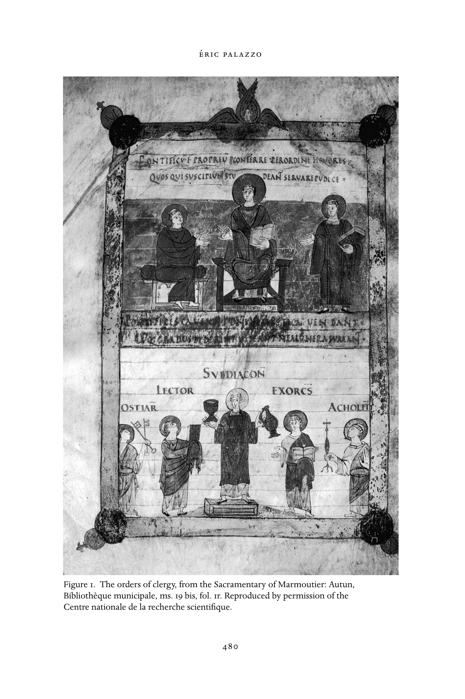

图1　教士各品秩，出自《马尔穆捷圣事礼书》。欧坦市立图书馆，ms. 19 bis，第1叶正面。原书经法国国家科学研究中心许可刊载。

<!-- PDF page 510; original page 481 -->

这幅细密画位于手稿第1叶正面，为马尔穆捷所用《格列高利圣事礼书》的文本开篇；该书在十一世纪又被改编供欧坦主教座堂使用。手稿最初几叶，收录授秩仪式中诵念的一系列祷文。这些祷文出现在圣事礼书中并不寻常，因为至少自九世纪起，它们通常另存于独立手稿，即各类礼仪规程（ordines），其中一类收录授秩仪式。在后者中，祷文与描述授秩礼仪施行的礼仪指示结合；而《马尔穆捷圣事礼书》的开头，只有祷文，没有相应规程的描述。在某种意义上，第1叶正面的细密画，提出了教会等级的“理想图景”，对应紧接在后的授秩祷文。图像上部，披戴披带的主教居中坐在宝座上，右侧是坐着的司祭，左侧是身穿达尔马提卡礼服的执事。三人构成大品类别。画面分上下两层，在视觉上表达教会等级由两类组成的观念。同样，在上层，主教身形大于另外两人，居中坐于宝座；大品中的第二位司祭，坐在主教右侧，其座椅小于教会首领的宝座。他略呈侧面的姿态，也表达这里运作的等级观念。执事站立，左手持《福音书》，象征其礼仪角色，因为他被指定在弥撒中诵读当日福音。授秩庆典中，主教把《福音书》交给执事；神学家认为，正是这个动作真正造就执事。如此，《福音书》成为执事礼仪职分的徽记。人物上方的拉丁铭文说明，授予教会品秩的权利是主教特权。

下层描绘了代表五种小品职务的人物。与上层一样，金字塔式构图和人物安排，也表达了小品内部的等级观念。居其首的是副执事，站在中央台座上。除在弥撒中诵读《使徒书信》外，他也在祭坛侍奉，因此被描绘为手持圣爵和盛酒水的小壶。左右接着可见守门人、诵读员、驱魔员和辅祭，各持自己礼仪职分的物品，依次为钥匙、书、<!-- PDF page 511; original page 482 -->驱魔礼书和火炬。教会等级中每一位成员授秩时，主教都授予其职分的礼仪工具。同样，加洛林神学家认为，授秩仪式的这一刻，才造就副执事、守门人、诵读员、驱魔员和辅祭。换言之，授予器具的行动，是整个仪式的根本时刻：它不仅以萌芽形式（in nuce）包含授秩的全部神学意义，也使主教得以传递每位教会等级成员的礼仪职分徽记，而教士此后将受召在礼仪庆典中使用这一徽记。

《马尔穆捷圣事礼书》的细密画，并不打算写实地再现加洛林授秩仪式，甚至也不再现庆典的某个具体时刻；它通过强调仪式及其神学最重要的时刻——向每位受秩者授予礼仪工具——，展示了授秩神学的综合图景。

### 书籍及其中的图像

正如图像是教堂大型装饰的一部分，礼仪手稿中的细密画，也为中世纪教会的视觉维度作出贡献。七世纪，各种礼仪文本开始编定时，西方礼仪书中出现图像。插图依礼仪书类型而不同，唤起基督生平，描绘圣徒、福音书作者肖像，甚至仪式场景。这些图像无法以礼仪中的单一直接功能概括，而对应不同关切：以丰富装饰尊崇上帝，表达各种礼仪、政治、社会，乃至神学利益。另一方面，我们不知道图像是否有助于仪式的实际施行；通常认为，它们体现礼仪的视觉维度。不过，某些情形下，也不能排除它们曾充当礼仪时刻的视觉快照。[^p511-17] 还应注意，中世纪礼仪书的装饰，不限于手稿内伴随文本的细密画。装帧嵌饰<!-- PDF page 512; original page 483 -->象牙板、金银，乃至宝石和其他珍贵材料，其华美与图像同样凸显一种愿望：用美丽物品举行礼仪，归荣耀于上帝；尽管中世纪神学家，以及此前某些教父，反而劝人仪式中使用朴素书籍。[^p512-18]

举例来说，可看十至十二世纪主要在意大利南部、更准确地说在贝内文托制作的《逾越颂》卷轴上的细密画。[^p512-19] 卷轴抄写 Exultet，即执事在复活节守夜、祝福并点燃逾越蜡烛时所唱的颂歌；文本与插图交替，插图表现文中的段落或逾越礼仪事件（图2）。

文本中的 laus apum，即赞美蜜蜂的著名诗歌与神学段落，配有养蜂场景；但《逾越颂》卷轴的大多数图像，描绘守夜礼的特定时刻：祝福逾越蜡烛、点烛、列队前往洗礼池、以蜡烛祝福洗礼池、施洗场景，甚至描绘卷轴自身的仪式展演：执事站在读经台顶端，手持卷轴，身旁是点燃的逾越蜡烛，歌唱《逾越颂》。其他图像则更强调某些段落的神学维度，例如在文本提到基督战胜死亡之后，紧接着安排基督击倒死亡的图像。这些手稿在书籍形制上的独特之处，是文字与图像朝向相反；这似乎表明，图像具有教导用途，面对中殿里聚集听颂歌的信徒，文字则有礼仪功能，只由执事、只在礼仪年这一特定时刻吟唱。

事实上，执事并不需要书面文本，因为他已背熟《逾越颂》，本时期多数礼仪曲目也是如此。至于信徒，他们离读经台——执事持卷轴站在台顶——太远，根本辨认不出任何图像。《逾越颂》卷轴这些独有特征，实际上涉及中世纪礼仪施行中，书面文字与图像所具有的强烈象征意义。主持礼仪的执事不读卷轴文字，朝向与文字相反的图像，也没有被预定的观看者看见。换言之，

<!-- PDF page 513; original page 484 -->

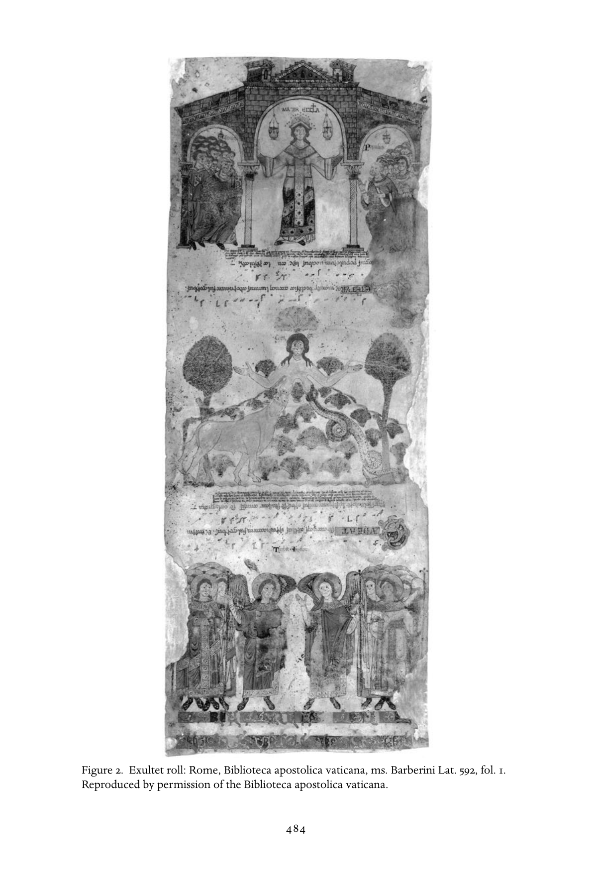

图2　《逾越颂》卷轴。罗马，梵蒂冈宗座图书馆，ms. Barberini Lat. 592，第1叶。原书经梵蒂冈宗座图书馆许可刊载。

<!-- PDF page 514; original page 485 -->

这种特殊礼仪书的形制布局，对应的是从未真正实现的文本与图像礼仪角色。然而，复活节守夜唱《逾越颂》时，执事仍须持有这样一卷，其中象征着礼仪文本及其伴随图像的作用。而且，执事在此场合必须配备《逾越颂》卷轴，因为这个物品本身，也是他在复活节守夜中的礼仪角色的象征。

《逾越颂》卷轴在执事施行守夜仪式时，充当其礼仪徽记；这种象征功能，可以与另一种书——供礼仪吟唱之用的独唱集（cantatorium）——相比。“副执事诵读《使徒书信》之后，领唱者携独唱集登上读经台，唱答唱咏。”[^p514-20]

这段文字取自一种礼仪规程，即包含仪式描述的书，既界定独唱集的意义，也界定其功能。这是独唱者的书，只包含弥撒开始时插于读经之间的圣歌，即升阶答唱咏和阿肋路亚咏，有时也包括领唱者唱独唱段所需的奉献咏经句。实际上，独唱集在礼仪庆典的施行中，并非履行书籍获赋的任何古老功能，而是荣誉功能大于实际功能；因此，它的作用可与上述《逾越颂》卷轴的象征功能相比。关于独唱集的荣誉功能，伟大的神学家与礼仪注释者梅斯的阿马拉里乌斯，于九世纪中叶写道：“领唱者手持〔独唱集的象牙〕板，并不需要阅读〔其中的文字〕。”[^p514-21] 独唱集采用长条形制，这种形式通常专用于礼仪圣歌书；与许多中世纪礼仪书一样，它的封面也常以象牙板装饰。阿马拉里乌斯关于独唱集及其由独唱者在礼仪中使用的注释，显示出礼仪书被赋予的强大象征分量；有些书，如《逾越颂》卷轴，其装饰图像也具有同样分量。他的解释有力强调了书籍在中世纪仪式行动中高度荣誉性的性质。多数时候，书实际上并非不可或缺，但书及其图像的在场却是必需的，因为它界定仪式的某些方面：书面部分及视觉维度。

<!-- PDF page 515; original page 486 -->

### 仪式施行中的声音、光、香气与“礼仪剧”

中世纪教会仪式呈现强烈的多维性质。前面，我借赫拉班·毛鲁斯教堂奉献礼讲道的一段文字，提醒读者注意界定中世纪礼仪时的这一重要方面。就仪式而言，该文提到“这座教堂装饰的墙壁”“许多点燃的蜡烛”“在连祷和祈祷中以不同方式举扬的声音”，以及“读经和歌唱”。诚然，中世纪礼仪由供诵读的文本、以祈祷形式念出的文字、绘制或雕刻在教堂内墙上的图像，以及手稿细密画组成。但它也由光和圣歌构成；除此之外，还可加入仪式的嗅觉维度，而中世纪礼仪文本或注释很少提及这一点。通常由大量焚香产生的香气，是中世纪礼仪施行不可分割的一部分。嗅觉维度本身就具有极丰富的象征暗示，尤其联系着旧律仪式中所描述、由在所罗门圣殿供职的司祭使用的神圣香气。

在界定中世纪教会仪式及其象征意义时，声音维度也是主要的感官要素。[^p515-22] 这包括弥撒中、一般圣事仪式——洗礼、坚振、教堂奉献与祭坛祝圣、授秩等——中唱出的礼仪圣歌，也包括修士在修道院各礼仪时辰举行的大量每日祷告。这里无法详细描述中世纪礼仪音乐的历史；我只想强调，声音维度在界定中世纪教会仪式施行时具有核心作用。总体而言，鉴于许多所唱文本，例如弥撒附加咏词，具有释经意义，礼仪圣歌在声音和神学上，双重装点仪式的施行。有时，中世纪礼仪的声音景观也会转入阴暗。近来一项开创性研究，考察了中世纪教会仪式中的各种呼喊。[^p515-23] 作者依据不同礼仪史料及其他文本，明确显示出一些固定、明确规定和／或遭到禁止的<!-- PDF page 516; original page 487 -->呼喊；它们表达中世纪虔敬相互补充的方面，也是中世纪社会仪式化表达不可分割的一部分。

自基督教开端，光在礼仪施行，以及更广义的各种仪式中，都占据显要位置。[^p516-24] 著名的三世纪礼仪—教规文本《使徒传统》中，一段文字证明了光在基督教礼仪中的作用与意义；当代研究已质疑该文本起源于罗马的说法。在其所描述的仪式中，光具有物质在场，但同时被赋予象征与神学意义，联系着基督之光；他是永恒之光、死亡的征服者。只需略读主要中世纪礼仪文本，尤其祷文和礼仪指示，便容易看出，中世纪礼仪整体反映了光的这种仪式与神学意义。事实上，中世纪礼仪频繁使用光：在仪式过程中，固定和可携带的蜡烛都使光在场。例如，在圣餐庆典的不同时刻，负责携带烛台及其上蜡烛的辅祭，采取并改变位置，使烛光始终居于礼仪行动的中心。除礼仪文本外，许多其他中世纪史料，如圣徒传记和编年史，也提供有关光在礼仪施行中地位的有趣信息。作者往往着重强调圣徒或君王祈祷的神秘效力，使耀眼光芒照射出来。最后，古代和中世纪的基督教礼仪如此重视光，以致可以说，某些仪式完全为光而设。例如，2月2日圣烛节游行，庆祝献主于圣殿及荣福童贞玛利亚取洁。还可举出前述复活节守夜中的“新火”礼仪：执事在其中祝福并点燃逾越蜡烛，象征基督复活和教会的建立。

在结束这段关于中世纪早期礼仪施行的简略探索前，我还必须指出“礼仪剧”、或更一般的“戏剧编演”的重要性，以及它与中世纪西方教会仪式实践的关系。[^p516-25] 这些“礼仪剧”<!-- PDF page 517; original page 488 -->出现于十、十一世纪，主要在修道环境中，并催生了新的礼仪书。几十年来，史学倾向于把这些新仪式展演称为“礼仪剧”。这个说法无疑方便，但在我看来，并不适合说明这些关于基督或其他圣经人物生平的呈现究竟是什么。我确信，这些新型仪式绝不是现代意义的“戏剧”；将它们从整个修道仪式中剥离，并不恰当。事实上，这些礼仪“剧”或“戏”，完全属于千年之交修道礼仪愈加华美的过程。当时的修道习惯书，编定了修院礼仪实践等事项，准确反映了这种强化。换言之，这些“剧”表明，千年之交修道仪式正在演变，其“舞台呈现”有所发展；“礼仪剧”的施行，为这一发展作出贡献。在某种程度上，这一过程平衡了仪式中的“文本”维度，即祷文诵念、圣经阅读，乃至圣歌曲目的演唱。

## 注释

[^p501-1]: Zumthor, La lettre et la voix, 287–88.

[^p502-2]: Palazzo, Liturgie et société.

[^p502-3]: Althoff, “Variability”。另参见 Post, “Ritual Studies”。

[^p502-4]: Reynolds, “Liturgy, Treatises on.”

[^p503-5]: Palazzo, Histoire.

[^p503-6]: Hrabanus Maurus, Homilia 39, 73–74。英译见 M. Carruthers, The Craft of Thought: Memory, Rhetoric and the Making of Images 400–1200（New York: Cambridge University Press, 1998），275。

[^p504-7]: Taft, Le rite byzantin.

[^p504-8]: Palazzo, “Jalons.”

[^p504-9]: Taft, Le rite byzantin, 40ff.

[^p505-10]: 转引自 Taft, “L’apport,” 106。

[^p505-11]: 参见本卷约尼亚—普拉所撰第17章。

[^p506-12]: Palazzo, “L’espace et le sacré.”

[^p506-13]: Theodulf of Orleans, Erstes Kapitalar XI, 110–11.

[^p507-14]: Ardo, Vie de Benôıt d’Aniane, 70–71.

[^p508-15]: Durliat, “L’architecture du XIe siécle.”

[^p508-16]: Reynolds, “Portrait.”

[^p511-17]: Bonne, “Rituel de la couleur.”

[^p512-18]: Steenbock, Der kirchliche Prachteinband.

[^p512-19]: Kelly, Exultet.

[^p514-20]: Amalarius of Metz, Liber officialis, III. XVI, 330.

[^p514-21]: “Cantor, sine aliqua necessitate legendi, tenet tabulas in minibus,” Amalarius of Metz, Liber officialis, 303.

[^p515-22]: 关于中世纪文化的这一“声音”维度，参见 Fritz 的杰作 Paysages sonores du Moyen Âge，尤其263–308页，讨论“声音神学：圣言与声音”。

[^p515-23]: Collomb, “Vox clamantis in ecclesia.”

[^p516-24]: Palazzo, “La lumière et la liturgie.”

[^p516-25]: Young, Drama。另参见 Revue de Musicologie 专刊中以“Le drame liturgique médiéval”为题汇集的论文。

---

# 第五编 基督教：书籍与观念

<!-- PDF page 518; original page unnumbered -->

---

# 第24章 上帝的异象

阿兰·布罗（Alain Boureau）

<!-- PDF page 519; original page 491 -->

没有人能看见上帝。圣保罗重申《出埃及记》（33：20）的古老告诫，主张人在最终蒙福以前，只能“对着镜子观看，模糊不清”地认识上帝（《哥林多前书》13：12）。从爱任纽（约130—约200）至伪狄奥尼修（约500）的教父时期，默观似乎提供了一条通向神的道路，一种仿佛超越镜面的方式；但东方受到四世纪后半叶对欧诺米乌斯（卒于394年）异端的谴责所影响，长期坚持上帝在根本上不可知，与西方相对。不过，虽然默观传统确实延续，在我们讨论的公元600至1100年，居于主导的却是从思辨与实践两方面，寻求神与人之间的感性和理性中介。这一基本取向，使人类生活的景观发生巨大转变：从此，这片景观上点缀着由神性的符号与图像组成的多面结构。它也对应着基督教在政治与社会中的确立时期。基督教作为建立于、也安置于分裂的社会政治权力中的宗教，发现必须展示可见的身份与合法性标记。神的本质虽无限，却既然已向人的有限感知显露，那么它在受造世界的显现，尤其道成肉身的基督的临在，就已留下可以发现、可以追随的痕迹或足迹。例如，基督明确命令纪念自己的牺牲。此外，作为圣言，他曾宣讲，曾用人类语言说服听众。在这几个传教机会极大、也有未被记录之抵抗的世纪里，语言本身遂提供另一种媒介。我将围绕三大主题，尝试整理中世纪早期关于上帝的异象：崇敬道成肉身的基督——他救赎人类，宣告圣灵来临；再现神圣痕迹；构建一种神学逻辑。

<!-- PDF page 520; original page 492 -->

作为引言，应当回顾，新柏拉图主义默观上帝的传统，在本时期依然延续。它用视觉隐喻，描述灵魂在上帝恩典帮助下上升至上帝。与此相应，人们认为，神会在“神显”（theophanies），即视觉性启示中，让人窥见自己。七世纪拜占庭最重要的神学家、认信者马克西穆斯（卒于662年），继承并补足了伪狄奥尼修在此方面的教导，着重强调 theosis，即通过神的内住所达到的神化。在本时期之末，十世纪末的拜占庭，新神学家西缅建构了一种将自身交付圣灵的灵修；更晚时，它又在十三世纪格列高利·帕拉马影响深远的教导中结出果实。在西方，约翰·司各脱·爱留根纳（约卒于877年）阅读并翻译伪狄奥尼修和认信者马克西穆斯，重新发现了这一主题：在神显协助的神秘历程结束时，回归太一。

认信者马克西穆斯澄清了关于上帝的两种话语之间根本区分的意义：第一种是“神学”，涉及神的本性；第二种是“经纶”，涉及上帝介入受造世界，尤其是圣言道成肉身。[^p520-1] “神学”因其所思对象的崇高而居首位。按希腊语意义，它主要是“否定的”或“否定式的”（apophatic），因为神的本质不可接近；只能通过否认那些可归于神的属性——存在、力量、良善、意志等——适用，来间接指说它。在教父时期，贯穿从尼西亚（325）至迦克墩（451）一系列大公会议的伟大三位一体辩论中，反而是肯定神学至关重要，正因为当时需要证明教义。然而，对迦克墩教规的顽强反对持续存在，也不断滋养教会内部的基督论争。教父的“神学”让位于道成肉身者的“经纶”；七世纪争论的主要事件，即关于基督位格之运作与意志的辩论，清楚说明这一点。在东方，关于基督本性的争论仍很活跃，西方则更关注道成肉身的圣言在圣事中延续的工作。这一重要差别，也来自神学与教会环境的不同：东方教会较少教士化，教育程度更高，也更喜好<!-- PDF page 521; original page 493 -->思辨。此外，政治制度的显著差异，也有助于解释两种基督教传统之间逐渐扩大的分歧。

### 神的经纶与基督敬礼

迦克墩的教导确立基督有两性，一人性、一神性，在道成肉身中形成一个位格或实存（hypostasis）。涅斯托里乌斯派反对这一教导，坚持两性、两个实存；这种反对延续下来，并在大巴拜（约卒于628年）那里找到最成熟的理论家，尽管涅斯托里乌斯派教会早在六世纪就已建立自己的等级体系。反对迦克墩的合一性论派，坚持基督只有一个神圣本性（phusis）；由于雅各派教会在叙利亚、亚美尼亚和埃及牢固建立，其对拜占庭教会的影响更持久。合一性论的重要神学家，是埃德萨的雅各（卒于708年）。

迦克墩派、涅斯托里乌斯派和合一性论派这三种基督论，曾在东方同时并存，却导出明显不同的上帝观。涅斯托里乌斯派崇敬基督的人性，以之为通向神性的所在，合一性论派则把基督位格吸收于神性中。崇拜的中介和礼仪图像也显著不同：在合一性论派中，对童贞圣母上帝之母（Theotokos）的崇敬，或对表现基督受苦人性的图像的崇敬，多少受到断然拒绝。迦克墩派的中间道路，则更与神化（theosis）主题相连，认为它主要是通过基督道成肉身而实现的恩赐。诚然，这一主题源于古老而可敬的教父传统，见于沙漠教父、约翰·卡西安（约360—430年以后）和本都的埃瓦格里乌斯（346—399），并在七世纪由马克西穆斯的同时代人约翰·克利马库斯（约570—约649）传递。不过，基督论张力无疑对于这一拜占庭主题群的发展发挥了重要作用；这些主题很久以后才传至西方。然而，基督的再现与教义辩论之间，不能建立直接而单一的联系。图像题材的选择和图像方案的密集程度，主要取决于各种传统，它们既不与当代教义辩论保持同一节律，也不具有相同范围。即使在教义领域，也能辨认出普遍而反复出现的趋势。因此，某种对图像的恐惧，或至少不愿大量增加图像的态度，属于一神教极古老的遗产，因而也周期性地重新成为突出关切。

<!-- PDF page 522; original page 494 -->

此外，把三种基督论如此分明地陈列，其实具有误导性，因为没有考虑合一性论逐渐脱离的过程；七世纪以来伊斯兰兴起，部分促成了它的孤立。这种呈现也过分重视涅斯托里乌斯主义，而它在当时辩论中仅居边缘。事实上，无论拜占庭帝国疆域收缩还是重新征服，涅斯托里乌斯派教会都在帝国外。因此，涅斯托里乌斯派神学在某种意义上被驱逐出基督教正统边界；把伊斯兰的发明和穆罕默德的崛起归于涅斯托里乌斯或其弟子的传说，也暗示了这一点。

相反，即便身处遥远地区，合一性论派仍是基督教正统持续的对话者。教父思想中的许多含混之处，都能被用来证明或支持合一性论神学。合一性论缩减基督位格的倾向，保持着持久活力，不依赖精确的传递，而源于道成肉身问题本身的内在困难。此外，还应注意，各种基督论争也有不能化约为纯教义辩论的文化与政治维度，联系着本时期极具特色的基督教教会—政治身份分裂。

尽管教义上相互咒诅，合一性论与正统如此接近，在贯穿七世纪的“一能论”或“一志论”辩论中清楚显现。[^p522-2] 617至618年，拜占庭教会着手考察：道成肉身的基督在两性之外，其运作（energeia）是否唯一？基督的救赎行动，能否分为两个不同的行动领域？辩论过程中，问题转向基督的意志（thelos），以及它是一还是二。实际上，energeia 一词含有过于实践性的意义，可能仅涵盖那些过分属于人性的行动。政治利害很清楚：拜占庭帝国与教会面临波斯、继而伊斯兰的严重威胁，必须寻求与合一性论团体和解。事件刚开始，便有牧首塞尔吉乌斯（卒于638年）致信亚历山大里亚合一性论者乔治·阿尔萨斯，请他提供关于单一 energeia 的著作。同时，<!-- PDF page 523; original page 495 -->与叙利亚和埃及合一性论派牧首的谈判也在进行。

但撇开制度问题，神学辩论是真实的。基督具有两个意志的教义，经过艰难才获胜，并在680—681年第六次大公会议，即第三次君士坦丁堡会议，得到确认。八世纪初以后，一志论似乎不再有明显追随者，却已深刻改变对神的理解和接近启示真理的方式。正如参与者自己所说，这是前代教父未曾探索的水域，圣经也很少提供直接指引。因此，必须仔细考察基督话语的细节：不再主要把它视为教义真理的现成来源，而是指向有待建构之真理的线索。例如，人们对基督在橄榄山和受难时的话，提出不同解释。此外，为两志事业辩护并殉道的认信者马克西穆斯，诉诸哲学论证，借用亚里士多德的观点：行动与本性的联系，比与个别位格的联系更紧密。一方面，在修道实践（praxis，个人得救所必需）、默观（theoria）与神学（theologia，确立普遍真理）之间作区分；另一方面，在圣经释义与证明逻辑之间作区分，为一种神学话语奠定基础，似乎赋予本时期自身的连贯性。这一事件推动了更偏重探索发现、而非默观的圣经释义；西方最具代表性的例子，是《通用注释》（Glossa ordinaria）的庞大事业。

西方教会在这场危机中发挥重要作用。在继任者采取彻底反对一志论的立场以前，教宗英诺森一世（402—417）最初支持一种被拜占庭人认为是一志论、或至少勉强接近一志论的立场。后来，拜占庭教士援引这一转变，作为教宗教座可能犯错的实例；此前，其教义立场被认为无可指摘。〔译注：原书此处确作“英诺森一世（402—417）”，与本段七世纪背景及本卷第2、10章的记载不合；后两章涉及此争论的教宗为霍诺里乌斯一世（625—638）。译文保留原书姓名与年代。〕但这些基督论决定的实际影响，则是另一回事。589年托莱多会议上，西哥特国王雷卡雷德归信以后，阿里乌斯主义与其他偏离三位一体正统的学说一样，不再对西方基督教世界起决定性作用。唯有把基督说成上帝养子的嗣子论，在八世纪末构成短暂例外；其影响有限，尽管它促成了加洛林时期神学思想的一次真正繁荣。

<!-- PDF page 524; original page 496 -->

尽管许多异端研究者常持这种看法，仍不应轻率地把嗣子论与上一世纪的大基督论争混为一谈。[^p524-3] 嗣子论异说有时被归于犹太、阿拉伯，甚至涅斯托里乌斯派影响，认为这些影响通过随阿拉伯军队而来的东方基督徒传播。实际情形似乎既更普遍——因为对道成肉身的追问长期活跃——也更地方化。八世纪末，托莱多总主教埃利潘杜斯（717—802）被迫迎接由教宗哈德良（772—795）和法兰克教会派来、改革西班牙教会的使团。负责使命的阿吉拉主教，带着一位名叫米格提乌斯的教士，后者传授奇怪学说：大卫之子耶稣，是三位一体的三个位格之一！在塞维利亚举行的一次会议上，埃利潘杜斯回应说，耶稣从存在之初便被收纳为嗣子。“收纳为嗣子”这个动词虽显笨拙或挑衅，却完全可能被理解为迦克墩基督论所用“摄取”一词的变体；也可能被扭向涅斯托里乌斯派方向。然而，反对者——列巴纳的贝阿图斯和埃特里乌斯两位修士——更进一步，错误指控埃利潘杜斯主张：耶稣在受洗时才被父收为嗣子。随后，乌赫尔主教费利克斯（卒于818年）支持埃利潘杜斯；他又遭查理曼（768—814）谴责，被召至雷根斯堡，后来送往罗马教宗面前。费利克斯放弃自己的教义表述，但西班牙教会继续支持二人的理论，甚至向查理曼申诉。查理曼再次求助教宗，教宗断然谴责其教导。于是，查理曼在794年召集法兰克福会议。争论仍持续数年，促成若干反驳“嗣子论”的论著，尤其出自阿尔昆（卒于804年）。这些论著知识水准很高，构成一种独立于教父和拜占庭传统的西方神学的最初要素。

中世纪早期这种以基督为中心的取向，强烈影响神性被再现的方式。教义辩论的多样和激烈，使基督再现的方式增多，有时是消极地选择未遭谴责的内容——即不易成为敬礼对象、有关基督生平的熟悉或日常场景——，有时则采取补偿方式。九世纪初，加洛林西方正处在<!-- PDF page 525; original page 497 -->至少对图像敬礼颇为保留的环境，十字架的再现却急剧增加。神由此变得更加可见。父没有道成肉身，无法再现；但基督在某种意义上吸收了父的一些属性，特别是六世纪末以来，拜占庭把他描绘为全能者（Pantocrator），即普世统治者。约翰·司各脱·爱留根纳《论自然》（Periphyseon）精彩表达了希腊意义上严格的神学观：它把神的本质与父上帝置于存在之外，某种意义上将创造委托给圣言，从而允许把基督描绘为创造者。

### 使圣灵显现：“及子”条款

著名的“及子”（filioque）争论，长期使拉丁与拜占庭教会对立，似乎与神的经纶、尤其在西方受到突出重视的情况相矛盾。[^p525-4] 实际远非如此。正如拜占庭人自己指出，恰恰是从经纶外推到三位一体神学，部分引起了这一巨大误解。事实上，描述子与圣灵关系的圣经文本，主要取自《约翰福音》，全都涉及圣灵在时间中的使命：作为保惠师、保护者和辩护者。“我要求父，父就另外赐给你们一位保惠师，叫他永远与你们同在”（《约翰福音》14：16）。

现代神学家倾向于减轻这一教义分歧的重要性。但对史家，它仍是重要事件，因为“及子”很快便在导致分裂宣告的教会分歧清单中，占据显要位置。自867年起，拜占庭牧首佛提乌斯（约810—约895）谴责拉丁教会立场，并明确界定相反的教导：圣灵仅从父发出。在此过程中，他使原来较有弹性、能够与两种教义表述协调的教父论断僵硬化。不过，必须在教会论冲突的背景中理解牧首的责难；冲突围绕对新基督教教会—政治身份的控制，以及罗马教座的首位权展开。对于中世纪作者，这种教会机构及身份意识的固守——1054年公开宣告“分裂”时再次发生——始终不排除<!-- PDF page 526; original page 498 -->分歧实际上可以克服的想法。因此，邓斯·司各脱（约1265—1308）追随十三世纪其他经院思想家，对“仅从父发出是否将抹去三位一体第二与第三位格的区别”这一问题，作出否定回答。

另一方面，通过《信经》的诵念，争议确实直接影响信徒的虔敬实践。381年君士坦丁堡会议颁布的“尼西亚”信经说：“我信圣灵，主，赐生命者，从父发出……”数百年间，整个基督教世界都以同样方式诵念。589年托莱多会议，首次加入“及子”条款，即“从父和子发出”；大概是为了区分基督教正统与阿里乌斯主义。应记得，雷卡雷德国王就在这次会议归信；目的是表明圣言的崇高地位。这一轻微的敬意，在教义上并非极其重大，因为教父神学中，“圣灵从父通过子发出”与“从父和子发出”的表述本就并存。但礼仪上的利害很大：拜占庭和西班牙在弥撒中诵念《信经》，当时的法兰克教会却没有这一做法。连同其他习惯，这一礼仪实践逐渐传至高卢和英格兰；亚琛宫廷小堂也诵念含“及子”的《信经》，也许始于786年阿尔昆入宫。围绕这些实践与礼仪公式谁更古老的问题，双方不时指控对方篡改文本，有时还确实相信自己的指控。例如，1054年，席尔瓦—坎迪达的洪贝尔特（卒于1061年）指责希腊人删去了古老文本中的“及子”。但推动查理曼要求神学家、尤其阿尔昆研究此事的，是政治形势，即加洛林与拜占庭帝国之间的紧张。第二次尼西亚会议（787）的议事录，包含牧首塔拉修斯（卒于806年）的信仰宣认，主张圣灵从父通过子发出。教宗哈德良拒绝修改《信经》。法兰克教会仍继续进攻，794年在法兰克福否定第二次尼西亚会议，又在796年奇维达莱（弗留利）会议上，就“及子”问题谴责拜占庭教会。数年后，查理曼命神学家整理教义材料，为809年亚琛会议作准备。尽管承受压力，教宗利奥三世（卒于816年）拒绝纳入新公式，并建议停止在弥撒中唱《信经》。事实上，<!-- PDF page 527; original page 499 -->直到1014年，在本笃八世任内，亨利二世加冕之际，应其要求，这项拉丁增文才进入罗马弥撒。

然而，问题仍在：礼仪变体和相互指控篡改文本，是否对三一上帝及第三位格的一般理解产生重大影响？这很难衡量。不过，确有一个事实：把圣灵表现为具有人形的位格，最早的论述性再现——多伊茨的鲁佩特——和图像再现，可追溯至十二世纪初。[^p527-5] 整个十二世纪，人们认识到一种历史神学的重要性，它联系着对圣灵时代的期待，或更一般地，期待三位一体第三位格的特殊显现，例如多伊茨的鲁佩特、哈弗尔贝格的安瑟伦和菲奥雷的约阿希姆。

### 从可见到可理解：新的思考

如前所述，这些教义与礼仪思考增加了神的图像：道成肉身的圣言，在基督论争中更加接近人。因此，围绕合一性论倾向形成的分歧，立即影响了神的绘画再现。691—692年举行的第五六次“特鲁洛”会议，距谴责一志论的第三次君士坦丁堡会议十年；其第82条教规，命令放弃以羔羊形式象征基督，改用人的形貌：“绘画应如同牵着我们的手，引导我们记起耶稣在肉身中生活，为我们得救而受苦、死亡，从而赢得世界的救赎。”[^p527-6] 此后几年，查士丁尼二世下令铸造金币，以具有人形的基督半身像取代正面的皇帝半身像；皇帝像被移至背面，取代原来的端头横杠十字架。

约725至842年，拜占庭东方围绕图像崇敬展开长期斗争，“圣像破坏者”，即“打碎图像的人”，及其倾向兴起并取得支配，[^p527-7] 回声遍及基督教世界。必须结合上述迦克墩基督论的发展理解这一斗争。不过，也不应<!-- PDF page 528; original page 500 -->忘记，圣像破坏在拜占庭皇帝倡议下扩展，对教会牵涉重大利害。捍卫圣像敬礼的修士，影响力因而下降，受牧首和皇帝支配的主教群体则得益。在与伊斯兰和犹太教竞争时捍卫一神信仰的关切，无疑也起重要作用；即使指控圣像破坏者与合一性论者、犹太化者及其他异端勾结，更多来自当时极端论战，而非实质证据。

圣像破坏的支持者，攻击的并非再现本身，而是对再现的崇拜；他们认为这种崇拜没有依据，也不恰当。拜占庭时代六、七世纪，圣像数量大增，产生一整套依附于图像的仪式：点灯照耀、焚香、亲吻，在像前俯伏（proskunesis），向它们祈祷，并期待它们施行奇迹。甚至有人刮取画面尘屑，混入圣餐；圣像也可用作祭坛桌。

很难准确确定圣像破坏者的论证路线，因为其著作大多遭对手毁坏。但754年希埃里亚会议文献，以及君士坦丁五世（741—775；利奥三世〔717—741〕之子及继承者）的《问难》（Peuseis）编本，仍显出清楚的基督论论证；皇帝对图像的谴责由此展开。按照这一基督论，基督图像只能表现其人性，因而是虚假的：或者因为神性不可能呈现于视觉，或者因为这种表现犯了否认神性存在的错误。真实、值得崇敬的图像，必须与其原型同质；因此，基督唯一的再现就是圣餐。事实上，这一批评可以被看作完全合乎迦克墩的异议：基督图像声称表现一个位格，却只容许人崇拜构成该位格的两性之一。

圣像破坏者的最终失败，使拜占庭基督教世界的圣像敬礼获得持久基础，同时深刻改变教会结构及其与帝国的关系。过去仅被容忍、至多被善意看待的敬礼实践，在辩论中成为真正理论化的对象。大马士革的约翰（约卒于749年）的贡献，以及第二次尼西亚会议——787年暂时恢复“圣像敬礼”——的讨论，仍多少<!-- PDF page 529; original page 501 -->较为简略，带有防卫语气。[^p529-8] 而斯图迪奥斯的狄奥多若（卒于826年）与君士坦丁堡牧首尼基弗鲁斯一世（约卒于829年），则深化图像神学，论证圣像敬礼丝毫不是偶像崇拜，因为图像是一种象征，虔敬的敬礼者透过它，面向被再现的位格，即“原型”。图像神学家借用古代皇帝像崇敬的词汇，同时发展自身的象征类比教义，主要基于新柏拉图主义的范型论：一切受造物反映神的形式。另一方面，圣像破坏者严格区分希腊意义的神学与启示经纶，只承认神有意采用的记号可能具有神圣性；其首要范例是圣事，尤其圣餐。[^p529-9]

圣像破坏冲突，在拉丁西方产生重要影响。查理曼和法兰克教会在《查理国王书》中界定教义立场；该书很可能在奥尔良的狄奥杜尔夫指导下编成，794年法兰克福会议确认其基调，并拒绝接受经教宗批准的第二次尼西亚会议教规。撇开这一拒绝的制度维度——他们否认尼西亚会议的普世性，把它视为“拜占庭的”会议——，遭到否定的是拜占庭图像神学：图像只有装饰或牧灵工具的价值，物件本身与原型之间不可能有联系。这一立场，可由深刻的教义差别解释，后面还会回到这一点；也与法兰克福同样提出、并谴责嗣子论的基督论辩论相互干扰。将西班牙异端解释为“涅斯托里乌斯派”，可能确实影响了加洛林的图像教导。两问题的联系，后来在九世纪二十年代都灵主教克劳狄乌斯（卒于827年以后）的事件中显现。[^p529-10] 普萨尔莫迪修院院长特乌特米尔，曾因其圣像破坏行为谴责克劳狄乌斯；但他的实际立场，只能通过对其答复的摘要得知。这份摘要奉虔诚者路易（814—840）之命编成，供奥尔良的约拿（约760—约841）及帕维亚的邓加尔（约800—约840年活跃）使用，后者受命反驳克劳狄乌斯的圣像破坏观点。克劳狄乌斯对宗教中介的拒绝相当严厉，不容图像、圣髑、朝圣，甚至十字架像。

<!-- PDF page 530; original page 502 -->

不过，他的极端立场并非孤例。825—826年写成、归于里昂的阿戈巴尔德（约769—840）或其弟子弗洛鲁斯（约卒于860年）的《论图像》，维护了一种较细致、却仍十分严峻的观点。乌赫尔的费利克斯被流放至里昂，由同为西班牙人的克劳狄乌斯护送到达。阿戈巴尔德约815年成为里昂主教，略早于克劳狄乌斯受任都灵主教和费利克斯去世。克劳狄乌斯极端的圣像破坏，使法兰克教会稳居中间地带。825年巴黎会议界定这一立场，巩固西方对图像的不信任，后果深远。使问题更复杂的是，托莱多的埃利潘杜斯的对手、列巴纳的贝阿图斯，写了一部著名《启示录注》；十世纪为其绘制的图像，当时与今天一样闻名。其中，基督被描绘为审判者，姿态在形式上极近拜占庭的全能者基督。

圣像破坏争论的教义解决，以及程度稍小的对嗣子论异端的回应，使人得以提出道成肉身之神的两种再现方式之间的根本区别：象征与记号。都灵的克劳狄乌斯谴责将隐喻滑移成模仿性类比，写道：

> 他们会崇敬岩石，因为主从十字架取下后，被放在凿于岩石的墓中，又因为使徒说：“那磐石就是基督。”但称基督为磐石、羔羊和狮子，是隐喻地说（tropice），不是严格按字面说，是根据这些事物的意义，而非其本质。[^p530-11]

这是圣像破坏者最早关于图像与范型之间并不同质的论证之一。圣像敬礼者的象征，在存在论上仍有别于实在，只能用于教导或默想。至少自六世纪末大格列高利（590—604）与马赛的塞雷努斯辩论以来，这一论点也在西方占主导。相反，记号观念引入真实关系，以及非本质性、而是关联性的联系，克服了这一再现困境。拜占庭世界支持象征与图像敬礼，没有走上这一方向。拉丁西方一向对图像保留，却把提升记号、视为神圣中介的做法，转移到圣事。

<!-- PDF page 531; original page 503 -->

把圣事视为神与人之间中介的思考，实际上为西方所特有，并为十二、十三世纪关于圣事历史、结构和因果作用的伟大综合作了准备。600年后，拉丁西方在基督论争中相对温和，也许正是西方赋予神的经纶和道成肉身圣言之工作以优先地位的一个原因。另一个原因，是圣奥古斯丁的巨大影响，尤其是其关于原罪传递的教导。基督救赎者主题的特殊重要性，由此而来；受到爱尔兰与盎格鲁—撒克逊影响强化的悔罪圣事学说，也由此发展，而洗礼不再占据西方圣事论述的首位。

但引起许多复杂问题的，与其说是悔罪，不如说是圣餐。如前所见，拜占庭圣像破坏者只承认圣餐是基督临在世界的一种方式，正因为基督有意在饼与身体之间建立因果关系。围绕圣餐的这一问题群，恰恰占据了法兰克教会数百年。科尔比院长帕斯卡修斯·拉德贝尔图斯（约790—约860），831年应其弟子普拉西杜斯·瓦里努斯之请，撰写《论主的身体和血》（De corpore et sanguine domini）；后者是科尔比在德意志的分院科尔维的院长。844年，修订本送给“秃头”查理；查理又交给科尔比的拉特拉姆努斯（约卒于870年），后来赫拉班·毛鲁斯（约780—856）也加入辩论。帕斯卡修斯断言，圣餐的肉（caro）“与从玛利亚所生、在十字架受难、从坟墓复活的肉，毫无分别”。拉特拉姆努斯反驳，圣餐身体虽然与历史中耶稣的身体本质同一，却只以属灵方式存在，是“不可见的实体”。同一时期，约翰·司各脱·爱留根纳应兰斯的欣克马尔（806—882）请求，撰写圣餐论著。文本未能保存，欣克马尔认为其价值可疑；但根据他的反应和爱留根纳的其他著作，仍可略知内容。爱留根纳在《天上等级注》中写道：

> 司祭每日以可感的饼酒物质制成、并以身体领受这可见的圣餐；它一经制成并受到祝福，便是属灵参与的象征性相似物（typicam esse similitudinem spiritualis participationem）。[^p531-12]

<!-- PDF page 532; original page 504 -->

帕斯卡修斯把圣餐形色看作呈现于感官的形象（figura）。史学称这一立场为“实在论”，但它实际上对应圣像敬礼思想中的象征主义倾向。两百年后，贝克的兰弗朗克（1010—1089）继许多人——克吕尼的厄德、维罗纳的拉特里乌斯、托尔托纳的格佐——之后，再次采纳这一观点。

这一次，攻击来自反对真实临在的图尔的贝伦加尔。自1050年起，约四十年间，他在主教会议和教会会议上被谴责十四次，其间几次收回观点，后来又受到激烈争议。辩论之长，可见利害之大。实体转变学说本身正在成熟，尽管这一词语的来源仍不清楚，有时归于彼得·达米安（1007—1072），有时归于拉瓦尔丹的于贝尔，偶尔也归于罗兰·班迪内利，即后来的教宗亚历山大三世（卒于1181年）。

词语的确切来源并不十分重要；当时这个词已经呼之欲出。某种意义上，它的创造反而悖论性地暗示贝伦加尔获胜，因为它把他成功强加于辩论的亚里士多德存在论词汇，转移到了神学。贝伦加尔从符号学和语言学论证出发，提出不应把圣餐圣事看作象征超越实在——即受苦基督救赎人类——的所指，而应看作记号：饼是基督身体的所指。[^p532-13] 因此，在他看来，饼的具体实在不可能消失，正如任何记号的所指，都不能消灭再现它的东西。〔译注：本段原文使用 signified，即“所指”；饼与基督身体的表征关系，依原文表述保留。〕沿着奥古斯丁传统，他强调记号出于意愿并具有契约性质：基督曾使用最后晚餐的饼，也继续使用圣餐祭献的饼，以表达救赎恩典的赠与。基督身体的临在当然真实，但这种真实意味着神设立它的意志：它是真实的，却是关系性的，而非物质性的。贝伦加尔的失败，并未使其神圣记号理论被遗忘。相反，结论被拒绝，并不妨碍其证明方式成功：圣事记号学说获得发展，在十二、十三世纪西方受到极为深入的研究。西方无酵圣饼的形式，遭拜占庭教会强烈谴责，却可能促进了圣餐记号的这种抽象化，因为它与日常面饼的可见<!-- PDF page 533; original page 505 -->实在截然不同。此外，无论圣餐被看作物质象征，还是神与人关系的记号，其中心地位都同时为理论思辨，以及十分具体的圣饼敬礼，打开道路；后者将成为中世纪晚期的特征。[^p533-14]

因此，在半个千年里，人对基督教上帝的感知，依照视觉和论述性的新中介建构起来。在东方，圣像破坏危机过去后，再现神、默想道成肉身者的持久合法性得以确立。在西方，保障这种中介的，则更多是圣餐敬礼。整个基督教世界，十字架、图像和建筑，改变了人类景观。自九世纪起，拜占庭东方大量兴建围绕穹顶后殿、呈希腊十字形的教堂，为宏大的基督论装饰方案提供理想画布。此外，约1000年，鲁道夫·格拉伯（卒于1047年）所唤起的著名教堂白色披风——既是巨大经济增长的记号，也是西方“堂区—村庄”形成的记号——上面点缀着苦像和宗教图像。十九世纪艺术史家把艺术活动的这次突然兴起，称为“罗曼式艺术”；但无论今天对这一艺术运动的确切年代和起源有何争论，十一世纪确实开始形成惊人的神圣图像供应。欧洲与西亚的基督教化，伴随着这一时期对时间本身的占有：从六世纪狄奥尼修·埃克西古斯创立基督纪年，到十世纪教宗文书局采用这一纪年。在某些方面，建立基督教时间划分所涉及的，尤其在西方，仍是经中介而得的上帝异象。人们不再认为救主基督的最终来临迫在眉睫。圣奥古斯丁对此作了决定性宣告；此后，延迟的观念进入对漫长时间的再现，尽管只有少数学者意识到冗长的年代，而臭名昭著的“千年恐慌”，也被十九世纪史家大大夸张。[^p533-15] 另一方面，长期准备基督第二次或最终降临，也明确纳入救主崇敬，这可见于加洛林的大型<!-- PDF page 534; original page 506 -->建筑，[^p534-16] 它们以唤起基督受难地点为中心。在本时期结束时，攻占耶路撒冷（1099）既是高潮——基督中心主义和中世纪早期的高潮，也是开端——十字军的开端。

### 构建神的逻辑体系

本章最后讨论的神人中介形式，以人类话语自身的逻辑为基础，似乎更具体地属于西方和拉丁现象。与神圣记号学说一样，它也似乎源于圣奥古斯丁著作，尤其《论三位一体》：人的精神呈现神圣三位一体的形象与镜像。圣保罗的镜子，在此取得积极意义：人的精神不再被看作神创造万物活动中的单纯反映或象征，而是上帝选择用来形成相似性、形成其拣选之记号的手段。人的精神中的记忆、理智与意志或爱，反映三位一体的三个位格。对应第二位格圣言，人的理解活动产生人类之言，能够把不可通约之物联系起来。

这一奥古斯丁式取向，在圣安瑟伦（1033—1109）著作中很容易辨认。在《独白》中，他证明：神的理智，即包含一切存在的创造圣言，将自身作为一切受造物的指导原则。因此，受造物的范型，意味着创造者精神中的某种形式。安瑟伦作为逻辑学家，从表达人类必然事物和行动的词语出发，努力与神圣言相遇。他据此主张：事物在被造以前，已在上帝里面被说出。因此，人的任务，是从普遍概念，即 verba naturalia，获得事物知识；事实上，理性受造物通过正确言说，可以效法圣言。但肉体限制妨碍人接近普遍观念，因此，说出正确词语，要求通过辩证法、即逻辑实践，实现理性的操练。信仰由此寻求理性理解（fides quaerens intellectum）。对安瑟伦，理性的任务不是证明事物，而是使人逐步从所说之事的真，转向存在论的真，再转向“意指”、即普遍概念或观念的真，以最终把握终极参照点——上帝本身。著名论证应置于<!-- PDF page 535; original page 507 -->这一框架中：它从人能够形成一个包含“无法设想比之更大者”（id quo maius cogitari nequit）观念的命题，推导上帝存在。自康德以来，这一论证被称为“存在论”论证，在安瑟伦《宣讲》中也能见到。

以少量《旧逻辑》文献——亚里士多德、波爱修、伪奥古斯丁文本等——为基础，在神学话语中运用辩证法，十一世纪大为增加，[^p535-17] 但早在九世纪便已开始。令人感到悖论的是，主要倡导者之一，正是约翰·司各脱·爱留根纳。[^p535-18] 他在翻译、注释希腊教父，尤其伪狄奥尼修以前，曾教授自由学艺。他的中心指导问题，是存在论与神学的关系：能否用亚里士多德的十个存在论范畴，指说神圣实在？最终，他否认这种可能，同时提出一种“超范畴”，即 ousia，一种实体中的实体，使人能够超越对自然进行人类描述的限制。长期以来，爱留根纳被视为当代作者中的例外，是拉丁中世纪唯一真正的新柏拉图主义者；其影响又因作品在1210年巴黎会议遭谴责、并在1225年得到教宗霍诺里乌斯三世确认，而进一步受阻。不过，近来研究揭示了其方法影响的范围，尤其在欧塞尔修院学校。[^p535-19] 西方神学的一个悖论是：其思想方向，竟由教会在制度上谴责的作者——爱留根纳、图尔的贝伦加尔——引导。

拉丁基督教思想如今配备了令人畏惧又敬重的逻辑工具，可以返回希腊意义的神学，试图界定神的属性。安瑟伦的著作显示出一种关切：从无限、不变、全能和三一性质等明显属性，理解神的本质。即使在《上帝为何成为人？》中，他也选择搁置道成肉身经纶所启示的教导，“仿佛对基督一无所知”地思考。对神的知识与意志的反思，实际滋养了震动西方的神学争论，尤其围绕奥尔贝的戈特沙尔克<!-- PDF page 536; original page 508 -->（约卒于868年）的教导；他主张双重预定，选民预定得救，被咒诅者预定下地狱。[^p536-20] 从约翰·司各脱·爱留根纳到安瑟伦，对其教导的反应十分激烈：人们认为，双重预定把上帝束缚于时间和固定秩序。彼得·达米安发展了关于上帝权能的论述；他的《论神的全能书信》，[^p536-21] 为绝对权能与有序权能的区分开路，而这一区分，实际上将神的启示置于上帝无限权能一边。第二个千年初期的著作，处处可见神的全能主题；其用意无疑是使上帝摆脱辩证话语可能撒在其作为上的限制性规定之网。同时，这也支持了格列高利改革时期教宗权的神权政治诉求。

这些目标在总体范围和逻辑主义方法上都相当新颖，十一世纪由此诞生一种新话语，名为“神学”，拉丁语 theologia，与教父对该词的使用没有直接关联。西方约1100年起，开始用它指神圣实在的科学，在同一学科中，兼包上帝本质与神的经纶问题。但启示神学古老的优越地位，仍在西方延续；theologia 与 sacra pagina 交替指今天意义的“神学”或圣经文本，便清楚表明这一点。人们通常认为 theologia 一词是彼得·阿贝拉尔约1120年著作中特有的新用法；而安瑟伦在著名的“信仰寻求理解”公式似乎要求它出现之处，也确实没有使用。但戈泽基努斯师傅约1070年的一封信，[^p536-22] 已见证一种新的神观正在形成。这位流寓科隆的列日教师，致信弟子瓦尔凯鲁斯，说自己年纪太大，无法追随同辈——兰斯的赫尔曼、巴黎的德罗戈、施派尔的吕迪格和巴伐利亚的迈因哈德——追求新科学“神学”。

如前所见，这是一种知识创新，也是一种文化创新。辩证方法需要系统教学，需要学习复杂技术；它不断触及错误边缘，因而引发激烈辩论。九世纪起修道争论迅速接踵，为城市学校、后来又为大学铺平道路。但若把西方神学逻辑体系的这一<!-- PDF page 537; original page 509 -->发展，看成必然且唯一的进程，就是错误的。与此同时，拜占庭的“文化复兴”促成许多古代文本传播。希腊教父作者在西方始终保有重要地位：尤其通过对伪狄奥尼修接连不断的翻译与注释，他们持续提供资源，但途径并不限于此。此外，西方仍保有一种与圣经、与自然的象征解读紧密相连的神学，在圣伯尔纳著作中达到成熟。一切尚未定局；不过，我们仍可提出，新拉丁神学的辩证取向，是由西方承认的神圣中介稀少所激发，而这又源于奥古斯丁对象征的批评，以及制度上对希腊神类比临在神学的拒绝。上帝确实可以让自己在理性的镜中被看见，使奥秘得到解决，或至少被划定范围。

## 注释

[^p520-1]: Pelikan, Christian Tradition, vols. 2 and 3.

[^p522-2]: Winkelmann, “Die Quellen”。另参见本卷劳思所撰第2章。

[^p524-3]: 参见 Rivera Recio, El adopcionismo en España，以及 Heil, “Der Adoptianismus”。

[^p525-4]: 最佳研究之一仍是 Congar, I Believe in the Holy Spirit。

[^p527-5]: Boespflug, Dieu dans l’art.

[^p527-6]: Nedungatt and Featherstone, Council in Trullo, 162–64.

[^p527-7]: 参见 Histoire du Christianisme 4，第1编：“Le christianisme du VIIe au milieu du XIe siècle,” 7–371。

[^p529-8]: von Schönborn, L’icône du Christ.

[^p529-9]: Mondzain, Image, Icon, Economy.

[^p529-10]: Boureau, “Les théologiens carolingiens.”

[^p530-11]: Claudius of Turin, Apologeticum atque rescriptum, 462C.

[^p531-12]: John Scottus Eriugena, Expositiones in hierarchiam coelestem, I.3, 16–17.

[^p532-13]: 参见 Rosier-Catach, La parole efficace。

[^p533-14]: Rubin, Corpus Christi.

[^p533-15]: 不同观点可参见 Richard Landes 的著作，尤其“Sur les traces du Millennium”。

[^p534-16]: 例如可比较桑蒂拉（圣里基耶）、亚琛等处。

[^p535-17]: Holopainen, Dialectic and Theology.

[^p535-18]: Moran, Philosophy of John Scottus Eriugena.

[^p535-19]: Marenbon, From the Circle of Alcuin。另参见 Jolivet, Godescalc d’Orbais，以及 Iogna-Prat, Jeudy, and Lobrichon, L’école carolingienne。

[^p536-20]: 参见 Jolivet, Godescalc d’Orbais。

[^p536-21]: Peter Damian, Lettre sur la toute-puissance divine.

[^p536-22]: 刊于 Gozechinus, Epistola ad Walcherum, 35。

---

# 第25章 正统与偏离

E. 安·马特（E. Ann Matter）

<!-- PDF page 538; original page 510 -->

本卷涵盖的约600至约1100年，在基督教史上别具一格：这一时代，围绕正统定义的重大斗争很少。这并不是说，博学教士之间没有教义争议；事实上，围绕熟悉的神学与实践问题，出现过相当有意思的论争。但这些争议，没有一场最终形成新的教义定义，像教父和经院时代创造的伟大神学综合那样，作为权威传给后世。也不能说，中世纪早期没有民众虔敬运动，或没有追随魅力型宗教领袖的平信徒。本时期提供了几个挑战教会正统的实例；但至少直到十一世纪，没有哪一个像中世纪晚期伟大的平信徒虔敬运动那样，改变当时教会的面貌。中世纪早期神学冲突，也不具有后来争论那样的地域和时间范围；实际上，许多相当局部而短暂。尽管如此，本时期凸显的神学问题仍很重要：它们让我们观察一个格外流动的时代中神学的发展，这一时代介于教父时期与中世纪后期高耸的神学综合之间。因此，本章具有双重任务：概述约600至1100年基督徒间出现的争论，并尝试解释，为何中世纪早期异端与正统的互动，竟与之前和之后的时期如此不同。

### 关于基督教神学与实践的学术争论之一：拉丁西方

先看受过神学教育者之间的争论，有必要略加思考：官方神学如何确立？基督教<!-- PDF page 539; original page 511 -->正统的发展，是发生于神学真理与文化相对性之间的复杂过程。当然，某种神学立场应被视为正统、偏离、异说，甚至异端的辩论，是在永恒真理的战场上进行；但它们也总会揭示争论中短暂、受时代限制的参与者的重要情况。三位一体正统的尼西亚表述，就是好例子。为什么必须如此强调，父的独生子耶稣基督与父 homoousios，即同一实体或本质？这条信仰教义，在基督教帝国初期的社会政治动荡，以及浸润新柏拉图思想的世界中，十分容易理解；但在基督教历史的大部分时间，却成为困惑的来源。[^p539-1]

与尼西亚定义一样，基督教最初五个世纪的教义争论，在中世纪早期投下长影，为正统本身的定义划下重要界限。中世纪早期神学家与“记忆中的”异端之间的关系，不同于原初争论双方的关系。这是因为，异端与正统是在辩证交流中界定的；在原来语境中，后来被称为异端的立场，实际上可能帮助塑造正统共识，例如，只需提出另一选择。但这种交流感，甚至这种辩论在重要方面发生于平等者之间的感觉，到后世便消失了；后人不亲识当事者，只有正统的教义宣告，有时仅是清单。[^p539-2] 中世纪早期正是如此：一个远离希腊化哲学学派的神学世界，仍发现自己配备着大公会议教规，以及奥古斯丁（354—430）《论异端》，或归于马赛的根纳迪乌斯（470—480年活跃）的《教会教义书》等教义概要。[^p539-3] 对中世纪早期神学家，早先几个世纪关于异端与正统的裁决，是判断正统问题的标准，即使所问问题已经很不相同。

例如，九世纪之交，法兰克教士间爆发了关于基督本性的争论。“嗣子论”辩论是本时期第一次重大教义争论，在许多层面都很有意思，<!-- PDF page 540; original page 512 -->包括它显示：中世纪早期神学家倾向于借助传统“异端”清单，解释新颖或不寻常的神学思想。嗣子论者因以下主张而遭谴责——至少对手如此理解：神性的基督虽与父同永恒，但作为人的耶稣，直到受洗时被“收纳”为上帝之子，才取得这一身份。[^p540-4] 这一运动，如果它是“运动”，而非教会领袖间的巨大误解，由托莱多主教埃利潘杜斯（783—808）和比利牛斯山城乌赫尔主教费利克斯（卒于818年）领导。有人把嗣子论解释为二、三世纪异端的复兴，并联系于某些形式的阿里乌斯主义。[^p540-5] 按这种理解，西班牙嗣子论显得古旧而向后看，可归因于伊比利亚半岛基督教数百年的孤立。西班牙先因西哥特人信奉阿里乌斯主义而孤立，直到雷卡雷德国王（卒于601年）约589年归信正统；712年以后，又因穆斯林支配半岛大部分地区而再次孤立。[^p540-6]

反对嗣子论者，包括加洛林法兰克多数著名教会领袖，以及若干重要西班牙、意大利神学家。诺森布里亚人阿尔昆（卒于804年）领导进攻；他是查理曼亚琛宫廷学校的领袖之一，后来任图尔圣马丁修道院院长。对费利克斯错误神学的执着，占据其生命最后十二年，即792至804年。[^p540-7] 他致查理曼（768—814）的多封书信，专门处理嗣子论问题，显示皇帝关切争论可能产生的政治后果。[^p540-8] 查理曼担心异议神学在西班牙边区吸引追随者，无疑是费利克斯、埃利潘杜斯及其“嗣子论”，在792、794、799年法兰克主教会议上受到谴责的部分原因。[^p540-9]

阿尔昆反复指控费利克斯和埃利潘杜斯犯异端，或者更确切地说，犯了多种异端；我们由此再次看到，中世纪早期神学家多么依赖早期对正统与异端的定义。他说，嗣子论者是阿里乌斯派，不信子与父平等；或者<!-- PDF page 541; original page 513 -->更像尤提契派，通过基督被收纳为嗣子而与父合一，否认基督两性；又或者他们持相反的涅斯托里乌斯派立场，后者被认为贬低基督神性，主张玛利亚不是上帝之母。[^p541-10] 其他批评者，列巴纳的贝阿图斯（约730—798）和阿奎莱亚的保利努斯（730／740—802），尤其呼应阿里乌斯主义的指控；但贝阿图斯也暗示，埃利潘杜斯可能是某种二元论者，类似摩尼教徒。[^p541-11] 费利克斯晚年在里昂遭软禁时，最后的对手、不肯退让的总主教阿戈巴尔德（卒于840年），展现更丰富的神学与历史想象，将他比作四世纪半阿里乌斯派主教佛提努斯（卒于376年）。八世纪末或九世纪初一篇匿名反嗣子论法律文本，也提出同样指控。[^p541-12]

就现有重建所及，佛提努斯的教导可能确实极接近嗣子论教义。[^p541-13] 但同样清楚的是：费利克斯与埃利潘杜斯所阐述西班牙神学的法兰克反对者，是从一个定义袋中抽取各种说法，采用基督教教义形成的另一时代遗留的神学速记，而非按二人自身的逻辑理解其基督论。二人自己究竟怎样说明基督本性，很难确知，因为以他们本人措辞留下的见证太少。[^p541-14] 事实上，也有人把嗣子论描述为完全正当、土生土长的西方基督教神学立场；但查理曼教会领袖的神学传统，或许可以说神学心态，使他们不可能如此理解二人的教导。[^p541-15]

嗣子论究竟是真正的神学运动，还是仅为神学精英之间一场晦涩的教义争执？若能确定它是否曾吸引追随者，<!-- PDF page 542; original page 514 -->发展出某种“嗣子论教会”，就能部分回答这一问题。阿尔昆说确有其事，在两封信中声称，西班牙边区有两万信徒属于嗣子论阵营。[^p542-16] 难处在于，我们没有这些“嗣子论”基督徒的其他信息；除非阿尔昆只是指托莱多和乌赫尔教区信徒，把费利克斯与埃利潘杜斯主教管辖下的忠实基督徒，称作他们的追随者。加洛林神学家持续倾向于用教父时代的语言描绘“异端”，使这一解释颇具吸引力。

也可能，嗣子论基督论在某种程度上，是伊比利亚基督徒对伊斯兰神学的迁就。嗣子论研究者对此争论不休：一方指出，这种基督论的全部神学要素，在伊斯兰兴起之前就已内在于基督教神学；另一方则汇集材料，说明在伊比利亚大部分地区受伊斯兰统治的背景下，基督教如何护教。[^p542-17] 毕竟，埃利潘杜斯的托莱多，深处科尔多瓦倭马亚哈里发国境内，基督徒因而受某些限制。按伊斯兰法律，基督徒和犹太人同属特殊的“契约之民”（dhimmī），获准实践各自宗教，但必须不冒犯穆斯林宗教感情。[^p542-18] 例如，基督徒不得鸣钟宣告礼拜，也不得携宗教物品公开游行。尽管如此，或许正因为这些限制，有人认为，当时西班牙占多数的基督徒中，越来越多人同化于伊斯兰习俗，以赢得穆斯林统治者青睐，获得宫廷职位。也有人提出，九世纪上半叶有许多人改宗伊斯兰。[^p542-19] 据西班牙作者保罗·阿尔瓦尔（Paul Albar，约卒于861年）和优洛吉乌斯（Eulogius，卒于859年），从九世纪二十年代至五十年代，基督徒开始抵抗伊比利亚生活的伊斯兰化，许多人因此为信仰殉道。[^p542-20] 这一“科尔多瓦殉道者”现象，发生在嗣子论者被法兰克教会领袖击败的一代之后。二人热情描写这种<!-- PDF page 543; original page 515 -->抵抗，将其视为拒绝基督徒同化于伊斯兰，甚至煽动基督徒反对向伊斯兰统治作任何让步。也许上一代嗣子论，至少部分也是调和基督教神学的尝试，使基督论适应伊斯兰严格的一神论。若如此，无论争论中是否明确提到伊斯兰，无论嗣子论是否曾被广泛实践，它都注定被那些视之为威胁基督教正统的人拒绝。

加洛林时代其他官方神学家，也用从另一时空继承的类别思考异端。欧塞尔的海莫（约卒于855年）是最多产的圣经解释者之一，其著作出自九世纪中叶；他似乎格外执着于指名异端。在圣经注释中，他警告读者防备长长一列派别：多纳图派、诺瓦提安派、阿波里拿留派、阿里乌斯派、嗣子论派、撒伯流派、佛提派（Photians）、马吉安派、伊便尼派、克林图斯派、尼哥拉派、普里西利安派、塔提安派、约维尼安派、佩拉纠派和尤提契派。[^p543-21] 清单很有意思，尤其若追问这些名字所代表的威胁是否真实。有些较容易理解：嗣子论者显然记忆犹新，阿里乌斯派与佩拉纠派至少到六世纪仍见于西欧，也许海莫确实知道他们是谁。“尼哥拉派”可以指任何与女人同居的司祭；海莫时代的欧塞尔附近，很可能有这样的人。[^p543-22] 但清单中另一些名称就较难理解：例如，他遇到马吉安派或尤提契派之类早期基督教异端的机会，微乎其微。为何还要特别提及？海莫多次提摩尼教徒，是否暗示九世纪后期法兰克北部存在二元论宣讲？[^p543-23] 答案可能很简单：他倾向于透过参考书中古代异端的镜片，观看当代神学场景；这一镜片，也给他对本世纪正统问题的认识染上颜色。

海莫并非唯一如此思考的九世纪神学家。他的参考书之一，可能是赫拉班·<!-- PDF page 544; original page 516 -->毛鲁斯（约776—856）的《教士教养》，其中也列出古代异端团体。[^p544-24] 此书约819年写成；但到九世纪四十年代中叶，赫拉班在《论宇宙》中重谈异端时，已更关注近旁环境中的神学争论。[^p544-25] 例如，他捍卫在《尼西亚信经》描述圣灵发出时，加上 filioque，即“及子”；这是西方教会的创新，遭希腊基督徒激烈反对。他也谨慎断言，基督作为上帝之子“并非因被收纳为嗣子”，明显指向嗣子论争论。也许，这表明他越来越留意当代神学争议。

事实上，九世纪四十年代起，很容易发现加洛林修院学校重要人物间的明确神学辩论；但多半只限于一个小神学家圈子，很少以教义谴责收场。重要的法兰克修院科尔比的两位修士——帕斯卡修斯·拉德贝尔图斯（约790—约860）与拉特拉姆努斯（约卒于870年）——的争论，很能说明这一点。他们的著作，大概源于一个需要：向加洛林帝国边缘撒克逊地区新近归信者解释圣餐奥秘。[^p544-26] 辩论关乎圣餐中哪些必须相信，哪些荒谬。二人对基督在圣餐中真实临在的性质，以及玛利亚生产耶稣之时（in partu）的童贞，提出不同观点；但学者指出，真正的神学争论，是基督历史身体的性质。[^p544-27] 争论可能导致科尔比修院不安，也确实在新教宗教改革的神学辩论中产生影响；但放在中世纪早期背景，它更多显示人们寻求令人满意的神学哲学语言，实在不能算作正统之争。[^p544-28]

<!-- PDF page 545; original page 517 -->

同样，梅斯的阿马拉里乌斯（约780—约850）用多重解释层次说明整个礼仪，其寓意解释或有过度之处；约翰·司各脱·爱留根纳（800／817—866年以后）的等级性新柏拉图主义，也确实不寻常，与加洛林思想发展步调不合，甚至冒犯某些同时代人；但这些同样不真正属于正统之争。[^p545-29]

另一方面，那位“不幸修士”、奥尔贝的戈特沙尔克（约卒于868年）的神学，则触及一些经典正统问题。约829年，在尚未发终身愿之前，他坚持离开由赫拉班·毛鲁斯任院长的富尔达修道团体，转而在意大利北部游方讲道。约840年，赫拉班听说他在传播危险的双重、或“成对”预定教义。事实上，他重新发现了一个自五世纪起便潜藏于西方基督教、如同定时炸弹的问题；于是，自由意志与预定这一永恒而无解的问题，再次成为焦点。预定是希波的奥古斯丁生命最后数年最重大的教义争议；他激烈反驳不列颠修士佩拉纠（约354—418）及其追随者，认为不仅得救，连受罚也完全掌握于上帝，不能由任何人类努力促成。[^p545-30] 现代学者指出，后来把“佩拉纠主义”视为实际异端运动的看法，很大程度上似乎由奥古斯丁的热忱塑造；但毫无疑问，他尤其晚年，极力强调上帝权能，因而维护预定立场，而非自由意志立场。[^p545-31] 戈特沙尔克通过认真阅读奥古斯丁，得出激进预定论；他是本世纪第一位如此行事的神学家。[^p545-32]

这一立场引起多位教会领袖反对。他们主要担心牧灵混乱，决心阻止“人对自身得救无须负责”的教导传播。849年基耶尔济会议正式谴责其教导，迫使他焚烧汇集<!-- PDF page 546; original page 518 -->相关教父文本的书册；[^p546-33] 但并非人人都同意他的思想如此危险。最终形成两方：支持者有科尔比的拉特拉姆努斯、特鲁瓦的普鲁登修斯（卒于861年）和费里耶尔的卢普斯（约805—862）；最终获胜的教会重量级人物，则包括赫拉班·毛鲁斯、兰斯的欣克马尔（806—882）和约翰·司各脱·爱留根纳。他们决心阻止其教导，也许没有必要，因为戈特沙尔克的著作格外艰深，尤其未受神学教育者难以理解。但敌人不肯冒险，于是，如同上一代嗣子论领袖乌赫尔的费利克斯，他被监禁终身。

戈特沙尔克也参与关于世界灵魂的思辨争论；这一哲学问题，可上溯柏拉图（公元前427—347）。[^p546-34] 问题似乎使加洛林宫廷颇为着迷：查理曼时代，宫廷有人促使阿尔昆撰写论著；一代之后，皇帝洛泰尔一世（840—855）向赫拉班·毛鲁斯求解。最后，约850年，“秃头”查理（840—877）明确问教士：灵魂是否具有物质性，是否占据空间或时间？一位匿名作者回应了这一问题，其作品以欣克马尔名义传抄。[^p546-35] 另有一份归于戈特沙尔克的相关论著提纲，与伪欣克马尔文本极为接近，两者可能确为同一作者。[^p546-36] 拉特拉姆努斯关于灵魂性质的两篇论著也存世，均在二十世纪发现并刊行；它们基本代表奥古斯丁立场，运用波爱修范畴，否认灵魂的物质性和同质性。[^p546-37]

总体而言，加洛林时代神学争论，并未激起后来数世纪常见的那种教会论怒火；最能说明问题的是，八、九世纪没有人因神学错误被处死。不过，戈特沙尔克的遭遇，显示一种神学<!-- PDF page 547; original page 519 -->不容忍正在兴起，比半世纪前针对乌赫尔的费利克斯更不妥协，惩罚更严。对神学异议的严酷不容忍逐渐增加，也显现在本卷时期末尾，图尔的贝伦加尔（约1010—1088）与贝克的兰弗朗克（约1010—1089）的圣餐争论中。

贝伦加尔是主教座堂学校的知名人物，教会事业正蒸蒸日上；1050年，他批评势力强大的贝克院长、后任坎特伯雷总主教兰弗朗克，指其支持帕斯卡修斯·拉德贝尔图斯的圣餐神学。他偶然读到一部拉特拉姆努斯的圣餐论著，当时以爱留根纳名义流传，觉得它对圣餐真实临在的理解格外明智。[^p547-38] 兰弗朗克认为贝伦加尔立场的基督论过低，深感不安，不懈追究。[^p547-39] 贝伦加尔被拖到无数会议面前，先后在韦尔切利（1050）、图尔（1054）、罗马（1059、1078）、波尔多（1080）的会议受到谴责，并作出某些认错。争论初期，法国国王亨利一世（约1031—1060）曾将他监禁；1088年，他死于图尔附近科斯姆岛。与嗣子论争议一样，追究他的博学教士，也得到世俗权威加入；但这次，异议者也获得安茹伯爵若弗鲁瓦·马特尔（1006—1060）支持，伯爵即使冒着触怒国王的危险，也不怕庇护他。贝伦加尔的故事表明，到十一世纪，西欧神学异议的风险已大为提高。中世纪西方神学与世俗权威这两座大厦，更显巍峨、更趋集中，也更相冲突；对异端的关切更加普遍，回应更加严厉。

### 关于基督教神学与实践的学术争论之二：东方教会

在东方基督教的正教世界，八、九世纪神学偏离的问题，呈现十分不同的轮廓。首先，<!-- PDF page 548; original page 520 -->拜占庭基督徒把西方许多神学发展，如在《尼西亚信经》加入“及子”、禁止教士结婚、不适当的大斋期禁食，视为异端。[^p548-40] 此外，东地中海和南地中海基督徒，包括那些注定成为基督教少数传统的信仰群体。在东方，四、五世纪大公会议宣布为异端的神学立场，继续存在于活生生的基督徒团体中，而非仅是异端清单上的名字。这些包括亚洲草原的涅斯托里乌斯派基督徒，以及亚美尼亚和埃及的合一性论派教会。[^p548-41] 不接受451年迦克墩会议教义表述的基督徒，是一个特别有意思的例子。[^p548-42] 对手称他们“单性论派”，因为人们认为他们教导基督只有一个 physis，即一个由人性神性复合而成的灵，而非完整人性和完整神性。现代学者，以及东西方现代教士，都曾争论这一名称是否准确；但无可争议的是，到六世纪，非迦克墩派基督徒已在叙利亚、亚美尼亚、美索不达米亚和埃及占多数。[^p548-43]

因此，在拜占庭世界，向东望去，是众多不同基督徒团体所居住的伟大波斯帝国；人们不可能不知道，某些古代异端确实仍然存在，而被自己教会判为异端的人，也完全有能力回敬同样评价。这与西欧形成鲜明对比：到七世纪，信奉阿里乌斯主义的伦巴德人、东哥特人、西哥特人，已归信正统。因此，拜占庭基督徒的宗教视野，或许比中世纪早期西方基督徒更复杂。此外，帝国国家持续强大，深度参与正统立法，使拜占庭神学定义，至少直到伊斯兰兴起以前，比西欧弟兄的定义更为稳固。

东方基督徒，尤其巴勒斯坦和叙利亚基督徒，最先遭遇伊斯兰信仰。他们不仅与之相遇，而且很快被纳入伊斯兰政治实体，因为七世纪<!-- PDF page 549; original page 521 -->期间，从北非直至叙利亚，建立了伊斯兰政治霸权。作为契约之民，基督徒与犹太人受伊斯兰法保护，获准在自己的团体中生活，但公开宗教实践受到明显限制，也不得劝人改宗。关于生活在伊斯兰之下的基督徒，在宗教上究竟多么不利，学界展开过激战。[^p549-44] 但对本章，更重要的事实是：一些基督徒把伊斯兰理解为另一种异端。大马士革的约翰（约676—749）于八世纪写作时，把伊斯兰补入一份早先异端清单的重述中。[^p549-45] 西方基督徒直到十二世纪才真正理解，伊斯兰是一种持久的替代信仰；而当他们理解时，也采取同样观点。[^p549-46]

同样，伊斯兰神学认为基督教神学若干要点可能构成亵渎。上帝有一位作为人降生尘世的儿子，这一概念本身，便与伊斯兰严格一神论存在困难；如前所见，这可能是嗣子论基督论的一个因素。严格伊斯兰法另一点与基督教信仰实践冲突的，是不许任何形式的艺术再现神，有些解释还禁止再现圣人，甚至任何人。在基督徒与穆斯林比邻而居的大马士革倭马亚哈里发国，图像问题有时成为争议。721年便发生一例：哈里发耶齐德二世（687—724）颁令，禁止穆斯林与基督教公共空间中的图像。[^p549-47] 在穆斯林控制的小亚细亚教堂，约721年前后确有基督教图像遭大规模破坏的证据；这暗示该敕令很可能不是伊斯兰圣像破坏的起点，而是数十年来、广大地域上伊斯兰对图像愈益不容忍的高潮。[^p549-48] 这种不容忍，是否影响了八、九世纪拜占庭最重大的神学争议：圣像破坏之争？

拜占庭教会圣像破坏斗争，正式始于利奥三世皇帝（717—741）726年颁布的反圣像敕令。当时拜占庭史家解释，这是一项虔敬行动，灵感来自<!-- PDF page 550; original page 522 -->当年的大地震。[^p550-49] 圣像敬礼派史家的一个传统，则归咎于利奥的“好友”巴希尔或贝塞尔（Bashir／Beser）：一位由叙利亚基督徒改宗伊斯兰的人，对皇帝施加影响。伊斯兰史书也有这一故事，但对巴希尔评价积极得多。[^p550-50] 现代史家关注保罗派的影响，这一基督教团体于六世纪中叶兴起于亚美尼亚。[^p550-51] 他们也许因追随撒摩撒他的保罗——约260年活跃的安提阿主教——而得名；另一解释是，他们遵循最早的基督教形式，即使徒保罗的基督教。拜占庭人将其理解为摩尼教遗存。其信仰包括一种对立善恶的二元论、拒绝世俗权威、憎恶修道实践，以及一切看起来迷信的崇拜形式，如图像敬礼。与其他边缘基督徒团体相似，直到尼基弗鲁斯一世（802—811）统治时，拜占庭皇帝都容忍保罗派。随后四十年，他们受到国家迫害，843年狄奥多拉女皇（卒于867年）在位时达到高峰。迫害十分残酷，许多人遭屠杀，却没有消失。因此，圣像破坏争论的另一解释，是拜占庭基督教内部存在反图像倾向，既见于保罗派，也见于不属该派、却同样反感图像的其他人。

多数学者把拜占庭圣像破坏的漫长历史——从利奥三世726年首道敕令，至伊琳娜女皇（卒于803年）780年执政为摄政者——看作多种因素结合：皇帝想控制宗教氛围，修士权力增长而修士倾向于圣像敬礼，本土基督教的反图像传统，以及处于正教共识之外的保罗派和穆斯林的影响。[^p550-52] 无论原因如何，它无疑是八世纪东方教会最激烈的争论。虽然圣像敬礼派近乎歇斯底里的反应，很可能超出实际损害，但关于破坏基督、童贞玛利亚、圣徒，甚至圣十字架图像的指控，后果远远越出神学精英圈。事实上，这场冲突几乎不可能不被普通基督徒注意；他们突然发现教堂墙壁被涂盖，<!-- PDF page 551; original page 523 -->地板镶嵌画被掀起，圣像被砸碎。在这一意义上，圣像破坏对基督徒社会各层的影响，超过西方任何可比神学争议。

圣像破坏也在西欧引起反响。伊琳娜女皇787年召集第二次尼西亚会议，恢复图像敬礼；法兰克教会和国王随即回应，其正式程度，与对本土神学争论的回应相同。一部反对该会议错误的论著，归于查理曼，故名《加洛林书》（Libri Carolini），由狄奥杜尔夫（约760—821）编成。他是来自西班牙边区的西哥特人，在查理曼宫廷学校任教师。[^p551-53] 该书将图像敬礼等同偶像崇拜。794年，查理曼在法兰克福召集会议，回应希腊人及包括嗣子论在内的若干本土问题。[^p551-54] 会议否认第二次尼西亚会议的普世性，对图像采取中间立场：可以制作和陈设，但不可成为崇拜中心。甚至有人认为，794年法兰克福会议专门谴责嗣子论，与法兰克反圣像破坏运动有关。[^p551-55] 九世纪二十年代，都灵主教克劳狄乌斯（卒于827年以后）的反图像运动，也可能直接联系着法兰克人对图像敬礼的关切。[^p551-56] 图像争议似乎触动了东西方基督徒内心深处。虽然九世纪开始出现两教会正式宣告彼此错误，[^p551-57] 但基督教世界两端，仍共享许多关于正统与偏离的关切。

拜占庭基督徒也与拉丁基督徒一样，热心传教；本时期，双方都积极把信仰边界向北推进。如前所见，法兰克最初的圣餐争论，起于传教背景。拜占庭人在罗斯部落和巴尔干也有类似教理教育努力；向罗斯传教的活动始于古代晚期，而保加利亚人在九世纪归信。民众<!-- PDF page 552; original page 524 -->迷信、新近归信的民族，以及对缺乏神学知识者轻信的指责，引出了另一种很不相同的神学偏离观念，即通常所谓“民众”异端。

### “民众”异端：东西方的二元论运动、魅力型讲道者与异象者

中世纪早期，东方教会对神学差异的民众反应，似乎比西方更强烈。首先，东方基督教领域本已更为多样；也许正因此，人们更倾向于追随挑战皇帝和主教支配的宗教领袖。保罗派是有意思的例子。当时，人们把他们看作古代摩尼教的延续，因此在学术神学争论层面作出回应；但他们在普通基督徒中也有追随者，构成界限清楚的另一种基督徒共同体，即“异端教会”。西方直到本时期近末，才出现这种现象；即使嗣子论者，也没有像保罗派那样成为民众运动。

但拜占庭境内另一群体，称为波格米尔派的二元论派别，吸引了更广泛的民众追随，对既定国教构成更大挑战。波格米尔派可能起源于保罗派传教士进入新近归信的保加尔地区；至少最早的拜占庭记述暗示如此。[^p552-58] 保加利亚民众运动，使拜占庭教士想到431年以弗所会议谴责的麦萨利派异端。九世纪巴尔干是否确有麦萨利派讲道，还是这一名称再次说明人们用过去的类别理解异端，并不清楚。[^p552-59] 保罗派、麦萨利派和波格米尔派，共同鄙弃官方教会结构的权力，拒绝圣事，相信圣灵内住，并与某种激进二元论相联系。这一信息具有很大民众吸引力。波格米尔领袖把既定教会与邪恶力量相连，足以清楚表明，它对拜占庭教会构成严重威胁。

<!-- PDF page 553; original page 525 -->

波格米尔活动的高峰，与保加尔沙皇彼得一世（927—970）统治相连。这也是保加利亚修道生活发展的时期；禁欲者与二元论者同时兴盛，显示十世纪当地的属灵热情。司祭科斯马斯（约970年活跃）在972年后不久所写《反异端讲道》，声称二元论和拒绝物质世界的思想，已在保加利亚牢固建立，甚至影响修道人。[^p553-60] 他未称这一群体为波格米尔派，但十一世纪该名出现；君士坦丁堡修士优西米乌斯（约1045年活跃）的一封信，证明二元论已传至拜占庭帝国中心。[^p553-61] 他是第一个说这些异端称为波格米尔派，即“爱上帝者”的人；但他说，某些地方也称他们 Phundagiagitae。[^p553-62] 其记述显示，这一运动已从保加尔之地向东西两方传播。安娜·科穆宁娜（1083—约1148）记载，十二世纪初，也许1110年，在其父皇帝阿莱克修斯（1048—1118）统治时，波格米尔派遭公开审判，其中一位领袖巴西尔被处以火刑。[^p553-63]

波格米尔派历史最有意思的一面，是他们与更早及更晚类似群体的关系。拜占庭人称他们摩尼教徒、保罗派和麦萨利派。也许，这与西方记述当代异端时的机制相同：当代群体的教导，似乎类似大公会议时代的某种异端。二元论神学是基督教启示末世背景的一部分，可能一代代被独立重新发现，尤其由那些觉得自己应抵抗与世俗国家结盟的既定教会的人发现。但有些学者认为，基督教古代结束以后，二元论可能从未消失：确有摩尼教徒向保罗派讲道，麦萨利派向波格米尔派传道，而波格米尔讲道者又启发十二世纪法国南部阿尔比派或卡塔尔派的二元论神学。[^p553-64]

<!-- PDF page 554; original page 526 -->

1100年以前，西方虽没有可与波格米尔运动的民众热情相比的现象，但中世纪早期拉丁教会始终有民众讲道者和属灵领袖，激起追随。博尼法斯（约675—754），英语本名温弗里德，[^p554-65] 是八世纪向日耳曼部族传教的传教士。他致信教宗匝加利亚（741—752），谈到两位假司祭：克莱孟（约740年活跃）自称主教，传播犹太婚姻习俗；阿尔德贝尔特（约740年活跃）装作受使徒召命，宣称自己十分圣洁，竟把头发和指甲碎片作为圣物分给追随者。[^p554-66] 后者在苏瓦松一带讲道，追随者多得使博尼法斯，甚至罗马教宗匝加利亚，感到不安。他在744年苏瓦松会议、745年罗马会议遭谴责。744年短暂入狱后，他设法逃出，继续讲道。被禁止在村庄讲道，他便在乡间立十字架、建小堂，作为追随者聚集之所。746年，博尼法斯搜集其著作，请教宗允许焚毁；教宗反而建议保存在教宗档案中，进一步研究。除博尼法斯书信保存的片段，我们不知道这些著作后来如何，也不知道阿尔德贝尔特的结局；746年后，他便消失无踪。但其活动清楚显示，西方确有民众讲道者。

一位名叫蒂奥塔的女先知，847或848年在美因茨一带讲道，显示启示末世思想在拉丁西方的持久力量。[^p554-67] 她声称知道世界终结的日期，因此吸引追随者，据说还包括一些教士。她被召到美因茨会议面前，遭鞭打，并被禁止继续讲道，此后便消失于历史记录。虽然五世纪奥古斯丁和耶柔米（约340—420）等作者，已谴责计算距世界终结还剩多少年的千年论传统，西方教会却持续保有半官方的启示末世传统；与东方不同，西方把《约翰启示录》视为完整正典，并用于礼仪。[^p554-68] 直到近现代，这都反复成为西方基督教民众宗教运动的载体。我们讨论的时期，无疑还有<!-- PDF page 555; original page 527 -->其他类似蒂奥塔的末世人物，虽然西方大规模末世运动直到十二世纪才真正燃起。

不过，十一世纪西方由魅力型讲道者领导的民众运动，确实明显增多。世纪初，马恩河畔沙隆附近一位名叫勒塔尔（约1000年活跃）的农民，觉得一群蜜蜂附在自己身上，便开始讲道。他奇特地混合了过去两个世纪东方基督教世界活跃的宗教力量：离开妻子，宣称婚姻不道德，打碎宗教图像，否认《旧约》某些部分的神圣性。[^p555-69] 他被召至沙隆主教热比安二世面前，在神学辩论中彻底落败。1004年，他投井自尽，但追随者又继续传播其严苛教义约十年。最终，1015年，新主教罗杰一世举行会议，宣告向该派残余开战，此后再无其消息。

更富戏剧性的，是奥尔良异端的故事。这一群体大概从约1015年活跃至1022年被取缔。1022年夏，虔敬骑士阿雷法斯特家中的司祭赫里贝尔特，前往奥尔良，发现两位司祭斯蒂芬和利苏瓦的教导，已吸引一批追随者，其中有当地咏祷教士和修女，也有知名教会领袖。斯蒂芬曾是法国国王罗贝尔二世、即虔诚者罗贝尔（996—1031）之妻康斯坦丝王后（973—1032）的告解师。二人的教导似乎相当奥秘，因为赫里贝尔特返回阿雷法斯特处，盛谈其“灿烂智慧”。[^p555-70] 阿雷法斯特听出不合正统，大为不安，便假扮潜在追随者，打入群体。各史料对其实际信仰说法不一，但无疑是某种秘密教义，拒绝教会若干圣事教导，特别相信圣灵的工作。当他们向阿雷法斯特揭示秘密，并将其接纳入群后，消息传给罗贝尔国王，异端随即被捕，阿雷法斯特也在其中。1022年圣诞节，他们被带到国王和奥尔良教会权威面前受审。阿雷法斯特<!-- PDF page 556; original page 528 -->获释，许多追随者收回信仰；但斯蒂芬、利苏瓦及另外约十二人，不肯否认自己的信条，被判死刑。1022年12月28日，奥尔良异端被活活烧死。这是西方教会第一次正式处死异端。

这件事的几个方面，显示十一世纪宗教异议世界正在改变。首先，他们的信仰比勒塔尔等讲道者更复杂，更富神学知识；即使未受波格米尔教导影响，也容易看出，他们可能为十二世纪完整二元论传入西方奠定基础。其次，很难忽视政治后果：罗贝尔国王在统治格外动荡之际，借此确认权威。最后，判决的严厉令人震惊，尤其与费利克斯、戈特沙尔克、蒂奥塔等早先异议者所受相对温和惩罚相比。十一世纪修道作者，给我们留下长长一列神学异议者及追随者，几乎每十年便有一个群体，多在法国和意大利北部。[^p556-71] 我们知道的魅力型领袖群体，见于列日（1010—1024）、法国南部（1018）、意大利蒙特福尔特（约1028）、匈牙利（1045）、法国北部（1046—1054）、康布雷（1077，改革讲道者拉米尔德在那里被愤怒暴民杀死），以及世纪末米兰，即称为“帕塔里尼派”的教士改革群体。近来，研究者开始分析这些文献的修辞，表明它们透露的作者信息，至少不亚于、甚至多于所谓异端的信息。甚至有人认为，1025年阿拉斯的一次审讯，主要是一篇为教会当权者编造的反异端论战；其中据说所有异端都跪下并撤回观点。[^p556-72] 这更暗示，教会改革者的热忱与等级体系防范异端的关切，至少和异端群体实际存在同样相关。也许，这种机制甚至为十二、十三世纪与卡塔尔派、自由之灵异端等群体的巨大斗争，搭起了舞台。

即使如此，即人们所感知的异端增多，既可能来自教会世界上层活动增加，<!-- PDF page 557; original page 529 -->也可能来自下层，问题依然在：为何十一世纪局势改变得如此剧烈？五六十年间异端运动如此增长，大概不可能只有一个原因，必定联系着多层面复杂的社会与教会变化。例如，许多宗教领袖都抨击教会领导者的弊病、买卖圣职和性道德松弛，这些也正是格列高利改革所针对的，格外引人注目。本卷朱莉娅·巴罗的章节提出，把本时期称作“改革时代”有所夸大，至少在修道环境之外如此。但也应注意，西方教会修道化，确是与教宗格列高利七世（1073—1085）相联系的目标之一，也是克吕尼修会力量的标志；它确实倾向于使宗教领袖与贵族统治者对立。1077年卡诺莎，亨利四世（1056—1106）卑躬悔罪于格列高利七世面前；但1022年奥尔良，与宗教改革者争斗获胜的，却是罗贝尔国王。同样，米兰教区维护教士独身理想的，正是“异端”帕塔里尼派。换言之，西方处在宗教改革时代这一事实，本身就可能激发民众宗教运动。主教座堂咏祷教士读写能力与神学教育的提高，是这一故事的重要部分。[^p557-73]

也有人提出，十世纪末、十一世纪初称为“上帝的和平”（Pax Dei）的会议运动，影响了西方民众异端的增长。[^p557-74] 其特点是召开大型公共集会，宣布社会各部分之间的和平。骑士在圣髑上宣誓，承诺不对平民、教堂和其他神圣空间及物品施暴。加洛林中央权威衰落、卡佩王朝控制不稳之后，热情人群欢迎这一运动，聚集高喊“和平！和平！”有人指出，这是西欧最早出现大规模公共集会的时刻之一；运动也与耶稣诞生千年（1000年）、受难千年（1033年）的末世期待错综相连，[^p557-75] 因而很可能成为民众宗教运动的催化剂。

<!-- PDF page 558; original page 530 -->

更广阔的视角则会认为，十一世纪是西方基督教转折点，因为信仰向外扩展的斗争——典型表现为强迫征服撒克逊人，向弗里西亚和斯堪的纳维亚异教徒传教——在这一时期告终。欧洲基督教化，也成为神学更加正式、教会制度更加高耸的世界。西方教会更加成为“城市的教会”；一种好战的福音运动，既在掌权者中，也在教士和平信徒中引起共鸣。后两者如今更识字、更熟悉世俗、更敢于表达，并不总同意等级体系所作决定。[^p558-76] 也许，拜占庭教会相对成熟和世界性的性质，使此类民众宗教运动在九世纪后期就已可能出现；但在西方，它们开始之处，恰好就是本时期终点、即1100年之前，我们结束正统与偏离故事的地方。

## 注释

[^p539-1]: Chadwick, Early Church，对第一次尼西亚会议神学立场的政治与哲学意涵，有精彩讨论。

[^p539-2]: 关于这一问题的有趣探讨，参见 Cameron, “How to Read Heresiology”。

[^p539-3]: Augustine, De haeresibus; Turner, “Liber ecclesiasticorum dogmatum.”

[^p540-4]: 关于嗣子论争论的传统解释，参见 Russell, Dissent and Reform, 11–14；Lambert, Medieval Heresy, 26。

[^p540-5]: 关于阿里乌斯主义延续的参考文献，参见 Russell, Dissent and Reform, 155及294页注5。

[^p540-6]: 依赖西班牙孤立状态来解释嗣子论的研究，参见 Cabaniss, “Heresiarch Felix”。

[^p540-7]: Heil, Alcuinstudien I，尤其参见66–72页的年表。

[^p540-8]: Alcuin, Epistolae 23, 41, 137, 138, 139, 146, 148, 160, 166, 194, 201, 205, 208.

[^p540-9]: 雷根斯堡（792）、法兰克福（794）、亚琛（799）；比较 Zeddies, “Bonifatius,” 225及注23；Heil, Alcuinstudien I；Cavadini, “Elipandus”。

[^p541-10]: Alcuin, Liber contra haeresin Felicis、Contra Felicem、Adversus Elipandum。阿尔昆还暗示，嗣子论者追随反预定论的佩拉纠派教导；不过，这一点较难理解。

[^p541-11]: Beatus of Liebana, Ad Elipandum；Paulinus of Aquileia, Contra Felicem。另一位参与争论的教士，是阿尼亚讷的本笃，著有 Disputatio adversus Felicianam 和 Liber sacrosyllabus。

[^p541-12]: Agobard of Lyons, Adversus dogma Felicis Urgellensis。关于匿名法律文本，参见 Firey, “Carolingian Ecclesiology and Heresy,” 294–99。

[^p541-13]: Firey, “Carolingian Ecclesiology and Heresy,” 294.

[^p541-14]: 埃利潘杜斯书信刊于 PL 96，并为上述一些文献引用；阿尔昆和阿戈巴尔德也引用费利克斯的话，其 Confessio fidei 刊于阿尔昆书信集的第199封。

[^p541-15]: 嗣子论是完全正统的西方基督论，这是 Cavadini, Last Christology 的论点。

[^p542-16]: Alcuin, Epistolae 200, 208.

[^p542-17]: 关于双方立场的讨论，参见 Cavadini, Last Christology, 2–3、132页注14、39–40，以及159页注112、113。Cavadini 在该书39页认为，嗣子论是彻底的基督教神学现象，但也承认伊斯兰背景可能对埃利潘杜斯有些影响。

[^p542-18]: Ye’or, Dhimmi; Lewis, Jews of Islam; Coope, Martyrs of Córdoba.

[^p542-19]: Bulliet, Conversion to Islam.

[^p542-20]: Eulogius, Documentum martyriale、Epistulae、Liber apologeticus、Memoriale sanctorum；Paul Albar, Epistulae、Indiculus luminosus、Vita Eulogii。相关讨论见 Coope, Martyrs of Córdoba。

[^p543-21]: 这些指涉尤其见于海莫对《新约》书信的注释。参见 Contreni, “Haimo of Auxerre,” 309页注1，其依据为 Riggenbach, Die älteste lateinischen Kommentare 和 Quadri, “Aimone di Auxerre”。

[^p543-22]: 九世纪并非所有司祭都像海莫一样是修道人。参见 Russell, Dissent and Reform, 126。

[^p543-23]: Russell, Dissent and Reform, 193–94，认为这里可能指传教士博尼法斯所报告、较早出现在图林根的二元论派别；但对博尼法斯及其对手的全面研究，并未发现二元论证据，比较 Zeddies, “Bonifatius,” 221–26。

[^p544-24]: Hrabanus Maurus, De institutione clericorum.

[^p544-25]: Hrabanus Maurus, De universo, IV.8–10；Russell, Dissent and Reform, 176，指出了这一转变。

[^p544-26]: 帕斯卡修斯·拉德贝尔图斯圣餐论著的初稿，针对科尔比分院、萨克森科尔维修院的初学修士。关于撒克逊人归信重要性的精彩讨论，参见 Fulton, From Judgment to Passion, 11–27。

[^p544-27]: Paschasius Radbertus, De corpore et sanguine Domini、De partu Virginis；Ratramnus of Corbie, De corpore et sanguine Domini、De eo quod Christus ex Virgine natus est。参见 Bouhot, Ratramne de Corbie, 50–57, 77–111；Chazelle, “Figure, Character and the Glorified Body”及 Crucified God, 215–38。

[^p544-28]: 新教学者错误地把拉特拉姆努斯文本理解为反对基督在圣餐中真实临在；关于这种误读，参见 Bouhot, Ratramne de Corbie, 77–162。实例可见 McCracken and Cabaniss 以及 McGrath 的译本。

[^p545-29]: Amalarius of Metz, Liber officialis; John Scottus Eriugena, Periphyseon.

[^p545-30]: 410年罗马遭劫后，奥古斯丁接触来自罗马的富裕难民，其中许多人追随佩拉纠，由此关注佩拉纠派关于预定的教导。参见 Brown, Augustine of Hippo，尤其第32、33章。

[^p545-31]: 参见 Markus, End of Ancient Christianity, 45–83；O’Donnell, Augustine, 161–86。

[^p545-32]: 关于戈特沙尔克和预定论争，参见 Bouhot, Ratramne de Corbie, 35–41；Chazelle, Crucified God, 165–81。

[^p546-33]: 基耶尔济（849年春）。一种支持其立场、同时也为人回应神圣预定留出某些努力余地的看法，见 Ratramnus, De predestinatione Dei；Bouhot, Ratramne de Corbie, 41。

[^p546-34]: 关于这一问题早期历史的简要概览，参见 Delhaye, Une controverse, 7–18。

[^p546-35]: Alcuin, De animae ratione; Hrabanus Maurus, De anima; Pseudo-Hincmar, De diversa animae ratione.

[^p546-36]: Godescalc, Responsa de diversis。关于“伪欣克马尔”可能实为戈特沙尔克的说法，参见 Bouhot, Ratramne de Corbie, 44–47。

[^p546-37]: Ratramnus, De anima 和 Liber de anima；Bouhot, Ratramne de Corbie, 41–50, 57–60。第二篇起于对奥古斯丁 De quantitate animae, 32.69, 1073 的不同解读，并显示伪奥古斯丁 Categoriae 与波爱修 Commentaria in Porphyrium 的影响。

[^p547-38]: 我们拥有贝伦加尔本人措辞的材料，只来自争论后期的 Rescriptum contra Lanfrancum；关于他的生平，另参见 MacDonald, Berengar。

[^p547-39]: Lanfranc of Bec, De corpore et sanguine Dominii。关于争论的分析，参见 de Monclos, Lanfranc et Bérengar，以及较近的 Radding and Newton, Theology, Rhetoric, and Politics。关于兰弗朗克，参见 Gibson, Lanfranc of Bec，以及最新的 Cowdrey, Lanfranc，其中59–74页精彩概括了他与贝伦加尔的争论。

[^p548-40]: 关于西方神学如何冒犯拜占庭基督徒的良好概述，参见 Kolbaba, Byzantine Lists, 32–87。

[^p548-41]: 关于这些教会的历史，参见本卷多尔夫曼—拉扎列夫所撰第3章。

[^p548-42]: 本卷劳思第2章描述反迦克墩派与君士坦丁堡皇帝、牧首间的斗争；科尔巴巴第10章说明约600至约1100年，这些神学差异在东西方基督徒间的政治后果。

[^p548-43]: 关于合一性论派教会历史，参见 Frend, Rise，以及本卷劳思、多尔夫曼—拉扎列夫的章节。

[^p549-44]: 关于这一争论，参见 Griffith, “Review of Decline of Eastern Christianity”。

[^p549-45]: 参见 John of Damascus, “‘Hérésie 100’”。

[^p549-46]: Kritzeck, Peter the Venerable; Southern, Western Views.

[^p549-47]: 关于这项敕令及其对拜占庭基督徒影响的讨论，参见 Brubaker and Haldon, Byzantium, 36及注173。

[^p549-48]: 参见 Gero 的研究 Byzantine Iconoclasm – Leo III 和 Constantine V。

[^p550-49]: 本卷劳思第2章对此有讨论。

[^p550-50]: 关于这一传说的精彩描述，参见 Griffith, “Bashir/Beser”。

[^p550-51]: 关于保罗派，参见 Loos, Dualist Heresies, 32–40；Obolensky, Bogomils, 29–58；Hamilton and Hamilton, Christian Dualist Heresies, 5–25，以及57–114页的文本译文。

[^p550-52]: Griffith, “Theodore Abu Qurrah’s Arabic Tract”; Barnard, “Sources.”

[^p551-53]: Theodulf of Orleans, Opus Caroli regis; Freeman, “Scripture and Images”; Gero, “Libri Carolini”; Chazelle, “Matter, Spirit, and Image,” and “Not in Painting.”

[^p551-54]: 关于794年法兰克福会议，参见 Berndt, Das Frankfurter Konzil；Auzépy, “Francfort et Nicée II”，专门讨论第二次尼西亚会议与794年法兰克福会议的关系。

[^p551-55]: Cavadini, “Elipandus,” 805.

[^p551-56]: van Banning, “Claudius von Turin.”

[^p551-57]: 对拜占庭列举西方错误清单（Kolbaba, Byzantine Lists）的回应，是拉特拉姆努斯的 Contra Graecorum，其中也提到“及子”、教士婚姻和大斋期禁食。十世纪以后，东西方之间这一类论战文献急剧增加。

[^p552-58]: 君士坦丁堡牧首狄奥斐拉克特·莱卡佩努斯（933—956），Letter to Peter。关于波格米尔派史料，参见 Hamilton and Hamilton, Christian Dualist Heresies, 25–55。

[^p552-59]: Obolensky, Bogomils, 94–95; Loos, Dualist Heresies, 72; Hamilton and Hamilton, Christian Dualist Heresies, 136 note 6.

[^p553-60]: 司祭科斯马斯反波格米尔派的作品，以斯拉夫语写成，显然面向保加利亚修士。另参见 Loos, Dualist Heresies, 50–60；Obolensky, Bogomils, 104–106。

[^p553-61]: Euthymius, Against the Phoundagiagites and Bogomils; Obolensky, Bogomils, 174–84; Loos, Dualist Heresies, 66–77.

[^p553-62]: 这可能意为类似“以小袋乞讨的人”，但 Ficker 在 Die Phundagiagiten, 193–94 中提出异议。关于此名的问题，参见 Obolensky, Bogomils, 177–78；Hamilton and Hamilton, Christian Dualist Heresies, 32。

[^p553-63]: Anna Comnena, Alexiad（Dawes 译本），XV.8–10；Obolensky, Bogomils, 197–205；Loos, Dualist Heresies, 189–205。

[^p553-64]: 最著名的阐述见 Runciman, Medieval Manichee。过去五十年间，此书时而再版、时而绝版的命运，与各时期学界对二元论延续这一论点重视的程度有关。

[^p554-65]: 关于博尼法斯生平，参见 Noble 为 Boniface, Letters 所写导言，viii–xxvii。

[^p554-66]: 细节见博尼法斯745年致匝加利亚的信，Boniface, Letters, 76–89；另参见 Russell, “Saint Boniface,” 235–47。关于游方讲道者阿尔德贝尔特，参见 Lambert, Medieval Heresy, 25。克莱孟是一位“斯科特人”，即爱尔兰人，与阿尔德贝尔特相比只是次要人物，但犹太化指控颇有意思。

[^p554-67]: Annales Fuldenses。她的名字也作 Theuda，参见 Russell, Dissent and Reform, 107–108。

[^p554-68]: 关于这一现象的讨论，参见 McGinn, Apocalyptic Spirituality 的序言。

[^p555-69]: 关于此人的主要史料为 Rodulfus Glaber, Historiarum, II.xi.22；另参见 Lambert, Medieval Heresy, 29–30；Russell, Dissent and Reform, 111–14。

[^p555-70]: 奥尔良异端的史料众多而复杂，包括 Rodulfus Glaber, Historiarum, III.viii.26–31；参见 Russell, Dissent and Reform, 276–77页注24。关于这一异端的总体讨论，见该书27–35页。

[^p556-71]: Russell, Dissent and Reform, 35–47，简述其中许多群体；Lobrichon, “Arras, 1025,” 75–76，提供清单。同时代史料作者包括鲁道夫·格拉伯、沙巴讷的阿德马尔、列日的埃克贝特等。

[^p556-72]: 参见 Lobrichon, “Arras, 1025”。其论证部分基于以下事实：该审判记录未见于城市编年史，却被抄入十二世纪末熙笃会士编纂的反异端论战手稿。对此，另参见 Lobrichon, “Chiaroscuro”；Moore, “Literacy,” 20–22。

[^p557-73]: 关于这一观点更充分的展开，参见 Moore, “Literacy”。

[^p557-74]: 关于这一运动及其影响的多种研究取向，参见 Head and Landes, Peace of God。

[^p557-75]: Landes, “Birth of Heresy”，主要依据格拉伯 Historiarum，将这一观点与千年思想相联系并加以发展。

[^p558-76]: 关于这一观点的有趣展开，参见 Lobrichon, “Chiaroscuro”。

---

# 第26章 理解《圣经》

居伊·洛布里雄（Guy Lobrichon）

<!-- PDF page 559; original page 531 -->

作为查理曼的顾问，阿尔昆（卒于804年）认为，自己能向主人介绍修辞学与道德哲学的一切精微。在著名的《论修辞与美德的对话》中，他安排自己与这位未来的法兰克皇帝交谈。他谨慎地让主顾提出恰当问题，以显其贤明；作为教师，自己则调动所教授的古典拉丁修辞艺术的全部资源，作出回答，更好地说服这位王家听众。修辞学家从异教古代汲取证明所需的例子，阿尔昆却展示圣经例证。[^p559-1] 用意很清楚：《论修辞对话》中的朝臣，不仅讨好一位志在文事的国王，也借此热情宣告古典学问在法兰克诸国的持久价值、基督教文学的胜利，以及《圣经》高于文学史上一切其他杰作的绝对首位。

当然，这只是宣传。但《对话》究竟真为查理曼而写，还是专供学校使用的虚构，并不太重要。短短几行，它便动摇了通常接受的两个观念：阿尔昆曾编定一部《圣经》——我们的教师竟“忘记”引用自己版本的《创世记》！——以及教士圈外普遍不懂圣经。只需提及<!-- PDF page 560; original page 532 -->该隐与亚伯、亚希多弗、户筛、帖土罗和腓力斯这些人物，虽然教师会口头展开，就足以使听众理解故事。但阿尔昆没有止步于此。他还确认《圣经》作为文学作品的地位，传统“自由学艺”技术可以照常应用于它；也许还邀请听众认识到，《圣经》可为高等学习提供资源。总之，他迫使现代读者重新评价查理曼时代知识的连贯性。他从《创世记》《撒母耳记下》《使徒行传》取三个例子，使修辞学三类型的分析分类，对应律法之前、律法之下、恩典之下三个时代的历史次序。换言之，他构造了世俗科学和圣经智慧的演进图式，直接通向历史在基督教中的完成。

若接受对阿尔昆的这一解读，《圣经》及其释义，就不再能被局限于观念世界和高深神学争论。我们知道，《圣经》有自己的历史，其释义也随历史涨落而改变；因此，它值得史家重新关注，近来已有一些学者尝试重新确立其历史地位。[^p560-2] 在基督教中世纪早期，理解《圣经》不只是从课堂到教堂中殿，或在属灵交谈中，向愿意倾听者教学、解释；也意味着使《圣经》成为群体乃至整个社会身份的参照点，实际上把它确立为奠定生活基础及规范的书。解释圣经，就像戴上圣经的眼镜，使人类历史正确聚焦。以下简要概览一段复杂历史：文本及其传递的历史、读者与听众的历史，也是人们适应并吸收神圣经书的历史；后者仍是西方历史最鲜明的特征之一。本章将说明，中世纪早期基督徒社会如何为自身利益，进一步肥沃圣经使用与解释这片本已丰饶的土壤；也说明基督教化后的西欧社会，如何摆脱拜占庭诠释传统，颇为费力地形成解释艺术的共识，并以自身方式促成1000年起欧洲的分化。

<!-- PDF page 561; original page 533 -->

### 犹太人与基督徒的共同遗产

《圣经》把犹太人与基督徒的神圣经书，汇成一部巨大文集；最初几个世纪便以 bibliotheca、scriptura sacra、scriptura divina 等词称之。拉克坦提乌斯（约卒于320年）和维罗纳的芝诺（约卒于375年），是最早写到 historia sacra，即神圣历史的人。[^p561-3] 他们把《圣经》理解为历史序列，类似同时代凯撒里亚的优西比乌（约卒于340年）通过创造普世世界史文类，而赋予关键特征的历史序列。自六世纪起，人们承认《圣经》属于东方帝国与欧洲西方基督教王国的共同遗产。随着基督教世界边界扩大，抄本流通数量也不断增加。它的传播满足多重需要：教堂的需要——君士坦丁一世曾命凯撒里亚的优西比乌制作约五十部《圣经》，配给君士坦丁堡教堂；[^p561-4] 基督教教师的需要——卡西奥多鲁斯（卒于580年）把圣经研究纳入文学学习；最后，还有兼具属灵关切与明显奢华品味的富裕贵族的需要。圣耶柔米对藏书爱好者过度奢侈的斥责，证明罗马精英热衷这些珍贵书籍。自五世纪起，他们获得《列王纪》等书的抄本，例如奎德林堡的古拉丁译本残卷，[^p561-5] 更常见的是福音书，如包含《路加福音》《马可福音》的《维也纳抄本》。[^p561-6] 四、五世纪起，《圣经》开始进入权贵家庭，又迅速扩散至基督徒和犹太人中越来越广泛的社会群体。神圣经书承担许多角色：礼仪崇敬与展示的物品；有时是被认为具有辟邪能力的护符，如七世纪《科伦巴的战书》（Cathach）诗篇抄本；文化工具——《诗篇》逐渐成为贵族阶层的识字课本；私人虔敬的辅助——这时常缩为四福音书（tetraevangelion）或受难叙事，如似乎曾属阿尔弗雷德国王之妻的《农纳明斯特书》；[^p561-7] 以及善政的镜鉴，<!-- PDF page 562; original page 534 -->自查士丁尼一世至中世纪结束，皇帝、国王和诸侯都有义务勤加运用。[^p562-8] 事实上，耶路撒冷、罗马、君士坦丁堡及其他各教会的所有基督徒共同体领袖，都从《圣经》这一源泉汲取教导的基本原则。因此，一切传教负责人，也使用同一来源。结果，《圣经》注定滋养最热切的改革、变革和建设公共福祉的愿望。直到1229年一项地方法令以前，没有人敢限制接触它。[^p562-9]

### 统一的媒介？

人们可能以为，共同以《圣经》为参照，意味着神圣经书发挥社会统一的媒介作用。事实远非如此。无论希腊文还是拉丁文，《圣经》历史都以文本多样为特征。圣经正典并不容易确定，希腊语东方如此——比较亚历山大里亚的亚他那修367年第39封节期书信——，拉丁西方也如此——比较六世纪初高卢南部一位教士编写的《格拉修敕令》。[^p562-10] 七世纪前夕，《圣经》以多种语言流通，每种语言又有数种同时并存的不同版本与形式。还应注意，东西方正典严格说并不相同：除凯撒里亚的阿雷塔斯（约卒于940年）等极少数注释者的著作外，十四世纪以前，《启示录》既不在拜占庭礼仪正典中，也不在其圣经正典中。西方各“圣书”的排列，经过很长时间才固定，从地中海一端到另一端差别甚大。其使用史，在昔日罗马帝国、拜占庭帝国，以及科普特埃及、叙利亚、亚美尼亚和罗斯的基督徒社会中，循不同道路发展。此外，西方一旦拥有足够拉丁译本，就放弃最早犹太—基督徒的三种语言：希腊语、阿拉米语和希伯来语。《武加大译本》这一拉丁版本，在五至七世纪的意大利逐渐取代早先版本，其胜利进展不仅证明西方基督徒很快认为求助希伯来文本已过时，也表明他们同样抛弃了<!-- PDF page 563; original page 535 -->《七十士译本》和《新约》的希腊语。少数西方《诗篇》抄本包含转写的希腊文本，但始终伴随两种乃至三种拉丁译文。《诗篇》是流通最广、最熟悉、研究最多的圣经书卷。[^p563-11] 这一现象尤其引人注目，因为希腊帝国臣民在抄写完整或部分《圣经》、汇编教父引文时，从未考虑拉丁语言或拉丁教父是否有用。但在罗马教会，虽然双语延续了一段时间，罗马人的语言仍在既定神圣语言之间，开辟新道路。塞维利亚的伊西多尔（卒于636年）把拉丁语与希伯来语、希腊语列于同等地位时，实际上承认了它在西方的主导。

自七世纪起，东地中海语言在服从罗马的教会中的事业，已告失败。从此，圣经的词语和名字，对希腊人与拉丁人，不再指向同一实在，也不再承载同样意义。诚然，几个世纪里，少数学者尝试掌握希腊语。例如，为理解罗马教会与希腊人间酝酿的冲突，教宗利奥九世（卒于1054年）约五十岁时决定学习希腊语。[^p563-12] 其他人，如九世纪或许有赫拉班·毛鲁斯，十二世纪则较确定有斯蒂芬·哈丁和尼古拉·马尼亚科里亚，曾向当时使用希伯来语、希腊语者请教，但这些活动意义如何，较不清楚。事实仍是，直到十五世纪，不懂希腊语与不懂希伯来语一样，既不困扰教师，也不困扰异议者。无论东西方，都无人呼吁返回圣经原始语言。比德得以修订早期《使徒行传注》，是由于特殊机缘：爱奥那或威尔茅斯—贾罗有一部希腊文、拉丁文双语《使徒行传》抄本。连同七世纪坎特伯雷的希腊人，他是少数认识到，返回基督教最辉煌母语具有用途的学者之一。[^p563-13] 基督徒翻译亚里士多德的人，或许<!-- PDF page 564; original page 536 -->在古代西方帝国和东方的学术中心发挥重要作用，但我们对这些作品如何被接受，以及流通多广，同样所知甚少。例如，改宗者约翰·斐洛波努斯（约490—约570）翻译的作品，似乎直到十六世纪才引起“拉丁人”兴趣。八世纪占据罗马教座、具有叙利亚根源的教宗，为何不向近东朋友求助，如埃德萨的狄奥斐鲁斯、叶海亚·伊本·比特里克？他们已着手把亚里士多德的希腊文著作重新译为叙利亚语。那时，教宗文书局不是仍使用希腊语吗？欧里亚克的热尔贝尔，即后来的教宗西尔维斯特二世（卒于1003年），难道没有利用在科尔多瓦汇集、而他旅居加泰罗尼亚时本可接触的阿拉伯语资源吗？又为何在九世纪获得拉丁译本的大马士革的约翰，成了十二世纪伟大学术运动以前，最后一位被译为拉丁文的希腊作者？无疑是因为西方人认为，无论在法律还是圣经释义中，自己不再需要这些关于解释艺术与技术的学术贡献。他们不再向希腊人期待任何东西。

### 一部法律之书？

《圣经》是犹太人的律法，即《妥拉》，却绝非所有基督徒的法律。不过，约600年，当西方王国被服从罗马的基督徒赢得，从哈德良长城到莱茵河，再至地中海与莫扎拉布王国的大西洋海岸，许多归信民族都把《圣经》视为界定基督徒身份的奠基之书。不要忘记，它仍是犹太人与基督徒最原初的法典，包含上帝自己的律法；尤其对于罗马传教士使之归信的民族，更承担这一角色。托莱多的尤金二世（卒于657年）谈圣经时写道：“遵守为宜，违犯有害。”[^p564-14] 因此，其中所定规则，对读者应像法律汇编一样具有约束力。正如名称所示，《新约》在《圣经》中居首位：尤金逐一列举其作者，却对《旧约》作者缄口不言。[^p564-15] 基督教的胜利本身，为这种优先次序提供根据。但既如此，为何将整部《圣经》列为正典，而非仅《新约》？

<!-- PDF page 565; original page 537 -->

因为整部《圣经》既描述基督徒生活规范，也提出一般道德教导。

罗马帝国法学家从未屈从于把圣经与法律书籍相连的诱惑。君士坦丁仅相当含糊地提出“至圣的律法”。[^p565-16] 他的政治精明，使他阅读圣经时，与其视为规范，不如用以强化对其战胜敌人的基督教解释。[^p565-17] 实际上，对他313年在米尔维安桥所见异象的寓意解释，奠定了基督教历史建构。〔译注：原书此处作313年；本书第一卷对米尔维安桥战役的叙述为312年。〕相反，狄奥多西在394年（？）明确提及“使徒教导与福音教义”，将其作为帝国全体公民的生活准则。[^p565-18] 从君士坦丁到狄奥多西，对《圣经》的运用似乎发生根本变化：护教性辩解，让位于规范性规定。但应注意，狄奥多西只是唤起基督教教义，回避提及具体《旧约》法律。圣像破坏危机期间，一些拜占庭法学家试图把源于圣经的法律加入罗马法。最能说明问题的文献《摩西律法》，编于七至九世纪之间，汇集《出埃及记》《利未记》《民数记》《申命记》的引文。[^p565-19] 除十一、十二世纪某些修道圈子外，该书成效有限。在西方，只有七、八世纪爱尔兰教会敢流通援引《圣经》的规定。[^p565-20] 大陆王国所用法典，无论东哥特、西哥特、勃艮第、法兰克还是伦巴德，无论早晚，都没有屈从这一倾向；因为这实际上会使摩西律法优先于基督之法，而后者不可化约为任何法律体系。自保罗（《哥林多前书》12：6—11）以来的整个基督教传统始终认为，基督之法既关乎知识（scientia），也同样关乎智慧与生活纪律。[^p565-21]

### 受控制的文本？

《圣经》因被视为受神启示，始终享有特殊地位。在中世纪，这使主教群体失去任何<!-- PDF page 566; original page 538 -->对于《圣经》的特殊权威：没有哪一种机构——大公会议、主教会议、任何法院——是校正圣经文本、从而界定正确解释所不可或缺的。解释属于两类人：一类已经去世，却拥有极大权威，即教父；另一类仍在世，发挥重大个人属灵影响，制度权威却极小，即修院和主教座堂学校的教师，他们守护释经记忆，担任神学正统顾问。

早期教父著作提炼出可辨认的圣经教导，颇似教堂的内部装饰；通过诺拉的保利努斯（卒于431年）和普鲁登修斯（约卒于410年）的描述，[^p566-22] 或利奥六世皇帝（卒于902年）对君士坦丁堡图卡莱奥斯修道院的记述，我们可以想象这些装饰。[^p566-23] 但没有什么暗示，释经写作或图像制作受到制度控制。君士坦丁一世命凯撒里亚的优西比乌制作圣经抄本时，首要关心是配备基督教礼拜场所，而非制作以自己命名的版本。[^p566-24] 不过，不同文本数量如此庞大，确实引出问题。现代学者尚未切入主题，便面临关键选择：所谈的是什么圣经文本，哪一部《圣经》？当然是《武加大译本》，因而是拉丁文本。对中世纪注释者，有关紧要的异文，仅限于拉丁传统。但应注意，加洛林圣经改革并未到达伊比利亚半岛，也几乎未触及不列颠群岛和意大利图书馆。尚未证明它在法兰克王国以外有持久影响；即使在王国内，也无法改变礼仪习惯，早于《武加大译本》的版本或西哥特版本仍然并存。教师引用《七十士译本》、西马库斯、“另一版本”（alia editio）、“某些抄本”（quidam codices），或提起“狄奥多田译本”（translatio Theodotionis）、“另一译本”（alia translatio）时，[^p566-25] 其实是在忠实复述耶柔米；耶柔米权威之大，使人认为不必追查来源本身。尽管如此，一位九世纪匿名爱尔兰作者，直言需要以希腊文为基础修订通行拉丁版本；<!-- PDF page 567; original page 539 -->但没有证据表明，他本人曾动手做过任何事。[^p567-26] 既无“标准圣经”，问题就在何处找到一部文本优良的完整《圣经》。在富尔达，赫拉班·毛鲁斯遵循受阿尔昆启发的新版本；弟子埃尔坎贝尔特，则与阿尔昆团队修订的《约翰福音》保持距离，虽然他知道其中异文。[^p567-27] 因此，各人所依据的圣经文本版本不同。欧塞尔的海莫注释《启示录》时，似乎遵循“阿尔昆式”文本，却常毫不犹豫地偏离；继任者欧塞尔的雷米吉乌斯，也不介意注释非阿尔昆版本的《创世记》。[^p567-28] 约1109／1112年，斯蒂芬·哈丁着手获取尽可能好的文本，由此表明，他知道十一世纪中叶罗马的同类尝试并未完全成功。十二世纪第二个十年，巴黎圣经注释者更为务实，满足于使用手边任何文本；抄写者也不再费力指出正文与注释者所用文本的差异。

### 圣经的解释

现在转向解释本身。[^p567-29] 中世纪早期的用法，继续区分两类解释：亚历山大里亚式与安提阿式。亚历山大里亚释经的指导原则，早在亚历山大里亚的克莱孟（卒于215年）时便已形成，由奥利金（约卒于253—254年）系统化，再为亚他那修（卒于373年）、亚历山大里亚的区利罗（卒于444年）和盲者狄迪穆斯（卒于398年）运用。奥利金依照人性分为身体、灵魂、精神，区分三种“意义”，与后来拉丁作者所说字面义、寓意义、道德义三分，十分接近。安提阿释经以<!-- PDF page 568; original page 540 -->撒摩撒他的卢基安（卒于312年）、金口约翰（卒于407年）、居鲁士的狄奥多勒（约卒于466年）著作为代表，重视“字面”，即词源、语法、文体，以及历史解释。不过，实际更加复杂。释经基本原则，早在第一代基督门徒已显露：他们与犹太传统竞争，力求与之区别，必须界定自身相对于摩西律法的确切位置；像一切激进者一样，他们声称自己就是律法的完成。基督言语、事迹和行动，被汇集为他们称作《新约》的文集，被理解为实现犹太旧律的应许，例如，《出埃及记》3：1—6燃烧的荆棘，成为童贞玛利亚的预象（typos）。这种基督教完成原则，东西方共享，又特别在西方受到预言对应原则强化。人们相信，不仅新旧约之间，而且在世界历史核心，都有文学与历史形式上的平行。因此，古代异教宗教与犹太教历史，被理解为基督教历史的前奏。基督教世界编年史文类，由凯撒里亚的优西比乌首先建立；圣耶柔米对他的重读，使基督徒能够把历史和异教文化要素，与基督救赎的犹太—基督教叙事相结合。[^p568-30] 新旧约叙事图像组，经常出现在教堂，如罗马圣母大殿、拉文纳新圣阿波里纳雷教堂，[^p568-31] 以及四世纪起的雕刻匣，如布雷西亚圣髑匣。它们的连贯性，又被世界史分期强化：三个时期，即律法前、律法下、恩典下；七个时代，即亚当至挪亚、挪亚至亚伯拉罕、亚伯拉罕至大卫、大卫至巴比伦之囚或先知、先知至基督、基督至时间终结；以及依先知但以理异象（《但以理书》2章）划分的四大帝国，通常是巴比伦、波斯、希腊、罗马。[^p568-32] 〔译注：原文称“七个时代”，随后实际列出六段，译文照录。〕人们认为，自世界开端，一长列先驱人物，或揭示上帝创造计划实现的又一步，或展示人类试图建立自己历史的新颖而徒劳的尝试。因此，摩西是最初立法者（primus legislator），这一序列在基督中完成，继而由其代理人罗马教宗延续。对此的确信，从未动摇。在<!-- PDF page 569; original page 541 -->教宗与皇帝直接对抗、各自声称统治世界的叙任权之争正酣时，康斯坦茨的伯诺尔德（卒于1100年）提醒帝国一方：教宗至上权的根本依据和合法性，直接来自《圣经》本身。[^p569-33]

### 圣经解释受到控制吗？

叙利亚语、科普特语、拉丁语文化，只有通过译者才认识《圣经》；而希腊文化直接承继最早基督徒团体的遗产。两者是否以同样方式理解圣经严格的“字面义”？耶柔米打开字面解释之门，展示基督徒这方面的能力，可与异教修辞学家竞争。但他刚编好为此必需的词典，其概要见《希伯来名字释义》，拉丁作者便觉得不必继续追随其足迹：接受已有成果，不靠希腊人也能行。罗马失去帝国权力中心地位，又被蛮族破坏，这一历史挫败也凸显：需要从沉重的当代现实中略加超脱。奥古斯丁及其追随者倡导追求不可见、不可言说之物，以补偿世界之恶，为生存指出道路。既如此，为何还要像耶柔米一样，执着追索字面义？

于是，解释者共同体又裂开一道缝，这次是南北之间，围绕犹太—基督教世界的原初问题：《圣经》究竟应遵循到何种程度？具体说，对《旧约》，即基督徒接受文本中最古老部分，该怎么办？[^p569-34] 在最初几个世纪，这是关键问题，既因为基督教的犹太根源，也因为许多追随者来自完全不懂犹太教的世界，特别是不列颠群岛、弗里西亚和德意志。大格列高利教宗忠实追随奥古斯丁思想，劝告其使者、首任坎特伯雷总主教奥古斯丁（约卒于604年），避开字面义，重在属灵义。[^p569-35] 说服<!-- PDF page 570; original page 542 -->大陆教士并不困难，因为他们早已习惯如此；相反，这违背岛屿实践，爱尔兰修士几乎无法接受。两个特殊问题——664年惠特比会议处理的历法，以及816年切尔西会议上遭盎格鲁—撒克逊主教禁止的爱尔兰讲道——揭示问题规模之巨。在政治竞争表象之下，还能辨认出同样严肃的辩论：是否按字面遵守规定的律法？爱尔兰人退却了，但仍彼此劝诫，应按《旧约》，一字不差、毫不妥协地实践基督教训诫。[^p570-36] 总体而言，回到圣经的语言与历史来源，即使未被完全禁止，也遭到决定性贬低；相反，属灵义，这种古代寓意的淡化发展，成为既定规范。

希腊人、坎特伯雷总主教塔尔苏斯的狄奥多若（668—690），把基于安提阿取向著作的教导带入不列颠。他对奥利金并无好感：在受他影响的作品中，作为竞争学派亚历山大里亚领袖的奥利金，未被提及。例如，考察他如何解释《约翰福音》10：3“Et vocem meam audient”（“它们要听我的声音”），会发现解释十分具体：“东方牧人的习惯，是走在羊群前面唱歌。”《利未记》11：5那神秘的 chyrogrillius，即蹄兔，也以最字面的方式解释：这动物像猪，却更小，在西奈山陡坡漫游。《民数记》11：5的 pepones，则被描述为埃德萨出产的巨瓜，大得骆驼载两只也很困难。[^p570-37] 诚然，岛屿作者并未等到大格列高利使者到来，才广泛实践字面解释。但狄奥多若及同伴，很可能被迫向大陆影响的复兴让步；后者的圣经解释模式，主要由寓意和道德范型支配。679或680年哈特菲尔德会议教规，实际上显示向亚历山大里亚方法靠拢。[^p570-38] 不过，西方直到很晚，才发展出写实及观看与图像接近的技术；拜占庭<!-- PDF page 571; original page 543 -->圣像敬礼派，却因勤练 ekphrasis，即生动描绘这一修辞文类，而极力倡导这些技术。[^p571-39] 《维也纳创世记》大概于六世纪君士坦丁堡抄写装饰，为某位皇族成员制作，或由其作为供物献出；[^p571-40] 它显示，文字与按字面表现的图像，不必借助伴随注释，也可相互支持。这种对圣经书卷的简单使用，在君士坦丁堡长期延续，直至十一、十二世纪著名的“饰带式福音书”。[^p571-41]

### 东西方之间的断裂

理解基督教古代和中世纪早期的拉丁释经，无须求助东方公式。从地中海一端到另一端，从地中海到北大西洋海岸，文类与解释模式各不相同。以摘句集为例。自加沙的普罗科皮乌斯（约465—529）六世纪发展这一文类起，“释经片段汇编”，类似灵修文学的百章集或“章节”，便主导拜占庭学术中心。许多原有作品中，存世的有归于大马士革的约翰的八世纪《神圣平行集》，以及九、十世纪《蜜蜂集》系列；后者在圣经与教父摘句集中，加入赫拉克利亚的尼基塔斯（卒于1100年）的世俗格言（gnomai）。如同君士坦丁堡牧首文法学家约翰七世（837—843）为证明恢复圣像破坏而汇编的圣经、教父引文集，这些摘句集兼具教学、属灵和政治用途。[^p571-42] 拜占庭统治者对创新的强烈不信任日益加剧，传统的主导，使解释者被引入释经摘句集文类，教师的工作随之僵化。[^p571-43] 692年，在查士丁尼二世君士坦丁堡宫殿举行的特鲁洛会议，为释经创造力划下持久界限。十世纪初阿雷塔斯短暂迸发之后，这种创造力退避保加利亚沙皇领地，直到十一世纪末与十二世纪的科穆宁时代，才在君士坦丁堡恢复活力。

<!-- PDF page 572; original page 544 -->

西方作者长期接受摘句集的限制。法国利居热修士德芬索尔，在632至约750年之间写成《火花书》，解释说导师乌尔西努斯——有人认为他就是欧坦《圣莱奥德加尔传》的作者——命他撰写，并教他方法。他利用了一座良好图书馆，因为能引用米兰的安布罗斯、奥古斯丁、耶柔米、伪克莱孟、伪居普良、阿尔勒的凯撒里乌斯、普瓦捷的希拉里，以及拉丁作者熟悉的希腊作家奥利金、凯撒里亚的巴西尔、凯撒里亚的优西比乌，甚至罕见引用的以法莲等人的恰当段落。他说，标明来源，是为了避免混淆真作与伪作。[^p572-44] 但自八世纪起，拉丁作者开始摆脱摘句集文类的约束；最明显的疏离标志，是聚焦一两位教父：比德着手处理奥古斯丁文献，弗洛鲁斯汇集保罗书信释经著述时，则有意转向圣耶柔米。[^p572-45] 他们也优先采用注释与讲道；加洛林注释者重视以末尾颂荣可辨的讲道文类，并将解释拉丁古典作品的方法用于阅读圣经，产生圣经“注释”，也许受拜占庭链式注释（catenae）影响。

六至八世纪，西方又发生另一种分裂。那些已被称为教父的作者，其作品广泛可得并被使用；先是安布罗斯（卒于397年）、耶柔米（卒于420年）、奥古斯丁（卒于430年），很久以后又有大格列高利（卒于604年）。他们划定一种特属西方的解释领域，既不理会“犹太化者”的呼吁，也漠视东方各学派，既非亚历山大里亚式，也非安提阿式，而是罗马式。罗马帝国395年分裂、476年从西方消失，也许注定崩塌；罗马城410年遭破坏，也许跪倒蛮族之前，但又有何妨？对圣奥古斯丁，魔鬼之城与上帝之城，从此加入一场战斗，按律法生活的基督徒必有善果，虽此世尚存便无法取得。对于那些知道如何观看、看透单纯表象的人，<!-- PDF page 573; original page 545 -->绝无理由怀疑教会的胜利。因此，自六世纪起，两道断层划分了两大解释领域。西方基督徒意识到一道兼具语言与教义性质的断层，迅速把他们与仍懂圣经原始语言的东方分开。他们不仅不弥合分歧，反而贬斥拜占庭城市持续辩论的不良观念，用希腊名称编列异端危险，最后又欢呼君士坦丁堡皇帝将他们从意大利的东哥特主人手中解放；东哥特人犯了顽固坚持异端之错，是阿里乌斯（约卒于336年）的继承者。受此榜样鼓舞，法兰克人约550年、西哥特人587年以后，赶紧清除最后的阿里乌斯派，并安排由元老卡西奥多鲁斯传递的奥古斯丁解释取得胜利。

从此，几乎形成两个各自独立的圣经欧洲、两个诠释学欧洲，彼此对立：北方与岛屿欧洲，以及南方欧洲。一方追随退隐伯利恒的隐修士圣耶柔米，另一方自认属于治理北非希波团体的奥古斯丁主教一脉。一方致力私人或通过礼仪进行的集体默想，受字面主义乃至基要主义启发，以象征主义滋养；它喜欢用来自以西结异象的标准动物象征介绍福音书作者——人代表马太、狮代表马可、牛代表路加、鹰代表约翰——，而非采用其“肖像”。它提倡成文道德规范，宣称不受尘世压力影响，倾向限制、至少界定社会变化力量的范围。另一方则自认具有指导性、意志性与组织性，更多把圣经用作改造社会的杠杆。一方可称修道式，另一方则是主教式。

这一二分，使我们能够描述两种圣经解释模式。北方解释者，尤其西北方及其在大陆的追随者，从科伦班到皮尔明，都赋予字面解释优先地位。他们从圣耶柔米，以及随塔尔苏斯的狄奥多若到英格兰的东方作者那里，获得灵感与权威；有些甚至借用耶柔米的名字。[^p573-46][^p573-47] 转向寓意解释时，他们始终优先采取基督论意义。他们似乎无意改造世界，而是通过使世界脱离时间性来拯救它。这种<!-- PDF page 574; original page 546 -->优先采用字面释经的做法，后果重大：它诱发某些形式的基要主义。中世纪早期，字面解释方式最易爆发的发酵因素，大概就是东西方圣像破坏；伴随它的，还有礼仪、尤其圣餐象征主义。我们知道，君士坦丁堡圣像破坏者主张，祝圣饼酒以外，没有真正的基督圣像。[^p574-48] 敏锐的注释者很清楚这一危险。比德受威尔茅斯—贾罗的凯奥尔弗里德影响，决心采用更灵活的释经方法，将 littera，即字面，所包含的语文学与历史两方面结合。对他而言，字面为教导提供入口，引导读者通过从创造到时间终结的圣经历史，重新阅读当代与人类历史。采用这一方法的岛屿作者不止比德。据其自述，神秘的凯德蒙受奥古斯丁《教导初学者》启发，勾勒了同样的教理进程。[^p574-49] 实际上，比德站在罗马影响范围一边：他反对岛屿激进主义，努力推进一种更能与当代社会价值和解的修道生活。但不可误判，比德仍属例外，虽然声望足够高，使许多九世纪匿名作者庇护于他的权威名下。

其他注释者，主要来自南方，虽无法完全避开字面义，却尽快将其置于一旁，转向道德义。这一解释模式在讲道中表达，旨在给予团体道德教导。这些大陆教会解释者追随大格列高利，陪伴、支持，偶尔也指导欧洲社会的运动；这些社会在圣经遗产中认出自身。现在，我们来看一小群激进修士主导的岛屿积极行动，与大陆古老主教机构支配所引起的分裂。

### 西方的修道影响

八世纪中叶至九世纪中叶，受到本笃式修士压力，并回应法兰克人无法容忍的某些不规范，特别是阿里乌斯主义的变体，<!-- PDF page 575; original page 547 -->以及东方圣像破坏者和圣像敬礼对手的极端行为，法兰克王国发生重要逆转。认为上帝之子由父创造的教义性阿里乌斯主义，已在西方消失，却仍困扰中欧传教士，因为当地许多民族过去曾接受阿里乌斯观念。一些传教者确实随身携带反阿里乌斯论著，例如著名《拉金德鲁迪斯抄本》所收作品。[^p575-50] 嗣子论教导基督是被上帝拣选并收纳的人，强调上帝超越性与基督人性之间的距离，很可能来自安提阿式解释，使一些人把耶稣故事读作某种人类历险。某些安提阿学派东方释经者，如撒摩撒他的保罗，其著作表现出滑向嗣子论的倾向，支持了这一联系。八世纪后半叶，托莱多一群人传播这一教导，使法兰克人十分不安，查理曼宫廷因而以相当猛烈的方式攻击。阿里乌斯主义及其嗣子论变体这两例，显示字面解释的危险；圣像破坏亦然。圣经禁令是危机发起者的主要依据，利奥三世皇帝欣然援引《圣经》，为反图像政策辩护。[^p575-51] 西方不甚理解这些论点，法兰克人决定暂时保留判断为宜。

修道生活融入西方社会，以及博尼法斯、萨尔茨堡的维吉尔、赫拉班·毛鲁斯等修士，与教会控制之间的密切联系，使修道与主教传统的界线变得模糊。[^p575-52] 大陆修道中心采纳奥古斯丁路线，例如安布罗修斯·奥佩尔图斯、阿尔昆，使两种圣经诠释方法融合。他们熟悉比德著作，此后系统诉诸历史（historia），比较、对照并重新连接古代罗马与新帝国的过去，从而丰富字面义。圣经再次成为历史书，旨在证明法兰克基督教的胜利。预象解释的伟大艺术此时兴盛，惠及查理曼及诸子，这个新世界的管理者。英格尔海姆壁画表现《旧约》在《新约》中的完成，显示基督教历史本身，从君士坦丁至查理曼，已经达到崇高<!-- PDF page 576; original page 548 -->完善。[^p576-53] 虔诚者路易宫廷显示出实践四种“意义”、即圣经四层解释的姿态：字面义、属灵义、道德义，以及上升义。[^p576-54] 但是否真有人考虑按《圣经》治理，则是另一回事。通常，博学教导让位于敷衍实践。约820—830年，普萨尔莫迪的特乌特米尔向朋友都灵的克劳狄乌斯寄去关于《列王纪》的问题清单，请这位主教既留心字面，也追索寓意或道德意义作答。[^p576-55]

### 九世纪爱尔兰释经的影响

所谓“爱尔兰释经”的教师，以培养修道精英为目标。他们从七世纪西哥特人汲取的，远比通常承认的多，尤其是问答问题（quaestio）方法，又将其推向新方向。九世纪中，爱尔兰人逐渐被大陆人削弱，只剩昔日影子。加洛林学者期待从爱尔兰释经传统中获得的，与他们向西哥特传统所求相同：手册，即“圣经参考书”，有时加以重抄。事实上，他们吸收并消化岛屿诠释方法：阿尔昆、瓦拉弗里德·斯特拉博、欧塞尔的海莫与海里克，都熟练掌握爱尔兰释经，驾轻就熟地采用惯用公式——人物、时间、地点——、七数组合，如七层天，以及套语，如 et reliqua（其余等等）、aliter（另一解释）、alii dicunt（另有人说）。他们也最终抽空其属灵潜力，认为它不能被吸收进自己服务的帝国：帝国由巨大意志力组织，与爱尔兰教师工作的环境截然不同。他们查考圣经，一方面提取道德范例，特别是能作为帝国精英榜样的形象，例如赫拉班阅读《列王纪》的方法；另一方面提取长期有益于上帝选民和以色列王国之民的仪式习惯，因为他们自认是其继承者，尤其是教会强制征收的供物与什一税，以及使崇拜空间和物品神圣化的奉献礼、祝福礼。雷米吉乌斯谈到<!-- PDF page 577; original page 549 -->《申命记》法律时说：“这些全按字面理解，对人间法律（in iure humano）价值极大。”但人们也承认，有些相当严厉的训令，不能按历史字面（iuxta historiam）遵守；[^p577-56] 因而建议只对部分、而非全部训令照字面行事。雷米吉乌斯如此注释：

> “妇女不可穿男子衣服”〔《申命记》22：5〕，即不可僭取讲道职分……伏巢的母鸟象征历史，其中心藏有属灵义或寓意义，即刚孵化的雏鸟……“只可取雏，不可取母”〔22：7〕，意为应舍弃字面，追随寓意，尤其当表述艰难或粗俗时。[^p577-57]

借助常识原则、避免简单化、偏向“较难的解答”（solutio difficilior），属灵释经很快从后门重新出现。事实上，在欧塞尔的海莫和富尔达的埃尔坎贝尔特著作中，这种解释作为警戒原则介入，纠正当时的诠释执念。

西方学者采用的释经方式，取得辉煌成功，可与伟大教父注释的广泛流通相比。九世纪第二个四分之一，法兰克人受益于与君士坦丁堡外交关系恢复，得以摆脱岛屿指导。约翰·司各脱·爱留根纳尝试输入希腊教父教导，尤其翻译认信者马克西穆斯（卒于662年）和伪狄奥尼修（五世纪后半叶），其他人则翻译金口约翰。但向东方开放十分短暂，[^p577-58] 也未获对等回应，因为君士坦丁堡学术圈继续不信任西方。认信者马克西穆斯似乎曾读奥古斯丁，但到九世纪，君士坦丁堡对他的认识，仅来自<!-- PDF page 578; original page 550 -->摘句集。至于耶柔米，早已被遗忘；他的继承者，八、九世纪爱尔兰和法兰克教师，甚至不再值得拜占庭作者屈尊明确引用。

### 人人可得的《圣经》？

释经方法似乎确由实践者的宗教归属决定。但它用于《新约》时，与用于《旧约》时同样稳定吗？此外，人人都可掌握，还是仍为专家特权？约1015年，阿基坦降下血雨，卡佩国王虔诚者罗贝尔为之忧虑；沙特尔主教富尔贝尔回答，解释自然世界与天上领域的技术完全相同，关键在于找到类比模型。在充满潜伏奥秘、但这些奥秘理应被承认为有意义的宇宙里，问题是如何破译初看时隐藏的东西。释经要求思考语言，以及解释技术的必要性，因为解释者必须使 vox，即物理发声，转化为有意义的话语（sermo）。这一九世纪问题持续存在，直到十一、十二世纪之交仍被提出。[^p578-59]

当然，也可以只满足于字面。对富尔达的埃尔坎贝尔特，字面提供简单的道德教导，有时必须效法。面对义人亚伯与弑兄弟者该隐的选择，善人会毫不犹豫地追随前者。[^p578-60] 修士的召命，诚然使他们走向更高思考，但其中有风险：寻求更深意义，是否反而暴露一种可耻的好奇（curiositas），正是圣保罗所谴责的？[^p578-61] 这一问题根本而重要，被反复提出。加洛林修女吉斯拉和罗特鲁达，请阿尔昆毫无保留地传授圣经知识；他同意，因为认为这属于修道生活的培养。[^p578-62] 但十一世纪初，当佛兰德斯、法兰西岛、香槟和法国南部的<!-- PDF page 579; original page 551 -->小型文本共同体，把《圣经》从既定天上权威——教父——和尘世权威——主教、院长——控制中夺出时，又该怎么办？圣经基要主义重新扩散，以实践启示话语、坚持真正使徒生活（vita vere apostolica）为基础，扰乱并动摇传统解释。1025年，阿拉斯异议“异端”只是要求阅读，至少聆听圣经，却被怀疑想摆脱教会控制，毫无中介地直接饮取福音活水。[^p579-63] 相反，1022年奥尔良被定罪的教士，似乎支持一种令同时代人厌恶的秘传主义。[^p579-64] 新解释引发不同学术与政治回应，只有一条古老原则经受一切考验：审慎与智慧不等于好奇。知识意味着良知。十二世纪第二个四分之一，阿贝拉尔与克莱尔沃的伯尔纳之间的争论，当然也重提这一区分。

### 更新

十一世纪后半叶，拉齐奥和法国北部两个地区，分别由不同群体激发反应。意大利中部由联系枢机团的教士领导，法国北部则由城市学校教师领导，他们与推动西欧扩张的新精英相联系。符合十一世纪初“文本共同体”的希望，[^p579-65] 圣经的未来从此与改革观念紧密相连。[^p579-66] 这一演变迅速兴盛，在1060至1115年大量生产圣经注释和评注的过程中爆发。巴黎的朗贝尔、塞尼的布鲁诺、兰斯的布鲁诺、坎特伯雷的兰弗朗克、拉昂的安瑟伦、贝伦高杜斯、圣奥梅尔的朗贝尔等教师，尝试开辟新路，处理与十一世纪后半叶罗马改革者相同的主题。他们同样重读经书，从中提取若干重要指导原则。第一条要求区分神圣与世俗。这一根本<!-- PDF page 580; original page 552 -->分隔，见于前人都熟悉的《以西结书》22：26，是其行动基础；赖兴瑙的贝特霍尔德约1080年哀叹皇帝行为时，再次提醒这一点。[^p580-67] 第二条提醒，追求更高、更崇高之事（altiora、superiora），需要谨慎，并呼吁返回最好意义上的寓意解释。兰弗朗克攻击图尔的贝伦加尔和新逻辑学家时，就利用这一原则。[^p580-68] 第三条则唤起基督再临与时间终结，激发反应。[^p580-69] 这大大扩大了在俗教师与修士间的鸿沟：前者认识到，面对西班牙和圣地朝圣、十字军的新经验，传统圣经教学越来越不足，因此更积极追索字面和历史义；后者则依预象原则，努力在天上建城。围绕改革核心、或许也是此后每次改革核心的三组圣经书卷——保罗书信、《启示录》《雅歌》——，注释者兴趣日增；他们偏好世界史宏大图式，并借可敬的比德恢复教会历史视野；这些都是约1100年变革的标志。学者运用新的圣经解释技术，为八世纪末岛屿教师曾试验的注释文类，发现新用途。[^p580-70] 他们澄清文类和话语形式，完善导论（introitus）技术，调整学科等级，把圣经书卷纳入其中，使其接受与伦理学、逻辑学、自然学作品相同的分析，并以当时重写编年史的同样精神，重新阅读圣经。[^p580-71]

### 尾声

目睹第一次十字军出发与归来的一代，获得新的历史意识：所有教师都必须<!-- PDF page 581; original page 553 -->透过世界史重新思考《圣经》。预象思维在这一时期达到顶峰。它以同一和恒常重复为原则，原会产生使人停滞的决定论；但又吸收“完成”的观念，使过去记载成为当下预示，推动历史向前，由此更为丰富。形象式或预象式思维，既不特别属于日耳曼，也不特别属于法国或英国；它使一切运用它的民族受益。对约1100年的社会，《圣经》再次成为历史书，是变革灵感的来源，有时也是激发变革的动力。掌管这一更新的，不再是帝国统治者，不是国王或诸侯，而是改革后教会的领袖，他们与新的教会权力掌握者——主教——相联系。就在此时，historiae divinae，即神圣历史，重新广泛流行，而 biblia 也成为描述全部经书的标准词。[^p581-72] 同时，西方世俗精英发现前所未有的力量，努力用“圣战”观念，证明并净化其谋求世界支配的冲动。所幸，新知识阶层足够明智，没有加入；他们已经开始取用希腊古代和拜占庭的战利品。

## 注释

[^p559-1]: Alcuin, Dialogus de rhetorica et de virtutibus，第5章：“修辞艺术运用于三种类型，即颂责式、议事式和司法式。颂责式用于赞扬或谴责某一特定人物，例如《创世记》所记亚伯与该隐：‘主看中了亚伯和他的供物，却看不中该隐和他的供物’（《创世记》4：4—5）。议事式涉及劝说与劝阻，例如《列王纪》所记：亚希多弗如何劝人杀死大卫，户筛又如何阻止其计谋，以救国王〔今《撒母耳记下》15—17章〕。司法式包含控告与辩护，例如《使徒行传》所记：犹太人如何与一位名叫帖土罗的演说家，在总督腓力斯面前控告保罗，保罗又如何在同一总督面前自辩。”

[^p560-2]: 参见本章参考文献。

[^p561-3]: Duchet-Suchaux and Lefèvre, “Les noms de la Bible,” 12–23; Lactantius, Divinae institutiones, I.13, 17; Zeno of Verona, Tractatus, I.4.

[^p561-4]: Eusebius of Caesarea, Life of Constantine, 4.34–36.

[^p561-5]: Degering and Bockler, Die Quedlinburger Itala Fragmente.

[^p561-6]: Codex Vindobonensis; cf. d’Aiuto, Morello, and Piazzoni, I Vangeli dei popoli, 140–41.

[^p561-7]: Book of Nunnaminster.

[^p562-8]: 例如比较弗留利边侯埃伯哈德（卒于866年）的遗嘱，见 Cartulaire de l’abbaye de Cysoing, 1–5。

[^p562-9]: 图卢兹会议（1229），第14条教规（Mansi 23, 197）。

[^p562-10]: Amphoux and Elliott, New Testament Text; Kottje, Studien.

[^p563-11]: 《诗篇》，班贝格国家图书馆 Bibl. 44（抄于909年）；《诗篇》，班贝格国家档案馆 A 246（约1100年）。比较 Berschin, “Salomons III”。Gryson, Altlateinische Handschriften 还提及其他四重《诗篇》：阿德蒙特修院图书馆42号（十二世纪；no. 461）；格拉茨大学图书馆86号（十二世纪上半叶；no. 462）；以及布鲁塞尔 BR II.1639 的三重《诗篇》（约1100年；no. 463）。

[^p563-12]: Parisse, Vie du pape Léon IX, 116–17.

[^p563-13]: 牛津，博德利图书馆 Laud. gr. 35，撒丁岛，六至七世纪（Chartae Latinae Antiquiores II, 251）。Bischoff and Hofmann, Libri Sancti Kyliani, 90–91；Mango, “La culture grecque,” 689–90及图版1—3。

[^p564-14]: Eugenius of Toledo, Carmen VIII，第27—28行（Vollmer 编本，239）：“Haec sunt sacra dei, iuris haec mystica divi,/Haec servare decet, haec temerare nocet.” 意为：“这些是上帝的圣言，是神圣律法的奥秘；遵守为宜，违犯有害。”

[^p564-15]: Stella, La poesia carolingia latina, 32.

[^p565-16]: Eusebius of Caesarea, Church History, 381.

[^p565-17]: Eusebius of Caesarea, Life of Constantine, I.33; cf. also II.17.

[^p565-18]: Codex Theodosianus, XVI.1.2 in Documents of the Christian Church, 31.

[^p565-19]: Biondi, Il diritto cristiano.

[^p565-20]: Meens, “Uses of the Old Testament,” 75.

[^p565-21]: Berndt, “Scientia et disciplina.”

[^p566-22]: Davis-Weyer, Early Medieval Art, 17–33, 59–66, 75.

[^p566-23]: Janin, La géographie ecclésiastique, 39–41; Frolow, “Deux églises byzantines.”

[^p566-24]: Eusebius of Caesarea, Life of Constantine, II.34 and II.36.

[^p566-25]: 《七十士译本》：慕尼黑，巴伐利亚国家图书馆 Clm 6221，第21叶正面；西马库斯：同本第73叶正面；“另一版本”：赫拉班，同本第7叶背面（“quidam codices habent eden, ad ortum”，即“某些抄本作伊甸，在东方”）；“狄奥多田译本”：同本第18叶正面。另比较同本第24叶背面：“另一译本作：non iudicabit spiritus meus homines in aeternum quia caro sunt”，即“我的灵不永远审判人，因为他们是肉体”。此处恢复抄写者漏抄的一句，但并非《武加大译本》的异文。

[^p567-26]: 慕尼黑，巴伐利亚国家图书馆 Clm 343（米兰，九世纪），第1叶背面至第9叶背面：MGH Epistolae 6, 201–205；McNamara, “Psalter Text and Psalter Study,” 235–37。

[^p567-27]: 《约翰福音》1：16：“omnes accepimus et gratiam pro gratia”（Fischer and Weber 编《拉丁武加大译本》）；“gratiam omnes acceptimus pro gratia”（Clm 6269，第3叶背面）。后来，埃尔坎贝尔特指出：“某些抄本有‘et gratiam pro gratia’〔并且恩上加恩〕，此意适用于插入的连词：我们从其丰满领受了，你应理解为罪的赦免，而以此换取永生的冠冕”（第4叶背面；原文：“Quidam codices habent ‘et gratiam pro gratia’ huic interpositae coniunctioni. Iste sensus aptatur. De plenitudine accepimus, subaudias remissionem peccatorum, et pro illa perpetuae uitae coronam”）。

[^p567-28]: 《创世记》1：4：“divisit lucem a tenebris”（Clm 6221，第2、3叶正面），“lucem ac tenebras”（Fischer and Weber 编《拉丁武加大译本》）；1：14：“et diuidant”（Clm 6221，第2叶背面），“ut diuidant”（Fischer and Weber 编本）；3：7：“oculi eorum”（Clm 6221，第13叶背面；《阿米亚蒂努斯抄本》），“oculi amborum”（Fischer and Weber 编本）。这些差异分别涉及“使光与暗分开”中的介词和连词、“并让它们分开”与“使它们分开”，以及“他们的眼睛”与“两人的眼睛”。

[^p567-29]: de Lubac, Exégèse médiévale.

[^p568-30]: Momigliano, “L’historique päıenne et chrétienne.”

[^p568-31]: von Schlosser, Quellenbuch, 1–36; Davis-Weyer, Early Medieval Art.

[^p568-32]: Augustine, De civitate Dei, XXII.30. Cf. Schmid, “Aetates mundi”; Tristram, Sex aetates mundi.

[^p569-33]: Bernold of Constance, Chronica, ad annum 1095, in Berthold of Reichenau and Bernold of Constance, Die Chroniken, 518.

[^p569-34]: 这一问题由 de Jong, “Old Law and New-Found Power”提出。

[^p569-35]: Gregory the Great, Libellus responsionum，致坎特伯雷的奥古斯丁，见 Bede, HE, I.27。比较 Meyvaert, “Les ‘Responsiones’”、Benedict, Gregory, Bede 和“Le Libellus responsionum”；以及 de Dreuille, L’Église et la mission au VIe siècle。

[^p570-36]: Herren, “‘Judaizing Tendencies.’”

[^p570-37]: Bischoff, Mittelalterliche Studien, 208.

[^p570-38]: “我们承认……在查士丁尼二世时期于君士坦丁堡召开的第五次会议，谴责狄奥多若〔摩普绥提亚的狄奥多若，卒于428年〕，以及狄奥多勒〔居鲁士的狄奥多勒，卒于457年〕和伊巴斯〔埃德萨的伊巴斯，卒于457年〕的书信，及其反对区利罗〔亚历山大里亚的区利罗，卒于444年〕的教导”：Bede, HE, 4.17 [15], 387。〔译注：此处“查士丁尼二世”依原书所引保留；本卷前文将第五次大公会议置于查士丁尼一世时期。〕

[^p571-39]: Cf. Kazhdan and Jeffreys, “Ekphrasis.”

[^p571-40]: 关于《维也纳创世记》，参见 Mazal, Wiener Genesis。

[^p571-41]: Velmans, Le Tétraévangile.

[^p571-42]: 比较 Talbot and Cutler, “John VII Grammatikos”。另参见 Talbot, “Antony I Kassymatas”。

[^p571-43]: Jeffreys and Kazhdan, “Florilegium.”

[^p572-44]: “但为免这作品因仿佛没有作者而被视为伪作，我已逐条为每一格言写下其真正作者。”比较 Ganz, “Knowledge”；Kirchmeyer and Hemmerdinger-Iliadou, “S. Ephrem”。

[^p572-45]: Fransen, “Description.” Cf. Rochais, “Florilèges.”

[^p573-46]: 关于“伪耶柔米”，参见本卷阿尔贝尔所撰第7章。

[^p573-47]: Bischoff and Lapidge, Biblical Commentaries; Lapidge, “Career of Theodore.”

[^p574-48]: Taft, “Eucharist,” 737.

[^p574-49]: Bede, HE, 4.24 [22], 419；参见 Bede, Histoire ecclésiastique，Szerwiniack 等译，第2卷，178页注196。

[^p575-50]: 富尔达，主教司祭学院图书馆，Bonifatianus 2；吕克瑟伊书体，八世纪第二个四分之一。比较 Hussey, “Franco-Saxon Synonyma”。

[^p575-51]: Cf. Gero, Byzantine Iconoclasm.

[^p575-52]: 参见本卷埃尔韦蒂乌斯与卡普兰所撰第13章。

[^p576-53]: “黑者”埃尔莫尔德，Poem to Louis the Pious，译文见 Davis-Weyer, Early Medieval Art, 84–88（no. 12）。

[^p576-54]: “〔皇帝〕对于所有经文的属灵义、道德义以及上升义，都极其熟悉”，见 Thegan, Gesta Hludowici imperatoris，第19章，200。原文：“Sensum vero in omnibus scripturis spiritalem et moralem necnon et anogogen optime noverat [imperator].”

[^p576-55]: “按照历史，也按照寓意或道德义”，见 Claudius of Turin, Questiones, 624A。原文：“Secundum historiam, sed etiam secundum allegoriam vel tropologiam.”

[^p577-56]: Remigius, Expositio in Deuteronomium：“人处理事务或生意，不应遵循自己心灵的冲动，即爱或恨，而应遵循自然本性……若生了顽梗之子。这条规定具有威吓性……差别仅在于，从前用石头完成的，如今用严厉斥责完成。”慕尼黑，巴伐利亚国家图书馆 Clm 6227，第77叶正面。〔译注：引文开头含“Neque ... non debet”的重叠否定及不规则的“sed natura. SS.”，上述按上下文转译；“Minale est hoc preceptum”依原书读作“这条规定具有威吓性”。〕

[^p577-57]: 同上，第77叶背面：“妇女不可穿男子衣服，即不可僭取讲道职分，使徒也禁止如此。男子也不可穿女子衣服，即不可效法散漫、放纵的行为……母鸟抱雏象征历史，其中显出属灵义或寓意义，如同雏鸟已从卵中出来。至于母鸟孵伏，则是属灵义在历史中并不完全显露，而只部分显露。此时应放走母鸟……即应舍弃历史，追随寓意，尤其事物艰难或羞耻时，例如使徒所言：‘你这样行，就是把炭火堆在他头上。’这里必须求助于历史和寓意。”

[^p577-58]: 参见本卷布罗所撰第24章。

[^p578-59]: 慕尼黑，国家图书馆 Clm 6268，第17叶正面，取自 Hrabanus Maurus, Commentaria in Mattheum, 806。关于这一主题，参见 Luscombe, “‘Scientia’ and ‘Disciplina’”。

[^p578-60]: “面对这种事，只满足于赤裸历史的人，会厌恶邪恶该隐的行为，效法义人亚伯的榜样。”慕尼黑，国家图书馆 Clm 6269，第9叶背面。原文：“In huiusce modi facto qui nuda est historia contentus, horrescit praui cain factum, et exemplum imitator abel iusti.”

[^p578-61]: 《罗马书》11：20：“Noli saltum sapere”（原书如此，意为不要自高）。比较 Ginzburg, “High and Low”。

[^p578-62]: Alcuin, Epistola, 739–40.

[^p579-63]: Lobrichon, “Arras.”

[^p579-64]: Rodulfus Glaber, Historiae, III.8, §§ 26–27 in his Opera, 138–42; Andrew of Fleury, Vie de Gauzlin, 96ff., 180–82; Bautier, “L’hérésie d’Orléans.”

[^p579-65]: Stock, Implications of Literacy.

[^p579-66]: 参见本卷巴罗所撰第16章。

[^p580-67]: “神圣与非神圣之间毫无区别，面对如此多的苦难，也毫无怜悯。”Berthold of Reichenau, Die Chroniken, 33（1078年条），337。原文：“Nulla inter sacrum et non sacrum differentia, nulla in tot miseries miseratio fuerat.”

[^p580-68]: 参见 Lanfranc of Canterbury, Opera omnia, 144B，对《罗马书》12：30的解释，用以反驳图尔的贝伦加尔；同书344A，对《哥林多前书》2：1的解释，用以反驳新逻辑学家。〔译注：《罗马书》12：30这一编号依原书保留。〕

[^p580-69]: 参见 Lanfranc of Canterbury, Opera omnia, 344A，对《帖撒罗尼迦后书》2：13—14的解释，涉及圣保罗时代的罗马皇帝，并影射皇帝亨利四世（1056—1106）。

[^p580-70]: Lobrichon, “Une nouveauté,” and his “Conserver”; Gorman, “La plus ancienne édition commentée.”

[^p580-71]: 比较 Bruno（大概是加尔都西会的布鲁诺），Expositio in psalmos, 638B；Expositio in epistolas Pauli, 11及以下。

[^p581-72]: Cf. Duchet-Suchaux and Lefèvre, “Les noms de la Bible,” 18.

---

# 第27章 中世纪拜占庭的基督教书籍

莱斯利·布鲁贝克、玛丽·B. 坎宁安（Leslie Brubaker and Mary B. Cunningham）

<!-- PDF page 582; original page 554 -->

自君士坦丁一世“大帝”开始以新名——君士坦丁堡，即君士坦丁之城（polis）——称呼古老东罗马帝国首都拜占庭以来，保存至今的各种工艺制作中，今天最为人熟悉的，大概是圣像和圣索菲亚等建筑。但也可以主张，拜占庭书籍应与它们共享显要地位。

帝国的各个世纪，希腊语手稿是珍贵的外交礼物，通常是豪华福音书或礼仪书，也有神学论著，如827年送给虔诚者路易的亚略巴古的狄奥尼修抄本。[^p582-1] 1453年君士坦丁堡落入奥斯曼土耳其人之手后，人文主义学者搜集这些手稿，尤其看重其中保存的古希腊作者文本，但并不限于此；法国国王也搜集它们，因为自视为拜占庭皇帝继承者，用这些声称为自己先人的物品环绕自身。[^p582-2] 除在文化史中的角色外，希腊语手稿的内容与装饰，也作为证据而重要：它们显示中世纪拜占庭人如何组织思想，图像又如何被用于强化、塑造那些能接触并主动阅读书籍、主要居于城市的精英的世界。

### 拜占庭书籍：起源与发展简史

早期手稿制作，在说拉丁语的西方基督教世界与说希腊语的东方正教世界，大体相似。因此，下文追溯的基督教书籍<!-- PDF page 583; original page 555 -->发展，除另有说明，大体适用于双方。在册页书（codices）之前，书面记录通常保存在纸草卷轴（rotuli）上；不过，涂蜡木板也可装订在一起，罗马时期就已作为笔记本记录商业事务。我们今天所知书籍形式，即裁切的书页夹在封面之间装订，最早证据见于一世纪；但现存实例直到三世纪才多到具有统计意义。与此同时，羊皮纸——处理兽皮，去除毛脂，使其能吸附墨水——越来越常取代原本供卷轴制作、从纸草裁出的书页。[^p583-3]

册页书比卷轴有许多优点。最重要的是便于储存查阅，费用也更低。卷轴通常存于称为 capsa 的圆筒容器，样子像现代帽盒；册页书平放书架，可以上下叠置。卷轴文字通常平行长边，分栏书写；读者展开到足以阅读一栏，再卷起左边，同时展开右边，露出下一栏。要找某段文字颇费周折：不能像书籍那样“翻阅”卷轴，以边缘标签索引也不方便。这种阅读过程，也使卷轴通常实际上只能单面书写；册页书却两面皆用，大幅节省空间和材料。[^p583-4] 这些优势使册页书在四世纪几乎完全取代卷轴。不过，卷轴仍在拜占庭及意大利拜占庭地区，用于某些高地位文献，如帝国金玺诏书（chrysobulls）和礼仪卷轴，只是文字改为平行短边；这种形式的昂贵和不便，反而提升文本的声望。[^p583-5]

<!-- PDF page 584; original page 556 -->

四世纪基督教兴起成为主要力量，文本需求增加，显然也推动了这一转变。基督教依赖获取讲述基督生平的福音书；优西比乌告诉我们，君士坦丁命人制作“五十部装饰皮革封面的书，清晰易读，便于携带……即神圣经书，你深知供应并使用这些书，对于教堂诵读十分必要”。[^p584-6]

羊皮纸相比纸草的优点，则不那么明显。纸草以尼罗河沿岸大量生长的植物茎髓制成，价钱较低，也相当耐用，但在干燥气候中比潮湿气候更易保存，所以现存纸草多发现于埃及。埃及大量制作纸草，至少直到九世纪，仍沿成熟贸易路线分销。[^p584-7] 相反，羊皮纸始终昂贵，似乎也没有形成生产与分销体系。即使大张兽皮，也只能提供不超过八页；预备过程包括石灰浴、绷展、刮削，既耗时，又需专门设备。[^p584-8] 依处理细节不同，羊皮纸颜色从近白到淡黄，有时被用来确定手稿产地。[^p584-9] 不过，虽制作昂贵，它仍有几个优点：凡有动物、通常是山羊或绵羊之处，都可制作；比纸草更持久、更柔韧，书写表面也更光滑。因此，它也更适合装饰，颜料和金箔在羊皮纸上比在纸草上附着得更好、更久。

制书时，先将预备好的羊皮纸裁成所需尺寸，划线，书写。通常每张皮纸裁得足以中折，形成四个可书写面。[^p584-10] 这些称为 bifolia 的对折双叶，随后沿边缘打针孔，在孔之间横竖压划线条，标出书写位置。划线格式差别很大，有时<!-- PDF page 585; original page 557 -->被用来辨认特定抄写作坊或产地，虽然这种判断存在问题。[^p585-11] 随后书写文本，再将对折双叶套叠；拜占庭通常四张一组，构成八叶的四折叠帖（quaternion），每叶称 folio。为求视觉统一，希腊制书者总使原来的兽皮毛面相对、肉面相对；肉面常比毛面略黄。这称作“格雷戈里法则”，以最先注意到它的学者命名。[^p585-12] 每一组称为书帖（gathering、quire），都有编号，以便书写完成后按正确次序排列。这些书帖签号往往仍然保存，通常位于书帖首叶上方外侧页边。[^p585-13] 文本完成后，将书帖缝合，装入封面。外侧书口常有装饰，但后来裁切往往使之失去。很久以后，单独书叶又被编号，几乎总用阿拉伯数字，而非希腊数字。通常每叶只在一面编号，为区分正反面，称为 recto（正面，书打开时总在右边）与 verso（背面，在左边）；因此，第4叶正面（4r）对着第3叶背面（3v），依此类推。

纸张比羊皮纸便宜得多，却远不如后者耐用，也许约800年传入拜占庭，但十一世纪才广泛使用。不过，即使纸张普遍可得，豪华手稿仍用羊皮纸。[^p585-14] 如同金玺诏书和某些礼仪文本沿用古老卷轴一样，羊皮纸的昂贵与稀罕价值，使它在纸张取代其成为普通书写材料很久以后，仍用于重要文书。

### 书写与抄录

研究书籍制作的学科，称为书籍形制学（codicology），也涵盖对书体的研究，即古文字学（paleography）。[^p585-15] 一般而言，早期希腊语手稿用<!-- PDF page 586; original page 558 -->我们今天所谓大写字母，即大写体或安色尔体书写，没有标点，也没有重音符号。约800年——显然是制书的重要分水岭——，大写体开始被小写体取代；用现代术语，后者最接近连写书体。字母变为“小写”，如 Α 变 α、Β 变 β、Γ 变 γ 等，常彼此连接，形成“连字”，又常出现缩写，如以 κ/ 代替 καί，即“和”；此外也开始加入重音和标点。这一过程与君士坦丁堡斯图迪奥斯修道院相联系。该院建于五世纪，七世纪末迎来新的修士群体，八世纪八十年代崭露头角。如下文将详述，世纪之交的领袖狄奥多若，编写一套规则，重视读书与写书；斯图迪奥斯抄写室，是少数至少得到初步重建的抄写机构之一。小写体的发明，大幅降低制书成本：它写起来比大写体快，也更小，一页可容更多字母。[^p586-16] 很快，除豪华手稿与展示性书写，如圣像铭文外，小写体全面取代大写体。显然，古老形式被视为地位标志；那些坚持认为拜占庭人不曾意识到过去具有“差异”的学者，应承认这一点。其程度如此之高，以致十世纪一卷用羊皮纸、大写体书写的卷轴，必然确实是极其重要的文本。

手稿装饰主要始于抄写者索引和编排文本的手段。至少自四世纪起，与正文同色墨水书写的大型首字母，标示新文本部分。装饰边框和结尾纹样，也用抄写墨水，标出大段文本末尾的书末题记；题记重述书名，有时记录字数，偶尔记录抄写者姓名。页边符号标示特别重要段落或引文。[^p586-17] 拉丁手稿中，这些首字母和分段很快获得更复杂装饰；拜占庭却等到九世纪才出现这一过程，彩饰手稿也从未像西方那样繁盛。如下文将见，东罗马帝国的读写率，大概始终高于西罗马残余世界。也许正因此，彩饰从未——至少在<!-- PDF page 587; original page 559 -->书籍中——取得那种高度象征性的角色，使字母像七、八世纪诺森布里亚的例子那样，具有动态作用。[^p587-18] 但到九世纪，希腊语书籍已确立相当稳定的装饰等级，此后一直延续至拜占庭时代结束。[^p587-19] 文本大体保持不可侵犯，装饰从属于文字。拉丁书籍中持续出现、又很快在阿拉伯世界发展的整页彩绘饰字，在希腊手稿中根本不存在。但九世纪起，大型首字母越来越多地着色、贴金，也许受西方纹样影响；这些纹样似乎经罗马希腊修道院制作的手稿，传入拜占庭。十一世纪时，首字母越来越发展为人形与兽形，但很少侵入正文块。[^p587-20] 九世纪起，篇首装饰也愈加复杂，十一、十二世纪豪华手稿中，有时还融入叙事场景。[^p587-21]

书写正文的抄写者，与装饰正文的彩饰者，有时是同一人，尤其约900年以前；但负责人物场景的细密画家，通常属于另一群工匠。[^p587-22] 制作拜占庭书籍的团队如何组织，很难捉摸，似乎远比西方临时化。只有极少情况，能追索同一群体或几个群体合作的痕迹；关于任何结构完整抄写室的文献证据，几乎不存在。[^p587-23] 抄写者姓名偶有出现，细密画家的名字则罕见得多。[^p587-24] 但大多孤立，有人因而提出，欧洲修道院记载的那类抄写室，拜占庭可能根本没有。相反，需要书籍的人，可能<!-- PDF page 588; original page 560 -->到一处订抄文本，到另一处装饰，再到另一处绘制细密画。[^p588-25] 价格同样难以确定；甚至拜占庭人用于制书各方面的术语，直到近来才开始得到理解。[^p588-26]

### 细密画

纸草卷轴已有插图，册页书继续采用，通常称为细密画。从一开始，便偏爱几种形式：图像可以与文字共享一页，也可以独占一页。六世纪《维也纳创世记》，半页是图像，另半页为相关《旧约》文字；文字有所缩略，以保持图文格局连贯。这是一部羊皮纸染紫、银字书写的豪华手稿，其中图像与文字同等重要。[^p588-27] 同属六世纪、部分书页染紫的《罗萨诺福音书》，将基督受难叙事图像集中于卷首。大多数图像与四位先知同页，先知手持正教礼仪提示的《旧约》经段；礼仪诵读时，以其预示上方所绘《新约》事件。[^p588-28] 这里图像显然也很重要，形成视觉化的礼仪实践评注，显示《旧约》如何支持《新约》。《拉布拉福音书》书末题记纪年为586年，包含整页插图，以及夹在福音对观表两侧的页边场景；对观表是列在建筑纹样框内的分栏导引清单，提供四福音的对应。[^p588-29] 另一部六世纪书《科顿创世记》，损毁严重，以嵌入文字栏中的图像为主。[^p588-30] 《维也纳迪奥斯科里德斯药物志》（约512）是早期最重要的非宗教手稿，绘出所讨论的植物与动物；它既有整页细密画、栏内图，也偶有插入连续正文的小幅植物图。[^p588-31] 这种<!-- PDF page 589; original page 561 -->形式多样性贯穿拜占庭时代，虽然不同时期某些形式更占优势。例如九世纪偏爱页边图，下文将详述，也许因为这种安排使图像与所说明的词句紧密对应。[^p589-32] 十一、十二世纪，大型、插图丰富的书籍骤增，似乎重新激发对栏内图的兴趣：数百小图构成连续视觉叙事，伴随四福音、《旧约八书》和四卷《列王纪》。[^p589-33] 不过，十至十五世纪的大多数插图希腊书籍，包含的都是数量较少的整页细密画。最常见的是福音书，每篇福音前插入相应作者肖像；[^p589-34] 或《诗篇》，在第一篇、第七十七篇和末篇——拜占庭为第一百五十一篇——配图，有时末尾每首颂歌还配作者肖像。[^p589-35] 整页细密画越来越多绘于未划线的独张羊皮纸，再“插装”入书；也就是说，它们不是常规书帖结构的一部分，而是额外添加。

### 基督教书籍：一种等级

现存拜占庭书籍，多数内容属于基督教，但军事论著、医学和科学手册、文学作品等其他著述，也为数不少。[^p589-36] 一项不寻常却极重要的史料，显出拜占庭可得材料的范围：《文库》（Bibliotheke），由未来牧首佛提乌斯（约810—约895，任牧首于858—867、877—886）在九世纪中叶某时为兄弟编成。它列出二百八十部作品，各附一篇“读书报告”。[^p589-37] 佛提乌斯略过基督教标准书目，假定读者已经熟悉，因而概述一批罕见文本，许多<!-- PDF page 590; original page 562 -->如今已失传。收入书目绝大部分，约三分之二，属于宗教：护教、著名基督徒传记、虔敬和教义文本、历史、布道、书信等；但也有基督教以前的作者，以及数学、医学、神话等世俗主题作品，还有小说和诗歌。[^p590-38]

如前所述，拜占庭现存基督教书籍中，数量最多的远远是福音书抄本，因为它们讲述基督生平，对正教极为关键。《诗篇》其次，主要因为它对拜占庭礼仪至关重要，许多修道院的修士至少每年须诵读一次，而且往往更频繁；它也是教儿童识字的主要课本。[^p590-39] 此后最受欢迎的作品之一，是纳齐安祖斯的格列高利《讲道集》，多为所谓礼仪版：从这位四世纪教父现存四十多篇讲道中，通常选十六篇，用于各种教会场合诵读。[^p590-40]

以不同方式联系正教礼仪的文本，汇编成多种形式。例如，九世纪起出现读经集：按历序编排圣经及少量其他来源的礼仪经课，通常也列出日期浮动和固定的节日。[^p590-41] 还有涉及全年每日礼仪所纪念圣徒的各种文本：圣徒月传集（menologia）收录圣徒生平；圣徒纪略集（synaxaria）为各圣徒写简短说明；月课集（menaia）则有庆祝各圣徒的诗歌和祷文，等等。[^p590-42] 《圣经》通常拆分为组成部分，如最初五卷《旧约》构成《摩西五经》，最初八卷组成《旧约八书》，或《诗篇》；但偶尔也将整个《旧约》《新约》，甚至两者合为巨册。[^p590-43] 教父著作经常出现，尤其金口约翰、凯撒里亚的巴西尔，以及前述纳齐安祖斯的格列高利；各种教父及其他文本的引文选集也很常见。它们称作摘句集，在七、八、九世纪尤其普遍，用来在教会会议中确认教父引文的有效性。[^p590-44] 虽然绝大多数拜占庭书籍<!-- PDF page 591; original page 563 -->没有插图，但上述各类书籍，都有带图实例存世。这些细密画提高书的物质价值，也发挥其他作用。

### 文本与图像：细密画在拜占庭书籍中的作用

细密画比任何其他视觉媒介，都更以文本为前提，并与之互动。拜占庭的互动方式多种多样。

最基本地，细密画可说明伴随的文本：使文字叙事中的行动可视化，描绘作者写作，或在讲道中表现司祭布道。但即使看似直接说明文本，仍经过选择：故事各时刻该展示哪一个，应加入什么文本以外的细节，未必是自然而然的决定。有时，故事模式与细节由传统决定；当然，传统最初也源于某人在某处有意选择，随后获得共识，再经重复强化。例如，圣经从未描述基督服饰，他却通常穿紫色；这是昂贵颜色，在拜占庭与皇室相联系。[^p591-45] 亚当堕落后哀叹时以手托头的姿势，也常用于耶稣诞生场景中的约瑟，在整个拜占庭时代同样稳定出现，虽然相关经文也未明确规定这一姿态。在较长叙事序列中，决定图像选择的往往是主动选择，而非惯例；选中的事件，能对文本构成某种“以选择作评注”。纳齐安祖斯的格列高利《致收税官尤利安》讲道，以祭献和奉献为主题，引用许多圣经平行例证。约880年君士坦丁堡制作的一部讲道集，匿名插图者从中选出两例：贤士来朝与屠杀婴孩（图3），因为它们最切合主题。

同一页，他又加入讲道未提、却强化同一要点的另一场景：献主于圣殿。[^p591-46] 这里，细密画提供文本的视觉平行，扩展讲道含义，但在重要方面又独立于它：虽然<!-- PDF page 592; original page 564 -->画面回应词句，却又把论证推向词句之外，以新方式重塑主题。此例没有解释图注帮助我们，但其他手稿的附图文字，可帮助现代和原来的观看者理解意图。例如《利奥圣经》（约940），环绕图像的诗句，解释每卷开头细密画所视觉化的评注。[^p592-47]

有时，唯独图像来证实词语的真实及真正含义。例如，今藏巴黎法国国家图书馆、编号 cod. gr. 923 的九世纪摘句集，页边所引作者像，有时指着自己的文本，有时打开书，仿佛把话语倾泻到页面，甚至把笔直接伸向实际文字（图4），以显示归于其名下的词句确实出自他们。

这些肖像保障引文准确；八、九世纪，这是一项重要问题，因为在圣像破坏争论中，双方辩论宗教再现是否合法时，常指控对手蓄意伪造。[^p592-48] 这并非本时期唯一偏爱页边插图的手稿。采取这种形式的希腊手稿，绝大多数出自九世纪，显然因为当时解释文本的链式注释写在页边；圣像破坏之后，图像承担了同样角色。著名的《赫卢多夫诗篇》大概制作于843—847年，大卫肖像伴随图注，解释诗篇意义。[^p592-49] 例如，《诗篇》第53篇开头说：“因为在你那里有生命的泉源。”画家为此配上基督在井边向撒马利亚妇人说话的图像（图5；《约翰福音》4：5—26）。〔译注：诗篇编号依原书作第53篇。〕

左侧一个较小的大卫形象，向场景作手势，旁有铭文：“大卫说，基督是生命之源。”在这里，以及全手稿许多地方，文字与图像联手注释诗篇文本。值得注意的是，仅有文字或仅有图像都被认为不足；两种媒介共同赋予某一解释以权威。

虽然这种做法，尤其摘句集的例子，在现代观看者看来，似乎过分赋予图像优越地位，但首先值得记住，拜占庭人认为文字可以篡改伪造，图像却不能；[^p592-50] 而且，

<!-- PDF page 593; original page 565 -->

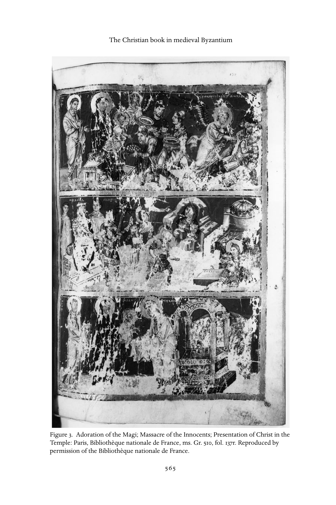

图3　贤士来朝；屠杀婴孩；献主于圣殿。巴黎，法国国家图书馆，ms. Gr. 510，第137叶正面。原书经法国国家图书馆许可刊载。

<!-- PDF page 594; original page 566 -->

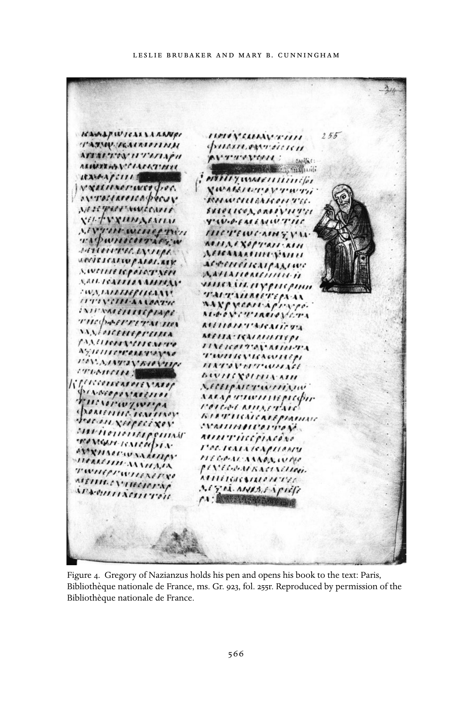

图4　纳齐安祖斯的格列高利持笔，将书打开面向文本。巴黎，法国国家图书馆，ms. Gr. 923，第255叶正面。原书经法国国家图书馆许可刊载。

<!-- PDF page 595; original page 567 -->

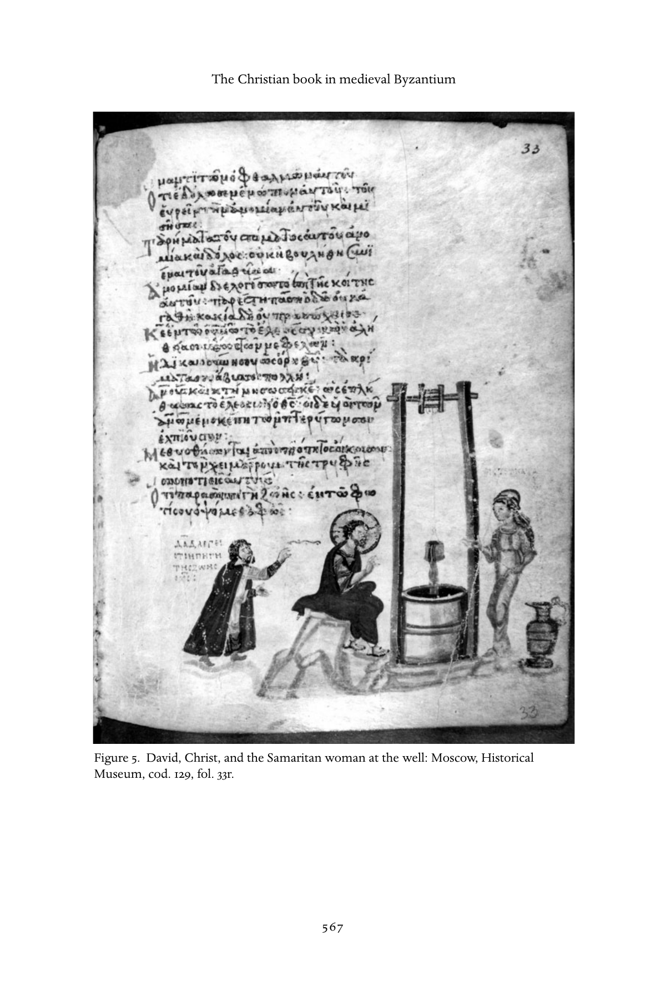

图5　大卫、基督与井边的撒马利亚妇人。莫斯科，历史博物馆，cod. 129，第33叶正面。

<!-- PDF page 596; original page 568 -->

第二，能方便接触拜占庭手稿，尤其带精美细密画的豪华书籍者，极为有限，主要局限于识字的精英男性阶层；现代人理解拜占庭所依据的大多数释经与评注，也正是这些人所写。[^p596-51]

总之，有细密画时，它们几乎总以某种多少重要的方式补充文本。最低限度，它们以特定方式框定伴随的文字，促使观看者按图像显示的方式记忆、解释词句。[^p596-52]

### 所有权与图书馆

关于中世纪书籍所有权和图书馆存在的大量证据，保存在修道史料中。东西方多数抄写室似乎都设于修道院，因此修院图书馆兴旺并不令人意外。甚至埃及沙漠独居修士拥有书籍，也早在四世纪圣徒传记和教父“格言”（apophthegmata）中得到证明。安东尼的同伴、约339年起任尼罗河三角洲特穆伊斯主教的塞拉皮翁阿爸，曾斥责一位来访修士藏书太多：它们本可换钱，养活孤儿寡妇。[^p596-53] 尽管他如此批评，修士修女必备的圣经知识，仍要求不断接触圣书。同一格言集中记载，五世纪塞浦路斯主教埃皮法尼乌斯说：“能够使用基督教书籍的人，必须取得它们”，因为“阅读圣经，是抵挡罪恶的强大保障”。[^p596-54]

根据圣徒传及早期创院文件、规章等行政证据，共住修道院很早就开始藏书。例如，四世纪上埃及帕科米乌斯式团体已有图书馆，由各院主管（praepositus）看管，修士可按周<!-- PDF page 597; original page 569 -->借书。[^p597-55] 凯撒里亚的巴西尔与帕科米乌斯一样，强调读经重要；除了塑造修士属灵视野，也使他们能给平信徒儿童宗教教育。[^p597-56] 君士坦丁堡斯图迪奥斯修道院，在798—799年至约815年间由改革院长狄奥多若领导。其相关文献，对图书馆和抄写室提供的细节，比中晚期拜占庭任何其他修道史料都多。《斯图迪奥斯会规》有两个版本流传，对后来修道院影响极大。[^p597-57] 按会规，一年某些日子，修士应聚集在“借阅处”，各选一本书，读至傍晚。在当日最后一场祷告之前，图书管理员敲响木响板（semantron），示意归还书籍。[^p597-58] 一组归于狄奥多若本人的“补赎规定”（epitimia）说，修士若损坏书籍、触碰他人所借之书，或试图以一本换另一本，当天余下时间禁止阅读。若发现修士未按时归还管理员，而将书藏在小室，则罚站于食堂。[^p597-59]

因此，从古代晚期到中世纪，在修道环境中拥有书籍，无疑是受追求的事，因为圣经及其他训导书能促进修士修女属灵成长。早期对独居者偶有负面评论，更多涉及私人财产问题，而非藏书的固有性质。西方的努尔西亚的本笃，在影响深远的会规中直接处理此事，禁止私有书籍、书写板和笔，[^p597-60] 却规定每日私人阅读，尤其在大斋期。[^p597-61] 修道图书馆也为日课，特别是晨祷，以及食堂集体阅读，提供所需书籍。本章前述礼仪文集，为<!-- PDF page 598; original page 570 -->整个礼仪年提供适当文本；修道院规章也常明确指定本院应选用哪些文字。

君士坦丁堡最大的宗教藏书，大概在圣索菲亚大教堂附近的牧首图书馆。它可能由七世纪初牧首塞尔吉乌斯创建，至少大幅整修扩充。[^p598-62] 787年第七次大公会议尼西亚会议期间，支持圣像敬礼立场的教父文本，被“从荣耀牧首区的库藏中”取出。[^p598-63] 同次会议还提供有趣信息：异端书籍，这里是圣像破坏者的著作，存放于牧首图书馆专用柜箱。[^p598-64] 保存禁书、同时与正统书籍分隔，目的应是为教会保留异端记录，供主教在未来争论中参考。但这与其他教规和宗教文本中所见，希望焚毁冒犯性材料的愿望相冲突。[^p598-65][^p598-66] 同样史料也表明，拜占庭主教虽敬重古书中的教父智慧，对这些来源可能遭后人修改或损毁，也保有健康怀疑。主持第七次大公会议者特别留心，要求以完整书册，而非散叶或摘录作证。815年为利奥五世第二轮圣像破坏会议作准备时，由未来牧首文法学家约翰领导的研究小组，搜寻“各处古书，即存放在修道院和教堂的那些……”[^p598-67]

整个拜占庭时期，是否一直有与“大学”或国家高等教育机构相联系的公共图书馆，仍不清楚。有关证据，包括巴西利斯库斯在位时（475—476）一所藏书十二万卷图书馆遭火焚的说法，均无法证实；例如，该馆究竟位于何处，实际藏书多少，都不知道。[^p598-68] 它大概于491年重建，但自六世纪起，因皇帝不愿资助被视为本质上世俗的机构，<!-- PDF page 599; original page 571 -->便与大学一同衰落。拜占庭中后期，已知个人与修道院一样搜集书籍；但手稿价格高得令人却步，暗示私人图书馆很小。[^p599-69] 学者仍困惑于牧首佛提乌斯如何接触到前述《文库》中评介的二百八十部书。[^p599-70] 他可能有机会使用君士坦丁堡一所国家或帝国图书馆，只是当代历史史料未记其存在。

### 作为神圣临在的书籍

中世纪书籍除传递文本，有时本身也被视为神圣临在；如圣徒、圣髑、圣像一样，象征神与受造世界相遇之地。当然，这与书籍性质密切相关：最神圣的是《圣经》，尤其包含道成肉身的上帝耶稣基督之启示的四福音。东方许多圣礼仪注释者，包括八世纪初君士坦丁堡牧首日耳曼努斯，都以象征语言表达这一观念。他解释圣餐集会时，将福音书被带入中殿的第一次入堂，描述为象征“上帝之子来到并进入这个世界”。[^p599-71] 如同圣像，福音书在教堂中受焚香、亲吻和崇敬。[^p599-72] 它受到敬重，因为包含福音作者对基督道成肉身、死亡与复活的记述；这些共同代表上帝救赎人类经纶的顶点。

圣书、尤其福音书相关奇迹，在中世纪圣徒传记并不常见；治愈和驱魔，更常来自接触在世圣人、死后圣髑、圣油或十字标记。但有时，诵读福音书促成医治奇迹。十一世纪《加勒西翁山的圣拉撒路传》记载，一名修士独处洞穴后遭魔鬼附身。拉撒路在柱顶履行院长职责，站柱约四十年，<!-- PDF page 600; original page 572 -->建议向被附身修士诵读神圣福音。此事“遵父命”完成后，“人们看见修士再次清醒，心智如从前健全”。[^p600-73] 他在其他场合也施行类似医治，对象始终是遭魔鬼附身的修士。[^p600-74] 这种奇迹可能反映一个信念：福音作为上帝圣言，无论通过奇迹还是其他方式，传递理性，与魔鬼造成的非理性狂乱相对。[^p600-75]

除所载文字的力量，圣书偶尔也作为物件，传递神力。十一世纪编年史家斯基利策斯，记述了拜占庭向罗斯异教统治者弗拉基米尔传教：一册福音书投入火炉，奇迹般保存。他说，这使“蛮族”惊愕不已，不再迟疑，求受基督教洗礼。[^p600-76] 另一个奇迹书籍的例子，不是福音书，而是前述据称出自亚略巴古的狄奥尼修的著作册，827年由拜占庭皇帝米海尔二世赠给加洛林统治者虔诚者路易。据说，827年10月8日，即圣人节日前夕，书立刻置于圣但尼修院；同夜，在教堂促成十九次奇迹医治。[^p600-77] 撇开记载中的奇迹，这件事尤其有趣，因为显示这一时期，希腊文书作为拜占庭赠给加洛林宫廷的外交礼物的重要性。当然，法兰克人很少能读懂它；学者已追索加洛林译者、抄写者将书中文本从希腊文译为拉丁文的具体方法。该手稿至今仍存于巴黎法国国家图书馆。[^p600-78] 这里两例都以物件本身，即有形书册，而非所含文本，作为起作用的媒介，这也许颇有意义：观众大多不能阅读书中词句，很少有人、甚至无人懂希腊语。但对理解内容者，书也可能包含邪恶力量，反映其中异端或其他亵渎文本。七世纪旅行者兼圣徒传作者约翰·莫斯库斯，讲述<!-- PDF page 601; original page 573 -->巴勒斯坦卡拉蒙劳拉的司祭基里亚库斯阿爸的故事。他梦见童贞玛利亚、施洗约翰、福音作者约翰来访，却拒入小室，理由是里面有他们的敌人。他疑惑不解，因为屋里除自己无人；终于想起，曾借一卷载有异端主教涅斯托里乌斯著作的卷轴。[^p601-79]

如前所见，自基督教最初几个世纪便确立的焚毁异端书籍实践，在拜占庭最终至少部分被另一做法取代：将这些文本保存于君士坦丁堡牧首区的专柜。人们可能逐渐认识到，民众关于神圣与颠覆性书籍的属灵看法，会妨碍成功反驳新的异端威胁。无论如何，这些故事显然更多揭示当时对文字及其所寄书册的态度，而非真实事件。手稿或卷轴各是独特实例，可以充当珍贵物件、向后世传递神启的媒介、抵挡恶魔的护符，等等。如莫斯库斯笔下司祭基里亚库斯的故事所示，书能代替一个人，反映中世纪早期社会赋予文字的重要性。

### 读写与口传

中世纪早期，东西方读写能力都局限于少数精英。拜占庭帝国能读书的人大概更多，尤其修士和教士；但多数大概只能读圣经，或简单的“低文体”叙事。[^p601-80] 自帕科米乌斯起，修道领袖便强调读圣经，尤其《诗篇》《新约》的重要性。多数修道院设学校，通常分别为平信徒儿童与初学修士，教授字母和圣经阅读的基础课程。[^p601-81] 修士应背熟《诗篇》，<!-- PDF page 602; original page 574 -->用于独处与共同礼拜诵念。四世纪塞浦路斯主教埃皮法尼乌斯，曾有一段时间在巴勒斯坦修道；他说：“真正的修士，应始终在心中祈祷和诵诗。”[^p602-82] 自古代晚期起，从爱尔兰到埃及的修道著作，都呼应这一观点。

不过，零散法律和大公会议教规表明，即使拜占庭早期高级教士，狭义读写水平也低。六世纪中叶，查士丁尼一世发现有必要立法，禁止不识字修士或教士成为主教。[^p602-83] 787年第七次大公会议第2条规定，所有主教都应背熟《诗篇》，并且“勤勉阅读，而非偶尔为之，阅读圣教规、圣福音、神圣使徒〔保罗〕之书，以及一切其他圣经”。[^p602-84] 能接触神圣文字的象征重要性，在圣徒传记中很清楚：圣徒通常幼年即被教认字，往往由母亲教导；或未受教育，却奇迹般能背诵圣经段落，尤其诗篇。[^p602-85] 对西方所谓十一、十二世纪学术复兴以前的情况，有人提出一个颇具争议的看法：主要通过口头交流的社会，对书籍和文字的态度，与以读写为主的社会不同。[^p602-86] 虽然严格划分书面与口传文化有所夸大，也许更有用的是思考知识等级，但读写技术塑造文化这一观点，帮助我们理解，载有圣言的书如何成为当时使用者与其中神圣真理之间重要的物质纽带。

评估中世纪早期读写程度时，应记住，即使多数人不能阅读，也习惯听人朗读文本、发表公开演说或讲道。因此，经常到教堂的拜占庭人，很可能能听懂希腊文新旧约，虽然这种语言已与口语<!-- PDF page 603; original page 575 -->相距一定程度。低文体圣徒传、外典、释经讲道和奇迹故事集，也应容易理解，因为文风接近圣经的通用希腊语（koine）。[^p603-87] 但对于高文体演说，如拜占庭中期主要在守夜礼宣讲的节日讲道，除少数受教育会众外，其他人是否能懂，争论很多。[^p603-88] 事实上，仔细研究可见，即使最复杂、最仿古的讲道，也包含帮助理解的要素：重复、引经、首语反复、反问和感叹。[^p603-89] 节奏常由平行与对偶加强，套语、重复和追加从句，也反映文本起于口传传统。[^p603-90] 在中世纪，这一传统不只是从非正式讲故事演变而来，也受古代晚期修辞，即公共演说艺术规则塑造。

从口头、非正式文本到较文学化文本的进展，可再以礼仪讲道为例。[^p603-91] 我们知道，很早以来，多数基督教讲道者即席发表释经或颂扬性讲道。事实上，按古代晚期修辞惯例，若被看见使用笔记或预备稿，可能遭嘲笑，甚至被逐出教堂。同时代人记载，奥利金（约185—约254）、金口约翰（约345—407）等讲道者的讲道，由听众中的速记员记录。经过编辑与未经编辑的版本都存世，暗示讲道者本人，或其助手，后来整理文本以便刊行。[^p603-92] 甚至九世纪君士坦丁堡牧首塔拉修斯的讲道，仍以这种方式记录，虽然其他同时代人缺乏类似证据。[^p603-93]

如前所述，讲道明显保留口传要素，但在教堂首次宣讲之后，文本的生命更趋文学化<!-- PDF page 604; original page 576 -->与礼仪化。多数高文体讲道似经细致编辑润色；尤其节日讲道与颂辞，遵循各自文类惯例，运用罕见词汇，总体上充分展示作者学识。它们被抄入按礼仪年编排的混合读物集，似供私人虔敬研读，或修道日课中的礼仪诵读，尤其晨祷（orthros，matins）。[^p604-94] 西方与中东图书馆分藏的大量手稿，保存这些文本的不同版本，显示从口头、偶尔即兴的演说，到经过彻底编辑、却未完全抹除口传根源的虔敬或礼仪读物，各个发展阶段。

拜占庭对待文本和书籍的方式，还有一点应提及。在这个表面统一的正统社会，人们付出巨大努力，调和从正典经书到神学论著、讲道的一切文本。展示各种文类中神启连续性的办法之一，就是编成摘句集或作品集，前文谈教会会议时已提过。学校或高等教育机构的教学，很可能主要借助这类摘要。某些讲道或论著，看起来更像摘句集，而非原创作品，因为它们展示一系列精心选取的早期作者段落，以证明某个观点。在这样的文化环境中，偶见圣徒传借用早期作品大片内容，并不奇怪。剽窃不是罪过，而是向前代作者致敬的标志。中世纪写作另一值得更深入研究的方面，是互文性，即用其他来源、尤其圣经的词句、引文乃至长段引述，编织一篇文本。[^p604-95] 这不仅反映教士记得大段圣经，也代表有意的神学与文学目标：显示从创造之初到当下，神启始终统一。

早期基督教和拜占庭时期，写圣徒传远非单纯文学活动。[^p604-96] 对作者而言，这种创作实际上是一项崇拜行动，或禁欲实践。神启与文字之间的关系，又提供一种跨越<!-- PDF page 605; original page 577 -->超越之神与受造物鸿沟的方式。作者意识到，自己不仅是神圣真理的工具，也是解释者，通常是男性，极少为女性。这一观念以象征方式表达于若干故事。例如，六世纪圣歌作者“美歌者”罗曼诺斯在异象中，受童贞玛利亚指示吞下一卷圣书；此后便能创作孔塔基翁赞歌。[^p605-97] 他在某些圣歌中运用意象，鲜明阐释基督道成肉身与书写文本之间的关系。[^p605-98] 两种行动都象征神在受造界显现；文本虽不可避免受人类语言和尘世隐喻限制，却也可能被上帝的神圣灵感贯注。

显然，中世纪书籍远非单纯文字载体。本时期，神圣真理、人类解释、文字与视觉传递之间的关系并不静止；这里无余地探索可能变化，但很可能在圣像破坏时期，书籍与圣徒、圣髑、圣像一道受到重新评估。八世纪初，大马士革的约翰在捍卫图像的演说中主张，书籍不仅提醒神圣事物，也反映所记载的圣洁：

> 因〔基督〕不再在场，我们听人从书中诵读其话语；借聆听，灵魂得以圣化，充满祝福，因此我们敬拜，并尊崇那些让我们听见他话语的书。[^p605-99]

现代作者观念，显然不适用于中世纪对文学创作的理解。如前所述，借用经文、教父或世俗段落，不被视为剽窃；这些引文反而赋予文本权威。必须想象这样一个社会：正如约翰在同篇论著别处提醒，口传与文字在人们心中彼此交错、重叠。[^p605-100] 书籍拥有<!-- PDF page 606; original page 578 -->巨大权威，但神启可以通过多种媒介传递。有辨识力的听众，借助所记得的经文、教义公式和教会教规，学会认出真实、正统的信息。

### 存世书籍与作为奢侈品的书籍

虽然文本、因而手稿本身，在拜占庭具有重要作用，书籍仍存在鲜明等级。但存世实例只部分反映它，因为基本礼仪文本与豪华手稿，是占优势的两类。第一类不奇怪：可以推测，对日常生活重要、没有特别抄写加工的书，是制作最多的。豪华巨册大量存世，或许会让人以为，制作精美书卷的文化资本，在拜占庭尤其重要。但更可能的是，豪华书存于某类宝库，十五世纪帝国灭亡后，才有机会被藏书家搜集。它们有相当比例能保存，也因为较少被翻阅：因其珍贵而被收起，避免日常使用的损耗，后者最终会使书被替换。

豪华书的主要特点，是大小及相应重量——《维也纳迪奥斯科里德斯药物志》和《巴黎格列高利本》等大书，可重达十四磅——、仿古要素——册页书主导时仍用卷轴，小写体盛行时仍用大写体，纸张出现后仍用羊皮纸——，以及装饰包括细密画的品质。罕见染料染成的页面，如骨螺紫、青金石蓝；昂贵墨料书写的金字银字；复杂书封、珍贵装帧、彩绘或贴金书口，都是财富与地位的可见标志。人们大概既将其视为对内容神圣性的适当承认，也视为主顾拥有财力、能将这一承认具体物质化的证明。

然而，拜占庭图像表现书籍或卷轴时，很少展示这些豪华特征。先知几乎总拿简单、无饰、色调平常的卷轴；打开的书，所展示页面也很少画有装饰。换言之，文本再现遵循<!-- PDF page 607; original page 579 -->我们已在手稿页面形式中观察到的普遍倾向：文字优先于装饰。只有合起的书，才显示豪华属性，通常描绘金制镶宝石封面。[^p607-101] 即使如此，图像中的书也和华饰封面一样，经常采用朴素无饰的外壳（图4）。

### 结论

书籍在正统基督教中发挥关键作用，对能阅读者，显然是受追求的物品。但它们远非日常随处可见：即使礼仪书可能批量制作，似乎也从未容易取得；[^p607-102] 多数手稿似按订制制作，而非供随意出售。由此涉及的选择，似使手稿成为研究拜占庭自我再现的良好焦点。在某层面，这至少部分获得成功，尤其研究单本或一组手稿时；九世纪页边图《诗篇》、十二世纪科基诺巴福斯手稿，以及十三世纪末“帕莱奥洛吉娜”手稿群的研究，都已显示这一点。[^p607-103] 但通过书籍中及书籍所实现的自我再现，重建拜占庭世界，有两大问题，前面均已提及。首先，借书籍理解拜占庭世界，永不可能具有代表性，因为留下的书籍本身不具代表性。第二，在希腊语世界，观看、使用、拥有、评注、再现、订制书籍的，只是极小而相对精英的一部分人。但这也有某些优势：同一群体制作了关于拜占庭世界的大部分文字证据，因此可将文字与图像结合解释，形成至少一个群体思想世界的丰富细腻图景。比较书面与视觉交流，尤其有意思的是，每种媒介被认为适合传递的信息往往不同；因此，细密画补充文字，不仅通过提供<!-- PDF page 608; original page 580 -->拜占庭人从未写在羊皮纸上的细节，不仅通过以视觉例证扩展文字例证，也通过承载完全不同类型的信息。[^p608-104] 基督教书籍不仅提供正统信仰的原始材料，也使我们从微观洞察拜占庭世界的交流结构。[^p608-105]

## 注释

[^p582-1]: 例如参见 Lowden, “Luxury Book”。关于狄奥尼修手稿（Paris. gr. 437），参见 Omont, “Manuscrit”；Brubaker and Haldon, Byzantium in the Iconoclast Era, 41–42及其所引早期研究；另见下文注77。

[^p582-2]: 参见 Nelson, “Italian Appreciation”；Auzépy and Grélois, Byzance retrouvée。

[^p583-3]: 良好概述见 Gamillscheg and McCormick, “Codex”；Turner, Terms Recto and Verso；Devreesse, Introduction；Weitzmann, Late Antique；Irigoin, “Les cahiers”。本章主要讨论希腊语书籍。关于其他东方基督教手稿，例如参见 Der Nersessian, Miniature Painting in the Armenian Kingdom；Leroy, Les manuscrits syriaques。

[^p583-4]: Roberts and Skeat, Birth of the Codex; Weitzmann, Illustrations.

[^p583-5]: 参见 Nelson, Gamillscheg, and Talbot, “Rolls, Liturgical”。另一例是梵蒂冈宗座图书馆 cod. palat. gr. 431，一卷十世纪豪华卷轴，图绘《旧约·约书亚记》；参见 Weitzmann, Joshua Roll。

[^p584-6]: Eusebius, Life of Constantine, 166–67。进一步参见 Roberts and Skeat, Birth of the Codex；McCormick, “Birth of the Codex”；关于围绕这一问题的多种争论，参见 Bagnall, “Jesus Reads a Book”。

[^p584-7]: Lewis, Papyrus, 64–94; McCormick, Origins, 704–708.

[^p584-8]: Wilson, “Books and Readers”，尤其1–3；Gamillscheg and Talbot, “Parchment”，并附更多参考文献。

[^p584-9]: 例如，黄色羊皮纸有时被视为产于意大利的证据，参见 Leroy, “Les manuscrits grecs d’Italie”。

[^p584-10]: 除个别作坊偶有统一尺寸外，并无标准开本。例如参见 Anderson, “Twelfth-Century Instance”。

[^p585-11]: Leroy, Les types de réglure.

[^p585-12]: Gregory, “Les cahiers”；进一步讨论见 Hoffmann, Recherches。

[^p585-13]: Mondrain, “Les signatures.”

[^p585-14]: Gamillscheg, Talbot, and Ševčenko, “Paper.”

[^p585-15]: 拜占庭古文字学参考文献极为庞大。经典研究有 Gardthausen, Griechische Palaeographie；Thompson, Handbook；Dain, Les manuscrits。良好英语概述包括 Wilson, Mediaeval Greek Bookhands；Barbour, Greek Literary Hands。涉及拜占庭书籍形制学与古文字学多方面的优秀论文集，为 La paléographie grecque et byzantine，以及较近的 Prato, I manoscritti greci。

[^p586-16]: 西方的法兰克诸国，几乎同时发生同一过程的变体；不过，那里第一步是发展“大写”字母，即加洛林大写体，不久后继之以加洛林小写体。东西方书写体系的联系，早已受到注意，但这些发展究竟相互独立，还是一个体系影响另一个，尚不清楚。例如参见 Mango, “L’origine”。

[^p586-17]: Nordenfalk, Die spätantike Zierbuchstaben; Astruc, “Remarques.”

[^p587-18]: 例如参见 Nordenfalk, Celtic and Anglo-Saxon Painting。

[^p587-19]: Hutter, “Decorative Systems.”

[^p587-20]: 这方面参考文献同样很多。经典研究为 Weitzmann, Die byzantinische Buchmalerei；其增补本 Die Byzantinische Buchmalerei, Addenda und Appendix，应谨慎使用。关于首字母的引入，参见 Brubaker, “Introduction”。其他重要研究见 Prato, I manoscritti greci，其中广引早期文献。

[^p587-21]: 例如纳齐安祖斯的格列高利“礼仪”讲道集。参见 Galavaris, Illustrations of the Liturgical Homilies。

[^p587-22]: 例如参见 Brubaker, “Introduction”；Hutter, “Le copiste du Métaphraste”；Anderson, “Illustration of cod. Sinai. gr. 339”。

[^p587-23]: 罕见例证可参见 Hutter, “Le copiste du Métaphraste”；Anderson, “Cod. Vat. gr. 463”；Buchthal and Belting, Patronage，并结合 Nelson and Lowden, “Palaeologina Group”。

[^p587-24]: 例如参见 I. Ševčenko, “Illuminators”；Nelson, Theodore Hagiopetrites。

[^p588-25]: 参见 Nelson and Lowden, “Palaeologina Group”。

[^p588-26]: 参见 Wilson, “Books and Readers,” 3–4, 14；Kravari, “Note”；Atsalos, “Termes byzantins”；以上均列较早参考文献。

[^p588-27]: 维也纳，国家图书馆，cod. theol. gr. 31。参见 Gerstinger, Wiener Genesis；Lowden, “Concerning the Cotton Genesis”。

[^p588-28]: 罗萨诺，主教座堂宝库。参见 Loerke, I vangeli。

[^p588-29]: 佛罗伦萨，Laur. Plut. I, 56。参见 Cecchelli, Furlani, and Salmi, Rabbula Gospels；Mundell Mango, “Where was Beth Zagba?”

[^p588-30]: 伦敦，大英图书馆，cod. Cotton Otho B. VI。参见 Weitzmann and Kessler, Cotton Genesis。

[^p588-31]: 维也纳，国家图书馆，cod. med. gr. 1。参见 Gerstinger, Dioscorides；Brubaker, “Vienna Dioskorides”。

[^p589-32]: 参见 Corrigan, Visual Polemics。

[^p589-33]: Omont, Évangiles；Velmans, Le Tétraévangile；Weitzmann and Bernabò, Byzantine Octateuchs，须结合 Brubaker 和 Hutter 的书评阅读；Lassus, L’illustration byzantine。

[^p589-34]: Galavaris, Illustrations of the Prefaces; Nelson, Iconography.

[^p589-35]: Cutler, “Aristocratic Psalter” and Aristocratic Psalters in Byzantium.

[^p589-36]: Krumbacher, Geschichte der byzantinischen Literatur; Kazhdan (with Sherry and Angelidi), History; Beck, Kirche und theologische Literatur; Quasten, Patrologie; Rahlfs, Verzeichnis der griechischen Handschriften; Hunger, Die hochsprachliche profane Literatur der Byzantiner.

[^p589-37]: Photius, Bibliotheke；Treadgold, Nature；关于年代，参见 Maas, “Photius’ Treatment of Josephus”。

[^p590-38]: 参见 Treadgold, Nature, 173–76，便于使用的按主题分类书目索引。

[^p590-39]: 参见 Moffat, “Schooling”；Mullett, “Writing”。

[^p590-40]: Galavaris, Illustrations of the Liturgical Homilies.

[^p590-41]: evangelia 仅收福音经段；praxapostoloi 收《新约》其余部分的经段，参见 Taft, “Lectionary”。礼仪历规（typika）还加入每日礼拜指示，参见 Mateos, Le typicon。

[^p590-42]: 参见 Taft, “Menaion”；N. P. Ševčenko, “Menologion”；Taft and Ševčenko, “Synaxarion”。

[^p590-43]: 参见上文注36所列文献。

[^p590-44]: 参见 Brubaker, Vision and Meaning, 51–57。

[^p591-45]: James, Light and Colour.

[^p591-46]: Brubaker, Vision and Meaning, 62–71.

[^p592-47]: 梵蒂冈宗座图书馆，cod. Reg. gr. 1。参见 Mango, “Date of cod. Vat. Regin. Gr. 1”；Mathews, “Epigrams”。

[^p592-48]: Brubaker, Vision and Meaning, 52–57.

[^p592-49]: Corrigan, Visual Polemics，首次提出这一点。

[^p592-50]: Brubaker, Vision and Meaning, 49.

[^p596-51]: 同上, 23–24.

[^p596-52]: 同上, 24, 411.

[^p596-53]: Apophthegmata patrum, 416, C（Ward 译本，227）。这一“格言”也收入君士坦丁堡埃韦尔盖提斯修道院十一世纪摘句集 Synagoge，作为修道生活需“不占有”的例证。参见 Evergetinos, 33。

[^p596-54]: Apophthegmata patrum, 165, B（Ward 译本，58）。

[^p597-55]: Rousseau, Pachomius, 81; Pachomius, Vita Prima, ch. 59; Pachomius, Praecepta, ch. 25.

[^p597-56]: Basil of Caesarea, Regulae brevius tractatae.

[^p597-57]: 《君士坦丁堡圣约翰斯图迪奥斯修道院会规》；所引两个版本，在 BMFD 中以英语并排翻译刊出。

[^p597-58]: Rule of the Monastery of St. John Stoudios in Constantinople，第26章，见 BMFD 1, 108。另参见 Leroy, “La vie quotidienne,” 47。

[^p597-59]: Featherstone and Holland, “Note on Penances,” 259；Theodore the Studite, Poenae monasteriales, 1740, C。关于此文本真实性，参见 Beck, Kirche und theologische Literatur, 494；Leroy, “La réforme Studite,” 210。

[^p597-60]: 《圣本笃会规》，第33章，84–87。

[^p597-61]: 《圣本笃会规》，第48章，110–13。

[^p598-62]: Lemerle, Byzantine Humanism, 107, note 81.

[^p598-63]: Mansi 12, 1019。以下均引用 Select Library of Nicene and Post-Nicene Fathers 的英译本，简称 NPNF。

[^p598-64]: 第9条教规，NPNF, 561。另参见 Lemerle, Byzantine Humanism, 107页注81。

[^p598-65]: 第63条教规，NPNF, 394。

[^p598-66]: 例如，Life of St. Theodora, 75及362，指控圣像破坏者篡改或焚毁主张图像敬礼的书籍。另参见 Reynolds and Wilson, Scribes and Scholars, 44–45。

[^p598-67]: Mango, “Availability of Books,” 35。关于拜占庭伪造问题，参见 Bardy, “Faux et fraudes littéraires”。

[^p598-68]: Wilson, “Libraries”; Lemerle, Byzantine Humanism, 68–73.

[^p599-69]: Wilson, “Books and Readers”，以及上文注26。

[^p599-70]: 参考文献见上文注37。

[^p599-71]: Germanus of Constantinople, Commentary，第24章，Meyendorff 译本，73；或希腊文编本 Borgio, Il commentario。

[^p599-72]: 例如参见 BMFD 1, 99。

[^p600-73]: Life of St. Lazaros, 130.

[^p600-74]: Life of St. Lazaros, 134, 156–57, 161.

[^p600-75]: 另参见 Greenfield, Traditions of Belief, 135–48, 264–65, 270–71。

[^p600-76]: John Skylitzes, Synopsis historiarum, 165–66.

[^p600-77]: Loenertz, “La légende Parisienne,” 217–37.

[^p600-78]: Lemerle, Byzantine Humanism, 6–8；更广泛的讨论见 Wickham, “Ninth-Century Byzantium,” 245–56。

[^p601-79]: John Moschus, Pratum spirituale，第46章，Wortley 译本，37–38。

[^p601-80]: Kazhdan, “Literacy.”

[^p601-81]: 参见 Magdalino, Constantinople médiévale, 37–40, 48。Moffatt 依据同时代圣徒传记推断，至少圣像破坏时期，基础教育不仅在家庭进行，也在学校进行；不过，传记对这些学校提供的信息含糊。参见其“Schooling,” 90。格列高利·帕库里亚诺斯为巴奇科沃上帝之母修道院所订十一世纪规章，提到圣尼古拉附属机构的一所学校，一位老司祭在那里教六名准备成为司祭的男孩阅读圣经。参见 BMFD 2, 550–51。

[^p602-82]: Apophthegmata patrum, 164, C（Ward 译本，57）。

[^p602-83]: Beck, Ideen und Realitäten in Byzanz, ch. 3, 72.

[^p602-84]: 第2条教规，NPNF, 556。

[^p602-85]: Patlagean, “Ancienne hagiographie,” 109–10。附带一提，这一常见母题表明，在拜占庭世界，女性识字并非不可想象，家庭教育也是如此。

[^p602-86]: Clanchy, From Memory to Written Record.

[^p603-87]: 关于拜占庭文本的不同文体层次，参见 I. Ševčenko, “Levels of Style”。

[^p603-88]: Maguire, Art and Eloquence, 6.

[^p603-89]: Cunningham, “Preaching and Community,” 45–47.

[^p603-90]: Ong, Orality and Literacy, 34–41.

[^p603-91]: 关于四至十世纪拜占庭讲道发展，良好导论见 Antonopoulou, Homilies of Emperor Leo VI, 95–115。

[^p603-92]: Goodall, Homilies of St. John Chrysostom, 65–73.

[^p603-93]: 参见 Mango, Homilies of Photius, 8。

[^p604-94]: 关于这类文集的描述，参见 Ehrhard, Überlieferung und Bestand。

[^p604-95]: Young, Biblical Exegesis, 87–89, 103, 109, 130, 133, 235, 254.

[^p604-96]: Krueger, Writing and Holiness.

[^p605-97]: 故事见两部十一世纪圣徒纪略集或礼仪历：君士坦丁堡的纪略集，刊于 Delehaye, Propylaeum, 97；以及巴西尔二世 Menologion，见 PG 117, 81, B–C。

[^p605-98]: Krueger, Writing and Holiness，尤其159–88。

[^p605-99]: John of Damascus, On the Divine Images，见 Kotter, Die Schriften 3, 123（Anderson 译本，72）。

[^p605-100]: “教会传统不仅经由书面文献传递，也以不成文形式交付……”John of Damascus, On the Divine Images, I.23，见 Kotter, Die Schriften 3, 111（Anderson 译本，31）；比较 Basil of Caesarea, De Spiritu sancto, 27.66，见 Pruche, Basile de Césarée, 478.15–480.9。

[^p607-101]: 例如圣维塔莱教堂，参见 Mathews, Early Churches, 146–47；其他金制镶宝石福音书的例子，见巴西尔二世 Menologion（同书图90），或《巴黎格列高利本》的五旬节细密画（Brubaker, Vision and Meaning, 图30）。

[^p607-102]: Mango, “Availability of Books,” 29–45.

[^p607-103]: Corrigan, Visual Polemics；Linardou, “Couch of Solomon”；以及上文注23所列文献。

[^p608-104]: 参见 Brubaker, “Pictures Are Good”。

[^p608-105]: 莱斯利·布鲁贝克感谢莫斯科历史博物馆及文物保护实验室工作人员，使其得以查阅《赫卢多夫诗篇》；并感谢法国国家图书馆，使其得以查阅《神圣平行集》及《巴黎格列高利本》。

---

# 第28章 圣徒及其崇敬

朱莉娅·M. H. 史密斯（Julia M. H. Smith）

<!-- PDF page 609; original page 581 -->

628年，波斯人在基尔库克处决一位基督徒修士。阿纳斯塔修之死，在拜占庭与萨珊帝国数十年冲突中只是一段小插曲，但他的命运并不寻常。[^p609-1] 他原是波斯士兵，从琐罗亚斯德教改信基督教，在耶路撒冷附近修道；通过默想早期基督教殉道者的壁画，强化新身份，继而动身，寻求死于昔日同袍手下。斩首三年后，同院修士设法取回他的头颅；带回巴勒斯坦修院途中，头颅开始施行奇迹。在绝望时代，阿纳斯塔修已成为基督教胜利的强力象征。638年耶路撒冷陷于阿拉伯人后，修道团体逃至罗马，也带走其头颅。那里很快将其殉道和奇迹记述，从希腊文译成拉丁文。七世纪后半叶，故事传至英格兰；九世纪末又以古英语获得新形式，证明他在整个中世纪早期基督教世界广受欢迎。[^p609-2]

一位教士记录713年罗马发生的戏剧性事件，开篇说：“每逢想起我们的主耶稣基督通过其蒙福殉道者阿纳斯塔修所行的奇迹，我便心惊，腹中战栗。”故事涉及一名被安置于女修院的年轻女子；人们认为，一位遭她拒绝的求婚者唆使魔鬼附身。父亲狄奥彭图斯，是来自奥斯若恩的叙利亚主教，求助于东方故乡这位著名圣徒，将女儿带入一座教堂，殉道者头颅置于其祭坛。她颈上挂着圣徒一颗牙齿，却未驱走魔鬼；整整一个月，她胡乱挣扎，体内魔鬼高声辱骂基督、圣徒与教士。最后，狄奥彭图斯与<!-- PDF page 610; original page 582 -->全体修道会众聚集，悔罪祈祷，殉道者使人感到其临在。圣髑前一支蜡烛被吹灭，奇迹般重燃；这一信号使礼仪代祷愈加强烈。魔鬼嚎叫与修士吟唱交替，女孩扭动、腾身，终于魔鬼承认被阿纳斯塔修击败，离开了她。随后，“夜间第三时，女孩跪在主耶稣基督圣像前，近半小时；起身时，心智和身体已治愈，站在圣坛前，领受我们主耶稣基督的身体和血，从那时便痊愈了”。[^p610-3]

这则宇宙性戏剧故事，引我们认识中世纪早期圣洁人物的事迹与声誉。约600年，基督教圣洁观已有悠久历史。[^p610-4] 到那时，希腊语 hagios、拉丁语 sanctus，主要用来指那些被基督徒认为以某种方式分享神性、其地位通常获得礼仪承认的人，即圣徒；但这从非两词唯一用途。本章追溯这一演变，直至约1100年。把圣徒及其崇敬置于尘世过去与末世未来的交点，可显示他们对于中世纪早期当下不断变化的政治文化条件，具有极敏锐的适应性。也可强调，他们能使任何阶层、年龄、性别的信徒，在尘世烦忧中直接体验神圣。本章提醒注意，圣徒及崇敬如何补充教会机构的圣事与司祭职能，进而把圣徒行奇迹解释为在天上与尘世间传导神能的“避雷针”。略述背景之后，分析先从在世圣人开始；随后，随着时间焦点逐步拉长，转向死者，再转向基督教起源的遥远时代，最后到达故事起点耶路撒冷。

### 背景

中世纪神学家很少停下来详论圣徒及其崇敬。缺少持续反思，所显示的并非轻视，而是几乎一致认为，这是基督教实践的正常部分。自约<!-- PDF page 611; original page 583 -->1965年起，圣徒，无论在世圣男圣女，还是死者的崇敬，都吸引中世纪历史、艺术、文学、礼仪学者大量关注。其他学科，包括铭文学、姓名学、钱币学，也作出贡献。[^p611-5] 面对庞大文献，读者须记住两点。第一，不应只关注圣徒生平及生前死后事迹的叙事文本，因为它们会歪曲圣徒在中世纪早期基督教中的地位。[^p611-6] 一方面，它们忽略成百上千位圣徒，除了极简短礼仪记录，再无其他纪念。大多数圣徒从未成为叙事纪念、圣髑崇敬或任何非礼仪虔敬表达的对象。[^p611-7] 另一方面，文学纪念也不能保证礼仪崇敬，更不用说民间欢迎程度。第二，把圣徒崇敬视为单数统一现象，并不恰当；即使同一圣徒，崇敬也有多种形式。将这一多面现象错误地同质化、静态化，无助于理解。本章勾勒其中若干变化。

早在600年以前，基督教圣徒身份的观念、场所与表达，已凝聚为直到十三世纪仍具规范性的形式。在教会获得和平，即313年君士坦丁《米兰敕令》之后，约一世纪间，各基督徒团体逐渐而痛苦地适应从受迫害少数到占支配地位多数的转变。竞技场殉道不再是基督徒身份最高表达，神圣少数者的其他类别便涌现。圣洁与禁欲、制服内外痛苦和魔鬼紧密相连，偶尔也与使异教徒归信的成功——传教士——，或教义形成——所谓教父——相连。神圣表达的主导方式发生决定性变化，此后多数圣徒成为隐修士、修士或修院创立者，因为他们体现宗教重塑后的愿望，并在生前最完整地实行。关于起源、身份和过去联系的紧迫问题，也被重新思考协商。新的凝聚方式形成，既把地方共同体编织在一起，又<!-- PDF page 612; original page 584 -->赋予它们在已成为帝国性救赎历史中的位置。奇迹是否在其中起作用，曾颇有争议。圣徒崇敬不仅成为身份与合法性的关键标志，也在迅速变化的世界中，触发对神圣显现的冲突。[^p612-8]

约600年，这些争议暂时失去一些激情，尽管大格列高利一世教宗（590—604）对于当代奇迹的地位，仍持复杂态度。[^p612-9] 基督教凡已扎根之处，圣洁的表达就共享共同特征，同时受地方特点调节。圣洁在人身上显现，无论生死，都标示那些公认与基督格外亲近的人。人们一致认为，他们以两种主要方式，充当天界与尘世的导管。其一，在天庭担任辩护者，为求助者代祷；借奇迹，解除困扰个人的沉重苦难，如疾病、毁容、畸形，囚禁、附魔、无子等；或解救整个共同体，克服火灾、饥荒、洪水和其他灾难。其二，凭预言远见或属灵洞察，面对面，或通过梦境异象，说出基督徒上帝的话。他们预告重大未来事件，毫无畏惧地直言警告权贵或懈怠者，识破烦乱良心、隐秘罪行或尚未被承认圣徒的隐藏真相。

在世者通过严厉禁欲操练，以及按字面效法基督式生活，达到这种亲近。他们经历的是活着弃绝的“白色殉道”，而非骇人酷刑与死亡的“红色殉道”。[^p612-10] 死者无论是否殉道，都是灵魂已直接与基督同在乐园者；但他们的墓地，若已知所在，也仍保有其临在，是圣洁的热点。其力量常通过实物为中介：骨、发绺、布线、私人物品，以及液体或近似流体，如油、洗涤水、尘土；它们或来自圣祠，或接触过圣体，甚至从中渗出，如血或 myron，即拜占庭圣徒特有的芳香膏油。通常，生前著名者去世时，也受到高度注目，标志死后<!-- PDF page 613; original page 585 -->崇敬立即开始。但整个时期，受到公开支持、知名度高、文学与礼仪文献丰富的死者崇敬，始终与非正式虔敬竞争。后者如今仅凭偶见铭文、地名、涂写而被记起；某些地方，它们构成早期强烈地方归属文化的底层，后来被政治色彩浓厚的全国性崇敬覆盖；其他地方，则是后来崩解的基督教所留残迹。[^p613-11] 圣徒代祷吸引力如此之强，以致不仅“近圣安葬”（ad sanctos），即尽可能靠近圣祠，是备受追求的特权；同一圣徒也很容易通过搬移身体部分、设立礼仪节日、抄写文本，而在多地复制。

简言之，约600年，已存在一套继承而来的“人格化”圣洁显现方式，配有强化或约束它的文本话语与仪式。虽然环境不断改变，这套方式在此后五百年，始终是实践和再现圣徒身份的强大脚本。

### 圣人

古代晚期是在世圣人的时代。[^p613-12] 约600年，从爱尔兰、威尔士到叙利亚、波斯，圣人的魅力性临在，体现于奇迹、直言，以及特别善于化解共同体紧张，受到广泛讨论、书写与批评。[^p613-13] 但他的生涯并未随古代终结，而继续兴盛；到约1100年，我们会发现，他仍在任何古代晚期基督徒都无法想象的环境中活跃。演变有三大方面。首先，中世纪早期基督徒生活规范与实践，与古代同样具有强烈性别性质，圣人也不例外。其次，继承的文本范例仍具说服力。第三，这些古代先例的分量，常与当代政治和制度要求形成尖锐张力。

性别维度须先略提。古代晚期圣女为数很少，也罕获传记关注。有些装点贵族家门美德，另一些则为地方共同体谦卑<!-- PDF page 614; original page 586 -->代祷。少数寻求效法沙漠禁欲的严酷，或悔改卖淫生涯；她们借异装改变性别身份，得以不被察觉地生活于埃及或叙利亚修道院，这本身已足够奇妙，证明其圣洁。[^p614-14] 这些暧昧人物确实引人注目，热闹生动的事迹叙事，从希腊语、叙利亚语传播至拉丁语、阿拉伯语、亚美尼亚语、斯拉夫语和古英语。但虽然文本流行，这些挑战性别规范的女性，更多激发默想和想象，而非成为中世纪早期女性虔敬的现实榜样。[^p614-15] 与“扮作修士的女性”死后广为人知相反，约600年以后，极少圣女的典范性足以值得写成文本。约600至约1100年，希腊圣徒传以女性为主者，勉强只有百分之十；拉丁西方则明显较高，约百分之十五。[^p614-16] 尽管修辞上常说，“赐奖者上帝慷慨而平等地将赏赐与胜利冠冕赐给两性”，女性在被认定显出圣洁的人中，始终仅占很少部分。[^p614-17]

不过，一些重要发展确认，古代晚期这种重新赋予性别的女性禁欲，牢牢局限在书页上。拜占庭九、十世纪，极少数圣女，不是共住团体修女，便是君士坦丁堡内外以安静虔敬和善行度日的虔诚已婚平信徒或寡妇，其家庭中的谦卑被认可为圣洁。在其他地方，尤其威尔士、布列塔尼和意大利，无论拉丁语还是希腊语地区，任何类型圣女的记录都付阙如，再次证明圣洁的性别性质。在拉丁西方其他地区，圣女几乎总见于修院，而非家庭，集中于法兰克和德意志、盎格鲁—撒克逊英格兰、爱尔兰。她们最常是献身守贞、出身贵族或王室的女性；任家族所创女修院院长的生涯，使其环境具有王朝性，却非家庭性。[^p614-18]

<!-- PDF page 615; original page 587 -->

西方这一主导模式唯一的偏离，自十世纪起出现在最高社会层。当女性圣洁被用来帮助根基不稳的统治者维持王朝稳定时，婚姻之外，就必然也包括母职。但生育本身，并未使玛蒂尔达（卒于968年）、阿德莱德（卒于999年）、苏格兰的玛格丽特（卒于1093年）成为圣女。她们都把母职与个人虔敬结合，效法当时的主教理想：勤于私人敬礼、慷慨施舍、兴建教堂、为宽恕代求、释放囚犯。[^p615-19]

圣女若更常是来自早先时代的文学建构，而非社会现实，一个原因是，禁欲起源的英雄时代没有留下既权威、又可实践的角色范例；另一个则是女性在中世纪早期性别秩序中的从属地位。圣男情况完全不同。少数圣者的传记既维护规范，也激发愿望；在此意义上，中世纪早期男性圣洁，仍深深依赖通过个人禁欲努力接近上帝的继承理想。[^p615-20] 它也始终与主导政治结构和权力意识形态紧密相连，有时相合，有时相抗。

古代晚期圣徒传“经典”的持久影响，不限于引用亚他那修《安东尼传》、叙述卒于356年的圣人；苏尔皮基乌斯·塞维鲁所写图尔修士主教马丁（卒于397年）传；大格列高利对蒙特卡西诺创立者努尔西亚的本笃的记述，原书此处记其约卒于480年；或斯基托波利斯的区利罗《萨巴斯传》，叙述卒于532年的巴勒斯坦大禁欲者。虽然这些作品确实被大量引用，更值得注意的是，修士和隐修士用它们指导自己追求基督徒生活。774年，西哥特贵族维蒂扎（卒于821年）在查理曼宫廷经历剧烈宗教转变；试验不同禁欲生活后，最终选择《本笃会规》。改名本笃，不仅拥抱本笃式修道精神，也使自己融入创始之父的角色。两百年后，蒙特卡西诺修士收留著名、虽脾气多变的希腊隐修士罗萨诺的尼洛（约941—1004）。撒拉森人袭击意大利最南端拜占庭行省，迫使他北上。他故乡卡拉布里亚缺乏牢固地方修道传统，因此主要从书本学禁欲，将所读以近乎<!-- PDF page 616; original page 588 -->基要主义的字面方式，应用于自身处境。蒙特卡西诺修士也迅速把客人放入熟悉的古圣人叙事，吸收进自己的本笃传统：“他们仿佛听见、看见伟大安东尼从亚历山大里亚而来，或者更确切地说，是伟大本笃，他们神圣的立法者与导师，从死者中复活。”[^p616-21]

使尼洛非凡的，不只是长期隐居；传记作者也惊叹于他所行的大量奇迹。古代晚期圣人虽常施行戏剧性奇迹，如医治、驱魔等等，千年之交的东西方圣人，却很少再有如此规模。除了继承而来对奇迹是否适当的疑问，还存在其他自具强大逻辑的宇宙观，拜占庭尤其如此。[^p616-22] 穆斯林征服帝国大片土地与圣像破坏争议，这双重创伤，迫使“何种圣洁显现在神学和政治上可以接受”的问题，以无可回避的尖锐形式出现。九、十世纪拜占庭基督教逐渐重塑，取得深刻不同的特征，打断与圣像破坏前过去的简单连续，却也使遭迫害的圣像敬礼者有机会被重塑为圣徒，成为变动时代连续性的灯塔。禁欲生活同样深受影响，受到更多制度规管，重视内在化的属灵指导。行奇迹的能力，或把奇迹归于他人的意愿，逐渐衰减。[^p616-23] 在此环境，圣人比早先更少忽视或扰乱主教、世俗统治者等其他权力权威。他们既容易成为批评者，也容易成为顾问；既可能是独居隐修士或住柱的柱头修士，也同样可能是修道团体组织者。十世纪末，行奇迹的拜占庭圣人，与其是血肉现实，也同样可能是虚构；十二世纪，他们已成为嘲弄对象。[^p616-24]

拉丁世界在世行奇迹者的轨迹不同，原因数种而相互重叠。首先，东方大体维持禁欲与高级教会职务的区别，<!-- PDF page 617; original page 589 -->西方却模糊了这一点。[^p617-25] 基督教逐渐远越昔日罗马行省，进入日耳曼、凯尔特和斯拉夫地区；行奇迹修士作为传教主教，往往留下强烈印象，因为奇迹有助补充讲道。[^p617-26] 拜占庭圣人与地方主教互相对照，西方主教却常常就是当地圣人。中世纪早期西方由镶嵌般的“微型基督教世界”构成，主教获得极大权威，其他圣人因而边缘化。[^p617-27] 此外，在司祭阶层积极帮助下，加洛林王朝宣称，自己是神恩流向法兰克人民的首要渠道。加洛林国王与主教共同建立覆盖大陆全部拉丁基督教的帝国，共同彻底占有一切圣洁形式，以致压制圣人。他的魅力，与神权王权相抵触。加洛林禁欲始终被国家支持的修道生活牢牢限制，无法通过奇迹或预言显现。[^p617-28]

十世纪末，西欧政治宗教景观剧变，圣人得以重返舞台。我们在西地中海山地腹地发现他们；除了尼洛，还有许多人直接从六世纪圣人生平汲取隐修灵感，不理九世纪重新塑造的宏大本笃传统。比利牛斯山南部和亚平宁高谷，帝国统治崩解为一片相互竞争的小公国；其统治者无力有效宣称，自己继承支持加洛林皇帝及奥托后继者的神权意识形态。为补偿神圣性不足，他们与当地圣人结盟，自任庇护者和支持者。西洛斯的多米尼克（Dominic of Silos，卒于1073年）便是一例。他先在里奥哈山区隐修，后成为圣米良—德拉科戈利亚的改革院长，直到与纳瓦拉国王加西亚失和。流亡后，卡斯蒂利亚的费尔南多一世争取他，1041年将西洛斯破败修道院交给他修复，正位于极不安全的<!-- PDF page 618; original page 590 -->基督教—穆斯林边界。[^p618-29] 他任院长时，效法马丁、安东尼、本笃，行奇迹保护修院财产，或医治当地百姓，名声大振。[^p618-30]

西方行奇迹圣人，在平信徒庇护下被重新创造。十二世纪初，其活动范围又扩大，往往带有牢固领主权意味：他可能创立新修会，成为主教，或如克莱尔沃的伯尔纳（卒于1153年），施行大量奇迹，用以反异端、宣讲十字军。在伯尔纳身上，行奇迹本领的制度表达，再达新峰。[^p618-31]

用所谓魅力与权威的对立描述中世纪基督教史，是错误且非历史化的。圣人能够，也常重新调节政治关系；但他的在场本身，就是显著权力，其作为文本主角的再现，又是同样重要的另一种权力。他与自己生活、或受纪念的世界相连，绝不分离。中世纪早期圣人，偶尔也有圣女，获得与神的特殊联系，以预言和奇迹显现；他是个人禁欲准备、文本范例、政治机会和社会需要，组成的复杂精细平衡网络的产物。更根本地，他也来自一种先在信念：神的行动可能迸发于活人行为，个人能够承载天赐力量。600至1100年，这些前提虽只间歇实现，但圣人即使在社会中潜伏，在文本中仍充满力量。

### 圣徒的形成

1073年多米尼克去世，修士把他葬在院内，但墓可供平信徒接近。当地多人来访，出现少量奇迹。到1076年，墓地获得足够关注，使地方主教将遗体迁入修院教堂；这次迁奉引发新圣祠一阵医治。然而，修士很少注意他迅速增长的死后力量，1088年祝圣新教堂时，<!-- PDF page 619; original page 591 -->只把他列作一座次要祭坛的共同奉献对象。但一人携镣铐闯入，感谢圣徒，使典礼中断：他曾被穆斯林囚禁在约二百公里外，多米尼克救他脱身。从此，死后崇敬迅速增长。朝圣者从越来越远的地方来墓前，在圣祠守夜一夜或更多；修士举行弥撒时，他们疾病痊愈，或附身魔鬼离去。远离西洛斯处，有些人得到帮助，逃出穆斯林伏击和牢狱；另一些在本地获愈，再前往圣祠感恩。约1100年，多米尼克朋友格里马尔德，直面修士对身边圣徒的矛盾态度，写下生平及死后奇迹。[^p619-32]

多米尼克的死后生涯提醒我们，从圣人到有崇敬的圣徒，转变可能充满含混，而死后作为“圣徒”受崇敬，也有多重面向。不过，仍可作些概括。第一，崇敬关乎生者、而非死者的理想、愿望和政治。政治、社会、文化要求，对生前圣洁的认可已有约束；认可少数人能从坟墓显出与上帝异常亲近时，约束更大。第二，只有极少数圣徒通过死后奇迹显现；即使如此，其宇宙性能量也很少持续很久，多是短暂爆发。像火山，任何时候，沉寂或熄灭的奇迹崇敬，都多于活跃的；往往圣徒死后数十年、乃至数百年，才骤然迸发。第三，用文字宣扬死后奇迹本领，本身就是重塑神圣景观的权力行动。六、七世纪拜占庭一批长篇奇迹书，正面挑战各类不信者；九世纪加洛林核心地区类似书籍，则成为制度导引圣洁的一部分；十一、十二世纪法国的作品，是世俗权贵相互竞争环境中，各圣祠竞争的产物。[^p619-33] 它们都回应神圣性质与所在地的具体焦虑。

有时，将死者可能主动促成向圣徒身份的转变。传教士阿曼杜斯（约卒于675年）知道，墓地崇敬关系新修院的成功，<!-- PDF page 620; original page 592 -->便把遗体留给自己在埃尔农创建的修院，宣布任何敢迁走遗体者，都将受绝罚与永罚。[^p620-34] 温彻斯特改革修士主教埃塞尔沃尔德（卒于984年），是一位志向高远的学者，而非简单的圣人；他很可能曾向弟子交代，后者约十年后写出导师传记，开启其崇敬。[^p620-35] 同时代另一位与修道生活相连的主教，伍斯特的奥斯瓦尔德（卒于992年），为教堂造圣龛，却留空，宣告“他为尊荣上帝而建，且自己十分清楚，谁的遗骸将葬在其中”；多年后，他自己的骨骸被置入。[^p620-36] 预先安排葬礼，也可能有帮助。尼孔“你们要悔改！”（Ho Metanoeite），在伯罗奔尼撒作民众讲道者、呼吁悔改的生涯颇有争议；约1000年将尽时，他召斯巴达全体市民与修士到临终床前，确保自己在众目之下离世。消息传开，人人赶来：

> 一人急于取走蒙福者头上脏乱发绺的一点，另一人取胡须一点，还有人取旧斗篷或山羊皮外衣的一块。对所有人，能带走任何碰过神圣遗体皮肤的东西，都是伟大光荣之事，可解除苦难和各类疾病。[^p620-37]

曾被尼孔赶出城的斯巴达主教，立刻介入，确保葬礼符合圣徒身份，也由此重新申明自己的权威。

其他时候，朋友与同伴可能在崇敬形成中发挥关键作用。阿纳斯塔修一位同伴，将亲见处决的记述直接传给传记作者。围绕较平静临终床的人，知道应留意珍贵渗出物、香甜“圣洁气味”、遗体不腐，以及其他生理圣迹。巴尔蒂尔德王后，后来自己也被视为圣徒，向停柩的努瓦永的埃利吉乌斯（卒于660年）告别时，注意到血从其鼻流出。“主教和至为基督徒的王后一见，便迅速放上亚麻巾，仔细收集各处流出的血，为更好保存恩赐，将巾分成三片。”[^p620-38] 831年，萨尔迪斯的优西米乌斯死在美多迪乌斯<!-- PDF page 621; original page 593 -->（卒于847年）怀里；后者后来任君士坦丁堡牧首，见证圣人遗体不腐：

> 直到今天，圣人仍美好。他双颊红润，眉形端整，额无皱纹，四肢触之柔软，仿佛死亡未使他僵硬；既不冰冷，也不腐解，肉体发亮。玫瑰色皮肤湿润如活人，额头如疼痛者般凝结汗珠，即使死后，也清楚显出他为基督所受、并留下印记的苦难。[^p621-39]

若公众获准参加葬礼，死者圣徒身份还可用更戏剧性的方式宣布。587年，法兰克王后转禁欲者拉德贡德下葬时，“被魔鬼附身的人叫喊，承认这位上帝圣女，说她正在折磨他们”。[^p621-40] 十世纪初，莱斯博斯的虔敬主妇托迈斯，曾预言墓前会有奇迹。死后四十天，一名被“凶猛魔鬼”附身者在那里治愈；这向安葬她的修院前庭所属修女团体发出信号，应将遗体迁入教堂，那里很快报告更多奇迹。[^p621-41]

不过，崇敬未必在死亡后立刻开始。斯图迪奥斯的狄奥多若（卒于826年），间隔十八年；温彻斯特的埃塞尔沃尔德，间隔十二年。埃塞尔沃尔德为提升主教座堂，971年把一位年代久远的前任主教斯威森（Swithun，卒于863年），变成行奇迹圣徒，配以精美圣龛、专门祷文与弥撒礼文、两个节日、多种传记版本，包括拉丁散文与诗体、古英语，以及细心编成的奇迹集。[^p621-42] 间隔也可远长于斯威森。理查德院长（卒于1046年），将凡尔登贫困的圣瓦讷修院变成富有强大的中心，后来又成为本城主教。很久以前，圣瓦讷曾是主教座所在；理查德“发现”昔日主教墓，包括约500年去世的瓦讷，又从笔下把他塑造成死后行奇迹的强者。[^p621-43]

圣瓦讷的理查德，承继一项约800年开始的西方传统，将正式认可圣徒身份交给主教。

<!-- PDF page 622; original page 594 -->

加洛林试图禁止崇敬情况不明的人物，因而赋予主教在本教区授权崇敬的权利。[^p622-44] 这一规范努力总体成效有限，却仍给温彻斯特的埃塞尔沃尔德、圣瓦讷的理查德等有力主教机会，控制崇敬，或借宣称前任圣洁而强化地位。[^p622-45]图勒的热拉尔（卒于994年），生前广受敬重，死后被称为行奇迹者。1049年，当时图勒主教布鲁诺当选教宗，取名利奥九世；翌年，昔日主教座堂教士请他确认热拉尔圣徒身份。他听取生平和奇迹证据，咨询罗马主教会议后，宣告热拉尔配“列入、称名并在圣徒中受崇敬”，指定每年纪念日期。[^p622-46] 利奥九世并非第一位介入圣徒形成的教宗：原书记载，1032年本笃八世已准许卡马尔多利修士，在创立者罗穆阿尔德（卒于1027年）墓上筑坛；他是毫不妥协的禁欲隐修士、道德改革者和修院创立者。[^p622-47] 利奥也不是最后一位。[^p622-48] 正式化的圣徒形成，惯常或涉及广泛愿意到某人墓前求奇迹，伴随程度不同的主教鼓励和礼仪纪念；或对于不行奇迹的圣徒，则反映主教改革计划。因此，教宗参与是既定实践的一项新颖、尊贵附加，并非取代。它带有浓重政治性质，1100年以后很久仍然如此。

拜占庭主教和牧首的参与，继续不规则。君士坦丁七世“生于紫室者”（945—959）虽命编圣索菲亚《圣徒纪略集》，作为应受礼仪崇敬者的权威清单，使崇敬文本标准化成为可能，但直到十三世纪末，也未出现正式牧首宣布圣徒身份的程序。[^p622-49] 然而，这不必然意味着崇敬总获共识，“虔敬者”西缅的例子可以说明。新神学家西缅（卒于1022年），决心使昔日<!-- PDF page 623; original page 595 -->属灵导师、斯图迪奥斯修士“虔敬者”西缅（Symeon Eulabes，约卒于986年），被接纳为圣徒。他写传记与圣歌尊荣导师，纪念年节“如同一切其他圣徒”，为其绘圣像，引公众注意这位新圣徒；君士坦丁堡牧首同意，在每年节日送蜡烛和香。但其他人认为公开崇敬过度，否认其圣洁。1003至1008年，牧首会议三次辩论赞成与反对。新神学家西缅即使遭流放，仍坚持决心，如此向导师祈祷：“你把基督承载在自身里面，你爱他，他也如此爱你。你的圣洁等同使徒，已由高天之声向我显明；你如今来护卫我吧。”但主要对手，只走到圣像前，刮去“西缅”名字前的“圣”字，便将圣像降为普通肖像，立即取消其圣徒身份。因此，新神学家西缅大量著作中，尊荣导师的作品未能存世，也就不奇怪。[^p623-50]

可见，圣徒形成是微妙事业。动力不同，结果难料，也可能引发争议；它是中世纪早期基督教模糊生死、时间与永恒界限的一种方式。成功崇敬把天上力量带到人间，失败则消失，几乎不留痕迹。久已去世者可以“复活”，支撑制度后继者的权威诉求；圣人死亡，对其共同体却可能是高度不安时刻。崇敬无所不在，掩盖了其形成的偶然性。

### 极其特殊的死者

求助死者、撰写纪念文本、组织礼仪崇敬的人，把自己的天上庇护者加入东西方共享、已有数世纪的圣徒群体。它通过逐层积累增长，扩充很久以前形成的核心。[^p623-51] 尽管奇迹圣徒崇敬引人注目，中世纪早期圣徒身份的基石，始终是“极其特殊的死者”，即殉道者和<!-- PDF page 624; original page 596 -->使徒，其天上来世在基督教最早时期便已确定。[^p624-52]

殉道者圣祠在晚期罗马帝国的分布，极不均衡。它们虽是基督徒城市身份、平信徒宗教热情，以及持续提高行为标准努力的焦点，但所在地只部分反映三世纪、四世纪初迫害者热忱的差异。[^p624-53] 除地方记忆失落造成的损失外，遗骸“寻获”、四世纪中叶以后从一地至另一地的“迁奉”，以及圣髑收藏者活动，都改变殉道者崇敬的地理分布。[^p624-54]

文本传播带来进一步错位。四世纪后期以来，各教会与其他共同体分享本地殉道者，形成越来越长的纪念名单。约600年，在文本和纪念形式上，许多殉道者崇敬已具有礼仪分布，与遗骸所在地或原殉道地相距甚远。这种分离在中世纪早期扩大。殉道者增多，宗教节日日历愈加拥挤；原先仅为名单名字的殉道者，获得自己的生平故事。殉道传文本，无论多么虚构，被汇集成越来越充实的文集。[^p624-55] 较近圣徒与“重新发现”的前辈加入其中，使拉丁圣徒纪念历（martyrologies，按历编排的节日清单）、殉道传集（passionaries）、圣徒传集（legendaries，通常按历收各类圣人生平），以及希腊圣徒纪略集、圣徒月传集、月课集，规模增加；后两者分别按历收生平，和圣徒节礼仪诗歌、祷文。

搜集圣徒殉道者信息，有时与收集其圣髑相伴。文本和圣物增多，多重诉求、冲突叙事也随之发展；支持者无不相信，即使竞争者或中世纪后怀疑的批评家未必如此。这种囤积死者文字和实物标志的行为，满足许多需要：多位代祷者、稳固天上庇护、政治声望，<!-- PDF page 625; original page 597 -->虔敬展示、安慰与医治。但它也回应对于圣洁当下意义的观念变化，以及对过去认知的转移。两者在九世纪尤其突出。拜占庭圣像破坏危机的一个结果，是重新连接早期基督教过去；那时过去已遥远得不再引起争议，人们重新关注古老殉道者与圣徒，把他们视为真实共享遗产的标志。西方加洛林对在世圣人的敌意，使死者圣洁更受重视，促使许多古老文本的散文风格和内容“更新”，也促成大型“历史性圣徒纪念历”编纂，以历序简述数百圣徒与殉道者生平。[^p625-56]

虽然新成员不断加入，罗马时代殉道者始终居于中世纪早期圣徒虔敬核心。十世纪末君士坦丁堡，帝国官员“改写者”西缅（Symeon Metaphrastes，约卒于1000年）编成十卷希腊文集，按礼仪年排序，包含抄录、修订或新作的圣徒传、重要圣髑迁奉记录，以及基督与玛利亚主要节日文本。其中百分之五十五，即148篇中的81篇，涉及殉道者。[^p625-57] 同时，西撒克逊的同代人、恩舍姆的埃尔弗里克（约卒于1010年），也为类似场合制作古英语讲道与圣徒传。他的选择中，百分之四十一，即54篇中的22篇，是殉道叙事。[^p625-58] 两人自然都收入许多本地圣徒，但两部文集重合的部分，仍清楚显示东西方共享的殉道遗产。[^p625-59]

殉道者崇敬的意义，在基督教于中世纪早期退缩或扩张的地区，尤其清楚。最低限度，古老圣祠帮助地方基督徒共同体，在变化世界中确认身份。穆斯林征服埃及和叙利亚很久以后，埃及西部沙漠阿布米纳的米纳斯崇敬，以及罗马—波斯边地鲁萨法的塞尔吉乌斯崇敬，仍持续存在，正处于这一背景。[^p625-60] 基督徒感到威胁时，殉道崇敬也提供抵抗压迫的象征，如<!-- PDF page 626; original page 598 -->阿纳斯塔修的故事所示。虽然其崇敬在阿拉伯入侵后从巴勒斯坦消失，东方教会仍崇敬许多其他死于波斯人之手的基督徒。[^p626-61] 穆斯林统治，又使殉道传统重新活跃，成为当代行动与文本的模板。九世纪巴勒斯坦和西班牙，随着改宗伊斯兰、融入阿拉伯文化规范加快，逐渐缩小的基督徒团体，有力运用殉道意识形态，积极动员早期基督教过去，强化身份，把近期遭穆斯林统治者杀死者视为殉道者。[^p626-62] 无论拉丁语、希腊语、阿拉伯语或格鲁吉亚语，这些“新殉道者”叙事共享同一参照框架，回望古代，向备受困扰的听众许诺未来救恩。

基督教扩张的地区，殉道者具有很不同的回响：唤起权威过去，连接遥远地方和人物。七世纪英格兰东南坎特伯雷，与十一世纪挪威特隆赫姆，传教活动都成为传播罗马殉道者崇敬的重要媒介。[^p626-63] 此外，教宗利用罗马众多殉道圣祠，发放本城早期基督教遗产的标志，为其他地方崇敬中心扎根。最初，他们只愿交出接触性圣物，如触过墓的布、圣彼得锁链锉屑等；九世纪教宗则更乐于赠予遗骸。[^p626-64] 这些圣物标示罗马联系，约1100年以前绝非司法管辖意义，却确有文化意义，也表达尊重罗马是真正基督教的源头。

在归信进行中的地区，殉道模板也可另作运用。许多地方，归信国王横死后，很快被视为殉道者，且常为积极行奇迹者，使新的基督教形态扎根本土殉道传统。诺森布里亚国王奥斯瓦尔德（634—642）、挪威奥拉夫·哈拉尔松（卒于1030年）、波希米亚瓦茨拉夫（卒于929／935年）、罗斯王公鲍里斯与格列布（卒于1015年），都被广泛颂扬为各自新兴民族基督教的象征。[^p626-65] 随拉丁与正教基督教扩展，殉道崇敬重新得到活力与安排，以适应新政治形势。

<!-- PDF page 627; original page 599 -->

唯有爱尔兰人略显超然。他们归信相对和平，没有产生本地殉道者；比起外来圣徒，更关心本地圣徒，据八世纪清单，共七百五十位。[^p627-66] 十二世纪，完整殉道者崇敬才随教宗主导的基督教进入爱尔兰。《戈尔曼圣徒纪念历》编于1166—1174年，注意到早期爱尔兰名录漏掉“世界其他地方的众圣徒”，于是汇成巨大圣徒总集，包括圣经、罗马、不列颠、英格兰和爱尔兰圣徒，共三千四百五十名。[^p627-67]

殉道崇敬部分意义，来自这些人物几乎完全缺乏历史资料。事实上，最著名者中的凯瑟琳、科斯马斯与达米安、乔治、玛格丽特，也无法证明曾是历史人物；极冷僻者中同样如此。但正因此，殉道崇敬格外灵活，能够无尽迁移、重造。德米特里乌斯以奇迹保护七世纪帖撒罗尼迦市民免遭斯拉夫与阿瓦尔攻击而著名；他可能是本地殉道者，也可能不是，该城究竟是否拥有其遗体，仍不确定。医师圣徒科斯马斯与达米安，可能融合三对不同圣徒身份，却丝毫不妨碍其医治崇敬在君士坦丁堡增长，再广传地中海及更远地区。

使徒和福音作者，比殉道者更可塑；其圣经叙事结束后的生涯，成为冒充史实的想象传说素材，因此格外有用。宣称使徒起源，能压倒那些靠较晚管辖权依据而试图控制的教会。因此，亚美尼亚历史上的传教者“启蒙者”格列高利虽在四世纪生活，自五世纪中叶起，他们却强调使徒达陡最先向其讲道，以反驳拜占庭迦克墩主义，这十分便利。约1100年，面对已知起于七世纪的英格兰约克总主教座的管辖诉求，苏格兰人强调自己拥有使徒安德烈圣髑，鼓励在圣安德鲁斯圣祠建立主要朝圣中心。九世纪“发现”使徒雅各在孔波斯特拉的圣髑，同样改变了西班牙神圣地理<!-- PDF page 628; original page 600 -->与教会等级。[^p628-68] 827年威尼斯从亚历山大里亚盗取福音作者马可圣髑，也产生同样重要的后果：获得圣髑，使新兴城邦能够同时拒绝罗马与君士坦丁堡管辖，并采用马可象征狮子，作为独特商贸身份的标志。[^p628-69]

圣经所有人物中，玛利亚在传说神话中被阐发最多。与使徒、福音作者不同，她的崇敬发展缓慢。她被赋予丰富教义意义，却长期从属于基督论教义，又是有力的政治符号。此外，她没有墓、遗体，或圣徒崇敬其他通常特征。人们竞相“寻获”相应身体标志，如乳汁小瓶、乳牙、腰带和长袍，填补空缺；关于她肉身升天的教义，也以东西方不同方式发展。她因此不同于圣徒，后者被认为灵魂已至乐园，身体却尚未抵达。

她作为保护者和可信守护者的名声，发展尤其缓慢，虽然在拜占庭比西方早得多。六世纪起，关于她的奇迹故事逐渐渗入西方，被译成或重述为拉丁文。拉丁礼仪和释经对其母亲角色的阐发，九世纪才开始，十一世纪加速，同样建立于拜占庭先例。罗马在许多方面居于东西方中间，却比君士坦丁堡更早发展玛利亚的政治图像。拜占庭基督徒自认为她626年救大城免于阿瓦尔围攻以来，便确信其奇迹能力；但西方直到十一世纪末，奇迹代祷才成为敬礼特征。因此，直到本时期最末，她的崇敬才终于在虔敬、个人，以及教义、公共各方面无所不在。玛利亚负载极强象征，又普遍得足以在任何地方本地化；其母职与中介属性，使她在东西方都居圣徒等级顶端。中世纪盛期最流行的圣徒崇敬，足足孕育了一千年。[^p628-70]

<!-- PDF page 629; original page 601 -->

玛利亚崇敬承载沉重神学，属于反证一般规则的例外：圣徒崇敬如此深嵌中世纪早期基督教宇宙观，其存在理由无须明确说明。但这不应使我们忽视，遥远过去死者的崇敬，如何提供身份、权威和共同体来源，帮助所有中世纪早期团体应对巨大变化。其象征属于文化遗产，常为当下服务而重写，因此也经常受到话语重估与政治修订。“极其特殊的死者”，除提供虔敬确信和奇迹援助，也把过去固定于现在，以使人安心面对未来。圣徒年代越远，越具权威，其崇敬也越开放于重塑。

### 旧耶路撒冷与新耶路撒冷

约1090年，坎特伯雷修士约瑟前往耶路撒冷圣地祈祷。自古代晚期起，朝拜远近圣祠作为属灵更新，便自然伴随圣徒崇敬；尽管有政治、也常有财务困难，耶路撒冷始终居于神圣地理中心。[^p629-71] 但约瑟所访城市，与希律之城，甚至135年哈德良重建之城，相似已很有限。十一世纪朝圣者绕行君士坦丁（306—337）和查士丁尼（527—565）兴建的巨大巴西利卡；如今它们半已破败，所在城市也受穆斯林控制数世纪。但朝圣者对于到达后所见景观，已熟悉其理想形式。不仅因为路线与圣祠描述自四世纪已流通，基督教礼仪年周期也以象征形式绘出这一行程，并移置于东西方主要教堂。[^p629-72] 仿圣墓教堂独特圆形建筑而建的教堂增多，意味着许多朝圣者上路以前，已先在预期中到过圣地。圣地又像圣人，容易由可触、便携碎片代表；其他人因此也在装满朝圣“纪念物”的圣物匣中，与它相遇——一把把<!-- PDF page 630; original page 602 -->泥土、石头，以及从基督生死地点圣祠带回的小瓶油。例如六世纪一位朝圣者搜集、标签整齐的卵石，便保存于罗马教宗私人小堂的“至圣所”。[^p630-73]

但耶路撒冷虽激起种种情感，约瑟与其他西方人一样，知道若不访君士坦丁堡，朝圣就不完整。十一世纪最后几十年，西方人已十分清楚，帝国之城收藏着“无可比拟的圣髑宝藏”。[^p630-74] 罗马分发圣髑，君士坦丁堡却囤积它们。四世纪建城时，该城殉道者匮乏，到600年圣髑已丰富，后来数世纪更增。它获得代表四百七十六位圣徒的三千六百余件圣物，在穆斯林征服中东后，成为基督教宝藏“王者的、不可动摇的安全家园”。[^p630-75]

> 这座城的金银、大理石与铅、挂毯与丝绸，令人惊叹，胜过世界一切城市；又因所藏圣徒遗体，尤其我们主耶稣基督最珍贵的遗物，被认为比世界其他地方都多，远比世界其他荣耀更加荣耀。

第一次十字军之前不久，一份详列该城圣物宝库内容的拉丁清单，如此开篇。[^p630-76] 君士坦丁堡积聚殉道者和使徒圣髑，令人惊异；基督、受难及玛利亚的遗物，更以最有力方式支持皇权、保证帝国正统。它们使大城在质和量上都不同于他处，为其带有末世色彩的修辞称号“新耶路撒冷”，赋予可触内容，也给拜占庭皇帝外交议价的王牌。[^p630-77] 西方人羡慕地瞠目观看；约瑟也尽力以剩余旅费，买下一件使徒安德烈圣髑作纪念。

西方迷恋拜占庭圣物收藏，反映对身体部分及相关物品的专注，却忽略了拜占庭人认为至少同样重要的圣洁象征：圣像。约1100年，圣像已在拜占庭<!-- PDF page 631; original page 603 -->神学中牢固确立为神性的适当标志，因而是代祷、奇迹、保护的导管，但并非从来如此。它们七世纪末才突出。拜占庭帝国面对穆斯林攻势求存，圣像变得极具争议；自720年起，争斗爆发，争论除圣餐之外，何种基督再现神学上可接受，以及圣徒崇敬的视觉中介可有何种角色，若确有角色的话。843年图像最终恢复地位，确认圣像本质上神圣，为其在崇敬与神学中的权威作用开路。圣像与文本、圣髑辩证互动，把圣徒崇敬带出教堂，进入家庭或战场，赋予每位圣徒明确视觉身份；即使同一圣徒，西方也缺乏这种身份。圣像破坏之后，圣像能确立、也能取消圣徒身份，新神学家西缅试图为“虔敬者”西缅建立崇敬所引争议，便是一例。[^p631-78]

圣像破坏争论对重新界定拜占庭圣徒崇敬居于核心，在拉丁世界的反响却小得多。约800年前后，圣洁的视觉再现确实触动一些西方思想家，但希腊文与拉丁文翻译困难，使平等参与争论很难。尽管东西方商业政治联系加强，圣像始终未在西方虔敬中扎根，这正反映宗教身份分化。对拜占庭，圣像破坏是以最深层方式，剧烈重定社会与神圣关系；对西方，则只是一个不再由相同源泉注水的文化水库表面的涟漪。[^p631-79]

圣像与圣髑，都以可触形式传递圣徒的天上临在。因此，它们与充当人神象征桥梁的圣餐，必然具有关系，尽管间接。当西方后来讨论这一关系时，辩论不是围绕圣像，而是圣髑。圣髑与圣餐饼有许多共同点：两者无论分出多少代表性片段，都代表完整整体。此外，若无圣徒遗骸，就在祭坛置祝圣饼的习惯，也暗示两者可比。因此，<!-- PDF page 632; original page 604 -->1100年前后，当偏离常规的实践或知识思辨，将目光转向圣餐时，圣髑作用受到前所未有审视，并不奇怪。[^p632-80] 但理性界定身体部分圣髑，相对于基督教核心圣事的中介与奇迹作用，仍未能穿透支撑圣徒崇敬的丰富传统实践和未言明预设。

诺让的吉贝尔对此观点尤其强烈。约1120年写作时，他从基督身体在圣餐中的完整性出发，注意并痛斥那些不可信、却无限增殖的基督和圣徒身体部分遗物，力图使圣徒崇敬重回早期教规标准。他失败了，但分析前提仍值得强调。他清楚区分“教会实践并教导的事项……如洗礼和主的圣饼圣事”，与“另一些有实践，却不教导的事项，如禁食和唱诗习惯”。他说，前者“凭权威始终无差别地实行，各地不变……指导它们及从中学得的教义相同”；东西方胸襟开阔的基督徒，都可能接受这一说法。[^p632-81] “其他事项”并非“我们得救最高的必要之事”，而以“多样性”为特征。把圣徒崇敬归为“有实践、无教导”的事项，吉贝尔指出其本质：圣徒敬礼补充基督徒与上帝的圣事关系，却不由正式教义界定，也未在圣经释义中勾勒；相反，悠久实践赋予其权威，多样性是其标志。虽然他呼应数世纪以来验证个别圣徒资格的关切，却坚定维护一般原则：“圣徒是值得我们敬重尊荣的人，以回报其榜样和保护。”[^p632-82]

吉贝尔概括圣徒及崇敬在基督教传统中的位置，指出自古代晚期未变的持久特征。但1100年的圣徒与崇敬，无论话语、图像、礼仪，还是<!-- PDF page 633; original page 605 -->行动，已不同于600年。基督教地缘政治变化，与数世纪流逝相结合，使认知与实践的多样性大为增加。不断演变的罪之补救，以及活生生禁欲圣洁与教会、世俗制度权威之间始终易变的关系，也起同样作用。便利与批评，都影响人们如何以文本、可触物件中介、迁移、再现圣徒力量。“有实践、无教导”，圣徒与崇敬始终能够无尽重造：赋予圣洁，始终根植于活人共同体的需要，即以能使世界获得意义的方式，在身边找到神圣。

## 注释

[^p609-1]: 参见本卷布朗所写引言。

[^p609-2]: Franklin, Latin Dossier; Flusin, Saint Anastase; Das altenglische Martyrologium 2, 24; Biggs et al., Sources, 77–79.

[^p610-3]: “The Roman Miracle,” in Franklin, Latin Dossier, 44–52, 347–61, quotations at 51–52.

[^p610-4]: Delehaye, Sanctus；关于场所，参见本卷约尼亚—普拉所撰第17章。

[^p611-5]: 概述见 Aigrain, L’hagiographie。

[^p611-6]: 相关综述见 Philippart, Hagiographies；Ehrhard, Überlieferung und Bestand。

[^p611-7]: 正教圣徒中，约百分之十二点五的圣髑成为崇敬对象，参见 Cotsonis, “Contribution of Byzantine Lead Seals,” 392。西方的比例也会同样低。

[^p612-8]: Markus, End of Ancient Christianity, 70–71, 92–95, 142–49; Grig, Making Martyrs; Van Uytfanghe, “La controverse.”

[^p612-9]: Markus, Gregory the Great, 51–67; McCready, Signs of Sanctity.

[^p612-10]: Stancliffe, “Red, White and Blue.”

[^p613-11]: Thacker and Sharpe, Local Saints and Local Churches; Papaconstantinou, Le culte des saints.

[^p613-12]: 布朗的研究具有开创意义：“Rise and Function”；“Saint as Exemplar”；Authority and the Sacred, 55–78；“Rise and Function, 1971–1997”；“Holy Men”。主要批评见 Elm, “Introduction”；Cameron, “Defining the Holy Man”；Rousseau, “Ascetics as Mediators”。

[^p613-13]: Rapp, “Hagiography and Monastic Literature.”

[^p614-14]: Patlagean, “L’histoire”; Harvey, “Women.”

[^p614-15]: 例如埃及的玛利亚、安提阿的佩拉吉娅。参见 Coon, Sacred Fictions, 71–94；Petitmengin, Pélagie la pénitente；Poppe and Ross, Legend of Mary the Egyptian。

[^p614-16]: 百分比依据 Nesbitt, “Geographical and Chronological Guide”，以及 Schulenberg, “Sexism”计算。这些比例掩盖了时间上的巨大波动。

[^p614-17]: Life of St. Mary the Younger, 254.

[^p614-18]: Heene, “Female Saints”; Wittern, Frauen; Smith, “Problem”; Helvétius, “Virgo et virago”; Stafford, “Queens, Nunneries and Reforming Churchmen”; Yorke, ‘“Carriers of the Truth”’.

[^p615-19]: Corbet, Les saints ottoniens; Huneycutt, “Idea”; Wall, “Queen Margaret.”

[^p615-20]: 关于禁欲生活继承的规范，参见本卷埃尔韦蒂乌斯与卡普兰第13章；另见 Flusin, “L’hagiographie monastique”；Poulin, L’idéal de sainteté。

[^p616-21]: Vita S. Nili, ch. 73, 124–25; Howe, “Neilos”; Déroche, “L’obsession.”

[^p616-22]: Dagron, “L’ombre d’un doute.”

[^p616-23]: Auzépy, “L’évolution”; Patlagean, “Sainteté et pouvoir”; Kazhdan, “Hermitic, Coenobitic, and Secular Ideals.”

[^p616-24]: Magdalino, “‘What We Have Heard”’ and “Byzantine Holy Man.”

[^p617-25]: 参见本卷埃尔韦蒂乌斯与卡普兰第13章。

[^p617-26]: 参见本卷艾布拉姆斯第5章、查尔斯—爱德华兹第4章、谢泼德第6章；另见 Wood, Missionary Life。

[^p617-27]: Brown, Rise of Western Christendom, 355–79.

[^p617-28]: Fouracre, “Origins.”

[^p618-29]: 参见本卷肯尼迪所撰第8章。

[^p618-30]: Lappin, Medieval Cult，第1章。另参见 Howe, Church Reform and Social Change。

[^p618-31]: Moore, “Between Sanctity and Superstition”; Sigal, L’homme et le miracle, 17–35.

[^p619-32]: Lappin, Medieval Cult，第2—5章。

[^p619-33]: Déroche, “Pourquoi écrivait-on”; Smith, “Oral and Written”; Sigal, L’homme et le miracle.

[^p620-34]: Amandus, Testamentum.

[^p620-35]: Wulfstan of Winchester, Life of St. Æthelwold, xcix-ci.

[^p620-36]: Eadmer of Canterbury, Lives and Miracles, 272，所引为 Vita Sancti Oswaldi，第28章。

[^p620-37]: Kazhdan, Talbot, and Ševčenko, “Nikon ‘Ho Metanoeite’”；Life of Saint Nikon，第47章，162–65。比较 Kaplan, “L’ensevelissement des saints”。

[^p620-38]: Vita Eligii, II.37, 721；或 McNamara 译本，163。

[^p621-39]: Methodius, “La vie d’Euthyme”，第27章，58–59。比较 Angenendt, “Corpus incorruptum”。

[^p621-40]: Gregory of Tours, Liber in gloria confessorum，第104章，815；或 Van Dam 译本，107。

[^p621-41]: Vita S. Thomaidis，第16—17章，239–40；或 Halsall 译本，315–17。关于四十天间隔的意义，参见 Kaplan, “De la dépouille à la relique”。

[^p621-42]: Lapidge et al., Cult of St. Swithun.

[^p621-43]: Richard of Saint-Vanne, Vita et miracula Vitoni; Geary, Furta Sacra, 65–74.

[^p622-44]: Herrmann-Mascard, Les reliques des saints.

[^p622-45]: Cf. Picard, Le souvenir des évêques.

[^p622-46]: Widric, Vita S. Gerardi, 506–507.

[^p622-47]: Peter Damian, Vita beata Romualdi, ch. 72, 114–15.

[^p622-48]: Kemp, Canonization and Authority；Vauchez, Sainthood。教宗参与圣徒形成，并不能像通常所说那样上溯993年：参见 Schimmelpfennig, “Afra und Ulrich”；Wolf, “Die Kanonisationsbulle von 993”。

[^p622-49]: Talbot, “Canonization.”

[^p623-50]: Nicetas Stethatos, Vie de Syméon，第72—93章，98–128；引文见98、124、126。Kazhdan, “Symeon”；Barber, “Icon and Portrait”。

[^p623-51]: 从日历清除圣徒的尝试很少，但诺曼征服英格兰后，诺曼人怀疑某些本土盎格鲁—撒克逊崇敬，值得注意：Yarrow, Saints, 4–7。

[^p624-52]: Brown, Cult of Saints, 70.

[^p624-53]: Grabar, Martyrium; Brown, “Enjoying the Saints”; Limberis, “Cult of the Martyrs.”

[^p624-54]: Heinzelmann, Translationsberichte；关于圣髑收藏的内容，参见 McCormick, Origins, 283–318。

[^p624-55]: Dubois, Les martyrologes; Philippart, Les légendiers latins; Ševčenko, “Menologion”; Taft and Ševčenko, “Synaxarion.”

[^p625-56]: Rapp, “Byzantine Hagiographers”; Høgel, Metaphrasis; cf. Goullet, Écriture et réécriture hagiographiques.

[^p625-57]: Kazhdan and Ševčenko, “Symeon Metaphrastes”; Høgel, Symeon Metaphrastes.

[^p625-58]: Lapidge, “Ælfric’s Sanctorale.”

[^p625-59]: 共有以下纪念日：塞巴斯特四十殉道者（3月9日）、乔治（4月23日）、彼得与保罗（6月29日）、马加比殉道者（8月1日）、施洗约翰被斩首（8月29日）、安德烈（11月30日）、尤金妮娅（12月24／25日）。

[^p625-60]: Papaconstantinou, Le culte des saints, 146–54; Fowden, Barbarian Plain.

[^p626-61]: Brock, “Christians”; Brock and Harvey, Holy Women, 63–99.

[^p626-62]: 参见本卷格里菲思所撰第9章。

[^p626-63]: Brooks, “Canterbury, Rome”; Thacker, “In Search of Saints”; Crawford, “Churches Dedicated to St. Clement.”

[^p626-64]: McCulloh, “From Antiquity to the Middle Ages”; Smith, “Old Saints, New Cults.”

[^p626-65]: 参见本卷艾布拉姆斯第5章与谢泼德第6章。

[^p627-66]: Catalogus Sanctorum Hiberniae，见 Haddan and Stubbs 2, 292–94。

[^p627-67]: Félire húi Gormáin, 4–5.

[^p628-68]: Maksoudian, “Armenian Saints”；Ash and Broun, “Adoption of St. Andrew”；Fletcher, St. James’s Catapult。关于迦克墩主义的神学与政治，参见本卷卢梭和多尔夫曼—拉扎列夫的章节。

[^p628-69]: Osborne, “Politics, Diplomacy and the Cult of Relics”; Dale, “Inventing a Sacred Past.”

[^p628-70]: Warner, Alone of all her Sex; Pelikan, Mary through the Centuries; Pentcheva, Icons and Power; Vassilaki, Images and Mother of God; Iogna-Prat, Palazzo, and Russo, Marie; Clayton, Cult of the Virgin Mary.

[^p629-71]: Talbot, “Pilgrimage”; Kaplan, Le sacré; Albert, Le pèlerinage.

[^p629-72]: Holum and Vikan, “Jerusalem”; Wilkinson, Jerusalem Pilgrims; Morris, Sepulchre of Christ; Kuelzer, “Byzantine and Early Post-Byzantine Pilgrimage”; Baldovin, Urban Character; Wilken, Land Called Holy.

[^p630-73]: Kessler and Zacharias, Rome 1300, 38–64; Thunø, Image and Relic.

[^p630-74]: Haskins, “Canterbury Monk,” 294.

[^p630-75]: Robert of Rheims, Historia Iherosolimitana, II.20, 750；或 Sweetenham 译本，102。

[^p630-76]: Ciggar, “Une description de Constantinople,” 120.

[^p630-77]: Maraval, Lieux saints, 49, 92–101, 401–10; James, “Bearing Gifts”; Kalavrezou, “Helping Hands”; Magdalino, “L’église du Phare”; Lerou, “L’usage des reliques.”

[^p631-78]: 关于圣像破坏的更多细节，参见本卷劳思第2章；一般背景可查 ODB 2, 975–81 中不同作者所撰“Iconoclasm”“Iconography”“Iconophiles”“Icons”条；另见 Brubaker, “Icons before Iconoclasm?”；Maguire, Icons of their Bodies；Ousterhout and Brubaker, Sacred Image。

[^p631-79]: Herrin, Formation, 307–476; Appleby, “Holy Relics and Holy Image”; Noble, “Tradition and Learning.”

[^p632-80]: Lobrichon, “Le culte des saints”; Platelle, “Guibert de Nogent”; Ferrari, “Lemmata sanctorum.”

[^p632-81]: 但关于“主的圣饼圣事”应使用有酵饼还是无酵饼的十一世纪论战，参见本卷科尔巴巴第10章。

[^p632-82]: Guibert of Nogent, De sanctis et eorum pigneribus, 85–87；或 Head 译本，405–406。

---

# 第29章 末后之事

简·鲍恩（Jane Baun）

<!-- PDF page 634; original page 606 -->

> 与科伦相连，我说话时，
> 愿光明者在七重天护我。
> 当我走上恐惧之路，
> 我并非无主：我有力量。

中世纪早期基督徒，怀着希望与恐惧，面对末后之事：死亡与审判，天堂、地狱及中间场所，基督再临与最后审判。一位七世纪爱尔兰修士的诗句，同时捕捉这两种感情。[^p634-1] 如同后来无数基督徒，贝坎尤其从对强大天上庇护者的信赖中获得安慰；对他而言，这位庇护者是圣科伦巴。他对末后之事的期待虽以个人方式表达，却汲取整个基督教世界流通的一套彼世图像观念，经《保罗启示录》和大格列高利（卒于604年）《对话集》等普遍有吸引力的文本传递。中世纪早期开始时，世界各地基督徒，共同连接于末世文化；“末世”一词来自希腊语 eschatos，即“最后”。但大格列高利将是最后一位在整个基督教世界被阅读尊重的普世基督教作者。到1100年，欧洲、近东、亚洲的基督教世界，对末世期待已出现明显分歧。对来世的态度、彼世性质、人类诸国在时间终结时的命运，以及将临上帝之国，都被尘世权威的生活经验深刻塑造。后罗马西方社会、拜占庭延续的东罗马帝国，以及生活在近东、远东非基督教王国中的基督徒，开始以极不相同的方式感知彼世；彼世大体仿此世而建。但这种末世道路的分离，是漫长渐进过程。整个中世纪早期，所有基督徒仍共享的<!-- PDF page 635; original page 607 -->末后信念主体，始终重于那些开始使他们分裂的细节。

### 源流

中世纪早期末世话语，很多来自《圣经》，但圣经对彼世的见证零散、常隐晦，于是产生大量文献填补空白。默想末后之事、经历异象，向人人开放，因此彼世文学出奇地具有广泛参与性。记录中不仅有著名主教观点，也有较卑微的男女平信徒和修道者的异象经验。匿名异象，在末世“市场”中与具名教会人物权威论著竞争影响，而且常获胜。获正式认可的主教、修道者、神学家明显有优势，但非官方与异象作者，也同样被积极传抄传播，对中世纪早期“彼世观”发挥广泛持久影响。

根本问题上，官方与非官方思想者往往相差不远。关于末后之事，有些人人皆知：死亡时刻，天使或魔鬼等彼世存在前来，协助灵魂与身体分离。死者道德或悔罪状态若含混，天使魔鬼可能争论灵魂应归谁。随后，灵魂接受自身个别审判，常经多阶段考验或审查。罪与善行被复核，有时从书中读出，有时称量，有时用火试验。每个灵魂随后进入四种可能场所或状态之一，等待最后审判。真正圣徒可直接进入上帝临在，在基督之城；普通凡人若有德、且已完全告解，可在真正天门之外的暂居乐园享福。少数顽固不悔、犯难以言说罪行者，许多人认为会直接受永罚，但并非人人同意。多数罪人进入各种暂时惩罚，其未告解或未赎补的罪，逐渐被洁净、精炼之火涤除。各自分入适当惩罚或赏报领域，所有人都等候普遍审判，即可畏末日：基督将重临尘世，审判生者死者，确定永恒命运，开启永恒国度。

多数作者、异象者、讲道者，同意这些基本末世观。但教义界定尚处萌芽，鼓励思辨<!-- PDF page 636; original page 608 -->与阐发。中世纪早期末世论是一片极多样的景观，受两大灵感溪流灌溉，本章称之外典源流与教父源流；“外典”字面意为“隐藏”。前者流动着匿名、来源含混或独特、未必获官方教会接受的观念；后者流动着公认教会权威提出或采用的观念。两者泉源同在圣经，正典经书与古老可敬的正典外作品交融。两类作者都把《旧约》伪经与《新约》外典，作为关于末后之事启示的主要来源。

#### 外典源流

对彼世影响最大的外典，是早期基督教基督下阴间叙事（Descensus Christi ad Inferos），以及三世纪《保罗启示录》。许多早期外典探讨耶稣下阴间、或“摧破地狱”的传说：基督如何打破冥府大门、捆绑撒但、使亚当夏娃脱离古老咒诅、征服死亡与罪。[^p636-2] 下阴间故事以多种语言广传，使中世纪整个基督教世界，从盎格鲁—撒克逊英格兰到埃及的复活节讲道，生动起来。它也在发展中的“复活图”（Anastasis）构图中获得视觉表达：基督践踏冥府大门和人格化的哈得斯，同时将亚当夏娃拉出坟墓。现知最早图像，出自八世纪初罗马；主题由此东传，成为典型拜占庭逾越节圣像，遍见大型壁画、镶嵌画、手稿彩饰、便携圣像、虔敬物件，甚至首饰。[^p636-3]

在全世界更具影响的，是起于古代晚期埃及修道文化、却迅速传遍中世纪基督教世界的《保罗启示录》。[^p636-4] 保罗的“启示”，确立异象行经彼世的模式：恶人在各种火河、火炉、火湖中，遭可怕的“量身定制”惩罚，也能闪见令人目眩的蒙福所在。它存于数百手稿，译成每种主要中世纪语言，远远超越最初地中海环境，塑造不同民族的彼世观。从五世纪北非希波的奥古斯丁，<!-- PDF page 637; original page 609 -->到英格兰舍伯恩的奥尔德赫尔姆（卒于709年），再到君士坦丁堡牧首尼基弗鲁斯（卒于828年）、英格兰恩舍姆院长埃尔弗里克（约卒于1020年），著名教士都警告羊群，《保罗启示录》是披着圣徒外衣的狼，但显然收效甚微。[^p637-5] 盎格鲁—撒克逊英格兰许多讲道者，甚至十一世纪初约克总主教伍尔夫斯坦（卒于1023年），都像正典经书一样使用它。[^p637-6] 与伍尔夫斯坦大致同时的爱尔兰、拜占庭异象作者，以之为创作基础。远至冰岛，一座十一世纪末大厅中的大型最后审判木雕，也有要素遵循它的彼世描写。[^p637-7]

除《保罗启示录》，中世纪早期西方基督徒，还阅读丰富的当代异象彼世旅程。比德（卒于735年）记录的富尔西、德里赫特赫尔姆，以及巴龙图斯、温洛克修士、赖兴瑙的韦蒂、法兰克皇帝“胖子”查理（880—887）等具名人物的异象、启示和“濒死”经验，为彼世心态提供进一步见证。这类异象虽在现代学者讨论中突出，但从极具体的个人记述，推及欧洲广泛宗教态度，必须谨慎。叙事极具个别性，常供修院或宫廷内部使用。许多推动特定政治目标，如修道改革、王朝继承。其传播远不及《保罗启示录》，有些也显出该书影响。

#### 教父源流

并非人人喜欢保罗式彼世。如前所述，东西方著名教士有意逆外典潮流而行。十一世纪初盎格鲁—撒克逊院长埃尔弗里克，告诫修士远离外典，尤其《保罗启示录》，只读教父，特别是奥古斯丁、耶柔米、大格列高利和比德。[^p637-8] 教父尤其通过按主题编排摘文的摘句集传播。西哥特西班牙托莱多的尤利安<!-- PDF page 638; original page 610 -->（卒于690年）所编末世摘句集《未来时代预论》（Prognosticon futuri saeculi），在整个拉丁西方广为阅读。[^p638-9] 它从约六位教父，尤其奥古斯丁，汲取内容，提供死亡与来世的完整指南。奥古斯丁支配西方学术神学传统，但对整个中世纪早期基督教世界，影响较小。东方从未接受其原罪观，以及预定受罚或得救的看法；即使西方也可能引起争议，激烈的加洛林预定论辩论足以证明，最终导致撒克逊神学家戈特沙尔克（约卒于869年）严格预定观点遭谴责。[^p638-10]

中世纪欧洲末世论真正之父，与其说奥古斯丁，不如说大格列高利教宗；他是尤利安《预论》中被引第二多的作者。通过《对话集》、讲道和圣经释义，他为整个时期定下末世基调。《对话集》以易懂问答呈现，加入亲切日常轶事，尤其受欢迎。八世纪译成希腊文，九世纪末译为古英语，由阿尔弗雷德国王亲写序言。[^p638-11] 第四卷总论来世与末世，影响尤大。[^p638-12] 其意象与教导渗透墨洛温《巴龙图斯异象》。[^p638-13] 九世纪初赖兴瑙修士韦蒂感到将死，请同伴为他读《对话集》。[^p638-14] 格列高利也指导拜占庭对末后之事的默想；尤其在埃韦尔盖提斯的保罗（卒于1054年）《汇集》（Synagoge）中，他是被引第七多的作者。这部关于禁欲生活的摘句集，影响广泛，塑造许多代正教基督徒意识。[^p638-15]

《对话集》部分吸引力，来自传递“有益灵魂的故事”。这类训导故事起于禁欲圈，却广泛流传；中世纪早期文集中，故事也开始反映尘世平信徒日常关切，不只涉及男女修道者。它们涵盖各类末世焦虑：施舍及为死者祈祷的效力、死者复生、灵魂个别审判、天使<!-- PDF page 639; original page 611 -->与魔鬼争夺灵魂、来世暂居区域，以及彼世惩罚赏报的细节。[^p639-16] 文字简单，以具体而难忘的方式，将罪、悔改、审判和来世教导，印入听众心中。如临终韦蒂，历代基督徒都从这些普通与非凡人物死亡、来世命运的短小亲切故事中，获得痛悔与安慰。

### 景观

受外典和教父两溪流灌溉的中世纪早期彼世，究竟是什么样子？位于何处，又如何抵达？定位彼世地理，有两点关键。首先，景观极为多样：彼世真是一座有“许多住处”的房屋（《约翰福音》14：2），为神学、神秘创造力，容纳多种彼世之梦，留有充分空间。其次，彼世地理首先是寓意地理，须在多重层面理解。彼世叙事首要目的，并非传递事实信息。大格列高利解释：

> 雷帕尔图斯所见柴堆，并不表示地狱烧木柴，而是要给他鲜明的地狱火景象，使他向人们描述时，能让他们由自然火的经验，学会畏惧永火。[^p639-17]

中世纪早期彼世叙事，首先通过时而熟悉、时而陌生、却始终难忘的意象，教导上帝与灵魂的真理。异象者穿越外在彼世景观，同时也是灵魂内在旅程，绘出痛悔、悔改、净化、光照的属灵景观。

#### 外在景观

中世纪早期彼世的所在地，差别很大。基督教以前关于阴间的观念，认为可从大地或海洋开口进入，在欧洲许多地方持续存在。威尔士《马比诺吉昂》传说，以及凯尔特和日耳曼欧洲许多地区，都相信阴间是与此世密切接触的神奇平行王国；这一信念与规范性的基督教<!-- PDF page 640; original page 612 -->教导并存。大格列高利记下意大利南部民间信仰：西西里附近岛屿的熔岩坑，是地狱之火的入口：

> 见多识广者告诉我们，这些入口日益扩大；因为世界终结将近，地狱开口似乎也扩大，以接纳将聚集在那里、投入永罚的大量失丧灵魂。上帝使这些火显现于地表，为纠正人心；不信者听过地狱刑罚仍拒信，便应亲眼看见这些酷刑领域。[^p640-18]

爱尔兰基督徒崇敬多尼戈尔郡大湖德格湖一座岛上的洞穴，作为自身通向地狱区域的入口。传说将其联系追溯至圣帕特里克（约卒于460年）。无论起源如何，十二世纪“圣帕特里克炼狱”已成为艰苦、足以改变人生的著名朝圣目的地。爱尔兰人也以海景体验彼世：在 imrama 异象，即字面为“划桨”的航行故事中，英雄穿越险海，经历补赎旅程，间或停岛。一则八世纪悔罪故事《圣布伦丹航海记》，屡被传抄重述，叙述布伦丹院长（卒于578年）与同伴划海七年。途中抗海怪、伴隐修士，看见自然与超自然奇观，增长智慧美德，遇到许多鲜明人物，尤其是暂获喘息、脱离刑罚的加略人犹大。航程最终抵达乐园般岛屿，即“圣徒应许之地”。东西方传说也常寻找尘世乐园，将其等同失落伊甸园，置于已知世界最东方。

把彼世与特定景观相连的古老传统持续存在，托莱多的尤利安等作者也宣扬地下地狱观；但中世纪早期基督徒越来越倾向把整个彼世理解为“上面”某处，位于此世之上。除此之外，有多少异象者，就有多少彼世想象。天数从一至七，乃至更多，差别甚大。有些方案把旅程多层纵向叠起，有些则铺展平原。有些描述穿越整体景观的线性旅程，谷河划分，桥梁相连；另一些如离散场景或区域的集合，缺乏明确连接。有些文本想象全然自然的世界，<!-- PDF page 641; original page 613 -->蒙福者享花草宜人之地，被罚者面对火河、火湖与峭壁。其他采用建筑隐喻：水池、井、炉、门、墙、拱、围域、宅邸。乐园常是围墙中的神奇果园，住着童贞玛利亚、善盗、怀抱纯洁灵魂的亚伯拉罕，位于真正天堂外，是蒙福灵魂等最后审判的接待区。天堂神经中枢，即天上耶路撒冷，通常被想象为金碧辉煌、金与宝石围墙环绕的城市。多数异象的彼世刑罚，具有固定模式：按罪定制，惩罚象征罪行，并采用《保罗启示录》式火河、火坑、火湖。但有些中世纪濒死叙事，也以令人萦怀、富原创诗意的意象出人意料。七世纪末诺森布里亚平信徒德里赫特赫尔姆，获见被罚者的惊人异象：

> 我看见火球不断腾起，又落回坑底；火焰升起时，焰尖满载人类灵魂，像随烟上飞的火星，时被抛高，时又随蒸腾火焰坠回，吸入深处。[^p641-19]

另一英格兰人，八世纪初匿名温洛克修士，看见灵魂形如鸟，

> 穿火飞翔，以人声哀叹应受与现受的刑罚；它们暂悬坑沿歇息，随即尖叫，坠入深渊。[^p641-20]

另一个鲜明意象中，法兰克皇帝“胖子”查理，在异象考验里由一位闪亮白色存在引导，后者手持：

> 一团亚麻线，光芒极亮，如彗星出现时；他开始解开线团，对我说：“从这发光线团取线，牢牢系在右拇指上，凭它，你将在地狱刑罚的迷宫中得到引导。”[^p641-21]

这条光线，在彼世文学前所未见，保护皇帝不受魔鬼攻击，在无路的彼世黑暗中提供发亮生命线。三位异象者，都因灵魂考验恐惧、警醒。皇帝查理在一个巧妙的事后预言中，<!-- PDF page 642; original page 614 -->得知自己将失去帝国，被命令让位给侄子。据说，两位英格兰异象者返回故乡，作见证并过悔罪生活。

#### 内在景观

因此，中世纪早期彼世，与其说是地点，不如说是过程。对彼世实在的描写，并非简单旅游指南，而是道德故事，也是多层传义的记号体系。大格列高利在《对话集》斥责天真的字面主义：

> 彼得：但美丽草地上的房屋，为何以金砖建造？永恒中我们竟仍需要这类金属，似乎颇可笑。
>
> 格列高利：当然，有常识的人，不会按字面理解这话。[^p642-22]

他转而强调内在属灵意义：

> 我们通过意象达到真理解。例如，看见义人过桥，到美丽草地，是因为通往永生的路窄。士兵看见污水河，因为肉欲恶习的恶臭溪流，日日不断流向深渊。[^p642-23]

濒死经验和彼世旅程，同时描述外部景观与日益自觉的内心旅程。穿越彼世地形，使异象者改变；每种新景象都要求惊叹或痛悔的回应，他或她也愈加敏感于自身灵魂状态。考验本身具有净化作用，但回到尘世身体后，仍须进一步悔罪。爱尔兰航行故事中，海本身是补赎工具，航海者从中出来时，罪已洁净。[^p642-24]

“现在就悔改，免得太迟！”是一切彼世故事的迫切信息。其中许多故事说，罪人在死亡之前蒙赐警戒异象，又获宽限一段固定时间悔改。一则十世纪拜占庭训导故事，讲君士坦丁堡主妇安娜死后，被带入可怕黑暗的“下方区域”，与受苦罪人同囚。[^p642-25] 绝望中，她呼求上帝之母；借其代祷，<!-- PDF page 643; original page 615 -->她获准再活两个月，在尘世悔罪并作见证。《阿纳斯塔西娅启示录》是一部十世纪之交拜占庭异象；其中精英受罚区的罪人，请阿纳斯塔西娅去求亲属改过，免入同样酷刑，也请他们代祷施舍。前帝国官员、首席佩剑官彼得，哀叹在职时众罪，最后说：

> 我留下财富和许多宝藏。把这些告诉妻儿：要警醒，免入这些可怕刑罚之地！热心施舍，恳求上帝，代表我把这些给出，使我能从苦刑中获得安息！[^p643-26]

多数中世纪早期异象者所见惩罚，明显被想象为暂时状态，是等最后审判的羁留区。其间，异象、论著、讲道都确认，施舍善行、祈祷守夜、吟诵诗篇，既能改善自己的来世命运，也能改善已受罚灵魂的命运。“胖子”查理震惊地发现，父亲“日耳曼人”路易（卒于876年）在彼世受苦，但路易确信考验短暂：

> 你若迅速帮助我，与忠于我的主教院长及整个教士阶层，献弥撒、供物、唱诗、守夜、施舍，我便很快能从这沸水大桶中释放；我的兄弟洛泰尔及其子路易，已借圣彼得与圣雷米吉乌斯祈祷，脱离刑罚，进入上帝乐园之喜。[^p643-27]

因此，异象和讲道很少描述天堂，即永福最终之所，或地狱，即永罚最终之所；这些只有最后审判以后，灵魂与身体重聚、接受永恒命运时，才完全实现。中世纪早期讨论，最常描述位置不甚确定、边界流动可通的暂居区，既有惩罚，也有福乐。它们究竟被设想为真实地点，还是更像心灵状态，随文本而不同；每个新读者听者，也改变文本的接受。但追随德尔图良、奥古斯丁等教父，宣讲被咒诅者永罚绝对确定的人，属于少数。希腊语和叙利亚语东方，二至四世纪著名早期<!-- PDF page 644; original page 616 -->教父，如亚历山大里亚的克莱孟、奥利金、埃瓦格里乌斯、尼撒的格列高利，宁愿保持开放：上帝末世终极意图，可能是整个宇宙、包括全部堕落人类的完全恢复。严格拉丁与拜占庭正统，谴责这种完全 apokatastasis，即“复归”的说法；但拜占庭认信者马克西穆斯（卒于662年）、加洛林法兰克爱留根纳（约卒于877年）、东方教会叙利亚的以撒（约卒于700年），以修正形式保持这一希望。[^p644-28] 以撒表达了格外明亮的盼望：

> 我认为，对于地狱〔gehenna〕刑罚这一难题的安排，他将显出某种奇妙结局，是荣耀造物主无量、不可言说的怜悯；由此，他丰富的爱、能力、智慧，将更加为人所知，良善波涛不息的力量，也将显明。[^p644-29]

中世纪早期彼世，即使不全是未知地域，仍开放于发现。它是新天地，由神秘者、修道者、悔罪者、经历濒死和异象的普通人，以及圣徒、主教、神学家探索。固定三分彼世的出现，即上有永恒天堂、下方某处有永恒地狱与暂时炼狱，在拉丁西方尚属未来；在东方基督徒中，则从未完全确立。

### 结构

#### 权威

彼世景观中，点缀许多想象建筑。尤其突出的是权威结构：宫殿、审判座、法庭、大厅，依作者最熟悉的建筑政治环境塑造。这里东西方差别最明显。拜占庭东方的行政期待仍是罗马式：基督徒熟悉皇帝统治下的中央政府和罗马法。拉丁、日耳曼、凯尔特西方，则包含从后罗马、残留罗马到“从未罗马化”的多种社会政治安排。西方基督徒不承认唯一普世君主，而受众多<!-- PDF page 645; original page 617 -->地方国王、领主、酋长，以及同样多的地方法典治理。亲族或氏族，塑造凯尔特和日耳曼欧洲许多地方的政治社会组织。生活于亚洲穆斯林、佛教、儒家统治者之下的基督徒，也学会在多种配置中生存。远东基督徒不受力求强制实施基督教正统的政治权威约束，也许拥有最大的神学自由；这或可帮助解释叙利亚的以撒彼世观的原创与乐观。尘世王国经验如此根本不同，东西方及远东基督徒，开始以根本不同方式构想天上领域，并不奇怪。

有人观察，中世纪早期东西方，对于个人末世命运的理解，越来越大致分别沿两种模式：“普赦”或“补赎”。[^p645-30] 保留罗马记忆的社会，较倾向按“普赦”模式理解罪、审判、宽恕、定罪；上帝是安详的普世皇帝，公正赦免罪人。从未认识罗马的社会，则倾向“补赎”模式：忌邪的上帝，依精细悔罪规范，要求每次违犯都作适当个人赎补。这些广泛倾向不可否认。但西方普赦并未全然消失：遍西欧流通的《保罗启示录》译本，传播晚期罗马普遍赦免观，平衡具名彼世异象对个人罪之赎补的强调。爱尔兰和英格兰讲道者，热切采纳书中主日在惩罚上给予罪人的无差别普赦。[^p645-31] 东方也并非不关心补赎：个人悔罪状态，可能在通向彼世时困扰他或她，魔鬼收费吏索取罪的代价；审判时，细心的天使书记又拿出巨大罪善账簿。[^p645-32] 普赦与补赎这两种罪的解决办法，都以不同程度流行于后罗马西方和仍罗马化的东方。如下文将见，接受上帝作为皇帝的“普赦”模式，所给罪人个人焦虑，即使不更多，也不亚于“补赎”模式。

本时期末，《保罗启示录》的中世纪改写，显示东西方在<!-- PDF page 646; original page 618 -->理解上帝及其彼世国度方面，更深层的差异。三篇匿名异象写于欧洲两端，一篇爱尔兰，两篇拜占庭，都以《保罗启示录》为起点，却化为很不同的彼世。《上帝之母启示录》于九至十一世纪间以希腊文写成，叙述童贞玛利亚为罪人游历彼世。[^p646-33] 数百种不同语言和版本的手稿，证明其流行及对东方彼世观的影响，不限拜占庭，远至高加索、斯拉夫地区、近东、埃塞俄比亚。《阿纳斯塔西娅启示录》规模较小，十世纪之交以希腊文写成，叙述虔诚修女阿纳斯塔西娅的濒死经验。[^p646-34] 《阿多姆南异象》（Fís Adomnán）于十或十一世纪以爱尔兰语写成，把一场来世旅程归给七世纪爱奥那修院院长阿多姆南。[^p646-35] 拜占庭与爱尔兰异象，在三个基本比较点差异尤为鲜明：上帝、惩罚、代祷。

上帝作为氏族首领，与作为皇帝的对照，立刻显现。阿多姆南描绘极温暖的天上家族，明亮大厅中，悦耳音乐荡漾。[^p646-36] 至高王治理这里，周围是重装天使军、女眷即童贞玛利亚与众童贞女、忠诚随从即圣徒。外面一片黑暗、寒冷、荒凉，是爱尔兰冬日呼啸寒风。阿纳斯塔西娅及其他拜占庭异象中，天堂却是帝国宫殿，陌生而疏离，无法直接接近宝座或皇帝，上帝是无面目的抽象。[^p646-37] 两部中世纪拜占庭异象，没有悦耳音乐，没有美鸟、香花、发光水晶墙、镶宝家具或灿烂光明，只有阴沉审判座。

爱尔兰异象总体积极看待天上权威，呼应古代晚期《保罗启示录》的彼世观。后者天堂中心，是温暖、金色发光的基督之城，充满美、礼拜、音乐和赞美。[^p646-38] 所有守护天使每天晚祷时聚集其中，在宝座前参与天上赞颂，直接向<!-- PDF page 647; original page 619 -->神报告所守护之人的情况。[^p647-39] 约七世纪后，《阿纳斯塔西娅启示录》里，守护天使也来报告，却是向天上档案局的天使书记报告；他们不停更新巨大的罪善账簿。[^p647-40] 上帝仿佛办公室扩音器里的无形声音。这个拜占庭官僚天堂，无法直接接触权威。甚至童贞玛利亚在自己的启示录中，也须用特殊手段接近宝座。[^p647-41]

爱尔兰异象中的上帝，毫不含糊地是人格性存在，异象者和天军都与他面对面。[^p647-42] 虽未描述实际相貌，却能看见、感受其荣耀，被其力量与美吸引；他绝非抽象。拜占庭异象中遍在的、与尘世天上权力中心疏离之感，这里全无。爱尔兰彼世宣告，上帝是个人的主，天堂是温暖、邀人进入的大厅。受罚，就是失去这样的主，被抛入外围湿沼惩罚区，或更远的暴风、岩石荒地地狱。拜占庭彼世体验上帝为遥远皇帝，天堂为多重厅室、难以进入的宫殿。天使官吏奉命监督刑罚，每位罪人向国家赎补，常以符合拜占庭刑法精神的象征性肢体毁伤。[^p647-43] 此世不同政治社会经验，清楚塑造各作者的彼世。

对中央权威态度不同，也使两类异象对彼世惩罚显著分歧。阿多姆南笔下，不悔罪，反使天上至高王如此伟大之主悲痛失荣的人，完全罪有应得，酷刑越可怕越好。[^p647-44] 惩罚以富创意且骇人的方式对应具体罪行，丝毫不觉得失之过重。氏族和首领社会中的罪，以个人关系理解：冒犯特定之人，夺走其荣誉。[^p647-45] 必须付款或作象征行动，恢复对方颜面，不论邻人还是上帝；荣誉未复，任何惩罚都不算太可怕。

<!-- PDF page 648; original page 620 -->

拜占庭帝国社会，对罪与罚的理解较少人格色彩。冒犯的不是主人或邻居荣誉，而是中央权力颁行、由冷漠腐败官员执行的非人格帝国法律；阿纳斯塔西娅受罚区中，这类官员比比皆是。两部拜占庭异象，都投射出对中央权威及惩罚权的矛盾态度。其彼世酷刑，明显不如早先《保罗启示录》或同时代爱尔兰《阿多姆南异象》骇人。《上帝之母启示录》保留早期异象、又经阿多姆南阐发的按罪定制惩罚，却去掉铁制刑具和恶毒魔鬼。玛利亚所见罪人，更多被自身内部生出的野兽，即蛇形悔恨所折磨，而非外力。《阿纳斯塔西娅启示录》更进一步，删削酷刑、减轻火热，尤其对犯小罪平信徒。两者都不沉迷描写拉丁西方许多异象中，那些可怕恶臭与可怜惨叫。玛利亚行程，更像为不幸罪人的漫长哀歌，几乎是代他们举行的彼世抗议游行。有一次她呼喊：

> 主啊，怜悯基督徒罪人！我看见他们受罚，无法忍受哀哭。让我前去，与基督徒罪人一同受罚吧！[^p648-46]

这一恳求凸显两类异象不同权威关系的最后方面：代祷，尤其玛利亚代祷崇敬。阿多姆南描述人与主人直接的个人关系，几乎不需中介。两部拜占庭启示录则断言，若无总领天使米迦勒或上帝之母玛利亚等强大代祷者，个人在上帝面前寸步难行。古代晚期《保罗启示录》中，玛利亚是天使侍从环绕、迎接义人灵魂的慈蔼的女主人，[^p648-47] 没有代祷角色；同样，阿多姆南笔下，她在天家中的地位纯属装饰。[^p648-48]

这与主导中世纪早期拜占庭宗教意识、充满活力的上帝之母，截然不同。拜占庭宗教文化，充满玛利亚作为人类至高<!-- PDF page 649; original page 621 -->代祷者的形象。两部启示录，都毫不含糊地宣扬玛利亚代祷；玛利亚与宝座上严峻男性相对峙的紧张场景，构成两篇异象戏剧高潮。《上帝之母启示录》中，与不愿允诺的基督长谈后，她取得两项让步：第一，任何罪人在灵魂离体时呼其名字，便将获救；第二，罪人在复活节五十天内，暂免惩罚，而保罗在自己的启示录中，已为罪人争得安息日休息。[^p649-49] 对早期拜占庭基督徒，代祷是安然经过神审判的唯一希望；玛利亚是怜悯无尽、代求不息的母亲。难怪《阿纳斯塔西娅启示录》称颂她：

> 基督徒的希望，受冤者的护卫，罪人最热切的护卫，风暴中飘摇者的港湾，病人的医师，饥饿者的面包，罪人的担保；唯独她在上帝面前有直言的胆量（parresia）！[^p649-50]

但阿多姆南笔下玛利亚的被动表明，她的代祷崇敬在欧洲发展速度不同。早期西方彼世异象中，她从不作为代祷者出现；事实上，直到十二世纪末，她几乎未进入爱尔兰、英格兰、法兰克、德意志异象者意识。[^p649-51] 然而，其他类型证据，证明西欧对其代祷已有坚定信仰，也凸显从异象文学概括的危险。七世纪私人虔敬中，她已为罪人与死者代祷；九世纪见于礼仪文本；十一世纪，从爱尔兰到意大利，其代祷已是既定讲道与艺术主题。[^p649-52] 盎格鲁—撒克逊英格兰有些讲道者，甚至宣称末日时，童贞玛利亚、总领天使米迦勒、使徒彼得，各自为人类三分之一求情，并使之得救；这一民间信念，也一如既往遭埃尔弗里克谴责。[^p649-53] 虽然惊人，这还不是一切人最终救赎，因为讲道者断言，“其余人”仍将去受永罚。真正的万有复归之梦，主要由拜占庭以东较小古教会保持。一种中世纪亚美尼亚文《保罗启示录》中，玛利亚、保罗、全体天使圣徒合力代求，<!-- PDF page 650; original page 622 -->使所有罪人全数得赎，地狱彻底空了！[^p650-54]

#### 此世的终结

终极想象结构，就是宇宙本身。中世纪基督徒确信，当下秩序正在过去，时间终结时，将由净除一切缺陷邪恶的新天新地取代。西方末世期待主要依据《约翰启示录》，即圣经《启示录》。它需谨慎解释，但作为末世论规定文本的地位，在西方不受挑战。东方基督教，无论希腊、叙利亚、高加索、斯拉夫，启示末世思想更复杂，与世俗权力结构更紧密；罗马即拜占庭皇帝、帝国，在终局中有特殊作用。七世纪《伪美多迪乌斯启示录》，八、九世纪《但以理异象》文本，传递一项持续到帝国终结的信念：皇帝将在耶路撒冷各各他，把冠冕放上圣十字架，将尘世统治权杖交还父上帝，从而触发基督再临。

终结何时来？西方有些主教神学家追随奥古斯丁，努力把它安全安置于不确定未来；但中世纪早期共识，远不如此谨慎。多数爱尔兰、盎格鲁—撒克逊、法兰克、拜占庭讲道者、主教、修道道德作者，又追随大格列高利，感到日子成熟，终结迫近。[^p650-55] 格列高利记述朋友、同为主教的雷登普图斯的预感，从自身经验读出新创造阵痛，其他人也如此：

> 这异象后不久，伦巴德野蛮大群从故土冲出，扑向我们。意大利人口原像丰盛谷物般庞大，却遭收割、枯萎……我不知道他处如何，但在我们土地上，世界不仅宣告自己的终结，也直接指向它……尘世事物迅速从掌握中溜走。[^p650-56]

正如六世纪格列高利怀疑伦巴德人是末世先兆，爱尔兰、盎格鲁—撒克逊和法兰克基督徒，也把九世纪凶猛<!-- PDF page 651; original page 623 -->维京袭击，认作预示末世的苦难。他们欣赏随之兴起、列举描写审判征兆的生动文学。尽管耶稣明确警告（《马太福音》24：36；《使徒行传》1：7），人仍总被诱惑，想读时代与天象征兆，准确预测末日。公元1000年，似乎使西方一些人期待增强，拜占庭也如此，但后者按“自创世以来”（anno mundi）6500年理解，是第七时代中点。

什么会触发末世？东西方一种持久思想，认为人类罪恶是主要因素。阿尔昆、伍尔夫斯坦等西方道德作者，与拜占庭外典作者一起警告，罪的重压使宇宙不堪承受，累积污秽最终会迫使上帝抹去人类，洁净受造界。另一倾向，是在当代事件中寻找敌基督阴谋，等待一位弥赛亚式政治救主，救基督徒脱离不信敌人。无论偏爱道德还是政治末世观，中世纪早期唯一确定的，是终结迫近，将在最料想不到时来临。

### 安慰

> 基督是晨星，此世黑夜过后，将生命之光的应许带给圣徒，开启永恒白昼。[^p651-57]

为何末世和彼世文学如此受欢迎？英格兰北部修士学者比德《启示录注》中，这段著名文字提供线索。基督徒回应关于罪、火、惩罚、审判、末世和最终大火的论说，是因为它给予安慰。这似乎违反直觉。默想死亡、天堂、地狱、审判等末后之事，原要扰动灵魂，更好激发悔罪；但虽先带来有益恐惧和神圣敬畏，其最终功能是安慰。默想地狱和审判，最有力地确认：人类活在道德宇宙，正义将胜利，违犯将受罚，美德将获赏。许多地狱文学，正是逆转此世现实的文学。追随《新约》，《阿纳斯塔西娅启示录》及<!-- PDF page 652; original page 624 -->无数异象，表现此世发达的恶人，在来世呼求怜悯；而此世未获赏的拉撒路们，升入亚伯拉罕怀中（《路加福音》16：19—31）。相信上帝完美正义最终胜利，加上复活应许，是每个基督徒抵御存在焦虑的个人堡垒。

末世文学在更广层面也安慰人。对于被维京蹂躏的爱尔兰、不列颠、法兰克基督徒，接连遭东哥特、拜占庭军、伦巴德席卷的意大利基督徒，被穆斯林阿拉伯军事成功创伤的拜占庭人，世界终结文学提供力量慰藉。它使原本无意义、无法忍受的暴力获得意义，将苦难系入更大计划、终将带来善果的命运。欧洲和近东基督徒适应旧确信失落、新可怕不安迸发时，确认上帝仍在掌控、实现旨意，是维持士气的关键。他们热切拥抱地狱和审判，并非由于现代批评常停留的负面方面，而是积极宣告：上帝完美正义将胜利，宇宙按天意计划，越来越接近完满完成。末后之事，帮助他们理解自身在悲苦世界的存在，构成基督徒希望的基石。

## 注释

[^p634-1]: Clancy and Márkus, Iona, 137.

[^p636-2]: MacCulloch, Harrowing, 131–73; Apocryphal New Testament, 164–204, 652–58.

[^p636-3]: Kartsonis, Anastasis；大量实例见 Evans and Wixom, Glory。

[^p636-4]: Apocryphal New Testament, 616–44.

[^p637-5]: Visio Sancti Pauli, 3–5; Healey, Old English Vision, 41; Nicephorus, Canones, 852.

[^p637-6]: Healey, Old English Vision, 41–57; Wright, Irish Tradition, 106–74.

[^p637-7]: Jónsdóttir, 11th-Century Byzantine Last Judgement.

[^p637-8]: Kabir, Paradise, Death and Doomsday, 14–15; Gatch, Preaching and Theology, 70–76.

[^p638-9]: 参见 Hillgarth 为 Julian of Toledo, Opera 所写导言，xix–xxi；Gatch, Preaching and Theology, 129–46。

[^p638-10]: Ganz, “Theology,” 767–73.

[^p638-11]: Asser, Alfred the Great, 123.

[^p638-12]: Gregory the Great, Dialogues 3, IV, 18–207（Zimmerman 译本，189–275）。

[^p638-13]: Contreni, “Building Mansions.”

[^p638-14]: Heito, Visio Wettini, IV, 269.

[^p638-15]: Wortley, “Genre and Sources,” 314–17.

[^p639-16]: Wortley, “Death, Judgment, Heaven, and Hell.”

[^p639-17]: Gregory the Great, Dialogues 3, IV.32.5, 109（Zimmerman 译本，229–30）。

[^p640-18]: 同上，IV.36.12, 122–23（Zimmerman 译本，235–36）。

[^p641-19]: Bede, HE, V.12, 491.

[^p641-20]: Boniface, Epistola 10, 254（Kylie 译本，82）。

[^p641-21]: Visio Karoli，见 William of Malmesbury, Gesta regum Anglorum, II.111.1, 162–65。

[^p642-22]: Gregory the Great, Dialogues 3, IV.37.15–16, 134–35（Zimmerman 译本，241）。

[^p642-23]: 同上，IV.38.3, 136–37（Zimmerman 译本，242）。

[^p642-24]: Clancy, “Subversion at Sea,” 194.

[^p642-25]: Paul of Monemvasia, Spiritually Beneficial Tales, 108–11.

[^p643-26]: Apocalypsis Anastasiae, VI, 29–30.

[^p643-27]: Visio Karoli，见 William of Malmesbury, Gesta regum Anglorum, II.111.7, 166–67。

[^p644-28]: Ludlow, “Universalism,” 195–96.

[^p644-29]: Alfeyev, Spiritual World, 283–92；引文见287。

[^p645-30]: Brown, “Decline.”

[^p645-31]: Healey, Old English Vision, 48–50; Seymour, “Irish Versions,” 55.

[^p645-32]: Every, “Toll Gates”; Apocalypsis Anastasiae, V, 24.

[^p646-33]: Apocryphal New Testament, 686–87；Apocalypsis Mariae Virginis, 115–26，Baun, Tales 译文，391–400。

[^p646-34]: Apocalypsis Anastasiae，Baun, Tales 译文，401–24。

[^p646-35]: Herbert and McNamara, Irish Biblical Apocrypha, 137–48.

[^p646-36]: Fís Adomnán，第5—16章，138–41。

[^p646-37]: Apocalypsis Anastasiae, I, 5–6.

[^p646-38]: 参见 Apocalypse of Paul，第29节，载 Apocryphal New Testament, 631–32。

[^p647-39]: 参见 Apocalypse of Paul，第7—10节，载 Apocryphal New Testament, 622–23。

[^p647-40]: Apocalypsis Anastasiae, V, 24–25.

[^p647-41]: Apocalypsis Mariae Virginis，第26章，124。

[^p647-42]: Fís Adomnán，第10章，139。

[^p647-43]: 例如参见 Apocalypsis Mariae Virginis，第4章，116–17；Baun, Tales，第7章。

[^p647-44]: Fís Adomnán，第30—40章，143–46。

[^p647-45]: Brown, Rise of Western Christendom, 241–46; “Decline,” 52.

[^p648-46]: Apocalypsis Mariae Virginis，第26章，124。

[^p648-47]: 参见 Apocalypse of Paul，第46节，载 Apocryphal New Testament, 640。

[^p648-48]: Fís Adomnán，第6章，138。

[^p649-49]: Apocalypsis Mariae Virginis，第26—30章，125–26。

[^p649-50]: Apocalypsis Anastasiae, II, 14–15；另参见 Baun, Tales，第8章。

[^p649-51]: 相关文本见 Ciccarese, Visioni。

[^p649-52]: Clayton, Cult, 53, 91–93.

[^p649-53]: Clayton, Cult, 253–55.

[^p650-54]: Apocrypha Apostolorum Armeniaca, I, 171–72.

[^p650-55]: Daley, Hope, 211–14; Gatch, Preaching and Theology, 60–116.

[^p650-56]: Gregory the Great, Dialogues 3, III.38, 428–31（Zimmerman 译本，186–87）。

[^p651-57]: Bede, Expositio Apocalypseos, II.28, 265.

---

# 结语：约1100年的基督教世界

约翰·H. 范恩根（John H. Van Engen）

<!-- PDF page 653; original page 625 -->

### 十二世纪的门槛：拉丁基督教世界与受洗者的王国

1076年1月，德意志国王与罗马教宗的对抗失控，亨利四世与多数集会的德意志主教，要求希尔德布兰德——“并非教宗，而是假修士”——退位。[^p653-1] 消息传至罗马，约在大斋期会议2月14至20日召开之时。教宗格列高利决定先废黜国王，再将其绝罚，但此前先作长篇讲道，至少五十年后伯恩里德的保罗于1128年如此叙述。格列高利宣告，“敌基督的先驱”已在教会出现，集会教士正进入新时代：

> 我们在教会和平中生活至今，已经够了。如今，长久干枯的庄稼，理应再次由圣徒之血浇灌，使基督果实因岁月衰老而变弱之后，重新滋润，恢复最初美丽。我们将看见魔鬼之战……在旷野公开爆发。现在是基督新兵反击的时候。[^p653-2]

这些话，不论是否保留格列高利讲道回声，都是保罗的措辞；雷根斯堡附近格列高利派受围困的处境，塑造了好战语气。但它们捕捉到驱动教宗及其党人的情感。1075年1月，教宗曾呼吁施瓦本公爵鲁道夫和克恩滕公爵贝尔托尔夫，面对顽抗主教，公开抵制买卖圣职者与不贞教士：

<!-- PDF page 654; original page 626 -->

> 我们知道，你们的审慎，已以清明心智衡量基督教宗教可悲的荒凉；因我们的罪，如今它陷入如此绝境，没有活人见过更不幸的时代，也无人能在自我们父亲、蒙福西尔维斯特以来传下的任何文字中，找到这样的时代。[^p654-3]

传说，教宗西尔维斯特一世曾医治并施洗君士坦丁，结束早期教会迫害。礼仪和《启示录》注释强化的教会神话中，迫害者与殉道者时代，让位于异端与认信者，最终进入漫长“和平”，仅受“假弟兄”扰乱。但格列高利和改革者认为，如今七百年“和平”终于到头。“真理”将直面继承的“习惯”，这是教宗另一表述，为教会自主（libertas）展开划时代战斗。[^p654-4] 改革者担心，若无这场决定性对抗，宗教本身可能凋萎，“基督教时代”可能终结。

被归于君士坦丁以后“和平”的时期，至少按格列高利版本，正对应我们所谓中世纪早期基督教。二十世纪史家同样认为，十二世纪之交发生欧洲史大断裂，实际常指十一世纪中叶，甚至千年之交。他们援引不同标志，最初强调人口增长、经济扩张、十字军，加上复兴王权与新学问，即哈斯金斯的“文艺复兴”，作为变化力量。二战后，史家强调宗教作用，主要视为向善力量、更新动力，甚至标志欧洲本身的开端。[^p654-5] 这些“宗教运动”给女性崭新而重大位置，代表第一次“改革”、遍欧洲修道生活转型，或许生于千年后奔放热情，迸发为复兴与异端；另一解释，则是集权教宗推动引导的教会“格列高利改革”。这些主题如今大多已进入教科书。过去一代，史家转而坚持关注同样具有宗教性质的阴暗面：1096年欧洲最初的反犹大屠杀，像国家的教会把新迫害机构延伸入地方共同体，倾向于<!-- PDF page 655; original page 627 -->边缘化“他者”，以证明教士、贵族长子或新兴大学所获新权力正当。[^p655-6]

实际上，十二世纪同时代人，以各种不同情绪谈自己的时代。直到近来，我们大多挑出其乐观与新奇、变化与选择、甚至进步的活力，将“现代人”，即当代人，对置于“古人”，即朦胧过去。但另有声音。例如，宾根的希尔德加德六十余岁时，回望“基督之后第一千一百年”左右自己的出生年代，认为前一时代，即我们的中世纪早期，真正教导和热烈正义（doctrina apostolorum et ardens justicia）仍指导基督徒，尤其“属灵者”生活。她说，约在1098年自己出生时，这些标志开始衰退、变得可疑（tardare cepit et in hesitationem uertebatur）。[^p655-7] 她痛斥其一生所处、也就是我们的十二世纪，为“幼稚”“女性化”，缺少正直（iustitia）与勇敢教导的男子气概。因此才需要惊人逆转：一个“不过是”女人的人，被召在衰老腐败的教会教导预言。

如今，我们以一千年距离、以全球世界公民的身份回望。地方事件无论多引人入胜，而且理应如此，史家也必须越来越将欧洲史放入人类广流。定位其宗教同样如此，无论宗教作为存在还是推动者；对基督教尤其如此，因为它传统上以历史、甚至欧洲历史诉求为锚。在这一叙事中，君士坦丁之后和平、中世纪早期几个世纪，显得枢纽性。早期欧洲文化社会，是否此时与基督教不可分割交织，甚至离开它便不可想象、不可理解？若是，如何，又在哪些意义上？这些问题宽广，如今在欧洲最高层面争论，没有简单答案；我认为，关于儒家和印度教传统如何长期塑造中国、印度民众的提问，同样正当，也同样无简单答案。我们此刻回望时，具有反讽意味的是，基督教似乎更可能在非洲、亚洲、美洲拥有未来，至少是扩张未来。这本身促成历史重思，包括试图限定宗教在较早欧洲<!-- PDF page 656; original page 628 -->历史中作为形成力量的作用。但这也促成更富创造、更具包容的宗教史方法，甚至扩大叙事中基督徒共同体的范围。本卷邀请读者重新认识中世纪早期诸基督教世界的多样与不同动力。但应如何界定这几个世纪，用何种标题？归信？多个基督教世界？本结语追问：我们回望时，是否仍过度使用十二世纪以后欧洲世界磨制的镜片？我可将解释困境，比作某些历史教师的挫折：他们要向已不自觉生活于革命后社会、且大体后基督教环境中的学生，传达“旧”或“传统”欧洲的性质。

彼得·布朗开篇壮游600年的基督徒共同体。对1100年，很难如此。约600年，不论是否自认罗马人，基督徒都可宣称地中海属于自己的世界；团体沿海及海外延展，西北达爱尔兰岛，东北近内亚，东南至努比亚。这些受洗民族，在语言、礼仪、组织、核心教导、日常实践上，日益不同。但尽管多样，形成多个“基督教世界”，七世纪之交，他们也仍模糊记得起源与相连：一个团体如何由另一团体建立，或因何种教义、实践、组织问题与之分裂。公开敌意之外，模糊联系感仍在，有时反加剧敌意。同时，团体不断本地扎根，培育各自基督教方式，骄傲于起源或仍连接起源的传统，发展自身礼拜与教导特点；也越来越认识到，何种力量随时间将其塑造成具有独特历史的文化社会实体。

十二世纪划时代变化的论证，最终取决于视角与衡量标志。例如，可有力主张，加洛林时代已使宗教和教会文化发生真正转移，至少对后来成为欧洲的世界如此。或者，与二十世纪末史家强调十二世纪更新，以及更早对十五世纪文艺复兴的史学相比，近来史家想象一个约1200至1750年的“旧欧洲”；其中一项设想，是基督教化在这时最深扎入欧洲民众文化土壤。这意味着，1200年前后，比古代晚期以来、法国大革命之前的任何时期，都发生更划时代的转变。无论<!-- PDF page 657; original page 629 -->如何看待，思考欧洲史分期，迫使我们回到原问：如何接近中世纪早期诸基督教世界，以何种概念概括？常见方法，把这些世纪表现为一系列复杂失位与再定位，最终起于古代晚期基督教罗马治理结构逐渐消失。毕竟，查理曼800年、奥托三世1000年所欲效仿，正是那个罗马世界。无论其中多少真理，这一方法仍过分简化历史动力，过于单方面归源帝国遗产，给地方形成性创造留下空间太少；其中一些，确实来自基督教本身。这正是我们关注之处。因此，本结语着眼中世纪早期基督教的特征，并与十二世纪出现之物比较。

1100年的基督徒世界，并非从地中海放射，也不围绕单一中心，尽管罗马、君士坦丁堡或耶路撒冷可能有异议。1095—1096年，十字军决意武装越海，征服巴勒斯坦为自己的“圣地”，当地民众那时已受穆斯林政权统治近五百年。对拜占庭基督徒，这项事业的手段及其伴随主张，都极可怀疑。与北非残存基督徒的最后联系，记于教宗格列高利七世1076年5月书信。[^p657-8] 罗马的伊比利亚，脱离基督教统治四百年，拥有繁荣穆斯林文化；北方基督徒“再征服”仅初露端倪，仍记得九世纪五十年代科尔多瓦殉道者。五牧首区中的三个，耶路撒冷、安提阿、亚历山大里亚，所领导团体正明显缩为少数，与其他基督徒越来越失联；起初因教义、族属、语言而主动选择，后来则因孤立。大学出身的讲道者、枢机维特里的雅克，十三世纪初到阿卡时，只能痛骂遇到的种种奇异民族，他几乎认不出他们是“基督徒”。[^p657-9] 1071年以后，希腊基督教心脏小亚细亚，开始让位于土耳其伊斯兰，开启该地“去希腊化”。罗马与君士坦丁堡两个独立牧首区，关系多年淡薄、彼此辱称之后，于1054年将对方排除于真正教会之外，<!-- PDF page 658; original page 630 -->此后十字军、征服、建立竞争等级体系，又加剧断裂，1204年罗马征服新罗马，安置自己的拉丁主教，达到顶点。

中世纪早期是主教的世界，其中某些以省会主教、首席主教、牧首身份，要求更广、更高的地区权力。主教通常称 sacerdos，即司祭，parochia 指其教区；其他从高到低的各类司祭人物，则可称 papa。教会主要形成于罗马城市，主教在那里主持，也往往治理城市，至少西方如此。要超越罗马范围，把教会扩至类似地方权力中心，如爱尔兰氏族结构，或日耳曼、斯拉夫聚落，便需创造力。约1100年以后，拉丁基督教世界这些都改变：papa 称号如今由一人独占，而成千上万“司祭”“堂区”遍布景观；“牧灵司祭”（curates）直到十三、十四世纪才如此称呼。新世界中，宗教领导与共同体实际上两极分开，主教虽政治社会地位高，却常失落于中间。神学也反映地位下降：主教祝圣是否属于不同于司祭授秩的圣事，成为新争议，结论是否定。

法律上，主教固有权力上让于教宗全权管辖，地方权力下让于主教座堂议事会、总执事、乡区长。罗马教廷越来越主动发起政策，教令如同帝国敕答，法庭将管辖延伸至每一教区。借教宗委派法官，潜在上可深入最低微堂区；罗马主教通过他们充当“普世常权者”，其裁决遮过地方常权者，即主教。

自英诺森三世（1198—1216）起，越来越多主教在罗马获任各自主教座；除意大利中部教省外，中世纪早期无法想象这种情形。同样，罗马礼逐渐取代其他礼仪，成为向神代求的正当方式，排挤较具地区色彩的礼仪，如米兰安布罗斯礼；但实际中，地方习惯延续至1545年特伦托会议与印刷时代。这些众所周知，其动力一路推进，穿越阿维尼翁教宗时期（1309—1377），直到大分裂（1378—1417）及此后一连串政治妥协，才告中断。

社会另一端，直到近来较少研究的母堂，自十二世纪起，在法律与仪式上充分确立，<!-- PDF page 659; original page 631 -->各有洗礼池，为共同体，为受洗、结婚、和好、安葬，提供神圣华盖。加洛林什一税立法已打基础，顺带使地方教堂成为诱人的收入对象。但完整堂区网络，只在十二、十三世纪间出现，十四、十五世纪才充分成熟。格拉提安1140年以前写作时，在1160年以后成为教会法教材的《相异教规协调集》中，几乎未收入堂区本身的规定；该书协调约四千教规，即《教令集》。

堂区标志是洗礼池，受洗者出生之所。物与仪式，使其不同于散布各处的小堂祭坛、圣祠圣髑。十二世纪广泛设置石制洗礼池，有些地区用木制，这一点仍研究很少，从而锚定母堂。共同体也划出自己的教堂墓地，遗体在圣土等待复活。门廊从市民集会到村庄集市，皆作会面之地，也是产后妇女回堂礼等圣仪地点，并为另一关键生命标记——婚姻——布置场景。夫妇在那里受司祭祝福，获公众承认，双手交握，以司祭礼仪领带围裹；婚礼本身此时才被提升为圣事。洗礼池、墓地、门廊三处，共同定位基督徒共同体，框定受洗者生命全程。由此产生的文化变化真实存在，虽难从宗教上衡量。仅在此时代，人们才忘记：从前至少每年一次，须远行到主教教堂，承认自身基督徒名分的来源；或到施洗教堂为孩子受洗，而婚姻安葬仍按各种地方办法进行。

但须返回主教：无论政策裁决来自远方上层罗马及法庭，还是宗教慰藉存在于母堂洗礼池与墓地之间，1100年以后，主教不再像中世纪早期社会那样，经常发挥塑造拉丁基督教世界的作用。本书唤起一个大体没有后来教宗制和堂区制的世界。要理解承基督徒之名者如何受洗、婚葬，更不用说讲道赦罪，主教或有女性伴侣的司祭如何在地方塑造共同体，需要历史想象。

修士，是中世纪早期社会更普遍的另一人物。自古代晚期，圣洁很大程度以禁欲退出衡量：离开家庭、财产权力、自我支配、城市。

<!-- PDF page 660; original page 632 -->

即使修院发展成庞大持产机构，以及社会、行政、牧灵中心，原为平信徒的修士又成为司祭主教，理想仍延续。完善与共同体的主导观念，在从未解决的创造性张力中互动。“神圣”通常意味着“上帝之人”（vir dei），高举于“沙漠”的禁欲精英，却也不完全排除全体“上帝子民”（populus dei），即受洗、希望进入天国者。修士修女可能退入院墙代祷，但许多也任王侯顾问、教师、传教士、主教、讲道者、属灵导师。十二世纪拉丁世界，这一张力完全公开，激烈摆向一端，又摆向另一端。“十二世纪改革”相关人物团体，多要求退出：离开城市、堂区、地产管理、学校，在隐退中追求默观祈祷。在那里，他们发现内在生活，结出对西方持久影响的灵修写作丰收。但也重新被卷入，如克莱尔沃的伯尔纳、克桑滕的诺伯特。主导冲动仍是分离，只接纳成熟决定归信生活者，不再让家庭将儿童送入。

十三世纪城市中，托钵者，即“乞者”，却戏剧性且有意地逆向而行，重返世界。他们挑战近千年修道史，证明尘世生活适合、甚至必需于追求完善。目标是在城市中心靠施舍勉强维生，而非靠乡村地产捐赠。他们公开捍卫“混合”生活，即在世间讲道、教导、听告解，是完善、更高的召命，因为以爱德将默观果实回赠他人。十二世纪已以自身方式预示混合形式：平信徒弟兄可以农民劳动兼披修士头巾，军事修会把战士技能与修道奉献结合。十三世纪将圣洁同时向平信徒悔罪者方济各、教士教师讲道者多米尼克开放。新范式很快占优势，伴随自下而上组织：会长或会院长无论权威多大，都不同于被当作基督本人服从的修院院长。

不过，十二、十三世纪世界，对于因宗教而献身积极劳动或慈善的女性，应如何行为，始终无法定论。尽管女性以前所未有的数量涌向新宗教生活，一些，如贝居安女子，<!-- PDF page 661; original page 633 -->常生活于某种怀疑之下。关键在于理论实践都发生范式转移。虽然中世纪早期修士修女积极行动，对传教教育至关重要，但最先重新界定理想本身，再重组实践，使“神圣”进入“世界”的，是托钵修士与贝居安女子。

中世纪早期诸基督教世界，同样普遍的是圣徒：在世之人，或经圣像、圣祠、圣髑、奇迹、传说生平而被认识。这里较难确定真正范式转移。可以指出变化和新强调，但中世纪早期也有同样调整。十二世纪后期起，罗马宣称独占认定圣徒权利；早先由地方共识和效果决定，而实际地方仍如此。十三世纪起，圣经和圣徒名字在欧洲家庭中成倍增长，也许伴随更强调效法、内化圣徒美德。十四世纪，圣髑或大赦被算术式堆积，人热切或焦虑地“盘算”一切可得的神圣凭据。同时，围绕基督、玛利亚的敬礼，如玫瑰经，获得长远未来，集中于祝圣圣饼，包括基督圣体节、留存圣饼、奇迹流血圣饼等，以及苦路。所有这些是否合为范式转移，较不明确；但这本身也待解释。同样值得注意，主要是中世纪早期史家，最先打开我们看见这些现象的眼睛。

这些实践维度，是否更贴近地方，因此较不易受外部或上层剧烈改变？然而，堂区却是从下往上新建，人们常积极争取自己的洗礼池。还是视角问题：在其他表达或神圣代求形式、完整堂区相对缺席时，圣徒崇敬在中世纪早期便显得格外巨大？

另两件事复杂关联，确实代表范式转移。它们众所周知，却仍解释不足，部分因为影响无所不在。宽泛说，是个人社会从归信转向改革，以及范式圣事从洗礼转向圣餐。数世纪中，王国民族逐渐越过最初归信时刻，却始终将自身社会文化世界——罗马、爱尔兰、亚美尼亚、日耳曼、斯拉夫——视为理所当然。教士可能很早直接禁止某些实践，但大多数人完全在继承的<!-- PDF page 662; original page 634 -->世界中照常运作，婴儿洗礼也成为遗产一部分。除偶见犹太人或大体不认识的不信者外，未受洗人口越来越少，无从比较，使情形更混乱。至于身处更大穆斯林世界的团体，成员不断离去，加入慢慢成为多数的一方。同时，受洗世界越来越多实践物品本身也被“施洗”，从房屋、钟，到墓地、加冕。归信仍是集体自我界定的根本点，被认为使民族与他者有别。它既作为历史时刻，也作为历史动力延续，人们总在背离它，或在其上改进。加洛林改革对欧洲史虽至关重要，也以“纠正”精神推进，重返基础、理顺事物；如同一切此类行动，成功便成为创新。

十一世纪中叶起，改革成为西方想象中的标志性历史节点，归信时刻多被退置传说过去。改革与归信一样，可理解为个人或集体。其基础，是人重新恢复与上帝肖似的原则，但新时代赋予明显集体、制度维度。基督教虽认为归信最终是个人的，社会上却是集体，也主要如此被记忆；奥古斯丁《忏悔录》虽有强大修辞力量，在这方面从历史上却具有误导性。如今改革不只重塑人，也重构教宗制、修会，甚至王国，依神圣规范重新排序。它可能回望真实范例，如早期教会、早期教宗法律，却着眼更好未来（in melius）。教宗教令遂最终成为关键工具，按“时代需要”大胆颁行“新法”；这一权利，最先见于格列高利七世1075年3月《教宗训令》（Dictatus pape）的宣称。[^p662-10]

但应如何理解从归信到改革的广泛转移？学者常暗示，1000年后，归信转向制度，或深入人的内心，是因为早先社会、共同体任务早已完成。但这似乎肤浅；毕竟，中世纪早期王国对自身受洗，已长久安然相处。改革需要的，除其他之外，是新的时间取向：急于在道成肉身之后的时间中、在历法如今越来越称作“主之年”的岁月中，使事物改善，尽管人们也感到最终清算不远，或恰恰因此。当<!-- PDF page 663; original page 635 -->十二世纪后期，改革本身似乎也衰弱，如希尔德加德所说，菲奥雷的约阿希姆（卒于1202年）便把它投向新的第三时代，即将破晓的圣灵时代。他设想的完善和平与默观时代，将延伸、发出于父与子庇护下已逝时间，大体对应第一盟约与道成肉身的教会；这是改革令人失望之后，有意识的末世立场。多数中世纪欧洲人面向道成肉身后的时间。在那里，人受过洗、或被提醒洗礼义务，已不够；早期文本常提洗礼义务，新改革者则多不提。几个世纪后，这一切已理所当然，是婴儿的事。人们寻求更充分实现：十二、十三世纪改革者，无论教宗、熙笃会、方济各会，都要重塑受洗社会本身，其法律、制度、实践，在此时此地整顿基督之国。

这并非忽略人的内心；至少概念上，内心始终是基督教改革观的核心。学者也指出，十二世纪起精神思想激烈内转：伯尔纳坚持“经验”“爱”，阿贝拉尔重“意图”，方济各重人性的耶稣；更广泛地，新修士要“成年归信者”，而非“征来的儿童”；教会界定婚姻，选择双方同意，而非父母意志或性结合。公平说，其中某些观点并非全无中世纪早期、至少古代晚期先例。一项近来研究认为，核心是从胜利基督转向受苦基督，以及其母亲的同情。[^p663-11] 问题是，哪一项先出现：重塑充满激情怜悯的人内心，还是重塑救主与圣母，抑或同时？

日常实践中，改革取代归信，表现于个人私下悔罪。1215年后，每名堂区信徒每年须向“自己的司祭”告解，如今告解与洗礼池共同界定堂区属灵管辖，“牧灵司祭”负责灵魂照顾。近来史家容易把重大论断，建于这场每年忏悔星期二在教堂一角面对面相遇之上，当时无告解亭，也无真正隐私。它常例行公事，像报到，或更像逐项核对，起初按恶习美德，后来按十诫。但它建立了期待平台，较虔敬者，尤其越来越多女性，<!-- PDF page 664; original page 636 -->将期待承担起来；更重属灵者，自行寻找人，常是托钵修士，认真担任指导，有时也成属灵暴君。范式已移，且正向所有人转移，不只献身修士修女。持续改革的悔罪模式，直到临终礼仪个人告解才完成；其动力前景，与恢复归信、受洗时原初纯洁，完全不同。

圣事礼仪，使教会在人与神、物质与神圣交往中实现在场；任何平信徒权力或个人，都无法复制、取代这一位置。早期诸基督教世界，洗礼在实践理论中始终是范式。关于神以圣事形式临在、及其不可见印记（character）的争论，都以洗礼为出发点，无论教士授秩、修士祝福、国王傅圣，或圣餐祝圣。十一世纪中叶以后，拉丁世界发生变化。无法简单归为有意识政策的力量，使圣餐取代洗礼为范式，正如改革挤过集体或个人归信。圣餐在礼仪和神学中，成为核心与界定性仪式。教会在世的属灵临在，与其通过造就基督徒的权力，不如通过成就基督身体的权力变为真实。平信徒女性，助产妇，也可能施洗，但唯司祭能祝圣圣餐。格列高利改革者不谈洗礼，却警告拥护者避开某类司祭弥撒，其受膏双手因亲近女性而污；他们的圣餐不合法，或许无效。司祭职被界定为圣秩顶点，其标志权能由此在真实意义上，超过主教独有的坚振或授秩权。十二世纪起，对圣事敬畏不断增长：留存、举扬圣饼，不再向平信徒授杯，为“基督身体”本身设节，在城中歌颂游行；节日又使全体共同体聚集，既游行，也受教、观看戏剧娱乐。社会面对一种可见却越来越不可触的道成肉身临在，远多以眼领受，而非入口；它又与越来越具人性、遍体流血的基督，形成耐人寻味的并置。全社会概念实践的变化如此根本，我们理应追问：若不自觉地透过后来秩序框架回望，究竟能多准确看见早期诸基督教的内部形态？这也是本卷承担的挑战。

<!-- PDF page 665; original page 637 -->

另两项发展，在我看来也构成范式转移，值得注意。1049年以后，西方越来越坚持执事、司祭独身，不论落实多慢；又强制教士财产享独立法律地位，贝克特与亨利二世之争强化此点，最终1170年他在坎特伯雷遇害。这些有助形成独立教士阶层，在拉丁世界比多数早期社会更鲜明分隔。诚然，古代晚期首先确立特权教士，中世纪早期王国内，他们角色扩大，与君权关系复杂，既支持又有别。但1100年后西方阶层界线锐化，改变受洗者如何看自己和教士。反教士主义很快成为文化常态，平信徒也被同样的“反平信徒主义”作为靶子，被描绘为粗俗、暴力、无知、欲望失控，因此在教会地位低，需要规范补赎。仿佛试图使王权失去神圣性时，平信徒身份本身也被积极去神圣化。同时，十一世纪中叶起，“蔑视世界”文学兴盛，几乎总从男性立场，以格外耸人内容描写婚姻、女性、养育子女和家庭之苦。教士议事会、兄弟会，也逐渐培养纯男性的伙伴和特权气氛，即使教士偶尔使用伴侣或妓女性服务。有人可正当地反驳，同代骑士宫廷同样男性导向；但女性影响和在场仍在，若听骑士爱情文学，甚至被高举。

分隔教士平信徒，培育崇高贞洁的敬重，日益高举童贞玛利亚为圣洁典范、教会象征，对已婚者、尤其女性，却产生悖论性影响。日常女性生活，与地方习俗期待的关系，不亚于教会所言所欲。同时，禁欲文学宣扬女性危险诱惑，将圣母立为纯洁范式；骑士爱情文学则在贵族宫廷形成调情、乃至不合法爱情的风格，其中相当部分由教士写成，以女性为主角。女性也以前所未有数量求参与新宗教生活，并不轻易被男性不愿接纳或提供牧灵照顾劝退。教会一面加深独身教士与已婚者分隔，一面坚持此后婚姻须由双方<!-- PDF page 666; original page 638 -->同意形成，如进入修道生活，因而是男女平等作出的成年决定。至少原则上，教会法使女性能与男性同样充分、正当地抗议身体或婚姻受侵犯。另一方面，独身教士阶层如今全面要求监督婚姻法，把婚姻提升为圣事，其恩典被理解为除去性结合伴随的情欲污点。合起来，这创造一个不同于多数早期基督徒所处的世界，无论与教士的关系，还是继承的婚姻观及其在地方社会的位置。

十二世纪又引入新人：博学教师，全部男性，除意大利外，也全部为教士。教师行会，即大学及其产物，很快在观念上、也相当程度在实际中，成为与教士、诸侯并列、支撑基督徒社会的第三柱石。十二世纪起，“教士”一词兼指“读书人”和“教会人”，因而意味着“识字有学识者”，有时也转用于识字女性，如克里斯蒂娜·德·皮桑。四、五世纪古代晚期，博学修辞家从学校法庭的世俗世界，转入礼拜、讲道、裁决、神学的教会世界，安布罗斯、奥古斯丁、金口约翰便是体现。这些主教领袖，仍预设庞大的世俗学问与仕途世界；他们有意识地把教导、演说、注释技巧用于神圣领域，尤其聚焦圣经，奥古斯丁《论基督教教导》（De doctrina christiana）是典范。但中世纪早期西方失去这一世俗学术世界，教会事业大体独立存在，奥古斯丁的书及榜样影响尤其大。拉丁教士也培育一门神圣、专供礼拜和神学谈论，却能直接进入人们生活的语言。多数早期社会，因此产生极多样复杂的试验，世俗学问、地方语言仍与新教会学问并存，甚至竞争。

作为以圣经为基础的书本宗教监督者，教士需要并掌握书，也怕书，因为可供教学、文学范式的高声望著作，多非基督教。这一悖论延续至中世纪结束。重要的是，世俗书籍被吸收入教会教育文化核心，也因而进入欧洲核心。在教会之外学校、吟游诗人及学问仍存的地方，如拜占庭、爱尔兰，情形则较不如此。从这一切中，<!-- PDF page 667; original page 639 -->十二世纪西方产生新事物：“教会人”作为“读书人”，组织成独立行会，来自教会核心，却与之分立，如今以理性阅读专长，而非信仰或品秩，至少非仅凭后两者，要求发言权。在这一不稳定混合中，神学与教会法显著兴起为正式学科，在“争辩问题”、甚至热烈的学术自由论辩“任意问题”（quodlibets）中，被教授、争论、应用、实践。1208年，英诺森三世首次从在职头十年教令中选编敕答、敕令、咨询回应，作为法庭约束性先例，也寄给博洛尼亚教师教学。冒着重复的风险，我要再说：研究中世纪早期神学或法律，必须真正努力、发挥想象，才能不透过后来的学科棱镜，阅读神圣教导与圣法。

这些范式转移彼此交叉，却非同一整体。不断重复的圣餐祭献，连同至少每年告解的要求，以婴儿洗礼没有的方式，吸引对改革的注意。更自主的教士、新教师行会，既服务地方社会，也服务国际教会，却最终依赖罗马保障其在社会中的优越位置。发愿修道者如今既可被看作退隐祈祷默观的人，也被召讲道、教导、听告解。他们把圣洁投向世界，为基督教秩序似乎要求的社会转变，提供现成人力。托钵修士构成国际网络，驻于每个名副其实的城镇，可在牧灵和知识上直接接触平信徒，打破地方堂区过于舒适的惯常。这些模式只能回顾才见，组合更像多重排列，几乎不来自某个单一愿景；事实上，愿景本身充满竞争差异，不过那是另一故事。随着这些方式安定为欧洲日常，较古老的基督徒共同体生活，逐渐退出实践与记忆。

最后，可思考变化范式的较大意义。它们对民族的政体感、地方感，即如今所谓身份，有何影响？早期中世纪，政策主要在主教集会，即大公会议或主教会议形成，通常由自任皇帝继承者的国王、诸侯召集。教会法本身主要由集会颁布的“教规”构成，常按年代保存在法书。一项诡巧的发明，<!-- PDF page 668; original page 640 -->即九世纪法兰克的伪伊西多尔文书，试图为主教利益，通过抬高遥远教宗权力，颠覆省会主教权。但让教宗宣告本身成为界定教会法的中心，却是十二世纪回应“新需要与新时代”的创新。

十一世纪中叶，罗马改革者援引帝国后期教宗、尤其利奥一世的文本，以及法兰克伪作，为其 papa 发起或重新发起更排他的诉求。他们把自己的主教座、牧首座升为独立层级，以新词 papatus，即教宗制命名，同时要求原属罗马皇帝的标志：亲吻教宗双足、独一称号（unicum）、废黜皇帝权、职位固有的 sanctus 性质；这里含义摇摆于基督教秩序的“圣洁”，与罗马秩序的“神圣”。[^p668-12] 又创造新选举程序，建立封闭制度环：教宗任枢机，枢机选教宗；地方教士民众的干预作用，原则上降为形式。不到一代，1095年，教宗制召出一支军队，并非许多主教可指挥的地区民兵、封臣，而是来自任何土地、任何效忠关系，愿以武装朝圣前往圣地的战士，换取圣彼得代理人许诺“赦罪”，即全大赦，不论宣讲用词为何、被如何听取理解。新教宗从早期罗马主教名单选新名，又宣称独占召集普遍会议权，把自己的会议——1123至1215年第一至第四次拉特兰会议——加入“普世”会议之列，进一步与新罗马牧首分裂，正如查理曼过去曾抗议加入那次关于圣像的第二次尼西亚会议。新教宗制在十二世纪遭抵抗，也有失败：十字军最初成功后退入防御，新选制在1059至1177年大多数年头，造成双重候选、分裂、流亡罗马之外。但在教会事务中先占全权的诉求，最终获胜。十二世纪以后，若欧洲宗教结构中存在支配性的普遍“和平”，虽仍受“虚假”或异议灵魂扰乱，在想象或实际中受不信的伊斯兰、不肯屈服的犹太教威胁，那么界定这一总体和平的，如今是罗马教廷。

<!-- PDF page 669; original page 641 -->

这项“和平”（pax）的名称，是基督教世界（Christendom）。它指向一种全面秩序感：姿态宏大、主张夸张，却也真实；有“共同”法律，教会法如此称呼，不像地区习俗那样地方化，也不像“民族”法令那样多样；有国际组织、单一语言、可辨礼仪、连贯教导。第四次拉特兰会议和第四次十字军时期的教宗英诺森三世（1198—1216），描述自己领导、并自任仲裁的社会，只说“基督教世界”（christianitas），意指全体受洗、服从罗马教会仪式与管辖者。此词起于古代晚期，实际为俗语，有修辞自觉者多避免。最初日常指受洗者，后来口语中辨认所有承担基督之名与印记者；逐渐获得多义，从“受洗者”“施洗”，到“基督教”“基督教世界”。但十二世纪后期起，主要用法是集体指承认罗马宗教、法律、制度、礼拜的民族文化，即我们所谓“拉丁基督教世界”。尽管边界渐模糊、定义层次增多，这一概念单位大体延至十八世纪；即使人文主义者引入古典化、重新赋意的“欧洲”，十六世纪改革者也激烈否认其仍称“基督教世界”的宗教文化，与教宗宫廷有何关系。

史家把中世纪早期描述为多个“基督教世界”，是将后来的词投射至早期，有益地提醒我们注意更早历史与多重团体，是用概念使过去社会复活的鲜明例子。但问题是，如此是否无意识输入来自十二世纪后拉丁世界的意义期待，以其镜片和定义棱镜，过度理解早期诸基督教？然而，若承认约1100年后欧洲基督教世界的历史现实，又面对另一困境：如何理解早先共同体持续存在的现实，尤以拜占庭、正教世界为要，也包括其他？问题延至今日，实际上也是未被承认的中世纪遗留。从十二世纪教宗基督教世界角度，东方共同体既需救出不信者之手，也需同化入罗马；双重目标使那些“基督教世界”既成为重要事业，<!-- PDF page 670; original page 642 -->又成为可鄙偏离者，这种矛盾，悲剧性地塑造英诺森三世对第四次十字军的反应。格列高利七世早已宣称，除非与罗马和谐，无人可称 catholicus，即真正“基督徒”。[^p670-13]

五世纪，罗马帝国开始期待辖内或其“和平”中的每个人都受洗，犹太人例外。533—534年君士坦丁堡编纂的罗马法，在《法典》开篇，即《民法大全》较新的帝国部分，处理教堂及相关事务，包括施洗和禁止重洗。但罗马仍是罗马，宗教被纳入其法律制度，即使在帝国敕令中，重要性如今居首。七百年后，罗马已不再支配欧洲多数地区、小亚细亚许多地方及整个非洲；1204年，教宗的十字军征服它在君士坦丁堡的残存部分。1234年，恰好七百年以后，格列高利九世颁一法律汇编，几乎全为教宗教令，即敕令、敕答，最终作为罗马教会权威法律沿用至1917年。授权书有意识呼应查士丁尼，许多标题亦然，如“习惯”“宪制”“敕答”等。这套共同教宗法包含的“和平”，深入社会：婚姻、遗嘱、附属教堂财产、为宗教而行的武力，如十字军、宗教裁判，乃至犹太人穆斯林地位。但它首先处理教会本身，人员、结构、程序、财产、仪式，将其视为自主法律实体，凌驾、深入拉丁世界各地方共同体和王国的权利实践。耐人寻味，它与我们设想罗马和平如何深入属地、与本土实践习惯互动、偶尔压过它们，并非很不同。但又全不相同，因为拉丁世界地方共同体王国，仍完整保有力量，追求自身利益计划，有时抵制教会和平，有时合作，有时占其上风。以“教会与国家”或“二元主义”概括复杂结果，永远不能捕捉精细重叠，因为教会利益常明显物质化，财产、权力、法律；王国的某些目标、主张、根据，却出奇属灵。

最后，我们仍回到本卷工作的中世纪早期诸基督教世界。什么词，适合表述受洗罗马帝国与约1100年新兴拉丁基督教世界之间，<!-- PDF page 671; original page 643 -->兴旺的共同体类型？中世纪早期产生崭新、富创造、从未有专门名称的事物，不限于早先罗马和平边界。在此，社会形式与权力观念，把罗马、基督教会、地方文化的属性，混成各单位，越来越宣称或运用基督教，作为行事方式的终极依据、权力认可、伦理秩序规范、与神交涉的仪式。法兰克王国、爱尔兰、亚美尼亚，乃至君士坦丁堡的“罗马人”（Romaioi），都发展出我们开始称为多个基督教世界的不同形式。这些是宗教、政治、社会历史单位，其运作预设制度，既非帝国罗马，拜占庭部分例外，也非教宗基督教世界；但带有两者元素，尤其前者，包括强烈倾向把领导权，连宗教事务也在内，赋予皇帝国王，有时称为“神权”取向。无论政治权力、个人野心如何，他们都把这种领导理解为职责一部分。这些单位随时间形成演变，构成本卷核心，为世界许多地方的基督教文化奠基。它们简单说，就是“受洗者的王国”。

无论爱尔兰、盎格鲁—撒克逊、法兰克、拜占庭、亚美尼亚，都作为相对自主单位行动，以民众首先是受洗者、至少理当如此的社会现实为傲，甚至由此自我界定，如法兰克“新以色列”。每个活在自己的世界，原则或实际中又可能连着某位遥远牧首、王侯；每个有自己的王侯教士权力平衡，有自己的礼仪、圣徒、圣像、修士，甚至十字架形式；在某种真实意义上，视觉乃至教义上，有自己的基督。后一历史维度，仍几乎完全未经探索；这些王国若被纳入较宽泛教会史或基督教史，它也随之失落。诚然，共同点可辨，前文各章亦已探讨。但十二世纪拉丁基督教世界兴起，确实带来真正范式转移。从中出现新的、不同的和平（pax），在欧洲宗教想象与社会现实中，形成覆盖性的教会在场。拉丁基督教世界，是一种崭新的基督徒共同体存在方式；新颖如此，以致需要本卷这样的著作，帮助我们在思想中回到由受洗者王国塑造的世界。

## 注释

[^p653-1]: Die Briefe Heinrichs IV, nn. 11 and 12, 13–17.

[^p653-2]: Paul of Bernried, Vita Gregorii, 71, 513.

[^p654-3]: Register Gregorii VII, II.45, 183.

[^p654-4]: Gratian, Decretum d.8 c.3, ed. Friedberg 1, 14.

[^p654-5]: Rosenstock-Huessy, Out of Revolution，早先已提出欧洲生于革命：第一次是格列高利改革，最后一次是1917年俄国革命。此书1931年先以德文出版；1938年重写为英文时，他倒转年代次序，从俄国革命写到格列高利革命。二战后，Heer 立即接续讨论宗教维度，参见 Aufgang Europas。

[^p655-6]: 参考文献简列十二世纪欧洲的若干著作。这里所指为 Haskins, Renaissance of the Twelfth Century；Grundmann, Religious Movements；Constable, Reformation of the Twelfth Century；Fried, “Endzeiterwartung”；Moore, First European Revolution 和 Formation of a Persecuting Society；Cohen, Sanctifying the Name of God；Chazan, Fashioning Jewish Identity。

[^p655-7]: Vita S. Hildegardis, II.2, 22.

[^p657-8]: Register Gregorii VII, III.20–21, 286–88.

[^p657-9]: Lettres de Jacques de Vitry, Epistola II, 79–97.

[^p662-10]: Register Gregorii VII, II.55a, 203.

[^p663-11]: 参见近来的 Fulton, From Judgment to Passion。

[^p668-12]: Register Gregorii VII, II.55a, 204 and 207.

[^p670-13]: 同上, 207.

---

# 参考文献

> 原书第644—802页，PDF第672—830页。依原书按引言、29章与结语编排，分为原始文献及研究文献。作者、文献题名、期刊、出版信息与定位保留原文，便于检索；编辑性标题与说明译成中文。已恢复悬挂缩进所表示的条目边界，并对照原页修复提取中的特殊字形。

<!-- PDF page 672; original page 644 -->

## 引言：约600年的基督教世界

彼得·布朗

### 原始文献

Book of the Himyarites. Ed. A. Moberg. Lund: C. W. K. Gleerup, 1924.

Cosmas Indicopleustes. Topographie chrétienne. Ed. W. Wolska-Conus. SC 141. Paris: Éditions du Cerf, 1968.

Gregory the Great. Epistolae. In his Registrum epistularum. CCSL 140–140A. Ed. D. Norberg. Turnhout: Brepols, 1982.

Gregory of Tours. Passio sanctorum martyrum septem dormientium apud Ephysum. In his Miracula et opera minora. Ed. B. Krusch. MGH SRM 1, pt. 2. Hanover: Hahn, 1885.

John of Biclaro. Chronicon. In Conquerors and Chroniclers of Early Medieval Spain. Trans. K. B. Wolf. Liverpool: Liverpool University Press, 1990.

John of Ephesus. Lives of the Eastern Saints. Ed. and trans. E. W. Brooks. 1st of 3 vols. PO 17. Paris: Firmin-Didot, 1923.

Julian of Toledo. De comprobatione sextae aetatis. Ed. J. N. Hillgarth. CCSL 115. Turnhout: Brepols, 1976.

Procopius. Wars. Ed. H. B. Dewing. Loeb Classical Library, Cambridge, MA: Harvard University Press 1954.

Sebeos. The Armenian History Ascribed to Sebeos. Trans. R. W. Thomson. Liverpool: Liverpool University Press, 1999.

Severus of Antioch. The Sixth Book of the Select Letters of Severus, Patriarch of Antioch, in the Syriac Version of Athanasius of Nisibis. Ed. and trans. E. W. Brooks. Text and Translation Society. London: Williams and Norgate, 1902.

Synodicon orientale. Ed. J. B. Chabot. Paris: Imprimerie nationale, 1902.

Theophylact Simocatta. The History of Theophylact Simocatta. Trans. M. Whitby and M. Whitby. Oxford: Clarendon Press, 1986.

### 研究文献

Beaucamp, J., F. Briquel-Chatonnet, and C. J. Robin. “La persécution des chrétiens de Nagrân et la chronologie Himyarite.” Aram 11–12 (1999–2000): 15–83. <!-- PDF page 673; original page 645 -->

Bowersock, G. W. The Hadramawt between Persia and Byzantium. In Convegno internazionale: La Persia e Bisanzio (Roma, 14–18 ottobre 2002). Rome: Accademia nazionale dei Lincei, 2004, 263–73.

Brakmann, H. Die Einwürzelung der Kirche im spätantiken Reich von Aksum. Bonn: Borengässer, 1994.

Brock, S. “Christians in the Sasanian Empire: A Case of Divided Loyalties.” In Mews, Religion and National Identity, 1–19.

Brown, P. The Rise of Western Christendom: Triumph and Diversity, A.D. 200–1000. 2nd ed. Oxford: Blackwell, 2003.

Camps, G. “Rex gentium Maurorum et Romanorum: Recherches sur les royaumes de Maurétanie du VIe et VIIe siècles.” Antiquités Africaines 20 (1984): 183–218.

Charles-Edwards, T. M. Early Christian Ireland. Cambridge: Cambridge University Press, 2000.

Crum, W. E., and H. G. Evelyn-White. The Monastery of Epiphanius at Thebes. 2 vols. New York: Metropolitan Museum of Art, 1926.

Curtis, J., ed. Mesopotamia and Iran in the Parthian and Sasanian Periods: Rejection and Revival, c. 238 BC–AD 642. London: British Museum Press, 2000.

Delogu, P. “Solium imperii-urbs ecclesiae. Roma fra tarda antichità e l’alto medio evo.” In Ripoll and Gurt Esparraguera, Sedes Regiae, 83–108.

Feissel, D., and I. Kaygusuz. “Un mandement impérial du VIème siècle sur une inscription d’Hadrianoupolis de l’Honoriade.” Travaux et mémoires 9 (1985): 397–419.

Fiey, J. M. Communautés syriaques en Iran et Irak des origines à 15 5 2. London: Variorum Reprints, 1979.

Finster, B., and J. Schmidt. Die Kirche des Abraha in San’â. In Richter and Nebes, Arabia Felix, 67–86.

Fowden, E. Key The Barbarian Plain: Saint Sergius between Rome and Iran. Berkeley, CA: University of California Press, 1999.

Fowden, G. Empire to Commonwealth: The Consequences of Monotheism in Late Antiquity. Princeton, NJ: Princeton University Press, 1993.

Gameson, R., ed. St. Augustine and the Conversion of England. Stroud: Sutton, 1999.

Gatier, P. L. “Nouvelles inscriptions de Gérasa: le prison de l’évêque Paul.” Syria 62 (1982): 297–305.

Godlewski, W. “A New Approach to the Christianization of Makuri: An Archaeological Note.” In Hommages à Jean Leclant. Ed. C. Berger, G. Clerc, and N.-C. Grimal. 4 vols. Cairo: Institut franc¸ais d’archéologie orientale, 1994, 169–76.

Hermann, G., et al. “The International Merv Project: Preliminary Report on the Second Season.” Iran 32 (1993): 53–75.

Herren, M., and S. A. Brown. Christ in Celtic Christianity: Britain and Ireland from the Fifth to the Tenth Century. Woodbridge: Boydell & Brewer, 2002.

Holum, K. “Inscription in the Imperial Revenue Office of Byzantine Caesarea Palestina.” Journal of Roman Archaeology: Supplement 14 (1995): 333–45.

Ivanov, S. A. Vizantiiskoe missionerstvo: Mozhno li sdelat’ iz “varvara” khristianina [Byzantine Missionary Activity: Can a “Barbarian” Be Turned into a Christian?]. Moscow: Iazyki Slavianskoi Kul’tury, 2003.

Kazanski, M., and V. Soupault. Les sites archéologiques en Crimée et au Caucase durant l’Antiquité tardive et le Haut Moyen Âge. Leiden: Brill, 2000. <!-- PDF page 674; original page 646 -->

Kirwan, L. Studies in the History of Late Antique and Christian Nubia. Aldershot: Ashgate Variorum, 2002.

Liebeschuetz, J. H. W. G. Decline and Fall of the Roman City. Oxford: Oxford University Press, 2001.

Maas, M. “‘Delivered from their Ancient Customs’: Christianity and the Question of Cultural Change in Early Byzantine Ethnography.” In Mills and Grafton, Conversion in Late Antiquity, 127–51.

Markus, R. A. Gregory the Great and his World. Cambridge: Cambridge University Press, 1997.

Mathisen, R. W. “Barbarian Bishops and Churches ‘in barbaricis gentibus’ during Late Antiquity.” Speculum 72 (1997): 664–97.

Mews, S., ed. Religion and National Identity. SCH 18. Oxford: Basil Blackwell, 1982.

Mikawaya, H., and A. Kollautz. “Ein Dokument zum Fernhandel zwischen Byzanz und China.” Byzantinische Zeitschrift 77 (1984): 6–19.

Mills, K., and A. Grafton, eds. Conversion in Late Antiquity and the Early Middle Ages: Seeing and Believing. Rochester, NY: University of Rochester Press, 2003.

Mitchell, K. “Marking the Bounds: The Distant Past in Gregory of Tours.” In Mitchell and Wood, World of Gregory of Tours, 295–306.

—, and I. Wood, eds. The World of Gregory of Tours. Leiden: Brill, 2003.

Monneret de Villard, U. Le leggende orientali sui Magi evangelici. Studi e testi 163. Vatican City: Biblioteca apostolica vaticana, 1952.

Munro-Hay, S. Aksum: An African Civilization of Late Antiquity. Edinburgh: Edinburgh University Press, 1991.

Nebe, G. W., and A. Sima. “Die aramäisch/hebräisch-sabäische Grabinschrift der Lea.” Arabian Archaeology and Epigraphy 15 (2004): 76–83.

Pelliot, P., and A. Forte. L’inscription nestorienne de Si-ngan-fou. Kyoto: Scuola di studi sull’Asia orientale/Paris: Collège de France, Institut des Hautes Études Chinoises, 1996.

Richter, R., and N. Nebes, eds. Arabia Felix: Beiträge zur Sprache und Kultur des vorislamischen Arabien: Festschrift Walter W. Müller zum 60. Wiesbaden: Harrassowitz 1994.

Ripoll, G., and J. M. Gurt Esparraguera. Sedes Regiae (ann. 400–800). Barcelona: Reial Acadèmia de Bones Lletres, 2000.

Robin, C. L’Arabie antique de Karib̂ıl à Mahomet: nouvelles données sur l’histoire des arabes grâce aux inscriptions. Aix-en-Provence: Édisud, 1991.

Sharpe, R. “Martyrs and Local Saints in Late Antique Britain.” In Thacker and Sharpe, Local Saints and Local Churches, 75–154.

Simpson, St. J. “Mesopotamia in the Sasanian Period: Settlement Patterns, Arts and Crafts.” In Curtis, Mesopotamia and Iran, 57–66.

Stancliffe, C. “The British Church and the Mission of Augustine.” In Gameson, St. Augustine and the Conversion of England, 107–51.

Thacker, A. T., and R. Sharpe. Local Saints and Local Churches in the Early Medieval West. Oxford: Oxford University Press, 2002.

Walker, J. “The Limits of Late Antiquity: Philosophy between Rome and Iran.” The Ancient World 33 (2002): 45–69.

Ward-Perkins, B. “Constantinople: Imperial Capital of the Fifth and Sixth Centuries.” In Ripoll and Gurt Esparraguera, Sedes Regiae, 63–82. <!-- PDF page 675; original page 647 -->

Wolska-Conus, W. La topographie chrétienne de Cosmas Indicopleustés: théologie et science au VIe siècle. Paris: Presses universitaires de France, 1962.

## 第1章 罗马晚期的基督教诸形态

菲利普·鲁索

### 原始文献

Acta conciliorum oecumenicorum. Ed. E. Schwartz. 4 vols. in 15. Berlin: de Gruyter, 1914–84.

Al-Balâdhuri, Al-Imâm abu-l Abbâs Ahmad ibn-Jâbir. Kitâb fitûh al-buldân. Trans. P. K. Hitti. The Origins of the Islamic State. New York: Columbia University Press, 1916.

Anonymus Valesianus, “pars posterior,” in Ammianus Marcellinus 3. Trans. (with Latin text) J. C. Rolfe. Loeb Classical Library. Cambridge, MA: Harvard University Press, 1952.

Avitus of Vienne. Homilia de rogationibus. PL 59, 289–94.

Blockley, R. C. The Fragmentary Classicizing Historians of the Later Roman Empire. 2 vols. Liverpool: Francis Cairns, 1981–83.

Caesarius of Arles. Caesarius of Arles: Life, Testament, Letters. Trans. W. E. Klingshirn. Translated Texts for Historians 19. Liverpool: Liverpool University Press, 1994.

—. Sermones. Ed. G. Morin. CCSL 103, 104. Turnhout: Brepols, 1953; Eng. trans. M. M. Mueller. Caesarius of Arles: Sermons. 3 vols. Fathers of the Church 31, 47, 66. New York: Fathers of the Church, 1956; Washington, DC: Catholic University of America Press, 1963, 1973.

Cassiodorus. Institutiones. Ed. R. A. B. Mynors. Oxford: Clarendon Press, 1937.

Codex Theodosianus. Ed. P. Krueger. Berlin: Weidmann, 1923–26; Eng. trans. C. Pharr. The Theodosian Code and Novels, and the Sirmondian Constitutions. In collaboration with T. Sherrer Davidson and M. Brown Pharr, and with an introduction by C. Dickerman Williams. Princeton, NJ: Princeton University Press, 1952.

Collectio Avellana. Ed. O. Günther. CSEL 35. Vienna: Tempsky, 1895, 1898.

Concilia Galliae, 5 11–695 . Ed. C. de Clercq. CCSL 148A. Turnhout: Brepols, 1963.

Corippus. Flavius Cresconius Corippus: In laudem Iustini Augusti minoris. Ed. and trans. A(veril) Cameron. London: Athlone Press, 1976.

—. Flavii Cresconii Corippi: Iohannidos libri VIII. Ed. J. Diggle and F. R. D. Goodyear. Cambridge: Cambridge University Press, 1970.

Corpus iuris civilis. Vol. 1: Institutiones. Ed. P. Krueger; Digesta. Ed. T. Mommsen and P. Krueger. Vol. 2: Codex Justinianus. Ed. P. Krueger. Vol. 3: Novellae. Ed. R. Schoell and W. Kroll. Berlin: Weidmann, 1928–29.

Cyril of Alexandria. Cyril of Alexandria: Select Letters. Ed. and trans. L. R. Wickham. Oxford: Clarendon Press, 1983.

Drei dogmatische Schriften Iustinians. Ed. E. Schwartz, Abhandlungen der Bayerischen Akademie der Wissenschaften, phil.-hist. Abteilung, neue Folge 18. Munich: Beck, 1939.

Ephraim. The Harp of the Spirit: Eighteen Poems of Saint Ephrem. Trans. S. Brock. 2nd ed. London: Fellowship of St. Alban and St. Sergius, 1983.

—. Hymns on Paradise. Trans. S. Brock. Crestwood, NY: St. Vladimir’s Seminary Press, 1990.

Eugippius. Vita Severini. Ed. P. Knöll. CSEL 9, part 2. Vienna: C. Geroldi, 1886; Eng. trans. L. Bieler. The Life of Saint Severin. With the collaboration of L. Krestan. <!-- PDF page 676; original page 648 --> Fathers of the Church 55. Washington, DC: Catholic University of America Press, 1965.

Evagrius Scholasticus. The Ecclesiastical History of Evagrius with the Scholia. Ed. J. Bidez and L. Parmentier. London: Methuen, 1898; reprinted New York: AMS Press, 1979; Eng. trans. M. Whitby. The Ecclesiastical History of Evagrius Scholasticus. Liverpool: Liverpool University Press, 2000.

Facundus of Hermiane. Pro defensione trium capitularum, libri XII. Ed. J.-M. Clément and R. Vander Plaetse. CCSL 90A. Turnhout: Brepols, 1974, 3–398; French trans. A. Fräisse- Bétoulières. Facundus d’Hermiane: Défense des trois chap̂ıtres. SC 471, 478–79. Paris: Éditions du Cerf, 2002–2003.

Gregory the Great. Cura pastoralis [Pastoral Care]. Ed. F. Rommel. Introduction and notes B. Judic. French trans. C. Morel. Grégoire le Grand: Règle pastorale. SC 381–82. Paris: Éditions du Cerf, 1992; English trans. H. Davis. Ancient Christian Writers 11. New York: Newman Press, 1950.

—. Dialogues. Ed. and French trans. A. de Vogüé. Grégoire le Grand: Dialogues. SC 251, 260, 265. Paris: Éditions du Cerf, 1978–80; English trans. O. J. Zimmerman. Fathers of the Church 39. New York: Fathers of the Church, 1959.

—. SanctiGregoriiMagniRegistrumepistularum. Ed. D. Norberg. CCSL 140. Turnhout: Brepols, 1982.

Gregory of Tours. Gregorii Episcopi Turonensis Libri historiarum X. Ed. B. Krusch and W. Levison. MGH SRM 1.1. Hanover: Hahn, 1951, 1993; English trans. L. Thorpe. Gregory of Tours: The History of the Franks. Harmondsworth: Penguin Books, 1974.

Honoratus. Life of Hilary of Arles. Ed. S. Cavallin. Introduction, French trans., and notes P.-A. Jacob. Honorat de Marseille: La vie d’Hilaire d’Arles. SC 404. Paris: Éditions du Cerf, 1995.

John Chrysostom. De sacerdotio. Ed. with introduction, French trans., and notes by A.-M. Malingrey. Jean Chrysostome: Sur le sacerdoce. SC 272. Paris: Éditions du Cerf, 1980.

John of Ephesus. Historiae ecclesiasticae pars tertia. Ed. E. W. Brooks. 2 vols. CSCO 105–106, Scriptores syri 54–55. Reprinted Louvain: Durbecq, 1952.

—. Lives of the Eastern Saints. Ed. and trans. E. W. Brooks. PO 17, fasc. 1 (chapters 1–23); PO 18, fasc. 4 (chapters 24–49); PO 19, fasc. 2 (chapters 50–58). Paris: Firmin-Didot, 1923–26.

Jonas of Susa. Vita Columbani. Ed. B. Krusch, MGH SRM 4. Hanover: Hahn, 1902.

Junillus. De partibus divinae legis. PL 68, 15–42.

Leontius. Leontius, Presbyter of Constantinople: Fourteen Homilies. Trans. with introduction and notes P. Allen and C. Datema. Byzantina Australiensia 9. Brisbane: Australian Association for Byzantine Studies, 1991.

Menander Protector. The History of Menander the Guardsman. Introductory essay, text, trans., and historiographical notes R. C. Blockley. Liverpool: Francis Cairns, 1985.

Priscus. Fragmentum Historicorum Graecorum 4. Ed. C. Müller. Paris: Firmin-Didot, 1885.

Procopius. Wars, Secret History, and Buildings. English trans., introduction, and notes H. B. Dewing. 7 vols. Loeb Classical Library. Cambridge, MA: Harvard University Press, 1914–40.

Publizistische Sammlungen zum acacianischen Schisma. Ed. E. Schwartz, Abhandlungen der Bayerischen Akademie der Wissenschaften, phil.-hist. Abteilung, n. F., Heft 10. Munich: Beck, 1934.

Romanos. Romanos le Mélode: hymnes. Ed. with introduction, French trans., and notes J. Grosdidier de Matons. SC 99, 110, 114, 128, 283. Paris: Éditions du Cerf, 1964–81. <!-- PDF page 677; original page 649 -->

Severus of Antioch. Sévère d’Antioche: la polémique antijulianiste. Ed. with French trans. R. Hespel. CSCO 244–45, 295–96, 301–302, 318–19, Scriptores syri 104–105, 124–25, 126– 27, 136–37. Louvain: Secrétariat du CSCO, 1964–71.

Sidonius. Sidonius: Poems and Letters. English trans., introduction, and notes W. B. Anderson. 2 vols. Loeb Classical Library. Cambridge, MA: Harvard University Press, 1936–65.

Sulpicius Severus. Sulpice Sévère: vie de saint Martin. Ed. with introduction, French trans., and notes J. Fontaine. SC 133–35. Paris: Éditions du Cerf, 1967–69.

T́ırechán. Life of St. Patrick. In L. Bieler. Patrician Texts in the Book of Armagh. Dublin: Dublin Institute for Advanced Studies, 1979.

van der Wal, N., and B. H. Stolte. Collectio Tripartita: Justinian on Religious and Ecclesiastical Affairs. Groningen: Forsten, 1994.

Van Roey, A., and P. Allen, eds. Monophysite Texts of the Sixth Century. Louvain: Peeters, 1994.

Vies des pères du Jura. Ed. with introduction, French trans., and notes F. Martine. SC 142. Paris: Éditions du Cerf. 1968; English trans. T. Vivian, K. Vivian, and J. B. Russell. The Lives of the Jura Fathers. Cistercian Series 178. Kalamazoo, MI: Cistercian Publications, 1999.

Vigiliusbriefe: zur Kirchenpolitik Iustinians. Ed. E. Schwartz, rev. ed. A. Rehm. Sitzungsberichte der Bayerischen Akademie der Wissenschaften, phil.-hist. Abteilung, 1940, 2. Munich: Beck, 1940.

### 研究文献

Allen, P. Evagrius Scholasticus the Church Historian. Louvain: Spicilegium Sacrum Lovaniense, 1981.

—, and C. T. R. Hayward. Severus of Antioch. London: Routledge, 2004.

—, and E. Jeffreys, eds. The Sixth Century: End or Beginning? Brisbane: Australian Association for Byzantine Studies, 1996.

Atiya, A. S. A History of Eastern Christianity. 2nd ed. Millwood, NY: Kraus Reprint, 1980.

Bailey, L. “Building Urban Christian Communities: Sermons on Local Saints in the Eusebius Gallicanus Collection.” EME 12 (2003): 1–24.

Baum, W., and D. W. Winkler. Die apostolische Kirche des Ostens: Geschichte der sogenannten Nestorianer. Klagenfurt: Kitab, 2000; English trans.: The Church of the East: A Concise History. London: Routledge/Curzon, 2003.

Baynes, N. H. “Alexandria and Constantinople: A Study in Ecclesiastical Diplomacy” (first published 1926), reprinted in his Byzantine Studies and Other Essays. London: University of London Athlone Press, 1955, 97–115.

Bowersock, G. W. Hellenism in Late Antiquity. Ann Arbor, MI: University of Michigan Press, 1990.

Brock, S. The Luminous Eye: The Spiritual World Vision of St. Ephrem. Rev. ed. Kalamazoo, MI: Cistercian Publications, 1992.

—. Studies in Syriac Christianity: History, Literature and Theology. Aldershot: Variorum, 1992.

—. Syriac Perspectives on Late Antiquity. London: Variorum, 1984.

Brogiolo, G. P., N. Gauthier, and N. Christie, eds. Towns and their Territories between Late Antiquity and the Early Middle Ages. Leiden: Brill, 2000. <!-- PDF page 678; original page 650 -->

—, and B. Ward-Perkins, eds. The Idea and Ideal of the Town between Late Antiquity and the Early Middle Ages. Leiden: Brill, 1999.

Brown, P. The Cult of the Saints: Its Rise and Function in Latin Christianity. Chicago: University of Chicago Press, 1981.

—. Poverty and Leadership in the Later Roman Empire. Hanover, MA: University of New England Press, 2001.

—. Power and Persuasion in Late Antiquity: Towards a Christian Empire. Madison, WI: University of Wisconsin Press, 1992.

—, L. Cracco Ruggini, and M. Mazza, eds. Governanti e intellettuali, popolo di Roma e popolo di dio (I–VI secolo). Turin: Giappichelli, 1982.

Brown, T. S. Gentlemen and Officers: Imperial Administration and Aristocratic Power in Byzantine Italy, A.D. 5 5 4–800. London: British School at Rome, 1984.

Browning, R. Justinian and Theodora. Rev. ed. London: Thames and Hudson, 1987.

Burns, T. S. A History of the Ostrogoths. Bloomington, IN: Indiana University Press, 1984.

—, and J. W. Edie, eds. Urban Centers and Rural Contexts in Late Antiquity. East Lansing, MI: Michigan State University Press, 2001.

Cameron, A(veril). Agathias. Oxford: Clarendon Press, 1970.

—. Procopius and the Sixth Century. Berkeley, CA: University of California Press, 1985.

—, B. Ward-Perkins, and M. Whitby, eds. Cambridge Ancient History. Vol. 14. Cambridge: Cambridge University Press, 2000.

Canivet, P., and J. P. Rey-Coquais, eds. LaSyriedeByzanceà l’IslamVIIe–VIIIesiècles. Damascus: Institut franc¸ais d’études Arabes de Damas, 1992.

Chesnut, R. C. Three Monophysite Christologies: Severus of Antioch, Philoxenus of Mabbug, and Jacob of Sarug. Oxford: Oxford University Press, 1976.

Christie, N. The Lombards: The Ancient Longobards. Oxford: Blackwell, 1995.

—, and S. T. Loseby, eds. Towns in Transition: Urban Evolution in Late Antiquity and the Early Middle Ages. Aldershot: Scolar Press, 1996.

Clarke, H. B., and M. Brennan, eds. Columbanus and Merovingian Monasticism. British Archaeological Reports, International Series 113. Oxford: British Archaeological Reports, 1981.

Coakley, J. F., and K. Parry, eds. The Church of the East: Life and Thought. Bulletin of the John Rylands University Library 78/3 (1996).

Cormack, R. The Byzantine Eye: Studies in Art and Patronage. London: Variorum Reprints, 1989.

Dagron, G. Empereur et prêtre: étude sur le “césaropapisme” byzantin. Paris: Gallimard, 1995; English trans. J. Birrell. Emperor and Priest: The Imperial Office in Byzantium. Cambridge: Cambridge University Press, 2003.

—. Naissance d’une capitale: Constantinople et ses institutions de 330 à 45 1. Paris: Presses universitaires de France, 1974.

—. “L’ombre d’un doute: l’hagiographie en question, VIe–XIe siècle.” DOP 46 (1992): 59–68.

—. La romanité chrétienne en Orient: héritages et mutations. London: Variorum, 1984.

De Clercq, C. La législation religieuse franque de Clovis à Charlemagne: étude sur les actes des conciles et des capitulaires, les statuts diocésains et les règles monastiques, 5 07–814. Louvain: Bureaux du Receuil, Bibliothèque de l’Université, 1936–58.

De Halleux, A. Philoxène de Mabbog: sa vie, ses écrits, sa théologie. Louvain: Imprimerie orientaliste, 1963. <!-- PDF page 679; original page 651 -->

De Jong, M., and F. Theuws, with C. van Rhijn, eds. Topographies of Power in the Early Middle Ages. Leiden: Brill, 2001.

De Nie, G. Views from a Many-Windowed Tower: Studies of Imagination in the Works of Gregory of Tours. Amsterdam: Rodopi, 1987.

—. Word, Image and Experience: Dynamics of Miracle and Self-Perception in Sixth-Century Gaul. Collected Studies 771. Aldershot: Ashgate, 2003.

De Paor, M. B. Patrick, the Pilgrim Apostle of Ireland (including the Confessio and Epistola). Ed. and trans. with analysis and commentary. Dublin: Veritas, 1998.

Draguet, R. Julien d’Halicarnasse et sa controverse avec Sévère d’Antioche sur l’incorruptibilité du corps du Christ: étude d’histoire littéraire et doctrinale suivie des fragments dogmatiques de Julien (texte syriaque et traduction grecque). Louvain: Smeesters, 1924.

Drijvers, H. J. W. History and Religion in Late Antique Syria. Aldershot: Variorum, 1994.

Elm, E. Die Macht der Weisheit: Das Bild des Bischofs in der Vita Augustini des Possidius und anderen spätantiken und frühmittelalterlichen Bischofsviten. Leiden: Brill, 2003.

Elsner, J. Art and the Roman Viewer: The Transformation of Art from the Pagan World to Christianity. Cambridge: Cambridge University Press, 1995.

Flint, V. I. J. The Rise of Magic in Early Medieval Europe. Princeton, NJ: Princeton University Press, 1991.

Frankfurter, D., ed. Pilgrimage and Holy Space in Late Antique Egypt. Leiden: Brill, 1998.

Frend, W. H. C. The Rise of the Monophysite Movement: Chapters in the History of the Church in the Fifth and Sixth Centuries. London: Cambridge University Press, 1972.

Gero, S. Barsauma of Nisibis and Persian Christianity in the Fifth Century, CSCO 426, Subsidia 63. Louvain: Peeters, 1981.

Gillman, I., and H.-J. Klimkeit. Christians in Asia before 15 00. Ann Arbor, MI: University of Michigan Press, 1999.

Goetz, H.-W., J. Jarnut, and W. Pohl, eds. Regna et gentes: The Relationship between Late Antique and Early Medieval Peoples and Kingdoms in the Transformation of the Roman World. Leiden: Brill, 2003.

Grabar, A. Martyrium: recherches sur le culte des reliques et l’art chrétien antique. 3 vols. Paris: Collège de France, 1946.

Gray, P. T. R. The Defense of Chalcedon in the East (45 1–5 5 3). Leiden: Brill, 1979.

Gregory, T. E. Vox populi: Popular Opinion and Violence in the Religious Controversies of the Fifth Century A.D. Columbus, OH: Ohio State University Press, 1979.

Griffith, S. H. “Ephraem, the Deacon of Edessa, and the Church of the Empire.” In Diakonia: Studies in Honor of Robert T. Meyer. Ed. T. Halton and J. P. Williman. Washington, DC: Catholic University of America Press, 1986, 22–52.

—. “Images of Ephraem: The Syrian Holy Man and his Church,” Traditio 45 (1989–90): 7– 33.

Grillmeier, A. Jesus der Christus im Glauben der Kirche. Freiburg im Breisgau: Herder, 1979; English trans. J. Bowden. Christ in Christian Tradition. Atlanta, GA: John Knox Press, 1975.

—, and H. Bacht, eds. Das Konzil von Chalkedon: Geschichte und Gegenwart. Würzburg: Echter- Verlag, 1951–54.

Grosdidier de Matons, J. Romanos le Mélode et les origines de la poésie religieuse à Byzance. With a preface by P. Lemerle. Paris: Beauchesne, 1977. <!-- PDF page 680; original page 652 -->

Haas, C. Alexandria in Late Antiquity: Topography and Social Conflict. Baltimore, MA: Johns Hopkins University Press, 1997.

Hayward, P. A., and J. Howard-Johnston, eds. The Cult of Saints in Late Antiquity and the Early Middle Ages: Essays on the Contribution of Peter Brown. Oxford: Oxford University Press, 1999.

Heinzelmann, M. Bischofsherrschaft in Gallien: zur Kontinuität römischer Führungsschichten vom 4. bis zum 7. Jahrhundert: soziale, prosopographische und bildungsgeschichtliche Aspekte. Beihefte der Francia 5. Munich: Artemis, 1976.

—. Gregor von Tours (5 38–5 94), “zehn Bücher Geschichte”: Historiographie und Gesellschaftskonzept im 6. Jahrhundert. Darmstadt: Wissenschaftliche Buchgesellschaft, 1994; English trans. C. Carroll. Gregory of Tours: History and Society in the Sixth Century. Cambridge: Cambridge University Press, 2001.

—. Translationsberichte und andere Quellen des Reliquienkultes. Turnhout: Brepols, 1979.

Hen, Y. Culture and Religion in Merovingian Gaul, AD 481–75 1. Leiden: Brill, 1995.

—, and R. Meens, eds. The Bobbio Missal: Liturgy and Religious Culture in Merovingian Gaul. Cambridge: Cambridge University Press, 2004.

Herrin, J. The Formation of Christendom. Princeton, NJ: Princeton University Press, 1987.

Hevelone-Harper, J. L. Disciples of the Desert: Monks, Laity, and Spiritual Authority in Sixth- Century Gaza. Baltimore: Johns Hopkins University Press, 2005.

Hunt, E. D. Holy Land Pilgrimage in the Later Roman Empire, AD 312–460. Oxford: Clarendon Press, 1982.

Jones, A. H. M. “Were Ancient Heresies National or Social Movements in Disguise?” Journal of Theological Studies 10 (1959): 280–98. Reprinted in his The Roman Economy. Ed. P. A. Brunt. Oxford: Blackwell, 1974, 308–29.

—, J. R. Martindale, and J. Morris. The Prosopography of the Later Roman Empire. 3 vols. Cambridge: Cambridge University Press, 1971–92.

Kaldellis, A. Procopius of Caesarea: Tyranny, History, and Philosophy at the End of Antiquity. Philadelphia, PA: University of Pennsylvania Press, 2004.

Klingshirn, W. E. Caesarius of Arles: The Making of a Christian Community in Late Antique Gaul. Cambridge: Cambridge University Press, 1994.

Krautheimer, R. Early Christian and Byzantine Architecture. Baltimore, MD: Penguin Books, 1965. 4th ed. rev. R. Krautheimer and S. Ć určić. New York: Penguin Books, 1986.

Krumbacher, K. Geschichte der byzantinischen Litteratur. 2nd ed. Ed. A. Ehrhard and H. Gelzer. Munich: Beck, 1897.

Laga, C., J. A. Munitiz, and L. Van Rompay, eds. After Chalcedon: Studies in Theology and Church History Offered to Professor Albert Van Roey for his Seventieth Birthday. Orientalia Lovaniensia Analecta 18. Louvain: Peeters, 1985.

Lang, U. M. John Philoponus and the Controversies over Chalcedon in the Sixth Century: A Study and Translation of the Arbiter. Louvain: Peeters, 2001.

Lapidge, M., ed. Columbanus: Studies on the Latin Writings. Woodbridge: Boydell Press, 1997.

Le Coz, R. L’église d’Orient: chrétiens d’Irak, d’Iran et de Turquie. Paris: Éditions du Cerf, 1995.

Lee, A. D. Information and Frontiers: Roman Foreign Relations in Late Antiquity. Cambridge: Cambridge University Press, 1993. <!-- PDF page 681; original page 653 -->

Leyser, C. Authority and Asceticism from Augustine to Gregory the Great. Oxford: Oxford University Press, 2001.

MacCormack, S. G. Art and Ceremony in Late Antiquity. Berkeley, CA: University of California Press, 1981.

MacDonald, A. A., M. W. Twomey, and G. J. Reinink, eds. Learned Antiquity: Scholarship and Society in the Near East, the Greco-Roman World and the Early Medieval West. Louvain: Peeters, 2003.

MacMullen, R. Christianity and Paganism in the Fourth to Eighth Centuries. New Haven, CT: Yale University Press, 1997.

Magdalino, P., ed. New Constantines: The Rhythm of Imperial Renewal in Byzantium, 4th–13th Centuries. Aldershot: Variorum, 1994.

Mainstone, R. J. Hagia Sophia: Architecture, Structure, and Liturgy of Justinian’s Great Church. New York: Thames and Hudson, 1988.

Mango, C. Byzantine Architecture. New York: Abrams, 1974.

—. Studies on Constantinople. Aldershot: Variorum, 1993.

Markus, R. A. The End of Ancient Christianity. Cambridge: Cambridge University Press, 1990.

—. Gregory the Great and his World. Cambridge: Cambridge University Press, 1997.

Mathews, T. F. Art and Architecture in Byzantium and Armenia: Liturgical and Exegetical Approaches. Aldershot: Variorum, 1995.

—. The Clash of Gods: A Reinterpretation of Early Christian Art. Rev. ed. Princeton, NJ: Princeton University Press, 1999.

—. The Early Churches of Constantinople: Architecture and Liturgy. University Park, PA: Pennsylvania State University Press, 1971.

Mathisen, R. W. Ecclesiastical Factionalism and Religious Controversy in Fifth-Century Gaul. Washington, DC: Catholic University of America Press, 1989.

—, and D. Shanzer, eds. Society and Culture in Late Antique Gaul: Revisiting the Sources. Aldershot: Ashgate, 2001.

Mayr-Harting, H. The Coming of Christianity to Anglo-Saxon England. London: Batsford, 1972.

Meier, J. L. L’épiscopat de l’Afrique romaine, vandale, et byzantine. Rome: Institut suisse de Rome, 1973.

Meyendorff, J. Imperial Unity and Christian Divisions: The Church, 45 0–680 AD. Crestwood, NY: St. Vladimir’s Seminary Press, 1989.

Miles, R., ed. Constructing Identities in Late Antiquity. London: Routledge, 1999.

Miller, P. Cox. Dreams in Late Antiquity: Studies in the Imagination of a Culture. Princeton, NJ: Princeton University Press, 1994.

Mills, K., and A. Grafton, eds. Conversion in Late Antiquity and the Early Middle Ages: Seeing and Believing. Rochester, NY: University of Rochester Press, 2003.

Mitchell, S., and G. Greatrex, eds. EthnicityandCultureinLateAntiquity. London: Duckworth, 2000.

Moreira, I. Dreams, Visions and Spiritual Authority in Merovingian Gaul. Ithaca, NY: Cornell University Press, 2000.

O’Donnell, J. J. Cassiodorus. Berkeley, CA: University of California Press, 1979.

Palmer, A. Monk and Mason on the Tigris Frontier: The Early History of Tur ‘Abdin. Cambridge: Cambridge University Press, 1990. <!-- PDF page 682; original page 654 -->

Patlagean, E. “Ancienne hagiographie byzantine et histoire sociale.” Annales 23 (1968): 106–26. English trans. J. Hodgkin in S. Wilson, ed. Saints and their Cults: Studies in Religious Sociology, Folklore, and History. Cambridge: Cambridge University Press, 1983.

—. Pauvreté économique et pauvreté sociale à Byzance, 4e–7e siècles. Paris: Mouton, 1977.

Petersen, W. L. The Diatessaron and Ephrem Syrus as Sources of Romanos the Melodist. CSCO 475, subsidia 74. Louvain: Peeters, 1985.

Pohl, W., ed. Kingdoms of the Empire: The Integration of Barbarians in Late Antiquity. Leiden: Brill, 1997.

Rapp, Claudia. Holy Bishops in Late Antiquity: The Nature of Christian Leadership in an Age of Transition. Berkeley, CA: University of California Press, 2005.

Réal, I. Vies de saints, vie de famille: représentation et système de la parenté dans le royaume mérovingien (481–75 1) d’après les sources hagiographiques. Turnhout: Brepols, 2001.

Reinink, G. J., and A. C. Klugkist, eds. After Bardaisan: Studies on Continuity and Change in Syriac Christianity in Honour of Professor Han J. W. Drijvers. Louvain: Peeters, 1999.

Richards, J. Consul of God: The Life and Times of Gregory the Great. London: Routledge & Kegan Paul, 1980.

Riché, P. Éducation et culture dans l’occident barbare. Paris: Éditions du Seuil, 1962; English trans. J. J. Contreni. Education and Culture in the Barbarian West, Sixth through Eighth Centuries. Columbia, SC: University of South Carolina Press, 1976.

Rousselle, A. Croire et guérir: la foi en Gaule dans l’antiquité tardive. Paris: Fayard, 1990.

Sako, L. R. M. Le rôle de la hiérarchie syriaque orientale dans les rapports diplomatiques entre la Perse et Byzance aux Ve–VIIe siècles. Paris: n.p., 1986.

Schork, R. J. Sacred Song from the Byzantine Pulpit: Romanos the Melodist. Gainesville, FL: University Press of Florida, 1995.

Schwartz, S. Imperialism and Jewish Society, 200 B.C.E. to 640 C.E. Princeton, NJ: Princeton University Press, 2004.

Segal, J. B. Edessa “The Blessed City.” Oxford: Clarendon Press, 1970.

Stancliffe, C. Saint Martin and his Hagiographer: History and Miracle in Sulpicius Severus. Oxford: Clarendon Press, 1983.

Steppa, J.-E. John Rufus and the World Vision of Anti-Chalcedonian Culture. Piscataway, NJ: Gorgias Press, 2002.

Sterk, A. Renouncing the World yet Leading the Church: The Monk-Bishop in Late Antiquity. Cambridge, MA: Harvard University Press, 2004.

Straw, C. Gregory the Great: Perfection in Imperfection. Berkeley, CA: University of California Press, 1988.

Taft, R. F. Liturgy in Byzantium and Beyond. Aldershot: Variorum, 1995.

Thompson, E. A. Who Was Saint Patrick? New York: St. Martin’s Press, 1985.

Torrance, I. R. Christology after Chalcedon: Severus of Antioch and Sergius the Monophysite. Eugene, OR: Wipf and Stock, 1998.

Vööbus, A. History of the School of Nisibis. CSCO 266, Subsidia 26. Louvain: Secrétariat du CSCO, 1965.

Walker, P. W. Holy City, Holy Places: Christian Attitudes to Jerusalem and the Holy Land in the Fourth Century. Oxford: Clarendon Press, 1990. <!-- PDF page 683; original page 655 -->

Ward-Perkins, B. From Classical Antiquity to the Middle Ages: Urban Public Building in Northern and Central Italy, AD 300–85 0. Oxford: Oxford University Press, 1984.

Wessel, S. Cyril of Alexandria and the Nestorian Controversy. Oxford: Oxford University Press, 2004.

Whittaker, C. R. Frontiers of the Roman Empire: A Social and Economic Study. Baltimore, MD: Johns Hopkins University Press, 1994.

Wickham, C. Early Medieval Italy: Central Power and Local Society, 400–1000. London: Macmillan, 1981.

Wilken, R. L. The Land Called Holy: Palestine in Christian History and Thought. New Haven, CT: Yale University Press, 1992.

Wood, I., ed. Franks and Alamanni in the Merovingian Period: An Ethnographic Perspective. Woodbridge: Boydell Press, 1998.

—. The Merovingian Kingdoms, 45 0–75 1. London: Longman, 1994.

—. The Missionary Life: Saints and the Evangelisation of Europe, 400–105 0. Harlow: Longman, 2001.

## 第2章 拜占庭正教的形成（600—1095年）

安德鲁·劳思

### 原始文献

Byzantine Defenders of Images. Ed. A.-M. Talbot. Byzantine Saints’ Lives in Translation 2. Washington, DC: Dumbarton Oaks, 1998.

Christian Dualist Heresies in the Byzantine World, c. 65 0–c. 1405 . Trans. J. Hamilton and B. Hamilton. Manchester: Manchester University Press, 1998.

The Chronicle of Theophanes the Confessor: Byzantine and Near Eastern History AD 284–813. Ed. C. Mango and R. Scott with the assistance of G. Greatrex. Oxford: Clarendon Press, 1997.

Germanus of Constantinople. On the Divine Liturgy. Ed. and trans. P. Meyendorff. Crestwood, NY: St. Vladimir’s Seminary Press, 1984.

Icon and Logos: Sources in Eighth-Century Iconoclasm. Ed. and trans. D. J. Sahas. Toronto Medieval Texts and Translations 4. Toronto: University of Toronto Press, 1986.

Die ikonoklastische Synode von Hiereia 75 4. Ed. and trans. T. Krannich, C. Schubert, and C. Sode. Studien und Texte zu Antike und Christentum 15. Tübingen: Mohr Siebeck, 2002.

John of Damascus. Three Treatises on the Divine Images. Trans. A. Louth. Crestwood, NY: St. Vladimir’s Seminary Press, 2003.

The Life of Lazaros of Mt. Galesion, an Eleventh-Century Pillar Saint. Trans. R. P. H. Greenfield. Byzantine Saints’ Lives in Translation 3. Washington, DC: Dumbarton Oaks, 1999.

The Life of Maximus the Confessor: Recension 3. Ed. and trans. B. Neil and P. Allen. Early Christian Studies 6. Strathfield, Australia: St. Paul’s Publications, 2003.

Life of Michael the Synkellos. Ed. and trans. M. B. Cunningham. Belfast Byzantine Texts and Translations 1. Belfast: Belfast Byzantine Enterprises, 1991.

The Life of Patriarch Tarasios by Ignatios the Deacon. Ed. and trans. S. Efthymiadis. Birmingham Byzantine and Ottoman Monographs 4. Aldershot: Variorum, 1998. <!-- PDF page 684; original page 656 -->

The Life of Saint Nikon. Ed. and trans. D. F. Sullivan. Brookline, MA: Hellenic College Press, 1987.

Maximus the Confessor. MaximusConfessor:SelectedWritings. Trans. G. C. Berthold. London: SPCK, 1985.

—. Maximus the Confessor and his Companions: Documents from Exile. Ed. and trans. P. Allen and B. Neil. Oxford: Oxford University Press, 2002.

I Mystagogia tou Agiou Maximou tou Omologitou. Ed. C. Sotiropoulos. Athens, 1993.

Nikephoros Patriarch of Constantinople, Short History. Trans. C. Mango, Dumbarton Oaks Texts 10. Washington, DC: Dumbarton Oaks, 1990.

Photius. The Homilies of Photius, Patriarch of Constantinople. English trans. C. Mango. Dumbarton Oaks Studies 3. Cambridge, MA: Harvard University Press, 1958.

Le Synodikon d’Orthodoxie. Ed. and trans. J. Gouillard. Travaux et mémoires 2. Paris: Édition de Bocard, 1967, 1–270.

Theodore the Studite. On the Holy Icons. Trans. C. P. Roth. Crestwood, NY: St. Vladimir’s Seminary Press, 1981.

La vie d’Étienne le Jeune par Étienne le Diacre. Ed. and trans. M.-F. Auzépy. Birmingham Byzantine and Ottoman Monographs 3. Aldershot: Variorum, 1997.

### 研究文献

Afinogenov, D. E. “Κωνσταντινούπολις ἐπίσκοπον ἔχει: The Rise of the Patriarchal Power in Byzantium from Nicaenum II to Epanagoga.” Erytheia 15 (1994): 45–65; 17(1996): 43– 71.

Alexander, P. The Patriarch Nicephorus of Constantinople: Ecclesiastical Policy and Image Worship in the Byzantine Empire. Oxford: Clarendon Press, 1958.

Auzépy, M.-F. L’hagiographie et l’iconoclasme byzantin: le cas de la vie d’Étienne le Jeune. Birmingham Byzantine and Ottoman Monographs 5. Aldershot: Variorum, 1999.

Barber, C. Figure and Likeness: On the Limits of Representation in Byzantine Iconoclasm. Princeton, NJ: Princeton University Press, 2002.

Belting, H. Likeness and Presence: A History of the Image before the Era of Art. Trans. E. Jephcott. Chicago: University of Chicago Press, 1994.

Brubaker, L., and J. Haldon. Byzantium in the Iconoclast Era (c. 680–85 0): The Sources, an Annotated Survey. Birmingham Byzantine and Ottoman Monographs 7. Aldershot: Ashgate, 2001.

Bryer, A., and J. Herrin, eds. Iconoclasm. Birmingham: Centre for Byzantine Studies, 1977.

Cameron, A(veril). “The Language of Images: The Rise of Icons and Christian Representation.” In D. Woods, ed. The Church and the Arts. SCH 28. Oxford: Blackwell, 1992, 1–42.

Chadwick, H. East and West: the Making of a Rift in the Church. Oxford: Oxford University Press, 2003.

Cormack, R. Painting the Soul: Icons, Death Masks and Shrouds. London: Reaktion Books, 1997.

—. Writing in Gold: Byzantine Society and its Icons. London: George Philip, 1985.

Corrigan, K. Visual Polemics in the Ninth-Century Byzantine Psalters. Cambridge: Cambridge University Press, 1992. <!-- PDF page 685; original page 657 -->

Dagron, G. Empereur et prêtre: étude sur le “césaropapisme” byzantin. Paris: Gallimard, 1995; English trans. J. Birrell. Emperor and Priest: The Imperial Office in Byzantium. Cambridge: Cambridge University Press, 2003.

Gero, S. Byzantine Iconoclasm during the Reign of Constantine V. CSCO Subsidia 52. Louvain: Secrétariat du CSCO, 1973.

—. Byzantine Iconoclasm during the Reign of Leo III. CSCO Subsidia 41. Louvain: Secrétariat du CSCO, 1973.

Grabar, A. L’iconoclasme byzantin: dossier archéologique. Rev. ed. Paris: Flammarion, 1984.

Haldon, J. F. Byzantium in the Seventh Century: The Transformation of a Culture. Cambridge: Cambridge University Press, 1990; rev. ed. 1997.

Hussey, J. M. The Orthodox Church in the Byzantine Empire. Oxford: Clarendon Press, 1986.

Lemerle, P. Le premier humanisme byzantin. Bibliothèque Byzantine, Études 6. Paris: Presses universitaires de France, 1971.

Leroy, J. “Le monachisme studite.” In Théodore Studite, Les grandes catecheses (Livre I), Les Épigrammes (I à XXIX). Spiritualité orientale 79. Bégrolles en Mauge: Abbaye de Bellefontaine, 2002, 39–116.

Louth, A. “The Literature of the Monastic Movement.” In The Cambridge History of Early Christian Literature. Ed. F. Young, L. Ayres, and A. Louth. Cambridge: Cambridge University Press, 2004.

—. St. John Damascene: Tradition and Originality in Byzantine Theology. Oxford: Oxford University Press, 2002.

Mango, C. The Art of the Byzantine Empire, 312–145 3. Englewood Cliffs, NJ: 1972; repr. Medieval Academy Reprints for Teaching 16. Toronto: University of Toronto Press, 1986.

Mathew, G. Byzantine Aesthetics. London: John Murray, 1963.

Mathews, T. F. The Clash of Gods: A Reinterpretation of Early Christian Art. Princeton, NJ: Princeton University Press, 1993.

Meyendorff, J. Imperial Unity and Christian Divisions: The Church, 45 0–680 AD. Crestwood, NY: St. Vladimir’s Seminary Press, 1989.

Morris, R. Monks and Laymen in Byzantium, 843–1118. Cambridge: Cambridge University Press, 1995.

Obolensky, D. The Byzantine Commonwealth: Eastern Europe, 5 00–145 3. London: Weidenfeld and Nicolson, 1971.

Pelikan, J. Imago Dei: The Byzantine Apologia for Icons. New Haven, CT: Yale University Press, 1990.

—. The Spirit of Eastern Christendom (600–1700). Vol. 2 in The Christian Tradition: A History of the Development of Doctrine. Chicago: University of Chicago Press, 1974.

Pratsch, T. Theodoros Studites (75 9–826) – zwischen Dogma und Pragma. Berliner Byzantinische Studien 4. Frankfurt am Main: Peter Lang, 1998.

Sode, C. Jerusalem–Konstantinopel–Rom:DieVitendesMichaelSynkellosundderBrüderTheodoros und Theophanes Graptoi. Altertumswissenschaftliches Kolloquium 4. Stuttgart: Franz Steiner Verlag, 2001.

Treadgold, W. The Byzantine Revival, 780–842. Stanford, CA: Stanford University Press, 1988.

—, ed. Renaissances before the Renaissance. Stanford, CA: Stanford University Press, 1984. <!-- PDF page 686; original page 658 -->

Von Harnack, A. History of Dogma. 7 vols. London: Williams & Norgate, 1894–99.

Whittow, M. The Making of Orthodox Byzantium, 600–1025 . London: Macmillan, 1996.

## 第3章 帝国之外之一：从波斯征服到突厥征服的东方基督教诸形态（604—1071年）

伊戈尔·多尔夫曼—拉扎列夫

### 原始文献

Cyril of Alexandria. Commentarii in Iohannem. In S. P. N. Cyrilli archiepiscopi Alexandrini in D. Ioannis evangelium. Ed. P. E. Pusey. 3 vols. Oxford 1872; Brussels 1965. Cf. Clavis Patrum Graecorum (hereafter CPG). Ed. M. Geerard. Turnhout: Brepols, 1974–87, 5208.

—. Contra Nestorium, liber II, proemium. In Acta conciliorum oecumenicorum I, I, 6, pp. 32–34 (hereafter ACO). Ed. E. Schwartz. 4 vols. in 15. Berlin: de Gruyter, 1914–84. Cf. CPG 5217.

—. Epistula 40: ad Acacium Melitenum. In ACO I, I, 4, pp. 20–31. Cf. CPG 5340.

—. Epistula 45: ad Successum episc. Dioocaesareae (prima). In ACO I, I, 6, pp. 151–57. Cf. CPG 5345.

—. Epistula 46: ad Successum episc. Dioocaesareae (secunda). In ACO I, I, 6, pp. 157–62. Cf. CPG 5346.

—. Scholia de incarnatione Unigeniti. In ACO I, 5, 1, pp. 219–231. Cf. CPG 5225.

John of Ō jun. Sermon against the Phantasiasts (in Armenian). In Yovhannu Ō jnec ‘uoy matenagrut‘iwnk’. Ed. J. Aucher. Venice: San Lazzaro, 1833, 48–80.

Pseudo-Dionysius Areopagita. Epistola 4: ad Gaium. In Corpus dionysiacum 2. Ed. G. Heil and A. M. Ritter. Berlin: de Gruyter, 1991, 160–61. Cf. CPG 6607.

Stephen of Siwnik‘. Response to Patriarch Germanus of Constantinople (in Armenian). In Girk‘ T‘łt‘oc‘. [ = The Book of Letters]. Ed. N. Bogharian. Jerusalem: St. James Patriarchate, 1994, 435–66.

Timothy I (patriarch). Epistula de incarnatione (34) (in Syriac). In Timothei Patriarchae I Epistulae. Ed. O. Braun. CSCO, Scriptores syri II, 67. Paris: E Typographeo Reipublicae, 1914, 156–205.

Xosrovik T‘argmanič‘. Chapter I (in Armenian). In Xosrovik T‘argmanič‘ ew erkasirut‘iwnk‘ norin [ = Xosrovik the Translator and his Works]. Ed. G. Yovsepean. Ējmiacin: Catholicossate of Ējmiacin, 1903, 3–75.

### 研究文献

Albert, M., R. Beylot, R.-G. Coquin, B. Outtier, and C. Renoux, eds. Christianismes orientaux: introduction à l’étude des langues at des littératures. Paris: Éditions du Cerf, 1993.

Allen, W. E. D. A History of the Georgian People. London: Routledge & Kegan Paul, 1971.

Asmussen, J. P. “The Sogdian and Uighur-Turkish Christian Literature in Central Asia before the Real Rise of Islam: A Survey.” In Indological and Buddhist Studies: Volume in Honour of Professor J. W. de Jong on his Sixtieth Birthday. Ed. L. A. Hercus et al. Canberra: Australian National University, Faculty of Asian Studies, 1982, 11–29.

Atiya, A. S. A History of Eastern Christianity. London: Methuen, 1968.

Bakhayt, M. A., and I. Abbas, eds. Proceedings of the Second Symposium on the History of Bilad-al-Sham. Amman: Al-Jami’ah al-Urduniyah, 1987. <!-- PDF page 687; original page 659 -->

Baum, W. “Zeitalter der Araber. 650–1258).” In W. Baum and D. W. Winkler, Die apostolische Kirche des Ostens. Geschichte der sogenannten Nestorianer. Klagenfurt: Kitab, 2000, 43–76. English trans. The Church of the East: A Concise History. London: Routledge/Curzon, 2003.

Beaucamp, J., and C. Robin. “Le christianisme dans la péninsule arabique d’après l’épigraphie et l’archéologie.” Travaux et mémoires 8 (1981): 45–61.

Béridzé, V. “L’architecture géorgienne à coupole de la seconde moitié du Xe à la fin du XIIIe siècle.” Bedi Kartlisa 33 (1975): 233–60.

—. “Architecture géorgienne de la période transitoire (milieu VIIe–deuxième moitié du Xe siècle).” Bedi Kartlisa 42 (1984): 91–103.

—. “L’architecture religieuse géorgienne des IVe–VIIe siècles.” Bedi Kartlisa 36 (1978): 25–42.

Berkey, J. P. The Formation of Islam: Religion and Society in the Near East, 600–1800. Cambridge: Cambridge University Press, 2003.

Bettiolo, P. “Lineamenti di patrologia siriaca.” In Complementi interdisciplinari di patrologia. Ed. A. Quacquarelli. Rome: Città Nuova, 1989, 503–603.

Beurdeley, C. Sur les routes de la soie: le grand voyage des objets d’art. Fribourg: Office du Livre, 1985.

Bondi, S. F. Studi in onore di Edda Bresciani. Pisa: Giardini, 1985.

Brock, S. “Christ the ‘Hostage’: A Theme in the East Syriac Liturgical Tradition and its Origin.” In Logos: Festschrift für Luise Abramowski. Ed. H. C. Brennecke, E. L. Grasmuck, and C. Markschies. Berlin: De Gruyter, 1993, 472–85.

—.“Christians in the Sasanian Empire: A Case of Divided Loyalties.” In Religion and National Identity. Ed. S. Mews. SCH 18. Oxford: Basil Blackwell, 1982, 1–19.

—. “The Christology of the Church of the East in the Synods of the Fifth to Early Seventh Centuries.” Chapter 12 of his Studies in Syriac Christianity. Aldershot: Variorum, 1992.

—. “The Christology of the Church of the East.” In Traditions and Heritage of the Christian East. Ed. D. Afinogenov and A. Muraviev. Moscow: Izdatelstvo “Indrik,” 1996, 159–79.

Bulliet, R. W. Conversion to Islam in the Medieval Period: An Essay in Quantitative History. Cambridge, MA: Harvard University Press, 1979.

Cahen, C. “Note sur l’accueil des chrétiens d’Orient à l’Islam.” Revue de l’Histoire des Religions 166 (1964): 51–58.

Canivet, P., and J.-P. Rey-Coquais, eds. La Syrie de Byzance à l’Islam: VIIe–VIIIe siècles. Damascus: Institut franc¸ais d’études Arabes de Damas, 1992.

Charbonnier, J. Histoire des chrétiens de Chine. Paris: Desclée, 1992.

Chauleur, S. Histoire des Coptes d’Égypte. Paris: La Colombe, 1960.

Chiu, P. C.-H. “An Historical Study of Nestorian Christianity in the T’ang Dynasty between A.D. 636–845”. Ph.D. dissertation, Southwestern Baptist Theological Seminary, Fort Worth, TX, 1987.

Courbage, Y., and P. Fargues. Chrétiens et Juifs dans l’Islam arabe et turc. Paris: Librairie Arthème Fayard, 1992.

Cragg, K. The Arab Christian: A History in the Middle East. London: Mowbray, 1992.

Crone, P. Slaves on Horses: The Evolution of the Islamic Polity. Cambridge: Cambridge University Press, 1980.

Cuoq, J. Islamisation de la Nubie chrétienne: VIIe–XVIe siècle. Paris: Librairie orientaliste P. Geuthner, 1986. <!-- PDF page 688; original page 660 -->

Dagron, G. “L’église et la chrétienté byzantine entre les invasions et l’iconoclasme (VIIe– début VIIIe siècle).” In Histoire du christianisme 4, 9–92.

Dauvillier, J. Histoire et institutions des églises orientales au Moyen Âge. London: Variorum Reprints, 1983.

—. “Archéologie des anciennes églises de rite chaldéen.” In Mélanges offerts au R. P. Franc¸ois Graffin, S. J. Parole de l’Orient (Melto) 6–7. Kaslik, Lebanon: Université Saint-Esprit, 1978, 357–86.

Décobert, C. “Sur l’arabisation et l’islamisation de l’Égypte médiévale.” In Itinéraires d’Égypte: Mélanges offerts au père Maurice M. Martin, S. J. Ed. C. Décobert. Cairo: Institut franc¸ais d’archéologie orientale, 1992, 273–300.

Dédéyan, G., ed. Histoire des arméniens. Toulouse: Privat, 1982.

Déroche, V. Entre Rome et l’Islam: les chrétientés d’Orient, 610–105 4. Paris: SEDES, 1996.

Donner, F. M. The Early Islamic Conquests. Princeton, NJ: Princeton University Press, 1981.

Dorfmann-Lazarev, I. Arméniens et Byzantins à l’époque de Photius: deux débats théologiques après le triomphe de l’orthodoxie. CSCO 609, Subsidia 117. Louvain: Peeters, 2004.

Du Bourguet, P. Les Coptes. Paris: Presses universitaires de France, 1988.

Ducellier, A. Chrétiens d’Orient et Islam au Moyen Âge: VIIe–XVe siècle. Paris: A. Colin, 1996.

—. Le miroir de l’Islam: musulmans et chrétiens d’Orient au Moyen Âge, VIIe–XIe siècle. Paris: Julliard, 1971.

Dupuy, B. “Comment le Christ fut annoncé à la Chine: l’accueil fait en 638 en Chine à la doctrine chrétienne.” Istina 47 (2002): 350–69.

—. “L’expansion de l’église de l’Orient en Chine: la christologie de la stèle de Si-ngan-fou’ (781).” Istina 40 (1995): 205–209.

Eskildsen, S. “Christology and Soteriology in the Chinese Nestorian Texts,” B.C. Asian Review 5 (1991): 41–97.

Evetts, B. T. A. The Churches and Monasteries of Egypt and Some Neighbouring Countries. Oxford: Clarendon Press, 1895.

Fattal, A. Le statut légal des non-musulmans en pays d’Islam. Beirut: Institut de lettres orientales, 1958.

Fedalto, G. Le chiese d’Oriente: da Giustiniano alla caduta di Costantinopoli. Milan: Jaca Book, 1984.

Ferré, A. “Chrétiens de Syrie et de Mésopotamie aux deux premiers siècles de l’Islam.” Islamochristiana 14 (1988): 71–106.

Fiaccadori, G., and R. Farioli Campanati. Teofilo Indiano. Ravenna: M. Lapucci, Edizioni del girasole, 1992.

Fiey, J.-M. Assyrie chrétienne: contribution à l’étude de l’histoire, de l’archéologie et de la géographie ecclésiastiques et monastiques du Nord de l’Iraq. 3 vols. Beirut: Imprimerie Catholique, 1965–68.

—. Chrétiens syriaques sous les Abbasides surtout à Baghdad, 749–125 8. CSCO 420 Subsidia 59. Louvain: Peeters, 1980.

—. Communautés syriaques en Iran et en Irak des origines à 195 2. London: Variorum Reprints, 1979.

—. “Conversion à l’Islam de juifs et de chrétiens sous les Abbassides d’après les sources arabes et syriaques.” In 17e Congrès International des Sciences Historiques. II: section chronologique. méthodologie: la biographie historique. Madrid: Comité International des Sciences Historiques, 1992, 585–94. <!-- PDF page 689; original page 661 -->

—. “Coptes et Syriaques, contacts et échanges.” Studia Orientalia Christiana Collectanea 15 (1972–73): 295–366.

—. “L’expansion de l’église de Perse.” Istina 40 (1995): 149–57.

—. Jalons pour une histoire de l’église en Iraq. CSCO Subsidia 36. Louvain: Peeters, 1970.

Flusin, B. “Église monophysite et église chalcédonienne en Syrie à l’arrivée des Arabes.” In Cristianità d’Occidente e cristianità d’Oriente (secoli VI–IX). Settimane di studio 51. Spoleto: Centro italiano di studi sull’alto medioevo, 2004, 667–705.

Fowden, G. Empire to Commonwealth: Consequences of Monotheism in Late Antiquity. Princeton, NJ: Princeton University Press, 1993.

Frend, W. H. C. The Rise of the Monophysite Movement: Chapters in the History of the Church in the Fifth and Sixth Centuries. Cambridge: Cambridge University Press, 1972.

Friedmann, Y. “Islam is Superior . . .” Jerusalem Studies in Arabic and Islam 11 (1979): 36–42.

Fritsch, E. Islam und Christentum im Mittelalter: Beiträge zur Geschichte der muslimischen Polemik gegen das Christentum in arabischer Sprache. Breslau: Müller & Seifert, 1930.

Gerhards, A., and H. Brakmann, eds. Die koptische Kirche: Eine Einführung in das ägyptische Christentum. Stuttgart: W. Kohlhammer, 1994.

Gervers, M., and R. J. Bikhazi, eds. ConversionandContinuity:IndigenousChristianCommunities in Islamic Lands, Eighth to Eighteenth Centuries. Toronto: Pontifical Institute of Mediaeval Studies, 1990.

Graf, G. Geschichte der christlichen arabischen Literatur. 5 vols. Studi e testi 118, 133, 146–47, 172. Vatican City: Biblioteca apostolica vaticana, 1944–53.

Griffith, S. H. “Jews and Muslims in Christian Arabic Texts of the Ninth Century.” Jewish History 3 (1988): 65–94.

Grillmeier, A. Jesus der Christus im Glauben der Kirche: Die Kirche von Alexandrien mit Nubien und Äthiopien nach 45 1. Vol. 2, pt. 4. Freiburg: Herder, 1990.

Hage, W. “Christentum und Schamanismus: Zur Krise des Nestorianertums in Zentralasien.” In Traditio-Krisis-Renovatio aus theologischer Sicht: Festschrift Winfried Zeller zum 65 . Geburtstag. Marburg: Elwert, 1976, 114–24.

—. “Der Weg nach Asien: Die ostsyrische Missionskirche.” In Die Kirche des früheren Mittelalters. Ed. K. Schäferdiek. Kirchengeschichte als Missionsgeschichte 2/1. Munich: Kaiser, 1978, 360–93.

—. Die syrisch-jacobitische Kirche in frühislamischer Zeit: Nach orientalischen Quellen. Wiesbaden: O. Harrassowitz, 1966.

—. “Kulturelle Kontakte des ostsyrischen Christentums in Zentralasien.” In III Symposium Syriacum 1980: les contacts du monde syriaque avec les autres cultures. Ed. R. Lavenant. Rome: Pontificium Institutum Studiorum Orientalium, 1983, 143–59.

—. Syriac Christianity in the East. Kottayam (Kerala): St. Ephrem, 1986.

Hagemann, L. Christentum contra Islam: Eine Geschichte gescheiterter Beziehungen. Darmstadt: Primus, 1999.

Haldon, J. Byzantium in the Seventh Century: The Transformation of a Culture. Cambridge: Cambridge University Press, 1990.

Havenith, A. Les Arabes chrétiens nomades au temps de Mohammed. Collection Cerfaux-Lefort 7. Louvain-la-Neuve: Centre d’histoire des religions, 1988.

Hewsen, R. Armenia: A Historical Atlas. Chicago: University of Chicago Press, 2001.

Heyer, F. Die Kirche Äthiopiens: Eine Bestandsaufnahme. Berlin: de Gruyter, 1971. <!-- PDF page 690; original page 662 -->

Hovannisian, R., ed. The Armenian People from Ancient to Modern Times. Vol. 1: The Dynastic Periods: From Antiquity to the Fourteenth Century. New York: St. Martin’s Press, 1997.

Hoyland, R., ed. Muslims and Others in Early Islamic Society. Aldershot: Ashgate, 2004.

Hsü, C. H. “Nestorianism and the Nestorian Movement in China.” Asian Culture Quarterly 14 (1986): 41–81.

Irmscher, J., ed. Rapports entre juifs, chrétiens et musulmans: eine Sammlung von Forschungsbeiträgen. Amsterdam: A. M. Hakkert, 1995.

Kaegi, W. E. Byzantium and the Early Islamic Conquests. Cambridge: Cambridge University Press, 1995.

—. Heraclius: Emperor of Byzantium. Cambridge: Cambridge University Press, 2003.

Kallfelz, W. Nichtmuslimische Untertanen im Islam: Grundlage, Ideologie und Praxis der Politik frühislamischer Herrscher gegenüber ihren nichtmuslimischen Untertanen mit besonderem Blick auf die Dynastie der Abbasiden, 749–1248. Wiesbaden: Harrassowitz, 1995.

Karmiris, J. N. “The Problem of the Unification of the Non-Chalcedonian Churches of the East with the Orthodox on the Basis of Cyril’s Formula mia physis tou Theou Logou Sesarkomene.” Greek Theological Review 10 (1964–65): 61–81.

Kawerau, P. Das Christentum des Ostens. Stuttgart: W. Kohlhammer, 1972.

—. Die jakobitische Kirche im Zeitalter der syrischen Rennaissance. Berlin: Akademie-Verlag, 1955.

Lamoreaux, J. C. “Early Eastern Christian Responses to Islam.” In Medieval Christian Perceptions of Islam. Ed. J. V. Tolan. New York: Garland, 1996, 3–31.

Landron, B. Chrétiens et musulmans en Irak: attitudes nestoriennes vis-à-vis de l’Islam. Paris: Cariscript, 1994.

Li, T. A Study of the History of Nestorian Christianity in China and its Literature in Chinese. Together with a New English Translation of the Dunhuang Nestorian Documents. Frankfurt: Peter Lang, 2002.

Mahé, J.-P. “L’église arménienne de 611 à 1066.” In Histoire du christianisme 4, 457–547.

Maraval, P. “L’échec en Orient: le développement des églises dissidentes dans l’Empire.” In Histoire du christianisme 3, 457–81.

—. Lieux saints et pèlerinages d’Orient: Histoire et géographie des origines à la conquête arabe. Paris: Éditions du Cerf, 1985.

Martin-Hisard, B. “Christianisme et église dans le monde géorgien.” In Histoire du christianisme 4, 549–603.

McAuliffe, J. D. Qur’ānic Christians: An Analysis of Classical and Modern Exegesis. Cambridge: Cambridge University Press, 1991.

Mécérian, J. Histoire et institutions de l’église arménienne: évolution nationale et doctrinale, spiritualité, monachisme. Beirut: Imprimerie Catholique, 1965.

Meynardus, O. F. A. Christian Egypt, Ancient and Modern. 2nd rev. ed. Cairo: American University in Cairo Press, 1977.

Moeller, C. “Le chalcédonisme et le néo-chalcédonisme en Orient de 451 à la fin du IV siècle.” In Das Konzil von Chalkedon: Geschichte und Gegenwart 1. Ed. A. Grillmeier and H. Bacht. Würzburg: Echter-Verlag, 1951, 637–720.

Moffett, S. H. A History of Christianity in Asia. Vol. 1: Beginnings to 15 00. San Francisco: HarperSanFrancisco, 1992. <!-- PDF page 691; original page 663 -->

Moorhead, J. “The Monophysite Response to the Arab Invasions.” Byzantion 51 (1981): 579–91.

Morony, M. G. “The Age of Conversions: A Reassessment.” In Gervers and Bikhazi, Conversion and Continuity, 135–50.

Müller, C. D. G. “Georgien und der christliche Orient.” Ostkirchliche Studien 35 (1986): 168–75.

—. Geschichte der orientalischen Nationalkirchen. Göttingen: Vandenhoeck & Ruprecht, 1981.

—. “La position de l’egypte chrétien dans l’Orient ancien: influences et communications avec les pays voisins d’Afrique et d’Asie.” Le Muséon 92 (1979): 105–25.

Nasrallah, J. “Abdallah Ibn al-Fadl.” Proche-Orient Chrétien 33 (1983): 143–59.

—. Histoire du mouvement littéraire dans l’église melchite du cinquième au vingtième siècle. Vol. 2, pt. 1: 634–75 0. Damascus: Editions de l’institut franc¸ais d’études Arabes de Damas, 1996; Vol. 2, pt. 2: 75 0-Xe s. Louvain: Peeters, 1988; Vol. 3, pt. 1: 969–125 0. Louvain: Peeters, 1983.

Nevo, Y. D., and J. Koren. Crossroads to Islam: The Origins of the Arab Religion and the Arab State. Amherst, NY: Prometheus Books, 2003.

Nyssen, W., H.-J. Schulz, P. Wiertz, et al., eds. Handbuch der Ostkirchenkunde. 2 vols. Düsseldorf: Patmos, 1984, 1989.

Orlandi, T. “La patrologia copta.” In Complementi interdisciplinari di patrologia. Ed. A. Quacqarelli. Rome: Città Nuova, 1989, 457–502.

Palmer, A. Monk and Mason on the Tigris Frontier: The Early History of Tur ‘Abdin. Cambridge: Cambridge University Press, 1990.

Panaino, A. “La chiesa di Persia e l’impero sasanide: conflitto e integrazione.” In Cristianità d’Occidente e cristianità d’Oriente, secoli VI–IX. Settimane di studio 51. Spoleto: Centro italiano di studi sull’alto medioevo, 2004, 765–863.

Parry, K. M. “Images in the Church of the East: The Evidence from Central Asia and China.” Bulletin of the John Rylands University Library of Manchester 8/3 (1996): 143–62.

Pelliot, P. L’inscription nestorienne de Si-ngan-fou. Ed. with supplements A. Forte. Kyoto: Scuola di studi sull’Asia orientale, 1996.

—. Recherches sur les chrétiens d’Asie Centrale et d’Extrême Orient. Paris: Imprimerie nationale, 1973.

Pines, S. “Notes on Islam and on Arabic Christianity and Judaeo-Christianity.” Jerusalem Studies in Arabic and Islam 4 (1984): 135–52.

Putman, H. Communautés syriaques en Iran et en Irak des origines à 15 5 2. London: Variorum Reprints, 1979.

—. Chrétiens syriaques sous les Abbassides surtout à Baghdad, 749–125 8. CSCO 420 Subsidia 59. Louvain: Peeters, 1980.

—. L’église et l’Islam sous Timothée Ier, 780–823. Beirut: Librairie orientale, 1975.

Rabbat, I. L’Orientchrétienà laveilledel’Islam. Beirut, Université libanaise/Librairie orientale, 1980.

Reinink, G. J., and B. H. Stolte, eds. The Reign of Heraclius (610–641): Crisis and Confrontation. Louvain: Peeters, 2002.

Riboud, P. “Tang.” In Handbook of Christianity in China. Vol. 1: 635 –1800. Ed. N. Standaert. Leiden: Brill, 2001, 1–42.

Ridgeon, L. V. J., ed. Islamic Interpretations of Christianity. Richmond: Curzon, 2001. <!-- PDF page 692; original page 664 -->

Rissanen, S. Theological Encounter of Oriental Christians with Islam during Early Abbasid Rule. Åbo: Åbo Akademis Förlag, 1993.

Roncaglia, M. P. Histoire de l’église copte. 4 vols. Beirut: Librairie St. Paul, 1985.

Rubin, U., and D. Wasserstein, eds. Dhimmis and Others: Jews and Christians and the World of Classical Islam. Israel Oriental Studies 17. Winona Lake, IN: Eisenbrauns, 1997.

Schick, R. The Christian Communities of Palestine from Byzantine to Islamic Rule. Princeton, NJ: Darwin Press, 1995.

Scott, D. “Christian Responses to Buddhism in pre-Mediaeval Times.” Numen 32/1 (1985): 88–100.

Segal, J. B. Edessa “The Blessed City.” Oxford: Clarendon Press, 1970.

Selb, W. Orientalisches Kirchenrecht. Vol. 2: Die Geschichte des Kirchenrechts des Westsyrer, von den Anfängen bis zur Mongolenzeit. Vienna: Österreichische Akademie der Wissenschaften, 1989.

Shahid, I. Byzantium and the Arabs in the Sixth Century. Vol. 1, pt. 2. Washington: Dumbarton Oaks, 1995.

Sims-Williams, N. “Sogdian and Turkish Christians in the Turfan and Tun-huang Manuscripts.” In Turfan and Tun-huang: The Texts. Encounter of Civilisations on the Silk Route. Ed. A. Cadonna. Florence: Leo S. Olschki Editore, 1992.

Spuler, B. “Die west-syrische (monophysitische) Kirche unter dem Islam.” Saeculum 9 (1958): 322–44.

Tajadod, N. Àl’est du Christ: Vie et mort des chrétiens dans la Chine des Tang (VIIe–IXe siècles). Paris: Plon, 2000.

Tarchnishvili, M. Geschichte der kirchlichen georgischen Literatur, auf Grund des ersten Bandes der georgischen Literaturgeschichte von K. Kekelidze. Studi e testi 185. Vatican City: Biblioteca apostolica vaticana, 1955.

Ter-Ghewondyan, A. N. The Arab Emirates in Bagratid Armenia. Lisbon: Livraria Bertrand, 1976.

Ter-Minassiantz, E. Die armenische Kirche in ihren Beziehungen zu den syrischen Kirchen bis zum Ende des 13. Jahrhunderts. Leipzig: J. C. Hinrichs, 1904.

Thomas, D., ed. Christians at the Heart of Islamic Rule: Church Life and Scholarship in ‘Abbasid Iraq. Leiden: Brill, 2003.

—. “Early Muslim Responses to Christianity.” In his Christians at the Heart, 231–54.

Toepel, A. “Traces of Nestorianism in Manchuria and Korea.” Oriens Christianus 89 (2005): 77–85.

Toumanoff, C. Studies in Christian Caucasian History. Washington, DC: Georgetown University Press, 1963.

Tritton, A. S. The Caliphs and their non-Muslim Subjects: A Critical Study of the Covenant of ʿUmar. London: Frank Cass, 1970.

Troupeau, G. “Églises et chrétiens dans l’Orient musulman.” In Histoire du christianisme 4, 375–456.

—. Études sur le christianisme arabe au Moyen Âge. Aldershot: Variorum, 1995.

—. “La littérature arabe chrétienne du Xe au XIIe siècle.” Cahiers de Civilisation Médiévale 14 (1971): 1–20.

Tubach, J. “Die Heimat des China-Missionars Alopen.” Oriens Christianus 76 (1992): 95– 100. <!-- PDF page 693; original page 665 -->

Van Dieten, J. L. Geschichte der Patriarchen von Sergios I. bis Johannes VI., 610–715 . Amsterdam: A. M. Hakkert, 1972.

Van Esbroeck, M. “Les églises orientales non syriennes.” Le Muséon 106 (1993): 97–117.

—. “Perspectives pour l’étude des églises du Caucase.” In The Christian East, its Institutions and its Thought: A Critical Reflection. Ed. R. F. Taft. Rome: Pontificio istituto orientale, 1996, 129–44.

Van Rompay, L. “Development of Biblical Interpretation in the Syrian Churches of the Middle Ages.” In Hebrew Bible/Old Testament: The History of Its Interpretation. Vol. 1, pt. 2: The Middle Ages. Ed. M. Saebo. Göttingen: Vandenhoeck & Ruprecht, 2000.

Verghese, P., ed. Koptisches Christentum: Die orthodoxen Kirchen Ägyptens und Äthiopiens. Stuttgart: Evangelisches Verlagswerk, 1973.

Voicu, S. J. “La patristica nella letteratura armena (V–X sec.).” In Complementi interdisciplinari di patrologia. Ed. A. Quacqarelli. Rome: Città Nuova, 1989, 657–96.

Vööbus, A. History of Asceticism in the Syrian Orient: A Contribution to the History of Culture in the Near East. 3 vols. CSCO 184, 197, 5 00 Subsidia 14, 17, 81. Louvain: Peeters, 1958, 1960, 1988.

Waardenburg, J. J., ed. Muslims and Others: Relations in Context. Religion and Reason 41. Berlin: de Gruyter, 2003.

—. Muslim Perceptions of Other Religions: A Historical Survey. Oxford: Oxford University Press, 1999.

Watt, W. M. “The Christianity Criticised in the Qur’ān.” The Muslim World 57 No. 3 (1967): 197–201.

Winkelmann, F. “Die Quellen zur Erforschung des monoenergetisch-monotheletischen Streites.” Klio 69 (1987): 515–69.

Winkler, D. W. Koptische Kirche und Reichskirche: Altes Schisma und neuer Dialog. Innsbrucker theologische Studien 48. Innsbruck: Tyrolia-Verlag, 1997.

—. “Zeitalter der Sassaniden bis 653.” In W. Baum and D. W. Winkler. Die apostolische Kirche des Ostens: Geschichte der sogenannten Nestorianer. Klagenfurt: Verlag Kitab, 2000, 13–42.

Ye’or, B. Les chrétientés d’Orient entre Jihâd et Dhimmitude: VIIe–XXe siècle. Paris: Éditions du Cerf, 1991.

Zanetti, U. “Les chrétiens du Nil: Basse et Haute Égypte, Nubie, Étiopie.” In The Christian East, its Institutions and its Thought: A Critical Reflection. Ed. R. F. Taft. Rome: Pontificio istituto orientale, 1996, 181–216.

## 第4章 帝国之外之二：凯尔特诸民族的基督教诸形态

托马斯·M. 查尔斯—爱德华兹

### 原始文献

Adomnán. Vita Sancti Columbae. Ed. and trans. A. O. and M. O. Anderson. Adomnan’s Life of Columba. London, 1961; rev. ed.: Oxford Medieval Texts. Oxford: Oxford University Press, 1991; Trans. R. Sharpe. Adomnán of Iona: Life of St. Columba. Harmondsworth: Penguin Classics, 1995.

Aldhelm. Letter IV. Ed. R. Ehwald. Aldhelmi Opera Omnia. MGH Auctores antiquissimi 15. Berlin: Weidmann, 1919, 480–86; Trans. M. Lapidge and M. Herren. Aldhelm: The Prose Works. Ipswich: D. S. Brewer, 1979, 155–60. <!-- PDF page 694; original page 666 -->

Annales Cambriae, A Version. Ed. E. Phillimore. “The Annales Cambriae and the Old Welsh Genealogies from Harleian MS. 3859.” Y Cymmrodor 9 (1888): 141–83.

The Annals of Ulster (to A.D. 1131). Ed. S. Mac Airt and G. Mac Niocaill. Part I: Text and Translation. Dublin: Dublin Institute for Advanced Studies, 1983.

Anonymous Life of St. Cuthbert. Ed. and trans. B. Colgrave. Two Lives of Saint Cuthbert. Cambridge: Cambridge University Press, 1940, 60–139.

Asser. Asser’s Life of King Alfred. Ed. W. H. Stevenson. Oxford: Clarendon Press, 1904.

Bonedd y Saint. Ed. P. Bartrum. Early Welsh Genealogical Tracts. Cardiff: University of Wales, 1966.

Cáin Adamnáin. Ed. and trans. K. Meyer. Anecdota Oxoniensia 12. Oxford: Oxford University Press, 1905; Trans. M. Ńı Dhonnchadha. “The Law of Adomnán: A Translation.” In Adomnán at Birr, AD 697. Ed. T. O’Loughlin. Dublin: Four Courts Press, 2001, 53– 68.

Cath Maige Tuired. Ed. and trans. E. Gray. Irish Texts Society 52. Naas: Irish Texts Society, 1982.

The Chronicle of Ireland. Trans. with intro. and notes T. Charles-Edwards. Translated Texts for Historians. Liverpool: Liverpool University Press, 2006.

Chronicum Scotorum. Ed. and trans. W. M. Hennessy. London: Longmans, Green, Reader, and Dyer, 1866.

Cogitosus. Vita S. Brigidae. AASS Feb. 1, 135–41. Trans. S. Connolly and J.-M. Picard. Journal of the Royal Society of Antiquaries of Ireland 117 (1987): 11–27.

Columbanus. Sancti Columbani Opera. Ed. and trans. G. S. M. Walker. Scriptores Latini Hiberniae 2. Dublin: Dublin Institute for Advanced Studies, 1957.

Corpus Iuris Hibernici. Ed. D. A. Binchy. 6 vols. Dublin: Dublin Institute for Advanced Studies, 1978.

Cŕıth Gablach. Ed. D. A. Binchy. Mediaeval and Modern Irish Series 11. Dublin: Stationery Office, 1941.

Cummian. De Controversia Paschali. Ed. and trans. M. Walsh and D. Ó Cróińın. Cummian’s Letter De Controversia Paschali and the De Ratione Computandi. Toronto: University of Toronto Press, 1988.

Dicuili Liber de Mensura Orbis Terrae. Ed. and trans. J. J. Tierney with L. Bieler. Scriptores Latini Hiberniae 6. Dublin: Dublin Institute for Advanced Studies, 1967.

Echrys ynys. Ed. and trans. R. G. Gruffydd. “A Welsh ‘Dark-Age’ Poem.” In Ildánach Ild́ırech: A Festschrift for Proinsias Mac Cana. Ed. J. Carey, J. T. Koch, and P.-Y. Lambert. Andover: Celtic Studies Publications, 1999, 39–48.

Epistolae Austrasicae. Ed. W. Gundlach. In MGH Epistolae Merowingici et Karolini Aevi 1 ( = MGH Epistolarum 3). Ed. E. Dümmler. Berlin: Weidmann, 1892, 110–53.

Fingal Rónáin. Ed. D. Greene. In Fingal Ronáin and Other Stories. Dublin: Dublin Institute for Advanced Studies, 1955, 3–11. Trans. M. Ńı Dhonnchadha. In J. T. Koch and J. Carey, eds., The Celtic Heroic Age: Literary Sources for Ancient Celtic Europe and Early Ireland and Wales. 4th ed. Aberystwyth: Celtic Studies Publications, 2003, 274–82.

“The First Third of Bretha Nemed Tóısech.” Ed. and trans. L. Breatnach. Ériu 40 (1989): 1–40.

Fredegar. Chronica. Ed. B. Krusch. MGH SRM 2. Hanover: Hahn, 1888, 1–193. Partially edited by A. Kusternig and H. Haupt. Quellen zur Geschichte des 7. und 8. Jahrhunderts. Darmstadt: Wissenschaftliche Buchgesellschaft, 1982, 1–325; Partially edited by J. M. <!-- PDF page 695; original page 667 --> Wallace-Hadrill. The Fourth Book of the Chronicle of Fredegar with its Continuations. Nelson Medieval Classics. London: Thomas Nelson, 1960.

Gildas. The Ruin of Britain and Other Works. Ed. and trans. M. Winterbottom. Chichester: Phillimore, 1978.

Gregory of Tours. Libri historiarum X. Ed. B. Krusch and W. Levison. MGH SRM 1.1. Hanover: Hahn, 1951.

Immram Curaig Máıle Dúin. Ed. and trans. H. Oskamp. The Voyage of Máel Dúin. Groningen: Wolters-Noordhoff, 1970.

The Irish Penitentials. Ed. and trans. L. Bieler. Dublin: Dublin Institute for Advanced Studies, 1963.

Jonas. Vita S. Columbani. Ed. B. Krusch. Ionae Vitae Sanctorum Columbani, Vedastis, Iohannis. MGH SRG. Hanover: Hahn, 1905.

The Martyrology of Ó engus the Culdee: Félire Ó engusso Céli Dé. Ed. and trans. W. Stokes. Henry Bradshaw Society 29. London: Harrison and Sons, 1905; reprint, Dublin: Dublin Institute for Advanced Studies, 1984.

The Monastery of Tallaght. Ed. and trans. E. J. Gwynn and W. J. Purton. Proceedings of the Royal Irish Academy 29 C (1911) No. 5: 115–79.

Pactus Legis Salicae. Ed. K. A. Eckhardt. MGH Legum I.iv.1. Hanover: Hahn, 1962; Trans. T. J. Rivers. Laws of the Salian and Ripuarian Franks. New York: AMS Press, 1986.

The Poems of Blathmac son of Cú Brettan together with the Irish Gospel of Thomas and a Poem on the Virgin Mary. Ed. and trans. J. Carney. Irish Texts Society 47. Dublin: Educational Co. of Ireland, 1964.

Rhigyfarch. Vita S. Dauid. Ed. A. W. Wade-Evans. Vitae sanctorum Britanniae et genealogiae. Cardiff: University of Wales Press Board, 1944, 150–70.

Stephen. Vita S. Wilfridi. Ed. and trans. B. Colgrave. The Life of Bishop Wilfrid by Eddius Stephanus. Cambridge: Cambridge University Press, 1927.

The Text of the Book of Llan Dâv. Ed. J. Gwenogvryn Evans with J. Rhys. Oxford: privately published, 1893; reprint, Aberystwyth: National Library of Wales, 1979.

Theodore. Penitential (in the version compiled by the discipulus Umbrensium). Ed. P. W. Finsterwalder. DieCanonesTheodoriundihrerÜberlieferungsformen. Weimar: H. Böhlaus, 1929, 285–334; Trans. J. T. McNeill and H. Gamer. Medieval Handbooks of Penance. New York: Columbia University Press, 1938, 182–215.

T́ırechán. Collectanea. Ed. and trans. L. Bieler. The Patrician Texts in the Book of Armagh. Scriptores Latini Hiberniae 10. Dublin: Dublin Institute for Advanced Studies, 1979, 122–62.

Uraicecht na Ŕıar. Ed. and trans. L. Breatnach. Early Irish Law Series 2. Dublin: Dublin Institute for Advanced Studies, 1987.

Venantius Fortunatus. Opera Poetica. Ed. F. Leo. MGH Auctores antiquissimi 4.1. Berlin: Weidmann, 1881.

### 研究文献

Ahronson, K. “Further Evidence for a Columban Iceland: Preliminary Results of Recent Work.” Norwegian Archaeological Review 33 (2000): 117–24. <!-- PDF page 696; original page 668 -->

Brooks, N. “Canterbury, Rome and the Construction of English Identity.” In Early Medieval Rome and the Christian West: Essays in Honour of Donald A. Bullough. Ed. J. M. H. Smith. Leiden: Brill, 2000, 221–47.

Carey, J. “A British Myth of Origins?” Journal of the History of Religions 31 (1991): 24–37.

Charles-Edwards, T. M. “The Context and Uses of Literacy in Early Christian Ireland.” In Literacy in Medieval Celtic Societies. Ed. H. Pryce. Cambridge: Cambridge University Press, 1998, 62–82.

—. Early Christian Ireland. Cambridge: Cambridge University Press, 2000.

—. “Language and Society among the Insular Celts, 400–1000.” In The Celtic World. Ed. M. J. Aldhouse-Green. London: Routledge, 1995, 703–36.

—. “The Seven Bishop Houses of Dyfed.” Bulletin of the Board of Celtic Studes 24 (1970–72): 247–62.

—. “The Social Background to Irish Peregrinatio.” Celtica 11 (1976): 43–59.

Chédeville, A., and H. Guillotel. La Bretagne des saints et des rois, Ve–Xe siècle. Rennes: Ouest France, 1984.

Davies, J. R. “Church, Property, and Conflict in Wales, AD 600–1100.” Welsh History Review 18 (1996–97): 387–406.

Davies, W. An Early Welsh Microcosm: Studies in the Llandaff Charters. London: Royal Historical Society, 1978.

—. “The Myth of the Celtic Church.” In The Early Church in Wales and the West. Ed. A. Lane and N. Edwards. Oxford: Oxford University Press, 1992, 12–21.

—. “Priests and Rural Communities in East Brittany in the Ninth Century.” Études Celtiques 20 (1983): 177–97.

—. Small Worlds: The Village Community in Early Medieval Brittany. London: Duckworth, 1988.

Doherty, C. “The Cult of St. Patrick and the Politics of Armagh in the Seventh Century.” In Ireland and Northern France AD 600–85 0. Ed. J.-M. Picard. Dublin: Four Courts Press, 1991, 53–94.

Edwards, N. “Early Medieval Inscribed Stones and Stone Sculpture in Wales: Context and Function.” Medieval Archaeology 45 (2001): 15–39.

—, and A. Lane, eds., The Early Church in Wales and the West. Oxford: Oxford University Press, 1991.

Etchingham, C. Church Organization in Ireland, AD 65 0 to 1000. Maynooth: Laigin Publications, 1999.

—. Viking Raids on Irish Church Settlements in the Ninth Century. Maynooth Monographs, Series Minor 1. Maynooth: Department of Old and Middle Irish, St. Patrick’s College, 1996.

Fisher, I. Early Medieval Sculpture in the West Highlands and Islands. Royal Commission on the Ancient and Historical Monuments of Scotland, Monograph Ser. 1. Edinburgh: Society of Antiquaries of Scotland, 2001.

Graham-Campbell, J. “The Early Viking Age in the Irish Sea Area.” In Ireland and Scandinavia in the Early Viking Age. Ed. H. B. Clarke, M. Ńı Mhaonaigh, and R. Ó Floinn. Dublin: Four Courts Press, 1998, 104–30.

Grosjean, P. “Sur quelques exégètes irlandais du VIIe siècle.” Sacris Erudiri 7 (1955): 67–98.

Higgitt, J. “The Dedication Inscription at Jarrow and its Context.” Antiquaries Journal 59/2 (1979): 343–74. <!-- PDF page 697; original page 669 -->

Hughes, K. W. “The Celtic Church: Is this a Valid Concept?” Cambridge Medieval Celtic Studies 1 (Summer 1981): 1–20.

—. The Church in Early Irish Society. London: Methuen, 1966.

—. “The Church in Irish Society, 400–800” and “The Irish Church, 800–c. 1050.” In Ó Cróińın, New History of Ireland, 301–30 and 635–55.

Kelly, F. A Guide to Early Irish Law. Early Irish Law Series 3. Dublin: Dublin Institute for Advanced Studies, 1988.

Kenney, J. Sources for the Early History of Ireland: Ecclesiastical. New York: Octagon Books, 1929.

Lapidge, M. “The Welsh-Latin Poetry of Sulien’s Family.” Studia Celtica 8–9 (1973–74): 68– 106.

Mac Cana, P. “The Influence of the Vikings on Celtic Literature.” In The Impact of the Scandinavian Invasions on the Celtic-Speaking Peoples, c. 800–1100 AD. Ed. B. Ó Cúıv. Dublin: Dublin Institute for Advanced Studies, 1962, 78–118.

Mac Shamhráin, A. Church and Polity in Pre-Norman Ireland: The Case of Glendalough. Maynooth: An Sagart, 1996.

Meek, D. E. The Quest for Celtic Christianity. Edinburgh: Handsel Press, 2000.

O’Brien, E. “Churches of South-East County Dublin, Seventh to Twelfth Century.” In Keimelia: Studies in Medieval Archaeology and History in Memory of Tom Delaney. Ed. G. Mac Niocaill and P. F. Wallace. Galway: Galway University Press, 1988, 506–24.

—. Post-Roman Britain to Anglo-Saxon England: Burial Practices Reviewed. British Archeological Reports, Brit. Ser. 289. Oxford: British Archeological Reports, 1999.

Ó Corráin, D. “The Early Irish Churches: Some Aspects of Organization.” In his Irish Antiquity, 327–41.

—, ed. Irish Antiquity: Essays and Studies Presented to M. J. O’Kelly. Cork: Tower Books, 1981.

Ó Cróińın, D. Early Medieval Ireland, 400–1200. London: Longman, 1995.

—, ed. A New History of Ireland. Vol.1: Prehistoric and Early Ireland. Oxford: Oxford University Press, 2005.

O’Dwyer, P. Céli Dé: Spiritual Reform in Ireland, 75 0–900. 2nd ed. Dublin: Editions Tailliura, 1981.

Ó Fiaich, T. “The Church of Armagh under Lay Control.” Seanchas Ard Mhacha 3, pt. 1 (1969): 75–127.

Olson, [B.] L. Early Monasteries in Cornwall. Studies in Celtic History 11. Woodbridge: Boydell Press, 1989.

—, and O. J. Padel. “A Tenth-Century List of Cornish Parochial Saints.” Cambridge Medieval Celtic Studies 12 (Winter 1986): 33–71.

Pryce, H. “Ecclesiastical Wealth in Early Medieval Wales.” In Edwards and Lane, Early Church in Wales, 22–32.

—, ed. Literacy in Medieval Celtic Societies. Cambridge: Cambridge University Press, 1998.

—. “Pastoral Care in Early Medieval Wales.” In Pastoral Care before the Parish. Ed. J. Blair and R. Sharpe. London: Leicester University Press, 1992, 48–61.

Reeves, W. The Culdees of the British Islands. Dublin: M. H. Gill, 1864.

Sharpe, R. “Hiberno-Latin Laicus, Irish Láech and the Devil’s Men.” Ériu 30 (1979): 75–92. <!-- PDF page 698; original page 670 -->

—. “Martyrs and Local Saints in Late Antique Britain.” In Local Saints and Local Churches in the Early Medieval West. Ed. A. Thacker and R. Sharpe. Oxford: Oxford University Press, 2002, 75–154.

—. “Some Problems Concerning the Organization of the Church in Early Medieval Ireland.” Peritia 3 (1984): 230–70.

Sims-Williams, P. Religion and Literature in Western England, 600–800. Cambridge: Cambridge University Press, 1990.

Smith, J. M. H. Province and Empire: Brittany and the Carolingians. Cambridge: Cambridge University Press, 1992.

Stancliffe, C. “The British Church and the Mission of Augustine.” In St. Augustine and the Conversion of England. Ed. R. Gameson. Stroud: Sutton, 1999, 107–51.

Toner, G. “The Ulster Cycle: Historiography or Fiction?” Cambrian Medieval Celtic Studies 40 (2000): 1–20.

## 第5章 日耳曼的基督教诸形态

莱斯利·艾布拉姆斯

### 原始文献

Adam of Bremen. Gesta. In Hamburgische Kirchengeschichte. Ed. B. Schmeidler. MGH SRG. Hanover and Leipzig: Hahn, 1917; Trans. F. J. Tschan and rev. ed. T. Reuter, History of the Archbishops of Hamburg-Bremen. New York: Columbia University Press, 2002.

Ælfric. Ælfric’s Prefaces. Ed. J. Wilcox. Durham Medieval Texts 9. Durham: Department of English Studies, 1994.

Alcuin. Alcuin of York. Trans. S. Allott. York: William Sessions, 1974.

Aldhelm. Aldhelmi opera omnia. Ed. R. Ehwald. MGH Auctores antiquissimi 15. Berlin: Weidmann, 1919.

—. Aldhelm, The Prose Works. Trans. M. Lapidge and M. Herren. Ipswich: D. S. Brewer, 1979.

Anglo-Saxon Missionaries in Germany. Ed. and trans. C. H. Talbot. London: Sheed and Ward, 1954.

Anglo-Saxon Poetry. Ed. and trans. S. A. J. Bradley. London: Everyman, 1982.

Anglo-Saxon Wills. Ed. and trans. D. Whitelock. Cambridge: Cambridge University Press, 1930.

Asser. Alfred the Great. Asser’s Life of King Alfred and Other Contemporary Sources. Trans. S. Keynes and M. Lapidge. Harmondsworth: Penguin Books, 1983; Asser’s Life of King Alfred. Ed. W. H. Stevenson. Oxford: Clarendon Press, 1959.

Bede. Bedae opera didascalia. Ed. C. W. Jones. 3 vols. CCSL 123. Turnhout: Brepols, 1975–80.

—. Bede: The Reckoning of Time. Trans. F. Wallis. Liverpool: Liverpool University Press, 1999.

Early English Christian Poetry. Trans. C. M. Kennedy. New York: Galaxy, 1963.

Einhard. Charlemagne’s Courtier: The Complete Einhard. Trans. P. Dutton. Peterborough, Canada: Broadview Press, 1998.

—. Einhardi vita Karoli magni. Ed. G. Waitz. MGH SRG. Hanover: Hahn, 1911.

English Historical Documents, c. 5 00–1042. Trans. D. Whitelock. 2nd ed. London: Eyre Methuen, 1979.

English Historical Documents, 1042–1189. Trans. D. C. Douglas and G. W. Greenway. 2nd ed. London: Routledge, 1996. <!-- PDF page 699; original page 671 -->

Epistolae karolini aevi, 2. Ed. E. Dümmler. MGH Epistolae 4. Berlin: Weidmann, 1895.

Fredegar. Fredegarii et aliorum chronica. Ed. B. Krusch. MGH SRM 2. Hanover: Hahn, 1888.

Hrabanus Maurus. De institutione clericorum libri tres. Ed. D. Zimpel. Frankfurt: Peter Lang, 1996.

Íslendingabók. Landnámabók. Ed. J. Benediktsson 2 vols. in 1. Reykjav́ık: ´Islensk fornrit, 1968. Ed. and English trans. H. Hermannsson. The Book of the Icelanders (Íslendingabók). London: Humphrey Milford/Oxford University Press, 1930.

The Laws of the Kings of England from Edmund to Henry I. Ed. and trans. A. J. Robertson. Cambridge: Cambridge University Press, 1925.

Medieval Handbooks of Penance. Trans. J. T. McNeill and H. M. Gamer. New York: Columbia University Press, 1990.

The Old English Version of the Heptateuch. Ed. S. J. Crawford; rev. ed. N. R. Ker. Early English Text Society os 160. London: Oxford University Press for the Early English Text Society, 1922/1969.

Saxo Grammaticus. History of the Danes. 2 vols. Trans. P. Fisher and ed. H. E. Davidson. Cambridge: D. S. Brewer, 1979.

Snorri Sturluson. Snorri Sturluson: Edda. Trans. and ed. A. Faulkes. London: J. M. Dent, 1987.

Thietmar of Merseburg. Thietmari Merseburgensis episcopi chronicon. Ed. R. Holtzmann. MGH SRG ns 9. Berlin: Weidmann, 1935; Ottonian Germany: The Chronicon of Thietmar of Merseburg. Trans. D. A. Warner. Manchester: Manchester University Press, 2001.

Widukind. Die Sachsengeschichte des Widukind von Korvei. Ed. H.-E. Lohmann and P. Hirsch. 5th ed. MGH SRG. Hanover: Hahn, 1935.

### 研究文献

Aðalsteinsson, J. N. A Piece of Horse Liver: Myth, Ritual and Folklore in Old Icelandic Society. Trans. T. Gunnell and J. Turville-Petre. Reykjav́ık: Háskólaútgáfan, 1998.

Behr, C. “The Origins of Kingship in Early Medieval Kent.” EME 9 (2000): 25–52.

Blair, J. The Anglo-Saxon Church. Oxford: Oxford University Press, 2005.

Bostock, J. K., ed. A Handbook on Old High German Literature. Rev. ed. K. C. King and D. R. McLintock. Oxford: Clarendon Press, 1976.

Brink, S. “Mythologizing Landscape: Place and Space of Cult and Myth.” In Kontinuitäten und Brüche in der Religionsgeschichte: Festchrift für Anders Hultga˚rd. Ed. M. Stausberg. Berlin: de Gruyter, 2001, 76–112.

Brooke, C. N. L., and G. Keir. London 800–1216: The Shaping of a City. London: Secker and Warburg, 1975.

Brown, G. “Introduction: The Carolingian Renaissance.” In Carolingian Culture: Emulation and Innovation. Ed. R. McKitterick. Cambridge: Cambridge University Press, 1994, 1–51.

Campbell, J. “Observations on English Government from the Tenth to the Twelfth Century.” In Essays in Anglo-Saxon History. London: Hambledon Press, 1986, 155–70.

Chaney, W. A. The Cult of Kingship in Anglo-Saxon England: The Transition from Paganism to Christianity. Manchester: Manchester University Press, 1970.

Chase, C., ed. The Dating of Beowulf. Toronto: University of Toronto Press, 1981.

Clunies Ross, M., ed. Old Icelandic Literature and Society. Cambridge: Cambridge University Press, 2000. <!-- PDF page 700; original page 672 -->

—. Prolonged Echoes: Old Norse Myths in Medieval Society. 2 vols. Odense: Odense University Press, 1994.

Cormack, M. “Murder and Martyrs in Anglo-Saxon England.” In Sacrificing the Self: Perspectives on Martyrdom and Religion. Ed. M. Cormack. Oxford: Oxford University Press, 2002, 58–77.

Cramer, P. Baptism and Change in the Early Middle Ages, c. 200–c. 115 0. Cambridge: Cambridge University Press, 1993.

Cusack, C. M. Conversion among the Germanic Peoples. London and New York: Cassell, 1998.

Davidson, H. R. E. Gods and Myths of Northern Europe. Harmondsworth: Penguin Books, 1994.

de Jong, M. and F. Theuws, eds. Topographies of Power in the Early Middle Ages. Leiden: Brill, 2001.

Dumville, D. N. “Kingship, Genealogies and Regnal Lists.” In Early Medieval Kingship. Ed. P. H. Sawyer and I. N. Wood. Leeds: University of Leeds, 1977, 72–104. Reprinted in D. N. Dumville, Histories and Pseudo-Histories of the Insular Middle Ages. Aldershot: Variorum, 1990.

Edwards, C. “German Vernacular Literature.” In Carolingian Culture: Emulation and Innovation. Ed. R. McKitterick. Cambridge: Cambridge University Press, 1994, 141–70.

Edwards, D. “Christian and Pagan References in Eleventh-Century Norse Poetry: The Case of Arnórr Jarlaskáld.” Saga-Book of the Viking Society 21 (1982–83): 34–53.

Effros, B. “Monuments and Memory: Repossessing Ancient Remains in Early Medieval Gaul.” In de Jong and Theuws, Topographies of Power in the Early Middle Ages, 93–118.

Faulkes, A. “Descent from the Gods.” Mediaeval Scandinavia 11 (1978–79): 92–125.

Fletcher, R. The Conversion of Europe: From Paganism to Christianity 371–1386 AD. London: HarperCollins, 1997.

Flint, V. I. J. The Rise of Magic in Early Medieval Europe. Oxford: Clarendon Press, 1991.

Foot, S. Veiled Women, I: The Disappearance of Nuns from Anglo-Saxon England. Aldershot: Ashgate, 2000.

Foote, P. “Observations on ‘Syncretism’ in Early Icelandic Christianity.” In Aurvandilstá. Ed. M. Barnes et al. Odense: Odense University Press, 1984, 84–100.

Frank, R. “Germanic Legend in Old English Literature.” In The Cambridge Companion to Old English Literature. Ed. M. Godden and M. Lapidge. Cambridge: Cambridge University Press, 1991, 88–106.

—. “King Cnut in the Verse of his Skalds.” In The Reign of Cnut: King of England, Denmark and Norway. Ed. A. R. Rumble. London: Leicester University Press, 1994, 106–24.

Gameson, R., ed. St. Augustine and the Conversion of England. Stroud: Sutton, 1999.

Green, D. H. Language and History in the Early Germanic World. Cambridge: Cambridge University Press, 1998.

Harris, J. “Saga as Historical Novel.” In Structure and Meaning in Old Norse Literature: New Approaches to Textual Analysis and Literary Criticism. Ed. J. Lindow, L. Lonroth, and G. W. Weber. Odense: Odense University Press, 1986, 187–219.

Hedeager, L. “Myth and Art: A Passport to Political Authority in Scandinavia during the Migration Period.” In The Making of Kingdoms: Papers from the 47th Sachsensymposium, York, September 1996. Ed. T. M. Dickinson and D. Griffiths. Anglo-Saxon Studies in Archaeology and History 10. Oxford: Oxford University Committee for Archaeology, 1999, 151–60. <!-- PDF page 701; original page 673 -->

Hen, Y. Culture and Religion in Merovingian Gaul, AD 481–75 1. Leiden: Brill, 1995.

Higham, N. J. The Convert Kings: Power and Religious Affiliation in Early Anglo-Saxon England. Manchester: Manchester University Press, 1997.

Hillgarth, J. N., ed. Christianity and Paganism, 35 0–75 0: The Conversion of Western Europe. Rev. ed. Philadelphia: University of Pennsylvania Press, 1986.

Hofstra, T., et al., eds. Pagans and Christians: The Interplay between Christian Latin and Traditional Germanic Cultures in Early Medieval Europe. Groningen: Egbert Forsten, 1995.

Innes, M. “Teutons or Trojans? The Carolingians and the Teutonic Past.” In The Uses of the Past in the Early Middle Ages. Ed. Y. Hen and M. Innes. Cambridge: Cambridge University Press, 2000, 227–49.

Jesch, J. “Scandinavians and ‘Cultural Paganism’ in Late Anglo-Saxon England.” In The Christian Tradition in Anglo-Saxon England: Approaches to Current Scholarship and Teaching. Ed. P. Cavill. Woodbridge: D. S. Brewer, 2004, 55–68.

Jochens, J. “Late and Peaceful: Iceland’s Conversion through Arbitration in 1000.” Speculum 74 (1999): 621–55.

Jolly, K. L. Popular Religion in Late Saxon England: Elf Charms in Context. Chapel Hill, NC: University of North Carolina Press, 1996.

Keynes, S. “The Vikings in England, c. 790–1016.” In The Oxford Illustrated History of the Vikings. Ed. P. Sawyer. Oxford: Oxford University Press, 1997, 48–82.

Kissan, B. W. “An Early List of London Properties.” Transactions of the London and Middlesex Archaeological Society ns 8 (1940): 57–69.

Leyser, K. J. Rule and Conflict in an Early Medieval Society. Oxford: Blackwell, 1979.

Lönnroth, L. “The Noble Heathen: A Theme in the Sagas.” Scandinavian Studies 41 (1969): 1–29.

Lynch, J. H. Christianizing Kinship: Ritual Sponsorship in Anglo-Saxon England. Ithaca, NY: Cornell University Press, 1988.

Markus, R. A. The End of Ancient Christianity. Cambridge: Cambridge University Press, 1990.

—. “From Rome to the Barbarian Kingdoms.” In The Oxford Illustrated History of Christianity. Ed. J. McManners. Oxford: Oxford University Press, 1990, 62–91.

Mayr-Harting, H. The Coming of Christianity to Anglo-Saxon England. 3rd ed. London: B. T. Batsford, 1991.

McKitterick, R., ed. The Uses of Literacy in Early Medieval Europe. Cambridge: Cambridge University Press, 1990.

Meaney, A. L. “Anglo-Saxon Idolators and Ecclesiasts from Theodore to Alcuin: A Source Study.” Anglo-Saxon Studies in Archaeology and History 5 (1992): 103–25.

Murphy, G. R. The Saxon Saviour: The Transformation of the Gospel in the Ninth-Century Heliand. Oxford: Oxford University Press, 1989.

Nelson, J. L. “Kingship and Empire.” In The Cambridge History of Medieval Political Thought. Ed. J. H. Burns. Cambridge: Cambridge University Press, 1988, 211–51. Reprinted in Carolingian Culture: Emulation and Innovation. Ed. R. McKitterick. Cambridge: Cambridge University Press, 1993, 52–87.

—. “Royal Saints and Early Medieval Kingship.” Studies in Church History 20 (1983): 15–30. Reprinted in her Politics and Ritual in Early Modern Europe. London: Hambledon Press, 1986, 69–74.

—. “The Wary Widow.” In Property and Power in the Early Middle Ages. Ed. W. Davies and P. Fouracre. Cambridge: Cambridge University Press, 1995, 82–113. <!-- PDF page 702; original page 674 -->

North, R. Pagan Words and Christian Meanings. Amsterdam: Rodopi, 1991.

Page, R. I. Chronicles of the Vikings: Records, Memorials and Myths. London: British Museum Press, 1995.

—. Runes. London: British Museum Publications, 1987.

Poole, R. “The ‘Conversion Verses’ of Hallfreðr vandræðaskáld.” Maal og mine 1 (2002): 15–37.

Quinn, J. “From Orality to Literacy in Medieval Iceland.” In Old Icelandic Literature and Society. Ed. M. Clunies Ross. Cambridge: Cambridge University Press, 2000, 30–60.

Reynolds, S. Fiefs and Vassals: The Medieval Evidence Reinterpreted. Oxford: Oxford University Press, 1994.

Ridyard, S. J. The Royal Saints of Anglo-Saxon England: A Study of West Saxon and East Anglian Cults. Cambridge: Cambridge University Press, 1988.

Rollason, D. Saints and Relics in Anglo-Saxon England. Oxford: Blackwell, 1989.

Russell, J. C. The Germanization of Christianity: A Sociohistorical Approach to Religious Transformation. Oxford: Oxford University Press, 1994.

Sawyer, P. H., et al., eds. The Christianization of Scandinavia. Alingsa˚s: Viktoria Bokförlag, 1987.

Sims-Williams, P. Religion and Literature in Western England, 600–800. Cambridge: Cambridge University Press, 1990.

Sisam, K. “Anglo-Saxon Royal Genealogies.” In British Academy Papers on Anglo-Saxon England. Ed. E. G. Stanley. Oxford: Oxford University Press, 1990, 145–204.

Smith, J. M. H. “Old Saints, New Cults: Roman Relics in Carolingian Francia.” In Early Medieval Rome and the Christian West: Essays in Honour of Donald A. Bullough. Ed. J. M. H. Smith. Leiden: Brill, 2000, 317–39.

—. “Religion and Lay Society.” NCMH 2, 654–78.

Thacker, A. “Membra disjecta: The Division of the Body and the Diffusion of the Cult.” In Oswald: Northumbrian King to European Saint. Ed. C. Stancliffe and E. Cambridge. Stamford: Paul Watkins, 1995, 97–127.

Theuws, F., and J. L. Nelson, eds. Rituals of Power from Late Antiquity to the Early Middle Ages. Leiden: Brill, 2000.

Thompson, E. A. The Visigoths in the Time of Ulfila. Oxford: Clarendon Press, 1966.

Treharne, E. M., and M. Swan, eds. Rewriting Old English in the Twelfth Century. Cambridge: Cambridge University Press, 2000.

Tulinius, T. The Matter of the North: The Rise of Literary Fiction in Thirteenth-Century Iceland. Odense: Odense University Press, 2002.

Van Engen, J. “The Christian Middle Ages as an Historiographical Problem.” American Historical Review 91 (1986): 519–52.

Vésteinsson, O. The Christianization of Iceland: Priests, Power, and Social Change, 1000–1300. Oxford: Oxford University Press, 2000.

Wallace-Hadrill, J. M. The Frankish Church. Oxford: Clarendon Press, 1983.

Ward-Perkins, B. “Reconfiguring Sacred Space: From Pagan Shrines to Christian Churches.” In Die spätantike Stadt und ihre Christianisierung. Ed. G. Brands and H.-G. Severin. Wiesbaden: Reichert Verlag, 2003, 285–90.

Wood, I. The Missionary Life: Saints and the Evangelisation of Europe, 400–105 0. Harlow: Longman, 2001. <!-- PDF page 703; original page 675 -->

—. “Pagan Religions and Superstitions East of the Rhine from the Fifth to the Ninth Century.” In After Empire: Towards an Ethnology of Europe’s Barbarians. Ed. G. Ausenda. Woodbridge: Boydell and Brewer, 1995, 253–79.

Wormald, P. “Anglo-Saxon Society and its Literature.” In The Cambridge Companion to Old English Literature. Ed. M. Godden and M. Lapidge. Cambridge: Cambridge University Press, 1991, 1–22.

—. “Bede, ‘Beowulf’ and the Conversion of the Anglo-Saxon Aristocracy.” In Bede and Anglo-Saxon England. Ed. R. T. Farrell. British Archeological Reports 46 (1978): 32–95.

Yorke, B. “The Adaptation of the Anglo-Saxon Royal Courts to Christianity.” In The Cross Goes North: Processes of Conversion in Northern Europe, AD 300–1300. Ed. M. Carver. York: York Medieval Press, 2003, 243–57.

—. Nunneries and the Anglo-Saxon Royal Houses. London: Continuum, 2003.

## 第6章 斯拉夫的基督教诸形态（800—1100年）

乔纳森·谢泼德

### 原始文献

Adalbert. Continuatio Reginonis. Ed. and German trans. A. Bauer et al. Ausgewählte Quellen zur deutschen Geschichte des Mittelalters 8. Darmstadt: Wissenschaftliche Buchgesellschaft, repr. 2002.

Angelov, B. S. Iz starata b’lgarska, ruska i sr’bska literatura. Vol. 3. Sofia: Bulgarian Academy of Sciences Publishing House, 1978.

Artsikhovsky, A. V., and V. I. Borkovsky. Novgorodskie gramoty na bereste (iz raskopok 195 6–195 7 gg.). Vol. 5. Moscow: Publishing House of the Academy of Sciences of the USSR, 1963.

Christian Dualist Heresies in the Byzantine World, c. 65 0–c. 1405 . Trans. B. Hamilton and J. Hamilton. Manchester: Manchester University Press, 1998.

Constantine VII. De administrando imperio. Ed. and trans. G. Moravcsik and R. J. H. Jenkins. Corpus Fontium Historiae Byzantinae 1. 2nd ed. Washington, DC: Dumbarton Oaks, 1967.

— De cerimoniis aulae byzantinae. Ed. I. I. Reiske. Vol. 1. Corpus Scriptorum Historiae Byzantinae. Bonn: Weber, 1829.

Cosmas the Priest. Kozma presviter v slavianskikh literaturakh. Ed. I. K. Begunov. Sofia: Bulgarian Academy of Sciences Publishing House, 1973, 297–392.

—. Le traité contre les Bogomiles de Cosmas le Prêtre. Trans. H.-C. Puech and A. Vaillant. Paris: Imprimerie nationale, 1945.

Diplomata Ottonis. MGH Diplomata regum et imperatorum Germaniae 1, pt. 2. Ed. T. Sickel. Hanover: Hahn, 1879–84.

Ebo. Vita S. Ottonis. Ed. J. Wikarjak. Monumenta Poloniae historica (Pomniki dzeijowe polski), n. s. ( = series 2) 7, pt. 2. Warsaw: Państwowe Wydawnictwo Naukowe, 1969.

Gallus Anonymus. Cronicae et gesta ducum sive principum Polonorum. Ed. K. Maleczyński. Monumenta Poloniae historica (Pomniki dzeijowe polski), n. s. ( = series 2) 2. Cracow: Nakładen Polskiej Akademii Umiejętności, 1952. <!-- PDF page 704; original page 676 -->

Ibn Khurradadhbih. Kitab al-Masalik wa’l Mamalik. Ed. T. Lewicki. Z˙ródla arabskie do dziejów slowiańszczyzny. Wrocław-Cracow: Zakład narodowy im. Ossolinskich, 1956; Trans. M. Hadj-Sadok. Ibn Khurradadhbih, Ibn al-Faqih al-Hamadhani et Ibn Rustih. Algiers: Carbonel, 1949.

Ilarion. Sermon on Law and Grace. In Biblioteka literatury drevnei Rusi. Vol. 1. Ed. and Russian trans. D. S. Likhachev et al. St. Petersburg: Nauka, 1997, 26–61.

Iliev, I. G. “The Long Life of Clement of Ohrid: A Critical Edition.” Byzantinobulgarica 9 (1995): 62–120.

Ivanov, I. Zhitiianasv.IvanaRilski,Annuairedel’Université deSofia.Faculté historico-philologique 32.13 (1936): 1–109.

[John II, metropolitan]. “Otvety mitropolita Ioanna II (1080–89).” Sbornik pamiatnikov po istorii tserkovnogo prava. Ed. V. N. Beneshevich. Petrograd: Izdaniia tovarishchestva “Kul’tura i Znanie,” 1915, 108–20.

John Scylitzes. Synopsis Istoriōn. Ed. H. Thurn. Corpus Fontium Historiae Byzantinae 5. Berlin: de Gruyter, 1973.

Kodeks Matyldy. Księga obrzędów z kartami dedykacyjnymi. Ed. and commentary B. Kürbis. Monumenta Sacra Polonorum 1. Cracow: Polska Akademia Umiejętności, 2000.

Leo VI. Tactica. PG 107, 671–1094.

Life of Constantine-Cyril. In Kliment Okhridski. S’brani s’chineniia. Vol. 3. Ed. B. S. Angelov and K. Kodov. Sofia: Bulgarian Academy of Sciences Publishing House, 1973, 89–109.

Life of Methodius. In Kliment Okhridski. S’brani s’chineniia. Vol. 3. Ed. B. S. Angelov and K. Kodov. Sofia: Bulgarian Academy of Sciences Publishing House, 1973, 185–92.

Life of Theodosius. In Biblioteka literatury drevnei Rusi. Vol. 1. Ed. and Russian trans. D. S. Likhachev et al. St. Petersburg: Nauka, 1997, 352–433. Trans. M. Heppell. The Paterik of the Kievan Caves Monastery. Cambridge, MA: Ukrainian Research Institute of Harvard University, 1989, 24–88.

Nicholas I [patriarch of Constantinople]. Letters. Ed. R. J. H. Jenkins and L. G. Westerink. Corpus Fontium Historiae Byzantinae 6. Washington, DC: Dumbarton Oaks, 1973.

Nicholas I [pope]. Epistolae. Ed. E. Perels. MGH Epistolae 6 ( = Epistolae Karolini Aevi 4). Berlin: Weidmann, 1925, 257–690.

Les plus anciens recueils des miracles de Saint Démétrius. Vol. 1. Ed. and trans. P. Lemerle. Paris: Éditions du Centre national de la recherche scientifique, 1979.

Povest’ Vremennykh Let. Ed. V. P. Adrianova-Peretts and D. S. Likhachev. Rev. ed. M. B. Sverdlov. St. Petersburg: Nauka, 1996.

Prosopographie der mittelbyzantinischen Zeit. Ed. F. Winkelmann and R.-J. Lilie et al. 6 vols. Berlin: de Gruyter, 1998–2002.

Registrum Gregorii VII. Ed. E. Caspar. MGH Epistolae selectae 2, pt. 1. Berlin: Weidmann, 1920.

Rimbert. Vita Anskarii. Ed. and German trans. W. Trillmich and R. Buchner. Ausgewählte Quellen zur deutschen Geschichte des Mittelalters 11. Darmstadt: Wissenschaftliche Buchgesellschaft, repr. 2000.

S. Ottonis episcopi Bambergensis Vita Prieflingensis. Ed. J. Wikarjak. Monumenta Poloniae Historica (Pomniki dzeijowe polski), n. s. ( = series 2) 7, pt. 1. Warsaw: Państwowe Wydawnictwo Naukowe, 1966.

Sermons and Rhetoric of Kievan Rus’. Trans. S. Franklin. Cambridge, MA: Ukrainian Research Institute of Harvard University, 1991. <!-- PDF page 705; original page 677 -->

Sharaf al-Zamān Tahār Marvāzi. Sharaf al-Zamān Tahār Marvāzi on China, the Turks and India. Trans. and commentary V. Minorsky. London: The Royal Asiatic Society, 1942.

Simeonov Sbornik (po Svetoslavoviia prepis ot 1073 g.). Ed. P. Dinekov et al. Vol. 1. Sofia: Izdatelstvo na Bulgarskata Akademiia na Naukite, 1991.

Tale of the Passion of Boris and Gleb (Skazanie o sviatykh muchenikakh Borise i Glebe). In Zhitiia sviatykh muchenikakh Borisa i Gleba i sluzhby im. Ed. D. I. Abramovich. Petrograd: Izdatel’stvo otdeleniia russkogo iazyka i slovesnosti Imperatorskoi Akademii Nauk, 1916; partial reproduction with introduction by L. Müller. Die altrussischen hagiographischen Erzählungen und liturgischen Dichtungen über die Heiligen Boris und Gleb. Slavische Propyläen 14. Munich: Wilhelm Fink, 1967. Trans. P. Hollingsworth. The Hagiography of Kievan Rus’. Cambridge, MA: Ukrainian Research Institute of Harvard University, 1992.

Theophanes. Chronographia. Ed. C. de Boor. Vol. 1. Leipzig: B. G. Teubnerei, 1883. Trans. C. Mango and R. Scott. Chronicle of Theophanes Confessor. Oxford: Oxford University Press, 1997.

Theophanes Continuatus. Chronographia. Ed. I. Bekker. Corpus Scriptorum Historiae Byzantinae. Bonn: Weber, 1838.

Thietmar of Merseburg. Chronicon. Ed. and German trans. R. Holtzmann and W. Trillmich. Ausgewählte Quellen zur deutschen Geschichte des Mittelalters 9. Darmstadt: Wissenschaftliche Buchgesellschaft, repr. 2002.

Yahyah of Antioch. Histoire. Ed. and trans. A. Vasiliev and J. Kratchkovsky. Patrologia Orientalis 23.3. Paris: Firmin-Didot, 1932.

### 研究文献

Akimova, O. A. “Khristianstvo v dalmatinskikh, khorvatskikh i serbskikh zemliakh v X–XI vv.” In Khristianstvo v stranakh vostochnoi, iugo-vostochnoi i tsentral’noi Evropy na poroge vtorogo tysiacheletiia. Ed. B. N. Floria. Moscow: Iazyki Slavianskoi Kul’tury, 2002, 267–339.

Antonsson, H. “The Cult of St. Ó lafr in the Eleventh Century and Kievan Rus’.” Middelalderforum, nos. 1–2 (2003): 143–60.

Beshevliev, V. P’rvob’lgarski nadpisi. 2nd ed. Sofia: Bulgarian Academy of Sciences Publishing House, 1992.

Curta, F. “The Cave and the Dyke: A Rock Monastery on the Tenth-Century Frontier of Bulgaria.” Studia Monastica 41 (1999): 129–49.

—, ed. East Central and Eastern Europe in the Early Middle Ages. Ann Arbor, MI: University of Michigan Press, 2005.

—. The Making of the Slavs: History and Archaeology of the Lower Danube Region c. 5 00–700. Cambridge: Cambridge University Press, 2001.

Dewey, H. C., and A. E. Kleimola. “Russian Collective Consciousness: The Kievan Roots.” Slavonic and East European Review 62 (1984): 180–91.

Ditten, H. “Prominente Slawen und Bulgaren in byzantinischen Diensten.” In Studien zum 8. und 9. Jahrhundert in Byzanz. Ed. H. Köpstein and F. Winkelmann. Berlin: Akademie- Verlag, 1983, 95–119.

Duczko, W. Viking Rus: Studies on the Presence of Scandinavians in Eastern Europe. Leiden: Brill, 2004. <!-- PDF page 706; original page 678 -->

Fine, J. V. A. The Early Medieval Balkans. Ann Arbor, MI : University of Michigan Press, 1983.

Floria, B. N., ed. Khristianstvo v stranakh vostochnoi, iugo-vostochnoi i tsentral’noi Evropy na poroge vtorogo tysiacheletiia. Moscow: Iazyki Slavianskoi Kul’tury, 2002.

— et al. Sud’by Kirillo-Mefodievskoi traditsii posle Kirilla i Mefodiia. St. Petersburg: Aleteiia, 2000.

Franklin, S. Byzantium-Rus-Russia: Studies in the Translation of Christian Culture. Aldershot: Variorum, 2002.

—. Writing, Society and Culture in Early Rus, c. 95 0–1300. Cambridge: Cambridge University Press, 2002.

—, and J. Shepard. The Emergence of Rus, 75 0–1200. London: Longman, 1996.

Gieysztor, A. et al., eds. History of Poland. 2nd ed. Warsaw: Polish Scientific Publishers, 1979.

Gräslund, A.-S. Ideologi och Mentalitet: om religionsskiftet i Skandinavien fra˚n en arkeologisk horisont. Occasional Papers in Archaeology 29. Uppsala: Uppsala Universitet, 2002.

Halecki, O. A History of Poland. London: Kegan Paul, 1983.

Hannick, C. “Les nouvelles chrétientés du monde byzantin: Russes, Bulgares et Serbes.” In Histoire du christianisme 4, 909–39.

Ingham, N. W. “The Martyrdom of Saint John Vladimir of Dioclea.” International Journal of Slavic Linguistics and Poetics 35–36 (1987): 119–216.

Iurukova, I., and V. Penchev. B’lgarski srednovekovni pechati i moneti. Sofia: Izdatelstvo Bulgarski khudozhnik, 1990.

Ivanov, S. A. “Religious Missions.” In The Cambridge History of the Byzantine Empire, c. 5 00– 1492. Ed. J. Shepard. Cambridge: Cambridge University Press, forthcoming.

—. Vizantiiskoe missionerstvo. Mozhno li sdelat’ iz “varvara” khristianina? Moscow: Iazyki Slavianskoi Kul’tury, 2003.

Kloczowski, J. A History of Polish Christianity. Cambridge: Cambridge University Press, 2000.

Kostova, R. “Monasite v b’lgarskoto srednovekovno obshchestvo prez IX–X v.: opit za portret po pismeni i arkheologicheski danni.” In L’image et la parole. Eikona kai logos. Recueil à l’occasion du 60e anniversaire du Prof. Axinia Džurova. Studia Slavico-Byzantina et Mediaevalia Europensia 8. Sofia: Éditions Universitaires “St. Clément d’Ohrid,” 2004, 133–44.

Kürbis, B. “Dagome iudex – studium krytyczne.” In Początki państwa polskiego. Księga tysiąclecia. Vol. 1. Ed. K. Tymienecki. Poznań: P.T.P.N., 1962, 363–424.

Kurnatowska, Z. “Elementy sacrum w topografii tworzonej przez pierwszych Piastów domeny i jej głównych ośrodków.” In Człowiek, sacrum, ´srodowisko. Miejsca kultu we wczesnym ´sredniowieczu. Ed. S. Moździoch. Warsaw: Institute of Archaeology and Ethnology, 2000, 111–26.

—. “Ostrów Lednicki in the Early Middle Ages.” In Polish Lands at the Turn of the First and the Second Millennium. Ed. P. Urbańczyk. Warsaw: Institute of Archaeology and Ethnology, 2004, 167–84.

—. “The Stronghold in Giecz in the Light of New and Old Research.” In Polish Lands at the Turn of the First and the Second Millennium. Ed. P. Urbańczyk. Warsaw: Institute of Archaeology and Ethnology, 2004, 207–22.

—, and S. Kurnatowski. “Parę uwag o odmiennościach kultorowych Małopolski. (Widzianych od północy).” In Polonia Minor medii aevi. Studia ofiarowane . . . Andrzejowi Z˙akiemu. Ed. Z. Wózniak and J. Gancarski. Cracow-Krosno: Polska Akademia Umiejętności Muzeum Podkarpackie, 2003, 166–80. <!-- PDF page 707; original page 679 -->

Makarov, N. A. “Far Northern Parts of Ancient Russia on their Way to Christianity.” In Rom und Byzanz im Norden: Mission und Glaubenswechsel im Ostseeraum während des 8.-14. Jahrhunderts. Ed. M. Müller-Wille. Vol. 2. Stuttgart: F. Steiner, 1998, 259–73.

—. “Kresty-tel’niki iz raskopok srednevekovykh selishch i problema khristianizatsii severnorusskoi derevni.” Istoricheskie Zapiski 7: 125 (2004): 251–74 .

—. “On the Christianization of the Rural Areas of Russia in the 11th–13th Centuries: Burials with Crosses and Small Icons in Beloserie Cemeteries.” Suomen Museo 96 (1989): 49–59.

Mango, C. Byzantine Architecture. London: Faber and Faber/Electa, 1986.

—, ed. Oxford History of Byzantium. Oxford: Oxford University Press, 2002.

Mikhailov, K. “Drevnerusskie kamernye pogrebeniia i Gnezdovo.” Arkheologicheskii sbornik. Trudy Gosudarstvennogo Istoricheskogo Muzeia 124 (2001): 159–75.

Moździoch, S. “Archeologiczne ślady kultu pogańskiego na Śląsku.” In Człowiek, sacrum, ´srodowisko. Miejsca kultu we wczesnym ´sredniowieczu. Ed. S. Moździoch. Warsaw: Institute of Archaeology and Ethnology 2000, 155–93.

—. “Wrocław-Ostrów Tumski in the Early Middle Ages.” In Polish Lands at the Turn of the First and the Second Millennium. Ed. P. Urbańczyk. Warsaw: Institute of Archaeology and Ethnology, 2004, 319–38.

Nikolov, A. “Tsariat–bogopodrazhatel: Edin prenebregnat aspekt ot politicheskata kontseptsiia na Simeon I.” Annuaire de l’Université de Sofia “St. Kliment Ohridski” 91:10 (2001 [2002]): 109–22.

Nystazopoulou-Pelekidou, M. “Sceaux byzantins, improprement appelés protobulgares.” Byzantiaka 11 (1991): 13–22.

Obolensky, D. The Bogomils. Cambridge: Cambridge University Press, 1948.

—. The Byzantine Commonwealth: Eastern Europe, 5 00–145 3. London: Weidenfeld and Nicolson, 1971.

—. The Byzantine Inheritance of Eastern Europe. London: Variorum Reprints, 1982.

—. Byzantium and the Slavs. New York: St. Vladimir’s Seminary Press, 1994.

—. Six Byzantine Portraits. Oxford: Oxford University Press, 1988.

Pavlova, R. Pet’r chernorizets, starob’lgarski pisatel ot X vek. Kirilo-Metodievski Studii 9. Sofia: Izdatelstvo na Bulgarskata Akademiia na Naukite, 1994.

Petrukhin, V. I. “Khristianstvo na Rusi vo vtoroi polovine X-pervoi polovine XIv.” In Khristianstvo v stranakh vostochnoi, iugo-vostochnoi i tsentral’noi Evropy na poroge vtorogo tysiacheletiia. Ed. B. N. Floria. Moscow: Iazyki Slavianskoi Kul’tury, 2002, 60–132.

Podskalsky, G. Khristianstvo i bogoslovskaia literatura v kievskoi Rusi (988–1237 gg.). St. Petersburg: Vizantinorossica, 1996.

—. Theologische Literatur des Mittelalters in Bulgarien und Serbien 865 –145 9. Munich: C. H. Beck, 2000.

Poppe, A. “The Christianization and Ecclesiastical Structure of Kyivan Rus’ to 1300.” Harvard Ukrainian Studies 21 (1997): 311–92.

—. “Losers on Earth, Winners from Heaven: The Assassinations of Boris and Gleb and the Making of Eleventh-Century Rus.” Quaestiones Medii Aevi Novae 8 (2003): 133– 68.

—. The Rise of Christian Russia. London: Variorum Reprints, 1982.

Primov, B. “Spread and Influence of Bogomilism in Europe.” Byzantinobulgarica 6 (1980): 317–37.

Rappoport, P. A. Building the Churches of Kievan Russia. Aldershot: Variorum, 1995. <!-- PDF page 708; original page 680 -->

Rosik, S. Interpretacja chrzéscijańska religii pogańskich Słowian w ´swietłe kronik niemieckich XI– XII wieku (Thietmar, Adam z Bremy, Helmold). Wrocław: Wydawnictwo Uniwersytetu Wrocławskiego, 2000.

Runciman, S. History of the First Bulgarian Empire. London: G. Bell and Sons, 1930.

Savova, A. “A Newly Discovered Hymnographic Work of St. Clement of Oxrid.” Scripta & e-scripta 1 (2003): 121–32.

Seibt, W. “Siegel als Quelle für Slawenarchonten in Griechenland.” Studies in Byzantine Sigillography 6 (1999): 27–36.

—. “Weitere Beobachtungen zu Siegeln früher Slawenarchonten in Griechenland.” In Byzantium: State and Society. In Memory of Nikos Oikonomides. Eds. A. Avramea, A. Laiou, and E. Chrysos. Athens: Institouto Vyzantinon Ereunon, Ethniko Hidryma Ereunon, 2003, 459–66.

Shchapov, I. N. State and Church in Early Russia, 10th–13th centuries. Trans. V. Schneierson. New Rochelle, NY: Aristide D. Caratzas, 1993.

Ševčenko, I. “Religious Missions Seen from Byzantium.” Harvard Ukrainian Studies 12/13 (1988/89): 7–27.

—. “Re-reading Constantine Porphyrogenitus.” In Byzantine Diplomacy. Ed. J. Shepard and S. Franklin. Aldershot: Ashgate, 1992, 167–95.

—. “Three Paradoxes of the Cyrillo-Methodian Mission.” Slavic Review 23 (1964): 220–36. Reprinted in his Ideology, Letters and Culture in the Byzantine World. No. 4. London: Variorum Reprints, 1982.

Shepard, J. “The Coming of Christianity to Rus: Authorized and Unauthorized Versions.” In The Conversion Process: From Late Antiquity to the Early Modern Period. Ed. W. Philipps et al. Minneapolis, MN: University of Minneapolis Press, forthcoming.

—. “Conversions Compared: Vladimir of Rus and Boleslaw of the Poles.” In Curta, East Central and Eastern Europe, 254–82.

—. “Otto III, Boleslaw Chrobry and the ‘Happening’ at Gniezno, AD 1000 . . .” In Byzantium and East-Central Europe. Ed. G. Prinzing et al. Byzantina et Slavica Cracoviensia 3. Cracow: Historia Iagellonica, Jagiellonian University, 2001, 27–48.

—. “Slavs and Bulgars.” In NCMH 2, 228–48.

—. “Spreading the Word: Byzantine Missions.” In Mango, Oxford History of Byzantium, 230–47.

Skwierczyński, K. “Custodia civitatis: sakralny system ochrony miasta w Polsce wczesniejszego średniowiecza na przykładzie siedzib biskupich.” Kwartalnik Historyczny 103.3 (1996): 1–51.

Staecker, J. “The Cross Goes North: Christian Symbols and Scandinavian Women.” In The Cross Goes North: Processes of Conversion in Northern Europe, AD 300–1300. Ed. M. Carver. Woodbridge: York Medieval Press, 2003, 463–82.

—. Rex regum et dominus dominorum: Die wikingerzeitlichen Kreuzund Kruzifixanhänger als Ausdruck der Mission in Altdänemark und Schweden. Stockholm: Ethnographisch- Archäologische Zeitschrift, 1999.

Stanchev, S. “Nadgrobniiat nadpis na edin preslavski boliarin ot X v.” Istoricheski Pregled 11.4 (1955): 61–76.

Stepanov, T. “The Bulgar Title Kanasybigi: Reconstructing the Notions of Divine Kingship in Bulgaria, AD 822–836.” EME 10 (2001): 1–19. <!-- PDF page 709; original page 681 -->

Stephenson, P. “Balkan Borderlands, 1018–1204.” In The Cambridge History of the Byzantine Empire, c. 500–1492. Ed. J. Shepard. Cambridge: Cambridge University Press, forthcoming.

—. Byzantium’s Balkan Frontier: A Political Study of the Northern Balkans, 900–1204. Cambridge: Cambridge University Press, 2000.

—. The Legend of Basil the Bulgar-Slayer. Cambridge: Cambridge University Press, 2003.

Tachiaos, A.-E. N. Cyril and Methodius of Thessalonica. Crestwood, NY: St. Vladimir’s Seminary Press, 2001.

Thomson, F. J. The Reception of Byzantine Culture in Russia. Aldershot: Ashgate, 1999.

Turilov, A. A. “Vizantiiskii i slavianskii plasty v ‘Skazanii inoka Khristodula.’” Slaviane i ikh sosedi 6 (1996) = Grecheskii i slavianskii mir v srednie veka i rannee novoe vremia. Sbornik statei k 70-letiiu . . . G. G. Litavrina. Ed. B. N. Floria. Moscow: Indrik, 1996, 81–99.

—, and B. N. Floria. “Khristianskaia literatura u slavian v seredine X-seredine XI v. i mezhslavianskie kul’turnye sviazi.” In Khristianstvo v stranakh vostochnoi, iugo-vostochnoi i tsentral’noi Evropy na poroge vtorogo tysiacheletiia. Ed. B. N. Floria. Moscow: Iazyki Slavianskoi Kul’tury, 2002, 398–458.

Turlej, S. The Chronicle of Monemvasia: The Migration of the Slavs and Church Conflicts in the Byzantine Sources from the Beginning of the 9th Century. Byzantina et Slavica Cracoviensia 4. Cracow: Historia Iagellonica, Jagiellonian University, 2001.

—. “The Legendary Motif in the Tradition of Patras. . . .” Byzantinoslavica 60 (1999): 374–99.

Urbańczyk, P., ed. The Neighbours of Poland in the 10th Century. Warsaw: Institute of Archaeology and Ethnology, Polish Academy of Sciences, 2000.

—, ed. The Neighbours of Poland in the 11th Century. Warsaw: Institute of Archaeology and Ethnology, Polish Academy of Sciences, 2002.

—, ed. Polish Lands at the Turn of the First and the Second Millennium. Warsaw: Institute of Archaeology and Ethnology (forthcoming).

—., and S. Rosile “Poland.” In Christianization and the Rise of Christian Monarchy: Scandinavia, Central Europe and Rus’ c. 900–1200. Ed. N. Berend. Cambridge: Cambridge University Press 2007, 263–318.

Vavř´ınek, V. “The Introduction of the Slavonic Liturgy and the Byzantine Missionary Policy.” In Beiträge zur byzantinischen Geschichte im 9.–11. Jahrhundert. Ed. V. Vavř´ınek. Prague: Kabinet pro studia řecká, ř´ımská a latinská, 1978, 255–81.

Vlasto, A. P. The Entry of the Slavs into Christendom. Cambridge: Cambridge University Press, 1970.

Wamers, E. “Hammer und Kreuz: Typologische Aspekte einer nordeuropäischen Amulettsitte aus der Zeit des Glaubenwechsels.” Akademie der Wissenschaften Mainz: Abhandlungen der Geistesund Sozialwissenschaftlichen Klasse 3.1 (1997): 83–107.

Zaimov, I., and V. Zaimova. Bitolski nadpis na Ivan Vladislav. Sofia: Izdatelstvo na Bulgarskata Akademiia na Naukite, 1970.

Zaroff, R. “The Origins of Sventovit of Rügen.” Studia Mythologica Slavica 5 (2002): 9–18.

—. “Perception of Christianity by the Pagan Polabian Slavs.” Studia Mythologica Slavica 4 (2001): 81–96.

Zoll-Adamikowa, H. “Postępy chrystianizacji Słowian przed rokiem 1000 (na podstawie źródeł nekropolicznych).” In Święty Wojciech i jego czasy. Ed. A. Z˙ aki. Cracow: Polska Akademia Umiejętności, 2000, 103–09. <!-- PDF page 710; original page 682 -->

Z˙ ydok, P. “Wczesnośredniowieczne pochówki antywampiryczne.” In Hereditatem cognoscere. Studia i szkice dedykowane Profesor Marii Mískiewicz. Ed. Z. Kobyliński. Warsaw: Państwowe Muzeum Archeologiczne, 2004, 38–66.

## 第7章 基督徒与犹太人

巴特—舍瓦·阿尔伯特

### 原始文献

Agobard of Lyons. Contra praeceptum impium de baptismo iudaicorum mancipiorum. In Agobardi Lugdunensis opera omnia. Ed. L. van Acker. CCCM 52. Turnhout: Brepols, 1981, 183–88.

—. De iudaicis superstitionibus et erroribus. In Agobardi Lugdunensis opera omnia. Ed. L. van Acker. CCCM 52. Turnhout: Brepols, 1981, 197–221.

Ahimaaz of Oria. Megillat Ahimaaz: The Chronicle of Ahimaaz (with a Collection of Poems from Southern Italy and Additions). Ed. and annotated B. Klar. 1944; Jerusalem: Tarshish, 1974.

Amolo of Lyons. Epistola seu liber contra Judaeos ad Carolum regem. PL 116, 141–84.

Angelomus of Luxeuil. Enarrationes in Libros Regum. PL 115, 245–627.

Claudius of Turin. Quaestiones XXX super Libros Regum. PL 104, 640–722.

Concilios visigóticos e hispano-romanos. Ed. J. Vives, with the collaboration of T. Maŕın Mart́ınez and G. Mart́ınez D́ıez. España Cristiana textos 1. Barcelona–Madrid: Consejo Superior de Investigaciones Cient́ıficas, 1963.

Hrabanus Maurus. Commentaria in Libros IV Regum. PL 109, 1–280.

—. Expositio super Jeremiam. PL 111, 793–1271.

Isidore of Seville. Allegoriae quaedam Scripturae. PL 83, 97–129.

—. De fide catholica ex veteri et novo testamento contra Judaeos ad Florentinam sororem suam. PL 83, 449–538.

—. QuaestionesinvetustestamentumsiveMysticorumexpositionessacramentorum. PL 83, 207–434.

The Jews in the Legal Sources of the Early Middle Ages. Ed. and trans. A. Linder. Detroit: Wayne State University Press, 1997.

Julian of Toledo. De comprobatione sextae aetatis. Ed. J. N. Hillgarth. CCSL 115. Turnhout: Brepols, 1976.

The Polemic of Nestor the Priest. Intro., trans., and commentary D. Y. Lasker and S. Stroumsa; appendix J. Niehoff-Panagiotides. 2 vols. Jerusalem: Ben-Zvi Institute for the Study of Jewish Communities in the East, 1996.

### 研究文献

Albert, B.-S. “Adversus Iudaeos in the Carolingian Empire.” In Contra Iudaeos. Ancient and Medieval Polemics between Christians and Jews. Ed. O. Limor and G. G. Stroumsa. Tübingen: J. C. B. Mohr (Paul Siebeck), 1996, 119–42.

—. “Isidore of Seville: His Attitude towards Judaism and his Impact on Early Medieval Canon Law.” The Jewish Quarterly Review 80 (1990): 207–20.

—. “Un nouvel examen de la politique anti-juive wisigotique. Àpropos d’un article récent.” Revue des études juives 141 (1982): 289–316.

Alexander, P. J. Byzantine Apocalyptic Tradition. Berkeley, CA: University of California Press, 1985. <!-- PDF page 711; original page 683 -->

Bachrach, B. S. Early Medieval Jewish Policy in Western Europe. Minneapolis, MN: University of Minnesota Press, 1977.

—. “A Reassessment of Visigothic Jewish Policy, 589–711.” American Historical Review 78 (1973): 11–34.

Baron, S. W. A Social and Religious History of the Jews. 2nd ed. Vol. 3. New York: Columbia University Press, 1952–1980.

Blumenkranz, B. “Anti-Jewish Polemics and Legislation in the Middle Ages: Literary Fiction or Reality?” Journal of Jewish Studies 15 (1964): 125–40.

—. Les auteurs chrétiens latins du moyen âge sur les juifs et le judäısme. Paris: Mouton, 1963.

—. Juifs et chrétiens dans le monde occidental, 430–1096. Paris: Mouton, 1960.

Cazier, P. “De la coercition à la persuasion: L’attitude d’Isidore de Séville face à la politique anti-juive des souverains visigothiques.” In De l’antijudäısme antique à l’antisémitisme contemporain. Ed. V. Nikiprowetzky. Lille: Presses universitaires de Lille, 1979, 125–46.

Cohen, J. “Introduction.” In Essential Papers on Judaism and Christianity in Conflict from Late Antiquity to the Reformation. Ed. J. Cohen. New York: New York University Press, 1991, 1–36.

—. “The Jews as the Killers of Christ in the Latin Tradition from Augustine to the Friars.” Traditio 39 (1983): 1–27.

Cohen, M. R. Under Crescent and Cross: The Jews in the Middle Ages. Princeton, NJ: Princeton University Press, 1994.

—, and S. Somekh. “Interreligious Majaālis in Early Fatimid Egypt.” In The Majlis: Interreligious Encounters in Medieval Islam. Studies in Arabic Language and Literature 4. Ed. H. Lazarus-Yafeh et al. Wiesbaden: Otto Harrassowitz, 1999, 128–36.

Colorni, V. “Gli ebrei nei territori italiani a norte di Roma dal 568 agli inizi del secolo XIII.” In Gli ebrei nell Alto Medioevo: 30 marzo–5 aprile 1978. Settimane di studio 26. Spoleto: Centro italiano di studi sull’alto medioevo, 1980, 241–312.

Dahan, G. La polémique chrétienne contre le judäısme au Moyen Âge. Paris: Albin Michel, 1991.

De Lange, N. R. M. “Jews and Christians in the Byzantine Empire: Problems and Prospects.” In Christianity and Judaism: Papers Read at the 1991 Summer Meeting and the 1992 Winter Meeting of the Ecclesiastical Society. Ed. D. Wood. Studies in Church History 29. Oxford: Oxford University Press, 1992.

Drews, W. Juden und Judentum bei Isidor von Sevilla: Studien zum Traktat De fide catholica contra Iudaeos. Berlin: Duncker & Humblot, 2001.

Eggers, H. Der althochdeutsche Isidor: Nach der Pariser Handschrift und der Monseer Fragmenten. Altdeutsche Textbibliothek 63. Tübingen: Max Niemeyer Verlag, 1964.

Geisel, C. Die Juden im Frankenreich: Von den Merowingern bis zum Tode Ludwigs des Frommen. Freiburger Beiträge zum mittelaterlichen Geschichte 10. Frankfurt: Peter Lang, 1998.

Gorman, M. “Theodulf of Orléans and the Exegetical Miscellany in Paris lat. 15679.” Revue bénédictine 109 (1999): 278–323.

Griffith, S. H. “Jews and Muslims in Christian Syriac and Arabic Texts in the Ninth Century.” Jewish History 3 (1988): 65–94.

—. “The Monk in the Emir’s Majlis: Reflections on a Popular Genre of Christian Apologetics in Arabic in the Early Islamic Period.” In The Majlis: Interreligious Encounters in Medieval Islam. Studies in Arabic Language and Literature 4. Ed. H. Lazarus-Yafeh, et al. Wiesbaden: Otto Harrassowitz, 1999, 13–65. <!-- PDF page 712; original page 684 -->

Grossman, A. “The Migration of the Kalonymos Family from Italy to Germany.” Zion 40 (1975): 154–85.

Heil, J. “Agobard, Amolo, das Kirchengut und die Juden von Lyon.” Francia: Forschungen zur westeuropäischen Geschichte 25 (1998): 39–76.

—. Kompilation oder Konstruktion? Die Juden in den Pauluskommentaren des 9. Jahrhunderts. Forschungen zur Geschichte der Juden A.6. Hanover: Hahn, 1998.

Kaegi, W. E. Heraclius: Emperor of Byzantium. Cambridge: Cambridge University Press, 2003.

Külzer, A. Disputationes Graecae contra Iudaeos: Untersuchungen zur byzantinischen antijüdischen Dialogliteratur und ihrem Judenbild. Stuttgart: B. G. Teubner, 1999.

Langmuir, G. “Anti-Judaism as the Necessary Preparation for Anti-Semitism.” Viator 2 (1971): 383–89.

Lotter, F. “The Scope and Effectiveness of Imperial Jewry Law in the High Middle Ages.” Jewish History 4 (1989): 31–58.

—. “Die Vertreibung des Juden aus Metz um 1012 und der anti-judische Traktat des Hofgeistlichen Heinrich.” In Judenvertreibungen in Mittelalter und früher Neuzeit. Ed. F. Burgard, A. Haverkamp, and G. Mentgen. Hanover: Hahn, 1999, 37–74.

Luzatti, M. “Zwischen Akzeptanz und Ablehnung: Lucca und die Juden vom 9 bis zum 16. Jarhundert,” In Judenvertreibungen in Mittelalter und früher Neuzeit. Ed. F. Burgard, A. Haverkamp, and G. Mentgen. Hanover: Hahn, 1999, 3–26.

Olster, D. M. Roman Defeat, Christian Response and the Literary Construction of the Jew. Philadelphia, PA: University of Pennsylvania Press, 1994.

Orlandis, J. “Hacia una mejor comprensión del problema jud́ıo en el reino visigodo católico de España.” In Gli ebrei nell Alto Medioevo: 30 marzo–5 aprile 1978. Settimane di studio 26. Spoleto: Centro italiano di studi sull’alto medioevo, 1980, 149–78.

Ostberg, K. “Aspects of the Old High German Isidore Translation.” In Germanic Studies in Honor of Edward Henry Sehrt. Ed. F. A. Raven, W. K. Legner, and J. C. King. Miami Linguistics Series 1. Coral Gables, FL: University of Miami Press, 1968, 123–31.

Parente, Fausto. “La controversia tra Ebrei e Cristiani in Francia e in Spagna dal VI al IX secolo.” In Gli ebrei nell Alto Medioevo: 30 marzo–5 aprile 1978. Settimane di studio 26. Spoleto: Centro italiano di studi sull’alto medioevo, 1980, 529–39.

Parkes, J. W. The Conflict of the Church and the Synagogue: A Study in the Origins of Antisemitism. London: Soncino Press, 1934.

Rabello, A. M. Visigothic Spain in the Light of the Legislation. Jerusalem: Merkaz Shazar, 1983.

Saitta, B. L’antisemitismo nella Spagna visigotica. Rome: Erma di Bretschneider, 1995.

Saltman, A., ed. Pseudo-Jerome: Quaestiones on the Book of Samuel. Leiden: Brill, 1975.

—. “Rabanus Maurus and the Pseudo-Hieronymian Quaestiones Hebraecae in Libros Regum et Paralipomenon.” Harvard Theological Review 66 (1973): 43–75.

Sapir Abulafia, A. “An Eleventh-Century Exchange between a Christian and a Jew.” In her Christians and Jews in Dispute: Disputational Literature and the Rise of Anti-Judaism in the West (c. 1000–115 0). Variorum Collected Studies Series. Aldershot: Ashgate Publishing, 1998.

Schreckenberg, H. Die christlichen Adversus-Judaeos Texte und ihre literarisches und historisches Umfeld (1.–11. Jh). 3rd ed. Frankfurt: Peter Lang, 1995.

Schwarzfuchs, S. Les juifs au temps des Croisades en Occident et en Terre Sainte. Paris: Albin Michel, 2005. <!-- PDF page 713; original page 685 -->

Sharf, A. Byzantine Jewry from Justinian to the Fourth Crusade. New York: Schocken Books, 1971.

—. “Jews in Byzantium.” In his Jews and Other Minorities in Byzantium. Ramat-Gan: Bar-Ilan University Press, 1995.

Stow, K. R. Alienated Minority: The Jews of Medieval Latin Europe. Cambridge, MA: Harvard University Press, 1992.

Trachtenberg, J. The Devil and the Jews: The Medieval Conception of the Jews and its Relation to Modern Antisemitism. New Haven, CT: Yale University Press, 1943.

Weinhold, K. Die altdeutschen Bruchstücke des Tractats des Bischof Isidorus von Sevilla: De fide catholica contra Judaeos. Paderborn: F. Schöningh, 1874.

Williams, A. L. Adversus Judaeos: A Bird’s View of Christian Apologiae until the Renaissance. London: Cambridge University Press, 1935.

Yuval, I. J. Two Nations in your Womb: Perceptions of Jews and Christians. Tel-Aviv: ‘Alma/’Am ‘oved, 2000.

## 第8章 地中海边疆：基督教与伊斯兰教的正面相遇，600—1050年

休·肯尼迪

### 原始文献

Itinerarium Bernardi Monachi Franci. In Itinerera Hierosolymitana et descriptiones Terrae Sanctae. Ed. T. Tobler and A. Molinier. Paris: Société de l’orient latin, 1879. Reprint, Osnabrück: Zeller, 1966, 309–20. Trans. J. Wilkinson. Jerusalem Pilgrims before the Crusades. Warminster: Aris and Phillips, 2002, 260–69.

Miskawayh, Abu Ali. The Eclipse of the Abbasid Caliphate. 3 vols. Trans. D. S. Margoliouth. London: Luzac, 1921.

Nasir-i Khusraw. Book of Travels. Ed. and trans. W. Thackston. Costa Mesa, CA: Mazda, 2001.

Vita Sancti Willibaldi. In Itinerera Hierosolymitana et descriptiones Terrae Sanctae. Ed. T. Tobler and A. Molinier. Paris: Société de l’orient latin, 1879. Reprint, Osnabrück: Zeller, 1966, 243–81. Trans. J. Wilkinson. Jerusalem Pilgrims before the Crusades. Warminster: Aris and Phillips, 2002, 233–51.

### 研究文献

Bishko, C. J. “Salvus of Albelda and Frontier Monasticism in Tenth-Century Navarre.” Speculum 23 (1948): 559–90.

Bonner, M. Aristocratic Violence and Holy War: Studies in Jihad and the Arab–Byzantine Frontier. New Haven, CT: American Oriental Society, 1996.

Collins, R. The Arab Conquest of Spain, 710–797. Oxford: Blackwell, 1989.

Constable, O. R. Housing the Stranger in the Mediterranean World: Lodging, Trade and Travel in Late Antiquity and the Middle Ages. Cambridge: Cambridge University Press, 2003.

—. Trade and Traders in Muslim Spain. Cambridge: Cambridge University Press, 1994.

Couasnon, C. The Church of the Holy Sepulchre in Jerusalem. London: British Academy, 1975.

Creswell, K. A. C. Early Muslim Architecture. 2 vols. Oxford: Oxford University Press, 1938–40. <!-- PDF page 714; original page 686 -->

Dagron, G. “Minorités ethniques et religieuses; l’immigration syrienne.” Travaux et mémoires 6 (1976): 177–222.

De Palol, P., and M. Hirmer. Early Medieval Art in Spain. London: Thames and Hudson, 1967.

Donner, F. M. The Early Islamic Conquests. Princeton, NJ: Princeton University Press, 1981.

Eickhoff, E. Seekrieg und Seepolitik zwischen Islam und Abendland: das Mittelmeer unter byzantinischer und arabischer Hegemonie (65 0–1040). Berlin: de Gruyter, 1966.

El Cheikh, N. M. Byzantium Viewed by the Arabs. Cambridge, MA: Harvard University Press, 2004.

El-Hajji, A. Andalusian Diplomatic Relations with Western Europe During the Umayyad Period. Beirut: Dar Al-Irshad, 1970.

Fahmy, A. M. Muslim Naval Organisation in the Eastern Mediterranean from the Seventh to the Tenth Century AD. Cairo: National Publication and Printing House, 1966.

Firestone, R. Jihad: The Origin of Holy War in Islam. Oxford: Oxford University Press, 1999.

Gibb, H. A. R. “Arab–Byzantine Relations under the Umayyad Caliphate.” DOP 12 (1958): 219–33.

Goitein, S. D. A Mediterranean Society: The Jewish Communities of the Arab World as Portrayed in the Documents of the Cairo Geniza. 6 vols. Berkeley, CA: University of California Press, 1967–93.

Haldon, J., and H. Kennedy. “The Arab–Byzantine Frontier in the Eighth and Ninth Centuries: Military Organization and Society in the Borderlands.” Zbornik Radova Visantoloskog Instituta (Belgrade) 19 (1980): 79–116.

Halm, H. The Empire of the Mahdi: The Rise of the Fatimids. Leiden: Brill, 1996.

Honigmann, E. Die Ostgrenze des byzantinischen Reiches von 363 bis 1071. Vol. 3 in Vasiliev, Byzance et les arabes.

Hordern, P., and N. Purcell. The Corrupting Sea: A Study of Mediterranean History. Oxford: Blackwell, 2000.

Kaegi, W. E. Byzantium and the Early Islamic Conquests. Cambridge: Cambridge University Press, 1992.

Kennedy, H. “Byzantine–Arab Diplomacy.” In Shepard and Franklin, Byzantine Diplomacy, 133–44.

—. Muslim Spain and Portugal: A Political History of al-Andalus. London: Longman, 1996.

—. The Prophet and the Age of the Caliphates. 2nd ed. London: Longman, 2004.

Manzano Moreno, E. La frontera de al-Andalus en epoca de los Omeyas. Madrid: CSIC, 1991.

McCormick, M. The Origins of the European Economy: Communications and Commerce, AD 300–900. Cambridge: Cambridge University Press, 2001.

Sanchez-Albornoz, C. Despoblacion y Repoblacion del valle del Duero. Buenos Aires: Instituto de Historia de España, 1966.

Shepard, J., and S. Franklin. Byzantine Diplomacy. Aldershot: Variorum, 1992.

Taha, A. The Muslim Conquest and Settlement of North Africa and Spain. London: Routledge, 1989.

Vasiliev, A. A. Byzance et les arabes. 3 vols. Brussels: Éditions de l’Institut de Philologie et d’Histoire Orientales, 1935–1968. <!-- PDF page 715; original page 687 -->

Walker, P. Exploring an Islamic Empire: Fatimid History and its Sources. London: I. B. Tauris, 2002.

Wilkinson, J. Jerusalem Pilgrims before the Crusades. Warminster: Aris and Phillips, 2002.

## 第9章 穆斯林统治下的基督徒

西德尼·H. 格里菲斯

### 原始文献

Abū ‘Abd Allāh al-H. umaydī. Jadhwat al-Muqtabis. Ed. M. ibn Tāwīt al-T. anjī. Cairo: n.p., 1953.

Fiey, J. M. ChrétienssyriaquessouslesAbbasidessurtoutà Bagdad(749–125 8).CSCO 420. Louvain: Secrétariat du CSCO, 1980.

Graf, G. Geschichte der christlichen arabischen Literatur. Studi e testi 118, 133, 146, 147, 172. Vatican City: Biblioteca apostolica vaticana, 1944–53.

Khoury, P. Matériaux pour servir à l’étude de la controverse théologique islamo-chrétienne de langue arabe du VIIIe au XIIe siècle. Religionswissenschaftliche Studien 11:1–4. 4 vols. Würzburg and Altenberge: Echter and Oros Verlag, 1989–99.

Le Coz, R. Jean Damascène: écrits sur l’Islam. SC 383. Paris: Éditions du Cerf, 1992.

Michel, T. F. A Muslim Theologian’s Response to Christianity: Ibn Taymiyya’s al-Jawāb al-S. ah.¯ıh. . Delmar, NY: Caravan Books, 1984.

Newman, N. A. The Early Christian–Muslim Dialogue: A Collection of Documents from the First Three Islamic Centuries (632–900 A.D.), Translations with Commentary. Hatfield, PA: Interdisciplinary Biblical Research Institute, 1993.

Reinink, G. J. Die syrische Apokalypse des Pseudo-Methodios. CSCO 540, 541. Louvain: Peeters, 1993.

Samir, S. K. “Un traité du cheikh Abū ‘Alī Na ¯ıf Ibn Yumnsur l’accord des chrétiens entre eux malgré leur disaccord dans l’expression.” Mélanges de l’Université Saint-Joseph 51 (1990): 329–43.

Thomas, D. Anti-Christian Polemic in Early Islam: Abū ‘Īsā al-Warrāq’s “Against the Trinity.” University of Cambridge Oriental Publications 45. Cambridge: Cambridge University Press, 1992.

—. Early Muslim Polemic against Christianity: Abū ‘Īsā al-Warrāq’s “Against the Incarnation.” University of Cambridge Oriental Publications 59. Cambridge: Cambridge University Press, 2002.

Yah. yā Ibn-‘Adī. The Reformation of Morals. Ed. S. K. Samir. Trans. S. H. Griffith. Eastern Christian Texts 1. Provo, UT: Brigham Young University Press, 2002.

Zaborowski, J. R. The Neo-Martyr John of Phanijoit: A Late Coptic Text Describing a Public Conversion from Islam to Christianity in Ayyūbid Cairo. Leiden: Brill, 2004.

### 研究文献

Allard, M. “Les chrétiens à Baghdad.” Arabica 9 (1962): 375–88.

Bosworth, C. E. “The Concept of Dhimma in Early Islam.” In Christians and Jews in the Ottoman Empire: The Functioning of a Plural Society. Ed. B. Braude and B. Lewis. Vol. 1. New York: Holmes & Meier, 1982, 37–51. <!-- PDF page 716; original page 688 -->

—. “The ‘Protected Peoples’ (Christians and Jews) in Medieval Egypt and Syria.” Bulletin of the John Rylands University Library of Manchester 62 (1979): 11–36.

Bouamama, A. La littérature polémique musulmane contre le christianisme depuis ses origines jusqu’au XIIIe siècle. Alger: Entreprise nationale du livre, 1988.

Bulliet, R. W. Conversion to Islam in the Medieval Period: An Essay in Quantitative History. Cambridge, MA: Harvard University Press, 1979.

Burman, T. E. Religious Polemic and the Intellectual History of the Mozarabs, c. 105 0–1200. Leiden: Brill, 1994.

Butterworth, C. E. et al. The Introduction of Arabic Philosophy into Europe. Studien und Texte zur Geistesgeschichte des Mittelalters 39. Leiden: Brill, 1997.

Coope, J. A. The Martyrs of Córdoba: Community and Family Conflict in an Age of Mass Conversion. Lincoln, NE: University of Nebraska Press, 1995.

Courbage, Y., and P. Fargues. Christians and Jews under Islam. Trans. J. Mabro. London: I. B. Tauris, 1997.

Daniel, N. Islam and the West: The Making of an Image. Edinburgh: Edinburgh University Press, 1960.

De Blois, F. “Naṣrānī (Ναζωραῖος) and Ḥanīf (ἐθνικός): Studies on the Religious Vocabulary of Christianity and Islam.” Bulletin of the School of Oriental and African Studies 65 (2002): 1–30.

Dennett, D. C. Conversion and the Poll Tax in Early Islam. Cambridge, MA: Harvard University Press, 1950.

Ducellier, A. Chrétiens d’Orient et Islam au Moyen Âge: VIIe-XVe siècle. Paris: Armand Colin/Masson, 1996.

Fattal, A. Le statut légal des non-musulmans en pays d’Islam. Beyrouth: Imprimerie Catholique, 1958.

Feldtkeller, A. Die “Mutter der Kirchen” im “Haus des Islam”: gegenseitige Wahrnehmung von arabischen Christen und Muslimen im Westund Ostjordanland. Erlangen: Erlanger Verlag für Mission und Ökumene, 1998.

Fowden, G. Empire to Commonwealth: Consequences of Monotheism in Late Antiquity. Princeton, NJ: Princeton University Press, 1993.

Friedman, Y. Tolerance and Coercion in Islam: Interfaith Relations in the Muslim Tradition. Cambridge: Cambridge University Press, 2003.

Gaudeul, J.-M. Encounters and Clashes: Islam and Christianity in History. 2 vols. Rome: Pontificio Istituto di Studi Arabi e Islamistica, 1984.

Griffith, S. H. Arabic Christianity in the Monasteries of Ninth-Century Palestine. Collected Studies Series 380. Aldershot: Variorum, 1992.

—. The Beginnings of Christian Theology in Arabic: Muslim–Christian Encounters in the Early Islamic Period. Collected Studies Series 746. Aldershot: Variorum, 2002.

—. “Christians, Muslims and Neo-martyrs: Saints’ Lives and Holy Land History.” In Sharing the Sacred: Religious Contacts and Conflicts in the Holy Land: First–Fifteenth Centuries CE. Ed. A. Kofsky and G. G. Stroumsa. Jerusalem: Yad Izhak Ben Zvi, 1998, 163–207.

—. “From Aramaic to Arabic: The Languages of the Monasteries of Palestine in the Byzantine and Early Islamic Periods.” DOP 51 (1997): 11–31.

—. “Images, Islam and Christian Icons: A Moment in the Christian/Muslim Encounter in Early Islamic Times.” In La Syrie de Byzance à l’Islam VIIe-VIIIe siècles: Actes du Colloque <!-- PDF page 717; original page 689 --> International Lyon-Maison de l’Orient Mediterranéen, Paris–Institut du Monde Arabe, 11– 15 Septembre 1990. Ed. P. Canivet and J.-P. Rey-Coquais. Damascus: Institut franc¸ais d’études Arabes de Damas, 1992, 121–38.

—. “The Kitāb misbāh al-‘aql of Severus ibn al-Muqaffa‘: A Profile of the Christian Creed in Arabic in Tenth Century Egypt.” Medieval Encounters 2 (1996): 15–42.

—. “Melkites, Jacobites and the Christological Controversies in Arabic in Third/Ninth- Century Syria.” In Thomas, Syrian Christians under Islam, 9–55.

—. “The Monk in the Emir’s Majlis: Reflections on a Popular Genre of Christian Literary Apologetics in Arabic in the Early Islamic Period.” In The Majlis: Interreligious Encounters in Medieval Islam. Studies in Arabic Language and Literature 4. Ed. H. Lazarus-Yafeh et al. Wiesbaden: Otto Harrassowitz, 1999, 13–65.

Gutas, D. Greek Thought, Arabic Culture: The Graeco-Arabic Translation Movement in Baghdad and Early ‘Abbāsid Society (2nd–4th/8th–10th Centuries). London: Routledge, 1998.

Haddad, R. La trinité divine chez les théologiens arabes (75 0–105 0). Paris: Beauchesne, 1985.

Hourani, A. A History of the Arab Peoples. New York: Warner Books, 1992.

Hoyland, R. G. Seeing Islam as Others Saw it: A Survey and Evaluation of Christian, Jewish and Zoroastrian Writings on Early Islam. Studies in Late Antiquity and Early Islam 13. Princeton, NJ: The Darwin Press, 1997.

Khoury, A.-T. “Apologétique byzantine contre l’Islam.” Proche Orient Chrétien 29 (1979): 242–300; 30 (1980): 132–74; 32 (1982): 14–49.

—. Polémique byzantine contre l’Islam. Leiden: Brill, 1972.

—. Les théologiens byzantins et l’Islam: Textes et auteurs, VIIIe-XIIIe s. Louvain: Nauwelaerts, 1969.

Kraemer, J. L. Humanism in the Renaissance of Islam: The Cultural Revival during the Buyid Age. Leiden: Brill, 1986.

Landron, B. Chrétiens et musulmans en Irak: attitudes Nestoriennes vis-à-vis de l’Islam. Paris: Cariscript, 1994.

Makdisi, G. The Rise of Humanism in Classical Islam and the Christian West: With Special Reference to Scholasticism. Edinburgh: Edinburgh University Press, 1990.

Mart́ınez, J. “La literatura apocaĺıptica y las primeras reacciones cristianas a la conquista islámica en Oriente.” In Europa y el Islam. Ed. G. Anes y Á lvarez de Castrillón. Madrid: Real Academia de la Historia, 2003, 143–222.

Massignon, L. “La politique islamo-chrétienne des scribes nestoriens de Deir Qunna à la cour de Bagdad au IXe siècle de notre ère.” Vivre et penser 2 (1942): 7–14.

McAuliffe, J. D. Qur’ānic Christians: An Analysis of Classical and Modern Exegesis. Cambridge: Cambridge University Press, 1991.

Millet-Gérard, D. Chrétiens mozarabes et culture islamique dans l’Espagne des VIIIe-IXe siècles. Paris: Études augustiniennes, 1984.

Peeters, F. E. Aristotle and the Arabs: The Aristotelian Tradition in Islam. New York: New York University Press, 1968.

Peri, O. Christianity under Islam in Jerusalem: The Question of the Holy Sites in Early Ottoman Times. Leiden: Brill, 2001.

Piccirillo, M. L’Arabia Cristiana: Dalla provincia imperiale al primo periodo islamico. Milan: Jaca Book, 2002. <!-- PDF page 718; original page 690 -->

Reynolds, G. S. A Muslim Theologian in the Sectarian Milieu: ‘Abd al-Jabbār (415 /1025 ) and the “Critique of Christian Origins.” Leiden: Brill, 2004.

Rissanen, S. Theological Encounter of Oriental Christians with Islam during Early Abbasid Rule. Åbo: Åbo Akademis Förlag-Åbo Akademi University Press, 1993.

Roisse, P. “La circulation du savoir des Arabes chrétiens en Méditerranée médiévale: approche des sources manuscrites.” Collectanea Christiana Orientalia 1 (2004): 185–231.

Rubenson, S. “Translating the Tradition: Some Remarks on the Arabicization of the Patristic Heritage in Egypt.” Medieval Encounters 2 (1996): 4–14.

Sahas, D. J. John of Damascus on Islam: The “Heresy of the Ishmaelites.” Leiden: Brill, 1972.

Samir, S. K. Foi et culture en Irak au XIe siècle: Elie de Nisibe et l’Islam, Collected Studies Series, 544. Aldershot: Variorum, 1996.

—. “The Prophet Muh. ammad as Seen by Timothy I and Some Other Arab Christian Authors.” In Thomas, Syrian Christians under Islam, 75–106.

—, and J. S. Nielsen, eds. Christian Arabic Apologetics during the Abbasid Period (75 0–125 8). Studies in the History of Religions 63. Leiden: Brill, 1994.

Shedd, W. A. Islam and the Oriental Churches: Their Historical Relations. Philadelphia: Presbyterian Board of Publication and Sabbath-School Work, 1904. Reprint, Piscataway, NJ: Gorgias Press, 2004.

Thomas, D., ed. Christians at the Heart of Islamic Rule: Church Life and Scholarship in ‘Abbasid Iraq. The History of Christian–Muslim Relations 1. Leiden: Brill, 2003.

—, ed. Syrian Christians under Islam: The First Thousand Years. Leiden: Brill, 2001.

Trimingham, J. S. Christianity among the Arabs in Pre-Islamic Times. London: Longman, 1979.

Tritton, A. S. The Caliphs and their Non-Muslim Subjects: A Critical Study of the Covenant of ‘Umar. London: Oxford University Press, 1930.

Troupeau, G. Études sur le christianisme arabe au Moyen Âge. Collected Studies Series 515. Aldershot: Variorum, 1995.

Ursinus, M. O. H. “Millet.” In The Encyclopaedia of Islam: New Edition. Ed. C. E. Bosworth et al. Vol. 7. Leiden: Brill, 1993, 61–64.

Waardenburg, J. Muslim Perceptions of Other Religions. New York and Oxford: Oxford University Press, 1999.

Wolf, K. B. Christian Martyrs in Muslim Spain. Cambridge: Cambridge University Press, 1988.

Ye’or, B. The Decline of Eastern Christianity under Islam: From Jihad to Dhimmitude: Seventh– Twentieth Century. Teaneck, NJ: Fairleigh Dickinson University Press, 1996.

—. The Dhimmī: Jews and Christians under Islam. Teaneck, NJ: Fairleigh Dickinson University Press, 1985.

—. Islam and Dhimmitude: Where Civilizations Collide. Teaneck, NJ: Fairleigh Dickinson University Press, 2002.

## 第10章 拉丁与希腊基督徒

蒂娅·M. 科尔巴巴

### 原始文献

Bios kai politeia tou osiou patros emon Neilou tou Neou. Ed. G. Giovanelli. Grottaferrata, 1972; Italian trans. G. Giovanelli. Vita di S. Nilo, fondatore e patrono di Grottaferrata. Grottaferrata: Badia di Grottaferrata, 1966. <!-- PDF page 719; original page 691 --> Annotated Survey. Aldershot: Ashgate, .

Gregory I (Pope). Registrum epistolarum. Ed. P. Ewald and L. M. Hartmann. MGH Epistolae 2 vols. Berlin: Weidmann, 1957.

Humbert of Silva Candida. Adversus graecorum calumnias. PL 143, 929–74.

—. Brevis et succincta commemoratio. PL 143, 1001–1004.

Leo I (pope). Epistola XXVIII ad Flavianum ep. constantinopolitanum. PL 54, 756–82.

Leo IX (pope) [written by Humbert of Silva Candida]. Epistola ad Michaelem constantinopolitanum ptr. PL 143, 744–69.

— [written by Humbert of Silva Candida]. Epistola ad Michaelem constantinopolitanum ptr. PL 143, 773–77.

Leo of Ohrid. Epistola ad Ioannem episcopum tranensem [de azymis]. PG 120, 835–44.

Liutprand of Cremona. The Works of Liudprand of Cremona: Antapodosis, Liber de rebus gestis Ottonis, Relatio de legatione constantopolitana. Eng. trans. F. A. Wright. London: George Routledge and Sons, 1930.

Michael Cerularius. Edictum synodale. PG 120, 736–47.

—. Epistola ad Petrum sanctissimum ptr. Antiochiae. PG 120, 781–96.

—. Epistola ad Petrum sanctissimum ptr. Antiochiae. PG 120, 816–20.

Monumenta graeca ad Photium eiusque historiam pertinentia. Ed. J. Hergenroether. Regensburg: George Joseph Manz, 1869. Reprint, Farnborough: Gregg International Publishers, 1969.

Nicholas I (patriarch of Constantinople). “Tract on the Tetragamy.” In MiscellaneousWritings. Ed. and trans. L. G. Westerink. Corpus fontium historiae byzantinae 20. Washington, DC: Dumbarton Oaks, 1981, 36–55.

Opus Caroli Regis contra synodum (Libri carolini). Ed. A. Freeman. MGH Concilia 2, supp. 1. Hanover: Hahn, 1998.

Pelagius II (pope). Epistola VI ad Ioannem ep. constantinopolitanum. PL 72, 738–44.

Peter III (patriarch of Antioch). Dissertatio [ad Michaelem Cerularium] eo tempore scripta quo advenit Italus Argyrus. PG 120, 795–816.

Photius (patriarch of Constantinople). “Encyclica ad sedes orientales.” In Photius: Epistulae et amphilochia. Ed. B. Laourdas and L. B. Westerink. Vol. 1, ep. 2. Leipzig: Teubner, 1988.

Rhalles, G. A., and M. Potles. Suntagma ton theion kai ieron kanonon. 6 vols. Athens: G. Chartophylax, 1852–59.

The Synodikon Vetus. Ed., trans., and notes J. Duffy and J. Parker. Corpus fontium historiae byzantinae 15. Washington, DC: Dumbarton Oaks, 1979.

Theophylact of Ohrid. Proslalia tini ton autou omileton peri on egkalountai Latinoi. Ed. P. Gautier. In Théophylacte d’Achrida, discours, traités, poesies. Corpus fontium historiae byzantinae 16.1. Thessaloniki: Association de recherches byzantines, 1980, 246–85.

### 研究文献

Anastos, M. V. “Constantinople and Rome: A Survey of Relations between the Byzantine and Roman Churches.” Chapter 8 in his Aspects of the Mind of Byzantium. Aldershot: Ashgate, 2001. <!-- PDF page 720; original page 692 -->

—. “The Transfer of Illyricum, Calabria and Sicily to the Jurisdiction of the Patriarchate of Constantinople in 732–33.” Studi bizantini e neoellenici 9 (1957): 14–31.

Balard, M. “Amalfi et Byzance (Xe-XIIe siècles).” Travaux et mémoires 6 (1976): 85–95.

Beck, H.-G. Geschichte der orthodoxen Kirche im byzantinischen Reich. Göttingen: Vanderhoeck & Ruprecht, 1980.

—. Kirche und theologische Literatur im byzantinischen Reich. Munich: C. H. Beck, 1959.

Bréhier, L. “Avant la séparation du XIe siècle: les relations normales entre Rome et les églises d’orient.” Istina 3 (1959): 352–72.

Brown, P. “Eastern and Western Christendom in Late Antiquity: A Parting of the Ways.” In The Orthodox Churches and the West. Ed. D. Baker. Oxford: Basil Blackwell, 1976, 1–24. Reprinted in P. Brown. Society and the Holy in Late Antiquity. Berkeley, CA: University of California Press, 1982, 166–95.

—. “Mohammed and Charlemagne by Henri Pirenne.” Daedalus 103 (1974): 25–33. Reprinted in P. Brown. Society and the Holy in Late Antiquity. Berkeley, CA: University of California Press, 1982, 63–79.

Callahan, D. “The Problem of the ‘Filioque’ and the Letter from the Pilgrim Monks of the Mount of Olives to Pope Leo III and Charlemagne: Is the Letter Another Forgery by Adémar of Chabannes?” Revue bénédictine 102 (1992): 75–134.

Chazelle, C. “Matter, Spirit, and Image in the Libri Carolini.” Recherches augustiniennes 21 (1986): 163–84.

—. Review of Opus Caroli Regis. Ed. A. Freeman. The Medieval Review (an on-line publication of the Medieval Institute and the Department of History at Western Michigan University, and of the Scholarly Publishing Office at the University Library, University of Michigan, Ann Arbor). 1999: http://name.umdl.umich.edu/baj9928.9912.004.

La chiesa greca in Italia dall’VIII al XVI secolo. 3 vols. Italia sacra 20–22. Padua: Editrice Antenore, 1973.

de Vries, W. Orient et Occident: les structures ecclésiales vues dans l’histoire des sept premiers conciles æcuméniques. Paris: Éditions du Cerf, 1974.

Dumeige, G. Nicée II. Histoire des conciles œcuméniques 4. Paris: Éditions de l’Orante, 1978.

Dvornik, F. Byzantine Missions among the Slavs: SS. Constantine-Cyril and Methodius. New Brunswick, NJ: Rutgers University Press, 1970.

—. Byzantium and the Roman Primacy. New York: Fordham University Press, 1966.

—. The Photian Schism: History and Legend. Cambridge: Cambridge University Press, 1948.

—. “The Significance of the Missions of Cyril and Methodius.” The Slavic Review 23 (1964): 195–211.

—. Les slaves, Byzance et Rome au IXe siècle. Paris, 1926. Reprint, Hattiesburg, MS: Academic International, 1970.

Fine, J. V. A., Jr. The Early Medieval Balkans. Ann Arbor, MI: University of Michigan Press, 1983.

Freeman, A. “Carolingian Orthodoxy and the Fate of the Libri Carolini.” Viator 16 (1985): 65–108.

—. “Further Studies in the Libri Carolini I–II.” Speculum 40 (1965): 203–89.

—. “Further Studies in the Libri Carolini III: The Marginal Notes in Vaticanus Latinus 7207.” Speculum 46 (1971): 597–612. <!-- PDF page 721; original page 693 -->

—. “Theodulf of Orléans and the Libri Carolini.” Speculum 32 (1957): 663–705.

Gay, J. L’Italie méridionale et l’empire byzantin depuis l’avènement de Basil Ier jusqu’à la prise de Bari par les Normands. Bibliothèque des écoles franc¸aises d’Athènes et de Rome 90. Paris: A. Fontemoing, 1904.

Gero, S. “The Libri Carolini and the Image Controversy.” Greek Orthodox Theological Review 18 (1973): 7–34.

Gilchrist, J. “Cardinal Humbert of Silva-Candida (d. 1061).” Annuale mediaevale 3 (1962): 29– 42. Reprinted as Chapter 1 in his Canon Law in the Age of Reform, 11th-12th Centuries. London: Variorum, 1993.

Grumel, V. “Photius et l’addition du Filioque au symbole de Nicée-CP.” Revue des études byzantines 5 (1947): 218–34.

Guillou, A. “Grecs d’Italie du sud et de Sicile au Moyen Âge: les moines.” Mélanges d’archéologie et d’histoire 75 (1963): 79–110. Reprinted as Chapter 12 in his Studies on Byzantine Italy. London: Variorum Reprints, 1970.

—. “Italie méridionale byzantine ou Byzantins en Italie méridionale?” Byzantion 44 (1974): 152–190. Reprinted as Chapter 15 in his Culture et société en Italie byzantine (VIe-XIe s.). London: Variorum Reprints, 1978.

Haldon, J. Byzantium in the Seventh Century: The Transformation of a Culture. Cambridge: Cambridge University Press, 1990.

Hamilton, B. “The City of Rome and the Eastern Churches in the Tenth Century.” Orientalia Christiana Periodica 27 (1961): 5–26.

—. “The Monastery of S. Alessio and the Religious and Intellectual Renaissance in Tenth- Century Rome.” Studies in Medieval and Renaissance History 2 (1965): 265–310.

Haugh, R. Photius and the Carolingians: The Trinitarian Controversy. Belmont, MA: Nordland Publishing Co., 1975.

Herrin, J. The Formation of Christendom. Princeton, NJ: Princeton University Press, 1987.

Hussey, J. The Orthodox Church in the Byzantine Empire. Oxford: Clarendon Press, 1986.

Kaegi, W. E. Byzantium and the Early Islamic Conquests. Cambridge: Cambridge University Press, 1992.

Kolbaba, T. M. The Byzantine Lists: Errors of the Latins. Urbana, IL: University of Illinois Press, 2000.

—. “The Legacy of Humbert and Cerularius: The Tradition of ‘the Schism of 1054’ in Byzantine Texts and Manuscripts of the Twelfth and Thirteenth Centuries.” In Porphyrogenita: Essays in Honour of Julian Chrysostomides. Aldershot: Ashgate, 2003, 47–61.

Laurent, V. “L’église de l’Italie méridionale entre Rome et Byzance à la veille de la conquête normande.” In La chiesa greca in Italia dall’VIII al XVI secolo. Vol. 1. Italia sacra 20. Padua: Editrice Antenore, 1973, 5–24.

—. “L’œuvre canonique du concile in Trullo (691–92), source primaire du droit de l’église orientale.” Revue des études byzantines 23 (1965): 7–41.

—. “Le titre de patriarche œcuménique et la signature patriarcale.” Revuedesétudesbyzantines 6 (1948): 5–26.

Leib, B. Rome, Kiev et Byzance à la fin du XIe siècle; rapports religieux des Latins et des gréco-russes sous le pontificat d’Urbain II. Paris: Picard, 1924. Reprint, New York: B. Franklin, 1968.

Lemerle, P. “Les archives du monastère des Amalfitains au Mont Athos.” Epeteris Etaireias Byzantinon Spoudon 23 (1953): 548–66. <!-- PDF page 722; original page 694 -->

Leroy, J. “S. Athanase l’Athonite et la Règle de S. Benoit.” Revue d’ascétique et de mystique 29 (1953): 108–122.

Markus, R. The End of Ancient Christianity. Cambridge: Cambridge University Press, 1990.

McNulty, P. M., and B. Hamilton. “Orientale Lumen et Magistra Latinitas: Greek Influences on Western Monasticism (900–1100).” In Le millénaire du Mont Athos, 963–1963. Études et mélanges 1. Chevetogne: Éditions de Chevetogne, 1963, 181–216.

Meyvaert, P. J. “The Authorship of the ‘Libri Carolini’: Observations Prompted by a Recent Book.” Revue bénédictine 89 (1979): 29–57.

Michel, A. Humbert und Kerullarios: Studien. 2 vols. Paderborn: F. Schöningh, 1924, 1930.

Morris, R. Monks and Laymen in Byzantium, 843–1118. Cambridge: Cambridge University Press, 1995.

Murphy, F. X., and P. Sherwood. Constantinople II et Constantinople III. Histoire des conciles œcuméniques 3. Paris: Éditions de l’Orante, 1974.

Nedungatt, G., and M. Featherstone. The Council in Trullo Revisited. Kanonika 6. Rome: Pontificio istituto orientale, 1995.

Noble, T. F. X. The Republic of St. Peter: The Birth of the Papal State, 680–825 . Philadelphia, PA: University of Pennsylvania Press, 1984.

—. “Tradition and Learning in Search of Ideology: The Libri Carolini.” In “The Gentle Voices of Teachers:” Aspects of Learning in the Carolingian Age. Ed. R. E. Sullivan. Columbus, OH: Ohio State University Press, 1995, 227–60.

Ohme, H. Das Concilium Quinisextum und seine Bischofsliste: Studien zum Konstantinopeler Konzil von 692. Berlin: de Gruyter, 1990.

Olster, D. Roman Defeat, Christian Response, and the Literary Construction of the Jew. Philadelphia, PA: University of Pennsylvania Press, 1994.

Papadakis, A., and J. Meyendorff. The Christian East and the Rise of the Papacy: The Church, 1071–145 3 A.D. Crestwood, NY: St. Vladimir’s Seminary Press, 1994.

Patlagean, E. “Recherches récentes et perspectives sur l’histoire du monachisme italo-grec.” Rivista di storia della chiesa in Italia 22 (1968): 146–66.

Pertusi, A. “Monasteri e monaci italiani all’Athos nell’alto medioevo.” In Le millénaire du Mont Athos 963–1963. Études et mélanges 1. Chevetogne: Éditions de Chevetogne, 1963, 217–51.

—. “Nuovi documenti sui Benedettini Amalfitani dell’Athos.” Aevum 27 (1953): 400–29.

Rousseau, O. “L’ancien monastère bénédictin du Mont-Athos.” Revue liturgique et monastique 14 (1929): 530–47.

—. “La visite de Nil de Rossano au Mont-Cassin.” In La chiesa greca in Italia dall’VIII al XVI secolo. Vol. 3. Italia sacra 22. Padua: Editrice Antenore, 1973, 1111–37.

Runciman, S. The Eastern Schism: A Study of the Papacy and the Eastern Churches during the Eleventh and Twelfth Centuries. Oxford: Clarendon Press, 1955.

Sansterre, J.-M. “Les coryphées des apôtres, Rome et la papauté dans les Vies des Saints Nil et Barthélemy de Grottaferrata.” Byzantion 55 (1985): 516–43.

—. “Les missionnaires latins, grecs et orientaux en Bulgarie dans la seconde moitié du IXe siècle.” Byzantion 52 (1982): 375–88.

—. Les moines grecs et orientaux à Rome aux époques byzantine et carolingienne (milieu du VIe s.–fin du IXe s.). 2 vols. Brussels: Palais des Académies, 1983. <!-- PDF page 723; original page 695 -->

Ševčenko, I. “Three Paradoxes of the Cyrillo-Methodian Mission.” Slavic Review 23 (1964): 220–36.

Smith, M. H., III. And Taking Bread . . . Cerularius and the Azyme Controversy of 105 4. Paris: Éditions Beauchesne, 1978.

Sode, C. Jerusalem–Konstantinopel–Rom: Die Viten des Michael Synkellos und der Brüder Theodoros und Theophanes Graptoi. Altertumswissenschaftliches Kolloquium 4. Stuttgart: Franz Steiner, 2001.

Talbot, A.-M., and A. Kazhdan. “Athos, Mount.” ODB 1, 224–26.

von Falkenhausen, V., and D. Kinney. “Amalfi.” ODB 1, 73–74.

## 第11章 北方边疆：基督教与异教的正面相遇

伊恩·N. 伍德

### 原始文献

Adam of Bremen. Gesta Hammaburgensis ecclesiae pontificum. Ed. W. Trillmich. Quellen des 9. und 11. Jahrhunderts zur Geschichte der hamburgischen Kirche und des Reiches. Darmstadt: Wissenschaftliche Buchgesellschaft, 1961. Trans. F. J. Tschan and rev. ed. T. Reuter. History of the Archbishops of Hamburg-Bremen. New York: Columbia University Press, 2002.

Alcuin. Epistolae. Ed. E. Dümmler. MGH Epistolae 4 ( = Karolini Aevi 2). Berlin: Weidmann, 1895.

Altfrid. Vita Liudgeri. In Die Vitae sancti Liudgeri. Ed. W. Diekamp. Münster: Theissing’schen Buchhandlung, 1881.

Boniface. Epistolae. Ed. M. Tangl. MGH Epistolae Selectae 1. Berlin: Weidmann, 1916. Trans. E. Emerton. The Letters of Saint Boniface. New York: Columbia University Press, 2000.

Helmold of Bosau. Cronica Slavorum. Ed. B. Schmeidler. MGH SRG. Hanover and Leipzig: Hahn, 1909. Trans. F. J. Tschan. The Chronicle of the Slavs. New York: Columbia University Press, 1935.

Ratramnus. Epistolae. Ed E. Dümmler. Epistolae variorum 12. MGH Epistolae 6 ( = Karolini Aevi 4). Berlin: Weidmann, 1925. Trans. P. Dutton. Carolingian Civilization: A Reader. 2nd ed. Peterborough, Ontario: Broadview, 2004, 452–55.

The Reign of Charlemagne: Documents on Carolingian Government and Administration. Ed. H. R. Loyn and J. Percival. Documents of Medieval History 2. London and New York: Edward Arnold, 1975.

Rimbert. Vita Anskarii. Ed. W. Trillmich. Quellen des 9. und 11. Jahrhunderts zur Geschichte der hamburgischen Kirche und des Reiches. Darmstadt: Wissenschaftliche Buchgesellschaft, 1961. Trans. P. Dutton. Carolingian Civilization: A Reader. 2nd ed. Peterborough, Ontario: Broadview, 2004, 400–51.

Saxo Grammaticus. Gesta Danorum: Danorum regum heroumque historia, Books X–XVI. Ed. and trans. E. Christiansen. 3 vols. British Archaeological Reports international series 84 (1980), 118i (1981), 118ii, (1981). <!-- PDF page 724; original page 696 -->

Thietmar of Merseburg. Chronicon. Ed. W. Trillmich. Darmstadt: Wissenschaftliche Buchgesellschaft, 1957. Trans. D. A. Warner. Ottonian Germany: The Chronicle of Thietmar of Merseburg. Manchester: Manchester University Press, 2001.

Vita Lebuini antiqua. Ed. A. Hofmeister. MGH Scriptorum 30.2. Leipzig: Hiersemann, 1934. Trans. C. H. Talbot. The Anglo-Saxon Missionaries in Germany. London: Sheed and Ward, 1954.

### 研究文献

Abrams, L. J. “The Anglo-Saxons and the Christianization of Scandinavia.” Anglo-Saxon England 24 (1995): 213–49.

Boudriot, W. Die altgermanische Religion. Bonn: Rohrscheid, 1928.

Büttner, H. “Mission und Kirchenorganisation des Frankenreichs bis zum Tode Karls des Großen.” In Karl der Große 1: Persönlichkeit und Geschichte. Ed. H. Beumann. Düsseldorf: Schwann, 1965, 454–87.

Campbell, J. “The First Century of Christianity in England.” In his Essays in Anglo-Saxon History. London: Hambledon Press, 1986, 49–67.

—. “Observations on the Conversion of England.” In his Essays in Anglo-Saxon History. London: Hambledon Press, 1986, 69–84.

Dierkens, A. “Superstitions, christianisme et paganisme à la fin de l’époque mérovingienne: à propos de l’Indiculus superstitionum et paganiarum.” In Magie, sorcellerie, parapsychologie. Ed. H. Hasquin. Brussels: Éditions de l’Université de Bruxelles, 1984.

Dutton, P. Carolingian Civilization: A Reader. 2nd ed. Peterborough, Ontario: Broadview, 2004.

Green, D. H. Language and History in the Early Germanic World. Cambridge: Cambridge University Press, 1998.

Helm, K. Altgermanische Religionsgeschichte 2. (Die nachrömische Zeit: 2, Die Westgermanen.) Heidelberg: Carl Winter, 1953.

Lebecq, S. “Religiosa femina nomine Frideburg: la communité chrétienne de Birka au milieu du IXe siècle d’après de chapitre 20 de la Vita Anskarii.” In Recueil d’études en hommage à Lucien Musset. Cahiers des Annales de Normandie 23. Caen: Musée de Normandie, 1990, 127–37.

—. “Vulfran, Willibrord et la mission de Frise: pour une relecture de la Vita Vulframni.” In L’évangélisation des régions entre Meuse et Moselle et la fondation de l’abbaye d’Echternach: Ve–IXe siècle. Ed. M. Polfer. Publications de la Section Historique de l’Institut Grand- Ducal CXVII-Publications du CLUDEM 16. Luxemburg: Institut Grand-Ducal de Luxembourg, 2000, 431–51.

Mayr-Harting, H. The Coming of Christianity to Anglo-Saxon England. 3rd ed. London: Batsford, 1991.

Nelson, J. L. “Les femmes et l’évangélisation au IXe siècle.” Revue du Nord 68. No. 269 (1986): 471–85.

Nilsson, B. “Early Christian Burials in Sweden.” In Christianizing Peoples and Converting Individuals. Ed. G. Armstrong and I. N. Wood. International Medieval Research 7. Turnhout: Brepols, 2000, 73–82.

Palmer, J. T. “Rimbert’s Vita Anskarii and Scandinavian Mission in the Ninth Century.” Journal of Ecclesiastical History 55 (2004): 235–56. <!-- PDF page 725; original page 697 -->

Rabe, S. A. Faith, Art and Politics at Saint-Riquier: The Symbolic Vision of Angilbert. Philadelphia, PA: University of Pennsylvania Press, 1995.

Sawyer, P. “The Process of Scandinavian Christianization in the Tenth and Eleventh Centuries.” In The Christianization of Scandinavia. Ed. B. Sawyer, P. Sawyer, and I. Wood. Alingsa˚s: Viktoria Bokförlag, 1987, 68–87.

Sims-Williams, P. Religion and Literature in Western England, 600–800. Cambridge: Cambridge University Press, 1990.

Slupecki, L. P. Slavonic Pagan Sanctuaries. Warsaw: Institute of Archaeology and Ethnology, Polish Academy of Sciences, 1994.

Strömbäck, D. The Conversion of Iceland: A Survey. Trans. P. Foote. London: Viking Society for Northern Research, 1975.

Wolfram, H. Conversio Bagoariorum et Carantanorum: das Weißbuch der Salzburger Kirche über die erfolgreiche Mission in Karantanien und Pannonien. Vienna: Böhlau, 1979.

Wood, I. N. “Augustine and Aidan: Bureaucrat and Charismatic?” In L’église et la mission au VIe siècle. Ed. C. de Dreuille. Paris: Éditions du Cerf, 2000, 148–79.

—. The Missionary Life: Saints and the Evangelisation of Europe. London: Longman, 2001.

—. “Pagan Religion and Superstitions East of the Rhine from the Fifth to the Ninth Century.” In After Empire. Ed. G. Ausenda. Woodbridge: Boydell Press, 1995, 253–68.

—. “Pagans and Holy Men, 600–800.” In Irland und die Christenheit. Ed. P. Ni Chatháin and M. Richter. Stuttgart: Klett-Cotta, 1987, 347–61.

—. “Some Historical Re-identifications and the Christianization of Kent.” In Christianizing Peoples and Converting Individuals. Ed. G. Armstrong and I. N. Wood. International Medieval Research 7. Turnhout: Brepols, 2000, 27–35.

## 第12章 作为制度的基督教会

托马斯·F. X. 诺布尔

### 原始文献

Adam of Bremen. Storia degli arcivescovi della chiesa di Amburgo. Ed. I. Pagni. Turin, 1996. Eng. trans. F. J. Tschan. History of the Archbishops of Hamburg-Bremen. Records of Civilization 53. New York: Columbia University Press, 1959.

Agnellus of Ravenna. Liber Pontificalis ecclesiae Ravennatis. Ed. D. Deliyannis. CCCM 199. Turnhout: Brepols, 2006. Eng. trans. D. M. Deliyannis. The Book of Pontiffs of the Church of Ravenna. Washington, DC: Catholic University of America Press, 2004.

Amalarius of Metz. Liber Officialis. In his Opera liturgica omnia. 3 vols. Ed. J. M. Hanssens. Studi e testi 139. Vatican City: Biblioteca apostolica vaticana, 1948.

Annales Bertiniani. Ed. F. Grat. Paris: Klincksieck, 1964.

Capitula episcoporum. Ed. P. Brommer, R. Pokorny, et al. 4 vols. MGH. Hanover: Hahn, 1994–2005.

Concilia aevi Karolini. Ed. A. Werminghoff. MGH Concilia 2. Hanover: Hahn, 1906–1908.

Flodoard of Rheims. Annales: les annales de Flodoard. Ed. P. Lauer. Paris: Alphonse Picard et Fils, 1905. Eng. trans. S. Fanning and B. S. Bachrach. The Annals of Flodoard of Reims, 919–966. Readings in Medieval Civilizations and Cultures 9. Peterborough, Ontario: Broadview, 2004. <!-- PDF page 726; original page 698 -->

Gesta episcoporum Neapolitanorum. Ed. Waitz. MGH Scriptores rerum Langobardicarum et Italicarum. Hanover: Hahn, 1878, 398–436.

Gregory VII. The Correspondence of Pope Gregory VII. Trans. E. Emerton. New York: Columbia University Press, 1932.

Hincmar. Capitula quibus de rebus magistri et decani per singulas ecclesias inquirere, et episcopo renuntiare debeant. In his Opera omnia. PL 125, 716–30.

—. Collectio de ecclesiis et capellis. Ed. M. Stratmann. MGH Fontes iuris Germanici antiqui in usum scholarum separatim editi 14. Hanover: Hahn, 1990.

Hrabanus Maurus. De institutione clericorum libri tres. Ed. D. Zimpel. Freiburger Beiträge zur mittelalterlichen Geschichte 7. Frankfurt: Peter Lang, 1996.

Isidore of Seville. De ecclesiasticis officiis. CCSL 113. Ed. C. M. Lawson. Turnholt: Brepols, 1989.

Jaffé, P. Regesta Pontificum Romanorum. 2nd ed. Leipzig: Veit, 1885.

John of Avranches. Ordo servicii de l’insigne cathédrale d’Évreux: édition du ms. 95 de la bibliothèque d’Évreux (XIV siècle) avec les variantes des mss L. 64 et L. 76 (XV siècle). Ed. R. Delamare. Paris: Picard, 1925.

DieKonzilienderkarolingischenTeilreiche843–85 9. Ed. W. Hartmann. MGHConcilia 3. Hanover: Hahn, 1984.

Die Konzilien Deutschlands und Reichsitaliens, 916–1001. Ed. E.-D. Hehl. MGH Concilia 6. Hanover: Hahn, 1987.

Liber Pontificalis. Ed. L. M. O. Duchesne. 3 vols. 2nd ed. Paris: Éditions de Boccard, 1955–57.

Nicholas I. Epistola 88. MGH Epistolarum 6 ( = Epistolae Karolini Aevi 4). Berlin: Wiedmann, 1974, 454–87.

Papsturkunden, 896–1046. Ed. H. Zimmermann. Vol. 1. Vienna: Österreichishcen Akademie der Wissenschaften, 1984.

Rather of Verona. Praeloquiorum Libri VI. Ed. F. Dolbeau. CCCM 46A. Turnhout: Brepols, 1984. Eng. trans. P. L. D. Reid. The Complete Works of Rather of Verona. Medieval and Renaissance Texts and Studies 76. Binghamton, NY: Medieval and Renaissance Texts and Studies, 1991.

Regino of Prüm. Chronicon. Ed. R. Rau. Quellen zur karolingischen Reischgeschichte 3. Darmstadt: Wissenschaftliche Buchgesellschaft, 1966.

—. Libri duo de synodalibus causis et disciplinis ecclesiasticis. In Das Sendbuch des Regino von Prüm. Ed. and trans. W. Hartmann (based on the earlier edition of F. W. H. Wasserschleben, Leipzig, 1840.). Ausgewählte Quellen zur deutschen Geschichte des Mittelalters 42. Darmstadt: Wissenschaftliche Buchgesellschaft, 2004.

Walafrid Strabo. Libellus de exordiis et incrementis quarundam in observationibus ecclesiasticis rerum. Ed. and trans. A. Harting-Correa. Mittellateinsiche Studien und Texte 19. Leiden: Brill, 1996.

### 研究文献

Addleshaw, G. W. O. The Development of the Parochial System from Charlemagne to Urban II. St. Anthony’s Hall Publication 3. 3rd ed. York: St. Anthony’s Press, 1970.

Angenendt, A. Das Frühmittelalter: die abendländische Christenheit von 400 bis 900. Stuttgart: Kohlhammer, 1990. <!-- PDF page 727; original page 699 -->

Anton, H. H. Studien zu den Klosterpriviligien der Päpste im frühen Mittelalter. Beiträge zur Geschichte und Quellenkunde des Mittelalters 4. Berlin: de Gruyter, 1975.

Atiya, A. S. A History of Eastern Christianity. Rev. ed. Milwood, NY: Kraus Reprint, 1980.

Aubrun, M. La paroisse en France des origines au XVe siècle. Paris: Picard, 1986.

Baldovin, J. The Urban Character of Christian Worship: The Origins, Development, and Meaning of Stational Liturgy. Orientalia Christiana Analecta 228. Rome: Pontificium institutum studiorum orientalium, 1987.

Barford, P. The Early Slavs: Culture and Society in Early Medieval Eastern Europe. Ithaca, NY: Cornell University Press, 2001.

Baumgartner, F. J. Behind Locked Doors: A History of Papal Elections. New York: Palgrave Macmillan, 2003.

Baus, K. “North African Christianity from the Beginnings of Vandal Rule to the Muslim Invasion.” In Baus, Imperial Church, 602–14.

—. et al., eds. The Imperial Church from Constantine to the Early Middle Ages. Vol. 2 in Handbook of Church History. Ed. H. Jedin and J. Dolan. Trans. A. Biggs. New York: Herder and Herder, 1980.

Birch, D. J. Pilgrimage to Rome in the Middle Ages. Studies in the History of Medieval Religion 13. Woodbridge: Boydell Press, 1998.

Blair, J. The Church in Anglo-Saxon Society. Oxford: Oxford University Press, 2005.

—, and R. Sharpe, eds. Pastoral Care before the Parish. London: Leicester University Press, 1992.

Blumenthal, U.-R. The Investiture Controversy: Church and Monarchy from the Ninth to the Twelfth Century. Philadelphia, PA: University of Pennsylvania Press, 1988.

Boyd, C. E. Tithes and Parishes in Medieval Italy: The Historical Roots of a Modern Problem. Ithaca, NY: Cornell University Press, 1952.

Brink, S. “The Formation of the Scandinavian Parish: With Some Remarks Regarding the English Impact on the Process.” In The Community, the Family and the Saint: Patterns of Power in Early Medieval Europe. Ed. J. Hill and M. Swan. Turnhout: Brepols, 1998, 19–44.

Č aplovič, D. “Archaeology and the Beginnings of Christianity in Slovakia.” In Urbańczyk, Early Christianity, 95–100.

Charles-Edwards, T. M. Early Christian Ireland. Cambridge: Cambridge University Press, 2000.

Claussen, M. A. The Reform of the Frankish Church: Chrodegang of Metz and the Regula canonicorum in the Eighth Century. Cambridge: Cambridge University Press, 2004.

Constable, G. “Monasteries, Rural Churches, and the cura animarum in the Early Middle Ages.” In Cristianizzazione ed organizzazione ecclesiastica delle campagne nell’Alto Medioevo: espansione e resistenze. Settimane di studio 28. Spoleto: Centro italiano di studi sull’alto medioevo, 1982, 349–89.

Cubitt, C. Anglo-Saxon Church Councils, c. 65 0–c. 85 0. London: Leicester University Press, 1995.

Dagron, G. “L’église et la chrétienté byzantines entre les invasions et l’iconoclasme.” In Histoire du christianisme 4, 9–91.

Darrouzès, J. Recherches sur les offikia de l’église Byzantine. Archives de l’Orient chrétien 11. Paris: Institut franc¸ais d’études byzantines, 1970. <!-- PDF page 728; original page 700 -->

Dell’arche, M. Scomparsa del cristianesimo ed espansione dell’Islam nell’Africa settentrionale. Rome: Fiamma Nova, 1967.

Dvornik, F. Byzantium and the Roman Primacy. New York: Fordham University Press, 1966.

Etchingham, C. Church Organisation in Ireland, A.D. 65 0 to 1000. Naas: Laigin Publications, 2002.

Fennell, J. L. I. A History of the Russian Church to 1448. London: Longman, 1995.

Gams, P. B. Series episcoporum Ecclesiae Catholicae. Repr. Graz: Akademische Druckund Verlagsanstalt, 1957.

Giesztor. A. “L’Europe chrétienne autour de l’an mille.” In Urbanczyk, Early Christianity, 13–19.

Gil, M. A History of Palestine, 634–1099. Cambridge: Cambridge University Press, 1992.

Giuzelev, V., and R. Pillinger, eds. Das Christentum in Bulgarien und auf der übrigen Balkanhalbinsel. Vienna: Verein “Freunde des Hauses Wittgenstein,” 1987.

Gottlob, T. Der abendländlischen Chorepiskopat. Kanonistische Studien und Texte 1. Repr. Amsterdam: P. Schippers, 1963.

Gresser, G. Die Synoden und Konzilien in der Zeit des Reformpapsttums in Deutschland und Italien von Leo IX. bis Calixt II: 1049–1123. Paderborn: Ferdinand Schöningh, 2006.

Hartmann, W. Die Synoden der Karolingerzeit im Frankreich und in Italien. Paderborn: Ferdinand Schöningh, 1989.

Hauck, A. Kirchengeschichte Deutschlands. 5 vols. in 6. Repr. Berlin: Akademie Verlag, 1952–53.

Hughes, K. The Church in Early Irish Society. London: Methuen, 1966.

Hussey, J. M. The Orthodox Church in the Byzantine Empire. Oxford: Oxford University Press, 1986.

Imbart de la Tour, P. Les élections épiscopales dans l’Église de France: étude sur la décadence du principe électif. Repr. Geneva: Slatkine, 1974.

—. Les paroisses rurales du IVe au Xie siècle. Paris: A. Picard, 1900.

Imbert, J. Les temps carolingiens (741–891): l’église: les institutions. Paris: Cujas, 1994.

Kaufhold, M. Europas Norden im Mittelalter: Die Integration Skandinaviens in das christliche Europa (9.–13. Jahrhundert). Darmstadt: Wissenschaftliche Buchgesellschaft, 2001.

Kazhdan, A. “Constantinople, Patriarchate.” ODB 1, 520–23.

Kemp, E. W. Canonization and Authority in the Western Church. London: Oxford University Press, 1948.

Kempf, F. et al. The Church in the Age of Feudalism. Vol. 3 in Handbook of Church History. Ed. H. Jedin and J. Dolan. Trans. A. Biggs. New York: Herder and Herder, 1969.

—. “Diocesan Organization.” In Kempf et al., Church, 258–69.

—. “The Evangelization of the Slavs and Magyars in the Tenth and Eleventh Centuries.” In Kempf et al., Church, 235–47.

—. “Metropolitans, Primates, and Papacy.” In Kempf et al., Church, 285–300.

—. “The Spread of Christianity among the Scandinavians in the Tenth and Eleventh Centuries.” In Kempf et al., Church, 230–34.

Kéry, L. Canonical Collections of the Early Middle Ages (c. 400–1140): A Bibliographical Guide to the Manuscripts and Literature. Washington, DC: Catholic University of America Press, 1998.

Kłoczowski, J. “La nouvelle chrétienté du monde occidentale: la christianisation des Slaves, des Scandinaves et des Hongrois.” In Histoire du christianisme 4, 869–908. <!-- PDF page 729; original page 701 -->

Lot, F., and R. Fawtier, eds. Histoiredesinstitutionsfranc¸aisesaumoyenâge. Vol. 3: Lesinstitutions écclésiastiques. Paris: Presses universitaires de France, 1957.

Mahé, J.-P. “L’église arménienne de 611 à 1066.” In Histoire du christianisme 4, 457–547.

Martin, J.-M., and M. Parisse. “La chrétienté occidentale.” In Histoire du christianisme 4, 767–866.

Morrison, K. F. Tradition and Authority in the Western Church, 300–1140. Princeton, NJ: Princeton University Press, 1969.

—. The Two Kingdoms: Ecclesiology in Carolingian Political Thought. Princeton, NJ: Princeton University Press, 1964.

Nicholas, D. The Growth of the Medieval City: From Late Antiquity to the Early Fourteenth Century. London: Longman, 1997.

Noble, T. F. X. “The Papacy in the Eighth and Ninth Centuries.” In NCMH 2, 563–86.

—. The Republic of St. Peter: The Birth of the Papal State, 680–825 . Philadelphia, PA: University of Pennsylvania Press, 1984.

Obolensky, D. The Byzantine Commonwealth: Eastern Europe, 5 00–145 3. Crestwood, NY: St. Vladimir’s Seminary Press, 1971.

Oxford Dictionary of the Christian Church. Ed. F. L. Cross. 3rd ed. Rev. E. A. Livingstone. Oxford: Oxford University Press, 2005.

Papadakis, A. “Deaconesses.” In ODB 1, 592–93.

—. “Synkellos.” In ODB 3, 1993–94.

Peri, V. “La pentarchia: instituzione ecclesiale (IV–VII sec.) e teoria canonico-teologica.” In Bisanzio, Roma e l’Italia nell’Alto Medioevo. Settimane di studio 34. Spoleto: Centro italiano di studi sull’alto medioevo, 1988, 209–311.

Picker, H.-C. Pastor Doctus: Klerikerbild und karolingische Reformen bei Hrabanus Maurus. Mainz: von Zabern, 2001.

Polek, K. “The Great Moravian State.” In Urbańczyk, Early Christianity, 75–85.

Potz, R. Patriarch und Synode in Konstantinopel: Das Verfassungsrecht des ökumenischen Patriarchates. Vienna: Herder, 1971.

Price, H. “The Christianization of Society.” In From the Vikings to the Normans. Ed. W. Davies. Short Oxford History of the British Isles. Oxford: Oxford University Press, 2003, 139–67.

Reuter, T. “The ‘Imperial Church System’ of the Ottonian and Salian Rulers: A Reconsideration.” Journal of Ecclesiastical History 32 (1982): 347–74.

Reynolds, R. “Marginalia on a Tenth-Century Text of the Ecclesiastical Offices.” In Law, Church, and Society: Essays in Honor of Stephan Kuttner. Ed. K. Pennington and R. Somerville. Philadelphia, PA: University of Pennsylvania Press, 1977, 115–30.

—. “The Organisation, Law, and Liturgy of the Western Church, 700–900.” In NCMH 2, 587–621.

Riché, P. “Le christianisme dans l’Occident carolingien.” In Histoire du christianisme 4, 683– 765.

—. “De Grégoire le Grand à Pépin le Bref.” In Histoire du christianisme 4, 605–866.

Sághy, M. “Aspects de la christianisation des hongrois.” In Urbańczyk, Early Christianity, 53–65.

Santifaller, L. Zur Geschichte des ottonisch-salischen Reichskirchensystems. 2nd ed. Österreichische Akademie der Wissenschaften, Phil.-Hist. Klasse, Sitzungsberichte 229. Vienna: Bohlau, 1964. <!-- PDF page 730; original page 702 -->

Sawyer, B., and P. Sawyer. Medieval Scandinavia. Minneapolis, MN: University of Minnesota Press, 1993.

—. “Scandinavia Enters Christian Europe.” In The Cambridge History of Scandinavia. Ed. K. Helle. Cambridge: Cambridge University Press, 2003, 147–59.

—, and I. Wood, eds. The Christianization of Scandinavia. Alingsa˚s: Viktoria Bokförlag, 1987.

Schieffer, T. “Der Ottonische Reichsepiskopat zwischen Königtum und Adel.” Frühmittelalterliche Studien 23 (1989): 291–300.

Somerville, R., and B. Brasington. Prefaces to Canon Law Books in Latin Christianity: Selected Translations, 5 00–1245 . New Haven, CT: Yale University Press, 1998.

Stancliffe, C. “From Town to Country: The Christianization of the Touraine.” SCH 16 (1979): 43–59.

Steinhübel, J. “Kirchliche Organisation in Großmahren.” In Urbańczyk, Early Christianity, 87–94.

Stutz, U. Geschichte des kirchlichen Benefizialwesen von seinen Anfängen bis auf die Zeit Alexanders III. Repr. Aalen: Scientia, 1972.

Sullivan, R. E. “The Papacy and Missionary Activity.” Mediaeval Studies 17 (1955): 46–106.

Tomljenović, I. “Wann begegneten die Kroaten dem Christentum?” In Urbańczyk, Early Christianity, 43–46.

Troupeau, G. “Églises et chrétiens dans l’Orient musulman.” In Histoire du christianisme 4, 375–603.

Ullmann, W. The Carolingian Renaissance and the Idea of Kingship. London: Methuen, 1969.

—. The Growth of Papal Government in the Middle Ages. 2nd ed. London: Methuen, 1962.

Urbańczyk, P., ed. Early Christianity in Central and Eastern Europe. Warsaw: Wydawnictwo Naukowe Semper, 1997.

Van Engen, J. “The Christian Middle Ages as an Historiographical Problem.” American Historical Review 91 (1986): 519–52.

—. “The Future of Medieval Church History.” Church History 71 (2002): 492–522.

Vlasto, A. P. The Entry of the Slavs into Christendom. Cambridge: Cambridge University Press, 1970.

Vodola, E. Excommunication in the Middle Ages. Berkeley, CA: University of California Press, 1986.

Vogel, C. “Les échanges liturgiques entre Rome et les pays franques jusqu’à l’époque de Charlemagne.” In Le chiese nei regni dell’Europa occidentale e i loro rapporti con Roma sino all’800. Settimane di studio 7. Spoleto: Centro italiano di studi sull’alto medioevo, 1960, 185–295.

Vollrath, H. Die Synoden Englands bis 1066. Paderborn: Ferdinand Schöningh, 1985.

Waldmüller, L. Die Synoden in Dalmatien, Kroatien und Ungarn: Von der Völkerwanderung bis zum Ende der Arpaden (1311). Paderborn: Ferdinand Schöningh, 1987.

Wallace-Hadrill, J. M. The Frankish Church. Oxford: Oxford University Press, 1983.

Wasilewski, T. “L’église de la Bulgarie danubienne.” In Urbańczyk, Early Christianity, 47–52.

Wood, I. The Merovingian Kingdoms, 45 0–75 1. London: Longman, 1994.

Wood, S. The Proprietary Church in the Medieval West. Oxford: Oxford University Press, 2006. <!-- PDF page 731; original page 703 -->

## 第13章 禁欲生活及其制度

安娜—玛丽·埃尔维蒂乌斯、米歇尔·卡普兰

### 原始文献

Actes d’Iviron. Ed. J. Lefort, N. Oikonomidès, D. Papachryssanthou, and H. Metrevelli. Vol. 1. Archives de l’Athos 14. Paris: Lethielleux, 1985.

Actes de Lavra. Ed. P. Lemerle, A. Guillou, N. Svoronos, and D. Papachryssanthou. Vol 1. Archives de l’Athos 5. Paris: Lethielleux, 1970.

Actes du Prôtaton. Ed. D. Papachryssanthou. Archives de l’Athos 7. Paris: Lethielleux, 1975.

“The Acts of Thomas.” Trans. H. J. W. Drijvers. In New Testament Apocrypha. Vol. 2. Ed. E. Hennecke, W. Schneemelcher, and R. McL. Wilson. 2nd ed. Westminster: John Knox Press, 1992, 322–38.

Athanasius of Alexandria. Vie d’Antoine. Ed. G. J. M. Bartelink. SC 400. Paris: Éditions du Cerf, 1994. Eng. trans. C. White. Early Christian Lives. London: Penguin, 1998, 1–70.

Athanasius the Athonite. Typikon du monastère de Lavra. In Die Haupturkunden für die Geschichte der Athosklöster. Ed. P. Meyer. 1894. Reprinted Amsterdam: Hakkert, 1965, 130–40. Eng. trans. G. Dennis, BMFD 1, 221–28.

Benedict of Aniane. Concordiaregularum. In BenedictusAnianensis,Concordiaregularum:praefatio, concordantiae, indices. Ed. P. Bonnerue. CCCM 168–168A. 2 vols. Turnhout: Brepols, 1999.

Capitulare Haristallense. MGH capitularia regum francorum 1, no. 20, 47–52.

Capitularia monastica concilii Aquisgranensis. Ed. J. Semmler. In Corpus Consuetudinum Monasticarum. Ed. K. Hallinger. Vol. 1. Siegburg: F. Schmitt, 1963, 453–68 (anno 816) and 471–82 (anno 817).

Capitularia regum francorum. Ed. A. Boretius. 2 vols. MGH Legum Sectio 2. Hanover: Hahn, 1883–87.

Council in Trullo. In Discipline générale antique, 98–241.

Council of Chalcedon. In Discipline générale antique, 66–97.

Council of Nicaea II. In Discipline générale antique, 241–84.

Cyril of Scythopolis. Vita Euthymii. In Kyrillos von Skythopolis. Ed. E. Schwartz. Texte und Untersuchungen zur Geschichte der altchristlichen Literatur 49.2. Leipzig: Hinrichs, 1934, 3–85. English trans. R. M. Price. Cyril of Scythopolis: Lives of the Monks of Palestine. Cistercian Studies 114. Kalamazoo, MI: Cistercian Publications, 1991.

—. Vita Sabae. In Kyrillos von Skythopolis, 85–200. Eng. trans. Price, Cyril of Scythopolis.

Discipline générale antique (IIe–XIe s.). Ed. P.-P. Joannou. Vol. 1.1: Les canons des conciles æcuméniques. Rome: Tipografia Italo-Orientale “S. Nilo,” 1962.

Gregory of Tours. Libri historiarum X. Ed. B. Krusch. MGH SRM 1.1. Hanover: Hahn, 1885.

—. Liber Vitae patrum. Ed. B. Krusch. MGH SRM 1.2. Hanover: Hahn, 1885; repr. 1969, 661– 744. Eng. trans. E. James. Gregory of Tours: Life of the Fathers. 2nd. ed. Translated Texts for Historians 1. Liverpool: Liverpool University Press, 1991.

Gregory the Great. Dialogues. Ed. A. de Vogüé. 3 vols. SC 251, 260, and 265. Paris: Éditions du Cerf, 1978–80. <!-- PDF page 732; original page 704 -->

Institutio canonicorum concilii Aquisgranensis (816). In The Rules for the Common Life of the Secular Clergy from the Eighth and Ninth Centuries: Critical Texts with Translations and Commentary. Ed. J. Bertram. Aldershot: Ashgate, 2005, 96–131.

Institutio sanctimonialium concilii Aquisgranensis (816–817). Ed. A. Werminghoff. MGH Leges: Concilia 2 ( = Concilia aevi Karolini 1.1). Hanover: Hahn, 1906–1908, 421–56.

John of Antioch. Treatise against Charistikè. In P. Gautier, ed. “Diatribes de Jean l’Oxite contre Alexis Ier Comnène.” Revues des études byzantines 28 (1970): 5–35.

Jonas of Bobbio. Vita Columbani abbatis discipulorumque eius. Ed. B. Krusch. MGH SRM 4. Hanover: Hahn, 1902, 1–152.

John Climacus. Ladder of Divine Ascent. In Scala paradisii. Vol. 1: Gradini, 1–15 . Vol. 2: Gradini 16–30, Testo con introduzione, versione e note. Ed. P. Trevisan. Turin: Società editirice nazionale, 1951. Eng. trans. C. Luibheid and N. Russell. John Climacus: The Ladder of Divine Ascent. New York: Paulist Press, 1982.

Justinian. Corpus Juris Civilis. Vol. 2: Codex Justinianus. Ed. P. Krueger and W. Kunkel. 11th ed. Hildesheim: Weidmann, 1997.

—. Corpus Juris Civilis. Vol. 3: Novellae. Ed. R. Schoell and W. Kroll. 13th ed. Hildesheim: Weidmann, 1993.

The Lives of Simeon Stylites. Trans. R. Doran. Kalamazoo, MI: Cistercian Publications, 1992.

Michael Attaleiates. Diataxis. In “La diataxis de Michel Attaliate.” Ed. P. Gautier. Revues des études byzantines 39 (1981): 17–130. Eng. trans. A.-M. Talbot, BMFD 1, 333–70.

Possidius. Vita Augustini. In Vita di Cipriani, Vita di Ambrogio, Vita di Agostino. Ed. A. A. R. Bastiaensen. Vite dei santi 3. Milan: Mondadori, 1975, 127–241.

La règle du Mâıtre. Ed. A. de Vogüé. 3 vols. SC 105–107. Paris: Éditions du Cerf, 1964–65.

La règle de saint Benôıt. Ed. A. de Vogüé. 6 vols. SC 181–86. Paris: Éditions du Cerf, 1971–72.

Les règles des saints Pères. Ed. A. de Vogüé. 2 vols. SC 297–98. Paris: Éditions du Cerf, 1982.

Sancti Athanasii Athonitae vita prima, auctore Athanasio monacho. Ed. J. Noret. In Vitae duae antiquae sancti Athanasii athonitae. CCSG 9. Turnhout: Brepols, 1982, 3–124.

Theodore the Studite. Jamben auf verschiedende Gegenstande, Einleitung, kritischer Text, Übersetzung und Kommentar. Ed. P. Speck. Supplementa Byzantina 1. Berlin: de Gruyter, 1968.

Typikon of Gregory Pakourianos. In “Le typikon du sébaste Grégoire Pakourianos.” Ed. P. Gautier. Revues des études byzantines 42 (1984): 19–133. Eng. trans. R. Jordan, BMFD 2, 519–57.

Typikon of Theotokos Evergetis. In “Le typikon de la Théotokos Évergétis.” Ed. P. Gautier. Revues des études byzantines 40 (1982): 15–95. Eng. trans. R. Jordan, BMFD 2, 472–500.

Vita Fursei abbatis Latiniacensis. In Carozzi, C. Le voyage de l’âme dans l’Au-delà d’après la littérature latine (Ve–XIIIe siècle). Bibliothèque de l’école franc¸aise de Rome 189. Rome: École franc¸aise de Rome, 1994.

Vita S. Lazari auctore Gregorio monacho. AASS Nov. 3, 508–88. Trans. R. P. H. Greenfield. The Life of St. Lazaros of Mt. Galesion: An Eleventh-Century Pillar Saint, Introduction, Translation, and Notes. Byzantine Saints’ Lives in Translation 3. Washington, DC: Dumbarton Oaks, 2000.

### 研究文献

Angenendt, A. Geschichte der Religiosität im Mittelalter. Darmstadt: Primus Verlag, 1997. <!-- PDF page 733; original page 705 -->

—. Monachi peregrini: Studien zu Pirmin und den monastischen Vorstellungen des frühen Mittelalters. Münstersche Mittelalter-Schriften 6. Munich: Wilhelm Fink Verlag, 1972.

Angold, M., ed. The Byzantine Aristocracy: IX–XIII Centuries. British Archaelogical Reports 221. Oxford: British Archaeological Reports International Series, 1984.

Atsma, H., ed. La Neustrie: les pays au Nord de la Loire de 65 0 à 85 0. Colloque historique international. 2 vols. Beihefte der Francia 16. Sigmaringen: Jan Thorbecke Verlag, 1989.

Auzépy, M.-F. “La place des moines à Nicée II (787).” Byzantion 58 (1988): 5–21.

Berlière, U. “L’exercice du ministère paroissial par les moines. Pt. 1: dans le Haut Moyen Âge. Pt. 2: du XIIe au XVIIIe siècle.” Revue bénédictine 39 (1927): 227–50, 340–64.

Bertram, J. The Chrodegang Rules: The Rules for the Common Life of the Secular Clergy from the Eighth and Ninth Centuries, Critical Texts with Translations and Commentary. Aldershot: Ashgate, 2005.

Bishko, C. J. Spanish and Portuguese Monastic History 600–1300. London: Variorum Reprints, 1984.

Blair, J. “Debate: Ecclesiastical Organization and Pastoral Care in Anglo-Saxon England.” EME 4.2 (1995): 193–212.

Borgolte, M. “Memoria: Bilan intermédiaire d’un projet de recherche sur le Moyen Âge.” In Schmitt and Oexle, Les tendances actuelles, 53–69.

Bouet, P., G. Otranto, and A. Vauchez, eds. Culte et pèlerinages à saint Michel en Occident: Les trois monts dédiés à l’archange. Collection de l’école franc¸aise de Rome 316. Rome: École franc¸aise de Rome, 2003.

Bozóky, E., and A.-M. Helvétius, eds. Les reliques: objets, cultes, symboles. Actes du colloque international de l’Université du Littoral-Côte d’Opale (Boulogne-sur-Mer). Hagiologia 1. Turnhout: Brepols, 1999.

Brown, P. The Making of Late Antiquity. Cambridge, MA: Harvard University Press, 1978.

Caby, C. “Finis eremitarum? Les formes régulières et communautaires de l’érémitisme médiéval.” In Vauchez, Ermites de France et d’Italie, 47–80.

Cambridge, E., and D. Rollason. “Debate: The Pastoral Organization of the Anglo-Saxon Church: A Review of the ‘Minster Hypothesis.’” EME 4.1 (1995): 87–104.

Caner, D. Wandering, Begging Monks: Spiritual Authority and the Promotion of Monasticism in Late Antiquity. Berkeley, CA: University of California Press, 2002.

Carrias, M. “Vie monastique et règle à Lérins au temps d’Honorat.” Revue d’histoire de l’église de France 74 (1988): 191–211.

Chadwick, H. “Gregory the Great and the Mission to the Anglo-Saxons.” In Gregorio Magno e il suo tempo: XIX incontro di studiosi dell’antichità cristiana. Vol. 1. Rome: Institutum Patristicum Augustianum, 1991, 199–212.

Chadwick, O. John Cassian: A Study in Primitive Monasticism. 2nd ed. Cambridge: Cambridge University Press, 1968.

Charles-Edwards, T. M. Early Christian Ireland. Cambridge: Cambridge University Press, 2000.

Chitty, D. J. The Desert a City: An Introduction to the Study of Egyptian and Palestinian Monasticism under the Christian Empire. Oxford: Blackwell, 1966.

Constable, G. Cluniac Studies. London: Variorum Reprints, 1980.

—. Religious Life and Thought (11th–12th centuries). London: Variorum Reprints, 1979. <!-- PDF page 734; original page 706 -->

Contreni, J. J. “The Carolingian Renaissance: Education and Literary Culture.” In NCMH 2, 709–57.

Cubitt, C. “Review Article: The Tenth-Century Benedictine Reform in England.” EME 6.1 (1997): 77–94.

Dagron, G. “Économie et société chrétiennes (VIIIe–Xe siècles).” In Histoire du Christianisme 4, 241–96.

—. “Les moines et la ville: le monachisme à Constantinople jusqu’au concile de Chalcédoine.” Travaux et mémoires 4 (1970): 229–76; reprinted as ch. 8 in his La romanité chrétienne en Orient. London: Variorum Reprints, 1984.

Darrouzés, J. “Le patriarche Méthode contre les Iconoclastes et les Stoudites.” Revues des études byzantines 45 (1987): 15–57.

de Jong, M. “Carolingian Monasticism: The Power of Prayer.” In NCMH 2, 622–53.

—. In Samuel’s Image: Child Oblation in the Early Medieval West. Leiden: Brill, 1996.

—. “Monastic Prisoners or Opting Out? Political Coercion and Honour in the Frankish Kingdoms.” In de Jong and Theuws, Topographies of Power, 291–328.

—, and F. Theuws, with C. van Rhijn, eds. Topographies of Power in the Early Middle Ages. The Transformation of the Roman World 6. Leiden: Brill, 2001.

de Vogüé, A. “Les débuts de la vie monastique à Lérins: remarques sur un ouvrage récent.” Revue d’Histoire Ecclésiastique 88 (1993): 5–53. Reprinted in his Regards sur le monachisme des premiers siècles: recueil d’articles. Studia Anselmiana 130. Rome: Centro studi S. Anselmo, 2000, 207–57.

—. Histoire littéraire du mouvement monastique dans l’Antiquité. Vol. 1: Le monachisme latin de la mort d’Antoine à la fin du séjour de Jérôme à Rome. Paris: Éditions du Cerf, 1991.

Devroey, J.-P. Économie rurale et société dans l’Europe franque (VIe–IXe siècles). Vol. 1: fondements, matériels, échanges et lien social. Paris: Édition Belin, 2003.

D́ıaz, P. C. Formas económicas y sociales en el monacato visigodo. Salamanca: Universidad de Salamanca, 1987.

—. “El monacato y la cristianizaćıon del NO hispano: un progreso de aculturación.” In Cristianismo y aculturación en tiempos del Impero romano. Ed. A. Gonzalez Blanco and J. M. Blasquez Mart́ınez. Murcia: Universidad de Murcia, 1990, 531–39.

—. “Monasticism and Liturgy in Visigothic Spain.” In The Visigoths: Studies in Culture and Society. Ed. A. Ferreiro. Leiden: Brill, 1999, 169–99.

Diem, A. Das monastische Experiment: die Rolle der Keuschheit bei der Entstehung des westlichen Klosterwesens. Münster: LIT Verlag, 2005.

—. “Was bedeutet regula Columbani?” In Integration und Herrschaft: Ethnische Identitäten und soziale Organisation im Frühmittelalter. Ed. W. Pohl and M. Diesenberger. Denkschriften der Österreichischen Akademie der Wissenschaften: Philosophisch-Historische Klasse 301; Forschungen zur Geschichte des Mittelalters 3. Vienna: Österreichische Akademie der Wissenschaften, 2002, 63–89.

Dierkens, A. Abbayes et chapitres entre Sambre et Meuse (VIIe–XIe siècles): contribution à l’histoire religieuse des campagnes du Haut Moyen Âge. Beihefte der Francia 14. Sigmaringen: Jan Thorbecke Verlag, 1985.

—. “Prolégomènes à une histoire des relations culturelles entre les ˆıles britanniques et le continent pendant le Haut Moyen Âge: la diffusion du monachisme dit colombanien ou iro-franc dans quelques monastères de la région parisienne au VIIe siècle et la politique religieuse de la reine Bathilde.” In Atsma, La Neustrie 2, 371–94. <!-- PDF page 735; original page 707 -->

—, D. Misonne, and J.-M. Sansterre, eds. Le monachisme à Byzance et en Occident du VIIIe au Xe siècle: aspects internes et relations avec la société. Actes du colloque international de Bruxelles/Maredsous, 14–16 mai 1992. Revue bénédictine 103, pt. 1/2 (1993).

Dumville, D. N. “The Origins and Early History of Insular Monasticism: Aspects of Literature, Christianity, and Society in Britain and Ireland, A.D. 400–600.” Bulletin of the Institute of Oriental and Occidental Studies, Kansai University 30 (1997): 85–107.

Ewig, E. Spätantikes und fränkisches Gallien: Gesammelte Schriften (195 2–1973). Ed. H. Atsma. 2 vols. Zürich: Jan Thorbecke Verlag, 1976–79.

Falkenstein, L. “Monachisme et pouvoir hiérarchique à travers les textes pontificaux (Xe–XIIe siècles).” In Lemâıtre, Dmitriev, and Gonneau, Moines et monastères, 389– 418.

Felten, F. J. Äbte und Laienäbte im Frankenreich: Studie zum Verhältnis von Staat und Kirche im früheren Mittelalter. Stuttgart: Anton Hiersemann, 1980.

Flusin, B. “L’essor du monachisme oriental.” In Histoire du christianisme 3, 555–608.

—. Miracle et histoire dans l’æuvre de Cyrille de Scythopolis. Paris: Études Augustiennes, 1984.

Fonseca, C. D. “Constat . . . monasterium esse tam canonicorum quam et monachorum: le influenze monastiche sulle strutture instituzionali delle Canoniche e delle Congregazioni canonicali.” In Keller and Neiske, Vom Kloster zum Klosterverband, 239–51.

Frank, H. Die Klosterbischöfe des Frankenreichs. Beiträge zur Geschichte des alten Mönchtums und Benediktinertums 17. Münster: Aschendorff, 1932.

Fried, J. “Le passé à la merci de l’oralité et du souvenir: le baptême de Clovis et la vie de Benôıt de Nursie.” In Schmitt and Oexle, Les tendances actuelles, 71–104.

Ganz, D. “Book Production in the Carolingian Empire and the Spread of Caroline Minuscule.” In NCMH 2, 786–808.

—. “The Ideology of Sharing: Apostolic Community and Ecclesiastical Property in the Early Middle Ages.” In Property and Power in the Early Middle Ages. Ed. W. Davies and P. Fouracre. Cambridge: Cambridge University Press, 1995, 17–30.

Gribomont, J. Saint Basile, évangile et église: mélanges. 2 vols. Spiritualité Orientale 36–37. Bégrolles-en-Mauges: Abbaye de Bellefontaine, 1984.

Guillaumont, A. “Le dépaysement comme forme d’ascèse dans le monachisme ancien.” Annuaire de l’École pratique des Hautes Études, Ve section: Sciences religieuses 76 (1968–69): 31–58.

Häussling, A. A. Mönchskonvent und Eucharistiefeier: eine Studie über die Messe in der abendländischen Klosterliturgie des frühen Mittelalters und zur Geschichte der Messhäufigkeit. Liturgiewissenschaftliche Quellen und Forschungen 58. Münster: Aschendorff, 1973.

Helvétius, A.-M. Abbayes, évêques et läıques: une politique du pouvoir en Hainaut au Moyen Âge (VIIe–XIe siècle). Collection Histoire in-8◦ 92. Brussels: Crédit Communal, 1994.

—. “Comment écrire une nouvelle histoire du monachisme?” In Mediävistik im 21. Jahrhundert: Stand und Perspektiven der internationalen und interdisziplinären Mittelalterforschung. Ed. H.-W. Goetz and J. Jarnut. Munich: Wilhelm Fink Verlag, 2003, 443–55.

—. “Ermites ou moines: solitude et cénobitisme du Ve au Xe siècle (principalement en Gaule du nord).” In Vauchez, Ermites de France et d’Italie, 1–27.

—. “Du monastère double au chapitre noble: moniales et chanoinesses en Basse- Lotharingie.” In Les chapitres de dames nobles entre France et Empire. Ed. M. Parisse and P. Heili. Paris: Messene, 1998, 31–45. <!-- PDF page 736; original page 708 -->

–, and M. Gaillard. “Production de textes et réforme d’un monastère double: l’exemple de Remiremont du VIIe au IXe siècle.” In Frauen–Kloster–Kunst–Neue Forschungen zur Kulturgeschichte des Mittelalters. Ed. J. Hamburger, C. Jäggi, S. Marti, and H. Röckelein. Turnhout: Brepols, 2007, 455–67.

Herity, M. “The Layout of Irish Early Christian Monasteries.” In Irland und Europa: Die Kirche im Frühmittelalter. Ed. P. Ńı Chatháin and M. Richter. Stuttgart: Klett-Cotta, 1984, 105–16.

Hirschfeld, Y. The Judean Desert Monasteries in the Byzantine Period. New Haven, CT: Yale University Press, 1992.

Hughes, K. The Church in Early Irish Society. London: Methuen, 1966.

—. Early Christian Ireland: Introduction to the Sources. London: Hodder and Stoughton, 1972; reprint, Ithaca, NY: Cornell University Press, 1972.

Iogna-Prat, D. Agni immaculati: recherches sur les sources hagiographiques relatives à saint Maieul de Cluny (95 4–994). Paris: Éditions du Cerf, 1988.

—. Ordonner et exclure: Cluny et la société chrétienne face à l’hérésie, au judäısme et à l’islam 1000–115 0. 2nd ed. Paris: Aubier, 2000. Eng. trans. G. Edwards. Order and Exclusion: Cluny and Christendom Face Heresy, Judaism, and Islam (1000–115 0). Ithaca, NY: Cornell University Press, 2003.

Kaplan, M. Byzance, villes et campagnes, Les medievistes franc¸ais 7. Paris: Picard, 2006.

—. “L’évêque à l’époque du second iconoclasme.” In Monastères, images, pouvoirs et société à Byzance. Ed. M. Kaplan. Byzantina Sorbonensia, 23. Paris: Publications de la Sorbonne, 2006, 183–206.

—. “Evergetis Typikon and the Management of Monastic Estates in the XIth Century.” In Mullet and Kirby, Theotokos Evergetis, 103–23. Reprinted in French in Byzance, villes et campagnes, 228–39.

—. “Forme di ascesi tra originalità e contestazione.” In Oriente Cristiano e Santità, figure e storie di santi tra Bisanzio et l’Occidente. Ed. S. Gentile. Rome: Centro Tibaldi, 1998, 53–60.

—. Les hommes et la terre à Byzance du VIe au XIe siècle: propriété et exploitation du sol. Byzantina Sorbonensia 10. Paris: Publications de la Sorbonne, 1992.

—. “Maisons impériales et fondations pieuses: réorganisation de la fortune impériale et assistance publique de la fin du VIIIe à la fin du Xe siècle.” Byzantion 61 (1991): 441– 64. Reprinted in Byzance, villes et campagnes, 167–83.

—. “Les moines et leurs biens fonciers à Byzance du VIIIe au Xe siècle: acquisition, conservation et mise en valeur.” In Dierkens, Misonne, and Sansterre, Le monachisme à Byzance, 209–23. Reprinted in Byzance, villes et campagnes, 216–27.

—. “Les monastères et le siècle à Byzance: les investissements des läıcs au XIe siècle.” Cahiers de Civilisation Médiévale 27 (1984): 71–83. Reprinted in Byzance, villes et campagnes, 123–37.

—. Les propriétés de la couronne et de l’église dans l’empire byzantin (Ve–VIIe siècles). Byzantina Sorbonensia 2. Paris: Publications de la Sorbonne, 1976.

Kasper, C. M. Theologie und Askese: die Spiritualität des Inselmönchtums von Lérins. Beiträge zur Geschichte des alten Mönchtums und des Benediktinertums 40. Münster: Aschendorff, 1991.

Keller, H., and F. Neiske, eds. Vom Kloster zum Klosterverband: das Werkzeug der Schriftlichkeit. Münstersche Mittelalter-Schriften 74. Munich: Wilhelm Fink Verlag, 1997. <!-- PDF page 737; original page 709 -->

Klingshirn, W. E. Caesarius of Arles: The Making of a Christian Community in Late Antique Gaul. Cambridge: Cambridge University Press, 1994.

Kottje, R., and H. Maurer, eds. Monastische Reformen im 9. und 10. Jahrhundert. Vorträge und Forschungen 38. Sigmaringen: Jan Thorbecke Verlag, 1989.

Le Jan, R. “Convents, Violence, and Competition for Power in Seventh-Century Gaul.” In de Jong and Theuws, Topographies of Power, 243–69.

Lebecq, S. “La Neustrie et la mer.” In Atsma, La Neustrie 1, 405–40.

—. “The Role of Monasteries in the Frankish World.” In The Long Eighth Century: Production, Distribution and Demand. Ed. I. L. Hansen and C. Wickham. The Transformation of the Roman World 11. Leiden: Brill, 2000, 121–48.

Lemâıtre, J.-L., M. Dmitriev, and P. Gonneau, eds. Moines et monastères dans les sociétés de rite grec et latin. École Pratique des Hautes Études IVe section V: Hautes Études Médiévales et Modernes 76. Geneva: Droz, 1996.

Lemerle, P. Cinq études sur le XIe siècle byzantin. Paris: Centre national de la recherche scientifique, 1977.

—. Le premier humanisme byzantin: notes et remarques sur enseignement et culture à Byzance des origines au Xe siècle. Bibliothèque byzantine 6. Paris: Presses universitaires de France, 1971.

—. “La vie ancienne d’Athanase l’Athonite composée au début du XIe siècle par Athanase de Lavra.” In Le millénaire du Mont Athos, 963–1963: études et mélanges. Vol. 1. Chevetogne: Chevetogne, 1963, 59–100. Reprinted in his Le monde de Byzance: histoire et institutions. London: Variorum Reprints, 1978.

Leroy, J. “L’influence de S. Basile sur la réforme studite d’après les catéchèses.” Irènikon 52 (1979): 491–506.

—. “La réforme studite.” In Il monachesimo orientale. Orientalia Christiana Analecta 153. Rome: Pontificio istituto orientale, 1958, 181–214.

Leyser, C. Authority and Asceticism from Augustine to Gregory the Great. Oxford: Oxford University Press, 2000.

—. “This Sainted Isle: Panegyric, Nostalgia, and the Invention of Lerinian Monasticism.” In The Limits of Ancient Christianity: Essays on Late Antique Thought and Culture in Honor of R. A. Markus. Ed. W. E. Klingshirn and M. Vessey. Ann Arbor, MI: University of Michigan Press, 1999, 188–206.

Leyser, H. Hermits and the New Monasticism: A Study of Religious Communities in Western Europe, 1000–115 0. London: Macmillan, 1984.

Magdalino, P. “The Byzantine Aristocratic Oikos.” In Angold, Byzantine Aristocracy, 92–111. Reprinted as ch. 2 in his Tradition and Transformation in Medieval Byzantium. Aldershot: Variorum, 1991.

Markus, R. A. The End of Ancient Christianity. Cambridge: Cambridge University Press, 1990.

McKitterick, R. The Carolingians and the Written Word. Cambridge: Cambridge University Press, 1989.

—. “Le rôle culturel des monastères dans les royaumes carolingiens du VIIIe au Xe siècle.” In Dierkens, Misonne, and Sansterre, Le monachisme à Byzance, 117–30.

Méhu, D. Paix et communautés autour de l’abbaye de Cluny (Xe–XVe siècle). Lyons: Presses universitaires de Lyon, 2001.

Milis, L. Angelic Monks and Earthly Men: Monasticism and its Meaning to Medieval Society. Woodbridge: Boydell Press, 1992. <!-- PDF page 738; original page 710 -->

Misonne, D. “La restauration monastique de Gérard de Brogne.” In Naissance et fonctionnement des réseaux monastiques et canoniaux. Saint-Étienne: Centre européen de recherches sur les congrégations et ordres religieux, 1991, 117–23; reprinted in Revue bénédictine 111 (2001): 62–67.

Il monachesimo nell’Alto Medioevo e la formazione della civiltà occidentale. Settimane di studio 4. Spoleto: Centro italiano di studi sull’alto medioevo, 1957.

Morris, R. “The Byzantine Aristocracy and the Monasteries.” In Angold, Byzantine Aristocracy, 112–37.

—. “Monasteries and their Patrons in the Tenth and Eleventh Centuries.” Byzantinische Forschungen 10 (1985): 185–231.

—. Monks and Laymen in Byzantium: 843–1118. Cambridge: Cambridge University Press, 1995.

Mostert, M. “Les moines à Utrecht au temps de Willibrord.” In Les moines dans la ville: actes du colloque de Lille. Lille: Université catholique de Lille, 1996.

Moyse, G. “Les origines du monachisme dans le diocèse de Besanc¸on (Ve–Xe siècles).” Bibliothèque de l’École des Chartes 131 (1973): 21–104, 369–485.

Mullet, M., and A. Kirby, eds. The Theotokos Evergetis and Eleventh-Century Monasticism. Belfast Byzantine Texts and Translations 6.1. Belfast: Belfast Byzantine Enterprises, 1994.

Mundò, A. “Il monachesimo nella penisola iberica fino al sec. VII.” In Il monachesimo nell’alto medioevo, 73–108.

Muschiol, G. FamulaDei:zurliturgieinmerowingischenFrauenklöstern. Beiträge zur Geschichte des alten Mönchtums und des Benediktinertums 41. Münster: Aschendorff, 1994.

Neiske, F. “Papsttum und Klosterverband.” In Keller and Neiske, Vom Kloster zum Klosterverband, 252–76.

Oexle, O. G. “Les moines d’Occident et la vie politique et sociale dans le haut Moyen Âge.” In Dierkens, Misonne, and Sansterre, Le monachisme à Byzance, 255–72.

Orlandis, J. Estudios sobre institutiones monásticas medievales. Pamplona: Ediciones Universidad de Navarra, 1971.

Papachryssanthou, D. “La vie monastique dans les campagnes byzantines du VIIIe au XIe siècle: ermitages, groupes, communautés.” Byzantion 43 (1973): 159–80.

Patrich, J. Sabas: Leader of Palestinian Monasticism, Fourth to Seventh Centuries. Dumbarton Oaks Studies 32. Washington, DC: Dumbarton Oaks, 1995.

Picard, J.-M. “Pour une réévaluation du rôle et du statut de l’évêque dans l’Irlande du Haut Moyen Âge.” Médiévales 42 (2002): 131–52.

Poeck, D. W. Cluniacensis ecclesia: der cluniacensische Klosterverband (10.-12. Jahrhundert). Münstersche Mittelalter-Schriften 71. Münster: Wilhelm Fink Verlag, 1997.

Pratsch, T. TheodorosStudites(75 9–826)–zwischenDogmaundPragma:derAbtdesStudiosklosters in Konstantinopel im Spannungsfeld von Patriarch, Kaiser und eigenem Anspruch. Berliner Byzantinische Studien 4. Frankfurt: Peter Lang, 1998.

Pricoco, S. L’isola dei Santi: il cenobio di Lerino e le origine del monachesimo gallico. Roma: Ateneo e Bizzarri, 1978.

Prinz, F. Frühes Mönchtum im Frankenreich: Kultur und Gesellschaft in Gallien, den Rheinlanden und Bayern am Beispiel der monastischen Entwicklung (4. bis 8. Jahrhundert). Munich: R. Oldenbourg Verlag, 1965; 2nd ed. Darmstadt: Wissenschaftliche Buchgesellschaft, 1988. <!-- PDF page 739; original page 711 -->

Rebenich, S. Hieronymus und sein Kreis: Prosopographische und sozialgeschichtliche Untersuchungen. Historia: Einzelschriften 72. Stuttgart: Franz Steiner, 1992.

Röckelein, H. Reliquientranslationen nach Sachsen im 9. Jahrhundert: über Kommunikation, Möbilität und Öffentlichkeit im Frühmittelalter. Beihefte der Francia 48. Stuttgart: Jan Thorbecke Verlag, 2002.

Rosenwein, B. H. NegotiatingSpace:Power,Restraint,andPrivilegesofImmunityinEarlyMedieval Europe. Ithaca, NY: Cornell University Press, 1999.

—. “One Site, Many Meanings: Saint-Maurice d’Agaune as a Place of Power in the Early Middle Ages.” In de Jong and Theuws, Topographies of Power, 271–90.

—. “Perennial Prayer at Agaune.” In Monks and Nuns, Saints and Outcasts: Religion in Medieval Society. Essays in Honor of Lester K. Little. Ed. S. Farmer and B. H. Rosenwein. Ithaca, NY: Cornell University Press, 2000, 37–56.

Ryan, J. Irish Monasticism: Origins and Early Development. London: Longman, 1931; 2nd ed. Dublin: Irish Academy Press, 1986.

Sansterre, J.-M. “Attitudes à l’égard de l’errance monastique en Occident du VIe au XIe siècle.” In Voyages et voyageurs à Byzance et en Occident du VIe au XIe siècle. Ed. A. Dierkens and J.-M. Sansterre, with J.-L. Kupper. Bibliothèque de la Faculté de Philosophie et Lettres de l’Université de Liège 278. Geneva: Droz, 2000, 215–34.

—. “Les saints stylites du Ve au XIe siècle, permanence et évolution d’un type de sainteté.” In Sainteté et martyre dans les religions du Livre. Ed. J. Marx. Problèmes d’histoire du christianisme 19. Brussels: Université libre de Bruxelles, 1989, 33–45.

Schilp, T. Norm und Wirklichkeit religiöser Frauengemeinschaften in Frühmittelalter: die “institutio sanctimonialium Aquisgranensis” des Jahres 816 und die Problematik der Verfassung von Frauenkommunitäten. Göttingen: Vandenhoeck and Ruprecht, 1998.

Schmitt, J.-C., and O. G. Oexle, eds. Les tendances actuelles de l’histoire du Moyen Âge en France et en Allemagne. Paris: Publications de la Sorbonne, 2002.

Semmler, J. “Benediktinische Reform und kaiserliches Privileg: zur Frage des institutionellen Zusammenschlusses der Klöster um Benedikt von Aniane.” In InstitutionenundGeschichte: Theoretische Aspekte und Mittelalterliche Befunde. Ed. G. Melville. Cologne: Böhlau, 1992, 259–93.

—. “Benedictus II: una regula – una consuetudo.” In Benedictine Culture, 75 0–105 0. Ed. W. Lourdaux and D. Verhelst. Mediaevalia Lovaniensia 1.11. Louvain: Louvain University Press, 1983, 1–49.

—. “Das Erbe der Karolingische Klosterreform im 10. Jahrhundert.” In Kottje and Maurer, Monastische Reformen, 29–77.

—. “Die Kanoniker und ihre Regel im 9. Jahrhundert.” Studien zum weltlichen Kollegiatstift in Deutschland. Ed. I. Crusius. Göttingen: Vandenhoeck and Ruprecht, 1995, 62–109.

—. “Karl der Grosse und das fränkische Mönchtum.” In Karl der Grosse: Lebenswerk und Nachleben. Ed. W. Braunfels. Vol. 2: Das geistige Leben. Ed. B. Bischoff. Düsseldorf: Schwann, 1966, 255–89.

—. “Le monachisme occidental du VIIIe au Xe siècle: formation et réformation.” In Dierkens, Misonne, and Sansterre, Le monachisme à Byzance, 68–89.

—. “Mönche und Kanoniker im Frankenreiche Pippins III. und Karls des Grossen.” In Untersuchungen zu Kloster und Stift. Veröffentlichungen des Max-Planck-Instituts für Geschichte 68. Göttingen: Vandenhoeck and Ruprecht, 1980, 78–111.

—. “Pippin III und die fränkischen Klöster.” Francia 3 (1975): 88–146. <!-- PDF page 740; original page 712 -->

—. “Saint-Denis: von der bischöflichen Coemeterialbasilika zur königlichen Benediktinerabtei.” In Atsma, La Neustrie 2, 75–123.

—. “Zehngebot und Pfarrtermination in karolinger Zeit.” In Aus Kirche und Reich: Studien zur Theologie, Politik und Recht im Mittelalter, Festschrift für Friedrich Kempf. Ed. H. Mordek. Sigmaringen: Jan Thorbecke Verlag, 1983, 33–44.

Sharpe, R. “Some Problems Concerning the Organization of the Church in Early Medieval Ireland.” Peritia 3 (1984): 230–70.

Svoronos, N. Les novelles des empereurs macédoniens concernant la terre et les stratiotes: introduction, édition, commentaires. Athens: Centre de recherche byzantines, F.N.R.S./Fondation culturelle de la Banque Nationale, 1994.

Talbot, A.-M. “A Comparison of Monastic Experience of Byzantine Men and Women.” Greek Orthodox Theological Review 30 (1985): 1–20. Reprinted as ch. 12 in her Women and Religious Life in Byzantium. Aldershot: Ashgate, 2001.

—. “Les saintes montagnes à Byzance.” In Le sacré et son inscription dans l’espace à Byzance et en Occident: études comparées. Ed. M. Kaplan. Byzantina Sorbonensia 18. Paris: Publications de la Sorbonne, 2001, 263–76.

Theurillat, J.-M. L’abbaye de Saint-Maurice d’Agaune des origines à la réforme canoniale, 5 15 –830. Vallesia 9 (1954): 1–128.

Van Dam, R. Saints and their Miracles in Late Antique Gaul. Princeton, NJ: Princeton University Press, 1993.

Van Rossem, M. “De poort in de muur: vrouwenkloosters onder de Regel van Caesarius.” Jaarboek voor vrouwengeschiedenis 4 (1983): 41–91.

Vauchez, A., ed. Ermites de France et d’Italie (XIe–XVe siècle). Collection de l’école franc¸aise de Rome 313. Rome: École franc¸aise de Rome, 2003.

von Campenhausen, H. F. “The Ascetic Ideal of Exile in Ancient and Early Medieval Monasticism.” In his Tradition and Life in the Church. London: Collins, 1968, 231–51.

Wollasch, J. Cluny, Licht der Welt: Aufstieg und Niedergang der klösterlichen Gemeinschaft. Zürich: Artemis and Winkler, 1996.

—. Mönchtum des Mittelalters zwischen Kirche und Welt. Münstersche Mittelalter-Schriften 7. Munich: Wilhelm Fink Verlag, 1973.

Wood, I. “The Mission of Augustine of Canterbury to the English.” Speculum 69 (1994): 1–17.

—. The Missionary Life: Saints and the Evangelisation of Europe, 400–105 0. Harlow: Pearson Education, 2001.

—. “A Prelude to Columbanus: The Monastic Achievement in the Burgundian Territories.” In Columbanus and Merovingian Monasticism. Ed. H. B. Clarke and M. Brennan. British Archaeological Reports 113. Oxford: British Archaeological Reports International Series, 1981, 3–32.

## 第14章 法律及其运用

珍妮特·L. 纳尔逊

### 原始文献

Agobard of Lyons. Adversus legem Gundobadi. In Agobardi Lugdunensis opera omnia. Ed. L. van Acker. CCCM 52. Turnhout: Brepols, 1981, 17–28. <!-- PDF page 741; original page 713 -->

Annales Bertiniani: Annales de Saint-Bertin. Ed. F. Grat, J. Vielliard, and S. Clémencet. Paris: Librairie C. Klincksieck, Librairie de la Société de l’histoire de France, 1964. Trans. J. L. Nelson. The Annals of St-Bertin: Ninth-Century Histories I. Manchester: Manchester University Press, 1991.

Annales regni Francorum. Ed. F. Kurze. MGH SRG. Hanover: Hahn, 1895.

Ansegis. Collectio capitularium: Die Kapitulariensammlung des Ansegis. Ed. G. Schmitz. MGH Capitularia regum Francorum, nova series 1. Hanover: Hahn, 1996.

Burchard of Worms. Decretorum libri XX. PL 140, 537–1058.

Les canons des conciles mérovingiens (VIe–VIIe siècles). Ed. J. Gaudemet and B. Basdevant. SC 353, 354. Paris: Éditions du Cerf, 1989.

Canterbury Professions. Ed. M. Richter. Canterbury and York Society 67. Torquay: Devonshire Press, 1973.

Capitula episcoporum. Ed. P. Brommer, R. Pokorny, and M. Stratmann. MGH Capitula episcoporum 1–3. Hanover: Hahn, 1984–95.

Capitularia regum Francorum. Ed. A. Boretius and V. Krause. MGH Legum sectio II. 2 vols. Reprint of 1883, 1897 eds. Hanover: Hahn, 1984.

Carmen de Timone Comite. Ed. E. Dümmler. MGH Poetae latinae 1.2. Berlin: Weidmann, 1881, 120–24.

Caroli Magni Diplomata. Ed. E. Mühlbacher, A. Dopsch, J. Lechner, and M. Tangl. MGH Diplomata regum Karolinorum. Hanover, Hahn, 1906, 81–478.

Codex Theodosianus. Ed. T. Mommsen and P. M. Meyer. Berlin: Weidmann, 1905. Trans. C. Pharr et al. The Theodosian Code and the Sirmondian Constitutions. New York: Princeton University Press, 1952.

La colección canónica Hispana. Ed. G. Mart́ınez D́ıez and F. Rodriguez. Vols. 1, 4, 5, and 6. Monumenta Hispaniae Sacra, serie canónica 1, 4, 5, and 6. Madrid: Consejo Superior de Investigaciones Cient́ıficas, 1966, 1984, 1992, 2002.

Concilia aevi Karolini, 742–842. Vol. 1, pt. 1 (742–842). Ed. A. Werminghoff. MGH Concilia 2, pt. 1 ( = MGH Leges 3). Reprint of 1906 ed. Hanover: Hahn, 1997.

Concilia aevi Karolini, 860–874. Ed. W. Hartmann. Die Konzilien der Karolingischen Teilreiche, 860–874. MGH Concilia 4 ( = MGH Leges 4). Hanover: Hahn, 1998.

Conciliorum oecumenicorum decreta: Decrees of the Ecumenical Councils. Ed. and trans. N. P. Tanner. London: Sheed and Ward, 1990; alternate translation at website: http://www.piar.hu/councils

Council in Trullo decrees. In Nedungatt and Featherstone, Council in Trullo, 45–186.

Cresconius. Concordia canonum. In Die Concordia canonum des Cresconius: Studien und Edition. Ed. K. Zechiel-Eckes. 2 vols. Freiburger Beiträge zur mittelalterliche Geschichte 5. Freiburg: Peter Lang, 1992, 419–798.

DiversorumpatrumsententiaesiveCollectioinLXXIVtitulosdigesta. Ed. J. T. Gilchrist. Monumenta Iuris Canonici. Vatican City: Biblioteca apostolica vaticana, 1973. Trans. J. T. Gilchrist. TheCollectioninSeventy-FourTitles:ACanonLawManualoftheGregorianReform. Toronto: Pontifical Institute of Medieval Studies, 1980.

Flodoard. Historia remensis ecclesiae: Die Geschichte der Reimser Kirche. Ed. M. Stratmann. MGH Scriptores 36. Hanover: Hahn, 1998.

Formulae Andegavenses. Ed. K. Zeumer. MGH Formulae Merowingici et Karolini Aevi ( = MGH Legum 5). Hanover: Hahn, 1886, 91–95. <!-- PDF page 742; original page 714 -->

Hadrian I. Domino excell. filio carulo magno regi. MGH Poetae latinae 1, 90–91.

Hadrian II. Epistolae. Ed. E. Perels. MGH Epistolae 6. Berlin: Weidmann, 1925.

Hincmar of Rheims. Collectio de ecclesiis et capellis. Ed. M. Stratmann. MGH Fontes iuris germanici antiqui 14. Hanover: Hahn, 1990.

—. De coercendo et exstirpando raptu viduarum, puellarum et sanctimonialium. PL 125, 1017–36.

—. De divortio Lotharii. Ed. L. Böhringer. MGH Concilia 4, Supplementum 1. Hanover: Hahn, 1992.

—. De ordine palatii. Ed. T. Gross and R. Schieffer. MGH Fontes 145. Hanover: Hahn, 1990.

—. De presbiteris criminosis: Ein Memorandum Erzbischof Hinkmars von Reims über straffällige Kleriker. Ed. G. Schmitz. MGH Studien und Texte 34. Hanover, Hahn, 2004.

—. De villa Noviliaco et capitula. In Mordek, Studien zur fränkischen Herrschergesetzgebung, 293–305.

—. Epistolae. PL 126, 1–280.

—. Epistolae [845–68]. Ed. E. Perels. MGH Epistolae 7 (i). Berlin: Weidmann, 1939.

—. Opuscula et Epistolae. PL 126, 279–648.

Die Konzilsordines des Frühund Hochmittelalters. Ed. H. Schneider. MGH Ordines de celebrando concilio. Hanover: Hahn, 1996.

Liber Pontificalis, texte, introduction et commentaire. Ed. L. Duchesne. 2 vols. Paris: E. de Boccard, 1886–92. Reprinted with additional material and indices in a third volume. Ed. C. Vogel. Paris: E. de Boccard, 1955–57. Trans. R. Davis. Vol. 1: The Book of the Pontiffs (Liber Pontificalis). Liverpool: Liverpool University Press, 1989; Vol. 2: The Eighth-Century Popes. Liverpool: Liverpool University Press, 1992; Vol. 3: The Ninth- Century Popes. Liverpool: Liverpool University Press, 1995.

Martin of Braga. Capitula. PL 84, 575–87.

Nicholas I. Epistolae. Ed. E. Perels. MGH Epistolae 6. Berlin: Weidmann, 1925.

Pontificale Romano-Germanicum. Ed. C. Vogel and R. Elze. Le pontifical romano-germanique du Xe siècle. Studi e Testi 206, 207, 269. Vatican City: Biblioteca apostolica vaticana, 1966, 1972.

Regino of Prüm. Libri duo de synodalibus causis et disciplinis ecclesiasticis. In Das Sendbuch des Regino von Prüm. Ed. and trans. W. Hartmann (based on the earlier edition of F. W. H. Wasserschleben, Leipzig, 1840.). Ausgewählte Quellen zur deutschen Geschichte des Mittelalters 42. Darmstadt: Wissenschaftliche Buchgesellschaft, 2004.

Schieffer, R., ed. Die Streitschriften Hinkmars von Reims und Hinkmars von Laon (869–871). MGH Concilia 4, Supplementum 2. Hanover: Hahn, 2003.

Thegan. Gesta Hludowici imperatoris. Ed. E. Tremp. MGH SRG 64. Hanover: Hahn, 1995.

Theodulf. Contra iudices (Carmen xxviii). Ed. E. Dümmler. MGH Poetae latinae 1, 493–517.

Weidemann, M., ed. Geschichte des Bistums Le Mans von der Spätantike bis zur Karolingerzeit: Actus Pontificum Cenomannis in urbe degentium und Gesta Aldrici. 3 vols. Mainz: Verlag des Römisch-Germanischen Zentralmuseums, 2002.

### 电子资源

21st International Congress of Byzantine Studies: http://www.byzantinecongress.org.uk/ plenary/VI/VI Magdalino.pdf <!-- PDF page 743; original page 715 -->

Decrees of the Ecumenical Councils, in English translation: http://www.fordham.edu/ halsall/sbook-law.html#ROMAN%20LAW (Internet Medieval Source Book) http:// www.piar.hu/councils/

Projekt Pseudoisidor website: http://www.pseudoisidor.mgh.de/html contains Pseudo- Isidore Decretals with introduction and explanatory material. Ed. K.-G. Schon and K. Zechiel-Eckes.

### 研究文献

Airlie, S. “Private Bodies and the Body Politic in the Divorce Case of Lothar II.” Past and Present 161 (199): 3–38.

Anderson, P. Passages from Antiquity to Feudalism. London: Verso, 1974.

Austin, G. “Jurisprudence in the Service of Pastoral Care: The Decretum of Burchard of Worms.” Speculum 79 (2004): 929–59.

Becher, M., and J. Jarnut, eds. Der Dynastiewechsel von 75 1: Vorgeschichte, Legitimationsstrategien und Erinnerung. Münster: Scriptorium, 2004.

Blair, J. The Church in Anglo-Saxon Society. Oxford: Oxford University Press, 2005.

Brown, W. Unjust Seizure: Conflict, Interest and Authority in an Early Medieval Society. Ithaca, NY: Cornell University Press, 2001.

Brubaker, L., ed. Byzantium in the Ninth Century: Dead or Alive? Aldershot: Ashgate, 1998.

Brundage, J. A. Medieval Canon Law. London: Longman, 1995.

Chadwick, H. East and West: The Making of a Rift in the Church from Apostolic Times until the Council of Florence. Oxford: Oxford University Press, 2003.

Claussen, M. A. The Reform of the Frankish Church: Chrodegang of Metz and the Regula canonicorum in the Eighth Century. Cambridge: Cambridge University Press, 2004.

Constable, G. Monastic Tithes from their Origins to the Twelfth Century. Cambridge: Cambridge University Press, 1964.

Cubitt, C. Anglo-Saxon Church Councils c. 65 0–c. 85 0. London: Leicester University Press, 1995.

Cushing, K. Papacy and Law in the Gregorian Revolution: The Canonistic Work of Anselm of Lucca. Oxford: Oxford University Press, 1998.

Dagron, G. Emperor and Priest: The Imperial Office in Byzantium. Cambridge: Cambridge University Press, 2003.

Davies, R. “The Medieval State: The Tyranny of a Concept?” Journal of the History of Sociology 16 (2003): 280–300.

Davies, W. “Clerics as Rulers: Some Implications of the Terminology of Ecclesiastical Authority in Early Medieval Ireland.” In Latin and the Vernacular Languages in Early Medieval Britain. Ed. N. P. Brooks. Leicester: Leicester University Press, 1982, 81–97.

—, and P. Fouracre, eds. Property and Power in the Early Middle Ages. Cambridge: Cambridge University Press, 1995.

Dura˘, N. “The Ecumenicity of the Council in Trullo: Witnesses of the Canonical Tradition in East and West.” In Nedungatt and Featherstone, Council in Trullo, 229–62.

Epp, V. “499–799: von Theoderich dem Großen zu Karl dem Großen.” In Am Vorabend der Kaiserkrönung: das Epos “Karolus magnus et Leo papa” und der Papstbesuch in Paderborn 799. Ed. P. Godman, J. Jarnut, and P. Johanek. Berlin: Akademie Verlag, 2002, 219–30. <!-- PDF page 744; original page 716 -->

Esders, S., and H. J. Mierau. Der althochdeutsche Klerikereid: bischöfliche Diözenangewalt, kirchliches Benefizialwesen und volkssprachliche Rechtspraxis im frühmittelalterlichen Baiern. Hanover: Hahn, 2000.

Fälschungen im Mittelalter: Internationaler Kongreß der MGH, München, 16.–19. September 1986. 6 vols. MGH Schriften 33. Hanover: Hahn, 1988.

Fichtenau, H. Heretics and Scholars in the High Middle Ages, 1000–1200. University Park, PA: Pennsylvania State University Press, 1998.

Fletcher, R. TheConversionofEurope:FromPaganismtoChristianity,371–1386. London: Harper- Collins, 1997.

Fögen, M. T. “Reanimation of Roman Law in the Ninth Century: Remarks on Reasons and Results.” In Brubaker, Byzantium, 11–22.

Fournier, P. “Le Liber ex Lege Moysi et les tendances bibliques du droit canonique irlandais.” Revue Celtique 30 (1909): 221–34.

Fransen, G. Les collections canoniques: typologie des sources du Moyen Âge occidental. Turnhout: Brepols, 1973.

Fuhrmann, H. Einfluß und Verbreitung der pseudoisidorischen Fälschungen. 3 vols. MGH Schriften 24. Stuttgart: Hiersemann, 1972–74.

—. “Fälscher unter sich.” In Gibson and Nelson, Charles the Bald, 224–34.

—. “Papst Gregor VII. und das Kirchenrecht: zum Problem des Dictatus Papae.” Studi Gregoriani 13 (1989): 123–49.

Ganz, D. “The Ideology of Sharing: Apostolic Community and Ecclesiastical Property in the Early Middle Ages.” In Davies and Fouracre, Property and Power, 17–30.

Gibson, M. T., and J. L. Nelson, eds. Charles the Bald: Court and Kingdom. 2nd ed. Aldershot: Variorum, 1991.

Gierke, O. Political Theories of the Middle Ages. Trans. with an introduction by F. W. Maitland. Cambridge: Cambridge University Press, 1900.

Gilchrist, J. T. “Canon Law Aspects of the Eleventh-Century Gregorian Reform Programme.” Journal of Ecclesiastical History 13 (1962): 21–38; reprint in Gilchrist, Canon Law, ch. 3.

—. Canon Law in the Age of Reform, 11th–12th Centuries. Aldershot: Variorum, 1993.

—. “Gregory VII and the Juristic Sources of his Ideology.” Studia Gratiana 12 (1967): 3–37; reprint in Gilchrist, Canon Law, ch. 5.

Goffart, W. The Le Mans Forgeries: A Chapter from the History of Church Property in the Ninth Century. Cambridge, MA: Harvard University Press, 1966.

Haldon, J. “The Byzantine State in the Ninth Century: An Introduction.” In Brubaker, Byzantium, 3–10.

Hamilton, S. The Practice of Penance, 900–105 0. Woodbridge: Boydell Press, 2001.

Harries, J., and I. Wood, eds. The Theodosian Code: Studies in the Imperial Law of Late Antiquity. London: Duckworth, 1993.

Harrington, C. Women in a Celtic Church: Ireland 45 0–115 0. Oxford: Oxford University Press, 2002.

Hartmann, W. “Der Bischof als Richter. Zum geistlichen Gericht über kriminelle Vergehen von Laien im früheren Mittelalter (6–11 Jahrhundert).” Römische Historische Mitteilungen 28 (1986): 103–24.

—, ed. Bischof Burchard von Worms, 1000–1025 . Mainz: Gesellschaft für mittelrheinische Kirchengeschichte, 2000. <!-- PDF page 745; original page 717 -->

—. “Probleme des geistlichen Gerichts im 10. und 11. Jahrhundert: Bischöfe und Synoden als Richter im ostfränkisch-deutschen Reich.” In La guistizia nell-alto medioevo (secoli IX-XI), 11–17 aprile 1996. Vol. 2. Settimane di studio 44. Spoleto, Centro italiano di studi sull’alto medioevo, 1997, 631–74.

—, and G. Schmitz, eds. Fortschritt durch Fälschungen? Ursprung, Gestalt und Wirkungen der pseudoisidorischen Fälschungen. MGH Studien und Texte 31. Hanover: Hahn, 2002.

Hen, Y. The Royal Patronage of Liturgy in Frankish Gaul to the Death of Charles the Bald (877). Henry Bradshaw Society Subsidia 3. London: Boydell, 2001.

—, and M. Innes, eds. The Uses of the Past in the Early Middle Ages. Cambridge: Cambridge University Press, 2000.

Herrin, J. The Formation of Christendom. London: Weidenfeld and Nicolson, 1986.

—. “The Pentarchy: Theory and Reality in the Ninth Century.” In Cristianità d’Occidente et Cristianità d’Oriente (secoli VI–XI). Vol 1. Settimane di studio 51. Spoleto: Centro italiano di studi sull’alto medioevo, 2004, 591–628.

Hoffmann, H., and R. Pokorny. Das Dekret des Bischofs Burchard von Worms: Textstufen, Frühe Verbreitung, Vorlagen. MGH Hilfsmittel 12. Munich: MGH, 1991.

Innes, M. “Danelaw Identities: Ethnicity, Regionalism, and Political Allegiance.” In Cultures in Contact: Scandinavian Settlement in England in the Ninth and Tenth Centuries. Ed. D. M. Hadley and J. D. Richards. Turnhout: Brepols, 2000, 65–88.

Kéry, L. Canonical Collections of the Early Middle Ages (c. 400–1140): A Bibliographical Guide to the Manuscripts and Literature. Washington, DC: Catholic University of America, 1999.

Körntgen, L. “Canon Law and the Practice of Penance: Burchard of Worms’ Penitential.” EME 14 (2006): 103–17.

Kottje, R. “Einheit und Vielfalt des kirchlichen Lebens in der Karolingerzeit.” Zeitschrift für Kirchengeschichte 76 (1965): 323–42.

—. Studien zum Einfluß des Alten Testament auf Recht und Liturgie des früheren Mittelalters (6.–8. Jahrhunderts). Bonn: L. Röhrscheid, 1964.

Landau, P. “Gefälschte Recht in den Rechtssammlungen bis Gratian.” In Fälschungen im Mittelalter 2, 11–49.

—. “Überlieferung und Bedeutung der Kanones des Trullanischen Konzils im westlichen kanonischen Recht.” In Nedungatt and Featherstone, Council in Trullo, 215–28.

Leyser, K. “The Polemics of the Papal Revolution.” In Trends in Medieval Political Thought. Ed. B. Smalley. Oxford: Blackwell, 1965, 42–64; reprinted in his Medieval Germany and its Neighbours, 900–125 0. London: Hambledon, 1982, 138–60.

Löwe, H., ed. Die Iren und Europa. 2 vols. Stuttgart: Klett-Cotta, 1982.

Magdalino, P. “The Making of Byzantine Orthodoxy: Definition and Display, Inclusion and Exclusion.” 21st International Congress of Byzantine Studies website (see Electronic Sources above).

Markus, R. The End of Ancient Christianity. Cambridge: Cambridge University Press, 1990.

McKitterick, R. “Knowledge of Canon Law in the Frankish Kingdoms before 789: The Manuscript Evidence.” Journal of Theological Studies n.s. 36 (1985): 97–117; reprinted in her Books, Scribes and Learning in the Frankish Kingdoms, 6th–9th Centuries. Aldershot: Variorum, 1994, ch. 2. <!-- PDF page 746; original page 718 -->

Meens, R. “Penitential Questions: Sin, Satisfaction and Reconciliation in the Tenth and Eleventh Centuries.” EME 14 (2006): 1–6.

—. “Penitentials and the Practice of Penance in the Tenth and Eleventh Centuries.” EME 14 (2006): 7–21.

—. “The Uses of the Old Testament in Early Medieval Canon Law: The Collectio Vetus Gallica and the Collectio Hibernensis.” In Hen and Innes, Uses of the Past, 67–77.

Mordek, H. “Aachen, Frankfurt, Reims. Beobachtungen zu Genese und Tradition des ‘Capitulare Franconofurtense’ (794).” In Das Frankfurter Konzil von 794. Ed. R. Berndt. 2 vols. Mainz: Selbstverlag der Gesellschaft für mittelrheinische Kirchengeschichte, 1997, 125– 48.

—. “Dionysio-Hadriana und Vetus Gallica – historisches geordnetes und systematisches Kirchenrecht.” Zeitschrift für Rechtsgeschichte (Kanonistische Abteilung) 55 (1969): 39– 63.

—. “Ein exemplarischer Rechtsstreit: Hinkmar von Reims und das Landgut Neuilly- Saint-Front.” Zeitschrift für Rechtsgeschichte (Kanonistische Abteilung) 83 (1997): 86–112; reprinted in Mordek, Studien, 279–305.

—. Kirchenrecht und Reform im Frankenreich: die Collectio Vetus Gallica, die älteste systematische Kanonessammlung des fränkischen Gallien: Studien und Edition. Berlin: de Gruyter, 1975.

—. “Zur Kirchenrechtsreform am Beispiel des Frankfurter Kapitulars.” In 794–Karl der Große in Frankfurt am Main: ein König bei der Arbeit. Ed. J. Fried. Sigmaringen: Thorbecke, 1994, 133–36.

—. Studien zur fränkischen Herrschergesetzgebung: Aufsätze über Kapitulariensammlung ausgewählt zum 60. Geburtstag. Frankfurt: Peter Lang, 2000.

Müller, J. “Die Kirchenrechtssammlung des Bischofs Burchard I. von Worms.” In Hartmann, Bischof Burchard, 162–81.

Nedungatt, G., and M. Featherstone, eds. and trans. The Council in Trullo Revisited. Rome: Pontificio istituto orientale, 1995.

Nees, L. A Tainted Mantle: Hercules and the Classical Tradition at the Carolingian Court. Philadelphia, PA: Pennsylvania University Press, 1991.

Nelson, J. L. “England and the Continent in the Ninth Century, IV: Bodies and Minds.” Transactions of the Royal Historical Society 15 (2005): 1–27.

—. The Frankish World, 75 0–900. London: Hambledon, 1996.

—. “Making Ends Meet: Wealth and Poverty in the Carolingian Church.” SCH 24 (1987): 25–36; reprinted in her Frankish World, 145–54.

—. “‘Not Bishops’ Bailiffs but Lords of the Earth’: Charles the Bald and the Problem of Sovereignty.” In The Church and Sovereignty: Essays in Honour of Michael Wilks. Ed. D. Wood. SCH, Subsidia 9. Oxford: Blackwell, 1991, 23–34; reprinted in her Frankish World, 133–44.

—. Politics and Ritual in Early Medieval Europe. London: Hambledon, 1986.

—. “The Wary Widow.” In Davies and Fouracre, Property and Power, 82–113.

Ńı Chatháın, P., and M. Richter, eds. Ireland and Christendom: The Bible and Missions. Stuttgart: Klett-Cotta, 1987.

Pitsakis, C. “Clergé marié et célibat dans la legislation du Concile in Trullo: le point de vue oriental.” In Nedungatt and Featherstone, Council in Trullo, 263–306.

Prinz, F. Klerus und Krieg im früheren Mittelalter. Stuttgart: Hiersemann, 1971. <!-- PDF page 747; original page 719 -->

Reuter, T. “Ein Europa der Bischöfe: das Zeitalter Burchards von Worms.” In Hartmann, Bischof Burchard, 1–28.

Reynolds, R. E. “Rites and Signs of Conciliar Decisions in the Early Middle Ages.” Segni e riti nella chiesa altomedioevale occidentale. Vol 1. Settimane di studio 33. Spoleto: Centro italiano di studi sull’alto medioevo, 1987, 207–49.

—. “Unity and Diversity in Carolingian Canon Law Collections: The Case of the Collectio hibernensis and its Derivatives.” In Carolingian Essays. Ed. U.-R. Blumenthal. Washington, DC: Catholic University of America Press, 1984, 99–135.

Rio, A. “Early Medieval Frankish Formularies.” Ph.D. diss., University of London, 2006.

Robinson, I. S. “Church and Papacy.” In The Cambridge History of Medieval Political Thought, c. 35 0–c. 145 0. Ed. J. H. Burns. Cambridge: Cambridge University Press, 1988, 252–305.

—. “Gregory VII and the Soldiers of Christ.” History 58 (1973): 169–92.

Rouche, M. L’Aquitaine des Wisigoths aux Arabes, 418–781: naissance d’une région. Paris: Éditions de l’école des hautes études en sciences sociales, 1979.

Schmitz, G. “Ansegis und Regino.” Zeitschrift für Rechtsgeschichte (Kanonistische Abteilung) 74 (1988): 95–132.

Schröder, I. Die westfränkische Synoden von 888 bis 987 und ihre Überlieferung. MGH Hilfsmittel 3. Hanover: Hahn, 1980.

Schulz, K. “Das Wormser Hofrecht Bischof Burchards.” In Hartmann, Bischof Burchard, 251–78.

Semmler, J. Der Dynastiewechsel von 75 1 und die fränkische Königssalbung. Düsseldorf: Droste Verlag, 2003.

Sheehy, M. P. “The Bible and the Collectio Canonum Hibernensis.” In Ni Chatháin and Richter, Ireland and Christendom, 277–83.

—. “The Collectio Canonum Hibernensis–A Celtic Phenomenon.” In Löwe, Die Iren und Europa 1, 525–35.

Smith, J. M. H. Europe after Rome. Oxford: Oxford University Press, 2005.

Somerville, R., and B. C. Brasington. Prefaces to Canon Law Books in Latin Christianity: Selected Translations. Yale, CT: Yale University Press, 1998.

Southern, R. W. Western Society and the Church in the Middle Ages. Harmondsworth: Penguin, 1970.

Stone, R. “The Invention of a Theology of Abduction: Hincmar of Rheims on raptus.” Journal of Ecclesiastical History 60 (2009), forthcoming.

Stratmann, M. Hinkmar von Reims als Verwalter von Bistum und Kirchenprovinz. Quellen und Forschungen zum Recht im Mittelalter, Band 6. Sigmaringen: Thorbecke, 1991.

Tellenbach, G. The Church in Western Europe from the Tenth to the Early Twelfth Century. [Die westliche Kirche vom 10. bis zum frühen 12. Jahrhundert. (1988)] Trans. T. Reuter. Cambridge: Cambridge University Press, 1993.

Tinti, F. “The ‘Costs’ of Pastoral Care: Church Dues in Late Anglo-Saxon England.” In Pastoral Care in Late Anglo-Saxon England. Ed. F. Tinti. Woodbridge: Boydell Press, 2005, 27–51.

Ullmann, W. The Growth of Papal Government in the Middle Ages. London: Methuen, 1955.

—. Law and Politics in the Middle Ages. London: Hodder and Stoughton, 1975.

van der Wal, N., and J. H. A. Lokin. Historiae iuris graeco-romani delineatio: les sources du droit byzantin de 300 à 145 3. Groningen: Egbert Forsten, 1985. <!-- PDF page 748; original page 720 -->

van Rhijn, C. Shepherds of the Lord: Priests and Episcopal Statutes in the Carolingian Period. Cultural Encounters in Late Antiquity and the Middle Ages 6. Turnhout: Brepols, 2007.

Wemple, S. Fonay. Women in Frankish Society: Marriage and the Cloister. Philadelphia, PA: University of Pennsylvania Press, 1981.

Wolfram, H. Die Geburt Mitteleuropas. Vienna: Siedler Verlag, 1987.

Wood, I. “The Code in Merovingian Gaul.” In Harries and Wood, Theodosian Code, 161–77.

Wood, S. The Proprietary Church in the Medieval West. Oxford: Oxford University Press, 2006.

Wormald, P. The Making of English Law: King Alfred to the Twelfth Century. Vol. 1: Legislation and its Limits. Oxford: Blackwell, 1999.

Zechiel-Eckes, K. “Auf Pseudoisidors Spur. Oder: Versuch, einen dichten Schleier zu lüften.” In Hartmann and Schmitz, Fortschritt durch Fälschungen? 1–28.

—. “Der ‘unbeugsame’ Exterminator? Isidorus Mercator und der Kampf gegen der Chorepiskopat.” In Scientia Veritatis: Festschrift für Hubert Mordek zum 65 . Geburtstag. Ed. O. Münsch and T. Zotz. Sigmaringen: Thorbecke, 2004, 173–90.

## 第15章 财产及其问题

罗斯玛丽·莫里斯

### 原始文献

Basil II. Novel (996). In Svoronos and Gounarides, Les novelles. Document 14, 190–217. Eng. trans. McGeer, Land Legislation, Document O, 111–13.

Bede. Epistola ad Ecgbertum. In Venerabilis Baedae Opera Historica. Ed. C. Plummer. Vol. 1. Oxford: Clarendon Press, 1896, 405–23. Eng. trans. in English Historical Documents. Ed. D. C. Douglas. Vol. 1, no. 170. London: Eyre and Spottiswoode, 1955, 735–45.

Chartae Latinae Antiquiores. Ed. A. Bruckner. Vols. 1–2. Olten: URS Garf-Verlag, 1954.

Chronicon Farfense di Gregorio di Catino. Ed. U. Balzani. 2 vols. Fonti per la storia d’Italia 33–34. Rome: Istituto storico Italiano, 1903.

Chronicon Vulturnense. Ed. V. Federici. 3 vols. Fonti per la storia d’Italia 58–60. Rome: Istituto storico Italiano, 1925 (58, 59) 1938 (60).

Constantinus Porphyrogenitus. De administrando imperio. Vol. 1: Text. Ed. G. Moravcsik, trans. R. J. H. Jenkins. Rev. ed. Washington, DC: Dumbarton Oaks, 1967. Vol. 2: Commentary. Ed. R. J. H. Jenkins. London: Athlone Press, 1962.

Eddius Stephanus. The Life of Bishop Wilfrid. Ed. and trans. B. Colgrave. Cambridge: Cambridge University Press, 1985.

Gregory Pakourianos. Typikon. In P. Gautier, ed. “Le typikon du sébaste Grégoire Pakourianos.” Revue des études byzantines 42 (1964): 5–145. Eng. trans. R. Jordan, BMFD 2, document 23, 507–63.

Life of St. Nikon. Ed. and trans. D. Sullivan. Brookline, MA: St. Vladimir’s Seminary Press, 1987.

McGeer, E. The Land Legislation of the Macedonian Emperors. Toronto: Pontifical Institute of Medieval Studies, 2000.

Nicephorus II Phocas. Novel (963/4). In Svoronos and Gounarides, Les novelles. Document 8, 151–61. Eng. trans. McGeer, Land Legislation, Document J, 90–96. <!-- PDF page 749; original page 721 -->

Noailles, P., and A. Dain, eds. Les novelles de Léon VI le Sage: texte et traduction. Paris: Les Belles Lettres, 1944.

Svoronos, N., and P. Gounarides, eds. Les novelles des empereurs macédoniens concernant la terre et les stratiotes. Athens: Centre de recherches byzantins/Fondation culturelle de la Banque nationale, 1994.

Syntagma canonum. PG 104, 441–976.

VitaS.LazariauctoreGregoriomonacho. AASS Nov. 3, 508–88. Trans. R. P. H. Greenfield. TheLife of St. Lazaros of Mt. Galesion: An Eleventh-Century Pillar Saint, Introduction, Translation, and Notes. Byzantine Saints’ Lives in Translation 3. Washington, DC: Dumbarton Oaks Research Library and Collection, 2000.

### 研究文献

Abrams, L. Anglo-Saxon Glastonbury: Church and Endowment. Woodbridge: Boydell Press, 1996.

—. “Conversion and Assimilation.” In Hadley and Richards, Cultures in Contact, 135–53.

Anton, H. H. Studien zu den Klosterprivilegien der Päpste im frühen Mittelalter. Berlin: de Gruyter, 1975.

Barrow, J. “Survival and Mutation: Ecclesiastical Institutions in the Danelaw in the Ninth and Tenth Centuries.” In Hadley and Richards, Cultures in Contact, 155–176.

Berlière, U. “Le nombre des moines dans les anciens monastères.” Revue bénédictine 41 (1929): 231–61; 42 (1930): 19–42.

Bernhardt, J. W. ItinerantKingshipandRoyalMonasteriesinEarlyMedievalGermany,c.936–1075 . Cambridge: Cambridge University Press, 1993.

Blair, J., and R. Sharpe, eds. Pastoral Care before the Parish. London: Leicester University Press, 1992.

Bloch, H. Monte Cassino in the Middle Ages. 3 vols. Cambridge, MA: Harvard University Press, 1983.

Bouchard, C. B. Sword, Miter and Cloister: Nobility and the Church in Burgundy, 980–1198. Ithaca, NY: Cornell University Press, 1987.

Boyd, C. E. Tithes and Parishes in Medieval Italy: The Historical Roots of a Modern Problem. Ithaca, NY: Cornell University Press, 1952.

Charles-Edwards, T. M. “The Pastoral Role of the Church in the Early Irish Laws.” In Blair and Sharpe, Pastoral Care, 63–80.

Clanchy, M. J. From Memory to Written Record: England, 1066–1307. London: Edward Arnold, 1979.

Constable, G. “Forgery and Plagiarism in the Middle Ages.” Archiv für Diplomatik 29 (1983): 1–41.

—. Monastic Tithes: From their Origins to the Twelfth Century. Cambridge: Cambridge University Press, 1964.

Cowdrey, H. E. J. The Age of Abbot Desiderius. Oxford: Clarendon Press, 1983.

Crawford, B. E. “The Vikings.” In Davies, From the Vikings, ch. 2.

Cubitt, C. R. E. Anglo-Saxon Church Councils, c. 65 0–c. 85 0. London: Leicester University Press, 1995.

Davies, W., ed. From the Vikings to the Normans. Oxford: Oxford University Press, 2003.

—. Small Worlds: The Village Community in Early Medieval Brittany. London: Duckworth, 1988. <!-- PDF page 750; original page 722 -->

—, and P. Fouracre, eds. Property and Power in the Early Middle Ages. Cambridge: Cambridge University Press, 1995.

—, and P. Fouracre, eds. The Settlement of Disputes in Early Medieval Europe. Cambridge: Cambridge University Press, 1986.

Dembinska, M. “Diet: A Comparison of Food Consumption between Some Eastern and Western Monasteries in the 4th–12th Centuries.” Byzantion 55 (1985): 431–62.

Devroey, J.-P. Études sur le grand domaine carolingien. Aldershot: Variorum, 1993.

Dyer, C. Lords and Peasants in a Changing Society: The Estates of the Bishopric of Worcester, 680–15 40. Cambridge: Cambridge University Press, 1980.

Feine, H. E. Kirchliche Rechtesgeschichte: die katholische Kirche. 4th ed. Cologne: Böhlau, 1964.

Fleckenstein, J. Early Medieval Germany. Trans. B. S. Smith. Amsterdam: North-Holland Publishing, 1978.

Fouracre, P. The Age of Charles Martel. Harlow: Longman, 2000.

Gautier, P. “Réquisitoire du patriarche Jean d’Antioche contre le charisticariat.” Revue des études byzantines 33 (1975): 77–132.

Geary, P. J. Living with the Dead in the Middle Ages. Ithaca, NY: Cornell University Press, 1994.

Goffart, W. The Le Mans Forgeries: A Chapter from the History of Church Property in the Ninth Century. Cambridge, MA: Harvard University Press, 1966.

Hackel, S., ed. The Byzantine Saint. Studies Subordinate to Sobornost 5. London: Fellowship of St. Alban and St. Sergius, 1981.

Hadley, D. M. “Conquest, Colonization and the Church: Ecclesiastical Organization in the Danelaw.” Historical Research 69 (1996): 109–208.

—, and J. D. Richards, eds. Cultures in Contact: Scandinavian Settlement in England in the Ninth and Tenth Centuries. Turnhout: Brepols, 2000.

Hansen, I. L., and C. Wickham, eds. The Long Eighth Century. The Transformation of the Roman World 11. Leiden: Brill, 2000.

Hartung, W. “Adel, Erbrecht, Schenkung: die strukturellen Ursachen der frühmittelalterlichen Besitzübertragungen an die Kirche.” In Gesellschaftsgeschichte: Festschrift für Karl Bosl zum 80. Geburtstag. Ed. F. Siebt. Munich: Oldenbourg, 1988, 417–38.

Hirschfeld, Y. The Judean Desert Monasteries in the Byzantine Period. New Haven, CT: Yale University Press, 1992.

Hodges, R. Light in the Dark Ages: The Rise and Fall of San Vincenzo al Volturno. London: Duckworth, 1997.

—, ed. San Vincenzo al Volturno 2: The 1980–86 Excavations, Pt. II. Archaeological Monographs of the British School at Rome, no. 9. London: British School, 1995.

Howe, J. Church Reform and Social Change in Eleventh-Century Italy: Dominic of Sora and his Patrons. Philadelphia, PA: University of Pennsylvania Press, 1997.

Hughes, K. The Church in Early Irish Society. London: Methuen, 1966.

Innes, M. State and Society in the Early Middle Ages: The Middle Rhine Valley, 400–1000. Cambridge: Cambridge University Press, 2000.

Kaplan, M. Les hommes et la terre à Byzance de VIe au XIe siècle: propriété et exploitation du sol. Paris: Publications de la Sorbonne, 1992.

Lebecq, S. “The Role of Monasteries in the Systems of Production and Exchange in the Frankish World between the Seventh and the Ninth Centuries.” In Hansen and Wickham, Long Eighth Century, 123–39. <!-- PDF page 751; original page 723 -->

Lesne, E. Histoire de la propriété ecclésiastique en France. 6 vols. Lille: Facultés catholiques, 1910–43; repr. New York: Johnson Reprint Corp., 1964.

—. “Les origins de la prébende.” Revue historique de droit franc¸ais et étranger. 4th ser. 8 (1929): 242–90.

Leyser, H. Hermits and the New Monasticism. London: Macmillan, 1984.

Leyser, K. “The German Aristocracy from the Ninth to the Early Twelfth Century: A Historical and Cultural Sketch.” Past and Present 41 (1968): 25–53; reprinted in his Medieval Germany, 161–89.

—. Medieval Germany and its Neighbours. London: Hambledon, 1982.

—. “Ottonian Government.” English Historical Review 96 (1981): 721–53; reprinted in his Medieval Germany, 69–101.

—. Rule and Conflict in an Early Medieval Society: Ottonian Saxony. London: Edward Arnold, 1979.

Lifshitz, F. “The Migration of Neustrian Relics in the Viking Age: The Myth of Voluntary Exodus, the Reality of Coercion and Theft.” EME 4/2 (1995): 175–92.

Linehan, P., and J. L. Nelson, eds. The Medieval World. London: Routledge, 2001.

Little, L. K. Religious Poverty and the Profit Economy in Medieval Europe. London: Paul Elek, 1978.

Magdalino, P. “The Byzantine Holy Man in the Twelfth Century.” In Hackel, Byzantine Saint, 51–66.

McKitterick, R. The Frankish Kingdoms under the Carolingians, 75 1–987. London: Longman, 1983.

Miller, E. The Abbey and Bishopric of Ely. Cambridge: Cambridge University Press, 1951.

Morris, R. “Dispute Settlement in the Byzantine Provinces in the Tenth Century.” In Davies and Fouracre, Settlement of Disputes, 125–47.

—. “Monastic Exemptions in Tenthand Eleventh-Century Byzantium.” In Davies and Fouracre, Property and Power, 200–20.

—. Monks and Laymen in Byzantium, 843–1118. Cambridge: Cambridge University Press, 1995.

—. “Mount Athos.” In Oxford Handbook of Byzantine Studies. Eds. E. Jeffreys et al. Oxford: Oxford University Press, forthcoming.

Mullett, M. E. “Byzantium: A Friendly Society?” Past and Present 118 (1988): 3–24.

Nelson, J. L. “England and the Continent in the Ninth Century, I: Ends and Beginnings.” Transactions of the Royal Historical Society 12 (2002): 1–21.

—. “England and the Continent in the Ninth Century, II: The Vikings and Others.” Transactions of the Royal Historical Society 13 (2003): 1–28.

—. “Making Ends Meet: Wealth and Poverty in the Carolingian Church.” In Sheils and Wood, Church and Wealth, 25–35.

—. “Medieval Monasticism.” In Linehan and Nelson, Medieval World, 576–604.

Nightingale, J. Monasteries and Patrons in the Gorze Reform: Lotharingia, 85 0–1000. Oxford: Clarendon Press, 2001.

Oikonomidès, N. Fiscalité et exemption fiscale à Byzance (IXe–XIe s.). Athens: Fondation nationale de la recherche scientifique, 1996.

Papadakis, A. “Kaniskion.” ODB 2, 1101.

Pryce, H. “The Christianization of Society.” In Davies, From the Vikings, ch. 5. <!-- PDF page 752; original page 724 -->

—. “Pastoral Care in Early Medieval Wales.” In Blair and Sharpe, Pastoral Care, 41–62.

Raftis, J. A. The Estates of Ramsey Abbey: A Study in Economic Growth and Organization. Toronto: Pontifical Institute of Medieval Studies, 1957.

Redgate, A. E. The Armenians. Oxford: Blackwell, 1998.

Renard, E. “La gestion des domains de l’abbaye au VIIIe–Xe siècles.” De la Meuse à l’Ardenne 29 (1999): 117–50.

Rosenwein, B. H. Negotiating Space: Power, Restraint and Privileges of Immunity in Early Medieval Europe. Manchester: Manchester University Press, 1999.

—. Rhinoceros Bound: Cluny in the Tenth Century. Philadelphia, PA: University of Pennsylvania Press, 1982.

—. To Be the Neighbor of St. Peter: The Social Meaning of Cluny’s Property, 909–1049. Ithaca, NY: Cornell University Press, 1989.

—, T. Head, and S. Farmer. “Monks and their Enemies: A Comparative Approach.” Speculum 66 (1991): 764–96.

Sheils, W. J., and D. Wood, eds. The Church and Wealth. SCH 24. Oxford: Blackwell, 1987.

Stroll, M. The Medieval Abbey of Farfa: Target of Papal and Imperial Ambitions. Leiden: Brill, 1997.

Stutz, U. Geschichte des kirchlichen Benefizialwesens von seinen Anfängen bis auf Alexander III. Berlin: Müller, 1895. 2nd ed. with foreword by H. E. Feine. Aalen: Scientia, 1961.

—. “The Proprietary Church as an Element of Mediaeval Germanic Ecclesiastical Law.” In Mediaeval Germany, 911–125 0: Essays by German Historians. Ed. and trans. G. Barraclough. 1938 ed. reprinted Oxford: Basil Blackwell, 1967, 35–70.

Talbot, A.-M. “The Byzantine Family and the Monastery.” DOP 44 (1990): 119–29.

—. “Typikon, Monastic.” ODB 3, 2132.

Tellenbach, G. The Church in Western Europe from the Tenth to the Early Twelfth Century. [Die westliche Kirche vom 10. bis zum frühen 12. Jahrhundert. (1988)] Trans. T. Reuter. Cambridge: Cambridge University Press, 1993.

Thacker, A. “Æthelwold and Abingdon.” In Yorke, Bishop Æthelwold, 43–64.

Thomas, J. P. Private Religious Foundations in the Byzantine Empire. Washington, DC: Dumbarton Oaks, 1987.

Toubert, P. Les structures du Latium medieval: le Latium méridionale et la Sabine du IXe siècle à la fin du XIIe siècle. 2 vols. Bibliothèque des Écoles franc¸aises d’Athènes et de Rome 221. Rome: École franc¸aise de Rome, 1973.

van der Wal, N., and J. H. A. Lokin. Historiae iuris graeco-romani delineatio: les sources du droit byzantin de 300 à 145 3. French trans. H. Boon. Groningen: Egbert Forsten, 1985.

Verhulst, A. Carolingian Economy. Cambridge: Cambridge University Press, 2002.

Wallace-Hadrill, J. M. The Frankish Church. Oxford: Clarendon Press, 1983.

White, S. D. Custom, Kinship and Gifts to Saints: The laudatio parentum in Western France, 105 0–1100. Chapel Hill, NC: University of North Carolina Press, 1988.

—. “Inheritances and Legal Arguments in Western France, 1050–1150.” Traditio 43 (1987): 55–103.

Wickham, C. J. “Monastic Lands and Monastic Patrons.” In Hodges, San Vincenzo al Volturno 2, 138–52. <!-- PDF page 753; original page 725 -->

—. The Mountains and the City: The Tuscan Appennines in the Early Middle Ages. Oxford: Clarendon Press, 1988.

Wood, I. N. The Merovingian Kingdoms, 45 0–75 1. London: Longman, 1994.

—. “Teutsind, Witlaic and the History of Merovingian Precaria.” In Davies and Fouracre, Property and Power, 31–52.

Wormald, P. Bede and the Conversion of England: The Charter Evidence. Jarrow: Parish of Jarrow, 1984.

Yorke, B., ed. Bishop Æthelwold: His Career and Influence. 2nd ed. Woodbridge: Boydell Press, 1977.

## 第16章 改革：理念与实践

朱莉娅·巴罗

### 原始文献

Ardo. Vita S. Benedicti Anianensis auctore Ardone seu Smaragdo eius discipulo. Ed. J. Mabillon. PL 103, 351–84.

Atto of Vercelli. Capitulare. PL 134, 27–52

—. De pressuris ecclesiasticis. PL 134, 51–96.

Bede. Ad Ecgbertum episcopum. In his Venerabilis Baedae Opera Historica. Ed. C. Plummer. 2 vols. Oxford: Clarendon Press, 1896: vol. 1, 405–23. Eng. trans. in HE, 343–57.

Capitularia regum francorum. Ed. A. Boretius. MGH Legum Sectio II. 2 vols. Hanover: Hahn, 1883–87.

Chrodegang of Metz. S. Chrodegangi Metensis Episcopi (742–766) Regula Canonicorum aus dem Leidener Codex Vossianus latinus 94 mit Umschrift der tironischen Noten. Ed. W. Schmitz. Hanover: Hahn, 1889.

Concilia aevi karolini. Ed. A. Werminghoff. 2 vols. MGH Legum Sectio III. Concilia 2. Hanover and Leipzig: Hahn, 1906–1908.

Councils and Synods with Other Documents Relating to the English Church. Vol. 1: A.D. 871–1204. Ed. D. Whitelock, M. Brett, and C. N. L. Brooke. 2 parts. Oxford: Clarendon Press, 1981.

Epistola ad Arnulfum comitem. In Memorials of Saint Dunstan. Ed. W. Stubbs. Rolls Series 63. London, 1874, 361–62.

Germanus. Epistolae dogmaticae. PG 98, 147–222.

Gregory I. Gregorii I Papae Registrum Epistolarum. Ed. P. Ewald and L. M. Hartmann. 2 vols. MGH Epistolae 1. Berlin: Weidmann, 1887–99.

Gregory VII. The Epistolae Vagantes of Pope Gregory VII. Ed. and trans. H. E. J. Cowdrey. Oxford: Clarendon Press, 1972.

—. Das Register Gregors VII. Ed. E. Caspar. MGH Epistolae Selectae in usum scholarum 2. Berlin: Weidmann, 1920–23.

Humbert of Silva Candida. Libri III adversus simoniacos. Ed. F. Thaner. In Libelli de lite 1, 95–253.

Jacques de Vitry. The Historia Occidentalis of Jacques de Vitry. Ed. J. F. Hinnebusch. Fribourg: Fribourg University, 1972.

Jean Mabillon, Elogium S. Odonis. PL 133, 20. <!-- PDF page 754; original page 726 -->

John, Abbot of St. Arnulf. Vita Iohannis abbatis Gorziensis. Ed. G. H. Pertz. MGH Scriptores 4. Hanover: Hahn, 1841, 335–77.

Libelli de lite imperatorum et pontificum saeculis XI. et XII. conscripti. MGH. 3 vols. Hanover: Hahn, 1891–97.

Michael the Monk. Vita et conversatio Theodori praepositi Studitarum. PG 99, 113–328.

Odo of Cluny. Secundi Collationum libri tres. Ed. D. Marrier. PL 133, 517–638.

Paul the Deacon. Liber de episcopis Mettensibus. Ed. G. H. Pertz. MGH Scriptores 2. Hanover: Hahn, 1829, 260–70.

Peter Damian. Contra intemperantes clericos. PL 145, 387–424.

—. Contra philargyriam. PL 145, 529–42.

—. Liber gratissimus. Ed. L. de Heinemann. In Libelli de lite 1, 15–75.

Property and Piety in Early Medieval Winchester: Documents Relating to the Topography of the Anglo-Saxon and Norman City and its Minsters. Ed. A. R. Rumble. Winchester Studies 4.iii. Oxford: Clarendon Press, 2002.

Rather of Verona. Synodica ad presbyteros. PL 136, 553–68.

Rodulfus Glaber. Opera. Ed. J. France and N. Bulst. Oxford: Clarendon Press, 1989.

Theodore the Studite. Adversus iconomachos capita septem. PG 99, 485–98.

Theophanes Confessor. The Chronicle of Theophanes Confessor: Byzantine and Near Eastern History, A.D. 284–813. Trans. C. Mango and R. Scott, with G. Greatrex. Oxford: Clarendon Press, 1997.

Die Urkunden Friedrichs I. Ed. H. Appelt. 5 vols. MGH Diplomata regum et imperatorum Germaniae 10. Hanover: Hahn, 1975–90.

Die Urkunden Konrads III und seines Sohnes Heinrich. Ed. F. Hausmann. MGH Diplomata regum et imperatorum Germaniae 9. Vienna: Hermann Böhlaus Nachfolger, 1969.

Vita Gerardi abbatis Broniensis. Ed. L. de Heinemann. MGH Scriptores 15.2. Hanover: Hahn, 1888, 654–73.

Widric. Vita S. Gerardi episcopi Tullensis. Ed. D. G. Waitz. MGH Scriptores 4. Hanover: Hahn, 1841, 485–505.

Widukind of Corvey. Rerum Gestarum Saxonicarum Libri Tres. Ed. P. Hirsch. MGH Scriptores rerum Germanicarum in usum scholarum ex Monumentis Germaniae historicis recusi 60. Hanover: Hahn, 1935.

Wulfstan of Winchester. The Life of St. Æthelwold. Ed. M. Lapidge and M. Winterbottom. Oxford: Clarendon Press, 1991.

### 研究文献

Anastos, M. V. “The Argument for Iconoclasm as Presented by the Iconoclastic Council of 754.” In Late Classical and Medieval Studies in Honor of Albert Mathias Friend, Jr. Ed. K. Weitzmann. Princeton, NJ: Princeton University Press, 1955, 177–88.

Baronius (Baronio, Cesare). Annales Ecclesiastici auctore Caesare Baronio. 12 vols. Mainz: Balthasar Lippius, 1601–1608.

Barrow, J. “English Cathedral Communities and Reform in the Late Tenth and the Eleventh Centuries.” In Anglo-Norman Durham, 1093–1193. Ed. D. Rollason, M. Harvey, and M. Prestwich. Woodbridge: Boydell Press, 1994, 25–39.

Benson, R. L., and G. Constable, eds., with C. D. Lanham. Renaissance and Renewal in the Twelfth Century. Oxford: Clarendon Press, 1982. <!-- PDF page 755; original page 727 -->

Benson, R. L., G. Constable, and J. Van Engen. “Gerhart Burian Ladner.” Speculum 71 (1996): 802–804.

Blumenthal, U.-R. Gregor VII.: Papst zwischen Canossa und Kirchenreform. Darmstadt: Wissenschaftliche Buchgesellschaft, 2001.

Bullough, D. Alcuin: Achievement and Reputation. Leiden: Brill, 2004.

Burdach, K. “Sinn und Ursprung der Worte Renaissance und Reformation.” Reprinted in his Reformation, Renaissance, Humanismus: Zwei Abhändlungen über die Grundlage moderner Bildung und Sprachkunst. 2nd ed. Berlin: Gebrüder Paetel, 1926, 1–84.

Calmette, J-L. Charlemagne, sa vie et son œuvre. Paris: A. Michel, 1945.

Cholij, R. Theodore the Stoudite: The Ordering of Holiness. Oxford: Oxford University Press, 2002.

Claussen, M. A. The Reform of the Frankish Church: Chrodegang of Metz and the Regula Canonicorum in the Eighth Century. Cambridge: Cambridge University Press, 2004.

Constable, G. “Renewal and Reform in Religious Life: Concepts and Realities.” In Benson et al., Renaissance and Renewal in the Twelfth Century, 37–67.

Cowdrey, H. E. J. The Cluniacs and the Gregorian Reform. Oxford: Clarendon Press, 1970.

—. Pope Gregory VII, 1073–1085 . Oxford: Oxford University Press, 1998.

Cristiani, L. “Réforme.” In Dictionnaire de théologie catholique. Ed. A. Vacaut, E. Mangenot, and E. Amann. 15 vols. in 33. Paris: Letouzey, 1925–72.

Cubitt, C. Anglo-Saxon Church Councils, c. 65 0–c. 85 0. London: Leicester University Press, 1995.

Dawson, C. The Making of Europe: An Introduction to the History of European Unity. London: Sheed and Ward, 1932.

De Smet, J. M. “Recherches critiques sur la Vita Gerardi Abbatis Broniensis.” Revue bénédictine 70 (1960): 5–61.

Dickinson, J. C. The Origins of the Austin Canons and their Introduction into England. London: Society for Promoting Christian Knowledge, 1950.

Dierkens, A. “La christianisation des campagnes de l’Empire de Louis le Pieux: l’exemple du diocèse de Liège sous l’épiscopat de Walcaud (c. 809–c. 931).” In Charlemagne’s Heir: New Perspectives on the Reign of Louis the Pious. Ed. P. Godman and R. Collins. Oxford: Clarendon Press, 1990, 309–29.

Fleckenstein, J. Die Bildungsreform Karls des Grossen als Verwirklichung der Norma Rectitudinis. Bigge-Ruhr: Josefs-Druckerei, 1953.

Fliche, A. La réforme grégorienne. Vol. 1: La formation des idées grégoriennes. Louvain: Spicilegium Sacrum Lovaniense Bureaux and E. Champion, 1924.

Fuhrmann, H. “Papstgeschichtsschreibung.” In Geschichte und Geschichtswissenschaft in der Kultur Italiens und Deutschlands. Ed. A. Esch and J. Petersen. Tübingen: Niemeyer, 1989, 141–91.

Guizot, F. Histoire générale de la civilisation en Europe. Paris, 1828. Eng. trans. W. Hazlitt. The History of Civilization in Europe (1846). Ed. L. Siedentop. Harmondsworth: Penguin, 1997.

Hallinger, K. Gorze-Kluny: Studien zu den monastischen Lebensformen und Gegensatzen im Hochmittelalter. 2 vols. Studia Anselmiana 22/3 and 24/5. Rome: Herder 1950–51.

Halphen, L. Charlemagne et l’empire carolingien. Paris: A. Michel, 1947.

Herrin, J. The Formation of Christendom. Oxford: Blackwell, 1987. <!-- PDF page 756; original page 728 -->

Hiestand, R. “100 Jahre Papsturkundenwerk.” In Hundert Jahre Papsturkundenforschung: Bilanz–Methoden–Perspektiven. Ed. R. Hiestand. Göttingen: Vandenhoeck und Ruprecht, 2003, 11–44.

Innes, J. “‘Reform’ in English Public Life: The Fortunes of a Word.” In Rethinking the Age of Reform: Britain, 1780–185 0. Ed. A. Burns and J. Innes. Cambridge: Cambridge University Press, 2003, 71–97.

Kottje, R., and H. Maurer, eds. Monastische Reformen im 9. und 10. Jahrhundert. Vorträge und Forschungen 38. Sigmaringen: Thorbecke, 1989.

Ladner, G. B. “Gregory the Great and Gregory VII: A Comparison of their Concepts of Renewal” (with “A Note on the Computer Methods Used” by D. W. Packard). Viator 4 (1973): 1–31.

—. The Idea of Reform: Its Impact on Christian Thought and Action in the Age of the Fathers. Cambridge, MA: Harvard University Press, 1959.

—. “Die mittelalterliche Reform-Idee und ihr Verhältnis zur Idee der Renaissance.” Mitteilungen des Instituts für Österreichische Geschichtsforschung 60 (1952): 31–59.

—. “Two Gregorian Letters: On the Sources and Nature of Gregory VII’s Reform Ideology.” In Studi Gregoriani. Vol. 2. Ed. G. B. Borino. Rome: Abbazia di San Paolo, 1956, 221–42.

Lapidge, M. “Æthelwold as Scholar and Teacher.” In his Anglo-Latin Literature, 900–1066. London: Hambledon, 1993, 183–211, with additional notes on p. 482. Originally published in Bishop Æthelwold: His Career and Influence. Ed. B. Yorke. Woodbridge: Boydell Press, 1988, 89–117.

Lawrence, C. H. Medieval Monasticism: Forms of Religious Life in Western Europe in the Middle Ages. 2nd ed. London: Longman, 1989.

Le Barbier, E. Saint-Christodule et la réforme des couvents grecs au XIe siècle. Paris: Firmin Didot Frères and L. Hachette, 1863.

Leroy, J. “La réforme studite.” In Il monachesimo orientale. Orientalia Christiana Analecta 153. Rome: Pontificium institutum orientalium studiorum, 1958, 181–214.

Levison, W. England and the Continent in the Eighth Century. Oxford: Clarendon Press, 1946.

Lohmeyer, H. K. “Voigt, Johannes.” In Allgemeine deutsche Biographie. Vol. 40. Ed. R. von Lilienkron, et al. 56 vols. Leipzig: Duncker und Humblot, 1875–1912, 205–10.

Magdalino, P. TheEmpireofManuelIKomnenos, 1143–1180. Cambridge: Cambridge University Press, 1993.

—. “The Reform Edict of 1107.” In Alexios I Komnenos. Vol. 1: Papers. Ed. M. Mullett and D. Smythe. Belfast Byzantine Texts and Translations 4, vol. 1. Belfast: Belfast Byzantine Enterprises, 1996, 199–218.

Matthias Flacius Illyricus, see Vlachich, Matthias.

McKitterick, R. The Frankish Church and the Carolingian Reforms, 789–895 . London: Royal Historical Society, 1977.

Miethke, J. “Reform, Reformation.” In Lexikon des Mittelalters. 9 vols. Munich: Artemis Verlag, 1977–98, vii and 543–50.

Morris, R. Monks and Laymen in Byzantium, 843–1118. Cambridge: Cambridge University Press, 1995.

Morrison, K. Tradition and Authority in the Western Church, 300–1140. Princeton, NJ: Princeton University Press, 1969. <!-- PDF page 757; original page 729 -->

Nedungatt, G., and M. Featherstone, eds. The Council in Trullo Revisited. Kanonika 6. Rome: Pontificio istituto orientale, 1995.

Nightingale, J. Monasteries and Patrons in the Gorze Reform: Lotharingia c. 85 0–1000. Oxford: Clarendon Press, 2000.

Orlandis J., and D. Ramos-Lisson. Historia de los concilios de la España romana y visigoda. Pamplona: Ediciones Universidad de Navarra, S.A., 1986.

Patzelt, E. Die karolingische Renaissance: Beiträge zur Geschichte des frühen Mittelalters. Vienna: Österreichischer Schulbuchverlag, 1924.

Pontal, O. Histoire des conciles mérovingiens. Paris: Éditions du Cerf, 1989.

Reuter. T. “‘Kirchenreform’ und ‘Kirchenpolitik’ im Zeitalter Karl Martells: Begriffe und Wirklichkeit.” In Karl Martell in seiner Zeit. Ed. J. Jarnut, U. Nonn, and M. Richter. Sigmaringen: Thorbecke, 1994, 35–59.

Robinson, I. S., trans. The Papal Reform of the Eleventh Century: Lives of Pope Leo IX and Pope Gregory VII. Manchester: Manchester University Press, 2004.

—. “Reform and the Church, 1073–1122,” In The New Cambridge Medieval History. Vol. 4: c. 1024–c. 1198. Ed. D. Luscombe and J. Riley-Smith, part 1. Cambridge: Cambridge University Press, 2004, 268–334.

Rosenwein, B. To Be the Neighbor of St. Peter: The Social Meaning of Cluny’s Property, 909–1049. Ithaca, NY: Cornell University Press, 1989.

Schieffer, R. Die Entstehung des päpstlichen Investiturverbots für den deutschen König. Schriften der MGH 28. Stuttgart: Hiersemann, 1981.

Schramm, P. E. “Karl der Grosse: Denkart und Grundauffassung: Die von ihm bewirkte ‘Correctio’ (nicht ‘Renaissance’).” Historische Zeitschrift 198 (1964): 306–45. Reprinted in Vol. 1 of his Kaiser, Könige und Päpste: Gesammelte Aufsätze zur Geschichte des Mittelalters. 4 vols. in 5. Stuttgart: Hiersemann, 1968, 302–41.

Smith, J. M. H. “‘Emending Evil Ways and Praising God’s Omnipotence’: Einhard and the Uses of Roman Martyrs.” In Conversion in Late Antiquity and the Early Middle Ages: Seeing and Believing. Ed. K. Mills and A. Grafton. Rochester, NY: University of Rochester Press, 2003, 189–223.

Sotinel, C. “The Church in the Roman Empire: Changes without Reform and Reforms without Change.” In Reforming the Church before Modernity: Patterns, Problems, and Approaches. Ed. C. M. Bellitto and L. I. Hamilton. Burlington, VT: Ashgate, 2005, 155–72.

Staubach, N. “Cultus divinus und karolingische Reform.” Frühmittelalterliche Studien 18 (1984): 546–81.

Stratmann, M. Hinkmar von Reims als Verwalter von Bistum und Kirchenprovinz. Sigmaringen: Thorbecke, 1991.

Tellenbach, G. The Church in Western Europe from the Tenth to the Early Twelfth Century. [Die westliche Kirche vom 10. bis zum frühen 12. Jahrhundert. (1988)]. Eng. trans. T. Reuter. Cambridge: Cambridge University Press, 1993.

—. Libertas: Kirche und Weltordnung im Zeitalter des Investiturstreites. Stuttgart: W. Kohlhammer, 1936.

Thacker, A. “Bede’s Ideal of Reform.” In Ideal and Reality in Frankish and Anglo-Saxon Society: Studies Presented to J. M. Wallace-Hadrill. Ed. P. Wormald, with D. Bullough and R. Collins. Oxford: Basil Blackwell, 1983, 130–53. <!-- PDF page 758; original page 730 -->

Tupper, F., Jr. “History and Texts of the Benedictine Reform of the Tenth Century.” Modern Language Notes 8 (1893): 344–67.

Van Engen, J. “Images and Ideas: The Achievements of Gerhart Burian Ladner, with a Bibliography of his Published Works.” Viator 20 (1989): 85–115.

Vlachich, M. [Matthias Flacius Illyricus] et al. Ecclesiastica Historia. 13 vols. Basle: Johannes Oporinus, 1561–74.

Voigt, J. Hildebrand, als Papst Gregorius der Siebente und sein Zeitalter, aus den Quellen dargestellt. Weimar: Verlag des G. H. S. priviligierten Landes-Industrie-Comptoirs, 1825. French trans. M. L’Abbé (J.-N.) Jager. Histoire du Pape Grégoire VII et de son siècle. 2 vols. Paris: A. Vaton, 1838.

Vollrath, H. Die Synoden Englands bis 1066. Paderborn: Schöningh, 1985.

Wallace-Hadrill, J. M. The Frankish Church. Oxford: Oxford University Press, 1983.

Wolgast, E. “Reform, Reformation.” In Vol. 5 of Geschichtliche Grundbegriffe: Historisches Lexikon zur politisch-sozialen Sprache in Deutschland. Ed. O. Brunner, W. Conze, and R. Koselleck. 8 vols. in 9. Stuttgart: Klett-Cotta, 1972–97, 313–60.

Wormald, P. “Æthelwold and his Continental Counterparts: Contact, Comparison, Contrast.” In Bishop Æthelwold: His Career and Influence. Ed. B. Yorke. Woodbridge: Boydell Press, 1988, 13–42.

## 第17章 景观中的教堂

多米尼克·约尼亚—普拉

### 原始文献

Acta synodi Atrebatensis, III–IV. PL 142, 1284B–1288B.

Ambrose of Milan. Epistola 22 dominae sorori. PL 16, 119–26.

Andrew of Fleury. Vita Gauzlini. Ed. R.-H. Bautier and G. Labory. Paris: Éditions du Centre national de la recherche scientifique, 1969.

Angilbert. De perfectione Centulensis ecclesiae libellus. In Hariulf, Chronique.

Augustine of Hippo. De civitate Dei. Ed. B. Dombart and A. Kalb. CCSL 47, 48. Turnhout: Brepols, 1955.

Deed of the Endowment of Sainte-Marie in the Territory of Saint-Maximin (1062). Archives départmentales des Bouches-du-Rhône, 13–1 H 42 n.197.

Hariulf. Chronique de l’abbaye de Saint-Riquier. Ed. F. Lot. Paris: Picard, 1894.

Hincmar of Rheims. De ecclesiis et capellis. Ed. M. Stratmann. MGH Fontes iuris germanici antiqui 14. Hanover: Hahn, 1990.

Isidore of Seville. De ortu et obitu patrum. Ed. C. Chaparro Gómez. Paris: Les Belles Lettres, 1985.

Ivo of Chartres. Sermo IV de sacramentis dedicationis. PL 162, 527B–535C.

Liber miraculorum sancte Fidis. Ed. L. Robertini. Biblioteca di Medioevo latino 3. Spoleto: Centro italiano di studi sull’alto medioevo, 1994.

Odo of Cambrai. Expositio in canonem missae. PL 160, 1053–70.

Pontifical romano-germanique du dixième siècle. Ed. C. Vogel and R. Elze. Vatican City: Biblioteca apostolica vaticana, 1963.

Rodulfus Glaber. Historiarum libri quinque. In his Opera. Ed. J. France. Oxford: Oxford University Press, 1989. <!-- PDF page 759; original page 731 -->

The Theodosian Code and Novels and the Sirmondian Constitutions. Trans. C. Pharr. Princeton, NJ: Princeton University Press, 1952.

Walafrid Strabo. Libellus de exordiis et incrementis quarumdam observationibus ecclesiasticis rerum: A Translation and Liturgical Commentary. Trans. and notes A. L. Harting Correa. Leiden: Brill, 1996.

### 研究文献

Andrieu, M. Les ordines romani du haut Moyen Âge. Vol. 4. Louvain: Université catholique, 1956.

Cebrià Baraut, P. “Les actes de consagracions d’esglésies del bisbat d’Urgell (segles IX–XII).” Urgellia 1 (1978): 11–182.

Constable, G. Three Studies in Medieval Religious and Social Thought. Cambridge: Cambridge University Press, 1995.

Crook, J. The Architectural Setting of the Cult of Saints in the Early Christian West, c. 300–c. 1200. Oxford: Clarendon Press, 2000.

Farias Zurita, V. “La sagrera catalana (c. 1025–c. 1200): caracteŕısticas y desarollo de un tipo de asentameniento eclesial.” Studia historica-Historia medieval 11 (1993): 81–121.

Fossier, R. Enfance de l’Europe, Xe–XIIe siècles: aspects économiques et sociaux. 2 vols. Paris: Presses universitaires de France, 1982.

Guerreau, A. “Il significato dei luoghi nell’Occidente medievale: struttura e dinamica di uno ‘spazio’ specifico.” In Arti e storia nel Medioevo. Vol. 1: Tempo, spazi, istituzioni. Ed. E. Castelnuovo and G. Sergi. Turin: Einaudi, 2002.

Iogna-Prat, D. La Maison Dieu: une histoire monumentale de L’Église au Moyen Âge. Paris: Seuil, 2006.

Kohlschein, F., and P. Wünsche. Heiliger Raum: Architektur, Kunst und Liturgie im mittelalterlichen Kathedralen und Stiftskirchen. Münster: Aschendorff, 1998.

Lauwers, M. Naissance du cimetière: lieux sacrés et terres des morts dans l’Occident médiéval. Paris: Aubier, 2005.

—. and L. Ripart “Représentation et gestion de l’espace dans l’Occident médiéval (Ve–XIIIe siècle)”. In Rome et l’état moderne européen. Ed. J.-P. Genet. Rome: École franc¸aise de Rome, 2007, 115–71.

Linder, A. “The Liturgy of the Liberation of Jerusalem.” Medieval Studies 52 (1990): 110–31.

Méhu, D. Paix et communauté autour de l’abbaye de Cluny, Xe–XVe siècle. Lyons: Presses universitaires de Lyon, 2001.

Moore, R. I. The Formation of a Persecuting Society: Power and Deviance in Western Europe, 95 0–125 0. Oxford: Blackwell, 1987.

Morris, R. “Baptismal Places: 600–800.” In People and Places in Northern Europe, 5 00–1600: Essays in Honour of P. H. Sawyer. Ed. I. Wood and N. Lund. Woodbridge: Boydell Press, 1991, 15–24.

—. Churches in the Landscape. London: Dent, 1989.

Noble, T. F. X. The Republic of St. Peter: The Birth of the Papal State, 680–825 . Philadelphia, PA: University of Pennsylvania Press, 1984.

Rebillard, É . Religion et sepulture: l’église, les vivants et les morts dans l’Antiquité tardive. Paris: École des hautes études en sciences sociales, 2004. <!-- PDF page 760; original page 732 -->

Respher, B. V. The Rite of Church Dedication in the Early Medieval Era. Lewiston, NY: E. Mellen Press, 1998.

Rosenwein, B. H. Negotiating Space: Power, Restraint, and Privileges of Immunity in Early Medieval Europe. Ithaca, NY: Cornell University Press, 1999.

Toubert, P. Les structures du Latium médiéval: le Latium méridonial et la Sabine du IXe siècle à la fin du XIIe siècle. Rome: École franc¸aise de Rome, 1973.

Treffort, C. “Consécration de cimetière et contrôle épiscopal des lieux d’inhumation au IXe siècle.” In Le sacré et son inscription dans l’espace à Byzance et en Occident: études comparées. Ed. M. Kaplan. Paris: Presses de la Sorbonne, 2001, 286–99.

Violante, C. “Le strutture organizzative della cura d’anime nelle campagne dell’Italia centrosettentionale (secoli V–X).” In Cristianizzione ed organizzazione ecclesiastica delle campagne nell’Alto Medioevo. Settimane di studio 28. Spoleto: Centro italiano di studio sull’alto medioevo, 1982, 963–1162.

Zadora-Rio, É . “Lieux d’inhumation et espaces consacrés: le voyage d’Urbain II en France (août 1095–août 1096).” In Lieux sacrés, lieux de culte, sanctuaires: approches terminologiques, méthologiques, historiques et morphologiques. Ed. A. Vauchez. Rome: École franc¸aise de Rome, 2000, 197–213.

—. “The Making of Churchyards and Parish Territories in the Early-Medieval Landscape of France and England in the 7th–12th Centuries: A Reconsideration.” Medieval Archaeology 47 (2003): 1–19.

—. “Le village des historiens et le village des archéologues.” In Campagnesmédiévales:l’homme et son espace. Études offertes à R. Fossier. Ed. É . Mornet. Paris: Presses de la Sorbonne, 1994, 145–53.

## 第18章 出生与死亡

弗雷德里克·S. 帕克斯顿

### 原始文献

Keefe, S. A. Water and the Word: Baptism and the Education of the Clergy in the Carolingian Empire. 2 vols. Notre Dame, IN: University of Notre Dame Press, 2002.

Peters, E. Heresy and Authority in Medieval Europe. Philadelphia: University of Pennsylvania Press, 1980.

Temkin, O., trans. Soranus’ Gynecology. Baltimore, MD: Johns Hopkins University Press, 1956.

Wakefield, W. L., and A. P. Evans. Heresies of the High Middle Ages. New York: Columbia University Press, 1969.

### 研究文献

Abrahamse, D. “Rituals of Death in the Middle Byzantine Period.” The Greek Orthodox Theological Review 29 (1984): 125–34.

Agapitos, P. “La mort à Byzance: images fragmentaires d’un monde inconnu.” Europe 75, No. 822 (October 1997): 47–59.

Alexiou, M. The Ritual Lament in Greek Tradition. 2nd ed. Rev. D. Yatromanolakis and P. Roilos. Lanham, MD: Rowman & Littlefield, 2002. <!-- PDF page 761; original page 733 -->

Althoff, G. “Gandersheim und Quedlinburg: Ottonische Frauenklöster als Herrschaftsund Überlieferungszentren.” Frühmittelalterliche Studien 25 (1991): 123–44.

Angenendt, A. “Missa specialis: Zugleich ein Beitrag zur Entstehung der Privat-Messen.” Frühmittelalterliche Studien 17 (1983): 153–221.

Baun, J. “The Fate of Babies Dying before Baptism in Byzantium.” In The Church and Childhood. Ed. D. Wood. SCH 31. Oxford: Blackwell, 1994, 115–25.

Biraben, J.-N., and J. Le Goff. “The Plague in the Early Middle Ages.” In Biology of Man and History. Ed. R. Forster and O. Ranum. Trans. E. Forster and P. M. Ranum. Baltimore, MD: Johns Hopkins University Press, 1975, 48–80.

Blumenfeld-Kosinski, R. Not of Woman Born: Representations of Caesarean Birth in Medieval and Renaissance Culture. Ithaca, NY: Cornell University Press, 1990.

Boswell, J. The Kindness of Strangers: The Abandonment of Children in Western Europe from Late Antiquity to the Renaissance. New York: Pantheon, 1988.

Brown, P. The Cult of the Saints: Its Rise and Function in Late Antiquity. Chicago: University of Chicago Press, 1981.

—. “Vers la naissance de la Purgatoire: amnistie et pénitence dans le christianisme occidental de l’Antiquité tardive au Haut Moyen Âge.” Annales 52 (1997): 1247–61.

Bullough, D. “Burial, Community and Belief in the Early Medieval West.” In Ideal and Reality in Frankish and Anglo-Saxon Society: Studies Presented to J. M. Wallace-Hadrill. Ed. P. Wormald, with D. Bullough and R. Collins. Oxford: Basil Blackwell, 1983, 175–201.

Bynum, C. Walker. The Resurrection of the Body in Western Christendom, 200–1336. New York: Columbia University Press, 1995.

Carver, R. O. “Cemetery and Society at Sutton Hoo: Five Awkward Questions and Four Contradictory Answers.” In Karkov et al. Spaces of the Living and the Dead, 1–14.

Congourdeau, M.-H., and M. Melhaoui. “La perception de la peste en pays chrétien byzantin et musulman.” Revue des études byzantines 59 (2001): 95–124.

Cramer, P. Baptism and Change in the Early Middle Ages, c. 200–c. 115 0, Cambridge Studies in Medieval Life and Thought. Cambridge: Cambridge University Press, 1993.

Crawford, S. “Children, Death and the Afterlife in Anglo-Saxon England.” In Archaeology of Anglo-Saxon England: Basic Readings. Ed. C. E. Karkov. New York: Garland, 1999, 339–58.

—. Childhood in Anglo-Saxon England. Stroud: Sutton, 1999.

Dagron, G. “Le christianisme dans la ville byzantine.” DOP 31 (1977): 1–25.

Daniell, C., and V. Thompson. “Pagans and Christians: 400–1150.” In Death in England: An Illustrated History. Ed. P. C. Jupp and C. Gittings. New Brunswick, NJ: Rutgers University Press, 2000, 65–89.

de Jong, M. In Samuel’s Image: Child Oblation in the Early Medieval West. Leiden: Brill, 1996.

Dierkens, A. “Autour de la tombe de Charlemagne: considérations sur les sépultures et les funérailles des souverains carolingiens et des membres de leur famille.” Byzantion: Revue internationale des études byzantines 61 (1991): 156–80.

Effros, B. Caring for Body and Soul: Burial and the Afterlife in the Merovingian World. University Park, PA: Pennsylvania State University, 2002.

Fedwick, P. J. “Death and Dying in Byzantine Liturgical Traditions.” Eastern Churches Review 8 (1976): 152–71. <!-- PDF page 762; original page 734 -->

Freistedt, E. Altchristliche Totengedächtnistage und ihre Beziehung zum Jenseitsglauben und Totenkultus der Antike. Liturgiegeschichtliche Quellen und Forschungen 24. Münster: Aschendorff, 1928.

Galinié, H. “Tours from an Archaeological Standpoint.” In Karkov et al. Spaces of the Living and the Dead, 87–105.

Geary, P. J. “Exchange and Interaction between the Living and the Dead in Early Medieval Society.” In Geary, Living with the Dead in the Middle Ages. Ithaca, NY: Cornell University Press, 1994, 77–92.

—. Phantoms of Remembrance: Memory and Oblivion at the End of the First Millennium. Princeton, NJ: Princeton University Press, 1994.

Heene, K. The Legacy of Paradise: Marriage, Motherhood and Women in Carolingian Edifying Literature. Frankfurt: Peter Lang, 1997.

Huyghebaert, N., and J. L. Lemâıtre. Les documents necrologiques. Typologie des sources du moyen âge occidental 4. Turnhout: Brepols, 1972.

Innes, M. “Keeping it in the Family: Women and Aristocratic Memory, 700–1200.” In Medieval Memories: Men, Women and the Past, 700–1300. Ed. E. van Houts. Harlow: Longman, 2001, 17–35.

Iogna-Prat, Dominique. “Les morts dans la comptabilité des Clunisiens de l’an Mil.” In Religion et culture autour de l’an mil: royaume capétien et Lotharingie. Ed. D. Iogna-Prat and J.-C. Picard. Paris: Picard, 1990, 55–69.

—. “Des morts très spéciaux aux morts ordinaires: la pastorale funéraire clunisienne (XIe–XIIe siècles).” Médiévales 31 (1996): 79–91.

—. Ordonner et exclure: Cluny et la société chrétienne face à l’hérésie, au judäısme et à l’islam 1000–115 0. Paris: Aubier, 2000.

Ivison, E. A. “Burial and Urbanism in Late Antique and Early Byzantine Corinth (c. AD 400–700).” In Towns in Transition: Urban Evolution in Late Antiquity and the Early Middle Ages. Ed. N. Christie and S. T. Loseby. Aldershot: Scolar Press, 1996, 99–125.

Karkov, C. “Whitby, Jarrow and the Commemoration of Death in Northumbria.” In Northumbria’s Golden Age. Ed. J. Hawkes and S. Mills. Stroud: Sutton Publishing, 1999, 126–35.

—, K. Wickham-Crowley, and B. Young, eds. Spaces of the Living and the Dead: An Archaeological Dialogue. American Early Medieval Studies 3. Oxford: Oxbow, 1999.

Kelly, H. Ansgar. The Devil at Baptism: Ritual, Theology, and Drama. Ithaca, NY: Cornell University Press, 1985.

Kyriakakis, J. “Byzantine Burial Customs: Care of the Deceased from Death to the Prothesis.” Greek Orthodox Theological Review 19 (1974): 37–72.

Le Goff, J. The Birth of Purgatory. Trans. A. Goldhammer. Chicago: University of Chicago Press, 1984.

Little, L. K. Religious Poverty and the Profit Economy in Medieval Europe. Ithaca, NY: Cornell University Press, 1978.

Lynch, J. H. Christianizing Kinship. Ithaca, NY: Cornell University Press, 1998.

—. Godparents and Kinship in Early Medieval Europe. Princeton, NJ: Princeton University Press, 1986.

McLaughlin, M. Consorting with Saints: Prayer for the Dead in Early Medieval France. Ithaca, NY: Cornell University Press, 1994. <!-- PDF page 763; original page 735 -->

Nelson, J. L. “Gender and Genre in Women Historians of the Early Middle Ages.” In her The Frankish World, 75 0–900. London: Hambledon, 1996, 183–97.

—. “Parents, Children, and the Church in the Earlier Middle Ages.” In The Church and Childhood. Ed. D. Wood. SCH 31. Oxford: Blackwell, 1994, 81–114.

—. “Women and the Word in the Earlier Middle Ages.” In her The Frankish World, 75 0–900. London: Hambledon, 1996, 199–221.

Orme, N. Medieval Children. New Haven, CT: Yale University Press, 2001.

Paxton, F. S. Christianizing Death: The Creation of a Ritual Process in Early Medieval Europe. Ithaca, NY: Cornell University Press, 1990.

—. “Communities of the Living and the Dead in Late Antiquity and the Early Medieval West.” In The Making of Christian Communities in Late Antiquity and the Middle Ages. Ed. M. Williams. London: Hambledon, 2005, 49–62.

—. “Death by Customary at Eleventh-Century Cluny.” In From Dead of Night to End of Day: The Medieval Customs of Cluny: Ed. S. Boynton and I. Cochelin. Turnhout: Brepols, 2005, 297–318.

—. “Oblationes defunctorum: The Poor and the Dead in Late Antiquity and the Early Medieval West.” In Proceedings of the Tenth International Congress of Medieval Canon Law. Ed. K. Pennington, S. Chodorow, and K. H. Kendall. Monumenta Iuris Canonici, Series C: Subsidia 11. Vatican City: Biblioteca apostolica vaticana, 2001, 245– 67.

—. “Remembering the Dead at Cluniac Funerals” In Erinnerungskultur im Bestattungsritual. Ed. J. Jarnut and M. Wemhoff. Mittelalterstudien des Instituts zur Interdisziplinären Erforschung des Mittelalters und seines Nachwirkens, Paderborn 3. Munich: Wilhelm Fink Verlag, 2003, 177–90.

—. “Signa mortifera: Death and Prognostication in Early Medieval Monastic Medicine.” Bulletin of the History of Medicine 67 (1993): 631–50.

Picard, J.-C. Les souvenirs des évêques: sépultures, listes épiscopales, et cultes des évêques en Italie du Nord des origines au Xe siècle. Bibliothèque des Écoles franc¸aises d’Athenes et de Rome 268. Rome: Écoles franc¸aises de Rome, 1988.

Poeck, D. “Laienbegräbnisse in Cluny.” Frühmittelalterliche Studien 14 (1980): 68–179.

Rebillard, É . In hora mortis: évolution de la pastorale chrétienne de la mort aux IVe et Ve siècles dans l’occident Latin. Rome: École franc¸aise de Rome, 1994.

Reynolds, A. “The Definition and Ideology of Anglo-Saxon Execution Sites and Cemeteries.” In Death and Burial in Medieval Europe: Papers of the “Medieval Europe Brugge 1997” Conference. Vol. 2. Ed. G. de Boe and F. Verhaeghe. Zellik: Instituut voor het Archeologisch Patrimonium, 1997, 33–41.

Riddle, J. Contraception and Abortion from the Ancient World to the Renaissance. Cambridge, MA: Harvard University Press, 1992.

Sapin, C. “Architecture and Funerary Space in the Early Middle Ages.” In Karkov et al. Spaces of the Living and the Dead, 39–60.

Schmid, K., and J. Wollasch, eds. Memoria: der geschichtliche Zeugniswert des liturgischen Gedenkens im Mittelalter. Münstersche Mittelalter-Schriften 48. Munich: Wilhelm Fink Verlag, 1984.

Schmitt, J.-C. Ghosts in the Middle Ages: The Living and the Dead in Medieval Society. Trans. T. L. Fagan. Chicago: University of Chicago Press, 1998. <!-- PDF page 764; original page 736 -->

Shahar, S. Childhood in the Middle Ages. London: Routledge, 1990.

Smith, J. M. H. “Religion and Lay Society.” In NCMH 2, 654–78.

Stathakopoulos, D. “The Justinianic Plague Revisited.” Byzantine and Modern Greek Studies 24 (2000): 256–76.

Thompson, V. Dying and Death in Later Anglo-Saxon England. Anglo-Saxon Studies 4. Woodbridge: Boydell, 2004.

Treffort, C. L’église carolingienne et la mort: christianisme, rites funéraires et pratiques commémoratives. Collection d’histoire et d’archéologie médiévales 3. Lyons: Centre interuniversitaire d’histoire et d’archéologie médiévales, 1996.

Walter, C. “Death in Byzantine Iconography.” Eastern Churches Review 8 (1976): 113–27.

Williams, H. “Death, Memory and Time: A Consideration of the Mortuary Practices at Sutton Hoo.” In Time in the Medieval World. Ed. C. Humphrey and W. M. Ormrod. Woodbridge: Boydell & Brewer, 2001, 35–71.

## 第19章 罪的补救

罗布·梅恩斯

### 原始文献

Alcuin. Epistolae. MGH Epistolae 6 ( = Karolini Aevi 4). Ed. E. Dümmler. Berlin: Weidmann, 1895, 1–481.

Basil the Great. Letters. Ed. Yves Courtonne. 3 vols. Paris: Les Belles Lettres, 1957–66.

Boniface. Briefe des Bonifatius: Willibalds Leben des Bonifatius. Nebst einigen zeitgenössischen Dokumenten. AQ IVb. Darmstadt: Wissenschaftliche Buchgesellschaft, 1968.

Burchard of Worms. Decretum. PL 140, 537–1065.

Die Bussbücher und das kanonische Bussverfahren: Nach handschriflichen Quellen dargestellt. Ed. H. J. Schmitz. Düsseldorf: Verlag L. Schwann, 1898; reprint, Graz: Akademische Druckund Verlagsanstalt, 1958.

Die Bussbücher und die Bussdisciplin der Kirche. Ed. H. J. Schmitz. Mainz: Verlag Franz Kirchheim, 1883; reprint, Graz: Akademische Druckund Verlagsanstalt, 1958.

Die Bussordnungen der abendländischen Kirche. Ed. H. Wasserschleben. Halle: Ch. Graeger, 1851; reprint, Graz: Akademische Druckund Verlagsanstalt, 1958.

Caesarius of Arles. Sermones. In Sancti Caesarii episcopi Arelatensis opera omnia nunc primum in unum collecta. Ed. G. Morin. CCSL 103–104. Turnhout: Brepols, 1953.

Capitula Episcoporum. MGH Capitula Episcoporum 1. Ed. Peter Brommer. Hanover: Hahn, 1984.

Capitula Episcoporum. MGH Capitula Episcoporum 2. Ed. R. Pokorny, M. Stratmann, with the assistance of W.-D. Runge. Hanover: Hahn, 1995.

Capitula Episcoporum. MGH Capitula Episcoporum 3. Ed. R. Pokorny. Hanover: Hahn 1995.

Collectio Hibernensis. In Die irische Kanonensammlung. Ed. H. Wasserschleben. 2nd ed. Leipzig: Bernard Tauchnitz, 1885; reprint, Aalen: Scientia Verlag, 1966.

Columbanus. Regula Coenobialis. Sancti Columbani Opera. Scriptores latini Hiberniae 2. Ed. G. Walker. Dublin: Dublin Institue for Advanced Studies, 1957. 2nd ed. 1970, 142–69. <!-- PDF page 765; original page 737 -->

Council of Clichy (626/27). Concilia Galliae A.5 11–A.695 . CCSL 148A. Ed. C. De Clercq. Turnhout: Brepols, 1963, 290–97.

Council of Mainz (852). Die Konzilien der karolingischen Teilreiche, 843–85 9. MGH Concilia 3. Ed. W. Hartmann. Hanover: Hahn, 1984, 235–52.

Einhard. Epistolae. MGH Epistolae 5 ( = Karolini Aevi 3). Ed. K. Hampe. Berlin: Weidmann, 1899, 105–45.

—. Translatio SS. Marcellini et Petri. MGH Scriptores 15.1. Ed. G. Waitz. Hanover: Hahn, 1887, 238–64.

Gregory the Great. Dialogi. SC 251, 260, 265. Ed. A. de Vogüé. Paris: Éditions du Cerf, 1978–80.

Gregory of Tours. Historiae Libri X. MGH SRM 1. Ed. B. Krusch and W. Levison. Hanover: Hahn, 1937–51.

Heito. Visio Wettini. MGH Poetae Latini 2. Ed. E. Dümmler. Berlin: Weidmann, 1884, 479–87.

The Irish Penitentials. Scriptores latini Hiberniae 5. Ed. L. Bieler with an appendix by D. A. Binchy. Dublin: Dublin Institute for Advanced Studies, 1963.

John Cassian. Collationes XXIIII. CSEL 13. Ed. M. Petschenig. Vienna: Verlag der Österreichischen Akademie der Wissenschaften, 2004.

Jonas of Orleans. De Institutione Laicali. PL 106, 121–278.

Lex Baiuvariorum. MGH Leges Nationum Germanicarum 5.2. Ed. E. von Schwind. Hanover: Hahn, 1929, 197–473.

Origen. Homélies sur le Lévitique. SC 286–87. Ed. M. Borret. 2 vols. Paris: Éditions du Cerf, 1981.

Paenitentialia Hispaniae. CCSL 156A. Ed. F. Bezler. Turnhout: Brepols, 1998.

Paenitentialia minora Franciae et Italiae saeculi VIII–IX. CCSL 156. Ed. R. Kottje. Turnhout: Brepols, 1994.

Paulinus of Aquilea. Epistola 16. MGH Epistolae 6 ( = Karolini Aevi 4). Ed. E. Dümmler. Berlin: Weidmann 1895, 520–22.

I penitenziali Bizantini. Il Protokanonarion o Kanonarion Primitivo di Giovanni Monaco e Diacono e il Deuterokanonarion o “Secondo Kanonarion” di Basilio Monaco. Kanonika 3. Ed. M. Arranz. Rome: Pontificio istituto orientale, 1993.

Peri Exagoreuseos (Περὶ Ἐξαγορεύσεως). (attributed to Theodore the Studite) PG 99, 1721–30.

Pontificale Romano-Germanicum. In Le Pontifical Romano-Germanique du dixième siècle. Ed. C. Vogel and R. Elze. 3 vols. Studi e Testi 226, 227, and 269. Vatican City: Biblioteca apostolica vaticana, 1963–72.

Pseudo-Bonifatius. Sermones. PL 89, 843–72.

Regino of Prüm. Libri duo de synodalibus causis et disciplinis ecclesiasticis. Ed. H. Wasserschleben. Leipzig: Engelmann, 1840; reprint, Graz: Akademische Druckund Verlagsanstalt, 1964.

Robert Grosseteste. Deus est. Ed. S. Wenzel in his “Robert Grosseteste’s Treatise on Confession, ‘Deus est.’” Franciscan Studies 30 (1970): 218–93.

Sacramentary of Fulda. In Sacramentarium Fuldense saeculi X: Cod. Theol 231 der k. Universitätsbibliothek zu Göttingen. Text und Bilderkreis (43 Tafeln). Ed. G. Richter and A. Schönfelder. Quellen und Abhandlungen zur Geschichte der Abtei und der Diözese Fulda IX. Fulda: Fuldaer Actiendruckerei, 1912.

Sancta synodus octava generalis: Constantinopolitana quarta. Mansi 16, 1–550. <!-- PDF page 766; original page 738 -->

Symeon the New Theologian. Letter on Confession. In Enthusiasmus und Bussgewalt beim Mönchtum: Eine Studie zu Symeon dem neuen Theologen. Ed. K. Holl. Leipzig: J. C. Hinrichs’sche Buchhandlung, 1898, 110–27.

Theodore of Canterbury. Penitential. In Die Canones Theodori Cantuariensis und ihre Überlieferungsformen. Ed. P. W. Finsterwalder. Untersuchungen zu den Bußbüchern des 7., 8., und 9. Jahrhunderts 1. Weimar: Hermann Böhlaus Nachfolger, 1929.

Theodulf of Orleans. In Capitula Episcoporum 1, 73–184.

Willibald. Vita Bonifatii. Ed. W. Levison. In Boniface, Briefe.

Wulfstan of York. Sermo Lupi ad Anglos. Ed. D. Whitelock. 3rd ed. London: Methuen, 1963.

Zachary. Letter. MGH Epistolae 3.2. Ed. W. Gundlach. Berlin: Weidmann, 1892, 479–87.

### 研究文献

Alfeyev, H. St. Symeon the New Theologian and Orthodox Tradition. Oxford Early Christian Studies. Oxford: Oxford University Press, 2000.

Althoff, G. Die Macht der Rituale: Symbolik und Herrschaft im Mittelalter. Darmstadt: Wissenschaftliche Buchgesellschaft, 2003.

Andrade, J. M. “Textos penitenciales y penitencia en el Nordeste de la peninsula ibérica.” In Latin Culture in the Eleventh Century: Proceedings of the Third International Conference on Medieval Latin Studies, Cambridge, 9–12 September 1998. Ed. C. J. McDonough, M. W. Herren, and R. G. Arthur. Turnhout: Brepols, 2002, 29–38.

Angenendt, A. “Deus, qui nullum peccatum impunitum dimittit: Ein ‘Grundsatz’ der mittelalterlichen Bußgeschichte.” In Und dennoch ist von Gott zu reden: Festschrift für Herbert Vorgrimler. Ed. M. Lutz-Bachmann. Freiburg: Herder, 1994, 142–56.

—. Geschichte der Religiosität im Mittelalter. Darmstadt: Wissenschaftliche Buchgesellschaft, 1997.

—. “Der Taufritus im frühen Mittelalter.” In Segni e riti nella chiesa altomedievale occidentale. Settimane di studio 33. Spoleto: Centro italiano di studi sull’alto medioevo, 1987, 275– 336.

—, T. Braucks, R. Busch, T. Lentes, and H. Lutterbach. “Gezählte Frömmigkeit.” Frühmittelalterliche Studien 29 (1995): 1–71.

Aronstam, R. A. “The Blickling Homilies: A Reflection of Popular Anglo-Saxon Belief.” In Law, Church and Society: Essays in Honor of Stephan Kuttner. Ed. K. Pennington and R. Somerville. Philadelphia, PA: University of Philadelphia Press, 1977, 271–80.

Asbach, F.-B. “Das Poenitentiale Remense und der sogen. Excarpsus Cummeani: Überlieferung, Quellen und Entwicklung zweier kontinentaler Bußbücher aus der 1. Hälfte des 8. Jahrhunderts.” Unpublished Inaugural Dissertation. University of Regensburg, 1975.

Bachrach, D. S. “Confession in the Regnum Francorum (742–900).” Journal of Ecclesiastical History 54 (2003): 3–22.

Barringer, R. “The Pseudo-Amphilochian Life of Basil: Ecclesiastical Penance and Byzantine Hagiography.” Theologia 51 (1980): 49–61.

Bezler, F. Les pénitentiels espagnols: contribution à l’étude de la civilisation de l’Espagne chrétienne du haut Moyen Âge. Münster: Aschendorff, 1994.

Blair, J., and R. Sharpe, eds. Pastoral Care before the Parish. London: Leicester University Press, 1992. <!-- PDF page 767; original page 739 -->

Brommer, P. “Die bischöfliche Gesetzgebung Theodulfs von Orléans,” ZeitschriftderSavigny- Stiftung für Rechtsgeschichte, kan. Abt. 60 (1974): 1–120.

—. “Capitula episcoporum: Bemerkungen zu den bischöflichen Kapitularien,” Zeitschrift für Kirchengeschichte 91 (1980): 207–36.

—. “Capitula Episcoporum.” Die bischöflichen Kapitularien des 9. und 10. Jahrhunderts. Typologie des sources 43. Turnhout: Brepols, 1985.

Brown, P. The Cult of Saints: Its Rise and Function in Latin Chistianity. Chicago: University of Chicago Press, 1981.

—. “Eastern and Western Christendom in Late Antiquity: A Parting of the Ways.” In his Society and the Holy in Late Antiquity. Berkeley, CA: University of California Press, 1982, 166–95.

—. “The Rise and Function of the Holy Man in Late Antiquity.” In his Society and the Holy in Late Antiquity. Berkeley, CA: University of California Press, 1982, 103–52.

—. The Rise of Western Christendom: Triumph and Diversity, AD 200–1000. 2nd ed. Oxford: Blackwell, 2003.

—. “Vers la naissance du purgatoire: amnistie et pénitence dans le christianisme occidental de l’Antiquité tardive au Haut Moyen Âge.” Annales-Histoire, Sciences Sociales 52 (1997): 1247–61.

Brundage, J. Law, Sex, and Christian Society in Medieval Europe. Chicago: University of Chicago Press, 1987.

Buc, P. The Dangers of Ritual: Between Early Medieval Texts and Social Scientific Theory. Princeton, NJ: Princeton University Press, 2001.

Bullough, D. “The Carolingian Liturgical Experience.” In Continuity and Change in Christian Worship. Ed. R. Swanson. SCH 35. Woodbridge: Boydell Press, 1999, 29–64.

Caie, G. D. The Old English Poem Judgment Day II: A Critical Edition with Editions of De die iudicii and the Hatton 113 homily Be domes daege. Anglo-Saxon Texts 2. Cambridge: D. S. Brewer, 2000.

Carozzi, C. Le voyage de l’âme dans l’au-delà d’après la littérature latine (Ve–XIIIe siècle). Collection de l’École franc¸aise de Rome 189. Rome: École franc¸aise de Rome, 1994.

Carr, E. “Penance among the Armenians: Notes on the History of its Practice and its Theology.” Studia Liturgica 11 (1976): 65–100.

Charles-Edwards, T. Early Christian Ireland. Cambridge: Cambridge University Press, 2000.

—. “The Pastoral Role of the Church in the Early Irish Laws.” In Blair and Sharpe, Pastoral Care, 63–80.

—. “The Penitential of Columbanus.” In Columbanus: Studies on the Latin Writings. Ed. M. Lapidge. Studies in Celtic History 17. Woodbridge: Boydell Press, 1997, 217– 39.

—. “The Penitential of Theodore and the Iudicia Theodori.” In Archbishop Theodore: Commemorative Studies on his Life and Influence. Ed. M. Lapidge. Cambridge Studies in Anglo-Saxon England 11. Cambridge: Cambridge University Press, 1995, 141–74.

Cholij, R. Theodore the Stoudite: The Ordering of Holiness. Oxford Theological Monographs. Oxford: Oxford University Press, 2002.

Cowdrey, H. E. J. “The Spirituality of Pope Gregory VII.” In his Popes and Church Reform in the Eleventh Century. Vol. 2. Aldershot: Variorum, 2000. Originally pub. in The Mystical Tradition and the Carthusians. Ed. J. Hogg. Analecta Cartusiana 130. Salzburg: Institut für Anglistik und Amerikanistik, Universität Salzburg, 1995, 1–22. <!-- PDF page 768; original page 740 -->

Cramer, P. Baptism and Change in the Early Middle Ages, c. 200–c. 115 0. Cambridge: Cambridge University Press, 1993.

Davies, W., and P. Fouracre, eds. The Settlement of Disputes in Early Medieval Europe. Cambridge: Cambridge University Press, 1986.

de Jong, M. B. “Carolingian Monasticism: The Power of Prayer.” In NCMH 2, 622–53.

—. “Pollution, Penance and Sanctity: Ekkehard’s Life of Iso.” In The Community, the Family, and the Saint: Patterns of Power in Early Medieval Europe. Ed. J. Hill and M. Swan. Turnhout: Brepols, 1998, 145–58.

—. “Power and Humility in Carolingian Society: The Public Penance of Louis the Pious.” EME 1 (March 1992): 29–52.

—. “Transformations of Penance.” In Rituals of Power: From Late Antiquity to the Early Middle Ages. Ed. F. Theuws and J. L. Nelson. Leiden: Brill, 2000, 185–224.

—. “What Was Public about Public Penance? Paenitentia publica and Justice in the Carolingian World.” In La giustizia nell’alto medioevo II (secoli IX–XI). Settimane di studio 44. Spoleto: Centro italiano di studi sull’alto medioevo, 1997, 863–904.

Delen, K. M., A. H. Gaastra, M. D. Saan, and B. Schaap. “The Paenitentiale Cantabrigiense: A Witness of the Carolingian Contribution to the Tenth-Century Reforms in England.” Sacris Erudiri: A Journal on the Inheritance of Early and Medieval Christianity 41 (2002): 341–73.

Devailly, G. “La pastorale en Gaule au IXe siècle.” Revue d’histoire de l’église de France 59 (1973): 23–54.

Diem, A. Das monastische Experiment: die Rolle der Keuschheit bei der Entstehung des westlichen Mönchtums. Münster: LIT Verlag, 2005.

Dierkens, A. “Prolégomènes à une histoire des relations culturelles entre les ˆıles britanniques et le continent pendant le Haut Moyen Âge: la diffusion du monachisme dit colombanien ou iro-franc dans quelques monastères de la région parisienne au VIIe siècle et la politique religieuse de la reine Bathilde.” In La Neustrie: les pays au nord de la Loire de 65 0 à 85 0. Ed. H. Atsma. Vol. 2. Beihefte der Francia 16. Sigmaringen: Thorbecke Verlag, 1989, 371–94.

Driscoll, M. S. Alcuin et la pénitence à l’époque carolingienne. Münster: Aschendorff Verlag, 1999.

—. “Penance in Transition: Popular Piety and Practice.” In Medieval Liturgy: A Book of Essays. Ed. L. Larson-Miller. New York: Garland, 1997, 121–63.

Dutton, P. E. The Politics of Dreaming in the Carolingian Empire. Lincoln, NE: University of Nebraska Press, 1994.

Erickson, J. H. “Penitential Discipline in the Orthodox Canonical Tradition.” In his The Challenge of Our Past: Studies in Orthodox Canon Law and Church History. Crestwood, NY: St. Vladimir’s Seminary Press, 1991, 23–38.

Flandrin, J.-L. Un temps pour embrasser: aux origines de la morale sexuelle occidentale (VI–XI siècle). Paris: Éditions du Seuil, 1983.

Flint, V. The Rise of Magic in Early Medieval Europe. Oxford: Clarendon Press, 1991.

Fournier, P. “Études sur les pénitentiels.” Revue d’histoire et de littérature religieuses 6 (1901): 289–317; 7 (1902): 59–70 and 121–127; 8 (1903): 528–53; and 9 (1904): 97–103.

Fransen, G. “Le décret de Burchard de Worms: valeur du texte de l’édition. Essai de classement des manuscrits.” Zeitschrift der Savigny-Stiftung für Rechtsgeschichte (Kanonistische Abteilung) 63 (1977): 1–19. <!-- PDF page 769; original page 741 -->

Frantzen, A. J. “Between the Lines: Queer Theory, the History of Homosexuality, and Anglo-Saxon Penitentials.” Journal of Medieval and Early Modern Studies 26 (1996): 255– 96.

—. The Literature of Penance in Anglo-Saxon England. New Brunswick, NJ: Rutgers University Press, 1983.

—. “The Penitentials Attributed to Bede.” Speculum 58 (1983): 573–97.

—. “The Significance of the Frankish Penitentials.” Journal of Ecclesiastical History 30 (1979): 409–21.

—. “The Tradition of Penitentials in Anglo-Saxon England.” Anglo-Saxon England 11 (1982): 23–56.

—. “Where the Boys Are: Children and Sex in the Anglo-Saxon Penitentials.” In Becoming Male in the Middle Ages. Ed. J. J. Cohen and B. Wheeler. New York: Garland, 1997, 43–66.

Goering, J. “The Internal Forum and the Literature of Penance and Confession.” Traditio 59 (2004): 175–227.

—, and F. A. C. Mantello. “The Early Penitental Writings of Robert Grosseteste.” Recherches de théologie ancienne et médiévale 54 (1987): 52–112.

—. “The ‘Perambulavit Iudas . . . (Speculum confessionis)’ Attributed to Robert Grosseteste.” Revue bénédictine 96 (1986): 125–68.

Goez, W. “Canossa als deditio?” In Studien zur Geschichte des Mittelalters: Jürgen Petersohn zum 65 . Geburtstag. Ed. M. Thumser, A. Wenz-Haubfleisch, and P. Wiegand. Stuttgart: Theiss, 2000, 92–99.

Gurevich, A. J. Medieval Popular Culture: Problems of Belief and Perception. Cambridge: Cambridge University Press, 1988.

Hägele, G. Das Paenitentiale Vallicellianum I. Ein oberitalienischer Zweig der frühmittelalterlichen kontinentalen Bußbücher. Überlieferung, Verbreitung und Quellen. Quellen und Forschungen zum Recht im Mittelalter 3. Sigmaringen: Thorbecke Verlag, 1984.

Haggenmüller, R. “Frühmittelalterliche Bußbücher-Paenitentialien-und das Kloster Lorsch.” Geschichtsblätter Kreis Bergstraße 25 (1992): 125–54.

—. Die Überlieferung der Beda und Egbert zugeschriebenen Bußbücher. Frankfurt: Peter Lang, 1991.

—. “Zur Rezeption der Beda und Egbert zugeschriebenen Bußbücher.” In Aus Archiven und Bibliotheken: Festschrift für Raymund Kottje zum 65 . Geburtstag. Ed. H. Mordek. Frankfurt: Peter Lang, 1992, 149–59.

Hamilton, S. “A New Model for Royal Penance? Helgaud of Fleury’s Life of Robert the Pious.” EME 6 (1997): 189–200.

—. “Otto III’s Penance: A Case Study of Unity and Diversity in the Eleventh-Century Church.” In UnityandDiversityintheChurch. Ed. R. Swanson. SCH 32. Oxford: Blackwell, 1995, 83–94.

—. “Penance in the Age of the Gregorian Reform.” In Retribution, Repentance, and Reconciliation. Ed. K. Cooper and J. Gregory. SCH 40. Woodbridge: Boydell Press, 2004, 47–73.

—. The Practice of Penance, 900–105 0. Woodbridge: Boydell Press, 2001.

—. “The Unique Favour of Penance: The Church and the People c. 800–c. 1100.” In The Medieval World. Ed. P. Linehan and J. L. Nelson. London: Routledge, 2001, 229–45.

Harmening, D. Superstitio: Ueberlieferungsund theoriegeschichtliche Untersuchungen zur kirchlich-theologischen Aberglaubensliteratur des Mittelalters. Berlin: E. Schmidt, 1979. <!-- PDF page 770; original page 742 -->

Hartmann, W. “Neue Texte zur bischöflichen Reformgesetzgebung aus den Jahren 829–31: Vier Diözesansynoden Halitgars von Cambrai.” Deutsches Archiv 35 (1979): 368–94.

Hausherr, I. Spiritual Direction in the Early Christian East. Cistercian Studies Series 116. Kalamazoo: Cistercian Publications 1990. Originally pub. as Direction spirituelle en orient autrefois. Orientalia Christiana Analecta 144. Rome: Pontificium institutum orientalium studiorum, 1955.

Hen, Y. Culture and Religion in Merovingian Gaul, A.D. 481–75 1. Leiden: Brill, 1995.

—. “Knowledge of Canon Law among Rural Priests: The Evidence of Two Carolingian Manuscripts from around 800.” Journal of Theological Studies N.S. 50 (1999): 117–34.

—. “The Structure and Aims of the Visio Baronti.” Journal of Theological Studies N.S. 47 (1996): 477–97.

Hermann, E. “Il più antico penitenziale greco.” Orientalia Christiana Periodica 19 (1953): 71–127.

Hoffmann, H., and R. Pokorny. Das Dekret des Bisschofs Burchard von Worms: Textstufen-Frühe Verbreitung-Vorlagen. MGH Hilfsmittel 12. Munich: MGH, 1991.

Holl, K. Enthusiasmus und Bußgewalt beim Mönchtum: Eine Studie zu Symeon dem neuen Theologen. Leipzig: J. C. Hinrichs’sche Buchhandlung, 1898.

Ireland, C. “Penance and Prayer in Water: An Irish Practice in Northumbrian Hagiography.” Cambrian Medieval Celtic Studies 34 (1997): 51–66.

Jehl, R. “Die Geschichte des Lasterschemas und seiner Funktion: von der Väterzeit bis zur karolingischen Erneuerung.” Franziskanische Studien 64 (1982): 261–359.

Jungmann, J. A. Die lateinischen Bussriten in ihrer geschichtlichen Entwicklung. Innsbruck: Rauch, 1932.

Keefe, S. A. Water and the Word: Baptism and the Education of the Clergy in the Carolingian Empire. 2 vols. Notre Dame, IN: University of Notre Dame Press, 2002.

Kerff, F. “Libri paenitentiales und kirchliche Strafgerichtsbarkeit bis zum Decretum Gratiani: Ein Diskussionsvorschlag.” Zeitschrift der Savigny-Stiftung für Rechtsgeschichte (Kanonistische Abteilung) 75 (1989): 23–57.

—. “Mittelalterliche Quellen und mittelalterliche Wirklichkeit: zu den Konsequenzen einer jüngst erschienenen Edition für unser Bild kirchlicher Reformbemühungen.” Rheinische Vierteljahrsblätter 51 (1987): 275–86.

—. “Das Paenitentiale Pseudo-Gregorii: eine kritische Edition.” In Aus Archiven und Bibliotheken: Festschrift für Raymund Kottje zum 65 . Geburtstag. Ed. H. Mordek. Frankfurt: Peter Lang, 1992, 161–88.

—. “Das Paenitentiale Pseudo-Gregorii III: ein Zeugnis karolingischer Reformbestrebungen.” Zeitschrift der Savigny-Stiftung für Rechtsgeschichte (Kanonistische Abteilung) 69 (1983): 46–63.

—. Der Quadripartitus: ein Handbuch der karolingischen Kirchenreform. Überlieferung, Quellen und Rezeption. Quellen und Forschungen zum Recht im Mittelalter 1. Sigmaringen: Thorbecke, 1982.

—. “Das sogenannte Paenitentiale Fulberti: Überlieferung, Verfasserfrage, Edition.” Zeitschrift der Savigny-Stiftung für Rechtsgeschichte (Kanonistische Abteilung) 73 (1987): 1–40.

Klingshirn, W. E. Caesarius of Arles: The Making of a Christian Community in Late Antique Gaul. Cambridge: Cambridge University Press, 1994. <!-- PDF page 771; original page 743 -->

Körntgen, L. “Der Excarpsus Cummeani, ein Bußbuch aus Corbie.” In Scientia veritatis: Festschrift für Hubert Mordek zum 65 . Geburtstag. Ed. O. Münsch and T. Zotz. Ostfildern: Jan Thorbecke Verlag, 2004, 59–75.

—. “Fortschreibung frühmittelalterlicher Bußpraxis: Burchards ‘Liber corrector’ und seine Quellen.” In Bischof Burchard von Worms, 1000–1025 . Ed. W. Hartmann. Mainz: Gesellschaft für mittelrheinische Kirchengeschichte, 2000, 199–226.

—. “Ein italienisches Bußbuch und seine fränkische Quellen: das anonyme Paenitentiale der Handschrift Vatikan, Arch. S. Pietro H 58.” In Aus Archiven und Bibliotheken: Festschrift für Raymund Kottje zum 65 . Geburtstag. Ed. H. Mordek. Frankfurt: Peter Lang, 1992, 189–205.

—. “Kirchenbuße.” Reallexikon der Germanischen Altertumskunde 16, 561–64.

—. Studien zu den Quellen der frühmittelalterlichen Bußbücher. Quellen und Forschungen zum Recht im Mittelalter 7. Sigmaringen: Thorbecke, 1993.

Kottje, R. “Bußbücher.” Lexikon des Mittelalters 2. Munich: Artemis Verlag, 1983, 1118–22.

—. Die Bussbücher Halitgars von Cambrai und des Hrabanus Maurus: Ihre Überlieferung und ihre Quellen. Beiträge zur Geschichte und Quellenkunde des Mittelalters 8. Berlin: de Gruyter, 1980.

—. “Buße oder Strafe? Zur ‘Iustitia’ in den ‘Libri Paenitentiales.’” In La giustizia nell’Alto Medioevo(secoliV–VIII). Settimane di studio 42. Spoleto: Centro italiano di studi sull’alto medioevo 1995, 443–74.

—. “Busspraxis und Bussritus.” In Segni e riti nella chiesa altomedievale occidentale. Settimane di studio 33. Spoleto: Centro italiano di studi sull’alto medioevo, 1987, 369–95.

—. “Ehe und Eheverständnis in den vorgratianischen Bussbüchern.” In Love and Marriage in the Twelfth Century. Ed. W. van Hoecke and A. Welkenhuysen. Leuven: Leuven University Press, 1981, 18–40.

—. “Einheit und Vielfalt des kirchlichen Lebens in der Karolingerzeit.” Zeitschrift für Kirchengeschichte 60 (1965): 323–42.

—. “Paenitentiale Theodori.” In Handwörterbuch zur deutschen Rechtsgeschichte. Vol. 3. Berlin: Schmidt, 1984, 1413–16.

—. “Überlieferung und Rezeption der irischen Bußbücher auf dem Kontinent.” In Die Iren und Europa im früheren Mittelalter. Ed. H. Löwe. Vol. 1. Stuttgart: Klett-Cotta, 1982, 511–24.

Lapidge, M., ed. Archbishop Theodore: Commemorative Studies on his Life and Influence. Cambridge Studies in Anglo-Saxon England 11. Cambridge: Cambridge University Press, 1995.

—, ed. Columbanus: Studies on the Latin Writings. Studies in Celtic History 17. Woodbridge: Boydell Press, 1997.

Le Goff, J. La naissance du purgatoire. Paris: Éditions Gallimard, 1981.

Leyser, K. “Early Medieval Canon Law and the Beginnings of Knighthood.” In Institutionen, Kultur und Gesellschaft im Mittelalter: Festschrift für Josef Fleckenstein zu seinem 65 . Geburtstag. Ed. L. Fenske, W. Rösener, and T. Zotz. Sigmaringen: Thorbecke, 1984, 549–66; reprinted in Communication and Power in Medieval Europe: The Carolingian and Ottonian Centuries. Ed. T. Reuter. London: Hambledon Press, 1994, 51–71.

Lutterbach, H. “Intentionsoder Tathaftung? Zum Bußverständnis in den frühmittelalterlichen Bußbüchern.” Frühmittelalterliche Studien 29 (1995): 120–43. <!-- PDF page 772; original page 744 -->

—. “Die mittelalterlichen Bußbücher-Trägermedien von Einfachreligiosität?” Zeitschrift für Kirchengeschichte 114 (2003): 227–44.

—. Sexualität im Mittelalter: eine Kulturstudie anhand von Bußbüchern des 6. bis 12. Jahrhundert. Beihefte zum Archiv für Kulturgeschichte 43. Cologne: Böhlau Verlag, 1999.

—. “Die Speisegesetzgebung in den mittelalterlichen Bußbüchern (600–1200): Religionsgeschichtliche Perspektiven.” Archiv für Kulturgeschichte 80 (1998): 1–37.

Lynch, J. H. Christianizing Kinship: Ritual Sponsorship in Anglo-Saxon England. Ithaca, NY: Cornell University Press, 1998.

—. Godparents and Kinship in Early Medieval Europe. Princeton, NJ: Princeton University Press, 1986.

Mahadevan, L. “Überlieferung und Verbreitung des Bussbuchs ‘Capitula Iudiciorum.’” Zeitschrift der Savigny-Stiftung für Rechtsgeschichte (Kanonistische Abteilung) 72 (1986): 17–75.

Manselli, R. “Vie familiale et éthique sexuelle dans les pénitentiels.” In Famille et parenté dans l’occident mediéval. Ed. G. Duby and J. Le Goff. Rome: École franc¸aise de Rome, 1977, 363–78.

Mansfield, M. C. The Humiliation of Sinners: Public Penance in Thirteenth-Century France. Ithaca, NY: Cornell University Press, 1995.

Markus, R. A. The End of Ancient Christianity. Cambridge: Cambridge University Press, 1990.

—. “From Caesarius to Boniface: Christianity and Paganism in Gaul.” In Le septième siècle: changements et continuités (The Seventh Century: Change and Continuity). Ed. J. Fontaine and J. Hillgarth. London: Warburg Institute, 1992, 154–72.

McKitterick, R. “Anglo-Saxon Missionaries in Germany: Reflections on the Manuscript Evidence.” Transactions of the Cambridge Bibliographical Society 9 (1989): 291–329.

—. The Carolingians and the Written Word. Cambridge: Cambridge University Press, 1989.

—. “Unity and Diversity in the Carolingian Church.” In Unity and Diversity in the Church. Ed. R. Swanson. SCH 32. Oxford: Blackwell, 1995, 59–82.

McNeill, J. T., and H. Gamer. Medieval Handbooks of Penance. 2nd ed. New York: Columbia University Press, 1990.

Meens, R. “‘Aliud benitenciale’: The Ninth-Century Paenitentiale Vindobonense C.” Mediaeval Studies 66 (2004): 1–26.

—. “Children and Confession in the Early Middle Ages.” In The Church and Childhood. Ed. D. Wood. SCH 31. Oxford: Blackwell, 1994, 53–65.

—. “Christentum und Heidentum aus der Sicht Willibrords? Überlegungen zum Paenitentiale Oxoniense II.” In L’évangélisation des régions entre Meuse et Moselle et la fondation de l’abbaye d’Echternach (Ve–IXe siècle). Ed. M. Polfer. Publications de CLUDEM 16. Luxemburg: Imprimerie Linden, 2000, 415–28.

—. “The Frequency and Nature of Early Medieval Penance.” In Handling Sin: Confession in the Middle Ages. Ed. P. Biller and A. J. Minnis. York Studies in Medieval Theology 2. Woodbridge: York Medieval Press, 1998, 35–61.

—. “Kanonisches Recht in Salzburg am Ende des 8. Jahrhunderts: das Zeugnis des Paenitentiale Vindobonense B.” Zeitschrift der Savigny-Stiftung für Rechtsgeschichte (Kanonistische Abteilung) 82 (1996): 13–34.

—. “Paenitentia publica en paenitentia privata. Aantekeningen bij de oorsprong van de zogeheten Karolingische dichotomie.” In Die Fonteyn der ewiger wijsheit: opstellen aangeboden <!-- PDF page 773; original page 745 --> aan prof. dr. A. G. Weiler ter gelegenheid van zijn 25 -jarig jubileum als hoogleraar. Eds. P. Bange and P. de Kort. Nijmegen: Centrum voor Middeleeuwse Studies, 1989, 65–74.

—. “The Penitential of Finnian and the Textual Witness of the Paenitentiale Vindobonense B.” Mediaeval Studies 55 (1993): 243–55.

—. “Pollution in the Early Middle Ages: The Case of the Food Regulations in Penitentials.” EME 4 (1995): 3–19.

—. “Reforming the Clergy: A Context for the Use of the Bobbio Penitential.” In The Bobbio Missal: Liturgy and Religious Culture in Merovingian Gaul. Ed. Y. Hen and R. Meens. Cambridge Studies in Palaeography and Codicology 11. Cambridge: Cambridge University Press, 2004, 154–67.

—. Het tripartite boeteboek: overlevering en betekenis van vroegmiddeleeuwse biechtvoorschriften (met editie en vertaling van vier tripartita). Hilversum: Verloren, 1994.

—. “Willibrords boeteboek?” Tijdschrift voor Geschiedenis 106 (1993): 163–78.

Michaud-Quantin, P. “Un manuel de confession archäıque dans le manuscrit Avranches 136.” Sacris Erudiri 17 (1966): 5–54.

Mordek, H. Kirchenrecht und Reform im Frankenreich: die Collectio Vetus Gallica, die älteste systematische Kanonessammlung des fränkischen Gallien. Studien und Edition. Beiträge zur Geschichte und Quellenkunde des Mittelalters, 1. New York: de Gruyter, 1975.

Morris, R. Monks and Laymen in Byzantium, 843–1118. Cambridge: Cambridge University Press, 1995.

Murray, A. “Confession before 1215.” Transactions of the Royal Historical Society, 6th ser., 3 (1993): 51–81.

Muschiol, G. “Men, Women and Liturgical Practice in the Early Medieval West.” In Gender in the Early Medieval World: East and West, 300–900. Ed. L. Brubaker and J. M. H. Smith. Cambridge: Cambridge University Press, 2004, 98–216.

Muzzarelli, M. G., ed. Una componente della mentalità occidentale: i penitenziali nell’alto medioevo. Il mondo medievale: Studi di storia e storiografia 9. Bologna: Patron Editore, 1980.

—. “Le donne e i bambini nei libri penitenziali: regole di condotta per una società in formazione.” In Profili di donne: Mito, immagine, realtà fra medioevo ed età contemporanea. Galatino: Congedo Editore, 1986, 145–92.

—. “Norme di comportamento alimentare nei libri penitenziali.” Quaderni Medievali 13 (1982): 45–80.

—. Penitenze nel Medioevo: uomini e modelli a confronto. Il mondo medievale: Studi di storia e storiografia 22. Bologna: Patron Editore, 1994.

—. “Il valore della vita nell’Alto Medioevo: la testimonianza dei libri penitenziali.” Aevum 62 (1988): 171–85.

Nelson, J. L. “Literacy in Carolingian Government.” In The Uses of Literacy in Early Medieval Europe. Ed. R. McKitterick. Cambridge: Cambridge University Press, 1990, 258–96.

Newhauser, R. N. “Towards modus in habendo: Transformations in the Idea of Avarice: The Early Penitentials through the Carolingian Reforms.” Zeitschrift der Savigny-Stiftung für Rechtsgeschichte (Kanonistische Abteilung) 75 (1989): 1–22.

O’Loughlin, T. “Penitentials and Pastoral Care.” In A History of Pastoral Care. Ed. G. R. Evans. London: Cassell, 2000, 93–111. <!-- PDF page 774; original page 746 -->

Paxton, F. S. “Bonus liber: A Late Carolingian Clerical Manual from Lorsch (Biblioteca Vaticana MS Pal. lat. 485).” In The Two Laws: Studies in Medieval Legal History Dedicated to Stephan Kuttner. Ed. L. Mayali and S. Tibbets. Studies in Medieval and Early Modern Canon Law 1. Washington, DC: Catholic University of America Press, 1991, 1–30.

—. Christianizing Death: The Creation of a Ritual Process in Early Medieval Europe. Ithaca, NY: Cornell University Press, 1990.

Payer, P. J. “Early Medieval Regulations Concerning Marital Sexual Relations.” Journal of Medieval History 6 (1980): 353–76.

—. “The Humanism of the Penitentials and the Continuity of the Penitential Tradition.” Mediaeval Studies 46 (1984): 340–54.

—. Sex and the Penitentials: The Development of a Sexual Code, 5 5 0–115 0. Toronto: University of Toronto Press, 1984.

Platelle, H. “La violence et ses remèdes en Flandre au IXe siècle.” Sacris Erudiri 20 (1971): 101–73.

Poschmann, B. Die abendländische Kirchenbusse im frühen Mittelalter. Breslauer Studien zur historischen Theologie 16. Breslau: Müller & Seiffert, 1930.

—. Penance and the Anointing of the Sick. New York: Herder and Herder, 1964.

Price, R. “Informal Penance in Early Medieval Christendom.” In Retribution, Repentance, and Reconciliation. Ed. K. Cooper and J. Gregory. SCH 40. Woodbridge: Boydell Press for the Ecclesiastical History Society, 2004, 29–39.

Rafnsson, S. “The Penitential of St. Thorlakur in Its Icelandic Context.” Bulletin of Medieval Canon Law 15 (1985): 19–30.

Rosenwein, B. H. NegotiatingSpace:Power,Restraint,andPrivilegesofImmunityinEarlyMedieval Europe. Ithaca, NY: Cornell University Press, 1999.

Sauer, H. Theodulfi Capitula in England. Texte und Untersuchungen zur Englischen Philologie 8. Munich: Wilhelm Fink Verlag, 1978.

—. “Zur Überlieferung und Anlage von Erzbischof Wulfstans ‘Handbuch.’” Deutsches Archiv 36 (1980): 341–84.

Schwaibold, M. “Mittelalterliche Bussbücher und sexuelle Normalität.” Ius Commune: Zeitschrift für Europäische Rechtsgeschichte 15 (1988): 107–33.

Smith, J. M. H. “Einhard: The Sinner and the Saints.” Transactions of the Royal Historical Society 13 (2003): 55–77.

—. “Religion and Lay Society.” In NCMH 2, 654–78.

Spindler, R. Das altenglische Bussbuch (sog. Confessionale Pseudo-Egberti). Leipzig: Bernhard Tauchnitz, 1934.

Stancliffe, C, “Jonas’ Life of Columbanus and his Disciples.” In Studies in Irish Hagiography. Ed. J. Carey, M. Herbert, and P. Ó Riain. Dublin: Four Courts Press, 1999, 189– 220.

Stewart, C. “The Desert Fathers on Radical Self-Honesty.” Vox Benedictina 8 (1991): 7–53.

Thacker, A. “Bede’s Ideal of Reform.” In Ideal and Reality in Frankish and Anglo-Saxon Society: Studies Presented to J. M. Wallace-Hadrill. Ed. P. Wormald and R. Collins. Oxford: Blackwell, 130–53.

—. “Monks, Preaching, and Pastoral Care in Early Anglo-Saxon England.” In Blair and Sharpe, Pastoral Care, 137–70. <!-- PDF page 775; original page 747 -->

Turner, H. St. Symeon the New Theologian and Spiritual Fatherhood. Leiden: Brill, 1990.

van Dam, R. Saints and their Miracles in Late Antique Gaul. Princeton, NJ: Princeton University Press, 1993.

van Rhijn, C. Shepherds of the Lord: Priests and Episcopal Statutes in the Carolingian Period. Cultural Encounters in Late Antiquity and the Middle Ages 6. Turnhout: Brepols, 2007.

Vogel, C. “Composition légale et commutations dans le système de la pénitence tarifée.” Revue de Droit Canonique 8 (1958): 289–318 and 9 (1959): 1–38 and 341–59.

—. “La discipline pénitentielle en Gaule des origines à la fin du IXe siècle: le dossier hagiographique.” Revue des Sciences Religieuses 30 (1956): 1–26 and 157–86.

—. La discipline pénitentielle en Gaule des origines à la fin du VIIe siècle. Paris: Letouzey, 1952.

—. Les “Libri Paenitentiales.” Typologie des sources du Moyen Âge occidental 27. Turnhout: Brepols, 1978. Updated by A. J. Frantzen. Turnhout: Brepols, 1985.

—. Le pécheur et la pénitence au Moyen Âge: textes choisis, traduits et présentés par Cyrille Vogel. Paris: Éditions du Cerf, 1969.

—. “Pratiques superstitieuses au début du XIe siècle d’après le Corrector sive Medicus du Burchard, évèque de Worms (965–1025).” Mélanges E. R. Labande. Poitiers: CÉ SCM, 1974, 751–61.

Wagner, G. “Bussdisziplin in der Tradition des Ostens.” In Liturgie et remission des péchés: Conférences Saint-Serge XXe Semaine d’Études Liturgiques. Rome: Edizioni Liturgiche, 1975, 251–64.

## 第20章 疾病与医治

佩里格林·霍登

### 原始文献

Alexander von Tralles: Original-text und Übersetzung. Ed. T. Puschmann. 2 vols.; reprint, Amsterdam: M. Hakkert, 1963.

Anastasius Sinaita. Interrogationes et responsiones. PG 89, 311–823.

Anglo-Saxon Remedies, Charms, and Prayers from British Library MS Harley 5 85 : The Lacnunga. Ed. E. Pettit. 2 vols. Mellen Critical Editions and Translations 6a. Lewiston, NY: Edwin Mellen Press, 2001.

Anskar. Miracula Sancti Willehadi. AASS Nov. 3, 8.847–51.

The Book of St.Gilbert. Ed. R. Foreville and G. Keir. Oxford: Oxford University Press, 1987.

Brock, S. P. “A Syriac Life of John of Dailam.” Parole de l’Orient 10 (1981–82): 123–89.

Burchard of Worms. Corrector et medicus (Decretum book 19). PL 140, 943–1018.

Constantine Porphyrogenitus. Le livre des cérémonies. Ed. A. Vogt. 4 vols. Paris: Les Belles Lettres, 1935–40.

Ekkehard IV. Casus Sancti Galli. Ed. and trans. H. F. Haefele. Ausgewählte Quellen zur deutschen Geschichte des Mittelalters 10. Darmstadt: Wissenschaftliche Buchgesellschaft, 1980.

Gregory the Great. Regula pastoralis. Ed. and trans. B. Judic, F. Rommel, and C. Morel. Règle pastorale. 2 vols. SC 381–82. Paris: Éditions du Cerf, 1992.

Guillaume de Saint-Pathus. Les miracles de Saint Louis. Ed. P. B. Fay. Paris: J. Champion, 1931. <!-- PDF page 776; original page 748 -->

Haddan, A. W., and W. Stubbs. Councils and Ecclesiastical Documents Relating to Great Britain and Ireland. 3 vols. Oxford: Clarendon Press, 1869–78.

[Hippocratic author]. On Breaths. Ed. I. L. Heiberg. Corpus Medicorum Graecorum 1.1. Leipzig: Teubner, 1927.

Jeanselme, E. “Sur un aide-mémoire de thérapeutique byzantin contenu dans un manuscrit de la Bibliothèque nationale de Paris (Supplément grec 764): traduction, notes et commentaires.” In Vol. 1 of Mélanges Charles Diehl. 2 vols. Études sur l’histoire et sur l’art de Byzance. Paris: E. Leroux, 1930, 147–70.

Kaiser, D. H., ed. and trans. The Laws of Rus’, Tenth to Fifteenth Centuries. Salt Lake City, UT: Charles Schlacks, Jr., 1992.

Das “Lorscher Arzneibuch”: ein medizinisches Kompendium des 8. Jahrhunderts. Codex Bambergensis medicinalis 1. Text, Übersetzung und Fachglossar. Ed. U. Stoll. Sudhoffs Archiv Beiheft 28. Stuttgart: Franz Steiner, 1992.

MacKinney, L. C. “An Unpublished Treatise from the Age of Charlemagne.” Speculum 18 (1943): 494–96.

McNeill, J. T., and H. M. Gamer. Medieval Handbooks of Penance. New York: Columbia University Press, 1938; repr., New York: Octagon Books, 1979.

Michael Italicus. Michel Italikus: lettres et discours. Ed. P. Gautier. Paris: Institut franc¸aise d’études byzantines, 1972.

Maxwell-Stuart, P. G., ed. and trans. The Occult in Mediaeval Europe. Basingstoke: Palgrave Macmillan, 2005.

Regula Benedicti, de codice 914in bibliotheca monasterii S. Galli servato. Ed. B. Probst. St. Ottilien: EOS, 1983.

Tanner, N., ed. Decrees of the Ecumenical Councils. 2 vols. Washington, DC: Georgetown University Press, 1990.

Theophanes Chrysobalantes. Theophanis Nonni epitome de curatione morborum Graece ac Latine. Ed. J. St. Bernard. 2 vols. Amsterdam: Gotha, 1794–95.

“Le typikon du Christ Sauveur Pantokrator.” Ed. P. Gautier. Revue des études byzantines 32 (1974): 1–145.

Vie de Théodore de Sykéôn. Ed. A.-J. Festugière. 2 vols. Subsidia hagiographica 48. Brussels: Société des Bollandistes, 1970. Trans. E. Dawes and N. Baynes. Three Byzantine Saints. Oxford: Mowbray, 1977, 87–192.

Vitas sanctorum patrum Emeretensium. Ed. A. Maya Sánchez. CCSL 116. Turnhout: Brepols, 1992. Trans. A. T. Fear. Lives of the Visigothic Fathers. Liverpool: Liverpool University Press, 1997.

### 研究文献

Agrimi, J., and C. Crisciani. “Medicina del corpo e medicina dell’anima: note sul sapere del medico fino all’inizio del sec. XIII.” Episteme 10 (1976): 5–102.

Amundsen, D. W. Medicine, Society, and Faith in the Ancient and Early Medieval Worlds. Baltimore, MD: Johns Hopkins University Press, 1996.

Arbesmann, R. “The Concept of Christus medicus in St. Augustine.” Traditio 10 (1954): 1–28.

Bennett, D. “Medical Practice and Manuscripts in Byzantium.” In Social History of Medicine 13, pt. 2 (2000), special issue: The Year 1000. Ed. P. Horden and E. Savage-Smith, 279–91. <!-- PDF page 777; original page 749 -->

—. “Xenonika: Medical Texts Associated with xenones in the Late Byzantine Period.” Unpublished Ph.D. dissertation, University of London, 2003.

Biller, P., and J. Ziegler, eds. Religion and Medicine in the Middle Ages. Woodbridge: Boydell Press, 2001.

Burnett, C., and D. Jacquart, eds. Constantine the African and ‘Alī ibn al-‘Abbās al-Mag˘ūsī: The Pantegni and Related Texts. Leiden: Brill, 1994.

Campbell, S., B. Hall, and D. Klausner, eds. Health, Disease and Healing in Medieval Culture. Basingstoke: Macmillan, 1992.

Conrad, L. I., M. Neve, V. Nutton, R. Porter, and A. Wear. The Western Medical Tradition, 800 BC to AD 1800. Cambridge: Cambridge University Press, 1995.

Constantelos, D. J. Byzantine Philanthropy and Social Welfare. 2nd ed. New Rochelle, NY: Aristide D. Caratzas, 1991.

Cunningham, G. Religion and Magic: Approaches and Theories. Edinburgh: Edinburgh University Press, 1999.

Davies, W. “The Place of Healing in Early Irish Society.” In Sages, Saints and Storytellers: Celtic Studies in Honour of Professor James Carney. Ed. D. Ó Corráin, L. Breatnach, and K. McCone. Maynooth: An Sagart, 1989, 43–55.

Dawtry, A. F. “The modus medendi and the Benedictine Order in Anglo-Norman England.” SCH 19 (1982): 25–38.

Déroche, V. “Pourquoi écrivait-on des recueils de miracles? L’exemple des miracles de Saint Artémios.” In Les saints et leurs sanctuaires à Byzance: textes, images, et monuments. Ed. C. Jolivet-Lévy, M. Kaplan, and J.-P. Sodini. Byzantina Sorbonensia 11. Paris: Sorbonne, 1993, 95–116.

Dickinson, T. M. “An Anglo-Saxon ‘Cunning Woman’ from Bidford-on-Avon.” In In Search of Cult: Archaeological Investigations in Honour of Philip Rahtz. Ed. M. Carver. Woodbridge: Boydell Press, 1993, 45–54.

Duffy, J. “Byzantine Medicine in the Sixth and Seventh Centuries: Aspects of Teaching and Practice.” DOP 38 (1984): 21–27.

—. “Reactions of Two Byzantine Intellectuals to the Theory and Practice of Magic.” In Byzantine Magic. Ed. H. Maguire. Washington, DC: Dumbarton Oaks, 1995, 83–97.

Farmer, S. Surviving Poverty in Medieval Paris: Gender, Ideology and the Daily Lives of the Poor. Ithaca, NY: Cornell University Press, 2002.

Ferngren, G. B. “Early Christianity as a Religion of Healing.” Bulletin of the History of Medicine 66 (1992): 1–15.

Finucane, R. C. Miracles and Pilgrims: Popular Beliefs in Medieval England. London: J. M. Dent, 1977.

Flint, V. I. J. “The Early Medieval medicus, the Saint – and the Enchanter.” Social History of Medicine 2 (1989): 127–45.

—. The Rise of Magic in Early Medieval Europe. Oxford: Oxford University Press, 1991.

Franklin, S., and J. Shepard. The Emergence of Rus 75 0–1200. London: Longman, 1996.

Gil-Sotres, P. “The Regimens of Health.” In Western Medical Thought from Antiquity to the Middle Ages. Ed. M. D. Grmek. Cambridge, MA: Harvard University Press, 1998, 291– 318.

Glaze, F. E. “The Perforated Wall: The Ownership and Circulation of Medical Books in Medieval Europe, c. 800–1200.” Unpublished Ph.D. dissertation, Duke University, 1999. <!-- PDF page 778; original page 750 -->

Green, M. H., ed. and trans. The Trotula: A Medieval Compendium of Women’s Medicine. Philadelphia, PA: University of Pennsylvania Press, 2001.

—. Women’s Healthcare in the Medieval West: Texts and Contexts. Aldershot: Ashgate, 2000.

Grmek, M. D., ed. Western Medical Thought from Antiquity to the Middle Ages. Cambridge, MA: Harvard University Press, 1998.

Grumel, V. “La profession médicale à Byzance à l’époque des Comnènes.” Revue des études byzantines 7 (1949): 42–46.

Haldon, J. “The Works of Anastasius of Sinai: A Key Source for the History of Seventh- Century East Mediterranean Society and Belief.” In The Byzantine and Early Islamic Near East. Vol. 1: Problems in the Literary Source Material. Ed. A. Cameron and L. I. Conrad. Princeton, NJ: Darwin Press, 1992, 107–47.

Horden, P. “The Christian Hospital in Late Antiquity – Break or Bridge?” In Gesundheit– Krankheit: Kulturtransfer medizinischen Wissens von der Spätantike bis in die Frühe Neuzeit. Ed. F. Steger and K. P. Jankrift. Beiheft zum Archiv für Kulturgeschichte 55. Cologne: Böhlau Verlag, 2004, 77–99.

—. “The Earliest Hospitals in Byzantium, Western Europe, and Islam.” Journal of Interdisciplinary History 35 (2005): 361–89.

—. “Family History and Hospital History in the Middle Ages.” In Living in the City. Ed. E Sonnino. Rome: Università La Sapienza, 2004, 255–82.

—. “Household Care and Informal Networks: Comparisons and Continuities from Antiquity to the Present.” In The Locus of Care: Families, Communities, Institutions and the Provision of Welfare since Antiquity. Ed. P. Horden and R. Smith. London: Routledge, 1998, 21–67.

—. “Ritual and Public Health in the Early Medieval City.” In Body and City: Histories of Urban Public Health. Ed. S. Sheard and H. Power. London: Ashgate, 2000, 17– 40.

—. “Saints and Doctors in the Early Byzantine Empire: The Case of Theodore of Sykeon.” SCH 19 (1982): 1–13.

Horn, W., and E. Born, The Plan of St. Gall: A Study of the Architecture and Economy of and Life in a Paradigmatic Carolingian Monastery. 3 vols. Berkeley, CA: University of California Press, 1979.

Jacquart, D. Le milieu médical en France du XII au XVe siècle, en annexe 2e supplément au ‘Dictionnaire’ d’Ernest Wickersheimer. Geneva: Droz and Champion, 1981.

Jolly, K. [L.] “Medieval Magic: Definitions, Beliefs, Practices.” In The Athlone History of Witchcraft and Magic in Europe. Vol. 3: The Middle Ages. Ed. K. Jolly, C. Raudvere, and E. Peters. London: Athlone Press, 2002, 1–71.

—. Popular Religion in Late Saxon England: Elf Charms in Context. Chapel Hill, NC: University of North Carolina Press, 1996.

Knipp, D. “The Chapel of Physicians at Santa Maria Antiqua” [eighth-century Rome]. DOP 56 (2002): 1–23.

Kroll, J., and B. Bachrach. “Sin and the Etiology of Disease in Pre-Crusade Europe.” Journal of the History of Medicine and Allied Sciences 41 (1986): 395–414.

Leven, K.-H. “Attitudes towards Physical Health in Late Antiquity.” In Coping with Sickness: Perspectives on Health Care, Past and Present. Ed. J. Woodward and R. Jütte. Sheffield: European Association for the History of Medicine and Health, 1996, 73–89. <!-- PDF page 779; original page 751 -->

MacKinney, L. C. Early Medieval Medicine with Special Reference to France and Chartres. Baltimore, MD: Johns Hopkins University Press, 1937.

MacMullen, R. Christianity and Paganism in the Fourth to Eighth Centuries. New Haven, CT: Yale University Press, 1997.

Magoulias, H. J. “The Lives of the Saints as Sources of Data for the History of Byzantine Medicine in the Sixth and Seventh Centuries.” Byzantinische Zeitschrift 57 (1964): 127–50.

Maguire, H. “Introduction.” In Byzantine Magic. Ed. H. Maguire. Washington, DC: Dumbarton Oaks, 1995, 1–7.

McVaugh, M. R. “Bedside Manners in the Middle Ages.” Bulletin of the History of Medicine 71 (1997): 201–23.

—. Medicine before the Plague: Practitioners and their Patients in the Crown of Aragon, 1285 –1345 . Cambridge: Cambridge University Press, 1994.

Meaney, A. L. Anglo-Saxon Amulets and Curing Stones. British Archaeological Reports, British Series 96. Oxford: British Archaeological Reports, 1981.

—. “The Anglo-Saxon View of the Causes of Illness.” In Campbell, Hall, and Klausner, Health, Disease and Healing, 12–33.

—. “The Practice of Medicine in England about the Year 1000.” In Social History of Medicine 13, pt. 2 (2000), special issue: The Year 1000. Ed. P. Horden and E. Savage-Smith, 224–27.

—. “Women, Witchcraft and Magic in Anglo-Saxon England.” In Superstition and Popular Medicine in Anglo-Saxon England. Ed. D. G. Scragg. Manchester: University of Manchester Centre for Anglo-Saxon Studies, 1989, 9–40.

Meens, R. “Magic and the Early Medieval World View.” In The Community, the Family and the Saint: Patterns of Power in Early Medieval Europe. Ed. J. Hill and M. Swan. Turnhout: Brepols, 1998, 285–95.

Miller, T. S. The Birth of the Hospital in the Byzantine Empire. 2nd ed. Baltimore, MD: Johns Hopkins University Press, 1997.

Möhler, R. “Epistula de vulture”: Untersuchungen zu einer organotherapeutischen Drogenmonographie des Frühmittelalters. Pattensen/ Hanover: Horst Wellm, 1990.

Murray, A. “Missionaries and Magic in Dark-Age Europe.” Past and Present 136 (1992): 186–205.

Nutton, V. Ancient Medicine. London: Routledge, 2004.

—. “Archiatri and the Medical Profession in Antiquity.” Papers of the British School at Rome 45 (1977): 191–226; reprinted in his From Democedes to Harvey: Studies in the Social History of Medicine. London: Variorum, 1988.

—. “From Galen to Alexander: Aspects of Medicine and Medical Practice in Late Antiquity.” DOP 38 (1984): 1–14.

—. “Healers in the Medical Market Place: Towards a Social History of Graeco-Roman Medicine.” In Medicine in Society. Ed. A. Wear. Cambridge: Cambridge University Press, 1992, 15–58.

Park, K. “Medicine and Society in Medieval Europe 500–1500.” In Medicine in Society. Ed. A. Wear. Cambridge: Cambridge University Press, 1992, 59–90.

Paxton, F. S. “Anointing the Sick and the Dying in Christian Antiquity and the Early Medieval West.” In Campbell, Hall, and Klausner, Health, Disease and Healing, 93–102.

—. “Bonus liber: A Late Carolingian Clerical Manual from Lorsch (Bibliotheca Vaticana MS Pal. lat. 485).” In The Two Laws: Studies in Medieval Legal History Dedicated to Stephan <!-- PDF page 780; original page 752 --> Kuttner. Ed. L. Mayali and S. A. J. Tibbetts. Washington, DC: Catholic University of America Press, 1990, 1–30.

—. “Curing Bodies–Curing Souls: Hrabanus Maurus, Medical Education, and the Clergy in Ninth-Century Francia.” Journal of the History of Medicine 50 (1995): 230–52.

—. “Liturgy and Healing in an Early Medieval Saint’s Cult: The Mass in honore sancti Sigismundi for the Cure of Fevers.” Traditio 49 (1994): 23–43.

Pollock, L. With Faith and Physic: The Life of a Tudor Gentlewoman, Lady Grace Mildmay, 15 5 2–1620. London: Collins and Brown, 1993.

Richards, J. Consul of God: The Life and Times of Gregory the Great. London: Routledge and Kegan Paul, 1980.

Riché, P. Education et culture dans l’occident barbare 6e–8e siècle. Paris: Seuil, 1962. Trans. J. J. Contreni from 3rd French ed. Education and Culture in the Barbarian West: Sixth Through Eighth Centuries. Columbia, SC: University of South Carolina Press, 1976.

Riddle, J. M. “Theory and Practice in Early Medieval Medicine.” Viator 5 (1974): 158– 84.

Sigal, P.-A. L’homme et le miracle dans la France médiévale XIe–XIIe siècle. Paris: Éditions du Cerf, 1985.

Siraisi, N. G. Medieval and Early Renaissance Medicine: An Introduction to Knowledge and Practice. Chicago: University of Chicago Press, 1990.

Skinner, P. Health and Medicine in Early Medieval Southern Italy. Leiden: Brill, 1997.

—. Women in Medieval Italian Society, 5 00–1200. Harlow: Longman 2001.

Sonderkamp, J. A. “Theophanes Nonnus: Medicine in the Circle of Constantine Porphyrogenitus.” DOP 38 (1984): 29–41.

Sternberg, T. Orientalium more secutus: Räume und Institutionen der Caritas des 5 . bis 7. Jahrhunderts in Gallien. Münster: Aschendorff, 1991.

Stolte, B. H. “Magic and Byzantine Law in the Seventh Century.” In The Metamorphosis of Magic from Late Antiquity to the Early Modern Period. Ed. J. N. Bremmer and J. R. Veenstra. Louvain: Peeters, 2002, 105–15.

Sumption, J. Pilgrimage: An Image of Mediaeval Religion. London: Faber, 1975.

Talbot, A.-M. “Pilgrimage to Healing Shrines: The Evidence of Miracle Accounts” [Byzantine]. DOP 56 (2002): 153–73.

Temkin, O. Hippocrates in a World of Pagans and Christians. Baltimore, MD: Johns Hopkins University Press, 1991.

Vikan, G. “Art, Medicine and Magic in Early Byzantium.” DOP 38 (1984): 65–86.

Voigts, L. “Anglo-Saxon Plant Remedies and the Anglo-Saxons.” Isis 70 (1979): 250–68.

Wallis, F. “The Experience of the Book: Manuscripts, Texts, and the Role of Epistemology in Early Medieval Medicine.” In Knowledge and the Scholarly Medical Traditions. Ed. D. Bates. Cambridge: Cambridge University Press, 1995, 101–26.

—. “Signs and Senses: Diagnosis and Prognosis in Early Medieval Pulse and Urine Texts.” In Social History of Medicine 13, pt. 2 (2000), special issue: The Year 1000. Ed. P. Horden and E. Savage-Smith, 265–78.

Ziegler, J. Medicine and Religion, c. 1300: The Case of Arnau de Vilanova. Oxford: Clarendon Press, 1998. <!-- PDF page 781; original page 753 -->

## 第21章 性别与身体

琳达·L. 库恩

### 原始文献

Alcuin. Liber de virtutibus et vitiis. PL 101, 613–38.

Bede. Commentarii in Pentateuchum. PL 91, 189–394.

Benedict of Aniane. Concordia regularum. In Benedicti Anianensis Concordia Regularum. Ed. P. Bonnerue. CCCM 168, 168A. Turnhout: Brepols, 1999.

Benedict of Nursia. Regula. Ed. A. de Vogüé and trans. J. Neufville. SC 181–86. Paris: Éditions du Cerf, 1971–72. Eng. trans. T. Fry. RB 1980. Collegeville, MN: Liturgical Press, 1981.

Cicero. Epistulae ad familiares. Ed. D. R. Shackleton Bailey. 2 vols. Cambridge: Cambridge University Press, 1977.

Concilium Parisiense. Ed. A. Weminghoff. MGH Leges 3: Concilia 2, pt. 2 ( = Concilia aevi Karolini 1, pt. 2). Hanover: Hahn, 1908.

Fructuosus of Braga. Regula monachorum complutensis. PL 87, 1099–1127.

Gregory the Great. Expositio in canticis canticorum. In Grégoire le Grand Commentaire sur le cantique des cantiques. Ed. and trans. R. Bélanger. SC 314. Paris: Éditions du Cerf, 1984.

—. Moralia in Iob. Ed. M. Adriaen. CCSL 143, 143A, 143B. Turnhout: Brepols, 1979–85.

—. Regula pastoralis. In Grégoire le Grand Règle Pastorale. Ed. B. Judic. SC 381–82. Paris: Éditions du Cerf, 1992. Trans. H. Davis. St. Gregory the Great: Pastoral Care. Ancient Christian Writers 11. New York: Newman Press, 1950.

Hildemar of Corbie/Civate. Expositio regulae S. Benedicti. In Expositio regulae ab Hildemaro tradita et nunc primum typis mandata. Ed. Rupert Mittermüller. Regensburg: Frederick Pustet, 1880.

Hincmar of Rheims. De divortio Lotharii Regis et Theutbergae Reginae. In Hinkmar von Reims, De Divortio Lotharii Regis et Theutbergae Reginae. Ed. L. Böhringer. MGH Concilia 4, Supplement 1. Hanover: Hahn, 1992.

Hrabanus Maurus. De institutione clericorum. In Hrabanus Maurus: De institutione clericorum libri tres. Ed. D. Zimpel. Freiburger Beiträge zur mittelalterlichen Geschichte: Studien und Text 7. Frankfurt: Peter Lang, 1996.

—. De universo. PL 111, 9–614.

—. Expositio in proverbia Salomonis. PL 111, 679–792.

—. In honorem S. Crucis. In Rabani Mauri in honorem sanctae crucis. Ed. M. Perrin. CCCM 100. Turnhout: Brepols, 1997.

Isidore of Seville. De ecclesiasticis officiis. In Sancti Isidori Episcopi Hispalensis, de ecclesiasticis officiis. Ed. C. M. Lawson. CCSL 113. Turnhout: Brepols, 1989.

—. De natura rerum. In Traité de la nature. Ed. Jacques Fontaine. Série moyen âge et temps modernes 39. Paris: Institut d’études augustiniennes, 2002.

—. Etymologies. In Isidori Hispalensis episcopi etymologiarum sive originum libri XX. Ed. W. M. Lindsay. 2 vols. Oxford Classical Texts. Oxford: Oxford University Press, 1911. Eng. trans. of Book XI in W. D. Sharpe. “Isidore of Seville: The Medical Writings: An English Translation with an Introduction and Commentary.” Transactions of the American Philosophical Society, 54.2 (1964): 5–75. <!-- PDF page 782; original page 754 -->

—. Liber differentiarum. PL 83, 9–98.

Jerome. De exodo, in vigilia paschae. In S. Hieronymi Presbyteri tractatus sive homiliae in Psalmos, in Marci Evangelium aliaque varia argumenta. Ed. G. Morin. CCSL 78. Turnhout: Brepols, 1958, 536–41.

Lex Thuringorum. In Leges Saxonum und Lex Thuringorum. Ed. C. von Schwerin. MGH Fontes iuris Germanici antiqui in usum scholarum 4. Hanover: Hahn, 1918.

Peter Damian. Liber Gomorrhianus. In Die Briefe des Petrus Damiani. Ed. K. Reindel. 4 vols. MGH Die Briefe der deutschen Kaiserzeit 4. Munich: Monumenta Germaniae Historica, 1983, vol. 1: 284–330 (Epistle 31). Eng. trans. P. J. Payer. Book of Gomorrah: An Eleventh- Century Treatise against Clerical Homosexual Practice. Waterloo, Ontario: Wilfrid Laurier University Press, 1982.

Pliny the Elder. Historia naturalis. Trans. H. Rackham, W. H. S. Jones, and D. E. Eicholz. 10 vols. Loeb Classical Library. Cambridge, MA: Harvard University Press, 1938–63.

Poenitentiale Baedae. In Haddan and Stubbs 3, 326–34.

Poenitentiale Theodori. In Haddan and Stubbs 3, 173–204.

Quintilian. Institutio Oratoria. In M. Fabi Quintiliani Institutionis Oratoriae Libri Duodecim. Ed. M. Winterbottom. 2 vols. Oxford Classical Texts. Oxford: Oxford University Press, 1970. Eng. trans. H. E. Butler. The Institutio Oratoria of Quintilian. 4 vols. Loeb Classical Library. Cambridge, MA: Harvard University Press, 1929.

Smaragdus of Saint-Mihiel. Expositio in regulam S. Benedicti. Ed. A. Spannagel and P. Engelbert. Corpus Consuetudinum Monasticarum 8. Siegburg: F. Schmitt, 1974.

Theodulf of Orleans. Capitulare ad eosdem. Ed. P. Brommer. In MGH Capitula episcoporum. Hanover: Hahn, 1984. Eng. trans. of Capitula 1: G. E. McCracken with A. Cabaniss. Early Medieval Theology. The Library of Christian Classics 9. Philadelphia: Westminster Press, 1957, 382–99.

Vita S. Glodesindae. AASS July 6, 25.198–224. Eng. trans. J. A. McNamara, J. E. Halborg, and E. G. Whatley. Sainted Women of the Dark Ages. Durham, NC: Duke University Press, 1992, 141–54.

### 研究文献

Adams, J. N. The Latin Sexual Vocabulary. Baltimore, MD: Johns Hopkins University Press, 1982.

Airlie, S. “The Anxiety of Sanctity: St. Gerald of Aurillac and his Maker.” Journal of Ecclesiastical History 43 (1992): 372–95.

—. “Private Bodies and the Body Politic in the Divorce Case of Lothar II.” Past & Present 161 (1998): 3–38.

Angenendt, A. “Mit reinen Händen: Das Motiv der kultischen Reinheit in der abendländischen Askese.” In Herrschaft, Kirche, Kultur: Beiträge zur Geschichte des Mittelalters: Festschrift für Friedrich Prinz zu seinem 65 . Geburtstag. Ed. G. Jenal and S. Haarländer. Monographien zur Geschichte des Mittelalters 37. Stuttgart: Hiersemann, 1993.

—, T. Braucks, R. Busch, and H. Lutterbach. “Counting Piety in the Early and High Middle Ages.” In Ordering Medieval Society: Perspectives on Intellectual and Practical Modes of Shaping Social Relations. Ed. B. Jussen. Philadelphia, PA: University of Pennsylvania Press, 2001, 15–54. <!-- PDF page 783; original page 755 -->

Bailey, D. S. Homosexuality and the Western Christian Tradition. Hamden, CT: Archon, 1975.

Bakhtin, M. Rabelais and his World. Trans. H. Iswolski. Cambridge, MA: MIT Press, 1968.

Bartsch, Shadi. The Mirror of the Self: Sexuality, Self-Knowledge, and the Gaze in the Early Roman Empire. Chicago: University of Chicago Press, 2006.

Beckwith, S. Christ’s Body: Identity, Culture, and Society in Late Medieval Writings. New York: Routledge, 1993.

Bennett, J. “Feminism and History.” Gender and History 1 (1989): 251–72.

Bitel, L. Land of Women: Tales of Sex and Gender from Early Ireland. Ithaca, NY: Cornell University Press, 1998.

—. Women in Early Medieval Europe, 400–1100. Cambridge: Cambridge University Press, 2002.

Blackmore, J., and G. S. Hutcheson, eds. Queer Iberia: Sexualities, Cultures, and Crossings from the Middle Ages to the Renaissance. Durham, NC: Duke University Press, 1999.

Boswell, J. Christianity, Social Tolerance, and Homosexuality: Gay People in Western Europe from the Beginning of the Christian Era to the Fourteenth Century. Chicago: University of Chicago Press, 1980.

Bourdieu, P. Outline of a Theory of Practice. Trans. R. Nice. Cambridge: Cambridge University Press, 1977.

Boyarin, D. Carnal Israel: Reading Sex in Talmudic Culture. Berkeley, CA: University of California Press, 1993.

—. DyingforGod:MartyrdomandtheMakingofChristianityandJudaism. Stanford, CA: Stanford University Press, 1999.

—. “On the History of the Early Phallus.” In Gender and Difference in the Middle Ages. Ed. S. Farmer and C. Braun Pasternack. Minneapolis, MN: University of Minnesota Press, 2003, 3–44.

Brock, S., and S. Harvey. Holy Women of the Syrian Orient. Berkeley, CA: University of California Press, 1987.

Brooten, B. Love between Women: Early Christian Responses to Female Homoeroticism. Chicago: Chicago University Press, 1996.

Brown, P. Body and Society: Men, Women, and Sexual Renunciation in Early Christianity. New York: Columbia University Press, 1988.

Brubaker, L., and J. M. H. Smith, eds. Gender in the Early Medieval World: East and West, 300–900. Cambridge: Cambridge University Press, 2004.

Bruce, S. G. “Lurking with Spiritual Intent: A Note on the Origin and Functions of the Monastic Roundsman (Circator).” Revue Bénédictine 109 (1999): 75–89.

Brundage, J. A. Law, Sex and Christian Society in Medieval Europe. Chicago: University of Chicago Press, 1987.

Bullough, V. L., and J. A. Brundage, eds. Medieval Sexuality: A Handbook. New York: Garland, 1996.

Burger, G., and S. Kruger, eds. Queering the Middle Ages. Minneapolis, MN: University of Minnesota Press, 2001.

Burgwinkle, W. Sodomy, Masculinity, and Law in Medieval Literature. Cambridge: Cambridge University Press, 2004.

Burrus, V. Begotten, not Made: Conceiving Manhood in Late Antiquity. Stanford, CA: Stanford University Press, 2000. <!-- PDF page 784; original page 756 -->

Butler, J. Bodies that Matter: On the Discursive Limits of “Sex.” New York: Routledge, 1993.

—. Gender Trouble: Feminism and the Subversion of Identity. New York: Routledge, 1999.

Bynum, C. Walker. Fragmentation and Redemption: Essays on Gender and the Human Body in Medieval Religion. New York: Zone, 1991.

—. Holy Feast and Holy Fast: The Religious Significance of Food to Medieval Women. Berkeley, CA: University of California Press, 1987.

Cadden, J. Meanings of Sex Difference in the Middle Ages: Medicine, Science, and Culture. Cambridge: Cambridge University Press, 1993.

Cameron, A. “Sacred and Profane Love: Thoughts on Byzantine Gender.” In James, Women, Men and Eunuchs, 1–23.

—. “Virginity as Metaphor.” In her History as Text. London: Duckworth, 1989, 184–205.

—, and A. Kuhrt, eds. Images of Women in Antiquity. Detroit, MI: Wayne State University Press, 1983.

Camille, M. “Mouths and Meanings: Towards an Anti-Iconography of Medieval Art.” In Iconography at the Crossroads. Ed. B. Cassidy. Princeton, NJ: Index of Christian Art, 1993, 43–54.

Carr, A. Weyl. “Women and Monasticism in Byzantium.” Byzantinische Forschungen 9 (1985): 1–15.

Carruthers, M. “Reading with Attitude: Remembering the Book.” In Frese and O’Brien O’Keeffe, Book and the Body, 1–33.

Carson, A. “Putting Her in Her Place: Woman, Dirt, and Desire.” In Halperin, Winkler, and Zeitlin, Before Sexuality, 135–69.

Chazelle, C. The Crucified God in the Carolingian Era: Theology and Art of Christ’s Passion. Cambridge: Cambridge University Press, 2001.

Clark, E. Ascetic Piety and Women’s Faith: Essays on Late Ancient Christianity. Studies in Women and Religion 1. Lewiston, NY: Edward Mellen Press, 1986.

—. History–Theory–Text: Historians and the Linguistic Turn. Cambridge, MA: Harvard University Press, 2004.

—. “The Lady Vanishes: Dilemmas of a Feminist Historian after the ‘Linguistic Turn.’” Church History 67 (1998): 1–31.

—. Reading Renunciation: Asceticism and Scripture in Early Christianity. Princeton, NJ: Princeton University Press, 1999.

Clark, G. Women in Late Antiquity: Pagan and Christian Lifestyles. Oxford: Oxford University Press, 1994.

Clarke, J. R. “The Décor of the House of Jupiter and Ganymede at Ostia Antica: Private Residence Turned Gay Hotel.” In E. K. Gazda, ed. Roman Art in the Private Sphere: New Perspectives on the Architecture and Décor of the Domus, Villa, and Insula. Ann Arbor, MI: University of Michigan Press, 1991, 89–104.

—. “Hypersexual Black Men in Augustan Baths: Ideal Somatotypes and Apotropaic Magic.” In Kampen, Sexuality in Ancient Art, 184–98.

—. “Look Who’s Laughing at Sex: Men and Women Viewers in the Apodyterium of the Suburban Baths at Pompeii.” In Fredrick, Roman Gaze, 149–81.

Cloke, G. This Female Man of God: Women and Spiritual Power in the Patristic Age, 35 0–45 0. London: Routledge, 1995. <!-- PDF page 785; original page 757 -->

Clover, C. J. “Regardless of Sex: Men, Women, and Power in Early Northern Europe.” In Studying Medieval Women. Ed. N. F. Partner. Cambridge, MA: Medieval Academy of America, 1993, 61–85.

Cohen, J. J., and B. Wheeler, eds. Becoming Male in the Middle Ages. New York: Garland, 1997.

Coletti, T. Mary Magdalene and the Drama of Saints: Theatre, Gender, and Religion in Late Medieval England. Philadelphia, PA: University of Pennsylvania Press, 2004.

Connor, C. L. Women of Byzantium. New Haven, CT: Yale University Press, 2004.

Coon, L. “‘What is the Word if not Semen’? Priestly Bodies in Carolingian Exegesis.” In Brubaker and Smith, Gender in the Early Medieval World, 278–300.

Cooper, K. “Insinuations of Womanly Influence: An Aspect of the Christianization of the Roman Aristocracy.” Journal of Roman Studies 82 (1992): 150–64.

—. The Virgin and the Bride: Idealized Womanhood in Late Antiquity. Cambridge, MA: Harvard University Press, 1996.

—, and C. Leyser. “The Gender of Grace: Impotence, Servitude, and Manliness in the Fifth-Century West.” Gender & History 12/3 (2000): 536–51.

Corbeill, A. Controlling Laughter: Political Humor in the Late Roman Republic. Princeton, NJ: Princeton University Press, 1996.

—. “Dining Deviants in Roman Political Invective.” In Hallett and Skinner, RomanSexualities, 99–128.

—. Nature Embodied: Gesture in Ancient Rome. Princeton, NJ: Princeton University Press, 2004.

—. “Political Movement: Walking and Ideology in Republican Rome.” In Fredrick, Roman Gaze, 182–215.

Daston, L., and K. Park. Wonders and the Order of Nature, 115 0–175 0. New York: Zone, 2001.

De Certeau, M. The Practice of Everyday Life. Trans. S. Rendall. Berkeley, CA: University of California Press, 1984.

de Jong, M. “Exegesis for an Empress.” In Medieval Transformations: Texts, Power, and Gifts. Ed. E. Cohen and M. De Jong. Leiden: Brill, 2001, 69–100.

—. “Imitatio Morum: The Cloister and Clerical Purity in the Carolingian World.” In Medieval PurityandPiety:EssaysonMedievalClericalCelibacyandReligiousReform. Ed. M. Frassetto. New York: Garland, 1998, 49–80.

Dean-Jones, L. “The Politics of Pleasure: Female Sexual Appetite in the Hippocratic Corpus.” Helios 19 (1992): 72–91.

—. Women’s Bodies in Classical Greek Science. Oxford: Oxford University Press, 1994.

Detienne, M. The Gardens of Adonis. Trans. J. Lloyd. Princeton, NJ: Princeton University Press, 1994.

Diem, A. Das monastische Experiment: die Rolle der Keuschheit bei der Entstehung des westlichen Klosterwesens. Münster: LIT Verlag, 2005.

Dinshaw, C. Getting Medieval: Sexualities and Communities, Preand Postmodern. Durham, NC: Duke University Press, 1999.

Douglas, M. Purity and Danger: An Analysis of the Concept of Pollution and Taboo. New York: Routledge, 2002.

Drijvers, J. W. Helena Augusta: The Mother of Constantine the Great and the Legend of her Finding of the True Cross. Leiden: Brill, 1992. <!-- PDF page 786; original page 758 -->

Dunbabin, K. M. D., and M. W. Dickie. “Invidia Rumpantur Pectora: The Iconography of Phthonos/Invidia in Graeco-Roman Art.” Jahrbuch für Antike und Christentum 26 (1983): 7–37.

Edwards, C. The Politics of Immorality in Ancient Rome. Cambridge: Cambridge University Press, 1993.

Effros, B. Creating Community with Food and Drink in Merovingian Gaul. The New Middle Ages Series. New York: Palgrave MacMillan, 2002.

Eilberg-Schwartz, H., and W. Doniger, eds. Off with her Head! The Denial of Women’s Identity in Myth, Religion, and Culture. Berkeley, CA: University of California Press, 1995.

Elliott, D. Fallen Bodies: Pollution, Sexuality, and Demonology in the Middle Ages. Philadelphia, PA: University of Pennsylvania Press, 1999.

—. Proving Woman: Female Spirituality and Inquisitional Culture in the Later Middle Ages. Princeton, NJ: Princeton University Press, 2004.

—. Spiritual Marriage: Sexual Abstinence in Medieval Wedlock. Princeton, NJ: Princeton University Press, 1993.

Elm, S. Virgins of God: The Making of Asceticism in Late Antiquity. Oxford: Clarendon Press, 1994.

Farmer, S., and C. Braun Pasternack, eds. Gender and Difference in the Middle Ages. Minneapolis, MN: University of Minnesota Press, 2003.

Fell, C. Women in Anglo-Saxon England. Oxford: Blackwell, 1987.

Flint, V. J. “Space and Discipline in Early Medieval Europe.” In Medieval Practices of Space. Ed. B. A. Hanawalt and M. Kobialka. Minneapolis, MN: University of Minnesota Press, 2000, 149–66.

Foucault, M. Discipline and Punishment: The Birth of the Prison. Trans. A. Sheridan. New York: Vintage, 1977.

—. History of Sexuality. Vol. 1: An Introduction. Trans. R. Hurley. New York: Vintage, 1978.

—. History of Sexuality. Vol. 3: The Care of the Self. Trans. R. Hurley. New York: Vintage, 1988.

Frantzen, A. J. Before the Closet: Same-Sex Love from Beowulf to Angels in America. Chicago: University of Chicago Press, 1998.

—. “When Women Aren’t Enough.” Speculum 68 (1993): 445–71.

—. “Where the Boys Are: Children and Sex in the Anglo-Saxon Penitentials.” In Becoming Male in the Middle Ages. Ed. J. J. Cohen and B. Wheeler. New York: Garland, 1997, 43–66.

Frassetto, M., ed. Medieval Purity and Piety: Essays on Medieval Clerical Celibacy and Religious Reform. New York: Garland, 1998.

Fredrick, D. “Invisible Rome.” In his Roman Gaze, 1–30.

—. “Mapping Penetrability in Late Republican and Early Imperial Rome.” In his Roman Gaze, 236–64.

—. “Reading Broken Skin: Violence in Roman Elegy.” In Hallett and Skinner, Roman Sexualities, 172–93.

—, ed. The Roman Gaze: Vision, Power, and the Body. Baltimore, MD: Johns Hopkins University Press, 2002.

Frese, D. Warwick, and K. O’Brien O’Keeffe, eds. The Body and the Book. Notre Dame, IN: University of Notre Dame Press, 1997. <!-- PDF page 787; original page 759 -->

Garland, L., ed. Byzantine Empresses: Women and Power in Byzantium, AD 5 27–1204. London: Routledge, 1999.

Gilchrist, R. Gender and Material Culture: The Archaeology of Religious Women. London: Routledge, 1994.

Glancy, J. A. “Boasting of Beatings (2 Corinthians 11:23–25).” Journal of Biblical Literature 123/1 (2004): 99–135.

Gleason, M. W. Making Men: Sophists and Self-Presentation in Ancient Rome. Princeton, NJ: Princeton University Press, 1995.

Golden, M., and P. Toohey, eds. Inventing Ancient Culture: Historicism, Periodization, and the Ancient World. London: Routledge, 1997.

Gowers, E. “The Anatomy of Rome from Capital to Cloaca.” Journal of Roman Studies 85 (1995): 23–32.

Green, M. H. The Trotula: A Medieval Compendium of Women’s Medicine. Philadelphia, PA: University of Pennsylvania Press, 2001.

Gunderson, E. Staging Masculinity: The Rhetoric of Performance in the Roman World. Ann Arbor, MI: University of Michigan Press, 2000.

Hadley, D., ed. Masculinity in Medieval Europe. London: Longman, 1999.

Hallett, J. “Female Homoeroticism and the Denial of Roman Reality in Latin Literature.” Yale Journal of Criticism 3 (1989): 209–27.

—, and M. Skinner, eds. Roman Sexualities. Princeton, NJ: Princeton University Press, 1997.

Halperin, D. One Hundred Years of Homosexuality; and Other Essays on Greek Love. New York: Routledge, 1990.

—, J. Winkler, and F. Zeitlin, eds. Before Sexuality: The Construction of Erotic Experience in the Ancient Greek World. Princeton, NJ: Princeton University Press, 1990.

Halsall, G. “Gender and the End of Empire.” Journal of Medieval and Early Modern Studies 34/1 (2004): 17–39.

Hamburger, J. The Visual and the Visionary: Art and Female Spirituality in Late Medieval Germany. New York: Zone, 1998.

Hanawalt, B. A., and M. Kobialka, eds. Medieval Practices of Space. Minneapolis, MN: University of Minnesota Press, 2000.

Harrison, V. E. F. “The Allegorization of Gender.” In Wimbush and Valantasis, Asceticism, 520–34.

Harvey, S. “Sacred Bonding: Mothers and Daughters in Early Syriac Hagiography.” Journal of Early Christian Studies 4 (1996): 27–56.

—. “Some Implications: The Case of Women.” In her Asceticism and Society in Crisis: John of Ephesus and the Lives of the Eastern Saints. Berkeley, CA: University of California Press, 1990, 108–33.

—. “Women in Early Byzantine Hagiography: Reversing the Story.” In That Gentle Strength: Historical Perspectives on Women in Christianity. Ed. L. L. Coon, K. J. Haldane, and E. W. Sommer. Charlottesville, VA: University of Virginia Press, 1990, 36–59.

Heffernan, T. J. Sacred Biography: Saints and their Biographers in the Middle Ages. New York: Oxford University Press, 1988.

Herdt, G. H., ed. Third Sex, Third Gender: Beyond Sexual Dimorphism in Culture and History. New York: Zone, 1994. <!-- PDF page 788; original page 760 -->

Herrin, J. “In Search of Byzantine Women: Three Avenues of Approach.” In Cameron and Kuhrt, Images of Women in Antiquity, 167–89.

—. Women in Purple: Rulers of Medieval Byzantium. Princeton, NJ: Princeton University Press, 2001.

—, A. Kazhdan, and A. Cutler. “Women.” In ODB 3, 2201–04.

Hill, B. Imperial Women in Byzantium, 1025 –1204: Power, Patronage, and Ideology. New York: Longman, 1999.

Hillman, D., and C. Mazzio, eds. The Body in Parts: Fantasies of Corporeality in Early Modern Europe. New York: Routledge, 1997.

Holsinger, B. W. Music, Body, and Desire in Medieval Culture: Hildegard of Bingen to Chaucer. Stanford, CA: Stanford University Press, 2001.

Holum, K. G. Theodosian Empresses: Women and Imperial Domination in Late Antiquity. Berkeley, CA: University of California Press, 1982.

Hunt, L. The Invention of Pornography: Obscenity and the Origins of Modernity, 15 00–1800. New York: Zone, 1993.

Jacquart, D., and C. Thomasset. Sexuality and Medicine in the Middle Ages. Trans. Matthew Adamson. Princeton, NJ: Princeton University Press, 1988.

Jaeger, S. Ennobling Love: In Search of a Lost Sensibility. Philadelphia, PA: University of Pennsylvania Press, 1999.

James, L. Empresses and Power in Early Byzantium. London: Leicester University Press, 2001.

—, ed. Women, Men and Eunuchs: Gender in Byzantium. London: Routledge, 1997.

Jochens, J. Old Norse Images of Women. Philadelphia, PA: University of Pennsylvania Press, 1996.

Johnson, P. Equal in Monastic Profession: Religious Women in Medieval France. Chicago: University of Chicago Press, 1991.

Jordan, M. D. The Invention of Sodomy in Christian Theology. Chicago: University of Chicago Press, 1997.

Kalavrezou, I., and A. E. Laiou, eds. Byzantine Women and their World. Cambridge, MA: Harvard University Art Museums/New Haven, CT: Yale University Press, 2003.

Kampen, N. B., ed. Sexuality in Ancient Art. Cambridge: Cambridge University Press, 1996.

Karras, R. Mazo. “Active/Passive, Acts/Passions: Greek and Roman Sexualities.” American Historical Review 105/4 (2000): 1250–65.

—. Common Women: Prostitution and Sexuality in Medieval England. New York: Oxford University Press, 1996.

—. From Boys to Men: Formations of Masculinity in Late Medieval Europe. Philadelphia, PA: University of Pennsylvania Press, 2003.

—. “Sex and the Middle Ages.” In her Sexuality in Medieval Europe: Doing unto Others. London: Routledge, 2005, 1–27.

—. Sexuality in Medieval Europe: Doing unto Others. London: Routledge, 2005.

—. “Sexuality in the Middle Ages.” In The Medieval World. Ed. P. Linehan and J. Nelson. London: Routledge, 2001, 279–93.

Kay, S., and M. Rubin, eds. Framing Medieval Bodies. Manchester: Manchester University Press, 1994.

Kellum, B. “The Phallus as Signifier: The Forum of Augustus and Rituals of Masculinity.” In Kampen, Sexuality in Ancient Art, 170–83. <!-- PDF page 789; original page 761 -->

Kraemer, R., and M. D’Angelo, eds. Women and Christian Origins. Oxford: Oxford University Press, 1999.

Krenkel, W. “Fellatio et Irrumatio.” Wissenschaftliche Zeitschrift der Wilhelm Pieck-Universität Rostock 29 (1980): 77–88.

Kuefler, M. The Manly Eunuch: Masculinity, Gender Ambiguity, and Christian Ideology in Late Antiquity. Chicago: University of Chicago Press, 2001.

Laiou, A. E. Gender, Society, and Economic Life in Byzantium. Brookfield, VT: Variorum, 1992.

—. “The Role of Women in Byzantine Society.” Jahrbuch der Österreichische Byzantinistik 31 (1981): 233–60.

Laqueur, T. W. Making Sex: Body and Gender from the Greeks to Freud. Cambridge: Cambridge University Press, 1990.

—. Solitary Sex: A Cultural History of Masturbation. New York: Zone, 2002.

Larson, J. “Paul’s Masculinity.” Journal of Biblical Literature 123/1 (2004): 85–97.

Lebecq, S., ed. Femmes et pouvoirs des femmes à Byzance et en Occident: Vie–Xie siècles. Centre de recherche sur l’histoire de l’Europe du Nord-Ouest 19. Villeneuve d’Ascq: Centre de recherche sur l’histoire de l’Europe du Nord-Ouest, Université Charles de Gaulle-Lille 3, 1999.

Lees, C. A., ed. Medieval Masculinities: Regarding Men in the Middle Ages. Minneapolis, MN: University of Minnesota Press, 1994.

Lefebvre, H. The Production of Space. Trans. D. Nicholson-Smith. Oxford: Blackwell, 1991.

Leyser, C. Authority and Asceticism from Augustine to Gregory the Great. Oxford: Oxford University Press, 2000.

—. “Masculinity in Flux: Nocturnal Emissions and the Limits of Celibacy.” In Masculinity in Medieval Europe. Ed. D. Hadley. London: Longman, 1999, 103–20.

Lloyd, G. E. R. Science, Folklore and Ideology. Cambridge: Cambridge University Press, 1983.

Lomperis, L., and S. Stanbury, eds. Feminist Approaches to the Body in Medieval Literature. Philadelphia, PA: University of Pennsylvania Press, 1993.

Martin, D. B. The Corinthian Body. New Haven, CT: Yale University Press, 1995.

Mathews, T. F. The Clash of Gods: A Reinterpretation of Early Christian Art. Princeton, NJ: Princeton University Press, 1993.

Matter, A. “My Sister, my Spouse: Woman-Identified Women in Medieval Christianity.” Journal of Feminist Studies in Religion 2/2 (1986): 88–93.

—. The Voice of my Beloved: The Song of Songs in Western Medieval Christianity. Philadelphia, PA: University of Pennsylvania Press, 1990.

McNamara, J. A. Sisters in Arms: Catholic Nuns through Two Millennia. Cambridge, MA: Harvard University Press, 1996.

Meens, R. “Politics, Mirrors of Princes and the Bible: Sins, Kings, and the Well-Being of the Realm.” EME 7 (1998): 345–57.

—. “Pollution in the Early Middle Ages: The Case of the Food Regulations in the Penitentials.” EME 4 (1995): 3–19.

Miller, P. Cox. “Dreaming the Body: An Aesthetics of Asceticism.” In Wimbush and Valantasis, Asceticism, 281–300.

—. “Is there a Harlot in this Text? Hagiography and the Grotesque.” Journal of Medieval and Early Modern Studies 33 (2003): 419–35. <!-- PDF page 790; original page 762 -->

Mooney, C. M., ed. Gendered Voices: Medieval Saints and their Interpreters. Philadelphia, PA: University of Pennsylvania Press, 1999.

Moore, S. D. God’s Beauty Parlor and Other Queer Spaces in and around the Bible. Stanford, CA: Stanford University Press, 2001.

Muschiol, G. Famula Dei: zur Liturgie in merowingischen Frauenklöstern, Beiträge zur Geschichte des alten Mönchtums und des Benediktinertums 41. Münster: Aschendorff, 1994.

Myerowitz, M. “The Gendered Grammar of Ancient Mediterranean Hair.” In Eilberg- Schwartz and Doniger, Off with her Head! 76–130.

Nelson, J. “Monks, Secular Men and Masculinity, c. 900.” In Hadley, Masculinity in Medieval Europe, 121–42.

—. “Queens as Jezebels: The Careers of Brunhild and Balthild in Merovingian History.” In Medieval Women. Ed. D. Baker and R. Hill. Oxford: Blackwell, 31–77.

Newman, B. From Virile Woman to WomanChrist: Studies in Medieval Religion and Literature. Philadelphia, PA: University of Pennsylvania Press, 1995.

Noble, T. F. X. “The Transformation of the Roman World: Reflections on Five Years of Work.” In East and West: Modes of Communication. Ed. E. Chrysos and I. Wood. Transformation of the Roman World 5. Leiden: Brill, 1999, 259–77.

O’Keeffe, K. O’Brien. “Body and Law in Late Anglo-Saxon England.” Anglo-Saxon England 27 (1998): 209–32.

Parker, H. N. “The Teratogenic Grid.” In Hallet and Skinner, Roman Sexualities, 47–65.

Partner, N., ed. Studying Medieval Women: Sex, Gender, Feminism. Cambridge, MA: Medieval Academy of America, 1993.

Patlagean, E. “L’histoire de la femme déguisée en moine et l’évolution de la sainteté feminine à Byzance.” Studi Medievali, ser. 3, 17 (1976): 597–623.

Paxton, F. Christianizing Death: The Creation of a Ritual Process in Early Medieval Europe. Ithaca, NY: Cornell University Press, 1990.

Payer, P. J. Sex and the Penitentials: The Development of a Social Code, 5 5 0–115 0. Toronto: University of Toronto Press, 1984.

Peers, G. Subtle Bodies: Representing Angels in Byzantium. Berkeley, CA: University of California Press, 2001.

Pouchelle, M.-C. The Body and Surgery in the Middle Ages. Trans. R. Morris. New Brunswick, NJ: Rutgers University Press, 1990.

Rapp, C. “Figures of Female Sanctity: Byzantine Edifying Manuscripts and their Audience.” DOP 50 (1996): 313–32.

Réal, I. Vies de saints, vie de famille: représentation et système de la parenté dans le Royaume mérovingien (481–75 1) d’après les sources hagiographiques. Hagiologia: Études sur la Sainteté en Occident – Studies on Western Sainthood 2. Turnhout: Brepols, 2001.

Riches, S., and S. Salih, eds. Gender and Holiness: Men, Women, and Saints in Late Medieval Europe. London: Routledge, 2002.

Richlin, A. The Garden of Priapus. New Haven, CT: Yale University Press, 1983.

—. “Towards a History of Body History.” In Golden and Toohey, Inventing Ancient Culture, 16–35.

Ringrose, K. M. The Perfect Servant: Eunuchs and the Social Construction of Gender in Byzantium. Chicago: University of Chicago Press, 2003. <!-- PDF page 791; original page 763 -->

Rousselle, A. Porneia: On Desire and the Body in Antiquity. Trans. F. Pheasant. New York: Blackwell, 1988.

Rubin, G. “The Traffic in Women: Notes on the Political Economy of Sex.” In R. R. Reiter, ed. Toward an Anthropology of Women. New York: Monthly Review Press, 1975, 157–210.

Salisbury, J. Blood of Martyrs: Unintended Consequences of Ancient Violence. New York: Routledge, 2004.

—. Perpetua’s Passion: The Death and Memory of a Young Roman Woman. New York: Routledge, 1997.

Scarry, E. The Body in Pain: The Making and Unmaking of the World. New York: Oxford University Press, 1987.

Schroeder, C. T. “A Suitable Abode for Christ: The Church Building as Symbol of Ascetic Renunciation in Early Monasticism.” Church History 73 (2004): 472–521.

Schulenburg, J. Tibbetts. Forgetful of their Sex: Female Sanctity and Society, c. 5 00–1000. Chicago: University of Chicago Press, 1998.

Scott, J. Wallach. “Gender: A Useful Category of Historical Analysis.” American Historical Review 91/5 (1986): 1053–75.

Sedgwick, E. Kosofsky. Epistemology of the Closet. Berkeley, CA: University of California Press, 1990.

Skinner, M. “Zeus and Leda: The Sexuality Wars in Contemporary Classical Scholarship.” Thamyrus 3 (1996): 103–23.

Smith, J. M. H. “Did Women Have a Transformation of the Roman World”? Gender & History 12/3 (2000): 552–71.

—. “Gender and Ideology.” In Gender and Christian Religion. Ed. R. N. Swanson. SCH 35. Woodbridge: Boydell Press, 1998, 51–73.

—. “The Problem of Female Sanctity in Carolingian Europe c. 780–921.” Past and Present 146 (1995): 3–37.

Stafford, P. Queens, Concubines, and Dowagers: The King’s Wife in the Early Middle Ages. Athens, GA: University of Georgia Press, 1983.

Stewart, S. “The Imaginary Body.” In her On Longing: Narratives of the Miniature, the Gigantic, the Souvenir, the Collection. Baltimore, MD: Johns Hopkins University Press, 1984, 104–31.

Talbot, A.-M. Holy Women of Byzanium: Ten Saints’ Lives in English Translation. Washington, DC: Dumbarton Oaks, 1996.

—. Women and Religious Life in Byzantium. Aldershot : Ashgate, 2001.

Tougher, S., ed. Eunuchs in Antiquity and Beyond. Swansea: The Classical Press of Wales, 2002.

Townsend, D., and A. Taylor, eds. The Tongue of the Fathers: Gender and Ideology in Twelfth- Century Latin. Philadelphia, PA: University of Pennsylvania Press, 1998.

Van Houts, E. Memory and Gender in Medieval Europe 900–1200. Toronto: University of Toronto Press, 1999.

Venarde, B. Women’s Monasticism and Medieval Society: Nunneries in France and England, 890–1215 . Ithaca, NY: Cornell University Press, 1997.

Walters, J. “Invading the Roman Body: Manliness and Impenetrability in Roman Thought.” In Hallett and Skinner, Roman Sexualities, 29–43.

Ward, B. Harlots of the Desert: A Study of Repentance in Early Monastic Sources. Kalamazoo, MI: Cistercian Press, 1987. <!-- PDF page 792; original page 764 -->

Warnke, G. “Intersexuality and the Categories of Sex.” Hypatia: A Journal of Feminist Philosophy 16/3 (2001): 126–37.

Wathen, A. G. Silence: The Meaning of Silence in the Rule of St. Benedict. Cistercian Studies Series 22. Washington, DC: Cistercian Publications, 1973.

Wemple, S. F. WomeninFrankishSociety:MarriageandtheCloister. Philadelphia, PA: University of Pennsylvania Press, 1981.

Williams, C. A. Roman Homosexuality: Ideologies of Masculinity in Classical Antiquity. Oxford: Oxford University Press, 1999.

Wimbush, V. L., and R. Valantasis, eds. Asceticism. Oxford: Oxford University Press, 1996.

Winkler, J. The Constraints of Desire: The Anthropology of Sex and Gender in Ancient Greece. New York: Routledge, 1990.

Winstead, K. A. Virgin Martyrs: Legends of Sainthood in Late Medieval England. Ithaca, NY: Cornell University Press, 1997.

Wogan-Browne, J. Saints’ Lives and Women’s Literary Culture: Virginity and its Authorizations. Oxford: Oxford University Press, 2001.

## 第22章 拉丁基督教中的祭献、馈赠与祈祷

阿诺尔德·安根嫩特

### 原始文献

Admonitio generalis. Ed. A. Boretius. MGH Leges: Capitularia Regum Francorum 1. Hanover: Hahn, 1883.

Annales Regni Francorum. Ed. G. H. Pertz. MGH SRM. Hanover: Hahn, 1895.

The Bobbio-Missal: A Gallican Mass-Book. Ed. E. A. Lowe. Henry Bradshaw Society 58. London: Harrison and Sons, 1920.

Capitulatio de partibus Saxoniae. Ed. A. Boretius. MGH Leges: Capitularia Regum Francorum 1. Hanover: Hahn, 1883.

Codex Carolinus. Ed. E. Dümmler. MGH Epistolae 3. Berlin: Weidmann, 1892.

Concilium Aquisgranense. Ed. A. Werminghoff. MGH Leges: Concilia 2 ( = Concilia aevi Karolini 1, pt. 1). Hanover: Hahn, 1906.

Concilium Aurelianense (a. 511). Ed. C. de Clercq. CCSL 148A. Turnhout: Brepols, 1963.

Concilium Parisiense. Ed. A. Werminghoff. MGH Leges 3: Concilia 2, pt. 2 ( = Concilia aevi Karolini 1, pt. 2). Hanover: Hahn, 1908.

Constitutum Constantini. Ed. H. Fuhrmann. MGH Leges: Fontes iuris germanici antiqui 10. Hanover: Hahn, 1968.

Einmütig in der Liebe: die frühesten Quellentexte von Ĉıteaux. Ed. H. Brem and A. M. Altermatt. Quellen und Studien zur Zisterzienserliteratur 1. 2nd ed. Langwaden: Bernardus, 1998.

Epistulorum Fuldensium fragmenta. Ed. E. Dümmler. MGH Epistolae 5. Berlin: Weidmann, 1892.

Gesta abbatum Trudonensium. Ed. G. H. Pertz. MGH Scriptores (folio) 10. Hanover: Hahn, 1852.

John Beleth. Summa de ecclesiasticis officii. Ed. H. Douteil. CCCM 41A. Turnhout: Brepols, 1976.

Liber Pontificalis. In Le Liber Pontificalis: texte, introduction et commentaire. Ed. L. Duchesne. 3 vols. Paris: de Boccard, 1981. <!-- PDF page 793; original page 765 -->

Paenitentiale Merseburgense a. Ed. R. Kottje. CCSL 156. Turnhout: Brepols, 1994.

Regino of Prüm. De synodalibus causis et disciplinis ecclesiasticis. Ed. F. G. A. Wasserschleben. Leipzig: Engelmann, 1840.

Regula Stephani Muretensis. Ed. J. Becquet. CCCM 8. Turnhout: Brepols, 1968.

Sacramentarium Rhenaugiense. Ed. A. Hänggi and A. Schönherr. Spicilegium Friburgense 15. Fribourg: Universitätsverlag, 1970.

Widukind of Corvey. Res gestae Saxonicae. Ed. A. Bauer and R. Rau. Quellen zur Geschichte der sächsischen Kaiserzeit: Ausgewählte Quellen zur deutschen Geschichte des Mittelalters 8. Darmstadt: Wissenschaftliche Buchgesellschaft 1971.

### 研究文献

Althoff, G. Adels-undKönigsfamilienimSpiegelihrerMemorialüberlieferung:StudienzumTotengedenken der Billunger und Ottonen. Munich: Wilhelm Fink Verlag, 1984.

Angenendt, A. “Cartam offerre super altare: zur Liturgisierung von Rechtsvorgängen.” Frühmittelalterliche Studien 36 (2002): 1–26.

—. “Missa specialis: zugleich ein Beitrag zur Entstehung der Privatmessen.” In his Liturgie im Mittelalter: Ausgewählte Aufsätze zum 70. Geburtstag. Ed. T. Flammer and D. Meyer. Ästhetik–Theologie–Liturgik 35. Münster: LIT Verlag, 2004.

—. “‘Mit reinen Händen’: Das Motiv der kultischen Reinheit in der abendländischen Askese.” In his Liturgie im Mittelalter: Ausgewählte Aufsätze zum 70. Geburtstag. Ed. T. Flammer and D. Meyer. Ästhetik–Theologie–Liturgik 35. Münster: LIT Verlag, 2004.

Bischoff, B., ed. Mittelalterliche Schatzverzeichnisse. Vol. 1: Von der Zeit Karls des Großen bis zur Mitte des 13. Jahrhunderts. Veröffentlichung des Zentralinstituts für Kunstgeschichte in München 4. Munich: Prestel-Verlag, 1967.

de Jong, M. B. In Samuel’s Image: Child Oblation in the Early Medieval West. Brill’s Studies in Intellectual History 12. Leiden: Brill, 1996.

Gross, K. Menschenhand und Gotteshand in Antike und Christentum. Ed. W. Speyer. Stuttgart: Hiersemann, 1985.

Hallam, E. M. “Monasteries as War Memorials: Battle Abbey and La Victoire.” In The Church and War. Ed. W. J. Sheils. SCH 20. London: Eccesiastical History Society, 1983, 47–59.

Häussling, A. A. Mönchskonvent und Eucharistiefeier: eine Studie über die Messe in der abendländischen Klosterliturgie des frühen Mittelalters und zur Geschichte der Meßhäufigkeit. Liturgiewissenschaftliche Quellen und Forschungen 58. Münster: Aschendorff, 1973.

Homann, H. “Indiculus superstitionum et paganiarum, §1: Kulturgeschichtliches.” Reallexikon der germanischen Altertumskunde 15 (2000): 369–79.

Iserloh, E. “Der Wert der Messe in der Diskussion der Theologen vom Mittelalter bis zum 16. Jahrhundert.” In his Kirche–Ereignis und Institution: Aufsätze und Vorträge. 2 vols. Reformationsgeschichtliche Studien und Texte, Supplement vol. 3, pts. 1–2. 2 vols. Münster: Aschendorff, 1985, vol. 2, 375–413.

Jungmann, J. A. “Von der ‘Eucharistie’ zur ‘Messe,’” Zeitschrift für katholische Theologie 89, no. 1 (1967): 29–40.

Lutterbach, H. Sexualität im Mittelalter: eine Kulturstudie anhand von Bußbüchern des 6. bis 12. Jahrhunderts. Beihefte zum Archiv zur Kulturgeschichte 43. Cologne: Böhlau, 1999. <!-- PDF page 794; original page 766 -->

Macy, G. The Theologies of the Eucharist in the Early Scholastic Period: A Study of the Salvific Function of the Sacrament According to the Theologians, c. 1080–c. 1220. Oxford: Clarendon Press, 1984.

McCormick, M. Eternal Victory: Triumphal Rulership in Late Antiquity, Byzantium and the Early Medieval West. Cambridge: Cambridge University Press, 1990.

Nelson, J. L. “Violence in the Carolingian World and the Ritualization of Ninth-Century Warfare.” In Violence and Society in the Early Medieval West. Ed. G. Halsall. Woodbridge: Boydell Press, 1998, 90–107.

Nussbaum, O. Klöster, Priestermönch und Privatmesse: ihr Verhältnis im Westen von den Anfängen bis zum hohen Mittelalter. Theophaneia 14. Bonn: Hanstein, 1961.

Schmid, K. “Salische Gedenkstiftungen für fideles, servientes und milites.” In Institutionen, Kultur und Gesellschaft im Mittelalter. Ed. L. Fenske, W. Rösener, and T. Zotz. Sigmaringen: Thorbecke, 1984, 245–64.

Schmitz, P. “La liturgie de Cluny.” In Convegni del Centro di Studi sulla Spiritualità Medievale. Vol. 2. Todi: Presso l’Accademia Tudertina, 1959–85, 85–99.

Staubach, N. Rex Christianus: Hofkultur und Herrschaftspropaganda im Reich Karls des Kahlen. Vol. 2: Die Grundlegung der ‘religion royale,’ Pictura et Poesis. Cologne: Böhlau 1993.

Van Engen, J. “The Crisis of Coenobitism.” Speculum 61 (1986): 269–304.

## 第23章 礼仪的施行

埃里克·帕拉佐

### 原始文献

Amalarius of Metz. Liberofficialis. In Amalariiepiscopioperaliturgicaomnia. Ed. J.-M. Hanssens. Studi e testi 139. Vatican City: Biblioteca apostolica vaticana, 1948.

Ardo. ViedeBenôıtd’Aniane. Trans. F. Baumes. Revised A. de Vogüé. Intro., notes P. Bonnerue. Vie Monastique 39. Bégrolles en Mauges, France: Abbaye de Bellefontaine, 2001.

Hrabanus Maurus. Homiliae. PL 110, 1–468.

Theodulf of Orleans. ErstesKapitular . Ed. P. Brommer. MGHCapitulaepiscoporum I. Hanover: Hahn, 1984.

Walafrid Strabo. Libellus de exordiis et incrementis quarundam in observationibus ecclesiasticis rerum. In Walahfrid Strabo’s Libellus de exordiis et incrementis quarundam in observationibus ecclesiasticis rerum: A Translation and Liturgical Commentary. Ed. and trans. A. L. Harting- Correa. Leiden: Brill, 1996.

William Durandus. Rationale divinorum officiorum. Ed. A. Davril and T. M. Thibodeau. CCCM 140, 140A, 140B. Turnhout: Brepols, 1995–2000.

### 研究文献

Althoff, G. “The Variability of Rituals in the Middle Ages.” In Medieval Concepts of the Past: Ritual, Memory, Historiography. Ed. G. Althoff, J. Fried, and P. J. Geary. Cambridge: Cambridge University Press, 2003, 71–87.

Avant-nefs et espaces d’accueil dans l’église: entre le IVe et le XIIe siècle. Paris: CTHS, 2002.

Baschet, J. Lieu sacré, lieu d’images: les fresques de Bominaco (Abruzzes, vers 1263), thèmes, parcours, fonctions. Paris: Découverte, 1991. <!-- PDF page 795; original page 767 -->

Bock, N., ed. Art, cérémonial et liturgie au Moyen Âge: actes du colloque de 3e cycle romand de Lettres Lausanne-Fribourg, 24–25 mars, 14–15 avril, 12–13 mai 2000. Rome: Viella, 2002.

—, S. de Blaauw, C.L. Frommel, and H. Kessler, eds. Kunst und Liturgie im Mittelalter: Akten des internationalen Kongresses der Bibliotheca Hertziana und des Nederlands Instituut te Rome, Rom, 28–30 September 1997. 2 vols. Munich: Hirmer, 2000.

Bonne, J.-C. “Rituel de la couleur: fonctionnement et usage des images dans le sacramentaire de Saint-Étienne de Limoges.” In Image et signification, février 1983. Rencontres de l’école du Louvre. Paris: Documentation franc¸aise, 1983, 129–39.

Collomb, P. “Vox clamantis in ecclesia: contribution des sources liturgiques médiévales occidentales à une histoire du cri.” In Haro! Noël! Oyé! Practiques du cri au Moyen Âge. Ed. D. Left and N. Offenstadt. Paris: Publications de la Sorbonne, 2003, 117–30.

Cullin, O. Laborintus: essais sur la musique au Moyen Âge. Paris: Fayard, 2004.

de Blaauw, S. “Architecture and Liturgy in Late Antiquity and the Middle Ages: Traditions and Trends in Modern Scholarship.” Archiv für Liturgiewissenschaft 33 (1991): 1–34.

Le drame liturgique médiéval: sens et représentations (Colloque co-organisé par la SFM et l’École pratique des hautes études, Centre culturel de l’Ouest, Abbaye de Fontevraud, avril 1996). Published in Revue de Musicologie 86/1 (2000): 5–142.

Durliat, M. “L’architecture du XIe siécle à Saint-Michel de Cuxa.” In Études d’art medieval offertes à Louis Grodecki. Ed. S. M. Crosby. Paris: Ophrys, 1982, 49–62.

Fritz, J.-M. Paysages sonores du Moyen Âge: le versant épistémologique. Paris: H. Champion, 2000.

Gy, P.-M. La liturgie dans l’histoire. Paris: Éditions Saint Paul, 1990.

Kohlschein, F., and P. Wünsche, eds. Heiliger Raum: Architektur, Kunst und Liturgie in mittelalterlichen Kathedralen und Stiftskirchen. Liturgiewissenschaftliche Quellen und Forschungen 82. Münster: Aschendorff, 1998.

Hiscock, N., ed. The White Mantle of Churches: Architecture, Liturgy and Art Around the Millennium. Turnhout: Brepols, 2003.

Kelly, T. Forrest. The Exultet in Southern Italy. Oxford: Oxford University Press, 1996.

Klein, P., ed. Der mittelalterliche Kreuzgang: Architektur, Funktion und Programm. Regensburg: Schnell & Steiner, 2004.

Le Goff, J., J.-C. Bonne, M.-N. Colette, and É . Palazzo. Le sacre royal à l’époque de Saint-Louis. Paris: Gallimard, 2001.

Lowden, J. “Illuminated Books and the Liturgy: Some Observations.” In Objects, Images and the Word. Ed. C. Hourihane. Index of Christian Art Occasional Papers 6. Princeton, NJ: Princeton University Press, 2003, 17–55.

Palazzo, É . “L’espace et le sacré dans l’Antiquité et au haut Moyen Âge: les autels portatifs.” In Cristianità d’Occidente e cristianità d’Oriente (secoli VI-XI), Spoleto 24–30 aprile 2003. Settimane di studio 51. Spoleto: Centro italiano di studi sull’alto medioevo, 2004, 1117–60.

—. L’espace rituel et le sacré dans le christianisme. La liturgie de l’autel portatif dans l’Antiquité et an Moyen Âge. Turnhout: Brepols, 2008.

—. L’évêque et son image: l’illustration du pontifical au Moyen Âge. Turnhout: Brepols, 1999.

—. Histoire des livres liturgiques: le Moyen Âge, des origins au XIIIe siècle. Paris: Beauchesne, 1993.

—. “Jalons pour une histoire de la liturgie (Ve-XIIIe siècles).” In Divina official. Catalogue of the Exhibition of the Herzog August Bibliothek, Wolfenbüttel (in press). <!-- PDF page 796; original page 768 -->

—. Liturgie et société au Moyen Âge. Paris: Aubier, 2000.

—. “Liturgia e Medioevo.” In Il Medioevo europeo di Jacques Le Goff. Ed. D. Romagnoli. Milan: Silvana, 2003, 247–53.

—. “La lumière et la liturgie au Moyen Âge.” PRIS-MA: Bulletin de liaison de l’Équipe de recherche sur la littérature d’imagination du Moyen Âge 27 (2001): 91–104.

Post, P. “Ritual Studies.” Archiv für Liturgiewissenschaft 45 (2003): 21–45.

Reynolds, R. E. “Image and Text: A Carolingian Modification in the Early Roman Eucharistic Ordines.” Viator 14 (1983): 59–82.

—. “Liturgy, Treatises on.” In Dictionary of the Middle Ages. Ed. J. R. Strayer. Vol. 7. New York: Charles Scribner, 1986, 624–33.

—. “The Portrait of Ecclesiastical Officers in the Raganaldus Sacramentary and its Liturgico- Canonical Significance.” Speculum 46 (1971): 432–42.

Schmitt, J.-C. Le corps, les rites, les rêves, le temps: essais d’anthropologie médiévale. Paris: Gallimard, 2001.

—. “Rites.” In Dictionnaire raisonné de l’Occident médiéval. Ed. J. Le Goff and J.-C. Schmitt. Paris: Fayard, 1999, 969–84.

Steenbock, F. Der kirchliche Prachteinband im Mittelalter von dem Angfängen bis zum Beginn der Gotik. Berlin: Verlag für Kunstwissenschaft, 1965.

Taft, R. “L’apport des liturgies d’Orient à l’intelligence du culte Chrétien.” In La liturgie: lieu théologique. Ed. P. de Clerck. Paris: Beauchesne, 1999, 97–122.

—. Le rite byzantin: bref historique. Trans. J. Laporte. Paris: Cerf, 1996.

Werckmeister, O. K. “The Lintel Fragment Representing Eve from S. Lazare in Autun.” The Journal of the Warburg and Courtauld Institutes 35 (1972): 1–30.

Young, K. The Drama of the Medieval Church. 2 vols. Oxford: Clarendon Press, 1962.

Zumthor, P. La lettre et la voix de la “littérature” médiévale. Paris: Éditions du Seuil, 1987.

## 第24章 上帝的异象

阿兰·布罗

### 原始文献

Claudius of Turin. Apologeticum atque rescriptum Claudii episcopi adversus Theutmirum abbatem. PL 105, 459–464.

Dúngal. Responsa contra Claudium. Ed. P. Zanna. Per verba 17. Florence: SISMEL Edizioni del Galluzzo, 2002.

Gozechinus. Epistola ad Walcherum. In Apologiae Duae. Ed. R. B. C. Huygens. CCCM 62. Turnhout: Brepols, 1985, 11–43.

John Scottus Eriugena. Expositiones in hierarchiam coelestem. Ed. J. Barbet. CCCM 31. Turnhout: Brepols, 1975, 1–215.

Jonas of Orleans. De cultu imaginum. PL 106, 305–88.

Peter Damian. Lettre sur la toute-puissance divine. Ed. and trans. A. Cantin. SC 191. Paris: Éditions du Cerf, 1972.

### 研究文献

Armstrong, A. H. The Cambridge History of Later Greek and Early Medieval Philosophy. Cambridge: Cambridge University Press, 1970. <!-- PDF page 797; original page 769 -->

Boespflug, F. Dieu dans l’art: Sollicitudini Nostrae de Benôıt XIV (1745 ) et l’affaire Cresence de Kaufbeuren. Paris: Éditions du Cerf, 1984.

Boureau, A. “Les théologiens carolingiens devant les images religieuses: la conjuncture de 825.” In Nicée II, 787–1987: douze siècles d’images religieuses. Ed. F. Boespflug and N. Lossky. Paris: Éditions du Cerf, 1987, 247–62.

Chadwick, H. Boethius: The Consolations of Music, Logic and Theology, and Philosophy. Oxford: Oxford University Press, 1981.

Congar, Y. M. J. I Believe in the Holy Spirit. Trans. D. Smith. 3 vols. New York: Seabury Press, 1983.

D’Onofrio, G., ed. Storia della teologia. 3 vols. Casale Monferrato: PIEMME, 1995.

de Libera, A. La philosophie médiévale. Paris: P.U.F., 1993.

De Rijk, L. M. La philosophie au Moyen Âge. Leiden: Brill, 1985.

Eco, U., and Marmo, C., eds. On the Medieval Theory of Signs. Amsterdam: John Benjamins, 1989.

Flasch, K. Das philosophische Denken im Mittelalter: von Augustin zu Machiavelli. Stuttgart: P. Reclam, 1986.

Gersh, S. From Iamblicus to Eriugena. Leiden: Brill, 1978.

Gilson, E. History of Christian Philosophy in the Middle Ages. New York: Random House, 1955.

Heil, W. “Der Adoptianismus, Alkuin und Spanien.” In Karl der Große: Lebenswerk und Nachleben. Ed. B. Bischoff. Vol. 2: Das geistige Leben. Düsseldorf: L. Schwann, 1965, 95–155.

Holopainen, T. J. Dialectic and Theology in the Eleventh Century. Leiden: Brill, 1996.

Iogna-Prat, D., C. Jeudy, and G. Lobrichon, eds. L’école carolingienne d’Auxerre, de Muretach à Remi, 830–908: entretiens d’Auxerre 1989. Paris: Beauchesne, 1991.

Jolivet, J. Godescalc d’Orbais et la Trinité: la méthode de la théologie à l’époque carolingienne. Paris: Vrin, 1958.

Landes, R. “Sur les traces du Millennium: la via negativa.” Le Moyen Âge 99 (1993): 5–26.

Marenbon, J. Early Medieval Philosophy (480–115 0): An Introduction. London: Routledge and Kegan Paul, 1983.

—. From the Circle of Alcuin to the School of Auxerre: Logic, Theology and Philosophy in the Early Middle Ages. Cambridge: Cambridge University Press, 1981.

Mondzain, M. J. Image, Icon, Economy: The Byzantine Origins of the Contemporary Imaginary. Trans. R. Franses. Stanford, CA: Stanford University Press, 2004.

Moran, D. The Philosophy of John Scottus Eriugena: A Study of Realism in the Middle Ages. Cambridge: Cambridge University Press, 1989.

Nedungatt, G., and M. Featherstone, eds. The Council in Trullo Revisited. Kanonika 6. Rome: Pontificio istituto orientale, 1995.

Pelikan, J. The Christian Tradition: A History of the Development of Doctrine. Vol. 2: The Spirit of Eastern Christendom (600–1700); Vol. 3: The Growth of Medieval Theology (600–1300). Chicago: University of Chicago Press, 1974.

Rivera Recio, J. F. El adopcionismo en España, siglo VIII: historia y doctrina. Toledo: Estudio Teológico de San Ildefonso, Seminario Conciliar, 1980.

Rosier-Catach, I. La parole efficace: signe ritual, sacré. Paris: Seuil, 2004.

Rubin, M. Corpus Christi: The Eucharist in Late Medieval Culture. Cambridge: Cambridge University Press, 1991. <!-- PDF page 798; original page 770 -->

Schulthess, P., and R. Imbach. Die Philosophie im lateinischen Mittelalter: ein Handbuch mit einem bio-bibliographischen Repertorium. Zürich: Artemis and Winkler, 1996.

Southern, R. W. Saint Anselm: A Portrait in a Landscape. Cambridge: Cambridge University Press, 1990.

Vignaux, P. Philosophy in the Middle Ages: An Introduction. Trans. E. C. Hall. New York: Meridian Books, 1959.

von Schönborn, C. L’icône du Christ: fondements théologiques élaborés entre le 1er et le 2e Concile de Nicée (325 –787). Fribourg: Éditions universitaires, 1976.

Winkelmann, F. “Die Quellen zur Erforschung des monoenergetisch-monothelischen reiten.” Klio 69 (1987): 515–59.

## 第25章 正统与偏离

E. 安·马特

### 原始文献

Agobard of Lyons. Adversus dogma Felicis Urgellensis. PL 104, 29–70.

Alcuin. Adversus Elipandum Toletanum libri IV. PL 101, 243–300.

—. Contra Felicem Urgellitanum episcopum libri VII. PL 101, 128–230.

—. De animae ratione liber ad Eulalium virginem. PL 101, 639–47.

—. Epistolae. Ed. E. Dümmler. MGH Epistolae Karolini Aevi 4.

—. Liber contra haeresin Felicis. PL 101, 87–120.

Amalarius of Metz. Liber officialis. In Opera liturgica omnia. Ed. J. M. Hanssens. Studi e testi 139. Vatican City: Biblioteca apostolica vaticana, 1949.

Anna Comnena. Alexias. Ed. Diether Roderich Reinsch. Berlin: de Gruyter, 2001. Trans. E. A. S. Dawes. The Alexiad of the Princess Anna Comnena: Being the History of the Reign of her Father, Alexius I, Emperor of the Romans, 1081–1118 A.D. New York: AMS Press, 1978.

Annales Fuldenses. Ed. G. H. Pertz. MGH SRG 7. Hanover: Hahn, 1891.

Augustine of Hippo. Dehaeresibus. Ed. R. van der Plaetse and C. Beukers. CCSL 46. Turnhout: Brepols, 1969, 263–345. Trans. L. G. Müller. The De Haeresibus of Saint Augustine: A Translation with an Introduction and Commentary. Catholic University of America Patristic Studies 90. Washington, DC: Catholic University of America Press, 1956.

—. De quantitate animae. PL 32, 1035–80.

Beatus of Liebana. Ad Elipandum libri II. PL 96, 893–1030.

Benedict of Aniane. Disputatio adversus Felicianam impietatem. PL 103, 1399–1411.

—. Liber sacrosyllabus contra Elipandum. PL 99, 151–166.

Berengar of Tours. Rescriptum contra Lanfrancum (De sacra coena). Ed. R. B. C. Huygens. CCCM 84, 84A. Turnhout: Brepols, 1988.

Boethius. Commentaria in Porphyrium a se translatum. PL 64, 71–158.

Boniface (Winfrid). Epistolae. Ed. M. Tangl. MGH Epistolae Selectae. Berlin, 1916. Trans. E. Emerton. The Letters of Saint Boniface. Ed. T. F. X. Noble. New York: Columbia University Press, 2000.

Cosmas the Presbyter. Le traité contre les bogomiles de Cosmas le prêtre. Ed. A. Vaillant and H.-C. Puech. Paris: Imprimerie nationale, 1945; trans. in Hamilton and Hamilton, Christian Dualist Heresies, 114–34.

Elipandus of Toledo. Epistolae. PL 96, 859–82. <!-- PDF page 799; original page 771 -->

Eulogius. Documentum martyriale. In Corpus scriptorum muzarabicorum 2. Ed. J. Gil. Madrid: Instituto Antonio de Nebrija, 1971, 459–75.

—. Epistulae. In Corpus scriptorum muzarabicorum 2. Ed. J. Gil. Madrid: Instituto Antonio de Nebrija, 1971, 495–503.

—. Liber apologeticus martyrum. In Corpus scriptorum muzarabicorum 2. Ed. J. Gil. Madrid: Instituto Antonio de Nebrija, 1971, 475–95.

—. Memoriale sanctorum. In Corpus scriptorum muzarabicorum 2. Ed. J. Gil. Madrid: Instituto Antonio de Nebrija, 1971, 363–459.

Euthymius. Against the Phoundagiagites and Bogomils. In Die Phundagiagiten: ein Beitrag zur Ketzergeschichte des byzantinischen Mittelalters. Ed. G. Ficker. Leipzig: J. A. Barth, 1908; selections in Eng. trans. Hamilton and Hamilton, Christian Dualist Heresies, 142– 64.

Felix of Urguel. Confessio fidei. See Alcuin. Epistola 199. Ed. E. Dümmler. MGH Epistolae Karolini Aevi 4.

Godescalc. Responsa de diversis ab ipsomet alicui censori transmissa. In Œuvres théologiques et grammaticales de Godescalc d’Orbais. Textes en majeure parte inédits. Ed. C. Lambot. Spicilegium sacrum lovaniense 20. Louvain: Université Catholique de Louvain, 1945.

Hrabanus Maurus. De anima. PL 110, 1110–20.

—. Deinstitutioneclericorumlibritres. Ed. D. Zimpel. Freiburger Beiträge zur mittelalterlichen Geschichte 7. Frankfurt: Peter Lang, 1996.

—. De universo. PL 111, 9–614.

John of Damascus. “‘Hérésie 100’: l’Islam.” In Jean Damascène: écrits sur l’Islam. Ed. L. Le Coz. SC 383. Paris: Éditions du Cerf, 1992.

John Scottus Eriugena. De predestinatione. Ed. G. Madec. CCCM 50. Turnhout: Brepols, 1958.

—. Periphyseon (De divisione naturae). Ed. E. Jeauneau. CCCM 161–65. Turnhout: Brepols, 1996–2003. Eng. trans. I. P. Sheldon-Williams. Revised J. J. O’Meara. Periphyseon (The Division of Nature). Montreal: Éditions Bellarmin, 1987.

Lanfranc of Bec (Lanfranc of Canterbury). De corpore et sanguine Domini adversus Berengarium Turonensem Liber. PL 150, 407–42.

Paschasius Radbertus. De corpore et sanguine Domini. Ed. B. Paulus. CCCM 16. Turnhout: Brepols, 1969.

—. De partu Virginis. Ed. E. A. Matter. CCCM 56C. Turnhout: Brepols, 1985, 1–96; J. M. Canal, ed. “La virginidad de Maria segun Ratramno y Radberto monjes de Corbie. Nueva edición de los textos.” Marianum (1968): 61–108.

Paul Albar. Epistulae. In Corpus scriptorum muzarabicorum 1. Ed. J. Gil. Madrid, Instituto Antonio de Nebrija, 1971, 144–270.

—. Indiculus luminosus. In Corpus scriptorum muzarabicorum 1. Ed. J. Gil. Madrid, Instituto Antonio de Nebrija, 1971, 270–315.

—. Vita Eulogii. In Corpus scriptorum muzarabicorum 1. Ed. J. Gil. Madrid, Instituto Antonio de Nebrija, 1971, 330–43.

Paulinus of Aquileia. Contra Felicem Urgellitanum episcopum libri III. PL 99, 349–468.

Pseudo-Augustine. Categoriae decem ex Aristotele decerptae. PL 32, 1419–40.

Pseudo-Hincmar. De diversa animae ratione. PL 125, 929–52.

Quierzy (Frühjahr 849). MGH Concilia 3. Ed. W. Hartmann. Hanover: Hahn, 1984, 194–99.

Ratramnus of Corbie. Contra Graecorum opposita. PL 121, 225–346. <!-- PDF page 800; original page 772 -->

—. De anima. In A. Wilmart, ed. “L’opuscule inédit de Ratramne sur la nature de l’âme.” Revue bénédictine 43 (1931): 207–23.

—. De corpore et sanguine Domini. Ed. J. N. Bakhuizen van den Brink. Amsterdam: North- Holland Publishing Company, 1954. Trans. G. E. McCracken and A. Cabaniss. Early Medieval Theology. The Library of Christian Classics 9. Philadelphia: The Westminster Press, 1958, 109–47. Trans. A. McGrath. The Christian Theology Reader. Oxford: Blackwell, 1995, 269–97.

—. De eo quod Christus ex Virgine natus est. PL 121, 81–102; in J. M. Canal, ed. “La virginidad de Maria segun Ratramno y Radberto monjes de Corbie. Nueva edición de los textos.” Marianum (1968): 32–60.

—. De predestinatione Dei I, II. PL 121, 11–80.

—. Liber de anima ad Odonem Bellovacensem. Ed. C. Lambot. Analecta Medievalia Namurcensia 2. Namur: Éditions Godenne, 1951.

Rodulfus Glaber. Historiarum libri quinque. Ed. and trans. J. France. Oxford: Clarendon Press, 1989.

Theodulf of Orleans. Opus Caroli regis adversus synodum (Libri Carolini). Ed. A. Freeman. MGH Legum III, Concilia 2, suppl. 1. Hanover: Hahn, 1998.

Theophylact Lecapenus. Letter to Peter, King of Bulgaria. See “L’epistola sui Bogomili del patriarcha constantinopolitano Teofilatto.” Ed. I. Dujcev. In Mélanges E. Tisserant. Vol. 2. Studi e Testi 232. Vatican City: Biblioteca apostolica vaticana 1964, 88–91; trans. Hamilton and Hamilton, Christian Dualist Heresies, 98–102.

### 研究文献

Auzépy, M.-F. “Francfort et Nicée II.” In Berndt, Das Frankfurter Konzil 1, 279–300.

Barnard, L. W. “The Sources of the Byzantine Iconoclastic Controversy: Leo III and Yazid II – A Reconsideration.” In Überlieferungsgeschichte In Untersuchungen. Ed. F. Paschke, J. Dummer, J. Irmscher, and K. Treu. Berlin: Akademie-Verlag, 1981, 29–37.

Berndt, R., ed. Das Frankfurter Konzil von 794: Kristillisationspunkt karolingischer Kultur. 2 vols. Mainz: Selbstverlag der Gellschaft für Mittelrheinische Kirchengeschichte, 1977.

Biller, P., and A. Hudson, eds. Heresy and Literacy, 1000–15 30. Cambridge: Cambridge University Press, 1994.

Bouhot, J.-P. Ratramne de Corbie: histoire littéraire et controverses doctrinales. Paris: Études augustiniennes, 1976.

Brandes, W. “Tempora periculosa sunt: Eschatologisches im Vorfeld der Kaiserkrönung Karls des Grossens.” In Berndt, Das Frankfurter Konzil 1, 49–79.

Brown, P. Augustine of Hippo: A Biography, New Edition with an Epilogue. Berkeley, CA: University of California Press, 2000.

Brubaker, L., and J. Haldon. Byzantium in the Iconoclast Era (c. 680–85 0): The Sources: An Annotated Survey (with a section on the architecture of iconoclasm: the buildings by Robert Ousterhout). Aldershot: Ashgate, 2001.

Bulliet, R. W. Conversion to Islam in the Medieval Period. Cambridge, MA: Harvard University Press, 1979.

Cabaniss, A. Amalarius of Metz. Amsterdam: North Holland Publishing Co., 1954.

—. “The Heresiarch Felix.” Catholic Historical Review 39 (1953): 130–31. <!-- PDF page 801; original page 773 -->

Cameron, A. “How to Read Heresiology.” Journal of Medieval and Early Modern Studies 33 (2003): 471–92.

Cavadini, J. C. “Elipandus and his Critics at the Council of Frankfort.” In Berndt, Das Frankfurter Konzil 2, 788–807.

—. The Last Christology of the West: Adoptionism in Spain and Gaul, 785 –820. Philadelphia, PA: University of Pennsylvania Press, 1992.

Chadwick, H. The Early Church. Harmondsworth: Penguin Press, 1967.

Chazelle, C. The Crucified God in the Carolingian Era: Theology and Art of Christ’s Passion. Cambridge: Cambridge University Press, 2001.

—. “Exegesis in the Ninth-Century Eucharistic Controversy.” In The Study of the Bible in the Carolingian Era. Ed. C. Chazele and B. Van Name Edwards. Turnholt: Brepols, 2003, 167–87.

—. “Figure, Character and the Glorified Body in the Carolingian Eucharistic Controversy.” Traditio 47 (1992): 1–36.

—. “Matter, Spirit, and Image in the Libri Carolini.” Recherches augustiniennes 21 (1986): 163–84.

—. “Not in Painting but in Writing: Augustine and the Supremacy of the Word in the Libri Carolini.” In Reading and Wisdom: The De doctrina Christiana of Augustine in the Middle Ages. Ed. E. D. English. Notre Dame, IN: University of Notre Dame Press, 1994, 1–22.

Contreni, J. J. “Haimo of Auxerre, Abbot of Sasceium (Cessy-Les-Bois) and a New Sermon on 1 John V, 4–10.” Revue bénédictine 85 (1975): 303–20.

Coope, J. A. The Martyrs of Córdoba: Community and Family Conflict in an Age of Mass Conversion. Lincoln, NE: University of Nebraska Press, 1995.

Cowdrey, H. E. J. Lanfranc: Scholar, Monk, and Archbishop. Oxford: Oxford University Press, 2003.

de Monclos, J. Lanfranc et Bérenger: la controverse eucharistique du XIe siècle. Spicilegium sacrum Lovaniense: Études et documents 37. Louvain, 1971.

Delhaye, P. Une controverse sur l’âme universelle au IXe siècle. Analecta Medievalia Namurcensia 1. Namur: Éditions Godenne, 1950.

Ficker, G. Die Phundagiagiten: ein Beitrag zur Ketzergeschichte des byzantinischen Mittelalters. Leipzig: J. A. Barth, 1908.

Firey, A. “Carolingian Ecclesiology and Heresy: A Southern Gallic Judicial Tract against Adoptionism.” Sacris erudiri 39 (2000): 253–316.

Freeman, A. “Scripture and Images in the Libri Carolini.” Testo e immagine nell’Alto Medioevo 1. Spoleto: Centro Italiano di Studi sull’alto medioevo, 1994, 163–95.

Frend, W. H. C. The Rise of the Monophysite Movement: Chapters in the History of the Church in the Fifth and Sixth Centuries. Cambridge: Cambridge University Press, 1972.

Fulton, R. From Judgment to Passion: Devotion to Christ and the Virgin Mary, 800–1200. New York: Columbia University Press, 2002.

Gero, S. Byzantine Iconoclasm during the Reign of Constantine V with Particular Attention to the Oriental Sources. CSCO 384, Subsidia 52. Louvain: Secrétariat du CSCO, 1977.

—. Byzantine Iconoclasm during the Reign of Leo III with Particular Attention to the Oriental Sources. CSCO 346, Subsidia 41. Louvain: Secrétariat du CSCO, 1973.

—. “Libri Carolini and the Image Controversy.” Greek Orthodox Theological Review 18, no 1–2 (1973): 7–34.

Gibson, M. T. Lanfranc of Bec. Oxford: Clarendon Press, 1978. <!-- PDF page 802; original page 774 -->

Griffith, S. “Bashir/Beser: Boon Companion of the Byzantine Emperor Leo III: The Islamic Recension of his Story in Leiden Oriental MS 951 (2).” Le Museon 103 (1990): 293– 327.

—. Review of The Decline of Eastern Christianity under Islam: From Jihad to Dhimmitude, Seventh–Twentieth Centuries, by Bat Ye’Or, trans. M. Kochan and D. Littman, Madison, NJ; Fairleigh Dickinson University Press, 1996, in International Journal of Middle East Studies 30 (1998): 619–21.

—. “Theodore Abu Qurrah’s Arabic Tract on the Christian Practice of Venerating Images.” Journal of the American Oriental Society 105 (1985): 53–73.

Hamilton, J., and B. Hamilton. Christian Dualist Heresies in the Byzantine World, c. 65 0–c. 145 0. Manchester: Manchester University Press, 1998.

Head, T., and R. Landes, eds. The Peace of God: Social Violence and Religious Response in France around 1000. Ithaca, NY: Cornell University Press, 1995.

Heil, W. Alcuinstudien I: Zur Chronologie und Bedeutung des Adoptianismusstreites. Düsseldorf: Verlag L. Schwann, 1970.

Iogna-Prat, D. “L’argumentation défensive: de la polémique grégorienne au Contra Petrobrusianos de Pierre le Vénérable, 1140.” In Zerner, Inventer l’hérésie?, 87–118.

Kolbaba, T. The Byzantine Lists: Errors of the Latins. Urbana, IL: University of Illinois Press, 2000.

Kritzeck, J. Peter the Venerable and Islam. Princeton, NJ: Princeton University Press, 1964.

Lambert, M. Medieval Heresy: Popular Movements from the Gregorian Reform to the Reformation. 2nd ed. Oxford: Blackwell, 1992.

Landes, R. “The Birth of Heresy: A Millennial Phenomenon.” Journal of Religious History 24 (2000): 26–43.

Lauwers, M. “Un écho des polémiques antiques? À Saint-Victor de Marseille à la fin du Xie siècle.” In Zerner, Inventer l’hérésie? 37–66.

Lewis, B. The Jews of Islam. Princeton, NJ: Princeton University Press, 1984.

Lobrichon, G. “Arras, 1025, ou le vrai procés d’une fausse accusation.” In Zerner, Inventer l’hérésie?, 67–86.

—. “The Chiaroscuro of Heresy in Early Eleventh-Century Aquitaine: A Letter from Auxerre.” In Head and Landes, Peace of God, 80–103.

Loos, M. Dualist Heresies in the Middle Ages. Prague: Academia Publishing House, 1974.

MacDonald, A. J. Berengar and the Reform of Sacramental Doctrine. London: Longmans, Green, 1930.

Markus, R. A. The End of Ancient Christianity. Cambridge: Cambridge University Press, 1990.

McGinn, B., ed. and trans. Apocalyptic Spirituality: Treatises and Letters of Lactantius, Adso of Montier-en-Der, Joachim of Fiore, the Franciscan Spirituals, Savonarola. New York: Paulist Press, 1979.

Moore, R. I. “Heresy, Repression, and Social Change in the Age of Gregorian Reform.” In Waugh and Diehl, Christendom and its Discontents, 19–46.

—. “Literacy and the Making of Heresy, c. 1000–c. 1150.” In Biller and Hudson, Heresy and Literacy, 19–37.

Obolensky, D. The Bogomils: A Study in Balkan Neo-Manichaeism. Cambridge: Cambridge University Press, 1948. <!-- PDF page 803; original page 775 -->

O’Donnell, J. J. Augustine: A New Biography. New York: Ecco, 2005.

Quadri, R. “Aimone di Auxerre alla luce dei Collectanea di Heiric di Auxerre”. Italia medioevale e umanistica 6 (1963): 1–48.

Radding, C., and F. Newton. Theology, Rhetoric, and Politics in the Eucharistic Controversy, 1078– 1079: Alberic of Monte Cassino against Berengar of Tours. New York: Columbia University Press, 2003.

Riggenbach, E. Die älteste lateinischen Kommentare zum Hebräerbrief. Leipzig: Georg Böhme, 1907.

Runciman, S. The Medieval Manichee: A Study of the Christian Dualist Heresy. New York: Viking Press, 1961.

Russell, J. B. Dissent and Reform in the Early Middle Ages. Berkley, CA: University of California Press, 1968.

—. “Saint Boniface and the Eccentrics.” Church History 33 (1964): 235–47.

Southern, R. W. WesternViewsofIslamintheMiddleAges. Cambridge, MA: Harvard University Press, 1962.

Turner, C. H. “The Liber ecclesiasticorum dogmatum Attributed to Gennadius.” Journal of Theological Studies 7 (1905): 78–96.

van Banning, J. “Claudius von Turin als eine extreme Konsequenz des Konzils von Frankfurt.” In Berndt, Das Frankfurter Konzil 2, 731–49.

Waugh, S. L., and P. Diehl, eds. Christendom and its Discontents: Exclusion, Persecution, and Rebellion, 1000–15 00. Cambridge: Cambridge University Press, 1996.

Ye’or, Bat. The Dhimmi. Trans. D. Maisel, P. Fenton, and D. Littman. Rutherford, NJ: Farleigh Dickinson University Press, 1985.

Zeddies, N. “Bonifatius und zwei nützliche Rebellen: die Häretiker Aldebert und Clemens.” In M. T. Fögen, ed. Ordnung und Aufruhr im Mittelalter: historische und jurustische Studien zur Rebellion. Frankfurt: Vittorio Klostermann, 1995, 217–63.

Zerner, M. Inventer l’hérésie? Discours polémiques et pouvoirs avant l’inquisition. Nice: Centre d’études médiévales, 1998.

## 第26章 理解《圣经》

居伊·洛布里雄

### 原始文献：手稿

Book of Nunnaminster. London, BL Harley 2965, s. IX2/2, Ireland.

Codex Vindobonensis. Naples, Biblioteca Nazionale 3, s. V, 143 ff.

Munich, Bayerische Staatsbibliothek. Clm 343.

Munich, Staatsbibliothek. Clm 6261.

Munich, Staatsbibliothek. Clm 6268.

Munich, Staatsbibliothek. Clm 6269.

Psalter. Bamberg, Staatsarchiv. A 246.

Psalter. Bamberg, Staatsbibliothek. Bibl. 44.

Remigius (Autissiodorensis), Expositio in Deuteronomium. Munich, Bayerische Staatsbibliothek. Clm 6227.

Septuagint. Munich, Bayerische Staatsbibliothek. Clm 6221. <!-- PDF page 804; original page 776 -->

### 原始文献：印本

Alcuin. Dialogus de rhetorica et de virtutibus. PL 101, 919–46.

—. Epistola. PL 100, 738–40.

Andrew of Fleury. Vie de Gauzlin, abbé de Fleury. Ed. R.-H. Bautier and G. Labory. Sources d’histoire médiévale 2. Paris: CNRS, 1998.

Augustine of Hippo. De civitate Dei. Ed. B. Dombart and A. Kalb. CCSL 47, 48. Turnhout: Brepols, 1955.

—. In Iohannis evangelium tractatus CXXIV. Ed. R. Willems. CCSL 36, 38. Turnhout: Brepols, 1954.

Bede. Histoire ecclésiastique du peuple anglais. Ed. O. Szerwiniack et al. 2 vols. Paris: Les Belles Lettres, 2004.

—. Histoire ecclésiastique du peuple anglais. Historia ecclesiastica gentis Anglorum. Vol. 1: Livres I–II. Notes A. Crépin. Ed. M. Lapidge. Trans. P. Monat and P. Robin. SC 489. Paris: Éditions du Cerf, 2005.

—. Opera. Pars II: Opera exegetica. 2B: In Tobiam, In Proverbia, In Cantica Canticorum. Ed. D. Hurst. In Habacuc. Ed. J. E. Hudson. CCSL 119B. Turnhout: Brepols, 1983.

Berthold of Reichenau and Bernold of Constance. Die Chroniken Bertholds von Reichenau und Bernolds von Konstanz, 105 4–1100. Ed. I. S. Robinson. MGH SRG, NS 14. Hanover: Hahn, 2003.

Bible. (Latin Vulgate) Ed. B. Fischer and R. Weber. Stuttgart: Deutsch Bibelgesellschaft, 1994.

Bruno [the Carthusian?]. Expositio in epistolas Pauli. PL 153, 11–566.

—. Expositio in psalmos. PL 152, 637–1420.

Cartulaire de l’abbaye de Cysoing et de ses dépendances. Ed. I. de Coussemaker. Lille: Imprimerie St.-Augustin, 1883, 1–5.

Claudius of Turin. Questiones super libros regum. PL 104, 623–834.

Documents of the Christian Church. Ed. and trans. H. Bettenson. London: Oxford University Press, 1943.

Eugenius of Toledo. Carmen VIII. Ed. F. Vollmer. MGH Auctorum antiquissimorum 14. Berlin: Weidmann, 1905, 238–39.

Eusebius of Caesarea. Church History. Trans. A. C. McGiffert. In A Select Library of Nicene and Post-Nicene Fathers of the Christian Church: A New Series. Vol. 1. Ed. P. Schaaf. Grand Rapids: Christian Classics Ethereal Library, 1890.

—. Life of Constantine. Intro., trans., and commentary by A. Cameron and S. G. Hall. Oxford: Clarendon Press, 1999.

Expositiones Pauli epistolarum ad Romanos, Galathas et Ephesios e codice Sancti Michaelis in periculo Maris (Avranches, Bibl. Mun. 79). Ed. G. de Martel. CCCM 151. Turnhout: Brepols, 1995.

Hrabanus Maurus. Commentaria in Mattheum. PL 107, 730–1156.

Jerome. Epistula 22 (Ad Eustochium). In Sancti Eusebii Hieronymi Epistulae. Pt. 1. Ed. I. Hilberg. 2nd ed. CSEL 54. Vienna: Verlag der Österreichischen Akademie der Wissenschaften, 1996, 143–211.

—. Epistula 107 (Ad Laetam de institutione filiae). In Sancti Eusebii Hieronymi Epistulae. Pt. 2. Ed. I. Hilberg, 2nd ed. CSEL 55. Vienna: Verlag der Österreichischen Akademie der Wissenschaften, 1996, 290–305. <!-- PDF page 805; original page 777 -->

Lactantius. Divinae institutiones. In L. Caeli Firmiani Lactanti Opera omnia. Pt 1. Ed. S. Brandt. CSEL 19. Vienna: F. Tempsky, 1890.

Lanfranc of Canterbury. Opera omnia. PL 150.

Paschasius Radbertus. Paschasii Radberti Expositio in psalmum XLIV. Ed. B. Paulus. CCCM 94. Turnhout: Brepols, 1991.

Remigius of Auxerre. Expositio super Genesim. Ed. B. Van Name Edwards. CCCM 136. Turnhout: Brepols, 2000. Eng. trans. B. Van Name Edwards. “The Two Commentaries on Genesis Attributed to Remigius of Auxerre with a Critical Edition of Stegmüller 7195”. Ph.D. dissertation, University of Pennsylvania. Ann Arbor: University Microfilms International, 1990.

Rodulfus Glaber. Opera. Ed. J. France, N. Bulst, and P. Reynolds. Oxford: Oxford University Press, 1989.

Thegan. Gesta Hludowici imperatoris/Astronomus. Vita Hludowici imperatoris. Ed. E. Tremp. MGH SRG in usum scholarum separatim editi 64. Hanover: Hahn, 1995.

Thietland of Einsiedeln. In Epistolam II ad Thessalonicenses. In Second Thessalonians: Two Early Medieval Apocalyptic Commentaries; Haimo of Auxerre, Expositio in Epistolam II ad Thessalonicenses. Thietland of Einsiedeln, In Epistolam II ad Thessalonicenses. Intro. and trans. S. R. Cartwright and K. L. Hughes. Kalamazoo, MI: Medieval Institute Publications, 2001.

Zeno of Verona. Tractatus. Ed. B. Löfstedt. CCSL 22. Turnhout: Brepols, 1971.

### 研究文献

Amphoux, C. B., and J. K. Elliott, eds. The New Testament Text in Early Christianity: Proceedings of the Lille Colloquium, July 2000. Lausanne: Éditions du Zèbre, 2003.

Bautier, R.-H. “L’hérésie d’Orléans et le mouvement intellectual au début du XIe siècle: documents et hypothèses.” In Actes du 95 e Congrès National des Sociétés Savantes, Reims, 1970, Section de philologie et d’histoire jusqu’à 1610. Vol.1: Enseignement et vie intellectuelle (IXe-XVIe siècle). Paris: Comité des Travaux historiques et scientifiques, 1975, 63–88.

Berndt, R. “Scientia et disciplina in der lateinischen Bible und in der Exegese des hohen Mittelalters.” In Berndt, Lutz-Bahmann, and Stammberger, “Scientia” and “Disciplina,” 9–36.

—, M. Lutz-Bachmann, and R. M. W. Stammberger, eds. “Scientia” und “Disciplina”: Wissenstheorie und Wissenschaftspraxis im 12. und 13. Jahrhundert. Berlin: Akademie Verlag, 2002.

Berschin, W. “Salomons III: Psalterium quadrupartitum in Köln und Heidelberg. Mit Anhang, Die Bamberg/Coburg/Freiburger Fragmente eines Psalterium quadrupartitum.” In Vol. 1 of Kaiserin Theophanu: Begegnung des Ostens und Westens um die Ende des ersten Jahrtausends. 2 vols. Ed. A. von Euw and P. Schreiner. Cologne: Schnütgen- Museum, 1991, 327–34.

Biondi, B. Il diritto cristiano. 3 vols. Milan: Giuffrè, 1952.

Bischoff, B. Mittelalterliche Studien. Vol. 1. Stuttgart: Hiersemann, 1966–81.

—, and J. Hofmann, Libri Sancti Kyliani: die Würzburger Schreibschule und die Dombibliothek im VIII. und IX. Jahrhundert. Würzburg: Schöningh, 1952. <!-- PDF page 806; original page 778 -->

—, and M. Lapidge, eds. Biblical Commentaries from the Canterbury School of Theodore and Hadrian. Cambridge Studies in Anglo-Saxon England 10. Cambridge: Cambridge University Press, 1994.

Buc, P. L’ambiguité du livre: prince, pouvoir et peuple dans les commentaires de la Bible au Moyen Âge. Paris: Beauchesne, 1994.

Cahn, W. La Bible romane: chefs-d’œuvre de l’enluminure. Fribourg-Paris: Office du Livre-Vilo, 1982.

Caspary, G. Politics and Exegesis: Origen and the Two Swords. Berkeley, CA: University of California Press, 1979.

Chazelle, C., and B. Van Name Edwards, eds. The Study of the Bible in the Carolingian Era. Medieval Church Studies 3. Turnhout: Brepols, 2003.

Chiesa, P. “Tradizioni e traduttori dal greco nel XI secolo.” Giovanni Scoto nel suo tempo. Spoleto: Centro italiano di studi sull’alto medioevo, 1989, 171–200.

Contreni, J. J. Carolingian Learning, Masters and Manuscripts. Brookfield, VT: Ashgate, 1992.

Cremascoli, G., and C. Leonardi, eds. La Bibbia nel Medioevo. Bologna: Edizioni Dehoniane, 1996.

Cristianità d’Occidente e cristianità d’Oriente (secoli VI–XI). Settimane di studio 51. Spoleto: Centro italiano di studi sull’alto medioevo, 2004.

Crombie, A. C. Styles of Scientific Thinking in the European Tradition: The History of Argument and Explanation Especially in the Mathematical and Biomedical Sciences and Arts. Vol. 2. London: Duckworth, 1994.

Curti, C., and B. M. Antonietta. “Catene esegetiche greche.” In Patrologia. Ed. A. di Berardino. Genova: Marietti, 2000, vol. 5: 609–55. English ed. Patrology: From Chalcedon to John of Damascus. Ed. A. Di Berardino. Trans. A. Walford. Cambridge: James Clarke, 2006.

d’Aiuto, F., G. Morello, and A. M. Piazzoni, eds. I Vangeli dei popoli: la parola e l’immagine del Cristo nelle culture e nella storia. Città del Vaticano, Palazzo della Cancelleria, 21 giugno–10 dicenbre 2000. No. 6. Vatican City: Biblioteca apostolica vaticana, 2000.

Davis-Weyer, C. Early Medieval Art, 300–115 0. Toronto: University of Toronto Press, 1986.

de Dreuille, C., ed. L’Église et la mission au VIe siècle: la mission d’Augustin de Cantorbéry et les églises de Gaule sous l’impulsion de Grégoire le Grand. Actes du Colloque d’Arles de 1998. Paris: Éditions du Cerf, 2000.

De Hamel, C. The Book: A History of the Bible. London: Phaidon Press, 2001.

de Jong, M. “Old Law and New-Found Power: Hrabanus Maurus and the Old Testament.” In Centres of Learning: Learning and Location in Pre-Modern Europe and the Near-East. Ed. J.-W. Drijvers and A. MacDonald. Leiden: Brill, 1995, 161–74.

de Lubac, H. Exégèse médiévale. 4 vols. Paris: Aubier, 1959–63.

Degering, H., and A. Bockler. Die Quedlinburger Itala Fragmente. Berlin: Cassiodor Gesellschaft, 1932.

Depreux, P., and B. Judic, eds. Alcuin, de York à Tours: écriture, pouvoir et réseaux dans l’Europe du haut Moyen Âge. Rennes: Presses universitaires de Rennes, 2004.

Dorival, G. Les châınes exégétiques grecques sur les psaumes: contribution à l’étude d’une forme littéraire. 4 vols. Spicilegium Sacrum Lovaniense études et documents 43–46. Louvain: Spicilegium Sacrum Lovaniense, 1986–95. <!-- PDF page 807; original page 779 -->

Duchet-Suchaux, M., and Y. Lefèvre. “Les noms de la Bible.” In Riché and Lobrichon, Le Moyen Âge et la Bible, 13–23.

Flynt, W. T. Medieval Music as Medieval Exegesis. Lanham, MD: Scarecrow Press, 1999.

Fransen, I. “Description de la collection hiéronymienne de Florus de Lyon sur l’Apôtre.” Revue bénédictine 94 (1984): 195–228.

Frolow, A. “Deux églises byzantines.” Études Byzantines 3 (1945): 43–63.

Gameson, R., ed. The Early Medieval Bible: Its Production, Decoration and Use. Cambridge: Cambridge University Press, 1994.

Ganz, D. “Knowledge of Ephraim’s Writings in the Merovingian and Carolingian Age.” Hugoye: Journal of Syriac Studies 2 (1999) at http://syrcom.cua.edu/ Hugoye/Vol2No1/HV2N1Ganz.html

Gero, S. Byzantine Iconoclasm during the Reign of Leo III. CSCO 346, Subsidia 41. Louvain: Secrétariat du CSCO, 1973.

Gibson, M. “Artes” and Bible in the Medieval West. Aldershot: Variorum Reprints, 1993.

Ginzburg, C. “High and Low: The Theme of Forbidden Knowledge in the Sixteenth and Seventeenth Centuries.” Past and Present 73 (1976): 28–41.

Gneuss, H. Handlist of Anglo-Saxon Manuscripts: A List of Manuscripts and Manuscript Fragments Written or Owned in England Up to 1100. Medieval and Renaissance Texts and Studies 241. Tempe, AZ: Arizona Center for Medieval and Renaissance Studies, 2001.

Gorman, M. M. Biblical Commentaries from the Early Middle Ages. Florence: SISMEL, 2002.

—. “La plus ancienne édition commentée: The Ezechiel Fragment in Irish Minuscule, now in Zürich (CLA 7.1008).” Revue bénédictine 114 (2004): 276–88.

Grant, E. The Foundations of Modern Science in the Middle Ages: Their Religious, Institutional and Intellectual Contexts. Cambridge: Cambridge University Press, 1996.

Gryson, R. Altlateinische Handschriften: manuscrits vieux latins, répertoire descriptif. Deuxième partie: Mss. 300–485 (Manuscrits du Psautier). Vetus Latina 2, pt. 2B. Freiburg: Herder, 2004.

Herren, M. “The ‘Judaizing Tendencies’ of the Early Irish Church.” Filologia mediolatina 3 (1996): 73–80.

Hussey, M. T. “The Franco-Saxon Synonyma in the Ragyndrudis Codex: Anglo-Saxon Design in a Luxeuil-Scripted Booklet.” Scriptorium 58 (2004): 227–38.

Janin, R. La géographie ecclésiastique de l’empire byzantin: Pt. 1, “Le siège de Constantinople et le patriarcat cuménique.” Vol. 3: Les églises et les monastères. Paris: Institut franc¸ais des études byzantines, 1969.

Jeffreys, E. M., and A. Kazhdan. “Florilegium.” ODB 2, 793–94.

Kazhdan, A., and E. M. Jeffreys. “Ekphrasis.” ODB 1, 683.

Kirchmeyer, J., and D. Hemmerdinger-Iliadou. “S. Ephrem et le Liber Scintillarum.” Revue des sciences religieuses 46 (1958): 545–50.

Kottje, R. Studien zum Einfluss des Alten Testaments auf Recht und Liturgie des früheren Mittelalters (6.–8. Jahrhundert). Bonner Historische Forschungen 23. Bonn: Röhrscheid, 1970.

Lampe, G. W., ed. The Cambridge History of the Bible. Vol. 2: The West from the Fathers to the Reformation. Cambridge: Cambridge University Press, 1969. <!-- PDF page 808; original page 780 -->

Lapidge, M. “The Career of Theodore.” In Archbishop Theodore: Commemorative Studies on his Life and Influence. Ed. M. Lapidge. Cambridge Studies in Anglo-Saxon England 11. Cambridge: Cambridge University Press, 1995, 1–29.

—, and R. Sharpe. A Bibliography of Celtic-Latin Literature, 400–1200. Dublin: Royal Irish Academy, 1985.

Leanza, S. “La letteratura esegetica in frammenti: la tradizione catenaria.” Augustinianum 37 (1997): 25–36.

Lobrichon, G. “Arras, 1025, ou le vrai procès d’une fausse accusation.” In Inventer l’hérésie? Discours polémiques et pouvoirs avant l’Inquisition. Ed. M. Zerner. Nice: Centre d’études médiévales, 1998, 67–85.

—. La Bible au Moyen Âge. Les Médiévistes franc¸ais. Paris: Picard, 2003.

—. “Conserver, réformer, transformer le monde? Les manipulations de l’Apocalypse au Moyen Âge central.” In The Role of the Book in Medieval Culture: Proceedings of the Oxford International Symposium (26 September–1 October, 1982). Ed. P. Ganz. Turnhout: Brepols, 1986, 75–94; reprinted in Lobrichon, La Bible au Moyen Âge, 109–28.

—. “Une nouveauté: les gloses de la Bible,” in Riché and Lobrichon, Le Moyen Âge et la Bible, 95–114; reprinted in Lobrichon, La Bible au Moyen Âge, 158–72.

—. “La relecture des Pères chez les commentateurs de la Bible dans l’Occident latin (IXe- XIIe siècles).” In Ideologie e pratiche del reimpiego nell’Alto Medioevo. Settimane di studio 46. Spoleto: Centro italiano di studi sull’alto medioevo, 1999, 253–82.

Lourdaux, W., and D. Verhelst, eds. The Bible and Medieval Culture. Louvain: Louvain University Press, 1979.

Luscombe, D. “‘Scientia’ and ‘Disciplina’ in the Correspondence of Peter Abelard and Heloise.” In Berndt, Lutz-Bahmann, and Stammberger, “Scientia” and “Disciplina,” 79–89.

Maas, M. Exegesis and Empire in the Early Byzantine Mediterranean: Junilius Africanus and the “Instituta Regularia Divinae Legis.” Studien und Texte zur Antike und Christentum 17. Tübingen: Mohr Siebeck, 2003.

Mango, C. “La culture grecque et l’occident au VIIIe siècle.” In I problemi dell’occidente nel secolo VIII. Settimane di studio 20, vol. 2. Spoleto: Centro italiano di studi sull’alto medioevo, 1973, 683–721.

Matter, E. A. The Voice of my Beloved: The “Song of Songs” in Western Medieval Christianity. Philadelphia, PA: University of Philadelphia Press, 1990.

Mazal, O., ed. Wiener Genesis. 2 vols. Frankfurt: Insel Verlag, 1980.

McNamara, M. “Psalter Text and Psalter Study in the Early Irish Church (A.D. 600–1200).” Proceedings of the Royal Irish Academy 73C (1973): 201–98.

Meens, R. “The Uses of the Old Testament in Early Medieval Canon Law: The Collectio Vetus Gallica and the Collectio Hibernensis.” In The Uses of the Past in the Early Middle Ages. Ed. Y. Hen and M. Innes. Cambridge: Cambridge University Press, 2000, 69–77.

Meyvaert, P. Benedict, Gregory, Bede and Others. London: Variorum Reprints, 1983.

—. “Le Libellus responsionum à Augustin de Canterbury: une œuvre authentique de saint Grégoire le Grand.” In Grégoire le Grand: Chantillly, Centre Culturel Les Fontaines, 15 – 19 septembre 1982. Colloque international du Centre national de la recherche scientifique. Ed. J. Fontaine, R. Gillet, and S. Pellistrandi. Paris: Centre national de la recherche scientifique, 1986, 543–50. <!-- PDF page 809; original page 781 -->

—. “Les ‘Responsiones’ de S. Grégoire le Grand à S. Augustin de Canterbury: Àpropos d’un article récent.” Revue d’histoire ecclésiastique 54 (1959): 879–94.

Momigliano, A. “L’historique päıenne et chrétienne au IVe siècle après Jésus-Christ.” In his Problèmes d’historiographie ancienne et moderne. Paris: Gallimard, 1983, 145–68.

Mondésert, C., ed. Le monde grec ancien et la Bible. Bible de tous les temps 1. Paris: Beauchesne, 1984.

Norton, D., ed. A History of the Bible as Literature. Vol. 1: From Antiquity to 1700. Cambridge: Cambridge University Press, 2004.

O’Loughlin, T., ed. The Scriptures and Early Medieval Ireland. Turnhout: Brepols, 1999.

Parisse, M., ed. Vie du pape Léon IX: Brunon, évêque de Toul. Trans. M. Goullet. Paris: Les Belles Lettres, 2002.

Reinhardt, K., and I. Santiago-Otero. Biblioteca b́ıblica ibérica medieval. Madrid: Consejo Superior de Investigaciones Cient́ıficas, 1986.

Reynolds, S. Medieval Reading: Grammar, Rhetoric and the Classical Text. Cambridge: Cambridge University Press, 1996.

Riché, P., and G. Lobrichon, eds. Le Moyen Âge et la Bible. Bible de tous les temps 4. Paris: Beauchesne, 1983.

Rochais, H. “Florilèges spirituels. Florilèges latins.” In Dictionnaire de spiritualité ascétique et mystique, doctrine et histoire. Vol. 5. Paris: G. Beauchesne, 1962, 435–60.

Rogerson, J., ed. The Oxford Illustrated History of the Bible. Oxford: Oxford University Press, 2001.

Santiago-Otero, H., and K. Reinhardt. La Biblia en la peńınsula ibérica durante la edad media (siglos XII-XV): el texto y su interpretación. Coimbra: Arquivo da Universidade de Coimbra, 2001.

Schmid, R. “Aetates mundi: Die Weltalter als Gliederungsprinzip der Geschichte.” Zeitschrift für Kirchengeschichte 67 (1955/56): 288–317.

Serres, M., ed. Eléments d’histoire des sciences. Paris: Bordas, 1989. Eng. trans. A History of Scientific Thought: Elements of a History of Science. Ed. M. Serres. Oxford: Blackwell, 1995.

Smalley, B. The Gospels in the Schools, c. 1100–c. 1280. London: Hambledon, 1985.

—. Medieval Exegesis of Wisdom Literature: Essays. Ed. R. E. Murphy. Atlanta: Scholars Press, 1986.

—. The Study of the Bible in the Middle Ages. 3rd ed. Oxford: Blackwell, 1983.

Smith, L., trans. Medieval Exegesis in Translation: Commentaries on the Book of Ruth. Kalamazoo, MI: Medieval Institute Publications, 1996.

Stella, F. La poesia carolingia Latina a tema biblico. Biblioteca di “Medioevo Latino.” Società Internazionale per lo Studio del Medioevo Latino 9. Spoleto: Centro italiano di studi sull’alto medioevo, 1993.

Stock, B. The Implications of Literacy: Written Language and Models of Interpretation in the Eleventh and Twelfth Centuries. Princeton, NJ: Princeton University Press, 1983.

Suckale-Redlefsen, G., and B. Schemmel, eds. Das Buch mit 7 Siegeln: die Bamberger Apokalypse, eine Ausstellung der Staatsbibliothek Bamberg in Zusammenarbeit mit dem Haus der Bayerischen Geschichte. Lucerne: Faksimile Verlag, 2000.

Taft, R. F. “Eucharist.” ODB 2, 737–38.

Talbot, A.-M. “Antony I Kassymatas.” ODB 1, 124–25. <!-- PDF page 810; original page 782 -->

—, and A. Cutler. “John VII Grammatikos.” ODB 2, 1052.

Tristram, H. L. C. Sex aetates mundi: die Weltzeitalter bei den Angelsachsen und den Iren. Anglistische Forschungen 165. Heidelberg: C. Winter, 1985.

Velmans, T. Le Tétraévangile de la Laurentienne. Paris: Klincksieck, 1971.

Verkerk, D. Early Medieval Illumination and the Ashburnham Pentateuch. Cambridge: Cambridge University Press, 2004.

von Schlosser, J. Quellenbuch: repertorio di fonti per la Storia dell’Arte del Medioevo occidentale. Florence: Le Lettere, 1992.

Ward, J. D. Ciceronian Rhetoric in Treatise, Scholion and Commentary. Typologie des sources du Moyen Âge occidental 58. Turnhout: Brepols, 1995.

Young, F. M. Biblical Exegesis and the Formation of Christian Culture. Cambridge: Cambridge University Press, 1997.

## 第27章 中世纪拜占庭的基督教书籍

莱斯利·布鲁贝克、玛丽·B. 坎宁安

### 原始文献

Apophthegmata patrum. PG 65, 71–440. Eng. trans. The Sayings of the Desert Fathers: The Alphabetical Collection. Trans. B. Ward. Kalamazoo, MI: Cistercian Publications, 1975; rev. ed. 1984.

Basil II. Menologion. PG 117, 19–614.

Basil of Caesarea. De Spiritu sanctu. In Basile de Césarée: sur le Saint-Esprit. Ed. B. Pruche. SC 17bis. Paris: Éditions du Cerf, 1968.

—. Regulae brevius tractatae. PG 31, 1080–1306.

Delehaye, H., ed. Propylaeum ad Acta Sanctorum Novembris. AASS. Brussels: Société des Bollandistes, 1902.

Eusebius. Life of Constantine. Ed. and trans. A. Cameron and S. Hall. Oxford: Oxford University Press, 1999.

Evergetinos or Synagoge IV. Ed. Makarios of Corinth and Nikodemos Hagiorites. Athens: Matthaios Lange, 1980.

Germanus of Constantinople. Commentary on the Divine Liturgy. Trans. P. Meyendorff. St. Germanus of Constantinople: On the Divine Liturgy. Crestwood, NY: St. Vladimir’s Seminary Press, 1984. Greek edition in N. Borgia. Il commentario liturgico di S. Germano patriarca Constantinopolitano e versiona Latina di Anastasio Bibliotecario. Studi Liturgici 1. Grottaferrata: n.p., 1912.

John Moschus. Pratum spirituale. PG 87:3, 2851–3112. Trans. J. Wortley. The Spiritual Meadow of John Moschos. Kalamazoo, MI: Cistercian Publications, 1992.

John of Damascus. On the Divine Images. In Die Schriften des Johannes von Damaskos. Ed. B. Kotter. Vol. 3. Berlin: de Gruyter, 1975. Trans. D. Anderson. St. John of Damascus: On the Divine Images. Crestwood, NY: St. Vladimir’s Seminary Press, 1980.

John Skylitzes. Synopsis historiarum. Ed. I. Thurn. Corpus fontium historiae byzantinae 5. Berlin: de Gruyter, 1973.

The Life of St. Lazaros Galesiotes of Mt. Galesion: An Eleventh-Century Pillar Saint. Trans. R. P. H. Greenfield. Washington, DC: Dumbarton Oaks, 2000. <!-- PDF page 811; original page 783 -->

The Life of St. Theodora. In Holy Women of Byzantium: Ten Saints’ Lives in English Translation. Trans. A.-M. Talbot. Washington, DC: Dumbarton Oaks, 1996, 159–237.

Pachomius. Praecepta. In Oeuvres de S. Pachôme et de ses disciples. Ed. and trans. L.-T. Lefort. CSCO 159, 30–36 and 160, 30–37. Louvain: L. Durbecq, 1953.

—. Vita Prima. In Sancti Pachomii vitae graecae. Ed. F. Halkin. Subsidia hagiographica 19. Brussels: Société des Bollandistes, 1932.

Photius. Bibliotheke. In Photius: Bibliothèque. Ed. and trans. R. Henry. 9 vols. Paris: Les Belles Lettres, 1959–91.

The Rule of St. Benedict in Latin and English. Ed. and trans. J. McCann. London: Burns Oates, 1952.

The Rule of the Monastery of St. John Stoudios in Constantinople. First recension published in Opisanie liturgicheskikh rykopisei. Vol. 1. Ed. A. Dmitrievsky. Kiev, 1895, 224–38; second recension in PG 99, 1704–20. Both versions trans. T. Miller, BMFD 1, 97–119.

A Select Library of Nicene and Post-Nicene Fathers of the Christian Church. 2nd series. Vol. 14: The Seven Ecumenical Councils. Ed. P. Schaff and H. Wace. Repr. Peabody, MA: Hendrickson Publishers, 1995.

Theodore the Studite. Poenae monasteriales. PG 99, 1733–58.

### 研究文献

Alexiou, M. After Antiquity: Greek Language, Myth, and Metaphor. Ithaca, NY: Cornell University Press, 2002.

Anderson, J. “Cod. Vat. gr. 463 and an Eleventh-Century Byzantine Painting Center.” DOP 32 (1978): 177–96.

—. “The Illustration of cod. Sinai. gr. 339.” Art Bulletin 61 (1979): 167–85.

—. “A Twelfth-Century Instance of Reused Parchment: Christ Church College, Wake gr. 32.” Scriptorium 44 (1990): 207–16.

Antonopoulou, T. The Homilies of the Emperor Leo VI. Leiden: Brill, 1997.

Astruc, C. “Remarques sur les signes marginaux de certains manuscrits de S. Grégoire de Nazianze.” Analecta bollandiana 92 (1974): 289–95.

Atsalos, B. “Termes byzantins relatifs à la décoration des manuscrits grecs.” In Prato, I manoscritti greci 2, 445–511.

Auzépy, M.-F., and J.-P. Grélois, eds. Byzance retrouvée, érudits et voyageurs franc¸ais (XVIe– XVIIIe siècles). Paris: Centre d’études byzantines, 2001.

Bagnall, R. “Jesus Reads a Book.” Journal of Theological Studies 51 (2000): 577–88.

Barbour, R. Greek Literary Hands, AD 400–1600. Oxford: Clarendon Press, 1981.

Bardy, G. “Faux et fraudes littéraires dans l’antiquité chrétienne.” Revue d’histoire ecclésiastique 32 (1936): 5–23, 275–302.

Beck, H.-G. Ideen und Realitäten in Byzanz: gesammelte Aufsätze. London: Variorum Reprints, 1972.

—. Kirche und theologische Literatur im byzantinischen Reich. Munich: C. H. Beck, 1959.

Browning, R. “Literacy in the Byzantine World.” Byzantine and Modern Greek Studies 4 (1978): 39–54.

Brubaker, L. “The Introduction of Painted Initials in Byzantium.” Scriptorium 45 (1991): 22–46. <!-- PDF page 812; original page 784 -->

—. “Pictures Are Good to Think with: Looking at Byzantium.” In L’écriture de la mémoire: la littérarité de l’historiographie. Ed. P. Odorico, P. Agapitos, and M. Hinterberger. Paris: Centre d’études byzantines, néo-helléniques, et sud-est européennes, 2006, 221–40.

—. Review of The Byzantine Octateuchs by K. Weitzmann and M. Bernabò. Speculum 76, No. 4. (Oct. 2001): 1121–24.

—. “The Vienna Dioskorides and Anicia Juliana.” In Byzantine Garden Culture. Ed. A. Littlewood, H. Maguire, and J. Wolschke-Bulmahn. Washington, DC: Dumbarton Oaks, 2002, 189–214.

—. Vision and Meaning in Ninth-Century Byzantium: Image as Exegesis in the Homilies of Gregory of Nazianzus. Cambridge Studies in Palaeography and Codicology 6. Cambridge: Cambridge University Press, 1999.

—, and J. Haldon. Byzantium in the Iconoclast Era (c. 680–85 0): The Sources. Birmingham Byzantine and Ottoman Monographs 7. Aldershot: Ashgate, 2001.

Buchthal, H., and H. Belting. Patronage in Thirteenth-Century Constantinople: An Atelier of Late Byzantine Book Illumination and Calligraphy. Dumbarton Oaks Studies 16. Washington, DC: Dumbarton Oaks, 1978.

Burton-Christie, D. The Word in the Desert: Scripture and the Quest for Holiness in Early Christian Monasticism. Oxford: Oxford University Press, 1993.

Byzantine Books and Bookmen. Washington, DC: Dumbarton Oaks, 1975.

Cameron, A. Christianity and the Rhetoric of Empire: The Development of Christian Discourse. Berkeley, CA: University of California Press, 1991.

Cecchelli, C., G. Furlani, and M. Salmi. The Rabbula Gospels. Olten: Urs Graf, 1959.

Clanchy, M. T. From Memory to Written Record, England 1066–1307. London: Edward Arnold, 1979.

Corrigan, K. Visual Polemics in the Ninth-Century Byzantine Psalters. Cambridge: Cambridge University Press, 1992.

Cunningham, M. B. “Preaching and the Community.” In Church and People in Byzantium: 20th Spring Symposium of Byzantine Studies, Manchester 1986. Ed. R. Morris. Birmingham: Centre for Byzantine, Ottoman and Modern Greek Studies, 1990, 29–47.

—, and P. Allen. Preacher and Audience: Early Christian and Byzantine Homiletics. Leiden: Brill, 1998.

Cutler, A. “The Aristocratic Psalter: The State of Research.” Rapports et co-rapports, XVe Congrès international d’études byzantines III: art et archéologie. Athens: Association Internationales des Études Byzantines, 1976, 229–57.

—. The Aristocratic Psalters in Byzantium. Bibliothèque des Cahiers archéologiques 13. Paris: Picard, 1984.

Dain, A. Les manuscrits. 3rd ed. Paris: Les Belles Lettres, 1975.

Daniélou, J. The Bible and the Liturgy. Liturgical Studies 3. Notre Dame, IN: University of Notre Dame Press, 1956.

—. From Shadows to Reality: Studies in the Biblical Typology of the Fathers. Trans. W. Hibberd. London: Burns and Oates, 1960.

Der Nersessian, S. Miniature Painting in the Armenian Kingdom of Cilicia from the Twelfth to the Fourteenth Century. 2 vols. Dumbarton Oaks Studies 31. Washington, DC: Dumbarton Oaks, 1993.

Devreesse, R. Introduction à l’étude des manuscrits grecs. Paris: C. Klincksieck, 1954. <!-- PDF page 813; original page 785 -->

Ehrhard, A. Überlieferung und Bestand der hagiographischen und homiletischen Literatur. 3 vols. Leipzig: J. C. Hinrichs Verlag, 1937–39.

Featherstone, M., and M. Holland. “A Note on Penances Prescribed for Negligent Scribes and Librarians in the Monastery of Studios.” Scriptorium 36.2 (1982): 258–60.

Fox, R. L. “Literacy and Power in Early Christianity.” In Literacy and Power in the Ancient World. Ed. A. K. Bowman and G. Woolf. Cambridge: Cambridge University Press, 1994, 126–48.

Galavaris, G. The Illustrations of the Liturgical Homilies of Gregory Nazianzenus. Studies in Manuscript Illumination 6. Princeton, NJ: Princeton University Press, 1969.

—. The Illustrations of the Prefaces in Byzantine Gospels. Byzantina vindobonensia 11. Vienna: Österreichischen Akademie der Wissenschaften, 1979.

Gamble, H. Y. Books and Readers in the Early Church: A History of Early Christian Texts. New Haven, CT: Yale University Press, 1995.

Gamillscheg, E., and M. McCormick. “Codex.” ODB 1, 473.

—, and A.-M. Talbot. “Parchment.” ODB 3, 1587.

—, A.-M. Talbot, and I. Ševčenko. “Paper.” ODB 3, 1579.

Gardthausen, V. Griechische Palaeographie. 2nd ed. 2 vols. Leipzig: Zentralantiquariat der DDR, 1978.

Gerstinger, H. Dioscorides. Codex Vindobonensis med.gr.1 der Österreichischen Nationalbibliothek. 2 vols. with Kommentarband zu der Faksimileausgabe. Graz: Akademische Druk und Verlagsanstalt, 1970.

—. Die Wiener Genesis. Vienna: Filser, 1931.

Gilliard, F. D. “More Silent Reading in Antiquity: non omne verbum sonabat.” Journal of Biblical Literature 112 (1993): 689–94.

Goodall, B. The Homilies of St. John Chrysostom on the Letters of St. Paul to Titus and Philemon: Prolegomena to an Edition. University of California Publications in Classical Studies 20. Berkeley, CA: University of California Press, 1979.

Greenfield, R. P. H. Traditions of Belief in Late Byzantine Demonology. Amsterdam: Hakkert, 1988.

Gregory, C. “Les cahiers des manuscrits grecs.” Comptes rendus de l’Académie des Inscriptions et Belles-Lettres (Paris, 1885): 261–68.

Harrison, V. “Word as Icon in Greek Patristic Theology.” Sobornost 10 (1988): 38–49.

Hoffmann, P., ed. Recherches de codicologie comparée: la composition du codex au Moyen Âge, en orient et en occident. Paris: Presses de l’École normale supérieure, 1998.

Hunger, H. “The Classical Tradition in Byzantine Literature: The Importance of Rhetoric.” In Byzantium and the Classical Tradition: University of Birmingham 13th Spring Symposium of Byzantine Studies, 1979. Ed. M. Mullett and R. Scott. Birmingham: Centre for Byzantine Studies, 1981, 35–47.

—. Die hochsprachliche profane Literatur der Byzantiner. 2 vols. Munich: Beck, 1978.

Hutter, I. “Le copiste du Métaphraste: On a Center for Manuscript Production in Eleventh- Century Constantinople.” In Prato, I manoscritti greci 2, 535–86.

—. “Decorative Systems in Byzantine Manuscripts, and the Scribe as Artist: Evidence from Manuscripts in Oxford.” Word and Image 12/1 (1996): 4–22.

—. Review of The Byzantine Octateuchs by K. Weitzmann and M. Bernabò. Byzantinische Zeitschrift 94 (2001): 359–65. <!-- PDF page 814; original page 786 -->

Irigoin, J. “Les cahiers des manuscrits grecs.” In Hoffmann, Recherches, 1–19.

—. “Centres de copie et bibliothèques.” In Byzantine Books, 17–27.

James, L. Light and Colour in Byzantine Art. Oxford: Oxford University Press, 1996.

Jeffreys, E., ed. Rhetoric in Byzantium: Papers from the 35 th Spring Symposium of Byzantine Studies, Exeter College, University of Oxford, March 2001. Aldershot: Ashgate, 2003.

Kazhdan, A. “Literacy.” ODB 2, 1234.

—, with L. F. Sherry and C. Angelidi. A History of Byzantine Literature (65 0–85 0). Athens: The National Hellenic Research Foundation, Institute for Byzantine Research, 1999.

Kravari, V. “Note sur le prix des manuscrits (IXe–XVe siècle).” In Hommes et richesses dan l’Empire byzantin. Vol. 2: VIIIe–XVe siècle. Ed. V. Kravari, J. Lefort, and C. Morrisson. Réalités byzantines 3. Paris: P. Lethielleux, 1991, 375–84.

Krueger, D. Writing and Holiness: The Practice of Authorship in the Early Christian East. Philadelphia, PA: University of Pennsylvania Press, 2004.

Krumbacher, K., A. Ehrhard, and H. Gelzer. Geschichte der byzantinischen Literatur von Justinian bis zum Ende des oströmischen Reiches (5 27–145 3). 2nd ed. Munich: Beck, 1897.

Lassus, J. L’illustration byzantine du Livre des Rois. Bibliothèque des Cahiers archéologiques 9. Paris: Klincksieck, 1973.

Lemerle, P. Byzantine Humanism. Trans. H. Lindsay and A. Moffatt. Canberra: Australian Association for Byzantine Studies, 1986.

Leroy, J. “Les manuscrits grecs d’Italie.” Codicologica 2 (1978): 52–71.

—. Les manuscrits syriaques à peintures conservés dans les bibliothèques d’europe et d’orient. 2 vols. Institut franc¸ais d’archéologie de Beyrouth. Bibliothèque archéologique et historique 77. Paris: P. Geuthner, 1964.

—. “La réforme Studite.” Orientalia christiana analecta 153 (1958): 181–214.

—. Les types de réglure des manuscrits grecs. Paris: Éditions du Centre national de la recherche scientifique, 1976.

—. “La vie quotidienne du moine studite.” Irénikon 27 (1954): 21–50.

Lewis, N. Papyrus in Classical Antiquity. Oxford: Clarendon Press, 1974.

Linardou, K. “The Couch of Solomon, a Monk, a Byzantine Lady, and the Song of Songs.” In The Church and Mary. Ed. R. Swanson. SCH 39. Woodbridge: Boydell Press, 2004, 73–85.

Loenertz, R. J. “La légende Parisienne de saint Denys l’Aréopagite, sa genèse et son premier témoin.” Analecta bollandiana 69 (1951): 217–37.

Loerke, W. I vangeli di Rossano: le miniature/The Rossano Gospels: The Miniatures. Rome: Salerno editrice, 1987.

Lowden, J. “Concerning the Cotton Genesis and Other Illustrated Manuscripts of Genesis.” Gesta 31 (1992): 40–53.

—. “The Luxury Book as Diplomatic Gift.” In Byzantine Diplomacy. Ed. J. Shepard and S. Franklin. Aldershot: Ashgate, 1992, 249–60.

Maas, M. “Photius’ Treatment of Josephus and the High Priesthood.” Byzantion 40 (1990): 183–94.

Magdalino, P. Constantinople médiévale: études sur l’évolution des structures urbaines. Paris: De Boccard, 1996.

Maguire, H. Art and Eloquence in Byzantium. Princeton, NJ: Princeton University Press, 1981. <!-- PDF page 815; original page 787 -->

Mango, C. “The Availability of Books in the Byzantine Empire, A.D. 750–850.” In Byzantine Books, 29–45.

—. “The Date of cod. Vat. Regin. Gr. 1 and the ‘Macedonian Renaissance.’” Acta ad archaeologiam et artium historiam pertinentia 4 (1969): 121–26.

—. The Homilies of Photius, Patriarch of Constantinople. Cambridge, MA: Harvard University Press, 1958.

—. “L’origine de la minuscule.” In La paléographie grecque et byzantine, 175–80.

Markus, R. Signs and Meanings: World and Text in Ancient Christianity. Liverpool: Liverpool University Press, 1996.

Mateos, J. Le typicon de la Grande Église: Ms. Sainte-Croix no. 40, Xe siècle. 2 vols. Orientalia christiana analecta 165–66. Rome: Pontificium institutum orientalium studiorum, 1963.

Mathews, T. The Early Churches of Constantinople: Architecture and Liturgy. University Park, PA: Pennsylvania State University Press, 1971.

—. “The Epigrams of Leo Sacellarios and an Exegetical Approach to the Miniatures of Vat. Reg. gr. 1.” Orientalia christiana periodica 43 (1977): 94–133.

McCormick, M. “The Birth of the Codex and the Apostolic Life-Style.” Scriptorium 39 (1985): 150–58.

—. Origins of the European Economy: Communications and Commerce, AD 300–900. Cambridge: Cambridge University Press, 2001.

McKitterick, R., ed. The Uses of Literacy in Early Medieval Europe. Cambridge: Cambridge University Press, 1990.

Moffat, A. “Schooling in the Iconoclast Centuries.” In Iconoclasm. Ed. A. A. M. Bryer and J. Herrin. Birmingham: Centre for Byzantine and Modern Greek Studies, 1977, 85–92.

Mondrain, B. “Les signatures des cahiers dans les manuscrits grecs.” In Hoffmann, Recherches, 21–48.

Mullett, M. “Writing in Early Mediaeval Byzantium.” In McKitterick, Uses of Literacy, 156–85.

Mundell Mango, M. “Where Was Beth Zagba?” In Okeanos: Essays Presented to Ihor Ševčenko. Ed. C. Mango and O. Pritsak. Harvard Ukrainian Studies 7. Cambridge, MA: Ukrainian Research Institute, Harvard University, 405–30.

Nelson, R. The Iconography of Preface and Miniature in the Byzantine Gospel Book. New York: New York University Press, 1980.

—. “The Italian Appreciation and Appropriation of Illuminated Byzantine Manuscripts, c. 1200–1450.” DOP 49 (1995): 209–35.

—. Theodore Hagiopetrites, a Late Byzantine Scribe and Illuminator. 2 vols. Österreichische Akademie der Wissenschaften, philosophisch-historische Klasse, Denkschriften 217. Vienna: Verlag der Österreichischen Akademie der Wissenschaften, 1991.

—, and J. Lowden. “The Palaeologina Group: Additional Manuscripts and New Questions.” DOP 45 (1991): 58–68.

—, E. Gamillscheg, and A.-M. Talbot. “Rolls, Liturgical.” ODB 3, 1803–1804.

Nordenfalk, C. Celtic and Anglo-Saxon Painting: Book Illumination in the British Isles, 600–800. New York: Braziller, 1977.

—. Die spätantike Zierbuchstaben. 2 vols. Stockholm: Egnellska boktr., 1970.

Omont, H. Évangiles avec peintures byzantines du XIe siècle. 2 vols. Paris: Imprimerie Berthaud Frères, 1908. <!-- PDF page 816; original page 788 -->

—. “Manuscrit des œuvres de S. Denys l’Aréopagite envoyé de Constantinople à Louis le Débonnaire en 827.” Revue des études grecques 17 (1904): 230–36.

Ong, W. Orality and Literacy: The Technologizing of the Word. 2nd ed. London: Routledge, 2002.

La paléographie grecque et byzantine. Colloques internationaux du Centre national de la recherche scientifique 559. Paris: CNRS, 1977.

Patlagean, E. “Ancienne hagiographie byzantine et histoire sociale.” Annales 1 (1968): 106–26. Eng. trans. “Ancient Byzantine Hagiography and Social History.” In Saints and Their Cults: Studies in Religious Sociology, Folklore, and History. Ed. S. Wilson. Cambridge: Cambridge University Press, 1983, 101–21.

Prato, G., ed. I manoscritti greci tra riflessione e dibattito: Atti del V Colloquio Internazionale di Paleografia Greca, Cremona, 4–10 ottobre 1998. 3 vols. Florence: Gonnelli, 2000.

Quasten, J. Patrologie. 3 vols. Utrecht: Spectrum, 1950–60.

Rahlfs, A. Verzeichnis der griechischen Handschriften des Alten Testaments. Berlin: Weidmann, 1914.

Rapp, C. “Byzantine Hagiographers as Antiquarians, Seventh to Tenth Centuries.” Byzantinische Forschungen 21 (1995): 31–44.

Reynolds, L. D., and N. G. Wilson. Scribes and Scholars: A Guide to the Transmission of Greek and Latin Literature. 2nd ed. Oxford: Clarendon Press, 1974.

Roberts, D., and T. Skeat. The Birth of the Codex. London: Oxford University Press for the British Academy, 1983.

Rousseau, P. Pachomius: The Making of a Community in Fourth-Century Egypt. Berkeley, CA: University of California Press, 1985.

Sainger, P. Space between Words: The Origins of Silent Reading. Stanford, CA: Stanford University Press, 1997.

Ševčenko, I. “The Illuminators of the Menologion of Basil II.” DOP 16 (1962): 245–76.

—. “Levels of Style in Byzantine Prose.” Jahrbuch der Österreichischen Byzantinistik 31 (1981): 289–312.

Ševčenko, N. Patterson. “Menologion.” ODB 2, 1341.

Stock, B. The Implications of Literacy: Written Language and Models of Interpretation. Princeton, NJ: Princeton University Press, 1983.

Taft, R. F. “Lectionary.” ODB 2, 1201.

—. “Menaion.” ODB 2, 1338.

—, and N. Patterson Ševčenko. “Synaxarion.” ODB 3, 1991.

Thompson, E. Handbook of Greek and Latin Palaeography. 2nd ed. London: Kegan Paul, Trench, Trübner, and Co., 1894.

Treadgold, W. The Nature of the Bibliotheca of Photius. Dumbarton Oaks Studies 18. Washington, DC: Dumbarton Oaks, 1980.

Turner, E. G. The Terms Recto and Verso: The Anatomy of the Papyrus Roll. Actes du XVe Congrès international de papyrologie 1. Brussels: Fondation égyptologique Reine Élisabeth, 1978.

Velmans, T. Le Tétraévangile de la Laurentienne. Bibliothèque des Cahiers archéologiques 6. Paris: Klincksieck, 1971.

Weitzmann, K. Die byzantinische Buchmalerei des 9. und 10. Jahrhunderts. Österreichische Akademie der Wissenschaften, philosophisch-historische Klasse Denkschriften 243. <!-- PDF page 817; original page 789 --> Veröffentlichungen der Kommission für Schriftund Buchwesen des Mittelalters IV.2.1. Reprint of Berlin 1935 ed. Vienna: Verlag der Österreichischen Akademie der Wissenschaften, 1996.

— . Die byzantinische Buchmalerei des 9. und 10. Jahrhunderts: Addenda und Appendix . Österreichische Akademie der Wissenschaften, philosophisch-historische Klasse Denkschriften 244. Veröffentlichungen der Kommission für Schriftund Buchwesen des Mittelalters IV.2.2. Vienna: Verlag der Österreichischen Akademie der Wissenschaften, 1996.

—. Illustrations in Roll and Codex: A Study in the Origin and Method of Text Illustration. Studies in Manuscript Illumination 2. Princeton, NJ: Princeton University Press, 1947; rev. ed., 1970.

—. The Joshua Roll: A Work of the Macedonian Renaissance. Studies in Manuscript Illumination 3. Princeton, NJ: Princeton University Press, 1948.

—. Late Antique and Early Christian Book Illumination. New York: Braziller, 1977.

—, and M. Bernabò, with R. Tarasconi. The Byzantine Octateuchs. 2 vols. The Illustrations in the Manuscripts of the Septuagint 2. Princeton, NJ: Princeton University Press, 1999.

—, and H. Kessler. The Cotton Genesis: British Library, Codex Otho B.VI. The Illustrations in the Manuscripts of the Septuagint 1. Princeton, NJ: Princeton University Press, 1986.

Wickham, C. “Ninth-Century Byzantium through Western Eyes.” In Byzantium in the Ninth Century: Dead or Alive? Ed. L. Brubaker. Aldershot: Ashgate, 1998, 245–56.

Wilson, N. “Books and Readers in Byzantium.” In Byzantine Books, 1–15.

—. “Libraries of the Byzantine World.” Greek, Roman, and Byzantine Studies 8 (1968): 53–80.

—. Mediaeval Greek Bookhands: Examples Selected from Greek Manuscripts in Oxford Libraries. 2 vols. Mediaeval Academy of America Publications 81. Cambridge, MA: Mediaeval Academy of America, 1973.

—. Scholars of Byzantium. London: Duckworth, 1983.

Young, F. M. P. Biblical Exegesis and the Formation of Christian Culture. Cambridge: Cambridge University Press, 1997.

## 第28章 圣徒及其崇敬

朱莉娅·M. H. 史密斯

### 原始文献

Das altenglische Martyrologium. Ed. G. Kotzor. 2 vols. Abhandlungen der Bayerische Akademie der Wissenschaften, philosophisch-historische Klasse, neue Folge 88/1–2. Munich: Bayerische Akademie der Wissenschaften, 1981.

Amandus. Testamentum. Ed. B. Krusch. MGH SRM 5. Hanover, 1910, 483–85. Trans. J. N. Hillgarth. In Christianity and Paganism, 35 0–75 0: The Conversion of Western Europe. Philadelphia, PA: University of Pennsylvania Press, 1969, 149.

Brock, S., and S. Ashbrook Harvey. Holy Women of the Syrian Orient. Berkeley, CA: University of California Press, 1987.

Ciggar, K. N. “Une description de Constantinople dans le Tarragonensis 55.” Revue des études byzantines 53 (1995): 117–40. <!-- PDF page 818; original page 790 -->

Eadmer of Canterbury. Lives and Miracles of Saints Oda, Dunstan and Oswald. Ed. and trans. A. J. Turner and B. J. Muir. Oxford Medieval Texts. Oxford: Oxford University Press, 2006.

Félire hui Gormáin. The Martyrology of Gorman. Ed. W. Stokes. Henry Bradshaw Society 9. London: Harrison and Sons, 1895.

Flusin, B. Saint Anastase le Perse et l’histoire de la Palestine au début du VIIe siècle. Vol. 1: Les Textes. Vol. 2: Commentaire: Les moines de Jérusalem et l’invasion perse. Le monde byzantin. Paris: Éditions du Centre national de la recherche scientifique, 1992.

Franklin, C. Vircillo. The Latin Dossier of Anastasius the Persian: Hagiographic Translations and Transformations. Studies and Texts 147. Toronto: Pontifical Institute of Mediaeval Studies, 2004.

Gregory of Tours. Liber in gloria confessorum. Ed. B. Krusch, MGH SRM 1, pt. ii. Hanover: Hahn, 1885, 294–370. Trans. R. Van Dam. Gregory of Tours: Glory of the Confessors. Liverpoool: Liverpool University Press, 1988.

Guibert of Nogent. De sanctis et eorum pigneribus. Ed. R. B. C. Huygens. CCCM 127. Turnhout: Brepols, 1993, 79–175. Trans. T. Head. In Medieval Hagiography: An Anthology. Ed. T. Head. New York: Garland, 2000, 399–427.

Haskins, C. H. “A Canterbury Monk at Constantinople, c. 1090.” English Historical Review 25 (1910): 293–95.

Life of St. Mary the Younger. Trans. A. Laiou. In Holy Women of Byzantium: Ten Saints’ Lives in English Translation. Ed. A.-M. Talbot. Washington, DC: Dumbarton Oaks, 1996, 254–89.

The Life of Saint Nikon: Text, Translation and Commentary. Ed. D. F. Sullivan. Brookline, MA: Hellenic College Press, 1987.

Methodius. “La vie d’Euthyme de Sardes (d. 831).” Ed. J. Gouillard. Travaux et mémoires 10 (1987): 1–101.

Nicetas Stethatos. Vie de Syméon le nouveau théologien (949–1022) par Nicétas Stethatos. Ed. I. Hausherr and G. Horn. Orientalia Christiana 12. Rome: Pontificium institutum orientalium studiorum, 1928.

Peter Damian. Vita beati Romualdi. Ed. G. Tabacco. Fonti per la storia d’Italia 94. Rome: Istituto storico italiano per il medio evo, 1957. Trans. H. Leyser in Medieval Hagiography: An Anthology. Ed. T. Head. New York: Garland, 2000, 295–316.

Richard of Saint-Vanne. Vita et miracula Vitoni. Ed. L. d’Achery and J. Mabillon. Acta Sanctorum Ordinis S. Benedicti. Paris: L. Billaine, 1668–1701, Vol. VI, pt. ii, 565– 69.

Robert of Rheims. Historia Iherosolimitana. In Recueil des historiens des croisades, historiens occidentaux 3. Paris: Académie des Inscriptions et Belles-Lettres, 1866, 721–882. Trans. C. Sweetenham. Robert the Monk’s History of the First Crusade. Aldershot: Ashgate, 2005.

Vita Eligii. Ed. B. Krusch. MGH SRM 4. Hanover: Hahn, 1902, 663–741. Trans. J. A. McNamara. In Medieval Hagiography: An Anthology. Ed. T. Head. New York: Garland, 2000, 137–67.

Vita S. Nili. PG 120, 15–165.

Vita S. Thomaidis. AASS Nov. IV.234–42. Trans. P. Halsall. In Holy Women of Byzantium: Ten Saints’ Lives in English Translation. Ed. A.-M. Talbot. Washington, DC: Dumbarton Oaks, 1996, 297–322. <!-- PDF page 819; original page 791 -->

Widric. Vita S. Gerardi episcopi Tullensis. Ed. G. Waitz. MGH Scriptores 4. Hanover: Hahn, 1841, 485–520.

Wilkinson. J., ed. Jerusalem Pilgrims before the Crusades. Warminster: Aris and Phillips, 2002.

Wulfstan of Winchester. Life of St. Æthelwold. Ed. and trans. M. Lapidge and M. Winterbottom. Oxford Medieval Texts. Oxford: Oxford University Press, 1991.

### 研究文献

Aigrain, R. L’hagiographie: ses sources – ses méthodes – son histoire. 2nd ed. Ed. R. Godding. Subsidia Hagiographica 80. Brussels: Société des Bollandistes, 2000.

Albert, B.-S. Le pèlerinage à l’époque carolingienne. Bibliothèque de la Revue d’histoire ecclésiastique 82. Brussels: Éditions Nauwelaerts, 1999.

Angenendt, A. “Corpus incorruptum: eine Leitidee der mittelalterlichen Reliquienverehrung.” Saeculum: Jahrbuch für Universalgeschichte 42 (1991): 320–48.

Appleby, D. F. “Holy Relics and Holy Image: Saints’ Relics in the Western Controversy over Images in the Eighth and Ninth Centuries.” Word and Image 8 (1992): 333–50.

Ash, M., and D. Broun. “The Adoption of St. Andrew as Patron Saint of Scotland.” In Medieval Art and Architecture in the Diocese of St. Andrews. Ed. J. Higgitt. Tring: British Archaeological Association, 1994, 16–24.

Auzépy, M.-F. “L’évolution de l’attitude face au miracle à Byzance (VIIe–IXe siècle).” In Miracles, prodiges et merveilles au Moyen Âge: XXVe congrès de la SHMES (Orléans, juin 1994). Paris: Publications de la Sorbonne, 1994, 31–46.

Baldovin, J. F. The Urban Character of Christian Worship: The Origins, Development, and Meaning of Stational Liturgy. Rome: Pontificium institutum studiorum orientalium, 1987.

Barber, C. “Icon and Portrait in the Trial of Symeon the New Theologian.” In Icon and Word: The Power of Images in Byzantium, Studies Presented to Robin Cormack. Ed. A. Eastmond and L. James. Aldershot: Ashgate, 2003, 25–33.

Biggs, F. M., T. D. Hill, P. E. Szarmach, and E. G. Whatley. Sources of Anglo-Saxon Literary Culture, I: Abbo of Fleury, Abbo of Saint-Germain-des-Prés, and Acta Sanctorum. Kalamazoo, MI: Medieval Institute Publications, 2001.

Bozóky, E., and A.-M. Helvétius, eds. Les reliques: objets, cultes, symboles. Hagiologia 1. Turnhout: Brepols, 1999.

Brock, S. P. “Christians in the Sasanian Empire: A Case of Divided Loyalties.” In Religion and National Identity. Ed. S. Mews. SCH 18. Oxford: Blackwell, 1982, 1–19.

Brooks, N. “Canterbury, Rome and the Construction of English Identity.” In Smith, Early Medieval Rome, 221–47.

Brown, P. Authority and the Sacred: Aspects of the Christianisation of the Roman World. Cambridge: Cambridge University Press, 1995.

—. The Cult of Saints: Its Rise and Function in Latin Christianity. London: SCM Press, 1981.

—. “Enjoying the Saints.” EME 9 (2000): 1–24.

—. “Holy Men.” In The Cambridge Ancient History. Vol. 14: Late Antiquity: Empire and Successors, A.D. 425 –600. Ed. A. Cameron, B. Ward-Perkins, and M. Whitby. Cambridge: Cambridge University Press, 2000, 781–810.

—. “The Rise and Function of the Holy Man in Late Antiquity.” Journal of Roman Studies 61 (1971): 80–101. <!-- PDF page 820; original page 792 -->

—. “The Rise and Function of the Holy Man in Late Antiquity, 1971–1997.” Journal of Early Christian Studies 6 (1998): 353–76.

—. The Rise of Western Christendom: Triumph and Diversity, A.D. 200–1000. 2nd ed. Oxford: Blackwell, 2003.

—. “The Saint as Exemplar.” Representations 1 (1983): 1–25.

Brubaker, L. “Icons before Iconoclasm?” In Morfologie sociali e culturali in Europa tra tarda antichità e Alto Medioevo. Settimane di studio 45. Spoleto: Centro italiano di studi sull’alto medioevo, 1998, II.1215–54.

Cameron, A. “On Defining the Holy Man.” In Howard-Johnston and Hayward, Cult of Saints, 27–43.

Carr, A. Weyl. “Icons: Painted, Bilateral, Metal, Mosaic.” In ODB 2, 978–81.

Clayton, M. The Cult of the Virgin Mary in Anglo-Saxon England. Cambridge Studies in Anglo- Saxon England 2. Cambridge: Cambridge University Press, 1990.

Coon, L. L. Sacred Fictions: Holy Women and Hagiography in Late Antiquity. Philadelphia, PA: University of Pennsylvania Press, 1997.

Corbet, P. Les saints ottoniens: sainteté dynastique, sainteté royale et sainteté féminine autour de l’an mil. Sigmaringen: Thorbecke, 1986.

Cotsonis, J. “The Contribution of Byzantine Lead Seals to the Study of the Cult of Saints (Sixth-Twelfth Century).” Byzantion 75 (2005): 383–497.

Crawford, B. E. “The Churches Dedicated to St. Clement in Norway: A Discussion of their Origin and Function.” Collegium Medievale 17 (2004): 100–31.

Cutler, A. “Iconography.” In ODB 2, 977.

Dagron, G. “L’ombre d’un doute: l’hagiographie en question, VI-VIIe siècle.” DOP 46 (1992): 59–68.

Dale, T. E. A. “Inventing a Sacred Past: Pictorial Narratives of St. Mark the Evangelist in Aquileia and Venice, c. 1000–1300.” DOP 48 (1994): 53–104.

Delehaye, H. Sanctus: essai sur le culte des saints dans l’antiquité. Subsidia hagiographica 17. Brussels: Société des Bollandistes, 1927.

Déroche, V. “L’obsession de la continuité: Nil de Rossano face au monachisme ancien.” In L’autorité du passé dans les sociétés médiévales. Ed. J.-M. Sansterre. Rome: École franc¸aise de Rome, 2004.

—. “Pourquoi écrivait-on des recueils de miracles? L’exemple des miracles de Saint Artémios.” In Les saints et leurs sanctuaires à Byzance: textes, images et monuments. Ed. C. Jolivet-Lévy, M. Kaplan, and J.-P. Sodini. Byzantina Sorbonensia 11. Paris: Publications de la Sorbonne, 1993.

Dubois, J. Les martyrologes du Moyen Âge latin. Typologie des sources du moyen âge occidental 26. Turnhout: Brepols, 1978.

Ehrhard, A. Überlieferung und Bestand der hagiographischen und homiletischen Literatur der griechischen Kirche von den Anfängen bis zum Ende des 16. Jahrhunderts. Texte und Untersuchungen zur Geschichte der altchristlichen Literatur 50–52. Leipzig: J. C. Hinrichs Verlag, 1937–52.

Elm, S. “Introduction.” Journal of Early Christian Studies 6 (1998): 343–51.

Ferrari, M. C. “Lemmata sanctorum: Thiofrid d’Echternach et le discours sur les reliques au XIIe siècle.” Cahiers de civilisation médiévale 38 (1995): 215–25. <!-- PDF page 821; original page 793 -->

Fletcher, R. A. St. James’s Catapult: The Life and Times of Diego Gelḿırez of Santiago de Compostela. Oxford: Clarendon Press, 1984.

Flusin, B. “L’hagiographie monastique à Byzance au IX et au Xe siècle: modèles anciens et tendances contemporaines.” Revue Bénédictine 103 (1993): 31–50.

Fouracre, P. “The Origins of the Carolingian Attempt to Regulate the Cult of Saints.” In Howard-Johnston and Hayward, Cult of Saints, 143–65.

Fowden, E. Key. The Barbarian Plain: Saint Sergius between Rome and Iran. Berkeley, CA: University of California Press, 1999.

Geary, P. J. Furta Sacra: Thefts of Relics in the Central Middle Ages. 2nd ed. Princeton, NJ: Princeton University Press, 1990.

Goullet, M. Écriture et réécriture hagiographiques: essai sur les réécritures de vies de saints dans l’Occident latin médiéval (VIIIe–XIIe s.). Hagiologia 4. Turnhout: Brepols, 2005.

Grabar, A. Martyrium: recherches sur le culte des reliques et l’art chrétien antique. 3 vols. Paris: Collège de France, 1943.

Grig, L. Making Martyrs in Late Antiquity. London: Duckworth, 2004.

Harvey, S. Ashbrook. “Women in Early Byzantine Hagiography: Reversing the Story.” In “That Gentle Strength”: Historical Perspectives on Women in Christianity. Ed. L. L. Coon, K. J. Haldane, and E. W. Sommer. Charlottesville, VA: University of Virginia Press, 1990, 36–59.

Heene, K. “Female Saints and their Lives: The Geographical Distribution of the Carolingian vitae feminarum.” In Aevum inter utrumque: mélanges offerts à Gabriel Sanders. Ed. M. van Uytfanghe and R. Demeulenaere. Instrumenta Patristica 23. Steenbrugge: In abbatia S. Petri, 1991, 205–26.

Heinzelmann, M. Translationsberichte und andere Quellen des Reliquienkultes. Typologie des sources du moyen âge occidental 33. Turnhout: Brepols, 1979.

Helvétius, A.-M. “Virgo et virago: réflexions sur le pouvoir du voile consacré d’après les sources hagiographiques de la Gaule du Nord.” In Femmes et pouvoirs des femmes à Byzance et en Occident (VIe–XIe siècles). Ed. S. Lebecq, A. Dierkens, R. Le Jan, and J.-M. Sansterre. Villeneuve d’Ascq: Centre de recherche sur l’histoire de l’Europe du nord-ouest, 1999, 189–203.

Herrin, J. The Formation of Christendom. Oxford: Blackwell, 1987.

Herrmann-Mascard, N. Les reliques des saints: formation coutumière d’un droit. Paris: Éditions Klincksieck, 1975.

Høgel, C., ed. Metaphrasis: Redactions and Audiences in Middle Byzantine Hagiography. Oslo: Research Council of Norway, 1996.

—. Symeon Metaphrastes: Rewriting and Canonization. Copenhagen: Museum Tusculanum Press, University of Copenhagen, 2002.

Hollingsworth, P. A. “Iconophiles.” ODB 2, 977.

—, and A. Cutler. “Iconoclasm.” ODB 2, 975–77.

Holum, K. G., and G. Vikan. “Jerusalem.” ODB 2, 1033–36.

Howard-Johnston, J., and P. A. Hayward, eds. The Cult of Saints in Late Antiquity and the Early Middle Ages. Oxford: Oxford University Press, 1999.

Howe, J. Church Reform and Social Change in Eleventh-Century Italy: Dominic of Sora and his Patrons. Philadelphia, PA: University of Pennsylvania Press, 1997. <!-- PDF page 822; original page 794 -->

—. “Neilos of Rossano.” ODB 2, 1450–51.

Huneycutt, L. L. “The Idea of the Perfect Princess: The Life of St. Margaret in the Reign of Matilda II (1100–1118).” Anglo-Norman Studies 12 (1990): 81–97.

Iogna-Prat, D., É . Palazzo, and D. Russo, eds. Marie: le culte de la Vierge dans la société médiévale. Paris: Beauchesne, 1996.

James, L.“Bearing Gifts from the East: Imperial Relic Hunters Abroad.” In Eastern Approaches to Byzantium: Papers from the Thirty-Third Spring Symposium of Byzantine Studies, University of Warwick, Coventry 1999. Ed. A. Eastmond. Aldershot: Ashgate, 2001, 119–31.

Kalavrezou, I. “Helping Hands for the Empire: Imperial Ceremonies and the Cult of Relics at the Byzantine Court.” In Byzantine Court Culture from 829 to 1204. Ed. H. Maguire. Washington, DC: Dumbarton Oaks, 1997.

Kaplan, M. “De la dépouille à la relique: formation du culte des saints à Byzance du Ve au XIIe siècle.” In Bozóky and Helvétius, Les reliques, 19–38.

—. “L’ensevelissement des saints: rituel de création des reliques et sanctification à Byzance (Ve–XIIe siècles).” In Mélanges Gilbert Dagron, published as Travaux et mémoires 14 (2002): 319–32.

—, ed. Le sacré et son inscription dans l’espace à Byzance et en Occident: études comparées. Byzantina Sorbonensia 18. Paris: Publications de la Sorbonne, 2001.

Kazhdan, A. “Hermitic, Cenobitic, and Secular Ideals in Byzantine Hagiography of the Ninth Centuries [sic].” Greek Orthodox Theological Review 30 (1985): 473–87.

—. “Symeon the Theologian.” ODB 3, 1987.

—, and N. Patterson Ševčenko. “Symeon Metaphrastes.” ODB 3, 1983–84.

—, A.-M. Talbot, and N. Patterson Ševčenko. “Nikon ‘Ho Metanoeite.’” ODB 3, 1484.

Kemp, E. W. Canonization and Authority in the Western Church. London: Oxford University Press, 1948.

Kessler, H. L., and J. Zacharias. Rome 1300: On the Path of the Pilgrim. New Haven, CT: Yale University Press, 2000.

Kuelzer, A. “Byzantine and Early Post-Byzantine Pilgrimage to the Holy Land and Mount Sinai.” In Travel in the Byzantine World. Ed. R. Macrides. Aldershot: Ashgate, 2002, 149–61.

Lapidge, M. “Ælfric’s Sanctorale.” In Holy Men and Holy Women: Old English Prose Saints’ Lives and their Contexts. Ed. P. E. Szarmach. Albany, NY: State University of New York Press, 1996, 115–29.

—, J. Crook, R. Deshman, and S. Rankin. The Cult of St. Swithun. Oxford: Clarendon Press, 2003.

Lappin, A. The Medieval Cult of Saint Dominic of Silos. Modern Humanities Research Association Texts and Dissertations 56. Leeds: Maney, 2002.

Lerou, S. “L’usage des reliques du Christ par les empereurs aux XIe et XIIe siècles: le saint bois et les saintes pierres.” In Byzance et les reliques du Christ. Ed. J. Durand and B. Flusin. Paris: Association des amis du Centre d’histoire et civilisation de Byzance, 2004, 159–82.

Limberis, V. “The Cult of the Martyrs and the Cappadocian Fathers.” In Byzantine Christianity. Ed. D. Krueger. Vol. 3 of A People’s History of Christianity. Minneapolis, MN: Fortress Press, 2006, 39–58. <!-- PDF page 823; original page 795 -->

Lobrichon, G. “Le culte des saints, le rire des hérétiques, le triomphe des savants.” In Bozóky and Helvétius, Les reliques, 95–108.

Magdalino, P. “The Byzantine Holy Man in the Twelfth Century.” In The Byzantine Saint. Ed. S. Hackel. London: Fellowship of St. Alban and St. Sergius, 1981, 51–66.

—. “L’église du Phare et les reliques de la Passion à Constantinople (VIIe/VIIIe–XIIIe siècles).” In ByzanceetlesreliquesduChrist. Ed. J. Durand and B. Flusin. Paris: Association des amis du Centre d’histoire et civilisation de Byzance, 2004, 15–30.

—. “‘What We Have Heard in the Lives of the Saints We Have Seen with Our Own Eyes’: The Holy Man as Literary Text in Tenth-Century Constantinople.” In Howard-Johnston and Hayward, Cult of Saints, 83–112.

Maguire, H. The Icons of their Bodies: Saints and their Images in Byzantium. Princeton, NJ: Princeton University Press, 1996.

Maksoudian, K. “Armenian Saints.” In Dictionary of the Middle Ages. Vol. 1. Ed. J. R. Strayer. New York: Scribner, 1982, 517–21.

Maraval, P. Lieux saints et pèlerinages d’Orient: histoire et géographie des origines à la conquête arabe. Paris: Éditions du Cerf, 1985.

Markus, R. A. The End of Ancient Christianity. Cambridge: Cambridge University Press, 1990.

—. Gregory the Great and his World. Cambridge: Cambridge University Press, 1997.

McCormick, M. Origins of the European Economy: Communications and Commerce, AD 300–900. Cambridge: Cambridge University Press, 2001.

McCready, W. Signs of Sanctity: Miracles in the Thought of Gregory of the Great. Toronto: Pontifical Institute of Medieval Studies, 1989.

McCulloh, J. M. “From Antiquity to the Middle Ages: Continuity and Change in Papal Relic Policy.” In Pietas: Festschrift für Bernhard Kötting. Ed. E. Dassmann and K. Frank. Münster: Aschendorff, 1980, 313–24.

Moore, R. I. “Between Sanctity and Superstition: Saints and their Miracles in the Age of Revolution.” In The Work of Jacques Le Goff and the Challenges of Medieval History. Ed. M. Rubin. Woodbridge: Boydell & Brewer, 1997, 55–67.

Morris, C. The Sepulchre of Christ and the Medieval West: From the Beginning to 1600. Oxford: Oxford University Press, 2005.

Nesbitt, J. W. “A Geographical and Chronological Guide to Greek Saints’ Lives.” Orientalia Christiana Periodica 39 (1969): 443–89.

Noble, T. F. X. “Tradition and Learning in Search of Ideology: The Libri Carolini.” In “The Gentle Voices of Teachers”: Aspects of Learning in the Carolingian Age. Ed. R. E. Sullivan. Columbus, OH: Ohio State University Press, 1995, 227–60.

Osborne, J. “Politics, Diplomacy and the Cult of Relics in Venice and the Northern Adriatic in the First Half of the Ninth Century.” EME 8 (1999): 369–86.

Ousterhout, R., and L. Brubaker, eds. The Sacred Image East and West. Urbana, IL: University of Illinois Press, 1994.

Papaconstantinou, A. Le culte des saints en Égypte des Byzantines aux Abbasides: l’apport des inscriptions et des papyrus grecs et coptes. Le monde byzantin. Paris: Éditions du Centre national de la recherche scientifique, 2001.

Patlagean, E. “L’histoire de la femme déguisée en moine et l’évolution de la sainteté féminine à Byzance.” Studi Medievali 3rd ser. 17 (1976): 597–623. <!-- PDF page 824; original page 796 -->

—. “Sainteté et pouvoir.” In The Byzantine Saint. Ed. S. Hackel. London: Fellowship of St. Alban and St. Sergius, 1981, 88–105.

Pelikan, J. Mary through the Centuries: Her Place in the History of Culture. New Haven, CT: Yale University Press, 1996.

Pentcheva, B. V. Icons and Power: The Mother of God in Byzantium. University Park, PA: Pennsylvania State University Press, 2006.

Petitmengin, P. Pélagie la pénitente: métamorphoses d’une légende. Paris: Études augustiniennes, 1981.

Philippart, G. Hagiographies: histoire internationale de la littérature hagiographique latine et vernaculaire en Occident des origines à 15 5 0. 4 vols. Corpus Christianorum, Hagiographies. Turnhout: Brepols, 1994–2006.

—. Les légendiers latins et autres manuscrits hagiographiques. Typologie des sources du moyen âge occidental 24–25. Turnhout: Brepols, 1977.

Picard, J. Le souvenir des évêques: sépultures, listes épiscopales et culte des évêques en Italie du Nord des origines au Xe siècle. Bibliothèque des Écoles franc¸aises d’Athènes et de Rome 268. Rome: École franc¸aise de Rome, 1988.

Platelle, H. “Guibert de Nogent et le De pignoribus sanctorum: richesses et limites d’une critique médiévale des reliques.” In Bozóky and Helvétius, Les reliques, 109–21.

Podskalsky, G., and Stichel, R. “Icons.” ODB 2, 977–78.

Poppe, E., and B. Ross. The Legend of Mary the Egyptian in Medieval Insular Hagiography. Blackrock: Four Courts Press, 1996.

Poulin, J.-C. L’idéal de sainteté dans l’Aquitaine carolingienne, d’après les sources hagiographiques, 75 0–95 0. Travaux du Laboratoire d’histoire religieuse de l’Université Laval 1. Quebec: Presses de l’Université Laval, 1975.

Rapp, C. “Byzantine Hagiographers as Antiquarians, Seventh to Tenth Centuries.” Byzantinische Forschungen 21 (1995): 31–44.

—. “Hagiography and Monastic Literature between Greek East and Latin West in Late Antiquity.” In Cristianità d’Occidente e Cristianità d’Oriente (secoli VI-XI). Settimane di studio 51. Spoleto: Centro italiano di studi sull’alto medioevo, 2004, II.1221–81.

Rousseau, P. “Ascetics as Mediators and as Teachers.” In Howard-Johnston and Hayward, Cult of Saints, 45–59.

Schimmelpfenning, B. “Afra und Ulrich. Oder: wie wird man heilig?” Zeitschrift der historischen Vereins für Schwaben 86 (1993): 23–44.

Schulenberg, J. Tibbetts. “Sexism and the Celestial Gynaeceum.” Journal of Medieval History 4 (1978): 117–33.

Ševčenko, N. Patterson. “Menologion.” ODB 2, 1341.

Sigal, P.-A. L’homme et le miracle dans la France médiévale, XIe–XIIe siècle. Histoire. Paris: Éditions du Cerf, 1985.

Smith, J. M. H., ed. Early Medieval Rome and the Christian West: Essays in Honour of Donald A. Bullough. Leiden: Brill, 2000.

—. “Old Saints, New Cults: Roman Relics in Carolingian Francia.” In her Early Medieval Rome, 317–39.

—. “Oral and Written: Saints, Miracles and Relics in Brittany, c. 850–1250.” Speculum 65 (1990): 309–43.

—. “The Problem of Female Sanctity in Carolingian Europe, c. 780–920.” Past & Present 146 (1995): 3–37. <!-- PDF page 825; original page 797 -->

Stafford, P. “Queens, Nunneries and Reforming Churchmen: Gender, Religious Status and Reform in Tenthand Eleventh-Century England.” Past & Present 163 (1999): 3–35.

Stancliffe, C. “Red, White and Blue Martyrdom.” In Ireland in Early Mediaeval Europe: Studies in Memory of Kathleen Hughes. Ed. D. Whitelock, R. McKitterick, and D. Dumville. Cambridge: Cambridge University Press, 1982, 21–46.

Taft, R. F., and N. Patterson Ševčenko. “Synaxarion.” ODB 3, 1991.

Talbot, A.-M. “Canonization.” ODB 1, 372–73.

—, ed. “Pilgrimage in the Byzantine Empire: 7th–15th Centuries.” DOP 56 (2002): 57–241.

Thacker, A. T. “In Search of Saints: The English Church and the Cult of Roman Apostles and Martyrs in the Seventh and Eighth Centuries.” In Smith, Early Medieval Rome, 247–77.

—, and R. Sharpe. Local Saints and Local Churches in the Early Medieval West. Oxford: Oxford University Press, 2002.

Thunø, E. Image and Relic: Mediating the Sacred in Early Medieval Rome. Analecta Romana Instituti Danici, supplementum 32. Rome: Erma di Bretschneider, 2002.

Van Uytfanghe, M. “La controverse biblique et patristique autour du miracle, et ses répercussions sur l’hagiographie dans l’Antiquité tardive et le haut Moyen Âge latin.” In Hagiographies, cultures, sociétés IVe –XIIe siècles: actes du colloque organisé à Nanterre et à Paris (2–5 mai 1979). Paris: Études augustiniennes, 1981, 205–31.

Vassilaki, M., ed. Images of the Mother of God: Perceptions of the Theotokos in Byzantium. Aldershot: Ashgate, 2005.

—, ed. Mother of God: Representations of the Virgin in Byzantine Art. Milan: Skira, 2000.

Vauchez, A., trans. J. Birrell. Sainthood in the Later Middle Ages. Cambridge: Cambridge University Press, 1997.

Wall, V. “Queen Margaret of Scotland (1070–93): Burying the Past, Enshrining the Future.” In Queens and Queenship in Medieval Europe: Proceedings of a Conference Held at King’s College London, April 1995 . Ed. A. J. Duggan. Woodbridge: Boydell & Brewer, 1997, 27–38.

Warner, M. Alone of All her Sex: The Myth and the Cult of the Virgin Mary. London: Weidenfeld & Nicholson, 1976.

Wilken, R. L. The Land Called Holy: Palestine in Christian History and Thought. New Haven, CT: Yale University Press, 1992.

Wittern, S. Frauen, Heiligkeit und Macht: lateinische Frauenviten aus dem 4. bis 7. Jahrhundert. Ergebnisse der Frauenforschung 33. Stuttgart: J. B. Metzler, 1994.

Wolf, G. “Die Kanonisationsbulle von 993 für den Hl. Oudalrich von Augsburg und Vergleichbares.” Zeitschrift der Savigny-Stiftung für Rechtsgeschichte (Kanonistische Abteilung) 122 (2005): 742–57.

Wood, I. The Missionary Life: Saints and the Evangelisation of Europe 400–105 0. Harlow: Longman, 2001.

Yarrow, S. Saints and their Communities: Miracle Stories in Twelfth-Century England. Oxford: Clarendon Press, 2006.

Yorke, B. “‘Carriers of the Truth’: Writing the Biographies of Anglo-Saxon Female Saints.” In Writing Medieval Biography 75 0–125 0: Studies in Honour of Professor Frank Barlow. Ed. D. Bates, J. Crick, and S. Hamilton. Woodbridge: Boydell, 2006, 49–60. <!-- PDF page 826; original page 798 -->

## 第29章 末后之事

简·鲍恩

### 原始文献

Apocalypsis Anastasiae, ad trium codicum auctoritatem Panormitani Ambrosiani Parisini. Ed. R. Homburg. Leipzig: Teubner, 1903. Eng. trans. J. Baun, Tales from Another Byzantium.

Apocalypsis Mariae Virginis (Apocalypse of the Theotokos). In Apocrypha anecdota. Ed. M. R. James. Texts and Studies 2.3. Cambridge: Cambridge University Press, 1893, 115–26.

Apocrypha Apostolorum Armeniaca. Ed. and trans. L. Leloir. CC Series Apocryphorum 3. Turnhout: Brepols, 1986.

The Apocryphal New Testament. Ed. J. K. Elliott. Oxford: Clarendon Press, 1993.

Asser. Alfred the Great (Asser’s Life of King Alfred and Other Contemporary Sources). Trans. S. Keynes and M. Lapidge. London: Penguin Books, 1983.

Bede. Expositio Apocalypseos. In Bedae presbyteri expositio Apocalypseos. Ed. R. Gryson. CCSL 121A. Turnhout: Brepols, 2001.

Boniface. Epistolae. Ed. E. Dümmler. MGH Epistolae 3 ( = Merovingici et Karolini Aevi 1). Berlin: Weidmann, 1892, 215–433. Eng. trans. E. Kylie. The English Correspondence of St. Boniface. London: Chatto and Windus, 1911.

Carey, J., trans. King of Mysteries: Early Irish Religious Writings. Dublin: Four Courts Press, 1998.

Ciccarese, M. P. Visioni dell’aldilà in occidente: fonti, modelli, testi. Florence: Nardini Editore, 1987.

Clancy, T. O., and G. Márkus, eds. Iona: The Earliest Poetry of a Celtic Monastery. Edinburgh: Edinburgh University Press, 1995.

F́ıs Adomnán. In Herbert and McNamara, Irish Biblical Apocrypha, 137–48.

Gregory the Great. Dialogues. Ed. A. de Vogüé. SC 251 = Vol. 1.; SC 260 = Vol. 2; SC 265 = Vol. 3. Paris: Éditions du Cerf, 1978–80. Eng. trans. O. J. Zimmerman. Saint Gregory the Great: Dialogues. Fathers of the Church 39. Washington, DC: Catholic University of America Press, 1959.

Heito. Visio Wettini. Ed. E. Dümmler. MGH Poetae Latini Aevi Carolini 2. Berlin: Weidmann, 1884, 267–75.

Herbert, M., and M. McNamara, trans. Irish Biblical Apocrypha: Selected Texts in Translation. Edinburgh: T&T Clark, 1989.

Julian of Toledo. Prognosticum futuri saeculi: libri tres. In Sancti Juliani Toletanae sedis episcopi opera. Vol. 1. Ed. J. N. Hillgarth. CCSL 115. Turnhout: Brepols, 1966, 10–126.

The Mabinogion. Trans. G. Jones and T. Jones. London: Everyman, 1949; rev. ed. 1993.

Navigatio Sancti Brendani abbatis. Ed. C. Selmer. Notre Dame, IN: University of Notre Dame Press, 1959. Eng. trans. J. O’Meara and J. Wooding. In The Voyage of Saint Brendan: Representative Versions of the Legend in English Translation. Ed. W. R. J. Barron and G. S. Burgess. Exeter: University of Exeter Press, 2005.

Nicephorus. Canones. In Nicephorus. Opera. PG 100, 851–54.

Paul of Monemvasia. The Spiritually Beneficial Tales of Paul, Bishop of Monembasia. Trans. J. Wortley. Cistercian Studies Series 159. Kalamazoo, MI: Cistercian Publications, 1996.

Visio Sancti Pauli: The History of the Apocalypse in Latin Together with Nine Texts. Ed. T. Silverstein. London: Christophers, 1935. Apocalypse of Paul: A New Critical Edition of <!-- PDF page 827; original page 799 --> Three Long Latin Versions. Ed. T. Silverstein and A. Hilhorst. Geneva: P. Cramer, 1997.

William of Malmesbury. Gesta regum Anglorum. Ed. and trans. R. A. B. Mynors. The History of the English Kings. Oxford: Oxford University Press, 1998.

### 研究文献

Alexander, P. The Byzantine Apocalyptic Tradition. Berkeley, CA: University of California Press, 1985.

Alfeyev, H. The Spiritual World of Isaac the Syrian. Cistercian Studies Series 175. Kalamazoo, MI: Cistercian Publications, 2000.

Bauckham, R. 1998. “The Four Apocalypses of the Virgin Mary.” In his The Fate of the Dead: Studies on the Jewish and Christian Apocalypses. Leiden: Brill, 1998, 332–62.

Baun, J. “Middle Byzantine ‘Tours of Hell’: Outsider Theodicy?” In Strangers to Themselves. Ed. D. Smythe. Aldershot: Ashgate, 2000, 47–60.

—. Tales from Another Byzantium: Celestial Journey and Local Community in the Medieval Greek Apocrypha. Cambridge: Cambridge University Press, 2007.

Boswell, C. S. An Irish Precursor of Dante: A Study on the Vision of Heaven and Hell Ascribed to the Eight-Century Irish Saint Adamnán. London: D. Nutt, 1908.

Brenk, B. “Die Anfänge der Byzantinischen Weltgerichtsdarstellung.” Byzantinische Zeitschrift 57 (1964): 106–26.

—. Tradition und Neuerung in der christlichen Kunst des ersten Jahrtausends. Vienna: Österreichische Akademie der Wissenschaften, 1966.

Brown, P. “The Decline of the Empire of God: Amnesty, Penance and the Afterlife from Late Antiquity to the Middle Ages.” In Bynum and Freedman, Last Things, 41–59.

—. The Rise of Western Christendom: Triumph and Diversity, AD 200–1000. 2nd ed. Oxford: Blackwell, 2003.

Bynum, C. Walker, and P. Freedman, eds. Last Things: Death and the Apocalypse in the Middle Ages. Philadelphia, PA: University of Pennsylvania Press, 2000.

Carozzi, C. “Les Carolingiens dans l’au-delà.” In Haut Moyen-Âge: culture, éducation et société. Ed. C. Lepelley et al. La Garenne-Colombes: Éditions Publidix, [1990], 367–76.

—. “La géographie de l’au-delà et sa signification pendant le haut Moyen-Âge.” In Populi e paesi nella cultura altomedievale. Vol. 2. Spoleto: Centro italiano di studi sull’alto medioevo, 1983, 423–81.

—. Le voyage de l’âme dans l’au-delà, d’après la littérature latine, Ve–XIIIe siècle. Rome: École franc¸aise de Rome, 1994.

—., and H. Taviani-Carozzi, eds. Année mille, an mil. Aix-en-Provence: Publications de l’université de Provence, 2002.

Casey, R. P. “The Apocalypse of Paul.” Journal of Theological Studies 34 (1933): 1–32.

Clancy, T. O. “Subversion at Sea: Structure, Style and Intent in the Immrama.” In Wooding, Otherworld Voyage, 194–225.

Clayton, M. The Cult of the Virgin Mary in Anglo-Saxon England. Cambridge: Cambridge University Press, 1990.

Contreni, J. J. “‘Building Mansions in Heaven’: The Visio Baronti, Archangel Raphael, and a Carolingian King.” Speculum 78 (2003): 673–706. <!-- PDF page 828; original page 800 -->

Daley, B. The Hope of the Early Church: A Handbook of Patristic Eschatology. Cambridge: Cambridge University Press, 1991.

Dinzelbacher, P. Revelationes. Typologie des Sources du Moyen Âge Occidental 57. Turnhout: Brepols, 1991.

—. Vision und Visionsliteratur im Mittelalters. Stuttgart: Hiersemann, 1981.

Dumville, D. “Biblical Apocrypha and the Early Irish: A Preliminary Investigation.” Proceedings of the Royal Irish Academy 73 (1973): 299–338.

—. “Towards an Interpretation of F́ıs Adamnán.” Studia Celtica 12/13 (1977/8): 62–77.

Dutton, P. E. The Politics of Dreaming in the Carolingian Empire. Lincoln, NE: University of Nebraska Press, 1994.

Emmerson, R. K., and B. McGinn, eds. The Apocalypse in the Middle Ages. Ithaca, NY: Cornell University Press, 1992.

Evans, H. C., and W. D. Wixom, eds. The Glory of Byzantium: Art and Culture of the Middle Byzantine Era, A.D. 843–1261. New York: Metropolitan Museum of Art, 1997.

Every, G. “Toll Gates on the Air Way.” Eastern Churches Review 8 (1976): 139–50.

Ganz, D. “Theology and the Organisation of Thought.” NCMH 2, 758–85.

Gardiner, E. Medieval Visions of Heaven and Hell: A Sourcebook. London: Garland, 1993.

—, ed. and trans. Visions of Heaven and Hell Before Dante. New York: Italica Press, 1989.

Gatch, M. McC. “The Harrowing of Hell: A Liberation Motif in Medieval Theology and Devotional Literature.” Ch. 3 in his Eschatology and Christian Nurture. Aldershot: Ashgate, 2000.

—. Preaching and Theology in Anglo-Saxon England: Ælfric and Wulfstan. Toronto: University of Toronto Press, 1977.

Healey, A. Di Paolo. The Old English Vision of St. Paul. Cambridge, MA: Mediaeval Academy of America, 1978.

Himmelfarb, M. Ascent to Heaven in Jewish and Christian Apocalypses. Oxford: Oxford University Press, 1993.

—. Tours of Hell: An Apocalyptic Form in Jewish and Christian Literature. Philadelphia, PA: Fortress Press, 1983.

Hudson, B. “Time Is Short: The Eschatology of the Early Gaelic Church.” In Bynum and Freedman, Last Things, 101–23.

Jarman, A. O. H., and G. R. Hughes. A Guide to Welsh Literature. Vol. 1. Cardiff: University of Wales Press, 1992.

Jónsdóttir, S. An 11th-Century Byzantine Last Judgement in Iceland. Reykjavik: Almenna Bókafélagid, 1959.

Kabir, A. Jahanara. Paradise, Death and Doomsday in Anglo-Saxon Literature. Cambridge: Cambridge University Press, 2001.

Kartsonis, A. Anastasis: The Making of an Image. Princeton, NJ: Princeton University Press, 1986.

Le Goff, J. The Birth of Purgatory. Aldershot: Scolar Press, 1984.

Lucey-Roper, M. “Uniting the Community of the Living with the Dead: The Use of Other- World Visions in the Early Middle Ages.” In Authority and Community in the Middle Ages. Ed. D. Mowbray et al. Stroud: Sutton Publishing, 1999, 19–41.

Ludlow, M. “Universalism in the History of Christianity.” In Universal Salvation? Ed. R. A. Parry and C. H. Partridge. Carlisle: Paternoster, 2003, 191–215.

MacCulloch, J. A. The Harrowing of Hell: A Comparative Study of an Early Christian Doctrine. <!-- PDF page 829; original page 801 -->

Magdalino, P. “The History of the Future and its Uses: Prophecy, Policy and Propaganda.” In The Making of Byzantine History: Studies Dedicated to Donald M. Nicol. Ed. R. Beaton and C. Roueché. Aldershot: Variorum, 1993, 3–34.

—. “The Year 1000 in Byzantium.” In Byzantium in the Year 1000. Ed. P. Magdalino. Leiden: Brill, 2003, 233–70.

McGinn, B. Visions of the End: Apocalyptic Traditions in the Middle Ages. New York: Columbia University Press, 1979.

Moreira, I. Dreams, Visions and Spiritual Authority in Merovingian Gaul. Ithaca, NY: Cornell University Press, 2000.

O’Connor, D. St. Patrick’s Purgatory, Lough Derg: Its History, Traditions, Legends. Dublin, 1895.

Podskalsky, G. “Paradise.” ODB, 1582–83.

Seymour, St. J. D. “Irish Versions of the Vision of St. Paul.” Journal of Theological Studies 24 (1923): 54–59.

Sim-Williams, P. “The Unseen World: The Monk of Wenlock’s Vision.” In his Religion and Literature in Western England, 600–800. Cambridge: Cambridge University Press, 1990, 243–72.

Vassilaki, M., ed. Images of the Mother of God: Perceptions of the Theotokos in Byzantium. Aldershot: Ashgate, 2005.

—, ed. Mother of God: Representations of the Virgin in Byzantine Art. Athens: Benaki Museum, 2000.

Ware, K. “Dare we Hope for the Salvation of All? Origen, St. Gregory of Nyssa and St. Isaac the Syrian.” In his The Inner Kingdom. Crestwood, NY: St. Vladimir’s Seminary Press, 2001, 193–215.

Wooding, J., ed. The Otherworld Voyage in Early Irish Literature. Dublin: Four Courts Press, 2000.

Wortley, J. “Death, Judgment, Heaven, and Hell in Byzantine ‘Beneficial Tales.’” DOP 55 (2001): 53–69.

—. “The Genre and Sources of the Synagoge.” In The Theotokos Evergetis and Eleventh-Century Monasticism. Ed. M. Mullet and A. Kirby. Belfast: Belfast Byzantine Enterprises, 1994, 306–24.

Wright, C. D. The Irish Tradition in Old English Literature. Cambridge: Cambridge University Press, 1993.

Zaleski, C. Otherworld Journeys: Accounts of Near-Death Experience in Medieval and Modern Times. Oxford: Oxford University Press, 1987.

## 结语：约1100年的基督教世界

约翰·H. 范恩根

### 原始文献

Die Briefe Heinrichs IV. Ed. C. Erdmann. MGH Briefe 1. Leipzig: K. W. Hiersemann, 1937.

Gratian. Decretum. Ed. E. Friedberg. Corpus iuris canonici. Leipzig, 1879.

Lettres de Jacques de Vitry (1160/70–1240). Ed. R. B. C. Huygens. Leiden: Brill, 1960.

Paul of Bernried. Vita Gregorii. Ed. J. M. Watterich. Pontificum romanorum Vitae. Leipzig, 1862.

Register Gregorii VII. Ed. E. Caspar. MGH Epistolae selectae 2. Berlin: Weidmann, 1920. <!-- PDF page 830; original page 802 -->

### 研究文献

Benson, R., and G. Constable. Renaissance and Renewal in the Twelfth Century. Cambridge, MA: Harvard University Press, 1982.

Chazan, R. Fashioning Jewish Identity in Medieval Western Christendom. Cambridge: Cambridge University Press, 2004.

Cohen, J. Living Letters of the Law: Ideas of the Jew in Medieval Christianity. Berkeley, CA: University of California Press, 1999.

—. Sanctifying the Name of God: Jewish Martyrs and Jewish Memories of the First Crusade. Philadelphia, PA: University of Pennsylvania Press, 2004.

Constable, G. The Reformation of the Twelfth Century. Cambridge: Cambridge University Press, 1996.

Fried, J. “Endzeiterwartung um die Jahrtausendwende.” Deutsches Archiv 45 (1989): 381–473.

Fulton, R. From Judgment to Passion: Devotion to Christ and the Virgin Mary, 800–1200. New York: Columbia University Press, 2002.

Grundmann, H. Religious Movements in the Middle Ages: The Historical Links between Heresy, the Mendicant Orders, and the Women’s Religious Movement in the Twelfth and Thirteenth Century. Notre Dame, IN: University of Notre Dame Press, 1995 (first published in German in 1935).

Haskins, C. H. The Renaissance of the Twelfth Century. Cambridge, MA: Harvard University Press, 1927.

Heer, F. Aufgang Europas: eine Studie zu den Zusammenhängen zwischen politischer Religiosität, Frömmigkeitsstil und dem Werden Europas im 12. Jahrhundert. Vienna: Europa Verlag, 1949.

Kedar, B. Crusade and Mission: European Approaches Toward the Muslims. Princeton, NJ: Princeton University Press, 1984.

Ladner, G. B. Images and Ideas in the Middle Ages: Selected Studies in History and Art. 2 vols. Rome: Edizioni de storia e letteratura, 1983.

Leclercq, J. The Love of Learning and the Desire for God: A Study of Monastic Culture. New York: Fordham University Press, 1982 (first published in French in 1957).

Moore, R. I. The First European Revolution, c. 970–1215 . Oxford: Blackwell, 2000.

—. The Formation of a Persecuting Society: Power and Deviance in Western Europe, 95 0–125 0. New York: B. Blackwell, 1987.

Murray, A. Reason and Society in the Middle Ages. Oxford: Clarendon Press, 1978.

Rosenstock-Huessy, E. DieeuropäischenRevolutionenundderCharakterderNationen. Stuttgart: W. Kohlhammer, 1951 (reprint of 1931 edition).

—. Out of Revolution: Autobiography of Western Man. Norwich, VT: Argo Books, 1969 (reprint of 1938 edition).

Rubin, M. Corpus Christi: The Eucharist in Late Medieval Culture. Cambridge: Cambridge University Press, 1991.

Southern, R. W. The Making of the Middle Ages. New Haven, CT: Yale University Press, 1953.

—. Scholastic Humanism and the Unification of Europe. 2 vols. Oxford: Blackwell, 1995, 2001.

Stock, B. The Implications of Literacy. Princeton, NJ: Princeton University Press, 1983.

Van Engen, J. Religion in the History of the Medieval West. Aldershot: Ashgate, 2004.

---

# 索引

> 原书第803—846页，PDF第831—874页。依原索引的英文字母顺序，完整保留主词目、分项、续项和交叉参见。主词目附原文，方便对照；数字均为**英文原书的印刷页码**，不是中文版排版页码。
>
> 原索引未给定位数字的分项仍不补造页码。原书中“保罗四世（拜占庭皇帝）”、瓦利德一世的王朝归属，以及“圣徒，581–05”等明显疑点均作标记保留。第838页拉德贡德的593页定位字样压在下一词目上，已对照页面分开恢复。其他原书参见关系与措辞差异仍依原版。

<!-- PDF page 831; original page 803 -->

- 弃婴（abandoned children），389
- 阿卜杜勒·贾巴尔·哈马达尼（穆斯林学者）（‘Abd al-Jabbār al-Hamadānī (Muslim scholar)），203
- 阿卜杜勒·马利克（哈里发）（‘Abd al-Malik (caliph)），199
- 阿卜杜勒·拉赫曼二世（哈里发）（‘Abd al-Rah. mān II (caliph)），182–84
- 阿博德里特人（Abodrites），140, 141, 244
- 堕胎（abortion），386
- 阿布拉哈（希木叶尔国王）（Abraha (king of Himyar)），15, 16
- 提比里亚的亚伯拉罕（Abraham of Tiberias），172
- 阿布·阿卜杜拉·伊本·穆罕默德·胡迈迪（穆斯林作家）（Abū ‘Abdallāh ibn Muh. ammad al-H. umaydī (Muslim writer)），207
- 阿布·阿里·伊萨·伊本·伊斯哈格·伊本·祖尔阿（阿拉伯基督徒译者）（Abū-‘Alī ‘Īsā ibn Ish. āq ibn Zur‘a (Arab Christian translator)），205
- 阿布·阿里·纳里夫·伊本·尤姆恩（麦勒凯派作家）（Abū ‘Alī Narīf ibn Yumn (Melkite writer)），208
- 阿布·比什尔·马塔·伊本·尤努斯（涅斯托里乌斯派基督徒逻辑学家）（Abū Bishr Mattā ibn Yūnus (Nestorian Christian logician)），206–08
- 阿布·伊萨·瓦拉克（穆斯林学者）（Abū-‘Īsā al-Warrāq (Muslim scholar)），203
- 狄奥多若·阿布·库拉（阿拉伯基督徒作家）（Abū-Qurra, Theodore (Arab Christian writer)），172, 173, 203, 204
- 哈比卜·伊本·希德马·阿布·赖塔（阿拉伯基督徒作家）（Abū-Rā‘it.a, H. abīb ibn Khidma (Arab Christian writer)），203, 204
- 阿布·欧麦尔·艾哈迈德·伊本·穆罕默德·伊本·萨迪（穆斯林旅行者）（Abū ‘Umar Ah. mad ibn Muh. ammad ibn Sa‘dī (Muslim traveler)），207
- 阿布·卡西姆（卡尔卜王朝埃米尔）（Abū’l-Qāsim (Kalbi amir)），189
- 阿卡基乌斯（君士坦丁堡主教）（Acacius (bishop of Constantinople)），24
- 日耳曼基督教诸形态对异教的调适（accommodation of paganism in Germanic Christianities），110–15
- 阿基琉斯（圣徒）（Achilleus (saint)），138
- 伪经《使徒行传》（Acts of the Apostles, apocryphal），366
- 《多马行传》（Acts of Thomas），276
- 阿达尔贝罗（梅斯主教）（Adalbero (bishop of Metz)），349
- 阿达尔贝特（汉堡－不来梅总主教）（Adalbert (archbishop of Hamburg-Bremen)），241, 257
- 布拉格的阿达尔贝特（Adalbert of Prague），140, 142, 143, 147, 226, 236, 242–44, 245, 260
- 阿德莱德（皇后）（Adalheid (empress)），587
- 阿达尔塔格（汉堡－不来梅总主教）（Adaltag (archbishop of Hamburg-Bremen)），257
- 不来梅的亚当（Adam of Bremen），123, 140, 235, 244, 245
- 亚当（涅斯托里乌斯派修士）（Adam (Nestorian monk)），68
- 《总训令》（Admonitio generalis），312–13, 321, 356, 454
- 阿多姆南（Adomnán），95, 96
    - 《阿多姆南异象》，618–21
    - 《阿多姆南法》，93–94, 100, 101
- 嗣子论（Adoptionism），163, 495–96, 501, 502, 511–15, 516, 521, 523, 524, 547
- 护卫官制度（advocatus system），296
- 埃尔弗里克（恩舍姆修院长）（Ælfric (abbot of Eynsham)），124, 125, 127, 411, 609, 621
- 埃塞尔伯特（肯特国王）（Æthelberht (king of Kent)），12, 90, 112, 113, 232, 237
- 埃塞尔雷德（英格兰国王）（Æthelred (king of England)），121
- 埃塞尔斯坦（盎格鲁－撒克逊国王）（Æthelstan (Anglo-Saxon king)），240, 257
- 埃塞尔沃尔德（温彻斯特主教）（Æthelwold (bishop of Winchester)），334, 358, 359, 592, 593, 594
- 非洲。参见北非；撒哈拉非洲
- 来世。参见彼世
- 阿加佩图斯一世（教宗）（Agapetus I (pope)），26, 135
- 阿加提亚斯（Agathias），28
- 阿加托（教宗）（Agatho (pope)），215
- 阿吉拉（主教、嗣子论者）（Agila (bishop and Adoptionist)），496
- 里昂的阿戈巴德（Agobard of Lyons），167, 173–76, 502, 513
- 奥里亚的阿希玛兹（Ahimaaz of Oria），160
- 艾哈迈德（卡尔卜王朝埃米尔）（Ahmad (Kalbi amir)），189
- 艾丹（林迪斯法恩主教）（Aidan (bishop of Lindisfarne)），92, 94, 232, 233
- 安马尔（欧塞尔主教）（Ainmar (bishop of Auxerre)），343
- 艾斯图尔夫（伦巴德贵族）（Aistulf (Lombard nobleman)），411
- 法拉比（穆斯林哲学家）（al-Fārābī (Muslim philosopher)），205, 206–08
- 哈卡姆二世（科尔多瓦哈里发）（al-H. akam II (caliph of Cordoba)），183
- 哈基姆（法蒂玛王朝哈里发）（al-H. ākim (Fatimid caliph)），80, 81, 167, 253
- 穆克塔迪尔（巴格达哈里发）（al-Muqtadir (caliph of Baghdad)），192
- 穆塔曼（阿拉伯基督徒作家）（al-Mu‘taman (Arab Christian writer)），208
- 穆塔纳比（诗人）（al-Mutanabbī (poet)），185
- 穆塔瓦基勒（哈里发）（al-Mutawakkil (caliph)），80
- 拉赫马南（阿拉伯一神教的至高神）（al-Rah. mānān (monotheistic High God of Arabia)），14
- 瓦利德一世（原索引称阿拔斯王朝哈里发）（al-Walīd I (Abassid caliph)），181
- 阿拉里克（西哥特国王）（Alaric (Visigothic king)），30

<!-- PDF page 832; original page 804 -->

- 阿尔巴王国，103。另参见凯尔特基督教诸形态；苏格兰
- 高加索阿尔巴尼亚人（Albanians），71, 134
- 保罗·阿尔瓦尔（西班牙教士）（Albar, Paul (Spanish churchman)），514
- 阿尔布因（欧坦主教座堂咏祷教士）（Albuin (canon of cathedral of Autun)），336
- 阿尔昆（加洛林宫廷的盎格鲁－撒克逊学者）（Alcuin (Anglo-Saxon scholar at Carolingian court)）
    - 论嗣子论，498, 512–14
    - 末世启示观，623
    - 《圣经》与释经，531–32, 539, 543, 548
    - 与教会法，312
    - 与日耳曼基督教诸形态，114, 234, 236, 312, 331, 412, 459
    - 与传教活动，234, 236
    - 悔罪，412
    - 财产问题，331
    - 祭献与馈赠，459
    - 论世界灵魂，518
- 阿尔德贝尔特（异端传道者）（Aldebert (heretical preacher)），526
- 阿尔德赫尔姆（舍伯恩主教）（Aldhelm (bishop of Sherborne)），90, 101, 118, 609
- 阿勒曼尼人（Alemanni），108
- 亚历山大三世（教宗）（Alexander III (pope)），263, 504
- 罗埃斯的亚历山大（Alexander of Roes），348
- 特拉勒斯的亚历山大（Alexander of Tralles），424
- 亚历山大里亚基督徒。参见近东基督教诸形态
- 亚历山大里亚派释经。参见《圣经》项下
- 阿莱克修斯一世·科穆宁（拜占庭皇帝）（Alexius I Comnenus (Byzantine emperor)），58, 139, 343, 352
- 阿方索六世（西班牙国王）（Alfonso VI (Spanish king)），184
- 阿尔弗雷德大王（英格兰国王）（Alfred the Great (king of England)），127, 407, 533, 610
- 阿尔弗雷德（《柳德格尔传》作者）（Alfred (author of Life of Liudger)），237
- 《圣经》的寓意解释。参见《圣经》项下
- 作为社会政治分界线的阿尔卑斯山（Alps as socio-political dividing line），213
- 弥撒时献于祭台的馈赠（altar gifts given at mass），459, 461, 464
- 祭台（altars）
    - 作为祭献与馈赠的场所，453
    - 可携式祭台，477
    - 内藏的圣髑，456
- 梅斯的阿马拉里乌斯（礼仪评注者）（Amalarius of Metz (liturgical commentator)），273, 456, 473, 485, 517
- 马斯特里赫特的阿曼杜斯（Amandus of Maastricht），238, 367, 591
- 伊斯兰世界与基督教世界的使节往来（ambassadorial contacts between Islam and Christendom），191–92
- 安布罗斯（米兰主教）（Ambrose (bishop of Milan)），346, 355, 367, 390, 393, 544, 638
- 阿马尔·巴士里（原索引称雅各派作家）（‘Ammār al-Bas.rī (Jacobite author)），203, 204
- 里昂的阿莫洛（Amolo of Lyons），173–76
- 护身符（amulets），429
- 纳雷克的阿纳尼亚（Anania of Narek），83
- 复活图构图（Anastasis composition），608
- 阿纳斯塔修一世（拜占庭皇帝）（Anastasius I (Byzantine emperor)），25–26
- 阿纳斯塔修（波斯圣徒、殉道者）（Anastasius (Persian saint and martyr)），581–82, 592, 598
- 西奈的阿纳斯塔修（圣徒）（Anastasius of Sinai (saint)），59, 172, 427
- 安德烈（巴尔干圣徒）（Andrew (Balkan saint)），130
- 安德烈（伦巴德贝内文托公爵）（Andrew (Lombard duke of Benevento)），188
- 吕克瑟伊的安杰洛穆斯（Angelomus of Luxeuil），174
- 安吉尔贝特（作家）（Angilbert (author)），367
- 《盎格鲁－撒克逊编年史》（Anglo-Saxon Chronicle），127
- 万物有灵观（animism），115
- 安娜·科穆宁（拜占庭作家）（Anna Comnena (Byzantine author)），525
- 紫衣公主安娜（罗曼努斯二世之女）（Anna Porphyrogenita (daughter of Romanus II)），149
- 傅油礼。另参见以下各项
    - 洗礼坚振，387
    - 教堂祝圣，367–68, 373, 379
    - 临终礼仪，391, 392
    - 器物与做法，施洗，634
    - 统治者，121, 302, 307
- 安塞吉斯（教会法学家）（Ansegis (canon lawyer)），272, 324
- 坎特伯雷的安瑟伦（Anselm of Canterbury），177, 506–08
- 哈弗尔贝格的安瑟伦（Anselm of Havelberg），499
- 拉昂的安瑟伦（Anselm of Laon），551
- 安斯加尔（向瑞典人传教者）（Anskar (missionary to Swedes)），236, 237, 238, 243, 244, 419
- 君士坦丁堡的安提穆斯（Anthimus of Constantinople），26
- 安东尼（隐修圣徒）（Anthony (eremitical saint)），59, 275, 277, 568, 587
- 敌基督的身体（Anti-Christ, body of），449–50
- 反犹主义，163–65，170。另参见犹太人与犹太教
- 反教士主义（anticlericalism），637
- 安提阿牧首区（Antioch, patriarchate of），251
- 安提阿基督徒。参见近东基督教诸形态
- 安提阿派释经。参见《圣经》项下
- 基督肉身不朽论（Aphthartodocetism），70
- 《阿纳斯塔西娅启示录》（Apocalypse of Anastasia），615, 618–21, 623
- 《保罗启示录》（Apocalypse of Paul），606, 608–09, 617–21
- 《伪帕塔拉的美多迪乌斯启示录》（Apocalypse of Pseudo-Methodius of Patara），173, 622
- 《上帝之母启示录》（Apocalypse of the Theotokos），615, 618–21
- 末世启示，606，622–23。另参见彼世
    - 复归（宇宙复归），616, 621
    - 与释经，552, 622
    - 预期的多样性，606
    - 上帝与时间的观念，505–06
    - 希腊与拉丁基督教诸形态的比较，622–23
    - 基督下阴间，608

<!-- PDF page 833; original page 805 -->

    - 与异端运动，526, 529
    - 穆斯林统治下的基督徒，201
    - 罗马晚期基督教诸形态的未来意识，41–42, 45
    - 政治与社会秩序的影响，622, 623, 624
    - 相关叙事流行的原因，623
    - 林贝尔特论斯堪的纳维亚传教，239
    - 圣徒处于时间性的过去与末世未来的交汇处，582, 595
    - 发生时间，622
    - 触发事件，623
    - 十二世纪的情况，634
- 复归（宇宙复归）（apokatastasis (cosmic restoration)），616, 621
- 劳迪基亚的阿波里拿留（Apollinarius of Laodicea），21, 65
- 护教（apologetics）
    - 穆斯林统治下基督徒的护教，201–02, 203, 211
    - 修道独身，359
- 使徒的圣徒崇敬（apostles, saints’ cults of），599
- 使徒式基督教的最后表现（apostolic Christianity, last gestures of），13, 17
- 阿拉伯（Arabia）
    - 其一神教至高神拉赫马南，14
    - 改宗伊斯兰教，79–81
    - 加萨尼部落联盟，66
    - 希木叶尔犹太王国，14–17
    - 拉赫姆人，67
    - 穆斯林的征服，73–75。另参见伊斯兰教
- 仲裁（arbitration），308
- 阿尔多（《阿尼亚讷的本笃传》作者）（Ardo (author of life of Benedict of Aniane)），478
- 阿雷法斯特（骑士）（Arefast (knight)），527
- 凯撒里亚的阿雷塔斯（Arethas of Caesarea），534, 543
- 阿里基斯二世（贝内文托公爵）（Arichis II (duke of Benevento)），334
- 贵族（aristocracy）
    - 作为贵族奢侈品的《圣经》，533
    - 与修道院的联系，294–95
    - 私人或私属教堂，122, 268, 300, 321–22
    - 向教会机构捐赠财产，338–42
    - 支配教宗制的罗马贵族家族，221, 261, 266
- 亚里士多德（Aristotle），205, 395, 427, 495, 507, 535
- 阿里乌与阿里乌主义（Arius and Arianism），21, 40–41, 107–08, 162, 495, 498, 512, 515, 520, 545, 546
- 亚美尼亚。另参见近东基督教诸形态
    - 与使徒达太，599
    - 主教区，600, 7
    - 与拜占庭正教，55, 83–85
    - 亚美尼亚教会的基督论，47, 55–56
    - 中亚失去基督教身份的人口，11
    - 教会等级组织，252
    - 与伊斯兰教，74, 79, 83
    - 当地保罗派，63
    - 公开悔罪，402
    - 萨珊征服的影响，71
- 萨尔茨堡的阿恩（Arn of Salzburg），236
- 阿尔努尔夫（佛兰德斯伯爵）（Arnulf (count of Flanders)），287, 360
- 卡林西亚的阿尔努尔夫（Arnulf of Carinthia），467
- 宗教艺术（art, religious）
    - 复活图构图，608
    - 作为末世未来的表达，43
    - 《圣经》场景，540, 542
    - 书籍。参见书籍
    - 教堂。参见教堂建筑与教堂建设
    - 圣像破坏。参见圣像破坏
    - 罗马晚期基督教诸形态中的艺术，34–36, 43
    - 祭献与馈赠文化，艺术的意义，471
    - 斯拉夫基督教诸形态中的艺术，61
- 萨菲（阿拉伯基督徒作家）（as.-Rafī (Arab Christian writer)），208
- 阿萨德·伊本·富拉特（Asad ibn al-Furāt），187
- 禁欲，275–98。另参见修道生活
    - 东方的禁欲，56–61, 67, 224–28, 278, 281, 282–83, 289–90
    - 实行者
        - 男性，275–81, 293
        - 妇女，279, 280, 286, 287, 294, 310, 632
    - 西方的禁欲，97–102, 104–05, 110, 122, 224–28, 281, 282, 284–87, 356
- 阿斯克勒庇俄斯（医治之神）（Asclepius (god of healing)），428
- 联想主义（associationism），76
- 教堂作为法律庇护场所（asylum, church as legal place of），366, 377, 410
- 亚他那修三世（叙利亚牧首）（Athanasius III (Syrian patriarch)），69
- 亚历山大里亚的亚他那修（Athanasius of Alexandria），22, 277–81, 534, 539, 587
- 阿索斯的亚他那修（Athanasius the Athonite），61, 224–25, 289–90, 333
- 驼夫亚他那修（Athanasius the Camel-Driver），47
- 韦尔切利的阿托（Atto of Vercelli），357, 361
- 坎特伯雷的奥古斯丁（Augustine of Canterbury），12, 13, 17, 43, 89, 90, 113, 232, 233, 239, 354, 541
- 希波的奥古斯丁（Augustine of Hippo）
    - 论《保罗启示录》，608
    - 论末世启示，505, 526, 622
    - 其释经，541, 544–46, 549
    - 论教会法，301
    - 教堂建筑的神学与教会论，365, 369, 371
    - 其皈依经验，634
    - 对神圣经纶的强调，503

<!-- PDF page 834; original page 806 -->

- 希波的奥古斯丁（续）（Augustine of Hippo (cont.)）
    - 其神学中的社会性别与身体，450
    - 论异端者，511, 517
    - 与罗马晚期基督教中教义动荡和地缘政治动荡的相互关系，37
    - 论犹太人与犹太教，160, 162, 170, 171
    - 作为学者，638
    - 论修道生活，281
    - 论彼世，610, 615
    - 论悔罪与临终礼仪，390, 392, 402
    - 论医师，428
    - 改革观念，346
    - 论灵魂，518
    - 论象征与记号，504, 506, 509
- 奥古斯丁会规（Augustinian rule），361
- 著作权观念（authorship, concept of），577
- 阿瓦埃尔希尔达（撒克逊贵族女子）（Avaerhilda (Saxon noblewoman)），237
- 阿瓦尔人（Avars），7, 47, 130, 217, 234–36, 258, 468, 600
- 阿威罗伊（伊本·鲁世德，穆斯林哲学家）（Averroes (Ibn Rushd) (Muslim philosopher)），205
- 阿维森纳（伊本·西那，穆斯林哲学家）（Avicenna (Ibn Sīnā) (Muslim philosopher)），205
- 阿萨勒家族（阿拉伯基督徒抄写者与作家群体）（Awlād al-‘Assāl (group of Arab Christian scribes and writers)），208
- 阿克苏姆（埃塞俄比亚）（Axum (Ethiopia)）
    - 与阿拉伯希木叶尔犹太王国的基督教战争，14–17
    - 伊斯兰势力隔绝基督教文化后地方传统的发展，78
- 亚速海周围基督教化的哥特人（Azov, Christianized Goths of area around Sea of），11–12
- 无酵饼（圣餐无酵饼）（azymes (unleavened Eucharistic bread)），222–23, 459, 504
- 大巴拜（Babai the Great），68, 199, 493
- 巴尔干。参见斯拉夫基督教诸形态
- 巴尔蒂尔德（法兰克王后、圣徒）（Balthild (Frankish queen and saint)），284, 592
- 波罗的海十字军（Baltic Crusades），245
- 波罗的人（Balts），145, 244–46
- 加萨尼部族（Banu Ghassan），17
- 洗礼（baptism）
    - 由强调洗礼转向强调圣餐的范式变化，633, 636
    - 婴儿洗礼，387–89
    - 与婚姻，401
    - 助产士施洗，386–87, 636
    - 器物与做法，施洗，634
    - 借洗礼疗治罪，400–01
    - 保人制度与教父母身份，388, 397
- “蛮族”。另参见通常被视为蛮族的具体人群，如阿瓦尔人
    - 其阿里乌主义，40–41
    - 《圣经》作为法律与蛮族，536–37
    - 被视为蛮族的凯尔特人，87
    - 关于其基督教化的罗马假定，9
    - 被视为蛮族的法兰克人，218, 223
    - 罗马帝国继承国中的日耳曼基督教，107–09
    - 犹太人与犹太教，159
    - 殉道者崇敬，598
    - 对罗马帝国的影响，30–32
- 巴尔·希伯来（Barhebraeus），206
- 巴罗尼乌斯（切萨雷·巴罗尼奥）（Baronius (Cesare Baronio)），349–50
- 巴龙图斯（异象者）（Barontus (visionary)），609, 610, 613
- 巴尔萨努菲乌斯（Barsanuphius），40, 57, 59, 60
- 尼西比斯的巴尔扫马（Barsauma of Nisibis），22
- 巴希尔（贝塞尔；改宗伊斯兰教的叙利亚人、利奥三世之友）（Bashir (Beser; Syrian convert to Islam and friend to Leo III)），522
- 巴西尔（波格米尔派传道者）（Basil (Bogomil preacher)），139, 525
- 巴西尔一世（拜占庭皇帝）（Basil I (Byzantine emperor)），56, 131, 166
- 巴西尔二世（拜占庭皇帝）（Basil II (Byzantine emperor)），138, 149, 259
- 凯撒里亚的巴西尔／大巴西尔（Basil of Caesarea/Basil the Great）
    - 书籍中巴西尔著作的保存，562
    - 与拜占庭正教，51, 57, 59, 60
    - 其创办的医院，430
    - 与修道生活，277, 286, 287, 288, 290, 295
    - 悔罪的发展，406, 408, 409
    - 对阅读《圣经》的强调，569
    - 改革观念，352
- 巴西利斯库斯（拜占庭皇帝）（Basiliscus (Byzantine emperor)），570
- 《莫伊图拉之战》（The Battle of Mag Tuired），97
- 战争，与胜利相关的祭献和馈赠（battle, sacrifices and gifts associated with victory in），467–68
- 巴伐利亚人（Bavarians），108, 110, 236, 256
- 列瓦纳的贝阿图斯（Beatus of Liebana），496, 502, 513
- 贝坎（爱尔兰修士）（Beccán (Irish monk)），606
- 比德（尊者比德，贾罗修士）（Bede (the Venerable Bede, monk of Jarrow)）
    - 论末世启示，623–24
    - 其《圣经》翻译，125
    - 其释经，535, 542, 544, 546, 552
    - 论凯德蒙，125
    - 论盎格鲁－撒克逊人的改宗，43, 88–100, 231, 232–33
    - 论盎格鲁－撒克逊人的族群认同，108
    - 论彼世，609
    - 论异教神祇，118
    - 论悔罪，405
    - 改革思想，355–56
    - 与本地语言，125

<!-- PDF page 835; original page 807 -->

- 信仰体系之间的接触与冲突。参见不同信仰体系之间的接触与冲突
- 贝利萨留（拜占庭将军）（Belisarius (Byzantine general)），28
- 阿尼亚讷的本笃（Benedict of Aniane），285, 287, 478, 587
- 努尔西亚的本笃（Benedict of Nursia），44, 60, 280, 285, 569, 587
- 本笃八世（教宗）（Benedict VIII (pope)），499, 594
- 本笃会规（Benedictine rule）
    - 依会规管理修道院，296
    - 会规下的书籍所有权，569
    - 加洛林改革，102, 104–05, 282, 284–87, 356
    - 会规中的社会性别与身体，439–43
    - 希腊人的关注，224–27
    - 个人贫穷与修道院财产，336, 337
    - 改革观念，348, 360
- 执事本笃（Benedictus Levita），321
- 采邑（benefices），296–97
- 《贝奥武甫》（Beowulf），117, 127
- 柏柏尔人（Berbers），10, 184
- 图尔的贝伦加尔（Berengar of Tours），369, 504, 507, 519, 552
- 贝伦高杜斯（释经者）（Berengaudus (biblical exegete)），551
- 克莱尔沃的伯尔纳（Bernard of Clairvaux），509, 551, 590, 632, 635
- 修士伯尔纳（Bernard the Monk），192, 194
- 康斯坦茨的伯诺尔德（Bernold of Constance），541
- 贝尔塔（肯特国王埃塞尔伯特之妻）（Bertha (wife of Æthelberht, king of Kent)），237
- 贝尔塔（博格霍斯特修院创办人）（Bertha (Borghorst monastery foundress)），339
- 托斯卡纳的贝尔塔（Bertha of Tuscany），192
- 贝尔特海达（博格霍斯特修院创办人之女）（Bertheida (daughter of foundress of Borghorst monastery)），339
- 赖兴瑙的贝尔托尔德（Berthold of Reichenau），552
- 贝尔托尔夫（卡林西亚公爵）（Bertolf (duke of Carinthia)），625
- 贝塞尔（巴希尔；改宗伊斯兰教的叙利亚人、利奥三世之友）（Beser (Bashir; Syrian convert to Islam and friend to Leo III)），522
- 贝兹普里姆（波兰统治者）（Bezprym (Polish ruler)），143
- 圣经（Bible），531–53
    - 获取与接触，533–34, 550–51
    - 末世启示与释经，552, 622
    - 与教会法，306–07, 312
    - 加洛林时代对希伯来文《圣经》及犹太释经的关注，173–75
    - 与加洛林改革，531–32, 538, 544, 546–48
    - 作为崇拜场所的教会，其神学与教会论，364, 365, 369
    - 作为民事法律，536–37
    - 与反犹太论著，170
    - 对文本的控制，537–39
    - 文本、语言及各卷次序的多样性，534–36, 537–39
    - 摘录集，543–44
    - 《新约》应验《旧约》的释经原则，540
    - 会规中的社会性别与身体，436
    - 希腊与拉丁基督教诸形态，306–07, 536, 543–45, 549
    - 异端式解释，546, 550–51
    - 作为历史的焦点，532, 540, 542, 552–53
    - 作为身份认同的焦点，532
    - 源自《圣经》的图像，540, 542
    - 爱尔兰释经，542, 548–50
    - 穆斯林统治下基督徒的解释，202
    - 西方丧失希腊语并专用拉丁语，534–36
    - 字面（安提阿派）解释与属灵／寓意（亚历山大里亚派）解释
        - 基本原则，534
        - 加洛林统治下解释方式的融合，546–48
        - 主教传统，545–46
        - 希腊与拉丁释经的分离，543–45
        - 异端问题，546, 550–51
        - 爱尔兰释经的影响，542, 548–50
        - 修道传统，545–46
        - 南北文化分野，541–43, 545–46
        - 十一世纪初的改革，551–53
    - 作为文学作品，532, 533
    - 作为奢侈品，533
    - 弥撒中的圣道礼，454–55
    - 修道生活
        - 与释经，545–48
        - 来自《圣经》的启发，276
    - 一志论与释经，495
    - 古高地德语译本，125
    - 《圣经》中的彼世，607, 608
    - 教父传统的影响，538, 544
    - 记载于福音书抄本中的财产契据，329
    - 预言对应的释经原则，540
    - 改革观念，346, 351, 353, 356, 362, 551–53
    - 修辞与辩证法的运用，531, 542
- 出生（birth），383–98
    - 弃婴，389
    - 堕胎，386
    - 婴儿洗礼，287–89
    - 加洛林洗礼改革，388
    - 基督教化，385

<!-- PDF page 836; original page 808 -->

- 出生（续）（birth (cont.)）
    - 受孕、怀孕与分娩，386–87
    - 与救恩经纶，383–86, 395, 396–97
    - 对家庭的重要性，385, 386, 390, 396, 397
    - 受洗婴儿的教父母／保人，388, 397
    - 希腊与拉丁基督教诸形态的比较，383, 384, 387, 394
    - 杀婴，114, 387, 389
    - 助产士，386–87, 423
    - 与修道团体，385, 395, 396, 397
    - 作为奉献童子交给教会的儿童，387, 397, 464
    - 对出生礼仪的反对，396
    - 分娩的仪式不洁，387
    - 相关史料，384
    - 新生儿的存活能力，387
    - 女性的参与，385, 386–87
- 主教（bishops），265–70
    - 主教释经传统，545–46
    - 与教会法，307, 308, 316–17, 322
    - 在凯尔特基督教诸形态，89, 97–102, 254–55
    - 乡区主教，268
    - 主教会议，266
    - 主教的选举，265
    - 英格兰教会中的主教，89
    - 高卢教会中的主教，89
    - 日耳曼基督教诸形态中的主教，109, 122–24, 253–57
    - 罗马晚期基督教诸形态的主教界定与控制，32–41
    - 地方教会／堂区，268–69
    - 省会主教，265, 266
    - 与修道院权利，269
    - 主教祝圣，630
    - 对悔罪的控制，407–08, 413
    - 在政治与社会秩序中的作用，269–70
    - 持有的财产，335
    - 对圣徒的正式认可，593–95
    - 斯拉夫基督教诸形态中的主教，133, 138, 257–60
    - 罗马近郊主教区，261, 262
    - 十二世纪基督教世界中的主教，630–31
    - 代理人，265
    - 巡视，267–69
- 布拉特马克（爱奥那修院长）（Bláthmac (abbot of Iona)），95, 331
- 《布利克林讲道集》（Blickling homilies），411
- 博多（加洛林大宫廷司铎、改宗犹太教者）（Bodo (Carolingian arch-chaplain and convert to Judaism)），170, 175
- 身体。参见社会性别与身体
- 波爱修斯（Boethius），507, 518
- 波格米勒派（Bogomils），63, 137–38, 139, 152, 154, 396, 524–26, 528
- 波希米亚人（Bohemians），244, 258
- 博莱斯拉夫一世（波希米亚君主）（Boleslav I (Bohemian prince)），141, 258
- 勇敢者博莱斯瓦夫一世（波兰统治者）（Boleslav I Chrobry (Polish ruler)），142–43, 241–42, 258
- 博莱斯瓦夫二世（波兰统治者）（Boleslav II (Polish ruler)），144
- 歪嘴博莱斯瓦夫三世（波兰统治者）（Boleslav III the Wry-mouth (Polish ruler)），144
- 博尼法斯（圣徒、向日耳曼人传教者）（Boniface (saint and missionary to Germans)）
    - 与释经，541
    - 与教会法，308
    - 与作为制度的教会，256
    - 日耳曼基督教诸形态，110, 125
    - 论异端者，526
    - 传教活动，235, 237
    - 悔罪，406, 408, 411
    - 改革观念，350
- 书籍。另参见《圣经》；具体抄本参见中世纪手稿；书体
    - 著作权观念，577
    - 拜占庭的书籍，554–80
        - 书籍作为神圣临在，571–73, 577
        - 彩饰或装饰字母，558
        - 藏书室，568–71
        - 读写能力与口传，573–78
        - 细密画，560–61, 563–68
        - 册页书制作的起源与发展，554–57
        - 文本制作，557–60
        - 书籍的存世，578–79
        - 保存的文本类型，561–63
    - 凯尔特福音书抄本，94
    - 读写能力与口传，558, 573–78
    - 在礼仪与仪式中的作用，479–85, 562
    - 作为奢侈品，533, 578–79
    - 细密画
        - 拜占庭文本中的图像，560–61, 563–68
        - 书籍及其图像在礼仪与仪式中的作用，479–85
        - 页边插图，564
    - 与修道生活，568–71, 573
    - 字母装饰或彩饰，558
    - 编页码，557
    - 羊皮纸、纸与纸草的比较，555, 556–57
    - 抄写者与彩饰画师，559
    - 由卷轴到册页书，555
    - 斯图狄奥斯抄写室，558, 569
    - 十二世纪的情况，638
- 波尔多主教会议（Bordeaux, Council of），306
- 鲍里斯（保加尔可汗）（Boris (Bulgarian khan)），131, 133–35, 143, 259

<!-- PDF page 837; original page 809 -->

- 鲍里斯与格列布（罗斯圣徒）（Boris and Gleb (Rus saints)），144, 153–54, 598
- 食草隐修士（boskoi or “grazers”），279
- 布伦丹（爱尔兰圣徒）（Brendan (Irish saint)），612
- 布列塔尼人（Bretons），86, 88, 89, 102, 104
- 不列颠群岛（British Isles）
    - 不列颠教会。参见凯尔特基督教诸形态
    - 当地安葬习俗，393
    - 当地教会等级组织，254
    - 英格兰教会（盎格鲁－撒克逊）
        - 比德论盎格鲁－撒克逊人的基督教化，232–33
        - 当地临终礼仪，391
        - 当地教会等级组织，254
        - 格列高利派往英格兰的传教团，12–13, 43, 86, 88–89, 109, 232–33, 254, 354
        - 向其他日耳曼部族传教，108
        - 不列颠与英格兰教会的组织差异，89–91
        - 罗马基督教化的遗存，7, 12–13, 232
    - 不列颠教会向盎格鲁－撒克逊人传福音
        - 比德称不列颠教会未能传福音，88–100, 232
        - 爱尔兰传教活动，232–33
    - 当地医疗实践，423
    - 盎格鲁－撒克逊人在莱茵河以东的传教活动，238, 240
    - 对诺森布里亚的教会权威，92
    - 西米德兰兹的“有机”改宗，111
    - 当地异教盎格鲁－撒克逊人，231–33, 393
    - 复活节日期争论，92–93
    - 当地悔罪实践，405–07
    - 私人或私属教堂，123
    - 盎格鲁－撒克逊统治者的神圣性质，119, 120, 121
    - 本地语言与文学，124–28
    - 盎格鲁－撒克逊武士精英文化的延续，116, 117
    - 惠特比宗教会议，87, 92
- 布列塔尼（布列塔尼人）（Brittany (Bretons)），86, 88, 89, 102, 104
- 布伦希尔德（奥斯特拉西亚王后）（Brunhild (queen of Austrasia)），353
- 奎尔富特的布鲁诺（Bruno of Querfurt），236, 242–44
- 兰斯的布鲁诺（Bruno of Rheims），551
- 塞尼的布鲁诺（Bruno of Segni），551
- 图勒的布鲁诺。参见利奥九世
- 保加利亚与保加利亚人（Bulgaria and Bulgarians），131–39, 154
    - 当地波格米尔派，63, 137–38, 139, 396, 524–25
    - 与拜占庭国家，131–39
    - 教规问题的咨询，323
    - 当地教堂建筑，133, 135
    - 教会等级组织，259
    - 克鲁姆可汗与尼基弗鲁斯一世之死，53
    - 传教与改宗，56, 131–39, 220, 227, 523
    - 修道生活，136–37, 154, 525
    - 保加利亚教会的组织，133, 138
    - 其异教信仰，132
    - 本地语言的使用，134, 135, 138, 139
    - 伏尔加保加尔人的伊斯兰教，148
- 沃尔姆斯的布尔夏德（Burchard of Worms），165, 230, 272, 324–25, 326, 412, 429
- 勃艮第与勃艮第人（Burgundy and Burgundians），32, 88–89, 280, 339, 359, 404
- 丧葬实践（burial practices）
    - 生者与死者团体的融合，392–94
    - 在凯尔特基督教诸形态，103–04
    - 堂区教堂在共同体中的中心地位，631
    - 教堂与聚落地点，373, 376–78
    - 纪念死者，394–96
    - 墓地祝圣，376
    - 临终与葬礼仪式，390–92
    - 东斯拉夫／罗斯，146, 147, 151, 152, 154
    - 墓地作为教会区域，376–78
    - 边缘人群的安葬，394
    - 女性墓中的医疗／魔法器具，418
    - 异教徒对基督徒做法的反应，393
    - 教父的看法，390
    - 波兰的安葬，144, 145
    - 与圣徒崇敬，392
    - 生者的社会类别在墓葬中的重现，394
- “拜占庭共同体”（“Byzantine Commonwealth”），55, 259, 270
- 拜占庭正教与拜占庭国家，46–64。另参见希腊与拉丁基督教诸形态的比较
    - 与书籍。参见书籍项下
    - 保加利亚与保加利亚人，131–39
    - 与教会法，50, 304, 305–07, 322–23, 338
    - 基督论争论，21–30, 39, 47–49
    - 教堂建筑、礼仪与敬虔，61–63
    - 定义，49–50, 64
    - 与伊斯兰世界的外交接触，191–92
    - 教会等级与结构，250–51, 260, 263–64
    - 其教会论，270
    - 正式宣告，53, 64

<!-- PDF page 838; original page 810 -->

- 拜占庭正教（续）（Byzantine orthodoxy (cont.)）
    - 其中的异端与正统。参见异端与正统项下
    - 其中的讲道，38
    - 圣像破坏。参见圣像破坏
    - 与皇权，217, 261, 264, 282–86, 520
    - 继承法，338
    - 与伊斯兰教，46, 48, 83–85, 181, 184–86, 191–92
    - 拜占庭犹太人与正教，64, 165–67, 171–73, 215
    - 罗马晚期的前史。参见罗马晚期基督教诸形态
    - 其中的礼仪与仪式，55, 475–76
    - “马其顿复兴”，56–58
    - 传教热情，523
    - 修道生活，58–61, 282–83, 289–90
    - 牧首制，54–56, 214, 216, 220, 221–29, 250–51, 263–64, 270, 301, 594
    - 当地悔罪实践，402, 408–09, 413, 414
    - 改革观念，351–53
    - 对圣徒的正式认可，594
    - 萨珊争夺东部行省。参见萨珊帝国项下
    - 与斯拉夫基督教诸形态。参见斯拉夫基督教诸形态项下
    - “常设主教会议”，264
    - 与罗马晚期基督教诸形态的神学身份，21–30
    - 希腊人对一致性的关注，215–17
- 卡德瓦隆（不列颠国王）（Cadwallon (British king)），96
- 凯德蒙（盎格鲁－撒克逊诗人）（Caedmon (Anglo-Saxon poet)），125, 546
- 阿尔勒的凯撒里乌斯（Caesarius of Arles），34, 37, 230, 280, 404, 544
- 《阿多姆南法》（Cáin Adamnáin (Law of Adomnán)），93–94, 100, 101
- 加里斯都二世（教宗）（Callixtus II (pope)），379
- 卡马尔多利修士（卡马尔多利会）（Camaldoli, monks of ( = Camaldolese)），288
- 圣烛节（Candlemas），487
- 教会法（canon law），299–326
    - 调适策略，300–03
    - 其中的仲裁，308
    - 权威依据，299, 305
    - 与《圣经》法律，306–07, 312
    - 与主教，307, 308, 316–17, 322
    - 与拜占庭正教，50, 304, 305–07, 322–23, 338
    - 加洛林时期，309, 311–18
    - 基督教世界的观念，642
    - 法集，272, 308–13, 315–18
    - 教会事务中的刑事程序，316, 319
    - 教会论文本，272
    - 伪造文献，317–18, 320
    - 作为正式学科，639
    - 边疆地区的教会法，322–23
    - 希腊与拉丁基督教诸形态，304, 305–07, 322–23
    - 等级关系的概念化，300–01
    - 兰斯的欣克马尔对此的论述，322
    - 相关史学，302, 324
    - 论乱伦，312, 314
    - 论犹太教，165
    - 论婚姻与离婚，315
    - 论教士从事医学，421
    - 誓言，300–01, 319, 320, 321
    - 论异教遗存，304, 306
    - 教宗制度
        - 其权威，309, 325, 634, 640
        - 公会议文件与教宗文件，305
        - 教宗选举的合教规性，261
    - 论悔罪实践，325, 412
    - 私人住宅或小堂中举行礼仪，304, 305
    - 财产权，300, 321–22
    - 改革观念，356, 357
    - 罗马遗产，300, 307–08
    - 其中统治者的神圣性质，302, 307
    - 与世俗法律，299
    - 特鲁洛会议或第五六次公会议，10a，14, 303–09
    - 十二世纪的情况，639
    - 其中的女性，310, 315
- 弥撒正经（canon of mass），457
- 圣徒封圣（canonization of saints），593–95, 633
- 独唱集（cantatorium），485
- 坎特伯雷在英格兰教会中的地位（Canterbury’s place in English church），89
- 卡兰托库斯（Carantocus），88
- 卡洛曼（宫相）（Carloman (mayor of the palace)），256, 343
- 加洛林统治。参见查理曼与加洛林统治
- 加尔都西会（Carthusians），359
- 文书集（契据汇编）（cartularies (collections of charters)），329, 378–79
- 卡齐米日（波兰统治者）（Casimir (Polish ruler)），143
- 卡西安。参见约翰·卡西安
- 卡西奥多鲁斯（Cassiodorus），31, 533, 545
- 《科伦巴战书》（诗篇抄本）（Cathach of Colomba (psalter)），533
- 卡特里派（Cathars），63, 369, 525, 528
- 卡特拉（见《安斯加尔传》）（Catla (in Life of Anskar)），237
- 上帝的臣仆（库尔迪或凯利德）（céli Dé (culdees or “clients of God”)），105
- 独身（celibacy）
    - 教士的独身，304, 357, 360, 459, 637–38
    - 修道贞洁誓愿，281

<!-- PDF page 839; original page 811 -->

    - 弥撒与圣餐的洁净要求，459
    - 罗马晚期对童贞的推崇，44
- 凯尔特基督教诸形态（Celtic Christianities），86–106
    - 《阿多姆南法》，93–94, 95, 96
    - 向盎格鲁－撒克逊人传福音
        - 比德称不列颠教会未能传福音，88–100, 232
        - 爱尔兰传教活动，232–33
    - 爱尔兰的病人傅油，391, 392
    - 岛屿福音书抄本艺术，94
    - 释经，542, 548–50
    - 其中的主教，89, 97–102, 254–55
    - 布列塔尼人，86, 88, 89, 102, 104
    - 爱尔兰的教会法，310–11
    - 教堂墓地安葬，103–04
    - 欧洲大陆基督教不知爱尔兰基督教仍然存在，13
    - 库尔迪（“上帝的臣仆”或凯利德），105
    - 与罗马的分离及和解，88–94
    - 教会等级组织，254–55
    - 教育与学问，90–91, 100, 101
    - 格列高利派英传教团对不列颠教会的影响，86, 88–89
    - 爱尔兰的“希伯尼亚派”与“罗马派”，92
    - 凯尔特教会与民族的身份，86–88
    - 文学与宗教，94–97
    - 爱尔兰的殉道者崇敬，599
    - 爱尔兰医疗实践的匮乏，423
    - 传教活动，42, 232–33, 238
    - 其修道生活，97–102, 104–05
    - 不列颠与英格兰教会的组织差异，89–91
    - 爱尔兰的彼世观念，612, 614
    - 逾越节（复活节）日期争论，92–93, 542
    - 不列颠与爱尔兰教会的关系，86, 88–91
    - 不列颠罗马基督教化的遗存，7, 12–13, 232
    - 与罗马世界联系的减弱，86–87
    - 定额或私下悔罪与爱尔兰修道生活，403–06
    - 维京人的影响，100, 102–03
    - 对暴力的态度，95–96
    - 惠特比宗教会议，87, 92
    - 爱尔兰女性，310
- 墓地。参见安葬习俗
- 共住修道，59，60，277，279，280，288，289，290。另参见修道生活
- 马格德堡《世纪史》编者（Centuriators of Magdeburg），349
- 威尔茅斯－贾罗的凯奥尔弗里斯（Ceolfrith of Wearmouth-Jarrow），87, 546
- 米海尔·凯鲁拉里乌斯（君士坦丁堡牧首）（Cerularius, Michael (patriarch of Constantinople)），223
- 迦克墩公会议（Chalcedon, Council of）
    - 基督论争论，16，22–25，39，47–49，54，56，250，493–95。另参见基督论；近东基督教诸形态项下
    - 修道生活，276, 282
- 礼仪圣咏（chant, liturgical），486
- 授益赠与（charistike），297, 340
- 查理曼与加洛林统治。另参见法兰克人与法兰克；日耳曼基督教诸形态
    - 嗣子论争论，496, 511–15
    - 洗礼改革，388, 401
    - 《圣经》与释经，531–32, 538, 544, 546–48
    - 教会法，309, 311–18
    - 与凯尔特基督教诸形态，102, 104–05
    - 古典学问的复兴，118
    - 由教宗利奥三世加冕为皇帝，218
    - 临终礼仪，391–92
    - 与教会等级组织，256, 261
    - 教会论观点，271
    - “及子”争论，498
    - 与希腊、拉丁基督教诸形态的比较，217–21
    - 以人祭为死罪，464
    - 与圣像破坏争论，53, 218–19, 501, 523
    - 与伊斯兰世界的外交关系，192, 195
    - 犹太人与犹太教，167, 174, 175
    - 作为业余医疗者的查理曼，422
    - 向撒克逊人与阿瓦尔人传教，233, 234, 238
    - 悔罪，407, 409–12
    - 其改革，102, 104–05, 282, 284–87, 350, 356–58, 634
    - 仿效／取代罗马世界的尝试，629
    - 其治下的祭献与馈赠，462, 467, 468
    - 与本地语言，126
- 秃头查理（加洛林统治者）（Charles the Bald (Carolingian ruler)），168, 318, 322, 332, 343, 357, 462, 503, 518
- 胖子查理（加洛林统治者）（Charles the Fat (Carolingian ruler)），609, 613, 615
- 查理·马特（宫相）（Charles Martel (mayor of the palace)），256, 339, 343
- 契据与文书集（charters and cartularies），328–30, 344, 378–79
- 儿童（children）
    - 出生时。参见出生与死亡
    - 男童在场对本笃修院性别等级的影响，441–43
    - 作为奉献童子，387, 397, 464

<!-- PDF page 840; original page 812 -->

- 中国（China）
    - 当地的东方教会，5, 68, 73, 81–82
    - 宫廷对西方事务的关注，3
- 乡区主教（chorbishops），268
- 霍斯劳一世·阿努希尔万（萨珊皇帝）（Chosroes I Anoshirwan (Sasanian emperor)），3, 5
- 霍斯劳二世·阿帕尔维兹（胜利者，萨珊皇帝）（Chosroes II Aparwez (the Victorious) (Sasanian emperor)），3, 47, 70–72
- 基督教世界的观念（Christendom, concept of）
    - 使徒式基督教的最后表现，13, 17
    - 在教会法，642
    - 十二世纪缺乏中心点，629
    - “去中心”的视角，4, 16
    - 帝国观念的中心地位，6–18
    - 与中东文化的全球化，17
    - 与“吸引的意识形态”，9–13, 17
    - 基督的国与世上的诸国，2–6
    - 新近基督教化、脱离基督教及未入教人群的边缘地带，11–13
    - 统治者的基督徒角色，8–10
    - 其古老性的意识，6–7
    - 十二世纪的情况，641–43
- 施洗。参见傅油礼；洗礼
- 克里斯蒂娜·德·皮桑（Christine de Pizan），638
- 帕特摩斯的克里斯托杜洛斯（Christodulus of Patmos），61
- 基督论。另参见道成肉身；三一教义
    - 迦克墩争论，16，39，47–49，54，56，250，493–95。另参见近东基督教诸形态项下
    - 东方教会的基督论，67–68, 493–94
    - 近东的二性论派。参见近东基督教诸形态项下；拜占庭正教；东方教会
    - “及子”争论，219, 220, 221–29, 497–99
    - 中世纪早期的上帝观念，493–94
    - 与伊斯兰教。参见伊斯兰教项下
    - 合一性论派。参见合一性论派
    - 一能论，48–49, 73, 74, 494
    - 单性论，47, 52, 65, 520
    - 一志论，48–49, 75, 215, 216, 494, 495
    - 近东非迦克墩教会的基督论，69–70
    - 十二世纪从胜利的基督转向受苦的基督，635
- 克罗德冈（梅斯主教）（Chrodegang (bishop of Metz)），356, 459
- 教会与国家，8，642。另参见作为制度的教会；政治与社会秩序
    - 对主教的控制，265–70
    - 与教会法，303
    - 加洛林教会改革，102, 104–05, 282, 284–87, 350, 356–58, 634
    - 教会控制的巩固，24–30, 33, 263–66, 269–70, 271, 303, 307–08
    - 统治者在改宗中的作用。参见改宗项下
    - 绝罚与禁令作为教宗约束世俗统治者的工具，263
    - 日耳曼基督教中的情况，122–24
    - 叙任权争论，266, 361, 541, 625–26
    - 修道生活，282–86, 290–97
    - 共同运作的领域
        - 加洛林帝国，217–21, 270
        - 东罗马帝国，217, 261, 264, 282–86, 520
        - 西哥特西班牙，165
    - 教士与民众在教宗选举中的作用，261
    - 财产问题，327–28, 342–44
    - 统治者的神圣性质
        - 与教会法，302, 307
        - 日耳曼基督教诸形态的保留，119–22
        - 希腊与拉丁基督教诸形态的比较，302, 307
    - 与圣徒崇敬
        - 作为在世圣人的贵族女性，586
        - 在世圣人作用的变化，588–90
        - 早期基督教殉道者与圣徒，599–601
    - 教会控制的分离，264, 303, 307–08, 312–13, 316–17, 344
    - 与战斗胜利相关的祭献和馈赠，467–68
- 教堂建筑与教堂建设（church architecture and church-building），363–79
    - 与《圣经》传统，364, 365, 369
    - 保加利亚的情况，133, 135
    - 拜占庭正教中的情况，61–63
    - 墓地。参见安葬习俗
    - 堂区教堂在共同体中的中心地位，631
    - 环绕教堂的同心教会区域，376–78, 394
    - 祝圣仪式，367–68, 373, 379
    - 与民族改宗基督教，366

<!-- PDF page 841; original page 813 -->

    - 对教堂建筑神圣化的怀疑，364, 369
    - 早期家庭教会，372
    - 东斯拉夫／罗斯，150
    - ecclesia的诸种含义，364, 368
    - 教会的女性图像，368
    - 日耳曼私人或私属教堂，122
    - 以耶路撒冷圣墓为范本的教堂，601
    - 罗马晚期基督教诸形态中的艺术，34–36
    - 作为礼仪空间，61–63, 476–79
    - 人格化，370
    - 十一、十二世纪改革时期，368–70
    - 教堂作为法律避难、庇护或圣所，366, 377, 410
    - 罗马民法首次承认教堂为神圣场所，365
    - 圣事系统神学的发展，369–71
    - 与圣徒圣髑，363, 366, 372
    - 与聚落形态，373–74
    - 汇聚成单一专用单位，371–73
    - 作为社会身体配置和控制的场所，379
    - 地域化
        - 教会作为崇拜场所与民族改宗过程，366
        - 教会作为制度的地域化，374–76
        - 修道团体的地域化，378–79
    - 崇拜场所的神学与教会论，364–70
- 作为制度的教会，249–74。另参见主教；教会法；教宗制；财产
    - 拜占庭正教，250–51, 260, 263–64
    - 凯尔特基督教诸形态，254–55
    - 教士品级，260, 481–82
    - 教会论观念，270–74
    - 家庭关系与教会职位，343
    - 日耳曼基督教诸形态，253–57
    - “教会化”（教会作为制度的地域化），374–76
    - 修道生活。另参见修道生活
        - 与主教的冲突，269, 281–90
        - 早期发展与等级教会的控制尝试，277
        - 其牧灵作用，268, 292, 332, 406
        - 改革与创新，281–90
        - 与政治及教会等级组织的关系，276
    - 近东基督教诸形态，251–53
    - 堂区／地方教会，268–69, 373–74, 377, 630–31
    - 牧首制，54–56, 214, 216, 220, 221–29, 250–51, 263–64, 270
    - 私人或私属教堂，122, 268
    - 斯拉夫基督教诸形态，257–60
- 教父。参见教父传统
- 东方教会（涅斯托里乌斯派教会）（Church of the East (Nestorian Church)），4–5, 17
    - 在中国和亚洲，5, 68, 73
    - 采用中国哲学表达，68
    - 其基督论，67–68, 493–94
    - 二性论性质，65
    - 教会等级组织，251–52
    - 与希拉克略收复东部行省，73
    - 与拜占庭的异端及正统，520
    - 伊斯兰统治下，5, 76, 77, 80, 81–82, 199
    - 其殉道者崇敬，598
    - 伊斯兰统治下的自我界定，200–04
    - 与罗马晚期基督教诸形态的神学身份，21–30
- 工匠之子基兰（克朗马克诺伊斯创办人）（Ciarán mac int Sháır, (founder of Clonmacnois)），98
- 西塞罗（古典作家）（Cicero (classical author)），445, 448
- 熙笃会（Cistercians），288, 359, 469
- 城市。参见城镇与村庄
- 民法。参见法律
- 古典学问的复兴（classical learning, revival of）
    - 纳入教育与文化结构，638
    - 拜占庭正教中的情况，57
    - 加洛林复兴，118
    - 阿拉伯基督徒的翻译，205
    - 社会性别建构中的古典回响。参见社会性别与身体
    - 与日耳曼人使用异教神话的比较，118
    - 修道院在其中的作用，293
- 都灵的克劳狄乌斯（Claudius of Turin），174, 501–02, 523, 542
- 克莱门斯（异端传道者）（Clemens (heretical preacher)），526
- 亚历山大里亚的克莱门特（Clement of Alexandria），539, 616
- 克莱门特（殉道者）（Clement (martyr)），150
- 克莱门特（向斯拉夫人传教者）（Clement (missionary to Slavs)），134–39
- 教士。另参见主教；作为制度的教会
    - 反教士主义，637
    - 奥古斯丁会规，361

<!-- PDF page 842; original page 814 -->

- 教士（续）（clergy (cont.)）
    - 旨在控制教士的教会法，304
    - 其独身生活，304, 357, 360, 459, 637–38
    - 社会性别与身体焦虑。参见社会性别与身体
    - 格列高利七世与格列高利改革，361–62
    - 借礼仪器具授予职务，479–82
    - 在礼仪与仪式中，479–82
    - 与修士的区分，281, 282, 290–91, 459
    - 品级，260, 481–82
    - 授秩礼，479–82
    - 独立司法地位的影响，637–38
    - 参与疾病与医治，421, 424
    - 领受领带，461
    - 供养，461
- “上帝的臣仆”（凯利德或库尔迪）（“clients of God” (céli Dé or culdees)），105
- 克朗马克诺伊斯（Clonmacnois），98
- 克洛塔尔二世（墨洛温国王）（Clothar II (Merovingian king)），335
- 服饰与社会性别（clothing and gender）
    - 修道服与束腰，448–49
    - 女性的蒙面与揭面，445
- 克洛维一世（墨洛温国王）（Clovis I (Merovingian king)），30, 41, 108, 461
- 克吕尼（修道院）（Cluny (monastery)），287, 296, 339, 343, 358, 359, 378–79, 396, 397, 466, 469
- 克努特（英格兰与丹麦国王）（Cnut (king of England and Denmark)），116, 257, 334
- 《拉金德鲁迪斯抄本》（Codex Ragyndrudis），547
- 《维也纳抄本》（Codex Vindobonensis），533
- 格伦达洛的科姆根（凯文）（Coemgen (Kevin) of Glendalough），103
- 科吉托苏斯（爱尔兰圣徒传作者）（Cogitosus (Irish hagiographer)），99
- 《爱尔兰教规集》（Collectio Canonum Hibernensis），310–11
- 《古高卢汇编》（Collectio Vetus Gallica），309
- 《三十章教规集》（Collectio XXX capitulorum），311
- 科伦巴（圣徒）（Columba (saint)），86, 92, 93, 96, 100, 232, 254, 331, 606
- 科伦班（圣徒）（Columbanus (saint)），42, 86, 88, 89, 108, 284, 404–07, 545
- 纪念死者（commemoration of the dead），394–96
- 神圣交易。参见救恩经纶
- 领圣餐。参见圣餐
- 罗斯村落的“紧密巢群”（“compact nests” of Rus villages），151, 154
- 罗马晚期公会议文献的增多（conciliar documents, late Roman proliferation of），39
- 告解。参见悔罪
- 坚振（confirmation），387
- 信仰体系之间的冲突。参见不同信仰体系之间的接触与冲突
- 康拉德三世（德意志皇帝）（Conrad III (German emperor)），348
- 康斯坦茨的康拉德（Conrad of Constance），191
- 祝圣（consecration）
    - 墓地的祝圣，376
    - 教堂的祝圣，367–68, 373, 379
- 康斯坦丝（法国罗贝尔二世之妻）（Constance (wife of Robert II of France)），527
- 君士坦斯二世（拜占庭皇帝）（Constans II (Byzantine emperor)），191
- 君士坦丁（教宗）（Constantine (pope)），305, 420
- 君士坦丁一世（罗马皇帝）（Constantine I (Roman emperor)），117, 275, 463, 533, 537, 538, 554, 556, 601, 626
- 君士坦丁五世（拜占庭皇帝）（Constantine V (Byzantine emperor)），50, 51–52, 60, 500
- 君士坦丁六世（拜占庭皇帝）（Constantine VI (Byzantine emperor)），52, 218
- 紫衣君士坦丁七世（拜占庭皇帝）（Constantine VII Porphyrogenitus (Byzantine emperor)），58, 132, 146, 422, 475, 594
- 君士坦丁九世·莫诺马霍斯（拜占庭皇帝）（Constantine IX Monomachus (Byzantine emperor)），84, 192
- 君士坦丁十世·杜卡斯（拜占庭皇帝）（Constantine X Ducas (Byzantine emperor)），84
- 非洲人君士坦丁（Constantine the African），420
- 马纳纳利斯的君士坦丁（Constantine of Mananalis），63
- 君士坦丁（斯拉夫译者）（Constantine (Slav translator)），138
- 君士坦丁堡。另参见拜占庭正教与拜占庭国家，138
    - 与亚历山大里亚的竞争，22
    - 拜占庭书籍制作。参见书籍项下
    - 针对当地情况的教会法，304
    - 其墓地，393
    - 1204年十字军的洗劫，642
    - 当地地震，51
    - 当地大公会议，54, 57, 70, 75, 250
    - 圣索菲亚大教堂，53, 55, 223, 263–64, 329, 554, 570, 594
    - 伊斯兰势力的征服，554
    - 前往当地的拉丁旅行者，31
    - 其藏书室，571
    - 当地医疗行会，423
    - 其修道院，60, 281, 288, 290, 431, 538, 558, 569
    - 命名，554
    - 牧首区，54–56，214，216，220，221–29，250–51，263–64，270，301，594。另参见各位牧首
    - 前往当地的朝圣，190, 602
    - 当地圣髑，306, 602
    - 当地宗教骚乱，25
    - 与罗马的关系，22，26，47，213–14，250，301，304。另参见希腊与拉丁基督教诸形态的比较
    - 当地圣徒崇敬，599, 600
    - 围城，47, 50, 180, 217
- 君士坦提乌斯（罗马皇帝）（Constantius (Roman emperor)），393
- 默观传统（contemplative tradition），491, 492
- “轻视世界”的文学（“contempt for the world” literature），637

<!-- PDF page 843; original page 815 -->

- 反犹太论著（Contra Judaeos literature），169–77
- 改宗。另参见传教活动
    - 出生与死亡的基督教化，385
    - 穆斯林统治下的基督徒，79–81, 209
    - 教会作为崇拜场所与民族改宗过程，366
    - 基督徒基于信仰改宗犹太教，170, 175, 176
    - 日耳曼基督教诸形态中的主教
        - 通过接触而发生的“有机”改宗，111
        - 统治者在改宗中的作用，109, 111, 121
    - 与犹太人。参见犹太人与犹太教项下
    - 从改宗到改革的范式变化，633–36
    - 罗斯统治者的作用，154
    - 斯拉夫人的改宗。参见斯拉夫基督教诸形态项下
- 科普特基督徒。参见近东基督教诸形态
- 科里普斯（Corippus），28
- 科斯马斯与达米安（圣徒）（Cosmas and Damian (saints)），599
- 印度航行者科斯马斯（印度商人）（Cosmas Indicopleustes (the India-Merchant)），3–4, 14
- 司祭科斯马斯（Cosmas the Priest），63, 137–38, 525
- 《科顿创世记》（手抄本）（Cotton Genesis (manuscript book)），560
- 公会议。另参见教会法
    - 主教，266
    - 波尔多，306
    - 教会法，教宗法与公会议法，305
    - 迦克墩
        - 基督论争论，16, 39, 47–49, 54, 55, 250, 493–95
        - 修道生活，276, 282
    - 罗马晚期公会议文献的增多，39
    - 君士坦丁堡第一次大公会议，54, 70, 250
    - 君士坦丁堡第六次大公会议，75
    - 君士坦丁堡第三次大公会议，57
    - 以弗所，22, 30, 65
    - 希耶里亚，283, 500
    - 曼齐刻尔特，69
    - 尼西亚第一次公会议，21–22, 70, 89
    - 尼西亚第二次公会议，166, 172, 218–19, 283, 296, 352, 498, 523
    - 教宗召集会议的权威，640
    - 地区教会会议与宗教会议背景下的改革，354–55, 357
    - 特鲁洛会议或第五六次公会议，38, 39, 50, 166, 216–17, 282, 303–09, 351, 499, 543
- 《欧麦尔契约》（Covenant of ‘Umar），199
- 克里特（Crete），189, 332
- 教会事务中的刑事程序（criminal procedure in ecclesiastical issues），316, 319
- 吉尔伯特·克里斯平（威斯敏斯特修院长）（Crispin, Gilbert (abbot of Westminster)），176
- 克罗地亚（Croatia），258
- 十字架（Cross）
    - 圣像破坏与十字记号，51
    - 与伊斯兰势力争取政治、文化及社会霸权，200
    - 对非基督徒的属灵力量，10–11, 147, 151
    - 基督教的深入与十字记号，12
    - 与以弗所七眠者，7
    - 真十字架
        - 与末世启示，622
        - 与反犹太论著，172
        - 波斯人夺取及归还耶路撒冷圣物，48, 71, 73
- 十字军东征（Crusades）
    - 波罗的海十字军，245
    - 拜占庭的回应，213, 229
    - 第一次十字军东征，629
        - 与释经，552
        - 作为基督中心主义的顶点，506
        - 与犹太人，162, 169, 176
        - 解放耶路撒冷，379
        - 与教宗制，640
- 库丘林（爱尔兰英雄）（Cú Chulainn (Irish hero)），96
- 库尔迪（“上帝的臣仆”或凯利德）（culdees (“clients of God” or céli Dé)），105
- 圣徒崇敬。参见圣徒
- 基督教崇拜场所。参见教堂建筑与教堂建设
- 文化与思想问题。参见中世纪早期基督教诸形态的思想与文化问题
- 库米安（爱尔兰修院长）（Cummian (Irish abbot)），92, 100, 102–03, 399, 400, 407
- 库诺，施瓦本伯爵（Cuno, count of Swabia），338
- 卡斯伯特（圣徒）（Cuthbert (saint)），331, 405
- 斯堪的纳维亚的犬首人（cynocephali (dogheaded men) in Scandinavia），239–40, 243
- 塞浦路斯（Cyprus），332
- 卡拉蒙的基里亚库斯（Cyriacus of Kalamon），573
- 西里尔（君士坦丁－西里尔，圣徒、向斯拉夫人传教者）（Cyril (Constantine-Cyril, saint and missionary to Slavs)），134, 258
- 亚历山大里亚的区利罗（Cyril of Alexandria），22, 24, 47, 65, 70, 72, 199, 539
- 斯基托波利斯的西里尔（Cyril of Scythopolis），44, 59, 587
- 亚历山大里亚的居鲁士（Cyrus of Alexandria），48
- 捷克人（Czechs），140, 143, 144
- 达多（法兰克修道院资助人）（Dado (Frankish monastic patron)），88
- 达戈贝尔特（法兰克国王）（Dagobert (Frankish king)），88

<!-- PDF page 844; original page 816 -->

- 达米安努斯（亚历山大里亚合一性论派牧首）（Damianus (miaphysite patriarch of Alexandria)），9
- 达内利斯（斯拉夫贵族女子）（Danelis (Slav noblewoman)），131
- 丹麦人与丹麦，110，112，128，148，236，238–40，256。另参见斯堪的纳维亚
- 柱头修士但以理（Daniel the Stylite），44
- 《但以理异象》（Daniel, Vision of），622
- 大卫（威尔士圣徒）（David (Welsh saint)），88
- 教区长（deans），269
- 死亡，383–98。另参见安葬习俗；彼世
    - 病人傅油，391, 392
    - 生者与死者团体的融合，392–94
    - 加洛林临终礼仪，391–92
    - 基督教化，385
    - 纪念死者，391, 394–96
    - 与救恩经纶，391, 394–96
    - 作为临终礼仪的圣餐，391, 392
    - 对家庭的重要性，385, 386, 390, 396, 397
    - 为临终者举行的终傅礼，390–92
    - 希腊与拉丁基督教诸形态的比较，383, 384, 387, 394
    - 大赦，397
    - 杀婴，114, 387, 389
    - 边缘人群的安葬，394
    - 与修道团体，385, 395, 396, 397
    - 对出生礼仪的反对，396
    - 教父对死亡相关仪式的看法，390
    - 作为临终礼仪的悔罪，391, 392, 402
    - 安魂弥撒，465
    - 圣徒死后的崇敬，590–95
    - 生者社会类别在死者待遇中的重现，394
    - 相关史料，384
    - 女性的参与，385, 386
        - 纪念死者，396
        - 自残式哀悼，390
- 利居热的德芬索尔（Defensor of Ligugé），544
- 德米特里（圣徒）（Demetrius (saint)），130, 132, 599
- 早期基督徒人口（demographics）
    - 穆斯林统治下基督徒的护教，80–81, 206, 209
- 丹麦与丹麦人，110，112，128，148，236，238–40，256。另参见斯堪的纳维亚
- 下降彼世的叙事（Descent narratives），608
- 卡奥尔的德西德里乌斯（Desiderius of Cahors），429
- 偏离与正统。参见异端与正统
- 敬虔／灵修（devotion/spirituality）
    - 拜占庭正教与教堂建筑，61–63
    - 罗马晚期基督教诸形态中的朝圣，31
    - 十二世纪民众敬虔，633, 635, 637
    - 罗马晚期圣髑在帝国各处的运送，31
    - 祭献与馈赠的属灵化，454，470。另参见拉丁基督教中的祭献与馈赠
- 契约之民（dhimmī），209–12, 521
- 辩证法。参见修辞与辩证法
- 迪库伊尔（爱尔兰学者）（D́ıcuil (Irish scholar)），102
- 盲人狄迪穆斯（Didymus the Blind），539
- 不同信仰体系之间的冲突与接触。参见不同信仰体系之间的接触与冲突
- 《狄奥尼修－哈德良教规集》（Dionysio-Hadriana (canon law collection)），272, 311, 356
- 亚略巴古的狄奥尼修（伪狄奥尼修）（Dionysius the Areopagite (Pseudo-Dionysius)），48, 62, 72, 491, 492, 507, 549, 554, 572
- 小狄奥尼修（Dionysius Exiguus），31, 305, 505
- 迪奥斯科里德斯（古典时期医师、作家）（Dioscorides (classical-period physician and author)），419, 560
- 亚历山大里亚的狄奥斯科鲁斯（Dioscorus of Alexandria），22, 23
- 伊斯兰世界与基督教世界的外交接触（diplomatic contacts between Islam and Christendom），191–92
- 疾病。另参见疾病与医治
    - 疾病的治疗
        - 治疗疾病的医院，430–32
        - 用魔法治疗，426–30
        - 医学治疗，420–24
        - 用宗教治疗，426–30
    - 过度哀伤被视为疾病，390
    - 身体疾病，190, 422
    - 与罪，427, 444
    - 属灵的，416–20, 426–30
- 辩论（disputations）
    - 基督徒、穆斯林与犹太人之间，166, 172, 176–77, 211
    - 自由辩论，639
- 神性观念。参见基督论；上帝观念
- 离婚（divorce）
    - 离婚案例，52, 451
    - 离婚条件，161n5
    - 禁止离婚的规定，314–15, 403
- 多布拉娃（波希米亚公主、波兰梅什科一世之妻）（Dobrava (Bohemian princess and wife of Mieszko I of Poland)），141, 241, 258

<!-- PDF page 845; original page 817 -->

- 医师，422–24，428，430–31。另参见医学；疾病与医治
- 斯堪的纳维亚的犬首人（dogheaded men (cynocephali) in Scandinavia），239–40, 243
- 圆顶清真寺（Dome of the Rock），200
- 《末日审判书》（Domesday Book），334, 335
- 多米尼克·古斯曼（圣徒）（Dominic Guzman (saint)），632
- 西洛斯的多米尼克（Dominic of Silos），589, 590–91
- 索拉的多米尼克（Dominic of Sora），330
- 《君士坦丁赠礼》（Donation of Constantine），463
- 多纳图斯（拉比）（Donatus (rabbi)），168
- 多罗泰（加沙修士）（Dorotheus (monk of Gaza)），57, 59, 60
- 男女双院（double monasteries），279, 280, 294
- 双重预定论（double or twinned predestination），508, 517–18
- 礼仪戏剧（drama, liturgical），487
- 巴黎的德罗戈（Drogo of Paris），508
- 德里赫特赫尔姆（异象者）（Dryhthelm (visionary)），609, 613
- 二元论神学的延续（dualist theologies, persistence of），525
- 乔治·杜比（Duby, Georges），373
- 帕维亚的邓加尔（Dungal of Pavia），501
- 邓斯·司各脱（Duns Scotus），498
- 邓斯坦（坎特伯雷总主教）（Dunstan (archbishop of Canterbury)），287
- 杜拉－欧罗波斯（叙利亚）的家庭教会（Dura Europos (Syria), house church at），372
- 《达勒姆福音书》（Durham Gospels），94
- 《杜罗之书》（Durrow, Book of），94
- 近东二性论派。参见东方教会、拜占庭正教及近东基督教诸形态项下
- 埃德堡（萨内特女修院长）（Eadburg (abbess of Thanet)），237
- 中世纪早期基督教诸形态（600–1100），xv–xviii（early medieval Christianities (600–1100), xv–xviii）
    - 使徒式基督教的最后表现，13, 17
    - 其变化与延续，xv
    - 基督教世界。参见基督教世界观念
    - 基督教与异教的界定，230
    - 与不同信仰体系。参见不同信仰体系之间的接触与冲突
    - 地域重心。参见中世纪早期基督教诸形态的地域重心
    - 相关史学，626–29, 641
    - 思想与文化问题。参见中世纪早期基督教诸形态的思想与文化问题
    - 作为生活经验。参见基督教的生活经验
    - 使用复数形式的原因，xvi–xvii，643
    - 政治与社会制度。参见政治与社会秩序
    - 基督教诸形态概览
        - 所在地区，600, 1–18
        - 所在地区，1100, 625–43
    - 城市重心的保留，xvi，7, 33–34
- 地震（earthquakes）
    - 对君士坦丁堡的影响，51, 60
    - 与圣像破坏，50, 51
- 东斯拉夫人（East Slavs），145–55
- 不列颠与爱尔兰的复活节日期争论（Easter (paschal) controversy in Britain and Ireland），92–93, 542
- 东方基督教诸形态。参见拜占庭正教与拜占庭国家；东方教会（涅斯托里乌斯派教会）；雅各派；麦勒凯派；合一性论派；近东基督教诸形态
- 埃博（兰斯总主教、希尔德斯海姆主教）（Ebbo (archbishop of Rheims and bishop of Hildesheim)），238
- 埃布罗因（纽斯特里亚宫相）（Ebroin (mayor of the palace of Neustria)），293, 405
- ecclesia的诸种含义（ecclesia, meanings of），364, 368
- 教会等级组织。参见作为制度的教会
- 教会财产。参见财产
- 教会论观念（ecclesiological concepts），270–74
- 教堂建筑的教会论（ecclesiology of church buildings），364–70
- 埃格伯特（约克主教）（Ecgberht (bishop of York)），337, 355–56
- 《埃希特纳赫福音书》（Echternach Gospels），94
- 经济问题。另参见财产；贸易与商业
    - 书籍作为奢侈品，533, 578–79
    - 修道生活的经济与社会作用，276, 290–98
    - 新货币经济中的祭献与馈赠，470
- 救恩经纶（economy of salvation）
    - 出生与死亡习俗，383–86, 395, 396–97
    - 道成肉身。参见道成肉身
    - 祭献与馈赠。参见拉丁基督教中的祭献与馈赠
- 埃德加（盎格鲁－撒克逊国王）（Edgar (Anglo-Saxon king)），287, 359
- 《米兰敕令》（教会的和平）（Edict of Milan (the Peace of the Church)），275, 372, 583
- 教育与学问。另参见书籍；古典学问的复兴
    - 拜占庭正教中的情况，58
    - 在凯尔特基督教诸形态，90–91, 100, 101
    - 藏书室，568–71
    - 读写能力与口传，558, 573–78
    - 修道院在其中的作用，293, 573
    - 十二世纪大师与读书人的兴起，638–39
    - 君士坦丁堡的“大学”藏书室，570
    - 女性的教育，550, 574, 638
- 埃德温（诺森布里亚国王）（Edwin (king of Northumbria)），232, 237

<!-- PDF page 846; original page 818 -->

- 女性化。参见社会性别与身体项下
- 埃吉卡（西哥特国王）（Egica (Visigothic king)），163, 164
- 埃及基督徒。参见近东基督教诸形态
- 艾因哈德（查理曼的作家、廷臣）（Einhard (author and courtier of Charlemagne)），366, 411, 412
- 尼西比斯的埃利亚斯（Elias of Nisibis），203
- 努瓦永的埃利吉乌斯（Eligius of Noyon），592
- 埃利潘杜斯（托莱多总主教、嗣子论者）（Elipandus (archbishop of Toledo and Adoptionist)），496, 502, 512–14
- 埃拉·阿茨贝哈（阿克苏姆国王）（Ella Atsbeha (king of Axum)），14–15
- 伊利（修道院）（Ely (monastery)），333, 334, 336, 342
- 伊斯兰世界与基督教世界的使团往来（embassies between Islam and Christendom），191–92
- 迁出。参见迁徙
- 帝国观念（empire, concept of），6–18
- 不同信仰体系之间的接触与冲突，xvii。另参见希腊与拉丁基督教诸形态的比较；伊斯兰教；犹太人与犹太教；非基督徒；异教
    - 阿拉伯希木叶尔犹太王国与阿克苏姆基督教王国，14–17
    - 基督徒、穆斯林与犹太人之间的辩论，166, 172, 176–77, 211
- 基督徒未意识到罗马帝国的“终结”（“end” of Roman Empire, Christian unawareness of），7
- 末世（End Times）
    - 死亡与来世。参见彼世
    - 第二次降临或最后审判。参见末世启示
- 运作（energeia），494
- 恩格尔特鲁德（马特弗里德之女）（Engeltrude (daughter of Matfrid)），315
- 英格兰。参见不列颠群岛
- 以弗所公会议（Ephesus, Council of），22, 30, 65
- 以弗所七眠者（Ephesus, Seven Sleepers of），7
- 叙利亚的以法莲（释经者）（Ephraim the Syrian (exegete)），30, 38, 544
- 附属赠予（epidosis），297
- 铭文学。参见书体
- 塞浦路斯的埃皮法尼乌斯（Epiphanius of Cyprus），568
- 主教职位。参见主教
- 富尔达的埃尔坎贝尔特（Ercanbert of Fulda），539, 549, 550
- 隐修，59，277，279，288，289，290，333–35，359。另参见修道生活
- 埃尔肯弗里达（法兰克贵族女子）（Erkenfrida (Frankish noblewoman)），123
- 埃尔马纳里克（哥特国王）（Ermanaric (Gothic king)），127
- 埃尔门加德（塞尔达尼亚伯爵奥利瓦之妻）（Ermengard (wife of Oliba, count of Cerdanya)），376
- 埃尔维格（西哥特国王）（Ervig (Visigothic king)），163, 164
- 末世论（eschatology）
    - 死亡与来世。参见彼世
    - 第二次降临或最后审判。参见末世启示
- 埃特里乌斯（反嗣子论教士）（Etherius (anti-Adoptionist cleric)），496
- 里昂的埃特里乌斯（Etherius of Lyons），309
- 埃塞俄比亚。参见阿克苏姆
- 圣餐。另参见弥撒
    - 无酵饼，222–23, 459, 504
    - 从强调洗礼到强调圣餐的范式变化，633, 636
    - 饼与酒愈益增强的神圣性，458–60
    - 临终礼仪，391, 392
    - 其中的祝福饼，460
    - 绝罚作为排除于圣餐之外，458
    - 领受频率，460
    - 上帝观念，503–05
    - 圣餐礼仪器具，460, 461
    - 奉献游行，459
    - 奉献礼，455–57
    - 以祝圣圣饼为中心的民众敬虔，633
    - 洁净要求，458–60
    - 实在论与象征论的争论，456，516，519。另参见实体转变
    - 领圣餐者的领受，460
    - 作为祭献与馈赠，454–61
    - 圣徒崇敬与圣髑，603–04
    - 性行为与领受或奉献圣餐，458, 460
    - 属灵意义的演变，455–57
    - 其中的象征与记号，504
- 公益施惠（euergetism），292
- 克莱蒙－费朗的欧弗拉修斯（Eufrasius of Clermont-Ferrand），34
- 欧吉尼乌斯二世（托莱多主教）（Eugenius II (bishop of Toledo)），536
- 迦太基的欧吉尼乌斯（Eugenius of Carthage），41
- 欧吉皮乌斯（Eugippius），42
- “虔敬者”（虔敬者西缅）（Eulabes (Symeon Eulabes)），595, 603
- 欧洛吉乌斯（西班牙教士）（Eulogius (Spanish churchman)），514
- 欧诺米乌斯（四世纪异端者）（Eunomius (4th century heretic)），491
- 宦官（eunuchs），434, 437, 452
- 欧里克（西哥特国王）（Euric (Visigothic king)），40
- 凯撒里亚的优西比乌（Eusebius of Caesarea），533, 538, 540, 556
- 欧提米乌斯（拜占庭反异端作家）（Euthymius (Byzantine anti-heretical writer)），525
- 欧提米乌斯（卡帕多西亚修士）（Euthymius (Capadocian monk)），278
- 撒狄的欧提米乌斯（圣徒）（Euthymius of Sardis (saint)），592
- 欧提米乌斯·齐加贝努斯（Euthymius Zigabenus），63
- 尤提契（Eutyches），23, 26
- 尤提契派（Eutychians），513
- 亚历山大里亚的欧提基乌斯（Eutychius of Alexandria），203
- 本都的埃瓦格里乌斯（Evagrius Ponticus），25, 493, 616
- 福音书作者的圣徒崇敬（evangelists, saints’ cults of），599
- 绝罚（excommunication），263, 315, 440, 458
- 豁免特权契据（exemption or immunity, charters of），344

<!-- PDF page 847; original page 819 -->

- 释经（exegesis）
    - 末世启示，552, 622
    - 加洛林时代的关注，173–75, 531–32, 538, 544, 546–48
    - 与十字军，552
    - 希腊与拉丁释经的分歧，543–45
    - 其中的异端与正统，546, 550–51
    - 与圣像破坏，547
    - 爱尔兰的释经，542, 548–50
    - 与修道生活，545–48
    - 与一志论，495
    - 教父传统的影响，538, 544
    - 与朝圣，552
    - 改革观念，346, 351, 353, 356, 362, 551–53
    - 其中的修辞与辩证法，531, 542
- 《逾越颂》卷轴（Exultet rolls），483–85
- 赫尔米亚纳的法昆杜斯（Facundus of Hermiane），27
- 法尔科（欧坦主教座堂咏祷教士）（Falco (canon of cathedral of Autun)），336
- 伪造／作伪（falsification/forgery）
    - 教规文献的伪造，317–18, 320, 640
    - 财产契据的伪造，329
- 家庭（families）
    - 出生与死亡习俗的重要性，385, 386, 390, 396, 397
    - 另参见出生与死亡
    - 教会财产捐赠与继承规则，338–42
    - 教会职位与家庭关系，343
    - 受洗婴儿的教父母／保人，388, 397
    - 作为奉献童子交给教会的儿童，387, 397, 464
- 教会之父。参见教父传统
- 费利克斯三世（教宗）（Felix III (pope)），24
- 费利克斯（乌赫尔主教）（Felix (bishop of Urgel)），496, 502, 512–14, 518, 519, 528
- 费尔南多一世（卡斯蒂利亚国王）（Ferdinand I (king of Castile)），589
- 费兰杜斯（北非执事）（Ferrandus (North African deacon)），27
- 提比里奥波利斯十五殉道者（Fifteen Martyrs of Tiberiopolis），134, 139
- 第五六次公会议。参见特鲁洛会议或第五六次公会议
- “及子”争论（filioque controversy），219, 220, 221–29, 497–99
- 菲南（林迪斯法恩主教）（F́ınán (bishop of Lindisfarne)），92
- 《罗南弑亲记》（Fingal Rónáin），96
- 芬尼安（悔罪书作者）（Finnian (author of penitential)），403, 407
- 芬兰人（Finns），145, 151
- 《阿多姆南异象》（Fis Adomnán），618–21
- 君士坦丁堡的弗拉维安（Flavian of Constantinople），23
- 摘录集（florilegia），543–44, 562, 576, 609
- 里昂的弗洛鲁斯（Florus of Lyons），173, 174, 502, 544
- “上帝的愚人”或圣愚（“fools of God” or saloi），279
- 强迫改宗。参见改宗
- 作伪／伪造（forgery/falsification）
    - 教规文献的伪造，317–18, 320, 640
    - 财产契据的伪造，329
- 《马比诺吉四支》（Four Branches of the Mabinogi (Mabinogian)），97, 611
- 福伊（孔克圣徒）（Foy (saint of Conques)），364
- 阿西西的方济各（Francis of Assisi），632, 635
- 法兰克人与法兰克。另参见查理曼与加洛林统治；高卢；日耳曼基督教诸形态
    - 罗马人／希腊人视法兰克人为蛮族，218
    - 法兰克高卢的主教区，7, 600
    - 布列塔尼人，86, 88, 89, 102, 104
    - 向保加利亚传教，220, 227
    - 大公教信仰与阿里乌主义，40, 41
    - 法兰克人征服高卢，30, 32
    - 教会等级组织，255–56
    - 加洛林教士的教会论观点，271
    - “及子”争论，219, 220, 498
    - 与希腊基督教。参见希腊与拉丁基督教诸形态的比较项下
    - 与圣像破坏，53, 218–19, 501, 523
    - 伊斯兰势力的袭击，182
    - 犹太人与犹太教，167–69, 173–76
    - 其传教活动的语言证据，238
    - 法兰克的医疗实践，423
    - 向其他日耳曼部族传教，108
    - 退隐修道的统治者，122
    - 修道改革，284
    - 与教宗的联盟，217–21
    - 悔罪制度的引入，407
    - 采取的神学立场，218–19
    - 对特洛伊起源神话的挪用，118
- 腓特烈·巴巴罗萨（德意志皇帝）（Frederick Barbarossa (German emperor)），348
- 自由精神异端（Free Spirit, heresy of the），528
- 托钵修士（托钵修会）（friars (mendicant orders)），632
- 弗里德堡（见《安斯加尔传》）（Frideburg (in Life of Anskar)），237
- 弗里西亚人（Frisians），108, 110, 231, 235, 236
- 弗罗塔里乌斯（图勒主教）（Frotharius (bishop of Toul)），336
- 沙特尔的富尔贝尔（Fulbert of Chartres），550
- 富尔克·内拉（安茹伯爵）（Fulk Nerra (count of Anjou)），191
- 毛皮贸易（fur trade）
    - 伊斯兰世界与基督教世界之间，193
    - 从斯堪的纳维亚到拜占庭，145

<!-- PDF page 848; original page 820 -->

- 富尔西（爱尔兰修院长、异象者）（Fursey (Irish abbot and visionary)），284, 604
- 罗马晚期基督教诸形态的未来意识（future, late Roman Christianities’ sense of），41–42, 45
- 加布里埃尔（保加利亚沙皇）（Gabriel (Bulgarian tsar)），138
- 加吉克二世（亚美尼亚国王）（Gagik II (Armenian king)），84
- 盖塞里克（汪达尔国王）（Gaiseric (Vandal king)），30
- 盖伦（医师）与盖伦医学（Galen (physician) and Galenism），416, 420–22, 424, 429
- 无名高卢人（波兰编年史家）（Gallus Anonymous (Polish chronicler)），141, 143
- 加拉曼特人（Garamantes），9
- 加西亚（纳瓦拉国王）（Garcia (king of Navarre)），589
- 加尔西亚斯（圣米歇尔－德库克萨修士）（Garsias (monk of St. Michel de Cuxa)），478
- 高登提乌斯－拉迪姆（原索引称克拉科夫总主教）（Gaudentius-Radim (archbishop of Cracow)），142
- 高卢。另参见法兰克人与法兰克
    - 当地的阿里乌主义，40–41
    - 法兰克高卢的主教区，7, 600
    - 当地勃艮第人，32
    - 当地颁布的教规，39
    - 当地临终礼仪，391
    - 法兰克人的征服，30, 32
    - 另参见法兰克人与法兰克
    - 匈人的入侵，32
    - 当地传教活动，42
    - 当地悔罪实践，402, 404, 406
    - 当地西哥特人，30, 32
- 热布安二世（马恩河畔沙隆主教）（Gebuin II (bishop of Châlons-sur-Marne)），527
- 格拉修一世（教宗）（Gelasius I (pope)），25, 271, 375
- 社会性别与身体，433–52。另参见女性
    - 敌基督的身体，449–50
    - 体液（精液与经血），438, 445, 446, 448
    - 本笃修院中的男童对性别等级的影响，441–43
    - 服饰与社会性别
        - 修道服与束腰，448–49
        - 女性的蒙面与揭面，445
    - 中世纪早期对社会性别文化建构的理解，439
    - 中世纪早期对生理性别与社会性别之别的混淆，437
    - 女性化
        - 敌基督的女性化，449
        - 与过度性欲，434–35, 436, 448, 449, 450
        - 作为理解中世纪早期性别焦虑的关键，450–52
        - 对修道服的忧虑，448–49
        - 与之相关的身心恶习，439, 444
        - 声音的女性化，433
    - 宦官，434, 437, 452
    - 阴阳人，437
    - 将异性性欲视为病态，450
    - 同性性行为
        - 本笃修院男童作为潜在性对象，441–43
        - 司祭、修士与修女的性别，443
    - 内在与外在性别，443–48
    - 在世圣人，585–87
    - 手淫，447
    - 修道生活
        - 本笃会规，439–43
        - 修士服饰，448–49
        - 世俗／平信徒身体与修道者身体，451–52
    - 嘴／声音，433–34, 440, 441–42, 443, 446, 451, 452
    - 单性模式与两性模式，436
    - 阴茎，435–36, 447–48
    - 强奸，445
    - 世俗／平信徒身体与修道者身体，451–52
    - 中世纪早期将生理性别理解为物质／解剖事实，436–39
    - 借性别理解社会与文化，627
    - 睾丸，447
    - 相关词汇，435–36
    - 女阴，435–36, 445–47
- 马赛的根纳迪乌斯（Gennadius of Marseilles），511
- 若弗鲁瓦·马特（安茹伯爵）（Geoffrey Martel (count of Anjou)），519
- 中世纪早期基督教诸形态的地域重心，xvii。另参见拜占庭正教与拜占庭国家；基督教世界观念；日耳曼基督教诸形态；罗马晚期基督教诸形态；斯拉夫基督教诸形态；具体国家与地区，如亚美尼亚
    - 十二世纪缺乏中心点，629
    - 重心离开地中海地区，xv
    - 西欧作为基督教中心，xv–xvi
- 乔治（涅斯托里乌斯派教会总主教）（George (Nestorian catholicos)），68
- 乔治·阿尔萨斯（亚历山大里亚合一性论派）（George Arsas (Alexandrian miaphysite)），494
- 格鲁吉亚（Georgia）
    - 与亚美尼亚教会的分离，71
    - 与伊斯兰教，74, 79, 83
- 格赖恩特（杜姆诺尼亚国王）（Geraint (king of Dumnonia)），90
- 热拉尔（圣但尼修士）（Gerard (monk of Saint-Denis)），286, 287
- 康布雷的热拉尔（Gerard of Cambrai），364
- 图勒的热拉尔（Gerard of Toul），594
- 格尔贝加（法兰克贵族女子）（Gerberga (Frankish noblewoman)），315
- 奥里亚克的热尔贝（后为教宗西尔维斯特二世）（Gerbert of Aurillac (later Pope Sylvester II)），536

<!-- PDF page 849; original page 821 -->

- 德意志帝国。另参见查理曼与加洛林统治者；法兰克人与法兰克
    - 查理曼由教宗利奥三世加冕为皇帝，218
    - 与希腊、拉丁基督教诸形态。参见希腊与拉丁基督教诸形态的比较项下
    - 叙任权争论，266
    - 军事胜利作为神恩的记号，467
    - 修道院财产与王室资助，340–42
    - 奥托王朝改革，221–29
    - 女性在纪念死者中的作用，396
- 日耳曼基督教诸形态，107–29。另参见具体日耳曼族群与地区，如法兰克人与法兰克
    - 乡村与农民阶层中，115–16
    - 阿里乌主义，107–08
    - 罗马帝国蛮族继承国的基督教，107–09
    - 主教，109, 122–24, 253–57
    - 改宗压力
        - 通过接触而发生的“有机”改宗，111
        - 统治者在改宗中的作用，109, 111, 121
    - 独特性，109, 110–11, 128
    - 教会等级组织，253–57
    - 英雄文化与价值的延续，116–18, 127
    - 身份
        - 族群与地域身份，107–08
        - 与异教，118
    - 与伊斯兰世界的外交接触，192
    - 其治下的犹太人与犹太教，167–69, 173–76
    - 世俗权威与教会事务，122–24
    - 文学与宗教，117–18, 124–28
    - 其传教。参见传教活动
    - 向日耳曼人传教，108, 128
    - 修道生活，110, 122
    - 与异教。参见异教项下
    - 政治与社会秩序
        - 统治者在改宗中的作用，109, 111, 121
        - 世俗权威与教会事务，122–24
        - 统治者神圣性质的保留，119–22
    - 当地圣徒崇敬，115, 121
    - 所谓对异教的调适，110–15, 116–18
    - 社会顶层的基督教，116
    - 与本地语言，124–28
- 日耳曼努斯（君士坦丁堡牧首）（Germanus (patriarch of Constantinople)），50, 51, 62, 352, 571
- 格尔瓦修斯与普罗塔修斯（圣徒）（Gervasius and Protasius (saints)），367, 393
- 盖萨（匈牙利统治者）（Géza (Hungarian ruler)），148, 259
- 托尔托纳的格佐（Gezo of Tortona），504
- 加萨尼（阿拉伯）部落联盟（Ghassanid (Arab) tribal federation），66
- 加齐（ghāzīs），180, 188, 189
- 馈赠与祭献。参见拉丁基督教中的祭献与馈赠
- 吉尔伯特（洛塔林吉亚公爵）（Gilbert (duke of Lotharingia)），287
- 吉尔伯特·克里斯平（威斯敏斯特修院长）（Gilbert Crispin (abbot of Westminster)），176
- 吉尔达斯（不列颠教士）（Gildas (British churchman)），13, 91, 95, 429
- 束腰（girded loins），448–49
- 吉斯拉（加洛林修女）（Gisla (Carolingian nun)），550
- 吉苏尔夫一世（贝内文托公爵）（Gisulf I (duke of Benevento)），334
- 中东文化的全球化（globalization of culture in Middle East），17
- 上帝。另参见基督论
    - 相关观念，491–09
    - 嗣子论，495–96, 501, 502
    - 末世启示与时间，505–06
    - 迦克墩争论，493–95
    - 默观传统，491, 492
    - 神圣位格的经纶。参见道成肉身
    - “及子”争论，497–99
    - 希腊与拉丁基督教诸形态的比较，492, 506, 509, 618–19
    - 圣像破坏与圣像敬礼，493, 499–502, 503, 504, 505
    - 本体论论证，507
    - 希腊与拉丁的彼世异象，618–19
    - 教父神学中的上帝，491, 492
    - 政治与社会秩序的影响，491
    - 以理性和逻辑为认识上帝的途径，506–09
    - 圣事／圣餐，502–05
    - 象征与记号
        - 希波的奥古斯丁对此的论述，504, 506, 509
        - 圣像破坏争论，502, 504
        - 实体转变争论中，504
    - 关于上帝的神学论述，492
    - 另参见神学
    - 神显，492
    - 神化，492, 493
- 奥尔贝的戈特沙尔克（Godescalc of Orbais），507, 517–18, 528, 610
- 《戈多丁》（Y Gododdin），94
- 受洗婴儿的教父母／保人（godparents/sponsors of baptized infants），388, 397
- 哥特人，11–12，107。另参见东哥特人；西哥特人
- 戈特沙尔克（阿博德里特统治者）（Gottschalk (Abodrite ruler)），244–45
- 政府。参见政治与社会秩序
- 戈泽基努斯（列日教师）（Gozechinus (master of Liège)），508
- 恩典，165，364，370，399，403，492，504，589，638。（grace, 165, 364, 370, 399, 403, 492, 504, 589, 638.）
    - 另参见圣事
- 格朗蒙会（Grandmontines），469

<!-- PDF page 850; original page 822 -->

- 格拉提安（教会法学家）（Gratian (canon lawyer)），165, 412, 631
- 食草隐修士（“grazers” or boskoi），279
- 西方对希腊语的丧失（Greek language, Western loss of），534–36
- 希腊与拉丁基督教诸形态的比较，213。另参见拜占庭正教与拜占庭国家；教宗制
    - 其中的末世启示，622–23
    - 圣经，306–07, 536, 543–45, 549
    - 出生与死亡习俗，383, 384, 387, 394
    - 教会法，304, 305–07, 322–23
    - 希腊与拉丁世界的收缩，214–17
    - “及子”争论，219, 220, 221–29, 497–99
    - 法兰克／德意志帝国
        - 奥托王朝改革，221–29
        - 与教宗的联盟，217–21
        - 采取的神学立场，218–19
        - 法兰克人、教宗制与拜占庭人的三方关系，220–21
    - 上帝观念，492, 506, 509, 618–19
    - 另参见上帝观念
    - 异端与正统，215–17
    - 另参见异端与正统项下
    - 分裂的史学，228–29
    - 与皇权，217, 261, 264, 282–86
    - 代祷，620–21
    - 伊斯兰征服的影响，214, 217
    - 伊斯兰统治下基督教诸形态的发展，202
    - 识字率，558, 573
    - 伦巴德入侵的影响，214, 218
    - 双方修道院的联系，224–28, 281
    - 彼世观念，616–22
    - 牧首制的地位，214, 216, 220, 221–29, 301
    - 悔罪，408–09, 414, 617
    - 统治者的神圣性质，302, 307
    - 其中的疾病与医治，426, 429, 431
    - 斯拉夫入侵的影响，214
    - 向斯拉夫人传教，220, 226, 227
    - 希腊人对一致性的关注，215–17
- 大格列高利一世（教宗）（Gregory I the Great (pope)）
    - 论末世启示，622
    - 论努尔西亚的本笃，587
    - 释经，541, 542, 544, 546
    - 罗马圣彼得教堂的建筑组织，372
    - 纪念死者，391, 395
    - 其会议式作风，301
    - 论社会性别与身体，449, 451
    - 希腊人的关注，225
    - 论图像，219, 502
    - 论犹太人与犹太教，160–62, 163, 169, 171
    - 伦巴德入侵，214
    - 论医学，427
    - 对奇迹的矛盾态度，584
    - 向盎格鲁－撒克逊人传教，8, 12–13, 14, 16, 17, 24, 28, 36, 38, 43, 44, 112, 113, 116, 232, 233, 254, 354
    - 修道生活，280, 281, 284, 285, 292
    - 论彼世，606, 610–11, 612, 614
    - 改革观念，347, 351–53
    - 论罪，404, 444
    - 约克总主教区，355
- 格列高利七世（教宗）（Gregory VII (pope)）
    - 教会法与教宗权威，319, 325, 634
    - 论大公性，642
    - 与作为制度的教会，253, 263, 272
    - 异端运动的兴起，529
    - 叙任权争论，266, 361, 541, 625–26
    - 与修道改革，287, 296
    - 教宗与北非基督徒遗存的最后接触，629
    - 异教与传教活动，241
    - 对悔罪及内心痛悔的关注，414
    - 改革观念，345–50, 361–62
    - 与斯拉夫基督教诸形态，144
- 格列高利九世（教宗）（Gregory IX (pope)），642
- 卡萨诺的格列高利（Gregory of Cassano），226, 227
- 卡蒂诺的格列高利（Gregory of Catino），329
- 光照者格列高利（Gregory the Illuminator），599
- 纳雷克的格列高利（Gregory of Narek），83
- 纳齐安祖斯的格列高利（Gregory of Nazianzus），562, 563
- 尼撒的格列高利（Gregory of Nyssa），616
- 格列高利·帕库里亚努斯（Gregory Pacurianus），329
- 图尔的格列高利（Gregory of Tours），6, 33, 35, 40, 43, 87, 88, 280, 402
- 乌得勒支的格列高利（Gregory of Utrecht），235, 236
- 格尔古尔（宁主教）（Grgur (bishop of Nin)），258
- 格里马尔德（《西洛斯的多米尼克传》作者）（Grimald (hagiographer of Dominic of Silos)），591
- 罗伯特·格罗斯泰斯特（Grosseteste, Robert），414
- 格罗塔费拉塔（Grottaferrata），225–28
- 诺让的吉贝尔（Guibert of Nogent），604
- 弗朗索瓦·基佐（Guizot, Franc¸ois），350
- 贡杜阿尔多与贡迪家族（Gundualdo and Gundi family），340
- 贡特尔（科隆总主教）（Gunther (archbishop of Cologne)），315
- 久拉（匈牙利统治者）（Gyula (Hungarian ruler)），259
- 哈德良一世（教宗）（Hadrian I (pope)），218, 219, 272, 311, 467, 496, 498
- 哈德良二世（教宗）（Hadrian II (pope)），315

<!-- PDF page 851; original page 823 -->

- 君士坦丁堡圣索菲亚教堂（Hagia Sophia, Constantinople），53, 55, 223, 263–64, 329, 554, 570, 594
- 圣徒传（hagiography）
    - 谨慎使用，583
    - 凯尔特文学中的圣徒传，95–97
    - 早期基督教殉道者与圣徒，596, 597
    - 与日耳曼基督教诸形态，112, 126, 127
    - 罗马晚期基督教诸形态中的艺术，38–39
    - 受圣徒传传统影响的在世圣人，587
    - 伊斯兰统治下基督徒喜爱的殉道者纪念历，210
    - 传教活动
        - 比德著作中，233
        - 加洛林向撒克逊人传教，233–34
    - 作为财产史料的来源，330
    - 其中的强奸，445
    - 论疾病与医治，416–20, 424
    - 撰写，576
- 欧塞尔的海莫（Haimo of Auxerre），515, 539, 548, 549
- 哈康（挪威伯爵）（Hákon (Norwegian jarl)），120
- 善良者哈康（挪威国王）（Hakon the Good (Norwegian king)），240, 257
- 康布雷的哈利特加尔（Halitgar of Cambrai），407, 409
- 多事诗人哈尔弗雷德（Hallfreðr vandræðaskáld），112
- 汉堡－不来梅教会（Hamburg-Bremen church）
    - 其制度结构，253, 256
    - 其传教
        - 波罗的人，244–46
        - 斯堪的纳维亚的传教，240–41
- 蓝牙哈拉尔（丹麦国王）（Harald Bluetooth (Danish king)），110, 148, 240
- 美发哈拉尔（挪威国王）（Harald Finehair (Norwegian king)），240
- 哈拉尔·戈姆松（丹麦国王）（Harald Gormsson (Danish king)），256
- 哈拉尔·克拉克（丹麦国王）（Harald Klak (Danish king)），256
- 斯蒂芬·哈丁（Harding, Stephen），535, 539
- 哈罗德·戈德温森（英格兰国王）（Harold Godwinson (king of England)），468
- 哈伦·拉希德（哈里发）（Hārūn al-Rashīd (caliph)），181, 192
- 哈斯代·伊本·沙普鲁特（Hasdai ibn Shaprut），167
- 医治。参见疾病与医治
- 天国。参见彼世项下
- 欧塞尔的海里克（Heiric of Auxerre），548
- 家产继承人与教会财产捐赠（heirs to family estates and donations of ecclesiastical property），338–42
- 海伦娜（罗马皇帝君士坦丁之母）（Helena (mother of Roman emperor Constantine)），146
- 地狱。参见彼世项下
- 博绍的赫尔莫尔德（Helmold of Bosau），245
- 亨利（勃艮第公爵）（Henry (duke of Burgundy)），339
- 亨利（与犹太人辩论的德意志教士）（Henry (German cleric in disputation with Jews)），176
- 亨利·博日沃伊（阿博德里特领袖）（Henry Borivoj (Abodrite leader)），140
- 亨利一世（德意志国王）（Henry I (German king)），341, 468
- 亨利一世（法国国王）（Henry I (king of France)），519
- 亨利二世（英格兰国王）（Henry II (king of England)），637
- 亨利二世（德意志皇帝）（Henry II (German emperor)），168, 176, 222, 242, 499
- 亨利四世（德意志皇帝）（Henry IV (German emperor)），162, 168, 263, 349, 412, 529, 625–26
- 洛桑的亨利（Henry of Lausanne），397
- 希拉克略（拜占庭皇帝）（Heraclius (Byzantine emperor)），47, 72–73, 74, 165, 171–73, 181, 215
- 赫雷里希（普吕姆修道院捐赠人）（Hererich (donor to monastery of Prüm)），336
- 异端与正统（heresy and orthodoxy），510–30
    - 末世启示，526, 529
    - 与释经，546, 550–51
    - 反对出生与死亡礼仪，396
    - 拜占庭正教中的情况
        - 界定正统，53, 63–64
        - 正式宣告正统，53
        - 与拉丁教会的比较，215–17
        - 学术争论，519–24
        - “民众”异端，524–30
    - 对教会结构神圣化的质疑，364, 369
    - 基督徒实践中的偏离／变异，230–31
    - 作为辩证交流，511
    - 二元论神学的延续，525
    - 圣像破坏争论，521–23
    - 不宽容的兴起，519, 528–29
    - 与伊斯兰教，520–22
    - 犹太人作为西方唯一宗教异议者，162
    - 拉丁教会中
        - 与拜占庭正教的比较，215–17
        - 学术争论，510–19
        - “民众”异端，524–30
    - 学术争论
        - 拜占庭正教中的情况，519–24
        - 拉丁教会中，510–19
    - 教父时代异端的持续影响
        - 拜占庭正教中的情况，520
        - 拉丁教会中，511–16
        - 学者对“民众”异端的看法，524–25
    - 异端构成的政治与社会威胁，527–28
    - 拉丁与希腊教会中的“民众”异端，524–30
    - 改革观念，529
    - 十一世纪民众异端兴起的原因，528–30
    - 十一世纪不受欢迎的异端兴起的原因（措辞依原索引），215–17
    - 具体异端

<!-- PDF page 852; original page 824 -->

- 异端与正统（续）（heresy and orthodoxy (cont.)）
        - 嗣子论，163, 495–96, 501, 502, 511–15, 516, 521, 523, 524, 547
        - 基督肉身不朽论，70
        - 阿里乌主义，21, 40–41, 107–08, 162, 495, 498, 512, 515, 520, 545, 546
        - 波格米勒派，63, 137–38, 139, 152, 154, 396, 524–26, 528
        - 卡特里派，63, 369, 525, 529
        - 自由精神异端，529
        - 摩尼教，26, 63, 513, 515, 522, 524–25
        - 麦萨利主义，82, 524–25
        - 孟他努派，26
        - 涅斯托里乌主义，22, 23, 25, 26, 52, 351, 493–94, 513
        - 奥尔良异端者，527–28
        - 保罗派，63, 166, 522, 524–25
        - 伯拉纠主义，13, 515, 517
        - 撒伯流主义，82
    - 希腊基督教对一致性的关注，215–17
- 赫里贝尔特（司祭、奥尔良异端的发现者）（Heribert (priest and discoverer of heretics of Orleans)），527
- 梅斯的赫尔曼（Hermann of Metz），272
- 兰斯的赫尔曼（Hermann of Rheims），508
- 阴阳人（hermaphrodites），437
- 赫尔梅内吉尔德（西哥特国王）（Hermenegild (Visigothic king)），41
- 隐修士，59，277，279，288，289，290，333–35，359。另参见修道生活
- 赫尔莫根尼斯（医学作家）（Hermogenes (medical author)），422
- 黑森（Hesse），110, 236
- 将异性性欲视为病态（heterosexuality viewed as pathology），450
- 希巴塔拉（阿拉伯基督徒作家）（Hibatallāh (Arab Christian writer)），208
- 爱尔兰的“希伯尼亚派”与“罗马派”（“Hibernians” vs. “Romans” in Ireland），92
- 希耶里亚公会议（Hiereia, Council of），283, 500
- 阿尔勒的希拉里（Hilary of Arles），36
- 普瓦捷的希拉里（Hilary of Poitiers），544
- 希尔德布兰德（教宗）。参见格列高利七世
- 《希尔德布兰德之歌》（Hildebrandslied），128
- 宾根的希尔德加德（Hildegard of Bingen），627, 635
- 希木叶尔犹太王国（Himyar, Jewish kingdom of），14–17
- 拉昂的欣克马尔（Hincmar of Laon），318, 343
- 兰斯的欣克马尔（Hincmar of Rheims）
    - 论教会法，314, 315, 317, 322, 324
    - 论作为制度的教会，273
    - 教堂建筑的神学与教会论，377
    - 论社会性别与身体，451
    - 论异端，518
    - 论财产与婚姻分开，343
    - 改革观念，357
    - 论实体转变争论，503
- 希波克拉底（古典时期医师）（Hippocrates (classical-period physician)），420, 422
- 希沙姆二世（哈里发）（Hishām II (caliph)），184
- 《西班牙教规集》（Hispana (canon law collection)），310
- 史学（historiography）
    - 教会法史学，302, 324
    - 教堂位置与聚落形态史学，373–74
    - 中世纪早期基督教诸形态史学，626–29, 641
    - 希腊／拉丁教会分裂史学，228–29
    - 礼仪与仪式史学，472–73
    - 改革观念，345–51, 362
    - 圣徒史学，583
    - 实体转变史学，504
- 历史（history）
    - 《圣经》作为焦点，532, 540, 542, 552–53
    - 中世纪历史著作的教会论，272
    - 殉道者崇敬，其史料匮乏与可塑性，599–601
    - 圣徒处于时间性的过去与末世未来的交汇处，582, 595
- 神圣交易。参见救恩经纶
- 圣枪（Holy Lance），121
- 前往圣地的朝圣（Holy Land, pilgrimages to），81, 190–91, 278
- 圣战。参见十字军；吉哈德
- 讲道（homilies）
    - 保存讲道的书籍，562
    - 加洛林释经对该体裁的运用，544
    - 德意志基督教诸形态中的讲道，113, 126, 127
    - 罗马晚期基督教诸形态中的艺术，37–38
    - 读写能力与口传，575–76
    - 作为主题的悔罪，411
    - 目的与形式，454
    - 修辞与辩证法，575
- 同性性行为（homosexuality）
    - 本笃修院男童作为潜在性对象，441–43
    - 司祭、修士与修女的性别，443
- 霍诺里乌斯一世（教宗）（Honorius I (pope)），48, 216
- 霍诺里乌斯三世（教宗）（Honorius III (pope)），507
- 贺拉斯（古典诗人）（Horace (classical poet)），448
- 霍尔米斯达斯（教宗）（Hormisdas (pope)），25
- 医院，430–32。另参见疾病与医治
- 住宅（houses）
    - 禁止在私人住宅或小堂举行礼仪的教规，304, 305
    - 早期家庭教会，372
- 赫拉班·毛鲁斯（Hrabanus Maurus）
    - 其释经，535, 539, 541, 548

<!-- PDF page 853; original page 825 -->

    - 与作为制度的教会，273
    - 论社会性别与身体，446, 448, 449, 450, 452
    - 与日耳曼基督教诸形态，118
    - 论异端，515, 517, 518
    - 论犹太人与犹太教，174, 175
    - 论礼仪与仪式，474, 486
    - 论悔罪，409
    - 论财产与婚姻分开，333
    - 论实体转变争论，503
    - 论世界灵魂，518
- 拉瓦尔丹的于贝尔（Hubert of Lavardin），504
- 休（查理·马特的侄子）（Hugh (nephew of Charles Martel)），343
- 圣维克多的休（Hugh of Saint-Victor），364, 369, 370
- 人性（human nature）
    - 基督的人性。参见基督论
    - 犯罪倾向，399
    - 三分结构，539
- 北非人祭（human sacrifice），464
- 西尔瓦坎迪达的亨伯特（Humbert of Silva Candida），222–23, 358, 361, 498
- 侯奈因·伊本·伊斯哈格（阿拉伯基督徒译者）（H. unayn ibn Ish. āq (Arab Christian translator)），205
- 胡内里克，汪达尔国王（Huneric (Vandal king)），40, 41
- 匈牙利人，140，141，148，234–36，242，259，468。另参见马扎尔人
- 匈人（Huns），32
- 雅罗波尔克（罗斯君主）（Iaropolk (Rus prince)），148
- 埃德萨的伊巴斯（Ibas of Edessa），22, 24, 27
- 伊比利亚半岛。参见葡萄牙；西班牙
- 伊本·阿比·阿米尔·曼苏尔（原索引称倭马亚哈里发）（Ibn Abī ‘Ā mir al-Mansur (Ummayad caliph)），183, 189
- 伊本·哈兹姆（安达卢斯穆斯林论辩家）（Ibn H. azm (Andalusian Muslim polemicist)），203
- 伊本·基利斯（法蒂玛王朝维齐尔）（Ibn Killis (Fatimid vizier)），172
- 伊本·鲁世德（阿威罗伊，穆斯林哲学家）（Ibn Rushd (Averroes) (Muslim philosopher)），205
- 伊本·西那（阿维森纳，穆斯林哲学家）（Ibn Sīnā (Avicenna) (Muslim philosopher)），205
- 伊本·泰米叶（论契约之民的穆斯林作家）（Ibn Taymiyya (Muslim writer on dhimmī populations)），211
- 易卜拉欣（阿格拉布王朝埃米尔）（Ibrahim (Aghlabid amir)），188
- 冰岛，110，114，116–19，120，126，128，240，609。另参见斯堪的纳维亚
- 犹太教／基督教的毁像（iconoclasm），50–53
    - 与嗣子论，523
    - 与释经，547
    - 与书籍作为神圣临在，571–73, 577
    - 与拜占庭正教，46, 50–53, 55
    - 十字架的表现，51
    - 与圣徒崇敬，588, 597, 602–03
    - 与地震的关系，50, 51
    - 法兰克人的看法，53, 218–19, 501, 523
    - 上帝观念，493, 499–502, 503, 504, 505
    - 与希腊、拉丁基督教诸形态的比较，217, 218–19, 228
    - 异端与正统观念，521–23
    - 与皇权，50
    - 与伊斯兰教，500, 521–22
    - 与犹太人、犹太教，51, 166, 172, 500
    - 与修道生活，282–83
    - 与保罗派，522
    - 与悔罪，408
    - 与改革，351–52
    - 其中的象征与记号，502, 504
- 身份（identity）
    - 与洗礼，387, 397
    - 《圣经》作为焦点，532
    - 日耳曼基督教诸形态
        - 族群与地域身份，107–08
        - 与异教，118
    - 罗马晚期基督教诸形态的神学身份，21–30
    - 十二世纪的情况，639
- 伊戈尔（罗斯君主）（Igor (Rus prince)），146
- 伊拉里翁（罗斯教士）（Ilarion (Rus churchman)），149
- 患病。参见疾病；疾病与医治
- 彩饰手稿。参见书籍；具体抄本参见中世纪手稿
- 因巴特（亚美尼亚教会总主教）（Imbat (Armenian catholicos)），252
- 迁入。参见迁徙
- 豁免特权契据（immunity or exemption, charters of），344
- 航海记或航海故事（Imram or Voyage tales），95
- 道成肉身（Incarnation）
    - 与迦克墩争论，493–95
    - “及子”争论，219, 220, 221–29, 497–99
    - 伊斯兰教对近东基督徒表达道成肉身的影响，204
- 乱伦（incest），312, 314, 450–51
- 大赦（indulgences），397, 640
- “教会化”（教会作为制度的地域化）（“inecclesiamento” (territorialization of church as institution)），374–76
- 婴儿洗礼（infant baptism），387–89
- 杀婴（infanticide），114, 387, 389
- 因贡德（西哥特国王赫尔梅内吉尔德的法兰克妻子）（Ingund (Frankish wife of Visigothic king Hermenegild)），41
- 继承法与教会财产捐赠（inheritance law and donations of ecclesiastical property），338–42
- 依诺增爵一世（教宗）（Innocent I (pope)），495
- 依诺增爵三世（教宗）（Innocent III (pope)），348, 349, 630, 639, 641, 642

<!-- PDF page 854; original page 826 -->

- 中世纪早期基督教诸形态的一般制度问题。参见政治与社会秩序
- 代祷观念（intercession, concepts of），620–21
- 禁令（interdiction），263
- 互文性（intertextuality），576
- 叙任权争论（Investiture Controversy），266, 361, 541, 625–26
- 约安尼基乌斯（圣徒）（Ioannicius (saint)），55
- 爱奥那（修道院）（Iona (monastery)），92, 103, 254, 331
- 爱尔兰。参见凯尔特基督教诸形态
- 里昂的爱任纽（Irenaeus of Lyons），491
- 伊琳娜（拜占庭女皇，圣像敬礼派）（Irene (Byzantine empress, iconophile)），52–53, 60, 218, 288, 522, 523
- 伊琳娜（拜占庭皇后，约翰二世之妻）（Irene (Byzantine empress, wife of John II)），431
- 伊萨克·姆鲁特（Isaac Mrut），70
- 叙利亚的以撒（Isaac the Syrian），616, 617
- 佩卢西翁的伊西多尔（Isidore of Pelusium），40
- 塞维利亚的伊西多尔（Isidore of Seville）
    - 与凯尔特基督教诸形态，99
    - 与作为制度的教会，273
    - 《教父的诞生与死亡》，366
    - 论社会性别与身体，433–34, 436–39, 443, 444, 445, 446, 447, 451
    - 论犹太人与犹太教，160, 162, 163, 164, 169, 170
    - 论拉丁语，535
- 伊斯兰教，178–96。另参见十字军；穆罕默德；《古兰经》
    - 嗣子论作为对伊斯兰教的调适，514–15, 521
    - 拜占庭削弱对阿拉伯同盟部族支持的影响，67
    - 与拜占庭，46, 48, 83–85, 181, 184–86, 191–92
    - 早期的基督教世界观念，2
    - 基督徒的再征服，184–87
    - 穆斯林统治下的基督徒，75–81, 197–212
        - 嗣子论作为对伊斯兰神学的调适，514–15, 521
        - 阿拉伯人征服近东，73–75, 214
        - 阿拉伯语的使用，197, 200–01, 204, 205, 207
        - 亚美尼亚，74, 79, 83
        - 与基督论争论，72–73, 75–77, 83–85, 186, 199, 215
        - 东方教会，5, 76, 77, 80, 81–82, 199
        - 改宗，79–81, 209
        - 其文化，204–08
        - 早期基督徒人口，80–81, 206, 209
        - 作为契约之民，209–12, 521
        - 早期伊斯兰教对基督徒的看法，75–77, 197–200
        - 基督徒迁出，80–81
        - 格鲁吉亚，74, 79, 83
        - 伊斯兰教对基督教诸形态特征的影响，85
        - 思想生活，204–08
        - 基督徒的隔绝，78–79, 85
        - 人头贡税，80, 209
        - 基督徒文献，201–02, 203, 204–08, 210, 211
        - 认信者马克西穆斯的影响，49
        - “拿撒勒人”，198–99
        - 近东基督教诸形态的自我界定，200–04
        - 基督徒的论辩与护教，201–02, 203, 211
        - 伊斯兰势力争取政治、文化及社会霸权，199, 204–08
        - 对不同基督徒共同体待遇的差异，77
    - 征服与边疆，179–81
    - 在克里特与塞浦路斯，189, 332
    - 十字记号的使用，10, 200
    - 与基督教世界的外交接触，191–92
    - 对法兰克的袭击，182
    - 加齐，180, 188, 189
    - 与中东文化的全球化，17
    - 与拜占庭帝国的异端及正统，520–22
    - 与圣像破坏，500, 521–22
    - 基督徒公主与伊斯兰统治者的通婚，184
    - 在意大利和西西里，187–89, 250, 331
    - 吉哈德。参见吉哈德
    - 与殉道者崇敬，514, 597
    - 对修道生活的影响，59
    - 阿拉伯人征服近东，73–75
    - 在北非，179, 188
    - 与牧首制，54
    - 与基督教世界的和平接触，184, 189–96
    - 关于基督教的论辩，211
    - 袭掠队伍，187, 188, 195
    - 作为重新发现的原初一神教，75
    - 与罗斯／东斯拉夫人，145, 148
    - 征服萨珊（波斯）帝国，48, 73–75
    - 在西班牙与葡萄牙，182–84, 186–87
    - 与基督教世界的贸易，192–95
    - 伏尔加保加尔人的伊斯兰教，148
- 伊斯蒙杜斯（莫延穆捷修院长）（Ismundus (abbot of Moyenmoutier)），336

<!-- PDF page 855; original page 827 -->

- 伊绍雅布二世（涅斯托里乌斯派教会总主教）（Išo‘yahb II (Nestorian catholicos)），73, 82
- 木鹿的伊舒达德（Išu‘dad of Merv），82
- 《奎德林堡古拉丁译本》（《列王纪》抄本）（Itala of Quedlinberg (copy of Book of Kings)），533
- 米海尔·伊塔利库斯（Italicus, Michael），425–26
- 意大利与西西里（Italy and Sicily）
    - 灾难所引发的末世预期，44, 622
    - 主教区，7, 600
    - 希腊基督徒的定居，217
    - 当地犹太人，167
    - 伦巴德人。参见伦巴德人
    - 当地穆斯林，187–89, 250, 331
    - 当地诺曼王国，222, 223, 250
    - 东哥特王国，30, 31, 32, 108, 159, 520, 545
    - 西西里熔岩坑作为彼世入口，612
    - 奥托王朝的介入，221
    - 当地悔罪实践，402, 407
    - 罗马贵族家族，221, 261, 266
- 尤迪凯尔（布列塔尼国王）（Iudicail (Breton king)），88
- 沙特尔的伊沃（Ivo of Chartres），165, 370, 412
- 雅各·巴拉代乌斯（Jacob Baradaeus），29, 34, 42, 66, 67, 71, 251
- 雅各（亚历山大里亚牧首）（Jacob (patriarch of Alexandria)），69
- 雅各派，67，199，200–04，251–52，265，493。另参见近东基督教诸形态
- 维特里的雅克（Jacques de Vitry），348, 629
- 贾法尔·伊本·优素福（卡尔卜王朝埃米尔）（Ja‘far ibn Yūsuf (Kalbi amir)），189
- 贾罗（修道院）（Jarrow (monastery)），87, 332
- 耶柔米（释经者）（Jerome (exegete)）
    - 与释经，533, 538, 540, 541, 544–45, 550
    - 会规中的社会性别与身体，448
    - 论异端，526
    - 论犹太人与犹太教，162, 170, 171
    - 论末后之事，609
    - 论修道生活，277, 295
- 耶路撒冷（Jerusalem）
    - 当地基督教会，48, 59, 73, 252
    - 另参见近东基督教诸形态
    - 圣墓教堂（复活教堂），71, 81, 192, 363, 601
    - 圆顶清真寺，200
    - 以圣墓为范本的教堂，597
    - 第一次十字军东征中的解放
        - 解放庆典，379, 506
    - 前往当地的朝圣，81, 190–91, 278, 281, 601–02
    - 当地圣髑，601–02
- 犹太人与犹太教（Jews and Judaism），159–77
    - 反犹主义，163–65, 170
    - 阿拉伯半岛上的希木叶尔犹太王国，14–17
    - 在“蛮族”王国中，159
    - 拜占庭的书籍，64, 165–67, 171–73, 215
    - 教会法的规定，165
    - 夺走儿童并使之改宗的威胁，164, 176
    - 基督徒对犹太教态度的演变，160–62
    - 反犹太论著，169–77
    - 改宗，162
        - 拜占庭的强迫改宗与镇压，165–67
        - 基督徒基于信仰改宗犹太教，170, 175, 176
        - 德意志对强迫改宗与镇压的限制，168
        - 犹太人的奴隶改宗犹太教，170
        - 西哥特西班牙的强迫改宗与镇压，163–65
    - 十字军东征，162, 169, 176
    - 基督徒、穆斯林与犹太人之间的辩论，166, 172, 176–77
    - 日耳曼基督教诸形态之下，167–69, 173–76
    - 与圣像破坏，51, 166, 172, 500
    - 伊斯兰教
        - 伊斯兰征服对拜占庭犹太观的影响，171–72, 173
        - 犹太人、基督徒与穆斯林之间的辩论，172, 211
        - 其统治下的犹太人，75–76, 159
    - 查士丁尼的谴责，26
    - 在可萨地区，148, 166
    - 向北迁徙，159
    - 涅斯托里乌斯的“犹太式”实践，351
    - 对基督教的反对
        - 以世界状况证明弥赛亚尚未来临，1
        - 圣像敬礼，51
    - 相关教父论述，159, 160–62, 169–70
    - 关于基督教的论辩，160
    - 罗斯君主弗拉基米尔对犹太教的考察，148
    - 作为西方唯一宗教异议者，162
    - 《狄奥多西法典》的规定，159, 160, 167
    - 在西哥特西班牙，163–65, 171, 175
- 吉哈德（jihād）
    - 相关观念，178–79
    - 以袭掠与扩张为基础的早期穆斯林吉哈德国家，195
    - 与边疆稳定，184
    - 与加齐，180

<!-- PDF page 856; original page 828 -->

- 吉哈德（续）（jihād (cont.)）
    - 人头贡税，70, 80, 209
    - 缺乏国家支持的民众情绪，186
    - 与统治者合法性，181, 189
    - 在西班牙与葡萄牙，182–84
- 菲奥雷的约阿希姆（Joachim of Fiore），499, 635
- 约翰（赫克瑟姆主教）（John (bishop of Hexham)），417
- 约翰一世·齐米斯基斯（拜占庭皇帝）（John I Tzimiskes (Byzantine emperior)），61
- 约翰二世（拜占庭皇帝）（John II (Byzantine emperor)），431
- 约翰二世（罗斯省会主教）（John II (Rus metropolitan)），152
- 语法学家约翰七世（君士坦丁堡牧首）（John VII the Grammarian (patriarch of Constantinople)），543, 570
- 安提阿的约翰（John of Antioch），340
- 阿夫朗什的约翰（John of Avranches），273
- 约翰·贝莱特（英格兰礼仪学家）（John Beleth (English liturgist)），460
- 比克拉罗的约翰（John of Biclaro），9
- 约翰·卡纳帕里乌斯（圣博尼法斯与圣阿莱克修斯修院长）（John Canaparius (abbot of SS. Boniface and Alexius)），242
- 约翰·卡西安（禁欲作家）（John Cassian (ascetic writer)），277, 295, 399, 400, 401, 493
- 金口约翰（John Chrysostom），22, 38, 43, 54, 135, 390, 476, 540, 549, 562, 575, 638
- 约翰·克利马库斯（西奈的约翰）（John Climacus (John of Sinai)），57, 59, 60, 275, 278, 493
- 君士坦丁堡的约翰（John of Constantinople），25
- 约翰·库尔库阿斯（古尔根）（John Courcouas (Gurgēn)），83
- 戴拉姆的约翰（John of Dailam），416
- 达利亚塔的约翰（John of Dalyatha），82
- 大马士革的约翰（John of Damascus (John Damascene)），49, 51, 201, 203, 500, 521, 536, 543, 577
- 以弗所的约翰（John of Ephesus），25, 27, 29, 33, 44
- 督主教约翰（John the Exarch），136
- 禁食者约翰（John the Faster），409
- 加沙的约翰（John of Gaza），40, 57, 59, 60
- 戈尔兹的约翰（John of Gorze），359, 360
- 约翰·瓜尔贝特（修道院创办人）（John Gualbert (monastic founder)），359
- 约翰·伊塔鲁斯（John Italus），58
- 约翰·莫斯库斯（John Moschus），44, 59, 572
- 奥准的约翰（John of Ō jun），69, 70
- 约翰·斐罗波努斯（John Philoponus），536
- 里拉的约翰（John of Rila），61, 136–37
- 约翰·司各脱·爱留根纳（John Scottus Eriugena），492, 497, 503, 507, 508, 517, 518, 519, 549, 616
- 约翰·弗拉迪斯拉夫（保加利亚沙皇）（John Vladislav (Bulgarian tsar)），138, 154
- 博比奥的约纳斯（Jonas of Bobbio），42, 404
- 奥尔良的约纳斯（Jonas of Orleans），501
- 约尔丹（向波兰传教的主教）（Jordan (missionary bishop to Poland)），141, 258
- 约瑟夫（坎特伯雷修士）（Joseph (monk of Canterbury)），601–02
- 犹太教。参见犹太人与犹太教
- 哈利卡纳苏斯的尤利安（Julian of Halicarnassus），69
- 托莱多的朱利安（Julian of Toledo），1–2, 3, 9, 10, 171, 609, 612
- 查士丁一世（拜占庭皇帝）（Justin I (Byzantine emperor)），26
- 查士丁二世（拜占庭皇帝）（Justin II (Byzantine emperor)），28, 29
- 查士丁尼一世（拜占庭皇帝）（Justinian I (Byzantine emperor)）
    - 与拜占庭正教，46, 63
    - 与教会法，303, 642
    - 基督教世界的观念，3, 7, 8, 642
    - 论犹太人与犹太教，165
    - 其立法，165, 166, 277, 299, 574, 642
    - 论修道生活，291, 294
    - 圣徒，601
    - 与罗马晚期基督教诸形态的神学身份，24–29, 32
- 查士丁尼二世（拜占庭皇帝）（Justinian II (Byzantine emperor)），50, 216, 217, 303, 499
- 《凯尔斯之书》（Kells, Book of），94
- 格伦达洛的凯文（科姆根）（Kevin (Coemgen) of Glendalough），103
- 可萨王国（Khazaria, kingdom of），145, 148, 166
- 《赫卢多夫诗篇》（Khludov Psalter），564
- 基伊（传说中的基辅创建者）（Kii (legendary founder of Kiev)），130
- 其中基督的国与世上的诸国（Kingdom of Christ and kingdoms of world in），2–6, 600
- 国王。参见政治与社会秩序
- 吉尔吉斯斯坦（Kirghizstan），10
- 科基诺巴福斯手稿（Kokkinobaphos manuscripts），579
- 克鲁姆（保加尔可汗）（Krum (Bulgarian khan)），53, 132
- 拉克坦提乌斯（修辞教师）（Lactantius (teacher of rhetoric)），533
- 平信徒（laity）
    - 弥撒时献于祭台的馈赠，459, 461, 464
    - 反教士主义，637
    - 日耳曼基督教诸形态中的世俗权威与教会事务，122–24
    - 世俗修院长职位，296, 297
    - 其礼仪作用，479
    - 修士相对于教士及平信徒的地位，281, 282, 290–91
    - 平信徒捐赠财产的影响，338–43
    - 与教士阶层的分离，637–38
    - 性，451–52
- 拉赫姆（阿拉伯）部落联盟（Lakhmid (Arab) tribal federation），67, 80
- 巴黎的兰贝尔（Lambert of Paris），551
- 圣奥梅尔的兰贝尔（Lambert of Saint-Omer），551
- 贝克的兰弗朗克（坎特伯雷总主教）（Lanfranc of Bec (archbishop of Canterbury)），504, 519, 551, 552
- 语言（language）
    - 西方丧失希腊语并专用拉丁语，534–36
    - 本地语言。参见本地语言与文学
- 末后之事（Last Things）
    - 死亡与来世。参见彼世
    - 第二次降临或最后审判。参见末世启示

<!-- PDF page 857; original page 829 -->

- 罗马晚期基督教诸形态（late Roman Christianities），21–45
    - 其艺术与建筑，34–36, 43
    - 公会议文献的增多，39
    - 主教对基督徒团体的界定与控制，32–41
    - 未来意识，41–42, 45
    - 地缘政治失稳的影响，30–32
    - 圣徒传，38–39
    - 教义动荡与地缘政治动荡的相互关系，32
    - 礼仪
        - 与教堂建筑，35
        - 讲道，37–38
    - 其传教信念，41–43
    - 其修道生活，44
    - 其中的神学身份，21–30
- 拉特兰宗教会议（649年）（Lateran synod (649)），48
- 拉丁教会（Latin church）
    - 其教会结构，260–63
    - 与希腊教会的比较。参见希腊与拉丁基督教诸形态的比较
    - 其中的异端与正统
        - 与拜占庭正教的比较，215–17
        - 学术争论，510–19
        - “民众”异端，524–30
    - 教宗制。参见教宗制
    - 其中的祭献与馈赠。参见拉丁基督教中的祭献与馈赠
- 西方丧失希腊语并专用拉丁语（Latin, Western loss of Greek and exclusive use of），534–36
- 劳伦斯（坎特伯雷总主教）（Laurence (archbishop of Canterbury)），89
- 劳拉或斯基特，59，278–79，280，288，289–90。另参见修道生活
- 法律（law）
    - 《阿多姆南法》，93–94, 95, 96, 100, 101
    - 《圣经》作为法律，536–37
    - 教会的法律。参见教会法
    - 罗马遗产，300, 307–08
    - 《乌尔夫廖特法》，117
- 加勒西翁山的拉撒路（Lazarus of Mt. Galesion），61, 279, 283, 330, 571
- 勒布因（向撒克逊人传教者）（Lebuin (missionary to Saxons)），235, 237
- 利奥（圣阿莱克修斯修院长）（Leo (abbot of St. Alexius)），226
- 大利奥一世（教宗）（Leo I the Great (pope)），23, 271, 640
- 利奥三世（拜占庭皇帝）（Leo III (Byzantine emperor)），50–51, 55, 166, 250, 352, 500, 521, 547
- 利奥三世（教宗）（Leo III (pope)），218, 219, 320, 498
- 利奥四世（拜占庭皇帝）（Leo IV (Byzantine emperor)），52, 166
- 亚美尼亚人利奥五世（拜占庭皇帝）（Leo V the Armenian (Byzantine emperor)），53, 352, 570
- 利奥六世（拜占庭皇帝）（Leo VI (Byzantine emperor)），131, 323, 538
- 利奥九世（教宗）（Leo IX (pope)），55, 222, 257, 535, 594
- 《利奥圣经》（Leo Bible），564
- 莱昂提乌斯（君士坦丁堡司祭、讲道作者）（Leontius (Constantinopolitan presbyter and homily-writer)），38
- 涅阿波利斯的莱昂提乌斯（Leontius of Neapolis），173
- 欧坦的勒乌德加尔（Leudegar of Autun），405
- 勒乌塔尔（异端传道者）（Leutard (heretical preacher)），527, 528
- 《教宗名录》（Liber Pontificalis），272
- 藏书室（libraries），568–71
- 《利奇菲尔德福音书》（Lichfield Gospels），94, 105
- 利马尔（汉堡－不来梅总主教）（Liemar (archbishop of Hamburg-Bremen)），241
- 《林迪斯法恩福音书》（Lindisfarne Gospels），94, 331
- 利索伊（异端者）（Lisois (heretic)），527
- 读写能力与口传（literacy and orality），558, 573–78
- 文学与宗教。另参见书籍；本地语言与文学
    - 末世启示文学。参见末世启示
    - 著作权观念，577
    - 《圣经》作为文学作品，532, 533
    - 凯尔特基督教诸形态，94–97
    - “轻视世界”的文学，637
    - 反犹太论著，169–77
    - 日耳曼基督教诸形态，117–18, 124–28
    - 穆斯林统治下的基督徒，201–02, 203, 204–08, 210, 211
    - 彼世文学。参见彼世
    - 罗曼语文学，637
    - 萨迦
        - 凯尔特文学中的圣徒传，95–97
        - 日耳曼基督教诸形态中英雄文化与价值的延续，116–18, 127
- 礼仪器具（liturgical implements）
    - 借器具授予教士职务，479–82
    - 作为祭献与馈赠，460, 461
- 礼仪与仪式，472–88。另参见弥撒；圣事
    - 参与者与器物，479–82
    - 书籍的作用，479–85, 562
    - 拜占庭正教中的情况，55, 475–76
    - 墓地祝圣，376
    - 教堂祝圣，367–68, 373, 379
    - 教士的作用，479–82
    - 其中的戏剧表现，487
    - 早期基督教殉道者与圣徒在礼仪中的分布，596
    - 礼仪评注的教会论，273
    - 相关史学，472–73
    - 耶路撒冷的解放，379
    - 罗马晚期基督教诸形态中的艺术
        - 教堂建筑与礼仪，35

<!-- PDF page 858; original page 830 -->

- 礼仪与仪式（续）（liturgy and ritual (cont.)）
        - 讲道，37–38
    - 平信徒的作用，479
    - 光的重要作用，487
    - 多维性质，474, 475, 486
    - 嗅觉层面，486
    - 露天庆典，477
    - 从强调洗礼到强调圣餐的范式变化，636
    - 悔罪，412–13
    - 财产供应的物质需求，334, 335
    - 私人住宅或小堂中举行礼仪，304, 305
    - 罗马礼仪管理，261
    - 罗马礼的普遍采用，630
    - 圣徒敬礼，562
    - 声音、音乐与圣咏，486–87
    - 空间或地点，61–63, 476–79
    - 站点礼仪，475, 633
    - 本地语言的使用，355
- 柳德格尔（明斯特主教）（Liudger (bishop of Münster)），235, 236, 237
- 柳蒂齐人（Liutizi），140
- 柳托尔德（施瓦本伯爵）（Liutold (count of Swabia)），338
- 克雷莫纳的柳特普兰德（Liutprand of Cremona），221
- 在世圣人（living saints），585–90
- 地方教会（local churches），268–69, 373–74, 377, 630–31
- 洛因塞赫·麦克·奥恩古索（塔拉国王）（Loingsech mac Ó engusso (king of Tara)），93
- 伦巴德人（Lombards）
    - 其劫掠所引发的末世预期，44, 622
    - 其阿里乌主义，520
    - 与拜占庭正教，55
    - 与日耳曼基督教诸形态，107, 108
    - 其入侵对希腊与拉丁基督教诸形态的影响，214, 218
    - 与伊斯兰教，188
    - 与犹太人，162
    - 与罗马晚期基督教诸形态，7, 28, 32
- 《吉尔达斯护甲祷文》（Lorica of Gildas），429
- 洛泰尔一世（加洛林皇帝）（Lothar I (Carolingian emperor)），518
- 洛泰尔二世（原索引称加洛林皇帝）（Lothar II (Carolingian emperor)），314, 315, 450–51
- 虔诚者路易一世（加洛林皇帝）（Louis I the Pious (Carolingian emperor)）
    - 与释经，548
    - 拥有的书籍，554, 572
    - 与布列塔尼，104
    - 与拜占庭，219
    - 与教会法，315
    - 与作为制度的教会，261
    - 与教会财产，343
    - 与圣像破坏，501
    - 犹太人与犹太教，167, 174, 175
    - 修道与教士改革，285, 459
    - 其公开悔罪，411, 412
    - 改革观念，350, 356, 357
    - 其祭献与馈赠，467
- 日耳曼人路易二世（加洛林统治者）（Louis II the German (Carolingian ruler)），238, 258, 447
- 萨莫萨塔的琉善（Lucian of Samosata），540
- 卢尔（美因茨主教）（Lull (bishop of Mainz)），235
- 费里耶尔的卢普斯（Lupus of Ferrières），518
- 《马比诺吉》（《马比诺吉四支》）（Mabinogion (Four Branches of the Mabinogi)），97, 611
- 马库里亚人（Maccuritae），9
- 拜占庭皇帝的马其顿王朝（Macedonian dynasty of Byzantine emperors），46, 55, 56
    - 马其顿复兴，56–58
- 巫术（magic），315, 416–20, 424–26
- 马扎尔人，244，245，257，258，259。另参见匈牙利人
- 迈蒙尼德（摩西·本·迈蒙）（Maimonides (Moses ben Maimon)），205
- 马恩岛（Man, Isle of），103
- 尼古拉·马尼亚科里亚（Maniacoria, Nicholas），535
- 摩尼教（Manicheanism），26, 63, 513, 515, 522, 524–25
- 曼齐刻尔特战役（Mantzikert, battle of），84
- 曼齐刻尔特公会议（Mantzikert, Council of），69
- 手稿。参见书籍；具体抄本参见中世纪手稿
- 东方马弗里安（Maphrian of the East），265
- 马尔·阿巴（伊朗基督徒、旅行者）（Mar Aba (Christian Iranian and traveler)），3, 5, 17
- 马尔切利努斯与彼得（圣徒）的迁奉（Marcellinus and Peter (saints), translation of），366
- 马吉安派（Marcionites），40, 76
- 苏格兰的玛格丽特（王后、圣徒）（Margaret of Scotland (queen and saint)），587
- 马可（福音书作者）圣髑的盗取（Mark (evangelist), theft of relics of），190, 600
- 《马尔穆捷圣事礼书》（Marmoutier, Sacramentary of），479–82
- 马龙派（Maronites），75, 79, 203
- 婚姻（marriage）
    - 与洗礼，401
    - 教会法的规定，315
    - 教士的独身，304, 357, 360, 459, 637–38
    - 与离婚。参见离婚
    - 近亲婚姻，312, 314
    - 基督徒公主与伊斯兰统治者的通婚，184
    - 已婚女性作为在世圣人，587
    - 教士主持的婚礼，631, 638
    - 十二世纪的情况，637
- 马提亚尔（古典作家）（Martial (classical author)），448
- 马丁一世（教宗）（Martin I (pope)），24, 48
- 布拉加的马丁（Martin of Braga），230, 304, 333

<!-- PDF page 859; original page 831 -->

- 图尔的马丁（Martin of Tours），42, 44, 587
- 殉道者与殉道（martyrs and martyrdom）
    - 不流血或白色殉道
        - 在世圣人的殉道，584
        - 修道生活作为殉道，402
    - 改宗国王的殉道，598
    - 对早期基督教殉道者与圣徒的持续敬礼，595–601
    - 何谓圣洁的演变，583–85
    - 与圣像破坏争论，597
    - 伊斯兰教对殉道者崇敬的刺激，597
    - 崇敬的史料匮乏与可塑性，599–601
    - 礼仪中的分布，596
    - 圣徒纪念历及其他著作，596, 597
    - 与传教活动，598–99
    - 作为疗治罪的方式，401
- 科尔多瓦殉道者（Martyrs of Cordoba），514, 629
- 耶稣之母马利亚。参见童贞女马利亚
- 马索纳（梅里达主教）（Masona (bishop of Mérida)），431
- 弥撒。另参见圣餐
    - 弥撒时献于祭台的馈赠，459, 461, 464
    - 弥撒正经，457
    - 临终礼仪，391
    - 绝罚作为排除于圣餐之外，458
    - 圣餐礼仪器具，460, 461
    - 奉献游行，459
    - 奉献的祭献，455–57
    - 弥撒酬资，465
    - 私人弥撒，457, 465
    - 安魂弥撒，465
    - 作为祭献与馈赠，454–61
    - 社会影响与作用，458
    - 圣道礼，454–55
- 手淫（masturbation），447
- 施瓦本的玛蒂尔达（Mathilda of Swabia），143
- 玛蒂尔达（皇后）（Matilda (empress)），587
- 莫里斯（拜占庭皇帝）（Maurice (Byzantine emperor)），29, 32, 47, 67, 70, 72
- 认信者马克西穆斯（Maximus the Confessor），48–49, 57, 59, 492, 493, 495, 549, 616
- 医学（medical science），420–24
    - 盖伦（医师）与盖伦医学，416, 420–22, 424, 429
    - 与宗教及巫术的互动，416–20
    - 助产士，386–87, 423, 636
    - 医师，422–24, 428, 430–31
    - 公共卫生，429
    - 其中的生理性别与社会性别，436, 441, 443
    - 与神学，427–30
- 中世纪手稿（medieval manuscripts）
    - 《拉金德鲁迪斯抄本》，547
    - 《维也纳抄本》，533
    - 《科顿创世记》，560
    - 《达勒姆福音书》，94
    - 《杜罗之书》，94
    - 《凯尔斯之书》，94
    - 《赫卢多夫诗篇》，564
    - 科基诺巴福斯手稿，579
    - 《利奥圣经》，564
    - 《利奇菲尔德福音书》，94, 105
    - 《林迪斯法恩福音书》，94, 331
    - “帕莱奥洛吉娜”手稿群，579
    - 《巴黎格列高利本》，579
    - 《罗萨诺福音书》，560
    - 《乌斯彭斯基福音书》，56
    - 《维也纳迪奥斯科里德斯本》，560, 578
    - 《维也纳创世记》，543, 560
- 巴伐利亚的迈因哈德（Meinhard of Bavaria），508
- 麦勒凯派，75，76，79，81，84，199，200–04，251，252，253。另参见近东基督教诸形态
- 梅利图斯（向英格兰传教者）（Mellitus (missionary to England)），112
- 梅纳斯（圣徒）在阿布米纳（埃及）的崇敬（Menas (saint), cult in Abu Mina (Egypt)），597
- 托钵修会（托钵修士）（mendicant orders (friars)），632
- 经血与精液（menstrual blood and semen），438, 445, 446, 448
- 商人。参见贸易与商业
- 墨洛温王朝。参见法兰克人与法兰克；高卢
- 麦萨利主义（Messalianism），82, 524–25
- 美多迪乌斯一世（君士坦丁堡牧首）（Methodius I (patriarch of Constantinople)），53, 55, 592
- 美多迪乌斯（圣徒、向斯拉夫人传教者）（Methodius (saint and missionary to Slavs)），134, 258
- 省会主教（metropolitan bishops），265, 266
- 合一性论派。另参见近东基督教诸形态项下
    - 参与阿拉伯半岛的宗教冲突，16–18
    - 其帝国与基督教世界观念，9
    - 上帝观念，493–95
    - 与拜占庭的异端及正统，520
    - 与罗马晚期基督教诸形态的神学身份，21, 25
    - 术语的使用，65
- 米海尔一世（拜占庭皇帝）（Michael I (Byzantine emperor)），53
- 米海尔二世（拜占庭皇帝）（Michael II (Byzantine emperor)），572
- 米海尔三世（拜占庭皇帝）（Michael III (Byzantine emperor)），53, 271
- 米海尔一世·凯鲁拉里乌斯（君士坦丁堡牧首）（Michael I Cerularius (patriarch of Constantinople)），55
- 米海尔·普塞洛斯（Michael Psellus），57, 58
- 米海尔（斯图狄奥斯的狄奥多若传记作者）（Michael (Theodore the Studite’s biographer)），352
- 助产士（midwives），386–87, 423, 636

<!-- PDF page 860; original page 832 -->

- 梅什科一世（波兰统治者）（Mieszko I (Polish ruler)），141–42, 145, 148, 241, 258
- 梅什科二世（波兰统治者）（Mieszko II (Polish ruler)），143
- 米格提乌斯（教士、嗣子论者）（Migetius (cleric and Adoptionist)），496
- 迁徙（migrations）
    - 拜占庭从伊斯兰势力夺回地区的基督徒重新定居，185
    - 穆斯林统治下基督徒的护教，80–81
    - 希腊基督徒迁往拉丁西方，217
    - 犹太人向北迁徙，159
    - 斯拉夫人入侵巴尔干，7, 32, 47
- 军事胜利所伴随的祭献与馈赠（military victory, sacrifices and gifts associated with），467–68
- 千禧年主义。参见末世启示
- 彩饰手稿中的细密画（miniatures in illuminated manuscripts）
    - 拜占庭文本，560–61, 563–68
    - 书籍及其图像在礼仪与仪式中的作用，479–85
    - 页边插图，564
    - 装饰字母，558
- 奇迹（miracles）
    - 在世圣人的奇迹，588–90
    - 与死后崇敬，590–95
- 传教活动，233–34。另参见改宗；异教
    - 对异域世界的意识，238–41, 243–44
    - 英格兰盎格鲁－撒克逊人的基督教化，12–13, 43, 232–33
    - 莱茵河以东的盎格鲁－撒克逊传教士，238, 240
    - 向波罗的人传教，244–46
    - 比德著作中，233
    - 与拜占庭教会，523
    - 加洛林传教活动，233–34
    - 凯尔特教会的传教，42, 232–33, 238
    - 东方教会在中国及整个亚洲的传教，5, 68, 73, 81–82
    - 向日耳曼诸民族的传教，108, 128
    - 罗马晚期基督教诸形态的传教信念，41–43
    - 语言证据，238
    - 与殉道者崇敬，598–99
    - 加洛林向撒克森传教，233, 235–36
    - 斯堪的纳维亚的传教，110, 236, 237, 238–41
    - 向斯拉夫人传教。参见斯拉夫基督教诸形态项下
    - 维京人的影响，240, 245
    - 女性的作用，237
- 莫胡图（利斯莫尔修院创办人）（Mo Chutu (founder of Lismore Abbey)），97
- 修道生活（monasticism），275–98
    - 修道院的管理，295–97
    - 其护教文献，359
    - 与贵族家族的联系，294–95, 297
    - 本笃派。参见本笃会规
    - 采邑，296–97
    - 与释经，545–48
    - 来自《圣经》的启发，276
    - 参与出生与死亡习俗，385, 395, 396, 397
    - 作为不流血的殉道，402
    - 书籍与藏书室，568–71, 573
    - 保加利亚的情况，136–37, 154, 525
    - 拜占庭正教中的情况，58–61, 282–83, 289–90
    - 加洛林改革，102, 104–05, 282, 284–87, 356
    - 加尔都西会，359
    - 贞洁誓愿，281
    - 凯尔特基督教诸形态中的修道生活，97–102, 104–05
    - 共住修道，59, 60, 277, 279, 280, 288, 289, 290
    - 与迦克墩公会议，276, 282
    - 熙笃会，288, 359, 469
    - 与教士的区分，281, 282, 290–91, 459
    - 修士服饰，448–49
    - 纪念死者，395, 396
    - 修道院作为禁闭场所，293
    - 男女双院，279, 280, 294
    - 在经济与社会生活中，276, 290–98
    - 在教育与学问中的作用，293, 573
    - “上帝的愚人”或圣愚，279
    - 社会性别与身体
        - 本笃会规，439–43
        - 平信徒身体与修道者身体，451–52
    - 德意志基督教诸形态中的讲道，110, 122
    - 格朗蒙会，469
    - 食草隐修士，279
    - 希腊与拉丁基督教诸形态的联系，224–28, 281
    - 与大格列高利一世，280, 281, 284, 285, 292
    - 与格列高利七世，287, 296
    - 隐修士／隐修，59, 277, 279, 288, 289, 290, 333–35, 359
    - 圣像破坏争论，282–83
    - 初期发展，276–81
    - 在知识传递中的作用，292
    - 罗马晚期基督教诸形态中的艺术，44
    - 劳拉或斯基特，59, 278–79, 280, 288, 289–90
    - 世俗修院长职位，296, 297
    - 在近东基督教诸形态，67, 278
    - 服从誓愿，284
    - 作为奉献童子交给教会的儿童，387, 397, 464

<!-- PDF page 861; original page 833 -->

    - 受教宗保护的修道机构，287
    - 其牧灵作用，268, 292, 332, 406
    - 与悔罪，403–05, 408–09, 413, 414
    - 离乡禁欲者，277, 279, 280
    - 前往当地的朝圣，295
    - 贫穷运动，469–70
    - 贫穷誓愿，276, 336, 337, 344
    - 祈祷的作用，291
    - 与财产所有权，294–97，333–35，359，378–79，464–67。另参见财产
    - 改革观念，281–90, 347–48, 360, 469–70
    - 与政治及教会等级组织的关系，276
        - 与主教的冲突，269, 281–90
        - 早期发展与等级教会的控制尝试，277
        - 改革与创新，281–90
    - 圣髑，295
    - 回报祭献与馈赠的属灵果实，464–67, 469–70
    - 斯堪的纳维亚的传教，110
    - 参与疾病与医治，421, 432
    - 修道院规模的差异，333
    - 修士相对于教士及平信徒的地位，281, 282, 290–91
    - 斯图狄奥斯派，52–53, 55, 56, 57, 60–61, 224, 283, 288–89, 352, 558, 569
    - 柱头修行，59, 279, 280
    - 团体的地域化，378–79
    - 十二世纪的情况，631–33
    - 圣维克多会，462
    - 与女性，279, 280, 286, 287, 294, 310, 632
- 一能论（monergism），48–49, 73, 74, 494
- 单性论（monophysitism），47, 52, 65, 520
- 一志论（monothelitism），48–49, 75, 215, 216, 494, 495
- 孟他努派（Montanists），26
- 卡西诺山（修道院）（Monte Cassino (monastery)），225–27, 327, 587
- 摩拉维亚（Moravia），258, 323
- 摩西·本·迈蒙（迈蒙尼德）（Moses ben Maimon (Maimonides)），205
- 莫斯蒂奇的墓碑（Mostich, gravestone of），136
- 阿索斯山（修道团体）（Mount Athos (monastic community)），61, 224–25, 289–90, 295, 297, 328, 329, 333, 334
- 奥林匹斯山的修道院（Mount Olympus, monasteries on），289
- 嘴、声音与社会性别（mouth, voice, and gender），433–34, 440, 441–42, 443, 446, 451, 452
- 穆阿维叶·伊本·阿比·苏富扬（叙利亚总督）（Mu‘āwiya ibn Abī Sufyān (governor of Syria)），191
- 穆罕默德。另参见伊斯兰教
    - 作为上帝使者，18
    - 与拜占庭皇帝希拉克略，181
    - 与围绕希木叶尔王国的基督徒、犹太人冲突，15, 16, 18
    - 论伊斯兰教作为重新发现的原初一神教，75
- 礼仪与仪式中的音乐（music in liturgy and ritual），486
- 穆斯林。参见伊斯兰教
- 穆塔西姆（哈里发）（Mu‘tas.im (caliph)），183
- 《文库》（Myrobiblion），57
- 奈季兰的基督徒殉道者（Najran, Christian martyrs of），15, 16
- 纳马提乌斯（克莱蒙－费朗主教）之妻（Namatius (bishop of Clermont-Ferrand), wife of），35
- 命名习俗（naming practices），387, 633
- 纳尔赛（叙利亚学者）（Narsai (Syriac scholar)），22, 68, 199
- 纳西尔·胡斯鲁（伊斯兰旅行者）（Nasir-i Khusraw (Islamic traveler)），195
- 纳乌姆（斯拉夫译者）（Naum (Slav translator)），138
- 《古兰经》中的“拿撒勒人”（“Nazarenes” in Qur’ān），198–99
- 近东基督教诸形态（Near Eastern Christianities），65–85
    - 迦克墩（二性论）与非迦克墩（合一性论）团体，65–66
    - 另参见亚美尼亚；东方教会
        - 与阿拉伯征服，73–75
        - 拜占庭的再征服，72–73, 83–85, 186
        - 相互竞争的基督论概述，67–70, 493–95
        - 波斯征服前夕，66–67
        - 与拜占庭的异端及正统，520
        - 其争论对伊斯兰教基督教观的影响，75–77
        - 与修道生活，67, 278
        - 一能论，73, 74
        - 一志论，75
        - 波斯统治下，70–71
    - 其教会等级组织，251–53
    - 其中的讲道，38
    - 伊斯兰统治下。参见伊斯兰教项下
    - 罗马晚期。参见罗马晚期基督教诸形态
    - 其中的修道生活，67, 278
    - 伊斯兰统治下的自我界定，200–04
    - 与罗马晚期基督教诸形态的神学身份，21–30
    - 城市重心，34
- 新柏拉图主义（Neoplatonism），492, 501, 507, 511, 517
- 涅斯托里乌斯派教会。参见东方教会
- 涅斯托里乌斯与涅斯托里乌主义（Nestorius and Nestorianism），22, 23, 25, 26, 52, 351, 493–94, 513
- 尼西亚第一次公会议（Nicaea, First Council of），21–22, 70, 89
- 尼西亚第二次公会议（Nicaea, Second Council of），166, 172, 218–19, 283, 296, 352, 498, 523

<!-- PDF page 862; original page 834 -->

- 尼基弗鲁斯一世（拜占庭皇帝）（Nicephorus I (Byzantine emperor)），53, 132, 522
- 尼基弗鲁斯二世·福卡斯（拜占庭皇帝）（Nicephorus II Phocas (Byzantine emperor)），61, 289, 297, 337
- 尼基弗鲁斯一世（君士坦丁堡牧首）（Nicephorus I (patriarch of Constantinople)），53, 283, 501, 609
- 尼基弗鲁斯（《简史》作者）（Nicephorus (author of Short History)），50, 55
- 尼凯提乌斯（Nicetius），6
- 尼古拉·米斯提库斯（Nicholas Mysticus），135
- 尼古拉一世（教宗）（Nicholas I (pope)），55, 133, 258, 259, 271, 315, 318, 323
- 尼古拉二世（教宗）（Nicholas II (pope)），261, 361
- 尼哥拉派（Nicolaitans），515
- 尼卡暴动（Nika riots），26
- 赫拉克利亚的尼基塔斯（Niketas of Herakleia），543
- 尼孔“你们要悔改”（悔改的宣讲者）（Nikon “Ho Metanoeite” (the Preacher of Repentance)），61, 592
- 安居拉的尼卢斯（Nilus of Ancyra），40
- 罗萨诺的尼洛（Nilus of Rossano），225–28, 587, 589
- 九章（《合一协约》）（Nine Chapters (Pact of Union)），48
- 尼西比斯学派（Nisibis, School of），23
- 贵族。参见贵族阶层
- 克桑滕的诺伯特（Norbert of Xanten），632
- 意大利南部与西西里的诺曼王国（Norman kingdom in southern Italy and Sicily），222, 223, 250
- 北非（North Africa）
    - 主教区，7, 600
    - 十一世纪末的基督徒遗存，629
    - 教会等级组织，253
    - 当地穆斯林，179, 188
    - 与罗马晚期基督教诸形态的神学身份，21–30
    - 汪达尔人的征服，30
- 诺尔特希尔德（法兰克贵族女子）（Northild (Frankish noblewoman)），314
- 诺森布里亚（Northumbria），92
- 挪威，110，120，128，240，257。另参见斯堪的纳维亚
- 诺特克（圣加仑修士、医学专家）（Notker (monk of St. Gall and medical expert)），432
- 努比亚人（Nubians），16, 74, 78, 253
- 《农纳明斯特之书》（Nunnaminster, Book of），533
- 誓言（oaths）
    - 在教会法，300–01, 319, 320, 321
    - 论睾丸，448
- 修道服从誓愿（obedience, monastic vow of），284
- 作为奉献童子交给教会的儿童（oblates, children given to church as），387, 397, 464
- 奥达（波兰贵族女子）（Oda (Polish senatrix)），142
- 奥德里修斯二世（卡西诺山修院长）（Oderisius II (abbot of Monte Cassino)），327
- 奥迪洛（克吕尼修院长）（Odilo (abbot of Cluny)），287, 396
- 厄德（克吕尼修院长）（Odo (abbot of Cluny)），349, 358, 361, 504
- 奥拉夫·哈拉尔松（圣奥拉夫，挪威国王）（Olaf Haroldsson (Saint Olaf; Norwegian king)），115, 257, 598
- 奥拉夫·夸兰（都柏林国王）（Olaf Cuarán (king of Dublin)），103
- 奥拉夫·特里格瓦松（挪威国王）（Olaf Tryggvason (Norwegian king)），110, 112, 240, 257
- 奥尔加（罗斯统治者）（Olga (Rus ruler)），146–48, 259
- 奥利瓦（圣米歇尔－德库克萨修院长）（Oliba (abbot of Saint-Michel de Cuxa)），478
- 奥利瓦（塞尔达尼亚伯爵）（Oliba (count of Cerdanya)），376
- 奥林匹斯山的修道院（Olympus, monasteries on），289
- 奥穆尔塔格（保加尔可汗）（Omurtag (Bulgarian khan)），132
- 口传与读写能力（orality and literacy），558, 573–78
- 授秩（ordination），479–82, 630
- 教会组织。参见作为制度的教会
- 奥利金（Origen），69, 399, 400, 402, 539, 542, 575, 616
- 原罪（original sin），503, 610
- 奥尔良异端者（Orleans, heretics of），527–28
- 正统与偏离。参见异端与正统
- 东哥特人（Ostrogoths），30, 31, 32, 108, 159, 520, 545
- 奥斯瓦尔德（诺森布里亚国王）（Oswald (Northumbrian king)），96, 115, 232, 598
- 奥斯瓦尔德（伍斯特主教）（Oswald (bishop of Worcester)），592
- 奥斯威乌（诺森布里亚国王）（Oswiu (Northumbrian king)），232
- 魏森堡的奥特弗里德（Otfrid of Weissenberg），125
- 彼世（otherworld），606–24
    - 作为寓意或属灵观念，611, 614–15
    - 其中的普赦与补赎，617
    - 关于彼世的“伪经”或非正式史料，608–09
    - 其中的权威结构，616–22
    - 《圣经》的论述，607, 608
    - 预期的多样性，606, 611, 616
    - 作为少数观点的固定三分地理结构，615
    - 对基本原则的共识，607
    - 上帝观念，618–19
    - 希腊与拉丁的观点，616–22
    - 天国
        - 表现天国的教堂艺术与建筑，36, 43, 62, 365, 371, 379, 479
        - 对天国的期待，44, 126, 632
        - 天国的地理，612–13, 616
        - 最后审判之前，607
        - 对天国的默想，623
        - 天国的数目，612
        - 与圣髑，462, 596
        - 圣徒作为与天国交往的中介，584, 590, 595
        - 苦难作为抵达天国的途径，427
        - 童贞女马利亚的肉身升天，600

<!-- PDF page 863; original page 835 -->

        - 异象与讲道很少描述天国，615
        - 东西方观念的比较，616–22
    - 地狱
        - 最后审判之前，607
        - 与双重预定论，508
        - 地狱的清空，622
        - 天国的地理，611, 612, 615, 616, 619
        - 基督下阴间，103, 608
        - 对天国的默想，623
        - 相关文学的流行，623–24
        - 其中的惩罚，411, 619–20
        - 悔改带来免于地狱的保护，455
        - 异象与讲道很少描述天国，615
        - 东西方观念的比较，616–22
    - 其中的代祷，620–21
    - 地貌与地理，611–16
    - 关于彼世的教父或正式史料，608, 609–11
    - 基督教以前的观念，611
    - 相关叙事流行的原因，623
- 奥托一世大帝（德意志皇帝）（Otto I the Great (German emperor)）
    - 与拜占庭，221
    - 与作为制度的教会，259, 260
    - 与日耳曼基督教诸形态，109, 110
    - 犹太人与犹太教，162, 168
    - 为军事胜利而作的祭献与馈赠，467
    - 财产问题，341
    - 与斯拉夫基督教诸形态，141, 147
- 奥托二世（德意志皇帝）（Otto II (German emperor)），168, 341
- 奥托三世（德意志皇帝）（Otto III (German emperor)），142, 242, 258, 339, 629
- 奥托（向波兰人传教的主教）（Otto (missionary bishop to Poles)），143
- 班贝格的奥托（Otto of Bamburg），245
- 奥托－威廉（勃艮第伯爵）（Otto-William (count of Burgundy)），339
- 奥托王朝德意志。参见德意志帝国
- 奥维德（Ovid），346
- 帕科米乌斯（修道院创办人）（Pachomius (monastic founder)），59, 60, 277, 295, 568, 573
- 《合一协约》（九章）（Pact of Union (Nine Chapters)），48
- 异教，246。另参见改宗；传教活动；具体非基督教信仰，如琐罗亚斯德教
    - 盎格鲁－撒克逊英格兰的异教，231–33, 393
    - 比德对此的论述，231, 232–33
    - 回应基督教的安葬习俗，393
    - 教会法关于异教遗存的规定，304, 306
    - 与东方教会，73
    - 相对于异教界定基督教，230
    - 基督徒实践中的偏离／变异，230–31
    - 与日耳曼基督教诸形态
        - 万物有灵观，115
        - 英雄文化的延续，116–18
        - 身份及对异教过去的依恋，118
        - 统治者源自神祇的谱系，119–22
        - 祭献与馈赠，464
        - 所谓对异教的调适，110–15
    - 日耳曼异教，231–32
    - 查士丁尼的谴责，26
    - 基督教以前的彼世观念，611
    - 祭献与馈赠，464
    - 缺乏世俗与神圣的鸿沟，113
    - 萨满，152–53
    - 斯拉夫异教
        - 传教士对异域世界的意识，243–44
        - 保加尔人，132
        - 罗斯，147–48, 149, 151, 152–53
        - 西斯拉夫／波兰，140, 143–45
    - 与女性，246
- “帕莱奥洛吉娜”手稿群（“Palaiologina” group of manuscripts），579
- 帕拉迪乌斯（Palladius），13, 44
- 教宗制，260–63。另参见希腊与拉丁基督教诸形态的比较；具体教宗，如霍诺里乌斯一世
    - 其权威，309, 325, 634, 640–41
    - 与教会法
        - 教宗制的权威，309, 325, 634, 640
        - 公会议文件与教宗文件，305
        - 教宗选举的合教规性，261
    - 凯尔特教会与罗马的分离及和解，88–94
    - 权力的巩固，630
    - 召集公会议的权威，640
    - 十字军与教宗权力，640
    - 《君士坦丁赠礼》，463
    - 教会论的发展，271–72
    - 教宗选举，261, 640
    - 与法兰克人的联盟，217–21
    - 与皇权，217, 261, 264, 282–86
    - 制度结构，260–63
    - 论犹太人与犹太教，160–62
    - 《教宗名录》，272

<!-- PDF page 864; original page 836 -->

- 教宗制度（续）（papacy (cont.)）
    - 受教宗保护的修道机构，287
    - 奥托王朝改革，221–29
    - 与牧首制，54, 55, 214, 216, 220, 221–29, 301
    - 教令作为改革工具，634, 640
    - 罗马贵族家族，221, 261, 266
    - 对圣徒的正式认可，594, 633
    - 丝绸贸易，193
    - 与罗马晚期基督教诸形态的神学身份，21–30
- 乐园。参见彼世
- 堂区／地方教会（parishes/local churches），268–69, 373–74, 377, 630–31
- 税吏帕尔特尼乌斯（Parthenius the tax collector），33
- 帕斯卡尔二世（教宗）（Pascal II (pope)），378
- 不列颠与爱尔兰的逾越节（复活节）日期争论（paschal (Easter) controversy in Britain and Ireland），92–93, 542
- 科尔比的帕斯卡修斯·拉德贝尔图斯（Paschasius Radbertus of Corbie），369, 456, 503, 516, 519
- 帕塔里尼派（教士改革运动）（Patarini (clerical reform movement)），528, 529
- 牧首巴西利卡（patriarchal basilicas），261
- 牧首区，54–56，214，216，220，221–29，250–51，263–64，270，301，594。另参见各位牧首
- 帕特里基乌斯（圣帕特里克）（Patricius (St. Patrick)），13, 42, 88, 96, 612
- 教父传统（patristics）
    - 对释经的影响，538, 544
    - 与拜占庭正教，56
    - 上帝观念，491, 492
    - 教父时期异端的持续影响
        - 拜占庭正教中的情况，520
        - 拉丁教会中，511–16
        - 学者对“民众”异端的看法，524–25
    - 对犹太人与犹太教的态度，159, 160–62, 169–70
    - 与罗马晚期基督教诸形态，38
    - 关于彼世的信息，608, 609–11
    - 神学作为启示的神显，492
- 保罗四世（原索引称拜占庭皇帝）（Paul IV (Byzantine emperor)），52
- 保罗·阿尔瓦尔（西班牙教士）（Paul Albar (Spanish churchman)），514
- 安提阿的保罗（Paul of Antioch），29
- 贝恩里德的保罗（Paul of Bernried），625
- 拉特罗斯的保罗（Paul of Latros），136
- 撒摩撒他的保罗（Paul of Samosata），522, 547
- 保罗派（Paulicians），63, 166, 522, 524–25
- 保罗派（Paulinianists），40
- 阿奎莱亚的保利努斯（Paulinus of Aquileia），411, 513
- 诺拉的保利努斯（Paulinus of Nola），538
- 罗马和平（Pax Romana），1
- 和平观念（peace, concepts of），626, 635, 640–43
- 上帝的和平（Peace of God (Pax Dei)），529
- 佩切涅格人（Pechenegs），243
- 佩拉纠（不列颠异端者）与佩拉纠主义（Pelagius (British heretic) and Pelagianism），13, 515, 517
- 佩拉纠一世（教宗）（Pelagius I (pope)），28
- 悔罪（penance）
    - 与普赦的比较，617
    - 拜占庭正教中的情况，402, 408–09, 413, 414
    - 教会法的规定，325, 412
    - 加洛林世界中，407, 409–12
    - 临终礼仪，391, 392, 402
    - 与神圣经纶，503
    - 早期罪之疗治清单中，400
    - 主教的控制，407–08, 413
    - 希腊与拉丁基督教诸形态的比较，408–09, 414, 617
    - 悔罪手册，403–07, 408, 409–11, 412, 413, 435
    - 礼仪与仪式，412–13
    - 军事胜利之后，468
    - 与修道生活，403–05, 408–09, 413, 414
    - 彼世惩罚，619–20
    - 外在行为与内心痛悔，414
    - 政治运用，411
    - 私下悔罪，403–07, 408
    - 作为公开仪式，402, 408, 409, 411
    - 祭献与馈赠作为悔罪形式，464–66, 468, 469
    - 十二世纪的情况，635
- “有经人”（“People of the Book,”），75–76, 178, 198
- 离乡禁欲（peregrinatory asceticism），277, 279, 280
- 波斯帝国。参见萨珊（波斯）帝国
- 彼得一世（亚美尼亚教会总主教）（Peter I (Armenian catholicos)），84
- 彼得一世（保加利亚沙皇）（Peter I (Bulgarian tsar)），136, 137, 525
- 彼得·阿伯拉尔（Peter Abelard），414, 508, 551, 635
- 阿尔巴诺的彼得（Peter of Albano），378
- 布吕伊的彼得（Peter of Bruys），397
- 彼得·达米安（Peter Damian），358, 361, 449, 452, 504, 508
- 彼得·伦巴德（Peter Lombard），364, 370
- 修士彼得（Peter the Monk），137
- 尊者彼得（Peter the Venerable），397
- 马布格的斐洛克塞努斯（Philoxenus of Mabbug），25, 199
- 福卡斯（拜占庭皇帝）（Phocas (Byzantine emperor)），32, 47
- 佛提乌斯分裂（Photian schism），220
- 佛提努斯（半阿里乌派主教）（Photinus (semi-Arian bishop)），513

<!-- PDF page 865; original page 837 -->

- 佛提乌斯（君士坦丁堡牧首）（Photius (patriarch of Constantinople)），55, 56, 57, 62, 220, 323, 497, 561, 571
    - 其《文库》，561, 571
- 医师，422–24，428，430–31。另参见医学；疾病与医治
- 波兰皮亚斯特王朝（Piast dynasty of Poland），141–45
- 皮克特人。参见凯尔特基督教诸形态；苏格兰
- 朝圣（pilgrimage）
    - 与释经，552
    - 前往耶路撒冷，81, 190–91, 278, 281, 601–02
    - 罗马晚期基督教诸形态中的艺术，31
    - 前往修道院，295
    - 与修道生活，278, 281
    - 前往罗马，263
- 丕平三世（宫相、法兰克国王）（Pippin III (mayor of the palace and Frankish king)），218, 256, 285
- 皮尔明（圣徒、修士）（Pirmin (saint and monk)），545
- 彩蛋（陶制蛋形响器）（pisanki (clay egg rattles)），145, 154
- 普拉基杜斯·瓦里努斯（科尔韦修院长）（Placidus Varinus (abbot of Corvey)），503
- 柏拉图与柏拉图主义（Plato and Platonism），57, 69, 518
- 普劳图斯（古典剧作家）（Plautus (classical playwright)），448
- 老普林尼（古典作家）（Pliny the Elder (classical author)），448
- 论辩（polemic）
    - 伊斯兰统治下基督徒的论辩，201–02, 203, 211
    - 反犹太论著，169–77
    - 对犹太人的宽容，160
- 波兰人、波兰及波兰基督徒（Poles, Poland, and Polish Christians），139–45, 148, 154, 155, 241–44, 258
- 政治与社会秩序。另参见教会法；作为制度的教会；修道生活；财产；改革
    - 与末世启示，622, 623, 624
    - 蛮族侵入罗马晚期帝国的影响，30–32
    - 主教的作用，269–70
    - 拜占庭正教与皇权，217, 261, 264, 282–86, 520
    - 统治者的祝圣，121, 302, 307
    - 《君士坦丁赠礼》，463
    - 向教会机构捐赠财产的影响，338–43
    - 教会等级组织与皇权，217, 261, 264, 282–86
    - 日耳曼基督教诸形态中的主教
        - 统治者在改宗中的作用，109, 111, 121
        - 世俗权威与教会事务，122–24
    - 对上帝观念的影响，491
    - 异端构成的威胁，527–28
    - 圣像破坏与皇权的关系，50
    - 弥撒的社会影响与作用，458
    - 彼世的权威结构，616–22
    - 教宗权威，309, 325, 634, 640–41
    - 悔罪的政治运用，411
    - 政府在基督教中的作用，8–10
    - 统治者的神圣性
        - 日耳曼基督教诸形态的保留，119–21
    - 其中的圣徒
        - 作为在世圣人的贵族女性，586
        - 在世圣人作用的变化，588–90
        - 早期基督教殉道者与圣徒，599–601
    - 罗马晚期基督教诸形态的神学身份与皇权，21–30
- 多神教。参见异教
- 教宗。参见教宗制；具体教宗，如霍诺里乌斯一世
- 波波（向丹麦人传教者）（Poppo (missionary to Danes)），240
- 修道贫穷誓愿（poverty, monastic vow of），276, 336, 337, 344
- 贫穷运动（poverty movement），469–70
- 《国事诏书》（Pragmatic Sanction），28
- 祈祷（prayer）
    - 借祈祷改善来世命运，615
    - 教堂作为祈祷场所，364, 372
    - 为死者祈祷，96–97, 384, 389, 391, 395–98, 610, 615
    - 为临终者祈祷，390–91
    - 与救恩经纶，383
    - 以束腰准备祈祷，449
    - 向圣像祈祷，500
    - 在伊斯兰教，204
    - 平信徒对信经与主祷文的认识，113, 125, 355, 455
    - 礼仪祈祷，454, 455, 457, 481, 486–88
    - 修道生活中，291
    - 悔罪祈祷，414, 465
    - 财产对祈祷的支持，327
    - 圣徒与圣人的祈祷力量，136, 137, 142, 487, 603
    - 涉及祈祷的圣徒崇敬，593, 595, 596, 603
    - 在疾病与医治中的作用，419, 427, 428, 430
    - 祈祷的资助／酬资，124, 142, 465–67, 469
- 恳请借地（precarial grants），339
- 司祭。参见教士
- 斯托多兰人的普里比斯拉夫（Pribislav of the Stodorane），140
- 司祭。参见教士
- 私人住宅（private homes）
    - 禁止在其中举行礼仪的教规，304, 305
    - 早期家庭教会，372
- 私人弥撒（private masses），457, 465

<!-- PDF page 866; original page 838 -->

- 私下或定额悔罪（private or tariffed penance），403–07, 408
- 凯撒里亚的普罗科皮乌斯（Procopius of Caesarea），12, 28
- 加沙的普罗科皮乌斯（Procopius of Gaza），543
- 财产与婚姻分开（property），327–44
    - 主教区财产，335
    - 与教会法，300, 321–22
    - 契据与文书集，328–30, 344, 378–79
    - 控制与使用，335–37
    - 对教会持有财产的批评，337
    - 豁免特权契据，344
    - 家庭关系与教会职位，343
    - 作为馈赠。参见拉丁基督教中的祭献与馈赠
    - 圣徒传作为财产史料，330
    - 平信徒捐赠的影响，338–43
    - 满足礼仪需求，334, 335
    - 修道独身，294–97, 333–35, 359, 378–79, 464–67
    - 授予财产的口头仪式，328, 330
    - 恳请借地，339
    - 私属教堂，122, 268, 300, 321–22, 340–41
    - 王室的没收，342–43
    - 作为社会资源与地位标志，327
    - 财产是否足以支持教会机构，332–35
    - 什一税作为财产，337
    - 暴力与战争的影响，330–32, 343
    - 书面记录，328–30, 344
- 私属教堂（proprietary churches），122, 268, 300, 321–22, 340–41
- 普鲁登提乌斯（罗马基督教诗人）（Prudentius (Roman Christian poet)），538
- 特鲁瓦的普鲁登提乌斯（Prudentius of Troyes），518
- 普鲁士人（Prussians），142
- 伪克莱门特（Pseudo-Clement），544
- 伪居普良（Pseudo-Cyprian），544
- 伪狄奥尼修（亚略巴古的狄奥尼修）（Pseudo-Dionysius (Dionysius the Areopagite)），48, 62, 72, 491, 492, 507, 549, 554, 572
- 伪欣克马尔（Pseudo-Hincmar），518
- 《伪伊西多尔教规集》（Pseudo-Isidore (canon law collection)），262, 272, 315–18, 325, 640
- 伪耶柔米（Pseudo-Jerome），174
- 公开悔罪（public penance），402, 408, 409, 411
- 彼世惩罚（punishments in otherworld），619–20
- 炼狱，404，607。另参见彼世
- 克里索波利斯的皮鲁斯（Pyrrhus of Chrysopolis），74
- 克诺马（个体实存）（qnoma），68
- 《十二支蜡烛意味着什么》（教堂祝圣仪式评注）（Quid significent duodecim candelae (commentary on church consecration ritual)），368
- 第五六次公会议或特鲁洛会议（Quinisext or Trullan Council），38, 39, 50, 166, 216–17, 282, 303–09, 351, 499, 543
- 罗德兹的昆提亚努斯（Quintianus of Rodez），34
- 昆体良（古典修辞学家）（Quintilian (classical rhetorician)），433
- 自由辩论（quodlibets），639
- 《古兰经》。另参见伊斯兰教
    - 其中表述的基督徒、犹太人争论，15
    - 论奈季兰基督徒殉道者，16
    - 对基督徒的言说，197–99
    - “拿撒勒人”，198–99
    - 对近东基督教诸形态的影响，202, 205
    - 其中的和平主义与尚武传统，178–79
    - “有经人”，75–76, 178, 198
    - 其中对基督徒、异教徒与犹太人的看法，75–76
- 《拉布拉福音书》（Rabbula Gospels），560
- 拉德贡德（法兰克王后、圣徒）（Radegund (Frankish queen and saint)），280, 593
- 拉米尔德（异端传道者）（Ramihrd (heretical preacher)），528
- 拉特格尔（富尔达修院长）（Ratger (abbot of Fulda)），336
- 维罗纳的拉特里乌斯（Rather of Verona），273, 357, 358, 361, 504
- 科尔比的拉特拉姆努斯（Ratramnus of Corbie），239, 369, 456, 503, 516, 518, 519
- 关于圣餐的实在论与象征论争论（realist vs. symbolist debate regarding Eucharist），369, 456, 503–05, 516, 519
- 雷卡雷德（西哥特国王）（Reccared (Visigothic king)），41, 107, 162, 163, 495, 498, 512
- 雷克斯温特（西哥特国王）（Recceswinth (Visigothic king)），163
- 雷登普图斯（主教）（Redemptus (bishop)），622
- 改革观念（reform, concept of），362
    - 洗礼实践，388
    - 比德致埃格伯特的信中，355–56
    - 《圣经》与释经，346, 351, 353, 356, 362, 551–53
    - 拜占庭正教中的情况，351–53
    - 教会法，356, 357
    - 加洛林改革，102, 104–05, 282, 284–87, 350, 356–58, 634
    - 从改宗到改革的范式变化，633–36
    - 与格列高利一世，347, 351–53
    - 格列高利七世与“格列高利改革”，345–50, 361–62
    - 相关史学，345–51, 362, 626
    - 叙任权争论，266, 361
    - 修道背景中，281–90, 347–48, 360, 469–70

<!-- PDF page 867; original page 839 -->

    - 奥托王朝改革，221–29
    - 教宗教令作为工具，634, 640
    - 保罗书信中，346, 351, 353, 356, 362
    - 地区教会会议与宗教会议，354–55, 357
    - 拉丁基督教中的祭献与馈赠，468–70
- 教堂作为法律庇护场所（refuge, church as legal place of），366, 377, 410
- 普吕姆的雷吉诺（Regino of Prüm），271, 274, 325, 412
- 圣髑（relics），601–05
    - 内藏圣髑的祭台，456
    - 保加利亚的情况，134, 138
    - 与安葬习俗，392
    - 作为崇拜场所的教会，其神学与教会论，363, 366, 372
    - 在君士坦丁堡，602
    - 定义，584
    - 与圣餐，603–04
    - 与圣像破坏，602–03
    - 在耶路撒冷，601–02
    - 修道独身，295
    - 所发挥的作用，596
    - 与日耳曼基督教中统治者的神圣性质，121
    - 在藏有圣髑的圣所与墓地的祭献和馈赠，462–63
    - 在帝国各地的迁奉，31, 598
    - 西方的批评，603–05
- 欧塞尔的雷米吉乌斯（Remigius of Auxerre），539, 548
- 宗教宽容。另参见改宗；传教活动
    - 基督徒的宽容
        - 拜占庭的书籍，165–67
        - 加洛林与法兰克统治下，167–69
        - 对不同观点愈发不宽容，519, 546–47
        - 对犹太人的宽容，159–69, 215
        - 拉丁人与希腊人之间，228
        - 对异教的宽容，36, 114, 116–17, 127
        - 对保罗派的宽容，522
        - 西哥特西班牙的反犹极端主义，163–65
    - 伊斯兰教对犹太人与基督徒的宽容，76, 77, 178, 253, 521
    - 萨珊帝国中的宽容，71
- 安魂弥撒（requiem masses），465
- 修辞与辩证法（rhetoric and dialectic）
    - 在释经，531, 542
    - 与上帝观念，506–09
    - 在讲道，575
- 圣瓦讷的理查德（Richard of Saint-Vanne），593–94
- 林贝尔特（向斯堪的纳维亚传教者）（Rimbert (missionary to Scandinavia)），236, 237, 239–40, 243, 244
- 仪式。参见礼仪与仪式
- 罗贝尔一世（勃艮第公爵）（Robert I (duke of Burgundy)），339
- 虔诚者罗贝尔二世（法国国王）（Robert II the Pious (king of France)），527–28, 529, 550
- 罗伯特·格罗斯泰斯特（Robert Grosseteste），414
- 鲁道夫·格拉伯（Rodulfus Glaber），191, 360, 363, 379, 505
- 罗杰一世（沙隆主教）（Roger I (bishop of Châlon)），527
- 罗马教会。参见拉丁教会
- 罗马帝国（Roman Empire）
    - 教会法继承的遗产，300, 307–08
    - 与凯尔特基督教诸形态，86–87
    - 帝国观念对于基督教世界的中心地位，9–13
    - 与基督教世界观，2–6
    - 罗马帝国的基督教诸形态。参见罗马晚期基督教诸形态
    - 其民法首次承认教堂建筑为神圣场所，365
    - 《君士坦丁赠礼》，463
    - 分裂与失稳，30–32
    - 基督教古老性的意识，6–7
    - 神学身份与皇权，21–30
- 罗马贵族家族（Roman noble families），221, 261, 266
- 罗曼语文学（Romance literature），637
- 圣诗作者罗曼努斯（Romanus the Melodist），577
- 罗曼努斯一世·莱卡佩努斯（拜占庭皇帝）（Romanus I Lecapenus (Byzantine emperor)），166, 342
- 罗马（Rome）
    - 在基督教起源中的地位，89
    - 查理曼在罗马，311
    - 罗马的教堂，336, 367, 372, 461, 540
    - 与君士坦丁堡的关系，22，26，47，213–14，250，301，304。另参见希腊与拉丁基督教诸形态的比较
    - 当地异性装扮节庆，304
    - 帝国。参见罗马帝国
    - 当地德意志影响，222
    - 罗马的含义，109
    - 其修道院，217, 225–26, 242, 406, 558, 581
    - 当地贵族家族，221, 261, 266
    - 教宗制。另参见教宗制
        - 罗马行政体系，261–62
        - 实际限于罗马城的教宗权威，262
        - 教士与民众在教宗选举中的作用，261
    - 前往罗马朝圣，190, 256, 263

<!-- PDF page 868; original page 840 -->

- 罗马（续）（Rome (cont.)）
    - 罗马的圣髑，331, 336, 367, 602
    - 当地圣徒崇敬，367, 600
    - 围城与入侵，214，517n30，541
- 罗穆阿尔德（修道院创办人）（Romuald (monastic founder)），359, 594
- 《罗萨诺福音书》（Rossano Gospels），560
- 苏瓦松的罗塔德（Rothad of Soissons），318
- 罗特鲁达（加洛林修女）（Rotruda (Carolingian nun)），550
- 王室。参见政治与社会秩序
- 吕迪格尔·胡茨曼（施派尔主教）（Rudiger Huozman (bishop of Speyer)），168, 508
- 鲁道夫（施瓦本公爵）（Rudolf (duke of Swabia)），625
- 鲁道夫（西法兰克国王）（Rudolf (king in western Francia)），286, 287
- 统治者。参见政治与社会秩序
- 会规（修道）（rules (monastic)）
    - 奥古斯丁会规，361
    - 本笃派。参见本笃会规
- 卢恩字母（runic alphabet），124
- 多伊茨的鲁珀特（Rupert of Deutz），499
- 罗斯（Rus），130, 144, 145, 243, 244, 259, 358, 421, 523
- 鲁思韦尔十字架（Ruthwell Cross），124
- 萨巴斯（修道院创办人）（Sabas (monastic founder)），278, 294, 587
- 撒伯流主义（Sabellianism），82
- 圣事。另参见洗礼；圣餐；婚姻；悔罪
    - 分类与数量，370
    - 坚振，387
    - 临终礼仪的演变，390–92
    - 系统神学的发展，369–71
    - 上帝观念，502–05
    - 授秩，479–82, 630
    - 从强调洗礼到强调圣餐的范式变化，633, 636
    - 在疾病与医治中的作用，430
- 拉丁基督教中的祭献与馈赠（sacrifice and gift in Latin Christianity），453–71
- 神圣交易。参见救恩经纶
- 萨迦（sagas）
    - 凯尔特文学中的圣徒传，95–97
    - 日耳曼基督教诸形态中英雄文化与价值的延续，116–18, 127
- 撒哈拉非洲（Saharan Africa）
    - 柏柏尔人与图阿雷格人，10
    - 加拉曼特人，9
    - 马库里亚人，9
    - 努比亚人，16, 74, 78, 253
- 罗马圣阿莱克修斯、后称圣博尼法斯与圣阿莱克修斯修院（希腊／拉丁混合修院）（St. Alexius, later SS. Boniface and Alexius (mixed Greek/Latin monastery), Rome），226, 242
- 圣加仑（修道院）（St. Gall (monastery)），432, 466
- 圣徒，581–05（页码依原索引）。另参见圣徒传；殉道者与殉道；具体圣徒，如图尔的马丁
    - 使徒与福音书作者，599
    - 保加利亚的崇敬，134, 138
    - 与安葬习俗，392
    - 对早期基督教殉道者与圣徒的持续敬礼，595–01
    - 与圣餐，603–04
    - 女性禁欲
        - 贵族女性，586
        - 在世女圣人，585–87
        - 童贞女马利亚。参见童贞女马利亚
    - 正式认可（封圣），593–95, 633
    - 与日耳曼基督教诸形态，115, 121
    - 医治奇迹，416–20, 426–30
    - 相关史学，583
    - 何谓圣洁，583–85
    - 圣像破坏与圣徒崇敬，602–03
    - 圣像破坏与圣洁的表现，588
    - 希腊与拉丁的代祷观念，620–21
    - 处于时间性的过去与末世未来的交汇处，582
    - 关于圣徒敬礼的礼仪书，562
    - 在世圣人，585–90
    - 奇迹
        - 在世圣人的奇迹，588–90
        - 与死后崇敬，590–95
    - 与命名习俗，387, 633
    - 在政治与社会秩序
        - 作为在世圣人的贵族女性，586
        - 在世圣人作用的变化，588–90
        - 早期基督教殉道者与圣徒，599–601
    - 死后崇敬，590–95
    - 向圣徒的祭献与馈赠，462–63
    - 十二世纪的情况，633
    - 西方对圣徒崇敬的批评，603–05
- 萨拉（乌赫尔主教）（Sala (bishop of Urgel)），377
- 萨莱诺医学院（Salerno, medical school at），423
- 萨利巴（涅斯托里乌斯派教会总主教）（Saliba (Nestorian catholicos)），82
- 圣愚或“上帝的愚人”（saloi or “fools of God,”），279
- 撒马利亚人（Samaritans），26
- 萨穆伊尔（保加利亚沙皇）（Samuel (Bulgarian tsar)），138, 154
- 撒母耳（拉比）（Samuel (rabbi)），168
- 沃尔图尔诺河畔圣温琴佐（意大利修道院）（San Vincenzo al Volturno (Italian monastery)），331, 332, 334
- 庇护权（sanctuary, right of），366, 377, 410

<!-- PDF page 869; original page 841 -->

- 撒丁岛（Sardinia），14
- 萨珊（波斯）帝国（Sasanian (Persian) Empire）
    - 阿拉伯人的征服，48, 73–75
    - 主教区，7, 600
    - 与基督教世界观，2–6
    - 其治下的东方教会，252
    - 吞并拜占庭帝国东部行省
        - 与拜占庭正教，47
        - 对拜占庭犹太观的影响，171
        - 希拉克略再征服后的近东基督教诸形态，72–73
        - 其征服前夕的近东基督教诸形态，66–67
        - 其统治下的近东基督教诸形态，70–71
    - 与罗马晚期帝国的关系，32
- 语法学家萨克索（Saxo Grammaticus），117, 244
- 萨克森（Saxony）
    - 加洛林向撒克森传教，233, 235
    - 教会等级组织，256
- 赛义夫·道莱（阿勒颇哈姆丹王朝统治者）（Sayf al-Dawla (Hamdanid ruler of Aleppo)），185
- 斯堪的纳维亚（Scandinavia）
    - 当地犬首人，239–40, 243
    - 与东斯拉夫／罗斯，145, 146, 147, 148
    - 当地教会等级组织，256–57
    - 其传教，110, 236, 237, 238–41
    - 所谓对异教的调适，112, 114, 115, 116–19
    - 私人或私属教堂，123
    - 统治者神圣性质的保留，119, 120, 121
    - 本地语言与文学，124, 125, 126, 127, 128
    - 维京人。参见维京人
- 教会分裂（schisms）
    - 阿卡基乌斯分裂，24
    - 亚美尼亚与格鲁吉亚教会的分裂，71
    - 希腊与拉丁教会分裂的史学，228–29。另参见希腊与拉丁基督教诸形态的比较
    - 教宗分裂，630, 640
    - 佛提乌斯分裂，220
- 经院哲学（scholasticism）
    - 教堂建筑的神学与教会论，369, 370
    - 论外在行为与内心痛悔，414
    - 论“及子”争论，498
    - 论祭献与馈赠，470
- 苏格兰。另参见不列颠群岛；凯尔特基督教诸形态
    - 使徒安德烈的崇敬，599
    - 苏格兰的玛格丽特，587
- 书体（scripts）
    - 不列颠与爱尔兰书体，86
    - 拜占庭书籍制作，557–60
    - 加洛林大写体与小写体，558
    - 草书小写体，56
    - 修道院“书体革命”，293
    - 不列颠的罗马铭文，87
    - 卢恩字母，124
- 亚速海地区基督教化的哥特人（Sea of Azov, Christianized Goths of），11–12
- 第二次降临。参见末世论
- 塞盖内（爱奥那修院长）（Ségéne (abbot of Iona)），92
- 塞尔柱突厥人（Seljuk Turks）
    - 阿拔斯哈里发穆塔西姆的任用，183
    - 侵入亚美尼亚，84
    - 拜占庭犹太人与正教，167
    - 曼齐刻尔特战役，84
- 精液与经血（semen and menstrual blood），438, 445, 446, 448
- 《大古法》（Senchas Már），306
- 塞内卡（古典作家）（Seneca (classical author)），346
- 塞拉皮翁（特穆伊斯主教）（Serapion (bishop of Thmuis)），568
- 马赛的塞雷努斯（Serenus of Marseilles），502
- 塞尔吉乌斯（大马士革迦克墩派总主教）（Sergius (Chalcedonian archbishop of Damascus)），226
- 塞尔吉乌斯（君士坦丁堡牧首）（Sergius (patriarch of Constantinople)），47, 72, 74, 494, 570
- 塞尔吉乌斯（圣徒）在鲁萨法的崇敬（Sergius (saint), cult at Rusafa），597
- 塞尔吉乌斯一世（教宗）（Sergius I (pope)），217, 305
- 讲道。参见讲道集
- 聚落。参见城镇与村庄
- 以弗所七眠者（Seven Sleepers of Ephesus），7
- 塞维里努斯（圣徒）（Severinus (saint)），42
- 安提阿的塞维鲁（Severus of Antioch），8, 25, 26, 29, 69, 199
- 塞维鲁·伊本·穆卡法（科普特基督徒作家）（Severus ibn al-Muqaffa‘ (Coptic Christian writer)），208
- 性。另参见社会性别与身体；婚姻；悔罪；女性
    - 乱伦，312, 314, 450–51
    - 弥撒与圣餐的洁净要求，458, 460
    - 强奸，445
- 萨满（shamans），152–53
- 沙姆斯·里亚萨·阿布·巴拉卡特（伊本·卡巴尔，科普特百科全书作者）（Shams al-Ri’āsa Abū l-Barakāt (Ibn Kabar) (Coptic encyclopedist)），208
- 谢努特（科普特禁欲作家）（Shenoute (Coptic ascetic writer)），30
- 谢努达一世（亚历山大里亚牧首）（Shenuda I (patriarch of Alexandria)），69
- 西西里。参见意大利与西西里

<!-- PDF page 870; original page 842 -->

- 疾病与医治（sickness and healing），416–32
    - 护身符，429
    - 希腊与拉丁世界中的情况，426, 429, 431
    - 医院，430–32
    - 医学、宗教与巫术的互动，416–20, 430, 432
    - 医药。参见医学
    - 助产士，386–87, 423
    - 修道者与教士的参与，421, 424, 432
    - 公共卫生，429
    - 施行圣事，430
    - 圣徒及其他宗教医治手段，416–20, 426–30
    - 罪与疾病，427, 444
    - 巫术与魔法，416–20, 424–26
    - 女性的参与，418, 423
- 《关于犹太人》（Sicut Iudaeis），161
- 记号与象征（sign and symbol）
    - 希波的奥古斯丁对此的论述，504, 506, 509
    - 在圣像破坏争论，502, 504
    - 实体转变争论中，504
- 罪的疗治，399–415。另参见悔罪
    - 借洗礼，400–01
    - 早期疗治方式清单，399–400
    - 罪的外在表现，444
    - 正式与非正式方式，399–400
    - 借殉道，401
    - 修道生活作为不流血的殉道，402
    - 彼世惩罚，404
    - 疾病与罪，427, 444
- 西塞布特（西哥特国王）（Sisebut (Visigothic king)），163, 164
- 西克斯图斯（不列颠殉道者）（Sixtus (British martyr)），13
- 斯基特或劳拉，59，278–79，280，288，289–90。另参见修道生活
- 斯基利齐斯（编年史家）（Skylitzes (chronicler)），571
- 斯拉夫基督教诸形态，130–55。另参见具体斯拉夫人群，如波兰人
    - 宗教艺术，61
    - 安葬习俗
        - 东斯拉夫／罗斯，146, 147, 151, 152, 154
        - 波兰的安葬，144, 145
    - 拜占庭帝国的影响，154
        - 拜占庭正教，56
        - 东斯拉夫／罗斯，145, 146, 149
        - 南巴尔干与保加利亚，130–39
        - 西斯拉夫／波兰，139–45, 241–44
    - 东斯拉夫人，145–55
    - 教会等级组织，257–60
    - 斯拉夫人入侵巴尔干，7, 32, 47, 214
    - 传教与改宗
        - 波罗的人，244–46
        - 保加利亚人，56, 131–39, 220, 227, 523
        - 东斯拉夫人，145–55
        - 南波罗的海地区的日耳曼传教士，241–44
        - 希腊与拉丁教会的传教，220, 226, 227
        - 南巴尔干，130–32
        - 西斯拉夫人，139–45, 241–44
    - 保加利亚的修道生活，136–37, 154
    - 异教。参见异教项下
    - 南巴尔干的改宗与“希腊化”，130–32
    - 城市重心，34
    - 本地语言的使用，134, 135, 138, 139
    - 西斯拉夫人，139–45
- 奴隶与奴隶贸易（slaves and slave trade）
    - 伊斯兰世界与基督教世界之间，193–95
    - 犹太人的奴隶改宗犹太教，170
    - 奴隶解放，466
- 斯马拉格杜斯（圣米耶尔修院长）（Smaragdus (abbot of Saint-Mihiel)），336, 436, 452
- 斯诺里·斯图鲁松（冰岛萨迦作者）（Snorri Sturluson (Icelandic saga writer)），117, 118, 119, 231
- 社会秩序。参见政治与社会秩序
- 耶路撒冷的索弗罗尼乌斯（Sophronius of Jerusalem），48, 59, 73
- 巫术（sorcery），315, 416–20, 424–26
- 灵魂的物质性与同一本质（soul, materiality and consubstantiality of），518
- 西班牙（Spain）
    - 当地的嗣子论，163, 495–96, 511–15
    - 孔波斯特拉使徒雅各的崇敬，599
    - 当地的阿里乌主义，41
    - 主教区，7
    - 当地教会法，310
    - 当地临终礼仪，391
    - 当地教会等级组织，253
    - 当地医院，431
    - 犹太人与犹太教，163–65, 171, 175
    - 科尔多瓦殉道者，514, 629
    - 当地穆斯林，182–84, 186–87
    - 公开悔罪，402
    - 西哥特西班牙，7, 30, 41, 107, 163–65, 171, 175, 391, 431, 512
- 施派尔的犹太人（Speyer, Jews of），168
- 基督教对非基督徒的属灵力量（spiritual power of Christianity for non-Christians），10–11
- 灵修。参见敬虔／灵修
- 克拉科夫的斯坦尼斯拉夫（Stanislav of Cracow），144
- 斯蒂芬（法兰克伯爵）（Stephen (Frankish count)），314
- 斯蒂芬（异端者）（Stephen (heretic)），527
- 司提反（首位殉道者）（Stephen (protomartyr)），462
- 斯蒂芬／沃伊克（匈牙利统治者）（Stephen/Vajk (Hungarian ruler)），259, 363

<!-- PDF page 871; original page 843 -->

- 斯蒂芬一世（教宗）（Stephen I (pope)），347, 354
- 斯蒂芬三世（教宗）（Stephen III (pope)），218
- 米雷的斯蒂芬（Stephen of Muret），469
- 休尼克的斯蒂芬（Stephen of Siwnik‘），74
- 小斯蒂芬（圣徒、殉道者）（Stephen the Younger (saint and martyr)），52, 55
- 斯托多兰人（Stodorane），140
- 教士领受领带（stole, clerical reception of），461
- 斯特拉斯克莱德王国，103。另参见凯尔特基督教诸形态；苏格兰
- 斯图狄奥斯修道生活（Studite monasticism），52–53, 55, 56, 57, 60–61, 224, 283, 288–89, 352, 558, 569
- 施图尔姆（富尔达修院长）（Sturm (abbot of Fulda)），235
- 柱头修行（stylitism），59, 279, 280
- 罗马近郊主教区（suburbicarian bishoprics），261, 262
- 苏尔皮基乌斯·塞维鲁（圣徒传作者）（Sulpicius Severus (hagiographer)），42, 587
- 萨顿胡（Sutton Hoo），393
- 斯韦恩·埃斯特里德松（丹麦国王）（Svein Estrithson (Danish king)），245
- 斯文托维特崇拜（Sventovit, cult of），141
- 斯维亚托斯拉夫（罗斯统治者）（Sviatoslav (Rus ruler)），147, 148
- 瑞典（斯韦阿人），110，128，236，237，238–40，257。另参见斯堪的纳维亚
- 斯威森（圣徒）（Swithun (saint)），593
- 西尔维斯特一世（教宗）（Sylvester I (pope)），626
- 西尔维斯特二世（教宗）（Sylvester II (pope)），536
- 象征与记号（symbol and sign）
    - 希波的奥古斯丁对此的论述，504, 506, 509
    - 在圣像破坏争论，502, 504
    - 实体转变争论中，504
- 关于圣餐的象征论与实在论争论（symbolist vs. realist debate regarding Eucharist），369, 456, 503–05, 516, 519
- 西缅（保加尔可汗）（Symeon (Bulgarian khan)），135–36, 143, 259
- “虔敬者”西缅（Symeon Eulabes），595, 603
- “改写者”西缅（Symeon Metaphrastes），597
- 山居者西缅（Symeon the Mountain-dweller），11, 33
- 新神学家西缅（Symeon the New Theologian），61, 413, 492, 594, 603
- 柱头修士西缅（Symeon Stylites），59, 279
- 西玛库斯（教宗）（Symmachus (pope)），25
- 日耳曼基督教诸形态中的混融／对异教的调适（syncretism/accommodation of paganism in Germanic Christianities），110–15
- 叙利亚基督徒。参见近东基督教诸形态
- 塔拉修斯（君士坦丁堡牧首）（Tarasius (patriarch of Constantinople)），55, 218, 498
- 赋税（taxation）
    - 穆斯林统治下向基督徒和犹太人征收的伊斯兰税，80, 209
    - 教士领受领带，461
    - 什一税。参见什一税
- 地域化（territorialization）
    - 教会作为崇拜场所与民族改宗过程，366
    - 教会作为制度的地域化，374–76
    - 修道团体的地域化，378–79
- 德尔图良（Tertullian），615
- 四婚危机（tetragamy crisis），220, 323
- 特乌特辛德（圣旺德里耶修院长）（Teutsind (abbot of Saint-Wandrille)），339
- 狄奥多里克（东哥特国王）（Theoderic (Ostrogothic king)），25, 30, 40, 66, 127
- 狄奥多拉（终结圣像破坏时期的拜占庭皇后）（Theodora (Byzantine empress; ended iconoclastic period)），53, 55, 522
- 狄奥多拉（查士丁尼之妻、拜占庭皇后）（Theodora (Byzantine empress; wife of Justinian)），27, 66
- 狄奥多若（首席佩剑官）（Theodore (protospatharius)），413
- 狄奥多若·阿布·库拉（阿拉伯基督徒作家）（Theodore Abū-Qurra (Arab Christian writer)），172, 173, 203, 204
- 博斯特拉的狄奥多若（Theodore of Bostra），29
- 摩普绥提亚的狄奥多若（Theodore of Mopsuestia），27, 67, 199
- 斯图狄奥斯的狄奥多若（Theodore the Studite）
    - 与斯图狄奥斯抄写室的书籍制作，558, 569
    - 拜占庭正教的形成，52–53, 55, 56, 57, 60–61
    - 上帝观念，501
    - 修道生活的发展，283, 288–89, 290, 294, 297
    - 悔罪，408–09
    - 死后崇敬，593
    - 改革观念，352
    - 斯图狄奥斯修道生活，52–53, 55, 56, 57, 60–61, 224, 283, 288–89, 352, 558, 569
- 叙凯翁的狄奥多若（Theodore of Sykeon），417
- 塔尔苏斯的狄奥多若（坎特伯雷总主教）（Theodore of Tarsus (archbishop of Canterbury)），92, 114, 255, 354, 401, 406, 409, 542
- 居鲁士的狄奥多勒（Theodoret of Cyrrhus），22, 24, 27, 44, 540
- 《狄奥多西法典》（Theodosian Code），159, 160, 167, 276, 308, 365
- 狄奥多西一世（罗马皇帝）（Theodosius I (Roman Emperor)），537
- 狄奥多西二世（拜占庭皇帝）（Theodosius II (Byzantine Emperor)），393
- 亚历山大里亚的狄奥多西（Theodosius of Alexandria），26, 29
- 奥尔良的狄奥杜尔夫（Theodulf of Orleans），173–74, 219, 308, 400, 448, 477, 501, 523
- 神学。另参见基督论；上帝观念
    - 教堂建筑的神学，364–70
    - 关于圣餐的实在论与象征论争论，369
    - 作为正式学科，639
    - 法兰克／德意志帝国采取的神学立场，218–19

<!-- PDF page 872; original page 844 -->

- 神学（续）（theology (cont.)）
    - 罗马晚期基督教诸形态的神学身份与皇权，21–30
    - 与医学，427–30
    - 现代西方意义上的神学，508
    - 从强调洗礼到强调圣餐的范式变化，636
    - 教父意义上的启示之神显，492
    - 以理性和逻辑为认识上帝的途径，506–09
    - 圣事系统神学的发展，369–71
- 狄奥彭图斯（叙利亚主教）（Theopentus (Syrian bishop)），581
- 编年史家狄奥法内斯（Theophanes the Chronicler），50, 294, 352
- 狄奥法内斯·克里索巴兰特斯（医学作家）（Theophanes Chrysobalantes (medical writer)），422
- 神显（theophany），492
- 狄奥斐鲁斯（拜占庭皇帝）（Theophilus (Byzantine emperor)），53, 181, 183
- 埃德萨的狄奥斐鲁斯（Theophilus of Edessa），536
- 奥赫里德的狄奥斐拉克特（Theophylact of Ochrid），134
- 神化（theosis），492, 493
- 狄奥德贝尔特二世（奥斯特拉西亚国王）（Theudebert II (king of Austrasia)），353
- 图特贝尔加（加洛林王后）（Theutberga (Carolingian queen)），314, 315, 450–51
- 普萨尔莫迪的狄奥特米尔（Theutmir of Psalmody），501, 548
- 梅泽堡的提特马尔（Thietmar of Merseburg），140, 142, 150, 241, 244, 462
- 蒂奥塔（末世启示传道者）（Thiota (apocalyptic preacher)），526, 528
- 莱斯博斯的托迈斯（圣徒）（Thomäıs of Lesbos (saint)），593
- 托马斯·阿奎那（Thomas Aquinas），364
- 托马斯·贝克特（Thomas Becket），637
- 三章争论（Three Chapters Controversy），27–29
- 图林根（Thuringia），110, 236
- 提比里奥波利斯十五殉道者（Tiberiopolis, Fifteen Martyrs of），134, 139
- 提比略二世（拜占庭皇帝）（Tiberius II (Byzantine emperor)），29, 32, 41
- 提摩太一世（涅斯托里乌斯派教会总主教）（Timothy I (Nestorian catholicos)），68
- 蒂雷汉（T́ırechán），42, 99
- 什一税（tithes），234, 295, 306, 337, 377, 469
- 领衔教堂（titular churches），261
- 城镇与村庄（towns and villages）
    - 教堂建筑与聚落形态，373–74
    - 中世纪早期基督教诸形态对城市重心的保留，7, 33–34
    - 东斯拉夫／罗斯，146, 150, 153, 154
    - “教会村落”，377
- 贸易与商业（trade and commerce）
    - 毛皮贸易，145, 193
    - 伊斯兰世界与基督教世界之间，192–95
    - 修道院的参与，295
    - 木材贸易，193
- 外高加索。参见亚美尼亚；格鲁吉亚
- 实体转变，术语的起源（transubstantiation, origins of the term），370, 504
- 三一教义。另参见基督论
    - “及子”争论，219, 220, 221–29, 497–99
    - 伊斯兰教对近东基督徒表达道成肉身的影响，204
- 特罗塔（女医师）与《特罗图拉》（Trota (female doctor) and Trotula），423
- 特鲁多（圣徒）（Trudo (saint)），463
- 真十字架（True Cross）
    - 与末世启示，622
    - 与反犹太论著，172
    - 波斯人夺取及归还耶路撒冷圣物，48, 71, 73
- 特鲁洛会议或第五六次公会议（Trullan or Quinisext Council），38, 39, 50, 166, 216–17, 282, 303–09, 351, 499, 543
- 图阿雷格人（Tuaregs），10
- 图吉卜家族（西班牙伊斯兰边疆领主）（Tujibis (Islamic marcher lords in Spain)），182, 183
- 突厥人。参见塞尔柱突厥人
- 双重预定论（twinned or double predestination），508, 517–18
- 乌尔夫廖特（冰岛定居者、立法者）（Ulfljótr (Icelandic settler and law giver)），117
- 欧麦尔一世（哈里发）（‘Umar I (caliph)），48, 253
- 欧麦尔二世（哈里发）（‘Umar II (caliph)），80, 200
- 翁格尔（向波兰传教的主教）（Unger (missionary bishop to Poland)），142
- 君士坦丁堡的“大学”藏书室（“university” library in Constantinople），570
- 乌尼（汉堡－不来梅总主教）（Unni (archbishop of Hamburg-Bremen)），240
- 城市环境。参见城镇与村庄
- 乌尔班二世（教宗）（Urban II (pope)），375, 378, 379
- 乌尔西努斯（利居热的德芬索尔之师）（Ursinus (master of Defensor of Ligugé)），544
- 《乌斯彭斯基福音书》（Uspensky Gospel Book），56
- 沃伊克／斯蒂芬（匈牙利统治者）（Vajk/Stephen (Hungarian ruler)），259, 363
- 瓦隆布罗萨会（Vallumbrosans），288
- 吸血鬼（vampires），144
- 汪达尔人（Vandals），28, 30, 32, 40, 108
- 瓦讷（凡尔登主教、圣徒）（Vanne (bishop of Verdun and saint)），593
- 维南提乌斯·福尔图纳图斯（Venantius Fortunatus），87
- 尊者比德。参见比德
- 《凡尔登条约》（Verdun, treaty of），221
- 本地语言与文学（vernacular language and literature）
    - 伊斯兰统治下基督徒使用阿拉伯语，197, 200–01, 204, 205, 207
    - 多种语言流传的《圣经》，534–36
    - 凯尔特基督教诸形态中的修道生活，94–97
    - 日耳曼基督教诸形态的本地语言，124–28
    - 本地语言的礼仪运用，355
    - 传教活动的语言证据，238
    - 斯拉夫基督教诸形态的本地语言，134, 135, 138, 139
- 代牧区（vicariates），265
- 圣维克多会（Victorines），462

<!-- PDF page 873; original page 845 -->

- 鲁昂的维克特里修斯（Victricius of Rouen），393
- 《维也纳迪奥斯科里德斯本》（手抄本）（Vienna Dioskourides (manuscript book)），560, 578
- 《维也纳创世记》（手抄本）（Vienna Genesis (manuscript book)），543, 560
- 维吉利乌斯（教宗）（Vigilius (pope)），27
- 维京人（Vikings）
    - 与末世启示，623
    - 与不列颠群岛安葬习俗，394
    - 对凯尔特基督教诸形态的影响，100, 102–03
    - 对教会等级组织的影响，253, 255
    - 对传教活动的影响，240, 245
    - 意大利南部与西西里的诺曼王国，222, 223, 250
    - 对财产的破坏，330–32
- 村庄。参见城镇与村庄
- 暴力与战争（violence and warfare）
    - 凯尔特基督教诸形态的态度，95–96
    - 与军事胜利相关的馈赠，467–68
    - 上帝的和平，529
    - 导致的财产损失与破坏，330–32, 343
- 萨尔茨堡的维吉尔（Virgil of Salzburg），541
- 童贞女马利亚（Virgin Mary）
    - 圣母升天，600
    - 其慈悲，635
    - 其代祷，620–21
    - 在彼世，613, 618–21
    - 作为圣徒的流行程度，600
    - 作为诞神女（上帝之母），22, 70, 493
    - 十二世纪民间与官方敬虔的兴起，633, 635, 637
- 罗马晚期对童贞的推崇（virginity, late Roman exaltation of），44
- 西哥特人（Visigoths）
    - 与阿里乌主义，41, 107, 162, 163, 495, 498, 512, 520
    - 临终与安葬礼仪，391
    - 与犹太人，163–65, 171, 175
    - 与罗马晚期基督教诸形态，30, 32, 40, 41, 108
    - 疾病与医治，431
    - 在西班牙，7, 30, 41, 107, 163–65, 171, 175, 391, 431, 512
- 《但以理异象》（Vision of Daniel），622
- 瓦拉几人（Vlachs），134
- 杜克利亚的弗拉基米尔（Vladimir of Duklja），154
- 基辅的弗拉基米尔（罗斯统治者）（Vladimir of Kiev (Rus ruler)），148–53, 260, 572
- 声音、嘴与社会性别（voice, mouth, and gender），433–34, 440, 441–42, 443, 446, 451, 452
- 沃伊捷赫－阿达尔贝特。参见布拉格的阿达尔贝特
- 航海故事或航海记（Voyage tales or Imram），95
- 瓦格里亚人（Wagrians），244
- 瓦拉（科尔比修院长）（Wala (abbot of Corbie)），175
- 瓦拉弗里德·斯特拉波（Walafrid Strabo），273, 371, 548
- 瓦尔凯鲁斯（戈泽基努斯的弟子）（Walcherus (disciple of Gozechinus)），508
- 威尔士。参见凯尔特基督教诸形态
- 战争。参见暴力与战争
- 韦策林（德意志教士、改宗犹太教者）（Wecelin (German cleric and convert to Judaism)），170, 176
- 威尔士基督徒。参见凯尔特基督教诸形态
- 瓦茨拉夫（圣徒）（Wenceslas (saint)），154
- 温洛克的修士（Wenlock, monk of），609, 613, 614
- 西斯拉夫人（West Slavs），139–45
- 赖兴瑙的韦蒂（Wetti of Reichenau），609, 610, 611
- 惠特比宗教会议（Whitby, Synod of），87, 92
- 斯塔沃洛的维巴尔德（Wibald of Stavelot），348
- 寡妇（widows），313
- 维杜金德（撒克逊领袖）（Widukind (Saxon leader)），234, 467
- 科尔韦的维杜金德（Widukind of Corvey），358, 467
- 威尔弗里德（约克主教、向弗里西亚人传教者）（Wilfrid (bishop of York and missionary to Frisians)），92, 235, 336
- 威勒哈德（不来梅主教）（Willehad (bishop of Bremen)），235, 419
- 征服者威廉一世（英格兰国王）（William I the Conqueror (king of England)），468
- 阿基坦的威廉（William of Aquitaine），287
- 老威廉·杜兰杜斯（William Durandus the Elder），473
- 小威廉·杜兰杜斯（William Durandus the Younger），348
- 沃尔皮亚诺的威廉（William of Volpiano），360
- 威利巴尔德（圣徒）（Willibald (saint)），190–91, 406
- 威利布罗德（向弗里西亚人传教者）（Willibrord (missionary to Frisians)），235, 236, 237, 256
- 温诺克（布列塔尼禁欲者）（Winnoch (Breton ascetic)），88
- 巫术（witchcraft），315, 416–20, 424–26
- 维蒂扎。参见阿尼亚讷的本笃
- 女性。另参见社会性别与身体
    - 女修院长，386, 400, 586
    - 参与出生与临终礼仪，385, 386
        - 纪念死者，396
        - 受孕、怀孕与分娩，386–87
        - 自残式哀悼，390
    - 在教会法，310, 315
    - 女咏祷教士，384–86
    - 女执事，260
    - 教育与学问，550, 574, 638
    - 日耳曼基督教诸形态中王室女性的作用，122
    - 在爱尔兰，310
    - 助产士，386–87, 423, 636
    - 修道生活，279, 280, 286, 287, 294, 310, 632
    - 作为教堂、修院创办人／捐赠人的贵族女性，314, 386

<!-- PDF page 874; original page 846 -->

- 妇女（续）（women (cont.)）
    - 修女，310–11, 384–86, 400, 443, 445, 568–69, 586, 632–33
    - 异教与传教活动，237
    - 司祭之妻，35
    - 强奸，445
    - 作为圣徒
        - 贵族女性，586
        - 在世女圣人，585–87
        - 童贞女马利亚。参见童贞女马利亚
    - 参与疾病与医治，418, 423
    - 十二世纪的情况，637–38
    - 寡妇，313
- 桑斯的伍尔弗拉姆（Wulfram of Sens），238
- 伍尔夫斯坦（约克总主教）（Wulfstan (archbishop of York)），127, 411, 609, 623
- 译者霍斯罗维克（Xosrovik the Translator），70
- 叶海亚·伊本·比特里克（阿拉伯基督徒译者）（Yah. yā ibn al-Bit.rīq (Arab Christian translator)），536
- 叶海亚·伊本·阿迪（阿拉伯基督徒作家）（Yah. yā ibn ‘Adī (Christian Arab writer)），203, 205, 206–08
- 安提阿的叶海亚（Yahyah of Antioch），149
- 耶齐德二世（哈里发）（Yazīd II (caliph)），521
- 优素福·阿斯阿尔·亚萨尔（祖·努瓦斯，希木叶尔国王）（Yūsuf As‘ar Yath’ar (Dhū Nūwas) (king of Himyar)），15
- 匝加利亚一世（教宗）（Zachary I (pope)），261, 408, 526
- 扎伊达（西班牙阿方索六世之妻）（Zaida (wife of Alfonso VI of Spain)），184
- 芝诺（拜占庭皇帝）（Zeno (Byzantine emperor)），24, 25, 26
- 维罗纳的芝诺（Zeno of Verona），533
- 琐罗亚斯德教（Zoroastrianism），5, 73, 581
- 茨维法尔滕（施瓦本修道院）（Zwiefalten (Swabian monastery)），338

---

# 文件尾页

<!-- PDF page 875; original page unnumbered -->

原文件此页仅有“REVELATION”（启示）字样，无其他正文。

<!-- PDF page 876; original page unnumbered -->

（原文件空白页。）
