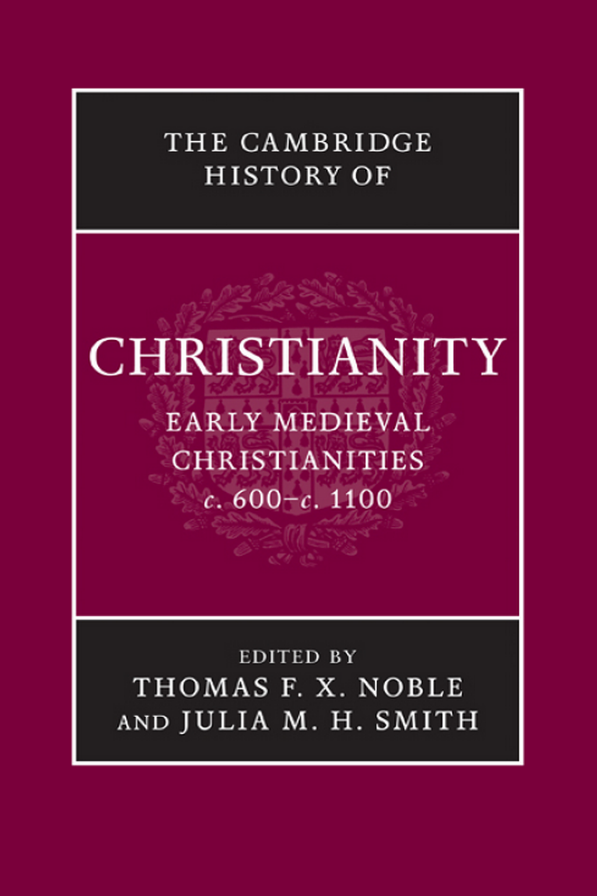
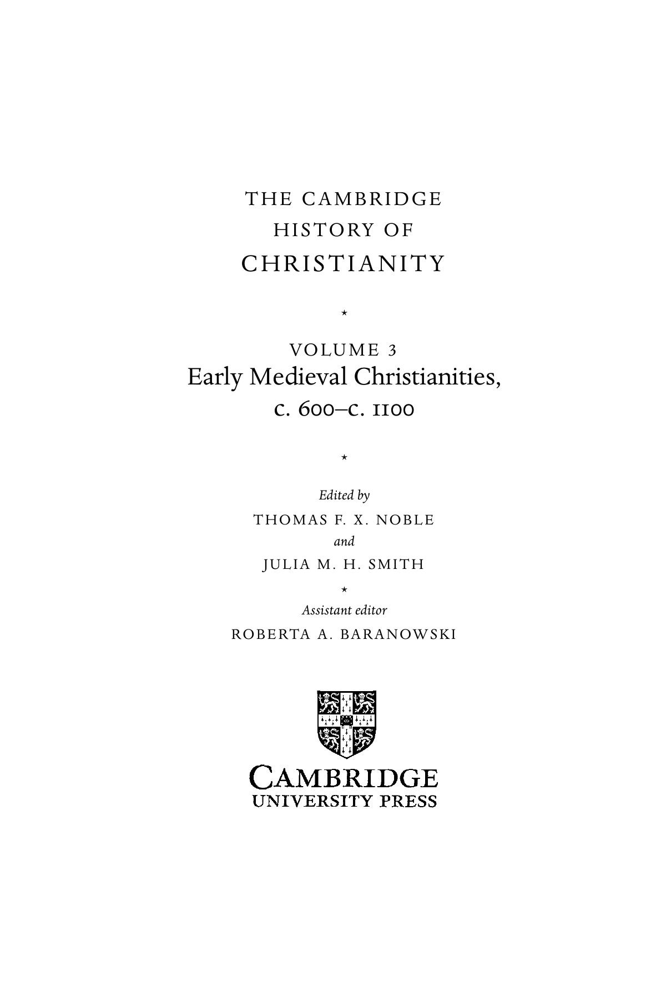
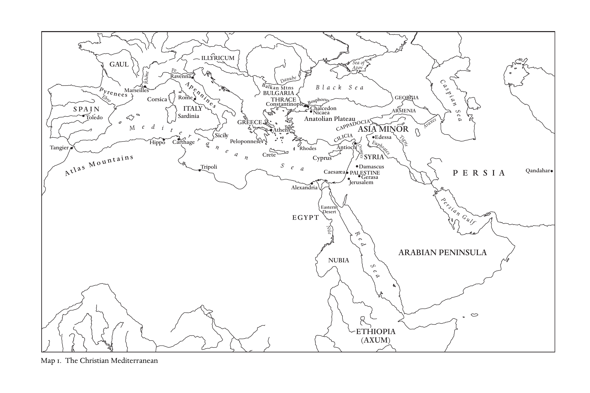
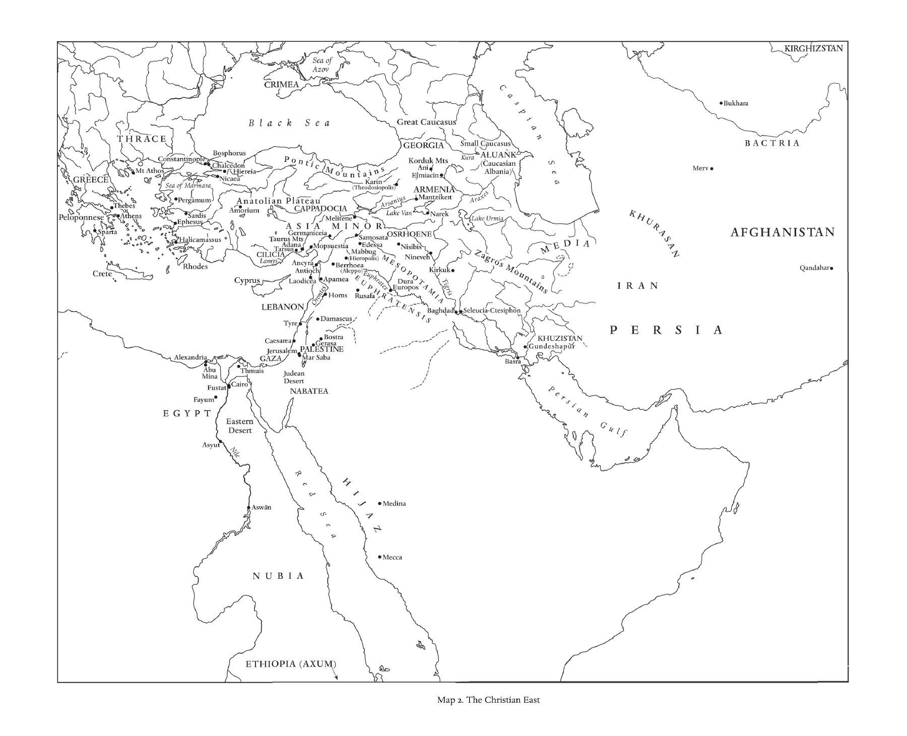
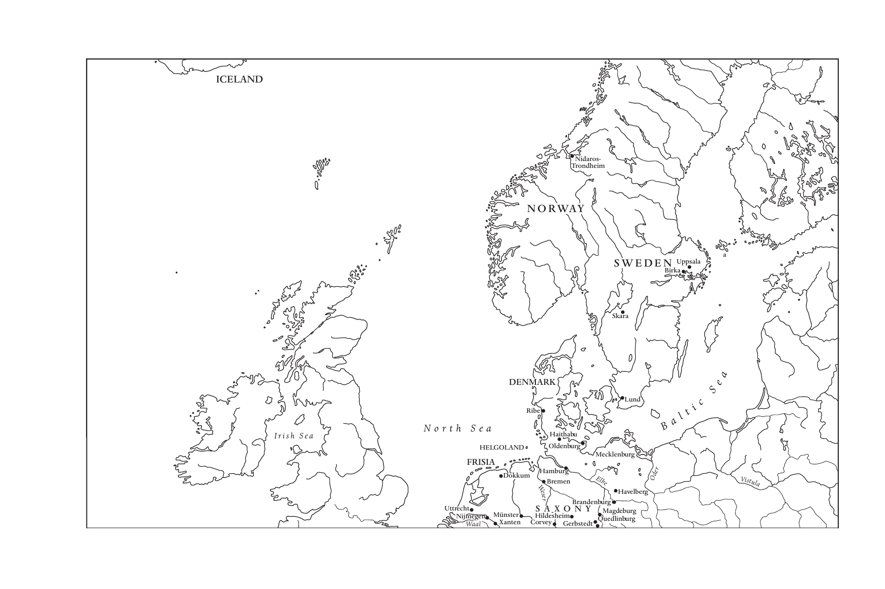
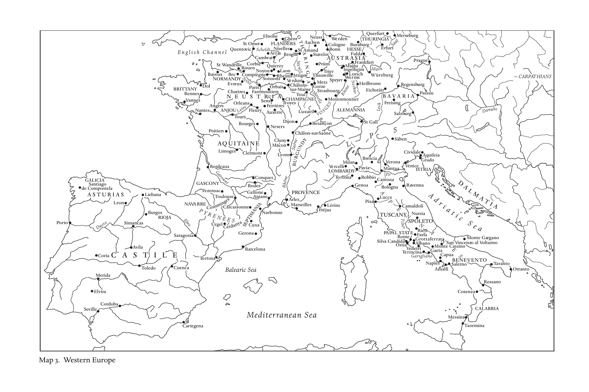
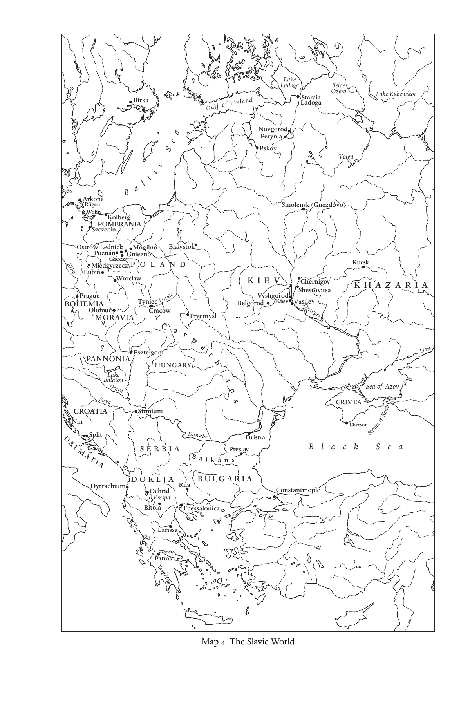
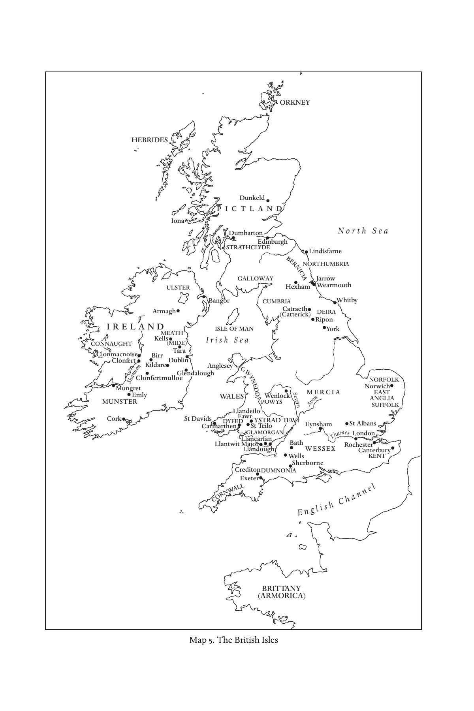

# 卷首资料

<!-- PDF page 1; original page unnumbered -->

## 原书封面

*《剑桥基督教史》第三卷：中世纪早期基督教诸形态，约600—约1100年。*

<!-- PDF page 2; original page unnumbered -->

## 本卷简介

本书关注的核心，是从古代晚期到第一次十字军东征期间，基督徒生活经验各个方面所呈现的活力与变化。它把制度史与教义史牢牢放入基督教的种种文化表现和实际生活经验之中，考察范围从阿富汗一直延伸到冰岛。因此，《剑桥基督教史》本卷强调，无论在地方还是世界层面，基督教的表现形式始终多种多样，而且不断变化。本卷运用社会性别研究、书籍形制学、考古学和人类学等多个学科的见解，提出新的解释，挑战人们对这一奠基时期习以为常的认识。全卷涉及东方、拜占庭和西方基督教，探讨基督徒与其他人群，尤其是犹太人、穆斯林及异教徒的接触；教会的制度生活，包括法律、改革与修道生活；敬拜、信仰和道德的牧灵与圣事背景；最后讨论其文化与神学意义，包括异端、圣徒崇敬和来世。

托马斯·F. X. 诺布尔（Thomas F. X. Noble）是圣母大学中世纪研究所罗伯特·M. 康韦所长及历史学教授。他曾任教于得克萨斯理工大学和弗吉尼亚大学，并曾在美国和欧洲获得多项享有声誉的研究奖助。他撰写或主编了六部著作，发表了三十余篇书籍章节或期刊论文。

朱莉娅·M. H. 史密斯（Julia M. H. Smith）是格拉斯哥大学爱德华兹中世纪史讲席教授、皇家历史学会会士，曾任教于康涅狄格州哈特福德的三一学院和圣安德鲁斯大学。她发表了多篇期刊论文，撰写或主编了四部著作，最近的一部是《罗马之后的欧洲：500—1000年的新文化史》（Europe after Rome: A New Cultural History 500–1000，2005）。

> 本卷的任职介绍与“最近”等相对时间，均依2008年原书。

<!-- PDF page 3; original page unnumbered -->

（原书空白页。）

<!-- PDF page 4; original page unnumbered -->

## 《剑桥基督教史》丛书

《剑桥基督教史》按年代顺序，全面叙述基督教从起源至今在神学、思想、社会、政治、地域及全球等各个方面的发展。每一卷本身都对相应时期的学术研究作出重要贡献，而整套《历史》则构成一部大型学术参考著作。

这套《历史》旨在提供全球视野，超出西欧基督教及其分支的范围。从早期开始，它就充分考察东方和科普特基督教；在较晚的时期，又适当覆盖非洲、远东、新大陆、南亚和其他非欧洲地区基督教的发展。各卷涉及民众虔敬及基督教信仰的非正式表达，并在广阔的文化背景中探讨基督徒养成、敬拜和敬虔的社会学问题。基督教与其他主要信仰之间的关系，也是贯穿全套著作的关注点。无论对学者还是学生，这套《历史》都将提供宝贵的参考资源。

各卷如下：

- 第一卷《起源至君士坦丁》：玛格丽特·M. 米切尔（Margaret M. Mitchell）、弗朗西丝·M. 扬（Frances M. Young）编。
- 第二卷《君士坦丁至约600年》：奥古斯丁·卡西代（Augustine Casiday）、弗雷德里克·W. 诺里斯（Frederick W. Norris）编。
- 第三卷《中世纪早期基督教诸形态：约600—约1100年》：托马斯·F. X. 诺布尔、朱莉娅·M. H. 史密斯编。
- 第四卷《西欧基督教：约1100—约1500年》：米里·鲁宾（Miri Rubin）、沃尔特·西蒙（Walter Simon）编。
- 第五卷《东方基督教》：迈克尔·安戈尔德（Michael Angold）编。

<!-- PDF page 5; original page unnumbered -->

- 第六卷《改革与扩张：1500—1660年》：夏伯嘉（Ronnie Po-chia Hsia）编。
- 第七卷《启蒙、复兴与革命：1660—1815年》：斯图尔特·J. 布朗（Stewart J. Brown）、蒂莫西·塔克特（Timothy Tackett）编。
- 第八卷《世界基督教诸形态：约1815—约1914年》：布赖恩·斯坦利（Brian Stanley）、谢里丹·吉利（Sheridan Gilley）编。
- 第九卷《世界基督教诸形态：约1914—约2000年》：休·麦克劳德（Hugh McLeod）编。

<!-- PDF page 6; original page unnumbered -->

## 书名页

《剑桥基督教史》第三卷

**中世纪早期基督教诸形态：约600—约1100年**

编者：托马斯·F. X. 诺布尔、朱莉娅·M. H. 史密斯

助理编辑：罗伯塔·A. 巴拉诺夫斯基（Roberta A. Baranowski）

<!-- PDF page 7; original page unnumbered -->

## 版权与出版资料

剑桥大学出版社；剑桥、纽约、墨尔本、马德里、开普敦、新加坡、圣保罗、德里。

英国地址：Cambridge University Press, The Edinburgh Building, Cambridge CB2 8RU, UK。美国由剑桥大学出版社纽约分社出版。

出版社网站：www.cambridge.org。本书资料：www.cambridge.org/9780521817752。

© 剑桥大学出版社，2008年。本出版物受版权保护。除法律规定的例外及相关集体许可协议所允许的情形外，未经剑桥大学出版社书面许可，不得复制本书的任何部分。

2008年首次出版。英国剑桥大学印刷厂印制。

英国图书馆备有本书的编目记录。

美国国会图书馆在版编目资料：Early medieval Christianities, c. 600–c. 1100 / editors, Thomas F. X. Noble, Julia M. H. Smith; assistant editor, Roberta A. Baranowski. p. cm. – (The Cambridge history of Christianity; v. 3)。含参考文献与索引。ISBN 978-0-521-81775-2，精装。

主题：1. 教会史——中世纪，600—1500年。I. Noble, Thomas F. X. II. Smith, Julia M. H. III. Baranowski, Roberta A.

BR252.E27 2008；270.2 – dc22；2007050262。

剑桥大学出版社不负责本书所引外部或第三方网站网址的持续有效性或准确性，也不保证这些网站上的任何内容现在或将来准确、适宜。

<!-- PDF page 8; original page vii -->

## 原书目录

> 以下数字为原书印刷页码。

- 插图目录，xi
- 地图目录，xii
- 撰稿人，xiii
- 序言，xv
- 致谢，xix
- 缩写，xxi
- 引言：约600年的基督教世界，彼得·布朗，1

### 第一编 基础：民族、地域与传统

- 第1章 罗马晚期的基督教诸形态，菲利普·鲁索，21
- 第2章 拜占庭正教的形成（600—1095年），安德鲁·劳思，46
- 第3章 帝国之外之一：从波斯征服到突厥征服的东方基督教诸形态（604—1071年），伊戈尔·多尔夫曼—拉扎列夫，65
- 第4章 帝国之外之二：凯尔特诸民族的基督教诸形态，托马斯·M. 查尔斯—爱德华兹，86
- 第5章 日耳曼的基督教诸形态，莱斯利·艾布拉姆斯，107

<!-- PDF page 9; original page viii -->

- 第6章 斯拉夫的基督教诸形态（800—1100年），乔纳森·谢泼德，130

### 第二编 交锋中的基督教

- 第7章 基督徒与犹太人，巴特—舍瓦·阿尔伯特，159
- 第8章 地中海边疆：基督教与伊斯兰教的正面相遇，600—1050年，休·肯尼迪，178
- 第9章 穆斯林统治下的基督徒，西德尼·H. 格里菲斯，197
- 第10章 拉丁与希腊基督徒，蒂娅·M. 科尔巴巴，213
- 第11章 北方边疆：基督教与异教的正面相遇，伊恩·N. 伍德，230

### 第三编 社会与政治秩序中的基督教

- 第12章 作为制度的基督教会，托马斯·F. X. 诺布尔，249
- 第13章 禁欲生活及其制度，安娜—玛丽·埃尔维蒂乌斯、米歇尔·卡普兰，275
- 第14章 法律及其运用，珍妮特·L. 纳尔逊，299
- 第15章 财产及其问题，罗斯玛丽·莫里斯，327
- 第16章 改革：理念与实践，朱莉娅·巴罗，345

<!-- PDF page 10; original page ix -->

- 第17章 景观中的教堂，多米尼克·约尼亚—普拉，363

### 第四编 作为生活经验的基督教

- 第18章 出生与死亡，弗雷德里克·S. 帕克斯顿，383
- 第19章 罪的补救，罗布·梅恩斯，399
- 第20章 疾病与医治，佩里格林·霍登，416
- 第21章 性别与身体，琳达·L. 库恩，433
- 第22章 拉丁基督教中的祭献、馈赠与祈祷，阿诺尔德·安根嫩特，453
- 第23章 礼仪的施行，埃里克·帕拉佐，472

### 第五编 基督教：书籍与观念

- 第24章 上帝的异象，阿兰·布罗，491
- 第25章 正统与偏离，E. 安·马特，510
- 第26章 理解《圣经》，居伊·洛布里雄，531
- 第27章 中世纪拜占庭的基督教书籍，莱斯利·布鲁贝克、玛丽·B. 坎宁安，554

<!-- PDF page 11; original page x -->

- 第28章 圣徒及其崇敬，朱莉娅·M. H. 史密斯，581
- 第29章 末后之事，简·鲍恩，606
- 结语：约1100年的基督教世界，约翰·H. 范恩根，625
- 参考文献，644
- 索引，803

<!-- PDF page 12; original page xi -->

## 插图目录

- 图1 教士的品级，出自《马尔穆捷圣事礼书》：欧坦市立图书馆，手稿19 bis，叶1正面。原书480页。
- 图2 《逾越颂》卷轴：罗马，梵蒂冈宗座图书馆，手稿Barberini Lat. 592，叶1。原书484页。
- 图3 三贤士来朝；屠杀婴孩；基督献于圣殿：巴黎，法国国家图书馆，手稿Gr. 510，叶137正面。原书565页。
- 图4 纳齐安祖斯的格列高利手执笔，翻开书本至正文：巴黎，法国国家图书馆，手稿Gr. 923，叶255正面。原书566页。
- 图5 大卫、基督及井边的撒马利亚妇人：莫斯科历史博物馆，抄本129，叶33正面。原书567页。

<!-- PDF page 13; original page xii -->

## 地图目录

- 地图1 基督教的地中海世界，xxiii
- 地图2 基督教的东方，xxiv—xxv
- 地图3 西欧，xxvi—xxvii
- 地图4 斯拉夫世界，xxviii
- 地图5 不列颠群岛，xxix

<!-- PDF page 14; original page xiii -->

## 撰稿人

> 职务与任职机构依2008年原书。

- 莱斯利·艾布拉姆斯（Lesley Abrams）：牛津大学贝利奥尔学院研究员、历史学部讲师。
- 巴特—舍瓦·阿尔伯特（Bat-Sheva Albert）：巴伊兰大学通史系中世纪史教授。
- 阿诺尔德·安根嫩特（Arnold Angenendt）：明斯特威斯特法伦威廉大学荣休教授。
- 朱莉娅·巴罗（Julia Barrow）：诺丁汉大学历史学院中世纪教会史高级讲师。
- 简·鲍恩（Jane Baun）：牛津大学格雷弗里尔斯学堂及神学部。
- 阿兰·布罗（Alain Boureau）：巴黎社会科学高等研究院历史研究中心。
- 彼得·布朗（Peter Brown）：普林斯顿大学历史系罗林斯历史学讲席教授。
- 莱斯利·布鲁贝克（Leslie Brubaker）：伯明翰大学拜占庭艺术史教授，拜占庭、奥斯曼与现代希腊研究中心主任，考古与古代研究所副所长。
- 托马斯·M. 查尔斯－爱德华兹（Thomas M. Charles-Edwards）：牛津大学耶稣学院凯尔特研究讲席教授。
- 琳达·L. 库恩（Lynda L. Coon）：阿肯色大学历史系副教授。
- 玛丽·B. 坎宁安（Mary B. Cunningham）：诺丁汉大学神学系讲师；伯明翰大学人文与社会科学高等研究院荣誉研究员。
- 伊戈尔·多尔夫曼－拉扎列夫（Igor Dorfmann-Lazarev）：杜伦大学神学与宗教系希腊及东方教父学讲师。
- 西德尼·H. 格里菲斯（Sidney H. Griffith）：美国天主教大学闪米特与埃及语言文学系正教授，华盛顿特区。
- 安娜—玛丽·埃尔维蒂乌斯（Anne-Marie Helvétius）：巴黎第八大学（万塞讷－圣但尼）历史研究中心中世纪史教授。
- 佩里格林·霍登（Peregrine Horden）：伦敦大学皇家霍洛韦学院历史系中世纪史教授。
- 多米尼克·约尼亚－普拉（Dominique Iogna-Prat）：巴黎法国国家科学研究中心。
- 米歇尔·卡普兰（Michel Kaplan）：巴黎第一大学（先贤祠－索邦）历史教学研究单位拜占庭史教授。
- 休·肯尼迪（Hugh Kennedy）：伦敦亚非学院阿拉伯语教授。
- 蒂娅·M. 科尔巴巴（Tia M. Kolbaba）：罗格斯大学宗教系助理教授。
- 居伊·洛布里雄（Guy Lobrichon）：阿维尼翁大学中世纪史教授。

<!-- PDF page 15; original page xiv -->

- 安德鲁·劳思（Andrew Louth）：杜伦大学神学与宗教系教父学及拜占庭研究教授。
- E. 安·马特（E. Ann Matter）：宾夕法尼亚大学宗教学系小威廉·R. 凯南讲席教授。
- 罗布·梅恩斯（Rob Meens）：乌得勒支大学历史研究所讲师。
- 罗斯玛丽·莫里斯（Rosemary Morris）：约克大学历史系访问研究员。
- 珍妮特·L. 纳尔逊（Janet L. Nelson）：伦敦国王学院历史系荣休教授。
- 托马斯·F. X. 诺布尔（Thomas F. X. Noble）：圣母大学历史学教授、中世纪研究所罗伯特·M. 康韦所长。
- 埃里克·帕拉佐（Éric Palazzo）：普瓦捷大学中世纪艺术史教授、中世纪文明高等研究中心主任。
- 弗雷德里克·S. 帕克斯顿（Frederick S. Paxton）：康涅狄格学院历史系布里吉达·帕基亚尼·阿尔登吉历史学讲席教授。
- 菲利普·鲁索（Philip Rousseau）：美国天主教大学安德鲁·W. 梅隆早期基督教研究讲席教授、早期基督教研究中心主任，华盛顿特区。
- 乔纳森·谢泼德（Jonathan Shepard）：原剑桥大学历史学讲师。
- 朱莉娅·M. H. 史密斯（Julia M. H. Smith）：格拉斯哥大学历史系爱德华兹中世纪史讲席教授。
- 约翰·H. 范恩根（John H. Van Engen）：圣母大学历史系安德鲁·V. 塔克斯中世纪史讲席教授。
- 伊恩·N. 伍德（Ian N. Wood）：利兹大学历史学院中世纪早期史教授。

## 序言<!-- PDF page 16; original page xv -->在《剑桥基督教史》第一、二卷所涵盖的时期，基督教在古代世界兴起、传播，并强化了对人们生活的要求。第三卷讨论通常被称为“中世纪早期”的几个世纪，从约600年延伸到约1100年。在这段漫长、充满活力与创造性的时代，古代基督教的成就得到巩固，同时也出现了剧烈的新发展。

把握中世纪早期变化与延续的一种办法，是阅读本卷开头和结尾的两篇文章。开篇全景式地呈现约600年的基督教，其间偶尔回望过去，瞥见未来；结篇则以类似的全景视野观察约1100年的情形。600年时，基督教在根本上仍是一种地中海现象。几乎所有具有创造力的中心，以及重要的行政地点，都紧贴这片内海的海岸。当时绝大多数基督徒，都生活在距海两百英里以内。基督教在地中海盆地之外最引人瞩目的地域扩张，发生在东方和非洲。西欧只是在那时，才开始显现为可能成长和发展的地方。到1100年，基督教的创造核心，已经明确位于西欧。伊斯兰教迅速而持续的扩张，使基督教在欧洲和非洲的地中海地区，以及中亚和西亚的存在减弱。伊斯兰教也不断向拜占庭，因而向正教基督教，提出挑战。事实上，拜占庭的影响范围不仅在东地中海缩小，在北方也同样如此；阿瓦尔、保加尔和斯拉夫诸民族与国家，挑战着拜占庭历史上提出的权利主张。与此同时，除波罗的海东岸的某些地区外，基督教已经传播到欧洲本身的每个角落。如果说安提阿和亚历山大里亚曾是古代基督教的思想重镇，那么，在千年之交前后的几个世纪里，温彻斯特、科隆、巴黎和沙特尔等地，便占据了主导影响。

<!-- PDF page 17; original page xvi -->

在初启的二十一世纪，基督教已十分明确地是一种世界宗教：它在欧洲日益边缘化，在其他大陆却生机勃勃。中世纪早期的几个世纪，开启了一段漫长时期。在这期间，基督教似乎在根本上是一种欧洲现象；后来，它才逐步以天主教和新教两种形态，传播到世界其他大部分地区。今天，基督教诸形态巧妙地融合着不同民族、地方、语言、文化与历史经验。600年的基督教诸形态也是如此；到1100年仍然如此，尽管重心已向北、向西移动，促成同质化的力量也已变得明显。

本卷题为《中世纪早期基督教诸形态》。使用复数，并不是要否认所有基督徒都能把根源追溯到古代的地中海世界，也不是否认他们从同一套经典的不同版本获得灵感，以颇为相似的方式敬拜，或其教会共享许多法律与制度特征。相反，复数提示我们：对于一种不断变化、从爱尔兰延伸到阿富汗、从挪威延伸到努比亚的宗教，使用过度概括的语言是徒劳的。基督教改变了它接触的每个民族与文化，但它自身也受到民族、文化、先前历史，甚至地貌景观的改变。因此，复数所表示的，是丰富、创造力与复杂性，而非混乱、困惑或不统一。

此外，必须从多种相互补充的角度理解基督教。把这些角度合在一起，也再次要求我们使用复数来描述。基督教在各地都是一种教会现象，却发展出十分不同的教会类型，以及支持、解释这些教会的教会论观念。基督教也是一套教导，人们以不同程度，从思想、心灵与身体上接受它。这些立场必须得到界定、阐述与传递。在古代，它们往往引发激烈争斗。中世纪早期的教义争执较少，但也存在庞大的基督徒群体，他们并不在一切事情上信得相同，彼此往来也相对有限。基督教还伴随从出生到死亡的重大生命时刻；它是一种生活经验，至少与其作为一套教义表述同样重要，甚至更重要。古代基督教，在根本上是一种城市现象。城市并非中世纪早期欧洲的突出特征。然而，奇特的是，即使基督教扎根于基本属于乡村和农业的社会，它仍保留着本质上具有城市性质的结构、实践与视野。在这方面，适应和地方特殊性同样清楚可见。无论我们关注什么地点、时代，<!-- PDF page 18; original page xvii -->或题目，都无法有效地把基督教简化成一个单一现象。

意识到这些基本指导原则，有助于读者把握本卷的安排，看见连接其组织骨架的脉络。本卷第一编，从地理和历史角度巡视几个主要而可辨识的地区，基督教在其中或延续古代成就，或重新起步。本编第一章概览罗马晚期的情形，随后各章探讨拜占庭世界、东方基督教的多种形态，以及斯拉夫、日耳曼和凯尔特地区的基督教。下一编明确讨论基督教与犹太教的相遇；基督教沿着不断扩展的边疆，以及在哈里发国境内，与伊斯兰教的交锋；希腊基督徒与拉丁基督徒的接触；最后，是基督教与日耳曼、斯拉夫异教之间长期的交往与较量。这两编强调塑造中世纪早期基督教诸形态的、更广泛的政治、文化和宗教环境。

接下来的一组章节，处理可以广义地归为制度的问题：教会组织、修道生活与禁欲、法律的制定与实施、财产和物质事务、改革观念，以及崇拜场所。前两编的章节，往往集中于特定地区或文化接触事件；与之不同，第三编各章广泛考察本卷涵盖的一切基督教形态。它们在高度概括与足够具体的例证、个案研究之间取得平衡，使关键问题既清楚，又生动。

第四编把基督教视为一种生活经验，讨论其历史与实践中的重要主题，尤其关注教会及其基督徒团体的圣事生活。它的前提是：敬拜、仪式和祈祷的方式，能使我们深入了解人们相信什么，或者被期待相信什么。讨论从伴随出生与死亡的礼仪开始。在洗礼和临终傅油之后，是悔罪：既包括悔罪实践，也包括罪与救赎的观念。随后对疾病和医治的讨论，兼顾医学与属灵的补救方法。再下一章探讨性别、性与身体，使我们得以看见：作者们如何谈论那些真正构成中世纪早期基督徒的人，无论平信徒还是教士。本编最后，从两个方面讨论敬拜：圣餐礼仪庆典背后的神学——它在各地都是教会的核心敬拜行动——以及礼仪本身的施行，其中也涉及施行礼仪所需的书籍。

<!-- PDF page 19; original page xviii -->

第五编也是最后一编，处理思想与文化问题，它们既涉及正式学问，也涉及基督教的想象世界。开篇讨论中世纪早期人们思考、书写上帝的诸多方式中的若干种。下一章通过考察教义争执，直接讨论“谈论上帝”，即神学。这些争执在数量与激烈程度上，都少于古代；也许在大多数中世纪早期基督教形态的日常经验中，它们扎根得也没有那么深。《圣经》——在任何时间、任何地方，它都是基督教至关重要的一本书，或者一组书——将从其文本与诠释框架加以讨论。书籍作为实物，也获得深入探讨，尤其关注东方基督教传统的书籍。至于圣徒，即那些被认为过着典范生活的神圣男女，本编通过分析他们，了解教会精英与普通信徒的抱负和期待。最后，以“末后之事”收束全卷，恰如其分：基督徒怎样想象另一个世界，那个坟墓以外的世界？

整体而言，本卷向读者呈现二十一世纪学者想象中世纪早期基督教诸形态那个异样世界的主要方式。这里提出的解释，永远不可能是定论。以下许多篇章，都挑战并更新了长期深植于基督教史中的争论或假定。在重新评估它们时，本书把某些问题从注意力中心移开，代之以对于基督纪元第三个千年中迅速变化的世界而言，更合时宜的其他问题。我们希望，本书能像编写它的过程之于编者与撰稿人一样，也使读者受到挑战，获得新的认识。

托马斯·F. X. 诺布尔（Thomas F. X. Noble）

朱莉娅·M. H. 史密斯（Julia M. H. Smith）

<!-- PDF page 20; original page xix -->

## 致谢

本卷的编辑过程是一项协作事业，其程度远远超过书名页上两位编者的署名可能给人的印象。我们衷心感谢所有撰稿人在促成本书问世过程中发挥的作用。对于我们就各章内容与呈现方式提出的建议，大家都给予了友善的回应；许多人还就各种具体细节为我们提供了专业的意见与指导。编辑过程中出现了未曾预料而又不可避免的延误，大家也都体谅、耐心地承受了下来，两位编者为此深怀感激。

如果没有圣母大学在经费和实际工作方面极为慷慨的支持，这项计划就无法实现。圣母大学中世纪研究所与文理学术研究所共同承担了将三大洲撰稿人召集到一起的费用；麦肯纳中心则提供了理想的环境，让同仁们对彼此的章节初稿展开热烈而富有启发的批评。这次研讨会赋予本卷一种仅靠编辑指导无法达到的连贯性；本书以下各页，也表达了与会者对那三天的思想激励和友好氛围的珍视。从筹办会议到形成纸质及电子版的完善文稿，在本书准备工作的每个阶段，中世纪研究所助理所长罗伯塔·巴拉诺夫斯基都提供了宝贵的行政支持，并投入了大量文字编辑工作。我们很高兴能够在此公开承认自己对她的深深感激。

两位译者将语言敏感与相关领域的知识运用于各章作者的德文、法文原稿，译成英文。圣安德鲁斯大学罗娜·约翰斯顿·戈登博士把安根恩特教授的章节由德文译出。圣母大学的安德鲁·欧文则把布罗、埃尔韦修斯与卡普兰、约尼亚－普拉、洛布里雄及帕拉佐诸位教授的章节由法文译出。

<!-- PDF page 21; original page xx -->

我们同样感谢剑桥大学出版社所有参与本卷工作的人员：凯文·泰勒邀请我们承担此项工作；接替他负责宗教编辑业务的凯特·布雷特及其助理吉莉安·达德，始终给予我们充分的精神支持、实际帮助和耐心体谅；莉兹·戴维则极为高效地监督了制作过程。出版社还慷慨承担了索引的编制工作。

在制作的最后阶段，里奇斯编辑服务公司的克里斯托弗·里奇斯细致地协调校样订正工作，并在许多其他重要方面改进了本书。我们对他出色的专业精神深表谢忱。

托马斯·F. X. 诺布尔、朱莉娅·M. H. 史密斯

<!-- PDF page 22; original page xxi -->

## 缩写

> 文献全名及出版资料保留原文；Ed.为编订，trans.为翻译，vol./vols.为卷，pt.为部分。

- **AASS**：Acta sanctorum quotquot toto orbe coluntur. Ed. J. Bollandus et al. Antwerp and Brussels, 1634–.
- **Bede, HE**：Bede. Historia ecclesiastica gentis Anglorum. Ed. and trans. B. Colgrave and R. A. B. Mynors. Bede’s Ecclesiastical History of the English People. Oxford Medieval Texts. Oxford: Oxford University Press, 1969.
- **BMFD**：Byzantine Monastic Foundation Documents: A Complete Translation of the Surviving Founders’ Typika and Testaments. Ed. J. Thomas and A. C. Hero, with G. Constable. 5 vols. Washington, DC: Dumbarton Oaks, 2000.
- **CC**：Corpus christianorum。
- **CCCM**：Corpus christianorum continuatio mediaevalis。
- **CCSG**：Corpus christianorum series graeca。
- **CCSL**：Corpus christianorum series latina。
- **CSCO**：Corpus scriptorum christianorum orientalium。
- **CSEL**：Corpus scriptorum ecclesiasticorum latinorum。
- **DOP**：Dumbarton Oaks Papers。
- **EME**：Early Medieval Europe。
- **Haddan and Stubbs**：A. W. Haddan and W. Stubbs, eds. Councils and Ecclesiastical Documents Relating to Great Britain and Ireland. 3 vols. Oxford: Clarendon Press, 1869–78.
- **Histoire du christianisme 3**：Les églises d’orient et d’occident. Ed. L. Pietri, J.-M. Mayeur, and B. Beaujard. Vol. 3 in Histoire du christianisme des origines à nos jours. Paris: Desclée, 1998.
- **Histoire du christianisme 4**：Évêques, moines et empereurs (610–1054). Ed. G. Dagron, P. Riché, and A. Vauchez. Vol. 4 in Histoire du christianisme des origines à nos jours. Paris: Desclée, 1993.

<!-- PDF page 23; original page xxii -->

- **Histoire du christianisme 5**：Apogée de la papauté et expansion de la chrétienté (1054–1274). Ed. A. Vauchez and J. Kłoczowski. Vol. 5 in Histoire du christianisme des origines à nos jours. Paris: Desclée, 1993.
- **Mansi**：Mansi, G. D., ed., Sacrorum conciliorum nova et amplissima collectio. 31 vols. Florence, 1759–98; rev. ed. J.-B. Martin and L. Petit. 53 vols. in 60. Paris, 1899–27.（末一出版年代范围依原书。）
- **MGH**：Monumenta Germaniae Historica。
- **MGH SRG**：MGH scriptores rerum germanicarum。
- **MGH SRM**：MGH scriptores rerum merovingicarum。
- **NCMH 2**：The New Cambridge Medieval History. Vol. 2: c. 700–900. Ed. R. McKitterick. Cambridge: Cambridge University Press, 1995.
- **ODB**：Oxford Dictionary of Byzantium. Ed. A. Kazhdan. 3 vols. Oxford: Oxford University Press, 1991.
- **PO**：Patrologia orientalis。
- **PG**：Patrologia graeca = Patrologiae cursus completus. Series graeca. Comp. by J.-P. Migne. 161 vols. Paris, 1857–66.
- **PL**：Patrologia latina = Patrologiae cursus completus. Series secunda in qua prodeunt patres... ecclesiae latinae. Comp. by J.-P. Migne. 221 in 222 vols. Paris, 1844–64.
- **SC**：Sources chrétiennes。
- **SCH**：Studies in Church History。

### 关于脚注引证的说明

一般而言，本卷的脚注用以下方式标示章、页和卷：作者，著作题名，卷号（如有），著作内部的章、节，所用具体版本的页码。

例如：Anonymous, Historia 2, II.ii.3, 346–47。其意为：匿名作者《Historia》第2卷第2章第2节第3部分，在参考文献所列版本中见346—347页。

除非为避免歧义确有必要，脚注不列版本编者或译者姓名，只在参考文献中列出。例如：Anonymous, Historia 2, 25–37 (ed. Smith, 399–401)，其意为：匿名作者《Historia》第2卷第25—37节（如文献逐件编号，则指第25—37号文献），见史密斯编本399—401页。

<!-- PDF page 24; original page map -->

## 地图1 基督教的地中海世界

*地图1 基督教的地中海世界。原图内地名保留原文，下附中文对照。*

| 原图标记 | 中文 |
|---|---|
| Gaul | 高卢 |
| Illyricum | 伊利里库姆 |
| Spain | 西班牙 |
| Toledo | 托莱多 |
| Ebro | 埃布罗河 |
| Pyrenees | 比利牛斯山脉 |
| Rhône | 罗讷河 |
| Marseilles | 马赛 |
| Po | 波河 |
| Ravenna | 拉文纳 |
| Rome | 罗马 |
| Apennines | 亚平宁山脉 |
| Italy | 意大利 |
| Corsica | 科西嘉 |
| Sardinia | 撒丁岛 |
| Sicily | 西西里 |
| Tangier | 丹吉尔 |
| Atlas Mountains | 阿特拉斯山脉 |
| Hippo | 希波 |
| Carthage | 迦太基 |
| Tripoli | 的黎波里 |
| Mediterranean Sea | 地中海 |
| Greece | 希腊 |
| Athens | 雅典 |
| Peloponnese | 伯罗奔尼撒 |
| Crete | 克里特 |
| Danube | 多瑙河 |
| Balkan Mtns | 巴尔干山脉 |
| Bulgaria | 保加利亚 |
| Thrace | 色雷斯 |
| Constantinople | 君士坦丁堡 |
| Bosphorus | 博斯普鲁斯海峡 |
| Chalcedon | 迦克墩 |
| Nicaea | 尼西亚 |
| Anatolian Plateau | 安纳托利亚高原 |
| Cappadocia | 卡帕多西亚 |
| Asia Minor | 小亚细亚 |
| Cilicia | 奇里乞亚 |
| Rhodes | 罗得岛 |
| Cyprus | 塞浦路斯 |
| Antioch | 安提阿 |
| Orontes | 奥龙特斯河 |
| Edessa | 埃德萨 |
| Syria | 叙利亚 |
| Damascus | 大马士革 |
| Palestine | 巴勒斯坦 |
| Gerasa | 杰拉萨 |
| Caesarea | 凯撒里亚 |
| Jerusalem | 耶路撒冷 |
| Alexandria | 亚历山大里亚 |
| Egypt | 埃及 |
| Eastern Desert | 东部沙漠 |
| Nile | 尼罗河 |
| Nubia | 努比亚 |
| Ethiopia (Axum) | 埃塞俄比亚（阿克苏姆） |
| Red Sea | 红海 |
| Arabian Peninsula | 阿拉伯半岛 |
| Persian Gulf | 波斯湾 |
| Persia | 波斯 |
| Qandahar | 坎大哈 |
| Black Sea | 黑海 |
| Sea of Azov | 亚速海 |
| Georgia | 格鲁吉亚 |
| Armenia | 亚美尼亚 |
| Araxes | 阿拉克斯河 |
| Caspian Sea | 里海 |
| Tigris | 底格里斯河 |
| Euphrates | 幼发拉底河 |

<!-- PDF page 25; original page map -->

## 地图2 基督教的东方

*地图2 基督教的东方。原图内地名保留原文，下附中文对照。*

| 原图标记 | 中文 |
|---|---|
| Sea of Azov | 亚速海 |
| Crimea | 克里米亚 |
| Black Sea | 黑海 |
| Great Caucasus | 大高加索山脉 |
| Small Caucasus | 小高加索山脉 |
| Georgia | 格鲁吉亚 |
| Korduk Mts | 科尔杜克山脉 |
| Ani | 阿尼 |
| Ejmiacin | 埃奇米阿津 |
| Kura | 库拉河 |
| Ałuankʿ (Caucasian Albania) | 阿卢安克（高加索阿尔巴尼亚） |
| Armenia | 亚美尼亚 |
| Mantzikert | 曼齐刻尔特 |
| Karin (Theodosiopolis) | 卡林（狄奥多西奥波利斯） |
| Arsanius | 阿尔萨尼乌斯河 |
| Araxes | 阿拉克斯河 |
| Lake Van | 凡湖 |
| Narek | 纳雷克 |
| Lake Urmia | 乌尔米耶湖 |
| Caspian Sea | 里海 |
| Kirghizstan | 吉尔吉斯斯坦 |
| Bukhara | 布哈拉 |
| Bactria | 巴克特里亚 |
| Merv | 木鹿 |
| Khurasan | 呼罗珊 |
| Afghanistan | 阿富汗 |
| Qandahar | 坎大哈 |
| Iran | 伊朗 |
| Persia | 波斯 |
| Media | 米底亚 |
| Zagros Mountains | 扎格罗斯山脉 |
| Khuzistan | 胡齐斯坦 |
| Gundeshāpūr | 贡德沙普尔 |
| Basra | 巴士拉 |
| Baghdad | 巴格达 |
| Seleucia-Ctesiphon | 塞琉西亚－泰西封 |
| Tigris | 底格里斯河 |
| Kirkuk | 基尔库克 |
| Nineveh | 尼尼微 |
| Nisibis | 尼西比斯 |
| Osrhoene | 奥斯若恩 |
| Mesopotamia | 美索不达米亚 |
| Euphratensis | 幼发拉底行省 |
| Euphrates | 幼发拉底河 |
| Dura Europos | 杜拉－欧罗波斯 |
| Edessa | 埃德萨 |
| Samosata | 萨莫萨塔 |
| Mabbug (Hieropolis) | 马布格（希耶罗波利斯） |
| Berrhoea (Aleppo) | 贝罗亚（阿勒颇） |
| Rusafa | 鲁萨法 |
| Homs | 霍姆斯 |
| Apamea | 阿帕米亚 |
| Laodicea | 劳迪基亚 |
| Antioch | 安提阿 |
| Ancyra | 安居拉 |
| Adana | 阿达纳 |
| Mopsuestia | 摩普绥斯提亚 |
| Tarsus | 塔尔苏斯 |
| Lamys | 拉米斯 |
| Cilicia | 奇里乞亚 |
| Taurus Mts | 托罗斯山脉 |
| Germaniceia | 日耳曼尼基亚 |
| Melitene | 梅利特内 |
| Cappadocia | 卡帕多西亚 |
| Asia Minor | 小亚细亚 |
| Anatolian Plateau | 安纳托利亚高原 |
| Amorium | 阿莫里翁 |
| Pontic Mountains | 本都山脉 |
| Pergamum | 佩加蒙 |
| Sardis | 撒狄 |
| Ephesus | 以弗所 |
| Halicarnassus | 哈利卡纳苏斯 |
| Rhodes | 罗得岛 |
| Cyprus | 塞浦路斯 |
| Crete | 克里特 |
| Greece | 希腊 |
| Sparta | 斯巴达 |
| Athens | 雅典 |
| Thebes | 底比斯 |
| Peloponnese | 伯罗奔尼撒 |
| Mt Athos | 阿索斯山 |
| Thrace | 色雷斯 |
| Constantinople | 君士坦丁堡 |
| Bosphorus | 博斯普鲁斯海峡 |
| Chalcedon | 迦克墩 |
| Hiereia | 希耶里亚 |
| Nicaea | 尼西亚 |
| Sea of Marmara | 马尔马拉海 |
| Lebanon | 黎巴嫩 |
| Orontes | 奥龙特斯河 |
| Damascus | 大马士革 |
| Tyre | 推罗 |
| Caesarea | 凯撒里亚 |
| Bostra | 博斯特拉 |
| Gerasa | 杰拉萨 |
| Palestine | 巴勒斯坦 |
| Jerusalem | 耶路撒冷 |
| Gaza | 加沙 |
| Mar Saba | 马尔萨巴 |
| Judean Desert | 犹太沙漠 |
| Nabatea | 纳巴泰 |
| Alexandria | 亚历山大里亚 |
| Abu Mina | 阿布米纳 |
| Thmuis | 特穆伊斯 |
| Cairo | 开罗 |
| Fustat | 福斯塔特 |
| Fayum | 法尤姆 |
| Asyut | 艾斯尤特 |
| Aswān | 阿斯旺 |
| Egypt | 埃及 |
| Eastern Desert | 东部沙漠 |
| Nile | 尼罗河 |
| Nubia | 努比亚 |
| Ethiopia (Axum) | 埃塞俄比亚（阿克苏姆） |
| Red Sea | 红海 |
| Hijaz | 希贾兹 |
| Medina | 麦地那 |
| Mecca | 麦加 |
| Persian Gulf | 波斯湾 |

<!-- PDF page 26; original page map -->

## 地图3 西欧（北部）

*地图3 西欧（北部）。原图内地名保留原文，下附中文对照。*

| 原图标记 | 中文 |
|---|---|
| Iceland | 冰岛 |
| Nidaros-Trondheim | 尼达罗斯－特隆赫姆 |
| Norway | 挪威 |
| Sweden | 瑞典 |
| Uppsala | 乌普萨拉 |
| Birka | 比尔卡 |
| Skara | 斯卡拉 |
| Denmark | 丹麦 |
| Lund | 隆德 |
| Ribe | 里伯 |
| Haithabu | 海塔布 |
| Oldenburg | 奥尔登堡 |
| Helgoland | 黑尔戈兰 |
| Frisia | 弗里西亚 |
| Dokkum | 多库姆 |
| Hamburg | 汉堡 |
| Bremen | 不来梅 |
| Mecklenburg | 梅克伦堡 |
| Brandenburg | 勃兰登堡 |
| Havelberg | 哈弗尔贝格 |
| Magdeburg | 马格德堡 |
| Quedlinburg | 奎德林堡 |
| Gerbstedt | 格尔布施泰特 |
| Hildesheim | 希尔德斯海姆 |
| Corvey | 科尔韦 |
| Münster | 明斯特 |
| Xanten | 克桑滕 |
| Utrecht | 乌得勒支 |
| Nijmegen | 奈梅亨 |
| Saxony | 萨克森 |
| Waal | 瓦尔河 |
| Weser | 威悉河 |
| Elbe | 易北河 |
| Oder | 奥得河 |
| Vistula | 维斯瓦河 |
| Baltic Sea | 波罗的海 |
| North Sea | 北海 |
| Irish Sea | 爱尔兰海 |

<!-- PDF page 27; original page map -->

## 地图3 西欧（南部）

*地图3 西欧（南部）。原图内地名保留原文，下附中文对照。*

| 原图标记 | 中文 |
|---|---|
| English Channel | 英吉利海峡 |
| Quentovic | 康托维克 |
| St Omer | 圣奥梅尔 |
| Elnone | 埃尔农 |
| Ghent | 根特 |
| Flanders | 佛兰德斯 |
| Scheldt | 斯海尔德河 |
| Nivelles | 尼韦勒 |
| Arras | 阿拉斯 |
| Cambrai | 康布雷 |
| St Amand | 圣阿芒 |
| Brogne | 布罗涅 |
| Neuss | 诺伊斯 |
| Werden | 韦尔登 |
| Aachen | 亚琛 |
| Cologne | 科隆 |
| Bonn | 波恩 |
| Stavelot | 斯塔沃洛 |
| Lotharingia | 洛塔林吉亚 |
| Meuse | 默兹河 |
| Austrasia | 奥斯特拉西亚 |
| Prüm | 普吕姆 |
| Trier | 特里尔 |
| Thionville | 蒂永维尔 |
| Metz | 梅斯 |
| Gorze | 戈尔兹 |
| Verdun | 凡尔登 |
| Attigny | 阿蒂尼 |
| Reims | 兰斯 |
| Laon | 拉昂 |
| Quierzy | 基耶尔济 |
| Soissons | 苏瓦松 |
| Corbie | 科尔比 |
| Noyon | 努瓦永 |
| Compiègne | 贡比涅 |
| Rouen | 鲁昂 |
| St Wandrille | 圣旺德里耶 |
| Bec | 贝克 |
| Bayeux | 巴约 |
| Evreux | 埃夫勒 |
| Normandy | 诺曼底 |
| Seine | 塞纳河 |
| Paris | 巴黎 |
| Chartres | 沙特尔 |
| Faremoutiers | 法尔穆捷 |
| Orléans | 奥尔良 |
| Neustria | 纽斯特里亚 |
| Sens | 桑斯 |
| Ferrières | 费里耶尔 |
| Orbais | 奥尔贝 |
| Châlons-sur-Marne | 马恩河畔沙隆 |
| Champagne | 香槟 |
| Troyes | 特鲁瓦 |
| Toul | 图勒 |
| Strasbourg | 斯特拉斯堡 |
| Moselle | 摩泽尔河 |
| Vosges | 孚日山脉 |
| Moyenmoutier | 莫延穆捷 |
| Luxeuil | 吕克瑟伊 |
| Fleury | 弗勒里 |
| Auxerre | 欧塞尔 |
| Tours | 图尔 |
| Loire | 卢瓦尔河 |
| Angers | 昂热 |
| Anjou | 安茹 |
| Nantes | 南特 |
| Dol | 多尔 |
| Rennes | 雷恩 |
| Vannes | 瓦讷 |
| Brittany | 布列塔尼 |
| Poitiers | 普瓦捷 |
| Bourges | 布尔日 |
| Nevers | 讷韦尔 |
| Dijon | 第戎 |
| Besançon | 贝桑松 |
| Châlon-sur-Saône | 索恩河畔沙隆 |
| Cluny | 克吕尼 |
| Mâcon | 马孔 |
| Saône | 索恩河 |
| Lyons | 里昂 |
| Burgundy | 勃艮第 |
| Aquitaine | 阿基坦 |
| Limoges | 利摩日 |
| Clermont | 克莱蒙 |
| Bordeaux | 波尔多 |
| Garonne | 加龙河 |
| Gascony | 加斯科涅 |
| Fenzesac | 芬泽萨克 |
| Toulouse | 图卢兹 |
| Conques | 孔克 |
| Rodez | 罗德兹 |
| Gellone | 热洛讷 |
| Aniane | 阿尼亚讷 |
| Comminges | 科曼日 |
| Carcassonne | 卡尔卡松 |
| Narbonne | 纳博讷 |
| Septimania | 塞普提马尼亚 |
| Pyrenees | 比利牛斯山脉 |
| Navarre | 纳瓦拉 |
| Urgel | 乌赫尔 |
| Cerdany | 塞尔达尼亚 |
| Cuxa | 库克萨 |
| Gerona | 赫罗纳 |
| Barcelona | 巴塞罗那 |
| Tortosa | 托尔托萨 |
| Saragossa | 萨拉戈萨 |
| Ebro | 埃布罗河 |
| Rioja | 里奥哈 |
| Castile | 卡斯蒂利亚 |
| Burgos | 布尔戈斯 |
| Simancas | 西曼卡斯 |
| Liebana | 列瓦纳 |
| Leon | 莱昂 |
| Asturias | 阿斯图里亚斯 |
| Galicia | 加利西亚 |
| Santiago de Compostela | 圣地亚哥－德孔波斯特拉 |
| Porto | 波尔图 |
| Duero | 杜罗河 |
| Avila | 阿维拉 |
| Coria | 科里亚 |
| Toledo | 托莱多 |
| Cuenca | 昆卡 |
| Merida | 梅里达 |
| Elvira | 埃尔维拉 |
| Seville | 塞维利亚 |
| Cordoba | 科尔多瓦 |
| Cartegena | 卡塔赫纳 |
| Balearic Sea | 巴利阿里海 |
| Mediterranean Sea | 地中海 |
| Provence | 普罗旺斯 |
| Arles | 阿尔勒 |
| Marseilles | 马赛 |
| Fréjus | 弗雷瑞斯 |
| Lérins | 莱兰 |
| Rhône | 罗讷河 |
| Alps | 阿尔卑斯山脉 |
| Lombardy | 伦巴德 |
| Vercelli | 韦尔切利 |
| Milan | 米兰 |
| Pavia | 帕维亚 |
| Tortona | 托尔托纳 |
| Bobbio | 博比奥 |
| Genoa | 热那亚 |
| Brescia | 布雷西亚 |
| Canossa | 卡诺萨 |
| Mantua | 曼图亚 |
| Verona | 维罗纳 |
| Venice | 威尼斯 |
| Po | 波河 |
| Istria | 伊斯特里亚 |
| Grado | 格拉多 |
| Aquileia | 阿奎莱亚 |
| Cividale | 奇维达莱 |
| Säben | 塞本 |
| Alemannia | 阿勒曼尼亚 |
| St Gall | 圣加仑 |
| Swabia | 施瓦本 |
| Thuringia | 图林根 |
| Querfurt | 奎尔富特 |
| Merseburg | 梅泽堡 |
| Erfurt | 埃尔福特 |
| Saale | 萨勒河 |
| Hesse | 黑森 |
| Buraburg | 比拉堡 |
| Fulda | 富尔达 |
| Frankfurt | 法兰克福 |
| Mainz | 美因茨 |
| Ingelheim | 英格尔海姆 |
| Lorsch | 洛尔施 |
| Worms | 沃尔姆斯 |
| Speyer | 施派尔 |
| Rhein | 莱茵河 |
| Neckar | 内卡河 |
| Main | 美因河 |
| Würzburg | 维尔茨堡 |
| Heilbronn | 海尔布隆 |
| Eichstätt | 艾希施泰特 |
| Regensburg | 雷根斯堡 |
| Passau | 帕绍 |
| Freising | 弗赖辛 |
| Salzburg | 萨尔茨堡 |
| Lech | 莱希河 |
| Danube | 多瑙河 |
| Bavaria | 巴伐利亚 |
| Prague | 布拉格 |
| Carpathians | 喀尔巴阡山脉 |
| Dalmatia | 达尔马提亚 |
| Adriatic Sea | 亚得里亚海 |
| Ravenna | 拉文纳 |
| Bologna | 博洛尼亚 |
| Lucca | 卢卡 |
| Pisa | 比萨 |
| Tuscany | 托斯卡纳 |
| Camaldoli | 卡马尔多利 |
| Nursia | 努尔西亚 |
| Spoleto | 斯波莱托 |
| Tiber | 台伯河 |
| Papal State | 教宗国 |
| Rieti | 列蒂 |
| Farfa | 法尔法 |
| Rome | 罗马 |
| Silva Candida | 西尔瓦坎迪达 |
| Ostia | 奥斯提亚 |
| Grottaferrata | 格罗塔费拉塔 |
| Albano | 阿尔巴诺 |
| Velletri | 韦莱特里 |
| Terracina | 泰拉奇纳 |
| Gaeta | 加埃塔 |
| Garigliano | 加里利亚诺河 |
| Monte Cassino | 卡西诺山 |
| San Vincenzo al Volturno | 沃尔图尔诺河畔圣温琴佐 |
| Monte Gargano | 加尔加诺山 |
| Benevento | 贝内文托 |
| Capua | 卡普阿 |
| Naples | 那不勒斯 |
| Amalfi | 阿马尔菲 |
| Salerno | 萨莱诺 |
| Taranto | 塔兰托 |
| Otranto | 奥特朗托 |
| Rossano | 罗萨诺 |
| Cosenza | 科森扎 |
| Calabria | 卡拉布里亚 |
| Messina | 墨西拿 |
| Taormina | 陶尔米纳 |

<!-- PDF page 28; original page map -->

## 地图4 斯拉夫世界

*地图4 斯拉夫世界。原图内地名保留原文，下附中文对照。*

| 原图标记 | 中文 |
|---|---|
| Birka | 比尔卡 |
| Gulf of Finland | 芬兰湾 |
| Lake Ladoga | 拉多加湖 |
| Staraia Ladoga | 旧拉多加 |
| Beloe Ozero | 白湖 |
| Lake Kubenskoe | 库边斯科耶湖 |
| Novgorod | 诺夫哥罗德 |
| Perynia | 佩伦尼亚 |
| Pskov | 普斯科夫 |
| Volga | 伏尔加河 |
| Baltic Sea | 波罗的海 |
| Arkona | 阿尔科纳 |
| Rügen | 吕根岛 |
| Wolin | 沃林 |
| Kolberg | 科尔贝格 |
| Szczecin | 什切青 |
| Pomerania | 波美拉尼亚 |
| Ostrów Lednicki | 莱德尼察岛 |
| Poznań | 波兹南 |
| Gniezno | 格涅兹诺 |
| Mogilno | 莫吉尔诺 |
| Giecz | 盖奇 |
| Białystok | 比亚韦斯托克 |
| Międzyrzecz | 缅济热奇 |
| Lubiń | 卢宾 |
| Wrocław | 弗罗茨瓦夫 |
| Poland | 波兰 |
| Elbe | 易北河 |
| Prague | 布拉格 |
| Bohemia | 波希米亚 |
| Olomuc | 奥洛穆茨 |
| Moravia | 摩拉维亚 |
| Tyniec | 蒂涅茨 |
| Cracow | 克拉科夫 |
| Vistula | 维斯瓦河 |
| Przemyśl | 普热梅希尔 |
| Carpathians | 喀尔巴阡山脉 |
| Smolensk (Gnezdovo) | 斯摩棱斯克（格涅兹多沃） |
| Kursk | 库尔斯克 |
| Kiev | 基辅 |
| Chernigov | 切尔尼戈夫 |
| Shestovitsa | 舍斯托维察 |
| Vyshgorod | 维什戈罗德 |
| Belgorod | 别尔哥罗德 |
| Vasilev | 瓦西列夫 |
| Dnieper | 第聂伯河 |
| Khazaria | 可萨地区 |
| Don | 顿河 |
| Sea of Azov | 亚速海 |
| Crimea | 克里米亚 |
| Straits of Kerch | 刻赤海峡 |
| Cherson | 赫尔松 |
| Black Sea | 黑海 |
| Pannonia | 潘诺尼亚 |
| Hungary | 匈牙利 |
| Esztergom | 埃斯泰尔戈姆 |
| Lake Balaton | 巴拉顿湖 |
| Drava | 德拉瓦河 |
| Sava | 萨瓦河 |
| Croatia | 克罗地亚 |
| Nin | 宁 |
| Split | 斯普利特 |
| Dalmatia | 达尔马提亚 |
| Sirmium | 锡尔米乌姆 |
| Serbia | 塞尔维亚 |
| Danube | 多瑙河 |
| Dristra | 德里斯特拉 |
| Preslav | 普雷斯拉夫 |
| Balkans | 巴尔干山脉 |
| Bulgaria | 保加利亚 |
| Doklja | 杜克利亚 |
| Dyrrachium | 都拉基翁 |
| Ochrid | 奥赫里德 |
| Prespa | 普雷斯帕 |
| Bitola | 比托拉 |
| Rila | 里拉 |
| Constantinople | 君士坦丁堡 |
| Thessalonica | 帖撒罗尼迦 |
| Larissa | 拉里萨 |
| Patras | 帕特拉 |
| Taygetus | 泰格特斯山 |

<!-- PDF page 29; original page map -->

## 地图5 不列颠群岛

*地图5 不列颠群岛。原图内地名保留原文，下附中文对照。*

| 原图标记 | 中文 |
|---|---|
| Orkney | 奥克尼群岛 |
| Hebrides | 赫布里底群岛 |
| Dunkeld | 邓凯尔德 |
| Pictland | 皮克特地区 |
| Iona | 爱奥那 |
| Dumbarton | 邓巴顿 |
| Edinburgh | 爱丁堡 |
| Strathclyde | 斯特拉斯克莱德 |
| North Sea | 北海 |
| Lindisfarne | 林迪斯法恩 |
| Bernicia | 伯尼西亚 |
| Northumbria | 诺森布里亚 |
| Galloway | 加洛韦 |
| Hexham | 赫克瑟姆 |
| Jarrow | 贾罗 |
| Wearmouth | 威尔茅斯 |
| Cumbria | 坎布里亚 |
| Whitby | 惠特比 |
| Catraeth (Catterick) | 卡特赖斯（卡特里克） |
| Deira | 德伊勒 |
| Ripon | 里彭 |
| York | 约克 |
| Ulster | 阿尔斯特 |
| Bangor | 班戈 |
| Armagh | 阿马 |
| Ireland | 爱尔兰 |
| Connaught | 康诺特 |
| Meath (Mide) | 米斯（米德） |
| Kells | 凯尔斯 |
| Tara | 塔拉 |
| Clonmacnoise | 克朗马克诺伊斯 |
| Clonfert | 克朗弗特 |
| Birr | 比尔 |
| Kildare | 基尔代尔 |
| Dublin | 都柏林 |
| Glendalough | 格伦达洛 |
| Clonfertmulloe | 克朗弗特穆洛 |
| Shannon | 香农河 |
| Mungret | 芒格雷特 |
| Emly | 埃姆利 |
| Munster | 芒斯特 |
| Cork | 科克 |
| Isle of Man | 马恩岛 |
| Irish Sea | 爱尔兰海 |
| Anglesey | 安格尔西岛 |
| Gwynedd | 圭内斯 |
| Wales | 威尔士 |
| Wenlock | 温洛克 |
| Powys | 波伊斯 |
| Llandeilo Fawr | 兰代洛法乌尔 |
| St Davids | 圣戴维兹 |
| Carmarthen | 卡马森 |
| Dyfed | 迪费德 |
| St Teilo | 圣泰洛 |
| Ystrad Tewi | 伊斯特拉德泰维 |
| Glamorgan | 格拉摩根 |
| Llancar­fan | 兰卡凡 |
| Llantwit Major | 兰特威特马乔尔 |
| Llandough | 兰多 |
| Severn | 塞文河 |
| Avon | 埃文河 |
| Mercia | 麦西亚 |
| Norfolk | 诺福克 |
| Norwich | 诺里奇 |
| East Anglia | 东盎格利亚 |
| Suffolk | 萨福克 |
| Eynsham | 恩舍姆 |
| St Albans | 圣奥尔本斯 |
| Thames | 泰晤士河 |
| London | 伦敦 |
| Rochester | 罗切斯特 |
| Canterbury | 坎特伯雷 |
| Kent | 肯特 |
| Bath | 巴斯 |
| Wells | 韦尔斯 |
| Wessex | 威塞克斯 |
| Sherborne | 舍伯恩 |
| Crediton | 克雷迪顿 |
| Exeter | 埃克塞特 |
| Dumnonia | 杜姆诺尼亚 |
| Cornwall | 康沃尔 |
| English Channel | 英吉利海峡 |
| Brittany (Armorica) | 布列塔尼（阿摩里卡） |

