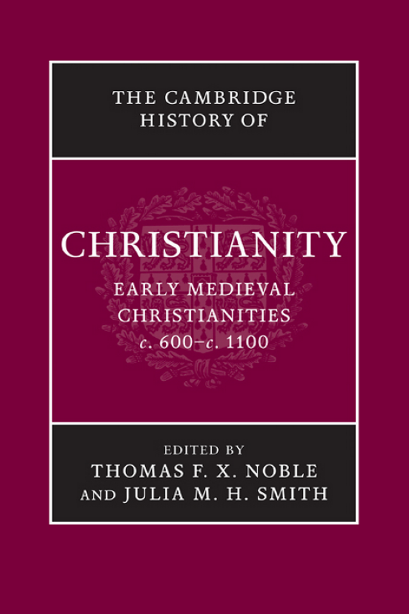
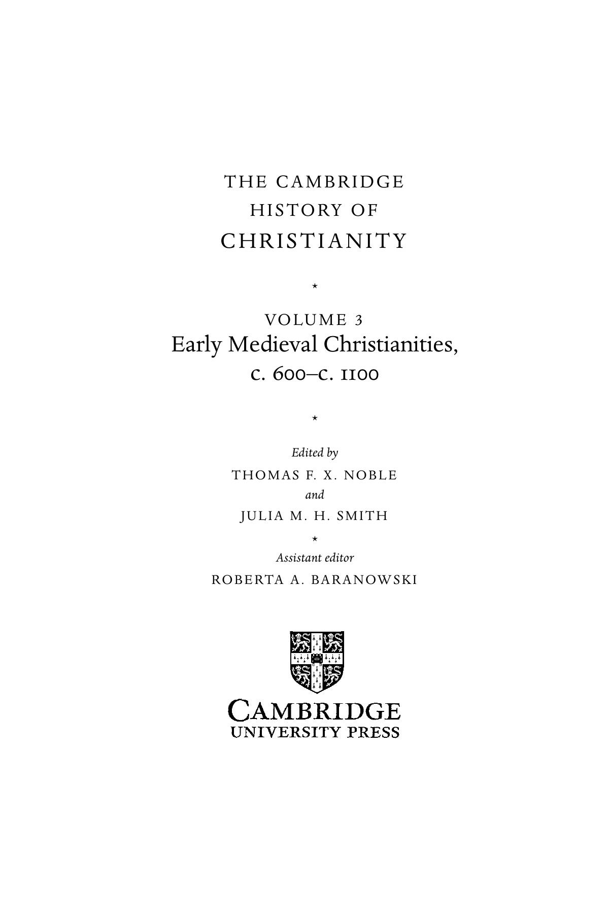
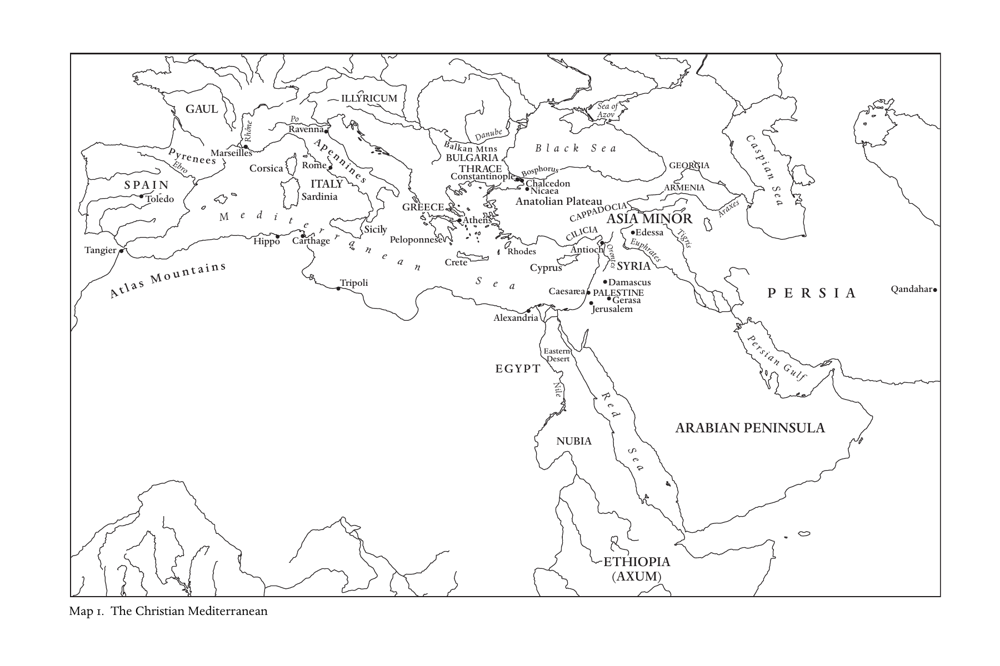
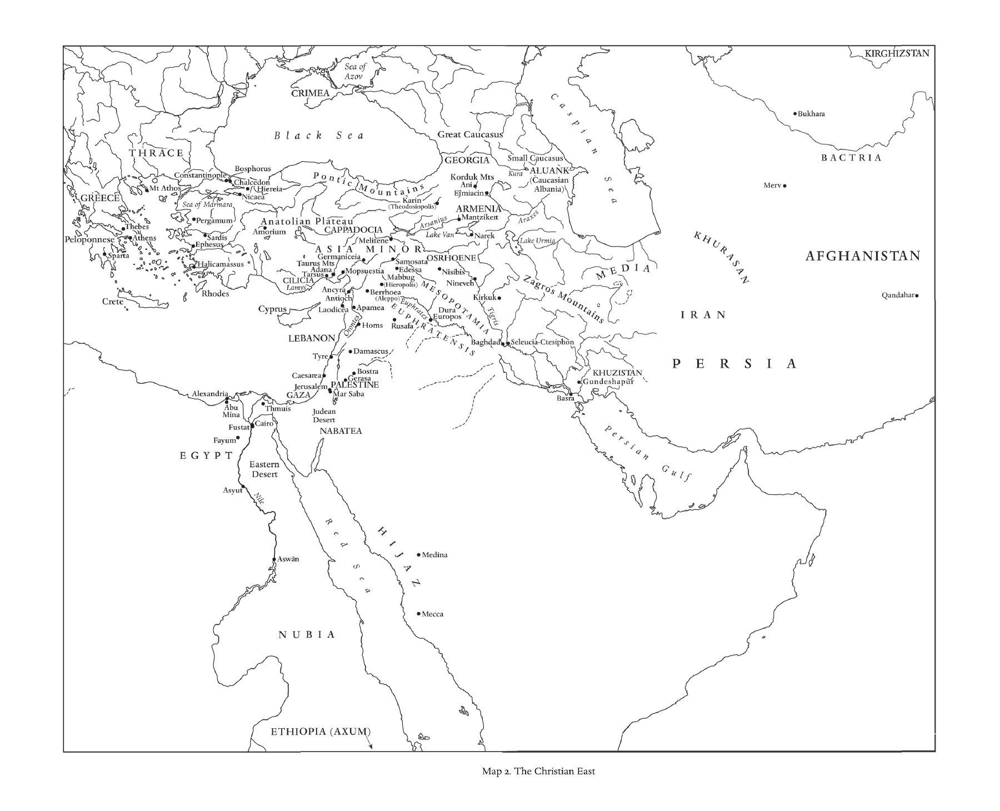
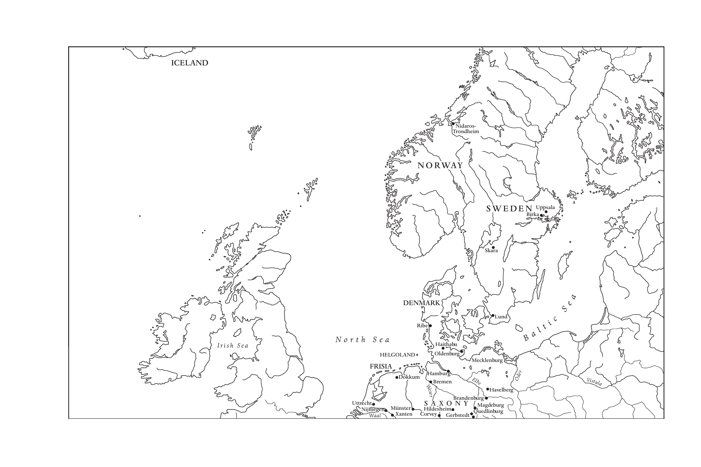
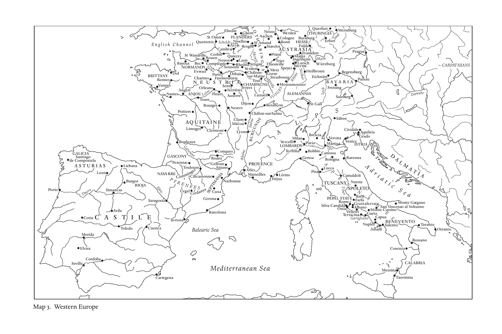
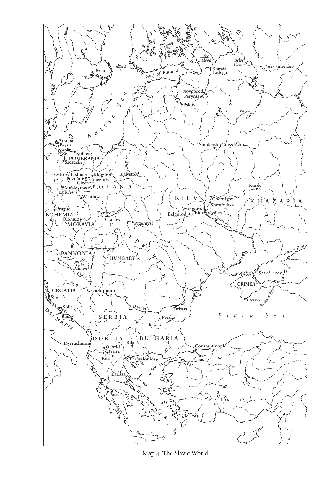
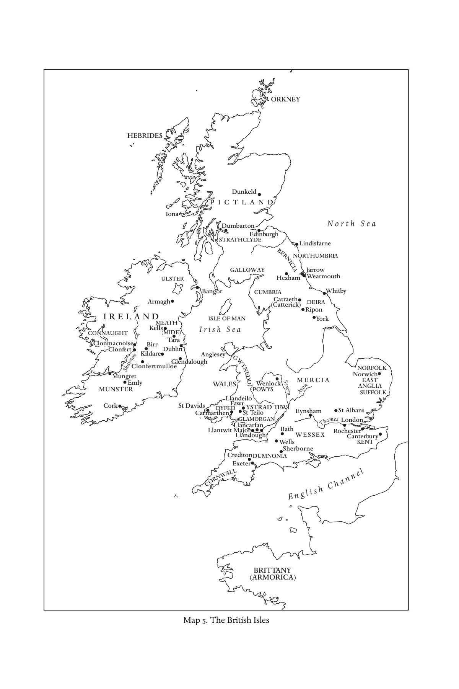

# 卷首资料：英文转换底稿

<!-- PDF page 1; original page unnumbered -->

<!-- PDF page 2; original page unnumbered -->

the cambridge history of christianity

### EARLYMEDIEVALCHRISTIANITIES,

### c.600–c.1100

The key focus of this book is the vitality and dynamism of all aspects of Christian experience from Late Antiquity to the First Crusade. By putting the institutional and doctrinal history firmly in the context of Christianity’s many cultural manifestations and lived experiences everywhere from Afghanistan to Iceland, this volume of The Cambridge History of Christianity emphasizes the ever-changing, varied expressions of Christianity at both local and world level. The insights of many disciplines, including gender studies, codicology, archaeology, and anthropology, are deployed to offer fresh interpretations which challenge the conventional truths concerning this formative period. Addressing eastern, Byzantine and western Christianity, it explores encounters between Christians and others, notably Jews, Muslims, and pagans; the institutional life of the church including law, reform, and monasticism; the pastoral and sacramental contexts of worship, belief, and morality; and finally its cultural and theological meanings, including heresy, saints’ cults, and the afterlife. thomas f. x. noble is Robert M. Conway Director of the Medieval Institute and Professor of History, University of Notre Dame. He previously held positions at Texas Tech University and at the University of Virginia, as well as several prestigious fellowships in both the United States and Europe. He has written or edited six books and over thirty book chapters or journal articles. julia m. h. smith is Edwards Professor of Medieval History, University of Glasgow. She is a Fellow of the Royal Historical Society and has previously taught at Trinity College, Hartford, CT, and at the University of St. Andrews. Professor Smith has written numerous journal articles and is the author or editor of four books including, most recently, Europe after Rome: A New Cultural History 5 00–1000 (2005).

<!-- PDF page 3; original page unnumbered -->

<!-- PDF page 4; original page unnumbered -->

the cambridge history of

### CHRISTIANITY

The Cambridge History of Christianity offers a comprehensive chronological account of the development of Christianity in all its aspects – theological, intellectual, social, political, regional, global – from its beginnings to the present day. Each volume makes a substantial contribution in its own right to the scholarship of its period and the complete History constitutes a major work of academic reference. Far from being merely a history of western European Christianity and its offshoots, the History aims to provide a global perspective. Eastern and Coptic Christianity are given full consideration from the early period onwards, and later, African, Far Eastern, New World, South Asian, and other non-European developments in Christianity receive proper coverage. The volumes cover popular piety and non-formal expressions of Christian faith and treat the sociology of Christian formation, worship, and devotion in a broad cultural context. The question of relations between Christianity and other major faiths is also kept in sight throughout. The History will provide an invaluable resource for scholars and students alike. List of volumes: Origins to Constantine edited by margaret m. mitchell and fr ances m. young Constantine to c. 600 edited by augustine casiday and frederick w. norris Early Medieval Christianities c. 600–c. 1100 edited by thomas f. x. noble and julia m. h. smith Christianity in Western Europe c. 1100–c. 15 00 edited by miri rubin and walter simon Eastern Christianity edited by michael angold

<!-- PDF page 5; original page unnumbered -->

Reform and Expansion 15 00–1660 edited by ronnie po-chia hsia Enlightenment, Reawakening and Revolution 1660–1815 edited by stewart j. brown and timothy tackett World Christianities c. 1815 –c. 1914 edited by brian stanley and sheridan gilley World Christianities c. 1914–c. 2000 edited by hugh mcleod

<!-- PDF page 6; original page unnumbered -->

### THECAMBRIDGE

### HISTORYOF

### CHRISTIANITY

*

### VO LU M E 3

### Early Medieval Christianities,

### 600 1100

### c. –c.

* Edited by T H O M A S F. X. N O B L E and J U L I A M. H. S M I T H * Assistant editor R O B E RTA A. BA R A N OW S K I

<!-- PDF page 7; original page unnumbered -->

cambridge university press

Cambridge, New York, Melbourne, Madrid, Cape Town, Singapore, Sa˜o Paulo, Delhi Cambridge University Press The Edinburgh Building, Cambridge cb2 8ru, UK

Published in the United States of America by Cambridge University Press, New York www.cambridge.org Information on this title: www.cambridge.org/9780521817752 (cid:2)C Cambridge University Press 2008 This publication is in copyright. Subject to statutory exception and to the provisions of relevant collective licensing agreements, no reproduction of any part may take place without the written permission of Cambridge University Press. First published 2008 Printed in the United Kingdom at the University Press, Cambridge A catalogue record for this publication is available from the British Library Library of Congress Cataloging in Publication data Early medieval Christianities, c. 600–c. 1100 / editors, Thomas F. X. Noble, Julia M. H. Smith; assistant editor, Roberta A. Baranowski. p. cm. – (The Cambridge history of christianity; v. 3) Includes bibliographical references and index. isbn 978-0-521-81775-2 (hardback) 1. Church history – Middle Ages, 600–1500. I. Noble, Thomas F. X. II. Smith, Julia M. H. III. Baranowski, Roberta A. br252.e27 2008 270.2 – dc22 2007050262 isbn 978-0-521-81775-2 hardback Cambridge University Press has no responsibility for the persistence or accuracy of URLs for external or third-party internet websites referred to in this publication, and does not guarantee that any content on such websites is, or will remain, accurate or appropriate.

<!-- PDF page 8; original page vii -->

### Contents

List of Illustrations xi List of Maps xii List of Contributors xiii Preface xv Acknowledgments xix Abbreviations xxi Introduction: Christendom, c. 600 1 pet e r b ro w n

### pa rt i

F O U N DAT I O N S: P E O P L E S, P L AC E S, A N D T R A D I T I O N S 1 · Late Roman Christianities 21 ph i l i p ro u s s e au 2 · The emergence of Byzantine Orthodoxy, 600–1095 46 a n d r e w lo ut h 3 · Beyond empire I: Eastern Christianities from the Persian to the Turkish conquest, 604–1071 65 i g o r d o r f m a n n - la za r e v 4 · Beyond empire II: Christianities of the Celtic peoples 86 t h o m a s m. c h a r l e s - e dwa r d s 5 · Germanic Christianities 1 07 l e s l ey a b r a m s vii

<!-- PDF page 9; original page viii -->

Contents 6 · Slav Christianities, 800–1100 1 30 j onat h a n s h e pa r d

### pa rt i i

C H R I S T I A N I T Y I N C O N F R O N TAT I O N 7 · Christians and Jews 1 5 9 bat - s h e va a l b e rt 8 · The Mediterranean frontier: Christianity face to face with Islam, 600–1050 1 78 h u g h k e n n e dy 9 · Christians under Muslim rule 1 97 s i d n ey h. g r i f f i t h 10 · Latin and Greek Christians 21 3 t i a m. ko l ba ba

11 · The northern frontier: Christianity face to face with paganism 230 i a n n. wo o d

### pa rt i i i

C H R I S T I A N I T Y I N T H E S O C I A L A N D P O L I T I C A L O R D E R 12 · The Christian church as an institution 249 t h o m a s f. x. n o b l e 13 · Asceticism and its institutions 275 a n n e - m a r i e h e lv e´ t i u s and m i c h e l k a p la n 14 · Law and its applications 299 ja n et l. n e ls on 15 · The problems of property 327 ro s e m a ry m o r r i s 16 · Ideas and applications of reform 345 j u l i a ba r ro w viii

<!-- PDF page 10; original page ix -->

Contents 17 · Churches in the landscape 363 d o m i n i qu e i o g na - p r at

### pa rt i v

C H R I S T I A N I T Y A S L I V E D E X P E R I E N C E 18 · Birth and death 383 f r e d e r i c k s. paxton 19 · Remedies for sins 399 ro b m e e n s 20 · Sickness and healing 41 6 pe r e g r i n e h o r d e n 21 · Gender and the body 433 ly n da l. co on 22 · Sacrifice, gifts, and prayers in Latin Christianity 45 3 a r n o l d a n g e n e n d t 23 · Performing the liturgy 472 e´ r i c pa la z zo

### pa rt v

C H R I S T I A N I T Y: B O O K S A N D I D E A S 24 · Visions of God 491 a la i n b o u r e au 25 · Orthodoxy and deviance 5 1 0 e. a n n m att e r 26 · Making sense of the Bible 5 31 g u y lo b r i c h on

27 · The Christian book in medieval Byzantium 5 5 4

l e s l i e b ru ba k e r and m a ry b. c u n n i n g h a m ix

<!-- PDF page 11; original page x -->

Contents 28 · Saints and their cults 5 81 j u l i a m. h. s m i t h 29 · Last Things 606 ja n e bau n Conclusion: Christendom, c. 1100 625 j o h n h. va n e n g e n Bibliographies 644 Index 803 x

<!-- PDF page 12; original page xi -->

### Illustrations

Fig. 1. The orders of clergy, from the Sacramentary of Marmoutier: Autun, Bibliothe`que municipale, ms. 19 bis, fol. 1r. page 480 Fig. 2. Exultet roll: Rome, Biblioteca apostolica vaticana, ms. Barberini Lat. 592, fol. 1. 484 Fig. 3. Adoration of the Magi; Massacre of the Innocents; Presentation of Christ in the Temple: Paris, Bibliothe`que nationale de France, ms. Gr. 510, fol. 137r. 565 Fig. 4. Gregory of Nazianzus holds his pen and opens his book to the text: Paris, Bibliothe`que nationale de France, ms. Gr. 923, fol. 255r. 566 Fig. 5. David, Christ, and the Samaritan woman at the well: Moscow, Historical Museum, cod. 129, fol. 33r. 567 xi

<!-- PDF page 13; original page xii -->

### Maps

Map 1. The Christian Mediterranean page xxiii Map 2. The Christian East xxiv–xxv Map 3. Western Europe xxvi–xxvii Map 4. The Slavic World xxviii Map 5. The British Isles xxix xii

<!-- PDF page 14; original page xiii -->

### Contributors

lesley abr ams, Fellow of Balliol College and Lecturer in the Faculty of History, Univer-

sity of Oxford bat-sheva albert, Professor of Medieval History, Department of General History, Bar

Ilan University arnold angenendt, Emeritus Professor, Westfa¨lische Wilhelms-Universita¨t Mu¨nster julia barrow, Reader in Medieval Church History, School of History, University of

Nottingham jane baun, Greyfriars Hall and Faculty of Theology, University of Oxford alain boureau, Centre de recherches historiques, E´ cole des hautes e´tudes en sciences

sociales, Paris peter brown, Rollins Professor of History, History Department, Princeton University leslie brubaker, Professor of Byzantine Art History; Director, Centre for Byzantine,

Ottoman, and Modern Greek Studies; Associate Director, Institute of Archaeology and

Antiquity, University of Birmingham thomas m. charles-edwards, Jesus Professor of Celtic, University of Oxford lynda l. co on, Associate Professor, Department of History, University of Arkansas mary b. cunningham, Lecturer, Department of Theology, University of Nottingham;

Honorary Fellow, Institute of Advanced Research in Humanities and Social Sciences,

University of Birmingham igor dorfmann-lazarev, Lecturer in Greek and Oriental Patristics, Department of

Theology and Religion, Durham University sidney h. griffith, Ordinary Professor, Department of Semitic and Egyptian Lan-

guages and Literatures, The Catholic University of America, Washington, DC anne-marie helve´ tius, Professor of Medieval History, Centre de recherches his-

toriques, Universite´ Paris VIII (Vincennes-Saint-Denis) peregrine horden, Professor of Medieval History, Department of History, Royal Hol-

loway University of London dominique io gna-pr at, Centre nationale de la recherche scientifique, Paris michel k aplan, Professeur d’histoire Byzantine, Unite´ de formation et de recherche

d’histoire, Universite´ Paris I (Panthe´on-Sorbonne) hugh kennedy, Professor of Arabic, School of Oriental and African Studies, London tia m. kolbaba, Assistant Professor, Department of Religion, Rutgers University guy lobrichon, Professeur d’histoire du Moyen Aˆ ge, Universite´ d’Avignon xiii

<!-- PDF page 15; original page xiv -->

Contributors andrew louth, Professor of Patristic and Byzantine Studies, Department of Theology

and Religion, Durham University e. ann matter, William R. Kenan, Jr. Professor, Department of Religious Studies, Uni-

versity of Pennsylvania rob meens, Universitair docent, Instituut Geschiedenis, Universiteit Utrecht rosemary morris, Visiting Fellow, Department of History, University of York janet l. nelson, Professor Emerita, Department of History, King’s College London thomas f. x. noble, Professor of History, Robert M. Conway Director of the Medieval

Institute, University of Notre Dame e´ ric palazzo, Professeur d’histoire de l’art du Moyen Aˆ ge, Directeur du Centre d’e´tudes

supe´rieures de civilisation me´die´vale, Universite´ de Poitiers frederick s. paxton, Brigida Pacchiani Ardenghi Professor of History, Department of

History, Connecticut College philip rousseau, Andrew W. Mellon Professor of Early Christian Studies; Director, Cen-

ter for the Study of Early Christianity, The Catholic University of America, Washington,

DC. jonathan shepard, Formerly University Lecturer in History, University of

Cambridge julia m. h. smith, Edwards Professor of Medieval History, Department of History,

University of Glasgow john h. van engen, Andrew V. Tackes Chair of Medieval History, Department of

History, University of Notre Dame ian n. wo od, Professor of Early Medieval History, School of History, University of Leeds xiv

<!-- PDF page 16; original page xv -->

### Preface

Christianity arose, spread, and strengthened its claims on people’s lives in the ancient world in the period covered by volumes 1 and 2 of the Cambridge History of Christianity. Volume 3 treats the history of Christianity during the centuries usually labeled “early medieval” that stretch from about 600 to about 1100. This long, dynamic, and creative era saw both the consolidation of ancient Christianity’s achievements and dramatic new developments.

One way to grasp the changes and continuities that marked the early medieval period is to read the first and last chapters in this volume. The opening one presents a panoramic view of Christianity in about 600 with occasional looks into the past and glimpses of the future. The closing chapter takes a similarly panoramic view in about 1100. In 600 Christianity was still fundamentally a Mediterranean phenomenon. Almost all its creative centers hugged the shores of the inland sea, as did its key administrative sites. The vast majority of all Christians then alive lived within two hundred miles of the sea. Christianity’s most impressive territorial expansion beyond the Mediterranean basin lay in the east and in Africa. Western Europe was just then becoming visible as a potential site of growth and development. By 1100 Christianity’s creative core was located squarely in western Europe. The rapid and continuous expansion of Islam had diminished Christianity’s presence in Mediterranean Europe and Africa, as well as in central and western Asia. Islam also constituted a persistent challenge for Byzantium and thus for Orthodox Christianity. Indeed, Byzantium’s reach shortened not only in the eastern Mediterranean but also in the north where Avar, Bulgar, and Slav peoples and states challenged historic Byzantine claims. Christianity had meanwhile spread to every corner of Europe itself, with the exception of some areas lying along the eastern Baltic. If places such as Antioch and Alexandria had been the intellectual powerhouses of ancient Christianity, sites such as Winchester, Cologne, Paris, and Chartres were the dominant influences in the centuries on either side of the turn of the millennium. xv

<!-- PDF page 17; original page xvi -->

Preface

In the dawning twenty-first century Christianity is very much a world religion, increasingly marginalized in Europe but vigorous on other continents. The early medieval centuries inaugurated a long period when Christianity seemed to be an essentially European phenomenon that in due course was exported, eventually in both Catholic and Protestant versions, to much of the rest of the globe. Today’s congeries of Christianities artfully blend peoples, localities, languages, cultures, and historical experiences. That is what the Christianities of 600 also looked like, and it is still what they looked like in 1100, albeit the center of gravity had shifted to the north and west and the forces of homogeneity were becoming evident.

This volume is entitled Early Medieval Christianities. The use of the plural is not meant to deny that all Christians could trace their roots to the Mediterranean world of Antiquity, or that they took inspiration from versions of the same scriptures, or that they worshiped in tolerably similar ways, or that their churches shared many legal and institutional features. Instead, the plural signals the futility of speaking in overly generalized terms about an ever-changing religion that extended from Ireland to Afghanistan, from Norway to Nubia. Christianity transformed every people and culture with which it came into contact but it was itself transformed by peoples, cultures, antecedent histories, and even by landscapes. The plural, in short, denotes not chaos, confusion, or disunity, but richness, creativity, and complexity.

What is more, Christianity must be understood in a variety of complementary ways that, taken together, again urge the descriptive plural. Christianity is an ecclesial phenomenon everywhere, but it evolved very different kinds of churches and of ecclesiological conceptions to sustain and explain those churches. Christianity is also a body of teachings to which people grant varying assents of mind and heart and body. Those positions had to be defined, articulated, and transmitted. In Antiquity they were frequently the occasion of bitter strife. In the early Middle Ages there were fewer doctrinal quarrels, but there were also large bodies of Christians who did not believe all the same things and who had relatively little to do with each other. Christianity also attends the major moments of life from birth to death; it is lived experience as much as or more than a set of doctrinal formulations. Ancient Christianity was a fundamentally urban phenomenon. Cities were not a conspicuous feature of early medieval Europe. Curiously, however, Christianity retained structures, practices, and outlooks that were essentially urban even as it took root in what were essentially rural and agrarian societies. Adaptation and local particularity are equally evident in that respect. No matter what place, time, xvi

<!-- PDF page 18; original page xvii -->

Preface or topic engages our attention, we cannot usefully reduce Christianity to a singular phenomenon.

An awareness of these basic guiding principles will help the reader to grasp the arrangement of this volume and to see the connective tissue that holds the organizational skeleton together. The volume’s first part constitutes a geographical and historical tour of the major, identifiable regions within which Christianity either extended its ancient achievements or else began anew. The first chapter in this part surveys the late Roman scene and the following ones explore the Byzantine world, the many forms of eastern Christianity, and then Christianity in Slavic, Germanic, and Celtic lands. The volume’s next part addresses explicitly encounters between Christianity and Judaism; Christianity’s confrontation with Islam, both along its expanding frontiers and within the caliphate; meetings between Greek and Latin Christians; and, finally, Christianity’s lengthy engagement with Germanic and Slav paganism. These two sections emphasize the broader political, cultural, and religious milieux which helped to shape early medieval Christianities.

The next set of chapters deals with what might be broadly characterized as institutional issues: ecclesiastical organization, monasticism and asceticism, the making and implementing of law, property and material concerns, ideas of reform, and locations of cult. Unlike the chapters in the first two parts which tend to focus on specific regions or incidences of cultural contact, the chapters in part 3 range widely across all the Christianities included in this volume. They balance a high level of generalization with enough concrete examples and case studies to make key issues both clear and vivid.

The volume’s fourth part takes up critical themes in the history and practice of Christianity as a lived experience with particular attention to the sacramental life of the church and its Christian communities. Its premise is that modes of worship, ritual, and prayer tell us a good deal about what people believed, or about what they were expected to believe. Rites that attended birth and death open the discussion. Penance, both the practice of penance and ideas of sin and redemption, follows the discussion of baptism and final anointing. There follows a treatment of sickness and healing that combines reflections on both medical and spiritual remedies. The ensuing chapter explores gender, sexuality, and the body. This chapter permits insights into how writers talked about the people, both lay and clerical, who actually were the Christians of the early medieval period. The part concludes with a two-fold discussion of worship: the theology behind the celebration of the Eucharistic liturgy, everywhere the church’s central act of worship, and the performance of the liturgy itself, including some discussion of the books needed for that performance. xvii

<!-- PDF page 19; original page xviii -->

Preface

The fifth and last part in the volume treats intellectual and cultural issues that pertain to both formal learning and to Christianity’s imaginary. The lead chapter discusses some of the myriad ways in which early medieval people thought and wrote about God. The next addresses “God-talk,” theology, directly by inquiring into doctrinal quarrels. These were fewer in number and intensity than those in Antiquity and perhaps less deeply rooted in the ordinary experience of most early medieval Christianities. The Bible, always and everywhere the crucial Christian book, or collection of books, is treated in its textual and interpretive frameworks. Books as objects, with particular attention to the books of the eastern Christian tradition, come in for a thorough discussion. Saints, the holy men and women who were thought to have lived exemplary lives, are analyzed for what they can teach us about the aspirations and expectations of ecclesiastical elites and ordinary believers. Finally, appropriately, the “Last Things” conclude the volume: How did Christians imagine the other world, the world beyond the grave?

Taken overall, this volume presents the reader with the main ways in which twenty-first-century scholars imagine the other world of early medieval Christianities. The interpretations offered here can never be definitive: much in the pages which follow challenges and refreshes debates or assumptions that have long been deeply embedded in the history of Christianity. In reappraising them, the book dislodges some issues from the center of attention and substitutes other, more timely ones for the rapidly changing world of the third Christian millennium. It is hoped that it will challenge and refresh those who read it, as preparing it has its editors and contributors. Thomas F. X. Noble Julia M. H. Smith xviii

<!-- PDF page 20; original page xix -->

### Acknowledgments

Editing this volume has been much more of a collaborative effort than the presence of the editors’ names on the title page might imply: we acknowledge wholeheartedly the role of all the contributors in helping bring it into being. All have responded graciously to our suggestions about the content and presentation of their chapters, and many have provided us with expert advice and guidance on a wide range of specific details. They have also borne unforeseen and unavoidable delays in the editorial process with good grace and patience, for which both editors are deeply grateful.

This undertaking could not have been realized without the extremely generous financial and practical support of the University of Notre Dame. At Notre Dame, the Medieval Institute and Institute for Scholarship in the Liberal Arts jointly defrayed the costs of bringing contributors together from three continents, whilst the McKenna Center provided an ideal environment in which colleagues exchanged vigorous and stimulating critiques of each other’s draft chapters. This colloquium enabled the volume to acquire a coherence which editorial guidance alone could not have achieved, and the pages which follow are an expression of participants’ appreciation of the intellectual stimulus and geniality of those three days. At all stages of the preparation of the book from conference to impeccable typescript in paper and electronic formats, Roberta Baranowski, the Medieval Institute’s Assistant Director, has provided invaluable administrative support and sub-editorial energy: it is a pleasure to acknowledge publicly our profound debt to her.

Two translators applied their linguistic sensitivity and subject area knowledge to original German and French texts from our chapter authors and produced English versions. Dr. Rona Johnston Gordon, University of St. Andrews, provided the translation, from the German, for Professor Angenendt’s chapter. Andrew Irving, University of Notre Dame, translated the chapters by Professors Boureau, Helve´tius and Kaplan, Iogna-Prat, Lobrichon, and Palazzo from the French. xix

<!-- PDF page 21; original page xx -->

Acknowledgments

We are equally indebted to all those at Cambridge University Press who have been involved with this volume: Kevin Taylor for the invitation to undertake it; his successor in charge of the Religion desk, Kate Brett, and her assistant, Gillian Dadd, for their generous supply of moral support, practical help and patient forebearance at all times; and Liz Davey for overseeing production with great efficiency. The Press kindly took on responsibility for the index.

In the final stages of production, Christopher Riches, of Riches Editorial Services, meticulously coordinated the correction of the proofs and improved the book in many other significant ways. We are immensely grateful for his exceptional professionalism. TFXN & JMHS xx

<!-- PDF page 22; original page xxi -->

### Abbreviations

AASS Acta sanctorum quotquot toto orbe coluntur. Ed. J. Bollandus et al. Antwerp and Brussels, 1634–. Bede, HE Bede. Historia ecclesiastica gentis Anglorum. Ed. and trans. B. Colgrave and R. A. B. Mynors. Bede’s Ecclesiastical History of the English People. Oxford Medieval Texts. Oxford: Oxford University Press, 1969. BMFD Byzantine Monastic Foundation Documents: A Complete Translation of the Surviving Founders’ Typika and Testaments. Ed. J. Thomas and A. C. Hero, with G. Constable. 5 vols. Washington, DC: Dumbarton Oaks, 2000. CC Corpus christianorum CCCM Corpus christianorum continuatio mediaevalis CCSG Corpus christianorum series graeca CCSL Corpus christianorum series latina CSCO Corpus scriptorum christianorum orientalium CSEL Corpus scriptorum ecclesiasticorum latinorum DOP Dumbarton Oaks Papers EME Early Medieval Europe Haddan and A. W. Haddan and W. Stubbs, eds. Councils and Stubbs Ecclesiastical Documents Relating to Great Britain and Ireland. 3 vols. Oxford: Clarendon Press, 1869–78. Histoire du Les e´glises d’orient et d’occident. Ed. L. Pietri, J.-M. Mayeur, christianisme 3 and B. Beaujard. Vol. 3 in Histoire du christianisme des origines a` nos jours. Paris: Descle´e, 1998. Histoire du E´veˆques, moines et empereurs (61 0–1 05 4). Ed. G. Dagron, P. christianisme 4 Riche´, and A. Vauchez. Vol. 4 in Histoire du christianisme des origines a` nos jours. Paris: Descle´e, 1993. xxi

<!-- PDF page 23; original page xxii -->

Abbreviations Histoire du Apoge´e de la papaute´ et expansion de la chre´tiente´ christianisme 5 (1 05 4–1 274). Ed. A. Vauchez and J. K(cid:2)loczowski. Vol. 5 in Histoire du christianisme des origines a` nos jours. Paris: Descle´e, 1993. Mansi Mansi, G. D., ed., Sacrorum conciliorum nova et amplissima collectio. 31 vols. Florence, 1759–98; rev. ed. J.-B. Martin and L. Petit. 53 vols. in 60. Paris, 1899–27. MGH Monumenta Germaniae Historica MGH SRG MGH scriptores rerum germanicarum MGH SRM MGH scriptores rerum merovingicarum NCMH 2 The New Cambridge Medieval History. Vol. 2: c. 700–900. Ed. R. McKitterick. Cambridge: Cambridge University Press, 1995. ODB Oxford Dictionary of Byzantium. Ed. A. Kazhdan. 3 vols. Oxford: Oxford University Press, 1991. PO Patrologia orientalis PG Patrologia graeca = Patrologiae cursus completus. Series graeca. Comp. by J.-P. Migne. 161 vols. Paris, 1857–66. PL Patrologia latina = Patrologiae cursus completus. Series secunda in qua prodeunt patres... ecclesiae latinae. Comp. by J.-P. Migne. 221 in 222 vols. Paris, 1844–64. SC Sources chre´tiennes SCH Studies in Church History Note regarding footnote citations In general, the footnote citation system used in this volume punctuates chapter, page, and volume references as follows: author, title of work volume number if any, chapter, section within the work, page number from specific edition. E.g., Anonymous, Historia 2, II.ii.3, 346–47. Thus, chapter 2, section 2, part 3 on pages 346–47 in the edition cited in the bibliography of volume 2 of the work entitled Historia by an anonymous author. Unless necessary for clarity, edition editor/translator names are omitted in the footnotes and provided only in the bibliography. E.g., Anonymous, Historia 2, 25–37 (ed. Smith, 399–401) means sections 25 to 37 (or, if these are numbered individually, documents 25 to 37) in volume 2 of Historia by Anonymous are found on pages 399 to 401 in the edition by Smith. xxii

<!-- PDF page 24; original page unnumbered -->

ILLYRICUM GAUL Sea of

Tangi A er tl S a P s A T M o I le N o d P o E u y br r n o e t n a e i e n M s M a s rseil e l Rhôn e e s C H d o i r p s p i i c o a t R P C o a a v S R e r e a t n o h I r A m n T d a r a p g i A e n e e i L n r a Y n T i r n a ip e o s l n S i icil e y Pe a l G op R o n E n E ne C s E e B C B a C r U l e k o T t L a A n e G H n s t t h D A S R a M e a n R A n n t t n I C s i u A n e s b E o e p R l a e h A o B n d o C e a C s N h s p t B y i h a o c l p o a l c l r i r C e e u a u a a d s a n s o e C c s n P C a I A L l r k A a e n I P a t C t e P i I o A a S A P c u D A A h e z O L O A r o o D n set E v a C a S S S IA m T Y I I A a E R N s u E c E p I h d u M A r e a s t s es I sa N A G R O T E M ig O r R is E R N G IA IA Araxes C a sp ia n P S e a E R S I A Qandahar Gerasa Jerusalem Alexandria EGYPT E D as e t s e e r r n t PersianGulf N ile R e d ARABIAN PENINSULA NUBIA S e a ETHIOPIA (AXUM) Map 1. The Christian Mediterranean

<!-- PDF page 25; original page unnumbered -->

<!-- PDF page 26; original page unnumbered -->

ICELAND Nidaros- Trondheim N O RWAY a S W E D E N Uppsala Birka Skara a DENMARK e S N o r t h S e a Ribe Lund Baltic Irish Sea Haithabu HELGOLAND Oldenburg Mecklenburg FRISIA Dokkum W e H ser a B m re b m ur e g n Branden E b lb u e rg Havelberg Oder Vistula Uttr N ec i h jm W t e a g a e l n M X ün an st t e e r n C H o S r i v l A d ey es X hei G O m erb N ste Y dt Q M ue a d g l d in e b b u u r r g g

<!-- PDF page 27; original page unnumbered -->

BR E IT n R T g V A e a l n N n i n n s Y e N e h s s a n D C te o h s B l A a a n y N n e g O S u e n t x r R A s W e M N l a N J E C A B n O Q v h N d e U r O c a u r T e E D i r L e o l u r t Y l o n l r u e x i e e S R t r C U r a S e e o s s o i n o v t n C u s i m O e F P c S e o l a F m p n e r r a i b u C i N è e S r T s i r r g a e e c y o m m h n S y S E e e e o R o b l o n l A d F Q n r u n i s t e a s u O A t o u F s i r i I x n e o r r i N r L e e i r r b e n A è r R s r i a A a v s r r z s N L h e i e e y s Ts e a l D B l G r i o C e m r V E o n s h H o e y R C s s e g e u r A A n S h n d L s r M M Ot t â T e e - u u M t T S s l L o n ei H P o t g A u u A a n R n A I x r l N A G G s yI n A u m - a N e e N c a E i M h T l S G n e o e s t h d V u e o a l n M S le i P O s v r o t s e z r S r e n ü e G a l T t v o z E s m r A S i t b M i C l B e S l o U e W o r p o o u l e y n e r o S A y g e n g r e n L d R T n r h m e E i e I n n W e R nM M o H g o u L a A A N B e F E ec t r i k o a l r u N n i u h S mr F e S r z l S s e N r r d a sc I E i a H b a m h I n A T A u e k r H i E Q f g l u b i U u c r W r M t h R o e s r n a I ü Lech t f N i n u ä r n z t G E r t B t b r F IA f u r A u e r Sr g i a t s V a S i l n a M A g lz R e R b r e u s g e r I e g b A n u s P r b g r u a P r g g a u s e sau Danube CARPATHIANS Poitiers Bourges Nevers Dijon Châlon-s B u e rs S a a n ô ç n o e n St P Gall S Porto de G A C A S o a L S n m I D t C T i p u C a I e o A g o U r s o o r t i e a R la C I L A eo S n A Sima A S n v c i a la T s T o L l i B e e d u b o r a I g n o R a s I L OJA E C Sa u r e a n g E N b c o ro a s A s V a A G R P T A R o F Y S E e r C C t R z o O e o B s U n m E N o a s G T r m r a Y N g a d A o c L r e i o e n u n l i E a Q g m C l C n e o u B e s e a E o u x r U r a g s d c S e e l a a e I s n s a y s T a G o r n A i S e C E c n r P B T l o e I G e S I R a M C n r N r e o e A m a c u A l N a d e l x C o E I o e l n A a o n o n z i n a t n e N n a q e a u r e b s o M C n a l n L c u y e o R n hô o ne n y ns A S M a B P ô r n U e R l G R e a U s r N O s D e Y V il E le N s CE Fr A éju L L V s é O e r r i T M n c o e s B l r l A t i M o L R n i D l a a Y n Ge P n B a B o v o P r i a b e a i b s s c a io ia S C A i L T a l B v u n M P U a o c o V A P l P c C a S s o o e P a s n g r C a A a o t n n u S A L n E O a d ä a R a i N S b s Ti d b o er T t e C T a m i Y C n A a e N V a V R T r e i m e S v e r a n E i a P G l v N a d l i c e e l O c a a u A i d G I n t e n F r l S R r r o N e l L i n r a a s i T b g l i o G a i r E i e a l A a R f i t t n a r T a N t q i I a A o a n A u O d a f I o G i e o p d le r a l M A e r i e r a m s a t o N a t C i n a a a t l a f e p S i u aC t E n a S B a a i sV E l s D S e i c in N r n n c A o E e o S n M L V zo E o M e n N a t a l A e T V G o O T l a t r u I g r a n A T n o a o ranto Otranto Merida Rossano Elvira Cosenza Cordoba Seville CALABRIA Mediterranean Sea Messina Cartegena Taormina Map 3. Western Europe

<!-- PDF page 28; original page unnumbered -->

Lake Ladoga Beloe Birka Gulf of Finland L S a ta d r o a g ia a Ozero Lake Kubenskoe a Novgorod Perynia e S Pskov Volga c i t B al Arkona Rügen Smolensk (Gnezdovo) Wolin Kolberg POMERANIA Szczecin

Ostrów Lednicki Mogilno Bialystok Poznán Gniezno Elbe Lu M bin´ iedz G yr i z e e c c z z P O L A N D. Kursk Wroclaw K I E V Chernigov K H A Z A R I A Shestovitsa BOH P E ra M O gu l M o I e A m O uc RAVIA Tyn C ie r c a V c i o st w ula Przemy´sl Belgoro V d yshgo K r i o e d v Vas D i n le ie v per C a r p PANNONIA Esztergo H m UNGARY a t h Don Lake i Balaton a Drava n Sea of Azov Sava s CRIMEA

CROATIA Sirmium Kerch D

Nin Split Danube Dristra Cherson Straitsof ALM S E R B I A Preslav B l a c k S e a ATIA B a l k a n s D O K L J A B U L G A R I A Dyrrachium Ochrid Rila Constantinople Prespa Bitola Thessalonica Larissa Patras Taygetus Map 4. The Slavic World

<!-- PDF page 29; original page unnumbered -->

ORKNEY HEBRIDES Dunkeld P I C T L A N D Iona Dumbarton N o r t h S e a Edinburgh STRATHCLYDE Lindisfarne GALLOWAY BERNICIA NORT Ja H rr U o M w BRIA ULSTER Hexham Wearmouth Bangor CUMBRIA Whitby Armagh (C C a a t t t r e a r e i t c h k) DEIRA Ripon

I R E L A N D MEATH ISLE OF MAN York CONNAUGHT Kells (MIDE) I r i s h S e a Clonmacnoise Birr Tara

MU C N M lo S u n T n S f h e E a g n r n E R r t on e C m t l l o y K n i f l e d r a t r m e u D ll u o G b e l l i e n ndaloug A h ngl W es A ey L L E la G S n W d YN e ED i D lo P W OW en Y l S ock Severn A M von E R C I A N N o A S r O E N U w A R G F i S F F c L T O h O IA L L K K

Cork St Dav C id a s rmar D th Y e F n E F D awr St Y T S e T i R lo AD TEWI Eynsham St Albans Llantwit L M L l G a l a a n j L n o A c d r a M o rf O u a g R n h GAN Bath WESSE T X ham R es o L ch o C e n s a d t n e o t r n erbury Wells KENT Sherborne CreditonDUMNONIA Exeter CORNWALL English Channel BRITTANY (ARMORICA) Map 5. The British Isles

