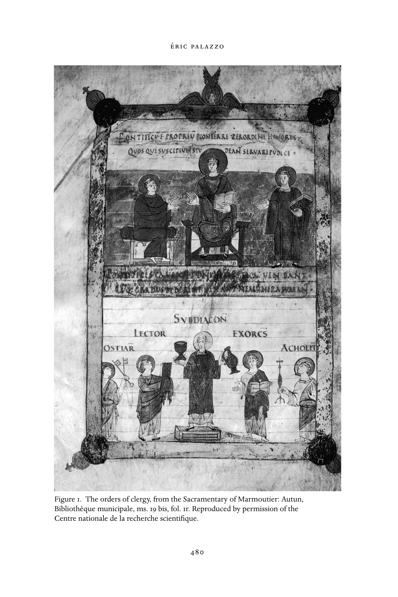
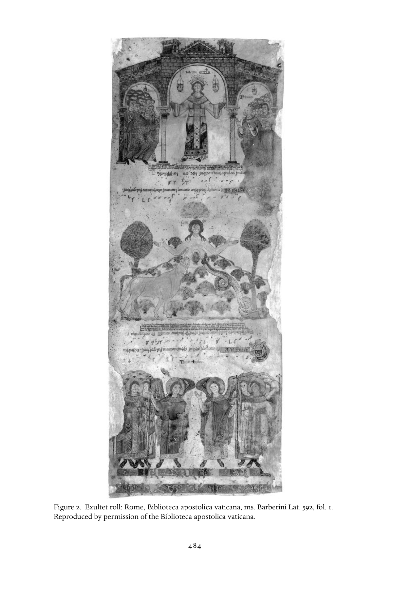

# 第23章 礼仪的施行

埃里克·帕拉佐（Éric Palazzo）

<!-- PDF page 501; original page 472 -->

> 礼仪在存在的最高层面，实现人与上帝、有形宇宙与永恒之间的联系和持续交往，因而典范地体现了这种倾向〔即感官参与〕。它连最微小之处也富于观赏性，通过复杂调动听觉——音乐、吟唱、诵读，视觉——宏伟建筑、参与者及其服饰、姿态、舞步和环境，甚至触觉，来表明信仰真理：人触摸圣墙，亲吻脚、圣髑匣和主教戒指，吸入焚香与烛蜡的芬芳。[^p501-1]

毫无疑问，礼仪——古代与中世纪基督教会的仪式——是近年来最受益于研究方法和问题意识新发展的中世纪研究领域之一。长期以来，它被认为是教士研究者的领地，法国尤其如此，彼此互补的神学与文本方法占据主导；而近年来，礼仪研究在中世纪研究中重新兴盛。各国有不同史学传统，但这一现象在很大程度上得益于历史人类学的影响。这种方法的核心，是研究仪式，更广义地说，是仪式现象。历史人类学应用于中世纪文明研究，使礼仪在中世纪社会中发挥的枢纽作用越来越清楚。礼仪学内部关注“礼仪史”的其他发展趋势，也促成了广泛转向：以充分历史化的方式阅读礼仪。这里仅容提及这一演变的一项特征。二十世纪大部分时间，礼仪史家大多是教士，专注于编辑西方主要礼仪文本，<!-- PDF page 502; original page 473 -->首要目标是研究并辨认其文本原型，阐明每类主要礼仪书的历史。今天，礼仪史家和一般中世纪研究者，仍继续使用这些博学成果。对于任何关注中世纪教会仪式自身历史、却带着主要属于历史人类学的问题来研究文献的史家而言，它们依然不可或缺。此外，我还要补充，“礼仪史料”的概念如今不再局限于礼仪文本；通过纳入圣徒传记、编年史、特许状，甚至图像和考古材料等不同文献，它已大为丰富，这里仅举数例。[^p502-2]

沿着中世纪研究对礼仪史重新解读的方向，我想强调若干近年著作的重要性：它们表明，教会仪式是中世纪文化的政治、神学、社会维度相遇并相互作用的真正交叉点。换言之，礼仪并非独立于中世纪社会“生活”流动之外的领域；相反，它是社会运作的根本要素，正处于政治、神学和社会利益的中心。中世纪社会根本上是一个仪式社会。[^p502-3] 因此，中世纪仪式行为不仅涉及教会，也涉及整个社会的一切结构。而且，中世纪仪式的活力，很大程度上来自社会各部门——教会、政治和司法机构——所行仪式的相互作用。

不过，也应记住，注释教会礼仪的中世纪神学家，主要把礼仪看作事奉上帝、专属教士的职务。中世纪最伟大的两位礼仪注释者——九世纪梅斯的阿马拉里乌斯（约780—约850），以及十三世纪后半叶的威廉·杜兰杜斯（卒于1296年）——提出的正是这一理解。他们都写了大型礼仪史论著，主要强调其亲历的中世纪礼仪，与整个圣经历史之间的“历史”连续性。与许多中世纪礼仪释经者一样，阿马拉里乌斯和杜兰杜斯，把礼仪置于圣经历史传统中，提出一种主要围绕圣经象征主义的教会仪式解读。[^p502-4]

<!-- PDF page 503; original page 474 -->

我将主要从根本上的多维性质考察中世纪教会礼仪。在许多方面，这一方法是中世纪研究者增进礼仪理解的重要组成部分；它必然要求摆脱一种看法，即礼仪史仅限于认识仪式文本及其神学。诚然，“文本”维度，即口传，或更一般地说“书面文字”，在礼仪定义和实际施行中都居于中心。然而，礼仪绝不限于抄录在书上、被歌唱、诵读或吟咏的词句。[^p503-5] 中世纪教会仪式具有多维性：除了重视广义的“言语”，它也极其看重场所、人物和物品——包括书籍！——、音乐、香气，乃至光，以及一般意义的图像。本章讨论礼仪“施行”的观念，因此有必要整体概览中世纪礼仪的多维性质。为此，先引一段赫拉班·毛鲁斯（约780—856）的文字作为引言。他是九世纪富尔达院长、美因茨总主教，也是中世纪早期重要神学家。在一次教堂奉献礼讲道中，他以自己的方式，为中世纪礼仪作出一种定义；这里从其多重维度考察这一定义，着重礼仪“施行”的各种组成部分：

> 亲爱的弟兄，今日你们聚集得好，为的是向上帝奉献一座房屋……但要做到这一点，我们自身也必须努力成为上帝的殿，尽力使自己与心中所培育的仪式相称；正如借这座教堂装饰的墙壁、许多点燃的蜡烛、在连祷和祈祷中以不同方式举扬的声音、读经和歌唱，我们得以更热切地赞美上帝；我们也应始终以善行必要的装饰，布置内心深处，使神圣之爱与彼此之爱的火焰，在我们里面一同增长，使天上圣言的神圣甘甜和福音的赞美，始终在胸中、在记忆里回响。这些是好树的果实，是善心的宝藏，是智慧建筑师的根基；今天所读的神圣福音，已把这些推荐给我们。[^p503-6]

<!-- PDF page 504; original page 475 -->

本章主要考察中世纪西方礼仪。不过，我也认识到，东方或拜占庭礼仪，对于理解整体仪式现象具有极为重要的意义。若要论述东方礼仪，必须另用整整一章；这里无法如此，但我仍希望提醒读者注意几个应当强调的问题。

第一，东方礼仪史遵循的原则，与西方基督教礼仪演变的原则几乎一致。诚然，用罗伯特·塔夫特的说法，这部“拜占庭礼”的历史，[^p504-7] 其主要里程碑，与西方礼仪史年代中标志重要时刻的节点相当不同。[^p504-8] 在东方，年代节律首先由君士坦丁堡帝位上的王朝更替决定。

第二，应当强调拜占庭东方某些仪式的独创性与特殊性。为说明这一点，我只顺带提及，拜占庭入堂礼，以及更一般的驻堂礼仪，具有真正独特的性质；驻堂礼仪这一实践，在西方也为人所知。[^p504-9] 除了这些仪式对于教堂空间和礼仪安排的重要后果，还应强调礼仪入堂仪式与帝国仪式之间的鲜明关系。《典仪书》的许多段落都为此作证。这部书由君士坦丁七世“生于紫室者”（913—920、945—959）据较早材料编成，毫无疑问，被视为拜占庭宫廷最重要的典仪书。

最后，在结束这段过于匆促的东方礼仪概述前，必须提醒：东方礼仪也具有多维性质，在调动仪式实践的各种“感官”层面上，与西方同样丰富。但必须警惕一种仍被过度接受的观念：东方礼仪曾是“完美”的，并数百年保持不变。这种理解很大程度上是十九世纪西方构造的；只需略看几篇注释，便知它远离事实。这些注释虽然出自古代与中世纪早期最伟大的东方神学家，却丝毫不赞扬其同时代人；那些人利用各种<!-- PDF page 505; original page 476 -->机会，简直是在破坏礼仪“施行”的展开。圣金口约翰写道：

> 这里，在教堂中，喧哗与混乱何其惊人！我们的聚会与酒馆里发生的事毫无差别：狂笑如此吵闹，骚动如此严重，仿佛浴场或集市，人人喊叫、闹得天翻地覆……〔在教堂里〕我们的行为比狗更无耻，对上帝的尊敬不过如对妓女……教堂与广场无异……甚至与剧院也无异，只需看看聚集在这里的女人，打扮得竟比那里的不贞女人还无耻。所以，我们看到许多放荡男子被她们诱惑，竟然就在这里！如果有男人试图或打算败坏一个女人，我猜，没有哪里比教堂更容易了。[^p505-10]

### 仪式场所与礼仪的空间安排

无论古代还是中世纪，基督教仪式都在专门布置、适合施行礼仪的地方进行。阅读大量关于古代和中世纪“礼仪空间”的书籍文章，往往产生一种主导印象，我要立即加以纠正：事实上，这一时期的礼仪场所，并不只限于教堂的特定空间，即为礼仪施行而建造的建筑。诚然，古代和中世纪的神学家、礼仪学家不断强调：教堂建筑是礼仪庆典的首选场所，甚至是唯一真正被授权举行庆典的场所。但必须看出，这种坚持之下，是他们强烈希望把教堂建筑的形象，与一个强有力的教会论观念相连：教会（Ecclesia）由信徒建成，信徒就是构成教会大厦的石块。[^p505-11] 因此，在古代和中世纪相当长时间里，占主导的观念是：基督教仪式应在教堂举行，即安置了内含圣髑的固定祭坛之处。

不过，界定礼仪场所时，必须强调一个重要事实：自基督教开端至整个中世纪，教堂建筑之外、<!-- PDF page 506; original page 477 -->有时甚至露天的庆典，确实存在，并被纳入礼仪实践。[^p506-12] 许多具体情形决定了露天礼仪的施行，这里无须细述；它们要求使用便携祭坛，有时还需特殊安排，例如帐篷。此外，神学家和礼仪学家屡次评论：这些露天庆典体现了一个观念，教会遍在世界各地，不受教堂建筑空间限制。

然而，总体而言，教会权威对于这些堂外庆典，逐渐采取保守立场。九世纪上半叶，奥尔良的狄奥杜尔夫（约760—821）一项主教章程中的摘录，准确概括了这一立场：

> 无论如何，弥撒庆典都不得在教堂以外举行；不可在随便哪所房屋，也不可在世俗场所，而应在主选定之地，正如经上所记：“你要谨慎，不可在所见的每一个地方献祭，只可在主选择立他名之处。”只有随军继续举行庆典者例外，他们备有帐篷和祭坛，以举行弥撒庆典。[^p506-13]

因此，在古代和中世纪，教堂建筑始终是施行礼仪的主要场所。几个世纪中，教堂空间经历无数转变，若在此细述，未免冗长。只需记住，这些转变始终追求庆典类型——修道的、司祭的、主教的、教宗的等等——与建筑形式之间更充分的契合。换言之，正如许多作者所示，古代和中世纪宗教建筑，往往依照礼仪庆典类型，以及这些类型在各世纪、在中世纪西方各地方与地区习惯中的变化而塑造。

对于把教堂空间界定为礼仪场所，还有一点值得强调：教堂内部仪式空间本身的专门化。古代和中世纪礼仪在教堂内展开的方式，使得<!-- PDF page 507; original page 478 -->特定礼仪空间的出现不可避免：例如祝圣的地方、宣读圣经的地方、悔罪的地方、施洗的地方，更不用说教会空间内游行所遵循的仪式路线。由此我们可以提出，教堂内部礼仪庆典的施行，最终决定了特定仪式区域；教堂中永久或临时的大型装饰，大大强化了这些区域的视觉界限。

教堂中各个礼仪区域，确实由礼仪的物质安排划定空间。举例来说，九世纪阿尔多所写《阿尼亚讷的圣本笃传》（本笃约750—821）有如下段落，涉及本笃兴建修道院教堂时要求的礼仪布置，并带有强烈象征意味：

> 可敬的本笃神父，出于虔敬考虑，不愿以圣徒为主保，而是为尊崇神圣三位一体……奉献这座教堂。为使我刚才所言更加明白：他在那座居于一切祭坛之首的祭坛中，安置三座祭坛，使这〔三座〕显得代表三位一体的各位格；这种安排奇妙地在三座祭坛中揭示不分割的三位一体，在单一祭坛中揭示本质上的神性。[^p507-14]

随后是一段漫长而精确的描述，说明本笃为各座祭坛规划的礼仪布置，以及赋予它们的象征意义。

从许多方面说，这些取自严格意义上不属礼仪文类、而属圣徒传记的描述，与十一世纪上半叶修士加尔西亚斯关于圣米歇尔—德屈克萨教堂重要建筑改造的记载相当接近。改造由院长奥利巴倡议。在赞颂院长的诗中，加尔西亚斯相当精确地描写了建筑变更、其象征含义，以及为这座“新”屈克萨教堂规划的礼仪安排。与九世纪阿尼亚讷一样，十一世纪中叶屈克萨教堂的许多象征，都以三位一体的“形象”为基础。此外，加尔西亚斯也不忘把建筑类型，乃至大部分礼仪布置，例如主祭坛上方的华盖，同教堂的象征主义联系起来：教堂被解释为天上耶路撒冷的异象，或者更确切地说，是其<!-- PDF page 508; original page 479 -->再现，尤其是所罗门圣殿的再现。[^p508-15]

### 参与者与物品

中世纪与古代一样，礼仪调动各类参与者；他们通常使用物品，完成各自负责的仪式行动。基督教礼仪一般设想两类参与者：教士与平信徒，后者更常统称“会众”。这两组内部还可细分，尤其是那些已领受圣秩、属于教会等级体系的人。无论庆典类型是修道的、司祭的、主教的还是教宗的，教会等级中不同成员，都依其角色，按礼仪文本所设想的仪式进程参与。中世纪早期，尤其加洛林时期，一些神学家发展出教会等级神学，其核心表达了当时礼仪的教会论。这种教会论从根本上围绕教会分工、特别是教会等级内部的分工而建构。因此，授秩时，每位成员都从主教手中——唯有主教能施行圣秩圣事——领受自己礼仪职责的工具；它同时也是这一职责真正的象征徽记。对神学家而言，无论领受者属于大品还是小品，授予礼仪工具的行动，从授秩神学角度，都是整个仪式最重要的时刻。实际上，正是这种“授予器具”（traditio instrumentorum），才“真正”造就受秩职事者，使他从平信徒转为受秩教士，成为教会等级成员，此后在仪式施行中被赋予特定礼仪职责。

为说明这些话，我们来看加洛林时期《马尔穆捷圣事礼书》的一幅整页细密画。这部书约845年制作于图尔抄写室，现藏欧坦市立图书馆，编号 ms. 19 bis，第1叶正面（图1）。[^p508-16]

<!-- PDF page 509; original page 480 -->

图1　教士各品秩，出自《马尔穆捷圣事礼书》。欧坦市立图书馆，ms. 19 bis，第1叶正面。原书经法国国家科学研究中心许可刊载。

<!-- PDF page 510; original page 481 -->

这幅细密画位于手稿第1叶正面，为马尔穆捷所用《格列高利圣事礼书》的文本开篇；该书在十一世纪又被改编供欧坦主教座堂使用。手稿最初几叶，收录授秩仪式中诵念的一系列祷文。这些祷文出现在圣事礼书中并不寻常，因为至少自九世纪起，它们通常另存于独立手稿，即各类礼仪规程（ordines），其中一类收录授秩仪式。在后者中，祷文与描述授秩礼仪施行的礼仪指示结合；而《马尔穆捷圣事礼书》的开头，只有祷文，没有相应规程的描述。在某种意义上，第1叶正面的细密画，提出了教会等级的“理想图景”，对应紧接在后的授秩祷文。图像上部，披戴披带的主教居中坐在宝座上，右侧是坐着的司祭，左侧是身穿达尔马提卡礼服的执事。三人构成大品类别。画面分上下两层，在视觉上表达教会等级由两类组成的观念。同样，在上层，主教身形大于另外两人，居中坐于宝座；大品中的第二位司祭，坐在主教右侧，其座椅小于教会首领的宝座。他略呈侧面的姿态，也表达这里运作的等级观念。执事站立，左手持《福音书》，象征其礼仪角色，因为他被指定在弥撒中诵读当日福音。授秩庆典中，主教把《福音书》交给执事；神学家认为，正是这个动作真正造就执事。如此，《福音书》成为执事礼仪职分的徽记。人物上方的拉丁铭文说明，授予教会品秩的权利是主教特权。

下层描绘了代表五种小品职务的人物。与上层一样，金字塔式构图和人物安排，也表达了小品内部的等级观念。居其首的是副执事，站在中央台座上。除在弥撒中诵读《使徒书信》外，他也在祭坛侍奉，因此被描绘为手持圣爵和盛酒水的小壶。左右接着可见守门人、诵读员、驱魔员和辅祭，各持自己礼仪职分的物品，依次为钥匙、书、<!-- PDF page 511; original page 482 -->驱魔礼书和火炬。教会等级中每一位成员授秩时，主教都授予其职分的礼仪工具。同样，加洛林神学家认为，授秩仪式的这一刻，才造就副执事、守门人、诵读员、驱魔员和辅祭。换言之，授予器具的行动，是整个仪式的根本时刻：它不仅以萌芽形式（in nuce）包含授秩的全部神学意义，也使主教得以传递每位教会等级成员的礼仪职分徽记，而教士此后将受召在礼仪庆典中使用这一徽记。

《马尔穆捷圣事礼书》的细密画，并不打算写实地再现加洛林授秩仪式，甚至也不再现庆典的某个具体时刻；它通过强调仪式及其神学最重要的时刻——向每位受秩者授予礼仪工具——，展示了授秩神学的综合图景。

### 书籍及其中的图像

正如图像是教堂大型装饰的一部分，礼仪手稿中的细密画，也为中世纪教会的视觉维度作出贡献。七世纪，各种礼仪文本开始编定时，西方礼仪书中出现图像。插图依礼仪书类型而不同，唤起基督生平，描绘圣徒、福音书作者肖像，甚至仪式场景。这些图像无法以礼仪中的单一直接功能概括，而对应不同关切：以丰富装饰尊崇上帝，表达各种礼仪、政治、社会，乃至神学利益。另一方面，我们不知道图像是否有助于仪式的实际施行；通常认为，它们体现礼仪的视觉维度。不过，某些情形下，也不能排除它们曾充当礼仪时刻的视觉快照。[^p511-17] 还应注意，中世纪礼仪书的装饰，不限于手稿内伴随文本的细密画。装帧嵌饰<!-- PDF page 512; original page 483 -->象牙板、金银，乃至宝石和其他珍贵材料，其华美与图像同样凸显一种愿望：用美丽物品举行礼仪，归荣耀于上帝；尽管中世纪神学家，以及此前某些教父，反而劝人仪式中使用朴素书籍。[^p512-18]

举例来说，可看十至十二世纪主要在意大利南部、更准确地说在贝内文托制作的《逾越颂》卷轴上的细密画。[^p512-19] 卷轴抄写 Exultet，即执事在复活节守夜、祝福并点燃逾越蜡烛时所唱的颂歌；文本与插图交替，插图表现文中的段落或逾越礼仪事件（图2）。

文本中的 laus apum，即赞美蜜蜂的著名诗歌与神学段落，配有养蜂场景；但《逾越颂》卷轴的大多数图像，描绘守夜礼的特定时刻：祝福逾越蜡烛、点烛、列队前往洗礼池、以蜡烛祝福洗礼池、施洗场景，甚至描绘卷轴自身的仪式展演：执事站在读经台顶端，手持卷轴，身旁是点燃的逾越蜡烛，歌唱《逾越颂》。其他图像则更强调某些段落的神学维度，例如在文本提到基督战胜死亡之后，紧接着安排基督击倒死亡的图像。这些手稿在书籍形制上的独特之处，是文字与图像朝向相反；这似乎表明，图像具有教导用途，面对中殿里聚集听颂歌的信徒，文字则有礼仪功能，只由执事、只在礼仪年这一特定时刻吟唱。

事实上，执事并不需要书面文本，因为他已背熟《逾越颂》，本时期多数礼仪曲目也是如此。至于信徒，他们离读经台——执事持卷轴站在台顶——太远，根本辨认不出任何图像。《逾越颂》卷轴这些独有特征，实际上涉及中世纪礼仪施行中，书面文字与图像所具有的强烈象征意义。主持礼仪的执事不读卷轴文字，朝向与文字相反的图像，也没有被预定的观看者看见。换言之，

<!-- PDF page 513; original page 484 -->

图2　《逾越颂》卷轴。罗马，梵蒂冈宗座图书馆，ms. Barberini Lat. 592，第1叶。原书经梵蒂冈宗座图书馆许可刊载。

<!-- PDF page 514; original page 485 -->

这种特殊礼仪书的形制布局，对应的是从未真正实现的文本与图像礼仪角色。然而，复活节守夜唱《逾越颂》时，执事仍须持有这样一卷，其中象征着礼仪文本及其伴随图像的作用。而且，执事在此场合必须配备《逾越颂》卷轴，因为这个物品本身，也是他在复活节守夜中的礼仪角色的象征。

《逾越颂》卷轴在执事施行守夜仪式时，充当其礼仪徽记；这种象征功能，可以与另一种书——供礼仪吟唱之用的独唱集（cantatorium）——相比。“副执事诵读《使徒书信》之后，领唱者携独唱集登上读经台，唱答唱咏。”[^p514-20]

这段文字取自一种礼仪规程，即包含仪式描述的书，既界定独唱集的意义，也界定其功能。这是独唱者的书，只包含弥撒开始时插于读经之间的圣歌，即升阶答唱咏和阿肋路亚咏，有时也包括领唱者唱独唱段所需的奉献咏经句。实际上，独唱集在礼仪庆典的施行中，并非履行书籍获赋的任何古老功能，而是荣誉功能大于实际功能；因此，它的作用可与上述《逾越颂》卷轴的象征功能相比。关于独唱集的荣誉功能，伟大的神学家与礼仪注释者梅斯的阿马拉里乌斯，于九世纪中叶写道：“领唱者手持〔独唱集的象牙〕板，并不需要阅读〔其中的文字〕。”[^p514-21] 独唱集采用长条形制，这种形式通常专用于礼仪圣歌书；与许多中世纪礼仪书一样，它的封面也常以象牙板装饰。阿马拉里乌斯关于独唱集及其由独唱者在礼仪中使用的注释，显示出礼仪书被赋予的强大象征分量；有些书，如《逾越颂》卷轴，其装饰图像也具有同样分量。他的解释有力强调了书籍在中世纪仪式行动中高度荣誉性的性质。多数时候，书实际上并非不可或缺，但书及其图像的在场却是必需的，因为它界定仪式的某些方面：书面部分及视觉维度。

<!-- PDF page 515; original page 486 -->

### 仪式施行中的声音、光、香气与“礼仪剧”

中世纪教会仪式呈现强烈的多维性质。前面，我借赫拉班·毛鲁斯教堂奉献礼讲道的一段文字，提醒读者注意界定中世纪礼仪时的这一重要方面。就仪式而言，该文提到“这座教堂装饰的墙壁”“许多点燃的蜡烛”“在连祷和祈祷中以不同方式举扬的声音”，以及“读经和歌唱”。诚然，中世纪礼仪由供诵读的文本、以祈祷形式念出的文字、绘制或雕刻在教堂内墙上的图像，以及手稿细密画组成。但它也由光和圣歌构成；除此之外，还可加入仪式的嗅觉维度，而中世纪礼仪文本或注释很少提及这一点。通常由大量焚香产生的香气，是中世纪礼仪施行不可分割的一部分。嗅觉维度本身就具有极丰富的象征暗示，尤其联系着旧律仪式中所描述、由在所罗门圣殿供职的司祭使用的神圣香气。

在界定中世纪教会仪式及其象征意义时，声音维度也是主要的感官要素。[^p515-22] 这包括弥撒中、一般圣事仪式——洗礼、坚振、教堂奉献与祭坛祝圣、授秩等——中唱出的礼仪圣歌，也包括修士在修道院各礼仪时辰举行的大量每日祷告。这里无法详细描述中世纪礼仪音乐的历史；我只想强调，声音维度在界定中世纪教会仪式施行时具有核心作用。总体而言，鉴于许多所唱文本，例如弥撒附加咏词，具有释经意义，礼仪圣歌在声音和神学上，双重装点仪式的施行。有时，中世纪礼仪的声音景观也会转入阴暗。近来一项开创性研究，考察了中世纪教会仪式中的各种呼喊。[^p515-23] 作者依据不同礼仪史料及其他文本，明确显示出一些固定、明确规定和／或遭到禁止的<!-- PDF page 516; original page 487 -->呼喊；它们表达中世纪虔敬相互补充的方面，也是中世纪社会仪式化表达不可分割的一部分。

自基督教开端，光在礼仪施行，以及更广义的各种仪式中，都占据显要位置。[^p516-24] 著名的三世纪礼仪—教规文本《使徒传统》中，一段文字证明了光在基督教礼仪中的作用与意义；当代研究已质疑该文本起源于罗马的说法。在其所描述的仪式中，光具有物质在场，但同时被赋予象征与神学意义，联系着基督之光；他是永恒之光、死亡的征服者。只需略读主要中世纪礼仪文本，尤其祷文和礼仪指示，便容易看出，中世纪礼仪整体反映了光的这种仪式与神学意义。事实上，中世纪礼仪频繁使用光：在仪式过程中，固定和可携带的蜡烛都使光在场。例如，在圣餐庆典的不同时刻，负责携带烛台及其上蜡烛的辅祭，采取并改变位置，使烛光始终居于礼仪行动的中心。除礼仪文本外，许多其他中世纪史料，如圣徒传记和编年史，也提供有关光在礼仪施行中地位的有趣信息。作者往往着重强调圣徒或君王祈祷的神秘效力，使耀眼光芒照射出来。最后，古代和中世纪的基督教礼仪如此重视光，以致可以说，某些仪式完全为光而设。例如，2月2日圣烛节游行，庆祝献主于圣殿及荣福童贞玛利亚取洁。还可举出前述复活节守夜中的“新火”礼仪：执事在其中祝福并点燃逾越蜡烛，象征基督复活和教会的建立。

在结束这段关于中世纪早期礼仪施行的简略探索前，我还必须指出“礼仪剧”、或更一般的“戏剧编演”的重要性，以及它与中世纪西方教会仪式实践的关系。[^p516-25] 这些“礼仪剧”<!-- PDF page 517; original page 488 -->出现于十、十一世纪，主要在修道环境中，并催生了新的礼仪书。几十年来，史学倾向于把这些新仪式展演称为“礼仪剧”。这个说法无疑方便，但在我看来，并不适合说明这些关于基督或其他圣经人物生平的呈现究竟是什么。我确信，这些新型仪式绝不是现代意义的“戏剧”；将它们从整个修道仪式中剥离，并不恰当。事实上，这些礼仪“剧”或“戏”，完全属于千年之交修道礼仪愈加华美的过程。当时的修道习惯书，编定了修院礼仪实践等事项，准确反映了这种强化。换言之，这些“剧”表明，千年之交修道仪式正在演变，其“舞台呈现”有所发展；“礼仪剧”的施行，为这一发展作出贡献。在某种程度上，这一过程平衡了仪式中的“文本”维度，即祷文诵念、圣经阅读，乃至圣歌曲目的演唱。

## 注释

[^p501-1]: Zumthor, La lettre et la voix, 287–88.

[^p502-2]: Palazzo, Liturgie et société.

[^p502-3]: Althoff, “Variability”。另参见 Post, “Ritual Studies”。

[^p502-4]: Reynolds, “Liturgy, Treatises on.”

[^p503-5]: Palazzo, Histoire.

[^p503-6]: Hrabanus Maurus, Homilia 39, 73–74。英译见 M. Carruthers, The Craft of Thought: Memory, Rhetoric and the Making of Images 400–1200（New York: Cambridge University Press, 1998），275。

[^p504-7]: Taft, Le rite byzantin.

[^p504-8]: Palazzo, “Jalons.”

[^p504-9]: Taft, Le rite byzantin, 40ff.

[^p505-10]: 转引自 Taft, “L’apport,” 106。

[^p505-11]: 参见本卷约尼亚—普拉所撰第17章。

[^p506-12]: Palazzo, “L’espace et le sacré.”

[^p506-13]: Theodulf of Orleans, Erstes Kapitalar XI, 110–11.

[^p507-14]: Ardo, Vie de Benôıt d’Aniane, 70–71.

[^p508-15]: Durliat, “L’architecture du XIe siécle.”

[^p508-16]: Reynolds, “Portrait.”

[^p511-17]: Bonne, “Rituel de la couleur.”

[^p512-18]: Steenbock, Der kirchliche Prachteinband.

[^p512-19]: Kelly, Exultet.

[^p514-20]: Amalarius of Metz, Liber officialis, III. XVI, 330.

[^p514-21]: “Cantor, sine aliqua necessitate legendi, tenet tabulas in minibus,” Amalarius of Metz, Liber officialis, 303.

[^p515-22]: 关于中世纪文化的这一“声音”维度，参见 Fritz 的杰作 Paysages sonores du Moyen Âge，尤其263–308页，讨论“声音神学：圣言与声音”。

[^p515-23]: Collomb, “Vox clamantis in ecclesia.”

[^p516-24]: Palazzo, “La lumière et la liturgie.”

[^p516-25]: Young, Drama。另参见 Revue de Musicologie 专刊中以“Le drame liturgique médiéval”为题汇集的论文。
